# Drilling.UI/Menu/Menus/CMenuReview.cs

| 항목 | 내용 |
| --- | --- |
| 원본 저장소 | https://github.com/kjuws10-rgb/A3Drilling.git |
| 원본 Commit | 5aee8e58439c9b455cae7c9593c9be986c3e682e |
| 원본 SHA256 | 9089dd6401e03d4830489302b41349970699fc302b733a31392b7aabd8b8cbcb |
| 파일 분류 | code |
| 원본 크기/행 | 205,052 bytes / 4,110 physical lines |
| 인코딩 | utf-8-sig |
| 검토 범위 | 구문/부분 의미 분석에서 추출한 사실. 동작·물리 단위·실장비 합격을 보증하지 않습니다. |
| 원본 링크 | [고정 Commit 원본](https://github.com/kjuws10-rgb/A3Drilling/blob/5aee8e58439c9b455cae7c9593c9be986c3e682e/Drilling.UI/Menu/Menus/CMenuReview.cs) |

## 파일의 역할과 읽는 순서

WPF 화면·사용자 명령·표시 상태를 구성합니다. XAML 이벤트와 코드 비하인드, RootView의 조립 경로를 함께 추적합니다.

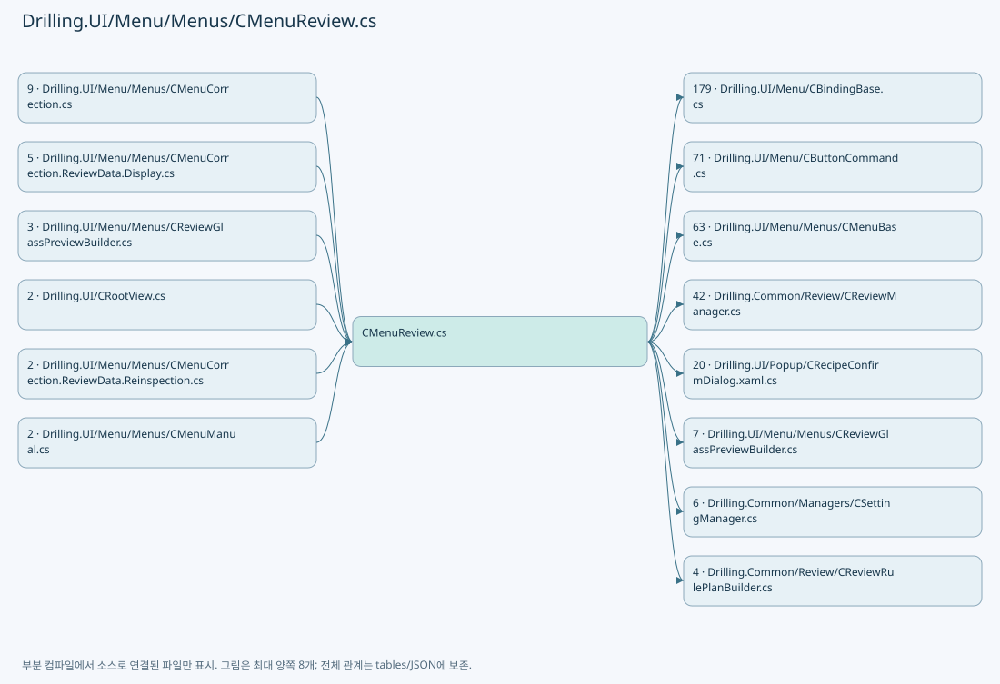

## 네임스페이스·타입·상속

| 타입 | 구분 | 원본 범위 | 선언/상속 |
| --- | --- | --- | --- |
| CMenuReview | ClassDeclaration | 19–3721 | CMenuReview: CMenuBase |
| ST_REVIEW_TAB_ITEM | RecordDeclaration | 3723–3728 | ST_REVIEW_TAB_ITEM |
| ST_REVIEW_MODE_ITEM | RecordDeclaration | 3730–3735 | ST_REVIEW_MODE_ITEM |
| ST_REVIEW_INSPECTION_METHOD_ITEM | RecordDeclaration | 3737–3742 | ST_REVIEW_INSPECTION_METHOD_ITEM |
| ST_REVIEW_RUN_SHOT_ROW | ClassDeclaration | 3744–3794 | ST_REVIEW_RUN_SHOT_ROW: CBindingBase |
| ST_REVIEW_RUN_SHOT_MATRIX_ROW | RecordDeclaration | 3796–3796 | ST_REVIEW_RUN_SHOT_MATRIX_ROW |
| ST_REVIEW_BEAM_ROW | RecordDeclaration | 3797–3808 | ST_REVIEW_BEAM_ROW |
| ST_REVIEW_BEAM_MATRIX_ROW | RecordDeclaration | 3810–3810 | ST_REVIEW_BEAM_MATRIX_ROW |
| CReviewStatusBrush | ClassDeclaration | 3811–3855 | CReviewStatusBrush |
| ST_REVIEW_POINT_SELECT_ROW | ClassDeclaration | 3857–3925 | ST_REVIEW_POINT_SELECT_ROW: CBindingBase |
| ST_REVIEW_POINT_SELECT_MATRIX_ROW | RecordDeclaration | 3927–3927 | ST_REVIEW_POINT_SELECT_MATRIX_ROW |
| ST_REVIEW_SAMPLE_DRAG_SELECTION | RecordDeclaration | 3928–3928 | ST_REVIEW_SAMPLE_DRAG_SELECTION |
| ST_REVIEW_SETTING_ITEM | RecordDeclaration | 3929–3929 | ST_REVIEW_SETTING_ITEM |
| CLazyReadOnlyList | ClassDeclaration | 3930–3996 | CLazyReadOnlyList: IReadOnlyList<T>, System.Collections.IList |
| ST_REVIEW_INSPECTION_HEAD_ROW | RecordDeclaration | 3998–4003 | ST_REVIEW_INSPECTION_HEAD_ROW |
| ST_REVIEW_RESULT_MATRIX_COLUMN | RecordDeclaration | 4005–4005 | ST_REVIEW_RESULT_MATRIX_COLUMN |
| CReviewCameraPreview | ClassDeclaration | 4007–4109 | CReviewCameraPreview: INotifyPropertyChanged |
| Projection | RecordDeclaration | 4108–4108 | Projection |

## 멤버 빠른 목록

| 이름 | 종류 | 범위 | 서명 |
| --- | --- | --- | --- |
| _beamInspectionSnapshot | FieldDeclaration | L22–22 | Drilling.Common.Review.ST_BEAM_INSPECTION_SNAPSHOT? Drilling.UI.Menu.Menus.CMenuReview._beamInspectionSnapshot |
| _beamInspectionBrowseIndex | FieldDeclaration | L23–23 | int Drilling.UI.Menu.Menus.CMenuReview._beamInspectionBrowseIndex |
| _followBeamInspection | FieldDeclaration | L24–24 | bool Drilling.UI.Menu.Menus.CMenuReview._followBeamInspection |
| _beamInspectionCancellation | FieldDeclaration | L25–25 | System.Threading.CancellationTokenSource? Drilling.UI.Menu.Menus.CMenuReview._beamInspectionCancellation |
| _loadedBeamInspectionResult | FieldDeclaration | L26–26 | Drilling.Common.Review.ST_BEAM_INSPECTION_RESULT_FILE_DATA? Drilling.UI.Menu.Menus.CMenuReview._loadedBeamInspectionResult |
| _isBeamInspectionResultLoading | FieldDeclaration | L27–27 | bool Drilling.UI.Menu.Menus.CMenuReview._isBeamInspectionResultLoading |
| _beamInspectionResultLoadGeneration | FieldDeclaration | L28–28 | long Drilling.UI.Menu.Menus.CMenuReview._beamInspectionResultLoadGeneration |
| _beamInspectionResultLoadCancellation | FieldDeclaration | L29–29 | System.Threading.CancellationTokenSource? Drilling.UI.Menu.Menus.CMenuReview._beamInspectionResultLoadCancellation |
| _beamInspectionResultLoader | FieldDeclaration | L30–30 | System.Func<System.Threading.CancellationToken, System.Threading.Tasks.Task<Drilling.Common.Review.ST_BEAM_INSPECTION_RESULT_FILE_DATA?>>? Drilling.UI.Menu.Menus.CMenuReview._beamInspectionResultLoader |
| PointToPointInspectionMethod | FieldDeclaration | L31–31 | string Drilling.UI.Menu.Menus.CMenuReview.PointToPointInspectionMethod |
| InspectionOnFlyMethod | FieldDeclaration | L32–32 | string Drilling.UI.Menu.Menus.CMenuReview.InspectionOnFlyMethod |
| DefaultHeadCount | FieldDeclaration | L33–33 | int Drilling.UI.Menu.Menus.CMenuReview.DefaultHeadCount |
| MaxHeadCount | FieldDeclaration | L34–34 | int Drilling.UI.Menu.Menus.CMenuReview.MaxHeadCount |
| DefaultCellCount | FieldDeclaration | L35–35 | int Drilling.UI.Menu.Menus.CMenuReview.DefaultCellCount |
| _reviewManager | FieldDeclaration | L36–36 | Drilling.Common.Review.CReviewManager Drilling.UI.Menu.Menus.CMenuReview._reviewManager |
| _recipeManager | FieldDeclaration | L37–37 | Drilling.Common.Managers.CRecipeManager Drilling.UI.Menu.Menus.CMenuReview._recipeManager |
| _stationManager | FieldDeclaration | L38–38 | Drilling.Common.Station.CStationManager Drilling.UI.Menu.Menus.CMenuReview._stationManager |
| _productManager | FieldDeclaration | L39–39 | Drilling.Common.Product.CProductManager Drilling.UI.Menu.Menus.CMenuReview._productManager |
| _selectedRecipeIdProvider | FieldDeclaration | L40–40 | System.Func<string> Drilling.UI.Menu.Menus.CMenuReview._selectedRecipeIdProvider |
| _statusReporter | FieldDeclaration | L41–41 | System.Action<string> Drilling.UI.Menu.Menus.CMenuReview._statusReporter |
| _refreshScreen | FieldDeclaration | L42–42 | System.Action Drilling.UI.Menu.Menus.CMenuReview._refreshScreen |
| _refreshNavigationAccess | FieldDeclaration | L43–43 | System.Action Drilling.UI.Menu.Menus.CMenuReview._refreshNavigationAccess |
| _openCorrectionReview | FieldDeclaration | L44–44 | System.Action? Drilling.UI.Menu.Menus.CMenuReview._openCorrectionReview |
| _selectedSampleShotKeys | FieldDeclaration | L45–45 | System.Collections.Generic.HashSet<string> Drilling.UI.Menu.Menus.CMenuReview._selectedSampleShotKeys |
| _selectedInspectionBeamNos | FieldDeclaration | L46–46 | System.Collections.Generic.HashSet<int> Drilling.UI.Menu.Menus.CMenuReview._selectedInspectionBeamNos |
| _selectedInspectionShotKeys | FieldDeclaration | L47–47 | System.Collections.Generic.HashSet<string> Drilling.UI.Menu.Menus.CMenuReview._selectedInspectionShotKeys |
| _headCount | FieldDeclaration | L48–48 | int Drilling.UI.Menu.Menus.CMenuReview._headCount |
| _cellCount | FieldDeclaration | L49–49 | int Drilling.UI.Menu.Menus.CMenuReview._cellCount |
| _sampleRuleHeadNo | FieldDeclaration | L50–50 | int Drilling.UI.Menu.Menus.CMenuReview._sampleRuleHeadNo |
| _sampleRuleCellNo | FieldDeclaration | L51–51 | int Drilling.UI.Menu.Menus.CMenuReview._sampleRuleCellNo |
| _selectedSampleCellNo | FieldDeclaration | L52–52 | int Drilling.UI.Menu.Menus.CMenuReview._selectedSampleCellNo |
| _selectedRunCellNo | FieldDeclaration | L53–53 | int Drilling.UI.Menu.Menus.CMenuReview._selectedRunCellNo |
| _totalReviewPointCount | FieldDeclaration | L54–54 | int Drilling.UI.Menu.Menus.CMenuReview._totalReviewPointCount |
| _activePlanPointCount | FieldDeclaration | L55–55 | int Drilling.UI.Menu.Menus.CMenuReview._activePlanPointCount |
| _sampleMapColumnCount | FieldDeclaration | L56–56 | int Drilling.UI.Menu.Menus.CMenuReview._sampleMapColumnCount |
| _isSampleCellDetailVisible | FieldDeclaration | L57–57 | bool Drilling.UI.Menu.Menus.CMenuReview._isSampleCellDetailVisible |
| _isRunCellDetailVisible | FieldDeclaration | L58–58 | bool Drilling.UI.Menu.Menus.CMenuReview._isRunCellDetailVisible |
| _isStartRequestPending | FieldDeclaration | L59–59 | bool Drilling.UI.Menu.Menus.CMenuReview._isStartRequestPending |
| _selectedRunShotKey | FieldDeclaration | L60–60 | string Drilling.UI.Menu.Menus.CMenuReview._selectedRunShotKey |
| _selectedRunBeamNo | FieldDeclaration | L61–61 | int Drilling.UI.Menu.Menus.CMenuReview._selectedRunBeamNo |
| _selectedInspectionMethod | FieldDeclaration | L62–62 | string Drilling.UI.Menu.Menus.CMenuReview._selectedInspectionMethod |
| _splitBeamCount | FieldDeclaration | L63–63 | int Drilling.UI.Menu.Menus.CMenuReview._splitBeamCount |
| _recipeId | FieldDeclaration | L64–64 | string Drilling.UI.Menu.Menus.CMenuReview._recipeId |
| _sampleSelectionRecipeId | FieldDeclaration | L65–65 | string Drilling.UI.Menu.Menus.CMenuReview._sampleSelectionRecipeId |
| _selectedTab | FieldDeclaration | L66–66 | string Drilling.UI.Menu.Menus.CMenuReview._selectedTab |
| _selectedMode | FieldDeclaration | L67–67 | string Drilling.UI.Menu.Menus.CMenuReview._selectedMode |
| _selectionRuleText | FieldDeclaration | L68–68 | string Drilling.UI.Menu.Menus.CMenuReview._selectionRuleText |
| _selectedSampleRuleUi | FieldDeclaration | L69–69 | string Drilling.UI.Menu.Menus.CMenuReview._selectedSampleRuleUi |
| _sampleRuleScope | FieldDeclaration | L70–70 | string Drilling.UI.Menu.Menus.CMenuReview._sampleRuleScope |
| _roughReference | FieldDeclaration | L71–71 | string Drilling.UI.Menu.Menus.CMenuReview._roughReference |
| _fineLineCount | FieldDeclaration | L72–72 | int Drilling.UI.Menu.Menus.CMenuReview._fineLineCount |
| _simpleSampleShotKey | FieldDeclaration | L73–73 | string Drilling.UI.Menu.Menus.CMenuReview._simpleSampleShotKey |
| _pendingSimpleShot | FieldDeclaration | L74–74 | string Drilling.UI.Menu.Menus.CMenuReview._pendingSimpleShot |
| _lastCorrectionRulePlan | FieldDeclaration | L75–75 | Drilling.Common.Review.ST_REVIEW_RULE_PLAN? Drilling.UI.Menu.Menus.CMenuReview._lastCorrectionRulePlan |
| _lastCorrectionRuleSource | FieldDeclaration | L76–76 | System.Collections.Generic.IReadOnlyList<Drilling.Common.Review.ST_REVIEW_PLAN_POINT>? Drilling.UI.Menu.Menus.CMenuReview._lastCorrectionRuleSource |
| _sampleScopeCountPlan | FieldDeclaration | L77–77 | Drilling.Common.Review.ST_REVIEW_PLAN? Drilling.UI.Menu.Menus.CMenuReview._sampleScopeCountPlan |
| _sampleHeadPointCounts | FieldDeclaration | L78–78 | System.Collections.Generic.IReadOnlyDictionary<int, int> Drilling.UI.Menu.Menus.CMenuReview._sampleHeadPointCounts |
| _sampleHeadCellPointCounts | FieldDeclaration | L79–79 | System.Collections.Generic.IReadOnlyDictionary<(int HeadNo, int CellNo), int> Drilling.UI.Menu.Menus.CMenuReview._sampleHeadCellPointCounts |
| _planBuildError | FieldDeclaration | L80–80 | string Drilling.UI.Menu.Menus.CMenuReview._planBuildError |
| _selectedRuleType | FieldDeclaration | L81–81 | Drilling.Common.Review.EN_REVIEW_RULE_TYPE Drilling.UI.Menu.Menus.CMenuReview._selectedRuleType |
| _lastAllPlan | FieldDeclaration | L82–82 | Drilling.Common.Review.ST_REVIEW_PLAN? Drilling.UI.Menu.Menus.CMenuReview._lastAllPlan |
| _lastRecipe | FieldDeclaration | L83–83 | Drilling.Common.Managers.ST_RECIPE_DEFINITION? Drilling.UI.Menu.Menus.CMenuReview._lastRecipe |
| _lastAllPlanBeamNo | FieldDeclaration | L84–84 | int Drilling.UI.Menu.Menus.CMenuReview._lastAllPlanBeamNo |
| _runShotRowsByKey | FieldDeclaration | L85–85 | System.Collections.Generic.IReadOnlyDictionary<string, Drilling.UI.Menu.Menus.ST_REVIEW_RUN_SHOT_ROW> Drilling.UI.Menu.Menus.CMenuReview._runShotRowsByKey |
| _sampleShotRowsByKey | FieldDeclaration | L86–86 | System.Collections.Generic.Dictionary<string, Drilling.UI.Menu.Menus.ST_REVIEW_POINT_SELECT_ROW> Drilling.UI.Menu.Menus.CMenuReview._sampleShotRowsByKey |
| Tabs | PropertyDeclaration | L87–87 | System.Collections.Generic.IReadOnlyList<Drilling.UI.Menu.Menus.ST_REVIEW_TAB_ITEM> Drilling.UI.Menu.Menus.CMenuReview.Tabs |
| get_Tabs | GetAccessorDeclaration | L87–87 | System.Collections.Generic.IReadOnlyList<Drilling.UI.Menu.Menus.ST_REVIEW_TAB_ITEM> Drilling.UI.Menu.Menus.CMenuReview.Tabs.get |
| set_Tabs | SetAccessorDeclaration | L87–87 | void Drilling.UI.Menu.Menus.CMenuReview.Tabs.set |
| Modes | PropertyDeclaration | L88–88 | System.Collections.Generic.IReadOnlyList<Drilling.UI.Menu.Menus.ST_REVIEW_MODE_ITEM> Drilling.UI.Menu.Menus.CMenuReview.Modes |
| get_Modes | GetAccessorDeclaration | L88–88 | System.Collections.Generic.IReadOnlyList<Drilling.UI.Menu.Menus.ST_REVIEW_MODE_ITEM> Drilling.UI.Menu.Menus.CMenuReview.Modes.get |
| set_Modes | SetAccessorDeclaration | L88–88 | void Drilling.UI.Menu.Menus.CMenuReview.Modes.set |
| TargetItems | PropertyDeclaration | L89–89 | System.Collections.Generic.IReadOnlyList<Drilling.UI.Menu.Menus.ST_DISPLAY_ITEM> Drilling.UI.Menu.Menus.CMenuReview.TargetItems |
| get_TargetItems | GetAccessorDeclaration | L89–89 | System.Collections.Generic.IReadOnlyList<Drilling.UI.Menu.Menus.ST_DISPLAY_ITEM> Drilling.UI.Menu.Menus.CMenuReview.TargetItems.get |
| set_TargetItems | SetAccessorDeclaration | L89–89 | void Drilling.UI.Menu.Menus.CMenuReview.TargetItems.set |
| SelectionSummaryItems | PropertyDeclaration | L90–90 | System.Collections.Generic.IReadOnlyList<Drilling.UI.Menu.Menus.ST_DISPLAY_ITEM> Drilling.UI.Menu.Menus.CMenuReview.SelectionSummaryItems |
| get_SelectionSummaryItems | GetAccessorDeclaration | L90–90 | System.Collections.Generic.IReadOnlyList<Drilling.UI.Menu.Menus.ST_DISPLAY_ITEM> Drilling.UI.Menu.Menus.CMenuReview.SelectionSummaryItems.get |
| set_SelectionSummaryItems | SetAccessorDeclaration | L90–90 | void Drilling.UI.Menu.Menus.CMenuReview.SelectionSummaryItems.set |
| SelectedPointItems | PropertyDeclaration | L91–91 | System.Collections.Generic.IReadOnlyList<Drilling.UI.Menu.Menus.ST_DISPLAY_ITEM> Drilling.UI.Menu.Menus.CMenuReview.SelectedPointItems |
| get_SelectedPointItems | GetAccessorDeclaration | L91–91 | System.Collections.Generic.IReadOnlyList<Drilling.UI.Menu.Menus.ST_DISPLAY_ITEM> Drilling.UI.Menu.Menus.CMenuReview.SelectedPointItems.get |
| set_SelectedPointItems | SetAccessorDeclaration | L91–91 | void Drilling.UI.Menu.Menus.CMenuReview.SelectedPointItems.set |
| RunCellPreviewLabels | PropertyDeclaration | L92–92 | System.Collections.Generic.IReadOnlyList<Drilling.UI.Menu.Menus.ST_CELL_PREVIEW_LABEL> Drilling.UI.Menu.Menus.CMenuReview.RunCellPreviewLabels |
| get_RunCellPreviewLabels | GetAccessorDeclaration | L92–92 | System.Collections.Generic.IReadOnlyList<Drilling.UI.Menu.Menus.ST_CELL_PREVIEW_LABEL> Drilling.UI.Menu.Menus.CMenuReview.RunCellPreviewLabels.get |
| set_RunCellPreviewLabels | SetAccessorDeclaration | L92–92 | void Drilling.UI.Menu.Menus.CMenuReview.RunCellPreviewLabels.set |
| RunGlassPreviewSummary | PropertyDeclaration | L93–93 | string Drilling.UI.Menu.Menus.CMenuReview.RunGlassPreviewSummary |
| get_RunGlassPreviewSummary | GetAccessorDeclaration | L93–93 | string Drilling.UI.Menu.Menus.CMenuReview.RunGlassPreviewSummary.get |
| set_RunGlassPreviewSummary | SetAccessorDeclaration | L93–93 | void Drilling.UI.Menu.Menus.CMenuReview.RunGlassPreviewSummary.set |
| RunCellShotRows | PropertyDeclaration | L94–94 | System.Collections.Generic.IReadOnlyList<Drilling.UI.Menu.Menus.ST_REVIEW_RUN_SHOT_ROW> Drilling.UI.Menu.Menus.CMenuReview.RunCellShotRows |
| get_RunCellShotRows | GetAccessorDeclaration | L94–94 | System.Collections.Generic.IReadOnlyList<Drilling.UI.Menu.Menus.ST_REVIEW_RUN_SHOT_ROW> Drilling.UI.Menu.Menus.CMenuReview.RunCellShotRows.get |
| set_RunCellShotRows | SetAccessorDeclaration | L94–94 | void Drilling.UI.Menu.Menus.CMenuReview.RunCellShotRows.set |
| RunCellShotMatrixRows | PropertyDeclaration | L95–95 | System.Collections.Generic.IReadOnlyList<Drilling.UI.Menu.Menus.ST_REVIEW_RUN_SHOT_MATRIX_ROW> Drilling.UI.Menu.Menus.CMenuReview.RunCellShotMatrixRows |
| get_RunCellShotMatrixRows | GetAccessorDeclaration | L95–95 | System.Collections.Generic.IReadOnlyList<Drilling.UI.Menu.Menus.ST_REVIEW_RUN_SHOT_MATRIX_ROW> Drilling.UI.Menu.Menus.CMenuReview.RunCellShotMatrixRows.get |
| set_RunCellShotMatrixRows | SetAccessorDeclaration | L95–95 | void Drilling.UI.Menu.Menus.CMenuReview.RunCellShotMatrixRows.set |
| RunBeamRows | PropertyDeclaration | L96–96 | System.Collections.Generic.IReadOnlyList<Drilling.UI.Menu.Menus.ST_REVIEW_BEAM_MATRIX_ROW> Drilling.UI.Menu.Menus.CMenuReview.RunBeamRows |
| get_RunBeamRows | GetAccessorDeclaration | L96–96 | System.Collections.Generic.IReadOnlyList<Drilling.UI.Menu.Menus.ST_REVIEW_BEAM_MATRIX_ROW> Drilling.UI.Menu.Menus.CMenuReview.RunBeamRows.get |
| set_RunBeamRows | SetAccessorDeclaration | L96–96 | void Drilling.UI.Menu.Menus.CMenuReview.RunBeamRows.set |
| PointSelectRows | PropertyDeclaration | L97–97 | System.Collections.Generic.IReadOnlyList<Drilling.UI.Menu.Menus.ST_REVIEW_POINT_SELECT_ROW> Drilling.UI.Menu.Menus.CMenuReview.PointSelectRows |
| get_PointSelectRows | GetAccessorDeclaration | L97–97 | System.Collections.Generic.IReadOnlyList<Drilling.UI.Menu.Menus.ST_REVIEW_POINT_SELECT_ROW> Drilling.UI.Menu.Menus.CMenuReview.PointSelectRows.get |
| set_PointSelectRows | SetAccessorDeclaration | L97–97 | void Drilling.UI.Menu.Menus.CMenuReview.PointSelectRows.set |
| SampleCellPreviewLabels | PropertyDeclaration | L98–98 | System.Collections.Generic.IReadOnlyList<Drilling.UI.Menu.Menus.ST_CELL_PREVIEW_LABEL> Drilling.UI.Menu.Menus.CMenuReview.SampleCellPreviewLabels |
| get_SampleCellPreviewLabels | GetAccessorDeclaration | L98–98 | System.Collections.Generic.IReadOnlyList<Drilling.UI.Menu.Menus.ST_CELL_PREVIEW_LABEL> Drilling.UI.Menu.Menus.CMenuReview.SampleCellPreviewLabels.get |
| set_SampleCellPreviewLabels | SetAccessorDeclaration | L98–98 | void Drilling.UI.Menu.Menus.CMenuReview.SampleCellPreviewLabels.set |
| SampleGlassPreviewSummary | PropertyDeclaration | L99–99 | string Drilling.UI.Menu.Menus.CMenuReview.SampleGlassPreviewSummary |
| get_SampleGlassPreviewSummary | GetAccessorDeclaration | L99–99 | string Drilling.UI.Menu.Menus.CMenuReview.SampleGlassPreviewSummary.get |
| set_SampleGlassPreviewSummary | SetAccessorDeclaration | L99–99 | void Drilling.UI.Menu.Menus.CMenuReview.SampleGlassPreviewSummary.set |
| SampleCellShotRows | PropertyDeclaration | L100–100 | System.Collections.Generic.IReadOnlyList<Drilling.UI.Menu.Menus.ST_REVIEW_POINT_SELECT_ROW> Drilling.UI.Menu.Menus.CMenuReview.SampleCellShotRows |
| get_SampleCellShotRows | GetAccessorDeclaration | L100–100 | System.Collections.Generic.IReadOnlyList<Drilling.UI.Menu.Menus.ST_REVIEW_POINT_SELECT_ROW> Drilling.UI.Menu.Menus.CMenuReview.SampleCellShotRows.get |
| set_SampleCellShotRows | SetAccessorDeclaration | L100–100 | void Drilling.UI.Menu.Menus.CMenuReview.SampleCellShotRows.set |
| SampleCellShotMatrixRows | PropertyDeclaration | L101–101 | System.Collections.Generic.IReadOnlyList<Drilling.UI.Menu.Menus.ST_REVIEW_POINT_SELECT_MATRIX_ROW> Drilling.UI.Menu.Menus.CMenuReview.SampleCellShotMatrixRows |
| get_SampleCellShotMatrixRows | GetAccessorDeclaration | L101–101 | System.Collections.Generic.IReadOnlyList<Drilling.UI.Menu.Menus.ST_REVIEW_POINT_SELECT_MATRIX_ROW> Drilling.UI.Menu.Menus.CMenuReview.SampleCellShotMatrixRows.get |
| set_SampleCellShotMatrixRows | SetAccessorDeclaration | L101–101 | void Drilling.UI.Menu.Menus.CMenuReview.SampleCellShotMatrixRows.set |
| ResultMatrix | PropertyDeclaration | L102–102 | System.Data.DataView Drilling.UI.Menu.Menus.CMenuReview.ResultMatrix |
| get_ResultMatrix | GetAccessorDeclaration | L102–102 | System.Data.DataView Drilling.UI.Menu.Menus.CMenuReview.ResultMatrix.get |
| set_ResultMatrix | SetAccessorDeclaration | L102–102 | void Drilling.UI.Menu.Menus.CMenuReview.ResultMatrix.set |
| _oneShotCancellation | FieldDeclaration | L104–104 | System.Threading.CancellationTokenSource? Drilling.UI.Menu.Menus.CMenuReview._oneShotCancellation |
| _reviewCancellation | FieldDeclaration | L105–105 | System.Threading.CancellationTokenSource? Drilling.UI.Menu.Menus.CMenuReview._reviewCancellation |
| _oneShotRunning | FieldDeclaration | L106–106 | bool Drilling.UI.Menu.Menus.CMenuReview._oneShotRunning |
| _oneShotMethod | FieldDeclaration | L107–107 | string Drilling.UI.Menu.Menus.CMenuReview._oneShotMethod |
| _oneShotResult | FieldDeclaration | L108–108 | Drilling.Common.Review.ST_ONE_SHOT_RESULT? Drilling.UI.Menu.Menus.CMenuReview._oneShotResult |
| OneShotActionCommand | PropertyDeclaration | L109–109 | Drilling.UI.Menu.CButtonCommand Drilling.UI.Menu.Menus.CMenuReview.OneShotActionCommand |
| get_OneShotActionCommand | GetAccessorDeclaration | L109–109 | Drilling.UI.Menu.CButtonCommand Drilling.UI.Menu.Menus.CMenuReview.OneShotActionCommand.get |
| set_OneShotActionCommand | SetAccessorDeclaration | L109–109 | void Drilling.UI.Menu.Menus.CMenuReview.OneShotActionCommand.set |
| OneShotMethods | PropertyDeclaration | L110–110 | System.Collections.Generic.IReadOnlyList<string> Drilling.UI.Menu.Menus.CMenuReview.OneShotMethods |
| get_OneShotMethods | GetAccessorDeclaration | L110–110 | System.Collections.Generic.IReadOnlyList<string> Drilling.UI.Menu.Menus.CMenuReview.OneShotMethods.get |
| OneShotStatus | PropertyDeclaration | L111–111 | string Drilling.UI.Menu.Menus.CMenuReview.OneShotStatus |
| get_OneShotStatus | GetAccessorDeclaration | L111–111 | string Drilling.UI.Menu.Menus.CMenuReview.OneShotStatus.get |
| set_OneShotStatus | SetAccessorDeclaration | L111–111 | void Drilling.UI.Menu.Menus.CMenuReview.OneShotStatus.set |
| _runtimeUiGate | FieldDeclaration | L113–113 | object Drilling.UI.Menu.Menus.CMenuReview._runtimeUiGate |
| _runtimePendingPoints | FieldDeclaration | L114–114 | System.Collections.Generic.Dictionary<string, Drilling.Common.Review.ST_REVIEW_PLAN_POINT> Drilling.UI.Menu.Menus.CMenuReview._runtimePendingPoints |
| _runtimePendingPlan | FieldDeclaration | L115–115 | Drilling.Common.Review.ST_REVIEW_PLAN? Drilling.UI.Menu.Menus.CMenuReview._runtimePendingPlan |
| _runtimeSeedPlan | FieldDeclaration | L116–116 | Drilling.Common.Review.ST_REVIEW_PLAN? Drilling.UI.Menu.Menus.CMenuReview._runtimeSeedPlan |
| _runtimeQueuedId | FieldDeclaration | L117–117 | System.Guid Drilling.UI.Menu.Menus.CMenuReview._runtimeQueuedId |
| _runtimeTimerScheduled | FieldDeclaration | L118–118 | int Drilling.UI.Menu.Menus.CMenuReview._runtimeTimerScheduled |
| _runtimeDisplayTimer | FieldDeclaration | L119–119 | DispatcherTimer? Drilling.UI.Menu.Menus.CMenuReview._runtimeDisplayTimer |
| _runtimeCurrentPointCells | FieldDeclaration | L120–120 | System.Collections.Generic.Dictionary<string, int> Drilling.UI.Menu.Menus.CMenuReview._runtimeCurrentPointCells |
| _emptyRuntimeMatrix | FieldDeclaration | L121–121 | System.Data.DataView Drilling.UI.Menu.Menus.CMenuReview._emptyRuntimeMatrix |
| _finishedResultPlan | FieldDeclaration | L122–122 | Drilling.Common.Review.ST_REVIEW_PLAN? Drilling.UI.Menu.Menus.CMenuReview._finishedResultPlan |
| _finishedResultMatrix | FieldDeclaration | L123–123 | System.Data.DataView? Drilling.UI.Menu.Menus.CMenuReview._finishedResultMatrix |
| _deferResultMatrix | FieldDeclaration | L124–124 | bool Drilling.UI.Menu.Menus.CMenuReview._deferResultMatrix |
| _resultDisplayGeneration | FieldDeclaration | L125–125 | int Drilling.UI.Menu.Menus.CMenuReview._resultDisplayGeneration |
| _runtimePreviewCells | FieldDeclaration | L126–126 | System.Collections.Generic.HashSet<int> Drilling.UI.Menu.Menus.CMenuReview._runtimePreviewCells |
| _runtimePreviewCell | FieldDeclaration | L127–127 | int Drilling.UI.Menu.Menus.CMenuReview._runtimePreviewCell |
| _runtimePreviewActive | FieldDeclaration | L128–128 | bool Drilling.UI.Menu.Menus.CMenuReview._runtimePreviewActive |
| _runtimePreviewBase | FieldDeclaration | L129–129 | ImageSource? Drilling.UI.Menu.Menus.CMenuReview._runtimePreviewBase |
| _runtimeDisplayRefreshCount | FieldDeclaration | L130–130 | int Drilling.UI.Menu.Menus.CMenuReview._runtimeDisplayRefreshCount |
| _cameraInterfaces | FieldDeclaration | L131–131 | Drilling.Common.Interface.CInterfaceManager? Drilling.UI.Menu.Menus.CMenuReview._cameraInterfaces |
| _cameraSettings | FieldDeclaration | L132–132 | Drilling.Common.Managers.CSettingManager? Drilling.UI.Menu.Menus.CMenuReview._cameraSettings |
| _cameraRecipe | FieldDeclaration | L133–133 | Drilling.Common.Managers.ST_RECIPE_DEFINITION? Drilling.UI.Menu.Menus.CMenuReview._cameraRecipe |
| _cameraSettingFrame | FieldDeclaration | L134–134 | System.Collections.Generic.IReadOnlyList<Drilling.Common.Managers.ST_SYSTEM_PARAMETER>? Drilling.UI.Menu.Menus.CMenuReview._cameraSettingFrame |
| _cameraParameters | FieldDeclaration | L135–135 | System.Collections.Generic.Dictionary<string, string> Drilling.UI.Menu.Menus.CMenuReview._cameraParameters |
| _cameraGlassBounds | FieldDeclaration | L136–136 | Rect Drilling.UI.Menu.Menus.CMenuReview._cameraGlassBounds |
| _cameraCanvasSize | FieldDeclaration | L137–137 | Size Drilling.UI.Menu.Menus.CMenuReview._cameraCanvasSize |
| Camera | PropertyDeclaration | L138–138 | Drilling.UI.Menu.Menus.CReviewCameraPreview Drilling.UI.Menu.Menus.CMenuReview.Camera |
| get_Camera | GetAccessorDeclaration | L138–138 | Drilling.UI.Menu.Menus.CReviewCameraPreview Drilling.UI.Menu.Menus.CMenuReview.Camera.get |
| .ctor | ConstructorDeclaration | L142–199 | Drilling.UI.Menu.Menus.CMenuReview.CMenuReview(Drilling.Common.Review.CReviewManager, Drilling.Common.Managers.CRecipeManager, Drilling.Common.Station.CStationManager, Drilling.Common.Product.CProductManager, System.Func<string>, System.Action<string>, System.Action, System.Action, Drilling.Common.Interface.CInterfaceManager?, Drilling.Common.Managers.CSettingManager?, System.Action?) |
| Menu | PropertyDeclaration | L203–203 | Drilling.UI.Menu.Menus.EN_MENU Drilling.UI.Menu.Menus.CMenuReview.Menu |
| Title | PropertyDeclaration | L204–204 | string Drilling.UI.Menu.Menus.CMenuReview.Title |
| Subtitle | PropertyDeclaration | L205–205 | string Drilling.UI.Menu.Menus.CMenuReview.Subtitle |
| PlanSummary | PropertyDeclaration | L206–206 | string Drilling.UI.Menu.Menus.CMenuReview.PlanSummary |
| SampleMapColumnCount | PropertyDeclaration | L207–207 | int Drilling.UI.Menu.Menus.CMenuReview.SampleMapColumnCount |
| IsRunTab | PropertyDeclaration | L208–208 | bool Drilling.UI.Menu.Menus.CMenuReview.IsRunTab |
| IsRunCommandsVisible | PropertyDeclaration | L209–209 | bool Drilling.UI.Menu.Menus.CMenuReview.IsRunCommandsVisible |
| IsRunGlassPreviewVisible | PropertyDeclaration | L210–210 | bool Drilling.UI.Menu.Menus.CMenuReview.IsRunGlassPreviewVisible |
| IsRunCellDetailVisible | PropertyDeclaration | L211–211 | bool Drilling.UI.Menu.Menus.CMenuReview.IsRunCellDetailVisible |
| IsAllShotReviewMode | PropertyDeclaration | L212–212 | bool Drilling.UI.Menu.Menus.CMenuReview.IsAllShotReviewMode |
| IsOneShotReviewMode | PropertyDeclaration | L213–213 | bool Drilling.UI.Menu.Menus.CMenuReview.IsOneShotReviewMode |
| IsRuleReviewMode | PropertyDeclaration | L214–214 | bool Drilling.UI.Menu.Menus.CMenuReview.IsRuleReviewMode |
| IsBeamInspectionMode | PropertyDeclaration | L215–215 | bool Drilling.UI.Menu.Menus.CMenuReview.IsBeamInspectionMode |
| IsBeamSelectionVisible | PropertyDeclaration | L216–216 | bool Drilling.UI.Menu.Menus.CMenuReview.IsBeamSelectionVisible |
| IsLastMeasurementVisible | PropertyDeclaration | L217–217 | bool Drilling.UI.Menu.Menus.CMenuReview.IsLastMeasurementVisible |
| IsRunShotMapVisible | PropertyDeclaration | L218–218 | bool Drilling.UI.Menu.Menus.CMenuReview.IsRunShotMapVisible |
| IsRunBeamDetailVisible | PropertyDeclaration | L219–219 | bool Drilling.UI.Menu.Menus.CMenuReview.IsRunBeamDetailVisible |
| RunWorkspaceTitle | PropertyDeclaration | L220–220 | string Drilling.UI.Menu.Menus.CMenuReview.RunWorkspaceTitle |
| RunWorkspaceSummary | PropertyDeclaration | L221–221 | string Drilling.UI.Menu.Menus.CMenuReview.RunWorkspaceSummary |
| SelectedRunShotName | PropertyDeclaration | L222–222 | string Drilling.UI.Menu.Menus.CMenuReview.SelectedRunShotName |
| IsSampleSelectTab | PropertyDeclaration | L223–223 | bool Drilling.UI.Menu.Menus.CMenuReview.IsSampleSelectTab |
| IsSimpleSampleRuleUi | PropertyDeclaration | L224–224 | bool Drilling.UI.Menu.Menus.CMenuReview.IsSimpleSampleRuleUi |
| IsRoughSampleRuleUi | PropertyDeclaration | L225–225 | bool Drilling.UI.Menu.Menus.CMenuReview.IsRoughSampleRuleUi |
| IsFineSampleRuleUi | PropertyDeclaration | L226–226 | bool Drilling.UI.Menu.Menus.CMenuReview.IsFineSampleRuleUi |
| IsSampleScopeVisible | PropertyDeclaration | L227–227 | bool Drilling.UI.Menu.Menus.CMenuReview.IsSampleScopeVisible |
| IsSampleScopeHead | PropertyDeclaration | L228–228 | bool Drilling.UI.Menu.Menus.CMenuReview.IsSampleScopeHead |
| IsSampleScopeHeadCell | PropertyDeclaration | L229–229 | bool Drilling.UI.Menu.Menus.CMenuReview.IsSampleScopeHeadCell |
| IsRoughFirst | PropertyDeclaration | L230–230 | bool Drilling.UI.Menu.Menus.CMenuReview.IsRoughFirst |
| IsRoughCenter | PropertyDeclaration | L231–231 | bool Drilling.UI.Menu.Menus.CMenuReview.IsRoughCenter |
| IsRoughLast | PropertyDeclaration | L232–232 | bool Drilling.UI.Menu.Menus.CMenuReview.IsRoughLast |
| IsFineOneLine | PropertyDeclaration | L233–233 | bool Drilling.UI.Menu.Menus.CMenuReview.IsFineOneLine |
| IsFineThreeLine | PropertyDeclaration | L234–234 | bool Drilling.UI.Menu.Menus.CMenuReview.IsFineThreeLine |
| IsFineFiveLine | PropertyDeclaration | L235–235 | bool Drilling.UI.Menu.Menus.CMenuReview.IsFineFiveLine |
| IsFineSevenLine | PropertyDeclaration | L236–236 | bool Drilling.UI.Menu.Menus.CMenuReview.IsFineSevenLine |
| SelectedSampleRuleUi | PropertyDeclaration | L237–237 | string Drilling.UI.Menu.Menus.CMenuReview.SelectedSampleRuleUi |
| SampleCorrectionTitle | PropertyDeclaration | L238–238 | string Drilling.UI.Menu.Menus.CMenuReview.SampleCorrectionTitle |
| SampleTargetSectionTitle | PropertyDeclaration | L239–239 | string Drilling.UI.Menu.Menus.CMenuReview.SampleTargetSectionTitle |
| SampleReferenceThirdLabel | PropertyDeclaration | L240–244 | string Drilling.UI.Menu.Menus.CMenuReview.SampleReferenceThirdLabel |
| SampleCorrectionTarget | PropertyDeclaration | L245–245 | string Drilling.UI.Menu.Menus.CMenuReview.SampleCorrectionTarget |
| SampleReferenceHead | PropertyDeclaration | L246–246 | string Drilling.UI.Menu.Menus.CMenuReview.SampleReferenceHead |
| SampleReferenceCell | PropertyDeclaration | L247–247 | string Drilling.UI.Menu.Menus.CMenuReview.SampleReferenceCell |
| SampleReferenceShot | PropertyDeclaration | L248–253 | string Drilling.UI.Menu.Menus.CMenuReview.SampleReferenceShot |
| SampleOffsetApplyCount | PropertyDeclaration | L254–254 | string Drilling.UI.Menu.Menus.CMenuReview.SampleOffsetApplyCount |
| SampleInspectionShotCount | PropertyDeclaration | L255–255 | string Drilling.UI.Menu.Menus.CMenuReview.SampleInspectionShotCount |
| SamplePlanStatus | PropertyDeclaration | L256–256 | string Drilling.UI.Menu.Menus.CMenuReview.SamplePlanStatus |
| IsSampleGlassPreviewVisible | PropertyDeclaration | L257–257 | bool Drilling.UI.Menu.Menus.CMenuReview.IsSampleGlassPreviewVisible |
| IsSampleCellDetailVisible | PropertyDeclaration | L258–258 | bool Drilling.UI.Menu.Menus.CMenuReview.IsSampleCellDetailVisible |
| SampleWorkspaceTitle | PropertyDeclaration | L259–259 | string Drilling.UI.Menu.Menus.CMenuReview.SampleWorkspaceTitle |
| SampleWorkspaceSummary | PropertyDeclaration | L260–260 | string Drilling.UI.Menu.Menus.CMenuReview.SampleWorkspaceSummary |
| SampleRuleName | PropertyDeclaration | L261–261 | string Drilling.UI.Menu.Menus.CMenuReview.SampleRuleName |
| SampleHeadOptions | PropertyDeclaration | L262–262 | System.Collections.Generic.IReadOnlyList<string> Drilling.UI.Menu.Menus.CMenuReview.SampleHeadOptions |
| SelectedSampleHead | PropertyDeclaration | L264–280 | string Drilling.UI.Menu.Menus.CMenuReview.SelectedSampleHead |
| get_SelectedSampleHead | GetAccessorDeclaration | L266–266 | string Drilling.UI.Menu.Menus.CMenuReview.SelectedSampleHead.get |
| set_SelectedSampleHead | SetAccessorDeclaration | L267–279 | void Drilling.UI.Menu.Menus.CMenuReview.SelectedSampleHead.set |
| SampleCellOptions | PropertyDeclaration | L282–282 | System.Collections.Generic.IReadOnlyList<string> Drilling.UI.Menu.Menus.CMenuReview.SampleCellOptions |
| SelectedSampleCell | PropertyDeclaration | L284–300 | string Drilling.UI.Menu.Menus.CMenuReview.SelectedSampleCell |
| get_SelectedSampleCell | GetAccessorDeclaration | L286–286 | string Drilling.UI.Menu.Menus.CMenuReview.SelectedSampleCell.get |
| set_SelectedSampleCell | SetAccessorDeclaration | L287–299 | void Drilling.UI.Menu.Menus.CMenuReview.SelectedSampleCell.set |
| SampleRuleSelectionSummary | PropertyDeclaration | L302–308 | string Drilling.UI.Menu.Menus.CMenuReview.SampleRuleSelectionSummary |
| SampleRuleDescription | PropertyDeclaration | L309–315 | string Drilling.UI.Menu.Menus.CMenuReview.SampleRuleDescription |
| BeamOptions | PropertyDeclaration | L316–316 | System.Collections.Generic.IReadOnlyList<string> Drilling.UI.Menu.Menus.CMenuReview.BeamOptions |
| SelectedBeam | PropertyDeclaration | L317–317 | string Drilling.UI.Menu.Menus.CMenuReview.SelectedBeam |
| get_SelectedBeam | GetAccessorDeclaration | L317–317 | string Drilling.UI.Menu.Menus.CMenuReview.SelectedBeam.get |
| set_SelectedBeam | SetAccessorDeclaration | L317–317 | void Drilling.UI.Menu.Menus.CMenuReview.SelectedBeam.set |
| CanSelectBeam | PropertyDeclaration | L318–318 | bool Drilling.UI.Menu.Menus.CMenuReview.CanSelectBeam |
| CanStopOneShot | PropertyDeclaration | L319–319 | bool Drilling.UI.Menu.Menus.CMenuReview.CanStopOneShot |
| BeamSelectionSummary | PropertyDeclaration | L320–320 | string Drilling.UI.Menu.Menus.CMenuReview.BeamSelectionSummary |
| SelectedInspectionMethod | PropertyDeclaration | L321–321 | string Drilling.UI.Menu.Menus.CMenuReview.SelectedInspectionMethod |
| CanSelectInspectionMethod | PropertyDeclaration | L322–322 | bool Drilling.UI.Menu.Menus.CMenuReview.CanSelectInspectionMethod |
| InspectionMethodItems | PropertyDeclaration | L323–323 | System.Collections.Generic.IReadOnlyList<Drilling.UI.Menu.Menus.ST_REVIEW_INSPECTION_METHOD_ITEM> Drilling.UI.Menu.Menus.CMenuReview.InspectionMethodItems |
| get_InspectionMethodItems | GetAccessorDeclaration | L323–323 | System.Collections.Generic.IReadOnlyList<Drilling.UI.Menu.Menus.ST_REVIEW_INSPECTION_METHOD_ITEM> Drilling.UI.Menu.Menus.CMenuReview.InspectionMethodItems.get |
| set_InspectionMethodItems | SetAccessorDeclaration | L323–323 | void Drilling.UI.Menu.Menus.CMenuReview.InspectionMethodItems.set |
| RunGlassPreviewImage | PropertyDeclaration | L324–324 | ImageSource? Drilling.UI.Menu.Menus.CMenuReview.RunGlassPreviewImage |
| get_RunGlassPreviewImage | GetAccessorDeclaration | L324–324 | ImageSource? Drilling.UI.Menu.Menus.CMenuReview.RunGlassPreviewImage.get |
| set_RunGlassPreviewImage | SetAccessorDeclaration | L324–324 | void Drilling.UI.Menu.Menus.CMenuReview.RunGlassPreviewImage.set |
| RunGlassPreviewInspectionOverlayImage | PropertyDeclaration | L325–325 | ImageSource? Drilling.UI.Menu.Menus.CMenuReview.RunGlassPreviewInspectionOverlayImage |
| get_RunGlassPreviewInspectionOverlayImage | GetAccessorDeclaration | L325–325 | ImageSource? Drilling.UI.Menu.Menus.CMenuReview.RunGlassPreviewInspectionOverlayImage.get |
| set_RunGlassPreviewInspectionOverlayImage | SetAccessorDeclaration | L325–325 | void Drilling.UI.Menu.Menus.CMenuReview.RunGlassPreviewInspectionOverlayImage.set |
| InspectionHeadRows | PropertyDeclaration | L327–339 | System.Collections.Generic.IReadOnlyList<Drilling.UI.Menu.Menus.ST_REVIEW_INSPECTION_HEAD_ROW> Drilling.UI.Menu.Menus.CMenuReview.InspectionHeadRows |
| get_InspectionHeadRows | GetAccessorDeclaration | L329–338 | System.Collections.Generic.IReadOnlyList<Drilling.UI.Menu.Menus.ST_REVIEW_INSPECTION_HEAD_ROW> Drilling.UI.Menu.Menus.CMenuReview.InspectionHeadRows.get |
| SampleGlassPreviewImage | PropertyDeclaration | L341–341 | ImageSource? Drilling.UI.Menu.Menus.CMenuReview.SampleGlassPreviewImage |
| get_SampleGlassPreviewImage | GetAccessorDeclaration | L341–341 | ImageSource? Drilling.UI.Menu.Menus.CMenuReview.SampleGlassPreviewImage.get |
| set_SampleGlassPreviewImage | SetAccessorDeclaration | L341–341 | void Drilling.UI.Menu.Menus.CMenuReview.SampleGlassPreviewImage.set |
| SampleGlassPreviewInspectionOverlayImage | PropertyDeclaration | L342–342 | ImageSource? Drilling.UI.Menu.Menus.CMenuReview.SampleGlassPreviewInspectionOverlayImage |
| get_SampleGlassPreviewInspectionOverlayImage | GetAccessorDeclaration | L342–342 | ImageSource? Drilling.UI.Menu.Menus.CMenuReview.SampleGlassPreviewInspectionOverlayImage.get |
| set_SampleGlassPreviewInspectionOverlayImage | SetAccessorDeclaration | L342–342 | void Drilling.UI.Menu.Menus.CMenuReview.SampleGlassPreviewInspectionOverlayImage.set |
| SelectTabCommand | PropertyDeclaration | L343–343 | Drilling.UI.Menu.CButtonCommand Drilling.UI.Menu.Menus.CMenuReview.SelectTabCommand |
| get_SelectTabCommand | GetAccessorDeclaration | L343–343 | Drilling.UI.Menu.CButtonCommand Drilling.UI.Menu.Menus.CMenuReview.SelectTabCommand.get |
| SelectModeCommand | PropertyDeclaration | L344–344 | Drilling.UI.Menu.CButtonCommand Drilling.UI.Menu.Menus.CMenuReview.SelectModeCommand |
| get_SelectModeCommand | GetAccessorDeclaration | L344–344 | Drilling.UI.Menu.CButtonCommand Drilling.UI.Menu.Menus.CMenuReview.SelectModeCommand.get |
| SelectSampleRuleUiCommand | PropertyDeclaration | L345–345 | Drilling.UI.Menu.CButtonCommand Drilling.UI.Menu.Menus.CMenuReview.SelectSampleRuleUiCommand |
| get_SelectSampleRuleUiCommand | GetAccessorDeclaration | L345–345 | Drilling.UI.Menu.CButtonCommand Drilling.UI.Menu.Menus.CMenuReview.SelectSampleRuleUiCommand.get |
| SelectSampleRuleScopeCommand | PropertyDeclaration | L346–346 | Drilling.UI.Menu.CButtonCommand Drilling.UI.Menu.Menus.CMenuReview.SelectSampleRuleScopeCommand |
| get_SelectSampleRuleScopeCommand | GetAccessorDeclaration | L346–346 | Drilling.UI.Menu.CButtonCommand Drilling.UI.Menu.Menus.CMenuReview.SelectSampleRuleScopeCommand.get |
| SelectRoughReferenceCommand | PropertyDeclaration | L347–347 | Drilling.UI.Menu.CButtonCommand Drilling.UI.Menu.Menus.CMenuReview.SelectRoughReferenceCommand |
| get_SelectRoughReferenceCommand | GetAccessorDeclaration | L347–347 | Drilling.UI.Menu.CButtonCommand Drilling.UI.Menu.Menus.CMenuReview.SelectRoughReferenceCommand.get |
| SelectFineLineCountCommand | PropertyDeclaration | L348–348 | Drilling.UI.Menu.CButtonCommand Drilling.UI.Menu.Menus.CMenuReview.SelectFineLineCountCommand |
| get_SelectFineLineCountCommand | GetAccessorDeclaration | L348–348 | Drilling.UI.Menu.CButtonCommand Drilling.UI.Menu.Menus.CMenuReview.SelectFineLineCountCommand.get |
| TogglePointCommand | PropertyDeclaration | L349–349 | Drilling.UI.Menu.CButtonCommand Drilling.UI.Menu.Menus.CMenuReview.TogglePointCommand |
| get_TogglePointCommand | GetAccessorDeclaration | L349–349 | Drilling.UI.Menu.CButtonCommand Drilling.UI.Menu.Menus.CMenuReview.TogglePointCommand.get |
| SetSampleShotSelectionCommand | PropertyDeclaration | L350–350 | Drilling.UI.Menu.CButtonCommand Drilling.UI.Menu.Menus.CMenuReview.SetSampleShotSelectionCommand |
| get_SetSampleShotSelectionCommand | GetAccessorDeclaration | L350–350 | Drilling.UI.Menu.CButtonCommand Drilling.UI.Menu.Menus.CMenuReview.SetSampleShotSelectionCommand.get |
| QuickSelectCommand | PropertyDeclaration | L351–351 | Drilling.UI.Menu.CButtonCommand Drilling.UI.Menu.Menus.CMenuReview.QuickSelectCommand |
| get_QuickSelectCommand | GetAccessorDeclaration | L351–351 | Drilling.UI.Menu.CButtonCommand Drilling.UI.Menu.Menus.CMenuReview.QuickSelectCommand.get |
| SelectRunCellCommand | PropertyDeclaration | L352–352 | Drilling.UI.Menu.CButtonCommand Drilling.UI.Menu.Menus.CMenuReview.SelectRunCellCommand |
| get_SelectRunCellCommand | GetAccessorDeclaration | L352–352 | Drilling.UI.Menu.CButtonCommand Drilling.UI.Menu.Menus.CMenuReview.SelectRunCellCommand.get |
| OpenCorrectionReviewCommand | PropertyDeclaration | L353–353 | Drilling.UI.Menu.CButtonCommand Drilling.UI.Menu.Menus.CMenuReview.OpenCorrectionReviewCommand |
| get_OpenCorrectionReviewCommand | GetAccessorDeclaration | L353–353 | Drilling.UI.Menu.CButtonCommand Drilling.UI.Menu.Menus.CMenuReview.OpenCorrectionReviewCommand.get |
| SelectRunShotCommand | PropertyDeclaration | L354–354 | Drilling.UI.Menu.CButtonCommand Drilling.UI.Menu.Menus.CMenuReview.SelectRunShotCommand |
| get_SelectRunShotCommand | GetAccessorDeclaration | L354–354 | Drilling.UI.Menu.CButtonCommand Drilling.UI.Menu.Menus.CMenuReview.SelectRunShotCommand.get |
| SelectRunBeamCommand | PropertyDeclaration | L355–355 | Drilling.UI.Menu.CButtonCommand Drilling.UI.Menu.Menus.CMenuReview.SelectRunBeamCommand |
| get_SelectRunBeamCommand | GetAccessorDeclaration | L355–355 | Drilling.UI.Menu.CButtonCommand Drilling.UI.Menu.Menus.CMenuReview.SelectRunBeamCommand.get |
| SelectAllInspectionBeamsCommand | PropertyDeclaration | L356–356 | Drilling.UI.Menu.CButtonCommand Drilling.UI.Menu.Menus.CMenuReview.SelectAllInspectionBeamsCommand |
| get_SelectAllInspectionBeamsCommand | GetAccessorDeclaration | L356–356 | Drilling.UI.Menu.CButtonCommand Drilling.UI.Menu.Menus.CMenuReview.SelectAllInspectionBeamsCommand.get |
| ClearInspectionBeamsCommand | PropertyDeclaration | L357–357 | Drilling.UI.Menu.CButtonCommand Drilling.UI.Menu.Menus.CMenuReview.ClearInspectionBeamsCommand |
| get_ClearInspectionBeamsCommand | GetAccessorDeclaration | L357–357 | Drilling.UI.Menu.CButtonCommand Drilling.UI.Menu.Menus.CMenuReview.ClearInspectionBeamsCommand.get |
| ShowSelectedInspectionShotsCommand | PropertyDeclaration | L358–358 | Drilling.UI.Menu.CButtonCommand Drilling.UI.Menu.Menus.CMenuReview.ShowSelectedInspectionShotsCommand |
| get_ShowSelectedInspectionShotsCommand | GetAccessorDeclaration | L358–358 | Drilling.UI.Menu.CButtonCommand Drilling.UI.Menu.Menus.CMenuReview.ShowSelectedInspectionShotsCommand.get |
| ClearInspectionShotsCommand | PropertyDeclaration | L359–359 | Drilling.UI.Menu.CButtonCommand Drilling.UI.Menu.Menus.CMenuReview.ClearInspectionShotsCommand |
| get_ClearInspectionShotsCommand | GetAccessorDeclaration | L359–359 | Drilling.UI.Menu.CButtonCommand Drilling.UI.Menu.Menus.CMenuReview.ClearInspectionShotsCommand.get |
| ShowShotBeamPositionsCommand | PropertyDeclaration | L360–360 | Drilling.UI.Menu.CButtonCommand Drilling.UI.Menu.Menus.CMenuReview.ShowShotBeamPositionsCommand |
| get_ShowShotBeamPositionsCommand | GetAccessorDeclaration | L360–360 | Drilling.UI.Menu.CButtonCommand Drilling.UI.Menu.Menus.CMenuReview.ShowShotBeamPositionsCommand.get |
| SelectInspectionMethodCommand | PropertyDeclaration | L361–361 | Drilling.UI.Menu.CButtonCommand Drilling.UI.Menu.Menus.CMenuReview.SelectInspectionMethodCommand |
| get_SelectInspectionMethodCommand | GetAccessorDeclaration | L361–361 | Drilling.UI.Menu.CButtonCommand Drilling.UI.Menu.Menus.CMenuReview.SelectInspectionMethodCommand.get |
| BackToRunShotMapCommand | PropertyDeclaration | L362–362 | Drilling.UI.Menu.CButtonCommand Drilling.UI.Menu.Menus.CMenuReview.BackToRunShotMapCommand |
| get_BackToRunShotMapCommand | GetAccessorDeclaration | L362–362 | Drilling.UI.Menu.CButtonCommand Drilling.UI.Menu.Menus.CMenuReview.BackToRunShotMapCommand.get |
| BackToRunGlassPreviewCommand | PropertyDeclaration | L363–363 | Drilling.UI.Menu.CButtonCommand Drilling.UI.Menu.Menus.CMenuReview.BackToRunGlassPreviewCommand |
| get_BackToRunGlassPreviewCommand | GetAccessorDeclaration | L363–363 | Drilling.UI.Menu.CButtonCommand Drilling.UI.Menu.Menus.CMenuReview.BackToRunGlassPreviewCommand.get |
| SelectSampleCellCommand | PropertyDeclaration | L364–364 | Drilling.UI.Menu.CButtonCommand Drilling.UI.Menu.Menus.CMenuReview.SelectSampleCellCommand |
| get_SelectSampleCellCommand | GetAccessorDeclaration | L364–364 | Drilling.UI.Menu.CButtonCommand Drilling.UI.Menu.Menus.CMenuReview.SelectSampleCellCommand.get |
| BackToSampleGlassPreviewCommand | PropertyDeclaration | L365–365 | Drilling.UI.Menu.CButtonCommand Drilling.UI.Menu.Menus.CMenuReview.BackToSampleGlassPreviewCommand |
| get_BackToSampleGlassPreviewCommand | GetAccessorDeclaration | L365–365 | Drilling.UI.Menu.CButtonCommand Drilling.UI.Menu.Menus.CMenuReview.BackToSampleGlassPreviewCommand.get |
| StartCommand | PropertyDeclaration | L366–366 | Drilling.UI.Menu.CButtonCommand Drilling.UI.Menu.Menus.CMenuReview.StartCommand |
| get_StartCommand | GetAccessorDeclaration | L366–366 | Drilling.UI.Menu.CButtonCommand Drilling.UI.Menu.Menus.CMenuReview.StartCommand.get |
| StopCommand | PropertyDeclaration | L367–367 | Drilling.UI.Menu.CButtonCommand Drilling.UI.Menu.Menus.CMenuReview.StopCommand |
| get_StopCommand | GetAccessorDeclaration | L367–367 | Drilling.UI.Menu.CButtonCommand Drilling.UI.Menu.Menus.CMenuReview.StopCommand.get |
| RetryCommand | PropertyDeclaration | L368–368 | Drilling.UI.Menu.CButtonCommand Drilling.UI.Menu.Menus.CMenuReview.RetryCommand |
| get_RetryCommand | GetAccessorDeclaration | L368–368 | Drilling.UI.Menu.CButtonCommand Drilling.UI.Menu.Menus.CMenuReview.RetryCommand.get |
| ResetForMenuOpen | MethodDeclaration | L370–379 | void Drilling.UI.Menu.Menus.CMenuReview.ResetForMenuOpen() |
| Build | MethodDeclaration | L381–417 | System.Threading.Tasks.Task<Drilling.UI.Menu.Menus.CScreenViewModel> Drilling.UI.Menu.Menus.CMenuReview.Build(System.Threading.CancellationToken) |
| CreateReviewScreen | MethodDeclaration | L419–433 | Drilling.UI.Menu.Menus.CScreenViewModel Drilling.UI.Menu.Menus.CMenuReview.CreateReviewScreen(string) |
| ResetPlanDisplayAfterBuildFailure | MethodDeclaration | L435–461 | void Drilling.UI.Menu.Menus.CMenuReview.ResetPlanDisplayAfterBuildFailure() |
| CreateFallbackRecipe | MethodDeclaration | L463–466 | Drilling.Common.Managers.ST_RECIPE_DEFINITION Drilling.UI.Menu.Menus.CMenuReview.CreateFallbackRecipe() |
| LoadSelectedRecipe | MethodDeclaration | L468–487 | System.Threading.Tasks.Task<Drilling.Common.Managers.ST_RECIPE_DEFINITION?> Drilling.UI.Menu.Menus.CMenuReview.LoadSelectedRecipe(System.Threading.CancellationToken) |
| ApplyRecipeContext | MethodDeclaration | L489–536 | void Drilling.UI.Menu.Menus.CMenuReview.ApplyRecipeContext(Drilling.Common.Managers.ST_RECIPE_DEFINITION, Drilling.Common.Review.ST_REVIEW_PLAN) |
| IsValidShotKey | LocalFunctionStatement | L499–504 | bool IsValidShotKey(string) |
| ReadRecipeString | MethodDeclaration | L538–555 | string Drilling.UI.Menu.Menus.CMenuReview.ReadRecipeString(Drilling.Common.Managers.ST_RECIPE_DEFINITION?, params string[]) |
| ReadRecipeInt | MethodDeclaration | L557–557 | int Drilling.UI.Menu.Menus.CMenuReview.ReadRecipeInt(Drilling.Common.Managers.ST_RECIPE_DEFINITION, int, params string[]) |
| ApplySplitBeamContext | MethodDeclaration | L558–569 | void Drilling.UI.Menu.Menus.CMenuReview.ApplySplitBeamContext(Drilling.Common.Managers.ST_RECIPE_DEFINITION) |
| SelectTab | MethodDeclaration | L571–607 | void Drilling.UI.Menu.Menus.CMenuReview.SelectTab(object?) |
| SelectSampleRuleUi | MethodDeclaration | L609–622 | void Drilling.UI.Menu.Menus.CMenuReview.SelectSampleRuleUi(object?) |
| SelectSampleRuleScope | MethodDeclaration | L624–632 | void Drilling.UI.Menu.Menus.CMenuReview.SelectSampleRuleScope(object?) |
| SelectRoughReference | MethodDeclaration | L634–642 | void Drilling.UI.Menu.Menus.CMenuReview.SelectRoughReference(object?) |
| SelectFineLineCount | MethodDeclaration | L644–651 | void Drilling.UI.Menu.Menus.CMenuReview.SelectFineLineCount(object?) |
| SelectMode | MethodDeclaration | L653–699 | void Drilling.UI.Menu.Menus.CMenuReview.SelectMode(object?) |
| ToggleShot | MethodDeclaration | L701–749 | void Drilling.UI.Menu.Menus.CMenuReview.ToggleShot(object?) |
| SetSampleShotSelection | MethodDeclaration | L751–764 | void Drilling.UI.Menu.Menus.CMenuReview.SetSampleShotSelection(object?) |
| RefreshSampleSelectionDisplay | MethodDeclaration | L766–816 | void Drilling.UI.Menu.Menus.CMenuReview.RefreshSampleSelectionDisplay(System.Collections.Generic.IEnumerable<string>) |
| RefreshSampleRuleUi | MethodDeclaration | L822–867 | void Drilling.UI.Menu.Menus.CMenuReview.RefreshSampleRuleUi() |
| ApplyQuickSelect | MethodDeclaration | L869–1024 | void Drilling.UI.Menu.Menus.CMenuReview.ApplyQuickSelect(object?) |
| RefreshSampleGlassPreview | MethodDeclaration | L1026–1070 | void Drilling.UI.Menu.Menus.CMenuReview.RefreshSampleGlassPreview() |
| SelectRunCell | MethodDeclaration | L1072–1087 | void Drilling.UI.Menu.Menus.CMenuReview.SelectRunCell(object?) |
| SelectRunShot | MethodDeclaration | L1089–1188 | void Drilling.UI.Menu.Menus.CMenuReview.SelectRunShot(object?) |
| SelectRunBeam | MethodDeclaration | L1190–1237 | void Drilling.UI.Menu.Menus.CMenuReview.SelectRunBeam(object?) |
| SelectInspectionMethod | MethodDeclaration | L1239–1259 | void Drilling.UI.Menu.Menus.CMenuReview.SelectInspectionMethod(object?) |
| CanSelectInspectionMethodCommand | MethodDeclaration | L1261–1264 | bool Drilling.UI.Menu.Menus.CMenuReview.CanSelectInspectionMethodCommand(object?) |
| RestoreSimpleShotSelection | MethodDeclaration | L1266–1304 | void Drilling.UI.Menu.Menus.CMenuReview.RestoreSimpleShotSelection(Drilling.Common.Review.ST_REVIEW_PLAN) |
| FormatSimpleShot | MethodDeclaration | L1306–1322 | string Drilling.UI.Menu.Menus.CMenuReview.FormatSimpleShot(Drilling.Common.Review.ST_REVIEW_PLAN?, string) |
| FormatSimpleShot | MethodDeclaration | L1324–1327 | string Drilling.UI.Menu.Menus.CMenuReview.FormatSimpleShot(Drilling.Common.Review.ST_REVIEW_PLAN_POINT) |
| BuildInspectionMethodItems | MethodDeclaration | L1329–1332 | System.Collections.Generic.IReadOnlyList<Drilling.UI.Menu.Menus.ST_REVIEW_INSPECTION_METHOD_ITEM> Drilling.UI.Menu.Menus.CMenuReview.BuildInspectionMethodItems() |
| NormalizeInspectionMethod | MethodDeclaration | L1334–1337 | string Drilling.UI.Menu.Menus.CMenuReview.NormalizeInspectionMethod(string?) |
| BackToRunShotMap | MethodDeclaration | L1339–1342 | void Drilling.UI.Menu.Menus.CMenuReview.BackToRunShotMap(object?) |
| BackToRunGlassPreview | MethodDeclaration | L1344–1358 | void Drilling.UI.Menu.Menus.CMenuReview.BackToRunGlassPreview(object?) |
| SelectSampleCell | MethodDeclaration | L1360–1379 | void Drilling.UI.Menu.Menus.CMenuReview.SelectSampleCell(object?) |
| RefreshSampleCellDetailRows | MethodDeclaration | L1381–1392 | void Drilling.UI.Menu.Menus.CMenuReview.RefreshSampleCellDetailRows() |
| BackToSampleGlassPreview | MethodDeclaration | L1394–1410 | void Drilling.UI.Menu.Menus.CMenuReview.BackToSampleGlassPreview(object?) |
| IsReviewExecutionActive | PropertyDeclaration | L1412–1418 | bool Drilling.UI.Menu.Menus.CMenuReview.IsReviewExecutionActive |
| get_IsReviewExecutionActive | GetAccessorDeclaration | L1414–1417 | bool Drilling.UI.Menu.Menus.CMenuReview.IsReviewExecutionActive.get |
| BlocksMenuNavigation | PropertyDeclaration | L1420–1429 | bool Drilling.UI.Menu.Menus.CMenuReview.BlocksMenuNavigation |
| get_BlocksMenuNavigation | GetAccessorDeclaration | L1422–1428 | bool Drilling.UI.Menu.Menus.CMenuReview.BlocksMenuNavigation.get |
| ConfigureReviewCorrectionPlan | MethodDeclaration | L1431–1444 | Drilling.Common.Review.ST_REVIEW_PLAN Drilling.UI.Menu.Menus.CMenuReview.ConfigureReviewCorrectionPlan(Drilling.Common.Review.ST_REVIEW_PLAN, Drilling.Common.Review.ST_REVIEW_PLAN) |
| FindPointByShotKey | MethodDeclaration | L1446–1454 | Drilling.Common.Review.ST_REVIEW_PLAN_POINT? Drilling.UI.Menu.Menus.CMenuReview.FindPointByShotKey(Drilling.Common.Review.ST_REVIEW_PLAN?, string) |
| CountSelectedSampleCells | MethodDeclaration | L1456–1464 | int Drilling.UI.Menu.Menus.CMenuReview.CountSelectedSampleCells() |
| BuildSampleGlassPreviewSummary | MethodDeclaration | L1466–1474 | string Drilling.UI.Menu.Menus.CMenuReview.BuildSampleGlassPreviewSummary() |
| GetConfiguredSampleInspectionShotCount | MethodDeclaration | L1476–1476 | int Drilling.UI.Menu.Menus.CMenuReview.GetConfiguredSampleInspectionShotCount() |
| CreateSamplePlanSummaryItems | MethodDeclaration | L1477–1491 | System.Collections.Generic.IReadOnlyList<Drilling.UI.Menu.Menus.ST_DISPLAY_ITEM> Drilling.UI.Menu.Menus.CMenuReview.CreateSamplePlanSummaryItems() |
| GetAutomaticReferenceText | MethodDeclaration | L1493–1498 | string Drilling.UI.Menu.Menus.CMenuReview.GetAutomaticReferenceText() |
| GetSimpleReferencePoint | MethodDeclaration | L1499–1531 | Drilling.Common.Review.ST_REVIEW_PLAN_POINT? Drilling.UI.Menu.Menus.CMenuReview.GetSimpleReferencePoint() |
| GetSimpleOffsetApplyCount | MethodDeclaration | L1533–1543 | int Drilling.UI.Menu.Menus.CMenuReview.GetSimpleOffsetApplyCount() |
| GetAutomaticInspectionShotCount | MethodDeclaration | L1545–1548 | int Drilling.UI.Menu.Menus.CMenuReview.GetAutomaticInspectionShotCount() |
| GetAutomaticOffsetApplyCount | MethodDeclaration | L1550–1565 | int Drilling.UI.Menu.Menus.CMenuReview.GetAutomaticOffsetApplyCount() |
| EnsureSampleScopePointCounts | MethodDeclaration | L1567–1589 | void Drilling.UI.Menu.Menus.CMenuReview.EnsureSampleScopePointCounts(Drilling.Common.Review.ST_REVIEW_PLAN) |
| AddScopePointCount | MethodDeclaration | L1591–1603 | void Drilling.UI.Menu.Menus.CMenuReview.AddScopePointCount(int, int, int, System.Collections.Generic.IDictionary<int, int>, System.Collections.Generic.IDictionary<(int HeadNo, int CellNo), int>) |
| GetSelectedSampleShotCount | MethodDeclaration | L1605–1605 | int Drilling.UI.Menu.Menus.CMenuReview.GetSelectedSampleShotCount() |
| GetCellPointCount | MethodDeclaration | L1606–1606 | int Drilling.UI.Menu.Menus.CMenuReview.GetCellPointCount(Drilling.Common.Review.ST_REVIEW_PLAN?, int) |
| GetSampleCellShotCount | MethodDeclaration | L1607–1607 | int Drilling.UI.Menu.Menus.CMenuReview.GetSampleCellShotCount() |
| GetSelectedSampleCellShotCount | MethodDeclaration | L1608–1617 | int Drilling.UI.Menu.Menus.CMenuReview.GetSelectedSampleCellShotCount() |
| TryParseShotKey | MethodDeclaration | L1619–1626 | bool Drilling.UI.Menu.Menus.CMenuReview.TryParseShotKey(string, out int, out int) |
| CalculateShotMapColumnCount | MethodDeclaration | L1628–1644 | int Drilling.UI.Menu.Menus.CMenuReview.CalculateShotMapColumnCount(Drilling.Common.Review.ST_REVIEW_PLAN, int) |
| SetSampleMapColumnCount | MethodDeclaration | L1646–1655 | void Drilling.UI.Menu.Menus.CMenuReview.SetSampleMapColumnCount(int) |
| CreatePointSelectRows | MethodDeclaration | L1657–1685 | System.Collections.Generic.IReadOnlyList<Drilling.UI.Menu.Menus.ST_REVIEW_POINT_SELECT_ROW> Drilling.UI.Menu.Menus.CMenuReview.CreatePointSelectRows(Drilling.Common.Review.ST_REVIEW_PLAN, System.Collections.Generic.IReadOnlySet<string>, Drilling.UI.Menu.CButtonCommand) |
| CreateLazySampleCellShotRows | MethodDeclaration | L1687–1729 | System.Collections.Generic.IReadOnlyList<Drilling.UI.Menu.Menus.ST_REVIEW_POINT_SELECT_MATRIX_ROW> Drilling.UI.Menu.Menus.CMenuReview.CreateLazySampleCellShotRows(Drilling.Common.Review.ST_REVIEW_PLAN, int) |
| GetSelectionRuleText | MethodDeclaration | L1731–1744 | string Drilling.UI.Menu.Menus.CMenuReview.GetSelectionRuleText() |
| GetPlanShotKeys | MethodDeclaration | L1746–1769 | System.Collections.Generic.IReadOnlyCollection<string> Drilling.UI.Menu.Menus.CMenuReview.GetPlanShotKeys(Drilling.Common.Review.ST_REVIEW_PLAN?) |
| CreateDefaultSampleShotKeys | MethodDeclaration | L1771–1812 | System.Collections.Generic.IReadOnlyCollection<string> Drilling.UI.Menu.Menus.CMenuReview.CreateDefaultSampleShotKeys(Drilling.Common.Review.ST_REVIEW_PLAN) |
| GetShotRow | MethodDeclaration | L1814–1814 | int Drilling.UI.Menu.Menus.CMenuReview.GetShotRow(Drilling.Common.Review.ST_REVIEW_PLAN_POINT) |
| GetCenterRow | MethodDeclaration | L1815–1815 | int Drilling.UI.Menu.Menus.CMenuReview.GetCenterRow(int) |
| SelectEdgeKeys | MethodDeclaration | L1816–1820 | System.Collections.Generic.IReadOnlyCollection<string> Drilling.UI.Menu.Menus.CMenuReview.SelectEdgeKeys(Drilling.Common.Review.ST_REVIEW_PLAN) |
| SelectCenterKeys | MethodDeclaration | L1822–1826 | System.Collections.Generic.IReadOnlyCollection<string> Drilling.UI.Menu.Menus.CMenuReview.SelectCenterKeys(Drilling.Common.Review.ST_REVIEW_PLAN) |
| SelectZeroLineKeys | MethodDeclaration | L1828–1872 | System.Collections.Generic.IReadOnlyCollection<string> Drilling.UI.Menu.Menus.CMenuReview.SelectZeroLineKeys(Drilling.Common.Review.ST_REVIEW_PLAN, int) |
| GetOrBuildCorrectionRulePlan | MethodDeclaration | L1874–1885 | Drilling.Common.Review.ST_REVIEW_RULE_PLAN Drilling.UI.Menu.Menus.CMenuReview.GetOrBuildCorrectionRulePlan(Drilling.Common.Review.ST_REVIEW_PLAN) |
| CreateCorrectionRuleConfiguration | MethodDeclaration | L1887–1902 | Drilling.Common.Review.ST_REVIEW_RULE_CONFIGURATION Drilling.UI.Menu.Menus.CMenuReview.CreateCorrectionRuleConfiguration() |
| GetAutomaticInspectionPreviewPoints | MethodDeclaration | L1904–1912 | System.Collections.Generic.IReadOnlyList<Drilling.Common.Review.ST_REVIEW_PLAN_POINT> Drilling.UI.Menu.Menus.CMenuReview.GetAutomaticInspectionPreviewPoints(Drilling.Common.Review.ST_REVIEW_PLAN) |
| GetAutomaticInspectionPreviewRule | MethodDeclaration | L1914–1919 | Drilling.Common.Review.EN_REVIEW_CORRECTION_RULE? Drilling.UI.Menu.Menus.CMenuReview.GetAutomaticInspectionPreviewRule() |
| ShouldDrawSampleScope | MethodDeclaration | L1920–1920 | bool Drilling.UI.Menu.Menus.CMenuReview.ShouldDrawSampleScope() |
| GetRoughScopeTargets | MethodDeclaration | L1921–1929 | System.Collections.Generic.IReadOnlyList<Drilling.UI.Menu.Menus.ST_REVIEW_SCOPE_TARGET> Drilling.UI.Menu.Menus.CMenuReview.GetRoughScopeTargets(Drilling.Common.Review.ST_REVIEW_PLAN) |
| GetShotReason | MethodDeclaration | L1931–1944 | string Drilling.UI.Menu.Menus.CMenuReview.GetShotReason(Drilling.Common.Review.ST_REVIEW_PLAN_POINT, bool) |
| ToRuleText | MethodDeclaration | L1946–1958 | string Drilling.UI.Menu.Menus.CMenuReview.ToRuleText(Drilling.Common.Review.EN_REVIEW_RULE_TYPE) |
| ToDisplayModeName | MethodDeclaration | L1960–1960 | string Drilling.UI.Menu.Menus.CMenuReview.ToDisplayModeName(string) |
| Mode | MethodDeclaration | L1961–1964 | Drilling.UI.Menu.Menus.ST_REVIEW_MODE_ITEM Drilling.UI.Menu.Menus.CMenuReview.Mode(string, string) |
| ReviewTab | MethodDeclaration | L1966–1969 | Drilling.UI.Menu.Menus.ST_REVIEW_TAB_ITEM Drilling.UI.Menu.Menus.CMenuReview.ReviewTab(string, bool) |
| ToReviewModeDisplayName | MethodDeclaration | L1971–1974 | string Drilling.UI.Menu.Menus.CMenuReview.ToReviewModeDisplayName(string) |
| ToReviewTabDisplayName | MethodDeclaration | L1976–1979 | string Drilling.UI.Menu.Menus.CMenuReview.ToReviewTabDisplayName(string) |
| ToStateText | MethodDeclaration | L1981–1991 | string Drilling.UI.Menu.Menus.CMenuReview.ToStateText(Drilling.Common.Review.EN_REVIEW_POINT_STATE) |
| ToMatrixShotName | MethodDeclaration | L1993–1996 | string Drilling.UI.Menu.Menus.CMenuReview.ToMatrixShotName(Drilling.Common.Review.ST_REVIEW_PLAN_POINT) |
| FormatDouble | MethodDeclaration | L1998–2001 | string Drilling.UI.Menu.Menus.CMenuReview.FormatDouble(double) |
| FormatSigned | MethodDeclaration | L2003–2006 | string Drilling.UI.Menu.Menus.CMenuReview.FormatSigned(double) |
| StopForHeavyAlarm | MethodDeclaration | L2008–2016 | System.Threading.Tasks.Task Drilling.UI.Menu.Menus.CMenuReview.StopForHeavyAlarm() |
| RequestOpenCorrectionReview | MethodDeclaration | L2018–2025 | void Drilling.UI.Menu.Menus.CMenuReview.RequestOpenCorrectionReview(System.Func<string, string, bool>?) |
| RequestReviewStart | MethodDeclaration | L2027–2057 | System.Threading.Tasks.Task Drilling.UI.Menu.Menus.CMenuReview.RequestReviewStart(System.Func<string, string, bool>?) |
| RequestReviewStop | MethodDeclaration | L2059–2071 | void Drilling.UI.Menu.Menus.CMenuReview.RequestReviewStop(System.Func<string, string, bool>?) |
| PreviousInspectionShotCommand | PropertyDeclaration | L2075–2075 | Drilling.UI.Menu.CButtonCommand Drilling.UI.Menu.Menus.CMenuReview.PreviousInspectionShotCommand |
| get_PreviousInspectionShotCommand | GetAccessorDeclaration | L2075–2075 | Drilling.UI.Menu.CButtonCommand Drilling.UI.Menu.Menus.CMenuReview.PreviousInspectionShotCommand.get |
| NextInspectionShotCommand | PropertyDeclaration | L2076–2076 | Drilling.UI.Menu.CButtonCommand Drilling.UI.Menu.Menus.CMenuReview.NextInspectionShotCommand |
| get_NextInspectionShotCommand | GetAccessorDeclaration | L2076–2076 | Drilling.UI.Menu.CButtonCommand Drilling.UI.Menu.Menus.CMenuReview.NextInspectionShotCommand.get |
| IsInspectionExecutionViewVisible | PropertyDeclaration | L2077–2077 | bool Drilling.UI.Menu.Menus.CMenuReview.IsInspectionExecutionViewVisible |
| IsInspectionSelectionControlsVisible | PropertyDeclaration | L2078–2078 | bool Drilling.UI.Menu.Menus.CMenuReview.IsInspectionSelectionControlsVisible |
| InspectionShotSummary | PropertyDeclaration | L2080–2093 | string Drilling.UI.Menu.Menus.CMenuReview.InspectionShotSummary |
| get_InspectionShotSummary | GetAccessorDeclaration | L2082–2092 | string Drilling.UI.Menu.Menus.CMenuReview.InspectionShotSummary.get |
| InspectionProgressText | PropertyDeclaration | L2095–2110 | string Drilling.UI.Menu.Menus.CMenuReview.InspectionProgressText |
| get_InspectionProgressText | GetAccessorDeclaration | L2097–2109 | string Drilling.UI.Menu.Menus.CMenuReview.InspectionProgressText.get |
| GetInspectionDisplayShots | MethodDeclaration | L2112–2112 | System.Collections.Generic.IReadOnlyList<Drilling.Common.Review.ST_REVIEW_PLAN_POINT> Drilling.UI.Menu.Menus.CMenuReview.GetInspectionDisplayShots() |
| GetDisplayedInspectionResults | MethodDeclaration | L2113–2122 | System.Collections.Generic.IReadOnlyDictionary<int, Drilling.Common.Review.ST_REVIEW_PLAN_POINT> Drilling.UI.Menu.Menus.CMenuReview.GetDisplayedInspectionResults() |
| BrowseInspectionShot | MethodDeclaration | L2124–2132 | void Drilling.UI.Menu.Menus.CMenuReview.BrowseInspectionShot(int) |
| ResetBeamInspectionResults | MethodDeclaration | L2134–2146 | void Drilling.UI.Menu.Menus.CMenuReview.ResetBeamInspectionResults() |
| RefreshBeamInspectionDisplay | MethodDeclaration | L2148–2170 | void Drilling.UI.Menu.Menus.CMenuReview.RefreshBeamInspectionDisplay() |
| ApplyBeamInspectionProgress | MethodDeclaration | L2172–2191 | void Drilling.UI.Menu.Menus.CMenuReview.ApplyBeamInspectionProgress(Drilling.Common.Review.ST_BEAM_INSPECTION_SNAPSHOT) |
| Apply | LocalFunctionStatement | L2174–2184 | void Apply() |
| StartBeamInspectionSequence | MethodDeclaration | L2193–2248 | System.Threading.Tasks.Task Drilling.UI.Menu.Menus.CMenuReview.StartBeamInspectionSequence(double, double) |
| SelectAllInspectionBeams | MethodDeclaration | L2250–2259 | void Drilling.UI.Menu.Menus.CMenuReview.SelectAllInspectionBeams(object?) |
| ClearInspectionBeams | MethodDeclaration | L2261–2270 | void Drilling.UI.Menu.Menus.CMenuReview.ClearInspectionBeams(object?) |
| RefreshInspectionBeamSelection | MethodDeclaration | L2272–2278 | void Drilling.UI.Menu.Menus.CMenuReview.RefreshInspectionBeamSelection() |
| BuildSelectedInspectionShotRows | MethodDeclaration | L2280–2280 | System.Collections.Generic.IReadOnlyList<Drilling.UI.Popup.ST_REVIEW_SELECTED_SHOT_ROW> Drilling.UI.Menu.Menus.CMenuReview.BuildSelectedInspectionShotRows() |
| ClearInspectionShots | MethodDeclaration | L2281–2305 | void Drilling.UI.Menu.Menus.CMenuReview.ClearInspectionShots(object?) |
| RefreshInspectionCellSelection | MethodDeclaration | L2307–2324 | void Drilling.UI.Menu.Menus.CMenuReview.RefreshInspectionCellSelection() |
| GetSelectedInspectionCellNos | MethodDeclaration | L2326–2331 | System.Collections.Generic.IReadOnlySet<int> Drilling.UI.Menu.Menus.CMenuReview.GetSelectedInspectionCellNos() |
| ShowShotBeamPositions | MethodDeclaration | L2332–2359 | void Drilling.UI.Menu.Menus.CMenuReview.ShowShotBeamPositions(object?) |
| ShowSelectedInspectionShots | MethodDeclaration | L2361–2379 | void Drilling.UI.Menu.Menus.CMenuReview.ShowSelectedInspectionShots(object?) |
| LoadLastBeamInspectionResultCommand | PropertyDeclaration | L2381–2381 | Drilling.UI.Menu.CButtonCommand Drilling.UI.Menu.Menus.CMenuReview.LoadLastBeamInspectionResultCommand |
| get_LoadLastBeamInspectionResultCommand | GetAccessorDeclaration | L2381–2381 | Drilling.UI.Menu.CButtonCommand Drilling.UI.Menu.Menus.CMenuReview.LoadLastBeamInspectionResultCommand.get |
| ClearLoadedBeamInspectionResultCommand | PropertyDeclaration | L2382–2382 | Drilling.UI.Menu.CButtonCommand Drilling.UI.Menu.Menus.CMenuReview.ClearLoadedBeamInspectionResultCommand |
| get_ClearLoadedBeamInspectionResultCommand | GetAccessorDeclaration | L2382–2382 | Drilling.UI.Menu.CButtonCommand Drilling.UI.Menu.Menus.CMenuReview.ClearLoadedBeamInspectionResultCommand.get |
| CanLoadBeamInspectionResult | PropertyDeclaration | L2383–2383 | bool Drilling.UI.Menu.Menus.CMenuReview.CanLoadBeamInspectionResult |
| CanClearLoadedBeamInspectionResult | PropertyDeclaration | L2384–2384 | bool Drilling.UI.Menu.Menus.CMenuReview.CanClearLoadedBeamInspectionResult |
| GetInspectionDisplayShotCount | MethodDeclaration | L2386–2386 | int Drilling.UI.Menu.Menus.CMenuReview.GetInspectionDisplayShotCount() |
| GetLoadedInspectionShot | MethodDeclaration | L2387–2387 | Drilling.Common.Review.ST_BEAM_INSPECTION_RESULT_SHOT? Drilling.UI.Menu.Menus.CMenuReview.GetLoadedInspectionShot() |
| LoadLastBeamInspectionResult | MethodDeclaration | L2388–2431 | System.Threading.Tasks.Task Drilling.UI.Menu.Menus.CMenuReview.LoadLastBeamInspectionResult() |
| ApplyLoadedBeamInspectionResult | MethodDeclaration | L2433–2442 | void Drilling.UI.Menu.Menus.CMenuReview.ApplyLoadedBeamInspectionResult(Drilling.Common.Review.ST_BEAM_INSPECTION_RESULT_FILE_DATA) |
| ClearLoadedBeamInspectionResult | MethodDeclaration | L2444–2452 | void Drilling.UI.Menu.Menus.CMenuReview.ClearLoadedBeamInspectionResult() |
| InvalidateBeamInspectionResultLoad | MethodDeclaration | L2454–2460 | void Drilling.UI.Menu.Menus.CMenuReview.InvalidateBeamInspectionResultLoad(bool) |
| BuildLoadedInspectionBeamRows | MethodDeclaration | L2462–2479 | System.Collections.Generic.IReadOnlyList<Drilling.UI.Menu.Menus.ST_REVIEW_BEAM_MATRIX_ROW> Drilling.UI.Menu.Menus.CMenuReview.BuildLoadedInspectionBeamRows() |
| SelectedOneShotMethod | PropertyDeclaration | L2483–2495 | string Drilling.UI.Menu.Menus.CMenuReview.SelectedOneShotMethod |
| get_SelectedOneShotMethod | GetAccessorDeclaration | L2485–2485 | string Drilling.UI.Menu.Menus.CMenuReview.SelectedOneShotMethod.get |
| set_SelectedOneShotMethod | SetAccessorDeclaration | L2486–2494 | void Drilling.UI.Menu.Menus.CMenuReview.SelectedOneShotMethod.set |
| OneShotSelection | PropertyDeclaration | L2497–2497 | string Drilling.UI.Menu.Menus.CMenuReview.OneShotSelection |
| OneShotResultText | PropertyDeclaration | L2499–2510 | string Drilling.UI.Menu.Menus.CMenuReview.OneShotResultText |
| get_OneShotResultText | GetAccessorDeclaration | L2501–2509 | string Drilling.UI.Menu.Menus.CMenuReview.OneShotResultText.get |
| IsShotSelectionMode | PropertyDeclaration | L2512–2512 | bool Drilling.UI.Menu.Menus.CMenuReview.IsShotSelectionMode |
| SelectedOneShotPoint | PropertyDeclaration | L2513–2513 | Drilling.Common.Review.ST_REVIEW_PLAN_POINT? Drilling.UI.Menu.Menus.CMenuReview.SelectedOneShotPoint |
| InitializeOneShot | MethodDeclaration | L2515–2518 | void Drilling.UI.Menu.Menus.CMenuReview.InitializeOneShot() |
| RefreshOneShotSelection | MethodDeclaration | L2520–2533 | void Drilling.UI.Menu.Menus.CMenuReview.RefreshOneShotSelection(bool) |
| NotifyOneShot | MethodDeclaration | L2535–2551 | void Drilling.UI.Menu.Menus.CMenuReview.NotifyOneShot() |
| BuildOneShotResultMatrix | MethodDeclaration | L2553–2608 | System.Data.DataView Drilling.UI.Menu.Menus.CMenuReview.BuildOneShotResultMatrix() |
| OneShotBeamTargets | MethodDeclaration | L2610–2610 | System.Collections.Generic.IReadOnlyDictionary<int, Drilling.Common.Review.ST_REVIEW_BEAM_POSITION> Drilling.UI.Menu.Menus.CMenuReview.OneShotBeamTargets() |
| ExecuteOneShotAction | MethodDeclaration | L2611–2699 | System.Threading.Tasks.Task Drilling.UI.Menu.Menus.CMenuReview.ExecuteOneShotAction(string, System.Func<string, string, bool>?, System.Action<string, string>?) |
| Progress | LocalFunctionStatement | L2656–2668 | void Progress(string) |
| Apply | LocalFunctionStatement | L2658–2662 | void Apply() |
| IsReviewResultDeferred | PropertyDeclaration | L2703–2703 | bool Drilling.UI.Menu.Menus.CMenuReview.IsReviewResultDeferred |
| GetRuntimeResultMatrix | MethodDeclaration | L2705–2716 | System.Data.DataView Drilling.UI.Menu.Menus.CMenuReview.GetRuntimeResultMatrix(Drilling.Common.Review.ST_REVIEW_PLAN) |
| BeginDeferredResults | MethodDeclaration | L2718–2727 | void Drilling.UI.Menu.Menus.CMenuReview.BeginDeferredResults() |
| CompleteDeferredResults | MethodDeclaration | L2729–2744 | System.Threading.Tasks.Task Drilling.UI.Menu.Menus.CMenuReview.CompleteDeferredResults() |
| QueueRuntimeDisplayRefresh | MethodDeclaration | L2746–2795 | void Drilling.UI.Menu.Menus.CMenuReview.QueueRuntimeDisplayRefresh(Drilling.Common.Review.ST_REVIEW_PLAN) |
| FlushRuntimeDisplay | MethodDeclaration | L2797–2851 | void Drilling.UI.Menu.Menus.CMenuReview.FlushRuntimeDisplay() |
| RefreshRuntimePreview | MethodDeclaration | L2853–2889 | void Drilling.UI.Menu.Menus.CMenuReview.RefreshRuntimePreview(Drilling.Common.Review.ST_REVIEW_PLAN, Drilling.Common.Review.ST_REVIEW_PLAN_POINT?) |
| RefreshRunCellDetail | MethodDeclaration | L2891–2909 | void Drilling.UI.Menu.Menus.CMenuReview.RefreshRunCellDetail() |
| ResolveReviewPlan | MethodDeclaration | L2911–2945 | Drilling.Common.Review.ST_REVIEW_PLAN Drilling.UI.Menu.Menus.CMenuReview.ResolveReviewPlan(Drilling.Common.Managers.ST_RECIPE_DEFINITION, Drilling.Common.Review.ST_REVIEW_PLAN) |
| StartReviewSequence | MethodDeclaration | L2947–3081 | System.Threading.Tasks.Task Drilling.UI.Menu.Menus.CMenuReview.StartReviewSequence(double, double) |
| ResolveReviewProduct | MethodDeclaration | L3083–3118 | System.Threading.Tasks.Task<(string? ProductId, string Message)> Drilling.UI.Menu.Menus.CMenuReview.ResolveReviewProduct(Drilling.Common.Review.ST_REVIEW_PLAN, System.Threading.CancellationToken) |
| NotifyReviewExecutionCommandStates | MethodDeclaration | L3120–3146 | void Drilling.UI.Menu.Menus.CMenuReview.NotifyReviewExecutionCommandStates() |
| StopReviewSequence | MethodDeclaration | L3148–3157 | void Drilling.UI.Menu.Menus.CMenuReview.StopReviewSequence() |
| RetryRemainingReviewPoints | MethodDeclaration | L3159–3211 | System.Threading.Tasks.Task Drilling.UI.Menu.Menus.CMenuReview.RetryRemainingReviewPoints() |
| ReportAndShowReviewFailure | MethodDeclaration | L3213–3218 | void Drilling.UI.Menu.Menus.CMenuReview.ReportAndShowReviewFailure(string) |
| RefreshRunDisplayFromCachedContext | MethodDeclaration | L3220–3273 | void Drilling.UI.Menu.Menus.CMenuReview.RefreshRunDisplayFromCachedContext(bool) |
| ApplyScreenData | MethodDeclaration | L3275–3397 | void Drilling.UI.Menu.Menus.CMenuReview.ApplyScreenData(Drilling.Common.Managers.ST_RECIPE_DEFINITION, Drilling.Common.Review.ST_REVIEW_PLAN) |
| BuildSelectedPointItems | MethodDeclaration | L3399–3433 | System.Collections.Generic.IReadOnlyList<Drilling.UI.Menu.Menus.ST_DISPLAY_ITEM> Drilling.UI.Menu.Menus.CMenuReview.BuildSelectedPointItems(Drilling.Common.Review.ST_REVIEW_PLAN_POINT?) |
| ResolveRunMeasurementDisplayPoint | MethodDeclaration | L3435–3444 | Drilling.Common.Review.ST_REVIEW_PLAN_POINT? Drilling.UI.Menu.Menus.CMenuReview.ResolveRunMeasurementDisplayPoint(bool, Drilling.Common.Review.ST_REVIEW_PLAN_POINT?, Drilling.Common.Review.ST_REVIEW_PLAN_POINT?, Drilling.Common.Review.ST_REVIEW_PLAN_POINT?, Drilling.Common.Review.ST_REVIEW_PLAN_POINT?) |
| ResolveRunShotKeyForBeamChange | MethodDeclaration | L3446–3454 | string Drilling.UI.Menu.Menus.CMenuReview.ResolveRunShotKeyForBeamChange(string, Drilling.Common.Review.ST_REVIEW_PLAN_POINT?, Drilling.Common.Review.ST_REVIEW_PLAN_POINT?) |
| GetCurrentCellNos | MethodDeclaration | L3456–3468 | System.Collections.Generic.IReadOnlySet<int> Drilling.UI.Menu.Menus.CMenuReview.GetCurrentCellNos(Drilling.Common.Review.ST_REVIEW_PLAN) |
| BuildRunCellShotMatrixRows | MethodDeclaration | L3470–3503 | System.Collections.Generic.IReadOnlyList<Drilling.UI.Menu.Menus.ST_REVIEW_RUN_SHOT_MATRIX_ROW> Drilling.UI.Menu.Menus.CMenuReview.BuildRunCellShotMatrixRows(Drilling.Common.Review.ST_REVIEW_PLAN, int) |
| UpdateRunShotRuntimeState | MethodDeclaration | L3505–3513 | void Drilling.UI.Menu.Menus.CMenuReview.UpdateRunShotRuntimeState(Drilling.Common.Review.ST_REVIEW_PLAN_POINT?) |
| SynchronizeMaterializedRunShotRows | MethodDeclaration | L3515–3542 | void Drilling.UI.Menu.Menus.CMenuReview.SynchronizeMaterializedRunShotRows(Drilling.Common.Review.ST_REVIEW_PLAN) |
| GetCellPoints | MethodDeclaration | L3544–3547 | System.Collections.Generic.IReadOnlyList<Drilling.Common.Review.ST_REVIEW_PLAN_POINT> Drilling.UI.Menu.Menus.CMenuReview.GetCellPoints(Drilling.Common.Review.ST_REVIEW_PLAN, int) |
| BuildBeamRows | MethodDeclaration | L3549–3585 | System.Collections.Generic.IReadOnlyList<Drilling.UI.Menu.Menus.ST_REVIEW_BEAM_MATRIX_ROW> Drilling.UI.Menu.Menus.CMenuReview.BuildBeamRows(int) |
| GetMatrixColumnIndex | MethodDeclaration | L3587–3590 | int Drilling.UI.Menu.Menus.CMenuReview.GetMatrixColumnIndex(Drilling.Common.Review.ST_REVIEW_PLAN_POINT) |
| GetMatrixRowIndex | MethodDeclaration | L3592–3595 | int Drilling.UI.Menu.Menus.CMenuReview.GetMatrixRowIndex(Drilling.Common.Review.ST_REVIEW_PLAN_POINT) |
| ToRunShotDetail | MethodDeclaration | L3597–3611 | string Drilling.UI.Menu.Menus.CMenuReview.ToRunShotDetail(Drilling.Common.Review.ST_REVIEW_PLAN_POINT) |
| ToRunShotState | MethodDeclaration | L3613–3613 | string Drilling.UI.Menu.Menus.CMenuReview.ToRunShotState(Drilling.Common.Review.ST_REVIEW_PLAN_POINT) |
| IsReviewPointExcluded | MethodDeclaration | L3614–3617 | bool Drilling.UI.Menu.Menus.CMenuReview.IsReviewPointExcluded(Drilling.Common.Review.ST_REVIEW_PLAN_POINT) |
| CreateEmptyResultMatrix | MethodDeclaration | L3619–3627 | System.Data.DataView Drilling.UI.Menu.Menus.CMenuReview.CreateEmptyResultMatrix() |
| BuildResultMatrix | MethodDeclaration | L3629–3671 | System.Data.DataView Drilling.UI.Menu.Menus.CMenuReview.BuildResultMatrix(Drilling.Common.Review.ST_REVIEW_PLAN) |
| SetCameraPreviewGeometry | MethodDeclaration | L3673–3677 | void Drilling.UI.Menu.Menus.CMenuReview.SetCameraPreviewGeometry(Drilling.UI.Menu.Menus.ST_REVIEW_GLASS_PREVIEW) |
| RefreshCameraFeedback | MethodDeclaration | L3680–3719 | void Drilling.UI.Menu.Menus.CMenuReview.RefreshCameraFeedback(double, double) |
| .ctor | ConstructorDeclaration | L3725–3727 | Drilling.UI.Menu.Menus.ST_REVIEW_TAB_ITEM.ST_REVIEW_TAB_ITEM(string, bool, Drilling.UI.Menu.CButtonCommand) |
| .ctor | ConstructorDeclaration | L3732–3734 | Drilling.UI.Menu.Menus.ST_REVIEW_MODE_ITEM.ST_REVIEW_MODE_ITEM(string, string, bool, Drilling.UI.Menu.CButtonCommand) |
| BorderBrush | PropertyDeclaration | L3739–3739 | Brush Drilling.UI.Menu.Menus.ST_REVIEW_INSPECTION_METHOD_ITEM.BorderBrush |
| BackgroundBrush | PropertyDeclaration | L3740–3740 | Brush Drilling.UI.Menu.Menus.ST_REVIEW_INSPECTION_METHOD_ITEM.BackgroundBrush |
| TextBrush | PropertyDeclaration | L3741–3741 | Brush Drilling.UI.Menu.Menus.ST_REVIEW_INSPECTION_METHOD_ITEM.TextBrush |
| _detail | FieldDeclaration | L3746–3746 | string Drilling.UI.Menu.Menus.ST_REVIEW_RUN_SHOT_ROW._detail |
| _state | FieldDeclaration | L3747–3747 | string Drilling.UI.Menu.Menus.ST_REVIEW_RUN_SHOT_ROW._state |
| _isCurrent | FieldDeclaration | L3748–3748 | bool Drilling.UI.Menu.Menus.ST_REVIEW_RUN_SHOT_ROW._isCurrent |
| _isSelected | FieldDeclaration | L3749–3749 | bool Drilling.UI.Menu.Menus.ST_REVIEW_RUN_SHOT_ROW._isSelected |
| ShotKey | PropertyDeclaration | L3750–3750 | string Drilling.UI.Menu.Menus.ST_REVIEW_RUN_SHOT_ROW.ShotKey |
| get_ShotKey | GetAccessorDeclaration | L3750–3750 | string Drilling.UI.Menu.Menus.ST_REVIEW_RUN_SHOT_ROW.ShotKey.get |
| ShotName | PropertyDeclaration | L3751–3751 | string Drilling.UI.Menu.Menus.ST_REVIEW_RUN_SHOT_ROW.ShotName |
| get_ShotName | GetAccessorDeclaration | L3751–3751 | string Drilling.UI.Menu.Menus.ST_REVIEW_RUN_SHOT_ROW.ShotName.get |
| Detail | PropertyDeclaration | L3752–3752 | string Drilling.UI.Menu.Menus.ST_REVIEW_RUN_SHOT_ROW.Detail |
| State | PropertyDeclaration | L3753–3753 | string Drilling.UI.Menu.Menus.ST_REVIEW_RUN_SHOT_ROW.State |
| IsCurrent | PropertyDeclaration | L3754–3754 | bool Drilling.UI.Menu.Menus.ST_REVIEW_RUN_SHOT_ROW.IsCurrent |
| IsSelected | PropertyDeclaration | L3755–3755 | bool Drilling.UI.Menu.Menus.ST_REVIEW_RUN_SHOT_ROW.IsSelected |
| ExclusionReason | PropertyDeclaration | L3756–3756 | string Drilling.UI.Menu.Menus.ST_REVIEW_RUN_SHOT_ROW.ExclusionReason |
| get_ExclusionReason | GetAccessorDeclaration | L3756–3756 | string Drilling.UI.Menu.Menus.ST_REVIEW_RUN_SHOT_ROW.ExclusionReason.get |
| IsExcluded | PropertyDeclaration | L3757–3757 | bool Drilling.UI.Menu.Menus.ST_REVIEW_RUN_SHOT_ROW.IsExcluded |
| SelectCommand | PropertyDeclaration | L3758–3758 | Drilling.UI.Menu.CButtonCommand Drilling.UI.Menu.Menus.ST_REVIEW_RUN_SHOT_ROW.SelectCommand |
| get_SelectCommand | GetAccessorDeclaration | L3758–3758 | Drilling.UI.Menu.CButtonCommand Drilling.UI.Menu.Menus.ST_REVIEW_RUN_SHOT_ROW.SelectCommand.get |
| ShowBeamPositionsCommand | PropertyDeclaration | L3759–3759 | Drilling.UI.Menu.CButtonCommand? Drilling.UI.Menu.Menus.ST_REVIEW_RUN_SHOT_ROW.ShowBeamPositionsCommand |
| get_ShowBeamPositionsCommand | GetAccessorDeclaration | L3759–3759 | Drilling.UI.Menu.CButtonCommand? Drilling.UI.Menu.Menus.ST_REVIEW_RUN_SHOT_ROW.ShowBeamPositionsCommand.get |
| set_ShowBeamPositionsCommand | InitAccessorDeclaration | L3759–3759 | void Drilling.UI.Menu.Menus.ST_REVIEW_RUN_SHOT_ROW.ShowBeamPositionsCommand.init |
| StateBrush | PropertyDeclaration | L3760–3760 | Brush Drilling.UI.Menu.Menus.ST_REVIEW_RUN_SHOT_ROW.StateBrush |
| BorderBrush | PropertyDeclaration | L3761–3761 | Brush Drilling.UI.Menu.Menus.ST_REVIEW_RUN_SHOT_ROW.BorderBrush |
| BackgroundBrush | PropertyDeclaration | L3762–3762 | Brush Drilling.UI.Menu.Menus.ST_REVIEW_RUN_SHOT_ROW.BackgroundBrush |
| SetRuntimeState | MethodDeclaration | L3764–3780 | void Drilling.UI.Menu.Menus.ST_REVIEW_RUN_SHOT_ROW.SetRuntimeState(string, string, bool) |
| SetSelected | MethodDeclaration | L3782–3793 | void Drilling.UI.Menu.Menus.ST_REVIEW_RUN_SHOT_ROW.SetSelected(bool) |
| TargetX | PropertyDeclaration | L3799–3799 | string Drilling.UI.Menu.Menus.ST_REVIEW_BEAM_ROW.TargetX |
| get_TargetX | GetAccessorDeclaration | L3799–3799 | string Drilling.UI.Menu.Menus.ST_REVIEW_BEAM_ROW.TargetX.get |
| set_TargetX | InitAccessorDeclaration | L3799–3799 | void Drilling.UI.Menu.Menus.ST_REVIEW_BEAM_ROW.TargetX.init |
| TargetY | PropertyDeclaration | L3800–3800 | string Drilling.UI.Menu.Menus.ST_REVIEW_BEAM_ROW.TargetY |
| get_TargetY | GetAccessorDeclaration | L3800–3800 | string Drilling.UI.Menu.Menus.ST_REVIEW_BEAM_ROW.TargetY.get |
| set_TargetY | InitAccessorDeclaration | L3800–3800 | void Drilling.UI.Menu.Menus.ST_REVIEW_BEAM_ROW.TargetY.init |
| IsInspectionResult | PropertyDeclaration | L3801–3801 | bool Drilling.UI.Menu.Menus.ST_REVIEW_BEAM_ROW.IsInspectionResult |
| get_IsInspectionResult | GetAccessorDeclaration | L3801–3801 | bool Drilling.UI.Menu.Menus.ST_REVIEW_BEAM_ROW.IsInspectionResult.get |
| set_IsInspectionResult | InitAccessorDeclaration | L3801–3801 | void Drilling.UI.Menu.Menus.ST_REVIEW_BEAM_ROW.IsInspectionResult.init |
| InspectionStatus | PropertyDeclaration | L3802–3802 | string Drilling.UI.Menu.Menus.ST_REVIEW_BEAM_ROW.InspectionStatus |
| get_InspectionStatus | GetAccessorDeclaration | L3802–3802 | string Drilling.UI.Menu.Menus.ST_REVIEW_BEAM_ROW.InspectionStatus.get |
| set_InspectionStatus | InitAccessorDeclaration | L3802–3802 | void Drilling.UI.Menu.Menus.ST_REVIEW_BEAM_ROW.InspectionStatus.init |
| InspectionResultText | PropertyDeclaration | L3803–3803 | string Drilling.UI.Menu.Menus.ST_REVIEW_BEAM_ROW.InspectionResultText |
| get_InspectionResultText | GetAccessorDeclaration | L3803–3803 | string Drilling.UI.Menu.Menus.ST_REVIEW_BEAM_ROW.InspectionResultText.get |
| set_InspectionResultText | InitAccessorDeclaration | L3803–3803 | void Drilling.UI.Menu.Menus.ST_REVIEW_BEAM_ROW.InspectionResultText.init |
| StateBrush | PropertyDeclaration | L3804–3804 | Brush Drilling.UI.Menu.Menus.ST_REVIEW_BEAM_ROW.StateBrush |
| BorderBrush | PropertyDeclaration | L3805–3805 | Brush Drilling.UI.Menu.Menus.ST_REVIEW_BEAM_ROW.BorderBrush |
| BackgroundBrush | PropertyDeclaration | L3806–3806 | Brush Drilling.UI.Menu.Menus.ST_REVIEW_BEAM_ROW.BackgroundBrush |
| TextBrush | PropertyDeclaration | L3807–3807 | Brush Drilling.UI.Menu.Menus.ST_REVIEW_BEAM_ROW.TextBrush |
| Ready | FieldDeclaration | L3813–3813 | Brush Drilling.UI.Menu.Menus.CReviewStatusBrush.Ready |
| Current | FieldDeclaration | L3814–3814 | Brush Drilling.UI.Menu.Menus.CReviewStatusBrush.Current |
| Ok | FieldDeclaration | L3815–3815 | Brush Drilling.UI.Menu.Menus.CReviewStatusBrush.Ok |
| Ng | FieldDeclaration | L3816–3816 | Brush Drilling.UI.Menu.Menus.CReviewStatusBrush.Ng |
| SampleSelected | FieldDeclaration | L3817–3817 | Brush Drilling.UI.Menu.Menus.CReviewStatusBrush.SampleSelected |
| SampleNotSelected | FieldDeclaration | L3818–3818 | Brush Drilling.UI.Menu.Menus.CReviewStatusBrush.SampleNotSelected |
| ForState | MethodDeclaration | L3819–3829 | Brush Drilling.UI.Menu.Menus.CReviewStatusBrush.ForState(string) |
| ForState | MethodDeclaration | L3831–3842 | Brush Drilling.UI.Menu.Menus.CReviewStatusBrush.ForState(Drilling.Common.Review.EN_REVIEW_POINT_STATE) |
| ForPreviewBaseState | MethodDeclaration | L3844–3849 | Brush Drilling.UI.Menu.Menus.CReviewStatusBrush.ForPreviewBaseState(Drilling.Common.Review.EN_REVIEW_POINT_STATE) |
| ForSampleSelection | MethodDeclaration | L3851–3854 | Brush Drilling.UI.Menu.Menus.CReviewStatusBrush.ForSampleSelection(Drilling.Common.Review.EN_REVIEW_POINT_STATE) |
| _use | FieldDeclaration | L3876–3876 | bool Drilling.UI.Menu.Menus.ST_REVIEW_POINT_SELECT_ROW._use |
| _reason | FieldDeclaration | L3877–3877 | string Drilling.UI.Menu.Menus.ST_REVIEW_POINT_SELECT_ROW._reason |
| No | PropertyDeclaration | L3878–3878 | int Drilling.UI.Menu.Menus.ST_REVIEW_POINT_SELECT_ROW.No |
| get_No | GetAccessorDeclaration | L3878–3878 | int Drilling.UI.Menu.Menus.ST_REVIEW_POINT_SELECT_ROW.No.get |
| ShotKey | PropertyDeclaration | L3879–3879 | string Drilling.UI.Menu.Menus.ST_REVIEW_POINT_SELECT_ROW.ShotKey |
| get_ShotKey | GetAccessorDeclaration | L3879–3879 | string Drilling.UI.Menu.Menus.ST_REVIEW_POINT_SELECT_ROW.ShotKey.get |
| Head | PropertyDeclaration | L3880–3880 | string Drilling.UI.Menu.Menus.ST_REVIEW_POINT_SELECT_ROW.Head |
| get_Head | GetAccessorDeclaration | L3880–3880 | string Drilling.UI.Menu.Menus.ST_REVIEW_POINT_SELECT_ROW.Head.get |
| Cell | PropertyDeclaration | L3881–3881 | string Drilling.UI.Menu.Menus.ST_REVIEW_POINT_SELECT_ROW.Cell |
| get_Cell | GetAccessorDeclaration | L3881–3881 | string Drilling.UI.Menu.Menus.ST_REVIEW_POINT_SELECT_ROW.Cell.get |
| Point | PropertyDeclaration | L3882–3882 | string Drilling.UI.Menu.Menus.ST_REVIEW_POINT_SELECT_ROW.Point |
| get_Point | GetAccessorDeclaration | L3882–3882 | string Drilling.UI.Menu.Menus.ST_REVIEW_POINT_SELECT_ROW.Point.get |
| Row | PropertyDeclaration | L3883–3883 | string Drilling.UI.Menu.Menus.ST_REVIEW_POINT_SELECT_ROW.Row |
| get_Row | GetAccessorDeclaration | L3883–3883 | string Drilling.UI.Menu.Menus.ST_REVIEW_POINT_SELECT_ROW.Row.get |
| Column | PropertyDeclaration | L3884–3884 | string Drilling.UI.Menu.Menus.ST_REVIEW_POINT_SELECT_ROW.Column |
| get_Column | GetAccessorDeclaration | L3884–3884 | string Drilling.UI.Menu.Menus.ST_REVIEW_POINT_SELECT_ROW.Column.get |
| DesignX | PropertyDeclaration | L3885–3885 | string Drilling.UI.Menu.Menus.ST_REVIEW_POINT_SELECT_ROW.DesignX |
| get_DesignX | GetAccessorDeclaration | L3885–3885 | string Drilling.UI.Menu.Menus.ST_REVIEW_POINT_SELECT_ROW.DesignX.get |
| DesignY | PropertyDeclaration | L3886–3886 | string Drilling.UI.Menu.Menus.ST_REVIEW_POINT_SELECT_ROW.DesignY |
| get_DesignY | GetAccessorDeclaration | L3886–3886 | string Drilling.UI.Menu.Menus.ST_REVIEW_POINT_SELECT_ROW.DesignY.get |
| ReviewX | PropertyDeclaration | L3887–3887 | string Drilling.UI.Menu.Menus.ST_REVIEW_POINT_SELECT_ROW.ReviewX |
| get_ReviewX | GetAccessorDeclaration | L3887–3887 | string Drilling.UI.Menu.Menus.ST_REVIEW_POINT_SELECT_ROW.ReviewX.get |
| ReviewY | PropertyDeclaration | L3888–3888 | string Drilling.UI.Menu.Menus.ST_REVIEW_POINT_SELECT_ROW.ReviewY |
| get_ReviewY | GetAccessorDeclaration | L3888–3888 | string Drilling.UI.Menu.Menus.ST_REVIEW_POINT_SELECT_ROW.ReviewY.get |
| Use | PropertyDeclaration | L3889–3889 | bool Drilling.UI.Menu.Menus.ST_REVIEW_POINT_SELECT_ROW.Use |
| Reason | PropertyDeclaration | L3890–3890 | string Drilling.UI.Menu.Menus.ST_REVIEW_POINT_SELECT_ROW.Reason |
| ExclusionReason | PropertyDeclaration | L3891–3891 | string Drilling.UI.Menu.Menus.ST_REVIEW_POINT_SELECT_ROW.ExclusionReason |
| get_ExclusionReason | GetAccessorDeclaration | L3891–3891 | string Drilling.UI.Menu.Menus.ST_REVIEW_POINT_SELECT_ROW.ExclusionReason.get |
| IsExcluded | PropertyDeclaration | L3892–3892 | bool Drilling.UI.Menu.Menus.ST_REVIEW_POINT_SELECT_ROW.IsExcluded |
| CanSelect | PropertyDeclaration | L3893–3893 | bool Drilling.UI.Menu.Menus.ST_REVIEW_POINT_SELECT_ROW.CanSelect |
| ToggleCommand | PropertyDeclaration | L3894–3894 | Drilling.UI.Menu.CButtonCommand Drilling.UI.Menu.Menus.ST_REVIEW_POINT_SELECT_ROW.ToggleCommand |
| get_ToggleCommand | GetAccessorDeclaration | L3894–3894 | Drilling.UI.Menu.CButtonCommand Drilling.UI.Menu.Menus.ST_REVIEW_POINT_SELECT_ROW.ToggleCommand.get |
| DragSelectionCommand | PropertyDeclaration | L3895–3895 | Drilling.UI.Menu.CButtonCommand Drilling.UI.Menu.Menus.ST_REVIEW_POINT_SELECT_ROW.DragSelectionCommand |
| get_DragSelectionCommand | GetAccessorDeclaration | L3895–3895 | Drilling.UI.Menu.CButtonCommand Drilling.UI.Menu.Menus.ST_REVIEW_POINT_SELECT_ROW.DragSelectionCommand.get |
| UseText | PropertyDeclaration | L3896–3896 | string Drilling.UI.Menu.Menus.ST_REVIEW_POINT_SELECT_ROW.UseText |
| StateText | PropertyDeclaration | L3897–3897 | string Drilling.UI.Menu.Menus.ST_REVIEW_POINT_SELECT_ROW.StateText |
| UseBrush | PropertyDeclaration | L3898–3898 | Brush Drilling.UI.Menu.Menus.ST_REVIEW_POINT_SELECT_ROW.UseBrush |
| BorderBrush | PropertyDeclaration | L3899–3899 | Brush Drilling.UI.Menu.Menus.ST_REVIEW_POINT_SELECT_ROW.BorderBrush |
| BackgroundBrush | PropertyDeclaration | L3900–3900 | Brush Drilling.UI.Menu.Menus.ST_REVIEW_POINT_SELECT_ROW.BackgroundBrush |
| SetSelection | MethodDeclaration | L3902–3924 | void Drilling.UI.Menu.Menus.ST_REVIEW_POINT_SELECT_ROW.SetSelection(bool, string) |
| _items | FieldDeclaration | L3932–3932 | System.Collections.Generic.Dictionary<int, T> Drilling.UI.Menu.Menus.CLazyReadOnlyList<T>._items |
| Count | PropertyDeclaration | L3933–3933 | int Drilling.UI.Menu.Menus.CLazyReadOnlyList<T>.Count |
| get_Count | GetAccessorDeclaration | L3933–3933 | int Drilling.UI.Menu.Menus.CLazyReadOnlyList<T>.Count.get |
| IsFixedSize | PropertyDeclaration | L3934–3934 | bool Drilling.UI.Menu.Menus.CLazyReadOnlyList<T>.IsFixedSize |
| IsReadOnly | PropertyDeclaration | L3935–3935 | bool Drilling.UI.Menu.Menus.CLazyReadOnlyList<T>.IsReadOnly |
| IsSynchronized | PropertyDeclaration | L3936–3936 | bool Drilling.UI.Menu.Menus.CLazyReadOnlyList<T>.IsSynchronized |
| SyncRoot | PropertyDeclaration | L3937–3937 | object Drilling.UI.Menu.Menus.CLazyReadOnlyList<T>.SyncRoot |
| this[] | IndexerDeclaration | L3939–3956 | T Drilling.UI.Menu.Menus.CLazyReadOnlyList<T>.this[int] |
| get_Item | GetAccessorDeclaration | L3941–3955 | T Drilling.UI.Menu.Menus.CLazyReadOnlyList<T>.this[int].get |
| System.Collections.IList.this[] | IndexerDeclaration | L3958–3958 | object? Drilling.UI.Menu.Menus.CLazyReadOnlyList<T>.System.Collections.IList.this[int] |
| System.Collections.IList.get_Item | GetAccessorDeclaration | L3958–3958 | object? Drilling.UI.Menu.Menus.CLazyReadOnlyList<T>.System.Collections.IList.this[int].get |
| System.Collections.IList.set_Item | SetAccessorDeclaration | L3958–3958 | void Drilling.UI.Menu.Menus.CLazyReadOnlyList<T>.System.Collections.IList.this[int].set |
| Contains | MethodDeclaration | L3960–3960 | bool Drilling.UI.Menu.Menus.CLazyReadOnlyList<T>.Contains(object?) |
| IndexOf | MethodDeclaration | L3961–3972 | int Drilling.UI.Menu.Menus.CLazyReadOnlyList<T>.IndexOf(object?) |
| CopyTo | MethodDeclaration | L3974–3980 | void Drilling.UI.Menu.Menus.CLazyReadOnlyList<T>.CopyTo(System.Array, int) |
| Add | MethodDeclaration | L3982–3982 | int Drilling.UI.Menu.Menus.CLazyReadOnlyList<T>.Add(object?) |
| Clear | MethodDeclaration | L3983–3983 | void Drilling.UI.Menu.Menus.CLazyReadOnlyList<T>.Clear() |
| Insert | MethodDeclaration | L3984–3984 | void Drilling.UI.Menu.Menus.CLazyReadOnlyList<T>.Insert(int, object?) |
| Remove | MethodDeclaration | L3985–3985 | void Drilling.UI.Menu.Menus.CLazyReadOnlyList<T>.Remove(object?) |
| RemoveAt | MethodDeclaration | L3986–3986 | void Drilling.UI.Menu.Menus.CLazyReadOnlyList<T>.RemoveAt(int) |
| GetEnumerator | MethodDeclaration | L3987–3993 | System.Collections.Generic.IEnumerator<T> Drilling.UI.Menu.Menus.CLazyReadOnlyList<T>.GetEnumerator() |
| System.Collections.IEnumerable.GetEnumerator | MethodDeclaration | L3995–3995 | System.Collections.IEnumerator Drilling.UI.Menu.Menus.CLazyReadOnlyList<T>.System.Collections.IEnumerable.GetEnumerator() |
| Name | PropertyDeclaration | L4000–4000 | string Drilling.UI.Menu.Menus.ST_REVIEW_INSPECTION_HEAD_ROW.Name |
| HasSelectedShots | PropertyDeclaration | L4001–4001 | bool Drilling.UI.Menu.Menus.ST_REVIEW_INSPECTION_HEAD_ROW.HasSelectedShots |
| Summary | PropertyDeclaration | L4002–4002 | string Drilling.UI.Menu.Menus.ST_REVIEW_INSPECTION_HEAD_ROW.Summary |
| UseSettingKey | FieldDeclaration | L4009–4009 | string Drilling.UI.Menu.Menus.CReviewCameraPreview.UseSettingKey |
| XFlipSettingKey | FieldDeclaration | L4010–4010 | string Drilling.UI.Menu.Menus.CReviewCameraPreview.XFlipSettingKey |
| _projection | FieldDeclaration | L4011–4011 | Drilling.UI.Menu.Menus.CReviewCameraPreview.Projection? Drilling.UI.Menu.Menus.CReviewCameraPreview._projection |
| _hasFeedback | FieldDeclaration | L4012–4012 | bool Drilling.UI.Menu.Menus.CReviewCameraPreview._hasFeedback |
| _stageY | FieldDeclaration | L4013–4013 | double Drilling.UI.Menu.Menus.CReviewCameraPreview._stageY |
| _reviewX | FieldDeclaration | L4013–4013 | double Drilling.UI.Menu.Menus.CReviewCameraPreview._reviewX |
| PropertyChanged | EventFieldDeclaration | L4014–4014 | System.ComponentModel.PropertyChangedEventHandler? Drilling.UI.Menu.Menus.CReviewCameraPreview.PropertyChanged |
| IsVisible | PropertyDeclaration | L4015–4015 | bool Drilling.UI.Menu.Menus.CReviewCameraPreview.IsVisible |
| get_IsVisible | GetAccessorDeclaration | L4015–4015 | bool Drilling.UI.Menu.Menus.CReviewCameraPreview.IsVisible.get |
| set_IsVisible | SetAccessorDeclaration | L4015–4015 | void Drilling.UI.Menu.Menus.CReviewCameraPreview.IsVisible.set |
| Center | PropertyDeclaration | L4016–4016 | Point Drilling.UI.Menu.Menus.CReviewCameraPreview.Center |
| get_Center | GetAccessorDeclaration | L4016–4016 | Point Drilling.UI.Menu.Menus.CReviewCameraPreview.Center.get |
| set_Center | SetAccessorDeclaration | L4016–4016 | void Drilling.UI.Menu.Menus.CReviewCameraPreview.Center.set |
| DesignX | PropertyDeclaration | L4017–4017 | double? Drilling.UI.Menu.Menus.CReviewCameraPreview.DesignX |
| get_DesignX | GetAccessorDeclaration | L4017–4017 | double? Drilling.UI.Menu.Menus.CReviewCameraPreview.DesignX.get |
| set_DesignX | SetAccessorDeclaration | L4017–4017 | void Drilling.UI.Menu.Menus.CReviewCameraPreview.DesignX.set |
| DesignY | PropertyDeclaration | L4018–4018 | double? Drilling.UI.Menu.Menus.CReviewCameraPreview.DesignY |
| get_DesignY | GetAccessorDeclaration | L4018–4018 | double? Drilling.UI.Menu.Menus.CReviewCameraPreview.DesignY.get |
| set_DesignY | SetAccessorDeclaration | L4018–4018 | void Drilling.UI.Menu.Menus.CReviewCameraPreview.DesignY.set |
| ProjectionVersion | PropertyDeclaration | L4019–4019 | int Drilling.UI.Menu.Menus.CReviewCameraPreview.ProjectionVersion |
| get_ProjectionVersion | GetAccessorDeclaration | L4019–4019 | int Drilling.UI.Menu.Menus.CReviewCameraPreview.ProjectionVersion.get |
| set_ProjectionVersion | SetAccessorDeclaration | L4019–4019 | void Drilling.UI.Menu.Menus.CReviewCameraPreview.ProjectionVersion.set |
| Configure | MethodDeclaration | L4021–4051 | void Drilling.UI.Menu.Menus.CReviewCameraPreview.Configure(System.Collections.Generic.IReadOnlyDictionary<string, string>, Rect) |
| UpdateFeedback | MethodDeclaration | L4053–4057 | void Drilling.UI.Menu.Menus.CReviewCameraPreview.UpdateFeedback(string, string, string) |
| Clear | MethodDeclaration | L4059–4065 | void Drilling.UI.Menu.Menus.CReviewCameraPreview.Clear() |
| Project | MethodDeclaration | L4067–4094 | void Drilling.UI.Menu.Menus.CReviewCameraPreview.Project(bool) |
| Read | MethodDeclaration | L4096–4105 | bool Drilling.UI.Menu.Menus.CReviewCameraPreview.Read(System.Collections.Generic.IReadOnlyDictionary<string, string>, string, double, out double, string?) |
| IsOn | MethodDeclaration | L4107–4107 | bool Drilling.UI.Menu.Menus.CReviewCameraPreview.IsOn(string?) |

## 멤버별 상세 계약·호출·처리 해설

### FieldDeclaration `_beamInspectionSnapshot` · L22–22

[Drilling.UI/Menu/Menus/CMenuReview.cs:22–22](https://github.com/kjuws10-rgb/A3Drilling/blob/5aee8e58439c9b455cae7c9593c9be986c3e682e/Drilling.UI/Menu/Menus/CMenuReview.cs#L22-L22)

| 항목 | 실제 추출 값 |
| --- | --- |
| 서명 | Drilling.Common.Review.ST_BEAM_INSPECTION_SNAPSHOT? Drilling.UI.Menu.Menus.CMenuReview._beamInspectionSnapshot |
| 접근/수식자 | Private / private |
| 반환/값 타입 | Drilling.Common.Review.ST_BEAM_INSPECTION_SNAPSHOT? |
| 소속 타입 | NamedType:Drilling.UI.Menu.Menus.CMenuReview |

현재 부분 분석에서 직접 연결된 호출자는 없습니다. XAML/이벤트/인터페이스·델리게이트·외부 진입을 추가 확인해야 하며, 미사용으로 판정한 것이 아닙니다.

변경 전 점검: 입력/반환 타입, 위 호출자, 예외/취소 경로, 공유 상태와 저장·전송 소비자를 함께 확인합니다. 값의 단위나 물리 방향을 이름만으로 확정하지 않습니다.

### FieldDeclaration `_beamInspectionBrowseIndex` · L23–23

[Drilling.UI/Menu/Menus/CMenuReview.cs:23–23](https://github.com/kjuws10-rgb/A3Drilling/blob/5aee8e58439c9b455cae7c9593c9be986c3e682e/Drilling.UI/Menu/Menus/CMenuReview.cs#L23-L23)

| 항목 | 실제 추출 값 |
| --- | --- |
| 서명 | int Drilling.UI.Menu.Menus.CMenuReview._beamInspectionBrowseIndex |
| 접근/수식자 | Private / private |
| 반환/값 타입 | int |
| 소속 타입 | NamedType:Drilling.UI.Menu.Menus.CMenuReview |

현재 부분 분석에서 직접 연결된 호출자는 없습니다. XAML/이벤트/인터페이스·델리게이트·외부 진입을 추가 확인해야 하며, 미사용으로 판정한 것이 아닙니다.

변경 전 점검: 입력/반환 타입, 위 호출자, 예외/취소 경로, 공유 상태와 저장·전송 소비자를 함께 확인합니다. 값의 단위나 물리 방향을 이름만으로 확정하지 않습니다.

### FieldDeclaration `_followBeamInspection` · L24–24

[Drilling.UI/Menu/Menus/CMenuReview.cs:24–24](https://github.com/kjuws10-rgb/A3Drilling/blob/5aee8e58439c9b455cae7c9593c9be986c3e682e/Drilling.UI/Menu/Menus/CMenuReview.cs#L24-L24)

| 항목 | 실제 추출 값 |
| --- | --- |
| 서명 | bool Drilling.UI.Menu.Menus.CMenuReview._followBeamInspection |
| 접근/수식자 | Private / private |
| 반환/값 타입 | bool |
| 소속 타입 | NamedType:Drilling.UI.Menu.Menus.CMenuReview |

현재 부분 분석에서 직접 연결된 호출자는 없습니다. XAML/이벤트/인터페이스·델리게이트·외부 진입을 추가 확인해야 하며, 미사용으로 판정한 것이 아닙니다.

본문의 실제 연산·분기·예외·반환 순서(원문 위치 순):

| 원본 행 | 종류 | 주석 해설 |
| --- | --- | --- |
| 24 | variable-initializer | 변수의 초기값을 지정합니다: _followBeamInspection = true |

변경 전 점검: 입력/반환 타입, 위 호출자, 예외/취소 경로, 공유 상태와 저장·전송 소비자를 함께 확인합니다. 값의 단위나 물리 방향을 이름만으로 확정하지 않습니다.

### FieldDeclaration `_beamInspectionCancellation` · L25–25

[Drilling.UI/Menu/Menus/CMenuReview.cs:25–25](https://github.com/kjuws10-rgb/A3Drilling/blob/5aee8e58439c9b455cae7c9593c9be986c3e682e/Drilling.UI/Menu/Menus/CMenuReview.cs#L25-L25)

| 항목 | 실제 추출 값 |
| --- | --- |
| 서명 | System.Threading.CancellationTokenSource? Drilling.UI.Menu.Menus.CMenuReview._beamInspectionCancellation |
| 접근/수식자 | Private / private |
| 반환/값 타입 | System.Threading.CancellationTokenSource? |
| 소속 타입 | NamedType:Drilling.UI.Menu.Menus.CMenuReview |

현재 부분 분석에서 직접 연결된 호출자는 없습니다. XAML/이벤트/인터페이스·델리게이트·외부 진입을 추가 확인해야 하며, 미사용으로 판정한 것이 아닙니다.

변경 전 점검: 입력/반환 타입, 위 호출자, 예외/취소 경로, 공유 상태와 저장·전송 소비자를 함께 확인합니다. 값의 단위나 물리 방향을 이름만으로 확정하지 않습니다.

### FieldDeclaration `_loadedBeamInspectionResult` · L26–26

[Drilling.UI/Menu/Menus/CMenuReview.cs:26–26](https://github.com/kjuws10-rgb/A3Drilling/blob/5aee8e58439c9b455cae7c9593c9be986c3e682e/Drilling.UI/Menu/Menus/CMenuReview.cs#L26-L26)

| 항목 | 실제 추출 값 |
| --- | --- |
| 서명 | Drilling.Common.Review.ST_BEAM_INSPECTION_RESULT_FILE_DATA? Drilling.UI.Menu.Menus.CMenuReview._loadedBeamInspectionResult |
| 접근/수식자 | Private / private |
| 반환/값 타입 | Drilling.Common.Review.ST_BEAM_INSPECTION_RESULT_FILE_DATA? |
| 소속 타입 | NamedType:Drilling.UI.Menu.Menus.CMenuReview |

현재 부분 분석에서 직접 연결된 호출자는 없습니다. XAML/이벤트/인터페이스·델리게이트·외부 진입을 추가 확인해야 하며, 미사용으로 판정한 것이 아닙니다.

변경 전 점검: 입력/반환 타입, 위 호출자, 예외/취소 경로, 공유 상태와 저장·전송 소비자를 함께 확인합니다. 값의 단위나 물리 방향을 이름만으로 확정하지 않습니다.

### FieldDeclaration `_isBeamInspectionResultLoading` · L27–27

[Drilling.UI/Menu/Menus/CMenuReview.cs:27–27](https://github.com/kjuws10-rgb/A3Drilling/blob/5aee8e58439c9b455cae7c9593c9be986c3e682e/Drilling.UI/Menu/Menus/CMenuReview.cs#L27-L27)

| 항목 | 실제 추출 값 |
| --- | --- |
| 서명 | bool Drilling.UI.Menu.Menus.CMenuReview._isBeamInspectionResultLoading |
| 접근/수식자 | Private / private |
| 반환/값 타입 | bool |
| 소속 타입 | NamedType:Drilling.UI.Menu.Menus.CMenuReview |

현재 부분 분석에서 직접 연결된 호출자는 없습니다. XAML/이벤트/인터페이스·델리게이트·외부 진입을 추가 확인해야 하며, 미사용으로 판정한 것이 아닙니다.

변경 전 점검: 입력/반환 타입, 위 호출자, 예외/취소 경로, 공유 상태와 저장·전송 소비자를 함께 확인합니다. 값의 단위나 물리 방향을 이름만으로 확정하지 않습니다.

### FieldDeclaration `_beamInspectionResultLoadGeneration` · L28–28

[Drilling.UI/Menu/Menus/CMenuReview.cs:28–28](https://github.com/kjuws10-rgb/A3Drilling/blob/5aee8e58439c9b455cae7c9593c9be986c3e682e/Drilling.UI/Menu/Menus/CMenuReview.cs#L28-L28)

| 항목 | 실제 추출 값 |
| --- | --- |
| 서명 | long Drilling.UI.Menu.Menus.CMenuReview._beamInspectionResultLoadGeneration |
| 접근/수식자 | Private / private |
| 반환/값 타입 | long |
| 소속 타입 | NamedType:Drilling.UI.Menu.Menus.CMenuReview |

현재 부분 분석에서 직접 연결된 호출자는 없습니다. XAML/이벤트/인터페이스·델리게이트·외부 진입을 추가 확인해야 하며, 미사용으로 판정한 것이 아닙니다.

변경 전 점검: 입력/반환 타입, 위 호출자, 예외/취소 경로, 공유 상태와 저장·전송 소비자를 함께 확인합니다. 값의 단위나 물리 방향을 이름만으로 확정하지 않습니다.

### FieldDeclaration `_beamInspectionResultLoadCancellation` · L29–29

[Drilling.UI/Menu/Menus/CMenuReview.cs:29–29](https://github.com/kjuws10-rgb/A3Drilling/blob/5aee8e58439c9b455cae7c9593c9be986c3e682e/Drilling.UI/Menu/Menus/CMenuReview.cs#L29-L29)

| 항목 | 실제 추출 값 |
| --- | --- |
| 서명 | System.Threading.CancellationTokenSource? Drilling.UI.Menu.Menus.CMenuReview._beamInspectionResultLoadCancellation |
| 접근/수식자 | Private / private |
| 반환/값 타입 | System.Threading.CancellationTokenSource? |
| 소속 타입 | NamedType:Drilling.UI.Menu.Menus.CMenuReview |

현재 부분 분석에서 직접 연결된 호출자는 없습니다. XAML/이벤트/인터페이스·델리게이트·외부 진입을 추가 확인해야 하며, 미사용으로 판정한 것이 아닙니다.

변경 전 점검: 입력/반환 타입, 위 호출자, 예외/취소 경로, 공유 상태와 저장·전송 소비자를 함께 확인합니다. 값의 단위나 물리 방향을 이름만으로 확정하지 않습니다.

### FieldDeclaration `_beamInspectionResultLoader` · L30–30

[Drilling.UI/Menu/Menus/CMenuReview.cs:30–30](https://github.com/kjuws10-rgb/A3Drilling/blob/5aee8e58439c9b455cae7c9593c9be986c3e682e/Drilling.UI/Menu/Menus/CMenuReview.cs#L30-L30)

| 항목 | 실제 추출 값 |
| --- | --- |
| 서명 | System.Func<System.Threading.CancellationToken, System.Threading.Tasks.Task<Drilling.Common.Review.ST_BEAM_INSPECTION_RESULT_FILE_DATA?>>? Drilling.UI.Menu.Menus.CMenuReview._beamInspectionResultLoader |
| 접근/수식자 | Private / private |
| 반환/값 타입 | System.Func<System.Threading.CancellationToken, System.Threading.Tasks.Task<Drilling.Common.Review.ST_BEAM_INSPECTION_RESULT_FILE_DATA?>>? |
| 소속 타입 | NamedType:Drilling.UI.Menu.Menus.CMenuReview |

현재 부분 분석에서 직접 연결된 호출자는 없습니다. XAML/이벤트/인터페이스·델리게이트·외부 진입을 추가 확인해야 하며, 미사용으로 판정한 것이 아닙니다.

본문의 실제 연산·분기·예외·반환 순서(원문 위치 순):

| 원본 행 | 종류 | 주석 해설 |
| --- | --- | --- |
| 30 | variable-initializer | 변수의 초기값을 지정합니다: _beamInspectionResultLoader = null |

변경 전 점검: 입력/반환 타입, 위 호출자, 예외/취소 경로, 공유 상태와 저장·전송 소비자를 함께 확인합니다. 값의 단위나 물리 방향을 이름만으로 확정하지 않습니다.

### FieldDeclaration `PointToPointInspectionMethod` · L31–31

[Drilling.UI/Menu/Menus/CMenuReview.cs:31–31](https://github.com/kjuws10-rgb/A3Drilling/blob/5aee8e58439c9b455cae7c9593c9be986c3e682e/Drilling.UI/Menu/Menus/CMenuReview.cs#L31-L31)

| 항목 | 실제 추출 값 |
| --- | --- |
| 서명 | string Drilling.UI.Menu.Menus.CMenuReview.PointToPointInspectionMethod |
| 접근/수식자 | Private / private, const |
| 반환/값 타입 | string |
| 소속 타입 | NamedType:Drilling.UI.Menu.Menus.CMenuReview |

현재 부분 분석에서 직접 연결된 호출자는 없습니다. XAML/이벤트/인터페이스·델리게이트·외부 진입을 추가 확인해야 하며, 미사용으로 판정한 것이 아닙니다.

본문의 실제 연산·분기·예외·반환 순서(원문 위치 순):

| 원본 행 | 종류 | 주석 해설 |
| --- | --- | --- |
| 31 | variable-initializer | 변수의 초기값을 지정합니다: PointToPointInspectionMethod = "P2P" |

변경 전 점검: 입력/반환 타입, 위 호출자, 예외/취소 경로, 공유 상태와 저장·전송 소비자를 함께 확인합니다. 값의 단위나 물리 방향을 이름만으로 확정하지 않습니다.

### FieldDeclaration `InspectionOnFlyMethod` · L32–32

[Drilling.UI/Menu/Menus/CMenuReview.cs:32–32](https://github.com/kjuws10-rgb/A3Drilling/blob/5aee8e58439c9b455cae7c9593c9be986c3e682e/Drilling.UI/Menu/Menus/CMenuReview.cs#L32-L32)

| 항목 | 실제 추출 값 |
| --- | --- |
| 서명 | string Drilling.UI.Menu.Menus.CMenuReview.InspectionOnFlyMethod |
| 접근/수식자 | Private / private, const |
| 반환/값 타입 | string |
| 소속 타입 | NamedType:Drilling.UI.Menu.Menus.CMenuReview |

현재 부분 분석에서 직접 연결된 호출자는 없습니다. XAML/이벤트/인터페이스·델리게이트·외부 진입을 추가 확인해야 하며, 미사용으로 판정한 것이 아닙니다.

본문의 실제 연산·분기·예외·반환 순서(원문 위치 순):

| 원본 행 | 종류 | 주석 해설 |
| --- | --- | --- |
| 32 | variable-initializer | 변수의 초기값을 지정합니다: InspectionOnFlyMethod = "IOF" |

변경 전 점검: 입력/반환 타입, 위 호출자, 예외/취소 경로, 공유 상태와 저장·전송 소비자를 함께 확인합니다. 값의 단위나 물리 방향을 이름만으로 확정하지 않습니다.

### FieldDeclaration `DefaultHeadCount` · L33–33

[Drilling.UI/Menu/Menus/CMenuReview.cs:33–33](https://github.com/kjuws10-rgb/A3Drilling/blob/5aee8e58439c9b455cae7c9593c9be986c3e682e/Drilling.UI/Menu/Menus/CMenuReview.cs#L33-L33)

| 항목 | 실제 추출 값 |
| --- | --- |
| 서명 | int Drilling.UI.Menu.Menus.CMenuReview.DefaultHeadCount |
| 접근/수식자 | Private / private, const |
| 반환/값 타입 | int |
| 소속 타입 | NamedType:Drilling.UI.Menu.Menus.CMenuReview |

현재 부분 분석에서 직접 연결된 호출자는 없습니다. XAML/이벤트/인터페이스·델리게이트·외부 진입을 추가 확인해야 하며, 미사용으로 판정한 것이 아닙니다.

본문의 실제 연산·분기·예외·반환 순서(원문 위치 순):

| 원본 행 | 종류 | 주석 해설 |
| --- | --- | --- |
| 33 | variable-initializer | 변수의 초기값을 지정합니다: DefaultHeadCount = 8 |

변경 전 점검: 입력/반환 타입, 위 호출자, 예외/취소 경로, 공유 상태와 저장·전송 소비자를 함께 확인합니다. 값의 단위나 물리 방향을 이름만으로 확정하지 않습니다.

### FieldDeclaration `MaxHeadCount` · L34–34

[Drilling.UI/Menu/Menus/CMenuReview.cs:34–34](https://github.com/kjuws10-rgb/A3Drilling/blob/5aee8e58439c9b455cae7c9593c9be986c3e682e/Drilling.UI/Menu/Menus/CMenuReview.cs#L34-L34)

| 항목 | 실제 추출 값 |
| --- | --- |
| 서명 | int Drilling.UI.Menu.Menus.CMenuReview.MaxHeadCount |
| 접근/수식자 | Private / private, const |
| 반환/값 타입 | int |
| 소속 타입 | NamedType:Drilling.UI.Menu.Menus.CMenuReview |

현재 부분 분석에서 직접 연결된 호출자는 없습니다. XAML/이벤트/인터페이스·델리게이트·외부 진입을 추가 확인해야 하며, 미사용으로 판정한 것이 아닙니다.

본문의 실제 연산·분기·예외·반환 순서(원문 위치 순):

| 원본 행 | 종류 | 주석 해설 |
| --- | --- | --- |
| 34 | variable-initializer | 변수의 초기값을 지정합니다: MaxHeadCount = 8 |

변경 전 점검: 입력/반환 타입, 위 호출자, 예외/취소 경로, 공유 상태와 저장·전송 소비자를 함께 확인합니다. 값의 단위나 물리 방향을 이름만으로 확정하지 않습니다.

### FieldDeclaration `DefaultCellCount` · L35–35

[Drilling.UI/Menu/Menus/CMenuReview.cs:35–35](https://github.com/kjuws10-rgb/A3Drilling/blob/5aee8e58439c9b455cae7c9593c9be986c3e682e/Drilling.UI/Menu/Menus/CMenuReview.cs#L35-L35)

| 항목 | 실제 추출 값 |
| --- | --- |
| 서명 | int Drilling.UI.Menu.Menus.CMenuReview.DefaultCellCount |
| 접근/수식자 | Private / private, const |
| 반환/값 타입 | int |
| 소속 타입 | NamedType:Drilling.UI.Menu.Menus.CMenuReview |

현재 부분 분석에서 직접 연결된 호출자는 없습니다. XAML/이벤트/인터페이스·델리게이트·외부 진입을 추가 확인해야 하며, 미사용으로 판정한 것이 아닙니다.

본문의 실제 연산·분기·예외·반환 순서(원문 위치 순):

| 원본 행 | 종류 | 주석 해설 |
| --- | --- | --- |
| 35 | variable-initializer | 변수의 초기값을 지정합니다: DefaultCellCount = 20 |

변경 전 점검: 입력/반환 타입, 위 호출자, 예외/취소 경로, 공유 상태와 저장·전송 소비자를 함께 확인합니다. 값의 단위나 물리 방향을 이름만으로 확정하지 않습니다.

### FieldDeclaration `_reviewManager` · L36–36

[Drilling.UI/Menu/Menus/CMenuReview.cs:36–36](https://github.com/kjuws10-rgb/A3Drilling/blob/5aee8e58439c9b455cae7c9593c9be986c3e682e/Drilling.UI/Menu/Menus/CMenuReview.cs#L36-L36)

| 항목 | 실제 추출 값 |
| --- | --- |
| 서명 | Drilling.Common.Review.CReviewManager Drilling.UI.Menu.Menus.CMenuReview._reviewManager |
| 접근/수식자 | Private / private, readonly |
| 반환/값 타입 | Drilling.Common.Review.CReviewManager |
| 소속 타입 | NamedType:Drilling.UI.Menu.Menus.CMenuReview |

현재 부분 분석에서 직접 연결된 호출자는 없습니다. XAML/이벤트/인터페이스·델리게이트·외부 진입을 추가 확인해야 하며, 미사용으로 판정한 것이 아닙니다.

변경 전 점검: 입력/반환 타입, 위 호출자, 예외/취소 경로, 공유 상태와 저장·전송 소비자를 함께 확인합니다. 값의 단위나 물리 방향을 이름만으로 확정하지 않습니다.

### FieldDeclaration `_recipeManager` · L37–37

[Drilling.UI/Menu/Menus/CMenuReview.cs:37–37](https://github.com/kjuws10-rgb/A3Drilling/blob/5aee8e58439c9b455cae7c9593c9be986c3e682e/Drilling.UI/Menu/Menus/CMenuReview.cs#L37-L37)

| 항목 | 실제 추출 값 |
| --- | --- |
| 서명 | Drilling.Common.Managers.CRecipeManager Drilling.UI.Menu.Menus.CMenuReview._recipeManager |
| 접근/수식자 | Private / private, readonly |
| 반환/값 타입 | Drilling.Common.Managers.CRecipeManager |
| 소속 타입 | NamedType:Drilling.UI.Menu.Menus.CMenuReview |

현재 부분 분석에서 직접 연결된 호출자는 없습니다. XAML/이벤트/인터페이스·델리게이트·외부 진입을 추가 확인해야 하며, 미사용으로 판정한 것이 아닙니다.

변경 전 점검: 입력/반환 타입, 위 호출자, 예외/취소 경로, 공유 상태와 저장·전송 소비자를 함께 확인합니다. 값의 단위나 물리 방향을 이름만으로 확정하지 않습니다.

### FieldDeclaration `_stationManager` · L38–38

[Drilling.UI/Menu/Menus/CMenuReview.cs:38–38](https://github.com/kjuws10-rgb/A3Drilling/blob/5aee8e58439c9b455cae7c9593c9be986c3e682e/Drilling.UI/Menu/Menus/CMenuReview.cs#L38-L38)

| 항목 | 실제 추출 값 |
| --- | --- |
| 서명 | Drilling.Common.Station.CStationManager Drilling.UI.Menu.Menus.CMenuReview._stationManager |
| 접근/수식자 | Private / private, readonly |
| 반환/값 타입 | Drilling.Common.Station.CStationManager |
| 소속 타입 | NamedType:Drilling.UI.Menu.Menus.CMenuReview |

현재 부분 분석에서 직접 연결된 호출자는 없습니다. XAML/이벤트/인터페이스·델리게이트·외부 진입을 추가 확인해야 하며, 미사용으로 판정한 것이 아닙니다.

변경 전 점검: 입력/반환 타입, 위 호출자, 예외/취소 경로, 공유 상태와 저장·전송 소비자를 함께 확인합니다. 값의 단위나 물리 방향을 이름만으로 확정하지 않습니다.

### FieldDeclaration `_productManager` · L39–39

[Drilling.UI/Menu/Menus/CMenuReview.cs:39–39](https://github.com/kjuws10-rgb/A3Drilling/blob/5aee8e58439c9b455cae7c9593c9be986c3e682e/Drilling.UI/Menu/Menus/CMenuReview.cs#L39-L39)

| 항목 | 실제 추출 값 |
| --- | --- |
| 서명 | Drilling.Common.Product.CProductManager Drilling.UI.Menu.Menus.CMenuReview._productManager |
| 접근/수식자 | Private / private, readonly |
| 반환/값 타입 | Drilling.Common.Product.CProductManager |
| 소속 타입 | NamedType:Drilling.UI.Menu.Menus.CMenuReview |

현재 부분 분석에서 직접 연결된 호출자는 없습니다. XAML/이벤트/인터페이스·델리게이트·외부 진입을 추가 확인해야 하며, 미사용으로 판정한 것이 아닙니다.

변경 전 점검: 입력/반환 타입, 위 호출자, 예외/취소 경로, 공유 상태와 저장·전송 소비자를 함께 확인합니다. 값의 단위나 물리 방향을 이름만으로 확정하지 않습니다.

### FieldDeclaration `_selectedRecipeIdProvider` · L40–40

[Drilling.UI/Menu/Menus/CMenuReview.cs:40–40](https://github.com/kjuws10-rgb/A3Drilling/blob/5aee8e58439c9b455cae7c9593c9be986c3e682e/Drilling.UI/Menu/Menus/CMenuReview.cs#L40-L40)

| 항목 | 실제 추출 값 |
| --- | --- |
| 서명 | System.Func<string> Drilling.UI.Menu.Menus.CMenuReview._selectedRecipeIdProvider |
| 접근/수식자 | Private / private, readonly |
| 반환/값 타입 | System.Func<string> |
| 소속 타입 | NamedType:Drilling.UI.Menu.Menus.CMenuReview |

현재 부분 분석에서 직접 연결된 호출자는 없습니다. XAML/이벤트/인터페이스·델리게이트·외부 진입을 추가 확인해야 하며, 미사용으로 판정한 것이 아닙니다.

변경 전 점검: 입력/반환 타입, 위 호출자, 예외/취소 경로, 공유 상태와 저장·전송 소비자를 함께 확인합니다. 값의 단위나 물리 방향을 이름만으로 확정하지 않습니다.

### FieldDeclaration `_statusReporter` · L41–41

[Drilling.UI/Menu/Menus/CMenuReview.cs:41–41](https://github.com/kjuws10-rgb/A3Drilling/blob/5aee8e58439c9b455cae7c9593c9be986c3e682e/Drilling.UI/Menu/Menus/CMenuReview.cs#L41-L41)

| 항목 | 실제 추출 값 |
| --- | --- |
| 서명 | System.Action<string> Drilling.UI.Menu.Menus.CMenuReview._statusReporter |
| 접근/수식자 | Private / private, readonly |
| 반환/값 타입 | System.Action<string> |
| 소속 타입 | NamedType:Drilling.UI.Menu.Menus.CMenuReview |

현재 부분 분석에서 직접 연결된 호출자는 없습니다. XAML/이벤트/인터페이스·델리게이트·외부 진입을 추가 확인해야 하며, 미사용으로 판정한 것이 아닙니다.

변경 전 점검: 입력/반환 타입, 위 호출자, 예외/취소 경로, 공유 상태와 저장·전송 소비자를 함께 확인합니다. 값의 단위나 물리 방향을 이름만으로 확정하지 않습니다.

### FieldDeclaration `_refreshScreen` · L42–42

[Drilling.UI/Menu/Menus/CMenuReview.cs:42–42](https://github.com/kjuws10-rgb/A3Drilling/blob/5aee8e58439c9b455cae7c9593c9be986c3e682e/Drilling.UI/Menu/Menus/CMenuReview.cs#L42-L42)

| 항목 | 실제 추출 값 |
| --- | --- |
| 서명 | System.Action Drilling.UI.Menu.Menus.CMenuReview._refreshScreen |
| 접근/수식자 | Private / private, readonly |
| 반환/값 타입 | System.Action |
| 소속 타입 | NamedType:Drilling.UI.Menu.Menus.CMenuReview |

현재 부분 분석에서 직접 연결된 호출자는 없습니다. XAML/이벤트/인터페이스·델리게이트·외부 진입을 추가 확인해야 하며, 미사용으로 판정한 것이 아닙니다.

변경 전 점검: 입력/반환 타입, 위 호출자, 예외/취소 경로, 공유 상태와 저장·전송 소비자를 함께 확인합니다. 값의 단위나 물리 방향을 이름만으로 확정하지 않습니다.

### FieldDeclaration `_refreshNavigationAccess` · L43–43

[Drilling.UI/Menu/Menus/CMenuReview.cs:43–43](https://github.com/kjuws10-rgb/A3Drilling/blob/5aee8e58439c9b455cae7c9593c9be986c3e682e/Drilling.UI/Menu/Menus/CMenuReview.cs#L43-L43)

| 항목 | 실제 추출 값 |
| --- | --- |
| 서명 | System.Action Drilling.UI.Menu.Menus.CMenuReview._refreshNavigationAccess |
| 접근/수식자 | Private / private, readonly |
| 반환/값 타입 | System.Action |
| 소속 타입 | NamedType:Drilling.UI.Menu.Menus.CMenuReview |

현재 부분 분석에서 직접 연결된 호출자는 없습니다. XAML/이벤트/인터페이스·델리게이트·외부 진입을 추가 확인해야 하며, 미사용으로 판정한 것이 아닙니다.

변경 전 점검: 입력/반환 타입, 위 호출자, 예외/취소 경로, 공유 상태와 저장·전송 소비자를 함께 확인합니다. 값의 단위나 물리 방향을 이름만으로 확정하지 않습니다.

### FieldDeclaration `_openCorrectionReview` · L44–44

[Drilling.UI/Menu/Menus/CMenuReview.cs:44–44](https://github.com/kjuws10-rgb/A3Drilling/blob/5aee8e58439c9b455cae7c9593c9be986c3e682e/Drilling.UI/Menu/Menus/CMenuReview.cs#L44-L44)

| 항목 | 실제 추출 값 |
| --- | --- |
| 서명 | System.Action? Drilling.UI.Menu.Menus.CMenuReview._openCorrectionReview |
| 접근/수식자 | Private / private, readonly |
| 반환/값 타입 | System.Action? |
| 소속 타입 | NamedType:Drilling.UI.Menu.Menus.CMenuReview |

현재 부분 분석에서 직접 연결된 호출자는 없습니다. XAML/이벤트/인터페이스·델리게이트·외부 진입을 추가 확인해야 하며, 미사용으로 판정한 것이 아닙니다.

변경 전 점검: 입력/반환 타입, 위 호출자, 예외/취소 경로, 공유 상태와 저장·전송 소비자를 함께 확인합니다. 값의 단위나 물리 방향을 이름만으로 확정하지 않습니다.

### FieldDeclaration `_selectedSampleShotKeys` · L45–45

[Drilling.UI/Menu/Menus/CMenuReview.cs:45–45](https://github.com/kjuws10-rgb/A3Drilling/blob/5aee8e58439c9b455cae7c9593c9be986c3e682e/Drilling.UI/Menu/Menus/CMenuReview.cs#L45-L45)

| 항목 | 실제 추출 값 |
| --- | --- |
| 서명 | System.Collections.Generic.HashSet<string> Drilling.UI.Menu.Menus.CMenuReview._selectedSampleShotKeys |
| 접근/수식자 | Private / private, readonly |
| 반환/값 타입 | System.Collections.Generic.HashSet<string> |
| 소속 타입 | NamedType:Drilling.UI.Menu.Menus.CMenuReview |

현재 부분 분석에서 직접 연결된 호출자는 없습니다. XAML/이벤트/인터페이스·델리게이트·외부 진입을 추가 확인해야 하며, 미사용으로 판정한 것이 아닙니다.

호출하는 대상과 해석 범위:

| 원본 행 | 표현식 | 분석 상태 | 대상/소스 위치 |
| --- | --- | --- | --- |
| 45 | new | resolved | System.Collections.Generic.HashSet<string>.HashSet(System.Collections.Generic.IEqualityComparer<string>?) |

본문의 실제 연산·분기·예외·반환 순서(원문 위치 순):

| 원본 행 | 종류 | 주석 해설 |
| --- | --- | --- |
| 45 | call | 함수·델리게이트 또는 객체 생성자를 호출합니다: new(StringComparer.OrdinalIgnoreCase) |
| 45 | variable-initializer | 변수의 초기값을 지정합니다: _selectedSampleShotKeys = new(StringComparer.OrdinalIgnoreCase) |

변경 전 점검: 입력/반환 타입, 위 호출자, 예외/취소 경로, 공유 상태와 저장·전송 소비자를 함께 확인합니다. 값의 단위나 물리 방향을 이름만으로 확정하지 않습니다.

### FieldDeclaration `_selectedInspectionBeamNos` · L46–46

[Drilling.UI/Menu/Menus/CMenuReview.cs:46–46](https://github.com/kjuws10-rgb/A3Drilling/blob/5aee8e58439c9b455cae7c9593c9be986c3e682e/Drilling.UI/Menu/Menus/CMenuReview.cs#L46-L46)

| 항목 | 실제 추출 값 |
| --- | --- |
| 서명 | System.Collections.Generic.HashSet<int> Drilling.UI.Menu.Menus.CMenuReview._selectedInspectionBeamNos |
| 접근/수식자 | Private / private, readonly |
| 반환/값 타입 | System.Collections.Generic.HashSet<int> |
| 소속 타입 | NamedType:Drilling.UI.Menu.Menus.CMenuReview |

현재 부분 분석에서 직접 연결된 호출자는 없습니다. XAML/이벤트/인터페이스·델리게이트·외부 진입을 추가 확인해야 하며, 미사용으로 판정한 것이 아닙니다.

본문의 실제 연산·분기·예외·반환 순서(원문 위치 순):

| 원본 행 | 종류 | 주석 해설 |
| --- | --- | --- |
| 46 | variable-initializer | 변수의 초기값을 지정합니다: _selectedInspectionBeamNos = [1] |

변경 전 점검: 입력/반환 타입, 위 호출자, 예외/취소 경로, 공유 상태와 저장·전송 소비자를 함께 확인합니다. 값의 단위나 물리 방향을 이름만으로 확정하지 않습니다.

### FieldDeclaration `_selectedInspectionShotKeys` · L47–47

[Drilling.UI/Menu/Menus/CMenuReview.cs:47–47](https://github.com/kjuws10-rgb/A3Drilling/blob/5aee8e58439c9b455cae7c9593c9be986c3e682e/Drilling.UI/Menu/Menus/CMenuReview.cs#L47-L47)

| 항목 | 실제 추출 값 |
| --- | --- |
| 서명 | System.Collections.Generic.HashSet<string> Drilling.UI.Menu.Menus.CMenuReview._selectedInspectionShotKeys |
| 접근/수식자 | Private / private, readonly |
| 반환/값 타입 | System.Collections.Generic.HashSet<string> |
| 소속 타입 | NamedType:Drilling.UI.Menu.Menus.CMenuReview |

현재 부분 분석에서 직접 연결된 호출자는 없습니다. XAML/이벤트/인터페이스·델리게이트·외부 진입을 추가 확인해야 하며, 미사용으로 판정한 것이 아닙니다.

호출하는 대상과 해석 범위:

| 원본 행 | 표현식 | 분석 상태 | 대상/소스 위치 |
| --- | --- | --- | --- |
| 47 | new | resolved | System.Collections.Generic.HashSet<string>.HashSet(System.Collections.Generic.IEqualityComparer<string>?) |

본문의 실제 연산·분기·예외·반환 순서(원문 위치 순):

| 원본 행 | 종류 | 주석 해설 |
| --- | --- | --- |
| 47 | call | 함수·델리게이트 또는 객체 생성자를 호출합니다: new(StringComparer.OrdinalIgnoreCase) |
| 47 | variable-initializer | 변수의 초기값을 지정합니다: _selectedInspectionShotKeys = new(StringComparer.OrdinalIgnoreCase) |

변경 전 점검: 입력/반환 타입, 위 호출자, 예외/취소 경로, 공유 상태와 저장·전송 소비자를 함께 확인합니다. 값의 단위나 물리 방향을 이름만으로 확정하지 않습니다.

### FieldDeclaration `_headCount` · L48–48

[Drilling.UI/Menu/Menus/CMenuReview.cs:48–48](https://github.com/kjuws10-rgb/A3Drilling/blob/5aee8e58439c9b455cae7c9593c9be986c3e682e/Drilling.UI/Menu/Menus/CMenuReview.cs#L48-L48)

| 항목 | 실제 추출 값 |
| --- | --- |
| 서명 | int Drilling.UI.Menu.Menus.CMenuReview._headCount |
| 접근/수식자 | Private / private |
| 반환/값 타입 | int |
| 소속 타입 | NamedType:Drilling.UI.Menu.Menus.CMenuReview |

현재 부분 분석에서 직접 연결된 호출자는 없습니다. XAML/이벤트/인터페이스·델리게이트·외부 진입을 추가 확인해야 하며, 미사용으로 판정한 것이 아닙니다.

본문의 실제 연산·분기·예외·반환 순서(원문 위치 순):

| 원본 행 | 종류 | 주석 해설 |
| --- | --- | --- |
| 48 | variable-initializer | 변수의 초기값을 지정합니다: _headCount = DefaultHeadCount |

변경 전 점검: 입력/반환 타입, 위 호출자, 예외/취소 경로, 공유 상태와 저장·전송 소비자를 함께 확인합니다. 값의 단위나 물리 방향을 이름만으로 확정하지 않습니다.

### FieldDeclaration `_cellCount` · L49–49

[Drilling.UI/Menu/Menus/CMenuReview.cs:49–49](https://github.com/kjuws10-rgb/A3Drilling/blob/5aee8e58439c9b455cae7c9593c9be986c3e682e/Drilling.UI/Menu/Menus/CMenuReview.cs#L49-L49)

| 항목 | 실제 추출 값 |
| --- | --- |
| 서명 | int Drilling.UI.Menu.Menus.CMenuReview._cellCount |
| 접근/수식자 | Private / private |
| 반환/값 타입 | int |
| 소속 타입 | NamedType:Drilling.UI.Menu.Menus.CMenuReview |

현재 부분 분석에서 직접 연결된 호출자는 없습니다. XAML/이벤트/인터페이스·델리게이트·외부 진입을 추가 확인해야 하며, 미사용으로 판정한 것이 아닙니다.

본문의 실제 연산·분기·예외·반환 순서(원문 위치 순):

| 원본 행 | 종류 | 주석 해설 |
| --- | --- | --- |
| 49 | variable-initializer | 변수의 초기값을 지정합니다: _cellCount = DefaultCellCount |

변경 전 점검: 입력/반환 타입, 위 호출자, 예외/취소 경로, 공유 상태와 저장·전송 소비자를 함께 확인합니다. 값의 단위나 물리 방향을 이름만으로 확정하지 않습니다.

### FieldDeclaration `_sampleRuleHeadNo` · L50–50

[Drilling.UI/Menu/Menus/CMenuReview.cs:50–50](https://github.com/kjuws10-rgb/A3Drilling/blob/5aee8e58439c9b455cae7c9593c9be986c3e682e/Drilling.UI/Menu/Menus/CMenuReview.cs#L50-L50)

| 항목 | 실제 추출 값 |
| --- | --- |
| 서명 | int Drilling.UI.Menu.Menus.CMenuReview._sampleRuleHeadNo |
| 접근/수식자 | Private / private |
| 반환/값 타입 | int |
| 소속 타입 | NamedType:Drilling.UI.Menu.Menus.CMenuReview |

현재 부분 분석에서 직접 연결된 호출자는 없습니다. XAML/이벤트/인터페이스·델리게이트·외부 진입을 추가 확인해야 하며, 미사용으로 판정한 것이 아닙니다.

본문의 실제 연산·분기·예외·반환 순서(원문 위치 순):

| 원본 행 | 종류 | 주석 해설 |
| --- | --- | --- |
| 50 | variable-initializer | 변수의 초기값을 지정합니다: _sampleRuleHeadNo = 1 |

변경 전 점검: 입력/반환 타입, 위 호출자, 예외/취소 경로, 공유 상태와 저장·전송 소비자를 함께 확인합니다. 값의 단위나 물리 방향을 이름만으로 확정하지 않습니다.

### FieldDeclaration `_sampleRuleCellNo` · L51–51

[Drilling.UI/Menu/Menus/CMenuReview.cs:51–51](https://github.com/kjuws10-rgb/A3Drilling/blob/5aee8e58439c9b455cae7c9593c9be986c3e682e/Drilling.UI/Menu/Menus/CMenuReview.cs#L51-L51)

| 항목 | 실제 추출 값 |
| --- | --- |
| 서명 | int Drilling.UI.Menu.Menus.CMenuReview._sampleRuleCellNo |
| 접근/수식자 | Private / private |
| 반환/값 타입 | int |
| 소속 타입 | NamedType:Drilling.UI.Menu.Menus.CMenuReview |

현재 부분 분석에서 직접 연결된 호출자는 없습니다. XAML/이벤트/인터페이스·델리게이트·외부 진입을 추가 확인해야 하며, 미사용으로 판정한 것이 아닙니다.

본문의 실제 연산·분기·예외·반환 순서(원문 위치 순):

| 원본 행 | 종류 | 주석 해설 |
| --- | --- | --- |
| 51 | variable-initializer | 변수의 초기값을 지정합니다: _sampleRuleCellNo = 1 |

변경 전 점검: 입력/반환 타입, 위 호출자, 예외/취소 경로, 공유 상태와 저장·전송 소비자를 함께 확인합니다. 값의 단위나 물리 방향을 이름만으로 확정하지 않습니다.

### FieldDeclaration `_selectedSampleCellNo` · L52–52

[Drilling.UI/Menu/Menus/CMenuReview.cs:52–52](https://github.com/kjuws10-rgb/A3Drilling/blob/5aee8e58439c9b455cae7c9593c9be986c3e682e/Drilling.UI/Menu/Menus/CMenuReview.cs#L52-L52)

| 항목 | 실제 추출 값 |
| --- | --- |
| 서명 | int Drilling.UI.Menu.Menus.CMenuReview._selectedSampleCellNo |
| 접근/수식자 | Private / private |
| 반환/값 타입 | int |
| 소속 타입 | NamedType:Drilling.UI.Menu.Menus.CMenuReview |

현재 부분 분석에서 직접 연결된 호출자는 없습니다. XAML/이벤트/인터페이스·델리게이트·외부 진입을 추가 확인해야 하며, 미사용으로 판정한 것이 아닙니다.

본문의 실제 연산·분기·예외·반환 순서(원문 위치 순):

| 원본 행 | 종류 | 주석 해설 |
| --- | --- | --- |
| 52 | variable-initializer | 변수의 초기값을 지정합니다: _selectedSampleCellNo = 1 |

변경 전 점검: 입력/반환 타입, 위 호출자, 예외/취소 경로, 공유 상태와 저장·전송 소비자를 함께 확인합니다. 값의 단위나 물리 방향을 이름만으로 확정하지 않습니다.

### FieldDeclaration `_selectedRunCellNo` · L53–53

[Drilling.UI/Menu/Menus/CMenuReview.cs:53–53](https://github.com/kjuws10-rgb/A3Drilling/blob/5aee8e58439c9b455cae7c9593c9be986c3e682e/Drilling.UI/Menu/Menus/CMenuReview.cs#L53-L53)

| 항목 | 실제 추출 값 |
| --- | --- |
| 서명 | int Drilling.UI.Menu.Menus.CMenuReview._selectedRunCellNo |
| 접근/수식자 | Private / private |
| 반환/값 타입 | int |
| 소속 타입 | NamedType:Drilling.UI.Menu.Menus.CMenuReview |

현재 부분 분석에서 직접 연결된 호출자는 없습니다. XAML/이벤트/인터페이스·델리게이트·외부 진입을 추가 확인해야 하며, 미사용으로 판정한 것이 아닙니다.

본문의 실제 연산·분기·예외·반환 순서(원문 위치 순):

| 원본 행 | 종류 | 주석 해설 |
| --- | --- | --- |
| 53 | variable-initializer | 변수의 초기값을 지정합니다: _selectedRunCellNo = 1 |

변경 전 점검: 입력/반환 타입, 위 호출자, 예외/취소 경로, 공유 상태와 저장·전송 소비자를 함께 확인합니다. 값의 단위나 물리 방향을 이름만으로 확정하지 않습니다.

### FieldDeclaration `_totalReviewPointCount` · L54–54

[Drilling.UI/Menu/Menus/CMenuReview.cs:54–54](https://github.com/kjuws10-rgb/A3Drilling/blob/5aee8e58439c9b455cae7c9593c9be986c3e682e/Drilling.UI/Menu/Menus/CMenuReview.cs#L54-L54)

| 항목 | 실제 추출 값 |
| --- | --- |
| 서명 | int Drilling.UI.Menu.Menus.CMenuReview._totalReviewPointCount |
| 접근/수식자 | Private / private |
| 반환/값 타입 | int |
| 소속 타입 | NamedType:Drilling.UI.Menu.Menus.CMenuReview |

현재 부분 분석에서 직접 연결된 호출자는 없습니다. XAML/이벤트/인터페이스·델리게이트·외부 진입을 추가 확인해야 하며, 미사용으로 판정한 것이 아닙니다.

변경 전 점검: 입력/반환 타입, 위 호출자, 예외/취소 경로, 공유 상태와 저장·전송 소비자를 함께 확인합니다. 값의 단위나 물리 방향을 이름만으로 확정하지 않습니다.

### FieldDeclaration `_activePlanPointCount` · L55–55

[Drilling.UI/Menu/Menus/CMenuReview.cs:55–55](https://github.com/kjuws10-rgb/A3Drilling/blob/5aee8e58439c9b455cae7c9593c9be986c3e682e/Drilling.UI/Menu/Menus/CMenuReview.cs#L55-L55)

| 항목 | 실제 추출 값 |
| --- | --- |
| 서명 | int Drilling.UI.Menu.Menus.CMenuReview._activePlanPointCount |
| 접근/수식자 | Private / private |
| 반환/값 타입 | int |
| 소속 타입 | NamedType:Drilling.UI.Menu.Menus.CMenuReview |

현재 부분 분석에서 직접 연결된 호출자는 없습니다. XAML/이벤트/인터페이스·델리게이트·외부 진입을 추가 확인해야 하며, 미사용으로 판정한 것이 아닙니다.

변경 전 점검: 입력/반환 타입, 위 호출자, 예외/취소 경로, 공유 상태와 저장·전송 소비자를 함께 확인합니다. 값의 단위나 물리 방향을 이름만으로 확정하지 않습니다.

### FieldDeclaration `_sampleMapColumnCount` · L56–56

[Drilling.UI/Menu/Menus/CMenuReview.cs:56–56](https://github.com/kjuws10-rgb/A3Drilling/blob/5aee8e58439c9b455cae7c9593c9be986c3e682e/Drilling.UI/Menu/Menus/CMenuReview.cs#L56-L56)

| 항목 | 실제 추출 값 |
| --- | --- |
| 서명 | int Drilling.UI.Menu.Menus.CMenuReview._sampleMapColumnCount |
| 접근/수식자 | Private / private |
| 반환/값 타입 | int |
| 소속 타입 | NamedType:Drilling.UI.Menu.Menus.CMenuReview |

현재 부분 분석에서 직접 연결된 호출자는 없습니다. XAML/이벤트/인터페이스·델리게이트·외부 진입을 추가 확인해야 하며, 미사용으로 판정한 것이 아닙니다.

본문의 실제 연산·분기·예외·반환 순서(원문 위치 순):

| 원본 행 | 종류 | 주석 해설 |
| --- | --- | --- |
| 56 | variable-initializer | 변수의 초기값을 지정합니다: _sampleMapColumnCount = 8 |

변경 전 점검: 입력/반환 타입, 위 호출자, 예외/취소 경로, 공유 상태와 저장·전송 소비자를 함께 확인합니다. 값의 단위나 물리 방향을 이름만으로 확정하지 않습니다.

### FieldDeclaration `_isSampleCellDetailVisible` · L57–57

[Drilling.UI/Menu/Menus/CMenuReview.cs:57–57](https://github.com/kjuws10-rgb/A3Drilling/blob/5aee8e58439c9b455cae7c9593c9be986c3e682e/Drilling.UI/Menu/Menus/CMenuReview.cs#L57-L57)

| 항목 | 실제 추출 값 |
| --- | --- |
| 서명 | bool Drilling.UI.Menu.Menus.CMenuReview._isSampleCellDetailVisible |
| 접근/수식자 | Private / private |
| 반환/값 타입 | bool |
| 소속 타입 | NamedType:Drilling.UI.Menu.Menus.CMenuReview |

현재 부분 분석에서 직접 연결된 호출자는 없습니다. XAML/이벤트/인터페이스·델리게이트·외부 진입을 추가 확인해야 하며, 미사용으로 판정한 것이 아닙니다.

변경 전 점검: 입력/반환 타입, 위 호출자, 예외/취소 경로, 공유 상태와 저장·전송 소비자를 함께 확인합니다. 값의 단위나 물리 방향을 이름만으로 확정하지 않습니다.

### FieldDeclaration `_isRunCellDetailVisible` · L58–58

[Drilling.UI/Menu/Menus/CMenuReview.cs:58–58](https://github.com/kjuws10-rgb/A3Drilling/blob/5aee8e58439c9b455cae7c9593c9be986c3e682e/Drilling.UI/Menu/Menus/CMenuReview.cs#L58-L58)

| 항목 | 실제 추출 값 |
| --- | --- |
| 서명 | bool Drilling.UI.Menu.Menus.CMenuReview._isRunCellDetailVisible |
| 접근/수식자 | Private / private |
| 반환/값 타입 | bool |
| 소속 타입 | NamedType:Drilling.UI.Menu.Menus.CMenuReview |

현재 부분 분석에서 직접 연결된 호출자는 없습니다. XAML/이벤트/인터페이스·델리게이트·외부 진입을 추가 확인해야 하며, 미사용으로 판정한 것이 아닙니다.

변경 전 점검: 입력/반환 타입, 위 호출자, 예외/취소 경로, 공유 상태와 저장·전송 소비자를 함께 확인합니다. 값의 단위나 물리 방향을 이름만으로 확정하지 않습니다.

### FieldDeclaration `_isStartRequestPending` · L59–59

[Drilling.UI/Menu/Menus/CMenuReview.cs:59–59](https://github.com/kjuws10-rgb/A3Drilling/blob/5aee8e58439c9b455cae7c9593c9be986c3e682e/Drilling.UI/Menu/Menus/CMenuReview.cs#L59-L59)

| 항목 | 실제 추출 값 |
| --- | --- |
| 서명 | bool Drilling.UI.Menu.Menus.CMenuReview._isStartRequestPending |
| 접근/수식자 | Private / private |
| 반환/값 타입 | bool |
| 소속 타입 | NamedType:Drilling.UI.Menu.Menus.CMenuReview |

현재 부분 분석에서 직접 연결된 호출자는 없습니다. XAML/이벤트/인터페이스·델리게이트·외부 진입을 추가 확인해야 하며, 미사용으로 판정한 것이 아닙니다.

변경 전 점검: 입력/반환 타입, 위 호출자, 예외/취소 경로, 공유 상태와 저장·전송 소비자를 함께 확인합니다. 값의 단위나 물리 방향을 이름만으로 확정하지 않습니다.

### FieldDeclaration `_selectedRunShotKey` · L60–60

[Drilling.UI/Menu/Menus/CMenuReview.cs:60–60](https://github.com/kjuws10-rgb/A3Drilling/blob/5aee8e58439c9b455cae7c9593c9be986c3e682e/Drilling.UI/Menu/Menus/CMenuReview.cs#L60-L60)

| 항목 | 실제 추출 값 |
| --- | --- |
| 서명 | string Drilling.UI.Menu.Menus.CMenuReview._selectedRunShotKey |
| 접근/수식자 | Private / private |
| 반환/값 타입 | string |
| 소속 타입 | NamedType:Drilling.UI.Menu.Menus.CMenuReview |

현재 부분 분석에서 직접 연결된 호출자는 없습니다. XAML/이벤트/인터페이스·델리게이트·외부 진입을 추가 확인해야 하며, 미사용으로 판정한 것이 아닙니다.

본문의 실제 연산·분기·예외·반환 순서(원문 위치 순):

| 원본 행 | 종류 | 주석 해설 |
| --- | --- | --- |
| 60 | variable-initializer | 변수의 초기값을 지정합니다: _selectedRunShotKey = "" |

변경 전 점검: 입력/반환 타입, 위 호출자, 예외/취소 경로, 공유 상태와 저장·전송 소비자를 함께 확인합니다. 값의 단위나 물리 방향을 이름만으로 확정하지 않습니다.

### FieldDeclaration `_selectedRunBeamNo` · L61–61

[Drilling.UI/Menu/Menus/CMenuReview.cs:61–61](https://github.com/kjuws10-rgb/A3Drilling/blob/5aee8e58439c9b455cae7c9593c9be986c3e682e/Drilling.UI/Menu/Menus/CMenuReview.cs#L61-L61)

| 항목 | 실제 추출 값 |
| --- | --- |
| 서명 | int Drilling.UI.Menu.Menus.CMenuReview._selectedRunBeamNo |
| 접근/수식자 | Private / private |
| 반환/값 타입 | int |
| 소속 타입 | NamedType:Drilling.UI.Menu.Menus.CMenuReview |

현재 부분 분석에서 직접 연결된 호출자는 없습니다. XAML/이벤트/인터페이스·델리게이트·외부 진입을 추가 확인해야 하며, 미사용으로 판정한 것이 아닙니다.

본문의 실제 연산·분기·예외·반환 순서(원문 위치 순):

| 원본 행 | 종류 | 주석 해설 |
| --- | --- | --- |
| 61 | variable-initializer | 변수의 초기값을 지정합니다: _selectedRunBeamNo = 1 |

변경 전 점검: 입력/반환 타입, 위 호출자, 예외/취소 경로, 공유 상태와 저장·전송 소비자를 함께 확인합니다. 값의 단위나 물리 방향을 이름만으로 확정하지 않습니다.

### FieldDeclaration `_selectedInspectionMethod` · L62–62

[Drilling.UI/Menu/Menus/CMenuReview.cs:62–62](https://github.com/kjuws10-rgb/A3Drilling/blob/5aee8e58439c9b455cae7c9593c9be986c3e682e/Drilling.UI/Menu/Menus/CMenuReview.cs#L62-L62)

| 항목 | 실제 추출 값 |
| --- | --- |
| 서명 | string Drilling.UI.Menu.Menus.CMenuReview._selectedInspectionMethod |
| 접근/수식자 | Private / private |
| 반환/값 타입 | string |
| 소속 타입 | NamedType:Drilling.UI.Menu.Menus.CMenuReview |

현재 부분 분석에서 직접 연결된 호출자는 없습니다. XAML/이벤트/인터페이스·델리게이트·외부 진입을 추가 확인해야 하며, 미사용으로 판정한 것이 아닙니다.

본문의 실제 연산·분기·예외·반환 순서(원문 위치 순):

| 원본 행 | 종류 | 주석 해설 |
| --- | --- | --- |
| 62 | variable-initializer | 변수의 초기값을 지정합니다: _selectedInspectionMethod = PointToPointInspectionMethod |

변경 전 점검: 입력/반환 타입, 위 호출자, 예외/취소 경로, 공유 상태와 저장·전송 소비자를 함께 확인합니다. 값의 단위나 물리 방향을 이름만으로 확정하지 않습니다.

### FieldDeclaration `_splitBeamCount` · L63–63

[Drilling.UI/Menu/Menus/CMenuReview.cs:63–63](https://github.com/kjuws10-rgb/A3Drilling/blob/5aee8e58439c9b455cae7c9593c9be986c3e682e/Drilling.UI/Menu/Menus/CMenuReview.cs#L63-L63)

| 항목 | 실제 추출 값 |
| --- | --- |
| 서명 | int Drilling.UI.Menu.Menus.CMenuReview._splitBeamCount |
| 접근/수식자 | Private / private |
| 반환/값 타입 | int |
| 소속 타입 | NamedType:Drilling.UI.Menu.Menus.CMenuReview |

현재 부분 분석에서 직접 연결된 호출자는 없습니다. XAML/이벤트/인터페이스·델리게이트·외부 진입을 추가 확인해야 하며, 미사용으로 판정한 것이 아닙니다.

본문의 실제 연산·분기·예외·반환 순서(원문 위치 순):

| 원본 행 | 종류 | 주석 해설 |
| --- | --- | --- |
| 63 | variable-initializer | 변수의 초기값을 지정합니다: _splitBeamCount = 1 |

변경 전 점검: 입력/반환 타입, 위 호출자, 예외/취소 경로, 공유 상태와 저장·전송 소비자를 함께 확인합니다. 값의 단위나 물리 방향을 이름만으로 확정하지 않습니다.

### FieldDeclaration `_recipeId` · L64–64

[Drilling.UI/Menu/Menus/CMenuReview.cs:64–64](https://github.com/kjuws10-rgb/A3Drilling/blob/5aee8e58439c9b455cae7c9593c9be986c3e682e/Drilling.UI/Menu/Menus/CMenuReview.cs#L64-L64)

| 항목 | 실제 추출 값 |
| --- | --- |
| 서명 | string Drilling.UI.Menu.Menus.CMenuReview._recipeId |
| 접근/수식자 | Private / private |
| 반환/값 타입 | string |
| 소속 타입 | NamedType:Drilling.UI.Menu.Menus.CMenuReview |

현재 부분 분석에서 직접 연결된 호출자는 없습니다. XAML/이벤트/인터페이스·델리게이트·외부 진입을 추가 확인해야 하며, 미사용으로 판정한 것이 아닙니다.

본문의 실제 연산·분기·예외·반환 순서(원문 위치 순):

| 원본 행 | 종류 | 주석 해설 |
| --- | --- | --- |
| 64 | variable-initializer | 변수의 초기값을 지정합니다: _recipeId = "DRILL_A01" |

변경 전 점검: 입력/반환 타입, 위 호출자, 예외/취소 경로, 공유 상태와 저장·전송 소비자를 함께 확인합니다. 값의 단위나 물리 방향을 이름만으로 확정하지 않습니다.

### FieldDeclaration `_sampleSelectionRecipeId` · L65–65

[Drilling.UI/Menu/Menus/CMenuReview.cs:65–65](https://github.com/kjuws10-rgb/A3Drilling/blob/5aee8e58439c9b455cae7c9593c9be986c3e682e/Drilling.UI/Menu/Menus/CMenuReview.cs#L65-L65)

| 항목 | 실제 추출 값 |
| --- | --- |
| 서명 | string Drilling.UI.Menu.Menus.CMenuReview._sampleSelectionRecipeId |
| 접근/수식자 | Private / private |
| 반환/값 타입 | string |
| 소속 타입 | NamedType:Drilling.UI.Menu.Menus.CMenuReview |

현재 부분 분석에서 직접 연결된 호출자는 없습니다. XAML/이벤트/인터페이스·델리게이트·외부 진입을 추가 확인해야 하며, 미사용으로 판정한 것이 아닙니다.

본문의 실제 연산·분기·예외·반환 순서(원문 위치 순):

| 원본 행 | 종류 | 주석 해설 |
| --- | --- | --- |
| 65 | variable-initializer | 변수의 초기값을 지정합니다: _sampleSelectionRecipeId = "" |

변경 전 점검: 입력/반환 타입, 위 호출자, 예외/취소 경로, 공유 상태와 저장·전송 소비자를 함께 확인합니다. 값의 단위나 물리 방향을 이름만으로 확정하지 않습니다.

### FieldDeclaration `_selectedTab` · L66–66

[Drilling.UI/Menu/Menus/CMenuReview.cs:66–66](https://github.com/kjuws10-rgb/A3Drilling/blob/5aee8e58439c9b455cae7c9593c9be986c3e682e/Drilling.UI/Menu/Menus/CMenuReview.cs#L66-L66)

| 항목 | 실제 추출 값 |
| --- | --- |
| 서명 | string Drilling.UI.Menu.Menus.CMenuReview._selectedTab |
| 접근/수식자 | Private / private |
| 반환/값 타입 | string |
| 소속 타입 | NamedType:Drilling.UI.Menu.Menus.CMenuReview |

현재 부분 분석에서 직접 연결된 호출자는 없습니다. XAML/이벤트/인터페이스·델리게이트·외부 진입을 추가 확인해야 하며, 미사용으로 판정한 것이 아닙니다.

본문의 실제 연산·분기·예외·반환 순서(원문 위치 순):

| 원본 행 | 종류 | 주석 해설 |
| --- | --- | --- |
| 66 | variable-initializer | 변수의 초기값을 지정합니다: _selectedTab = "RUN" |

변경 전 점검: 입력/반환 타입, 위 호출자, 예외/취소 경로, 공유 상태와 저장·전송 소비자를 함께 확인합니다. 값의 단위나 물리 방향을 이름만으로 확정하지 않습니다.

### FieldDeclaration `_selectedMode` · L67–67

[Drilling.UI/Menu/Menus/CMenuReview.cs:67–67](https://github.com/kjuws10-rgb/A3Drilling/blob/5aee8e58439c9b455cae7c9593c9be986c3e682e/Drilling.UI/Menu/Menus/CMenuReview.cs#L67-L67)

| 항목 | 실제 추출 값 |
| --- | --- |
| 서명 | string Drilling.UI.Menu.Menus.CMenuReview._selectedMode |
| 접근/수식자 | Private / private |
| 반환/값 타입 | string |
| 소속 타입 | NamedType:Drilling.UI.Menu.Menus.CMenuReview |

현재 부분 분석에서 직접 연결된 호출자는 없습니다. XAML/이벤트/인터페이스·델리게이트·외부 진입을 추가 확인해야 하며, 미사용으로 판정한 것이 아닙니다.

본문의 실제 연산·분기·예외·반환 순서(원문 위치 순):

| 원본 행 | 종류 | 주석 해설 |
| --- | --- | --- |
| 67 | variable-initializer | 변수의 초기값을 지정합니다: _selectedMode = "ALL SHOT" |

변경 전 점검: 입력/반환 타입, 위 호출자, 예외/취소 경로, 공유 상태와 저장·전송 소비자를 함께 확인합니다. 값의 단위나 물리 방향을 이름만으로 확정하지 않습니다.

### FieldDeclaration `_selectionRuleText` · L68–68

[Drilling.UI/Menu/Menus/CMenuReview.cs:68–68](https://github.com/kjuws10-rgb/A3Drilling/blob/5aee8e58439c9b455cae7c9593c9be986c3e682e/Drilling.UI/Menu/Menus/CMenuReview.cs#L68-L68)

| 항목 | 실제 추출 값 |
| --- | --- |
| 서명 | string Drilling.UI.Menu.Menus.CMenuReview._selectionRuleText |
| 접근/수식자 | Private / private |
| 반환/값 타입 | string |
| 소속 타입 | NamedType:Drilling.UI.Menu.Menus.CMenuReview |

현재 부분 분석에서 직접 연결된 호출자는 없습니다. XAML/이벤트/인터페이스·델리게이트·외부 진입을 추가 확인해야 하며, 미사용으로 판정한 것이 아닙니다.

본문의 실제 연산·분기·예외·반환 순서(원문 위치 순):

| 원본 행 | 종류 | 주석 해설 |
| --- | --- | --- |
| 68 | variable-initializer | 변수의 초기값을 지정합니다: _selectionRuleText = "All Shot" |

변경 전 점검: 입력/반환 타입, 위 호출자, 예외/취소 경로, 공유 상태와 저장·전송 소비자를 함께 확인합니다. 값의 단위나 물리 방향을 이름만으로 확정하지 않습니다.

### FieldDeclaration `_selectedSampleRuleUi` · L69–69

[Drilling.UI/Menu/Menus/CMenuReview.cs:69–69](https://github.com/kjuws10-rgb/A3Drilling/blob/5aee8e58439c9b455cae7c9593c9be986c3e682e/Drilling.UI/Menu/Menus/CMenuReview.cs#L69-L69)

| 항목 | 실제 추출 값 |
| --- | --- |
| 서명 | string Drilling.UI.Menu.Menus.CMenuReview._selectedSampleRuleUi |
| 접근/수식자 | Private / private |
| 반환/값 타입 | string |
| 소속 타입 | NamedType:Drilling.UI.Menu.Menus.CMenuReview |

현재 부분 분석에서 직접 연결된 호출자는 없습니다. XAML/이벤트/인터페이스·델리게이트·외부 진입을 추가 확인해야 하며, 미사용으로 판정한 것이 아닙니다.

본문의 실제 연산·분기·예외·반환 순서(원문 위치 순):

| 원본 행 | 종류 | 주석 해설 |
| --- | --- | --- |
| 69 | variable-initializer | 변수의 초기값을 지정합니다: _selectedSampleRuleUi = "ROUGH" |

변경 전 점검: 입력/반환 타입, 위 호출자, 예외/취소 경로, 공유 상태와 저장·전송 소비자를 함께 확인합니다. 값의 단위나 물리 방향을 이름만으로 확정하지 않습니다.

### FieldDeclaration `_sampleRuleScope` · L70–70

[Drilling.UI/Menu/Menus/CMenuReview.cs:70–70](https://github.com/kjuws10-rgb/A3Drilling/blob/5aee8e58439c9b455cae7c9593c9be986c3e682e/Drilling.UI/Menu/Menus/CMenuReview.cs#L70-L70)

| 항목 | 실제 추출 값 |
| --- | --- |
| 서명 | string Drilling.UI.Menu.Menus.CMenuReview._sampleRuleScope |
| 접근/수식자 | Private / private |
| 반환/값 타입 | string |
| 소속 타입 | NamedType:Drilling.UI.Menu.Menus.CMenuReview |

현재 부분 분석에서 직접 연결된 호출자는 없습니다. XAML/이벤트/인터페이스·델리게이트·외부 진입을 추가 확인해야 하며, 미사용으로 판정한 것이 아닙니다.

본문의 실제 연산·분기·예외·반환 순서(원문 위치 순):

| 원본 행 | 종류 | 주석 해설 |
| --- | --- | --- |
| 70 | variable-initializer | 변수의 초기값을 지정합니다: _sampleRuleScope = "HEAD" |

변경 전 점검: 입력/반환 타입, 위 호출자, 예외/취소 경로, 공유 상태와 저장·전송 소비자를 함께 확인합니다. 값의 단위나 물리 방향을 이름만으로 확정하지 않습니다.

### FieldDeclaration `_roughReference` · L71–71

[Drilling.UI/Menu/Menus/CMenuReview.cs:71–71](https://github.com/kjuws10-rgb/A3Drilling/blob/5aee8e58439c9b455cae7c9593c9be986c3e682e/Drilling.UI/Menu/Menus/CMenuReview.cs#L71-L71)

| 항목 | 실제 추출 값 |
| --- | --- |
| 서명 | string Drilling.UI.Menu.Menus.CMenuReview._roughReference |
| 접근/수식자 | Private / private |
| 반환/값 타입 | string |
| 소속 타입 | NamedType:Drilling.UI.Menu.Menus.CMenuReview |

현재 부분 분석에서 직접 연결된 호출자는 없습니다. XAML/이벤트/인터페이스·델리게이트·외부 진입을 추가 확인해야 하며, 미사용으로 판정한 것이 아닙니다.

본문의 실제 연산·분기·예외·반환 순서(원문 위치 순):

| 원본 행 | 종류 | 주석 해설 |
| --- | --- | --- |
| 71 | variable-initializer | 변수의 초기값을 지정합니다: _roughReference = "FIRST" |

변경 전 점검: 입력/반환 타입, 위 호출자, 예외/취소 경로, 공유 상태와 저장·전송 소비자를 함께 확인합니다. 값의 단위나 물리 방향을 이름만으로 확정하지 않습니다.

### FieldDeclaration `_fineLineCount` · L72–72

[Drilling.UI/Menu/Menus/CMenuReview.cs:72–72](https://github.com/kjuws10-rgb/A3Drilling/blob/5aee8e58439c9b455cae7c9593c9be986c3e682e/Drilling.UI/Menu/Menus/CMenuReview.cs#L72-L72)

| 항목 | 실제 추출 값 |
| --- | --- |
| 서명 | int Drilling.UI.Menu.Menus.CMenuReview._fineLineCount |
| 접근/수식자 | Private / private |
| 반환/값 타입 | int |
| 소속 타입 | NamedType:Drilling.UI.Menu.Menus.CMenuReview |

현재 부분 분석에서 직접 연결된 호출자는 없습니다. XAML/이벤트/인터페이스·델리게이트·외부 진입을 추가 확인해야 하며, 미사용으로 판정한 것이 아닙니다.

본문의 실제 연산·분기·예외·반환 순서(원문 위치 순):

| 원본 행 | 종류 | 주석 해설 |
| --- | --- | --- |
| 72 | variable-initializer | 변수의 초기값을 지정합니다: _fineLineCount = 3 |

변경 전 점검: 입력/반환 타입, 위 호출자, 예외/취소 경로, 공유 상태와 저장·전송 소비자를 함께 확인합니다. 값의 단위나 물리 방향을 이름만으로 확정하지 않습니다.

### FieldDeclaration `_simpleSampleShotKey` · L73–73

[Drilling.UI/Menu/Menus/CMenuReview.cs:73–73](https://github.com/kjuws10-rgb/A3Drilling/blob/5aee8e58439c9b455cae7c9593c9be986c3e682e/Drilling.UI/Menu/Menus/CMenuReview.cs#L73-L73)

| 항목 | 실제 추출 값 |
| --- | --- |
| 서명 | string Drilling.UI.Menu.Menus.CMenuReview._simpleSampleShotKey |
| 접근/수식자 | Private / private |
| 반환/값 타입 | string |
| 소속 타입 | NamedType:Drilling.UI.Menu.Menus.CMenuReview |

현재 부분 분석에서 직접 연결된 호출자는 없습니다. XAML/이벤트/인터페이스·델리게이트·외부 진입을 추가 확인해야 하며, 미사용으로 판정한 것이 아닙니다.

본문의 실제 연산·분기·예외·반환 순서(원문 위치 순):

| 원본 행 | 종류 | 주석 해설 |
| --- | --- | --- |
| 73 | variable-initializer | 변수의 초기값을 지정합니다: _simpleSampleShotKey = "" |

변경 전 점검: 입력/반환 타입, 위 호출자, 예외/취소 경로, 공유 상태와 저장·전송 소비자를 함께 확인합니다. 값의 단위나 물리 방향을 이름만으로 확정하지 않습니다.

### FieldDeclaration `_pendingSimpleShot` · L74–74

[Drilling.UI/Menu/Menus/CMenuReview.cs:74–74](https://github.com/kjuws10-rgb/A3Drilling/blob/5aee8e58439c9b455cae7c9593c9be986c3e682e/Drilling.UI/Menu/Menus/CMenuReview.cs#L74-L74)

| 항목 | 실제 추출 값 |
| --- | --- |
| 서명 | string Drilling.UI.Menu.Menus.CMenuReview._pendingSimpleShot |
| 접근/수식자 | Private / private |
| 반환/값 타입 | string |
| 소속 타입 | NamedType:Drilling.UI.Menu.Menus.CMenuReview |

현재 부분 분석에서 직접 연결된 호출자는 없습니다. XAML/이벤트/인터페이스·델리게이트·외부 진입을 추가 확인해야 하며, 미사용으로 판정한 것이 아닙니다.

본문의 실제 연산·분기·예외·반환 순서(원문 위치 순):

| 원본 행 | 종류 | 주석 해설 |
| --- | --- | --- |
| 74 | variable-initializer | 변수의 초기값을 지정합니다: _pendingSimpleShot = "" |

변경 전 점검: 입력/반환 타입, 위 호출자, 예외/취소 경로, 공유 상태와 저장·전송 소비자를 함께 확인합니다. 값의 단위나 물리 방향을 이름만으로 확정하지 않습니다.

### FieldDeclaration `_lastCorrectionRulePlan` · L75–75

[Drilling.UI/Menu/Menus/CMenuReview.cs:75–75](https://github.com/kjuws10-rgb/A3Drilling/blob/5aee8e58439c9b455cae7c9593c9be986c3e682e/Drilling.UI/Menu/Menus/CMenuReview.cs#L75-L75)

| 항목 | 실제 추출 값 |
| --- | --- |
| 서명 | Drilling.Common.Review.ST_REVIEW_RULE_PLAN? Drilling.UI.Menu.Menus.CMenuReview._lastCorrectionRulePlan |
| 접근/수식자 | Private / private |
| 반환/값 타입 | Drilling.Common.Review.ST_REVIEW_RULE_PLAN? |
| 소속 타입 | NamedType:Drilling.UI.Menu.Menus.CMenuReview |

현재 부분 분석에서 직접 연결된 호출자는 없습니다. XAML/이벤트/인터페이스·델리게이트·외부 진입을 추가 확인해야 하며, 미사용으로 판정한 것이 아닙니다.

변경 전 점검: 입력/반환 타입, 위 호출자, 예외/취소 경로, 공유 상태와 저장·전송 소비자를 함께 확인합니다. 값의 단위나 물리 방향을 이름만으로 확정하지 않습니다.

### FieldDeclaration `_lastCorrectionRuleSource` · L76–76

[Drilling.UI/Menu/Menus/CMenuReview.cs:76–76](https://github.com/kjuws10-rgb/A3Drilling/blob/5aee8e58439c9b455cae7c9593c9be986c3e682e/Drilling.UI/Menu/Menus/CMenuReview.cs#L76-L76)

| 항목 | 실제 추출 값 |
| --- | --- |
| 서명 | System.Collections.Generic.IReadOnlyList<Drilling.Common.Review.ST_REVIEW_PLAN_POINT>? Drilling.UI.Menu.Menus.CMenuReview._lastCorrectionRuleSource |
| 접근/수식자 | Private / private |
| 반환/값 타입 | System.Collections.Generic.IReadOnlyList<Drilling.Common.Review.ST_REVIEW_PLAN_POINT>? |
| 소속 타입 | NamedType:Drilling.UI.Menu.Menus.CMenuReview |

현재 부분 분석에서 직접 연결된 호출자는 없습니다. XAML/이벤트/인터페이스·델리게이트·외부 진입을 추가 확인해야 하며, 미사용으로 판정한 것이 아닙니다.

변경 전 점검: 입력/반환 타입, 위 호출자, 예외/취소 경로, 공유 상태와 저장·전송 소비자를 함께 확인합니다. 값의 단위나 물리 방향을 이름만으로 확정하지 않습니다.

### FieldDeclaration `_sampleScopeCountPlan` · L77–77

[Drilling.UI/Menu/Menus/CMenuReview.cs:77–77](https://github.com/kjuws10-rgb/A3Drilling/blob/5aee8e58439c9b455cae7c9593c9be986c3e682e/Drilling.UI/Menu/Menus/CMenuReview.cs#L77-L77)

| 항목 | 실제 추출 값 |
| --- | --- |
| 서명 | Drilling.Common.Review.ST_REVIEW_PLAN? Drilling.UI.Menu.Menus.CMenuReview._sampleScopeCountPlan |
| 접근/수식자 | Private / private |
| 반환/값 타입 | Drilling.Common.Review.ST_REVIEW_PLAN? |
| 소속 타입 | NamedType:Drilling.UI.Menu.Menus.CMenuReview |

현재 부분 분석에서 직접 연결된 호출자는 없습니다. XAML/이벤트/인터페이스·델리게이트·외부 진입을 추가 확인해야 하며, 미사용으로 판정한 것이 아닙니다.

변경 전 점검: 입력/반환 타입, 위 호출자, 예외/취소 경로, 공유 상태와 저장·전송 소비자를 함께 확인합니다. 값의 단위나 물리 방향을 이름만으로 확정하지 않습니다.

### FieldDeclaration `_sampleHeadPointCounts` · L78–78

[Drilling.UI/Menu/Menus/CMenuReview.cs:78–78](https://github.com/kjuws10-rgb/A3Drilling/blob/5aee8e58439c9b455cae7c9593c9be986c3e682e/Drilling.UI/Menu/Menus/CMenuReview.cs#L78-L78)

| 항목 | 실제 추출 값 |
| --- | --- |
| 서명 | System.Collections.Generic.IReadOnlyDictionary<int, int> Drilling.UI.Menu.Menus.CMenuReview._sampleHeadPointCounts |
| 접근/수식자 | Private / private |
| 반환/값 타입 | System.Collections.Generic.IReadOnlyDictionary<int, int> |
| 소속 타입 | NamedType:Drilling.UI.Menu.Menus.CMenuReview |

현재 부분 분석에서 직접 연결된 호출자는 없습니다. XAML/이벤트/인터페이스·델리게이트·외부 진입을 추가 확인해야 하며, 미사용으로 판정한 것이 아닙니다.

호출하는 대상과 해석 범위:

| 원본 행 | 표현식 | 분석 상태 | 대상/소스 위치 |
| --- | --- | --- | --- |
| 78 | new Dictionary<int, int> | resolved | System.Collections.Generic.Dictionary<int, int>.Dictionary() |

본문의 실제 연산·분기·예외·반환 순서(원문 위치 순):

| 원본 행 | 종류 | 주석 해설 |
| --- | --- | --- |
| 78 | call | 함수·델리게이트 또는 객체 생성자를 호출합니다: new Dictionary<int, int>() |
| 78 | variable-initializer | 변수의 초기값을 지정합니다: _sampleHeadPointCounts = new Dictionary<int, int>() |

변경 전 점검: 입력/반환 타입, 위 호출자, 예외/취소 경로, 공유 상태와 저장·전송 소비자를 함께 확인합니다. 값의 단위나 물리 방향을 이름만으로 확정하지 않습니다.

### FieldDeclaration `_sampleHeadCellPointCounts` · L79–79

[Drilling.UI/Menu/Menus/CMenuReview.cs:79–79](https://github.com/kjuws10-rgb/A3Drilling/blob/5aee8e58439c9b455cae7c9593c9be986c3e682e/Drilling.UI/Menu/Menus/CMenuReview.cs#L79-L79)

| 항목 | 실제 추출 값 |
| --- | --- |
| 서명 | System.Collections.Generic.IReadOnlyDictionary<(int HeadNo, int CellNo), int> Drilling.UI.Menu.Menus.CMenuReview._sampleHeadCellPointCounts |
| 접근/수식자 | Private / private |
| 반환/값 타입 | System.Collections.Generic.IReadOnlyDictionary<(int HeadNo, int CellNo), int> |
| 소속 타입 | NamedType:Drilling.UI.Menu.Menus.CMenuReview |

현재 부분 분석에서 직접 연결된 호출자는 없습니다. XAML/이벤트/인터페이스·델리게이트·외부 진입을 추가 확인해야 하며, 미사용으로 판정한 것이 아닙니다.

호출하는 대상과 해석 범위:

| 원본 행 | 표현식 | 분석 상태 | 대상/소스 위치 |
| --- | --- | --- | --- |
| 79 | new Dictionary<(int HeadNo, int CellNo), int> | resolved | System.Collections.Generic.Dictionary<(int HeadNo, int CellNo), int>.Dictionary() |

본문의 실제 연산·분기·예외·반환 순서(원문 위치 순):

| 원본 행 | 종류 | 주석 해설 |
| --- | --- | --- |
| 79 | call | 함수·델리게이트 또는 객체 생성자를 호출합니다: new Dictionary<(int HeadNo, int CellNo), int>() |
| 79 | variable-initializer | 변수의 초기값을 지정합니다: _sampleHeadCellPointCounts = new Dictionary<(int HeadNo, int CellNo), int>() |

변경 전 점검: 입력/반환 타입, 위 호출자, 예외/취소 경로, 공유 상태와 저장·전송 소비자를 함께 확인합니다. 값의 단위나 물리 방향을 이름만으로 확정하지 않습니다.

### FieldDeclaration `_planBuildError` · L80–80

[Drilling.UI/Menu/Menus/CMenuReview.cs:80–80](https://github.com/kjuws10-rgb/A3Drilling/blob/5aee8e58439c9b455cae7c9593c9be986c3e682e/Drilling.UI/Menu/Menus/CMenuReview.cs#L80-L80)

| 항목 | 실제 추출 값 |
| --- | --- |
| 서명 | string Drilling.UI.Menu.Menus.CMenuReview._planBuildError |
| 접근/수식자 | Private / private |
| 반환/값 타입 | string |
| 소속 타입 | NamedType:Drilling.UI.Menu.Menus.CMenuReview |

현재 부분 분석에서 직접 연결된 호출자는 없습니다. XAML/이벤트/인터페이스·델리게이트·외부 진입을 추가 확인해야 하며, 미사용으로 판정한 것이 아닙니다.

본문의 실제 연산·분기·예외·반환 순서(원문 위치 순):

| 원본 행 | 종류 | 주석 해설 |
| --- | --- | --- |
| 80 | variable-initializer | 변수의 초기값을 지정합니다: _planBuildError = "" |

변경 전 점검: 입력/반환 타입, 위 호출자, 예외/취소 경로, 공유 상태와 저장·전송 소비자를 함께 확인합니다. 값의 단위나 물리 방향을 이름만으로 확정하지 않습니다.

### FieldDeclaration `_selectedRuleType` · L81–81

[Drilling.UI/Menu/Menus/CMenuReview.cs:81–81](https://github.com/kjuws10-rgb/A3Drilling/blob/5aee8e58439c9b455cae7c9593c9be986c3e682e/Drilling.UI/Menu/Menus/CMenuReview.cs#L81-L81)

| 항목 | 실제 추출 값 |
| --- | --- |
| 서명 | Drilling.Common.Review.EN_REVIEW_RULE_TYPE Drilling.UI.Menu.Menus.CMenuReview._selectedRuleType |
| 접근/수식자 | Private / private |
| 반환/값 타입 | Drilling.Common.Review.EN_REVIEW_RULE_TYPE |
| 소속 타입 | NamedType:Drilling.UI.Menu.Menus.CMenuReview |

현재 부분 분석에서 직접 연결된 호출자는 없습니다. XAML/이벤트/인터페이스·델리게이트·외부 진입을 추가 확인해야 하며, 미사용으로 판정한 것이 아닙니다.

본문의 실제 연산·분기·예외·반환 순서(원문 위치 순):

| 원본 행 | 종류 | 주석 해설 |
| --- | --- | --- |
| 81 | variable-initializer | 변수의 초기값을 지정합니다: _selectedRuleType = EN_REVIEW_RULE_TYPE.AllPoint |

변경 전 점검: 입력/반환 타입, 위 호출자, 예외/취소 경로, 공유 상태와 저장·전송 소비자를 함께 확인합니다. 값의 단위나 물리 방향을 이름만으로 확정하지 않습니다.

### FieldDeclaration `_lastAllPlan` · L82–82

[Drilling.UI/Menu/Menus/CMenuReview.cs:82–82](https://github.com/kjuws10-rgb/A3Drilling/blob/5aee8e58439c9b455cae7c9593c9be986c3e682e/Drilling.UI/Menu/Menus/CMenuReview.cs#L82-L82)

| 항목 | 실제 추출 값 |
| --- | --- |
| 서명 | Drilling.Common.Review.ST_REVIEW_PLAN? Drilling.UI.Menu.Menus.CMenuReview._lastAllPlan |
| 접근/수식자 | Private / private |
| 반환/값 타입 | Drilling.Common.Review.ST_REVIEW_PLAN? |
| 소속 타입 | NamedType:Drilling.UI.Menu.Menus.CMenuReview |

현재 부분 분석에서 직접 연결된 호출자는 없습니다. XAML/이벤트/인터페이스·델리게이트·외부 진입을 추가 확인해야 하며, 미사용으로 판정한 것이 아닙니다.

변경 전 점검: 입력/반환 타입, 위 호출자, 예외/취소 경로, 공유 상태와 저장·전송 소비자를 함께 확인합니다. 값의 단위나 물리 방향을 이름만으로 확정하지 않습니다.

### FieldDeclaration `_lastRecipe` · L83–83

[Drilling.UI/Menu/Menus/CMenuReview.cs:83–83](https://github.com/kjuws10-rgb/A3Drilling/blob/5aee8e58439c9b455cae7c9593c9be986c3e682e/Drilling.UI/Menu/Menus/CMenuReview.cs#L83-L83)

| 항목 | 실제 추출 값 |
| --- | --- |
| 서명 | Drilling.Common.Managers.ST_RECIPE_DEFINITION? Drilling.UI.Menu.Menus.CMenuReview._lastRecipe |
| 접근/수식자 | Private / private |
| 반환/값 타입 | Drilling.Common.Managers.ST_RECIPE_DEFINITION? |
| 소속 타입 | NamedType:Drilling.UI.Menu.Menus.CMenuReview |

현재 부분 분석에서 직접 연결된 호출자는 없습니다. XAML/이벤트/인터페이스·델리게이트·외부 진입을 추가 확인해야 하며, 미사용으로 판정한 것이 아닙니다.

변경 전 점검: 입력/반환 타입, 위 호출자, 예외/취소 경로, 공유 상태와 저장·전송 소비자를 함께 확인합니다. 값의 단위나 물리 방향을 이름만으로 확정하지 않습니다.

### FieldDeclaration `_lastAllPlanBeamNo` · L84–84

[Drilling.UI/Menu/Menus/CMenuReview.cs:84–84](https://github.com/kjuws10-rgb/A3Drilling/blob/5aee8e58439c9b455cae7c9593c9be986c3e682e/Drilling.UI/Menu/Menus/CMenuReview.cs#L84-L84)

| 항목 | 실제 추출 값 |
| --- | --- |
| 서명 | int Drilling.UI.Menu.Menus.CMenuReview._lastAllPlanBeamNo |
| 접근/수식자 | Private / private |
| 반환/값 타입 | int |
| 소속 타입 | NamedType:Drilling.UI.Menu.Menus.CMenuReview |

현재 부분 분석에서 직접 연결된 호출자는 없습니다. XAML/이벤트/인터페이스·델리게이트·외부 진입을 추가 확인해야 하며, 미사용으로 판정한 것이 아닙니다.

변경 전 점검: 입력/반환 타입, 위 호출자, 예외/취소 경로, 공유 상태와 저장·전송 소비자를 함께 확인합니다. 값의 단위나 물리 방향을 이름만으로 확정하지 않습니다.

### FieldDeclaration `_runShotRowsByKey` · L85–85

[Drilling.UI/Menu/Menus/CMenuReview.cs:85–85](https://github.com/kjuws10-rgb/A3Drilling/blob/5aee8e58439c9b455cae7c9593c9be986c3e682e/Drilling.UI/Menu/Menus/CMenuReview.cs#L85-L85)

| 항목 | 실제 추출 값 |
| --- | --- |
| 서명 | System.Collections.Generic.IReadOnlyDictionary<string, Drilling.UI.Menu.Menus.ST_REVIEW_RUN_SHOT_ROW> Drilling.UI.Menu.Menus.CMenuReview._runShotRowsByKey |
| 접근/수식자 | Private / private |
| 반환/값 타입 | System.Collections.Generic.IReadOnlyDictionary<string, Drilling.UI.Menu.Menus.ST_REVIEW_RUN_SHOT_ROW> |
| 소속 타입 | NamedType:Drilling.UI.Menu.Menus.CMenuReview |

현재 부분 분석에서 직접 연결된 호출자는 없습니다. XAML/이벤트/인터페이스·델리게이트·외부 진입을 추가 확인해야 하며, 미사용으로 판정한 것이 아닙니다.

호출하는 대상과 해석 범위:

| 원본 행 | 표현식 | 분석 상태 | 대상/소스 위치 |
| --- | --- | --- | --- |
| 85 | new Dictionary<string, ST_REVIEW_RUN_SHOT_ROW> | resolved | System.Collections.Generic.Dictionary<string, Drilling.UI.Menu.Menus.ST_REVIEW_RUN_SHOT_ROW>.Dictionary(System.Collections.Generic.IEqualityComparer<string>?) |

본문의 실제 연산·분기·예외·반환 순서(원문 위치 순):

| 원본 행 | 종류 | 주석 해설 |
| --- | --- | --- |
| 85 | call | 함수·델리게이트 또는 객체 생성자를 호출합니다: new Dictionary<string, ST_REVIEW_RUN_SHOT_ROW>(StringComparer.OrdinalIgnoreCase) |
| 85 | variable-initializer | 변수의 초기값을 지정합니다: _runShotRowsByKey = new Dictionary<string, ST_REVIEW_RUN_SHOT_ROW>(StringComparer.OrdinalIgnoreCase) |

변경 전 점검: 입력/반환 타입, 위 호출자, 예외/취소 경로, 공유 상태와 저장·전송 소비자를 함께 확인합니다. 값의 단위나 물리 방향을 이름만으로 확정하지 않습니다.

### FieldDeclaration `_sampleShotRowsByKey` · L86–86

[Drilling.UI/Menu/Menus/CMenuReview.cs:86–86](https://github.com/kjuws10-rgb/A3Drilling/blob/5aee8e58439c9b455cae7c9593c9be986c3e682e/Drilling.UI/Menu/Menus/CMenuReview.cs#L86-L86)

| 항목 | 실제 추출 값 |
| --- | --- |
| 서명 | System.Collections.Generic.Dictionary<string, Drilling.UI.Menu.Menus.ST_REVIEW_POINT_SELECT_ROW> Drilling.UI.Menu.Menus.CMenuReview._sampleShotRowsByKey |
| 접근/수식자 | Private / private, readonly |
| 반환/값 타입 | System.Collections.Generic.Dictionary<string, Drilling.UI.Menu.Menus.ST_REVIEW_POINT_SELECT_ROW> |
| 소속 타입 | NamedType:Drilling.UI.Menu.Menus.CMenuReview |

현재 부분 분석에서 직접 연결된 호출자는 없습니다. XAML/이벤트/인터페이스·델리게이트·외부 진입을 추가 확인해야 하며, 미사용으로 판정한 것이 아닙니다.

호출하는 대상과 해석 범위:

| 원본 행 | 표현식 | 분석 상태 | 대상/소스 위치 |
| --- | --- | --- | --- |
| 86 | new | resolved | System.Collections.Generic.Dictionary<string, Drilling.UI.Menu.Menus.ST_REVIEW_POINT_SELECT_ROW>.Dictionary(System.Collections.Generic.IEqualityComparer<string>?) |

본문의 실제 연산·분기·예외·반환 순서(원문 위치 순):

| 원본 행 | 종류 | 주석 해설 |
| --- | --- | --- |
| 86 | call | 함수·델리게이트 또는 객체 생성자를 호출합니다: new(StringComparer.OrdinalIgnoreCase) |
| 86 | variable-initializer | 변수의 초기값을 지정합니다: _sampleShotRowsByKey = new(StringComparer.OrdinalIgnoreCase) |

변경 전 점검: 입력/반환 타입, 위 호출자, 예외/취소 경로, 공유 상태와 저장·전송 소비자를 함께 확인합니다. 값의 단위나 물리 방향을 이름만으로 확정하지 않습니다.

### PropertyDeclaration `Tabs` · L87–87

[Drilling.UI/Menu/Menus/CMenuReview.cs:87–87](https://github.com/kjuws10-rgb/A3Drilling/blob/5aee8e58439c9b455cae7c9593c9be986c3e682e/Drilling.UI/Menu/Menus/CMenuReview.cs#L87-L87)

| 항목 | 실제 추출 값 |
| --- | --- |
| 서명 | System.Collections.Generic.IReadOnlyList<Drilling.UI.Menu.Menus.ST_REVIEW_TAB_ITEM> Drilling.UI.Menu.Menus.CMenuReview.Tabs |
| 접근/수식자 | Public / public |
| 반환/값 타입 | System.Collections.Generic.IReadOnlyList<Drilling.UI.Menu.Menus.ST_REVIEW_TAB_ITEM> |
| 소속 타입 | NamedType:Drilling.UI.Menu.Menus.CMenuReview |

현재 부분 분석에서 직접 연결된 호출자는 없습니다. XAML/이벤트/인터페이스·델리게이트·외부 진입을 추가 확인해야 하며, 미사용으로 판정한 것이 아닙니다.

변경 전 점검: 입력/반환 타입, 위 호출자, 예외/취소 경로, 공유 상태와 저장·전송 소비자를 함께 확인합니다. 값의 단위나 물리 방향을 이름만으로 확정하지 않습니다.

### GetAccessorDeclaration `get_Tabs` · L87–87

[Drilling.UI/Menu/Menus/CMenuReview.cs:87–87](https://github.com/kjuws10-rgb/A3Drilling/blob/5aee8e58439c9b455cae7c9593c9be986c3e682e/Drilling.UI/Menu/Menus/CMenuReview.cs#L87-L87)

| 항목 | 실제 추출 값 |
| --- | --- |
| 서명 | System.Collections.Generic.IReadOnlyList<Drilling.UI.Menu.Menus.ST_REVIEW_TAB_ITEM> Drilling.UI.Menu.Menus.CMenuReview.Tabs.get |
| 접근/수식자 | Public / get |
| 반환/값 타입 | System.Collections.Generic.IReadOnlyList<Drilling.UI.Menu.Menus.ST_REVIEW_TAB_ITEM> |
| 소속 타입 | NamedType:Drilling.UI.Menu.Menus.CMenuReview |

현재 부분 분석에서 직접 연결된 호출자는 없습니다. XAML/이벤트/인터페이스·델리게이트·외부 진입을 추가 확인해야 하며, 미사용으로 판정한 것이 아닙니다.

변경 전 점검: 입력/반환 타입, 위 호출자, 예외/취소 경로, 공유 상태와 저장·전송 소비자를 함께 확인합니다. 값의 단위나 물리 방향을 이름만으로 확정하지 않습니다.

### SetAccessorDeclaration `set_Tabs` · L87–87

[Drilling.UI/Menu/Menus/CMenuReview.cs:87–87](https://github.com/kjuws10-rgb/A3Drilling/blob/5aee8e58439c9b455cae7c9593c9be986c3e682e/Drilling.UI/Menu/Menus/CMenuReview.cs#L87-L87)

| 항목 | 실제 추출 값 |
| --- | --- |
| 서명 | void Drilling.UI.Menu.Menus.CMenuReview.Tabs.set |
| 접근/수식자 | Private / private, set |
| 반환/값 타입 | void |
| 소속 타입 | NamedType:Drilling.UI.Menu.Menus.CMenuReview |

입력 계약:

| 이름 | 타입 | 전달 | 선택/기본값 |
| --- | --- | --- | --- |
| value | System.Collections.Generic.IReadOnlyList<Drilling.UI.Menu.Menus.ST_REVIEW_TAB_ITEM> | None | False /  |

현재 부분 분석에서 직접 연결된 호출자는 없습니다. XAML/이벤트/인터페이스·델리게이트·외부 진입을 추가 확인해야 하며, 미사용으로 판정한 것이 아닙니다.

변경 전 점검: 입력/반환 타입, 위 호출자, 예외/취소 경로, 공유 상태와 저장·전송 소비자를 함께 확인합니다. 값의 단위나 물리 방향을 이름만으로 확정하지 않습니다.

### PropertyDeclaration `Modes` · L88–88

[Drilling.UI/Menu/Menus/CMenuReview.cs:88–88](https://github.com/kjuws10-rgb/A3Drilling/blob/5aee8e58439c9b455cae7c9593c9be986c3e682e/Drilling.UI/Menu/Menus/CMenuReview.cs#L88-L88)

| 항목 | 실제 추출 값 |
| --- | --- |
| 서명 | System.Collections.Generic.IReadOnlyList<Drilling.UI.Menu.Menus.ST_REVIEW_MODE_ITEM> Drilling.UI.Menu.Menus.CMenuReview.Modes |
| 접근/수식자 | Public / public |
| 반환/값 타입 | System.Collections.Generic.IReadOnlyList<Drilling.UI.Menu.Menus.ST_REVIEW_MODE_ITEM> |
| 소속 타입 | NamedType:Drilling.UI.Menu.Menus.CMenuReview |

현재 부분 분석에서 직접 연결된 호출자는 없습니다. XAML/이벤트/인터페이스·델리게이트·외부 진입을 추가 확인해야 하며, 미사용으로 판정한 것이 아닙니다.

변경 전 점검: 입력/반환 타입, 위 호출자, 예외/취소 경로, 공유 상태와 저장·전송 소비자를 함께 확인합니다. 값의 단위나 물리 방향을 이름만으로 확정하지 않습니다.

### GetAccessorDeclaration `get_Modes` · L88–88

[Drilling.UI/Menu/Menus/CMenuReview.cs:88–88](https://github.com/kjuws10-rgb/A3Drilling/blob/5aee8e58439c9b455cae7c9593c9be986c3e682e/Drilling.UI/Menu/Menus/CMenuReview.cs#L88-L88)

| 항목 | 실제 추출 값 |
| --- | --- |
| 서명 | System.Collections.Generic.IReadOnlyList<Drilling.UI.Menu.Menus.ST_REVIEW_MODE_ITEM> Drilling.UI.Menu.Menus.CMenuReview.Modes.get |
| 접근/수식자 | Public / get |
| 반환/값 타입 | System.Collections.Generic.IReadOnlyList<Drilling.UI.Menu.Menus.ST_REVIEW_MODE_ITEM> |
| 소속 타입 | NamedType:Drilling.UI.Menu.Menus.CMenuReview |

현재 부분 분석에서 직접 연결된 호출자는 없습니다. XAML/이벤트/인터페이스·델리게이트·외부 진입을 추가 확인해야 하며, 미사용으로 판정한 것이 아닙니다.

변경 전 점검: 입력/반환 타입, 위 호출자, 예외/취소 경로, 공유 상태와 저장·전송 소비자를 함께 확인합니다. 값의 단위나 물리 방향을 이름만으로 확정하지 않습니다.

### SetAccessorDeclaration `set_Modes` · L88–88

[Drilling.UI/Menu/Menus/CMenuReview.cs:88–88](https://github.com/kjuws10-rgb/A3Drilling/blob/5aee8e58439c9b455cae7c9593c9be986c3e682e/Drilling.UI/Menu/Menus/CMenuReview.cs#L88-L88)

| 항목 | 실제 추출 값 |
| --- | --- |
| 서명 | void Drilling.UI.Menu.Menus.CMenuReview.Modes.set |
| 접근/수식자 | Private / private, set |
| 반환/값 타입 | void |
| 소속 타입 | NamedType:Drilling.UI.Menu.Menus.CMenuReview |

입력 계약:

| 이름 | 타입 | 전달 | 선택/기본값 |
| --- | --- | --- | --- |
| value | System.Collections.Generic.IReadOnlyList<Drilling.UI.Menu.Menus.ST_REVIEW_MODE_ITEM> | None | False /  |

현재 부분 분석에서 직접 연결된 호출자는 없습니다. XAML/이벤트/인터페이스·델리게이트·외부 진입을 추가 확인해야 하며, 미사용으로 판정한 것이 아닙니다.

변경 전 점검: 입력/반환 타입, 위 호출자, 예외/취소 경로, 공유 상태와 저장·전송 소비자를 함께 확인합니다. 값의 단위나 물리 방향을 이름만으로 확정하지 않습니다.

### PropertyDeclaration `TargetItems` · L89–89

[Drilling.UI/Menu/Menus/CMenuReview.cs:89–89](https://github.com/kjuws10-rgb/A3Drilling/blob/5aee8e58439c9b455cae7c9593c9be986c3e682e/Drilling.UI/Menu/Menus/CMenuReview.cs#L89-L89)

| 항목 | 실제 추출 값 |
| --- | --- |
| 서명 | System.Collections.Generic.IReadOnlyList<Drilling.UI.Menu.Menus.ST_DISPLAY_ITEM> Drilling.UI.Menu.Menus.CMenuReview.TargetItems |
| 접근/수식자 | Public / public |
| 반환/값 타입 | System.Collections.Generic.IReadOnlyList<Drilling.UI.Menu.Menus.ST_DISPLAY_ITEM> |
| 소속 타입 | NamedType:Drilling.UI.Menu.Menus.CMenuReview |

현재 부분 분석에서 직접 연결된 호출자는 없습니다. XAML/이벤트/인터페이스·델리게이트·외부 진입을 추가 확인해야 하며, 미사용으로 판정한 것이 아닙니다.

변경 전 점검: 입력/반환 타입, 위 호출자, 예외/취소 경로, 공유 상태와 저장·전송 소비자를 함께 확인합니다. 값의 단위나 물리 방향을 이름만으로 확정하지 않습니다.

### GetAccessorDeclaration `get_TargetItems` · L89–89

[Drilling.UI/Menu/Menus/CMenuReview.cs:89–89](https://github.com/kjuws10-rgb/A3Drilling/blob/5aee8e58439c9b455cae7c9593c9be986c3e682e/Drilling.UI/Menu/Menus/CMenuReview.cs#L89-L89)

| 항목 | 실제 추출 값 |
| --- | --- |
| 서명 | System.Collections.Generic.IReadOnlyList<Drilling.UI.Menu.Menus.ST_DISPLAY_ITEM> Drilling.UI.Menu.Menus.CMenuReview.TargetItems.get |
| 접근/수식자 | Public / get |
| 반환/값 타입 | System.Collections.Generic.IReadOnlyList<Drilling.UI.Menu.Menus.ST_DISPLAY_ITEM> |
| 소속 타입 | NamedType:Drilling.UI.Menu.Menus.CMenuReview |

현재 부분 분석에서 직접 연결된 호출자는 없습니다. XAML/이벤트/인터페이스·델리게이트·외부 진입을 추가 확인해야 하며, 미사용으로 판정한 것이 아닙니다.

변경 전 점검: 입력/반환 타입, 위 호출자, 예외/취소 경로, 공유 상태와 저장·전송 소비자를 함께 확인합니다. 값의 단위나 물리 방향을 이름만으로 확정하지 않습니다.

### SetAccessorDeclaration `set_TargetItems` · L89–89

[Drilling.UI/Menu/Menus/CMenuReview.cs:89–89](https://github.com/kjuws10-rgb/A3Drilling/blob/5aee8e58439c9b455cae7c9593c9be986c3e682e/Drilling.UI/Menu/Menus/CMenuReview.cs#L89-L89)

| 항목 | 실제 추출 값 |
| --- | --- |
| 서명 | void Drilling.UI.Menu.Menus.CMenuReview.TargetItems.set |
| 접근/수식자 | Private / private, set |
| 반환/값 타입 | void |
| 소속 타입 | NamedType:Drilling.UI.Menu.Menus.CMenuReview |

입력 계약:

| 이름 | 타입 | 전달 | 선택/기본값 |
| --- | --- | --- | --- |
| value | System.Collections.Generic.IReadOnlyList<Drilling.UI.Menu.Menus.ST_DISPLAY_ITEM> | None | False /  |

현재 부분 분석에서 직접 연결된 호출자는 없습니다. XAML/이벤트/인터페이스·델리게이트·외부 진입을 추가 확인해야 하며, 미사용으로 판정한 것이 아닙니다.

변경 전 점검: 입력/반환 타입, 위 호출자, 예외/취소 경로, 공유 상태와 저장·전송 소비자를 함께 확인합니다. 값의 단위나 물리 방향을 이름만으로 확정하지 않습니다.

### PropertyDeclaration `SelectionSummaryItems` · L90–90

[Drilling.UI/Menu/Menus/CMenuReview.cs:90–90](https://github.com/kjuws10-rgb/A3Drilling/blob/5aee8e58439c9b455cae7c9593c9be986c3e682e/Drilling.UI/Menu/Menus/CMenuReview.cs#L90-L90)

| 항목 | 실제 추출 값 |
| --- | --- |
| 서명 | System.Collections.Generic.IReadOnlyList<Drilling.UI.Menu.Menus.ST_DISPLAY_ITEM> Drilling.UI.Menu.Menus.CMenuReview.SelectionSummaryItems |
| 접근/수식자 | Public / public |
| 반환/값 타입 | System.Collections.Generic.IReadOnlyList<Drilling.UI.Menu.Menus.ST_DISPLAY_ITEM> |
| 소속 타입 | NamedType:Drilling.UI.Menu.Menus.CMenuReview |

현재 부분 분석에서 직접 연결된 호출자는 없습니다. XAML/이벤트/인터페이스·델리게이트·외부 진입을 추가 확인해야 하며, 미사용으로 판정한 것이 아닙니다.

변경 전 점검: 입력/반환 타입, 위 호출자, 예외/취소 경로, 공유 상태와 저장·전송 소비자를 함께 확인합니다. 값의 단위나 물리 방향을 이름만으로 확정하지 않습니다.

### GetAccessorDeclaration `get_SelectionSummaryItems` · L90–90

[Drilling.UI/Menu/Menus/CMenuReview.cs:90–90](https://github.com/kjuws10-rgb/A3Drilling/blob/5aee8e58439c9b455cae7c9593c9be986c3e682e/Drilling.UI/Menu/Menus/CMenuReview.cs#L90-L90)

| 항목 | 실제 추출 값 |
| --- | --- |
| 서명 | System.Collections.Generic.IReadOnlyList<Drilling.UI.Menu.Menus.ST_DISPLAY_ITEM> Drilling.UI.Menu.Menus.CMenuReview.SelectionSummaryItems.get |
| 접근/수식자 | Public / get |
| 반환/값 타입 | System.Collections.Generic.IReadOnlyList<Drilling.UI.Menu.Menus.ST_DISPLAY_ITEM> |
| 소속 타입 | NamedType:Drilling.UI.Menu.Menus.CMenuReview |

현재 부분 분석에서 직접 연결된 호출자는 없습니다. XAML/이벤트/인터페이스·델리게이트·외부 진입을 추가 확인해야 하며, 미사용으로 판정한 것이 아닙니다.

변경 전 점검: 입력/반환 타입, 위 호출자, 예외/취소 경로, 공유 상태와 저장·전송 소비자를 함께 확인합니다. 값의 단위나 물리 방향을 이름만으로 확정하지 않습니다.

### SetAccessorDeclaration `set_SelectionSummaryItems` · L90–90

[Drilling.UI/Menu/Menus/CMenuReview.cs:90–90](https://github.com/kjuws10-rgb/A3Drilling/blob/5aee8e58439c9b455cae7c9593c9be986c3e682e/Drilling.UI/Menu/Menus/CMenuReview.cs#L90-L90)

| 항목 | 실제 추출 값 |
| --- | --- |
| 서명 | void Drilling.UI.Menu.Menus.CMenuReview.SelectionSummaryItems.set |
| 접근/수식자 | Private / private, set |
| 반환/값 타입 | void |
| 소속 타입 | NamedType:Drilling.UI.Menu.Menus.CMenuReview |

입력 계약:

| 이름 | 타입 | 전달 | 선택/기본값 |
| --- | --- | --- | --- |
| value | System.Collections.Generic.IReadOnlyList<Drilling.UI.Menu.Menus.ST_DISPLAY_ITEM> | None | False /  |

현재 부분 분석에서 직접 연결된 호출자는 없습니다. XAML/이벤트/인터페이스·델리게이트·외부 진입을 추가 확인해야 하며, 미사용으로 판정한 것이 아닙니다.

변경 전 점검: 입력/반환 타입, 위 호출자, 예외/취소 경로, 공유 상태와 저장·전송 소비자를 함께 확인합니다. 값의 단위나 물리 방향을 이름만으로 확정하지 않습니다.

### PropertyDeclaration `SelectedPointItems` · L91–91

[Drilling.UI/Menu/Menus/CMenuReview.cs:91–91](https://github.com/kjuws10-rgb/A3Drilling/blob/5aee8e58439c9b455cae7c9593c9be986c3e682e/Drilling.UI/Menu/Menus/CMenuReview.cs#L91-L91)

| 항목 | 실제 추출 값 |
| --- | --- |
| 서명 | System.Collections.Generic.IReadOnlyList<Drilling.UI.Menu.Menus.ST_DISPLAY_ITEM> Drilling.UI.Menu.Menus.CMenuReview.SelectedPointItems |
| 접근/수식자 | Public / public |
| 반환/값 타입 | System.Collections.Generic.IReadOnlyList<Drilling.UI.Menu.Menus.ST_DISPLAY_ITEM> |
| 소속 타입 | NamedType:Drilling.UI.Menu.Menus.CMenuReview |

현재 부분 분석에서 직접 연결된 호출자는 없습니다. XAML/이벤트/인터페이스·델리게이트·외부 진입을 추가 확인해야 하며, 미사용으로 판정한 것이 아닙니다.

변경 전 점검: 입력/반환 타입, 위 호출자, 예외/취소 경로, 공유 상태와 저장·전송 소비자를 함께 확인합니다. 값의 단위나 물리 방향을 이름만으로 확정하지 않습니다.

### GetAccessorDeclaration `get_SelectedPointItems` · L91–91

[Drilling.UI/Menu/Menus/CMenuReview.cs:91–91](https://github.com/kjuws10-rgb/A3Drilling/blob/5aee8e58439c9b455cae7c9593c9be986c3e682e/Drilling.UI/Menu/Menus/CMenuReview.cs#L91-L91)

| 항목 | 실제 추출 값 |
| --- | --- |
| 서명 | System.Collections.Generic.IReadOnlyList<Drilling.UI.Menu.Menus.ST_DISPLAY_ITEM> Drilling.UI.Menu.Menus.CMenuReview.SelectedPointItems.get |
| 접근/수식자 | Public / get |
| 반환/값 타입 | System.Collections.Generic.IReadOnlyList<Drilling.UI.Menu.Menus.ST_DISPLAY_ITEM> |
| 소속 타입 | NamedType:Drilling.UI.Menu.Menus.CMenuReview |

현재 부분 분석에서 직접 연결된 호출자는 없습니다. XAML/이벤트/인터페이스·델리게이트·외부 진입을 추가 확인해야 하며, 미사용으로 판정한 것이 아닙니다.

변경 전 점검: 입력/반환 타입, 위 호출자, 예외/취소 경로, 공유 상태와 저장·전송 소비자를 함께 확인합니다. 값의 단위나 물리 방향을 이름만으로 확정하지 않습니다.

### SetAccessorDeclaration `set_SelectedPointItems` · L91–91

[Drilling.UI/Menu/Menus/CMenuReview.cs:91–91](https://github.com/kjuws10-rgb/A3Drilling/blob/5aee8e58439c9b455cae7c9593c9be986c3e682e/Drilling.UI/Menu/Menus/CMenuReview.cs#L91-L91)

| 항목 | 실제 추출 값 |
| --- | --- |
| 서명 | void Drilling.UI.Menu.Menus.CMenuReview.SelectedPointItems.set |
| 접근/수식자 | Private / private, set |
| 반환/값 타입 | void |
| 소속 타입 | NamedType:Drilling.UI.Menu.Menus.CMenuReview |

입력 계약:

| 이름 | 타입 | 전달 | 선택/기본값 |
| --- | --- | --- | --- |
| value | System.Collections.Generic.IReadOnlyList<Drilling.UI.Menu.Menus.ST_DISPLAY_ITEM> | None | False /  |

현재 부분 분석에서 직접 연결된 호출자는 없습니다. XAML/이벤트/인터페이스·델리게이트·외부 진입을 추가 확인해야 하며, 미사용으로 판정한 것이 아닙니다.

변경 전 점검: 입력/반환 타입, 위 호출자, 예외/취소 경로, 공유 상태와 저장·전송 소비자를 함께 확인합니다. 값의 단위나 물리 방향을 이름만으로 확정하지 않습니다.

### PropertyDeclaration `RunCellPreviewLabels` · L92–92

[Drilling.UI/Menu/Menus/CMenuReview.cs:92–92](https://github.com/kjuws10-rgb/A3Drilling/blob/5aee8e58439c9b455cae7c9593c9be986c3e682e/Drilling.UI/Menu/Menus/CMenuReview.cs#L92-L92)

| 항목 | 실제 추출 값 |
| --- | --- |
| 서명 | System.Collections.Generic.IReadOnlyList<Drilling.UI.Menu.Menus.ST_CELL_PREVIEW_LABEL> Drilling.UI.Menu.Menus.CMenuReview.RunCellPreviewLabels |
| 접근/수식자 | Public / public |
| 반환/값 타입 | System.Collections.Generic.IReadOnlyList<Drilling.UI.Menu.Menus.ST_CELL_PREVIEW_LABEL> |
| 소속 타입 | NamedType:Drilling.UI.Menu.Menus.CMenuReview |

현재 부분 분석에서 직접 연결된 호출자는 없습니다. XAML/이벤트/인터페이스·델리게이트·외부 진입을 추가 확인해야 하며, 미사용으로 판정한 것이 아닙니다.

변경 전 점검: 입력/반환 타입, 위 호출자, 예외/취소 경로, 공유 상태와 저장·전송 소비자를 함께 확인합니다. 값의 단위나 물리 방향을 이름만으로 확정하지 않습니다.

### GetAccessorDeclaration `get_RunCellPreviewLabels` · L92–92

[Drilling.UI/Menu/Menus/CMenuReview.cs:92–92](https://github.com/kjuws10-rgb/A3Drilling/blob/5aee8e58439c9b455cae7c9593c9be986c3e682e/Drilling.UI/Menu/Menus/CMenuReview.cs#L92-L92)

| 항목 | 실제 추출 값 |
| --- | --- |
| 서명 | System.Collections.Generic.IReadOnlyList<Drilling.UI.Menu.Menus.ST_CELL_PREVIEW_LABEL> Drilling.UI.Menu.Menus.CMenuReview.RunCellPreviewLabels.get |
| 접근/수식자 | Public / get |
| 반환/값 타입 | System.Collections.Generic.IReadOnlyList<Drilling.UI.Menu.Menus.ST_CELL_PREVIEW_LABEL> |
| 소속 타입 | NamedType:Drilling.UI.Menu.Menus.CMenuReview |

현재 부분 분석에서 직접 연결된 호출자는 없습니다. XAML/이벤트/인터페이스·델리게이트·외부 진입을 추가 확인해야 하며, 미사용으로 판정한 것이 아닙니다.

변경 전 점검: 입력/반환 타입, 위 호출자, 예외/취소 경로, 공유 상태와 저장·전송 소비자를 함께 확인합니다. 값의 단위나 물리 방향을 이름만으로 확정하지 않습니다.

### SetAccessorDeclaration `set_RunCellPreviewLabels` · L92–92

[Drilling.UI/Menu/Menus/CMenuReview.cs:92–92](https://github.com/kjuws10-rgb/A3Drilling/blob/5aee8e58439c9b455cae7c9593c9be986c3e682e/Drilling.UI/Menu/Menus/CMenuReview.cs#L92-L92)

| 항목 | 실제 추출 값 |
| --- | --- |
| 서명 | void Drilling.UI.Menu.Menus.CMenuReview.RunCellPreviewLabels.set |
| 접근/수식자 | Private / private, set |
| 반환/값 타입 | void |
| 소속 타입 | NamedType:Drilling.UI.Menu.Menus.CMenuReview |

입력 계약:

| 이름 | 타입 | 전달 | 선택/기본값 |
| --- | --- | --- | --- |
| value | System.Collections.Generic.IReadOnlyList<Drilling.UI.Menu.Menus.ST_CELL_PREVIEW_LABEL> | None | False /  |

현재 부분 분석에서 직접 연결된 호출자는 없습니다. XAML/이벤트/인터페이스·델리게이트·외부 진입을 추가 확인해야 하며, 미사용으로 판정한 것이 아닙니다.

변경 전 점검: 입력/반환 타입, 위 호출자, 예외/취소 경로, 공유 상태와 저장·전송 소비자를 함께 확인합니다. 값의 단위나 물리 방향을 이름만으로 확정하지 않습니다.

### PropertyDeclaration `RunGlassPreviewSummary` · L93–93

[Drilling.UI/Menu/Menus/CMenuReview.cs:93–93](https://github.com/kjuws10-rgb/A3Drilling/blob/5aee8e58439c9b455cae7c9593c9be986c3e682e/Drilling.UI/Menu/Menus/CMenuReview.cs#L93-L93)

| 항목 | 실제 추출 값 |
| --- | --- |
| 서명 | string Drilling.UI.Menu.Menus.CMenuReview.RunGlassPreviewSummary |
| 접근/수식자 | Public / public |
| 반환/값 타입 | string |
| 소속 타입 | NamedType:Drilling.UI.Menu.Menus.CMenuReview |

현재 부분 분석에서 직접 연결된 호출자는 없습니다. XAML/이벤트/인터페이스·델리게이트·외부 진입을 추가 확인해야 하며, 미사용으로 판정한 것이 아닙니다.

변경 전 점검: 입력/반환 타입, 위 호출자, 예외/취소 경로, 공유 상태와 저장·전송 소비자를 함께 확인합니다. 값의 단위나 물리 방향을 이름만으로 확정하지 않습니다.

### GetAccessorDeclaration `get_RunGlassPreviewSummary` · L93–93

[Drilling.UI/Menu/Menus/CMenuReview.cs:93–93](https://github.com/kjuws10-rgb/A3Drilling/blob/5aee8e58439c9b455cae7c9593c9be986c3e682e/Drilling.UI/Menu/Menus/CMenuReview.cs#L93-L93)

| 항목 | 실제 추출 값 |
| --- | --- |
| 서명 | string Drilling.UI.Menu.Menus.CMenuReview.RunGlassPreviewSummary.get |
| 접근/수식자 | Public / get |
| 반환/값 타입 | string |
| 소속 타입 | NamedType:Drilling.UI.Menu.Menus.CMenuReview |

현재 부분 분석에서 직접 연결된 호출자는 없습니다. XAML/이벤트/인터페이스·델리게이트·외부 진입을 추가 확인해야 하며, 미사용으로 판정한 것이 아닙니다.

변경 전 점검: 입력/반환 타입, 위 호출자, 예외/취소 경로, 공유 상태와 저장·전송 소비자를 함께 확인합니다. 값의 단위나 물리 방향을 이름만으로 확정하지 않습니다.

### SetAccessorDeclaration `set_RunGlassPreviewSummary` · L93–93

[Drilling.UI/Menu/Menus/CMenuReview.cs:93–93](https://github.com/kjuws10-rgb/A3Drilling/blob/5aee8e58439c9b455cae7c9593c9be986c3e682e/Drilling.UI/Menu/Menus/CMenuReview.cs#L93-L93)

| 항목 | 실제 추출 값 |
| --- | --- |
| 서명 | void Drilling.UI.Menu.Menus.CMenuReview.RunGlassPreviewSummary.set |
| 접근/수식자 | Private / private, set |
| 반환/값 타입 | void |
| 소속 타입 | NamedType:Drilling.UI.Menu.Menus.CMenuReview |

입력 계약:

| 이름 | 타입 | 전달 | 선택/기본값 |
| --- | --- | --- | --- |
| value | string | None | False /  |

현재 부분 분석에서 직접 연결된 호출자는 없습니다. XAML/이벤트/인터페이스·델리게이트·외부 진입을 추가 확인해야 하며, 미사용으로 판정한 것이 아닙니다.

변경 전 점검: 입력/반환 타입, 위 호출자, 예외/취소 경로, 공유 상태와 저장·전송 소비자를 함께 확인합니다. 값의 단위나 물리 방향을 이름만으로 확정하지 않습니다.

### PropertyDeclaration `RunCellShotRows` · L94–94

[Drilling.UI/Menu/Menus/CMenuReview.cs:94–94](https://github.com/kjuws10-rgb/A3Drilling/blob/5aee8e58439c9b455cae7c9593c9be986c3e682e/Drilling.UI/Menu/Menus/CMenuReview.cs#L94-L94)

| 항목 | 실제 추출 값 |
| --- | --- |
| 서명 | System.Collections.Generic.IReadOnlyList<Drilling.UI.Menu.Menus.ST_REVIEW_RUN_SHOT_ROW> Drilling.UI.Menu.Menus.CMenuReview.RunCellShotRows |
| 접근/수식자 | Public / public |
| 반환/값 타입 | System.Collections.Generic.IReadOnlyList<Drilling.UI.Menu.Menus.ST_REVIEW_RUN_SHOT_ROW> |
| 소속 타입 | NamedType:Drilling.UI.Menu.Menus.CMenuReview |

현재 부분 분석에서 직접 연결된 호출자는 없습니다. XAML/이벤트/인터페이스·델리게이트·외부 진입을 추가 확인해야 하며, 미사용으로 판정한 것이 아닙니다.

변경 전 점검: 입력/반환 타입, 위 호출자, 예외/취소 경로, 공유 상태와 저장·전송 소비자를 함께 확인합니다. 값의 단위나 물리 방향을 이름만으로 확정하지 않습니다.

### GetAccessorDeclaration `get_RunCellShotRows` · L94–94

[Drilling.UI/Menu/Menus/CMenuReview.cs:94–94](https://github.com/kjuws10-rgb/A3Drilling/blob/5aee8e58439c9b455cae7c9593c9be986c3e682e/Drilling.UI/Menu/Menus/CMenuReview.cs#L94-L94)

| 항목 | 실제 추출 값 |
| --- | --- |
| 서명 | System.Collections.Generic.IReadOnlyList<Drilling.UI.Menu.Menus.ST_REVIEW_RUN_SHOT_ROW> Drilling.UI.Menu.Menus.CMenuReview.RunCellShotRows.get |
| 접근/수식자 | Public / get |
| 반환/값 타입 | System.Collections.Generic.IReadOnlyList<Drilling.UI.Menu.Menus.ST_REVIEW_RUN_SHOT_ROW> |
| 소속 타입 | NamedType:Drilling.UI.Menu.Menus.CMenuReview |

현재 부분 분석에서 직접 연결된 호출자는 없습니다. XAML/이벤트/인터페이스·델리게이트·외부 진입을 추가 확인해야 하며, 미사용으로 판정한 것이 아닙니다.

변경 전 점검: 입력/반환 타입, 위 호출자, 예외/취소 경로, 공유 상태와 저장·전송 소비자를 함께 확인합니다. 값의 단위나 물리 방향을 이름만으로 확정하지 않습니다.

### SetAccessorDeclaration `set_RunCellShotRows` · L94–94

[Drilling.UI/Menu/Menus/CMenuReview.cs:94–94](https://github.com/kjuws10-rgb/A3Drilling/blob/5aee8e58439c9b455cae7c9593c9be986c3e682e/Drilling.UI/Menu/Menus/CMenuReview.cs#L94-L94)

| 항목 | 실제 추출 값 |
| --- | --- |
| 서명 | void Drilling.UI.Menu.Menus.CMenuReview.RunCellShotRows.set |
| 접근/수식자 | Private / private, set |
| 반환/값 타입 | void |
| 소속 타입 | NamedType:Drilling.UI.Menu.Menus.CMenuReview |

입력 계약:

| 이름 | 타입 | 전달 | 선택/기본값 |
| --- | --- | --- | --- |
| value | System.Collections.Generic.IReadOnlyList<Drilling.UI.Menu.Menus.ST_REVIEW_RUN_SHOT_ROW> | None | False /  |

현재 부분 분석에서 직접 연결된 호출자는 없습니다. XAML/이벤트/인터페이스·델리게이트·외부 진입을 추가 확인해야 하며, 미사용으로 판정한 것이 아닙니다.

변경 전 점검: 입력/반환 타입, 위 호출자, 예외/취소 경로, 공유 상태와 저장·전송 소비자를 함께 확인합니다. 값의 단위나 물리 방향을 이름만으로 확정하지 않습니다.

### PropertyDeclaration `RunCellShotMatrixRows` · L95–95

[Drilling.UI/Menu/Menus/CMenuReview.cs:95–95](https://github.com/kjuws10-rgb/A3Drilling/blob/5aee8e58439c9b455cae7c9593c9be986c3e682e/Drilling.UI/Menu/Menus/CMenuReview.cs#L95-L95)

| 항목 | 실제 추출 값 |
| --- | --- |
| 서명 | System.Collections.Generic.IReadOnlyList<Drilling.UI.Menu.Menus.ST_REVIEW_RUN_SHOT_MATRIX_ROW> Drilling.UI.Menu.Menus.CMenuReview.RunCellShotMatrixRows |
| 접근/수식자 | Public / public |
| 반환/값 타입 | System.Collections.Generic.IReadOnlyList<Drilling.UI.Menu.Menus.ST_REVIEW_RUN_SHOT_MATRIX_ROW> |
| 소속 타입 | NamedType:Drilling.UI.Menu.Menus.CMenuReview |

현재 부분 분석에서 직접 연결된 호출자는 없습니다. XAML/이벤트/인터페이스·델리게이트·외부 진입을 추가 확인해야 하며, 미사용으로 판정한 것이 아닙니다.

변경 전 점검: 입력/반환 타입, 위 호출자, 예외/취소 경로, 공유 상태와 저장·전송 소비자를 함께 확인합니다. 값의 단위나 물리 방향을 이름만으로 확정하지 않습니다.

### GetAccessorDeclaration `get_RunCellShotMatrixRows` · L95–95

[Drilling.UI/Menu/Menus/CMenuReview.cs:95–95](https://github.com/kjuws10-rgb/A3Drilling/blob/5aee8e58439c9b455cae7c9593c9be986c3e682e/Drilling.UI/Menu/Menus/CMenuReview.cs#L95-L95)

| 항목 | 실제 추출 값 |
| --- | --- |
| 서명 | System.Collections.Generic.IReadOnlyList<Drilling.UI.Menu.Menus.ST_REVIEW_RUN_SHOT_MATRIX_ROW> Drilling.UI.Menu.Menus.CMenuReview.RunCellShotMatrixRows.get |
| 접근/수식자 | Public / get |
| 반환/값 타입 | System.Collections.Generic.IReadOnlyList<Drilling.UI.Menu.Menus.ST_REVIEW_RUN_SHOT_MATRIX_ROW> |
| 소속 타입 | NamedType:Drilling.UI.Menu.Menus.CMenuReview |

현재 부분 분석에서 직접 연결된 호출자는 없습니다. XAML/이벤트/인터페이스·델리게이트·외부 진입을 추가 확인해야 하며, 미사용으로 판정한 것이 아닙니다.

변경 전 점검: 입력/반환 타입, 위 호출자, 예외/취소 경로, 공유 상태와 저장·전송 소비자를 함께 확인합니다. 값의 단위나 물리 방향을 이름만으로 확정하지 않습니다.

### SetAccessorDeclaration `set_RunCellShotMatrixRows` · L95–95

[Drilling.UI/Menu/Menus/CMenuReview.cs:95–95](https://github.com/kjuws10-rgb/A3Drilling/blob/5aee8e58439c9b455cae7c9593c9be986c3e682e/Drilling.UI/Menu/Menus/CMenuReview.cs#L95-L95)

| 항목 | 실제 추출 값 |
| --- | --- |
| 서명 | void Drilling.UI.Menu.Menus.CMenuReview.RunCellShotMatrixRows.set |
| 접근/수식자 | Private / private, set |
| 반환/값 타입 | void |
| 소속 타입 | NamedType:Drilling.UI.Menu.Menus.CMenuReview |

입력 계약:

| 이름 | 타입 | 전달 | 선택/기본값 |
| --- | --- | --- | --- |
| value | System.Collections.Generic.IReadOnlyList<Drilling.UI.Menu.Menus.ST_REVIEW_RUN_SHOT_MATRIX_ROW> | None | False /  |

현재 부분 분석에서 직접 연결된 호출자는 없습니다. XAML/이벤트/인터페이스·델리게이트·외부 진입을 추가 확인해야 하며, 미사용으로 판정한 것이 아닙니다.

변경 전 점검: 입력/반환 타입, 위 호출자, 예외/취소 경로, 공유 상태와 저장·전송 소비자를 함께 확인합니다. 값의 단위나 물리 방향을 이름만으로 확정하지 않습니다.

### PropertyDeclaration `RunBeamRows` · L96–96

[Drilling.UI/Menu/Menus/CMenuReview.cs:96–96](https://github.com/kjuws10-rgb/A3Drilling/blob/5aee8e58439c9b455cae7c9593c9be986c3e682e/Drilling.UI/Menu/Menus/CMenuReview.cs#L96-L96)

| 항목 | 실제 추출 값 |
| --- | --- |
| 서명 | System.Collections.Generic.IReadOnlyList<Drilling.UI.Menu.Menus.ST_REVIEW_BEAM_MATRIX_ROW> Drilling.UI.Menu.Menus.CMenuReview.RunBeamRows |
| 접근/수식자 | Public / public |
| 반환/값 타입 | System.Collections.Generic.IReadOnlyList<Drilling.UI.Menu.Menus.ST_REVIEW_BEAM_MATRIX_ROW> |
| 소속 타입 | NamedType:Drilling.UI.Menu.Menus.CMenuReview |

현재 부분 분석에서 직접 연결된 호출자는 없습니다. XAML/이벤트/인터페이스·델리게이트·외부 진입을 추가 확인해야 하며, 미사용으로 판정한 것이 아닙니다.

변경 전 점검: 입력/반환 타입, 위 호출자, 예외/취소 경로, 공유 상태와 저장·전송 소비자를 함께 확인합니다. 값의 단위나 물리 방향을 이름만으로 확정하지 않습니다.

### GetAccessorDeclaration `get_RunBeamRows` · L96–96

[Drilling.UI/Menu/Menus/CMenuReview.cs:96–96](https://github.com/kjuws10-rgb/A3Drilling/blob/5aee8e58439c9b455cae7c9593c9be986c3e682e/Drilling.UI/Menu/Menus/CMenuReview.cs#L96-L96)

| 항목 | 실제 추출 값 |
| --- | --- |
| 서명 | System.Collections.Generic.IReadOnlyList<Drilling.UI.Menu.Menus.ST_REVIEW_BEAM_MATRIX_ROW> Drilling.UI.Menu.Menus.CMenuReview.RunBeamRows.get |
| 접근/수식자 | Public / get |
| 반환/값 타입 | System.Collections.Generic.IReadOnlyList<Drilling.UI.Menu.Menus.ST_REVIEW_BEAM_MATRIX_ROW> |
| 소속 타입 | NamedType:Drilling.UI.Menu.Menus.CMenuReview |

현재 부분 분석에서 직접 연결된 호출자는 없습니다. XAML/이벤트/인터페이스·델리게이트·외부 진입을 추가 확인해야 하며, 미사용으로 판정한 것이 아닙니다.

변경 전 점검: 입력/반환 타입, 위 호출자, 예외/취소 경로, 공유 상태와 저장·전송 소비자를 함께 확인합니다. 값의 단위나 물리 방향을 이름만으로 확정하지 않습니다.

### SetAccessorDeclaration `set_RunBeamRows` · L96–96

[Drilling.UI/Menu/Menus/CMenuReview.cs:96–96](https://github.com/kjuws10-rgb/A3Drilling/blob/5aee8e58439c9b455cae7c9593c9be986c3e682e/Drilling.UI/Menu/Menus/CMenuReview.cs#L96-L96)

| 항목 | 실제 추출 값 |
| --- | --- |
| 서명 | void Drilling.UI.Menu.Menus.CMenuReview.RunBeamRows.set |
| 접근/수식자 | Private / private, set |
| 반환/값 타입 | void |
| 소속 타입 | NamedType:Drilling.UI.Menu.Menus.CMenuReview |

입력 계약:

| 이름 | 타입 | 전달 | 선택/기본값 |
| --- | --- | --- | --- |
| value | System.Collections.Generic.IReadOnlyList<Drilling.UI.Menu.Menus.ST_REVIEW_BEAM_MATRIX_ROW> | None | False /  |

현재 부분 분석에서 직접 연결된 호출자는 없습니다. XAML/이벤트/인터페이스·델리게이트·외부 진입을 추가 확인해야 하며, 미사용으로 판정한 것이 아닙니다.

변경 전 점검: 입력/반환 타입, 위 호출자, 예외/취소 경로, 공유 상태와 저장·전송 소비자를 함께 확인합니다. 값의 단위나 물리 방향을 이름만으로 확정하지 않습니다.

### PropertyDeclaration `PointSelectRows` · L97–97

[Drilling.UI/Menu/Menus/CMenuReview.cs:97–97](https://github.com/kjuws10-rgb/A3Drilling/blob/5aee8e58439c9b455cae7c9593c9be986c3e682e/Drilling.UI/Menu/Menus/CMenuReview.cs#L97-L97)

| 항목 | 실제 추출 값 |
| --- | --- |
| 서명 | System.Collections.Generic.IReadOnlyList<Drilling.UI.Menu.Menus.ST_REVIEW_POINT_SELECT_ROW> Drilling.UI.Menu.Menus.CMenuReview.PointSelectRows |
| 접근/수식자 | Public / public |
| 반환/값 타입 | System.Collections.Generic.IReadOnlyList<Drilling.UI.Menu.Menus.ST_REVIEW_POINT_SELECT_ROW> |
| 소속 타입 | NamedType:Drilling.UI.Menu.Menus.CMenuReview |

현재 부분 분석에서 직접 연결된 호출자는 없습니다. XAML/이벤트/인터페이스·델리게이트·외부 진입을 추가 확인해야 하며, 미사용으로 판정한 것이 아닙니다.

변경 전 점검: 입력/반환 타입, 위 호출자, 예외/취소 경로, 공유 상태와 저장·전송 소비자를 함께 확인합니다. 값의 단위나 물리 방향을 이름만으로 확정하지 않습니다.

### GetAccessorDeclaration `get_PointSelectRows` · L97–97

[Drilling.UI/Menu/Menus/CMenuReview.cs:97–97](https://github.com/kjuws10-rgb/A3Drilling/blob/5aee8e58439c9b455cae7c9593c9be986c3e682e/Drilling.UI/Menu/Menus/CMenuReview.cs#L97-L97)

| 항목 | 실제 추출 값 |
| --- | --- |
| 서명 | System.Collections.Generic.IReadOnlyList<Drilling.UI.Menu.Menus.ST_REVIEW_POINT_SELECT_ROW> Drilling.UI.Menu.Menus.CMenuReview.PointSelectRows.get |
| 접근/수식자 | Public / get |
| 반환/값 타입 | System.Collections.Generic.IReadOnlyList<Drilling.UI.Menu.Menus.ST_REVIEW_POINT_SELECT_ROW> |
| 소속 타입 | NamedType:Drilling.UI.Menu.Menus.CMenuReview |

현재 부분 분석에서 직접 연결된 호출자는 없습니다. XAML/이벤트/인터페이스·델리게이트·외부 진입을 추가 확인해야 하며, 미사용으로 판정한 것이 아닙니다.

변경 전 점검: 입력/반환 타입, 위 호출자, 예외/취소 경로, 공유 상태와 저장·전송 소비자를 함께 확인합니다. 값의 단위나 물리 방향을 이름만으로 확정하지 않습니다.

### SetAccessorDeclaration `set_PointSelectRows` · L97–97

[Drilling.UI/Menu/Menus/CMenuReview.cs:97–97](https://github.com/kjuws10-rgb/A3Drilling/blob/5aee8e58439c9b455cae7c9593c9be986c3e682e/Drilling.UI/Menu/Menus/CMenuReview.cs#L97-L97)

| 항목 | 실제 추출 값 |
| --- | --- |
| 서명 | void Drilling.UI.Menu.Menus.CMenuReview.PointSelectRows.set |
| 접근/수식자 | Private / private, set |
| 반환/값 타입 | void |
| 소속 타입 | NamedType:Drilling.UI.Menu.Menus.CMenuReview |

입력 계약:

| 이름 | 타입 | 전달 | 선택/기본값 |
| --- | --- | --- | --- |
| value | System.Collections.Generic.IReadOnlyList<Drilling.UI.Menu.Menus.ST_REVIEW_POINT_SELECT_ROW> | None | False /  |

현재 부분 분석에서 직접 연결된 호출자는 없습니다. XAML/이벤트/인터페이스·델리게이트·외부 진입을 추가 확인해야 하며, 미사용으로 판정한 것이 아닙니다.

변경 전 점검: 입력/반환 타입, 위 호출자, 예외/취소 경로, 공유 상태와 저장·전송 소비자를 함께 확인합니다. 값의 단위나 물리 방향을 이름만으로 확정하지 않습니다.

### PropertyDeclaration `SampleCellPreviewLabels` · L98–98

[Drilling.UI/Menu/Menus/CMenuReview.cs:98–98](https://github.com/kjuws10-rgb/A3Drilling/blob/5aee8e58439c9b455cae7c9593c9be986c3e682e/Drilling.UI/Menu/Menus/CMenuReview.cs#L98-L98)

| 항목 | 실제 추출 값 |
| --- | --- |
| 서명 | System.Collections.Generic.IReadOnlyList<Drilling.UI.Menu.Menus.ST_CELL_PREVIEW_LABEL> Drilling.UI.Menu.Menus.CMenuReview.SampleCellPreviewLabels |
| 접근/수식자 | Public / public |
| 반환/값 타입 | System.Collections.Generic.IReadOnlyList<Drilling.UI.Menu.Menus.ST_CELL_PREVIEW_LABEL> |
| 소속 타입 | NamedType:Drilling.UI.Menu.Menus.CMenuReview |

현재 부분 분석에서 직접 연결된 호출자는 없습니다. XAML/이벤트/인터페이스·델리게이트·외부 진입을 추가 확인해야 하며, 미사용으로 판정한 것이 아닙니다.

변경 전 점검: 입력/반환 타입, 위 호출자, 예외/취소 경로, 공유 상태와 저장·전송 소비자를 함께 확인합니다. 값의 단위나 물리 방향을 이름만으로 확정하지 않습니다.

### GetAccessorDeclaration `get_SampleCellPreviewLabels` · L98–98

[Drilling.UI/Menu/Menus/CMenuReview.cs:98–98](https://github.com/kjuws10-rgb/A3Drilling/blob/5aee8e58439c9b455cae7c9593c9be986c3e682e/Drilling.UI/Menu/Menus/CMenuReview.cs#L98-L98)

| 항목 | 실제 추출 값 |
| --- | --- |
| 서명 | System.Collections.Generic.IReadOnlyList<Drilling.UI.Menu.Menus.ST_CELL_PREVIEW_LABEL> Drilling.UI.Menu.Menus.CMenuReview.SampleCellPreviewLabels.get |
| 접근/수식자 | Public / get |
| 반환/값 타입 | System.Collections.Generic.IReadOnlyList<Drilling.UI.Menu.Menus.ST_CELL_PREVIEW_LABEL> |
| 소속 타입 | NamedType:Drilling.UI.Menu.Menus.CMenuReview |

현재 부분 분석에서 직접 연결된 호출자는 없습니다. XAML/이벤트/인터페이스·델리게이트·외부 진입을 추가 확인해야 하며, 미사용으로 판정한 것이 아닙니다.

변경 전 점검: 입력/반환 타입, 위 호출자, 예외/취소 경로, 공유 상태와 저장·전송 소비자를 함께 확인합니다. 값의 단위나 물리 방향을 이름만으로 확정하지 않습니다.

### SetAccessorDeclaration `set_SampleCellPreviewLabels` · L98–98

[Drilling.UI/Menu/Menus/CMenuReview.cs:98–98](https://github.com/kjuws10-rgb/A3Drilling/blob/5aee8e58439c9b455cae7c9593c9be986c3e682e/Drilling.UI/Menu/Menus/CMenuReview.cs#L98-L98)

| 항목 | 실제 추출 값 |
| --- | --- |
| 서명 | void Drilling.UI.Menu.Menus.CMenuReview.SampleCellPreviewLabels.set |
| 접근/수식자 | Private / private, set |
| 반환/값 타입 | void |
| 소속 타입 | NamedType:Drilling.UI.Menu.Menus.CMenuReview |

입력 계약:

| 이름 | 타입 | 전달 | 선택/기본값 |
| --- | --- | --- | --- |
| value | System.Collections.Generic.IReadOnlyList<Drilling.UI.Menu.Menus.ST_CELL_PREVIEW_LABEL> | None | False /  |

현재 부분 분석에서 직접 연결된 호출자는 없습니다. XAML/이벤트/인터페이스·델리게이트·외부 진입을 추가 확인해야 하며, 미사용으로 판정한 것이 아닙니다.

변경 전 점검: 입력/반환 타입, 위 호출자, 예외/취소 경로, 공유 상태와 저장·전송 소비자를 함께 확인합니다. 값의 단위나 물리 방향을 이름만으로 확정하지 않습니다.

### PropertyDeclaration `SampleGlassPreviewSummary` · L99–99

[Drilling.UI/Menu/Menus/CMenuReview.cs:99–99](https://github.com/kjuws10-rgb/A3Drilling/blob/5aee8e58439c9b455cae7c9593c9be986c3e682e/Drilling.UI/Menu/Menus/CMenuReview.cs#L99-L99)

| 항목 | 실제 추출 값 |
| --- | --- |
| 서명 | string Drilling.UI.Menu.Menus.CMenuReview.SampleGlassPreviewSummary |
| 접근/수식자 | Public / public |
| 반환/값 타입 | string |
| 소속 타입 | NamedType:Drilling.UI.Menu.Menus.CMenuReview |

현재 부분 분석에서 직접 연결된 호출자는 없습니다. XAML/이벤트/인터페이스·델리게이트·외부 진입을 추가 확인해야 하며, 미사용으로 판정한 것이 아닙니다.

변경 전 점검: 입력/반환 타입, 위 호출자, 예외/취소 경로, 공유 상태와 저장·전송 소비자를 함께 확인합니다. 값의 단위나 물리 방향을 이름만으로 확정하지 않습니다.

### GetAccessorDeclaration `get_SampleGlassPreviewSummary` · L99–99

[Drilling.UI/Menu/Menus/CMenuReview.cs:99–99](https://github.com/kjuws10-rgb/A3Drilling/blob/5aee8e58439c9b455cae7c9593c9be986c3e682e/Drilling.UI/Menu/Menus/CMenuReview.cs#L99-L99)

| 항목 | 실제 추출 값 |
| --- | --- |
| 서명 | string Drilling.UI.Menu.Menus.CMenuReview.SampleGlassPreviewSummary.get |
| 접근/수식자 | Public / get |
| 반환/값 타입 | string |
| 소속 타입 | NamedType:Drilling.UI.Menu.Menus.CMenuReview |

현재 부분 분석에서 직접 연결된 호출자는 없습니다. XAML/이벤트/인터페이스·델리게이트·외부 진입을 추가 확인해야 하며, 미사용으로 판정한 것이 아닙니다.

변경 전 점검: 입력/반환 타입, 위 호출자, 예외/취소 경로, 공유 상태와 저장·전송 소비자를 함께 확인합니다. 값의 단위나 물리 방향을 이름만으로 확정하지 않습니다.

### SetAccessorDeclaration `set_SampleGlassPreviewSummary` · L99–99

[Drilling.UI/Menu/Menus/CMenuReview.cs:99–99](https://github.com/kjuws10-rgb/A3Drilling/blob/5aee8e58439c9b455cae7c9593c9be986c3e682e/Drilling.UI/Menu/Menus/CMenuReview.cs#L99-L99)

| 항목 | 실제 추출 값 |
| --- | --- |
| 서명 | void Drilling.UI.Menu.Menus.CMenuReview.SampleGlassPreviewSummary.set |
| 접근/수식자 | Private / private, set |
| 반환/값 타입 | void |
| 소속 타입 | NamedType:Drilling.UI.Menu.Menus.CMenuReview |

입력 계약:

| 이름 | 타입 | 전달 | 선택/기본값 |
| --- | --- | --- | --- |
| value | string | None | False /  |

현재 부분 분석에서 직접 연결된 호출자는 없습니다. XAML/이벤트/인터페이스·델리게이트·외부 진입을 추가 확인해야 하며, 미사용으로 판정한 것이 아닙니다.

변경 전 점검: 입력/반환 타입, 위 호출자, 예외/취소 경로, 공유 상태와 저장·전송 소비자를 함께 확인합니다. 값의 단위나 물리 방향을 이름만으로 확정하지 않습니다.

### PropertyDeclaration `SampleCellShotRows` · L100–100

[Drilling.UI/Menu/Menus/CMenuReview.cs:100–100](https://github.com/kjuws10-rgb/A3Drilling/blob/5aee8e58439c9b455cae7c9593c9be986c3e682e/Drilling.UI/Menu/Menus/CMenuReview.cs#L100-L100)

| 항목 | 실제 추출 값 |
| --- | --- |
| 서명 | System.Collections.Generic.IReadOnlyList<Drilling.UI.Menu.Menus.ST_REVIEW_POINT_SELECT_ROW> Drilling.UI.Menu.Menus.CMenuReview.SampleCellShotRows |
| 접근/수식자 | Public / public |
| 반환/값 타입 | System.Collections.Generic.IReadOnlyList<Drilling.UI.Menu.Menus.ST_REVIEW_POINT_SELECT_ROW> |
| 소속 타입 | NamedType:Drilling.UI.Menu.Menus.CMenuReview |

현재 부분 분석에서 직접 연결된 호출자는 없습니다. XAML/이벤트/인터페이스·델리게이트·외부 진입을 추가 확인해야 하며, 미사용으로 판정한 것이 아닙니다.

변경 전 점검: 입력/반환 타입, 위 호출자, 예외/취소 경로, 공유 상태와 저장·전송 소비자를 함께 확인합니다. 값의 단위나 물리 방향을 이름만으로 확정하지 않습니다.

### GetAccessorDeclaration `get_SampleCellShotRows` · L100–100

[Drilling.UI/Menu/Menus/CMenuReview.cs:100–100](https://github.com/kjuws10-rgb/A3Drilling/blob/5aee8e58439c9b455cae7c9593c9be986c3e682e/Drilling.UI/Menu/Menus/CMenuReview.cs#L100-L100)

| 항목 | 실제 추출 값 |
| --- | --- |
| 서명 | System.Collections.Generic.IReadOnlyList<Drilling.UI.Menu.Menus.ST_REVIEW_POINT_SELECT_ROW> Drilling.UI.Menu.Menus.CMenuReview.SampleCellShotRows.get |
| 접근/수식자 | Public / get |
| 반환/값 타입 | System.Collections.Generic.IReadOnlyList<Drilling.UI.Menu.Menus.ST_REVIEW_POINT_SELECT_ROW> |
| 소속 타입 | NamedType:Drilling.UI.Menu.Menus.CMenuReview |

현재 부분 분석에서 직접 연결된 호출자는 없습니다. XAML/이벤트/인터페이스·델리게이트·외부 진입을 추가 확인해야 하며, 미사용으로 판정한 것이 아닙니다.

변경 전 점검: 입력/반환 타입, 위 호출자, 예외/취소 경로, 공유 상태와 저장·전송 소비자를 함께 확인합니다. 값의 단위나 물리 방향을 이름만으로 확정하지 않습니다.

### SetAccessorDeclaration `set_SampleCellShotRows` · L100–100

[Drilling.UI/Menu/Menus/CMenuReview.cs:100–100](https://github.com/kjuws10-rgb/A3Drilling/blob/5aee8e58439c9b455cae7c9593c9be986c3e682e/Drilling.UI/Menu/Menus/CMenuReview.cs#L100-L100)

| 항목 | 실제 추출 값 |
| --- | --- |
| 서명 | void Drilling.UI.Menu.Menus.CMenuReview.SampleCellShotRows.set |
| 접근/수식자 | Private / private, set |
| 반환/값 타입 | void |
| 소속 타입 | NamedType:Drilling.UI.Menu.Menus.CMenuReview |

입력 계약:

| 이름 | 타입 | 전달 | 선택/기본값 |
| --- | --- | --- | --- |
| value | System.Collections.Generic.IReadOnlyList<Drilling.UI.Menu.Menus.ST_REVIEW_POINT_SELECT_ROW> | None | False /  |

현재 부분 분석에서 직접 연결된 호출자는 없습니다. XAML/이벤트/인터페이스·델리게이트·외부 진입을 추가 확인해야 하며, 미사용으로 판정한 것이 아닙니다.

변경 전 점검: 입력/반환 타입, 위 호출자, 예외/취소 경로, 공유 상태와 저장·전송 소비자를 함께 확인합니다. 값의 단위나 물리 방향을 이름만으로 확정하지 않습니다.

### PropertyDeclaration `SampleCellShotMatrixRows` · L101–101

[Drilling.UI/Menu/Menus/CMenuReview.cs:101–101](https://github.com/kjuws10-rgb/A3Drilling/blob/5aee8e58439c9b455cae7c9593c9be986c3e682e/Drilling.UI/Menu/Menus/CMenuReview.cs#L101-L101)

| 항목 | 실제 추출 값 |
| --- | --- |
| 서명 | System.Collections.Generic.IReadOnlyList<Drilling.UI.Menu.Menus.ST_REVIEW_POINT_SELECT_MATRIX_ROW> Drilling.UI.Menu.Menus.CMenuReview.SampleCellShotMatrixRows |
| 접근/수식자 | Public / public |
| 반환/값 타입 | System.Collections.Generic.IReadOnlyList<Drilling.UI.Menu.Menus.ST_REVIEW_POINT_SELECT_MATRIX_ROW> |
| 소속 타입 | NamedType:Drilling.UI.Menu.Menus.CMenuReview |

현재 부분 분석에서 직접 연결된 호출자는 없습니다. XAML/이벤트/인터페이스·델리게이트·외부 진입을 추가 확인해야 하며, 미사용으로 판정한 것이 아닙니다.

변경 전 점검: 입력/반환 타입, 위 호출자, 예외/취소 경로, 공유 상태와 저장·전송 소비자를 함께 확인합니다. 값의 단위나 물리 방향을 이름만으로 확정하지 않습니다.

### GetAccessorDeclaration `get_SampleCellShotMatrixRows` · L101–101

[Drilling.UI/Menu/Menus/CMenuReview.cs:101–101](https://github.com/kjuws10-rgb/A3Drilling/blob/5aee8e58439c9b455cae7c9593c9be986c3e682e/Drilling.UI/Menu/Menus/CMenuReview.cs#L101-L101)

| 항목 | 실제 추출 값 |
| --- | --- |
| 서명 | System.Collections.Generic.IReadOnlyList<Drilling.UI.Menu.Menus.ST_REVIEW_POINT_SELECT_MATRIX_ROW> Drilling.UI.Menu.Menus.CMenuReview.SampleCellShotMatrixRows.get |
| 접근/수식자 | Public / get |
| 반환/값 타입 | System.Collections.Generic.IReadOnlyList<Drilling.UI.Menu.Menus.ST_REVIEW_POINT_SELECT_MATRIX_ROW> |
| 소속 타입 | NamedType:Drilling.UI.Menu.Menus.CMenuReview |

현재 부분 분석에서 직접 연결된 호출자는 없습니다. XAML/이벤트/인터페이스·델리게이트·외부 진입을 추가 확인해야 하며, 미사용으로 판정한 것이 아닙니다.

변경 전 점검: 입력/반환 타입, 위 호출자, 예외/취소 경로, 공유 상태와 저장·전송 소비자를 함께 확인합니다. 값의 단위나 물리 방향을 이름만으로 확정하지 않습니다.

### SetAccessorDeclaration `set_SampleCellShotMatrixRows` · L101–101

[Drilling.UI/Menu/Menus/CMenuReview.cs:101–101](https://github.com/kjuws10-rgb/A3Drilling/blob/5aee8e58439c9b455cae7c9593c9be986c3e682e/Drilling.UI/Menu/Menus/CMenuReview.cs#L101-L101)

| 항목 | 실제 추출 값 |
| --- | --- |
| 서명 | void Drilling.UI.Menu.Menus.CMenuReview.SampleCellShotMatrixRows.set |
| 접근/수식자 | Private / private, set |
| 반환/값 타입 | void |
| 소속 타입 | NamedType:Drilling.UI.Menu.Menus.CMenuReview |

입력 계약:

| 이름 | 타입 | 전달 | 선택/기본값 |
| --- | --- | --- | --- |
| value | System.Collections.Generic.IReadOnlyList<Drilling.UI.Menu.Menus.ST_REVIEW_POINT_SELECT_MATRIX_ROW> | None | False /  |

현재 부분 분석에서 직접 연결된 호출자는 없습니다. XAML/이벤트/인터페이스·델리게이트·외부 진입을 추가 확인해야 하며, 미사용으로 판정한 것이 아닙니다.

변경 전 점검: 입력/반환 타입, 위 호출자, 예외/취소 경로, 공유 상태와 저장·전송 소비자를 함께 확인합니다. 값의 단위나 물리 방향을 이름만으로 확정하지 않습니다.

### PropertyDeclaration `ResultMatrix` · L102–102

[Drilling.UI/Menu/Menus/CMenuReview.cs:102–102](https://github.com/kjuws10-rgb/A3Drilling/blob/5aee8e58439c9b455cae7c9593c9be986c3e682e/Drilling.UI/Menu/Menus/CMenuReview.cs#L102-L102)

| 항목 | 실제 추출 값 |
| --- | --- |
| 서명 | System.Data.DataView Drilling.UI.Menu.Menus.CMenuReview.ResultMatrix |
| 접근/수식자 | Public / public |
| 반환/값 타입 | System.Data.DataView |
| 소속 타입 | NamedType:Drilling.UI.Menu.Menus.CMenuReview |

현재 부분 분석에서 직접 연결된 호출자는 없습니다. XAML/이벤트/인터페이스·델리게이트·외부 진입을 추가 확인해야 하며, 미사용으로 판정한 것이 아닙니다.

호출하는 대상과 해석 범위:

| 원본 행 | 표현식 | 분석 상태 | 대상/소스 위치 |
| --- | --- | --- | --- |
| 102 | CreateEmptyResultMatrix | resolved | System.Data.DataView Drilling.UI.Menu.Menus.CMenuReview.CreateEmptyResultMatrix() · Drilling.UI/Menu/Menus/CMenuReview.cs:3619 |

본문의 실제 연산·분기·예외·반환 순서(원문 위치 순):

| 원본 행 | 종류 | 주석 해설 |
| --- | --- | --- |
| 102 | call | 함수·델리게이트 또는 객체 생성자를 호출합니다: CreateEmptyResultMatrix() |

변경 전 점검: 입력/반환 타입, 위 호출자, 예외/취소 경로, 공유 상태와 저장·전송 소비자를 함께 확인합니다. 값의 단위나 물리 방향을 이름만으로 확정하지 않습니다.

### GetAccessorDeclaration `get_ResultMatrix` · L102–102

[Drilling.UI/Menu/Menus/CMenuReview.cs:102–102](https://github.com/kjuws10-rgb/A3Drilling/blob/5aee8e58439c9b455cae7c9593c9be986c3e682e/Drilling.UI/Menu/Menus/CMenuReview.cs#L102-L102)

| 항목 | 실제 추출 값 |
| --- | --- |
| 서명 | System.Data.DataView Drilling.UI.Menu.Menus.CMenuReview.ResultMatrix.get |
| 접근/수식자 | Public / get |
| 반환/값 타입 | System.Data.DataView |
| 소속 타입 | NamedType:Drilling.UI.Menu.Menus.CMenuReview |

현재 부분 분석에서 직접 연결된 호출자는 없습니다. XAML/이벤트/인터페이스·델리게이트·외부 진입을 추가 확인해야 하며, 미사용으로 판정한 것이 아닙니다.

변경 전 점검: 입력/반환 타입, 위 호출자, 예외/취소 경로, 공유 상태와 저장·전송 소비자를 함께 확인합니다. 값의 단위나 물리 방향을 이름만으로 확정하지 않습니다.

### SetAccessorDeclaration `set_ResultMatrix` · L102–102

[Drilling.UI/Menu/Menus/CMenuReview.cs:102–102](https://github.com/kjuws10-rgb/A3Drilling/blob/5aee8e58439c9b455cae7c9593c9be986c3e682e/Drilling.UI/Menu/Menus/CMenuReview.cs#L102-L102)

| 항목 | 실제 추출 값 |
| --- | --- |
| 서명 | void Drilling.UI.Menu.Menus.CMenuReview.ResultMatrix.set |
| 접근/수식자 | Private / private, set |
| 반환/값 타입 | void |
| 소속 타입 | NamedType:Drilling.UI.Menu.Menus.CMenuReview |

입력 계약:

| 이름 | 타입 | 전달 | 선택/기본값 |
| --- | --- | --- | --- |
| value | System.Data.DataView | None | False /  |

현재 부분 분석에서 직접 연결된 호출자는 없습니다. XAML/이벤트/인터페이스·델리게이트·외부 진입을 추가 확인해야 하며, 미사용으로 판정한 것이 아닙니다.

변경 전 점검: 입력/반환 타입, 위 호출자, 예외/취소 경로, 공유 상태와 저장·전송 소비자를 함께 확인합니다. 값의 단위나 물리 방향을 이름만으로 확정하지 않습니다.

### FieldDeclaration `_oneShotCancellation` · L104–104

[Drilling.UI/Menu/Menus/CMenuReview.cs:104–104](https://github.com/kjuws10-rgb/A3Drilling/blob/5aee8e58439c9b455cae7c9593c9be986c3e682e/Drilling.UI/Menu/Menus/CMenuReview.cs#L104-L104)

| 항목 | 실제 추출 값 |
| --- | --- |
| 서명 | System.Threading.CancellationTokenSource? Drilling.UI.Menu.Menus.CMenuReview._oneShotCancellation |
| 접근/수식자 | Private / private |
| 반환/값 타입 | System.Threading.CancellationTokenSource? |
| 소속 타입 | NamedType:Drilling.UI.Menu.Menus.CMenuReview |

현재 부분 분석에서 직접 연결된 호출자는 없습니다. XAML/이벤트/인터페이스·델리게이트·외부 진입을 추가 확인해야 하며, 미사용으로 판정한 것이 아닙니다.

변경 전 점검: 입력/반환 타입, 위 호출자, 예외/취소 경로, 공유 상태와 저장·전송 소비자를 함께 확인합니다. 값의 단위나 물리 방향을 이름만으로 확정하지 않습니다.

### FieldDeclaration `_reviewCancellation` · L105–105

[Drilling.UI/Menu/Menus/CMenuReview.cs:105–105](https://github.com/kjuws10-rgb/A3Drilling/blob/5aee8e58439c9b455cae7c9593c9be986c3e682e/Drilling.UI/Menu/Menus/CMenuReview.cs#L105-L105)

| 항목 | 실제 추출 값 |
| --- | --- |
| 서명 | System.Threading.CancellationTokenSource? Drilling.UI.Menu.Menus.CMenuReview._reviewCancellation |
| 접근/수식자 | Private / private |
| 반환/값 타입 | System.Threading.CancellationTokenSource? |
| 소속 타입 | NamedType:Drilling.UI.Menu.Menus.CMenuReview |

현재 부분 분석에서 직접 연결된 호출자는 없습니다. XAML/이벤트/인터페이스·델리게이트·외부 진입을 추가 확인해야 하며, 미사용으로 판정한 것이 아닙니다.

변경 전 점검: 입력/반환 타입, 위 호출자, 예외/취소 경로, 공유 상태와 저장·전송 소비자를 함께 확인합니다. 값의 단위나 물리 방향을 이름만으로 확정하지 않습니다.

### FieldDeclaration `_oneShotRunning` · L106–106

[Drilling.UI/Menu/Menus/CMenuReview.cs:106–106](https://github.com/kjuws10-rgb/A3Drilling/blob/5aee8e58439c9b455cae7c9593c9be986c3e682e/Drilling.UI/Menu/Menus/CMenuReview.cs#L106-L106)

| 항목 | 실제 추출 값 |
| --- | --- |
| 서명 | bool Drilling.UI.Menu.Menus.CMenuReview._oneShotRunning |
| 접근/수식자 | Private / private |
| 반환/값 타입 | bool |
| 소속 타입 | NamedType:Drilling.UI.Menu.Menus.CMenuReview |

현재 부분 분석에서 직접 연결된 호출자는 없습니다. XAML/이벤트/인터페이스·델리게이트·외부 진입을 추가 확인해야 하며, 미사용으로 판정한 것이 아닙니다.

변경 전 점검: 입력/반환 타입, 위 호출자, 예외/취소 경로, 공유 상태와 저장·전송 소비자를 함께 확인합니다. 값의 단위나 물리 방향을 이름만으로 확정하지 않습니다.

### FieldDeclaration `_oneShotMethod` · L107–107

[Drilling.UI/Menu/Menus/CMenuReview.cs:107–107](https://github.com/kjuws10-rgb/A3Drilling/blob/5aee8e58439c9b455cae7c9593c9be986c3e682e/Drilling.UI/Menu/Menus/CMenuReview.cs#L107-L107)

| 항목 | 실제 추출 값 |
| --- | --- |
| 서명 | string Drilling.UI.Menu.Menus.CMenuReview._oneShotMethod |
| 접근/수식자 | Private / private |
| 반환/값 타입 | string |
| 소속 타입 | NamedType:Drilling.UI.Menu.Menus.CMenuReview |

현재 부분 분석에서 직접 연결된 호출자는 없습니다. XAML/이벤트/인터페이스·델리게이트·외부 진입을 추가 확인해야 하며, 미사용으로 판정한 것이 아닙니다.

본문의 실제 연산·분기·예외·반환 순서(원문 위치 순):

| 원본 행 | 종류 | 주석 해설 |
| --- | --- | --- |
| 107 | variable-initializer | 변수의 초기값을 지정합니다: _oneShotMethod = "Mark Find Single" |

변경 전 점검: 입력/반환 타입, 위 호출자, 예외/취소 경로, 공유 상태와 저장·전송 소비자를 함께 확인합니다. 값의 단위나 물리 방향을 이름만으로 확정하지 않습니다.

### FieldDeclaration `_oneShotResult` · L108–108

[Drilling.UI/Menu/Menus/CMenuReview.cs:108–108](https://github.com/kjuws10-rgb/A3Drilling/blob/5aee8e58439c9b455cae7c9593c9be986c3e682e/Drilling.UI/Menu/Menus/CMenuReview.cs#L108-L108)

| 항목 | 실제 추출 값 |
| --- | --- |
| 서명 | Drilling.Common.Review.ST_ONE_SHOT_RESULT? Drilling.UI.Menu.Menus.CMenuReview._oneShotResult |
| 접근/수식자 | Private / private |
| 반환/값 타입 | Drilling.Common.Review.ST_ONE_SHOT_RESULT? |
| 소속 타입 | NamedType:Drilling.UI.Menu.Menus.CMenuReview |

현재 부분 분석에서 직접 연결된 호출자는 없습니다. XAML/이벤트/인터페이스·델리게이트·외부 진입을 추가 확인해야 하며, 미사용으로 판정한 것이 아닙니다.

변경 전 점검: 입력/반환 타입, 위 호출자, 예외/취소 경로, 공유 상태와 저장·전송 소비자를 함께 확인합니다. 값의 단위나 물리 방향을 이름만으로 확정하지 않습니다.

### PropertyDeclaration `OneShotActionCommand` · L109–109

[Drilling.UI/Menu/Menus/CMenuReview.cs:109–109](https://github.com/kjuws10-rgb/A3Drilling/blob/5aee8e58439c9b455cae7c9593c9be986c3e682e/Drilling.UI/Menu/Menus/CMenuReview.cs#L109-L109)

| 항목 | 실제 추출 값 |
| --- | --- |
| 서명 | Drilling.UI.Menu.CButtonCommand Drilling.UI.Menu.Menus.CMenuReview.OneShotActionCommand |
| 접근/수식자 | Public / public |
| 반환/값 타입 | Drilling.UI.Menu.CButtonCommand |
| 소속 타입 | NamedType:Drilling.UI.Menu.Menus.CMenuReview |

현재 부분 분석에서 직접 연결된 호출자는 없습니다. XAML/이벤트/인터페이스·델리게이트·외부 진입을 추가 확인해야 하며, 미사용으로 판정한 것이 아닙니다.

변경 전 점검: 입력/반환 타입, 위 호출자, 예외/취소 경로, 공유 상태와 저장·전송 소비자를 함께 확인합니다. 값의 단위나 물리 방향을 이름만으로 확정하지 않습니다.

### GetAccessorDeclaration `get_OneShotActionCommand` · L109–109

[Drilling.UI/Menu/Menus/CMenuReview.cs:109–109](https://github.com/kjuws10-rgb/A3Drilling/blob/5aee8e58439c9b455cae7c9593c9be986c3e682e/Drilling.UI/Menu/Menus/CMenuReview.cs#L109-L109)

| 항목 | 실제 추출 값 |
| --- | --- |
| 서명 | Drilling.UI.Menu.CButtonCommand Drilling.UI.Menu.Menus.CMenuReview.OneShotActionCommand.get |
| 접근/수식자 | Public / get |
| 반환/값 타입 | Drilling.UI.Menu.CButtonCommand |
| 소속 타입 | NamedType:Drilling.UI.Menu.Menus.CMenuReview |

현재 부분 분석에서 직접 연결된 호출자는 없습니다. XAML/이벤트/인터페이스·델리게이트·외부 진입을 추가 확인해야 하며, 미사용으로 판정한 것이 아닙니다.

변경 전 점검: 입력/반환 타입, 위 호출자, 예외/취소 경로, 공유 상태와 저장·전송 소비자를 함께 확인합니다. 값의 단위나 물리 방향을 이름만으로 확정하지 않습니다.

### SetAccessorDeclaration `set_OneShotActionCommand` · L109–109

[Drilling.UI/Menu/Menus/CMenuReview.cs:109–109](https://github.com/kjuws10-rgb/A3Drilling/blob/5aee8e58439c9b455cae7c9593c9be986c3e682e/Drilling.UI/Menu/Menus/CMenuReview.cs#L109-L109)

| 항목 | 실제 추출 값 |
| --- | --- |
| 서명 | void Drilling.UI.Menu.Menus.CMenuReview.OneShotActionCommand.set |
| 접근/수식자 | Private / private, set |
| 반환/값 타입 | void |
| 소속 타입 | NamedType:Drilling.UI.Menu.Menus.CMenuReview |

입력 계약:

| 이름 | 타입 | 전달 | 선택/기본값 |
| --- | --- | --- | --- |
| value | Drilling.UI.Menu.CButtonCommand | None | False /  |

현재 부분 분석에서 직접 연결된 호출자는 없습니다. XAML/이벤트/인터페이스·델리게이트·외부 진입을 추가 확인해야 하며, 미사용으로 판정한 것이 아닙니다.

변경 전 점검: 입력/반환 타입, 위 호출자, 예외/취소 경로, 공유 상태와 저장·전송 소비자를 함께 확인합니다. 값의 단위나 물리 방향을 이름만으로 확정하지 않습니다.

### PropertyDeclaration `OneShotMethods` · L110–110

[Drilling.UI/Menu/Menus/CMenuReview.cs:110–110](https://github.com/kjuws10-rgb/A3Drilling/blob/5aee8e58439c9b455cae7c9593c9be986c3e682e/Drilling.UI/Menu/Menus/CMenuReview.cs#L110-L110)

| 항목 | 실제 추출 값 |
| --- | --- |
| 서명 | System.Collections.Generic.IReadOnlyList<string> Drilling.UI.Menu.Menus.CMenuReview.OneShotMethods |
| 접근/수식자 | Public / public |
| 반환/값 타입 | System.Collections.Generic.IReadOnlyList<string> |
| 소속 타입 | NamedType:Drilling.UI.Menu.Menus.CMenuReview |

현재 부분 분석에서 직접 연결된 호출자는 없습니다. XAML/이벤트/인터페이스·델리게이트·외부 진입을 추가 확인해야 하며, 미사용으로 판정한 것이 아닙니다.

변경 전 점검: 입력/반환 타입, 위 호출자, 예외/취소 경로, 공유 상태와 저장·전송 소비자를 함께 확인합니다. 값의 단위나 물리 방향을 이름만으로 확정하지 않습니다.

### GetAccessorDeclaration `get_OneShotMethods` · L110–110

[Drilling.UI/Menu/Menus/CMenuReview.cs:110–110](https://github.com/kjuws10-rgb/A3Drilling/blob/5aee8e58439c9b455cae7c9593c9be986c3e682e/Drilling.UI/Menu/Menus/CMenuReview.cs#L110-L110)

| 항목 | 실제 추출 값 |
| --- | --- |
| 서명 | System.Collections.Generic.IReadOnlyList<string> Drilling.UI.Menu.Menus.CMenuReview.OneShotMethods.get |
| 접근/수식자 | Public / get |
| 반환/값 타입 | System.Collections.Generic.IReadOnlyList<string> |
| 소속 타입 | NamedType:Drilling.UI.Menu.Menus.CMenuReview |

현재 부분 분석에서 직접 연결된 호출자는 없습니다. XAML/이벤트/인터페이스·델리게이트·외부 진입을 추가 확인해야 하며, 미사용으로 판정한 것이 아닙니다.

변경 전 점검: 입력/반환 타입, 위 호출자, 예외/취소 경로, 공유 상태와 저장·전송 소비자를 함께 확인합니다. 값의 단위나 물리 방향을 이름만으로 확정하지 않습니다.

### PropertyDeclaration `OneShotStatus` · L111–111

[Drilling.UI/Menu/Menus/CMenuReview.cs:111–111](https://github.com/kjuws10-rgb/A3Drilling/blob/5aee8e58439c9b455cae7c9593c9be986c3e682e/Drilling.UI/Menu/Menus/CMenuReview.cs#L111-L111)

| 항목 | 실제 추출 값 |
| --- | --- |
| 서명 | string Drilling.UI.Menu.Menus.CMenuReview.OneShotStatus |
| 접근/수식자 | Public / public |
| 반환/값 타입 | string |
| 소속 타입 | NamedType:Drilling.UI.Menu.Menus.CMenuReview |

현재 부분 분석에서 직접 연결된 호출자는 없습니다. XAML/이벤트/인터페이스·델리게이트·외부 진입을 추가 확인해야 하며, 미사용으로 판정한 것이 아닙니다.

변경 전 점검: 입력/반환 타입, 위 호출자, 예외/취소 경로, 공유 상태와 저장·전송 소비자를 함께 확인합니다. 값의 단위나 물리 방향을 이름만으로 확정하지 않습니다.

### GetAccessorDeclaration `get_OneShotStatus` · L111–111

[Drilling.UI/Menu/Menus/CMenuReview.cs:111–111](https://github.com/kjuws10-rgb/A3Drilling/blob/5aee8e58439c9b455cae7c9593c9be986c3e682e/Drilling.UI/Menu/Menus/CMenuReview.cs#L111-L111)

| 항목 | 실제 추출 값 |
| --- | --- |
| 서명 | string Drilling.UI.Menu.Menus.CMenuReview.OneShotStatus.get |
| 접근/수식자 | Public / get |
| 반환/값 타입 | string |
| 소속 타입 | NamedType:Drilling.UI.Menu.Menus.CMenuReview |

현재 부분 분석에서 직접 연결된 호출자는 없습니다. XAML/이벤트/인터페이스·델리게이트·외부 진입을 추가 확인해야 하며, 미사용으로 판정한 것이 아닙니다.

변경 전 점검: 입력/반환 타입, 위 호출자, 예외/취소 경로, 공유 상태와 저장·전송 소비자를 함께 확인합니다. 값의 단위나 물리 방향을 이름만으로 확정하지 않습니다.

### SetAccessorDeclaration `set_OneShotStatus` · L111–111

[Drilling.UI/Menu/Menus/CMenuReview.cs:111–111](https://github.com/kjuws10-rgb/A3Drilling/blob/5aee8e58439c9b455cae7c9593c9be986c3e682e/Drilling.UI/Menu/Menus/CMenuReview.cs#L111-L111)

| 항목 | 실제 추출 값 |
| --- | --- |
| 서명 | void Drilling.UI.Menu.Menus.CMenuReview.OneShotStatus.set |
| 접근/수식자 | Private / private, set |
| 반환/값 타입 | void |
| 소속 타입 | NamedType:Drilling.UI.Menu.Menus.CMenuReview |

입력 계약:

| 이름 | 타입 | 전달 | 선택/기본값 |
| --- | --- | --- | --- |
| value | string | None | False /  |

현재 부분 분석에서 직접 연결된 호출자는 없습니다. XAML/이벤트/인터페이스·델리게이트·외부 진입을 추가 확인해야 하며, 미사용으로 판정한 것이 아닙니다.

변경 전 점검: 입력/반환 타입, 위 호출자, 예외/취소 경로, 공유 상태와 저장·전송 소비자를 함께 확인합니다. 값의 단위나 물리 방향을 이름만으로 확정하지 않습니다.

### FieldDeclaration `_runtimeUiGate` · L113–113

[Drilling.UI/Menu/Menus/CMenuReview.cs:113–113](https://github.com/kjuws10-rgb/A3Drilling/blob/5aee8e58439c9b455cae7c9593c9be986c3e682e/Drilling.UI/Menu/Menus/CMenuReview.cs#L113-L113)

| 항목 | 실제 추출 값 |
| --- | --- |
| 서명 | object Drilling.UI.Menu.Menus.CMenuReview._runtimeUiGate |
| 접근/수식자 | Private / private, readonly |
| 반환/값 타입 | object |
| 소속 타입 | NamedType:Drilling.UI.Menu.Menus.CMenuReview |

현재 부분 분석에서 직접 연결된 호출자는 없습니다. XAML/이벤트/인터페이스·델리게이트·외부 진입을 추가 확인해야 하며, 미사용으로 판정한 것이 아닙니다.

호출하는 대상과 해석 범위:

| 원본 행 | 표현식 | 분석 상태 | 대상/소스 위치 |
| --- | --- | --- | --- |
| 113 | new | resolved | object.Object() |

본문의 실제 연산·분기·예외·반환 순서(원문 위치 순):

| 원본 행 | 종류 | 주석 해설 |
| --- | --- | --- |
| 113 | call | 함수·델리게이트 또는 객체 생성자를 호출합니다: new() |
| 113 | variable-initializer | 변수의 초기값을 지정합니다: _runtimeUiGate = new() |

변경 전 점검: 입력/반환 타입, 위 호출자, 예외/취소 경로, 공유 상태와 저장·전송 소비자를 함께 확인합니다. 값의 단위나 물리 방향을 이름만으로 확정하지 않습니다.

### FieldDeclaration `_runtimePendingPoints` · L114–114

[Drilling.UI/Menu/Menus/CMenuReview.cs:114–114](https://github.com/kjuws10-rgb/A3Drilling/blob/5aee8e58439c9b455cae7c9593c9be986c3e682e/Drilling.UI/Menu/Menus/CMenuReview.cs#L114-L114)

| 항목 | 실제 추출 값 |
| --- | --- |
| 서명 | System.Collections.Generic.Dictionary<string, Drilling.Common.Review.ST_REVIEW_PLAN_POINT> Drilling.UI.Menu.Menus.CMenuReview._runtimePendingPoints |
| 접근/수식자 | Private / private, readonly |
| 반환/값 타입 | System.Collections.Generic.Dictionary<string, Drilling.Common.Review.ST_REVIEW_PLAN_POINT> |
| 소속 타입 | NamedType:Drilling.UI.Menu.Menus.CMenuReview |

현재 부분 분석에서 직접 연결된 호출자는 없습니다. XAML/이벤트/인터페이스·델리게이트·외부 진입을 추가 확인해야 하며, 미사용으로 판정한 것이 아닙니다.

호출하는 대상과 해석 범위:

| 원본 행 | 표현식 | 분석 상태 | 대상/소스 위치 |
| --- | --- | --- | --- |
| 114 | new | resolved | System.Collections.Generic.Dictionary<string, Drilling.Common.Review.ST_REVIEW_PLAN_POINT>.Dictionary(System.Collections.Generic.IEqualityComparer<string>?) |

본문의 실제 연산·분기·예외·반환 순서(원문 위치 순):

| 원본 행 | 종류 | 주석 해설 |
| --- | --- | --- |
| 114 | call | 함수·델리게이트 또는 객체 생성자를 호출합니다: new(StringComparer.OrdinalIgnoreCase) |
| 114 | variable-initializer | 변수의 초기값을 지정합니다: _runtimePendingPoints = new(StringComparer.OrdinalIgnoreCase) |

변경 전 점검: 입력/반환 타입, 위 호출자, 예외/취소 경로, 공유 상태와 저장·전송 소비자를 함께 확인합니다. 값의 단위나 물리 방향을 이름만으로 확정하지 않습니다.

### FieldDeclaration `_runtimePendingPlan` · L115–115

[Drilling.UI/Menu/Menus/CMenuReview.cs:115–115](https://github.com/kjuws10-rgb/A3Drilling/blob/5aee8e58439c9b455cae7c9593c9be986c3e682e/Drilling.UI/Menu/Menus/CMenuReview.cs#L115-L115)

| 항목 | 실제 추출 값 |
| --- | --- |
| 서명 | Drilling.Common.Review.ST_REVIEW_PLAN? Drilling.UI.Menu.Menus.CMenuReview._runtimePendingPlan |
| 접근/수식자 | Private / private |
| 반환/값 타입 | Drilling.Common.Review.ST_REVIEW_PLAN? |
| 소속 타입 | NamedType:Drilling.UI.Menu.Menus.CMenuReview |

현재 부분 분석에서 직접 연결된 호출자는 없습니다. XAML/이벤트/인터페이스·델리게이트·외부 진입을 추가 확인해야 하며, 미사용으로 판정한 것이 아닙니다.

변경 전 점검: 입력/반환 타입, 위 호출자, 예외/취소 경로, 공유 상태와 저장·전송 소비자를 함께 확인합니다. 값의 단위나 물리 방향을 이름만으로 확정하지 않습니다.

### FieldDeclaration `_runtimeSeedPlan` · L116–116

[Drilling.UI/Menu/Menus/CMenuReview.cs:116–116](https://github.com/kjuws10-rgb/A3Drilling/blob/5aee8e58439c9b455cae7c9593c9be986c3e682e/Drilling.UI/Menu/Menus/CMenuReview.cs#L116-L116)

| 항목 | 실제 추출 값 |
| --- | --- |
| 서명 | Drilling.Common.Review.ST_REVIEW_PLAN? Drilling.UI.Menu.Menus.CMenuReview._runtimeSeedPlan |
| 접근/수식자 | Private / private |
| 반환/값 타입 | Drilling.Common.Review.ST_REVIEW_PLAN? |
| 소속 타입 | NamedType:Drilling.UI.Menu.Menus.CMenuReview |

현재 부분 분석에서 직접 연결된 호출자는 없습니다. XAML/이벤트/인터페이스·델리게이트·외부 진입을 추가 확인해야 하며, 미사용으로 판정한 것이 아닙니다.

변경 전 점검: 입력/반환 타입, 위 호출자, 예외/취소 경로, 공유 상태와 저장·전송 소비자를 함께 확인합니다. 값의 단위나 물리 방향을 이름만으로 확정하지 않습니다.

### FieldDeclaration `_runtimeQueuedId` · L117–117

[Drilling.UI/Menu/Menus/CMenuReview.cs:117–117](https://github.com/kjuws10-rgb/A3Drilling/blob/5aee8e58439c9b455cae7c9593c9be986c3e682e/Drilling.UI/Menu/Menus/CMenuReview.cs#L117-L117)

| 항목 | 실제 추출 값 |
| --- | --- |
| 서명 | System.Guid Drilling.UI.Menu.Menus.CMenuReview._runtimeQueuedId |
| 접근/수식자 | Private / private |
| 반환/값 타입 | System.Guid |
| 소속 타입 | NamedType:Drilling.UI.Menu.Menus.CMenuReview |

현재 부분 분석에서 직접 연결된 호출자는 없습니다. XAML/이벤트/인터페이스·델리게이트·외부 진입을 추가 확인해야 하며, 미사용으로 판정한 것이 아닙니다.

변경 전 점검: 입력/반환 타입, 위 호출자, 예외/취소 경로, 공유 상태와 저장·전송 소비자를 함께 확인합니다. 값의 단위나 물리 방향을 이름만으로 확정하지 않습니다.

### FieldDeclaration `_runtimeTimerScheduled` · L118–118

[Drilling.UI/Menu/Menus/CMenuReview.cs:118–118](https://github.com/kjuws10-rgb/A3Drilling/blob/5aee8e58439c9b455cae7c9593c9be986c3e682e/Drilling.UI/Menu/Menus/CMenuReview.cs#L118-L118)

| 항목 | 실제 추출 값 |
| --- | --- |
| 서명 | int Drilling.UI.Menu.Menus.CMenuReview._runtimeTimerScheduled |
| 접근/수식자 | Private / private |
| 반환/값 타입 | int |
| 소속 타입 | NamedType:Drilling.UI.Menu.Menus.CMenuReview |

현재 부분 분석에서 직접 연결된 호출자는 없습니다. XAML/이벤트/인터페이스·델리게이트·외부 진입을 추가 확인해야 하며, 미사용으로 판정한 것이 아닙니다.

변경 전 점검: 입력/반환 타입, 위 호출자, 예외/취소 경로, 공유 상태와 저장·전송 소비자를 함께 확인합니다. 값의 단위나 물리 방향을 이름만으로 확정하지 않습니다.

### FieldDeclaration `_runtimeDisplayTimer` · L119–119

[Drilling.UI/Menu/Menus/CMenuReview.cs:119–119](https://github.com/kjuws10-rgb/A3Drilling/blob/5aee8e58439c9b455cae7c9593c9be986c3e682e/Drilling.UI/Menu/Menus/CMenuReview.cs#L119-L119)

| 항목 | 실제 추출 값 |
| --- | --- |
| 서명 | DispatcherTimer? Drilling.UI.Menu.Menus.CMenuReview._runtimeDisplayTimer |
| 접근/수식자 | Private / private |
| 반환/값 타입 | DispatcherTimer? |
| 소속 타입 | NamedType:Drilling.UI.Menu.Menus.CMenuReview |

현재 부분 분석에서 직접 연결된 호출자는 없습니다. XAML/이벤트/인터페이스·델리게이트·외부 진입을 추가 확인해야 하며, 미사용으로 판정한 것이 아닙니다.

변경 전 점검: 입력/반환 타입, 위 호출자, 예외/취소 경로, 공유 상태와 저장·전송 소비자를 함께 확인합니다. 값의 단위나 물리 방향을 이름만으로 확정하지 않습니다.

### FieldDeclaration `_runtimeCurrentPointCells` · L120–120

[Drilling.UI/Menu/Menus/CMenuReview.cs:120–120](https://github.com/kjuws10-rgb/A3Drilling/blob/5aee8e58439c9b455cae7c9593c9be986c3e682e/Drilling.UI/Menu/Menus/CMenuReview.cs#L120-L120)

| 항목 | 실제 추출 값 |
| --- | --- |
| 서명 | System.Collections.Generic.Dictionary<string, int> Drilling.UI.Menu.Menus.CMenuReview._runtimeCurrentPointCells |
| 접근/수식자 | Private / private, readonly |
| 반환/값 타입 | System.Collections.Generic.Dictionary<string, int> |
| 소속 타입 | NamedType:Drilling.UI.Menu.Menus.CMenuReview |

현재 부분 분석에서 직접 연결된 호출자는 없습니다. XAML/이벤트/인터페이스·델리게이트·외부 진입을 추가 확인해야 하며, 미사용으로 판정한 것이 아닙니다.

호출하는 대상과 해석 범위:

| 원본 행 | 표현식 | 분석 상태 | 대상/소스 위치 |
| --- | --- | --- | --- |
| 120 | new | resolved | System.Collections.Generic.Dictionary<string, int>.Dictionary(System.Collections.Generic.IEqualityComparer<string>?) |

본문의 실제 연산·분기·예외·반환 순서(원문 위치 순):

| 원본 행 | 종류 | 주석 해설 |
| --- | --- | --- |
| 120 | call | 함수·델리게이트 또는 객체 생성자를 호출합니다: new(StringComparer.OrdinalIgnoreCase) |
| 120 | variable-initializer | 변수의 초기값을 지정합니다: _runtimeCurrentPointCells = new(StringComparer.OrdinalIgnoreCase) |

변경 전 점검: 입력/반환 타입, 위 호출자, 예외/취소 경로, 공유 상태와 저장·전송 소비자를 함께 확인합니다. 값의 단위나 물리 방향을 이름만으로 확정하지 않습니다.

### FieldDeclaration `_emptyRuntimeMatrix` · L121–121

[Drilling.UI/Menu/Menus/CMenuReview.cs:121–121](https://github.com/kjuws10-rgb/A3Drilling/blob/5aee8e58439c9b455cae7c9593c9be986c3e682e/Drilling.UI/Menu/Menus/CMenuReview.cs#L121-L121)

| 항목 | 실제 추출 값 |
| --- | --- |
| 서명 | System.Data.DataView Drilling.UI.Menu.Menus.CMenuReview._emptyRuntimeMatrix |
| 접근/수식자 | Private / private, readonly |
| 반환/값 타입 | System.Data.DataView |
| 소속 타입 | NamedType:Drilling.UI.Menu.Menus.CMenuReview |

현재 부분 분석에서 직접 연결된 호출자는 없습니다. XAML/이벤트/인터페이스·델리게이트·외부 진입을 추가 확인해야 하며, 미사용으로 판정한 것이 아닙니다.

호출하는 대상과 해석 범위:

| 원본 행 | 표현식 | 분석 상태 | 대상/소스 위치 |
| --- | --- | --- | --- |
| 121 | CreateEmptyResultMatrix | resolved | System.Data.DataView Drilling.UI.Menu.Menus.CMenuReview.CreateEmptyResultMatrix() · Drilling.UI/Menu/Menus/CMenuReview.cs:3619 |

본문의 실제 연산·분기·예외·반환 순서(원문 위치 순):

| 원본 행 | 종류 | 주석 해설 |
| --- | --- | --- |
| 121 | call | 함수·델리게이트 또는 객체 생성자를 호출합니다: CreateEmptyResultMatrix() |
| 121 | variable-initializer | 변수의 초기값을 지정합니다: _emptyRuntimeMatrix = CreateEmptyResultMatrix() |

변경 전 점검: 입력/반환 타입, 위 호출자, 예외/취소 경로, 공유 상태와 저장·전송 소비자를 함께 확인합니다. 값의 단위나 물리 방향을 이름만으로 확정하지 않습니다.

### FieldDeclaration `_finishedResultPlan` · L122–122

[Drilling.UI/Menu/Menus/CMenuReview.cs:122–122](https://github.com/kjuws10-rgb/A3Drilling/blob/5aee8e58439c9b455cae7c9593c9be986c3e682e/Drilling.UI/Menu/Menus/CMenuReview.cs#L122-L122)

| 항목 | 실제 추출 값 |
| --- | --- |
| 서명 | Drilling.Common.Review.ST_REVIEW_PLAN? Drilling.UI.Menu.Menus.CMenuReview._finishedResultPlan |
| 접근/수식자 | Private / private |
| 반환/값 타입 | Drilling.Common.Review.ST_REVIEW_PLAN? |
| 소속 타입 | NamedType:Drilling.UI.Menu.Menus.CMenuReview |

현재 부분 분석에서 직접 연결된 호출자는 없습니다. XAML/이벤트/인터페이스·델리게이트·외부 진입을 추가 확인해야 하며, 미사용으로 판정한 것이 아닙니다.

변경 전 점검: 입력/반환 타입, 위 호출자, 예외/취소 경로, 공유 상태와 저장·전송 소비자를 함께 확인합니다. 값의 단위나 물리 방향을 이름만으로 확정하지 않습니다.

### FieldDeclaration `_finishedResultMatrix` · L123–123

[Drilling.UI/Menu/Menus/CMenuReview.cs:123–123](https://github.com/kjuws10-rgb/A3Drilling/blob/5aee8e58439c9b455cae7c9593c9be986c3e682e/Drilling.UI/Menu/Menus/CMenuReview.cs#L123-L123)

| 항목 | 실제 추출 값 |
| --- | --- |
| 서명 | System.Data.DataView? Drilling.UI.Menu.Menus.CMenuReview._finishedResultMatrix |
| 접근/수식자 | Private / private |
| 반환/값 타입 | System.Data.DataView? |
| 소속 타입 | NamedType:Drilling.UI.Menu.Menus.CMenuReview |

현재 부분 분석에서 직접 연결된 호출자는 없습니다. XAML/이벤트/인터페이스·델리게이트·외부 진입을 추가 확인해야 하며, 미사용으로 판정한 것이 아닙니다.

변경 전 점검: 입력/반환 타입, 위 호출자, 예외/취소 경로, 공유 상태와 저장·전송 소비자를 함께 확인합니다. 값의 단위나 물리 방향을 이름만으로 확정하지 않습니다.

### FieldDeclaration `_deferResultMatrix` · L124–124

[Drilling.UI/Menu/Menus/CMenuReview.cs:124–124](https://github.com/kjuws10-rgb/A3Drilling/blob/5aee8e58439c9b455cae7c9593c9be986c3e682e/Drilling.UI/Menu/Menus/CMenuReview.cs#L124-L124)

| 항목 | 실제 추출 값 |
| --- | --- |
| 서명 | bool Drilling.UI.Menu.Menus.CMenuReview._deferResultMatrix |
| 접근/수식자 | Private / private |
| 반환/값 타입 | bool |
| 소속 타입 | NamedType:Drilling.UI.Menu.Menus.CMenuReview |

현재 부분 분석에서 직접 연결된 호출자는 없습니다. XAML/이벤트/인터페이스·델리게이트·외부 진입을 추가 확인해야 하며, 미사용으로 판정한 것이 아닙니다.

변경 전 점검: 입력/반환 타입, 위 호출자, 예외/취소 경로, 공유 상태와 저장·전송 소비자를 함께 확인합니다. 값의 단위나 물리 방향을 이름만으로 확정하지 않습니다.

### FieldDeclaration `_resultDisplayGeneration` · L125–125

[Drilling.UI/Menu/Menus/CMenuReview.cs:125–125](https://github.com/kjuws10-rgb/A3Drilling/blob/5aee8e58439c9b455cae7c9593c9be986c3e682e/Drilling.UI/Menu/Menus/CMenuReview.cs#L125-L125)

| 항목 | 실제 추출 값 |
| --- | --- |
| 서명 | int Drilling.UI.Menu.Menus.CMenuReview._resultDisplayGeneration |
| 접근/수식자 | Private / private |
| 반환/값 타입 | int |
| 소속 타입 | NamedType:Drilling.UI.Menu.Menus.CMenuReview |

현재 부분 분석에서 직접 연결된 호출자는 없습니다. XAML/이벤트/인터페이스·델리게이트·외부 진입을 추가 확인해야 하며, 미사용으로 판정한 것이 아닙니다.

변경 전 점검: 입력/반환 타입, 위 호출자, 예외/취소 경로, 공유 상태와 저장·전송 소비자를 함께 확인합니다. 값의 단위나 물리 방향을 이름만으로 확정하지 않습니다.

### FieldDeclaration `_runtimePreviewCells` · L126–126

[Drilling.UI/Menu/Menus/CMenuReview.cs:126–126](https://github.com/kjuws10-rgb/A3Drilling/blob/5aee8e58439c9b455cae7c9593c9be986c3e682e/Drilling.UI/Menu/Menus/CMenuReview.cs#L126-L126)

| 항목 | 실제 추출 값 |
| --- | --- |
| 서명 | System.Collections.Generic.HashSet<int> Drilling.UI.Menu.Menus.CMenuReview._runtimePreviewCells |
| 접근/수식자 | Private / private |
| 반환/값 타입 | System.Collections.Generic.HashSet<int> |
| 소속 타입 | NamedType:Drilling.UI.Menu.Menus.CMenuReview |

현재 부분 분석에서 직접 연결된 호출자는 없습니다. XAML/이벤트/인터페이스·델리게이트·외부 진입을 추가 확인해야 하며, 미사용으로 판정한 것이 아닙니다.

본문의 실제 연산·분기·예외·반환 순서(원문 위치 순):

| 원본 행 | 종류 | 주석 해설 |
| --- | --- | --- |
| 126 | variable-initializer | 변수의 초기값을 지정합니다: _runtimePreviewCells = [] |

변경 전 점검: 입력/반환 타입, 위 호출자, 예외/취소 경로, 공유 상태와 저장·전송 소비자를 함께 확인합니다. 값의 단위나 물리 방향을 이름만으로 확정하지 않습니다.

### FieldDeclaration `_runtimePreviewCell` · L127–127

[Drilling.UI/Menu/Menus/CMenuReview.cs:127–127](https://github.com/kjuws10-rgb/A3Drilling/blob/5aee8e58439c9b455cae7c9593c9be986c3e682e/Drilling.UI/Menu/Menus/CMenuReview.cs#L127-L127)

| 항목 | 실제 추출 값 |
| --- | --- |
| 서명 | int Drilling.UI.Menu.Menus.CMenuReview._runtimePreviewCell |
| 접근/수식자 | Private / private |
| 반환/값 타입 | int |
| 소속 타입 | NamedType:Drilling.UI.Menu.Menus.CMenuReview |

현재 부분 분석에서 직접 연결된 호출자는 없습니다. XAML/이벤트/인터페이스·델리게이트·외부 진입을 추가 확인해야 하며, 미사용으로 판정한 것이 아닙니다.

변경 전 점검: 입력/반환 타입, 위 호출자, 예외/취소 경로, 공유 상태와 저장·전송 소비자를 함께 확인합니다. 값의 단위나 물리 방향을 이름만으로 확정하지 않습니다.

### FieldDeclaration `_runtimePreviewActive` · L128–128

[Drilling.UI/Menu/Menus/CMenuReview.cs:128–128](https://github.com/kjuws10-rgb/A3Drilling/blob/5aee8e58439c9b455cae7c9593c9be986c3e682e/Drilling.UI/Menu/Menus/CMenuReview.cs#L128-L128)

| 항목 | 실제 추출 값 |
| --- | --- |
| 서명 | bool Drilling.UI.Menu.Menus.CMenuReview._runtimePreviewActive |
| 접근/수식자 | Private / private |
| 반환/값 타입 | bool |
| 소속 타입 | NamedType:Drilling.UI.Menu.Menus.CMenuReview |

현재 부분 분석에서 직접 연결된 호출자는 없습니다. XAML/이벤트/인터페이스·델리게이트·외부 진입을 추가 확인해야 하며, 미사용으로 판정한 것이 아닙니다.

변경 전 점검: 입력/반환 타입, 위 호출자, 예외/취소 경로, 공유 상태와 저장·전송 소비자를 함께 확인합니다. 값의 단위나 물리 방향을 이름만으로 확정하지 않습니다.

### FieldDeclaration `_runtimePreviewBase` · L129–129

[Drilling.UI/Menu/Menus/CMenuReview.cs:129–129](https://github.com/kjuws10-rgb/A3Drilling/blob/5aee8e58439c9b455cae7c9593c9be986c3e682e/Drilling.UI/Menu/Menus/CMenuReview.cs#L129-L129)

| 항목 | 실제 추출 값 |
| --- | --- |
| 서명 | ImageSource? Drilling.UI.Menu.Menus.CMenuReview._runtimePreviewBase |
| 접근/수식자 | Private / private |
| 반환/값 타입 | ImageSource? |
| 소속 타입 | NamedType:Drilling.UI.Menu.Menus.CMenuReview |

현재 부분 분석에서 직접 연결된 호출자는 없습니다. XAML/이벤트/인터페이스·델리게이트·외부 진입을 추가 확인해야 하며, 미사용으로 판정한 것이 아닙니다.

변경 전 점검: 입력/반환 타입, 위 호출자, 예외/취소 경로, 공유 상태와 저장·전송 소비자를 함께 확인합니다. 값의 단위나 물리 방향을 이름만으로 확정하지 않습니다.

### FieldDeclaration `_runtimeDisplayRefreshCount` · L130–130

[Drilling.UI/Menu/Menus/CMenuReview.cs:130–130](https://github.com/kjuws10-rgb/A3Drilling/blob/5aee8e58439c9b455cae7c9593c9be986c3e682e/Drilling.UI/Menu/Menus/CMenuReview.cs#L130-L130)

| 항목 | 실제 추출 값 |
| --- | --- |
| 서명 | int Drilling.UI.Menu.Menus.CMenuReview._runtimeDisplayRefreshCount |
| 접근/수식자 | Private / private |
| 반환/값 타입 | int |
| 소속 타입 | NamedType:Drilling.UI.Menu.Menus.CMenuReview |

현재 부분 분석에서 직접 연결된 호출자는 없습니다. XAML/이벤트/인터페이스·델리게이트·외부 진입을 추가 확인해야 하며, 미사용으로 판정한 것이 아닙니다.

변경 전 점검: 입력/반환 타입, 위 호출자, 예외/취소 경로, 공유 상태와 저장·전송 소비자를 함께 확인합니다. 값의 단위나 물리 방향을 이름만으로 확정하지 않습니다.

### FieldDeclaration `_cameraInterfaces` · L131–131

[Drilling.UI/Menu/Menus/CMenuReview.cs:131–131](https://github.com/kjuws10-rgb/A3Drilling/blob/5aee8e58439c9b455cae7c9593c9be986c3e682e/Drilling.UI/Menu/Menus/CMenuReview.cs#L131-L131)

| 항목 | 실제 추출 값 |
| --- | --- |
| 서명 | Drilling.Common.Interface.CInterfaceManager? Drilling.UI.Menu.Menus.CMenuReview._cameraInterfaces |
| 접근/수식자 | Private / private, readonly |
| 반환/값 타입 | Drilling.Common.Interface.CInterfaceManager? |
| 소속 타입 | NamedType:Drilling.UI.Menu.Menus.CMenuReview |

현재 부분 분석에서 직접 연결된 호출자는 없습니다. XAML/이벤트/인터페이스·델리게이트·외부 진입을 추가 확인해야 하며, 미사용으로 판정한 것이 아닙니다.

변경 전 점검: 입력/반환 타입, 위 호출자, 예외/취소 경로, 공유 상태와 저장·전송 소비자를 함께 확인합니다. 값의 단위나 물리 방향을 이름만으로 확정하지 않습니다.

### FieldDeclaration `_cameraSettings` · L132–132

[Drilling.UI/Menu/Menus/CMenuReview.cs:132–132](https://github.com/kjuws10-rgb/A3Drilling/blob/5aee8e58439c9b455cae7c9593c9be986c3e682e/Drilling.UI/Menu/Menus/CMenuReview.cs#L132-L132)

| 항목 | 실제 추출 값 |
| --- | --- |
| 서명 | Drilling.Common.Managers.CSettingManager? Drilling.UI.Menu.Menus.CMenuReview._cameraSettings |
| 접근/수식자 | Private / private, readonly |
| 반환/값 타입 | Drilling.Common.Managers.CSettingManager? |
| 소속 타입 | NamedType:Drilling.UI.Menu.Menus.CMenuReview |

현재 부분 분석에서 직접 연결된 호출자는 없습니다. XAML/이벤트/인터페이스·델리게이트·외부 진입을 추가 확인해야 하며, 미사용으로 판정한 것이 아닙니다.

변경 전 점검: 입력/반환 타입, 위 호출자, 예외/취소 경로, 공유 상태와 저장·전송 소비자를 함께 확인합니다. 값의 단위나 물리 방향을 이름만으로 확정하지 않습니다.

### FieldDeclaration `_cameraRecipe` · L133–133

[Drilling.UI/Menu/Menus/CMenuReview.cs:133–133](https://github.com/kjuws10-rgb/A3Drilling/blob/5aee8e58439c9b455cae7c9593c9be986c3e682e/Drilling.UI/Menu/Menus/CMenuReview.cs#L133-L133)

| 항목 | 실제 추출 값 |
| --- | --- |
| 서명 | Drilling.Common.Managers.ST_RECIPE_DEFINITION? Drilling.UI.Menu.Menus.CMenuReview._cameraRecipe |
| 접근/수식자 | Private / private |
| 반환/값 타입 | Drilling.Common.Managers.ST_RECIPE_DEFINITION? |
| 소속 타입 | NamedType:Drilling.UI.Menu.Menus.CMenuReview |

현재 부분 분석에서 직접 연결된 호출자는 없습니다. XAML/이벤트/인터페이스·델리게이트·외부 진입을 추가 확인해야 하며, 미사용으로 판정한 것이 아닙니다.

변경 전 점검: 입력/반환 타입, 위 호출자, 예외/취소 경로, 공유 상태와 저장·전송 소비자를 함께 확인합니다. 값의 단위나 물리 방향을 이름만으로 확정하지 않습니다.

### FieldDeclaration `_cameraSettingFrame` · L134–134

[Drilling.UI/Menu/Menus/CMenuReview.cs:134–134](https://github.com/kjuws10-rgb/A3Drilling/blob/5aee8e58439c9b455cae7c9593c9be986c3e682e/Drilling.UI/Menu/Menus/CMenuReview.cs#L134-L134)

| 항목 | 실제 추출 값 |
| --- | --- |
| 서명 | System.Collections.Generic.IReadOnlyList<Drilling.Common.Managers.ST_SYSTEM_PARAMETER>? Drilling.UI.Menu.Menus.CMenuReview._cameraSettingFrame |
| 접근/수식자 | Private / private |
| 반환/값 타입 | System.Collections.Generic.IReadOnlyList<Drilling.Common.Managers.ST_SYSTEM_PARAMETER>? |
| 소속 타입 | NamedType:Drilling.UI.Menu.Menus.CMenuReview |

현재 부분 분석에서 직접 연결된 호출자는 없습니다. XAML/이벤트/인터페이스·델리게이트·외부 진입을 추가 확인해야 하며, 미사용으로 판정한 것이 아닙니다.

변경 전 점검: 입력/반환 타입, 위 호출자, 예외/취소 경로, 공유 상태와 저장·전송 소비자를 함께 확인합니다. 값의 단위나 물리 방향을 이름만으로 확정하지 않습니다.

### FieldDeclaration `_cameraParameters` · L135–135

[Drilling.UI/Menu/Menus/CMenuReview.cs:135–135](https://github.com/kjuws10-rgb/A3Drilling/blob/5aee8e58439c9b455cae7c9593c9be986c3e682e/Drilling.UI/Menu/Menus/CMenuReview.cs#L135-L135)

| 항목 | 실제 추출 값 |
| --- | --- |
| 서명 | System.Collections.Generic.Dictionary<string, string> Drilling.UI.Menu.Menus.CMenuReview._cameraParameters |
| 접근/수식자 | Private / private |
| 반환/값 타입 | System.Collections.Generic.Dictionary<string, string> |
| 소속 타입 | NamedType:Drilling.UI.Menu.Menus.CMenuReview |

현재 부분 분석에서 직접 연결된 호출자는 없습니다. XAML/이벤트/인터페이스·델리게이트·외부 진입을 추가 확인해야 하며, 미사용으로 판정한 것이 아닙니다.

호출하는 대상과 해석 범위:

| 원본 행 | 표현식 | 분석 상태 | 대상/소스 위치 |
| --- | --- | --- | --- |
| 135 | new | resolved | System.Collections.Generic.Dictionary<string, string>.Dictionary(System.Collections.Generic.IEqualityComparer<string>?) |

본문의 실제 연산·분기·예외·반환 순서(원문 위치 순):

| 원본 행 | 종류 | 주석 해설 |
| --- | --- | --- |
| 135 | call | 함수·델리게이트 또는 객체 생성자를 호출합니다: new(StringComparer.OrdinalIgnoreCase) |
| 135 | variable-initializer | 변수의 초기값을 지정합니다: _cameraParameters = new(StringComparer.OrdinalIgnoreCase) |

변경 전 점검: 입력/반환 타입, 위 호출자, 예외/취소 경로, 공유 상태와 저장·전송 소비자를 함께 확인합니다. 값의 단위나 물리 방향을 이름만으로 확정하지 않습니다.

### FieldDeclaration `_cameraGlassBounds` · L136–136

[Drilling.UI/Menu/Menus/CMenuReview.cs:136–136](https://github.com/kjuws10-rgb/A3Drilling/blob/5aee8e58439c9b455cae7c9593c9be986c3e682e/Drilling.UI/Menu/Menus/CMenuReview.cs#L136-L136)

| 항목 | 실제 추출 값 |
| --- | --- |
| 서명 | Rect Drilling.UI.Menu.Menus.CMenuReview._cameraGlassBounds |
| 접근/수식자 | Private / private |
| 반환/값 타입 | Rect |
| 소속 타입 | NamedType:Drilling.UI.Menu.Menus.CMenuReview |

현재 부분 분석에서 직접 연결된 호출자는 없습니다. XAML/이벤트/인터페이스·델리게이트·외부 진입을 추가 확인해야 하며, 미사용으로 판정한 것이 아닙니다.

본문의 실제 연산·분기·예외·반환 순서(원문 위치 순):

| 원본 행 | 종류 | 주석 해설 |
| --- | --- | --- |
| 136 | variable-initializer | 변수의 초기값을 지정합니다: _cameraGlassBounds = Rect.Empty |

변경 전 점검: 입력/반환 타입, 위 호출자, 예외/취소 경로, 공유 상태와 저장·전송 소비자를 함께 확인합니다. 값의 단위나 물리 방향을 이름만으로 확정하지 않습니다.

### FieldDeclaration `_cameraCanvasSize` · L137–137

[Drilling.UI/Menu/Menus/CMenuReview.cs:137–137](https://github.com/kjuws10-rgb/A3Drilling/blob/5aee8e58439c9b455cae7c9593c9be986c3e682e/Drilling.UI/Menu/Menus/CMenuReview.cs#L137-L137)

| 항목 | 실제 추출 값 |
| --- | --- |
| 서명 | Size Drilling.UI.Menu.Menus.CMenuReview._cameraCanvasSize |
| 접근/수식자 | Private / private |
| 반환/값 타입 | Size |
| 소속 타입 | NamedType:Drilling.UI.Menu.Menus.CMenuReview |

현재 부분 분석에서 직접 연결된 호출자는 없습니다. XAML/이벤트/인터페이스·델리게이트·외부 진입을 추가 확인해야 하며, 미사용으로 판정한 것이 아닙니다.

변경 전 점검: 입력/반환 타입, 위 호출자, 예외/취소 경로, 공유 상태와 저장·전송 소비자를 함께 확인합니다. 값의 단위나 물리 방향을 이름만으로 확정하지 않습니다.

### PropertyDeclaration `Camera` · L138–138

[Drilling.UI/Menu/Menus/CMenuReview.cs:138–138](https://github.com/kjuws10-rgb/A3Drilling/blob/5aee8e58439c9b455cae7c9593c9be986c3e682e/Drilling.UI/Menu/Menus/CMenuReview.cs#L138-L138)

| 항목 | 실제 추출 값 |
| --- | --- |
| 서명 | Drilling.UI.Menu.Menus.CReviewCameraPreview Drilling.UI.Menu.Menus.CMenuReview.Camera |
| 접근/수식자 | Public / public |
| 반환/값 타입 | Drilling.UI.Menu.Menus.CReviewCameraPreview |
| 소속 타입 | NamedType:Drilling.UI.Menu.Menus.CMenuReview |

현재 부분 분석에서 직접 연결된 호출자는 없습니다. XAML/이벤트/인터페이스·델리게이트·외부 진입을 추가 확인해야 하며, 미사용으로 판정한 것이 아닙니다.

호출하는 대상과 해석 범위:

| 원본 행 | 표현식 | 분석 상태 | 대상/소스 위치 |
| --- | --- | --- | --- |
| 138 | new | resolved | Drilling.UI.Menu.Menus.CReviewCameraPreview.CReviewCameraPreview() · Drilling.UI/Menu/Menus/CMenuReview.cs:4007 |

본문의 실제 연산·분기·예외·반환 순서(원문 위치 순):

| 원본 행 | 종류 | 주석 해설 |
| --- | --- | --- |
| 138 | call | 함수·델리게이트 또는 객체 생성자를 호출합니다: new() |

변경 전 점검: 입력/반환 타입, 위 호출자, 예외/취소 경로, 공유 상태와 저장·전송 소비자를 함께 확인합니다. 값의 단위나 물리 방향을 이름만으로 확정하지 않습니다.

### GetAccessorDeclaration `get_Camera` · L138–138

[Drilling.UI/Menu/Menus/CMenuReview.cs:138–138](https://github.com/kjuws10-rgb/A3Drilling/blob/5aee8e58439c9b455cae7c9593c9be986c3e682e/Drilling.UI/Menu/Menus/CMenuReview.cs#L138-L138)

| 항목 | 실제 추출 값 |
| --- | --- |
| 서명 | Drilling.UI.Menu.Menus.CReviewCameraPreview Drilling.UI.Menu.Menus.CMenuReview.Camera.get |
| 접근/수식자 | Public / get |
| 반환/값 타입 | Drilling.UI.Menu.Menus.CReviewCameraPreview |
| 소속 타입 | NamedType:Drilling.UI.Menu.Menus.CMenuReview |

현재 부분 분석에서 직접 연결된 호출자는 없습니다. XAML/이벤트/인터페이스·델리게이트·외부 진입을 추가 확인해야 하며, 미사용으로 판정한 것이 아닙니다.

변경 전 점검: 입력/반환 타입, 위 호출자, 예외/취소 경로, 공유 상태와 저장·전송 소비자를 함께 확인합니다. 값의 단위나 물리 방향을 이름만으로 확정하지 않습니다.

### ConstructorDeclaration `.ctor` · L142–199

[Drilling.UI/Menu/Menus/CMenuReview.cs:142–199](https://github.com/kjuws10-rgb/A3Drilling/blob/5aee8e58439c9b455cae7c9593c9be986c3e682e/Drilling.UI/Menu/Menus/CMenuReview.cs#L142-L199)

| 항목 | 실제 추출 값 |
| --- | --- |
| 서명 | Drilling.UI.Menu.Menus.CMenuReview.CMenuReview(Drilling.Common.Review.CReviewManager, Drilling.Common.Managers.CRecipeManager, Drilling.Common.Station.CStationManager, Drilling.Common.Product.CProductManager, System.Func<string>, System.Action<string>, System.Action, System.Action, Drilling.Common.Interface.CInterfaceManager?, Drilling.Common.Managers.CSettingManager?, System.Action?) |
| 접근/수식자 | Public / public |
| 반환/값 타입 | void |
| 소속 타입 | NamedType:Drilling.UI.Menu.Menus.CMenuReview |

입력 계약:

| 이름 | 타입 | 전달 | 선택/기본값 |
| --- | --- | --- | --- |
| reviewManager | Drilling.Common.Review.CReviewManager | None | False /  |
| recipeManager | Drilling.Common.Managers.CRecipeManager | None | False /  |
| stationManager | Drilling.Common.Station.CStationManager | None | False /  |
| productManager | Drilling.Common.Product.CProductManager | None | False /  |
| selectedRecipeIdProvider | System.Func<string> | None | False /  |
| statusReporter | System.Action<string> | None | False /  |
| refreshScreen | System.Action | None | False /  |
| refreshNavigationAccess | System.Action | None | False /  |
| interfaceManager | Drilling.Common.Interface.CInterfaceManager? | None | True / null |
| settingManager | Drilling.Common.Managers.CSettingManager? | None | True / null |
| openCorrectionReview | System.Action? | None | True / null |

정적 호출자로 확인된 위치:

| 호출 파일/행 | 호출 표현식 | 런타임 분기 가능 |
| --- | --- | --- |
| [Drilling.UI/CRootView.cs:2181–2193](https://github.com/kjuws10-rgb/A3Drilling/blob/5aee8e58439c9b455cae7c9593c9be986c3e682e/Drilling.UI/CRootView.cs#L2181-L2193) | new CMenuReview | False |

호출하는 대상과 해석 범위:

| 원본 행 | 표현식 | 분석 상태 | 대상/소스 위치 |
| --- | --- | --- | --- |
| 167 | new CButtonCommand | resolved | Drilling.UI.Menu.CButtonCommand.CButtonCommand(System.Action<object?>, System.Predicate<object?>?) · Drilling.UI/Menu/CButtonCommand.cs:9 |
| 168 | new CButtonCommand | resolved | Drilling.UI.Menu.CButtonCommand.CButtonCommand(System.Action<object?>, System.Predicate<object?>?) · Drilling.UI/Menu/CButtonCommand.cs:9 |
| 169 | new CButtonCommand | resolved | Drilling.UI.Menu.CButtonCommand.CButtonCommand(System.Action<object?>, System.Predicate<object?>?) · Drilling.UI/Menu/CButtonCommand.cs:9 |
| 169 | RequestOpenCorrectionReview | resolved | void Drilling.UI.Menu.Menus.CMenuReview.RequestOpenCorrectionReview(System.Func<string, string, bool>?) · Drilling.UI/Menu/Menus/CMenuReview.cs:2018 |
| 170 | new CButtonCommand | resolved | Drilling.UI.Menu.CButtonCommand.CButtonCommand(System.Action<object?>, System.Predicate<object?>?) · Drilling.UI/Menu/CButtonCommand.cs:9 |
| 171 | new CButtonCommand | resolved | Drilling.UI.Menu.CButtonCommand.CButtonCommand(System.Action<object?>, System.Predicate<object?>?) · Drilling.UI/Menu/CButtonCommand.cs:9 |
| 172 | new CButtonCommand | resolved | Drilling.UI.Menu.CButtonCommand.CButtonCommand(System.Action<object?>, System.Predicate<object?>?) · Drilling.UI/Menu/CButtonCommand.cs:9 |
| 173 | new CButtonCommand | resolved | Drilling.UI.Menu.CButtonCommand.CButtonCommand(System.Action<object?>, System.Predicate<object?>?) · Drilling.UI/Menu/CButtonCommand.cs:9 |
| 174 | new CButtonCommand | resolved | Drilling.UI.Menu.CButtonCommand.CButtonCommand(System.Action<object?>, System.Predicate<object?>?) · Drilling.UI/Menu/CButtonCommand.cs:9 |
| 175 | new CButtonCommand | resolved | Drilling.UI.Menu.CButtonCommand.CButtonCommand(System.Action<object?>, System.Predicate<object?>?) · Drilling.UI/Menu/CButtonCommand.cs:9 |
| 176 | new CButtonCommand | resolved | Drilling.UI.Menu.CButtonCommand.CButtonCommand(System.Action<object?>, System.Predicate<object?>?) · Drilling.UI/Menu/CButtonCommand.cs:9 |
| 177 | new CButtonCommand | resolved | Drilling.UI.Menu.CButtonCommand.CButtonCommand(System.Action<object?>, System.Predicate<object?>?) · Drilling.UI/Menu/CButtonCommand.cs:9 |
| 178 | new CButtonCommand | resolved | Drilling.UI.Menu.CButtonCommand.CButtonCommand(System.Action<object?>, System.Predicate<object?>?) · Drilling.UI/Menu/CButtonCommand.cs:9 |
| 179 | new CButtonCommand | resolved | Drilling.UI.Menu.CButtonCommand.CButtonCommand(System.Action<object?>, System.Predicate<object?>?) · Drilling.UI/Menu/CButtonCommand.cs:9 |
| 180 | new CButtonCommand | resolved | Drilling.UI.Menu.CButtonCommand.CButtonCommand(System.Action<object?>, System.Predicate<object?>?) · Drilling.UI/Menu/CButtonCommand.cs:9 |
| 181 | new CButtonCommand | resolved | Drilling.UI.Menu.CButtonCommand.CButtonCommand(System.Action<object?>, System.Predicate<object?>?) · Drilling.UI/Menu/CButtonCommand.cs:9 |
| 182 | new CButtonCommand | resolved | Drilling.UI.Menu.CButtonCommand.CButtonCommand(System.Action<object?>, System.Predicate<object?>?) · Drilling.UI/Menu/CButtonCommand.cs:9 |
| 183 | new CButtonCommand | resolved | Drilling.UI.Menu.CButtonCommand.CButtonCommand(System.Action<object?>, System.Predicate<object?>?) · Drilling.UI/Menu/CButtonCommand.cs:9 |
| 184 | new CButtonCommand | resolved | Drilling.UI.Menu.CButtonCommand.CButtonCommand(System.Action<object?>, System.Predicate<object?>?) · Drilling.UI/Menu/CButtonCommand.cs:9 |
| 185 | new CButtonCommand | resolved | Drilling.UI.Menu.CButtonCommand.CButtonCommand(System.Action<object?>, System.Predicate<object?>?) · Drilling.UI/Menu/CButtonCommand.cs:9 |
| 186 | BuildInspectionMethodItems | resolved | System.Collections.Generic.IReadOnlyList<Drilling.UI.Menu.Menus.ST_REVIEW_INSPECTION_METHOD_ITEM> Drilling.UI.Menu.Menus.CMenuReview.BuildInspectionMethodItems() · Drilling.UI/Menu/Menus/CMenuReview.cs:1329 |
| 187 | InitializeOneShot | resolved | void Drilling.UI.Menu.Menus.CMenuReview.InitializeOneShot() · Drilling.UI/Menu/Menus/CMenuReview.cs:2515 |
| 188 | new CButtonCommand | resolved | Drilling.UI.Menu.CButtonCommand.CButtonCommand(System.Action<object?>, System.Predicate<object?>?) · Drilling.UI/Menu/CButtonCommand.cs:9 |
| 189 | new CButtonCommand | resolved | Drilling.UI.Menu.CButtonCommand.CButtonCommand(System.Action<object?>, System.Predicate<object?>?) · Drilling.UI/Menu/CButtonCommand.cs:9 |
| 190 | new CButtonCommand | resolved | Drilling.UI.Menu.CButtonCommand.CButtonCommand(System.Action<object?>, System.Predicate<object?>?) · Drilling.UI/Menu/CButtonCommand.cs:9 |
| 191 | new CButtonCommand | resolved | Drilling.UI.Menu.CButtonCommand.CButtonCommand(System.Action<object?>, System.Predicate<object?>?) · Drilling.UI/Menu/CButtonCommand.cs:9 |
| 192 | new CButtonCommand | resolved | Drilling.UI.Menu.CButtonCommand.CButtonCommand(System.Action<object?>, System.Predicate<object?>?) · Drilling.UI/Menu/CButtonCommand.cs:9 |
| 192 | RequestReviewStart | resolved | System.Threading.Tasks.Task Drilling.UI.Menu.Menus.CMenuReview.RequestReviewStart(System.Func<string, string, bool>?) · Drilling.UI/Menu/Menus/CMenuReview.cs:2027 |
| 192 | string.IsNullOrWhiteSpace | resolved | bool string.IsNullOrWhiteSpace(string?) |
| 193 | new CButtonCommand | resolved | Drilling.UI.Menu.CButtonCommand.CButtonCommand(System.Action<object?>, System.Predicate<object?>?) · Drilling.UI/Menu/CButtonCommand.cs:9 |
| 193 | BrowseInspectionShot | resolved | void Drilling.UI.Menu.Menus.CMenuReview.BrowseInspectionShot(int) · Drilling.UI/Menu/Menus/CMenuReview.cs:2124 |
| 194 | new CButtonCommand | resolved | Drilling.UI.Menu.CButtonCommand.CButtonCommand(System.Action<object?>, System.Predicate<object?>?) · Drilling.UI/Menu/CButtonCommand.cs:9 |
| 194 | BrowseInspectionShot | resolved | void Drilling.UI.Menu.Menus.CMenuReview.BrowseInspectionShot(int) · Drilling.UI/Menu/Menus/CMenuReview.cs:2124 |
| 194 | GetInspectionDisplayShotCount | resolved | int Drilling.UI.Menu.Menus.CMenuReview.GetInspectionDisplayShotCount() · Drilling.UI/Menu/Menus/CMenuReview.cs:2386 |
| 195 | new CButtonCommand | resolved | Drilling.UI.Menu.CButtonCommand.CButtonCommand(System.Action<object?>, System.Predicate<object?>?) · Drilling.UI/Menu/CButtonCommand.cs:9 |
| 195 | LoadLastBeamInspectionResult | resolved | System.Threading.Tasks.Task Drilling.UI.Menu.Menus.CMenuReview.LoadLastBeamInspectionResult() · Drilling.UI/Menu/Menus/CMenuReview.cs:2388 |
| 196 | new CButtonCommand | resolved | Drilling.UI.Menu.CButtonCommand.CButtonCommand(System.Action<object?>, System.Predicate<object?>?) · Drilling.UI/Menu/CButtonCommand.cs:9 |
| 196 | ClearLoadedBeamInspectionResult | resolved | void Drilling.UI.Menu.Menus.CMenuReview.ClearLoadedBeamInspectionResult() · Drilling.UI/Menu/Menus/CMenuReview.cs:2444 |
| 197 | new CButtonCommand | resolved | Drilling.UI.Menu.CButtonCommand.CButtonCommand(System.Action<object?>, System.Predicate<object?>?) · Drilling.UI/Menu/CButtonCommand.cs:9 |
| 197 | RequestReviewStop | resolved | void Drilling.UI.Menu.Menus.CMenuReview.RequestReviewStop(System.Func<string, string, bool>?) · Drilling.UI/Menu/Menus/CMenuReview.cs:2059 |
| 198 | new CButtonCommand | resolved | Drilling.UI.Menu.CButtonCommand.CButtonCommand(System.Action<object?>, System.Predicate<object?>?) · Drilling.UI/Menu/CButtonCommand.cs:9 |
| 198 | RetryRemainingReviewPoints | resolved | System.Threading.Tasks.Task Drilling.UI.Menu.Menus.CMenuReview.RetryRemainingReviewPoints() · Drilling.UI/Menu/Menus/CMenuReview.cs:3159 |

본문의 실제 연산·분기·예외·반환 순서(원문 위치 순):

| 원본 행 | 종류 | 주석 해설 |
| --- | --- | --- |
| 156 | assignment | 값을 대상에 대입합니다: _reviewManager = reviewManager |
| 157 | assignment | 값을 대상에 대입합니다: _recipeManager = recipeManager |
| 158 | assignment | 값을 대상에 대입합니다: _stationManager = stationManager |
| 159 | assignment | 값을 대상에 대입합니다: _productManager = productManager |
| 160 | assignment | 값을 대상에 대입합니다: _selectedRecipeIdProvider = selectedRecipeIdProvider |
| 161 | assignment | 값을 대상에 대입합니다: _statusReporter = statusReporter |
| 162 | assignment | 값을 대상에 대입합니다: _refreshScreen = refreshScreen |
| 163 | assignment | 값을 대상에 대입합니다: _refreshNavigationAccess = refreshNavigationAccess |
| 164 | assignment | 값을 대상에 대입합니다: _openCorrectionReview = openCorrectionReview |
| 165 | assignment | 값을 대상에 대입합니다: _cameraInterfaces = interfaceManager |
| 166 | assignment | 값을 대상에 대입합니다: _cameraSettings = settingManager |
| 167 | assignment | 값을 대상에 대입합니다: SelectTabCommand = new CButtonCommand(SelectTab) |
| 167 | call | 함수·델리게이트 또는 객체 생성자를 호출합니다: new CButtonCommand(SelectTab) |
| 168 | assignment | 값을 대상에 대입합니다: SelectModeCommand = new CButtonCommand(SelectMode, _ => !IsReviewExecutionActive) |
| 168 | call | 함수·델리게이트 또는 객체 생성자를 호출합니다: new CButtonCommand(SelectMode, _ => !IsReviewExecutionActive) |
| 169 | assignment | 값을 대상에 대입합니다: OpenCorrectionReviewCommand = new CButtonCommand(_ => RequestOpenCorrectionReview(), _ => _openCorrectionReview is not null && !IsReviewExecutionActive) |
| 169 | call | 함수·델리게이트 또는 객체 생성자를 호출합니다: new CButtonCommand(_ => RequestOpenCorrectionReview(), _ => _openCorrectionReview is not null && !IsReviewExecutionActive) |
| 169 | call | 함수·델리게이트 또는 객체 생성자를 호출합니다: RequestOpenCorrectionReview() |
| 170 | assignment | 값을 대상에 대입합니다: SelectSampleRuleUiCommand = new CButtonCommand(SelectSampleRuleUi, _ => !IsReviewExecutionActive) |
| 170 | call | 함수·델리게이트 또는 객체 생성자를 호출합니다: new CButtonCommand(SelectSampleRuleUi, _ => !IsReviewExecutionActive) |
| 171 | assignment | 값을 대상에 대입합니다: SelectSampleRuleScopeCommand = new CButtonCommand(SelectSampleRuleScope, _ => !IsReviewExecutionActive) |
| 171 | call | 함수·델리게이트 또는 객체 생성자를 호출합니다: new CButtonCommand(SelectSampleRuleScope, _ => !IsReviewExecutionActive) |
| 172 | assignment | 값을 대상에 대입합니다: SelectRoughReferenceCommand = new CButtonCommand(SelectRoughReference, _ => !IsReviewExecutionActive) |
| 172 | call | 함수·델리게이트 또는 객체 생성자를 호출합니다: new CButtonCommand(SelectRoughReference, _ => !IsReviewExecutionActive) |
| 173 | assignment | 값을 대상에 대입합니다: SelectFineLineCountCommand = new CButtonCommand(SelectFineLineCount, _ => !IsReviewExecutionActive) |
| 173 | call | 함수·델리게이트 또는 객체 생성자를 호출합니다: new CButtonCommand(SelectFineLineCount, _ => !IsReviewExecutionActive) |
| 174 | assignment | 값을 대상에 대입합니다: TogglePointCommand = new CButtonCommand(ToggleShot, _ => IsSimpleSampleRuleUi && !IsReviewExecutionActive) |
| 174 | call | 함수·델리게이트 또는 객체 생성자를 호출합니다: new CButtonCommand(ToggleShot, _ => IsSimpleSampleRuleUi && !IsReviewExecutionActive) |
| 175 | assignment | 값을 대상에 대입합니다: SetSampleShotSelectionCommand = new CButtonCommand(SetSampleShotSelection, _ => IsSimpleSampleRuleUi && !IsReviewExecutionActive) |
| 175 | call | 함수·델리게이트 또는 객체 생성자를 호출합니다: new CButtonCommand(SetSampleShotSelection, _ => IsSimpleSampleRuleUi && !IsReviewExecutionActive) |
| 176 | assignment | 값을 대상에 대입합니다: QuickSelectCommand = new CButtonCommand(ApplyQuickSelect) |
| 176 | call | 함수·델리게이트 또는 객체 생성자를 호출합니다: new CButtonCommand(ApplyQuickSelect) |
| 177 | assignment | 값을 대상에 대입합니다: SelectRunCellCommand = new CButtonCommand(SelectRunCell) |
| 177 | call | 함수·델리게이트 또는 객체 생성자를 호출합니다: new CButtonCommand(SelectRunCell) |
| 178 | assignment | 값을 대상에 대입합니다: SelectRunShotCommand = new CButtonCommand(SelectRunShot, _ => CanSelectBeam) |
| 178 | call | 함수·델리게이트 또는 객체 생성자를 호출합니다: new CButtonCommand(SelectRunShot, _ => CanSelectBeam) |
| 179 | assignment | 값을 대상에 대입합니다: SelectRunBeamCommand = new CButtonCommand(SelectRunBeam, _ => CanSelectBeam) |
| 179 | call | 함수·델리게이트 또는 객체 생성자를 호출합니다: new CButtonCommand(SelectRunBeam, _ => CanSelectBeam) |
| 180 | assignment | 값을 대상에 대입합니다: SelectAllInspectionBeamsCommand = new CButtonCommand(SelectAllInspectionBeams, _ => IsBeamInspectionMode && CanSelectBeam) |
| 180 | call | 함수·델리게이트 또는 객체 생성자를 호출합니다: new CButtonCommand(SelectAllInspectionBeams, _ => IsBeamInspectionMode && CanSelectBeam) |
| 181 | assignment | 값을 대상에 대입합니다: ClearInspectionBeamsCommand = new CButtonCommand(ClearInspectionBeams, _ => IsBeamInspectionMode && CanSelectBeam) |
| 181 | call | 함수·델리게이트 또는 객체 생성자를 호출합니다: new CButtonCommand(ClearInspectionBeams, _ => IsBeamInspectionMode && CanSelectBeam) |
| 182 | assignment | 값을 대상에 대입합니다: ShowSelectedInspectionShotsCommand = new CButtonCommand(ShowSelectedInspectionShots, _ => IsBeamInspectionMode) |
| 182 | call | 함수·델리게이트 또는 객체 생성자를 호출합니다: new CButtonCommand(ShowSelectedInspectionShots, _ => IsBeamInspectionMode) |
| 183 | assignment | 값을 대상에 대입합니다: ClearInspectionShotsCommand = new CButtonCommand(ClearInspectionShots, _ => IsBeamInspectionMode && CanSelectBeam) |
| 183 | call | 함수·델리게이트 또는 객체 생성자를 호출합니다: new CButtonCommand(ClearInspectionShots, _ => IsBeamInspectionMode && CanSelectBeam) |
| 184 | assignment | 값을 대상에 대입합니다: ShowShotBeamPositionsCommand = new CButtonCommand(ShowShotBeamPositions, _ => IsBeamInspectionMode && CanSelectBeam) |
| 184 | call | 함수·델리게이트 또는 객체 생성자를 호출합니다: new CButtonCommand(ShowShotBeamPositions, _ => IsBeamInspectionMode && CanSelectBeam) |
| 185 | assignment | 값을 대상에 대입합니다: SelectInspectionMethodCommand = new CButtonCommand(SelectInspectionMethod, CanSelectInspectionMethodCommand) |
| 185 | call | 함수·델리게이트 또는 객체 생성자를 호출합니다: new CButtonCommand(SelectInspectionMethod, CanSelectInspectionMethodCommand) |
| 186 | assignment | 값을 대상에 대입합니다: InspectionMethodItems = BuildInspectionMethodItems() |
| 186 | call | 함수·델리게이트 또는 객체 생성자를 호출합니다: BuildInspectionMethodItems() |
| 187 | call | 함수·델리게이트 또는 객체 생성자를 호출합니다: InitializeOneShot() |
| 188 | assignment | 값을 대상에 대입합니다: BackToRunShotMapCommand = new CButtonCommand(BackToRunShotMap) |
| 188 | call | 함수·델리게이트 또는 객체 생성자를 호출합니다: new CButtonCommand(BackToRunShotMap) |
| 189 | assignment | 값을 대상에 대입합니다: BackToRunGlassPreviewCommand = new CButtonCommand(BackToRunGlassPreview) |
| 189 | call | 함수·델리게이트 또는 객체 생성자를 호출합니다: new CButtonCommand(BackToRunGlassPreview) |
| 190 | assignment | 값을 대상에 대입합니다: SelectSampleCellCommand = new CButtonCommand(SelectSampleCell) |
| 190 | call | 함수·델리게이트 또는 객체 생성자를 호출합니다: new CButtonCommand(SelectSampleCell) |
| 191 | assignment | 값을 대상에 대입합니다: BackToSampleGlassPreviewCommand = new CButtonCommand(BackToSampleGlassPreview) |
| 191 | call | 함수·델리게이트 또는 객체 생성자를 호출합니다: new CButtonCommand(BackToSampleGlassPreview) |
| 192 | assignment | 값을 대상에 대입합니다: StartCommand = new CButtonCommand(_ => _ = RequestReviewStart(), _ => string.IsNullOrWhiteSpace(_planBuildError) && !IsOneShotReviewMode && !IsSampleSelectTab && (!IsBeamInspectionMode &#124;&#124; (_selectedInspectionShotKeys.Count > 0 &&  |
| 192 | assignment | 값을 대상에 대입합니다: _ = RequestReviewStart() |
| 192 | call | 함수·델리게이트 또는 객체 생성자를 호출합니다: new CButtonCommand(_ => _ = RequestReviewStart(), _ => string.IsNullOrWhiteSpace(_planBuildError) && !IsOneShotReviewMode && !IsSampleSelectTab && (!IsBeamInspectionMode &#124;&#124; (_selectedInspectionShotKeys.Count > 0 && _sele… |
| 192 | call | 함수·델리게이트 또는 객체 생성자를 호출합니다: RequestReviewStart() |
| 192 | call | 함수·델리게이트 또는 객체 생성자를 호출합니다: string.IsNullOrWhiteSpace(_planBuildError) |
| 193 | assignment | 값을 대상에 대입합니다: PreviousInspectionShotCommand = new CButtonCommand(_ => BrowseInspectionShot(-1), _ => IsInspectionExecutionViewVisible && _beamInspectionBrowseIndex > 0) |
| 193 | call | 함수·델리게이트 또는 객체 생성자를 호출합니다: new CButtonCommand(_ => BrowseInspectionShot(-1), _ => IsInspectionExecutionViewVisible && _beamInspectionBrowseIndex > 0) |
| 193 | call | 함수·델리게이트 또는 객체 생성자를 호출합니다: BrowseInspectionShot(-1) |
| 194 | assignment | 값을 대상에 대입합니다: NextInspectionShotCommand = new CButtonCommand(_ => BrowseInspectionShot(1), _ => IsInspectionExecutionViewVisible && _beamInspectionBrowseIndex + 1 < GetInspectionDisplayShotCount()) |
| 194 | call | 함수·델리게이트 또는 객체 생성자를 호출합니다: new CButtonCommand(_ => BrowseInspectionShot(1), _ => IsInspectionExecutionViewVisible && _beamInspectionBrowseIndex + 1 < GetInspectionDisplayShotCount()) |
| 194 | call | 함수·델리게이트 또는 객체 생성자를 호출합니다: BrowseInspectionShot(1) |
| 194 | call | 함수·델리게이트 또는 객체 생성자를 호출합니다: GetInspectionDisplayShotCount() |
| 195 | assignment | 값을 대상에 대입합니다: LoadLastBeamInspectionResultCommand = new CButtonCommand(_ => _ = LoadLastBeamInspectionResult(), _ => CanLoadBeamInspectionResult) |
| 195 | assignment | 값을 대상에 대입합니다: _ = LoadLastBeamInspectionResult() |
| 195 | call | 함수·델리게이트 또는 객체 생성자를 호출합니다: new CButtonCommand(_ => _ = LoadLastBeamInspectionResult(), _ => CanLoadBeamInspectionResult) |
| 195 | call | 함수·델리게이트 또는 객체 생성자를 호출합니다: LoadLastBeamInspectionResult() |
| 196 | assignment | 값을 대상에 대입합니다: ClearLoadedBeamInspectionResultCommand = new CButtonCommand(_ => ClearLoadedBeamInspectionResult(), _ => CanClearLoadedBeamInspectionResult) |
| 196 | call | 함수·델리게이트 또는 객체 생성자를 호출합니다: new CButtonCommand(_ => ClearLoadedBeamInspectionResult(), _ => CanClearLoadedBeamInspectionResult) |
| 196 | call | 함수·델리게이트 또는 객체 생성자를 호출합니다: ClearLoadedBeamInspectionResult() |
| 197 | assignment | 값을 대상에 대입합니다: StopCommand = new CButtonCommand(_ => RequestReviewStop(), _ => !IsSampleSelectTab) |
| 197 | call | 함수·델리게이트 또는 객체 생성자를 호출합니다: new CButtonCommand(_ => RequestReviewStop(), _ => !IsSampleSelectTab) |
| 197 | call | 함수·델리게이트 또는 객체 생성자를 호출합니다: RequestReviewStop() |
| 198 | assignment | 값을 대상에 대입합니다: RetryCommand = new CButtonCommand(_ => _ = RetryRemainingReviewPoints(), _ => !IsSampleSelectTab && !IsBeamInspectionMode && !IsOneShotReviewMode && !IsReviewExecutionActive) |
| 198 | assignment | 값을 대상에 대입합니다: _ = RetryRemainingReviewPoints() |
| 198 | call | 함수·델리게이트 또는 객체 생성자를 호출합니다: new CButtonCommand(_ => _ = RetryRemainingReviewPoints(), _ => !IsSampleSelectTab && !IsBeamInspectionMode && !IsOneShotReviewMode && !IsReviewExecutionActive) |
| 198 | call | 함수·델리게이트 또는 객체 생성자를 호출합니다: RetryRemainingReviewPoints() |

변경 전 점검: 입력/반환 타입, 위 호출자, 예외/취소 경로, 공유 상태와 저장·전송 소비자를 함께 확인합니다. 값의 단위나 물리 방향을 이름만으로 확정하지 않습니다.

### PropertyDeclaration `Menu` · L203–203

[Drilling.UI/Menu/Menus/CMenuReview.cs:203–203](https://github.com/kjuws10-rgb/A3Drilling/blob/5aee8e58439c9b455cae7c9593c9be986c3e682e/Drilling.UI/Menu/Menus/CMenuReview.cs#L203-L203)

| 항목 | 실제 추출 값 |
| --- | --- |
| 서명 | Drilling.UI.Menu.Menus.EN_MENU Drilling.UI.Menu.Menus.CMenuReview.Menu |
| 접근/수식자 | Public / public, override |
| 반환/값 타입 | Drilling.UI.Menu.Menus.EN_MENU |
| 소속 타입 | NamedType:Drilling.UI.Menu.Menus.CMenuReview |

현재 부분 분석에서 직접 연결된 호출자는 없습니다. XAML/이벤트/인터페이스·델리게이트·외부 진입을 추가 확인해야 하며, 미사용으로 판정한 것이 아닙니다.

변경 전 점검: 입력/반환 타입, 위 호출자, 예외/취소 경로, 공유 상태와 저장·전송 소비자를 함께 확인합니다. 값의 단위나 물리 방향을 이름만으로 확정하지 않습니다.

### PropertyDeclaration `Title` · L204–204

[Drilling.UI/Menu/Menus/CMenuReview.cs:204–204](https://github.com/kjuws10-rgb/A3Drilling/blob/5aee8e58439c9b455cae7c9593c9be986c3e682e/Drilling.UI/Menu/Menus/CMenuReview.cs#L204-L204)

| 항목 | 실제 추출 값 |
| --- | --- |
| 서명 | string Drilling.UI.Menu.Menus.CMenuReview.Title |
| 접근/수식자 | Public / public |
| 반환/값 타입 | string |
| 소속 타입 | NamedType:Drilling.UI.Menu.Menus.CMenuReview |

현재 부분 분석에서 직접 연결된 호출자는 없습니다. XAML/이벤트/인터페이스·델리게이트·외부 진입을 추가 확인해야 하며, 미사용으로 판정한 것이 아닙니다.

변경 전 점검: 입력/반환 타입, 위 호출자, 예외/취소 경로, 공유 상태와 저장·전송 소비자를 함께 확인합니다. 값의 단위나 물리 방향을 이름만으로 확정하지 않습니다.

### PropertyDeclaration `Subtitle` · L205–205

[Drilling.UI/Menu/Menus/CMenuReview.cs:205–205](https://github.com/kjuws10-rgb/A3Drilling/blob/5aee8e58439c9b455cae7c9593c9be986c3e682e/Drilling.UI/Menu/Menus/CMenuReview.cs#L205-L205)

| 항목 | 실제 추출 값 |
| --- | --- |
| 서명 | string Drilling.UI.Menu.Menus.CMenuReview.Subtitle |
| 접근/수식자 | Public / public |
| 반환/값 타입 | string |
| 소속 타입 | NamedType:Drilling.UI.Menu.Menus.CMenuReview |

현재 부분 분석에서 직접 연결된 호출자는 없습니다. XAML/이벤트/인터페이스·델리게이트·외부 진입을 추가 확인해야 하며, 미사용으로 판정한 것이 아닙니다.

변경 전 점검: 입력/반환 타입, 위 호출자, 예외/취소 경로, 공유 상태와 저장·전송 소비자를 함께 확인합니다. 값의 단위나 물리 방향을 이름만으로 확정하지 않습니다.

### PropertyDeclaration `PlanSummary` · L206–206

[Drilling.UI/Menu/Menus/CMenuReview.cs:206–206](https://github.com/kjuws10-rgb/A3Drilling/blob/5aee8e58439c9b455cae7c9593c9be986c3e682e/Drilling.UI/Menu/Menus/CMenuReview.cs#L206-L206)

| 항목 | 실제 추출 값 |
| --- | --- |
| 서명 | string Drilling.UI.Menu.Menus.CMenuReview.PlanSummary |
| 접근/수식자 | Public / public |
| 반환/값 타입 | string |
| 소속 타입 | NamedType:Drilling.UI.Menu.Menus.CMenuReview |

현재 부분 분석에서 직접 연결된 호출자는 없습니다. XAML/이벤트/인터페이스·델리게이트·외부 진입을 추가 확인해야 하며, 미사용으로 판정한 것이 아닙니다.

호출하는 대상과 해석 범위:

| 원본 행 | 표현식 | 분석 상태 | 대상/소스 위치 |
| --- | --- | --- | --- |
| 206 | GetConfiguredSampleInspectionShotCount | resolved | int Drilling.UI.Menu.Menus.CMenuReview.GetConfiguredSampleInspectionShotCount() · Drilling.UI/Menu/Menus/CMenuReview.cs:1476 |

본문의 실제 연산·분기·예외·반환 순서(원문 위치 순):

| 원본 행 | 종류 | 주석 해설 |
| --- | --- | --- |
| 206 | call | 함수·델리게이트 또는 객체 생성자를 호출합니다: GetConfiguredSampleInspectionShotCount() |
| 206 | conditional-expression | 조건에 따라 결과식을 선택합니다: IsSampleSelectTab ? $"{GetConfiguredSampleInspectionShotCount()} / {_totalReviewPointCount} shots" : $"{_activePlanPointCount} / {_totalReviewPointCount} shots" |

변경 전 점검: 입력/반환 타입, 위 호출자, 예외/취소 경로, 공유 상태와 저장·전송 소비자를 함께 확인합니다. 값의 단위나 물리 방향을 이름만으로 확정하지 않습니다.

### PropertyDeclaration `SampleMapColumnCount` · L207–207

[Drilling.UI/Menu/Menus/CMenuReview.cs:207–207](https://github.com/kjuws10-rgb/A3Drilling/blob/5aee8e58439c9b455cae7c9593c9be986c3e682e/Drilling.UI/Menu/Menus/CMenuReview.cs#L207-L207)

| 항목 | 실제 추출 값 |
| --- | --- |
| 서명 | int Drilling.UI.Menu.Menus.CMenuReview.SampleMapColumnCount |
| 접근/수식자 | Public / public |
| 반환/값 타입 | int |
| 소속 타입 | NamedType:Drilling.UI.Menu.Menus.CMenuReview |

현재 부분 분석에서 직접 연결된 호출자는 없습니다. XAML/이벤트/인터페이스·델리게이트·외부 진입을 추가 확인해야 하며, 미사용으로 판정한 것이 아닙니다.

호출하는 대상과 해석 범위:

| 원본 행 | 표현식 | 분석 상태 | 대상/소스 위치 |
| --- | --- | --- | --- |
| 207 | Math.Max | resolved | int System.Math.Max(int, int) |

본문의 실제 연산·분기·예외·반환 순서(원문 위치 순):

| 원본 행 | 종류 | 주석 해설 |
| --- | --- | --- |
| 207 | call | 함수·델리게이트 또는 객체 생성자를 호출합니다: Math.Max(1, _sampleMapColumnCount) |

변경 전 점검: 입력/반환 타입, 위 호출자, 예외/취소 경로, 공유 상태와 저장·전송 소비자를 함께 확인합니다. 값의 단위나 물리 방향을 이름만으로 확정하지 않습니다.

### PropertyDeclaration `IsRunTab` · L208–208

[Drilling.UI/Menu/Menus/CMenuReview.cs:208–208](https://github.com/kjuws10-rgb/A3Drilling/blob/5aee8e58439c9b455cae7c9593c9be986c3e682e/Drilling.UI/Menu/Menus/CMenuReview.cs#L208-L208)

| 항목 | 실제 추출 값 |
| --- | --- |
| 서명 | bool Drilling.UI.Menu.Menus.CMenuReview.IsRunTab |
| 접근/수식자 | Public / public |
| 반환/값 타입 | bool |
| 소속 타입 | NamedType:Drilling.UI.Menu.Menus.CMenuReview |

현재 부분 분석에서 직접 연결된 호출자는 없습니다. XAML/이벤트/인터페이스·델리게이트·외부 진입을 추가 확인해야 하며, 미사용으로 판정한 것이 아닙니다.

호출하는 대상과 해석 범위:

| 원본 행 | 표현식 | 분석 상태 | 대상/소스 위치 |
| --- | --- | --- | --- |
| 208 | _selectedTab.Equals | resolved | bool string.Equals(string?, System.StringComparison) |

본문의 실제 연산·분기·예외·반환 순서(원문 위치 순):

| 원본 행 | 종류 | 주석 해설 |
| --- | --- | --- |
| 208 | call | 함수·델리게이트 또는 객체 생성자를 호출합니다: _selectedTab.Equals("RUN", StringComparison.OrdinalIgnoreCase) |

변경 전 점검: 입력/반환 타입, 위 호출자, 예외/취소 경로, 공유 상태와 저장·전송 소비자를 함께 확인합니다. 값의 단위나 물리 방향을 이름만으로 확정하지 않습니다.

### PropertyDeclaration `IsRunCommandsVisible` · L209–209

[Drilling.UI/Menu/Menus/CMenuReview.cs:209–209](https://github.com/kjuws10-rgb/A3Drilling/blob/5aee8e58439c9b455cae7c9593c9be986c3e682e/Drilling.UI/Menu/Menus/CMenuReview.cs#L209-L209)

| 항목 | 실제 추출 값 |
| --- | --- |
| 서명 | bool Drilling.UI.Menu.Menus.CMenuReview.IsRunCommandsVisible |
| 접근/수식자 | Public / public |
| 반환/값 타입 | bool |
| 소속 타입 | NamedType:Drilling.UI.Menu.Menus.CMenuReview |

현재 부분 분석에서 직접 연결된 호출자는 없습니다. XAML/이벤트/인터페이스·델리게이트·외부 진입을 추가 확인해야 하며, 미사용으로 판정한 것이 아닙니다.

변경 전 점검: 입력/반환 타입, 위 호출자, 예외/취소 경로, 공유 상태와 저장·전송 소비자를 함께 확인합니다. 값의 단위나 물리 방향을 이름만으로 확정하지 않습니다.

### PropertyDeclaration `IsRunGlassPreviewVisible` · L210–210

[Drilling.UI/Menu/Menus/CMenuReview.cs:210–210](https://github.com/kjuws10-rgb/A3Drilling/blob/5aee8e58439c9b455cae7c9593c9be986c3e682e/Drilling.UI/Menu/Menus/CMenuReview.cs#L210-L210)

| 항목 | 실제 추출 값 |
| --- | --- |
| 서명 | bool Drilling.UI.Menu.Menus.CMenuReview.IsRunGlassPreviewVisible |
| 접근/수식자 | Public / public |
| 반환/값 타입 | bool |
| 소속 타입 | NamedType:Drilling.UI.Menu.Menus.CMenuReview |

현재 부분 분석에서 직접 연결된 호출자는 없습니다. XAML/이벤트/인터페이스·델리게이트·외부 진입을 추가 확인해야 하며, 미사용으로 판정한 것이 아닙니다.

변경 전 점검: 입력/반환 타입, 위 호출자, 예외/취소 경로, 공유 상태와 저장·전송 소비자를 함께 확인합니다. 값의 단위나 물리 방향을 이름만으로 확정하지 않습니다.

### PropertyDeclaration `IsRunCellDetailVisible` · L211–211

[Drilling.UI/Menu/Menus/CMenuReview.cs:211–211](https://github.com/kjuws10-rgb/A3Drilling/blob/5aee8e58439c9b455cae7c9593c9be986c3e682e/Drilling.UI/Menu/Menus/CMenuReview.cs#L211-L211)

| 항목 | 실제 추출 값 |
| --- | --- |
| 서명 | bool Drilling.UI.Menu.Menus.CMenuReview.IsRunCellDetailVisible |
| 접근/수식자 | Public / public |
| 반환/값 타입 | bool |
| 소속 타입 | NamedType:Drilling.UI.Menu.Menus.CMenuReview |

현재 부분 분석에서 직접 연결된 호출자는 없습니다. XAML/이벤트/인터페이스·델리게이트·외부 진입을 추가 확인해야 하며, 미사용으로 판정한 것이 아닙니다.

변경 전 점검: 입력/반환 타입, 위 호출자, 예외/취소 경로, 공유 상태와 저장·전송 소비자를 함께 확인합니다. 값의 단위나 물리 방향을 이름만으로 확정하지 않습니다.

### PropertyDeclaration `IsAllShotReviewMode` · L212–212

[Drilling.UI/Menu/Menus/CMenuReview.cs:212–212](https://github.com/kjuws10-rgb/A3Drilling/blob/5aee8e58439c9b455cae7c9593c9be986c3e682e/Drilling.UI/Menu/Menus/CMenuReview.cs#L212-L212)

| 항목 | 실제 추출 값 |
| --- | --- |
| 서명 | bool Drilling.UI.Menu.Menus.CMenuReview.IsAllShotReviewMode |
| 접근/수식자 | Public / public |
| 반환/값 타입 | bool |
| 소속 타입 | NamedType:Drilling.UI.Menu.Menus.CMenuReview |

현재 부분 분석에서 직접 연결된 호출자는 없습니다. XAML/이벤트/인터페이스·델리게이트·외부 진입을 추가 확인해야 하며, 미사용으로 판정한 것이 아닙니다.

호출하는 대상과 해석 범위:

| 원본 행 | 표현식 | 분석 상태 | 대상/소스 위치 |
| --- | --- | --- | --- |
| 212 | _selectedMode.Equals | resolved | bool string.Equals(string?, System.StringComparison) |

본문의 실제 연산·분기·예외·반환 순서(원문 위치 순):

| 원본 행 | 종류 | 주석 해설 |
| --- | --- | --- |
| 212 | call | 함수·델리게이트 또는 객체 생성자를 호출합니다: _selectedMode.Equals("ALL SHOT", StringComparison.OrdinalIgnoreCase) |

변경 전 점검: 입력/반환 타입, 위 호출자, 예외/취소 경로, 공유 상태와 저장·전송 소비자를 함께 확인합니다. 값의 단위나 물리 방향을 이름만으로 확정하지 않습니다.

### PropertyDeclaration `IsOneShotReviewMode` · L213–213

[Drilling.UI/Menu/Menus/CMenuReview.cs:213–213](https://github.com/kjuws10-rgb/A3Drilling/blob/5aee8e58439c9b455cae7c9593c9be986c3e682e/Drilling.UI/Menu/Menus/CMenuReview.cs#L213-L213)

| 항목 | 실제 추출 값 |
| --- | --- |
| 서명 | bool Drilling.UI.Menu.Menus.CMenuReview.IsOneShotReviewMode |
| 접근/수식자 | Public / public |
| 반환/값 타입 | bool |
| 소속 타입 | NamedType:Drilling.UI.Menu.Menus.CMenuReview |

현재 부분 분석에서 직접 연결된 호출자는 없습니다. XAML/이벤트/인터페이스·델리게이트·외부 진입을 추가 확인해야 하며, 미사용으로 판정한 것이 아닙니다.

호출하는 대상과 해석 범위:

| 원본 행 | 표현식 | 분석 상태 | 대상/소스 위치 |
| --- | --- | --- | --- |
| 213 | _selectedMode.Equals | resolved | bool string.Equals(string?, System.StringComparison) |

본문의 실제 연산·분기·예외·반환 순서(원문 위치 순):

| 원본 행 | 종류 | 주석 해설 |
| --- | --- | --- |
| 213 | call | 함수·델리게이트 또는 객체 생성자를 호출합니다: _selectedMode.Equals("ONE SHOT", StringComparison.OrdinalIgnoreCase) |

변경 전 점검: 입력/반환 타입, 위 호출자, 예외/취소 경로, 공유 상태와 저장·전송 소비자를 함께 확인합니다. 값의 단위나 물리 방향을 이름만으로 확정하지 않습니다.

### PropertyDeclaration `IsRuleReviewMode` · L214–214

[Drilling.UI/Menu/Menus/CMenuReview.cs:214–214](https://github.com/kjuws10-rgb/A3Drilling/blob/5aee8e58439c9b455cae7c9593c9be986c3e682e/Drilling.UI/Menu/Menus/CMenuReview.cs#L214-L214)

| 항목 | 실제 추출 값 |
| --- | --- |
| 서명 | bool Drilling.UI.Menu.Menus.CMenuReview.IsRuleReviewMode |
| 접근/수식자 | Public / public |
| 반환/값 타입 | bool |
| 소속 타입 | NamedType:Drilling.UI.Menu.Menus.CMenuReview |

현재 부분 분석에서 직접 연결된 호출자는 없습니다. XAML/이벤트/인터페이스·델리게이트·외부 진입을 추가 확인해야 하며, 미사용으로 판정한 것이 아닙니다.

호출하는 대상과 해석 범위:

| 원본 행 | 표현식 | 분석 상태 | 대상/소스 위치 |
| --- | --- | --- | --- |
| 214 | _selectedMode.Equals | resolved | bool string.Equals(string?, System.StringComparison) |

본문의 실제 연산·분기·예외·반환 순서(원문 위치 순):

| 원본 행 | 종류 | 주석 해설 |
| --- | --- | --- |
| 214 | call | 함수·델리게이트 또는 객체 생성자를 호출합니다: _selectedMode.Equals("SAMPLE SHOT", StringComparison.OrdinalIgnoreCase) |

변경 전 점검: 입력/반환 타입, 위 호출자, 예외/취소 경로, 공유 상태와 저장·전송 소비자를 함께 확인합니다. 값의 단위나 물리 방향을 이름만으로 확정하지 않습니다.

### PropertyDeclaration `IsBeamInspectionMode` · L215–215

[Drilling.UI/Menu/Menus/CMenuReview.cs:215–215](https://github.com/kjuws10-rgb/A3Drilling/blob/5aee8e58439c9b455cae7c9593c9be986c3e682e/Drilling.UI/Menu/Menus/CMenuReview.cs#L215-L215)

| 항목 | 실제 추출 값 |
| --- | --- |
| 서명 | bool Drilling.UI.Menu.Menus.CMenuReview.IsBeamInspectionMode |
| 접근/수식자 | Public / public |
| 반환/값 타입 | bool |
| 소속 타입 | NamedType:Drilling.UI.Menu.Menus.CMenuReview |

현재 부분 분석에서 직접 연결된 호출자는 없습니다. XAML/이벤트/인터페이스·델리게이트·외부 진입을 추가 확인해야 하며, 미사용으로 판정한 것이 아닙니다.

호출하는 대상과 해석 범위:

| 원본 행 | 표현식 | 분석 상태 | 대상/소스 위치 |
| --- | --- | --- | --- |
| 215 | _selectedMode.Equals | resolved | bool string.Equals(string?, System.StringComparison) |

본문의 실제 연산·분기·예외·반환 순서(원문 위치 순):

| 원본 행 | 종류 | 주석 해설 |
| --- | --- | --- |
| 215 | call | 함수·델리게이트 또는 객체 생성자를 호출합니다: _selectedMode.Equals("BEAM INSPECTION", StringComparison.OrdinalIgnoreCase) |

변경 전 점검: 입력/반환 타입, 위 호출자, 예외/취소 경로, 공유 상태와 저장·전송 소비자를 함께 확인합니다. 값의 단위나 물리 방향을 이름만으로 확정하지 않습니다.

### PropertyDeclaration `IsBeamSelectionVisible` · L216–216

[Drilling.UI/Menu/Menus/CMenuReview.cs:216–216](https://github.com/kjuws10-rgb/A3Drilling/blob/5aee8e58439c9b455cae7c9593c9be986c3e682e/Drilling.UI/Menu/Menus/CMenuReview.cs#L216-L216)

| 항목 | 실제 추출 값 |
| --- | --- |
| 서명 | bool Drilling.UI.Menu.Menus.CMenuReview.IsBeamSelectionVisible |
| 접근/수식자 | Public / public |
| 반환/값 타입 | bool |
| 소속 타입 | NamedType:Drilling.UI.Menu.Menus.CMenuReview |

현재 부분 분석에서 직접 연결된 호출자는 없습니다. XAML/이벤트/인터페이스·델리게이트·외부 진입을 추가 확인해야 하며, 미사용으로 판정한 것이 아닙니다.

변경 전 점검: 입력/반환 타입, 위 호출자, 예외/취소 경로, 공유 상태와 저장·전송 소비자를 함께 확인합니다. 값의 단위나 물리 방향을 이름만으로 확정하지 않습니다.

### PropertyDeclaration `IsLastMeasurementVisible` · L217–217

[Drilling.UI/Menu/Menus/CMenuReview.cs:217–217](https://github.com/kjuws10-rgb/A3Drilling/blob/5aee8e58439c9b455cae7c9593c9be986c3e682e/Drilling.UI/Menu/Menus/CMenuReview.cs#L217-L217)

| 항목 | 실제 추출 값 |
| --- | --- |
| 서명 | bool Drilling.UI.Menu.Menus.CMenuReview.IsLastMeasurementVisible |
| 접근/수식자 | Public / public |
| 반환/값 타입 | bool |
| 소속 타입 | NamedType:Drilling.UI.Menu.Menus.CMenuReview |

현재 부분 분석에서 직접 연결된 호출자는 없습니다. XAML/이벤트/인터페이스·델리게이트·외부 진입을 추가 확인해야 하며, 미사용으로 판정한 것이 아닙니다.

변경 전 점검: 입력/반환 타입, 위 호출자, 예외/취소 경로, 공유 상태와 저장·전송 소비자를 함께 확인합니다. 값의 단위나 물리 방향을 이름만으로 확정하지 않습니다.

### PropertyDeclaration `IsRunShotMapVisible` · L218–218

[Drilling.UI/Menu/Menus/CMenuReview.cs:218–218](https://github.com/kjuws10-rgb/A3Drilling/blob/5aee8e58439c9b455cae7c9593c9be986c3e682e/Drilling.UI/Menu/Menus/CMenuReview.cs#L218-L218)

| 항목 | 실제 추출 값 |
| --- | --- |
| 서명 | bool Drilling.UI.Menu.Menus.CMenuReview.IsRunShotMapVisible |
| 접근/수식자 | Public / public |
| 반환/값 타입 | bool |
| 소속 타입 | NamedType:Drilling.UI.Menu.Menus.CMenuReview |

현재 부분 분석에서 직접 연결된 호출자는 없습니다. XAML/이벤트/인터페이스·델리게이트·외부 진입을 추가 확인해야 하며, 미사용으로 판정한 것이 아닙니다.

변경 전 점검: 입력/반환 타입, 위 호출자, 예외/취소 경로, 공유 상태와 저장·전송 소비자를 함께 확인합니다. 값의 단위나 물리 방향을 이름만으로 확정하지 않습니다.

### PropertyDeclaration `IsRunBeamDetailVisible` · L219–219

[Drilling.UI/Menu/Menus/CMenuReview.cs:219–219](https://github.com/kjuws10-rgb/A3Drilling/blob/5aee8e58439c9b455cae7c9593c9be986c3e682e/Drilling.UI/Menu/Menus/CMenuReview.cs#L219-L219)

| 항목 | 실제 추출 값 |
| --- | --- |
| 서명 | bool Drilling.UI.Menu.Menus.CMenuReview.IsRunBeamDetailVisible |
| 접근/수식자 | Public / public |
| 반환/값 타입 | bool |
| 소속 타입 | NamedType:Drilling.UI.Menu.Menus.CMenuReview |

현재 부분 분석에서 직접 연결된 호출자는 없습니다. XAML/이벤트/인터페이스·델리게이트·외부 진입을 추가 확인해야 하며, 미사용으로 판정한 것이 아닙니다.

변경 전 점검: 입력/반환 타입, 위 호출자, 예외/취소 경로, 공유 상태와 저장·전송 소비자를 함께 확인합니다. 값의 단위나 물리 방향을 이름만으로 확정하지 않습니다.

### PropertyDeclaration `RunWorkspaceTitle` · L220–220

[Drilling.UI/Menu/Menus/CMenuReview.cs:220–220](https://github.com/kjuws10-rgb/A3Drilling/blob/5aee8e58439c9b455cae7c9593c9be986c3e682e/Drilling.UI/Menu/Menus/CMenuReview.cs#L220-L220)

| 항목 | 실제 추출 값 |
| --- | --- |
| 서명 | string Drilling.UI.Menu.Menus.CMenuReview.RunWorkspaceTitle |
| 접근/수식자 | Public / public |
| 반환/값 타입 | string |
| 소속 타입 | NamedType:Drilling.UI.Menu.Menus.CMenuReview |

현재 부분 분석에서 직접 연결된 호출자는 없습니다. XAML/이벤트/인터페이스·델리게이트·외부 진입을 추가 확인해야 하며, 미사용으로 판정한 것이 아닙니다.

본문의 실제 연산·분기·예외·반환 순서(원문 위치 순):

| 원본 행 | 종류 | 주석 해설 |
| --- | --- | --- |
| 220 | conditional-expression | 조건에 따라 결과식을 선택합니다: _isRunCellDetailVisible ? $"Cell{_selectedRunCellNo} / Shot Selection" : "Glass / Cell Preview" |

변경 전 점검: 입력/반환 타입, 위 호출자, 예외/취소 경로, 공유 상태와 저장·전송 소비자를 함께 확인합니다. 값의 단위나 물리 방향을 이름만으로 확정하지 않습니다.

### PropertyDeclaration `RunWorkspaceSummary` · L221–221

[Drilling.UI/Menu/Menus/CMenuReview.cs:221–221](https://github.com/kjuws10-rgb/A3Drilling/blob/5aee8e58439c9b455cae7c9593c9be986c3e682e/Drilling.UI/Menu/Menus/CMenuReview.cs#L221-L221)

| 항목 | 실제 추출 값 |
| --- | --- |
| 서명 | string Drilling.UI.Menu.Menus.CMenuReview.RunWorkspaceSummary |
| 접근/수식자 | Public / public |
| 반환/값 타입 | string |
| 소속 타입 | NamedType:Drilling.UI.Menu.Menus.CMenuReview |

현재 부분 분석에서 직접 연결된 호출자는 없습니다. XAML/이벤트/인터페이스·델리게이트·외부 진입을 추가 확인해야 하며, 미사용으로 판정한 것이 아닙니다.

호출하는 대상과 해석 범위:

| 원본 행 | 표현식 | 분석 상태 | 대상/소스 위치 |
| --- | --- | --- | --- |
| 221 | GetCellPointCount | resolved | int Drilling.UI.Menu.Menus.CMenuReview.GetCellPointCount(Drilling.Common.Review.ST_REVIEW_PLAN?, int) · Drilling.UI/Menu/Menus/CMenuReview.cs:1606 |

본문의 실제 연산·분기·예외·반환 순서(원문 위치 순):

| 원본 행 | 종류 | 주석 해설 |
| --- | --- | --- |
| 221 | call | 함수·델리게이트 또는 객체 생성자를 호출합니다: GetCellPointCount(_lastAllPlan, _selectedRunCellNo) |
| 221 | conditional-expression | 조건에 따라 결과식을 선택합니다: _isRunCellDetailVisible ? $"{GetCellPointCount(_lastAllPlan, _selectedRunCellNo):N0} Shots" : RunGlassPreviewSummary |

변경 전 점검: 입력/반환 타입, 위 호출자, 예외/취소 경로, 공유 상태와 저장·전송 소비자를 함께 확인합니다. 값의 단위나 물리 방향을 이름만으로 확정하지 않습니다.

### PropertyDeclaration `SelectedRunShotName` · L222–222

[Drilling.UI/Menu/Menus/CMenuReview.cs:222–222](https://github.com/kjuws10-rgb/A3Drilling/blob/5aee8e58439c9b455cae7c9593c9be986c3e682e/Drilling.UI/Menu/Menus/CMenuReview.cs#L222-L222)

| 항목 | 실제 추출 값 |
| --- | --- |
| 서명 | string Drilling.UI.Menu.Menus.CMenuReview.SelectedRunShotName |
| 접근/수식자 | Public / public |
| 반환/값 타입 | string |
| 소속 타입 | NamedType:Drilling.UI.Menu.Menus.CMenuReview |

현재 부분 분석에서 직접 연결된 호출자는 없습니다. XAML/이벤트/인터페이스·델리게이트·외부 진입을 추가 확인해야 하며, 미사용으로 판정한 것이 아닙니다.

호출하는 대상과 해석 범위:

| 원본 행 | 표현식 | 분석 상태 | 대상/소스 위치 |
| --- | --- | --- | --- |
| 222 | FindPointByShotKey | resolved | Drilling.Common.Review.ST_REVIEW_PLAN_POINT? Drilling.UI.Menu.Menus.CMenuReview.FindPointByShotKey(Drilling.Common.Review.ST_REVIEW_PLAN?, string) · Drilling.UI/Menu/Menus/CMenuReview.cs:1446 |
| 222 | ToMatrixShotName | resolved | string Drilling.UI.Menu.Menus.CMenuReview.ToMatrixShotName(Drilling.Common.Review.ST_REVIEW_PLAN_POINT) · Drilling.UI/Menu/Menus/CMenuReview.cs:1993 |

본문의 실제 연산·분기·예외·반환 순서(원문 위치 순):

| 원본 행 | 종류 | 주석 해설 |
| --- | --- | --- |
| 222 | call | 함수·델리게이트 또는 객체 생성자를 호출합니다: FindPointByShotKey(_lastAllPlan, _selectedRunShotKey) |
| 222 | call | 함수·델리게이트 또는 객체 생성자를 호출합니다: ToMatrixShotName(point) |
| 222 | conditional-expression | 조건에 따라 결과식을 선택합니다: FindPointByShotKey(_lastAllPlan, _selectedRunShotKey)is { } point ? ToMatrixShotName(point) : "Shot" |

변경 전 점검: 입력/반환 타입, 위 호출자, 예외/취소 경로, 공유 상태와 저장·전송 소비자를 함께 확인합니다. 값의 단위나 물리 방향을 이름만으로 확정하지 않습니다.

### PropertyDeclaration `IsSampleSelectTab` · L223–223

[Drilling.UI/Menu/Menus/CMenuReview.cs:223–223](https://github.com/kjuws10-rgb/A3Drilling/blob/5aee8e58439c9b455cae7c9593c9be986c3e682e/Drilling.UI/Menu/Menus/CMenuReview.cs#L223-L223)

| 항목 | 실제 추출 값 |
| --- | --- |
| 서명 | bool Drilling.UI.Menu.Menus.CMenuReview.IsSampleSelectTab |
| 접근/수식자 | Public / public |
| 반환/값 타입 | bool |
| 소속 타입 | NamedType:Drilling.UI.Menu.Menus.CMenuReview |

현재 부분 분석에서 직접 연결된 호출자는 없습니다. XAML/이벤트/인터페이스·델리게이트·외부 진입을 추가 확인해야 하며, 미사용으로 판정한 것이 아닙니다.

호출하는 대상과 해석 범위:

| 원본 행 | 표현식 | 분석 상태 | 대상/소스 위치 |
| --- | --- | --- | --- |
| 223 | _selectedTab.Equals | resolved | bool string.Equals(string?, System.StringComparison) |

본문의 실제 연산·분기·예외·반환 순서(원문 위치 순):

| 원본 행 | 종류 | 주석 해설 |
| --- | --- | --- |
| 223 | call | 함수·델리게이트 또는 객체 생성자를 호출합니다: _selectedTab.Equals("SAMPLE SELECT", StringComparison.OrdinalIgnoreCase) |

변경 전 점검: 입력/반환 타입, 위 호출자, 예외/취소 경로, 공유 상태와 저장·전송 소비자를 함께 확인합니다. 값의 단위나 물리 방향을 이름만으로 확정하지 않습니다.

### PropertyDeclaration `IsSimpleSampleRuleUi` · L224–224

[Drilling.UI/Menu/Menus/CMenuReview.cs:224–224](https://github.com/kjuws10-rgb/A3Drilling/blob/5aee8e58439c9b455cae7c9593c9be986c3e682e/Drilling.UI/Menu/Menus/CMenuReview.cs#L224-L224)

| 항목 | 실제 추출 값 |
| --- | --- |
| 서명 | bool Drilling.UI.Menu.Menus.CMenuReview.IsSimpleSampleRuleUi |
| 접근/수식자 | Public / public |
| 반환/값 타입 | bool |
| 소속 타입 | NamedType:Drilling.UI.Menu.Menus.CMenuReview |

현재 부분 분석에서 직접 연결된 호출자는 없습니다. XAML/이벤트/인터페이스·델리게이트·외부 진입을 추가 확인해야 하며, 미사용으로 판정한 것이 아닙니다.

변경 전 점검: 입력/반환 타입, 위 호출자, 예외/취소 경로, 공유 상태와 저장·전송 소비자를 함께 확인합니다. 값의 단위나 물리 방향을 이름만으로 확정하지 않습니다.

### PropertyDeclaration `IsRoughSampleRuleUi` · L225–225

[Drilling.UI/Menu/Menus/CMenuReview.cs:225–225](https://github.com/kjuws10-rgb/A3Drilling/blob/5aee8e58439c9b455cae7c9593c9be986c3e682e/Drilling.UI/Menu/Menus/CMenuReview.cs#L225-L225)

| 항목 | 실제 추출 값 |
| --- | --- |
| 서명 | bool Drilling.UI.Menu.Menus.CMenuReview.IsRoughSampleRuleUi |
| 접근/수식자 | Public / public |
| 반환/값 타입 | bool |
| 소속 타입 | NamedType:Drilling.UI.Menu.Menus.CMenuReview |

현재 부분 분석에서 직접 연결된 호출자는 없습니다. XAML/이벤트/인터페이스·델리게이트·외부 진입을 추가 확인해야 하며, 미사용으로 판정한 것이 아닙니다.

변경 전 점검: 입력/반환 타입, 위 호출자, 예외/취소 경로, 공유 상태와 저장·전송 소비자를 함께 확인합니다. 값의 단위나 물리 방향을 이름만으로 확정하지 않습니다.

### PropertyDeclaration `IsFineSampleRuleUi` · L226–226

[Drilling.UI/Menu/Menus/CMenuReview.cs:226–226](https://github.com/kjuws10-rgb/A3Drilling/blob/5aee8e58439c9b455cae7c9593c9be986c3e682e/Drilling.UI/Menu/Menus/CMenuReview.cs#L226-L226)

| 항목 | 실제 추출 값 |
| --- | --- |
| 서명 | bool Drilling.UI.Menu.Menus.CMenuReview.IsFineSampleRuleUi |
| 접근/수식자 | Public / public |
| 반환/값 타입 | bool |
| 소속 타입 | NamedType:Drilling.UI.Menu.Menus.CMenuReview |

현재 부분 분석에서 직접 연결된 호출자는 없습니다. XAML/이벤트/인터페이스·델리게이트·외부 진입을 추가 확인해야 하며, 미사용으로 판정한 것이 아닙니다.

변경 전 점검: 입력/반환 타입, 위 호출자, 예외/취소 경로, 공유 상태와 저장·전송 소비자를 함께 확인합니다. 값의 단위나 물리 방향을 이름만으로 확정하지 않습니다.

### PropertyDeclaration `IsSampleScopeVisible` · L227–227

[Drilling.UI/Menu/Menus/CMenuReview.cs:227–227](https://github.com/kjuws10-rgb/A3Drilling/blob/5aee8e58439c9b455cae7c9593c9be986c3e682e/Drilling.UI/Menu/Menus/CMenuReview.cs#L227-L227)

| 항목 | 실제 추출 값 |
| --- | --- |
| 서명 | bool Drilling.UI.Menu.Menus.CMenuReview.IsSampleScopeVisible |
| 접근/수식자 | Public / public |
| 반환/값 타입 | bool |
| 소속 타입 | NamedType:Drilling.UI.Menu.Menus.CMenuReview |

현재 부분 분석에서 직접 연결된 호출자는 없습니다. XAML/이벤트/인터페이스·델리게이트·외부 진입을 추가 확인해야 하며, 미사용으로 판정한 것이 아닙니다.

변경 전 점검: 입력/반환 타입, 위 호출자, 예외/취소 경로, 공유 상태와 저장·전송 소비자를 함께 확인합니다. 값의 단위나 물리 방향을 이름만으로 확정하지 않습니다.

### PropertyDeclaration `IsSampleScopeHead` · L228–228

[Drilling.UI/Menu/Menus/CMenuReview.cs:228–228](https://github.com/kjuws10-rgb/A3Drilling/blob/5aee8e58439c9b455cae7c9593c9be986c3e682e/Drilling.UI/Menu/Menus/CMenuReview.cs#L228-L228)

| 항목 | 실제 추출 값 |
| --- | --- |
| 서명 | bool Drilling.UI.Menu.Menus.CMenuReview.IsSampleScopeHead |
| 접근/수식자 | Public / public |
| 반환/값 타입 | bool |
| 소속 타입 | NamedType:Drilling.UI.Menu.Menus.CMenuReview |

현재 부분 분석에서 직접 연결된 호출자는 없습니다. XAML/이벤트/인터페이스·델리게이트·외부 진입을 추가 확인해야 하며, 미사용으로 판정한 것이 아닙니다.

변경 전 점검: 입력/반환 타입, 위 호출자, 예외/취소 경로, 공유 상태와 저장·전송 소비자를 함께 확인합니다. 값의 단위나 물리 방향을 이름만으로 확정하지 않습니다.

### PropertyDeclaration `IsSampleScopeHeadCell` · L229–229

[Drilling.UI/Menu/Menus/CMenuReview.cs:229–229](https://github.com/kjuws10-rgb/A3Drilling/blob/5aee8e58439c9b455cae7c9593c9be986c3e682e/Drilling.UI/Menu/Menus/CMenuReview.cs#L229-L229)

| 항목 | 실제 추출 값 |
| --- | --- |
| 서명 | bool Drilling.UI.Menu.Menus.CMenuReview.IsSampleScopeHeadCell |
| 접근/수식자 | Public / public |
| 반환/값 타입 | bool |
| 소속 타입 | NamedType:Drilling.UI.Menu.Menus.CMenuReview |

현재 부분 분석에서 직접 연결된 호출자는 없습니다. XAML/이벤트/인터페이스·델리게이트·외부 진입을 추가 확인해야 하며, 미사용으로 판정한 것이 아닙니다.

변경 전 점검: 입력/반환 타입, 위 호출자, 예외/취소 경로, 공유 상태와 저장·전송 소비자를 함께 확인합니다. 값의 단위나 물리 방향을 이름만으로 확정하지 않습니다.

### PropertyDeclaration `IsRoughFirst` · L230–230

[Drilling.UI/Menu/Menus/CMenuReview.cs:230–230](https://github.com/kjuws10-rgb/A3Drilling/blob/5aee8e58439c9b455cae7c9593c9be986c3e682e/Drilling.UI/Menu/Menus/CMenuReview.cs#L230-L230)

| 항목 | 실제 추출 값 |
| --- | --- |
| 서명 | bool Drilling.UI.Menu.Menus.CMenuReview.IsRoughFirst |
| 접근/수식자 | Public / public |
| 반환/값 타입 | bool |
| 소속 타입 | NamedType:Drilling.UI.Menu.Menus.CMenuReview |

현재 부분 분석에서 직접 연결된 호출자는 없습니다. XAML/이벤트/인터페이스·델리게이트·외부 진입을 추가 확인해야 하며, 미사용으로 판정한 것이 아닙니다.

변경 전 점검: 입력/반환 타입, 위 호출자, 예외/취소 경로, 공유 상태와 저장·전송 소비자를 함께 확인합니다. 값의 단위나 물리 방향을 이름만으로 확정하지 않습니다.

### PropertyDeclaration `IsRoughCenter` · L231–231

[Drilling.UI/Menu/Menus/CMenuReview.cs:231–231](https://github.com/kjuws10-rgb/A3Drilling/blob/5aee8e58439c9b455cae7c9593c9be986c3e682e/Drilling.UI/Menu/Menus/CMenuReview.cs#L231-L231)

| 항목 | 실제 추출 값 |
| --- | --- |
| 서명 | bool Drilling.UI.Menu.Menus.CMenuReview.IsRoughCenter |
| 접근/수식자 | Public / public |
| 반환/값 타입 | bool |
| 소속 타입 | NamedType:Drilling.UI.Menu.Menus.CMenuReview |

현재 부분 분석에서 직접 연결된 호출자는 없습니다. XAML/이벤트/인터페이스·델리게이트·외부 진입을 추가 확인해야 하며, 미사용으로 판정한 것이 아닙니다.

변경 전 점검: 입력/반환 타입, 위 호출자, 예외/취소 경로, 공유 상태와 저장·전송 소비자를 함께 확인합니다. 값의 단위나 물리 방향을 이름만으로 확정하지 않습니다.

### PropertyDeclaration `IsRoughLast` · L232–232

[Drilling.UI/Menu/Menus/CMenuReview.cs:232–232](https://github.com/kjuws10-rgb/A3Drilling/blob/5aee8e58439c9b455cae7c9593c9be986c3e682e/Drilling.UI/Menu/Menus/CMenuReview.cs#L232-L232)

| 항목 | 실제 추출 값 |
| --- | --- |
| 서명 | bool Drilling.UI.Menu.Menus.CMenuReview.IsRoughLast |
| 접근/수식자 | Public / public |
| 반환/값 타입 | bool |
| 소속 타입 | NamedType:Drilling.UI.Menu.Menus.CMenuReview |

현재 부분 분석에서 직접 연결된 호출자는 없습니다. XAML/이벤트/인터페이스·델리게이트·외부 진입을 추가 확인해야 하며, 미사용으로 판정한 것이 아닙니다.

변경 전 점검: 입력/반환 타입, 위 호출자, 예외/취소 경로, 공유 상태와 저장·전송 소비자를 함께 확인합니다. 값의 단위나 물리 방향을 이름만으로 확정하지 않습니다.

### PropertyDeclaration `IsFineOneLine` · L233–233

[Drilling.UI/Menu/Menus/CMenuReview.cs:233–233](https://github.com/kjuws10-rgb/A3Drilling/blob/5aee8e58439c9b455cae7c9593c9be986c3e682e/Drilling.UI/Menu/Menus/CMenuReview.cs#L233-L233)

| 항목 | 실제 추출 값 |
| --- | --- |
| 서명 | bool Drilling.UI.Menu.Menus.CMenuReview.IsFineOneLine |
| 접근/수식자 | Public / public |
| 반환/값 타입 | bool |
| 소속 타입 | NamedType:Drilling.UI.Menu.Menus.CMenuReview |

현재 부분 분석에서 직접 연결된 호출자는 없습니다. XAML/이벤트/인터페이스·델리게이트·외부 진입을 추가 확인해야 하며, 미사용으로 판정한 것이 아닙니다.

변경 전 점검: 입력/반환 타입, 위 호출자, 예외/취소 경로, 공유 상태와 저장·전송 소비자를 함께 확인합니다. 값의 단위나 물리 방향을 이름만으로 확정하지 않습니다.

### PropertyDeclaration `IsFineThreeLine` · L234–234

[Drilling.UI/Menu/Menus/CMenuReview.cs:234–234](https://github.com/kjuws10-rgb/A3Drilling/blob/5aee8e58439c9b455cae7c9593c9be986c3e682e/Drilling.UI/Menu/Menus/CMenuReview.cs#L234-L234)

| 항목 | 실제 추출 값 |
| --- | --- |
| 서명 | bool Drilling.UI.Menu.Menus.CMenuReview.IsFineThreeLine |
| 접근/수식자 | Public / public |
| 반환/값 타입 | bool |
| 소속 타입 | NamedType:Drilling.UI.Menu.Menus.CMenuReview |

현재 부분 분석에서 직접 연결된 호출자는 없습니다. XAML/이벤트/인터페이스·델리게이트·외부 진입을 추가 확인해야 하며, 미사용으로 판정한 것이 아닙니다.

변경 전 점검: 입력/반환 타입, 위 호출자, 예외/취소 경로, 공유 상태와 저장·전송 소비자를 함께 확인합니다. 값의 단위나 물리 방향을 이름만으로 확정하지 않습니다.

### PropertyDeclaration `IsFineFiveLine` · L235–235

[Drilling.UI/Menu/Menus/CMenuReview.cs:235–235](https://github.com/kjuws10-rgb/A3Drilling/blob/5aee8e58439c9b455cae7c9593c9be986c3e682e/Drilling.UI/Menu/Menus/CMenuReview.cs#L235-L235)

| 항목 | 실제 추출 값 |
| --- | --- |
| 서명 | bool Drilling.UI.Menu.Menus.CMenuReview.IsFineFiveLine |
| 접근/수식자 | Public / public |
| 반환/값 타입 | bool |
| 소속 타입 | NamedType:Drilling.UI.Menu.Menus.CMenuReview |

현재 부분 분석에서 직접 연결된 호출자는 없습니다. XAML/이벤트/인터페이스·델리게이트·외부 진입을 추가 확인해야 하며, 미사용으로 판정한 것이 아닙니다.

변경 전 점검: 입력/반환 타입, 위 호출자, 예외/취소 경로, 공유 상태와 저장·전송 소비자를 함께 확인합니다. 값의 단위나 물리 방향을 이름만으로 확정하지 않습니다.

### PropertyDeclaration `IsFineSevenLine` · L236–236

[Drilling.UI/Menu/Menus/CMenuReview.cs:236–236](https://github.com/kjuws10-rgb/A3Drilling/blob/5aee8e58439c9b455cae7c9593c9be986c3e682e/Drilling.UI/Menu/Menus/CMenuReview.cs#L236-L236)

| 항목 | 실제 추출 값 |
| --- | --- |
| 서명 | bool Drilling.UI.Menu.Menus.CMenuReview.IsFineSevenLine |
| 접근/수식자 | Public / public |
| 반환/값 타입 | bool |
| 소속 타입 | NamedType:Drilling.UI.Menu.Menus.CMenuReview |

현재 부분 분석에서 직접 연결된 호출자는 없습니다. XAML/이벤트/인터페이스·델리게이트·외부 진입을 추가 확인해야 하며, 미사용으로 판정한 것이 아닙니다.

변경 전 점검: 입력/반환 타입, 위 호출자, 예외/취소 경로, 공유 상태와 저장·전송 소비자를 함께 확인합니다. 값의 단위나 물리 방향을 이름만으로 확정하지 않습니다.

### PropertyDeclaration `SelectedSampleRuleUi` · L237–237

[Drilling.UI/Menu/Menus/CMenuReview.cs:237–237](https://github.com/kjuws10-rgb/A3Drilling/blob/5aee8e58439c9b455cae7c9593c9be986c3e682e/Drilling.UI/Menu/Menus/CMenuReview.cs#L237-L237)

| 항목 | 실제 추출 값 |
| --- | --- |
| 서명 | string Drilling.UI.Menu.Menus.CMenuReview.SelectedSampleRuleUi |
| 접근/수식자 | Public / public |
| 반환/값 타입 | string |
| 소속 타입 | NamedType:Drilling.UI.Menu.Menus.CMenuReview |

현재 부분 분석에서 직접 연결된 호출자는 없습니다. XAML/이벤트/인터페이스·델리게이트·외부 진입을 추가 확인해야 하며, 미사용으로 판정한 것이 아닙니다.

변경 전 점검: 입력/반환 타입, 위 호출자, 예외/취소 경로, 공유 상태와 저장·전송 소비자를 함께 확인합니다. 값의 단위나 물리 방향을 이름만으로 확정하지 않습니다.

### PropertyDeclaration `SampleCorrectionTitle` · L238–238

[Drilling.UI/Menu/Menus/CMenuReview.cs:238–238](https://github.com/kjuws10-rgb/A3Drilling/blob/5aee8e58439c9b455cae7c9593c9be986c3e682e/Drilling.UI/Menu/Menus/CMenuReview.cs#L238-L238)

| 항목 | 실제 추출 값 |
| --- | --- |
| 서명 | string Drilling.UI.Menu.Menus.CMenuReview.SampleCorrectionTitle |
| 접근/수식자 | Public / public |
| 반환/값 타입 | string |
| 소속 타입 | NamedType:Drilling.UI.Menu.Menus.CMenuReview |

현재 부분 분석에서 직접 연결된 호출자는 없습니다. XAML/이벤트/인터페이스·델리게이트·외부 진입을 추가 확인해야 하며, 미사용으로 판정한 것이 아닙니다.

변경 전 점검: 입력/반환 타입, 위 호출자, 예외/취소 경로, 공유 상태와 저장·전송 소비자를 함께 확인합니다. 값의 단위나 물리 방향을 이름만으로 확정하지 않습니다.

### PropertyDeclaration `SampleTargetSectionTitle` · L239–239

[Drilling.UI/Menu/Menus/CMenuReview.cs:239–239](https://github.com/kjuws10-rgb/A3Drilling/blob/5aee8e58439c9b455cae7c9593c9be986c3e682e/Drilling.UI/Menu/Menus/CMenuReview.cs#L239-L239)

| 항목 | 실제 추출 값 |
| --- | --- |
| 서명 | string Drilling.UI.Menu.Menus.CMenuReview.SampleTargetSectionTitle |
| 접근/수식자 | Public / public |
| 반환/값 타입 | string |
| 소속 타입 | NamedType:Drilling.UI.Menu.Menus.CMenuReview |

현재 부분 분석에서 직접 연결된 호출자는 없습니다. XAML/이벤트/인터페이스·델리게이트·외부 진입을 추가 확인해야 하며, 미사용으로 판정한 것이 아닙니다.

본문의 실제 연산·분기·예외·반환 순서(원문 위치 순):

| 원본 행 | 종류 | 주석 해설 |
| --- | --- | --- |
| 239 | conditional-expression | 조건에 따라 결과식을 선택합니다: IsSimpleSampleRuleUi ? "SELECTED REFERENCE" : "RULE TARGET" |

변경 전 점검: 입력/반환 타입, 위 호출자, 예외/취소 경로, 공유 상태와 저장·전송 소비자를 함께 확인합니다. 값의 단위나 물리 방향을 이름만으로 확정하지 않습니다.

### PropertyDeclaration `SampleReferenceThirdLabel` · L240–244

[Drilling.UI/Menu/Menus/CMenuReview.cs:240–244](https://github.com/kjuws10-rgb/A3Drilling/blob/5aee8e58439c9b455cae7c9593c9be986c3e682e/Drilling.UI/Menu/Menus/CMenuReview.cs#L240-L244)

| 항목 | 실제 추출 값 |
| --- | --- |
| 서명 | string Drilling.UI.Menu.Menus.CMenuReview.SampleReferenceThirdLabel |
| 접근/수식자 | Public / public |
| 반환/값 타입 | string |
| 소속 타입 | NamedType:Drilling.UI.Menu.Menus.CMenuReview |

현재 부분 분석에서 직접 연결된 호출자는 없습니다. XAML/이벤트/인터페이스·델리게이트·외부 진입을 추가 확인해야 하며, 미사용으로 판정한 것이 아닙니다.

본문의 실제 연산·분기·예외·반환 순서(원문 위치 순):

| 원본 행 | 종류 | 주석 해설 |
| --- | --- | --- |
| 240 | switch-expression | 값별 결과식을 선택합니다: _selectedSampleRuleUi switch { "FINE" => "LINE", _ => "SHOT" } |

제어 구문의 포함 구조(실제 실행 순서/CFG가 아닌 구문 탐색 그림):

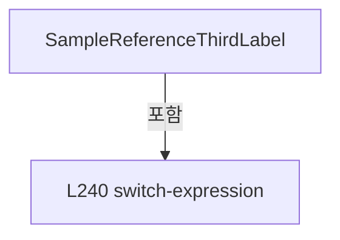

변경 전 점검: 입력/반환 타입, 위 호출자, 예외/취소 경로, 공유 상태와 저장·전송 소비자를 함께 확인합니다. 값의 단위나 물리 방향을 이름만으로 확정하지 않습니다.

### PropertyDeclaration `SampleCorrectionTarget` · L245–245

[Drilling.UI/Menu/Menus/CMenuReview.cs:245–245](https://github.com/kjuws10-rgb/A3Drilling/blob/5aee8e58439c9b455cae7c9593c9be986c3e682e/Drilling.UI/Menu/Menus/CMenuReview.cs#L245-L245)

| 항목 | 실제 추출 값 |
| --- | --- |
| 서명 | string Drilling.UI.Menu.Menus.CMenuReview.SampleCorrectionTarget |
| 접근/수식자 | Public / public |
| 반환/값 타입 | string |
| 소속 타입 | NamedType:Drilling.UI.Menu.Menus.CMenuReview |

현재 부분 분석에서 직접 연결된 호출자는 없습니다. XAML/이벤트/인터페이스·델리게이트·외부 진입을 추가 확인해야 하며, 미사용으로 판정한 것이 아닙니다.

호출하는 대상과 해석 범위:

| 원본 행 | 표현식 | 분석 상태 | 대상/소스 위치 |
| --- | --- | --- | --- |
| 245 | string.IsNullOrWhiteSpace | resolved | bool string.IsNullOrWhiteSpace(string?) |

본문의 실제 연산·분기·예외·반환 순서(원문 위치 순):

| 원본 행 | 종류 | 주석 해설 |
| --- | --- | --- |
| 245 | call | 함수·델리게이트 또는 객체 생성자를 호출합니다: string.IsNullOrWhiteSpace(_simpleSampleShotKey) |
| 245 | conditional-expression | 조건에 따라 결과식을 선택합니다: string.IsNullOrWhiteSpace(_simpleSampleShotKey) ? "Select one processed Shot from Cell Preview" : $"H{_sampleRuleHeadNo:00} / {(_sampleRuleScope == "HEAD_CELL" ? $"HEAD + Cell{_sampleRuleCellNo}" : "HEAD")}" |
| 245 | conditional-expression | 조건에 따라 결과식을 선택합니다: _sampleRuleScope == "HEAD_CELL" ? $"HEAD + Cell{_sampleRuleCellNo}" : "HEAD" |

변경 전 점검: 입력/반환 타입, 위 호출자, 예외/취소 경로, 공유 상태와 저장·전송 소비자를 함께 확인합니다. 값의 단위나 물리 방향을 이름만으로 확정하지 않습니다.

### PropertyDeclaration `SampleReferenceHead` · L246–246

[Drilling.UI/Menu/Menus/CMenuReview.cs:246–246](https://github.com/kjuws10-rgb/A3Drilling/blob/5aee8e58439c9b455cae7c9593c9be986c3e682e/Drilling.UI/Menu/Menus/CMenuReview.cs#L246-L246)

| 항목 | 실제 추출 값 |
| --- | --- |
| 서명 | string Drilling.UI.Menu.Menus.CMenuReview.SampleReferenceHead |
| 접근/수식자 | Public / public |
| 반환/값 타입 | string |
| 소속 타입 | NamedType:Drilling.UI.Menu.Menus.CMenuReview |

현재 부분 분석에서 직접 연결된 호출자는 없습니다. XAML/이벤트/인터페이스·델리게이트·외부 진입을 추가 확인해야 하며, 미사용으로 판정한 것이 아닙니다.

호출하는 대상과 해석 범위:

| 원본 행 | 표현식 | 분석 상태 | 대상/소스 위치 |
| --- | --- | --- | --- |
| 246 | GetSimpleReferencePoint | resolved | Drilling.Common.Review.ST_REVIEW_PLAN_POINT? Drilling.UI.Menu.Menus.CMenuReview.GetSimpleReferencePoint() · Drilling.UI/Menu/Menus/CMenuReview.cs:1499 |

본문의 실제 연산·분기·예외·반환 순서(원문 위치 순):

| 원본 행 | 종류 | 주석 해설 |
| --- | --- | --- |
| 246 | call | 함수·델리게이트 또는 객체 생성자를 호출합니다: GetSimpleReferencePoint() |
| 246 | conditional-expression | 조건에 따라 결과식을 선택합니다: IsSimpleSampleRuleUi ? (GetSimpleReferencePoint()is { } point ? $"H{point.HeadNo:00}" : "-") : "ALL" |
| 246 | conditional-expression | 조건에 따라 결과식을 선택합니다: GetSimpleReferencePoint()is { } point ? $"H{point.HeadNo:00}" : "-" |

변경 전 점검: 입력/반환 타입, 위 호출자, 예외/취소 경로, 공유 상태와 저장·전송 소비자를 함께 확인합니다. 값의 단위나 물리 방향을 이름만으로 확정하지 않습니다.

### PropertyDeclaration `SampleReferenceCell` · L247–247

[Drilling.UI/Menu/Menus/CMenuReview.cs:247–247](https://github.com/kjuws10-rgb/A3Drilling/blob/5aee8e58439c9b455cae7c9593c9be986c3e682e/Drilling.UI/Menu/Menus/CMenuReview.cs#L247-L247)

| 항목 | 실제 추출 값 |
| --- | --- |
| 서명 | string Drilling.UI.Menu.Menus.CMenuReview.SampleReferenceCell |
| 접근/수식자 | Public / public |
| 반환/값 타입 | string |
| 소속 타입 | NamedType:Drilling.UI.Menu.Menus.CMenuReview |

현재 부분 분석에서 직접 연결된 호출자는 없습니다. XAML/이벤트/인터페이스·델리게이트·외부 진입을 추가 확인해야 하며, 미사용으로 판정한 것이 아닙니다.

호출하는 대상과 해석 범위:

| 원본 행 | 표현식 | 분석 상태 | 대상/소스 위치 |
| --- | --- | --- | --- |
| 247 | GetSimpleReferencePoint | resolved | Drilling.Common.Review.ST_REVIEW_PLAN_POINT? Drilling.UI.Menu.Menus.CMenuReview.GetSimpleReferencePoint() · Drilling.UI/Menu/Menus/CMenuReview.cs:1499 |

본문의 실제 연산·분기·예외·반환 순서(원문 위치 순):

| 원본 행 | 종류 | 주석 해설 |
| --- | --- | --- |
| 247 | call | 함수·델리게이트 또는 객체 생성자를 호출합니다: GetSimpleReferencePoint() |
| 247 | conditional-expression | 조건에 따라 결과식을 선택합니다: IsSimpleSampleRuleUi ? (GetSimpleReferencePoint()is { } point ? $"Cell{point.CellNo}" : "-") : IsRoughSampleRuleUi ? "HEAD RANGE" : "ALL" |
| 247 | conditional-expression | 조건에 따라 결과식을 선택합니다: GetSimpleReferencePoint()is { } point ? $"Cell{point.CellNo}" : "-" |
| 247 | conditional-expression | 조건에 따라 결과식을 선택합니다: IsRoughSampleRuleUi ? "HEAD RANGE" : "ALL" |

변경 전 점검: 입력/반환 타입, 위 호출자, 예외/취소 경로, 공유 상태와 저장·전송 소비자를 함께 확인합니다. 값의 단위나 물리 방향을 이름만으로 확정하지 않습니다.

### PropertyDeclaration `SampleReferenceShot` · L248–253

[Drilling.UI/Menu/Menus/CMenuReview.cs:248–253](https://github.com/kjuws10-rgb/A3Drilling/blob/5aee8e58439c9b455cae7c9593c9be986c3e682e/Drilling.UI/Menu/Menus/CMenuReview.cs#L248-L253)

| 항목 | 실제 추출 값 |
| --- | --- |
| 서명 | string Drilling.UI.Menu.Menus.CMenuReview.SampleReferenceShot |
| 접근/수식자 | Public / public |
| 반환/값 타입 | string |
| 소속 타입 | NamedType:Drilling.UI.Menu.Menus.CMenuReview |

현재 부분 분석에서 직접 연결된 호출자는 없습니다. XAML/이벤트/인터페이스·델리게이트·외부 진입을 추가 확인해야 하며, 미사용으로 판정한 것이 아닙니다.

호출하는 대상과 해석 범위:

| 원본 행 | 표현식 | 분석 상태 | 대상/소스 위치 |
| --- | --- | --- | --- |
| 248 | GetSimpleReferencePoint | resolved | Drilling.Common.Review.ST_REVIEW_PLAN_POINT? Drilling.UI.Menu.Menus.CMenuReview.GetSimpleReferencePoint() · Drilling.UI/Menu/Menus/CMenuReview.cs:1499 |
| 248 | ToMatrixShotName | resolved | string Drilling.UI.Menu.Menus.CMenuReview.ToMatrixShotName(Drilling.Common.Review.ST_REVIEW_PLAN_POINT) · Drilling.UI/Menu/Menus/CMenuReview.cs:1993 |

본문의 실제 연산·분기·예외·반환 순서(원문 위치 순):

| 원본 행 | 종류 | 주석 해설 |
| --- | --- | --- |
| 248 | call | 함수·델리게이트 또는 객체 생성자를 호출합니다: GetSimpleReferencePoint() |
| 248 | call | 함수·델리게이트 또는 객체 생성자를 호출합니다: ToMatrixShotName(point) |
| 248 | conditional-expression | 조건에 따라 결과식을 선택합니다: GetSimpleReferencePoint()is { } point ? ToMatrixShotName(point) : "-" |
| 248 | conditional-expression | 조건에 따라 결과식을 선택합니다: IsSimpleSampleRuleUi ? (GetSimpleReferencePoint()is { } point ? ToMatrixShotName(point) : "-") : _selectedSampleRuleUi switch { "ROUGH" => _roughReference, "FINE" => _fineLineCount == 1 ? "1 LINE" : $"{_fineLineCount} LINES", _ => |
| 248 | switch-expression | 값별 결과식을 선택합니다: _selectedSampleRuleUi switch { "ROUGH" => _roughReference, "FINE" => _fineLineCount == 1 ? "1 LINE" : $"{_fineLineCount} LINES", _ => "-" } |
| 251 | conditional-expression | 조건에 따라 결과식을 선택합니다: _fineLineCount == 1 ? "1 LINE" : $"{_fineLineCount} LINES" |

제어 구문의 포함 구조(실제 실행 순서/CFG가 아닌 구문 탐색 그림):

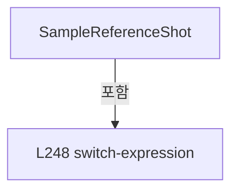

변경 전 점검: 입력/반환 타입, 위 호출자, 예외/취소 경로, 공유 상태와 저장·전송 소비자를 함께 확인합니다. 값의 단위나 물리 방향을 이름만으로 확정하지 않습니다.

### PropertyDeclaration `SampleOffsetApplyCount` · L254–254

[Drilling.UI/Menu/Menus/CMenuReview.cs:254–254](https://github.com/kjuws10-rgb/A3Drilling/blob/5aee8e58439c9b455cae7c9593c9be986c3e682e/Drilling.UI/Menu/Menus/CMenuReview.cs#L254-L254)

| 항목 | 실제 추출 값 |
| --- | --- |
| 서명 | string Drilling.UI.Menu.Menus.CMenuReview.SampleOffsetApplyCount |
| 접근/수식자 | Public / public |
| 반환/값 타입 | string |
| 소속 타입 | NamedType:Drilling.UI.Menu.Menus.CMenuReview |

현재 부분 분석에서 직접 연결된 호출자는 없습니다. XAML/이벤트/인터페이스·델리게이트·외부 진입을 추가 확인해야 하며, 미사용으로 판정한 것이 아닙니다.

호출하는 대상과 해석 범위:

| 원본 행 | 표현식 | 분석 상태 | 대상/소스 위치 |
| --- | --- | --- | --- |
| 254 | GetSimpleOffsetApplyCount().ToString | resolved | string int.ToString(string?, System.IFormatProvider?) |
| 254 | GetSimpleOffsetApplyCount | resolved | int Drilling.UI.Menu.Menus.CMenuReview.GetSimpleOffsetApplyCount() · Drilling.UI/Menu/Menus/CMenuReview.cs:1533 |
| 254 | GetAutomaticOffsetApplyCount().ToString | resolved | string int.ToString(string?, System.IFormatProvider?) |
| 254 | GetAutomaticOffsetApplyCount | resolved | int Drilling.UI.Menu.Menus.CMenuReview.GetAutomaticOffsetApplyCount() · Drilling.UI/Menu/Menus/CMenuReview.cs:1550 |

본문의 실제 연산·분기·예외·반환 순서(원문 위치 순):

| 원본 행 | 종류 | 주석 해설 |
| --- | --- | --- |
| 254 | call | 함수·델리게이트 또는 객체 생성자를 호출합니다: GetSimpleOffsetApplyCount().ToString("N0", CultureInfo.InvariantCulture) |
| 254 | call | 함수·델리게이트 또는 객체 생성자를 호출합니다: GetSimpleOffsetApplyCount() |
| 254 | call | 함수·델리게이트 또는 객체 생성자를 호출합니다: GetAutomaticOffsetApplyCount().ToString("N0", CultureInfo.InvariantCulture) |
| 254 | call | 함수·델리게이트 또는 객체 생성자를 호출합니다: GetAutomaticOffsetApplyCount() |
| 254 | conditional-expression | 조건에 따라 결과식을 선택합니다: IsSimpleSampleRuleUi ? GetSimpleOffsetApplyCount().ToString("N0", CultureInfo.InvariantCulture) : GetAutomaticOffsetApplyCount().ToString("N0", CultureInfo.InvariantCulture) |

변경 전 점검: 입력/반환 타입, 위 호출자, 예외/취소 경로, 공유 상태와 저장·전송 소비자를 함께 확인합니다. 값의 단위나 물리 방향을 이름만으로 확정하지 않습니다.

### PropertyDeclaration `SampleInspectionShotCount` · L255–255

[Drilling.UI/Menu/Menus/CMenuReview.cs:255–255](https://github.com/kjuws10-rgb/A3Drilling/blob/5aee8e58439c9b455cae7c9593c9be986c3e682e/Drilling.UI/Menu/Menus/CMenuReview.cs#L255-L255)

| 항목 | 실제 추출 값 |
| --- | --- |
| 서명 | string Drilling.UI.Menu.Menus.CMenuReview.SampleInspectionShotCount |
| 접근/수식자 | Public / public |
| 반환/값 타입 | string |
| 소속 타입 | NamedType:Drilling.UI.Menu.Menus.CMenuReview |

현재 부분 분석에서 직접 연결된 호출자는 없습니다. XAML/이벤트/인터페이스·델리게이트·외부 진입을 추가 확인해야 하며, 미사용으로 판정한 것이 아닙니다.

호출하는 대상과 해석 범위:

| 원본 행 | 표현식 | 분석 상태 | 대상/소스 위치 |
| --- | --- | --- | --- |
| 255 | GetSimpleReferencePoint | resolved | Drilling.Common.Review.ST_REVIEW_PLAN_POINT? Drilling.UI.Menu.Menus.CMenuReview.GetSimpleReferencePoint() · Drilling.UI/Menu/Menus/CMenuReview.cs:1499 |
| 255 | GetAutomaticInspectionShotCount().ToString | resolved | string int.ToString(string?, System.IFormatProvider?) |
| 255 | GetAutomaticInspectionShotCount | resolved | int Drilling.UI.Menu.Menus.CMenuReview.GetAutomaticInspectionShotCount() · Drilling.UI/Menu/Menus/CMenuReview.cs:1545 |

본문의 실제 연산·분기·예외·반환 순서(원문 위치 순):

| 원본 행 | 종류 | 주석 해설 |
| --- | --- | --- |
| 255 | call | 함수·델리게이트 또는 객체 생성자를 호출합니다: GetSimpleReferencePoint() |
| 255 | call | 함수·델리게이트 또는 객체 생성자를 호출합니다: GetAutomaticInspectionShotCount().ToString("N0", CultureInfo.InvariantCulture) |
| 255 | call | 함수·델리게이트 또는 객체 생성자를 호출합니다: GetAutomaticInspectionShotCount() |
| 255 | conditional-expression | 조건에 따라 결과식을 선택합니다: IsSimpleSampleRuleUi ? (GetSimpleReferencePoint()is null ? "0" : "1") : GetAutomaticInspectionShotCount().ToString("N0", CultureInfo.InvariantCulture) |
| 255 | conditional-expression | 조건에 따라 결과식을 선택합니다: GetSimpleReferencePoint()is null ? "0" : "1" |

변경 전 점검: 입력/반환 타입, 위 호출자, 예외/취소 경로, 공유 상태와 저장·전송 소비자를 함께 확인합니다. 값의 단위나 물리 방향을 이름만으로 확정하지 않습니다.

### PropertyDeclaration `SamplePlanStatus` · L256–256

[Drilling.UI/Menu/Menus/CMenuReview.cs:256–256](https://github.com/kjuws10-rgb/A3Drilling/blob/5aee8e58439c9b455cae7c9593c9be986c3e682e/Drilling.UI/Menu/Menus/CMenuReview.cs#L256-L256)

| 항목 | 실제 추출 값 |
| --- | --- |
| 서명 | string Drilling.UI.Menu.Menus.CMenuReview.SamplePlanStatus |
| 접근/수식자 | Public / public |
| 반환/값 타입 | string |
| 소속 타입 | NamedType:Drilling.UI.Menu.Menus.CMenuReview |

현재 부분 분석에서 직접 연결된 호출자는 없습니다. XAML/이벤트/인터페이스·델리게이트·외부 진입을 추가 확인해야 하며, 미사용으로 판정한 것이 아닙니다.

호출하는 대상과 해석 범위:

| 원본 행 | 표현식 | 분석 상태 | 대상/소스 위치 |
| --- | --- | --- | --- |
| 256 | GetSimpleReferencePoint | resolved | Drilling.Common.Review.ST_REVIEW_PLAN_POINT? Drilling.UI.Menu.Menus.CMenuReview.GetSimpleReferencePoint() · Drilling.UI/Menu/Menus/CMenuReview.cs:1499 |

본문의 실제 연산·분기·예외·반환 순서(원문 위치 순):

| 원본 행 | 종류 | 주석 해설 |
| --- | --- | --- |
| 256 | call | 함수·델리게이트 또는 객체 생성자를 호출합니다: GetSimpleReferencePoint() |
| 256 | conditional-expression | 조건에 따라 결과식을 선택합니다: IsSimpleSampleRuleUi && GetSimpleReferencePoint()is null ? "Reference Shot Required" : "Ready" |

변경 전 점검: 입력/반환 타입, 위 호출자, 예외/취소 경로, 공유 상태와 저장·전송 소비자를 함께 확인합니다. 값의 단위나 물리 방향을 이름만으로 확정하지 않습니다.

### PropertyDeclaration `IsSampleGlassPreviewVisible` · L257–257

[Drilling.UI/Menu/Menus/CMenuReview.cs:257–257](https://github.com/kjuws10-rgb/A3Drilling/blob/5aee8e58439c9b455cae7c9593c9be986c3e682e/Drilling.UI/Menu/Menus/CMenuReview.cs#L257-L257)

| 항목 | 실제 추출 값 |
| --- | --- |
| 서명 | bool Drilling.UI.Menu.Menus.CMenuReview.IsSampleGlassPreviewVisible |
| 접근/수식자 | Public / public |
| 반환/값 타입 | bool |
| 소속 타입 | NamedType:Drilling.UI.Menu.Menus.CMenuReview |

현재 부분 분석에서 직접 연결된 호출자는 없습니다. XAML/이벤트/인터페이스·델리게이트·외부 진입을 추가 확인해야 하며, 미사용으로 판정한 것이 아닙니다.

변경 전 점검: 입력/반환 타입, 위 호출자, 예외/취소 경로, 공유 상태와 저장·전송 소비자를 함께 확인합니다. 값의 단위나 물리 방향을 이름만으로 확정하지 않습니다.

### PropertyDeclaration `IsSampleCellDetailVisible` · L258–258

[Drilling.UI/Menu/Menus/CMenuReview.cs:258–258](https://github.com/kjuws10-rgb/A3Drilling/blob/5aee8e58439c9b455cae7c9593c9be986c3e682e/Drilling.UI/Menu/Menus/CMenuReview.cs#L258-L258)

| 항목 | 실제 추출 값 |
| --- | --- |
| 서명 | bool Drilling.UI.Menu.Menus.CMenuReview.IsSampleCellDetailVisible |
| 접근/수식자 | Public / public |
| 반환/값 타입 | bool |
| 소속 타입 | NamedType:Drilling.UI.Menu.Menus.CMenuReview |

현재 부분 분석에서 직접 연결된 호출자는 없습니다. XAML/이벤트/인터페이스·델리게이트·외부 진입을 추가 확인해야 하며, 미사용으로 판정한 것이 아닙니다.

변경 전 점검: 입력/반환 타입, 위 호출자, 예외/취소 경로, 공유 상태와 저장·전송 소비자를 함께 확인합니다. 값의 단위나 물리 방향을 이름만으로 확정하지 않습니다.

### PropertyDeclaration `SampleWorkspaceTitle` · L259–259

[Drilling.UI/Menu/Menus/CMenuReview.cs:259–259](https://github.com/kjuws10-rgb/A3Drilling/blob/5aee8e58439c9b455cae7c9593c9be986c3e682e/Drilling.UI/Menu/Menus/CMenuReview.cs#L259-L259)

| 항목 | 실제 추출 값 |
| --- | --- |
| 서명 | string Drilling.UI.Menu.Menus.CMenuReview.SampleWorkspaceTitle |
| 접근/수식자 | Public / public |
| 반환/값 타입 | string |
| 소속 타입 | NamedType:Drilling.UI.Menu.Menus.CMenuReview |

현재 부분 분석에서 직접 연결된 호출자는 없습니다. XAML/이벤트/인터페이스·델리게이트·외부 진입을 추가 확인해야 하며, 미사용으로 판정한 것이 아닙니다.

본문의 실제 연산·분기·예외·반환 순서(원문 위치 순):

| 원본 행 | 종류 | 주석 해설 |
| --- | --- | --- |
| 259 | conditional-expression | 조건에 따라 결과식을 선택합니다: !_isSampleCellDetailVisible ? "Glass / Cell Preview" : IsSimpleSampleRuleUi ? $"Cell{_selectedSampleCellNo} / SIMPLE Reference Shot Selection" : $"Cell{_selectedSampleCellNo} / {_selectedSampleRuleUi} Inspection Shot Preview" |
| 259 | conditional-expression | 조건에 따라 결과식을 선택합니다: IsSimpleSampleRuleUi ? $"Cell{_selectedSampleCellNo} / SIMPLE Reference Shot Selection" : $"Cell{_selectedSampleCellNo} / {_selectedSampleRuleUi} Inspection Shot Preview" |

변경 전 점검: 입력/반환 타입, 위 호출자, 예외/취소 경로, 공유 상태와 저장·전송 소비자를 함께 확인합니다. 값의 단위나 물리 방향을 이름만으로 확정하지 않습니다.

### PropertyDeclaration `SampleWorkspaceSummary` · L260–260

[Drilling.UI/Menu/Menus/CMenuReview.cs:260–260](https://github.com/kjuws10-rgb/A3Drilling/blob/5aee8e58439c9b455cae7c9593c9be986c3e682e/Drilling.UI/Menu/Menus/CMenuReview.cs#L260-L260)

| 항목 | 실제 추출 값 |
| --- | --- |
| 서명 | string Drilling.UI.Menu.Menus.CMenuReview.SampleWorkspaceSummary |
| 접근/수식자 | Public / public |
| 반환/값 타입 | string |
| 소속 타입 | NamedType:Drilling.UI.Menu.Menus.CMenuReview |

현재 부분 분석에서 직접 연결된 호출자는 없습니다. XAML/이벤트/인터페이스·델리게이트·외부 진입을 추가 확인해야 하며, 미사용으로 판정한 것이 아닙니다.

호출하는 대상과 해석 범위:

| 원본 행 | 표현식 | 분석 상태 | 대상/소스 위치 |
| --- | --- | --- | --- |
| 260 | GetSimpleReferencePoint | resolved | Drilling.Common.Review.ST_REVIEW_PLAN_POINT? Drilling.UI.Menu.Menus.CMenuReview.GetSimpleReferencePoint() · Drilling.UI/Menu/Menus/CMenuReview.cs:1499 |
| 260 | GetSelectedSampleCellShotCount | resolved | int Drilling.UI.Menu.Menus.CMenuReview.GetSelectedSampleCellShotCount() · Drilling.UI/Menu/Menus/CMenuReview.cs:1608 |
| 260 | GetSampleCellShotCount | resolved | int Drilling.UI.Menu.Menus.CMenuReview.GetSampleCellShotCount() · Drilling.UI/Menu/Menus/CMenuReview.cs:1607 |

본문의 실제 연산·분기·예외·반환 순서(원문 위치 순):

| 원본 행 | 종류 | 주석 해설 |
| --- | --- | --- |
| 260 | call | 함수·델리게이트 또는 객체 생성자를 호출합니다: GetSimpleReferencePoint() |
| 260 | call | 함수·델리게이트 또는 객체 생성자를 호출합니다: GetSelectedSampleCellShotCount() |
| 260 | call | 함수·델리게이트 또는 객체 생성자를 호출합니다: GetSampleCellShotCount() |
| 260 | conditional-expression | 조건에 따라 결과식을 선택합니다: !_isSampleCellDetailVisible ? SampleGlassPreviewSummary : IsSimpleSampleRuleUi ? (GetSimpleReferencePoint()is null ? "Select one processed Shot" : "1 Reference Shot Selected") : $"{GetSelectedSampleCellShotCount():N0} / {GetSample |
| 260 | conditional-expression | 조건에 따라 결과식을 선택합니다: IsSimpleSampleRuleUi ? (GetSimpleReferencePoint()is null ? "Select one processed Shot" : "1 Reference Shot Selected") : $"{GetSelectedSampleCellShotCount():N0} / {GetSampleCellShotCount():N0} Inspection Shots (Read Only)" |
| 260 | conditional-expression | 조건에 따라 결과식을 선택합니다: GetSimpleReferencePoint()is null ? "Select one processed Shot" : "1 Reference Shot Selected" |

변경 전 점검: 입력/반환 타입, 위 호출자, 예외/취소 경로, 공유 상태와 저장·전송 소비자를 함께 확인합니다. 값의 단위나 물리 방향을 이름만으로 확정하지 않습니다.

### PropertyDeclaration `SampleRuleName` · L261–261

[Drilling.UI/Menu/Menus/CMenuReview.cs:261–261](https://github.com/kjuws10-rgb/A3Drilling/blob/5aee8e58439c9b455cae7c9593c9be986c3e682e/Drilling.UI/Menu/Menus/CMenuReview.cs#L261-L261)

| 항목 | 실제 추출 값 |
| --- | --- |
| 서명 | string Drilling.UI.Menu.Menus.CMenuReview.SampleRuleName |
| 접근/수식자 | Public / public |
| 반환/값 타입 | string |
| 소속 타입 | NamedType:Drilling.UI.Menu.Menus.CMenuReview |

현재 부분 분석에서 직접 연결된 호출자는 없습니다. XAML/이벤트/인터페이스·델리게이트·외부 진입을 추가 확인해야 하며, 미사용으로 판정한 것이 아닙니다.

호출하는 대상과 해석 범위:

| 원본 행 | 표현식 | 분석 상태 | 대상/소스 위치 |
| --- | --- | --- | --- |
| 261 | GetSelectionRuleText | resolved | string Drilling.UI.Menu.Menus.CMenuReview.GetSelectionRuleText() · Drilling.UI/Menu/Menus/CMenuReview.cs:1731 |

본문의 실제 연산·분기·예외·반환 순서(원문 위치 순):

| 원본 행 | 종류 | 주석 해설 |
| --- | --- | --- |
| 261 | call | 함수·델리게이트 또는 객체 생성자를 호출합니다: GetSelectionRuleText() |

변경 전 점검: 입력/반환 타입, 위 호출자, 예외/취소 경로, 공유 상태와 저장·전송 소비자를 함께 확인합니다. 값의 단위나 물리 방향을 이름만으로 확정하지 않습니다.

### PropertyDeclaration `SampleHeadOptions` · L262–262

[Drilling.UI/Menu/Menus/CMenuReview.cs:262–262](https://github.com/kjuws10-rgb/A3Drilling/blob/5aee8e58439c9b455cae7c9593c9be986c3e682e/Drilling.UI/Menu/Menus/CMenuReview.cs#L262-L262)

| 항목 | 실제 추출 값 |
| --- | --- |
| 서명 | System.Collections.Generic.IReadOnlyList<string> Drilling.UI.Menu.Menus.CMenuReview.SampleHeadOptions |
| 접근/수식자 | Public / public |
| 반환/값 타입 | System.Collections.Generic.IReadOnlyList<string> |
| 소속 타입 | NamedType:Drilling.UI.Menu.Menus.CMenuReview |

현재 부분 분석에서 직접 연결된 호출자는 없습니다. XAML/이벤트/인터페이스·델리게이트·외부 진입을 추가 확인해야 하며, 미사용으로 판정한 것이 아닙니다.

호출하는 대상과 해석 범위:

| 원본 행 | 표현식 | 분석 상태 | 대상/소스 위치 |
| --- | --- | --- | --- |
| 262 | Enumerable.Range(1, Math.Max(1, _headCount)).Select(headNo => $"H{headNo:00}").ToArray | resolved | string[] System.Collections.Generic.IEnumerable<string>.ToArray<string>() |
| 262 | Enumerable.Range(1, Math.Max(1, _headCount)).Select | resolved | System.Collections.Generic.IEnumerable<string> System.Collections.Generic.IEnumerable<int>.Select<int, string>(System.Func<int, string>) |
| 262 | Enumerable.Range | resolved | System.Collections.Generic.IEnumerable<int> System.Linq.Enumerable.Range(int, int) |
| 262 | Math.Max | resolved | int System.Math.Max(int, int) |

본문의 실제 연산·분기·예외·반환 순서(원문 위치 순):

| 원본 행 | 종류 | 주석 해설 |
| --- | --- | --- |
| 262 | call | 함수·델리게이트 또는 객체 생성자를 호출합니다: Enumerable.Range(1, Math.Max(1, _headCount)).Select(headNo => $"H{headNo:00}").ToArray() |
| 262 | call | 함수·델리게이트 또는 객체 생성자를 호출합니다: Enumerable.Range(1, Math.Max(1, _headCount)).Select(headNo => $"H{headNo:00}") |
| 262 | call | 함수·델리게이트 또는 객체 생성자를 호출합니다: Enumerable.Range(1, Math.Max(1, _headCount)) |
| 262 | call | 함수·델리게이트 또는 객체 생성자를 호출합니다: Math.Max(1, _headCount) |

변경 전 점검: 입력/반환 타입, 위 호출자, 예외/취소 경로, 공유 상태와 저장·전송 소비자를 함께 확인합니다. 값의 단위나 물리 방향을 이름만으로 확정하지 않습니다.

### PropertyDeclaration `SelectedSampleHead` · L264–280

[Drilling.UI/Menu/Menus/CMenuReview.cs:264–280](https://github.com/kjuws10-rgb/A3Drilling/blob/5aee8e58439c9b455cae7c9593c9be986c3e682e/Drilling.UI/Menu/Menus/CMenuReview.cs#L264-L280)

| 항목 | 실제 추출 값 |
| --- | --- |
| 서명 | string Drilling.UI.Menu.Menus.CMenuReview.SelectedSampleHead |
| 접근/수식자 | Public / public |
| 반환/값 타입 | string |
| 소속 타입 | NamedType:Drilling.UI.Menu.Menus.CMenuReview |

현재 부분 분석에서 직접 연결된 호출자는 없습니다. XAML/이벤트/인터페이스·델리게이트·외부 진입을 추가 확인해야 하며, 미사용으로 판정한 것이 아닙니다.

변경 전 점검: 입력/반환 타입, 위 호출자, 예외/취소 경로, 공유 상태와 저장·전송 소비자를 함께 확인합니다. 값의 단위나 물리 방향을 이름만으로 확정하지 않습니다.

### GetAccessorDeclaration `get_SelectedSampleHead` · L266–266

[Drilling.UI/Menu/Menus/CMenuReview.cs:266–266](https://github.com/kjuws10-rgb/A3Drilling/blob/5aee8e58439c9b455cae7c9593c9be986c3e682e/Drilling.UI/Menu/Menus/CMenuReview.cs#L266-L266)

| 항목 | 실제 추출 값 |
| --- | --- |
| 서명 | string Drilling.UI.Menu.Menus.CMenuReview.SelectedSampleHead.get |
| 접근/수식자 | Public / get |
| 반환/값 타입 | string |
| 소속 타입 | NamedType:Drilling.UI.Menu.Menus.CMenuReview |

현재 부분 분석에서 직접 연결된 호출자는 없습니다. XAML/이벤트/인터페이스·델리게이트·외부 진입을 추가 확인해야 하며, 미사용으로 판정한 것이 아닙니다.

변경 전 점검: 입력/반환 타입, 위 호출자, 예외/취소 경로, 공유 상태와 저장·전송 소비자를 함께 확인합니다. 값의 단위나 물리 방향을 이름만으로 확정하지 않습니다.

### SetAccessorDeclaration `set_SelectedSampleHead` · L267–279

[Drilling.UI/Menu/Menus/CMenuReview.cs:267–279](https://github.com/kjuws10-rgb/A3Drilling/blob/5aee8e58439c9b455cae7c9593c9be986c3e682e/Drilling.UI/Menu/Menus/CMenuReview.cs#L267-L279)

| 항목 | 실제 추출 값 |
| --- | --- |
| 서명 | void Drilling.UI.Menu.Menus.CMenuReview.SelectedSampleHead.set |
| 접근/수식자 | Public / set |
| 반환/값 타입 | void |
| 소속 타입 | NamedType:Drilling.UI.Menu.Menus.CMenuReview |

입력 계약:

| 이름 | 타입 | 전달 | 선택/기본값 |
| --- | --- | --- | --- |
| value | string | None | False /  |

현재 부분 분석에서 직접 연결된 호출자는 없습니다. XAML/이벤트/인터페이스·델리게이트·외부 진입을 추가 확인해야 하며, 미사용으로 판정한 것이 아닙니다.

호출하는 대상과 해석 범위:

| 원본 행 | 표현식 | 분석 상태 | 대상/소스 위치 |
| --- | --- | --- | --- |
| 269 | .Trim | resolved | string string.Trim() |
| 270 | normalized.StartsWith | resolved | bool string.StartsWith(char) |
| 275 | int.TryParse | resolved | bool int.TryParse(string?, System.Globalization.NumberStyles, System.IFormatProvider?, out int) |
| 277 | Math.Clamp | resolved | int System.Math.Clamp(int, int, int) |
| 277 | Math.Max | resolved | int System.Math.Max(int, int) |

본문의 실제 연산·분기·예외·반환 순서(원문 위치 순):

| 원본 행 | 종류 | 주석 해설 |
| --- | --- | --- |
| 269 | call | 함수·델리게이트 또는 객체 생성자를 호출합니다: .Trim() |
| 269 | local-declaration | 지역 변수를 선언합니다: var normalized = value?.Trim() ?? ""; |
| 269 | variable-initializer | 변수의 초기값을 지정합니다: normalized = value?.Trim() ?? "" |
| 270 | call | 함수·델리게이트 또는 객체 생성자를 호출합니다: normalized.StartsWith('H') |
| 270 | if | 조건에 따라 분기합니다: if (normalized.StartsWith('H')) |
| 272 | assignment | 값을 대상에 대입합니다: normalized = normalized[1..] |
| 275 | call | 함수·델리게이트 또는 객체 생성자를 호출합니다: int.TryParse(normalized, NumberStyles.Integer, CultureInfo.InvariantCulture, out var headNo) |
| 275 | if | 조건에 따라 분기합니다: if (int.TryParse(normalized, NumberStyles.Integer, CultureInfo.InvariantCulture, out var headNo)) |
| 277 | assignment | 값을 대상에 대입합니다: _sampleRuleHeadNo = Math.Clamp(headNo, 1, Math.Max(1, _headCount)) |
| 277 | call | 함수·델리게이트 또는 객체 생성자를 호출합니다: Math.Clamp(headNo, 1, Math.Max(1, _headCount)) |
| 277 | call | 함수·델리게이트 또는 객체 생성자를 호출합니다: Math.Max(1, _headCount) |

제어 구문의 포함 구조(실제 실행 순서/CFG가 아닌 구문 탐색 그림):

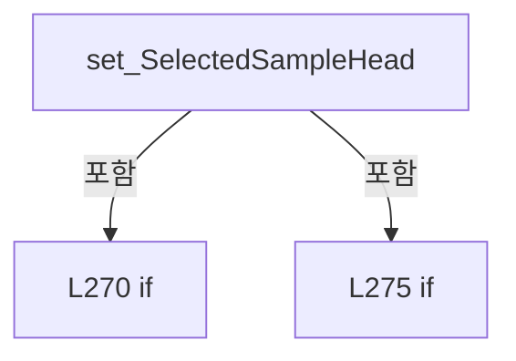

변경 전 점검: 입력/반환 타입, 위 호출자, 예외/취소 경로, 공유 상태와 저장·전송 소비자를 함께 확인합니다. 값의 단위나 물리 방향을 이름만으로 확정하지 않습니다.

### PropertyDeclaration `SampleCellOptions` · L282–282

[Drilling.UI/Menu/Menus/CMenuReview.cs:282–282](https://github.com/kjuws10-rgb/A3Drilling/blob/5aee8e58439c9b455cae7c9593c9be986c3e682e/Drilling.UI/Menu/Menus/CMenuReview.cs#L282-L282)

| 항목 | 실제 추출 값 |
| --- | --- |
| 서명 | System.Collections.Generic.IReadOnlyList<string> Drilling.UI.Menu.Menus.CMenuReview.SampleCellOptions |
| 접근/수식자 | Public / public |
| 반환/값 타입 | System.Collections.Generic.IReadOnlyList<string> |
| 소속 타입 | NamedType:Drilling.UI.Menu.Menus.CMenuReview |

현재 부분 분석에서 직접 연결된 호출자는 없습니다. XAML/이벤트/인터페이스·델리게이트·외부 진입을 추가 확인해야 하며, 미사용으로 판정한 것이 아닙니다.

호출하는 대상과 해석 범위:

| 원본 행 | 표현식 | 분석 상태 | 대상/소스 위치 |
| --- | --- | --- | --- |
| 282 | Enumerable.Range(1, Math.Max(1, _cellCount)).Select(cellNo => $"Cell{cellNo}").ToArray | resolved | string[] System.Collections.Generic.IEnumerable<string>.ToArray<string>() |
| 282 | Enumerable.Range(1, Math.Max(1, _cellCount)).Select | resolved | System.Collections.Generic.IEnumerable<string> System.Collections.Generic.IEnumerable<int>.Select<int, string>(System.Func<int, string>) |
| 282 | Enumerable.Range | resolved | System.Collections.Generic.IEnumerable<int> System.Linq.Enumerable.Range(int, int) |
| 282 | Math.Max | resolved | int System.Math.Max(int, int) |

본문의 실제 연산·분기·예외·반환 순서(원문 위치 순):

| 원본 행 | 종류 | 주석 해설 |
| --- | --- | --- |
| 282 | call | 함수·델리게이트 또는 객체 생성자를 호출합니다: Enumerable.Range(1, Math.Max(1, _cellCount)).Select(cellNo => $"Cell{cellNo}").ToArray() |
| 282 | call | 함수·델리게이트 또는 객체 생성자를 호출합니다: Enumerable.Range(1, Math.Max(1, _cellCount)).Select(cellNo => $"Cell{cellNo}") |
| 282 | call | 함수·델리게이트 또는 객체 생성자를 호출합니다: Enumerable.Range(1, Math.Max(1, _cellCount)) |
| 282 | call | 함수·델리게이트 또는 객체 생성자를 호출합니다: Math.Max(1, _cellCount) |

변경 전 점검: 입력/반환 타입, 위 호출자, 예외/취소 경로, 공유 상태와 저장·전송 소비자를 함께 확인합니다. 값의 단위나 물리 방향을 이름만으로 확정하지 않습니다.

### PropertyDeclaration `SelectedSampleCell` · L284–300

[Drilling.UI/Menu/Menus/CMenuReview.cs:284–300](https://github.com/kjuws10-rgb/A3Drilling/blob/5aee8e58439c9b455cae7c9593c9be986c3e682e/Drilling.UI/Menu/Menus/CMenuReview.cs#L284-L300)

| 항목 | 실제 추출 값 |
| --- | --- |
| 서명 | string Drilling.UI.Menu.Menus.CMenuReview.SelectedSampleCell |
| 접근/수식자 | Public / public |
| 반환/값 타입 | string |
| 소속 타입 | NamedType:Drilling.UI.Menu.Menus.CMenuReview |

현재 부분 분석에서 직접 연결된 호출자는 없습니다. XAML/이벤트/인터페이스·델리게이트·외부 진입을 추가 확인해야 하며, 미사용으로 판정한 것이 아닙니다.

변경 전 점검: 입력/반환 타입, 위 호출자, 예외/취소 경로, 공유 상태와 저장·전송 소비자를 함께 확인합니다. 값의 단위나 물리 방향을 이름만으로 확정하지 않습니다.

### GetAccessorDeclaration `get_SelectedSampleCell` · L286–286

[Drilling.UI/Menu/Menus/CMenuReview.cs:286–286](https://github.com/kjuws10-rgb/A3Drilling/blob/5aee8e58439c9b455cae7c9593c9be986c3e682e/Drilling.UI/Menu/Menus/CMenuReview.cs#L286-L286)

| 항목 | 실제 추출 값 |
| --- | --- |
| 서명 | string Drilling.UI.Menu.Menus.CMenuReview.SelectedSampleCell.get |
| 접근/수식자 | Public / get |
| 반환/값 타입 | string |
| 소속 타입 | NamedType:Drilling.UI.Menu.Menus.CMenuReview |

현재 부분 분석에서 직접 연결된 호출자는 없습니다. XAML/이벤트/인터페이스·델리게이트·외부 진입을 추가 확인해야 하며, 미사용으로 판정한 것이 아닙니다.

변경 전 점검: 입력/반환 타입, 위 호출자, 예외/취소 경로, 공유 상태와 저장·전송 소비자를 함께 확인합니다. 값의 단위나 물리 방향을 이름만으로 확정하지 않습니다.

### SetAccessorDeclaration `set_SelectedSampleCell` · L287–299

[Drilling.UI/Menu/Menus/CMenuReview.cs:287–299](https://github.com/kjuws10-rgb/A3Drilling/blob/5aee8e58439c9b455cae7c9593c9be986c3e682e/Drilling.UI/Menu/Menus/CMenuReview.cs#L287-L299)

| 항목 | 실제 추출 값 |
| --- | --- |
| 서명 | void Drilling.UI.Menu.Menus.CMenuReview.SelectedSampleCell.set |
| 접근/수식자 | Public / set |
| 반환/값 타입 | void |
| 소속 타입 | NamedType:Drilling.UI.Menu.Menus.CMenuReview |

입력 계약:

| 이름 | 타입 | 전달 | 선택/기본값 |
| --- | --- | --- | --- |
| value | string | None | False /  |

현재 부분 분석에서 직접 연결된 호출자는 없습니다. XAML/이벤트/인터페이스·델리게이트·외부 진입을 추가 확인해야 하며, 미사용으로 판정한 것이 아닙니다.

호출하는 대상과 해석 범위:

| 원본 행 | 표현식 | 분석 상태 | 대상/소스 위치 |
| --- | --- | --- | --- |
| 289 | .Trim | resolved | string string.Trim() |
| 290 | normalized.StartsWith | resolved | bool string.StartsWith(string, System.StringComparison) |
| 295 | int.TryParse | resolved | bool int.TryParse(string?, System.Globalization.NumberStyles, System.IFormatProvider?, out int) |
| 297 | Math.Clamp | resolved | int System.Math.Clamp(int, int, int) |
| 297 | Math.Max | resolved | int System.Math.Max(int, int) |

본문의 실제 연산·분기·예외·반환 순서(원문 위치 순):

| 원본 행 | 종류 | 주석 해설 |
| --- | --- | --- |
| 289 | call | 함수·델리게이트 또는 객체 생성자를 호출합니다: .Trim() |
| 289 | local-declaration | 지역 변수를 선언합니다: var normalized = value?.Trim() ?? ""; |
| 289 | variable-initializer | 변수의 초기값을 지정합니다: normalized = value?.Trim() ?? "" |
| 290 | call | 함수·델리게이트 또는 객체 생성자를 호출합니다: normalized.StartsWith("Cell", StringComparison.OrdinalIgnoreCase) |
| 290 | if | 조건에 따라 분기합니다: if (normalized.StartsWith("Cell", StringComparison.OrdinalIgnoreCase)) |
| 292 | assignment | 값을 대상에 대입합니다: normalized = normalized[4..] |
| 295 | call | 함수·델리게이트 또는 객체 생성자를 호출합니다: int.TryParse(normalized, NumberStyles.Integer, CultureInfo.InvariantCulture, out var cellNo) |
| 295 | if | 조건에 따라 분기합니다: if (int.TryParse(normalized, NumberStyles.Integer, CultureInfo.InvariantCulture, out var cellNo)) |
| 297 | assignment | 값을 대상에 대입합니다: _sampleRuleCellNo = Math.Clamp(cellNo, 1, Math.Max(1, _cellCount)) |
| 297 | call | 함수·델리게이트 또는 객체 생성자를 호출합니다: Math.Clamp(cellNo, 1, Math.Max(1, _cellCount)) |
| 297 | call | 함수·델리게이트 또는 객체 생성자를 호출합니다: Math.Max(1, _cellCount) |

제어 구문의 포함 구조(실제 실행 순서/CFG가 아닌 구문 탐색 그림):

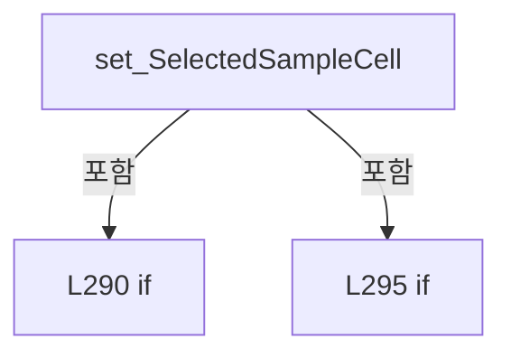

변경 전 점검: 입력/반환 타입, 위 호출자, 예외/취소 경로, 공유 상태와 저장·전송 소비자를 함께 확인합니다. 값의 단위나 물리 방향을 이름만으로 확정하지 않습니다.

### PropertyDeclaration `SampleRuleSelectionSummary` · L302–308

[Drilling.UI/Menu/Menus/CMenuReview.cs:302–308](https://github.com/kjuws10-rgb/A3Drilling/blob/5aee8e58439c9b455cae7c9593c9be986c3e682e/Drilling.UI/Menu/Menus/CMenuReview.cs#L302-L308)

| 항목 | 실제 추출 값 |
| --- | --- |
| 서명 | string Drilling.UI.Menu.Menus.CMenuReview.SampleRuleSelectionSummary |
| 접근/수식자 | Public / public |
| 반환/값 타입 | string |
| 소속 타입 | NamedType:Drilling.UI.Menu.Menus.CMenuReview |

현재 부분 분석에서 직접 연결된 호출자는 없습니다. XAML/이벤트/인터페이스·델리게이트·외부 진입을 추가 확인해야 하며, 미사용으로 판정한 것이 아닙니다.

호출하는 대상과 해석 범위:

| 원본 행 | 표현식 | 분석 상태 | 대상/소스 위치 |
| --- | --- | --- | --- |
| 304 | string.IsNullOrWhiteSpace | resolved | bool string.IsNullOrWhiteSpace(string?) |

본문의 실제 연산·분기·예외·반환 순서(원문 위치 순):

| 원본 행 | 종류 | 주석 해설 |
| --- | --- | --- |
| 302 | switch-expression | 값별 결과식을 선택합니다: _selectedSampleRuleUi switch { "SIMPLE" => string.IsNullOrWhiteSpace(_simpleSampleShotKey) ? "Select 1 Shot" : SampleCorrectionTarget, "ROUGH" => $"Every Head / Full Head Range / {_roughReference}", "FINE" => $"Each Cell / {_fineL |
| 304 | call | 함수·델리게이트 또는 객체 생성자를 호출합니다: string.IsNullOrWhiteSpace(_simpleSampleShotKey) |
| 304 | conditional-expression | 조건에 따라 결과식을 선택합니다: string.IsNullOrWhiteSpace(_simpleSampleShotKey) ? "Select 1 Shot" : SampleCorrectionTarget |

제어 구문의 포함 구조(실제 실행 순서/CFG가 아닌 구문 탐색 그림):

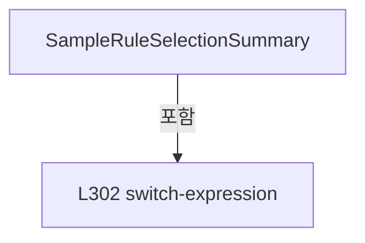

변경 전 점검: 입력/반환 타입, 위 호출자, 예외/취소 경로, 공유 상태와 저장·전송 소비자를 함께 확인합니다. 값의 단위나 물리 방향을 이름만으로 확정하지 않습니다.

### PropertyDeclaration `SampleRuleDescription` · L309–315

[Drilling.UI/Menu/Menus/CMenuReview.cs:309–315](https://github.com/kjuws10-rgb/A3Drilling/blob/5aee8e58439c9b455cae7c9593c9be986c3e682e/Drilling.UI/Menu/Menus/CMenuReview.cs#L309-L315)

| 항목 | 실제 추출 값 |
| --- | --- |
| 서명 | string Drilling.UI.Menu.Menus.CMenuReview.SampleRuleDescription |
| 접근/수식자 | Public / public |
| 반환/값 타입 | string |
| 소속 타입 | NamedType:Drilling.UI.Menu.Menus.CMenuReview |

현재 부분 분석에서 직접 연결된 호출자는 없습니다. XAML/이벤트/인터페이스·델리게이트·외부 진입을 추가 확인해야 하며, 미사용으로 판정한 것이 아닙니다.

본문의 실제 연산·분기·예외·반환 순서(원문 위치 순):

| 원본 행 | 종류 | 주석 해설 |
| --- | --- | --- |
| 309 | switch-expression | 값별 결과식을 선택합니다: _selectedSampleRuleUi switch { "SIMPLE" => "Measure one Shot and apply the same correction to HEAD or HEAD + CELL.", "ROUGH" => "Measure the first processed Shot on the FIRST, CENTER, or LAST line of each Head's full processing ra |

제어 구문의 포함 구조(실제 실행 순서/CFG가 아닌 구문 탐색 그림):

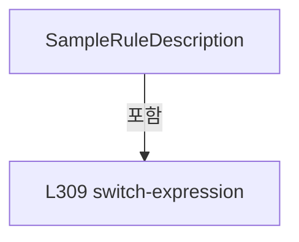

변경 전 점검: 입력/반환 타입, 위 호출자, 예외/취소 경로, 공유 상태와 저장·전송 소비자를 함께 확인합니다. 값의 단위나 물리 방향을 이름만으로 확정하지 않습니다.

### PropertyDeclaration `BeamOptions` · L316–316

[Drilling.UI/Menu/Menus/CMenuReview.cs:316–316](https://github.com/kjuws10-rgb/A3Drilling/blob/5aee8e58439c9b455cae7c9593c9be986c3e682e/Drilling.UI/Menu/Menus/CMenuReview.cs#L316-L316)

| 항목 | 실제 추출 값 |
| --- | --- |
| 서명 | System.Collections.Generic.IReadOnlyList<string> Drilling.UI.Menu.Menus.CMenuReview.BeamOptions |
| 접근/수식자 | Public / public |
| 반환/값 타입 | System.Collections.Generic.IReadOnlyList<string> |
| 소속 타입 | NamedType:Drilling.UI.Menu.Menus.CMenuReview |

현재 부분 분석에서 직접 연결된 호출자는 없습니다. XAML/이벤트/인터페이스·델리게이트·외부 진입을 추가 확인해야 하며, 미사용으로 판정한 것이 아닙니다.

호출하는 대상과 해석 범위:

| 원본 행 | 표현식 | 분석 상태 | 대상/소스 위치 |
| --- | --- | --- | --- |
| 316 | Enumerable.Range(1, _splitBeamCount * _splitBeamCount).Select(beamNo => $"Beam{beamNo}").ToArray | resolved | string[] System.Collections.Generic.IEnumerable<string>.ToArray<string>() |
| 316 | Enumerable.Range(1, _splitBeamCount * _splitBeamCount).Select | resolved | System.Collections.Generic.IEnumerable<string> System.Collections.Generic.IEnumerable<int>.Select<int, string>(System.Func<int, string>) |
| 316 | Enumerable.Range | resolved | System.Collections.Generic.IEnumerable<int> System.Linq.Enumerable.Range(int, int) |

본문의 실제 연산·분기·예외·반환 순서(원문 위치 순):

| 원본 행 | 종류 | 주석 해설 |
| --- | --- | --- |
| 316 | call | 함수·델리게이트 또는 객체 생성자를 호출합니다: Enumerable.Range(1, _splitBeamCount * _splitBeamCount).Select(beamNo => $"Beam{beamNo}").ToArray() |
| 316 | call | 함수·델리게이트 또는 객체 생성자를 호출합니다: Enumerable.Range(1, _splitBeamCount * _splitBeamCount).Select(beamNo => $"Beam{beamNo}") |
| 316 | call | 함수·델리게이트 또는 객체 생성자를 호출합니다: Enumerable.Range(1, _splitBeamCount * _splitBeamCount) |

변경 전 점검: 입력/반환 타입, 위 호출자, 예외/취소 경로, 공유 상태와 저장·전송 소비자를 함께 확인합니다. 값의 단위나 물리 방향을 이름만으로 확정하지 않습니다.

### PropertyDeclaration `SelectedBeam` · L317–317

[Drilling.UI/Menu/Menus/CMenuReview.cs:317–317](https://github.com/kjuws10-rgb/A3Drilling/blob/5aee8e58439c9b455cae7c9593c9be986c3e682e/Drilling.UI/Menu/Menus/CMenuReview.cs#L317-L317)

| 항목 | 실제 추출 값 |
| --- | --- |
| 서명 | string Drilling.UI.Menu.Menus.CMenuReview.SelectedBeam |
| 접근/수식자 | Public / public |
| 반환/값 타입 | string |
| 소속 타입 | NamedType:Drilling.UI.Menu.Menus.CMenuReview |

현재 부분 분석에서 직접 연결된 호출자는 없습니다. XAML/이벤트/인터페이스·델리게이트·외부 진입을 추가 확인해야 하며, 미사용으로 판정한 것이 아닙니다.

변경 전 점검: 입력/반환 타입, 위 호출자, 예외/취소 경로, 공유 상태와 저장·전송 소비자를 함께 확인합니다. 값의 단위나 물리 방향을 이름만으로 확정하지 않습니다.

### GetAccessorDeclaration `get_SelectedBeam` · L317–317

[Drilling.UI/Menu/Menus/CMenuReview.cs:317–317](https://github.com/kjuws10-rgb/A3Drilling/blob/5aee8e58439c9b455cae7c9593c9be986c3e682e/Drilling.UI/Menu/Menus/CMenuReview.cs#L317-L317)

| 항목 | 실제 추출 값 |
| --- | --- |
| 서명 | string Drilling.UI.Menu.Menus.CMenuReview.SelectedBeam.get |
| 접근/수식자 | Public / get |
| 반환/값 타입 | string |
| 소속 타입 | NamedType:Drilling.UI.Menu.Menus.CMenuReview |

현재 부분 분석에서 직접 연결된 호출자는 없습니다. XAML/이벤트/인터페이스·델리게이트·외부 진입을 추가 확인해야 하며, 미사용으로 판정한 것이 아닙니다.

변경 전 점검: 입력/반환 타입, 위 호출자, 예외/취소 경로, 공유 상태와 저장·전송 소비자를 함께 확인합니다. 값의 단위나 물리 방향을 이름만으로 확정하지 않습니다.

### SetAccessorDeclaration `set_SelectedBeam` · L317–317

[Drilling.UI/Menu/Menus/CMenuReview.cs:317–317](https://github.com/kjuws10-rgb/A3Drilling/blob/5aee8e58439c9b455cae7c9593c9be986c3e682e/Drilling.UI/Menu/Menus/CMenuReview.cs#L317-L317)

| 항목 | 실제 추출 값 |
| --- | --- |
| 서명 | void Drilling.UI.Menu.Menus.CMenuReview.SelectedBeam.set |
| 접근/수식자 | Public / set |
| 반환/값 타입 | void |
| 소속 타입 | NamedType:Drilling.UI.Menu.Menus.CMenuReview |

입력 계약:

| 이름 | 타입 | 전달 | 선택/기본값 |
| --- | --- | --- | --- |
| value | string | None | False /  |

현재 부분 분석에서 직접 연결된 호출자는 없습니다. XAML/이벤트/인터페이스·델리게이트·외부 진입을 추가 확인해야 하며, 미사용으로 판정한 것이 아닙니다.

호출하는 대상과 해석 범위:

| 원본 행 | 표현식 | 분석 상태 | 대상/소스 위치 |
| --- | --- | --- | --- |
| 317 | SelectRunBeam | resolved | void Drilling.UI.Menu.Menus.CMenuReview.SelectRunBeam(object?) · Drilling.UI/Menu/Menus/CMenuReview.cs:1190 |

본문의 실제 연산·분기·예외·반환 순서(원문 위치 순):

| 원본 행 | 종류 | 주석 해설 |
| --- | --- | --- |
| 317 | call | 함수·델리게이트 또는 객체 생성자를 호출합니다: SelectRunBeam(value) |

변경 전 점검: 입력/반환 타입, 위 호출자, 예외/취소 경로, 공유 상태와 저장·전송 소비자를 함께 확인합니다. 값의 단위나 물리 방향을 이름만으로 확정하지 않습니다.

### PropertyDeclaration `CanSelectBeam` · L318–318

[Drilling.UI/Menu/Menus/CMenuReview.cs:318–318](https://github.com/kjuws10-rgb/A3Drilling/blob/5aee8e58439c9b455cae7c9593c9be986c3e682e/Drilling.UI/Menu/Menus/CMenuReview.cs#L318-L318)

| 항목 | 실제 추출 값 |
| --- | --- |
| 서명 | bool Drilling.UI.Menu.Menus.CMenuReview.CanSelectBeam |
| 접근/수식자 | Public / public |
| 반환/값 타입 | bool |
| 소속 타입 | NamedType:Drilling.UI.Menu.Menus.CMenuReview |

현재 부분 분석에서 직접 연결된 호출자는 없습니다. XAML/이벤트/인터페이스·델리게이트·외부 진입을 추가 확인해야 하며, 미사용으로 판정한 것이 아닙니다.

변경 전 점검: 입력/반환 타입, 위 호출자, 예외/취소 경로, 공유 상태와 저장·전송 소비자를 함께 확인합니다. 값의 단위나 물리 방향을 이름만으로 확정하지 않습니다.

### PropertyDeclaration `CanStopOneShot` · L319–319

[Drilling.UI/Menu/Menus/CMenuReview.cs:319–319](https://github.com/kjuws10-rgb/A3Drilling/blob/5aee8e58439c9b455cae7c9593c9be986c3e682e/Drilling.UI/Menu/Menus/CMenuReview.cs#L319-L319)

| 항목 | 실제 추출 값 |
| --- | --- |
| 서명 | bool Drilling.UI.Menu.Menus.CMenuReview.CanStopOneShot |
| 접근/수식자 | Public / public |
| 반환/값 타입 | bool |
| 소속 타입 | NamedType:Drilling.UI.Menu.Menus.CMenuReview |

현재 부분 분석에서 직접 연결된 호출자는 없습니다. XAML/이벤트/인터페이스·델리게이트·외부 진입을 추가 확인해야 하며, 미사용으로 판정한 것이 아닙니다.

변경 전 점검: 입력/반환 타입, 위 호출자, 예외/취소 경로, 공유 상태와 저장·전송 소비자를 함께 확인합니다. 값의 단위나 물리 방향을 이름만으로 확정하지 않습니다.

### PropertyDeclaration `BeamSelectionSummary` · L320–320

[Drilling.UI/Menu/Menus/CMenuReview.cs:320–320](https://github.com/kjuws10-rgb/A3Drilling/blob/5aee8e58439c9b455cae7c9593c9be986c3e682e/Drilling.UI/Menu/Menus/CMenuReview.cs#L320-L320)

| 항목 | 실제 추출 값 |
| --- | --- |
| 서명 | string Drilling.UI.Menu.Menus.CMenuReview.BeamSelectionSummary |
| 접근/수식자 | Public / public |
| 반환/값 타입 | string |
| 소속 타입 | NamedType:Drilling.UI.Menu.Menus.CMenuReview |

현재 부분 분석에서 직접 연결된 호출자는 없습니다. XAML/이벤트/인터페이스·델리게이트·외부 진입을 추가 확인해야 하며, 미사용으로 판정한 것이 아닙니다.

호출하는 대상과 해석 범위:

| 원본 행 | 표현식 | 분석 상태 | 대상/소스 위치 |
| --- | --- | --- | --- |
| 320 | GetLoadedInspectionShot | resolved | Drilling.Common.Review.ST_BEAM_INSPECTION_RESULT_SHOT? Drilling.UI.Menu.Menus.CMenuReview.GetLoadedInspectionShot() · Drilling.UI/Menu/Menus/CMenuReview.cs:2387 |
| 320 | loaded.Beams.Count | resolved | int System.Collections.Generic.IEnumerable<Drilling.Common.Review.ST_BEAM_INSPECTION_RESULT_BEAM>.Count<Drilling.Common.Review.ST_BEAM_INSPECTION_RESULT_BEAM>(System.Func<Drilling.Common.Review.ST_BEAM_INSPECTION_RESULT_BEAM, bool>) |
| 320 | _beamInspectionSnapshot.Points.Select(p => p.BeamNo).Distinct().Count | resolved | int System.Collections.Generic.IEnumerable<int>.Count<int>() |
| 320 | _beamInspectionSnapshot.Points.Select(p => p.BeamNo).Distinct | resolved | System.Collections.Generic.IEnumerable<int> System.Collections.Generic.IEnumerable<int>.Distinct<int>() |
| 320 | _beamInspectionSnapshot.Points.Select | resolved | System.Collections.Generic.IEnumerable<int> System.Collections.Generic.IEnumerable<Drilling.Common.Review.ST_REVIEW_PLAN_POINT>.Select<Drilling.Common.Review.ST_REVIEW_PLAN_POINT, int>(System.Func<Drilling.Common.Review.ST_REVIEW_PLAN_POINT, int>) |

본문의 실제 연산·분기·예외·반환 순서(원문 위치 순):

| 원본 행 | 종류 | 주석 해설 |
| --- | --- | --- |
| 320 | call | 함수·델리게이트 또는 객체 생성자를 호출합니다: GetLoadedInspectionShot() |
| 320 | call | 함수·델리게이트 또는 객체 생성자를 호출합니다: loaded.Beams.Count(beam => beam.IsMeasured) |
| 320 | call | 함수·델리게이트 또는 객체 생성자를 호출합니다: _beamInspectionSnapshot.Points.Select(p => p.BeamNo).Distinct().Count() |
| 320 | call | 함수·델리게이트 또는 객체 생성자를 호출합니다: _beamInspectionSnapshot.Points.Select(p => p.BeamNo).Distinct() |
| 320 | call | 함수·델리게이트 또는 객체 생성자를 호출합니다: _beamInspectionSnapshot.Points.Select(p => p.BeamNo) |
| 320 | conditional-expression | 조건에 따라 결과식을 선택합니다: GetLoadedInspectionShot()is { } loaded ? $"{loaded.Beams.Count(beam => beam.IsMeasured)} / 16 검사" : IsBeamInspectionMode ? $"{(IsInspectionExecutionViewVisible && _beamInspectionSnapshot is not null ? _beamInspectionSnapshot.Point |
| 320 | conditional-expression | 조건에 따라 결과식을 선택합니다: IsBeamInspectionMode ? $"{(IsInspectionExecutionViewVisible && _beamInspectionSnapshot is not null ? _beamInspectionSnapshot.Points.Select(p => p.BeamNo).Distinct().Count() : _selectedInspectionBeamNos.Count)} / {_splitBeamCount * |
| 320 | conditional-expression | 조건에 따라 결과식을 선택합니다: IsInspectionExecutionViewVisible && _beamInspectionSnapshot is not null ? _beamInspectionSnapshot.Points.Select(p => p.BeamNo).Distinct().Count() : _selectedInspectionBeamNos.Count |

변경 전 점검: 입력/반환 타입, 위 호출자, 예외/취소 경로, 공유 상태와 저장·전송 소비자를 함께 확인합니다. 값의 단위나 물리 방향을 이름만으로 확정하지 않습니다.

### PropertyDeclaration `SelectedInspectionMethod` · L321–321

[Drilling.UI/Menu/Menus/CMenuReview.cs:321–321](https://github.com/kjuws10-rgb/A3Drilling/blob/5aee8e58439c9b455cae7c9593c9be986c3e682e/Drilling.UI/Menu/Menus/CMenuReview.cs#L321-L321)

| 항목 | 실제 추출 값 |
| --- | --- |
| 서명 | string Drilling.UI.Menu.Menus.CMenuReview.SelectedInspectionMethod |
| 접근/수식자 | Public / public |
| 반환/값 타입 | string |
| 소속 타입 | NamedType:Drilling.UI.Menu.Menus.CMenuReview |

현재 부분 분석에서 직접 연결된 호출자는 없습니다. XAML/이벤트/인터페이스·델리게이트·외부 진입을 추가 확인해야 하며, 미사용으로 판정한 것이 아닙니다.

변경 전 점검: 입력/반환 타입, 위 호출자, 예외/취소 경로, 공유 상태와 저장·전송 소비자를 함께 확인합니다. 값의 단위나 물리 방향을 이름만으로 확정하지 않습니다.

### PropertyDeclaration `CanSelectInspectionMethod` · L322–322

[Drilling.UI/Menu/Menus/CMenuReview.cs:322–322](https://github.com/kjuws10-rgb/A3Drilling/blob/5aee8e58439c9b455cae7c9593c9be986c3e682e/Drilling.UI/Menu/Menus/CMenuReview.cs#L322-L322)

| 항목 | 실제 추출 값 |
| --- | --- |
| 서명 | bool Drilling.UI.Menu.Menus.CMenuReview.CanSelectInspectionMethod |
| 접근/수식자 | Public / public |
| 반환/값 타입 | bool |
| 소속 타입 | NamedType:Drilling.UI.Menu.Menus.CMenuReview |

현재 부분 분석에서 직접 연결된 호출자는 없습니다. XAML/이벤트/인터페이스·델리게이트·외부 진입을 추가 확인해야 하며, 미사용으로 판정한 것이 아닙니다.

변경 전 점검: 입력/반환 타입, 위 호출자, 예외/취소 경로, 공유 상태와 저장·전송 소비자를 함께 확인합니다. 값의 단위나 물리 방향을 이름만으로 확정하지 않습니다.

### PropertyDeclaration `InspectionMethodItems` · L323–323

[Drilling.UI/Menu/Menus/CMenuReview.cs:323–323](https://github.com/kjuws10-rgb/A3Drilling/blob/5aee8e58439c9b455cae7c9593c9be986c3e682e/Drilling.UI/Menu/Menus/CMenuReview.cs#L323-L323)

| 항목 | 실제 추출 값 |
| --- | --- |
| 서명 | System.Collections.Generic.IReadOnlyList<Drilling.UI.Menu.Menus.ST_REVIEW_INSPECTION_METHOD_ITEM> Drilling.UI.Menu.Menus.CMenuReview.InspectionMethodItems |
| 접근/수식자 | Public / public |
| 반환/값 타입 | System.Collections.Generic.IReadOnlyList<Drilling.UI.Menu.Menus.ST_REVIEW_INSPECTION_METHOD_ITEM> |
| 소속 타입 | NamedType:Drilling.UI.Menu.Menus.CMenuReview |

현재 부분 분석에서 직접 연결된 호출자는 없습니다. XAML/이벤트/인터페이스·델리게이트·외부 진입을 추가 확인해야 하며, 미사용으로 판정한 것이 아닙니다.

변경 전 점검: 입력/반환 타입, 위 호출자, 예외/취소 경로, 공유 상태와 저장·전송 소비자를 함께 확인합니다. 값의 단위나 물리 방향을 이름만으로 확정하지 않습니다.

### GetAccessorDeclaration `get_InspectionMethodItems` · L323–323

[Drilling.UI/Menu/Menus/CMenuReview.cs:323–323](https://github.com/kjuws10-rgb/A3Drilling/blob/5aee8e58439c9b455cae7c9593c9be986c3e682e/Drilling.UI/Menu/Menus/CMenuReview.cs#L323-L323)

| 항목 | 실제 추출 값 |
| --- | --- |
| 서명 | System.Collections.Generic.IReadOnlyList<Drilling.UI.Menu.Menus.ST_REVIEW_INSPECTION_METHOD_ITEM> Drilling.UI.Menu.Menus.CMenuReview.InspectionMethodItems.get |
| 접근/수식자 | Public / get |
| 반환/값 타입 | System.Collections.Generic.IReadOnlyList<Drilling.UI.Menu.Menus.ST_REVIEW_INSPECTION_METHOD_ITEM> |
| 소속 타입 | NamedType:Drilling.UI.Menu.Menus.CMenuReview |

현재 부분 분석에서 직접 연결된 호출자는 없습니다. XAML/이벤트/인터페이스·델리게이트·외부 진입을 추가 확인해야 하며, 미사용으로 판정한 것이 아닙니다.

변경 전 점검: 입력/반환 타입, 위 호출자, 예외/취소 경로, 공유 상태와 저장·전송 소비자를 함께 확인합니다. 값의 단위나 물리 방향을 이름만으로 확정하지 않습니다.

### SetAccessorDeclaration `set_InspectionMethodItems` · L323–323

[Drilling.UI/Menu/Menus/CMenuReview.cs:323–323](https://github.com/kjuws10-rgb/A3Drilling/blob/5aee8e58439c9b455cae7c9593c9be986c3e682e/Drilling.UI/Menu/Menus/CMenuReview.cs#L323-L323)

| 항목 | 실제 추출 값 |
| --- | --- |
| 서명 | void Drilling.UI.Menu.Menus.CMenuReview.InspectionMethodItems.set |
| 접근/수식자 | Private / private, set |
| 반환/값 타입 | void |
| 소속 타입 | NamedType:Drilling.UI.Menu.Menus.CMenuReview |

입력 계약:

| 이름 | 타입 | 전달 | 선택/기본값 |
| --- | --- | --- | --- |
| value | System.Collections.Generic.IReadOnlyList<Drilling.UI.Menu.Menus.ST_REVIEW_INSPECTION_METHOD_ITEM> | None | False /  |

현재 부분 분석에서 직접 연결된 호출자는 없습니다. XAML/이벤트/인터페이스·델리게이트·외부 진입을 추가 확인해야 하며, 미사용으로 판정한 것이 아닙니다.

변경 전 점검: 입력/반환 타입, 위 호출자, 예외/취소 경로, 공유 상태와 저장·전송 소비자를 함께 확인합니다. 값의 단위나 물리 방향을 이름만으로 확정하지 않습니다.

### PropertyDeclaration `RunGlassPreviewImage` · L324–324

[Drilling.UI/Menu/Menus/CMenuReview.cs:324–324](https://github.com/kjuws10-rgb/A3Drilling/blob/5aee8e58439c9b455cae7c9593c9be986c3e682e/Drilling.UI/Menu/Menus/CMenuReview.cs#L324-L324)

| 항목 | 실제 추출 값 |
| --- | --- |
| 서명 | ImageSource? Drilling.UI.Menu.Menus.CMenuReview.RunGlassPreviewImage |
| 접근/수식자 | Public / public |
| 반환/값 타입 | ImageSource? |
| 소속 타입 | NamedType:Drilling.UI.Menu.Menus.CMenuReview |

현재 부분 분석에서 직접 연결된 호출자는 없습니다. XAML/이벤트/인터페이스·델리게이트·외부 진입을 추가 확인해야 하며, 미사용으로 판정한 것이 아닙니다.

변경 전 점검: 입력/반환 타입, 위 호출자, 예외/취소 경로, 공유 상태와 저장·전송 소비자를 함께 확인합니다. 값의 단위나 물리 방향을 이름만으로 확정하지 않습니다.

### GetAccessorDeclaration `get_RunGlassPreviewImage` · L324–324

[Drilling.UI/Menu/Menus/CMenuReview.cs:324–324](https://github.com/kjuws10-rgb/A3Drilling/blob/5aee8e58439c9b455cae7c9593c9be986c3e682e/Drilling.UI/Menu/Menus/CMenuReview.cs#L324-L324)

| 항목 | 실제 추출 값 |
| --- | --- |
| 서명 | ImageSource? Drilling.UI.Menu.Menus.CMenuReview.RunGlassPreviewImage.get |
| 접근/수식자 | Public / get |
| 반환/값 타입 | ImageSource? |
| 소속 타입 | NamedType:Drilling.UI.Menu.Menus.CMenuReview |

현재 부분 분석에서 직접 연결된 호출자는 없습니다. XAML/이벤트/인터페이스·델리게이트·외부 진입을 추가 확인해야 하며, 미사용으로 판정한 것이 아닙니다.

변경 전 점검: 입력/반환 타입, 위 호출자, 예외/취소 경로, 공유 상태와 저장·전송 소비자를 함께 확인합니다. 값의 단위나 물리 방향을 이름만으로 확정하지 않습니다.

### SetAccessorDeclaration `set_RunGlassPreviewImage` · L324–324

[Drilling.UI/Menu/Menus/CMenuReview.cs:324–324](https://github.com/kjuws10-rgb/A3Drilling/blob/5aee8e58439c9b455cae7c9593c9be986c3e682e/Drilling.UI/Menu/Menus/CMenuReview.cs#L324-L324)

| 항목 | 실제 추출 값 |
| --- | --- |
| 서명 | void Drilling.UI.Menu.Menus.CMenuReview.RunGlassPreviewImage.set |
| 접근/수식자 | Private / private, set |
| 반환/값 타입 | void |
| 소속 타입 | NamedType:Drilling.UI.Menu.Menus.CMenuReview |

입력 계약:

| 이름 | 타입 | 전달 | 선택/기본값 |
| --- | --- | --- | --- |
| value | ImageSource? | None | False /  |

현재 부분 분석에서 직접 연결된 호출자는 없습니다. XAML/이벤트/인터페이스·델리게이트·외부 진입을 추가 확인해야 하며, 미사용으로 판정한 것이 아닙니다.

변경 전 점검: 입력/반환 타입, 위 호출자, 예외/취소 경로, 공유 상태와 저장·전송 소비자를 함께 확인합니다. 값의 단위나 물리 방향을 이름만으로 확정하지 않습니다.

### PropertyDeclaration `RunGlassPreviewInspectionOverlayImage` · L325–325

[Drilling.UI/Menu/Menus/CMenuReview.cs:325–325](https://github.com/kjuws10-rgb/A3Drilling/blob/5aee8e58439c9b455cae7c9593c9be986c3e682e/Drilling.UI/Menu/Menus/CMenuReview.cs#L325-L325)

| 항목 | 실제 추출 값 |
| --- | --- |
| 서명 | ImageSource? Drilling.UI.Menu.Menus.CMenuReview.RunGlassPreviewInspectionOverlayImage |
| 접근/수식자 | Public / public |
| 반환/값 타입 | ImageSource? |
| 소속 타입 | NamedType:Drilling.UI.Menu.Menus.CMenuReview |

현재 부분 분석에서 직접 연결된 호출자는 없습니다. XAML/이벤트/인터페이스·델리게이트·외부 진입을 추가 확인해야 하며, 미사용으로 판정한 것이 아닙니다.

변경 전 점검: 입력/반환 타입, 위 호출자, 예외/취소 경로, 공유 상태와 저장·전송 소비자를 함께 확인합니다. 값의 단위나 물리 방향을 이름만으로 확정하지 않습니다.

### GetAccessorDeclaration `get_RunGlassPreviewInspectionOverlayImage` · L325–325

[Drilling.UI/Menu/Menus/CMenuReview.cs:325–325](https://github.com/kjuws10-rgb/A3Drilling/blob/5aee8e58439c9b455cae7c9593c9be986c3e682e/Drilling.UI/Menu/Menus/CMenuReview.cs#L325-L325)

| 항목 | 실제 추출 값 |
| --- | --- |
| 서명 | ImageSource? Drilling.UI.Menu.Menus.CMenuReview.RunGlassPreviewInspectionOverlayImage.get |
| 접근/수식자 | Public / get |
| 반환/값 타입 | ImageSource? |
| 소속 타입 | NamedType:Drilling.UI.Menu.Menus.CMenuReview |

현재 부분 분석에서 직접 연결된 호출자는 없습니다. XAML/이벤트/인터페이스·델리게이트·외부 진입을 추가 확인해야 하며, 미사용으로 판정한 것이 아닙니다.

변경 전 점검: 입력/반환 타입, 위 호출자, 예외/취소 경로, 공유 상태와 저장·전송 소비자를 함께 확인합니다. 값의 단위나 물리 방향을 이름만으로 확정하지 않습니다.

### SetAccessorDeclaration `set_RunGlassPreviewInspectionOverlayImage` · L325–325

[Drilling.UI/Menu/Menus/CMenuReview.cs:325–325](https://github.com/kjuws10-rgb/A3Drilling/blob/5aee8e58439c9b455cae7c9593c9be986c3e682e/Drilling.UI/Menu/Menus/CMenuReview.cs#L325-L325)

| 항목 | 실제 추출 값 |
| --- | --- |
| 서명 | void Drilling.UI.Menu.Menus.CMenuReview.RunGlassPreviewInspectionOverlayImage.set |
| 접근/수식자 | Private / private, set |
| 반환/값 타입 | void |
| 소속 타입 | NamedType:Drilling.UI.Menu.Menus.CMenuReview |

입력 계약:

| 이름 | 타입 | 전달 | 선택/기본값 |
| --- | --- | --- | --- |
| value | ImageSource? | None | False /  |

현재 부분 분석에서 직접 연결된 호출자는 없습니다. XAML/이벤트/인터페이스·델리게이트·외부 진입을 추가 확인해야 하며, 미사용으로 판정한 것이 아닙니다.

변경 전 점검: 입력/반환 타입, 위 호출자, 예외/취소 경로, 공유 상태와 저장·전송 소비자를 함께 확인합니다. 값의 단위나 물리 방향을 이름만으로 확정하지 않습니다.

### PropertyDeclaration `InspectionHeadRows` · L327–339

[Drilling.UI/Menu/Menus/CMenuReview.cs:327–339](https://github.com/kjuws10-rgb/A3Drilling/blob/5aee8e58439c9b455cae7c9593c9be986c3e682e/Drilling.UI/Menu/Menus/CMenuReview.cs#L327-L339)

| 항목 | 실제 추출 값 |
| --- | --- |
| 서명 | System.Collections.Generic.IReadOnlyList<Drilling.UI.Menu.Menus.ST_REVIEW_INSPECTION_HEAD_ROW> Drilling.UI.Menu.Menus.CMenuReview.InspectionHeadRows |
| 접근/수식자 | Public / public |
| 반환/값 타입 | System.Collections.Generic.IReadOnlyList<Drilling.UI.Menu.Menus.ST_REVIEW_INSPECTION_HEAD_ROW> |
| 소속 타입 | NamedType:Drilling.UI.Menu.Menus.CMenuReview |

현재 부분 분석에서 직접 연결된 호출자는 없습니다. XAML/이벤트/인터페이스·델리게이트·외부 진입을 추가 확인해야 하며, 미사용으로 판정한 것이 아닙니다.

변경 전 점검: 입력/반환 타입, 위 호출자, 예외/취소 경로, 공유 상태와 저장·전송 소비자를 함께 확인합니다. 값의 단위나 물리 방향을 이름만으로 확정하지 않습니다.

### GetAccessorDeclaration `get_InspectionHeadRows` · L329–338

[Drilling.UI/Menu/Menus/CMenuReview.cs:329–338](https://github.com/kjuws10-rgb/A3Drilling/blob/5aee8e58439c9b455cae7c9593c9be986c3e682e/Drilling.UI/Menu/Menus/CMenuReview.cs#L329-L338)

| 항목 | 실제 추출 값 |
| --- | --- |
| 서명 | System.Collections.Generic.IReadOnlyList<Drilling.UI.Menu.Menus.ST_REVIEW_INSPECTION_HEAD_ROW> Drilling.UI.Menu.Menus.CMenuReview.InspectionHeadRows.get |
| 접근/수식자 | Public / get |
| 반환/값 타입 | System.Collections.Generic.IReadOnlyList<Drilling.UI.Menu.Menus.ST_REVIEW_INSPECTION_HEAD_ROW> |
| 소속 타입 | NamedType:Drilling.UI.Menu.Menus.CMenuReview |

현재 부분 분석에서 직접 연결된 호출자는 없습니다. XAML/이벤트/인터페이스·델리게이트·외부 진입을 추가 확인해야 하며, 미사용으로 판정한 것이 아닙니다.

호출하는 대상과 해석 범위:

| 원본 행 | 표현식 | 분석 상태 | 대상/소스 위치 |
| --- | --- | --- | --- |
| 331 | (IsOneShotReviewMode ? new[] { _selectedRunShotKey } : _selectedInspectionShotKeys.AsEnumerable()).Select(key => FindPointByShotKey(_lastAllPlan, key)).OfType<ST_REVIEW_PLAN_POINT>().GroupBy(point => point.HeadNo).ToDictionary | resolved | System.Collections.Generic.Dictionary<int, int> System.Collections.Generic.IEnumerable<System.Linq.IGrouping<int, Drilling.Common.Review.ST_REVIEW_PLAN_POINT>>.ToDictionary<System.Linq.IGrouping<int, Drilling.Common.Review.ST_REVIEW_PLAN_POINT>, int, int>(System.Func<System.Linq.IGrouping<int, Drilling.Common.Review.ST_REVIEW_PLAN_POINT>, int>, System.Func<System.Linq.IGrouping<int, Drilling.Common.Review.ST_REVIEW_PLAN_POINT>, int>) |
| 331 | (IsOneShotReviewMode ? new[] { _selectedRunShotKey } : _selectedInspectionShotKeys.AsEnumerable()).Select(key => FindPointByShotKey(_lastAllPlan, key)).OfType<ST_REVIEW_PLAN_POINT>().GroupBy | resolved | System.Collections.Generic.IEnumerable<System.Linq.IGrouping<int, Drilling.Common.Review.ST_REVIEW_PLAN_POINT>> System.Collections.Generic.IEnumerable<Drilling.Common.Review.ST_REVIEW_PLAN_POINT>.GroupBy<Drilling.Common.Review.ST_REVIEW_PLAN_POINT, int>(System.Func<Drilling.Common.Review.ST_REVIEW_PLAN_POINT, int>) |
| 331 | (IsOneShotReviewMode ? new[] { _selectedRunShotKey } : _selectedInspectionShotKeys.AsEnumerable()).Select(key => FindPointByShotKey(_lastAllPlan, key)).OfType<ST_REVIEW_PLAN_POINT> | resolved | System.Collections.Generic.IEnumerable<Drilling.Common.Review.ST_REVIEW_PLAN_POINT> System.Collections.IEnumerable.OfType<Drilling.Common.Review.ST_REVIEW_PLAN_POINT>() |
| 331 | (IsOneShotReviewMode ? new[] { _selectedRunShotKey } : _selectedInspectionShotKeys.AsEnumerable()).Select | resolved | System.Collections.Generic.IEnumerable<Drilling.Common.Review.ST_REVIEW_PLAN_POINT?> System.Collections.Generic.IEnumerable<string>.Select<string, Drilling.Common.Review.ST_REVIEW_PLAN_POINT?>(System.Func<string, Drilling.Common.Review.ST_REVIEW_PLAN_POINT?>) |
| 336 | _selectedInspectionShotKeys.AsEnumerable | resolved | System.Collections.Generic.IEnumerable<string> System.Collections.Generic.IEnumerable<string>.AsEnumerable<string>() |
| 336 | FindPointByShotKey | resolved | Drilling.Common.Review.ST_REVIEW_PLAN_POINT? Drilling.UI.Menu.Menus.CMenuReview.FindPointByShotKey(Drilling.Common.Review.ST_REVIEW_PLAN?, string) · Drilling.UI/Menu/Menus/CMenuReview.cs:1446 |
| 336 | group.Count | resolved | int System.Collections.Generic.IEnumerable<Drilling.Common.Review.ST_REVIEW_PLAN_POINT>.Count<Drilling.Common.Review.ST_REVIEW_PLAN_POINT>() |
| 337 | Enumerable.Range(1, _headCount).Select(headNo => new ST_REVIEW_INSPECTION_HEAD_ROW(headNo, counts.GetValueOrDefault(headNo))).ToArray | resolved | Drilling.UI.Menu.Menus.ST_REVIEW_INSPECTION_HEAD_ROW[] System.Collections.Generic.IEnumerable<Drilling.UI.Menu.Menus.ST_REVIEW_INSPECTION_HEAD_ROW>.ToArray<Drilling.UI.Menu.Menus.ST_REVIEW_INSPECTION_HEAD_ROW>() |
| 337 | Enumerable.Range(1, _headCount).Select | resolved | System.Collections.Generic.IEnumerable<Drilling.UI.Menu.Menus.ST_REVIEW_INSPECTION_HEAD_ROW> System.Collections.Generic.IEnumerable<int>.Select<int, Drilling.UI.Menu.Menus.ST_REVIEW_INSPECTION_HEAD_ROW>(System.Func<int, Drilling.UI.Menu.Menus.ST_REVIEW_INSPECTION_HEAD_ROW>) |
| 337 | Enumerable.Range | resolved | System.Collections.Generic.IEnumerable<int> System.Linq.Enumerable.Range(int, int) |
| 337 | new ST_REVIEW_INSPECTION_HEAD_ROW | resolved | Drilling.UI.Menu.Menus.ST_REVIEW_INSPECTION_HEAD_ROW.ST_REVIEW_INSPECTION_HEAD_ROW(int, int) · Drilling.UI/Menu/Menus/CMenuReview.cs:3998 |
| 337 | counts.GetValueOrDefault | resolved | int System.Collections.Generic.IReadOnlyDictionary<int, int>.GetValueOrDefault<int, int>(int) |

본문의 실제 연산·분기·예외·반환 순서(원문 위치 순):

| 원본 행 | 종류 | 주석 해설 |
| --- | --- | --- |
| 331 | call | 함수·델리게이트 또는 객체 생성자를 호출합니다: (IsOneShotReviewMode ? new[] { _selectedRunShotKey } : _selectedInspectionShotKeys.AsEnumerable()).Select(key => FindPointByShotKey(_lastAllPlan, key)).OfType<ST_REVIEW_PLAN_POINT>().GroupBy(point => point.HeadNo).ToDict… |
| 331 | call | 함수·델리게이트 또는 객체 생성자를 호출합니다: (IsOneShotReviewMode ? new[] { _selectedRunShotKey } : _selectedInspectionShotKeys.AsEnumerable()).Select(key => FindPointByShotKey(_lastAllPlan, key)).OfType<ST_REVIEW_PLAN_POINT>().GroupBy(point => point.HeadNo) |
| 331 | call | 함수·델리게이트 또는 객체 생성자를 호출합니다: (IsOneShotReviewMode ? new[] { _selectedRunShotKey } : _selectedInspectionShotKeys.AsEnumerable()).Select(key => FindPointByShotKey(_lastAllPlan, key)).OfType<ST_REVIEW_PLAN_POINT>() |
| 331 | call | 함수·델리게이트 또는 객체 생성자를 호출합니다: (IsOneShotReviewMode ? new[] { _selectedRunShotKey } : _selectedInspectionShotKeys.AsEnumerable()).Select(key => FindPointByShotKey(_lastAllPlan, key)) |
| 331 | conditional-expression | 조건에 따라 결과식을 선택합니다: IsOneShotReviewMode ? new[] { _selectedRunShotKey } : _selectedInspectionShotKeys.AsEnumerable() |
| 331 | local-declaration | 지역 변수를 선언합니다: var counts = (IsOneShotReviewMode ? new[] { _selectedRunShotKey } : _selectedInspectionShotKeys.AsEnumerable()).Select(key => FindPointByShotKey(_lastAllPlan, key)).OfType<ST_REVIEW_PLAN_POINT>().GroupBy(point => point.HeadNo).ToD |
| 331 | variable-initializer | 변수의 초기값을 지정합니다: counts = (IsOneShotReviewMode ? new[] { _selectedRunShotKey } : _selectedInspectionShotKeys.AsEnumerable()).Select(key => FindPointByShotKey(_lastAllPlan, key)).OfType<ST_REVIEW_PLAN_POINT>().GroupBy(point => point.HeadNo).ToDicti |
| 336 | call | 함수·델리게이트 또는 객체 생성자를 호출합니다: _selectedInspectionShotKeys.AsEnumerable() |
| 336 | call | 함수·델리게이트 또는 객체 생성자를 호출합니다: FindPointByShotKey(_lastAllPlan, key) |
| 336 | call | 함수·델리게이트 또는 객체 생성자를 호출합니다: group.Count() |
| 337 | call | 함수·델리게이트 또는 객체 생성자를 호출합니다: Enumerable.Range(1, _headCount).Select(headNo => new ST_REVIEW_INSPECTION_HEAD_ROW(headNo, counts.GetValueOrDefault(headNo))).ToArray() |
| 337 | call | 함수·델리게이트 또는 객체 생성자를 호출합니다: Enumerable.Range(1, _headCount).Select(headNo => new ST_REVIEW_INSPECTION_HEAD_ROW(headNo, counts.GetValueOrDefault(headNo))) |
| 337 | call | 함수·델리게이트 또는 객체 생성자를 호출합니다: Enumerable.Range(1, _headCount) |
| 337 | call | 함수·델리게이트 또는 객체 생성자를 호출합니다: new ST_REVIEW_INSPECTION_HEAD_ROW(headNo, counts.GetValueOrDefault(headNo)) |
| 337 | call | 함수·델리게이트 또는 객체 생성자를 호출합니다: counts.GetValueOrDefault(headNo) |
| 337 | return | 호출자에게 값 또는 제어를 반환합니다: return Enumerable.Range(1, _headCount).Select(headNo => new ST_REVIEW_INSPECTION_HEAD_ROW(headNo, counts.GetValueOrDefault(headNo))).ToArray(); |

변경 전 점검: 입력/반환 타입, 위 호출자, 예외/취소 경로, 공유 상태와 저장·전송 소비자를 함께 확인합니다. 값의 단위나 물리 방향을 이름만으로 확정하지 않습니다.

### PropertyDeclaration `SampleGlassPreviewImage` · L341–341

[Drilling.UI/Menu/Menus/CMenuReview.cs:341–341](https://github.com/kjuws10-rgb/A3Drilling/blob/5aee8e58439c9b455cae7c9593c9be986c3e682e/Drilling.UI/Menu/Menus/CMenuReview.cs#L341-L341)

| 항목 | 실제 추출 값 |
| --- | --- |
| 서명 | ImageSource? Drilling.UI.Menu.Menus.CMenuReview.SampleGlassPreviewImage |
| 접근/수식자 | Public / public |
| 반환/값 타입 | ImageSource? |
| 소속 타입 | NamedType:Drilling.UI.Menu.Menus.CMenuReview |

현재 부분 분석에서 직접 연결된 호출자는 없습니다. XAML/이벤트/인터페이스·델리게이트·외부 진입을 추가 확인해야 하며, 미사용으로 판정한 것이 아닙니다.

변경 전 점검: 입력/반환 타입, 위 호출자, 예외/취소 경로, 공유 상태와 저장·전송 소비자를 함께 확인합니다. 값의 단위나 물리 방향을 이름만으로 확정하지 않습니다.

### GetAccessorDeclaration `get_SampleGlassPreviewImage` · L341–341

[Drilling.UI/Menu/Menus/CMenuReview.cs:341–341](https://github.com/kjuws10-rgb/A3Drilling/blob/5aee8e58439c9b455cae7c9593c9be986c3e682e/Drilling.UI/Menu/Menus/CMenuReview.cs#L341-L341)

| 항목 | 실제 추출 값 |
| --- | --- |
| 서명 | ImageSource? Drilling.UI.Menu.Menus.CMenuReview.SampleGlassPreviewImage.get |
| 접근/수식자 | Public / get |
| 반환/값 타입 | ImageSource? |
| 소속 타입 | NamedType:Drilling.UI.Menu.Menus.CMenuReview |

현재 부분 분석에서 직접 연결된 호출자는 없습니다. XAML/이벤트/인터페이스·델리게이트·외부 진입을 추가 확인해야 하며, 미사용으로 판정한 것이 아닙니다.

변경 전 점검: 입력/반환 타입, 위 호출자, 예외/취소 경로, 공유 상태와 저장·전송 소비자를 함께 확인합니다. 값의 단위나 물리 방향을 이름만으로 확정하지 않습니다.

### SetAccessorDeclaration `set_SampleGlassPreviewImage` · L341–341

[Drilling.UI/Menu/Menus/CMenuReview.cs:341–341](https://github.com/kjuws10-rgb/A3Drilling/blob/5aee8e58439c9b455cae7c9593c9be986c3e682e/Drilling.UI/Menu/Menus/CMenuReview.cs#L341-L341)

| 항목 | 실제 추출 값 |
| --- | --- |
| 서명 | void Drilling.UI.Menu.Menus.CMenuReview.SampleGlassPreviewImage.set |
| 접근/수식자 | Private / private, set |
| 반환/값 타입 | void |
| 소속 타입 | NamedType:Drilling.UI.Menu.Menus.CMenuReview |

입력 계약:

| 이름 | 타입 | 전달 | 선택/기본값 |
| --- | --- | --- | --- |
| value | ImageSource? | None | False /  |

현재 부분 분석에서 직접 연결된 호출자는 없습니다. XAML/이벤트/인터페이스·델리게이트·외부 진입을 추가 확인해야 하며, 미사용으로 판정한 것이 아닙니다.

변경 전 점검: 입력/반환 타입, 위 호출자, 예외/취소 경로, 공유 상태와 저장·전송 소비자를 함께 확인합니다. 값의 단위나 물리 방향을 이름만으로 확정하지 않습니다.

### PropertyDeclaration `SampleGlassPreviewInspectionOverlayImage` · L342–342

[Drilling.UI/Menu/Menus/CMenuReview.cs:342–342](https://github.com/kjuws10-rgb/A3Drilling/blob/5aee8e58439c9b455cae7c9593c9be986c3e682e/Drilling.UI/Menu/Menus/CMenuReview.cs#L342-L342)

| 항목 | 실제 추출 값 |
| --- | --- |
| 서명 | ImageSource? Drilling.UI.Menu.Menus.CMenuReview.SampleGlassPreviewInspectionOverlayImage |
| 접근/수식자 | Public / public |
| 반환/값 타입 | ImageSource? |
| 소속 타입 | NamedType:Drilling.UI.Menu.Menus.CMenuReview |

현재 부분 분석에서 직접 연결된 호출자는 없습니다. XAML/이벤트/인터페이스·델리게이트·외부 진입을 추가 확인해야 하며, 미사용으로 판정한 것이 아닙니다.

변경 전 점검: 입력/반환 타입, 위 호출자, 예외/취소 경로, 공유 상태와 저장·전송 소비자를 함께 확인합니다. 값의 단위나 물리 방향을 이름만으로 확정하지 않습니다.

### GetAccessorDeclaration `get_SampleGlassPreviewInspectionOverlayImage` · L342–342

[Drilling.UI/Menu/Menus/CMenuReview.cs:342–342](https://github.com/kjuws10-rgb/A3Drilling/blob/5aee8e58439c9b455cae7c9593c9be986c3e682e/Drilling.UI/Menu/Menus/CMenuReview.cs#L342-L342)

| 항목 | 실제 추출 값 |
| --- | --- |
| 서명 | ImageSource? Drilling.UI.Menu.Menus.CMenuReview.SampleGlassPreviewInspectionOverlayImage.get |
| 접근/수식자 | Public / get |
| 반환/값 타입 | ImageSource? |
| 소속 타입 | NamedType:Drilling.UI.Menu.Menus.CMenuReview |

현재 부분 분석에서 직접 연결된 호출자는 없습니다. XAML/이벤트/인터페이스·델리게이트·외부 진입을 추가 확인해야 하며, 미사용으로 판정한 것이 아닙니다.

변경 전 점검: 입력/반환 타입, 위 호출자, 예외/취소 경로, 공유 상태와 저장·전송 소비자를 함께 확인합니다. 값의 단위나 물리 방향을 이름만으로 확정하지 않습니다.

### SetAccessorDeclaration `set_SampleGlassPreviewInspectionOverlayImage` · L342–342

[Drilling.UI/Menu/Menus/CMenuReview.cs:342–342](https://github.com/kjuws10-rgb/A3Drilling/blob/5aee8e58439c9b455cae7c9593c9be986c3e682e/Drilling.UI/Menu/Menus/CMenuReview.cs#L342-L342)

| 항목 | 실제 추출 값 |
| --- | --- |
| 서명 | void Drilling.UI.Menu.Menus.CMenuReview.SampleGlassPreviewInspectionOverlayImage.set |
| 접근/수식자 | Private / private, set |
| 반환/값 타입 | void |
| 소속 타입 | NamedType:Drilling.UI.Menu.Menus.CMenuReview |

입력 계약:

| 이름 | 타입 | 전달 | 선택/기본값 |
| --- | --- | --- | --- |
| value | ImageSource? | None | False /  |

현재 부분 분석에서 직접 연결된 호출자는 없습니다. XAML/이벤트/인터페이스·델리게이트·외부 진입을 추가 확인해야 하며, 미사용으로 판정한 것이 아닙니다.

변경 전 점검: 입력/반환 타입, 위 호출자, 예외/취소 경로, 공유 상태와 저장·전송 소비자를 함께 확인합니다. 값의 단위나 물리 방향을 이름만으로 확정하지 않습니다.

### PropertyDeclaration `SelectTabCommand` · L343–343

[Drilling.UI/Menu/Menus/CMenuReview.cs:343–343](https://github.com/kjuws10-rgb/A3Drilling/blob/5aee8e58439c9b455cae7c9593c9be986c3e682e/Drilling.UI/Menu/Menus/CMenuReview.cs#L343-L343)

| 항목 | 실제 추출 값 |
| --- | --- |
| 서명 | Drilling.UI.Menu.CButtonCommand Drilling.UI.Menu.Menus.CMenuReview.SelectTabCommand |
| 접근/수식자 | Public / public |
| 반환/값 타입 | Drilling.UI.Menu.CButtonCommand |
| 소속 타입 | NamedType:Drilling.UI.Menu.Menus.CMenuReview |

현재 부분 분석에서 직접 연결된 호출자는 없습니다. XAML/이벤트/인터페이스·델리게이트·외부 진입을 추가 확인해야 하며, 미사용으로 판정한 것이 아닙니다.

변경 전 점검: 입력/반환 타입, 위 호출자, 예외/취소 경로, 공유 상태와 저장·전송 소비자를 함께 확인합니다. 값의 단위나 물리 방향을 이름만으로 확정하지 않습니다.

### GetAccessorDeclaration `get_SelectTabCommand` · L343–343

[Drilling.UI/Menu/Menus/CMenuReview.cs:343–343](https://github.com/kjuws10-rgb/A3Drilling/blob/5aee8e58439c9b455cae7c9593c9be986c3e682e/Drilling.UI/Menu/Menus/CMenuReview.cs#L343-L343)

| 항목 | 실제 추출 값 |
| --- | --- |
| 서명 | Drilling.UI.Menu.CButtonCommand Drilling.UI.Menu.Menus.CMenuReview.SelectTabCommand.get |
| 접근/수식자 | Public / get |
| 반환/값 타입 | Drilling.UI.Menu.CButtonCommand |
| 소속 타입 | NamedType:Drilling.UI.Menu.Menus.CMenuReview |

현재 부분 분석에서 직접 연결된 호출자는 없습니다. XAML/이벤트/인터페이스·델리게이트·외부 진입을 추가 확인해야 하며, 미사용으로 판정한 것이 아닙니다.

변경 전 점검: 입력/반환 타입, 위 호출자, 예외/취소 경로, 공유 상태와 저장·전송 소비자를 함께 확인합니다. 값의 단위나 물리 방향을 이름만으로 확정하지 않습니다.

### PropertyDeclaration `SelectModeCommand` · L344–344

[Drilling.UI/Menu/Menus/CMenuReview.cs:344–344](https://github.com/kjuws10-rgb/A3Drilling/blob/5aee8e58439c9b455cae7c9593c9be986c3e682e/Drilling.UI/Menu/Menus/CMenuReview.cs#L344-L344)

| 항목 | 실제 추출 값 |
| --- | --- |
| 서명 | Drilling.UI.Menu.CButtonCommand Drilling.UI.Menu.Menus.CMenuReview.SelectModeCommand |
| 접근/수식자 | Public / public |
| 반환/값 타입 | Drilling.UI.Menu.CButtonCommand |
| 소속 타입 | NamedType:Drilling.UI.Menu.Menus.CMenuReview |

현재 부분 분석에서 직접 연결된 호출자는 없습니다. XAML/이벤트/인터페이스·델리게이트·외부 진입을 추가 확인해야 하며, 미사용으로 판정한 것이 아닙니다.

변경 전 점검: 입력/반환 타입, 위 호출자, 예외/취소 경로, 공유 상태와 저장·전송 소비자를 함께 확인합니다. 값의 단위나 물리 방향을 이름만으로 확정하지 않습니다.

### GetAccessorDeclaration `get_SelectModeCommand` · L344–344

[Drilling.UI/Menu/Menus/CMenuReview.cs:344–344](https://github.com/kjuws10-rgb/A3Drilling/blob/5aee8e58439c9b455cae7c9593c9be986c3e682e/Drilling.UI/Menu/Menus/CMenuReview.cs#L344-L344)

| 항목 | 실제 추출 값 |
| --- | --- |
| 서명 | Drilling.UI.Menu.CButtonCommand Drilling.UI.Menu.Menus.CMenuReview.SelectModeCommand.get |
| 접근/수식자 | Public / get |
| 반환/값 타입 | Drilling.UI.Menu.CButtonCommand |
| 소속 타입 | NamedType:Drilling.UI.Menu.Menus.CMenuReview |

현재 부분 분석에서 직접 연결된 호출자는 없습니다. XAML/이벤트/인터페이스·델리게이트·외부 진입을 추가 확인해야 하며, 미사용으로 판정한 것이 아닙니다.

변경 전 점검: 입력/반환 타입, 위 호출자, 예외/취소 경로, 공유 상태와 저장·전송 소비자를 함께 확인합니다. 값의 단위나 물리 방향을 이름만으로 확정하지 않습니다.

### PropertyDeclaration `SelectSampleRuleUiCommand` · L345–345

[Drilling.UI/Menu/Menus/CMenuReview.cs:345–345](https://github.com/kjuws10-rgb/A3Drilling/blob/5aee8e58439c9b455cae7c9593c9be986c3e682e/Drilling.UI/Menu/Menus/CMenuReview.cs#L345-L345)

| 항목 | 실제 추출 값 |
| --- | --- |
| 서명 | Drilling.UI.Menu.CButtonCommand Drilling.UI.Menu.Menus.CMenuReview.SelectSampleRuleUiCommand |
| 접근/수식자 | Public / public |
| 반환/값 타입 | Drilling.UI.Menu.CButtonCommand |
| 소속 타입 | NamedType:Drilling.UI.Menu.Menus.CMenuReview |

현재 부분 분석에서 직접 연결된 호출자는 없습니다. XAML/이벤트/인터페이스·델리게이트·외부 진입을 추가 확인해야 하며, 미사용으로 판정한 것이 아닙니다.

변경 전 점검: 입력/반환 타입, 위 호출자, 예외/취소 경로, 공유 상태와 저장·전송 소비자를 함께 확인합니다. 값의 단위나 물리 방향을 이름만으로 확정하지 않습니다.

### GetAccessorDeclaration `get_SelectSampleRuleUiCommand` · L345–345

[Drilling.UI/Menu/Menus/CMenuReview.cs:345–345](https://github.com/kjuws10-rgb/A3Drilling/blob/5aee8e58439c9b455cae7c9593c9be986c3e682e/Drilling.UI/Menu/Menus/CMenuReview.cs#L345-L345)

| 항목 | 실제 추출 값 |
| --- | --- |
| 서명 | Drilling.UI.Menu.CButtonCommand Drilling.UI.Menu.Menus.CMenuReview.SelectSampleRuleUiCommand.get |
| 접근/수식자 | Public / get |
| 반환/값 타입 | Drilling.UI.Menu.CButtonCommand |
| 소속 타입 | NamedType:Drilling.UI.Menu.Menus.CMenuReview |

현재 부분 분석에서 직접 연결된 호출자는 없습니다. XAML/이벤트/인터페이스·델리게이트·외부 진입을 추가 확인해야 하며, 미사용으로 판정한 것이 아닙니다.

변경 전 점검: 입력/반환 타입, 위 호출자, 예외/취소 경로, 공유 상태와 저장·전송 소비자를 함께 확인합니다. 값의 단위나 물리 방향을 이름만으로 확정하지 않습니다.

### PropertyDeclaration `SelectSampleRuleScopeCommand` · L346–346

[Drilling.UI/Menu/Menus/CMenuReview.cs:346–346](https://github.com/kjuws10-rgb/A3Drilling/blob/5aee8e58439c9b455cae7c9593c9be986c3e682e/Drilling.UI/Menu/Menus/CMenuReview.cs#L346-L346)

| 항목 | 실제 추출 값 |
| --- | --- |
| 서명 | Drilling.UI.Menu.CButtonCommand Drilling.UI.Menu.Menus.CMenuReview.SelectSampleRuleScopeCommand |
| 접근/수식자 | Public / public |
| 반환/값 타입 | Drilling.UI.Menu.CButtonCommand |
| 소속 타입 | NamedType:Drilling.UI.Menu.Menus.CMenuReview |

현재 부분 분석에서 직접 연결된 호출자는 없습니다. XAML/이벤트/인터페이스·델리게이트·외부 진입을 추가 확인해야 하며, 미사용으로 판정한 것이 아닙니다.

변경 전 점검: 입력/반환 타입, 위 호출자, 예외/취소 경로, 공유 상태와 저장·전송 소비자를 함께 확인합니다. 값의 단위나 물리 방향을 이름만으로 확정하지 않습니다.

### GetAccessorDeclaration `get_SelectSampleRuleScopeCommand` · L346–346

[Drilling.UI/Menu/Menus/CMenuReview.cs:346–346](https://github.com/kjuws10-rgb/A3Drilling/blob/5aee8e58439c9b455cae7c9593c9be986c3e682e/Drilling.UI/Menu/Menus/CMenuReview.cs#L346-L346)

| 항목 | 실제 추출 값 |
| --- | --- |
| 서명 | Drilling.UI.Menu.CButtonCommand Drilling.UI.Menu.Menus.CMenuReview.SelectSampleRuleScopeCommand.get |
| 접근/수식자 | Public / get |
| 반환/값 타입 | Drilling.UI.Menu.CButtonCommand |
| 소속 타입 | NamedType:Drilling.UI.Menu.Menus.CMenuReview |

현재 부분 분석에서 직접 연결된 호출자는 없습니다. XAML/이벤트/인터페이스·델리게이트·외부 진입을 추가 확인해야 하며, 미사용으로 판정한 것이 아닙니다.

변경 전 점검: 입력/반환 타입, 위 호출자, 예외/취소 경로, 공유 상태와 저장·전송 소비자를 함께 확인합니다. 값의 단위나 물리 방향을 이름만으로 확정하지 않습니다.

### PropertyDeclaration `SelectRoughReferenceCommand` · L347–347

[Drilling.UI/Menu/Menus/CMenuReview.cs:347–347](https://github.com/kjuws10-rgb/A3Drilling/blob/5aee8e58439c9b455cae7c9593c9be986c3e682e/Drilling.UI/Menu/Menus/CMenuReview.cs#L347-L347)

| 항목 | 실제 추출 값 |
| --- | --- |
| 서명 | Drilling.UI.Menu.CButtonCommand Drilling.UI.Menu.Menus.CMenuReview.SelectRoughReferenceCommand |
| 접근/수식자 | Public / public |
| 반환/값 타입 | Drilling.UI.Menu.CButtonCommand |
| 소속 타입 | NamedType:Drilling.UI.Menu.Menus.CMenuReview |

현재 부분 분석에서 직접 연결된 호출자는 없습니다. XAML/이벤트/인터페이스·델리게이트·외부 진입을 추가 확인해야 하며, 미사용으로 판정한 것이 아닙니다.

변경 전 점검: 입력/반환 타입, 위 호출자, 예외/취소 경로, 공유 상태와 저장·전송 소비자를 함께 확인합니다. 값의 단위나 물리 방향을 이름만으로 확정하지 않습니다.

### GetAccessorDeclaration `get_SelectRoughReferenceCommand` · L347–347

[Drilling.UI/Menu/Menus/CMenuReview.cs:347–347](https://github.com/kjuws10-rgb/A3Drilling/blob/5aee8e58439c9b455cae7c9593c9be986c3e682e/Drilling.UI/Menu/Menus/CMenuReview.cs#L347-L347)

| 항목 | 실제 추출 값 |
| --- | --- |
| 서명 | Drilling.UI.Menu.CButtonCommand Drilling.UI.Menu.Menus.CMenuReview.SelectRoughReferenceCommand.get |
| 접근/수식자 | Public / get |
| 반환/값 타입 | Drilling.UI.Menu.CButtonCommand |
| 소속 타입 | NamedType:Drilling.UI.Menu.Menus.CMenuReview |

현재 부분 분석에서 직접 연결된 호출자는 없습니다. XAML/이벤트/인터페이스·델리게이트·외부 진입을 추가 확인해야 하며, 미사용으로 판정한 것이 아닙니다.

변경 전 점검: 입력/반환 타입, 위 호출자, 예외/취소 경로, 공유 상태와 저장·전송 소비자를 함께 확인합니다. 값의 단위나 물리 방향을 이름만으로 확정하지 않습니다.

### PropertyDeclaration `SelectFineLineCountCommand` · L348–348

[Drilling.UI/Menu/Menus/CMenuReview.cs:348–348](https://github.com/kjuws10-rgb/A3Drilling/blob/5aee8e58439c9b455cae7c9593c9be986c3e682e/Drilling.UI/Menu/Menus/CMenuReview.cs#L348-L348)

| 항목 | 실제 추출 값 |
| --- | --- |
| 서명 | Drilling.UI.Menu.CButtonCommand Drilling.UI.Menu.Menus.CMenuReview.SelectFineLineCountCommand |
| 접근/수식자 | Public / public |
| 반환/값 타입 | Drilling.UI.Menu.CButtonCommand |
| 소속 타입 | NamedType:Drilling.UI.Menu.Menus.CMenuReview |

현재 부분 분석에서 직접 연결된 호출자는 없습니다. XAML/이벤트/인터페이스·델리게이트·외부 진입을 추가 확인해야 하며, 미사용으로 판정한 것이 아닙니다.

변경 전 점검: 입력/반환 타입, 위 호출자, 예외/취소 경로, 공유 상태와 저장·전송 소비자를 함께 확인합니다. 값의 단위나 물리 방향을 이름만으로 확정하지 않습니다.

### GetAccessorDeclaration `get_SelectFineLineCountCommand` · L348–348

[Drilling.UI/Menu/Menus/CMenuReview.cs:348–348](https://github.com/kjuws10-rgb/A3Drilling/blob/5aee8e58439c9b455cae7c9593c9be986c3e682e/Drilling.UI/Menu/Menus/CMenuReview.cs#L348-L348)

| 항목 | 실제 추출 값 |
| --- | --- |
| 서명 | Drilling.UI.Menu.CButtonCommand Drilling.UI.Menu.Menus.CMenuReview.SelectFineLineCountCommand.get |
| 접근/수식자 | Public / get |
| 반환/값 타입 | Drilling.UI.Menu.CButtonCommand |
| 소속 타입 | NamedType:Drilling.UI.Menu.Menus.CMenuReview |

현재 부분 분석에서 직접 연결된 호출자는 없습니다. XAML/이벤트/인터페이스·델리게이트·외부 진입을 추가 확인해야 하며, 미사용으로 판정한 것이 아닙니다.

변경 전 점검: 입력/반환 타입, 위 호출자, 예외/취소 경로, 공유 상태와 저장·전송 소비자를 함께 확인합니다. 값의 단위나 물리 방향을 이름만으로 확정하지 않습니다.

### PropertyDeclaration `TogglePointCommand` · L349–349

[Drilling.UI/Menu/Menus/CMenuReview.cs:349–349](https://github.com/kjuws10-rgb/A3Drilling/blob/5aee8e58439c9b455cae7c9593c9be986c3e682e/Drilling.UI/Menu/Menus/CMenuReview.cs#L349-L349)

| 항목 | 실제 추출 값 |
| --- | --- |
| 서명 | Drilling.UI.Menu.CButtonCommand Drilling.UI.Menu.Menus.CMenuReview.TogglePointCommand |
| 접근/수식자 | Public / public |
| 반환/값 타입 | Drilling.UI.Menu.CButtonCommand |
| 소속 타입 | NamedType:Drilling.UI.Menu.Menus.CMenuReview |

현재 부분 분석에서 직접 연결된 호출자는 없습니다. XAML/이벤트/인터페이스·델리게이트·외부 진입을 추가 확인해야 하며, 미사용으로 판정한 것이 아닙니다.

변경 전 점검: 입력/반환 타입, 위 호출자, 예외/취소 경로, 공유 상태와 저장·전송 소비자를 함께 확인합니다. 값의 단위나 물리 방향을 이름만으로 확정하지 않습니다.

### GetAccessorDeclaration `get_TogglePointCommand` · L349–349

[Drilling.UI/Menu/Menus/CMenuReview.cs:349–349](https://github.com/kjuws10-rgb/A3Drilling/blob/5aee8e58439c9b455cae7c9593c9be986c3e682e/Drilling.UI/Menu/Menus/CMenuReview.cs#L349-L349)

| 항목 | 실제 추출 값 |
| --- | --- |
| 서명 | Drilling.UI.Menu.CButtonCommand Drilling.UI.Menu.Menus.CMenuReview.TogglePointCommand.get |
| 접근/수식자 | Public / get |
| 반환/값 타입 | Drilling.UI.Menu.CButtonCommand |
| 소속 타입 | NamedType:Drilling.UI.Menu.Menus.CMenuReview |

현재 부분 분석에서 직접 연결된 호출자는 없습니다. XAML/이벤트/인터페이스·델리게이트·외부 진입을 추가 확인해야 하며, 미사용으로 판정한 것이 아닙니다.

변경 전 점검: 입력/반환 타입, 위 호출자, 예외/취소 경로, 공유 상태와 저장·전송 소비자를 함께 확인합니다. 값의 단위나 물리 방향을 이름만으로 확정하지 않습니다.

### PropertyDeclaration `SetSampleShotSelectionCommand` · L350–350

[Drilling.UI/Menu/Menus/CMenuReview.cs:350–350](https://github.com/kjuws10-rgb/A3Drilling/blob/5aee8e58439c9b455cae7c9593c9be986c3e682e/Drilling.UI/Menu/Menus/CMenuReview.cs#L350-L350)

| 항목 | 실제 추출 값 |
| --- | --- |
| 서명 | Drilling.UI.Menu.CButtonCommand Drilling.UI.Menu.Menus.CMenuReview.SetSampleShotSelectionCommand |
| 접근/수식자 | Public / public |
| 반환/값 타입 | Drilling.UI.Menu.CButtonCommand |
| 소속 타입 | NamedType:Drilling.UI.Menu.Menus.CMenuReview |

현재 부분 분석에서 직접 연결된 호출자는 없습니다. XAML/이벤트/인터페이스·델리게이트·외부 진입을 추가 확인해야 하며, 미사용으로 판정한 것이 아닙니다.

변경 전 점검: 입력/반환 타입, 위 호출자, 예외/취소 경로, 공유 상태와 저장·전송 소비자를 함께 확인합니다. 값의 단위나 물리 방향을 이름만으로 확정하지 않습니다.

### GetAccessorDeclaration `get_SetSampleShotSelectionCommand` · L350–350

[Drilling.UI/Menu/Menus/CMenuReview.cs:350–350](https://github.com/kjuws10-rgb/A3Drilling/blob/5aee8e58439c9b455cae7c9593c9be986c3e682e/Drilling.UI/Menu/Menus/CMenuReview.cs#L350-L350)

| 항목 | 실제 추출 값 |
| --- | --- |
| 서명 | Drilling.UI.Menu.CButtonCommand Drilling.UI.Menu.Menus.CMenuReview.SetSampleShotSelectionCommand.get |
| 접근/수식자 | Public / get |
| 반환/값 타입 | Drilling.UI.Menu.CButtonCommand |
| 소속 타입 | NamedType:Drilling.UI.Menu.Menus.CMenuReview |

현재 부분 분석에서 직접 연결된 호출자는 없습니다. XAML/이벤트/인터페이스·델리게이트·외부 진입을 추가 확인해야 하며, 미사용으로 판정한 것이 아닙니다.

변경 전 점검: 입력/반환 타입, 위 호출자, 예외/취소 경로, 공유 상태와 저장·전송 소비자를 함께 확인합니다. 값의 단위나 물리 방향을 이름만으로 확정하지 않습니다.

### PropertyDeclaration `QuickSelectCommand` · L351–351

[Drilling.UI/Menu/Menus/CMenuReview.cs:351–351](https://github.com/kjuws10-rgb/A3Drilling/blob/5aee8e58439c9b455cae7c9593c9be986c3e682e/Drilling.UI/Menu/Menus/CMenuReview.cs#L351-L351)

| 항목 | 실제 추출 값 |
| --- | --- |
| 서명 | Drilling.UI.Menu.CButtonCommand Drilling.UI.Menu.Menus.CMenuReview.QuickSelectCommand |
| 접근/수식자 | Public / public |
| 반환/값 타입 | Drilling.UI.Menu.CButtonCommand |
| 소속 타입 | NamedType:Drilling.UI.Menu.Menus.CMenuReview |

현재 부분 분석에서 직접 연결된 호출자는 없습니다. XAML/이벤트/인터페이스·델리게이트·외부 진입을 추가 확인해야 하며, 미사용으로 판정한 것이 아닙니다.

변경 전 점검: 입력/반환 타입, 위 호출자, 예외/취소 경로, 공유 상태와 저장·전송 소비자를 함께 확인합니다. 값의 단위나 물리 방향을 이름만으로 확정하지 않습니다.

### GetAccessorDeclaration `get_QuickSelectCommand` · L351–351

[Drilling.UI/Menu/Menus/CMenuReview.cs:351–351](https://github.com/kjuws10-rgb/A3Drilling/blob/5aee8e58439c9b455cae7c9593c9be986c3e682e/Drilling.UI/Menu/Menus/CMenuReview.cs#L351-L351)

| 항목 | 실제 추출 값 |
| --- | --- |
| 서명 | Drilling.UI.Menu.CButtonCommand Drilling.UI.Menu.Menus.CMenuReview.QuickSelectCommand.get |
| 접근/수식자 | Public / get |
| 반환/값 타입 | Drilling.UI.Menu.CButtonCommand |
| 소속 타입 | NamedType:Drilling.UI.Menu.Menus.CMenuReview |

현재 부분 분석에서 직접 연결된 호출자는 없습니다. XAML/이벤트/인터페이스·델리게이트·외부 진입을 추가 확인해야 하며, 미사용으로 판정한 것이 아닙니다.

변경 전 점검: 입력/반환 타입, 위 호출자, 예외/취소 경로, 공유 상태와 저장·전송 소비자를 함께 확인합니다. 값의 단위나 물리 방향을 이름만으로 확정하지 않습니다.

### PropertyDeclaration `SelectRunCellCommand` · L352–352

[Drilling.UI/Menu/Menus/CMenuReview.cs:352–352](https://github.com/kjuws10-rgb/A3Drilling/blob/5aee8e58439c9b455cae7c9593c9be986c3e682e/Drilling.UI/Menu/Menus/CMenuReview.cs#L352-L352)

| 항목 | 실제 추출 값 |
| --- | --- |
| 서명 | Drilling.UI.Menu.CButtonCommand Drilling.UI.Menu.Menus.CMenuReview.SelectRunCellCommand |
| 접근/수식자 | Public / public |
| 반환/값 타입 | Drilling.UI.Menu.CButtonCommand |
| 소속 타입 | NamedType:Drilling.UI.Menu.Menus.CMenuReview |

현재 부분 분석에서 직접 연결된 호출자는 없습니다. XAML/이벤트/인터페이스·델리게이트·외부 진입을 추가 확인해야 하며, 미사용으로 판정한 것이 아닙니다.

변경 전 점검: 입력/반환 타입, 위 호출자, 예외/취소 경로, 공유 상태와 저장·전송 소비자를 함께 확인합니다. 값의 단위나 물리 방향을 이름만으로 확정하지 않습니다.

### GetAccessorDeclaration `get_SelectRunCellCommand` · L352–352

[Drilling.UI/Menu/Menus/CMenuReview.cs:352–352](https://github.com/kjuws10-rgb/A3Drilling/blob/5aee8e58439c9b455cae7c9593c9be986c3e682e/Drilling.UI/Menu/Menus/CMenuReview.cs#L352-L352)

| 항목 | 실제 추출 값 |
| --- | --- |
| 서명 | Drilling.UI.Menu.CButtonCommand Drilling.UI.Menu.Menus.CMenuReview.SelectRunCellCommand.get |
| 접근/수식자 | Public / get |
| 반환/값 타입 | Drilling.UI.Menu.CButtonCommand |
| 소속 타입 | NamedType:Drilling.UI.Menu.Menus.CMenuReview |

현재 부분 분석에서 직접 연결된 호출자는 없습니다. XAML/이벤트/인터페이스·델리게이트·외부 진입을 추가 확인해야 하며, 미사용으로 판정한 것이 아닙니다.

변경 전 점검: 입력/반환 타입, 위 호출자, 예외/취소 경로, 공유 상태와 저장·전송 소비자를 함께 확인합니다. 값의 단위나 물리 방향을 이름만으로 확정하지 않습니다.

### PropertyDeclaration `OpenCorrectionReviewCommand` · L353–353

[Drilling.UI/Menu/Menus/CMenuReview.cs:353–353](https://github.com/kjuws10-rgb/A3Drilling/blob/5aee8e58439c9b455cae7c9593c9be986c3e682e/Drilling.UI/Menu/Menus/CMenuReview.cs#L353-L353)

| 항목 | 실제 추출 값 |
| --- | --- |
| 서명 | Drilling.UI.Menu.CButtonCommand Drilling.UI.Menu.Menus.CMenuReview.OpenCorrectionReviewCommand |
| 접근/수식자 | Public / public |
| 반환/값 타입 | Drilling.UI.Menu.CButtonCommand |
| 소속 타입 | NamedType:Drilling.UI.Menu.Menus.CMenuReview |

현재 부분 분석에서 직접 연결된 호출자는 없습니다. XAML/이벤트/인터페이스·델리게이트·외부 진입을 추가 확인해야 하며, 미사용으로 판정한 것이 아닙니다.

변경 전 점검: 입력/반환 타입, 위 호출자, 예외/취소 경로, 공유 상태와 저장·전송 소비자를 함께 확인합니다. 값의 단위나 물리 방향을 이름만으로 확정하지 않습니다.

### GetAccessorDeclaration `get_OpenCorrectionReviewCommand` · L353–353

[Drilling.UI/Menu/Menus/CMenuReview.cs:353–353](https://github.com/kjuws10-rgb/A3Drilling/blob/5aee8e58439c9b455cae7c9593c9be986c3e682e/Drilling.UI/Menu/Menus/CMenuReview.cs#L353-L353)

| 항목 | 실제 추출 값 |
| --- | --- |
| 서명 | Drilling.UI.Menu.CButtonCommand Drilling.UI.Menu.Menus.CMenuReview.OpenCorrectionReviewCommand.get |
| 접근/수식자 | Public / get |
| 반환/값 타입 | Drilling.UI.Menu.CButtonCommand |
| 소속 타입 | NamedType:Drilling.UI.Menu.Menus.CMenuReview |

현재 부분 분석에서 직접 연결된 호출자는 없습니다. XAML/이벤트/인터페이스·델리게이트·외부 진입을 추가 확인해야 하며, 미사용으로 판정한 것이 아닙니다.

변경 전 점검: 입력/반환 타입, 위 호출자, 예외/취소 경로, 공유 상태와 저장·전송 소비자를 함께 확인합니다. 값의 단위나 물리 방향을 이름만으로 확정하지 않습니다.

### PropertyDeclaration `SelectRunShotCommand` · L354–354

[Drilling.UI/Menu/Menus/CMenuReview.cs:354–354](https://github.com/kjuws10-rgb/A3Drilling/blob/5aee8e58439c9b455cae7c9593c9be986c3e682e/Drilling.UI/Menu/Menus/CMenuReview.cs#L354-L354)

| 항목 | 실제 추출 값 |
| --- | --- |
| 서명 | Drilling.UI.Menu.CButtonCommand Drilling.UI.Menu.Menus.CMenuReview.SelectRunShotCommand |
| 접근/수식자 | Public / public |
| 반환/값 타입 | Drilling.UI.Menu.CButtonCommand |
| 소속 타입 | NamedType:Drilling.UI.Menu.Menus.CMenuReview |

현재 부분 분석에서 직접 연결된 호출자는 없습니다. XAML/이벤트/인터페이스·델리게이트·외부 진입을 추가 확인해야 하며, 미사용으로 판정한 것이 아닙니다.

변경 전 점검: 입력/반환 타입, 위 호출자, 예외/취소 경로, 공유 상태와 저장·전송 소비자를 함께 확인합니다. 값의 단위나 물리 방향을 이름만으로 확정하지 않습니다.

### GetAccessorDeclaration `get_SelectRunShotCommand` · L354–354

[Drilling.UI/Menu/Menus/CMenuReview.cs:354–354](https://github.com/kjuws10-rgb/A3Drilling/blob/5aee8e58439c9b455cae7c9593c9be986c3e682e/Drilling.UI/Menu/Menus/CMenuReview.cs#L354-L354)

| 항목 | 실제 추출 값 |
| --- | --- |
| 서명 | Drilling.UI.Menu.CButtonCommand Drilling.UI.Menu.Menus.CMenuReview.SelectRunShotCommand.get |
| 접근/수식자 | Public / get |
| 반환/값 타입 | Drilling.UI.Menu.CButtonCommand |
| 소속 타입 | NamedType:Drilling.UI.Menu.Menus.CMenuReview |

현재 부분 분석에서 직접 연결된 호출자는 없습니다. XAML/이벤트/인터페이스·델리게이트·외부 진입을 추가 확인해야 하며, 미사용으로 판정한 것이 아닙니다.

변경 전 점검: 입력/반환 타입, 위 호출자, 예외/취소 경로, 공유 상태와 저장·전송 소비자를 함께 확인합니다. 값의 단위나 물리 방향을 이름만으로 확정하지 않습니다.

### PropertyDeclaration `SelectRunBeamCommand` · L355–355

[Drilling.UI/Menu/Menus/CMenuReview.cs:355–355](https://github.com/kjuws10-rgb/A3Drilling/blob/5aee8e58439c9b455cae7c9593c9be986c3e682e/Drilling.UI/Menu/Menus/CMenuReview.cs#L355-L355)

| 항목 | 실제 추출 값 |
| --- | --- |
| 서명 | Drilling.UI.Menu.CButtonCommand Drilling.UI.Menu.Menus.CMenuReview.SelectRunBeamCommand |
| 접근/수식자 | Public / public |
| 반환/값 타입 | Drilling.UI.Menu.CButtonCommand |
| 소속 타입 | NamedType:Drilling.UI.Menu.Menus.CMenuReview |

현재 부분 분석에서 직접 연결된 호출자는 없습니다. XAML/이벤트/인터페이스·델리게이트·외부 진입을 추가 확인해야 하며, 미사용으로 판정한 것이 아닙니다.

변경 전 점검: 입력/반환 타입, 위 호출자, 예외/취소 경로, 공유 상태와 저장·전송 소비자를 함께 확인합니다. 값의 단위나 물리 방향을 이름만으로 확정하지 않습니다.

### GetAccessorDeclaration `get_SelectRunBeamCommand` · L355–355

[Drilling.UI/Menu/Menus/CMenuReview.cs:355–355](https://github.com/kjuws10-rgb/A3Drilling/blob/5aee8e58439c9b455cae7c9593c9be986c3e682e/Drilling.UI/Menu/Menus/CMenuReview.cs#L355-L355)

| 항목 | 실제 추출 값 |
| --- | --- |
| 서명 | Drilling.UI.Menu.CButtonCommand Drilling.UI.Menu.Menus.CMenuReview.SelectRunBeamCommand.get |
| 접근/수식자 | Public / get |
| 반환/값 타입 | Drilling.UI.Menu.CButtonCommand |
| 소속 타입 | NamedType:Drilling.UI.Menu.Menus.CMenuReview |

현재 부분 분석에서 직접 연결된 호출자는 없습니다. XAML/이벤트/인터페이스·델리게이트·외부 진입을 추가 확인해야 하며, 미사용으로 판정한 것이 아닙니다.

변경 전 점검: 입력/반환 타입, 위 호출자, 예외/취소 경로, 공유 상태와 저장·전송 소비자를 함께 확인합니다. 값의 단위나 물리 방향을 이름만으로 확정하지 않습니다.

### PropertyDeclaration `SelectAllInspectionBeamsCommand` · L356–356

[Drilling.UI/Menu/Menus/CMenuReview.cs:356–356](https://github.com/kjuws10-rgb/A3Drilling/blob/5aee8e58439c9b455cae7c9593c9be986c3e682e/Drilling.UI/Menu/Menus/CMenuReview.cs#L356-L356)

| 항목 | 실제 추출 값 |
| --- | --- |
| 서명 | Drilling.UI.Menu.CButtonCommand Drilling.UI.Menu.Menus.CMenuReview.SelectAllInspectionBeamsCommand |
| 접근/수식자 | Public / public |
| 반환/값 타입 | Drilling.UI.Menu.CButtonCommand |
| 소속 타입 | NamedType:Drilling.UI.Menu.Menus.CMenuReview |

현재 부분 분석에서 직접 연결된 호출자는 없습니다. XAML/이벤트/인터페이스·델리게이트·외부 진입을 추가 확인해야 하며, 미사용으로 판정한 것이 아닙니다.

변경 전 점검: 입력/반환 타입, 위 호출자, 예외/취소 경로, 공유 상태와 저장·전송 소비자를 함께 확인합니다. 값의 단위나 물리 방향을 이름만으로 확정하지 않습니다.

### GetAccessorDeclaration `get_SelectAllInspectionBeamsCommand` · L356–356

[Drilling.UI/Menu/Menus/CMenuReview.cs:356–356](https://github.com/kjuws10-rgb/A3Drilling/blob/5aee8e58439c9b455cae7c9593c9be986c3e682e/Drilling.UI/Menu/Menus/CMenuReview.cs#L356-L356)

| 항목 | 실제 추출 값 |
| --- | --- |
| 서명 | Drilling.UI.Menu.CButtonCommand Drilling.UI.Menu.Menus.CMenuReview.SelectAllInspectionBeamsCommand.get |
| 접근/수식자 | Public / get |
| 반환/값 타입 | Drilling.UI.Menu.CButtonCommand |
| 소속 타입 | NamedType:Drilling.UI.Menu.Menus.CMenuReview |

현재 부분 분석에서 직접 연결된 호출자는 없습니다. XAML/이벤트/인터페이스·델리게이트·외부 진입을 추가 확인해야 하며, 미사용으로 판정한 것이 아닙니다.

변경 전 점검: 입력/반환 타입, 위 호출자, 예외/취소 경로, 공유 상태와 저장·전송 소비자를 함께 확인합니다. 값의 단위나 물리 방향을 이름만으로 확정하지 않습니다.

### PropertyDeclaration `ClearInspectionBeamsCommand` · L357–357

[Drilling.UI/Menu/Menus/CMenuReview.cs:357–357](https://github.com/kjuws10-rgb/A3Drilling/blob/5aee8e58439c9b455cae7c9593c9be986c3e682e/Drilling.UI/Menu/Menus/CMenuReview.cs#L357-L357)

| 항목 | 실제 추출 값 |
| --- | --- |
| 서명 | Drilling.UI.Menu.CButtonCommand Drilling.UI.Menu.Menus.CMenuReview.ClearInspectionBeamsCommand |
| 접근/수식자 | Public / public |
| 반환/값 타입 | Drilling.UI.Menu.CButtonCommand |
| 소속 타입 | NamedType:Drilling.UI.Menu.Menus.CMenuReview |

현재 부분 분석에서 직접 연결된 호출자는 없습니다. XAML/이벤트/인터페이스·델리게이트·외부 진입을 추가 확인해야 하며, 미사용으로 판정한 것이 아닙니다.

변경 전 점검: 입력/반환 타입, 위 호출자, 예외/취소 경로, 공유 상태와 저장·전송 소비자를 함께 확인합니다. 값의 단위나 물리 방향을 이름만으로 확정하지 않습니다.

### GetAccessorDeclaration `get_ClearInspectionBeamsCommand` · L357–357

[Drilling.UI/Menu/Menus/CMenuReview.cs:357–357](https://github.com/kjuws10-rgb/A3Drilling/blob/5aee8e58439c9b455cae7c9593c9be986c3e682e/Drilling.UI/Menu/Menus/CMenuReview.cs#L357-L357)

| 항목 | 실제 추출 값 |
| --- | --- |
| 서명 | Drilling.UI.Menu.CButtonCommand Drilling.UI.Menu.Menus.CMenuReview.ClearInspectionBeamsCommand.get |
| 접근/수식자 | Public / get |
| 반환/값 타입 | Drilling.UI.Menu.CButtonCommand |
| 소속 타입 | NamedType:Drilling.UI.Menu.Menus.CMenuReview |

현재 부분 분석에서 직접 연결된 호출자는 없습니다. XAML/이벤트/인터페이스·델리게이트·외부 진입을 추가 확인해야 하며, 미사용으로 판정한 것이 아닙니다.

변경 전 점검: 입력/반환 타입, 위 호출자, 예외/취소 경로, 공유 상태와 저장·전송 소비자를 함께 확인합니다. 값의 단위나 물리 방향을 이름만으로 확정하지 않습니다.

### PropertyDeclaration `ShowSelectedInspectionShotsCommand` · L358–358

[Drilling.UI/Menu/Menus/CMenuReview.cs:358–358](https://github.com/kjuws10-rgb/A3Drilling/blob/5aee8e58439c9b455cae7c9593c9be986c3e682e/Drilling.UI/Menu/Menus/CMenuReview.cs#L358-L358)

| 항목 | 실제 추출 값 |
| --- | --- |
| 서명 | Drilling.UI.Menu.CButtonCommand Drilling.UI.Menu.Menus.CMenuReview.ShowSelectedInspectionShotsCommand |
| 접근/수식자 | Public / public |
| 반환/값 타입 | Drilling.UI.Menu.CButtonCommand |
| 소속 타입 | NamedType:Drilling.UI.Menu.Menus.CMenuReview |

현재 부분 분석에서 직접 연결된 호출자는 없습니다. XAML/이벤트/인터페이스·델리게이트·외부 진입을 추가 확인해야 하며, 미사용으로 판정한 것이 아닙니다.

변경 전 점검: 입력/반환 타입, 위 호출자, 예외/취소 경로, 공유 상태와 저장·전송 소비자를 함께 확인합니다. 값의 단위나 물리 방향을 이름만으로 확정하지 않습니다.

### GetAccessorDeclaration `get_ShowSelectedInspectionShotsCommand` · L358–358

[Drilling.UI/Menu/Menus/CMenuReview.cs:358–358](https://github.com/kjuws10-rgb/A3Drilling/blob/5aee8e58439c9b455cae7c9593c9be986c3e682e/Drilling.UI/Menu/Menus/CMenuReview.cs#L358-L358)

| 항목 | 실제 추출 값 |
| --- | --- |
| 서명 | Drilling.UI.Menu.CButtonCommand Drilling.UI.Menu.Menus.CMenuReview.ShowSelectedInspectionShotsCommand.get |
| 접근/수식자 | Public / get |
| 반환/값 타입 | Drilling.UI.Menu.CButtonCommand |
| 소속 타입 | NamedType:Drilling.UI.Menu.Menus.CMenuReview |

현재 부분 분석에서 직접 연결된 호출자는 없습니다. XAML/이벤트/인터페이스·델리게이트·외부 진입을 추가 확인해야 하며, 미사용으로 판정한 것이 아닙니다.

변경 전 점검: 입력/반환 타입, 위 호출자, 예외/취소 경로, 공유 상태와 저장·전송 소비자를 함께 확인합니다. 값의 단위나 물리 방향을 이름만으로 확정하지 않습니다.

### PropertyDeclaration `ClearInspectionShotsCommand` · L359–359

[Drilling.UI/Menu/Menus/CMenuReview.cs:359–359](https://github.com/kjuws10-rgb/A3Drilling/blob/5aee8e58439c9b455cae7c9593c9be986c3e682e/Drilling.UI/Menu/Menus/CMenuReview.cs#L359-L359)

| 항목 | 실제 추출 값 |
| --- | --- |
| 서명 | Drilling.UI.Menu.CButtonCommand Drilling.UI.Menu.Menus.CMenuReview.ClearInspectionShotsCommand |
| 접근/수식자 | Public / public |
| 반환/값 타입 | Drilling.UI.Menu.CButtonCommand |
| 소속 타입 | NamedType:Drilling.UI.Menu.Menus.CMenuReview |

현재 부분 분석에서 직접 연결된 호출자는 없습니다. XAML/이벤트/인터페이스·델리게이트·외부 진입을 추가 확인해야 하며, 미사용으로 판정한 것이 아닙니다.

변경 전 점검: 입력/반환 타입, 위 호출자, 예외/취소 경로, 공유 상태와 저장·전송 소비자를 함께 확인합니다. 값의 단위나 물리 방향을 이름만으로 확정하지 않습니다.

### GetAccessorDeclaration `get_ClearInspectionShotsCommand` · L359–359

[Drilling.UI/Menu/Menus/CMenuReview.cs:359–359](https://github.com/kjuws10-rgb/A3Drilling/blob/5aee8e58439c9b455cae7c9593c9be986c3e682e/Drilling.UI/Menu/Menus/CMenuReview.cs#L359-L359)

| 항목 | 실제 추출 값 |
| --- | --- |
| 서명 | Drilling.UI.Menu.CButtonCommand Drilling.UI.Menu.Menus.CMenuReview.ClearInspectionShotsCommand.get |
| 접근/수식자 | Public / get |
| 반환/값 타입 | Drilling.UI.Menu.CButtonCommand |
| 소속 타입 | NamedType:Drilling.UI.Menu.Menus.CMenuReview |

현재 부분 분석에서 직접 연결된 호출자는 없습니다. XAML/이벤트/인터페이스·델리게이트·외부 진입을 추가 확인해야 하며, 미사용으로 판정한 것이 아닙니다.

변경 전 점검: 입력/반환 타입, 위 호출자, 예외/취소 경로, 공유 상태와 저장·전송 소비자를 함께 확인합니다. 값의 단위나 물리 방향을 이름만으로 확정하지 않습니다.

### PropertyDeclaration `ShowShotBeamPositionsCommand` · L360–360

[Drilling.UI/Menu/Menus/CMenuReview.cs:360–360](https://github.com/kjuws10-rgb/A3Drilling/blob/5aee8e58439c9b455cae7c9593c9be986c3e682e/Drilling.UI/Menu/Menus/CMenuReview.cs#L360-L360)

| 항목 | 실제 추출 값 |
| --- | --- |
| 서명 | Drilling.UI.Menu.CButtonCommand Drilling.UI.Menu.Menus.CMenuReview.ShowShotBeamPositionsCommand |
| 접근/수식자 | Public / public |
| 반환/값 타입 | Drilling.UI.Menu.CButtonCommand |
| 소속 타입 | NamedType:Drilling.UI.Menu.Menus.CMenuReview |

현재 부분 분석에서 직접 연결된 호출자는 없습니다. XAML/이벤트/인터페이스·델리게이트·외부 진입을 추가 확인해야 하며, 미사용으로 판정한 것이 아닙니다.

변경 전 점검: 입력/반환 타입, 위 호출자, 예외/취소 경로, 공유 상태와 저장·전송 소비자를 함께 확인합니다. 값의 단위나 물리 방향을 이름만으로 확정하지 않습니다.

### GetAccessorDeclaration `get_ShowShotBeamPositionsCommand` · L360–360

[Drilling.UI/Menu/Menus/CMenuReview.cs:360–360](https://github.com/kjuws10-rgb/A3Drilling/blob/5aee8e58439c9b455cae7c9593c9be986c3e682e/Drilling.UI/Menu/Menus/CMenuReview.cs#L360-L360)

| 항목 | 실제 추출 값 |
| --- | --- |
| 서명 | Drilling.UI.Menu.CButtonCommand Drilling.UI.Menu.Menus.CMenuReview.ShowShotBeamPositionsCommand.get |
| 접근/수식자 | Public / get |
| 반환/값 타입 | Drilling.UI.Menu.CButtonCommand |
| 소속 타입 | NamedType:Drilling.UI.Menu.Menus.CMenuReview |

현재 부분 분석에서 직접 연결된 호출자는 없습니다. XAML/이벤트/인터페이스·델리게이트·외부 진입을 추가 확인해야 하며, 미사용으로 판정한 것이 아닙니다.

변경 전 점검: 입력/반환 타입, 위 호출자, 예외/취소 경로, 공유 상태와 저장·전송 소비자를 함께 확인합니다. 값의 단위나 물리 방향을 이름만으로 확정하지 않습니다.

### PropertyDeclaration `SelectInspectionMethodCommand` · L361–361

[Drilling.UI/Menu/Menus/CMenuReview.cs:361–361](https://github.com/kjuws10-rgb/A3Drilling/blob/5aee8e58439c9b455cae7c9593c9be986c3e682e/Drilling.UI/Menu/Menus/CMenuReview.cs#L361-L361)

| 항목 | 실제 추출 값 |
| --- | --- |
| 서명 | Drilling.UI.Menu.CButtonCommand Drilling.UI.Menu.Menus.CMenuReview.SelectInspectionMethodCommand |
| 접근/수식자 | Public / public |
| 반환/값 타입 | Drilling.UI.Menu.CButtonCommand |
| 소속 타입 | NamedType:Drilling.UI.Menu.Menus.CMenuReview |

현재 부분 분석에서 직접 연결된 호출자는 없습니다. XAML/이벤트/인터페이스·델리게이트·외부 진입을 추가 확인해야 하며, 미사용으로 판정한 것이 아닙니다.

변경 전 점검: 입력/반환 타입, 위 호출자, 예외/취소 경로, 공유 상태와 저장·전송 소비자를 함께 확인합니다. 값의 단위나 물리 방향을 이름만으로 확정하지 않습니다.

### GetAccessorDeclaration `get_SelectInspectionMethodCommand` · L361–361

[Drilling.UI/Menu/Menus/CMenuReview.cs:361–361](https://github.com/kjuws10-rgb/A3Drilling/blob/5aee8e58439c9b455cae7c9593c9be986c3e682e/Drilling.UI/Menu/Menus/CMenuReview.cs#L361-L361)

| 항목 | 실제 추출 값 |
| --- | --- |
| 서명 | Drilling.UI.Menu.CButtonCommand Drilling.UI.Menu.Menus.CMenuReview.SelectInspectionMethodCommand.get |
| 접근/수식자 | Public / get |
| 반환/값 타입 | Drilling.UI.Menu.CButtonCommand |
| 소속 타입 | NamedType:Drilling.UI.Menu.Menus.CMenuReview |

현재 부분 분석에서 직접 연결된 호출자는 없습니다. XAML/이벤트/인터페이스·델리게이트·외부 진입을 추가 확인해야 하며, 미사용으로 판정한 것이 아닙니다.

변경 전 점검: 입력/반환 타입, 위 호출자, 예외/취소 경로, 공유 상태와 저장·전송 소비자를 함께 확인합니다. 값의 단위나 물리 방향을 이름만으로 확정하지 않습니다.

### PropertyDeclaration `BackToRunShotMapCommand` · L362–362

[Drilling.UI/Menu/Menus/CMenuReview.cs:362–362](https://github.com/kjuws10-rgb/A3Drilling/blob/5aee8e58439c9b455cae7c9593c9be986c3e682e/Drilling.UI/Menu/Menus/CMenuReview.cs#L362-L362)

| 항목 | 실제 추출 값 |
| --- | --- |
| 서명 | Drilling.UI.Menu.CButtonCommand Drilling.UI.Menu.Menus.CMenuReview.BackToRunShotMapCommand |
| 접근/수식자 | Public / public |
| 반환/값 타입 | Drilling.UI.Menu.CButtonCommand |
| 소속 타입 | NamedType:Drilling.UI.Menu.Menus.CMenuReview |

현재 부분 분석에서 직접 연결된 호출자는 없습니다. XAML/이벤트/인터페이스·델리게이트·외부 진입을 추가 확인해야 하며, 미사용으로 판정한 것이 아닙니다.

변경 전 점검: 입력/반환 타입, 위 호출자, 예외/취소 경로, 공유 상태와 저장·전송 소비자를 함께 확인합니다. 값의 단위나 물리 방향을 이름만으로 확정하지 않습니다.

### GetAccessorDeclaration `get_BackToRunShotMapCommand` · L362–362

[Drilling.UI/Menu/Menus/CMenuReview.cs:362–362](https://github.com/kjuws10-rgb/A3Drilling/blob/5aee8e58439c9b455cae7c9593c9be986c3e682e/Drilling.UI/Menu/Menus/CMenuReview.cs#L362-L362)

| 항목 | 실제 추출 값 |
| --- | --- |
| 서명 | Drilling.UI.Menu.CButtonCommand Drilling.UI.Menu.Menus.CMenuReview.BackToRunShotMapCommand.get |
| 접근/수식자 | Public / get |
| 반환/값 타입 | Drilling.UI.Menu.CButtonCommand |
| 소속 타입 | NamedType:Drilling.UI.Menu.Menus.CMenuReview |

현재 부분 분석에서 직접 연결된 호출자는 없습니다. XAML/이벤트/인터페이스·델리게이트·외부 진입을 추가 확인해야 하며, 미사용으로 판정한 것이 아닙니다.

변경 전 점검: 입력/반환 타입, 위 호출자, 예외/취소 경로, 공유 상태와 저장·전송 소비자를 함께 확인합니다. 값의 단위나 물리 방향을 이름만으로 확정하지 않습니다.

### PropertyDeclaration `BackToRunGlassPreviewCommand` · L363–363

[Drilling.UI/Menu/Menus/CMenuReview.cs:363–363](https://github.com/kjuws10-rgb/A3Drilling/blob/5aee8e58439c9b455cae7c9593c9be986c3e682e/Drilling.UI/Menu/Menus/CMenuReview.cs#L363-L363)

| 항목 | 실제 추출 값 |
| --- | --- |
| 서명 | Drilling.UI.Menu.CButtonCommand Drilling.UI.Menu.Menus.CMenuReview.BackToRunGlassPreviewCommand |
| 접근/수식자 | Public / public |
| 반환/값 타입 | Drilling.UI.Menu.CButtonCommand |
| 소속 타입 | NamedType:Drilling.UI.Menu.Menus.CMenuReview |

현재 부분 분석에서 직접 연결된 호출자는 없습니다. XAML/이벤트/인터페이스·델리게이트·외부 진입을 추가 확인해야 하며, 미사용으로 판정한 것이 아닙니다.

변경 전 점검: 입력/반환 타입, 위 호출자, 예외/취소 경로, 공유 상태와 저장·전송 소비자를 함께 확인합니다. 값의 단위나 물리 방향을 이름만으로 확정하지 않습니다.

### GetAccessorDeclaration `get_BackToRunGlassPreviewCommand` · L363–363

[Drilling.UI/Menu/Menus/CMenuReview.cs:363–363](https://github.com/kjuws10-rgb/A3Drilling/blob/5aee8e58439c9b455cae7c9593c9be986c3e682e/Drilling.UI/Menu/Menus/CMenuReview.cs#L363-L363)

| 항목 | 실제 추출 값 |
| --- | --- |
| 서명 | Drilling.UI.Menu.CButtonCommand Drilling.UI.Menu.Menus.CMenuReview.BackToRunGlassPreviewCommand.get |
| 접근/수식자 | Public / get |
| 반환/값 타입 | Drilling.UI.Menu.CButtonCommand |
| 소속 타입 | NamedType:Drilling.UI.Menu.Menus.CMenuReview |

현재 부분 분석에서 직접 연결된 호출자는 없습니다. XAML/이벤트/인터페이스·델리게이트·외부 진입을 추가 확인해야 하며, 미사용으로 판정한 것이 아닙니다.

변경 전 점검: 입력/반환 타입, 위 호출자, 예외/취소 경로, 공유 상태와 저장·전송 소비자를 함께 확인합니다. 값의 단위나 물리 방향을 이름만으로 확정하지 않습니다.

### PropertyDeclaration `SelectSampleCellCommand` · L364–364

[Drilling.UI/Menu/Menus/CMenuReview.cs:364–364](https://github.com/kjuws10-rgb/A3Drilling/blob/5aee8e58439c9b455cae7c9593c9be986c3e682e/Drilling.UI/Menu/Menus/CMenuReview.cs#L364-L364)

| 항목 | 실제 추출 값 |
| --- | --- |
| 서명 | Drilling.UI.Menu.CButtonCommand Drilling.UI.Menu.Menus.CMenuReview.SelectSampleCellCommand |
| 접근/수식자 | Public / public |
| 반환/값 타입 | Drilling.UI.Menu.CButtonCommand |
| 소속 타입 | NamedType:Drilling.UI.Menu.Menus.CMenuReview |

현재 부분 분석에서 직접 연결된 호출자는 없습니다. XAML/이벤트/인터페이스·델리게이트·외부 진입을 추가 확인해야 하며, 미사용으로 판정한 것이 아닙니다.

변경 전 점검: 입력/반환 타입, 위 호출자, 예외/취소 경로, 공유 상태와 저장·전송 소비자를 함께 확인합니다. 값의 단위나 물리 방향을 이름만으로 확정하지 않습니다.

### GetAccessorDeclaration `get_SelectSampleCellCommand` · L364–364

[Drilling.UI/Menu/Menus/CMenuReview.cs:364–364](https://github.com/kjuws10-rgb/A3Drilling/blob/5aee8e58439c9b455cae7c9593c9be986c3e682e/Drilling.UI/Menu/Menus/CMenuReview.cs#L364-L364)

| 항목 | 실제 추출 값 |
| --- | --- |
| 서명 | Drilling.UI.Menu.CButtonCommand Drilling.UI.Menu.Menus.CMenuReview.SelectSampleCellCommand.get |
| 접근/수식자 | Public / get |
| 반환/값 타입 | Drilling.UI.Menu.CButtonCommand |
| 소속 타입 | NamedType:Drilling.UI.Menu.Menus.CMenuReview |

현재 부분 분석에서 직접 연결된 호출자는 없습니다. XAML/이벤트/인터페이스·델리게이트·외부 진입을 추가 확인해야 하며, 미사용으로 판정한 것이 아닙니다.

변경 전 점검: 입력/반환 타입, 위 호출자, 예외/취소 경로, 공유 상태와 저장·전송 소비자를 함께 확인합니다. 값의 단위나 물리 방향을 이름만으로 확정하지 않습니다.

### PropertyDeclaration `BackToSampleGlassPreviewCommand` · L365–365

[Drilling.UI/Menu/Menus/CMenuReview.cs:365–365](https://github.com/kjuws10-rgb/A3Drilling/blob/5aee8e58439c9b455cae7c9593c9be986c3e682e/Drilling.UI/Menu/Menus/CMenuReview.cs#L365-L365)

| 항목 | 실제 추출 값 |
| --- | --- |
| 서명 | Drilling.UI.Menu.CButtonCommand Drilling.UI.Menu.Menus.CMenuReview.BackToSampleGlassPreviewCommand |
| 접근/수식자 | Public / public |
| 반환/값 타입 | Drilling.UI.Menu.CButtonCommand |
| 소속 타입 | NamedType:Drilling.UI.Menu.Menus.CMenuReview |

현재 부분 분석에서 직접 연결된 호출자는 없습니다. XAML/이벤트/인터페이스·델리게이트·외부 진입을 추가 확인해야 하며, 미사용으로 판정한 것이 아닙니다.

변경 전 점검: 입력/반환 타입, 위 호출자, 예외/취소 경로, 공유 상태와 저장·전송 소비자를 함께 확인합니다. 값의 단위나 물리 방향을 이름만으로 확정하지 않습니다.

### GetAccessorDeclaration `get_BackToSampleGlassPreviewCommand` · L365–365

[Drilling.UI/Menu/Menus/CMenuReview.cs:365–365](https://github.com/kjuws10-rgb/A3Drilling/blob/5aee8e58439c9b455cae7c9593c9be986c3e682e/Drilling.UI/Menu/Menus/CMenuReview.cs#L365-L365)

| 항목 | 실제 추출 값 |
| --- | --- |
| 서명 | Drilling.UI.Menu.CButtonCommand Drilling.UI.Menu.Menus.CMenuReview.BackToSampleGlassPreviewCommand.get |
| 접근/수식자 | Public / get |
| 반환/값 타입 | Drilling.UI.Menu.CButtonCommand |
| 소속 타입 | NamedType:Drilling.UI.Menu.Menus.CMenuReview |

현재 부분 분석에서 직접 연결된 호출자는 없습니다. XAML/이벤트/인터페이스·델리게이트·외부 진입을 추가 확인해야 하며, 미사용으로 판정한 것이 아닙니다.

변경 전 점검: 입력/반환 타입, 위 호출자, 예외/취소 경로, 공유 상태와 저장·전송 소비자를 함께 확인합니다. 값의 단위나 물리 방향을 이름만으로 확정하지 않습니다.

### PropertyDeclaration `StartCommand` · L366–366

[Drilling.UI/Menu/Menus/CMenuReview.cs:366–366](https://github.com/kjuws10-rgb/A3Drilling/blob/5aee8e58439c9b455cae7c9593c9be986c3e682e/Drilling.UI/Menu/Menus/CMenuReview.cs#L366-L366)

| 항목 | 실제 추출 값 |
| --- | --- |
| 서명 | Drilling.UI.Menu.CButtonCommand Drilling.UI.Menu.Menus.CMenuReview.StartCommand |
| 접근/수식자 | Public / public |
| 반환/값 타입 | Drilling.UI.Menu.CButtonCommand |
| 소속 타입 | NamedType:Drilling.UI.Menu.Menus.CMenuReview |

현재 부분 분석에서 직접 연결된 호출자는 없습니다. XAML/이벤트/인터페이스·델리게이트·외부 진입을 추가 확인해야 하며, 미사용으로 판정한 것이 아닙니다.

변경 전 점검: 입력/반환 타입, 위 호출자, 예외/취소 경로, 공유 상태와 저장·전송 소비자를 함께 확인합니다. 값의 단위나 물리 방향을 이름만으로 확정하지 않습니다.

### GetAccessorDeclaration `get_StartCommand` · L366–366

[Drilling.UI/Menu/Menus/CMenuReview.cs:366–366](https://github.com/kjuws10-rgb/A3Drilling/blob/5aee8e58439c9b455cae7c9593c9be986c3e682e/Drilling.UI/Menu/Menus/CMenuReview.cs#L366-L366)

| 항목 | 실제 추출 값 |
| --- | --- |
| 서명 | Drilling.UI.Menu.CButtonCommand Drilling.UI.Menu.Menus.CMenuReview.StartCommand.get |
| 접근/수식자 | Public / get |
| 반환/값 타입 | Drilling.UI.Menu.CButtonCommand |
| 소속 타입 | NamedType:Drilling.UI.Menu.Menus.CMenuReview |

현재 부분 분석에서 직접 연결된 호출자는 없습니다. XAML/이벤트/인터페이스·델리게이트·외부 진입을 추가 확인해야 하며, 미사용으로 판정한 것이 아닙니다.

변경 전 점검: 입력/반환 타입, 위 호출자, 예외/취소 경로, 공유 상태와 저장·전송 소비자를 함께 확인합니다. 값의 단위나 물리 방향을 이름만으로 확정하지 않습니다.

### PropertyDeclaration `StopCommand` · L367–367

[Drilling.UI/Menu/Menus/CMenuReview.cs:367–367](https://github.com/kjuws10-rgb/A3Drilling/blob/5aee8e58439c9b455cae7c9593c9be986c3e682e/Drilling.UI/Menu/Menus/CMenuReview.cs#L367-L367)

| 항목 | 실제 추출 값 |
| --- | --- |
| 서명 | Drilling.UI.Menu.CButtonCommand Drilling.UI.Menu.Menus.CMenuReview.StopCommand |
| 접근/수식자 | Public / public |
| 반환/값 타입 | Drilling.UI.Menu.CButtonCommand |
| 소속 타입 | NamedType:Drilling.UI.Menu.Menus.CMenuReview |

현재 부분 분석에서 직접 연결된 호출자는 없습니다. XAML/이벤트/인터페이스·델리게이트·외부 진입을 추가 확인해야 하며, 미사용으로 판정한 것이 아닙니다.

변경 전 점검: 입력/반환 타입, 위 호출자, 예외/취소 경로, 공유 상태와 저장·전송 소비자를 함께 확인합니다. 값의 단위나 물리 방향을 이름만으로 확정하지 않습니다.

### GetAccessorDeclaration `get_StopCommand` · L367–367

[Drilling.UI/Menu/Menus/CMenuReview.cs:367–367](https://github.com/kjuws10-rgb/A3Drilling/blob/5aee8e58439c9b455cae7c9593c9be986c3e682e/Drilling.UI/Menu/Menus/CMenuReview.cs#L367-L367)

| 항목 | 실제 추출 값 |
| --- | --- |
| 서명 | Drilling.UI.Menu.CButtonCommand Drilling.UI.Menu.Menus.CMenuReview.StopCommand.get |
| 접근/수식자 | Public / get |
| 반환/값 타입 | Drilling.UI.Menu.CButtonCommand |
| 소속 타입 | NamedType:Drilling.UI.Menu.Menus.CMenuReview |

현재 부분 분석에서 직접 연결된 호출자는 없습니다. XAML/이벤트/인터페이스·델리게이트·외부 진입을 추가 확인해야 하며, 미사용으로 판정한 것이 아닙니다.

변경 전 점검: 입력/반환 타입, 위 호출자, 예외/취소 경로, 공유 상태와 저장·전송 소비자를 함께 확인합니다. 값의 단위나 물리 방향을 이름만으로 확정하지 않습니다.

### PropertyDeclaration `RetryCommand` · L368–368

[Drilling.UI/Menu/Menus/CMenuReview.cs:368–368](https://github.com/kjuws10-rgb/A3Drilling/blob/5aee8e58439c9b455cae7c9593c9be986c3e682e/Drilling.UI/Menu/Menus/CMenuReview.cs#L368-L368)

| 항목 | 실제 추출 값 |
| --- | --- |
| 서명 | Drilling.UI.Menu.CButtonCommand Drilling.UI.Menu.Menus.CMenuReview.RetryCommand |
| 접근/수식자 | Public / public |
| 반환/값 타입 | Drilling.UI.Menu.CButtonCommand |
| 소속 타입 | NamedType:Drilling.UI.Menu.Menus.CMenuReview |

현재 부분 분석에서 직접 연결된 호출자는 없습니다. XAML/이벤트/인터페이스·델리게이트·외부 진입을 추가 확인해야 하며, 미사용으로 판정한 것이 아닙니다.

변경 전 점검: 입력/반환 타입, 위 호출자, 예외/취소 경로, 공유 상태와 저장·전송 소비자를 함께 확인합니다. 값의 단위나 물리 방향을 이름만으로 확정하지 않습니다.

### GetAccessorDeclaration `get_RetryCommand` · L368–368

[Drilling.UI/Menu/Menus/CMenuReview.cs:368–368](https://github.com/kjuws10-rgb/A3Drilling/blob/5aee8e58439c9b455cae7c9593c9be986c3e682e/Drilling.UI/Menu/Menus/CMenuReview.cs#L368-L368)

| 항목 | 실제 추출 값 |
| --- | --- |
| 서명 | Drilling.UI.Menu.CButtonCommand Drilling.UI.Menu.Menus.CMenuReview.RetryCommand.get |
| 접근/수식자 | Public / get |
| 반환/값 타입 | Drilling.UI.Menu.CButtonCommand |
| 소속 타입 | NamedType:Drilling.UI.Menu.Menus.CMenuReview |

현재 부분 분석에서 직접 연결된 호출자는 없습니다. XAML/이벤트/인터페이스·델리게이트·외부 진입을 추가 확인해야 하며, 미사용으로 판정한 것이 아닙니다.

변경 전 점검: 입력/반환 타입, 위 호출자, 예외/취소 경로, 공유 상태와 저장·전송 소비자를 함께 확인합니다. 값의 단위나 물리 방향을 이름만으로 확정하지 않습니다.

### MethodDeclaration `ResetForMenuOpen` · L370–379

[Drilling.UI/Menu/Menus/CMenuReview.cs:370–379](https://github.com/kjuws10-rgb/A3Drilling/blob/5aee8e58439c9b455cae7c9593c9be986c3e682e/Drilling.UI/Menu/Menus/CMenuReview.cs#L370-L379)

| 항목 | 실제 추출 값 |
| --- | --- |
| 서명 | void Drilling.UI.Menu.Menus.CMenuReview.ResetForMenuOpen() |
| 접근/수식자 | Public / public |
| 반환/값 타입 | void |
| 소속 타입 | NamedType:Drilling.UI.Menu.Menus.CMenuReview |

정적 호출자로 확인된 위치:

| 호출 파일/행 | 호출 표현식 | 런타임 분기 가능 |
| --- | --- | --- |
| [Drilling.UI/CRootView.cs:548–548](https://github.com/kjuws10-rgb/A3Drilling/blob/5aee8e58439c9b455cae7c9593c9be986c3e682e/Drilling.UI/CRootView.cs#L548-L548) | .ResetForMenuOpen | False |
| [Drilling.UI/Menu/Menus/CMenuManual.cs:6413–6413](https://github.com/kjuws10-rgb/A3Drilling/blob/5aee8e58439c9b455cae7c9593c9be986c3e682e/Drilling.UI/Menu/Menus/CMenuManual.cs#L6413-L6413) | .ResetForMenuOpen | False |

본문의 실제 연산·분기·예외·반환 순서(원문 위치 순):

| 원본 행 | 종류 | 주석 해설 |
| --- | --- | --- |
| 372 | if | 조건에 따라 분기합니다: if (_reviewManager.SequenceState is EN_REVIEW_SEQUENCE_STATE.Running or EN_REVIEW_SEQUENCE_STATE.Stopping) |
| 374 | return | 호출자에게 값 또는 제어를 반환합니다: return; |
| 377 | assignment | 값을 대상에 대입합니다: _isRunCellDetailVisible = false |
| 378 | assignment | 값을 대상에 대입합니다: _isSampleCellDetailVisible = false |

제어 구문의 포함 구조(실제 실행 순서/CFG가 아닌 구문 탐색 그림):

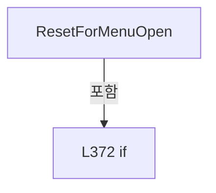

변경 전 점검: 입력/반환 타입, 위 호출자, 예외/취소 경로, 공유 상태와 저장·전송 소비자를 함께 확인합니다. 값의 단위나 물리 방향을 이름만으로 확정하지 않습니다.

### MethodDeclaration `Build` · L381–417

[Drilling.UI/Menu/Menus/CMenuReview.cs:381–417](https://github.com/kjuws10-rgb/A3Drilling/blob/5aee8e58439c9b455cae7c9593c9be986c3e682e/Drilling.UI/Menu/Menus/CMenuReview.cs#L381-L417)

| 항목 | 실제 추출 값 |
| --- | --- |
| 서명 | System.Threading.Tasks.Task<Drilling.UI.Menu.Menus.CScreenViewModel> Drilling.UI.Menu.Menus.CMenuReview.Build(System.Threading.CancellationToken) |
| 접근/수식자 | Public / public, override, async |
| 반환/값 타입 | System.Threading.Tasks.Task<Drilling.UI.Menu.Menus.CScreenViewModel> |
| 소속 타입 | NamedType:Drilling.UI.Menu.Menus.CMenuReview |

입력 계약:

| 이름 | 타입 | 전달 | 선택/기본값 |
| --- | --- | --- | --- |
| cancellationToken | System.Threading.CancellationToken | None | True / null |

정적 호출자로 확인된 위치:

| 호출 파일/행 | 호출 표현식 | 런타임 분기 가능 |
| --- | --- | --- |
| [Drilling.UI/Menu/Menus/CMenuManual.cs:1077–1077](https://github.com/kjuws10-rgb/A3Drilling/blob/5aee8e58439c9b455cae7c9593c9be986c3e682e/Drilling.UI/Menu/Menus/CMenuManual.cs#L1077-L1077) | Review.Build | True |

호출하는 대상과 해석 범위:

| 원본 행 | 표현식 | 분석 상태 | 대상/소스 위치 |
| --- | --- | --- | --- |
| 383 | cancellationToken.ThrowIfCancellationRequested | resolved | void System.Threading.CancellationToken.ThrowIfCancellationRequested() |
| 386 | LoadSelectedRecipe | resolved | System.Threading.Tasks.Task<Drilling.Common.Managers.ST_RECIPE_DEFINITION?> Drilling.UI.Menu.Menus.CMenuReview.LoadSelectedRecipe(System.Threading.CancellationToken) · Drilling.UI/Menu/Menus/CMenuReview.cs:468 |
| 386 | CreateFallbackRecipe | resolved | Drilling.Common.Managers.ST_RECIPE_DEFINITION Drilling.UI.Menu.Menus.CMenuReview.CreateFallbackRecipe() · Drilling.UI/Menu/Menus/CMenuReview.cs:463 |
| 387 | ReferenceEquals | resolved | bool object.ReferenceEquals(object?, object?) |
| 394 | ApplySplitBeamContext | resolved | void Drilling.UI.Menu.Menus.CMenuReview.ApplySplitBeamContext(Drilling.Common.Managers.ST_RECIPE_DEFINITION) · Drilling.UI/Menu/Menus/CMenuReview.cs:558 |
| 395 | _reviewManager.CreateAllPlan | resolved | Drilling.Common.Review.ST_REVIEW_PLAN Drilling.Common.Review.CReviewManager.CreateAllPlan(Drilling.Common.Managers.ST_RECIPE_DEFINITION, int) · Drilling.Common/Review/CReviewManager.cs:195 |
| 399 | RestoreSimpleShotSelection | resolved | void Drilling.UI.Menu.Menus.CMenuReview.RestoreSimpleShotSelection(Drilling.Common.Review.ST_REVIEW_PLAN) · Drilling.UI/Menu/Menus/CMenuReview.cs:1266 |
| 400 | ApplyRecipeContext | resolved | void Drilling.UI.Menu.Menus.CMenuReview.ApplyRecipeContext(Drilling.Common.Managers.ST_RECIPE_DEFINITION, Drilling.Common.Review.ST_REVIEW_PLAN) · Drilling.UI/Menu/Menus/CMenuReview.cs:489 |
| 401 | ApplyScreenData | resolved | void Drilling.UI.Menu.Menus.CMenuReview.ApplyScreenData(Drilling.Common.Managers.ST_RECIPE_DEFINITION, Drilling.Common.Review.ST_REVIEW_PLAN) · Drilling.UI/Menu/Menus/CMenuReview.cs:3275 |
| 402 | StartCommand.NotifyCanExecuteChanged | resolved | void Drilling.UI.Menu.CButtonCommand.NotifyCanExecuteChanged() · Drilling.UI/Menu/CButtonCommand.cs:24 |
| 403 | CreateReviewScreen | resolved | Drilling.UI.Menu.Menus.CScreenViewModel Drilling.UI.Menu.Menus.CMenuReview.CreateReviewScreen(string) · Drilling.UI/Menu/Menus/CMenuReview.cs:419 |
| 412 | ResetPlanDisplayAfterBuildFailure | resolved | void Drilling.UI.Menu.Menus.CMenuReview.ResetPlanDisplayAfterBuildFailure() · Drilling.UI/Menu/Menus/CMenuReview.cs:435 |
| 413 | StartCommand.NotifyCanExecuteChanged | resolved | void Drilling.UI.Menu.CButtonCommand.NotifyCanExecuteChanged() · Drilling.UI/Menu/CButtonCommand.cs:24 |
| 414 | _statusReporter | resolved · 동적 구현 선택 가능 | void System.Action<string>.Invoke(string) |
| 415 | CreateReviewScreen | resolved | Drilling.UI.Menu.Menus.CScreenViewModel Drilling.UI.Menu.Menus.CMenuReview.CreateReviewScreen(string) · Drilling.UI/Menu/Menus/CMenuReview.cs:419 |

본문의 실제 연산·분기·예외·반환 순서(원문 위치 순):

| 원본 행 | 종류 | 주석 해설 |
| --- | --- | --- |
| 383 | call | 함수·델리게이트 또는 객체 생성자를 호출합니다: cancellationToken.ThrowIfCancellationRequested() |
| 384 | try | 예외 처리 범위입니다: try |
| 386 | await | 비동기 완료를 기다립니다: await LoadSelectedRecipe(cancellationToken) |
| 386 | call | 함수·델리게이트 또는 객체 생성자를 호출합니다: LoadSelectedRecipe(cancellationToken) |
| 386 | call | 함수·델리게이트 또는 객체 생성자를 호출합니다: CreateFallbackRecipe() |
| 386 | local-declaration | 지역 변수를 선언합니다: var recipe = await LoadSelectedRecipe(cancellationToken) ?? CreateFallbackRecipe(); |
| 386 | variable-initializer | 변수의 초기값을 지정합니다: recipe = await LoadSelectedRecipe(cancellationToken) ?? CreateFallbackRecipe() |
| 387 | call | 함수·델리게이트 또는 객체 생성자를 호출합니다: ReferenceEquals(recipe, _lastRecipe) |
| 387 | if | 조건에 따라 분기합니다: if (!ReferenceEquals(recipe, _lastRecipe)) |
| 389 | assignment | 값을 대상에 대입합니다: _lastAllPlan = null |
| 390 | assignment | 값을 대상에 대입합니다: _lastAllPlanBeamNo = 0 |
| 393 | assignment | 값을 대상에 대입합니다: _lastRecipe = recipe |
| 394 | call | 함수·델리게이트 또는 객체 생성자를 호출합니다: ApplySplitBeamContext(recipe) |
| 395 | call | 함수·델리게이트 또는 객체 생성자를 호출합니다: _reviewManager.CreateAllPlan(recipe, _selectedRunBeamNo) |
| 395 | conditional-expression | 조건에 따라 결과식을 선택합니다: _lastAllPlan is not null && _lastAllPlanBeamNo == _selectedRunBeamNo ? _lastAllPlan : _reviewManager.CreateAllPlan(recipe, _selectedRunBeamNo) |
| 395 | local-declaration | 지역 변수를 선언합니다: var allPlan = _lastAllPlan is not null && _lastAllPlanBeamNo == _selectedRunBeamNo ? _lastAllPlan : _reviewManager.CreateAllPlan(recipe, _selectedRunBeamNo); |
| 395 | variable-initializer | 변수의 초기값을 지정합니다: allPlan = _lastAllPlan is not null && _lastAllPlanBeamNo == _selectedRunBeamNo ? _lastAllPlan : _reviewManager.CreateAllPlan(recipe, _selectedRunBeamNo) |
| 396 | assignment | 값을 대상에 대입합니다: _planBuildError = "" |
| 397 | assignment | 값을 대상에 대입합니다: _lastAllPlan = allPlan |
| 398 | assignment | 값을 대상에 대입합니다: _lastAllPlanBeamNo = _selectedRunBeamNo |
| 399 | call | 함수·델리게이트 또는 객체 생성자를 호출합니다: RestoreSimpleShotSelection(allPlan) |
| 400 | call | 함수·델리게이트 또는 객체 생성자를 호출합니다: ApplyRecipeContext(recipe, allPlan) |
| 401 | call | 함수·델리게이트 또는 객체 생성자를 호출합니다: ApplyScreenData(recipe, allPlan) |
| 402 | call | 함수·델리게이트 또는 객체 생성자를 호출합니다: StartCommand.NotifyCanExecuteChanged() |
| 403 | call | 함수·델리게이트 또는 객체 생성자를 호출합니다: CreateReviewScreen("Ready") |
| 403 | return | 호출자에게 값 또는 제어를 반환합니다: return CreateReviewScreen("Ready"); |
| 405 | catch | 지정 예외를 처리합니다: catch (OperationCanceledException) |
| 407 | throw | 예외를 발생/전달합니다: throw; |
| 409 | catch | 지정 예외를 처리합니다: catch (Exception exception) |
| 411 | assignment | 값을 대상에 대입합니다: _planBuildError = exception.Message |
| 412 | call | 함수·델리게이트 또는 객체 생성자를 호출합니다: ResetPlanDisplayAfterBuildFailure() |
| 413 | call | 함수·델리게이트 또는 객체 생성자를 호출합니다: StartCommand.NotifyCanExecuteChanged() |
| 414 | call | 함수·델리게이트 또는 객체 생성자를 호출합니다: _statusReporter($"Review plan cannot be created: {_planBuildError}") |
| 415 | call | 함수·델리게이트 또는 객체 생성자를 호출합니다: CreateReviewScreen("Configuration Error") |
| 415 | return | 호출자에게 값 또는 제어를 반환합니다: return CreateReviewScreen("Configuration Error"); |

제어 구문의 포함 구조(실제 실행 순서/CFG가 아닌 구문 탐색 그림):

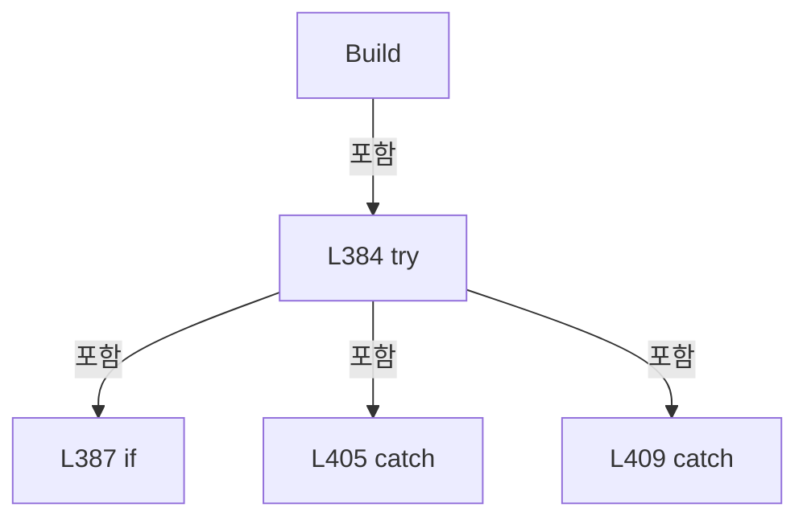

변경 전 점검: 입력/반환 타입, 위 호출자, 예외/취소 경로, 공유 상태와 저장·전송 소비자를 함께 확인합니다. 값의 단위나 물리 방향을 이름만으로 확정하지 않습니다.

### MethodDeclaration `CreateReviewScreen` · L419–433

[Drilling.UI/Menu/Menus/CMenuReview.cs:419–433](https://github.com/kjuws10-rgb/A3Drilling/blob/5aee8e58439c9b455cae7c9593c9be986c3e682e/Drilling.UI/Menu/Menus/CMenuReview.cs#L419-L433)

| 항목 | 실제 추출 값 |
| --- | --- |
| 서명 | Drilling.UI.Menu.Menus.CScreenViewModel Drilling.UI.Menu.Menus.CMenuReview.CreateReviewScreen(string) |
| 접근/수식자 | Private / private |
| 반환/값 타입 | Drilling.UI.Menu.Menus.CScreenViewModel |
| 소속 타입 | NamedType:Drilling.UI.Menu.Menus.CMenuReview |

입력 계약:

| 이름 | 타입 | 전달 | 선택/기본값 |
| --- | --- | --- | --- |
| result | string | None | False /  |

정적 호출자로 확인된 위치:

| 호출 파일/행 | 호출 표현식 | 런타임 분기 가능 |
| --- | --- | --- |
| [Drilling.UI/Menu/Menus/CMenuReview.cs:403–403](https://github.com/kjuws10-rgb/A3Drilling/blob/5aee8e58439c9b455cae7c9593c9be986c3e682e/Drilling.UI/Menu/Menus/CMenuReview.cs#L403-L403) | CreateReviewScreen | False |
| [Drilling.UI/Menu/Menus/CMenuReview.cs:415–415](https://github.com/kjuws10-rgb/A3Drilling/blob/5aee8e58439c9b455cae7c9593c9be986c3e682e/Drilling.UI/Menu/Menus/CMenuReview.cs#L415-L415) | CreateReviewScreen | False |

호출하는 대상과 해석 범위:

| 원본 행 | 표현식 | 분석 상태 | 대상/소스 위치 |
| --- | --- | --- | --- |
| 421 | new CScreenViewModel | resolved | Drilling.UI.Menu.Menus.CScreenViewModel.CScreenViewModel(Drilling.UI.Menu.Menus.EN_MENU, string, string, System.Collections.Generic.IReadOnlyList<Drilling.UI.Menu.Menus.ST_DISPLAY_ITEM>, System.Collections.Generic.IReadOnlyList<Drilling.UI.Menu.Menus.ST_SCREEN_SECTION>, bool, Drilling.UI.Menu.Menus.CMenuMain?, Drilling.UI.Menu.Menus.CMenuManual?, Drilling.UI.Menu.Menus.CMenuRecipe?, Drilling.UI.Menu.Menus.CMenuSetting?, Drilling.UI.Menu.Menus.CMenuAlarm?, Drilling.UI.Menu.Menus.CMenuMonitor?, Drilling.UI.Menu.Menus.CMenuReview?, Drilling.UI.Menu.Menus.CMenuCorrection?, Drilling.UI.Menu.Menus.CMenuPm?) · Drilling.UI/Menu/Menus/CMenuBase.cs:411 |
| 426 | new | resolved | Drilling.UI.Menu.Menus.ST_DISPLAY_ITEM.ST_DISPLAY_ITEM(string, string, string) · Drilling.UI/Menu/Menus/CMenuBase.cs:43 |
| 426 | ToDisplayModeName | resolved | string Drilling.UI.Menu.Menus.CMenuReview.ToDisplayModeName(string) · Drilling.UI/Menu/Menus/CMenuReview.cs:1960 |
| 427 | new | resolved | Drilling.UI.Menu.Menus.ST_DISPLAY_ITEM.ST_DISPLAY_ITEM(string, string, string) · Drilling.UI/Menu/Menus/CMenuBase.cs:43 |
| 427 | GetConfiguredSampleInspectionShotCount | resolved | int Drilling.UI.Menu.Menus.CMenuReview.GetConfiguredSampleInspectionShotCount() · Drilling.UI/Menu/Menus/CMenuReview.cs:1476 |
| 428 | new | resolved | Drilling.UI.Menu.Menus.ST_DISPLAY_ITEM.ST_DISPLAY_ITEM(string, string, string) · Drilling.UI/Menu/Menus/CMenuBase.cs:43 |
| 430 | new | resolved | Drilling.UI.Menu.Menus.ST_SCREEN_SECTION.ST_SCREEN_SECTION(string, System.Collections.Generic.IReadOnlyList<Drilling.UI.Menu.Menus.ST_DISPLAY_ITEM>) · Drilling.UI/Menu/Menus/CMenuBase.cs:410 |
| 430 | new | resolved | Drilling.UI.Menu.Menus.ST_SCREEN_SECTION.ST_SCREEN_SECTION(string, System.Collections.Generic.IReadOnlyList<Drilling.UI.Menu.Menus.ST_DISPLAY_ITEM>) · Drilling.UI/Menu/Menus/CMenuBase.cs:410 |

본문의 실제 연산·분기·예외·반환 순서(원문 위치 순):

| 원본 행 | 종류 | 주석 해설 |
| --- | --- | --- |
| 421 | call | 함수·델리게이트 또는 객체 생성자를 호출합니다: new CScreenViewModel( EN_MENU.Review, Title, Subtitle, [ new("Mode", ToDisplayModeName(_selectedMode)), new("Shot", IsSampleSelectTab ? $"{GetConfiguredSampleInspectionShotCount()} / {_totalReviewPointCount}" : $"{_activ… |
| 421 | return | 호출자에게 값 또는 제어를 반환합니다: return new CScreenViewModel( EN_MENU.Review, Title, Subtitle, [ new("Mode", ToDisplayModeName(_selectedMode)), new("Shot", IsSampleSelectTab ? $"{GetConfiguredSampleInspectionShotCount()} / {_totalReviewPointCount}" : $"{_activePl |
| 426 | call | 함수·델리게이트 또는 객체 생성자를 호출합니다: new("Mode", ToDisplayModeName(_selectedMode)) |
| 426 | call | 함수·델리게이트 또는 객체 생성자를 호출합니다: ToDisplayModeName(_selectedMode) |
| 427 | call | 함수·델리게이트 또는 객체 생성자를 호출합니다: new("Shot", IsSampleSelectTab ? $"{GetConfiguredSampleInspectionShotCount()} / {_totalReviewPointCount}" : $"{_activePlanPointCount} / {_totalReviewPointCount}") |
| 427 | call | 함수·델리게이트 또는 객체 생성자를 호출합니다: GetConfiguredSampleInspectionShotCount() |
| 427 | conditional-expression | 조건에 따라 결과식을 선택합니다: IsSampleSelectTab ? $"{GetConfiguredSampleInspectionShotCount()} / {_totalReviewPointCount}" : $"{_activePlanPointCount} / {_totalReviewPointCount}" |
| 428 | call | 함수·델리게이트 또는 객체 생성자를 호출합니다: new("Result", result) |
| 430 | call | 함수·델리게이트 또는 객체 생성자를 호출합니다: new("Review Plan", []) |
| 430 | call | 함수·델리게이트 또는 객체 생성자를 호출합니다: new("Review Result", []) |

변경 전 점검: 입력/반환 타입, 위 호출자, 예외/취소 경로, 공유 상태와 저장·전송 소비자를 함께 확인합니다. 값의 단위나 물리 방향을 이름만으로 확정하지 않습니다.

### MethodDeclaration `ResetPlanDisplayAfterBuildFailure` · L435–461

[Drilling.UI/Menu/Menus/CMenuReview.cs:435–461](https://github.com/kjuws10-rgb/A3Drilling/blob/5aee8e58439c9b455cae7c9593c9be986c3e682e/Drilling.UI/Menu/Menus/CMenuReview.cs#L435-L461)

| 항목 | 실제 추출 값 |
| --- | --- |
| 서명 | void Drilling.UI.Menu.Menus.CMenuReview.ResetPlanDisplayAfterBuildFailure() |
| 접근/수식자 | Private / private |
| 반환/값 타입 | void |
| 소속 타입 | NamedType:Drilling.UI.Menu.Menus.CMenuReview |

정적 호출자로 확인된 위치:

| 호출 파일/행 | 호출 표현식 | 런타임 분기 가능 |
| --- | --- | --- |
| [Drilling.UI/Menu/Menus/CMenuReview.cs:412–412](https://github.com/kjuws10-rgb/A3Drilling/blob/5aee8e58439c9b455cae7c9593c9be986c3e682e/Drilling.UI/Menu/Menus/CMenuReview.cs#L412-L412) | ResetPlanDisplayAfterBuildFailure | False |

호출하는 대상과 해석 범위:

| 원본 행 | 표현식 | 분석 상태 | 대상/소스 위치 |
| --- | --- | --- | --- |
| 440 | new | resolved | Drilling.UI.Menu.Menus.ST_REVIEW_TAB_ITEM.ST_REVIEW_TAB_ITEM(string, bool, Drilling.UI.Menu.CButtonCommand) · Drilling.UI/Menu/Menus/CMenuReview.cs:3725 |
| 441 | Mode | resolved | Drilling.UI.Menu.Menus.ST_REVIEW_MODE_ITEM Drilling.UI.Menu.Menus.CMenuReview.Mode(string, string) · Drilling.UI/Menu/Menus/CMenuReview.cs:1961 |
| 441 | Mode | resolved | Drilling.UI.Menu.Menus.ST_REVIEW_MODE_ITEM Drilling.UI.Menu.Menus.CMenuReview.Mode(string, string) · Drilling.UI/Menu/Menus/CMenuReview.cs:1961 |
| 441 | Mode | resolved | Drilling.UI.Menu.Menus.ST_REVIEW_MODE_ITEM Drilling.UI.Menu.Menus.CMenuReview.Mode(string, string) · Drilling.UI/Menu/Menus/CMenuReview.cs:1961 |
| 442 | new | resolved | Drilling.UI.Menu.Menus.ST_DISPLAY_ITEM.ST_DISPLAY_ITEM(string, string, string) · Drilling.UI/Menu/Menus/CMenuBase.cs:43 |
| 442 | _selectedRecipeIdProvider | resolved · 동적 구현 선택 가능 | string System.Func<string>.Invoke() |
| 442 | new | resolved | Drilling.UI.Menu.Menus.ST_DISPLAY_ITEM.ST_DISPLAY_ITEM(string, string, string) · Drilling.UI/Menu/Menus/CMenuBase.cs:43 |
| 442 | new | resolved | Drilling.UI.Menu.Menus.ST_DISPLAY_ITEM.ST_DISPLAY_ITEM(string, string, string) · Drilling.UI/Menu/Menus/CMenuBase.cs:43 |
| 443 | new | resolved | Drilling.UI.Menu.Menus.ST_DISPLAY_ITEM.ST_DISPLAY_ITEM(string, string, string) · Drilling.UI/Menu/Menus/CMenuBase.cs:43 |
| 443 | new | resolved | Drilling.UI.Menu.Menus.ST_DISPLAY_ITEM.ST_DISPLAY_ITEM(string, string, string) · Drilling.UI/Menu/Menus/CMenuBase.cs:43 |
| 453 | Camera.Clear | resolved | void Drilling.UI.Menu.Menus.CReviewCameraPreview.Clear() · Drilling.UI/Menu/Menus/CMenuReview.cs:4059 |

본문의 실제 연산·분기·예외·반환 순서(원문 위치 순):

| 원본 행 | 종류 | 주석 해설 |
| --- | --- | --- |
| 437 | assignment | 값을 대상에 대입합니다: _lastAllPlan = null |
| 438 | assignment | 값을 대상에 대입합니다: _activePlanPointCount = 0 |
| 439 | assignment | 값을 대상에 대입합니다: _totalReviewPointCount = 0 |
| 440 | assignment | 값을 대상에 대입합니다: Tabs = [new("RUN", IsRunTab, SelectTabCommand)] |
| 440 | call | 함수·델리게이트 또는 객체 생성자를 호출합니다: new("RUN", IsRunTab, SelectTabCommand) |
| 441 | assignment | 값을 대상에 대입합니다: Modes = [Mode("ALL SHOT", ""), Mode("ONE SHOT", ""), Mode("BEAM INSPECTION", "")] |
| 441 | call | 함수·델리게이트 또는 객체 생성자를 호출합니다: Mode("ALL SHOT", "") |
| 441 | call | 함수·델리게이트 또는 객체 생성자를 호출합니다: Mode("ONE SHOT", "") |
| 441 | call | 함수·델리게이트 또는 객체 생성자를 호출합니다: Mode("BEAM INSPECTION", "") |
| 442 | assignment | 값을 대상에 대입합니다: TargetItems = [new("Recipe Name", _selectedRecipeIdProvider()), new("Glass ID", _productManager.Current?.GlassId ?? "-"), new("Tolerance", "-")] |
| 442 | call | 함수·델리게이트 또는 객체 생성자를 호출합니다: new("Recipe Name", _selectedRecipeIdProvider()) |
| 442 | call | 함수·델리게이트 또는 객체 생성자를 호출합니다: _selectedRecipeIdProvider() |
| 442 | call | 함수·델리게이트 또는 객체 생성자를 호출합니다: new("Glass ID", _productManager.Current?.GlassId ?? "-") |
| 442 | call | 함수·델리게이트 또는 객체 생성자를 호출합니다: new("Tolerance", "-") |
| 443 | assignment | 값을 대상에 대입합니다: SelectionSummaryItems = [new("Status", "Configuration Error"), new("Reason", _planBuildError)] |
| 443 | call | 함수·델리게이트 또는 객체 생성자를 호출합니다: new("Status", "Configuration Error") |
| 443 | call | 함수·델리게이트 또는 객체 생성자를 호출합니다: new("Reason", _planBuildError) |
| 444 | assignment | 값을 대상에 대입합니다: SelectedPointItems = [] |
| 445 | assignment | 값을 대상에 대입합니다: PointSelectRows = [] |
| 446 | assignment | 값을 대상에 대입합니다: RunCellShotRows = [] |
| 447 | assignment | 값을 대상에 대입합니다: RunCellShotMatrixRows = [] |
| 448 | assignment | 값을 대상에 대입합니다: RunBeamRows = [] |
| 449 | assignment | 값을 대상에 대입합니다: SampleCellShotRows = [] |
| 450 | assignment | 값을 대상에 대입합니다: SampleCellShotMatrixRows = [] |
| 451 | assignment | 값을 대상에 대입합니다: RunGlassPreviewImage = null |
| 452 | assignment | 값을 대상에 대입합니다: _cameraGlassBounds = Rect.Empty |
| 453 | call | 함수·델리게이트 또는 객체 생성자를 호출합니다: Camera.Clear() |
| 454 | assignment | 값을 대상에 대입합니다: RunGlassPreviewInspectionOverlayImage = null |
| 455 | assignment | 값을 대상에 대입합니다: RunCellPreviewLabels = [] |
| 456 | assignment | 값을 대상에 대입합니다: RunGlassPreviewSummary = "Review plan unavailable" |
| 457 | assignment | 값을 대상에 대입합니다: SampleGlassPreviewImage = null |
| 458 | assignment | 값을 대상에 대입합니다: SampleGlassPreviewInspectionOverlayImage = null |
| 459 | assignment | 값을 대상에 대입합니다: SampleCellPreviewLabels = [] |
| 460 | assignment | 값을 대상에 대입합니다: SampleGlassPreviewSummary = "Review plan unavailable" |

변경 전 점검: 입력/반환 타입, 위 호출자, 예외/취소 경로, 공유 상태와 저장·전송 소비자를 함께 확인합니다. 값의 단위나 물리 방향을 이름만으로 확정하지 않습니다.

### MethodDeclaration `CreateFallbackRecipe` · L463–466

[Drilling.UI/Menu/Menus/CMenuReview.cs:463–466](https://github.com/kjuws10-rgb/A3Drilling/blob/5aee8e58439c9b455cae7c9593c9be986c3e682e/Drilling.UI/Menu/Menus/CMenuReview.cs#L463-L466)

| 항목 | 실제 추출 값 |
| --- | --- |
| 서명 | Drilling.Common.Managers.ST_RECIPE_DEFINITION Drilling.UI.Menu.Menus.CMenuReview.CreateFallbackRecipe() |
| 접근/수식자 | Private / private |
| 반환/값 타입 | Drilling.Common.Managers.ST_RECIPE_DEFINITION |
| 소속 타입 | NamedType:Drilling.UI.Menu.Menus.CMenuReview |

정적 호출자로 확인된 위치:

| 호출 파일/행 | 호출 표현식 | 런타임 분기 가능 |
| --- | --- | --- |
| [Drilling.UI/Menu/Menus/CMenuReview.cs:386–386](https://github.com/kjuws10-rgb/A3Drilling/blob/5aee8e58439c9b455cae7c9593c9be986c3e682e/Drilling.UI/Menu/Menus/CMenuReview.cs#L386-L386) | CreateFallbackRecipe | False |
| [Drilling.UI/Menu/Menus/CMenuReview.cs:2998–2998](https://github.com/kjuws10-rgb/A3Drilling/blob/5aee8e58439c9b455cae7c9593c9be986c3e682e/Drilling.UI/Menu/Menus/CMenuReview.cs#L2998-L2998) | CreateFallbackRecipe | False |

호출하는 대상과 해석 범위:

| 원본 행 | 표현식 | 분석 상태 | 대상/소스 위치 |
| --- | --- | --- | --- |
| 465 | new ST_RECIPE_DEFINITION | resolved | Drilling.Common.Managers.ST_RECIPE_DEFINITION.ST_RECIPE_DEFINITION(string, string, System.Collections.Generic.IReadOnlyList<Drilling.Common.Managers.ST_RECIPE_PARAMETER>, System.Collections.Generic.IReadOnlyList<Drilling.Common.Managers.ST_RECIPE_HISTORY>) · Drilling.Common/Managers/CRecipeManager.cs:385 |

본문의 실제 연산·분기·예외·반환 순서(원문 위치 순):

| 원본 행 | 종류 | 주석 해설 |
| --- | --- | --- |
| 465 | call | 함수·델리게이트 또는 객체 생성자를 호출합니다: new ST_RECIPE_DEFINITION(_recipeId, _recipeId, [], []) |
| 465 | return | 호출자에게 값 또는 제어를 반환합니다: return new ST_RECIPE_DEFINITION(_recipeId, _recipeId, [], []); |

변경 전 점검: 입력/반환 타입, 위 호출자, 예외/취소 경로, 공유 상태와 저장·전송 소비자를 함께 확인합니다. 값의 단위나 물리 방향을 이름만으로 확정하지 않습니다.

### MethodDeclaration `LoadSelectedRecipe` · L468–487

[Drilling.UI/Menu/Menus/CMenuReview.cs:468–487](https://github.com/kjuws10-rgb/A3Drilling/blob/5aee8e58439c9b455cae7c9593c9be986c3e682e/Drilling.UI/Menu/Menus/CMenuReview.cs#L468-L487)

| 항목 | 실제 추출 값 |
| --- | --- |
| 서명 | System.Threading.Tasks.Task<Drilling.Common.Managers.ST_RECIPE_DEFINITION?> Drilling.UI.Menu.Menus.CMenuReview.LoadSelectedRecipe(System.Threading.CancellationToken) |
| 접근/수식자 | Private / private, async |
| 반환/값 타입 | System.Threading.Tasks.Task<Drilling.Common.Managers.ST_RECIPE_DEFINITION?> |
| 소속 타입 | NamedType:Drilling.UI.Menu.Menus.CMenuReview |

입력 계약:

| 이름 | 타입 | 전달 | 선택/기본값 |
| --- | --- | --- | --- |
| cancellationToken | System.Threading.CancellationToken | None | False /  |

정적 호출자로 확인된 위치:

| 호출 파일/행 | 호출 표현식 | 런타임 분기 가능 |
| --- | --- | --- |
| [Drilling.UI/Menu/Menus/CMenuReview.cs:386–386](https://github.com/kjuws10-rgb/A3Drilling/blob/5aee8e58439c9b455cae7c9593c9be986c3e682e/Drilling.UI/Menu/Menus/CMenuReview.cs#L386-L386) | LoadSelectedRecipe | False |
| [Drilling.UI/Menu/Menus/CMenuReview.cs:2205–2205](https://github.com/kjuws10-rgb/A3Drilling/blob/5aee8e58439c9b455cae7c9593c9be986c3e682e/Drilling.UI/Menu/Menus/CMenuReview.cs#L2205-L2205) | LoadSelectedRecipe | False |
| [Drilling.UI/Menu/Menus/CMenuReview.cs:2632–2632](https://github.com/kjuws10-rgb/A3Drilling/blob/5aee8e58439c9b455cae7c9593c9be986c3e682e/Drilling.UI/Menu/Menus/CMenuReview.cs#L2632-L2632) | LoadSelectedRecipe | False |
| [Drilling.UI/Menu/Menus/CMenuReview.cs:2998–2998](https://github.com/kjuws10-rgb/A3Drilling/blob/5aee8e58439c9b455cae7c9593c9be986c3e682e/Drilling.UI/Menu/Menus/CMenuReview.cs#L2998-L2998) | LoadSelectedRecipe | False |

호출하는 대상과 해석 범위:

| 원본 행 | 표현식 | 분석 상태 | 대상/소스 위치 |
| --- | --- | --- | --- |
| 470 | _recipeManager.LoadRecipes | resolved | System.Threading.Tasks.Task<System.Collections.Generic.IReadOnlyList<Drilling.Common.Managers.ST_RECIPE_DEFINITION>> Drilling.Common.Managers.CRecipeManager.LoadRecipes(System.Threading.CancellationToken) · Drilling.Common/Managers/CRecipeManager.cs:40 |
| 476 | _selectedRecipeIdProvider | resolved · 동적 구현 선택 가능 | string System.Func<string>.Invoke() |
| 477 | string.IsNullOrWhiteSpace | resolved | bool string.IsNullOrWhiteSpace(string?) |
| 479 | recipes.FirstOrDefault | resolved | Drilling.Common.Managers.ST_RECIPE_DEFINITION? System.Collections.Generic.IEnumerable<Drilling.Common.Managers.ST_RECIPE_DEFINITION>.FirstOrDefault<Drilling.Common.Managers.ST_RECIPE_DEFINITION>(System.Func<Drilling.Common.Managers.ST_RECIPE_DEFINITION, bool>) |
| 479 | recipe.Id.Equals | resolved | bool string.Equals(string?, System.StringComparison) |
| 486 | recipes.FirstOrDefault | resolved | Drilling.Common.Managers.ST_RECIPE_DEFINITION? System.Collections.Generic.IEnumerable<Drilling.Common.Managers.ST_RECIPE_DEFINITION>.FirstOrDefault<Drilling.Common.Managers.ST_RECIPE_DEFINITION>(System.Func<Drilling.Common.Managers.ST_RECIPE_DEFINITION, bool>) |
| 486 | recipe.Id.Equals | resolved | bool string.Equals(string?, System.StringComparison) |

본문의 실제 연산·분기·예외·반환 순서(원문 위치 순):

| 원본 행 | 종류 | 주석 해설 |
| --- | --- | --- |
| 470 | await | 비동기 완료를 기다립니다: await _recipeManager.LoadRecipes(cancellationToken) |
| 470 | call | 함수·델리게이트 또는 객체 생성자를 호출합니다: _recipeManager.LoadRecipes(cancellationToken) |
| 470 | local-declaration | 지역 변수를 선언합니다: var recipes = await _recipeManager.LoadRecipes(cancellationToken); |
| 470 | variable-initializer | 변수의 초기값을 지정합니다: recipes = await _recipeManager.LoadRecipes(cancellationToken) |
| 471 | if | 조건에 따라 분기합니다: if (recipes.Count == 0) |
| 473 | return | 호출자에게 값 또는 제어를 반환합니다: return null; |
| 476 | call | 함수·델리게이트 또는 객체 생성자를 호출합니다: _selectedRecipeIdProvider() |
| 476 | local-declaration | 지역 변수를 선언합니다: var selectedRecipeId = _selectedRecipeIdProvider(); |
| 476 | variable-initializer | 변수의 초기값을 지정합니다: selectedRecipeId = _selectedRecipeIdProvider() |
| 477 | call | 함수·델리게이트 또는 객체 생성자를 호출합니다: string.IsNullOrWhiteSpace(selectedRecipeId) |
| 477 | if | 조건에 따라 분기합니다: if (!string.IsNullOrWhiteSpace(selectedRecipeId)) |
| 479 | call | 함수·델리게이트 또는 객체 생성자를 호출합니다: recipes.FirstOrDefault(recipe => recipe.Id.Equals(selectedRecipeId, StringComparison.OrdinalIgnoreCase)) |
| 479 | call | 함수·델리게이트 또는 객체 생성자를 호출합니다: recipe.Id.Equals(selectedRecipeId, StringComparison.OrdinalIgnoreCase) |
| 479 | local-declaration | 지역 변수를 선언합니다: var selectedRecipe = recipes.FirstOrDefault(recipe => recipe.Id.Equals(selectedRecipeId, StringComparison.OrdinalIgnoreCase)); |
| 479 | variable-initializer | 변수의 초기값을 지정합니다: selectedRecipe = recipes.FirstOrDefault(recipe => recipe.Id.Equals(selectedRecipeId, StringComparison.OrdinalIgnoreCase)) |
| 480 | if | 조건에 따라 분기합니다: if (selectedRecipe is not null) |
| 482 | return | 호출자에게 값 또는 제어를 반환합니다: return selectedRecipe; |
| 486 | call | 함수·델리게이트 또는 객체 생성자를 호출합니다: recipes.FirstOrDefault(recipe => recipe.Id.Equals("DRILL_A01", StringComparison.OrdinalIgnoreCase)) |
| 486 | call | 함수·델리게이트 또는 객체 생성자를 호출합니다: recipe.Id.Equals("DRILL_A01", StringComparison.OrdinalIgnoreCase) |
| 486 | return | 호출자에게 값 또는 제어를 반환합니다: return recipes.FirstOrDefault(recipe => recipe.Id.Equals("DRILL_A01", StringComparison.OrdinalIgnoreCase)) ?? recipes[0]; |

제어 구문의 포함 구조(실제 실행 순서/CFG가 아닌 구문 탐색 그림):

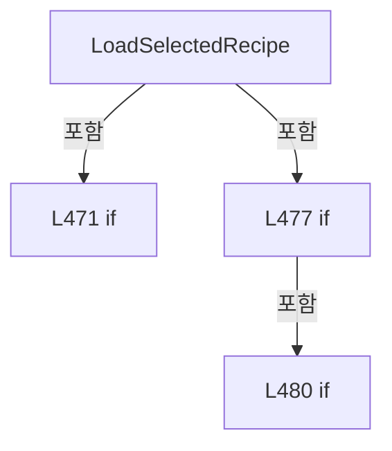

변경 전 점검: 입력/반환 타입, 위 호출자, 예외/취소 경로, 공유 상태와 저장·전송 소비자를 함께 확인합니다. 값의 단위나 물리 방향을 이름만으로 확정하지 않습니다.

### MethodDeclaration `ApplyRecipeContext` · L489–536

[Drilling.UI/Menu/Menus/CMenuReview.cs:489–536](https://github.com/kjuws10-rgb/A3Drilling/blob/5aee8e58439c9b455cae7c9593c9be986c3e682e/Drilling.UI/Menu/Menus/CMenuReview.cs#L489-L536)

| 항목 | 실제 추출 값 |
| --- | --- |
| 서명 | void Drilling.UI.Menu.Menus.CMenuReview.ApplyRecipeContext(Drilling.Common.Managers.ST_RECIPE_DEFINITION, Drilling.Common.Review.ST_REVIEW_PLAN) |
| 접근/수식자 | Private / private |
| 반환/값 타입 | void |
| 소속 타입 | NamedType:Drilling.UI.Menu.Menus.CMenuReview |

입력 계약:

| 이름 | 타입 | 전달 | 선택/기본값 |
| --- | --- | --- | --- |
| recipe | Drilling.Common.Managers.ST_RECIPE_DEFINITION | None | False /  |
| allPlan | Drilling.Common.Review.ST_REVIEW_PLAN | None | False /  |

정적 호출자로 확인된 위치:

| 호출 파일/행 | 호출 표현식 | 런타임 분기 가능 |
| --- | --- | --- |
| [Drilling.UI/Menu/Menus/CMenuReview.cs:400–400](https://github.com/kjuws10-rgb/A3Drilling/blob/5aee8e58439c9b455cae7c9593c9be986c3e682e/Drilling.UI/Menu/Menus/CMenuReview.cs#L400-L400) | ApplyRecipeContext | False |
| [Drilling.UI/Menu/Menus/CMenuReview.cs:3001–3001](https://github.com/kjuws10-rgb/A3Drilling/blob/5aee8e58439c9b455cae7c9593c9be986c3e682e/Drilling.UI/Menu/Menus/CMenuReview.cs#L3001-L3001) | ApplyRecipeContext | False |

호출하는 대상과 해석 범위:

| 원본 행 | 표현식 | 분석 상태 | 대상/소스 위치 |
| --- | --- | --- | --- |
| 492 | Math.Clamp | resolved | int System.Math.Clamp(int, int, int) |
| 493 | Math.Max | resolved | int System.Math.Max(int, int) |
| 494 | Math.Clamp | resolved | int System.Math.Clamp(int, int, int) |
| 495 | string.IsNullOrWhiteSpace | resolved | bool string.IsNullOrWhiteSpace(string?) |
| 496 | _sampleSelectionRecipeId.Equals | resolved | bool string.Equals(string?, System.StringComparison) |
| 498 | ApplySplitBeamContext | resolved | void Drilling.UI.Menu.Menus.CMenuReview.ApplySplitBeamContext(Drilling.Common.Managers.ST_RECIPE_DEFINITION) · Drilling.UI/Menu/Menus/CMenuReview.cs:558 |
| 513 | NotifyOneShot | resolved | void Drilling.UI.Menu.Menus.CMenuReview.NotifyOneShot() · Drilling.UI/Menu/Menus/CMenuReview.cs:2535 |
| 516 | ResetBeamInspectionResults | resolved | void Drilling.UI.Menu.Menus.CMenuReview.ResetBeamInspectionResults() · Drilling.UI/Menu/Menus/CMenuReview.cs:2134 |
| 517 | _selectedSampleShotKeys.Clear | resolved | void System.Collections.Generic.HashSet<string>.Clear() |
| 518 | _selectedInspectionShotKeys.Clear | resolved | void System.Collections.Generic.HashSet<string>.Clear() |
| 525 | _selectedSampleShotKeys.RemoveWhere | resolved | int System.Collections.Generic.HashSet<string>.RemoveWhere(System.Predicate<string>) |
| 525 | IsValidShotKey | resolved | bool IsValidShotKey(string) · Drilling.UI/Menu/Menus/CMenuReview.cs:499 |
| 526 | _selectedInspectionShotKeys.RemoveWhere | resolved | int System.Collections.Generic.HashSet<string>.RemoveWhere(System.Predicate<string>) |
| 526 | IsValidShotKey | resolved | bool IsValidShotKey(string) · Drilling.UI/Menu/Menus/CMenuReview.cs:499 |
| 529 | Math.Clamp | resolved | int System.Math.Clamp(int, int, int) |
| 530 | SetSampleMapColumnCount | resolved | void Drilling.UI.Menu.Menus.CMenuReview.SetSampleMapColumnCount(int) · Drilling.UI/Menu/Menus/CMenuReview.cs:1646 |
| 530 | CalculateShotMapColumnCount | resolved | int Drilling.UI.Menu.Menus.CMenuReview.CalculateShotMapColumnCount(Drilling.Common.Review.ST_REVIEW_PLAN, int) · Drilling.UI/Menu/Menus/CMenuReview.cs:1628 |
| 531 | Math.Clamp | resolved | int System.Math.Clamp(int, int, int) |
| 532 | string.IsNullOrWhiteSpace | resolved | bool string.IsNullOrWhiteSpace(string?) |
| 532 | IsValidShotKey | resolved | bool IsValidShotKey(string) · Drilling.UI/Menu/Menus/CMenuReview.cs:499 |

본문의 실제 연산·분기·예외·반환 순서(원문 위치 순):

| 원본 행 | 종류 | 주석 해설 |
| --- | --- | --- |
| 491 | assignment | 값을 대상에 대입합니다: _headCount = MaxHeadCount |
| 492 | assignment | 값을 대상에 대입합니다: _sampleRuleHeadNo = Math.Clamp(_sampleRuleHeadNo, 1, _headCount) |
| 492 | call | 함수·델리게이트 또는 객체 생성자를 호출합니다: Math.Clamp(_sampleRuleHeadNo, 1, _headCount) |
| 493 | assignment | 값을 대상에 대입합니다: _cellCount = Math.Max(1, allPlan.CellCount) |
| 493 | call | 함수·델리게이트 또는 객체 생성자를 호출합니다: Math.Max(1, allPlan.CellCount) |
| 494 | assignment | 값을 대상에 대입합니다: _sampleRuleCellNo = Math.Clamp(_sampleRuleCellNo, 1, _cellCount) |
| 494 | call | 함수·델리게이트 또는 객체 생성자를 호출합니다: Math.Clamp(_sampleRuleCellNo, 1, _cellCount) |
| 495 | assignment | 값을 대상에 대입합니다: _recipeId = string.IsNullOrWhiteSpace(recipe.Id) ? "DRILL_A01" : recipe.Id |
| 495 | call | 함수·델리게이트 또는 객체 생성자를 호출합니다: string.IsNullOrWhiteSpace(recipe.Id) |
| 495 | conditional-expression | 조건에 따라 결과식을 선택합니다: string.IsNullOrWhiteSpace(recipe.Id) ? "DRILL_A01" : recipe.Id |
| 496 | call | 함수·델리게이트 또는 객체 생성자를 호출합니다: _sampleSelectionRecipeId.Equals(_recipeId, StringComparison.OrdinalIgnoreCase) |
| 496 | local-declaration | 지역 변수를 선언합니다: var isSampleSelectionRecipeChanged = !_sampleSelectionRecipeId.Equals(_recipeId, StringComparison.OrdinalIgnoreCase); |
| 496 | variable-initializer | 변수의 초기값을 지정합니다: isSampleSelectionRecipeChanged = !_sampleSelectionRecipeId.Equals(_recipeId, StringComparison.OrdinalIgnoreCase) |
| 497 | assignment | 값을 대상에 대입합니다: _totalReviewPointCount = allPlan.Points.Count |
| 498 | call | 함수·델리게이트 또는 객체 생성자를 호출합니다: ApplySplitBeamContext(recipe) |
| 506 | if | 조건에 따라 분기합니다: if (isSampleSelectionRecipeChanged) |
| 508 | assignment | 값을 대상에 대입합니다: _oneShotResult = null |
| 509 | if | 조건에 따라 분기합니다: if (IsOneShotReviewMode) |
| 511 | assignment | 값을 대상에 대입합니다: _selectedRunShotKey = "" |
| 512 | assignment | 값을 대상에 대입합니다: OneShotStatus = "Shot을 선택해 주세요." |
| 513 | call | 함수·델리게이트 또는 객체 생성자를 호출합니다: NotifyOneShot() |
| 516 | call | 함수·델리게이트 또는 객체 생성자를 호출합니다: ResetBeamInspectionResults() |
| 517 | call | 함수·델리게이트 또는 객체 생성자를 호출합니다: _selectedSampleShotKeys.Clear() |
| 518 | call | 함수·델리게이트 또는 객체 생성자를 호출합니다: _selectedInspectionShotKeys.Clear() |
| 519 | assignment | 값을 대상에 대입합니다: _simpleSampleShotKey = "" |
| 520 | assignment | 값을 대상에 대입합니다: _lastCorrectionRulePlan = null |
| 521 | assignment | 값을 대상에 대입합니다: _sampleSelectionRecipeId = _recipeId |
| 523 | else | 앞 조건이 거짓인 경로입니다: else |
| 525 | call | 함수·델리게이트 또는 객체 생성자를 호출합니다: _selectedSampleShotKeys.RemoveWhere(key => !IsValidShotKey(key)) |
| 525 | call | 함수·델리게이트 또는 객체 생성자를 호출합니다: IsValidShotKey(key) |
| 526 | call | 함수·델리게이트 또는 객체 생성자를 호출합니다: _selectedInspectionShotKeys.RemoveWhere(key => !IsValidShotKey(key)) |
| 526 | call | 함수·델리게이트 또는 객체 생성자를 호출합니다: IsValidShotKey(key) |
| 529 | assignment | 값을 대상에 대입합니다: _selectedSampleCellNo = Math.Clamp(_selectedSampleCellNo, 1, _cellCount) |
| 529 | call | 함수·델리게이트 또는 객체 생성자를 호출합니다: Math.Clamp(_selectedSampleCellNo, 1, _cellCount) |
| 530 | call | 함수·델리게이트 또는 객체 생성자를 호출합니다: SetSampleMapColumnCount(CalculateShotMapColumnCount(allPlan, _selectedSampleCellNo)) |
| 530 | call | 함수·델리게이트 또는 객체 생성자를 호출합니다: CalculateShotMapColumnCount(allPlan, _selectedSampleCellNo) |
| 531 | assignment | 값을 대상에 대입합니다: _selectedRunCellNo = Math.Clamp(_selectedRunCellNo, 1, _cellCount) |
| 531 | call | 함수·델리게이트 또는 객체 생성자를 호출합니다: Math.Clamp(_selectedRunCellNo, 1, _cellCount) |
| 532 | call | 함수·델리게이트 또는 객체 생성자를 호출합니다: string.IsNullOrWhiteSpace(_selectedRunShotKey) |
| 532 | call | 함수·델리게이트 또는 객체 생성자를 호출합니다: IsValidShotKey(_selectedRunShotKey) |
| 532 | if | 조건에 따라 분기합니다: if (!string.IsNullOrWhiteSpace(_selectedRunShotKey) && !IsValidShotKey(_selectedRunShotKey)) |
| 534 | assignment | 값을 대상에 대입합니다: _selectedRunShotKey = "" |

제어 구문의 포함 구조(실제 실행 순서/CFG가 아닌 구문 탐색 그림):

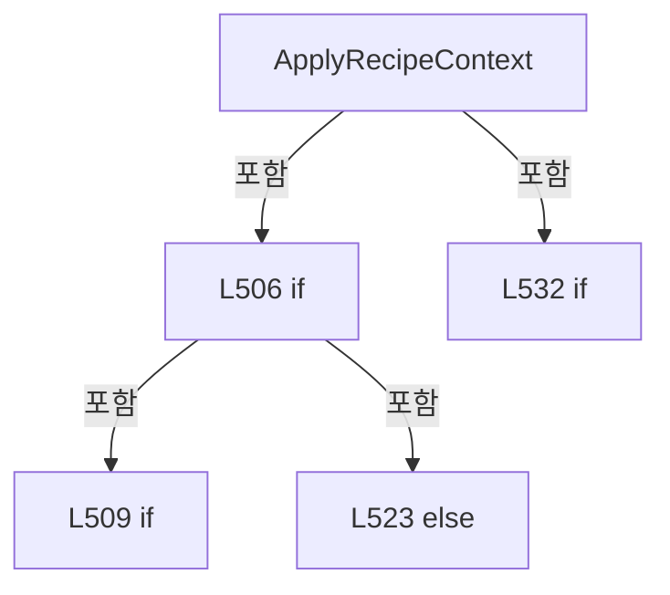

변경 전 점검: 입력/반환 타입, 위 호출자, 예외/취소 경로, 공유 상태와 저장·전송 소비자를 함께 확인합니다. 값의 단위나 물리 방향을 이름만으로 확정하지 않습니다.

### LocalFunctionStatement `IsValidShotKey` · L499–504

[Drilling.UI/Menu/Menus/CMenuReview.cs:499–504](https://github.com/kjuws10-rgb/A3Drilling/blob/5aee8e58439c9b455cae7c9593c9be986c3e682e/Drilling.UI/Menu/Menus/CMenuReview.cs#L499-L504)

| 항목 | 실제 추출 값 |
| --- | --- |
| 서명 | bool IsValidShotKey(string) |
| 접근/수식자 | Private /  |
| 반환/값 타입 | bool |
| 소속 타입 | NamedType:Drilling.UI.Menu.Menus.CMenuReview |

입력 계약:

| 이름 | 타입 | 전달 | 선택/기본값 |
| --- | --- | --- | --- |
| key | string | None | False /  |

정적 호출자로 확인된 위치:

| 호출 파일/행 | 호출 표현식 | 런타임 분기 가능 |
| --- | --- | --- |
| [Drilling.UI/Menu/Menus/CMenuReview.cs:525–525](https://github.com/kjuws10-rgb/A3Drilling/blob/5aee8e58439c9b455cae7c9593c9be986c3e682e/Drilling.UI/Menu/Menus/CMenuReview.cs#L525-L525) | IsValidShotKey | False |
| [Drilling.UI/Menu/Menus/CMenuReview.cs:526–526](https://github.com/kjuws10-rgb/A3Drilling/blob/5aee8e58439c9b455cae7c9593c9be986c3e682e/Drilling.UI/Menu/Menus/CMenuReview.cs#L526-L526) | IsValidShotKey | False |
| [Drilling.UI/Menu/Menus/CMenuReview.cs:532–532](https://github.com/kjuws10-rgb/A3Drilling/blob/5aee8e58439c9b455cae7c9593c9be986c3e682e/Drilling.UI/Menu/Menus/CMenuReview.cs#L532-L532) | IsValidShotKey | False |

호출하는 대상과 해석 범위:

| 원본 행 | 표현식 | 분석 상태 | 대상/소스 위치 |
| --- | --- | --- | --- |
| 501 | CReviewManager.NormalizeShotKey | resolved | string Drilling.Common.Review.CReviewManager.NormalizeShotKey(string) · Drilling.Common/Review/CReviewManager.cs:1165 |
| 502 | normalized.IndexOf | resolved | int string.IndexOf(string, System.StringComparison) |
| 503 | int.TryParse | resolved | bool int.TryParse(System.ReadOnlySpan<char>, System.Globalization.NumberStyles, System.IFormatProvider?, out int) |
| 503 | normalized.AsSpan | resolved | System.ReadOnlySpan<char> string?.AsSpan(int, int) |
| 503 | int.TryParse | resolved | bool int.TryParse(System.ReadOnlySpan<char>, System.Globalization.NumberStyles, System.IFormatProvider?, out int) |
| 503 | normalized.AsSpan | resolved | System.ReadOnlySpan<char> string?.AsSpan(int) |
| 503 | allPlan.FindPoint | resolved | Drilling.Common.Review.ST_REVIEW_PLAN_POINT? Drilling.Common.Review.ST_REVIEW_PLAN.FindPoint(int, int) · Drilling.Common/Review/CReviewManager.cs:3959 |

본문의 실제 연산·분기·예외·반환 순서(원문 위치 순):

| 원본 행 | 종류 | 주석 해설 |
| --- | --- | --- |
| 501 | call | 함수·델리게이트 또는 객체 생성자를 호출합니다: CReviewManager.NormalizeShotKey(key) |
| 501 | local-declaration | 지역 변수를 선언합니다: var normalized = CReviewManager.NormalizeShotKey(key); |
| 501 | variable-initializer | 변수의 초기값을 지정합니다: normalized = CReviewManager.NormalizeShotKey(key) |
| 502 | call | 함수·델리게이트 또는 객체 생성자를 호출합니다: normalized.IndexOf("_SHOT", StringComparison.Ordinal) |
| 502 | local-declaration | 지역 변수를 선언합니다: var separator = normalized.IndexOf("_SHOT", StringComparison.Ordinal); |
| 502 | variable-initializer | 변수의 초기값을 지정합니다: separator = normalized.IndexOf("_SHOT", StringComparison.Ordinal) |
| 503 | call | 함수·델리게이트 또는 객체 생성자를 호출합니다: int.TryParse(normalized.AsSpan(4, separator - 4), NumberStyles.Integer, CultureInfo.InvariantCulture, out var cellNo) |
| 503 | call | 함수·델리게이트 또는 객체 생성자를 호출합니다: normalized.AsSpan(4, separator - 4) |
| 503 | call | 함수·델리게이트 또는 객체 생성자를 호출합니다: int.TryParse(normalized.AsSpan(separator + 5), NumberStyles.Integer, CultureInfo.InvariantCulture, out var shotNo) |
| 503 | call | 함수·델리게이트 또는 객체 생성자를 호출합니다: normalized.AsSpan(separator + 5) |
| 503 | call | 함수·델리게이트 또는 객체 생성자를 호출합니다: allPlan.FindPoint(cellNo, shotNo) |
| 503 | return | 호출자에게 값 또는 제어를 반환합니다: return separator > 4 && int.TryParse(normalized.AsSpan(4, separator - 4), NumberStyles.Integer, CultureInfo.InvariantCulture, out var cellNo) && int.TryParse(normalized.AsSpan(separator + 5), NumberStyles.Integer, CultureInfo.Inva |

변경 전 점검: 입력/반환 타입, 위 호출자, 예외/취소 경로, 공유 상태와 저장·전송 소비자를 함께 확인합니다. 값의 단위나 물리 방향을 이름만으로 확정하지 않습니다.

### MethodDeclaration `ReadRecipeString` · L538–555

[Drilling.UI/Menu/Menus/CMenuReview.cs:538–555](https://github.com/kjuws10-rgb/A3Drilling/blob/5aee8e58439c9b455cae7c9593c9be986c3e682e/Drilling.UI/Menu/Menus/CMenuReview.cs#L538-L555)

| 항목 | 실제 추출 값 |
| --- | --- |
| 서명 | string Drilling.UI.Menu.Menus.CMenuReview.ReadRecipeString(Drilling.Common.Managers.ST_RECIPE_DEFINITION?, params string[]) |
| 접근/수식자 | Private / private, static |
| 반환/값 타입 | string |
| 소속 타입 | NamedType:Drilling.UI.Menu.Menus.CMenuReview |

입력 계약:

| 이름 | 타입 | 전달 | 선택/기본값 |
| --- | --- | --- | --- |
| recipe | Drilling.Common.Managers.ST_RECIPE_DEFINITION? | None | False /  |
| keys | string[] | None | False /  |

정적 호출자로 확인된 위치:

| 호출 파일/행 | 호출 표현식 | 런타임 분기 가능 |
| --- | --- | --- |
| [Drilling.UI/Menu/Menus/CMenuReview.cs:557–557](https://github.com/kjuws10-rgb/A3Drilling/blob/5aee8e58439c9b455cae7c9593c9be986c3e682e/Drilling.UI/Menu/Menus/CMenuReview.cs#L557-L557) | ReadRecipeString | False |

호출하는 대상과 해석 범위:

| 원본 행 | 표현식 | 분석 상태 | 대상/소스 위치 |
| --- | --- | --- | --- |
| 547 | recipe.Parameters.FirstOrDefault | resolved | Drilling.Common.Managers.ST_RECIPE_PARAMETER? System.Collections.Generic.IEnumerable<Drilling.Common.Managers.ST_RECIPE_PARAMETER>.FirstOrDefault<Drilling.Common.Managers.ST_RECIPE_PARAMETER>(System.Func<Drilling.Common.Managers.ST_RECIPE_PARAMETER, bool>) |
| 547 | item.Key.Equals | resolved | bool string.Equals(string?, System.StringComparison) |
| 547 | item.Name.Equals | resolved | bool string.Equals(string?, System.StringComparison) |
| 548 | string.IsNullOrWhiteSpace | resolved | bool string.IsNullOrWhiteSpace(string?) |
| 550 | parameter.Value.Trim | resolved | string string.Trim() |

본문의 실제 연산·분기·예외·반환 순서(원문 위치 순):

| 원본 행 | 종류 | 주석 해설 |
| --- | --- | --- |
| 540 | if | 조건에 따라 분기합니다: if (recipe is null) |
| 542 | return | 호출자에게 값 또는 제어를 반환합니다: return ""; |
| 545 | foreach | 컬렉션 요소를 순회합니다: foreach (var key in keys) |
| 547 | call | 함수·델리게이트 또는 객체 생성자를 호출합니다: recipe.Parameters.FirstOrDefault(item => item.Key.Equals(key, StringComparison.OrdinalIgnoreCase) &#124;&#124; item.Name.Equals(key, StringComparison.OrdinalIgnoreCase)) |
| 547 | call | 함수·델리게이트 또는 객체 생성자를 호출합니다: item.Key.Equals(key, StringComparison.OrdinalIgnoreCase) |
| 547 | call | 함수·델리게이트 또는 객체 생성자를 호출합니다: item.Name.Equals(key, StringComparison.OrdinalIgnoreCase) |
| 547 | local-declaration | 지역 변수를 선언합니다: var parameter = recipe.Parameters.FirstOrDefault(item => item.Key.Equals(key, StringComparison.OrdinalIgnoreCase) &#124;&#124; item.Name.Equals(key, StringComparison.OrdinalIgnoreCase)); |
| 547 | variable-initializer | 변수의 초기값을 지정합니다: parameter = recipe.Parameters.FirstOrDefault(item => item.Key.Equals(key, StringComparison.OrdinalIgnoreCase) &#124;&#124; item.Name.Equals(key, StringComparison.OrdinalIgnoreCase)) |
| 548 | call | 함수·델리게이트 또는 객체 생성자를 호출합니다: string.IsNullOrWhiteSpace(parameter.Value) |
| 548 | if | 조건에 따라 분기합니다: if (parameter is not null && !string.IsNullOrWhiteSpace(parameter.Value)) |
| 550 | call | 함수·델리게이트 또는 객체 생성자를 호출합니다: parameter.Value.Trim() |
| 550 | return | 호출자에게 값 또는 제어를 반환합니다: return parameter.Value.Trim(); |
| 554 | return | 호출자에게 값 또는 제어를 반환합니다: return ""; |

제어 구문의 포함 구조(실제 실행 순서/CFG가 아닌 구문 탐색 그림):

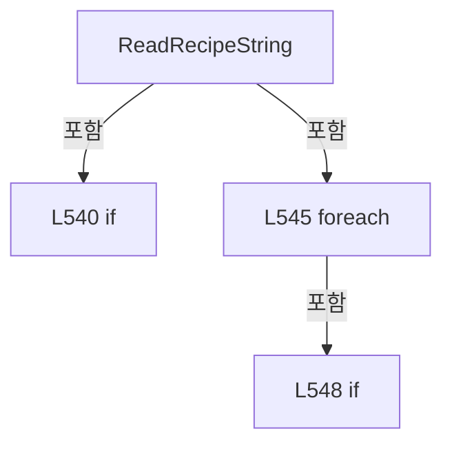

변경 전 점검: 입력/반환 타입, 위 호출자, 예외/취소 경로, 공유 상태와 저장·전송 소비자를 함께 확인합니다. 값의 단위나 물리 방향을 이름만으로 확정하지 않습니다.

### MethodDeclaration `ReadRecipeInt` · L557–557

[Drilling.UI/Menu/Menus/CMenuReview.cs:557–557](https://github.com/kjuws10-rgb/A3Drilling/blob/5aee8e58439c9b455cae7c9593c9be986c3e682e/Drilling.UI/Menu/Menus/CMenuReview.cs#L557-L557)

| 항목 | 실제 추출 값 |
| --- | --- |
| 서명 | int Drilling.UI.Menu.Menus.CMenuReview.ReadRecipeInt(Drilling.Common.Managers.ST_RECIPE_DEFINITION, int, params string[]) |
| 접근/수식자 | Private / private, static |
| 반환/값 타입 | int |
| 소속 타입 | NamedType:Drilling.UI.Menu.Menus.CMenuReview |

입력 계약:

| 이름 | 타입 | 전달 | 선택/기본값 |
| --- | --- | --- | --- |
| recipe | Drilling.Common.Managers.ST_RECIPE_DEFINITION | None | False /  |
| fallback | int | None | False /  |
| keys | string[] | None | False /  |

정적 호출자로 확인된 위치:

| 호출 파일/행 | 호출 표현식 | 런타임 분기 가능 |
| --- | --- | --- |
| [Drilling.UI/Menu/Menus/CMenuReview.cs:560–560](https://github.com/kjuws10-rgb/A3Drilling/blob/5aee8e58439c9b455cae7c9593c9be986c3e682e/Drilling.UI/Menu/Menus/CMenuReview.cs#L560-L560) | ReadRecipeInt | False |

호출하는 대상과 해석 범위:

| 원본 행 | 표현식 | 분석 상태 | 대상/소스 위치 |
| --- | --- | --- | --- |
| 557 | int.TryParse | resolved | bool int.TryParse(string?, System.Globalization.NumberStyles, System.IFormatProvider?, out int) |
| 557 | ReadRecipeString | resolved | string Drilling.UI.Menu.Menus.CMenuReview.ReadRecipeString(Drilling.Common.Managers.ST_RECIPE_DEFINITION?, params string[]) · Drilling.UI/Menu/Menus/CMenuReview.cs:538 |

본문의 실제 연산·분기·예외·반환 순서(원문 위치 순):

| 원본 행 | 종류 | 주석 해설 |
| --- | --- | --- |
| 557 | call | 함수·델리게이트 또는 객체 생성자를 호출합니다: int.TryParse(ReadRecipeString(recipe, keys), NumberStyles.Integer, CultureInfo.InvariantCulture, out var value) |
| 557 | call | 함수·델리게이트 또는 객체 생성자를 호출합니다: ReadRecipeString(recipe, keys) |
| 557 | conditional-expression | 조건에 따라 결과식을 선택합니다: int.TryParse(ReadRecipeString(recipe, keys), NumberStyles.Integer, CultureInfo.InvariantCulture, out var value) ? value : fallback |

변경 전 점검: 입력/반환 타입, 위 호출자, 예외/취소 경로, 공유 상태와 저장·전송 소비자를 함께 확인합니다. 값의 단위나 물리 방향을 이름만으로 확정하지 않습니다.

### MethodDeclaration `ApplySplitBeamContext` · L558–569

[Drilling.UI/Menu/Menus/CMenuReview.cs:558–569](https://github.com/kjuws10-rgb/A3Drilling/blob/5aee8e58439c9b455cae7c9593c9be986c3e682e/Drilling.UI/Menu/Menus/CMenuReview.cs#L558-L569)

| 항목 | 실제 추출 값 |
| --- | --- |
| 서명 | void Drilling.UI.Menu.Menus.CMenuReview.ApplySplitBeamContext(Drilling.Common.Managers.ST_RECIPE_DEFINITION) |
| 접근/수식자 | Private / private |
| 반환/값 타입 | void |
| 소속 타입 | NamedType:Drilling.UI.Menu.Menus.CMenuReview |

입력 계약:

| 이름 | 타입 | 전달 | 선택/기본값 |
| --- | --- | --- | --- |
| recipe | Drilling.Common.Managers.ST_RECIPE_DEFINITION | None | False /  |

정적 호출자로 확인된 위치:

| 호출 파일/행 | 호출 표현식 | 런타임 분기 가능 |
| --- | --- | --- |
| [Drilling.UI/Menu/Menus/CMenuReview.cs:394–394](https://github.com/kjuws10-rgb/A3Drilling/blob/5aee8e58439c9b455cae7c9593c9be986c3e682e/Drilling.UI/Menu/Menus/CMenuReview.cs#L394-L394) | ApplySplitBeamContext | False |
| [Drilling.UI/Menu/Menus/CMenuReview.cs:498–498](https://github.com/kjuws10-rgb/A3Drilling/blob/5aee8e58439c9b455cae7c9593c9be986c3e682e/Drilling.UI/Menu/Menus/CMenuReview.cs#L498-L498) | ApplySplitBeamContext | False |
| [Drilling.UI/Menu/Menus/CMenuReview.cs:2999–2999](https://github.com/kjuws10-rgb/A3Drilling/blob/5aee8e58439c9b455cae7c9593c9be986c3e682e/Drilling.UI/Menu/Menus/CMenuReview.cs#L2999-L2999) | ApplySplitBeamContext | False |

호출하는 대상과 해석 범위:

| 원본 행 | 표현식 | 분석 상태 | 대상/소스 위치 |
| --- | --- | --- | --- |
| 560 | ReadRecipeInt | resolved | int Drilling.UI.Menu.Menus.CMenuReview.ReadRecipeInt(Drilling.Common.Managers.ST_RECIPE_DEFINITION, int, params string[]) · Drilling.UI/Menu/Menus/CMenuReview.cs:557 |
| 561 | CCellPatternCalculator.IsSupportedSplitBeamCount | resolved | bool Drilling.Common.Recipe.CCellPatternCalculator.IsSupportedSplitBeamCount(int) · Drilling.Common/Recipe/CCellPatternCalculator.cs:15 |
| 567 | Math.Clamp | resolved | int System.Math.Clamp(int, int, int) |
| 568 | _selectedInspectionBeamNos.RemoveWhere | resolved | int System.Collections.Generic.HashSet<int>.RemoveWhere(System.Predicate<int>) |

본문의 실제 연산·분기·예외·반환 순서(원문 위치 순):

| 원본 행 | 종류 | 주석 해설 |
| --- | --- | --- |
| 560 | assignment | 값을 대상에 대입합니다: _splitBeamCount = ReadRecipeInt(recipe, 1, "SPLITED_BEAM_COUNT") |
| 560 | call | 함수·델리게이트 또는 객체 생성자를 호출합니다: ReadRecipeInt(recipe, 1, "SPLITED_BEAM_COUNT") |
| 561 | call | 함수·델리게이트 또는 객체 생성자를 호출합니다: CCellPatternCalculator.IsSupportedSplitBeamCount(_splitBeamCount) |
| 561 | if | 조건에 따라 분기합니다: if (!CCellPatternCalculator.IsSupportedSplitBeamCount(_splitBeamCount)) |
| 563 | assignment | 값을 대상에 대입합니다: _splitBeamCount = 1 |
| 566 | local-declaration | 지역 변수를 선언합니다: var maximumBeamNo = _splitBeamCount * _splitBeamCount; |
| 566 | variable-initializer | 변수의 초기값을 지정합니다: maximumBeamNo = _splitBeamCount * _splitBeamCount |
| 567 | assignment | 값을 대상에 대입합니다: _selectedRunBeamNo = Math.Clamp(_selectedRunBeamNo, 1, maximumBeamNo) |
| 567 | call | 함수·델리게이트 또는 객체 생성자를 호출합니다: Math.Clamp(_selectedRunBeamNo, 1, maximumBeamNo) |
| 568 | call | 함수·델리게이트 또는 객체 생성자를 호출합니다: _selectedInspectionBeamNos.RemoveWhere(beamNo => beamNo < 1 &#124;&#124; beamNo > maximumBeamNo) |

제어 구문의 포함 구조(실제 실행 순서/CFG가 아닌 구문 탐색 그림):

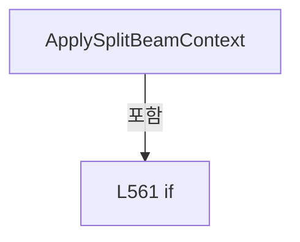

변경 전 점검: 입력/반환 타입, 위 호출자, 예외/취소 경로, 공유 상태와 저장·전송 소비자를 함께 확인합니다. 값의 단위나 물리 방향을 이름만으로 확정하지 않습니다.

### MethodDeclaration `SelectTab` · L571–607

[Drilling.UI/Menu/Menus/CMenuReview.cs:571–607](https://github.com/kjuws10-rgb/A3Drilling/blob/5aee8e58439c9b455cae7c9593c9be986c3e682e/Drilling.UI/Menu/Menus/CMenuReview.cs#L571-L607)

| 항목 | 실제 추출 값 |
| --- | --- |
| 서명 | void Drilling.UI.Menu.Menus.CMenuReview.SelectTab(object?) |
| 접근/수식자 | Private / private |
| 반환/값 타입 | void |
| 소속 타입 | NamedType:Drilling.UI.Menu.Menus.CMenuReview |

입력 계약:

| 이름 | 타입 | 전달 | 선택/기본값 |
| --- | --- | --- | --- |
| parameter | object? | None | False /  |

현재 부분 분석에서 직접 연결된 호출자는 없습니다. XAML/이벤트/인터페이스·델리게이트·외부 진입을 추가 확인해야 하며, 미사용으로 판정한 것이 아닙니다.

호출하는 대상과 해석 범위:

| 원본 행 | 표현식 | 분석 상태 | 대상/소스 위치 |
| --- | --- | --- | --- |
| 573 | string.IsNullOrWhiteSpace | resolved | bool string.IsNullOrWhiteSpace(string?) |
| 583 | tab.Equals | resolved | bool string.Equals(string?, System.StringComparison) |
| 590 | _statusReporter | resolved · 동적 구현 선택 가능 | void System.Action<string>.Invoke(string) |
| 591 | CRecipeConfirmDialog.ShowWarning | resolved | void Drilling.UI.Popup.CRecipeConfirmDialog.ShowWarning(string, string, Window?) · Drilling.UI/Popup/CRecipeConfirmDialog.xaml.cs:86 |
| 595 | InvalidateBeamInspectionResultLoad | resolved | void Drilling.UI.Menu.Menus.CMenuReview.InvalidateBeamInspectionResultLoad(bool) · Drilling.UI/Menu/Menus/CMenuReview.cs:2454 |
| 604 | NotifyReviewExecutionCommandStates | resolved | void Drilling.UI.Menu.Menus.CMenuReview.NotifyReviewExecutionCommandStates() · Drilling.UI/Menu/Menus/CMenuReview.cs:3120 |
| 605 | _statusReporter | resolved · 동적 구현 선택 가능 | void System.Action<string>.Invoke(string) |
| 606 | _refreshScreen | resolved · 동적 구현 선택 가능 | void System.Action.Invoke() |

본문의 실제 연산·분기·예외·반환 순서(원문 위치 순):

| 원본 행 | 종류 | 주석 해설 |
| --- | --- | --- |
| 573 | call | 함수·델리게이트 또는 객체 생성자를 호출합니다: string.IsNullOrWhiteSpace(tab) |
| 573 | if | 조건에 따라 분기합니다: if (parameter is not string tab &#124;&#124; string.IsNullOrWhiteSpace(tab)) |
| 575 | return | 호출자에게 값 또는 제어를 반환합니다: return; |
| 578 | if | 조건에 따라 분기합니다: if (tab != "RUN") |
| 580 | return | 호출자에게 값 또는 제어를 반환합니다: return; |
| 583 | call | 함수·델리게이트 또는 객체 생성자를 호출합니다: tab.Equals(_selectedTab, StringComparison.OrdinalIgnoreCase) |
| 583 | if | 조건에 따라 분기합니다: if (tab.Equals(_selectedTab, StringComparison.OrdinalIgnoreCase)) |
| 585 | return | 호출자에게 값 또는 제어를 반환합니다: return; |
| 588 | if | 조건에 따라 분기합니다: if (IsReviewExecutionActive) |
| 590 | call | 함수·델리게이트 또는 객체 생성자를 호출합니다: _statusReporter("Review is running. Stop the current review before changing the tab.") |
| 591 | call | 함수·델리게이트 또는 객체 생성자를 호출합니다: CRecipeConfirmDialog.ShowWarning("검사 진행 중", "검사를 중지한 후 탭을 변경해 주세요.") |
| 592 | return | 호출자에게 값 또는 제어를 반환합니다: return; |
| 595 | call | 함수·델리게이트 또는 객체 생성자를 호출합니다: InvalidateBeamInspectionResultLoad(clearLoaded: true) |
| 596 | assignment | 값을 대상에 대입합니다: _selectedTab = tab |
| 597 | if | 조건에 따라 분기합니다: if (IsSampleSelectTab) |
| 599 | assignment | 값을 대상에 대입합니다: _isSampleCellDetailVisible = false |
| 600 | assignment | 값을 대상에 대입합니다: _selectedMode = "SAMPLE SHOT" |
| 601 | assignment | 값을 대상에 대입합니다: _selectionRuleText = _selectedSampleRuleUi |
| 604 | call | 함수·델리게이트 또는 객체 생성자를 호출합니다: NotifyReviewExecutionCommandStates() |
| 605 | call | 함수·델리게이트 또는 객체 생성자를 호출합니다: _statusReporter($"Review tab selected: {_selectedTab}") |
| 606 | call | 함수·델리게이트 또는 객체 생성자를 호출합니다: _refreshScreen() |

제어 구문의 포함 구조(실제 실행 순서/CFG가 아닌 구문 탐색 그림):

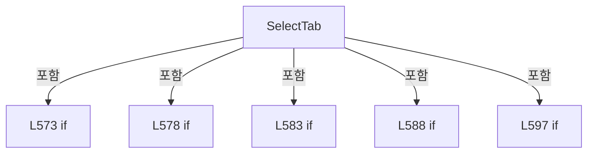

변경 전 점검: 입력/반환 타입, 위 호출자, 예외/취소 경로, 공유 상태와 저장·전송 소비자를 함께 확인합니다. 값의 단위나 물리 방향을 이름만으로 확정하지 않습니다.

### MethodDeclaration `SelectSampleRuleUi` · L609–622

[Drilling.UI/Menu/Menus/CMenuReview.cs:609–622](https://github.com/kjuws10-rgb/A3Drilling/blob/5aee8e58439c9b455cae7c9593c9be986c3e682e/Drilling.UI/Menu/Menus/CMenuReview.cs#L609-L622)

| 항목 | 실제 추출 값 |
| --- | --- |
| 서명 | void Drilling.UI.Menu.Menus.CMenuReview.SelectSampleRuleUi(object?) |
| 접근/수식자 | Private / private |
| 반환/값 타입 | void |
| 소속 타입 | NamedType:Drilling.UI.Menu.Menus.CMenuReview |

입력 계약:

| 이름 | 타입 | 전달 | 선택/기본값 |
| --- | --- | --- | --- |
| parameter | object? | None | False /  |

현재 부분 분석에서 직접 연결된 호출자는 없습니다. XAML/이벤트/인터페이스·델리게이트·외부 진입을 추가 확인해야 하며, 미사용으로 판정한 것이 아닙니다.

호출하는 대상과 해석 범위:

| 원본 행 | 표현식 | 분석 상태 | 대상/소스 위치 |
| --- | --- | --- | --- |
| 611 | .ToString | resolved · 동적 구현 선택 가능 | string? object.ToString() |
| 611 | .Trim().ToUpperInvariant | resolved | string string.ToUpperInvariant() |
| 611 | .Trim | resolved | string string.Trim() |
| 617 | _selectedSampleShotKeys.Clear | resolved | void System.Collections.Generic.HashSet<string>.Clear() |
| 620 | _statusReporter | resolved · 동적 구현 선택 가능 | void System.Action<string>.Invoke(string) |
| 621 | RefreshSampleRuleUi | resolved | void Drilling.UI.Menu.Menus.CMenuReview.RefreshSampleRuleUi() · Drilling.UI/Menu/Menus/CMenuReview.cs:822 |

본문의 실제 연산·분기·예외·반환 순서(원문 위치 순):

| 원본 행 | 종류 | 주석 해설 |
| --- | --- | --- |
| 611 | call | 함수·델리게이트 또는 객체 생성자를 호출합니다: .ToString() |
| 611 | call | 함수·델리게이트 또는 객체 생성자를 호출합니다: .Trim().ToUpperInvariant() |
| 611 | call | 함수·델리게이트 또는 객체 생성자를 호출합니다: .Trim() |
| 611 | local-declaration | 지역 변수를 선언합니다: var rule = parameter?.ToString()?.Trim().ToUpperInvariant(); |
| 611 | variable-initializer | 변수의 초기값을 지정합니다: rule = parameter?.ToString()?.Trim().ToUpperInvariant() |
| 612 | if | 조건에 따라 분기합니다: if (rule is not ("ROUGH" or "FINE") &#124;&#124; rule == _selectedSampleRuleUi) |
| 613 | return | 호출자에게 값 또는 제어를 반환합니다: return; |
| 614 | assignment | 값을 대상에 대입합니다: _selectedSampleRuleUi = rule |
| 615 | assignment | 값을 대상에 대입합니다: _lastCorrectionRulePlan = null |
| 616 | assignment | 값을 대상에 대입합니다: _isSampleCellDetailVisible = false |
| 617 | call | 함수·델리게이트 또는 객체 생성자를 호출합니다: _selectedSampleShotKeys.Clear() |
| 618 | assignment | 값을 대상에 대입합니다: _selectedMode = "SAMPLE SHOT" |
| 619 | assignment | 값을 대상에 대입합니다: _selectionRuleText = rule |
| 620 | call | 함수·델리게이트 또는 객체 생성자를 호출합니다: _statusReporter($"Review correction rule selected: {rule}") |
| 621 | call | 함수·델리게이트 또는 객체 생성자를 호출합니다: RefreshSampleRuleUi() |

제어 구문의 포함 구조(실제 실행 순서/CFG가 아닌 구문 탐색 그림):


변경 전 점검: 입력/반환 타입, 위 호출자, 예외/취소 경로, 공유 상태와 저장·전송 소비자를 함께 확인합니다. 값의 단위나 물리 방향을 이름만으로 확정하지 않습니다.

### MethodDeclaration `SelectSampleRuleScope` · L624–632

[Drilling.UI/Menu/Menus/CMenuReview.cs:624–632](https://github.com/kjuws10-rgb/A3Drilling/blob/5aee8e58439c9b455cae7c9593c9be986c3e682e/Drilling.UI/Menu/Menus/CMenuReview.cs#L624-L632)

| 항목 | 실제 추출 값 |
| --- | --- |
| 서명 | void Drilling.UI.Menu.Menus.CMenuReview.SelectSampleRuleScope(object?) |
| 접근/수식자 | Private / private |
| 반환/값 타입 | void |
| 소속 타입 | NamedType:Drilling.UI.Menu.Menus.CMenuReview |

입력 계약:

| 이름 | 타입 | 전달 | 선택/기본값 |
| --- | --- | --- | --- |
| parameter | object? | None | False /  |

현재 부분 분석에서 직접 연결된 호출자는 없습니다. XAML/이벤트/인터페이스·델리게이트·외부 진입을 추가 확인해야 하며, 미사용으로 판정한 것이 아닙니다.

호출하는 대상과 해석 범위:

| 원본 행 | 표현식 | 분석 상태 | 대상/소스 위치 |
| --- | --- | --- | --- |
| 626 | .ToString | resolved · 동적 구현 선택 가능 | string? object.ToString() |
| 626 | .Trim().ToUpperInvariant | resolved | string string.ToUpperInvariant() |
| 626 | .Trim | resolved | string string.Trim() |
| 631 | RefreshSampleRuleUi | resolved | void Drilling.UI.Menu.Menus.CMenuReview.RefreshSampleRuleUi() · Drilling.UI/Menu/Menus/CMenuReview.cs:822 |

본문의 실제 연산·분기·예외·반환 순서(원문 위치 순):

| 원본 행 | 종류 | 주석 해설 |
| --- | --- | --- |
| 626 | call | 함수·델리게이트 또는 객체 생성자를 호출합니다: .ToString() |
| 626 | call | 함수·델리게이트 또는 객체 생성자를 호출합니다: .Trim().ToUpperInvariant() |
| 626 | call | 함수·델리게이트 또는 객체 생성자를 호출합니다: .Trim() |
| 626 | local-declaration | 지역 변수를 선언합니다: var scope = parameter?.ToString()?.Trim().ToUpperInvariant(); |
| 626 | variable-initializer | 변수의 초기값을 지정합니다: scope = parameter?.ToString()?.Trim().ToUpperInvariant() |
| 627 | if | 조건에 따라 분기합니다: if (scope is not ("HEAD" or "HEAD_CELL") &#124;&#124; scope == _sampleRuleScope) |
| 628 | return | 호출자에게 값 또는 제어를 반환합니다: return; |
| 629 | assignment | 값을 대상에 대입합니다: _sampleRuleScope = scope |
| 630 | assignment | 값을 대상에 대입합니다: _lastCorrectionRulePlan = null |
| 631 | call | 함수·델리게이트 또는 객체 생성자를 호출합니다: RefreshSampleRuleUi() |

제어 구문의 포함 구조(실제 실행 순서/CFG가 아닌 구문 탐색 그림):

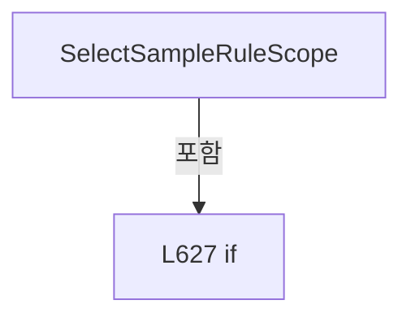

변경 전 점검: 입력/반환 타입, 위 호출자, 예외/취소 경로, 공유 상태와 저장·전송 소비자를 함께 확인합니다. 값의 단위나 물리 방향을 이름만으로 확정하지 않습니다.

### MethodDeclaration `SelectRoughReference` · L634–642

[Drilling.UI/Menu/Menus/CMenuReview.cs:634–642](https://github.com/kjuws10-rgb/A3Drilling/blob/5aee8e58439c9b455cae7c9593c9be986c3e682e/Drilling.UI/Menu/Menus/CMenuReview.cs#L634-L642)

| 항목 | 실제 추출 값 |
| --- | --- |
| 서명 | void Drilling.UI.Menu.Menus.CMenuReview.SelectRoughReference(object?) |
| 접근/수식자 | Private / private |
| 반환/값 타입 | void |
| 소속 타입 | NamedType:Drilling.UI.Menu.Menus.CMenuReview |

입력 계약:

| 이름 | 타입 | 전달 | 선택/기본값 |
| --- | --- | --- | --- |
| parameter | object? | None | False /  |

현재 부분 분석에서 직접 연결된 호출자는 없습니다. XAML/이벤트/인터페이스·델리게이트·외부 진입을 추가 확인해야 하며, 미사용으로 판정한 것이 아닙니다.

호출하는 대상과 해석 범위:

| 원본 행 | 표현식 | 분석 상태 | 대상/소스 위치 |
| --- | --- | --- | --- |
| 636 | .ToString | resolved · 동적 구현 선택 가능 | string? object.ToString() |
| 636 | .Trim().ToUpperInvariant | resolved | string string.ToUpperInvariant() |
| 636 | .Trim | resolved | string string.Trim() |
| 641 | RefreshSampleRuleUi | resolved | void Drilling.UI.Menu.Menus.CMenuReview.RefreshSampleRuleUi() · Drilling.UI/Menu/Menus/CMenuReview.cs:822 |

본문의 실제 연산·분기·예외·반환 순서(원문 위치 순):

| 원본 행 | 종류 | 주석 해설 |
| --- | --- | --- |
| 636 | call | 함수·델리게이트 또는 객체 생성자를 호출합니다: .ToString() |
| 636 | call | 함수·델리게이트 또는 객체 생성자를 호출합니다: .Trim().ToUpperInvariant() |
| 636 | call | 함수·델리게이트 또는 객체 생성자를 호출합니다: .Trim() |
| 636 | local-declaration | 지역 변수를 선언합니다: var reference = parameter?.ToString()?.Trim().ToUpperInvariant(); |
| 636 | variable-initializer | 변수의 초기값을 지정합니다: reference = parameter?.ToString()?.Trim().ToUpperInvariant() |
| 637 | if | 조건에 따라 분기합니다: if (reference is not ("FIRST" or "CENTER" or "LAST") &#124;&#124; reference == _roughReference) |
| 638 | return | 호출자에게 값 또는 제어를 반환합니다: return; |
| 639 | assignment | 값을 대상에 대입합니다: _roughReference = reference |
| 640 | assignment | 값을 대상에 대입합니다: _lastCorrectionRulePlan = null |
| 641 | call | 함수·델리게이트 또는 객체 생성자를 호출합니다: RefreshSampleRuleUi() |

제어 구문의 포함 구조(실제 실행 순서/CFG가 아닌 구문 탐색 그림):

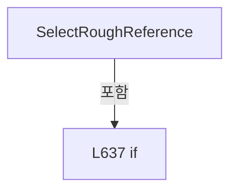

변경 전 점검: 입력/반환 타입, 위 호출자, 예외/취소 경로, 공유 상태와 저장·전송 소비자를 함께 확인합니다. 값의 단위나 물리 방향을 이름만으로 확정하지 않습니다.

### MethodDeclaration `SelectFineLineCount` · L644–651

[Drilling.UI/Menu/Menus/CMenuReview.cs:644–651](https://github.com/kjuws10-rgb/A3Drilling/blob/5aee8e58439c9b455cae7c9593c9be986c3e682e/Drilling.UI/Menu/Menus/CMenuReview.cs#L644-L651)

| 항목 | 실제 추출 값 |
| --- | --- |
| 서명 | void Drilling.UI.Menu.Menus.CMenuReview.SelectFineLineCount(object?) |
| 접근/수식자 | Private / private |
| 반환/값 타입 | void |
| 소속 타입 | NamedType:Drilling.UI.Menu.Menus.CMenuReview |

입력 계약:

| 이름 | 타입 | 전달 | 선택/기본값 |
| --- | --- | --- | --- |
| parameter | object? | None | False /  |

현재 부분 분석에서 직접 연결된 호출자는 없습니다. XAML/이벤트/인터페이스·델리게이트·외부 진입을 추가 확인해야 하며, 미사용으로 판정한 것이 아닙니다.

호출하는 대상과 해석 범위:

| 원본 행 | 표현식 | 분석 상태 | 대상/소스 위치 |
| --- | --- | --- | --- |
| 646 | int.TryParse | resolved | bool int.TryParse(string?, System.Globalization.NumberStyles, System.IFormatProvider?, out int) |
| 646 | .ToString | resolved · 동적 구현 선택 가능 | string? object.ToString() |
| 650 | RefreshSampleRuleUi | resolved | void Drilling.UI.Menu.Menus.CMenuReview.RefreshSampleRuleUi() · Drilling.UI/Menu/Menus/CMenuReview.cs:822 |

본문의 실제 연산·분기·예외·반환 순서(원문 위치 순):

| 원본 행 | 종류 | 주석 해설 |
| --- | --- | --- |
| 646 | call | 함수·델리게이트 또는 객체 생성자를 호출합니다: int.TryParse(parameter?.ToString(), NumberStyles.Integer, CultureInfo.InvariantCulture, out var count) |
| 646 | call | 함수·델리게이트 또는 객체 생성자를 호출합니다: .ToString() |
| 646 | if | 조건에 따라 분기합니다: if (!int.TryParse(parameter?.ToString(), NumberStyles.Integer, CultureInfo.InvariantCulture, out var count) &#124;&#124; count is not (1 or 3 or 5 or 7) &#124;&#124; count == _fineLineCount) |
| 647 | return | 호출자에게 값 또는 제어를 반환합니다: return; |
| 648 | assignment | 값을 대상에 대입합니다: _fineLineCount = count |
| 649 | assignment | 값을 대상에 대입합니다: _lastCorrectionRulePlan = null |
| 650 | call | 함수·델리게이트 또는 객체 생성자를 호출합니다: RefreshSampleRuleUi() |

제어 구문의 포함 구조(실제 실행 순서/CFG가 아닌 구문 탐색 그림):

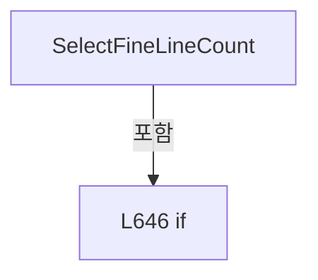

변경 전 점검: 입력/반환 타입, 위 호출자, 예외/취소 경로, 공유 상태와 저장·전송 소비자를 함께 확인합니다. 값의 단위나 물리 방향을 이름만으로 확정하지 않습니다.

### MethodDeclaration `SelectMode` · L653–699

[Drilling.UI/Menu/Menus/CMenuReview.cs:653–699](https://github.com/kjuws10-rgb/A3Drilling/blob/5aee8e58439c9b455cae7c9593c9be986c3e682e/Drilling.UI/Menu/Menus/CMenuReview.cs#L653-L699)

| 항목 | 실제 추출 값 |
| --- | --- |
| 서명 | void Drilling.UI.Menu.Menus.CMenuReview.SelectMode(object?) |
| 접근/수식자 | Private / private |
| 반환/값 타입 | void |
| 소속 타입 | NamedType:Drilling.UI.Menu.Menus.CMenuReview |

입력 계약:

| 이름 | 타입 | 전달 | 선택/기본값 |
| --- | --- | --- | --- |
| parameter | object? | None | False /  |

현재 부분 분석에서 직접 연결된 호출자는 없습니다. XAML/이벤트/인터페이스·델리게이트·외부 진입을 추가 확인해야 하며, 미사용으로 판정한 것이 아닙니다.

호출하는 대상과 해석 범위:

| 원본 행 | 표현식 | 분석 상태 | 대상/소스 위치 |
| --- | --- | --- | --- |
| 657 | _statusReporter | resolved · 동적 구현 선택 가능 | void System.Action<string>.Invoke(string) |
| 661 | string.IsNullOrWhiteSpace | resolved | bool string.IsNullOrWhiteSpace(string?) |
| 666 | mode.Trim().ToUpperInvariant | resolved | string string.ToUpperInvariant() |
| 666 | mode.Trim | resolved | string string.Trim() |
| 669 | InvalidateBeamInspectionResultLoad | resolved | void Drilling.UI.Menu.Menus.CMenuReview.InvalidateBeamInspectionResultLoad(bool) · Drilling.UI/Menu/Menus/CMenuReview.cs:2454 |
| 671 | mode.Trim().ToUpperInvariant | resolved | string string.ToUpperInvariant() |
| 671 | mode.Trim | resolved | string string.Trim() |
| 685 | RefreshOneShotSelection | resolved | void Drilling.UI.Menu.Menus.CMenuReview.RefreshOneShotSelection(bool) · Drilling.UI/Menu/Menus/CMenuReview.cs:2520 |
| 686 | OnPropertyChanged | resolved | void Drilling.UI.Menu.CBindingBase.OnPropertyChanged(string?) · Drilling.UI/Menu/CBindingBase.cs:759 |
| 686 | nameof | unresolved | None |
| 687 | OnPropertyChanged | resolved | void Drilling.UI.Menu.CBindingBase.OnPropertyChanged(string?) · Drilling.UI/Menu/CBindingBase.cs:759 |
| 687 | nameof | unresolved | None |
| 688 | _statusReporter | resolved · 동적 구현 선택 가능 | void System.Action<string>.Invoke(string) |
| 689 | OnPropertyChanged | resolved | void Drilling.UI.Menu.CBindingBase.OnPropertyChanged(string?) · Drilling.UI/Menu/CBindingBase.cs:759 |
| 689 | nameof | unresolved | None |
| 690 | OnPropertyChanged | resolved | void Drilling.UI.Menu.CBindingBase.OnPropertyChanged(string?) · Drilling.UI/Menu/CBindingBase.cs:759 |
| 690 | nameof | unresolved | None |
| 691 | OnPropertyChanged | resolved | void Drilling.UI.Menu.CBindingBase.OnPropertyChanged(string?) · Drilling.UI/Menu/CBindingBase.cs:759 |
| 691 | nameof | unresolved | None |
| 692 | OnPropertyChanged | resolved | void Drilling.UI.Menu.CBindingBase.OnPropertyChanged(string?) · Drilling.UI/Menu/CBindingBase.cs:759 |
| 692 | nameof | unresolved | None |
| 693 | OnPropertyChanged | resolved | void Drilling.UI.Menu.CBindingBase.OnPropertyChanged(string?) · Drilling.UI/Menu/CBindingBase.cs:759 |
| 693 | nameof | unresolved | None |
| 694 | OnPropertyChanged | resolved | void Drilling.UI.Menu.CBindingBase.OnPropertyChanged(string?) · Drilling.UI/Menu/CBindingBase.cs:759 |
| 694 | nameof | unresolved | None |
| 695 | OnPropertyChanged | resolved | void Drilling.UI.Menu.CBindingBase.OnPropertyChanged(string?) · Drilling.UI/Menu/CBindingBase.cs:759 |
| 695 | nameof | unresolved | None |
| 696 | OnPropertyChanged | resolved | void Drilling.UI.Menu.CBindingBase.OnPropertyChanged(string?) · Drilling.UI/Menu/CBindingBase.cs:759 |
| 696 | nameof | unresolved | None |
| 697 | NotifyReviewExecutionCommandStates | resolved | void Drilling.UI.Menu.Menus.CMenuReview.NotifyReviewExecutionCommandStates() · Drilling.UI/Menu/Menus/CMenuReview.cs:3120 |
| 698 | RefreshRunDisplayFromCachedContext | resolved | void Drilling.UI.Menu.Menus.CMenuReview.RefreshRunDisplayFromCachedContext(bool) · Drilling.UI/Menu/Menus/CMenuReview.cs:3220 |

본문의 실제 연산·분기·예외·반환 순서(원문 위치 순):

| 원본 행 | 종류 | 주석 해설 |
| --- | --- | --- |
| 655 | if | 조건에 따라 분기합니다: if (IsReviewExecutionActive) |
| 657 | call | 함수·델리게이트 또는 객체 생성자를 호출합니다: _statusReporter("Review is running. Stop the current review before changing the mode.") |
| 658 | return | 호출자에게 값 또는 제어를 반환합니다: return; |
| 661 | call | 함수·델리게이트 또는 객체 생성자를 호출합니다: string.IsNullOrWhiteSpace(mode) |
| 661 | if | 조건에 따라 분기합니다: if (parameter is not string mode &#124;&#124; string.IsNullOrWhiteSpace(mode)) |
| 663 | return | 호출자에게 값 또는 제어를 반환합니다: return; |
| 666 | assignment | 값을 대상에 대입합니다: mode = mode.Trim().ToUpperInvariant() |
| 666 | call | 함수·델리게이트 또는 객체 생성자를 호출합니다: mode.Trim().ToUpperInvariant() |
| 666 | call | 함수·델리게이트 또는 객체 생성자를 호출합니다: mode.Trim() |
| 667 | if | 조건에 따라 분기합니다: if (mode is not ("ALL SHOT" or "ONE SHOT" or "BEAM INSPECTION")) |
| 668 | return | 호출자에게 값 또는 제어를 반환합니다: return; |
| 669 | call | 함수·델리게이트 또는 객체 생성자를 호출합니다: InvalidateBeamInspectionResultLoad(clearLoaded: true) |
| 670 | assignment | 값을 대상에 대입합니다: _selectedMode = mode |
| 671 | call | 함수·델리게이트 또는 객체 생성자를 호출합니다: mode.Trim().ToUpperInvariant() |
| 671 | call | 함수·델리게이트 또는 객체 생성자를 호출합니다: mode.Trim() |
| 671 | assignment | 값을 대상에 대입합니다: _selectedRuleType = mode.Trim().ToUpperInvariant() switch { "ALL SHOT" => EN_REVIEW_RULE_TYPE.AllPoint, "ZERO DEFENSE" => EN_REVIEW_RULE_TYPE.ZeroLine, _ => EN_REVIEW_RULE_TYPE.SamplePoint } |
| 671 | switch-expression | 값별 결과식을 선택합니다: mode.Trim().ToUpperInvariant() switch { "ALL SHOT" => EN_REVIEW_RULE_TYPE.AllPoint, "ZERO DEFENSE" => EN_REVIEW_RULE_TYPE.ZeroLine, _ => EN_REVIEW_RULE_TYPE.SamplePoint } |
| 677 | assignment | 값을 대상에 대입합니다: _selectionRuleText = _selectedRuleType switch { EN_REVIEW_RULE_TYPE.AllPoint => "All Shot", EN_REVIEW_RULE_TYPE.ZeroLine => "0-Line", _ => _selectionRuleText is "All Shot" or "0-Line" ? "Manual Sample" : _selectionRuleText } |
| 677 | switch-expression | 값별 결과식을 선택합니다: _selectedRuleType switch { EN_REVIEW_RULE_TYPE.AllPoint => "All Shot", EN_REVIEW_RULE_TYPE.ZeroLine => "0-Line", _ => _selectionRuleText is "All Shot" or "0-Line" ? "Manual Sample" : _selectionRuleText } |
| 681 | conditional-expression | 조건에 따라 결과식을 선택합니다: _selectionRuleText is "All Shot" or "0-Line" ? "Manual Sample" : _selectionRuleText |
| 683 | assignment | 값을 대상에 대입합니다: _isRunCellDetailVisible = false |
| 684 | assignment | 값을 대상에 대입합니다: _selectedRunShotKey = "" |
| 685 | call | 함수·델리게이트 또는 객체 생성자를 호출합니다: RefreshOneShotSelection(clearResult: true) |
| 686 | call | 함수·델리게이트 또는 객체 생성자를 호출합니다: OnPropertyChanged(nameof(IsShotSelectionMode)) |
| 686 | call | 함수·델리게이트 또는 객체 생성자를 호출합니다: nameof(IsShotSelectionMode) |
| 687 | call | 함수·델리게이트 또는 객체 생성자를 호출합니다: OnPropertyChanged(nameof(InspectionHeadRows)) |
| 687 | call | 함수·델리게이트 또는 객체 생성자를 호출합니다: nameof(InspectionHeadRows) |
| 688 | call | 함수·델리게이트 또는 객체 생성자를 호출합니다: _statusReporter($"Review mode selected: {_selectedMode}") |
| 689 | call | 함수·델리게이트 또는 객체 생성자를 호출합니다: OnPropertyChanged(nameof(IsAllShotReviewMode)) |
| 689 | call | 함수·델리게이트 또는 객체 생성자를 호출합니다: nameof(IsAllShotReviewMode) |
| 690 | call | 함수·델리게이트 또는 객체 생성자를 호출합니다: OnPropertyChanged(nameof(IsOneShotReviewMode)) |
| 690 | call | 함수·델리게이트 또는 객체 생성자를 호출합니다: nameof(IsOneShotReviewMode) |
| 691 | call | 함수·델리게이트 또는 객체 생성자를 호출합니다: OnPropertyChanged(nameof(IsRunCommandsVisible)) |
| 691 | call | 함수·델리게이트 또는 객체 생성자를 호출합니다: nameof(IsRunCommandsVisible) |
| 692 | call | 함수·델리게이트 또는 객체 생성자를 호출합니다: OnPropertyChanged(nameof(IsRuleReviewMode)) |
| 692 | call | 함수·델리게이트 또는 객체 생성자를 호출합니다: nameof(IsRuleReviewMode) |
| 693 | call | 함수·델리게이트 또는 객체 생성자를 호출합니다: OnPropertyChanged(nameof(IsBeamInspectionMode)) |
| 693 | call | 함수·델리게이트 또는 객체 생성자를 호출합니다: nameof(IsBeamInspectionMode) |
| 694 | call | 함수·델리게이트 또는 객체 생성자를 호출합니다: OnPropertyChanged(nameof(IsBeamSelectionVisible)) |
| 694 | call | 함수·델리게이트 또는 객체 생성자를 호출합니다: nameof(IsBeamSelectionVisible) |
| 695 | call | 함수·델리게이트 또는 객체 생성자를 호출합니다: OnPropertyChanged(nameof(IsLastMeasurementVisible)) |
| 695 | call | 함수·델리게이트 또는 객체 생성자를 호출합니다: nameof(IsLastMeasurementVisible) |
| 696 | call | 함수·델리게이트 또는 객체 생성자를 호출합니다: OnPropertyChanged(nameof(BeamSelectionSummary)) |
| 696 | call | 함수·델리게이트 또는 객체 생성자를 호출합니다: nameof(BeamSelectionSummary) |
| 697 | call | 함수·델리게이트 또는 객체 생성자를 호출합니다: NotifyReviewExecutionCommandStates() |
| 698 | call | 함수·델리게이트 또는 객체 생성자를 호출합니다: RefreshRunDisplayFromCachedContext() |

제어 구문의 포함 구조(실제 실행 순서/CFG가 아닌 구문 탐색 그림):

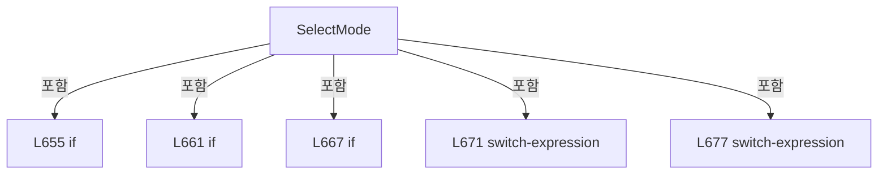

변경 전 점검: 입력/반환 타입, 위 호출자, 예외/취소 경로, 공유 상태와 저장·전송 소비자를 함께 확인합니다. 값의 단위나 물리 방향을 이름만으로 확정하지 않습니다.

### MethodDeclaration `ToggleShot` · L701–749

[Drilling.UI/Menu/Menus/CMenuReview.cs:701–749](https://github.com/kjuws10-rgb/A3Drilling/blob/5aee8e58439c9b455cae7c9593c9be986c3e682e/Drilling.UI/Menu/Menus/CMenuReview.cs#L701-L749)

| 항목 | 실제 추출 값 |
| --- | --- |
| 서명 | void Drilling.UI.Menu.Menus.CMenuReview.ToggleShot(object?) |
| 접근/수식자 | Private / private |
| 반환/값 타입 | void |
| 소속 타입 | NamedType:Drilling.UI.Menu.Menus.CMenuReview |

입력 계약:

| 이름 | 타입 | 전달 | 선택/기본값 |
| --- | --- | --- | --- |
| parameter | object? | None | False /  |

정적 호출자로 확인된 위치:

| 호출 파일/행 | 호출 표현식 | 런타임 분기 가능 |
| --- | --- | --- |
| [Drilling.UI/Menu/Menus/CMenuReview.cs:763–763](https://github.com/kjuws10-rgb/A3Drilling/blob/5aee8e58439c9b455cae7c9593c9be986c3e682e/Drilling.UI/Menu/Menus/CMenuReview.cs#L763-L763) | ToggleShot | False |

호출하는 대상과 해석 범위:

| 원본 행 | 표현식 | 분석 상태 | 대상/소스 위치 |
| --- | --- | --- | --- |
| 705 | _statusReporter | resolved · 동적 구현 선택 가능 | void System.Action<string>.Invoke(string) |
| 709 | CReviewManager.NormalizeShotKey | resolved | string Drilling.Common.Review.CReviewManager.NormalizeShotKey(string) · Drilling.Common/Review/CReviewManager.cs:1165 |
| 709 | .ToString | resolved · 동적 구현 선택 가능 | string? object.ToString() |
| 710 | string.IsNullOrWhiteSpace | resolved | bool string.IsNullOrWhiteSpace(string?) |
| 715 | FindPointByShotKey | resolved | Drilling.Common.Review.ST_REVIEW_PLAN_POINT? Drilling.UI.Menu.Menus.CMenuReview.FindPointByShotKey(Drilling.Common.Review.ST_REVIEW_PLAN?, string) · Drilling.UI/Menu/Menus/CMenuReview.cs:1446 |
| 723 | _selectedSampleShotKeys.Remove | resolved | bool System.Collections.Generic.HashSet<string>.Remove(string) |
| 724 | _statusReporter | resolved · 동적 구현 선택 가능 | void System.Action<string>.Invoke(string) |
| 724 | ToMatrixShotName | resolved | string Drilling.UI.Menu.Menus.CMenuReview.ToMatrixShotName(Drilling.Common.Review.ST_REVIEW_PLAN_POINT) · Drilling.UI/Menu/Menus/CMenuReview.cs:1993 |
| 725 | RefreshSampleSelectionDisplay | resolved | void Drilling.UI.Menu.Menus.CMenuReview.RefreshSampleSelectionDisplay(System.Collections.Generic.IEnumerable<string>) · Drilling.UI/Menu/Menus/CMenuReview.cs:766 |
| 731 | _selectedSampleShotKeys.Remove | resolved | bool System.Collections.Generic.HashSet<string>.Remove(string) |
| 732 | _statusReporter | resolved · 동적 구현 선택 가능 | void System.Action<string>.Invoke(string) |
| 732 | ToMatrixShotName | resolved | string Drilling.UI.Menu.Menus.CMenuReview.ToMatrixShotName(Drilling.Common.Review.ST_REVIEW_PLAN_POINT) · Drilling.UI/Menu/Menus/CMenuReview.cs:1993 |
| 733 | RefreshSampleSelectionDisplay | resolved | void Drilling.UI.Menu.Menus.CMenuReview.RefreshSampleSelectionDisplay(System.Collections.Generic.IEnumerable<string>) · Drilling.UI/Menu/Menus/CMenuReview.cs:766 |
| 738 | _selectedSampleShotKeys.Clear | resolved | void System.Collections.Generic.HashSet<string>.Clear() |
| 739 | _selectedSampleShotKeys.Add | resolved | bool System.Collections.Generic.HashSet<string>.Add(string) |
| 747 | _statusReporter | resolved · 동적 구현 선택 가능 | void System.Action<string>.Invoke(string) |
| 748 | RefreshSampleSelectionDisplay | resolved | void Drilling.UI.Menu.Menus.CMenuReview.RefreshSampleSelectionDisplay(System.Collections.Generic.IEnumerable<string>) · Drilling.UI/Menu/Menus/CMenuReview.cs:766 |
| 748 | string.IsNullOrWhiteSpace | resolved | bool string.IsNullOrWhiteSpace(string?) |

본문의 실제 연산·분기·예외·반환 순서(원문 위치 순):

| 원본 행 | 종류 | 주석 해설 |
| --- | --- | --- |
| 703 | if | 조건에 따라 분기합니다: if (!IsSimpleSampleRuleUi &#124;&#124; IsReviewExecutionActive) |
| 705 | call | 함수·델리게이트 또는 객체 생성자를 호출합니다: _statusReporter($"{_selectedSampleRuleUi} Shot selection is determined automatically by its rule settings.") |
| 706 | return | 호출자에게 값 또는 제어를 반환합니다: return; |
| 709 | call | 함수·델리게이트 또는 객체 생성자를 호출합니다: CReviewManager.NormalizeShotKey(parameter?.ToString() ?? "") |
| 709 | call | 함수·델리게이트 또는 객체 생성자를 호출합니다: .ToString() |
| 709 | local-declaration | 지역 변수를 선언합니다: var shotKey = CReviewManager.NormalizeShotKey(parameter?.ToString() ?? ""); |
| 709 | variable-initializer | 변수의 초기값을 지정합니다: shotKey = CReviewManager.NormalizeShotKey(parameter?.ToString() ?? "") |
| 710 | call | 함수·델리게이트 또는 객체 생성자를 호출합니다: string.IsNullOrWhiteSpace(shotKey) |
| 710 | if | 조건에 따라 분기합니다: if (string.IsNullOrWhiteSpace(shotKey)) |
| 712 | return | 호출자에게 값 또는 제어를 반환합니다: return; |
| 715 | call | 함수·델리게이트 또는 객체 생성자를 호출합니다: FindPointByShotKey(_lastAllPlan, shotKey) |
| 715 | local-declaration | 지역 변수를 선언합니다: var point = FindPointByShotKey(_lastAllPlan, shotKey); |
| 715 | variable-initializer | 변수의 초기값을 지정합니다: point = FindPointByShotKey(_lastAllPlan, shotKey) |
| 716 | if | 조건에 따라 분기합니다: if (point is null) |
| 718 | return | 호출자에게 값 또는 제어를 반환합니다: return; |
| 721 | if | 조건에 따라 분기합니다: if (point.HeadNo <= 0) |
| 723 | call | 함수·델리게이트 또는 객체 생성자를 호출합니다: _selectedSampleShotKeys.Remove(point.ShotKey) |
| 724 | call | 함수·델리게이트 또는 객체 생성자를 호출합니다: _statusReporter($"CELL{point.CellNo:00} / {ToMatrixShotName(point)} cannot be selected because it is not assigned to a processing Head.") |
| 724 | call | 함수·델리게이트 또는 객체 생성자를 호출합니다: ToMatrixShotName(point) |
| 725 | call | 함수·델리게이트 또는 객체 생성자를 호출합니다: RefreshSampleSelectionDisplay([point.ShotKey]) |
| 726 | return | 호출자에게 값 또는 제어를 반환합니다: return; |
| 729 | if | 조건에 따라 분기합니다: if (!point.Use) |
| 731 | call | 함수·델리게이트 또는 객체 생성자를 호출합니다: _selectedSampleShotKeys.Remove(point.ShotKey) |
| 732 | call | 함수·델리게이트 또는 객체 생성자를 호출합니다: _statusReporter($"CELL{point.CellNo:00} / {ToMatrixShotName(point)} is excluded from Review by Recipe Masking/Chess settings.") |
| 732 | call | 함수·델리게이트 또는 객체 생성자를 호출합니다: ToMatrixShotName(point) |
| 733 | call | 함수·델리게이트 또는 객체 생성자를 호출합니다: RefreshSampleSelectionDisplay([point.ShotKey]) |
| 734 | return | 호출자에게 값 또는 제어를 반환합니다: return; |
| 737 | local-declaration | 지역 변수를 선언합니다: var previousSimpleKey = _simpleSampleShotKey; |
| 737 | variable-initializer | 변수의 초기값을 지정합니다: previousSimpleKey = _simpleSampleShotKey |
| 738 | call | 함수·델리게이트 또는 객체 생성자를 호출합니다: _selectedSampleShotKeys.Clear() |
| 739 | call | 함수·델리게이트 또는 객체 생성자를 호출합니다: _selectedSampleShotKeys.Add(shotKey) |
| 740 | assignment | 값을 대상에 대입합니다: _simpleSampleShotKey = shotKey |
| 741 | assignment | 값을 대상에 대입합니다: _lastCorrectionRulePlan = null |
| 742 | assignment | 값을 대상에 대입합니다: _sampleRuleHeadNo = point.HeadNo |
| 743 | assignment | 값을 대상에 대입합니다: _sampleRuleCellNo = point.CellNo |
| 744 | assignment | 값을 대상에 대입합니다: _selectedMode = "SAMPLE SHOT" |
| 745 | assignment | 값을 대상에 대입합니다: _selectedRuleType = EN_REVIEW_RULE_TYPE.SamplePoint |
| 746 | assignment | 값을 대상에 대입합니다: _selectionRuleText = _selectedSampleRuleUi |
| 747 | call | 함수·델리게이트 또는 객체 생성자를 호출합니다: _statusReporter($"Review shot selection updated: {_selectedSampleShotKeys.Count} shots.") |
| 748 | call | 함수·델리게이트 또는 객체 생성자를 호출합니다: RefreshSampleSelectionDisplay(string.IsNullOrWhiteSpace(previousSimpleKey) ? [shotKey] : [previousSimpleKey, shotKey]) |
| 748 | call | 함수·델리게이트 또는 객체 생성자를 호출합니다: string.IsNullOrWhiteSpace(previousSimpleKey) |
| 748 | conditional-expression | 조건에 따라 결과식을 선택합니다: string.IsNullOrWhiteSpace(previousSimpleKey) ? [shotKey] : [previousSimpleKey, shotKey] |

제어 구문의 포함 구조(실제 실행 순서/CFG가 아닌 구문 탐색 그림):

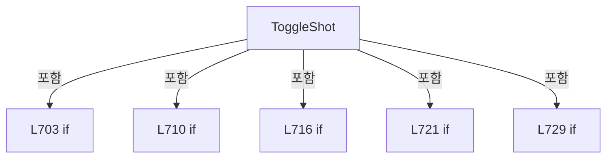

변경 전 점검: 입력/반환 타입, 위 호출자, 예외/취소 경로, 공유 상태와 저장·전송 소비자를 함께 확인합니다. 값의 단위나 물리 방향을 이름만으로 확정하지 않습니다.

### MethodDeclaration `SetSampleShotSelection` · L751–764

[Drilling.UI/Menu/Menus/CMenuReview.cs:751–764](https://github.com/kjuws10-rgb/A3Drilling/blob/5aee8e58439c9b455cae7c9593c9be986c3e682e/Drilling.UI/Menu/Menus/CMenuReview.cs#L751-L764)

| 항목 | 실제 추출 값 |
| --- | --- |
| 서명 | void Drilling.UI.Menu.Menus.CMenuReview.SetSampleShotSelection(object?) |
| 접근/수식자 | Private / private |
| 반환/값 타입 | void |
| 소속 타입 | NamedType:Drilling.UI.Menu.Menus.CMenuReview |

입력 계약:

| 이름 | 타입 | 전달 | 선택/기본값 |
| --- | --- | --- | --- |
| parameter | object? | None | False /  |

현재 부분 분석에서 직접 연결된 호출자는 없습니다. XAML/이벤트/인터페이스·델리게이트·외부 진입을 추가 확인해야 하며, 미사용으로 판정한 것이 아닙니다.

호출하는 대상과 해석 범위:

| 원본 행 | 표현식 | 분석 상태 | 대상/소스 위치 |
| --- | --- | --- | --- |
| 763 | ToggleShot | resolved | void Drilling.UI.Menu.Menus.CMenuReview.ToggleShot(object?) · Drilling.UI/Menu/Menus/CMenuReview.cs:701 |

본문의 실제 연산·분기·예외·반환 순서(원문 위치 순):

| 원본 행 | 종류 | 주석 해설 |
| --- | --- | --- |
| 753 | if | 조건에 따라 분기합니다: if (!IsSimpleSampleRuleUi &#124;&#124; IsReviewExecutionActive) |
| 755 | return | 호출자에게 값 또는 제어를 반환합니다: return; |
| 758 | if | 조건에 따라 분기합니다: if (parameter is not ST_REVIEW_SAMPLE_DRAG_SELECTION selection &#124;&#124; selection.ShotKeys.Count == 0) |
| 760 | return | 호출자에게 값 또는 제어를 반환합니다: return; |
| 763 | call | 함수·델리게이트 또는 객체 생성자를 호출합니다: ToggleShot(selection.ShotKeys[^1]) |

제어 구문의 포함 구조(실제 실행 순서/CFG가 아닌 구문 탐색 그림):

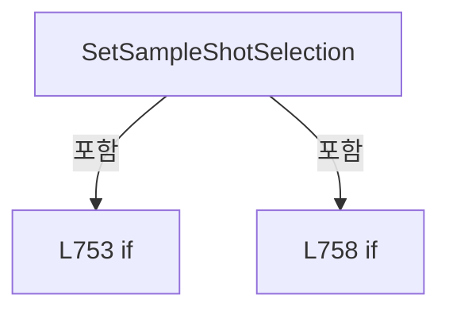

변경 전 점검: 입력/반환 타입, 위 호출자, 예외/취소 경로, 공유 상태와 저장·전송 소비자를 함께 확인합니다. 값의 단위나 물리 방향을 이름만으로 확정하지 않습니다.

### MethodDeclaration `RefreshSampleSelectionDisplay` · L766–816

[Drilling.UI/Menu/Menus/CMenuReview.cs:766–816](https://github.com/kjuws10-rgb/A3Drilling/blob/5aee8e58439c9b455cae7c9593c9be986c3e682e/Drilling.UI/Menu/Menus/CMenuReview.cs#L766-L816)

| 항목 | 실제 추출 값 |
| --- | --- |
| 서명 | void Drilling.UI.Menu.Menus.CMenuReview.RefreshSampleSelectionDisplay(System.Collections.Generic.IEnumerable<string>) |
| 접근/수식자 | Private / private |
| 반환/값 타입 | void |
| 소속 타입 | NamedType:Drilling.UI.Menu.Menus.CMenuReview |

입력 계약:

| 이름 | 타입 | 전달 | 선택/기본값 |
| --- | --- | --- | --- |
| changedShotKeys | System.Collections.Generic.IEnumerable<string> | None | False /  |

정적 호출자로 확인된 위치:

| 호출 파일/행 | 호출 표현식 | 런타임 분기 가능 |
| --- | --- | --- |
| [Drilling.UI/Menu/Menus/CMenuReview.cs:725–725](https://github.com/kjuws10-rgb/A3Drilling/blob/5aee8e58439c9b455cae7c9593c9be986c3e682e/Drilling.UI/Menu/Menus/CMenuReview.cs#L725-L725) | RefreshSampleSelectionDisplay | False |
| [Drilling.UI/Menu/Menus/CMenuReview.cs:733–733](https://github.com/kjuws10-rgb/A3Drilling/blob/5aee8e58439c9b455cae7c9593c9be986c3e682e/Drilling.UI/Menu/Menus/CMenuReview.cs#L733-L733) | RefreshSampleSelectionDisplay | False |
| [Drilling.UI/Menu/Menus/CMenuReview.cs:748–748](https://github.com/kjuws10-rgb/A3Drilling/blob/5aee8e58439c9b455cae7c9593c9be986c3e682e/Drilling.UI/Menu/Menus/CMenuReview.cs#L748-L748) | RefreshSampleSelectionDisplay | False |
| [Drilling.UI/Menu/Menus/CMenuReview.cs:1023–1023](https://github.com/kjuws10-rgb/A3Drilling/blob/5aee8e58439c9b455cae7c9593c9be986c3e682e/Drilling.UI/Menu/Menus/CMenuReview.cs#L1023-L1023) | RefreshSampleSelectionDisplay | False |

호출하는 대상과 해석 범위:

| 원본 행 | 표현식 | 분석 상태 | 대상/소스 위치 |
| --- | --- | --- | --- |
| 768 | changedShotKeys.Select(CReviewManager.NormalizeShotKey).Where(key => !string.IsNullOrWhiteSpace(key)).ToHashSet | resolved | System.Collections.Generic.HashSet<string> System.Collections.Generic.IEnumerable<string>.ToHashSet<string>(System.Collections.Generic.IEqualityComparer<string>?) |
| 768 | changedShotKeys.Select(CReviewManager.NormalizeShotKey).Where | resolved | System.Collections.Generic.IEnumerable<string> System.Collections.Generic.IEnumerable<string>.Where<string>(System.Func<string, bool>) |
| 768 | changedShotKeys.Select | resolved | System.Collections.Generic.IEnumerable<string> System.Collections.Generic.IEnumerable<string>.Select<string, string>(System.Func<string, string>) |
| 768 | string.IsNullOrWhiteSpace | resolved | bool string.IsNullOrWhiteSpace(string?) |
| 771 | _sampleShotRowsByKey.TryGetValue | resolved | bool System.Collections.Generic.Dictionary<string, Drilling.UI.Menu.Menus.ST_REVIEW_POINT_SELECT_ROW>.TryGetValue(string, out Drilling.UI.Menu.Menus.ST_REVIEW_POINT_SELECT_ROW) |
| 778 | row.SetSelection | resolved | void Drilling.UI.Menu.Menus.ST_REVIEW_POINT_SELECT_ROW.SetSelection(bool, string) · Drilling.UI/Menu/Menus/CMenuReview.cs:3902 |
| 782 | _selectedMode.Equals | resolved | bool string.Equals(string?, System.StringComparison) |
| 782 | _selectedSampleShotKeys.Contains | resolved | bool System.Collections.Generic.HashSet<string>.Contains(string) |
| 783 | row.SetSelection | resolved | void Drilling.UI.Menu.Menus.ST_REVIEW_POINT_SELECT_ROW.SetSelection(bool, string) · Drilling.UI/Menu/Menus/CMenuReview.cs:3902 |
| 786 | GetSelectedSampleShotCount | resolved | int Drilling.UI.Menu.Menus.CMenuReview.GetSelectedSampleShotCount() · Drilling.UI/Menu/Menus/CMenuReview.cs:1605 |
| 789 | CreateSamplePlanSummaryItems | resolved | System.Collections.Generic.IReadOnlyList<Drilling.UI.Menu.Menus.ST_DISPLAY_ITEM> Drilling.UI.Menu.Menus.CMenuReview.CreateSamplePlanSummaryItems() · Drilling.UI/Menu/Menus/CMenuReview.cs:1477 |
| 793 | SelectionSummaryItems.Select(item => item.Name.Equals("Selected", StringComparison.OrdinalIgnoreCase) ? item with { Value = selectedShotCount.ToString(CultureInfo.InvariantCulture) } : item).ToArray | resolved | Drilling.UI.Menu.Menus.ST_DISPLAY_ITEM[] System.Collections.Generic.IEnumerable<Drilling.UI.Menu.Menus.ST_DISPLAY_ITEM>.ToArray<Drilling.UI.Menu.Menus.ST_DISPLAY_ITEM>() |
| 793 | SelectionSummaryItems.Select | resolved | System.Collections.Generic.IEnumerable<Drilling.UI.Menu.Menus.ST_DISPLAY_ITEM> System.Collections.Generic.IEnumerable<Drilling.UI.Menu.Menus.ST_DISPLAY_ITEM>.Select<Drilling.UI.Menu.Menus.ST_DISPLAY_ITEM, Drilling.UI.Menu.Menus.ST_DISPLAY_ITEM>(System.Func<Drilling.UI.Menu.Menus.ST_DISPLAY_ITEM, Drilling.UI.Menu.Menus.ST_DISPLAY_ITEM>) |
| 793 | item.Name.Equals | resolved | bool string.Equals(string?, System.StringComparison) |
| 793 | selectedShotCount.ToString | resolved | string int.ToString(System.IFormatProvider?) |
| 796 | BuildSampleGlassPreviewSummary | resolved | string Drilling.UI.Menu.Menus.CMenuReview.BuildSampleGlassPreviewSummary() · Drilling.UI/Menu/Menus/CMenuReview.cs:1466 |
| 797 | OnPropertyChanged | resolved | void Drilling.UI.Menu.CBindingBase.OnPropertyChanged(string?) · Drilling.UI/Menu/CBindingBase.cs:759 |
| 797 | nameof | unresolved | None |
| 798 | OnPropertyChanged | resolved | void Drilling.UI.Menu.CBindingBase.OnPropertyChanged(string?) · Drilling.UI/Menu/CBindingBase.cs:759 |
| 798 | nameof | unresolved | None |
| 799 | OnPropertyChanged | resolved | void Drilling.UI.Menu.CBindingBase.OnPropertyChanged(string?) · Drilling.UI/Menu/CBindingBase.cs:759 |
| 799 | nameof | unresolved | None |
| 800 | OnPropertyChanged | resolved | void Drilling.UI.Menu.CBindingBase.OnPropertyChanged(string?) · Drilling.UI/Menu/CBindingBase.cs:759 |
| 800 | nameof | unresolved | None |
| 801 | OnPropertyChanged | resolved | void Drilling.UI.Menu.CBindingBase.OnPropertyChanged(string?) · Drilling.UI/Menu/CBindingBase.cs:759 |
| 801 | nameof | unresolved | None |
| 802 | OnPropertyChanged | resolved | void Drilling.UI.Menu.CBindingBase.OnPropertyChanged(string?) · Drilling.UI/Menu/CBindingBase.cs:759 |
| 802 | nameof | unresolved | None |
| 803 | OnPropertyChanged | resolved | void Drilling.UI.Menu.CBindingBase.OnPropertyChanged(string?) · Drilling.UI/Menu/CBindingBase.cs:759 |
| 803 | nameof | unresolved | None |
| 804 | OnPropertyChanged | resolved | void Drilling.UI.Menu.CBindingBase.OnPropertyChanged(string?) · Drilling.UI/Menu/CBindingBase.cs:759 |
| 804 | nameof | unresolved | None |
| 805 | OnPropertyChanged | resolved | void Drilling.UI.Menu.CBindingBase.OnPropertyChanged(string?) · Drilling.UI/Menu/CBindingBase.cs:759 |
| 805 | nameof | unresolved | None |
| 806 | OnPropertyChanged | resolved | void Drilling.UI.Menu.CBindingBase.OnPropertyChanged(string?) · Drilling.UI/Menu/CBindingBase.cs:759 |
| 806 | nameof | unresolved | None |
| 807 | OnPropertyChanged | resolved | void Drilling.UI.Menu.CBindingBase.OnPropertyChanged(string?) · Drilling.UI/Menu/CBindingBase.cs:759 |
| 807 | nameof | unresolved | None |
| 814 | RefreshSampleGlassPreview | resolved | void Drilling.UI.Menu.Menus.CMenuReview.RefreshSampleGlassPreview() · Drilling.UI/Menu/Menus/CMenuReview.cs:1026 |

본문의 실제 연산·분기·예외·반환 순서(원문 위치 순):

| 원본 행 | 종류 | 주석 해설 |
| --- | --- | --- |
| 768 | call | 함수·델리게이트 또는 객체 생성자를 호출합니다: changedShotKeys.Select(CReviewManager.NormalizeShotKey).Where(key => !string.IsNullOrWhiteSpace(key)).ToHashSet(StringComparer.OrdinalIgnoreCase) |
| 768 | call | 함수·델리게이트 또는 객체 생성자를 호출합니다: changedShotKeys.Select(CReviewManager.NormalizeShotKey).Where(key => !string.IsNullOrWhiteSpace(key)) |
| 768 | call | 함수·델리게이트 또는 객체 생성자를 호출합니다: changedShotKeys.Select(CReviewManager.NormalizeShotKey) |
| 768 | call | 함수·델리게이트 또는 객체 생성자를 호출합니다: string.IsNullOrWhiteSpace(key) |
| 768 | local-declaration | 지역 변수를 선언합니다: var changedKeys = changedShotKeys.Select(CReviewManager.NormalizeShotKey).Where(key => !string.IsNullOrWhiteSpace(key)).ToHashSet(StringComparer.OrdinalIgnoreCase); |
| 768 | variable-initializer | 변수의 초기값을 지정합니다: changedKeys = changedShotKeys.Select(CReviewManager.NormalizeShotKey).Where(key => !string.IsNullOrWhiteSpace(key)).ToHashSet(StringComparer.OrdinalIgnoreCase) |
| 769 | foreach | 컬렉션 요소를 순회합니다: foreach (var key in changedKeys) |
| 771 | call | 함수·델리게이트 또는 객체 생성자를 호출합니다: _sampleShotRowsByKey.TryGetValue(key, out var row) |
| 771 | if | 조건에 따라 분기합니다: if (!_sampleShotRowsByKey.TryGetValue(key, out var row)) |
| 773 | continue | 다음 반복으로 진행합니다: continue; |
| 776 | if | 조건에 따라 분기합니다: if (row.IsExcluded) |
| 778 | call | 함수·델리게이트 또는 객체 생성자를 호출합니다: row.SetSelection(false, row.ExclusionReason) |
| 779 | continue | 다음 반복으로 진행합니다: continue; |
| 782 | call | 함수·델리게이트 또는 객체 생성자를 호출합니다: _selectedMode.Equals("ALL SHOT", StringComparison.OrdinalIgnoreCase) |
| 782 | call | 함수·델리게이트 또는 객체 생성자를 호출합니다: _selectedSampleShotKeys.Contains(row.ShotKey) |
| 782 | local-declaration | 지역 변수를 선언합니다: var use = _selectedMode.Equals("ALL SHOT", StringComparison.OrdinalIgnoreCase) &#124;&#124; _selectedSampleShotKeys.Contains(row.ShotKey); |
| 782 | variable-initializer | 변수의 초기값을 지정합니다: use = _selectedMode.Equals("ALL SHOT", StringComparison.OrdinalIgnoreCase) &#124;&#124; _selectedSampleShotKeys.Contains(row.ShotKey) |
| 783 | call | 함수·델리게이트 또는 객체 생성자를 호출합니다: row.SetSelection(use, use ? (IsSimpleSampleRuleUi ? "REFERENCE" : "SAMPLE") : "-") |
| 783 | conditional-expression | 조건에 따라 결과식을 선택합니다: use ? (IsSimpleSampleRuleUi ? "REFERENCE" : "SAMPLE") : "-" |
| 783 | conditional-expression | 조건에 따라 결과식을 선택합니다: IsSimpleSampleRuleUi ? "REFERENCE" : "SAMPLE" |
| 786 | call | 함수·델리게이트 또는 객체 생성자를 호출합니다: GetSelectedSampleShotCount() |
| 786 | local-declaration | 지역 변수를 선언합니다: var selectedShotCount = GetSelectedSampleShotCount(); |
| 786 | variable-initializer | 변수의 초기값을 지정합니다: selectedShotCount = GetSelectedSampleShotCount() |
| 787 | if | 조건에 따라 분기합니다: if (IsSampleSelectTab) |
| 789 | assignment | 값을 대상에 대입합니다: SelectionSummaryItems = CreateSamplePlanSummaryItems() |
| 789 | call | 함수·델리게이트 또는 객체 생성자를 호출합니다: CreateSamplePlanSummaryItems() |
| 791 | else | 앞 조건이 거짓인 경로입니다: else |
| 793 | assignment | 값을 대상에 대입합니다: SelectionSummaryItems = SelectionSummaryItems.Select(item => item.Name.Equals("Selected", StringComparison.OrdinalIgnoreCase) ? item with { Value = selectedShotCount.ToString(CultureInfo.InvariantCulture) } : item).ToArray() |
| 793 | assignment | 값을 대상에 대입합니다: Value = selectedShotCount.ToString(CultureInfo.InvariantCulture) |
| 793 | call | 함수·델리게이트 또는 객체 생성자를 호출합니다: SelectionSummaryItems.Select(item => item.Name.Equals("Selected", StringComparison.OrdinalIgnoreCase) ? item with { Value = selectedShotCount.ToString(CultureInfo.InvariantCulture) } : item).ToArray() |
| 793 | call | 함수·델리게이트 또는 객체 생성자를 호출합니다: SelectionSummaryItems.Select(item => item.Name.Equals("Selected", StringComparison.OrdinalIgnoreCase) ? item with { Value = selectedShotCount.ToString(CultureInfo.InvariantCulture) } : item) |
| 793 | call | 함수·델리게이트 또는 객체 생성자를 호출합니다: item.Name.Equals("Selected", StringComparison.OrdinalIgnoreCase) |
| 793 | call | 함수·델리게이트 또는 객체 생성자를 호출합니다: selectedShotCount.ToString(CultureInfo.InvariantCulture) |
| 793 | conditional-expression | 조건에 따라 결과식을 선택합니다: item.Name.Equals("Selected", StringComparison.OrdinalIgnoreCase) ? item with { Value = selectedShotCount.ToString(CultureInfo.InvariantCulture) } : item |
| 796 | assignment | 값을 대상에 대입합니다: SampleGlassPreviewSummary = BuildSampleGlassPreviewSummary() |
| 796 | call | 함수·델리게이트 또는 객체 생성자를 호출합니다: BuildSampleGlassPreviewSummary() |
| 797 | call | 함수·델리게이트 또는 객체 생성자를 호출합니다: OnPropertyChanged(nameof(SelectionSummaryItems)) |
| 797 | call | 함수·델리게이트 또는 객체 생성자를 호출합니다: nameof(SelectionSummaryItems) |
| 798 | call | 함수·델리게이트 또는 객체 생성자를 호출합니다: OnPropertyChanged(nameof(SampleGlassPreviewSummary)) |
| 798 | call | 함수·델리게이트 또는 객체 생성자를 호출합니다: nameof(SampleGlassPreviewSummary) |
| 799 | call | 함수·델리게이트 또는 객체 생성자를 호출합니다: OnPropertyChanged(nameof(PlanSummary)) |
| 799 | call | 함수·델리게이트 또는 객체 생성자를 호출합니다: nameof(PlanSummary) |
| 800 | call | 함수·델리게이트 또는 객체 생성자를 호출합니다: OnPropertyChanged(nameof(SampleWorkspaceSummary)) |
| 800 | call | 함수·델리게이트 또는 객체 생성자를 호출합니다: nameof(SampleWorkspaceSummary) |
| 801 | call | 함수·델리게이트 또는 객체 생성자를 호출합니다: OnPropertyChanged(nameof(SampleRuleSelectionSummary)) |
| 801 | call | 함수·델리게이트 또는 객체 생성자를 호출합니다: nameof(SampleRuleSelectionSummary) |
| 802 | call | 함수·델리게이트 또는 객체 생성자를 호출합니다: OnPropertyChanged(nameof(SampleReferenceHead)) |
| 802 | call | 함수·델리게이트 또는 객체 생성자를 호출합니다: nameof(SampleReferenceHead) |
| 803 | call | 함수·델리게이트 또는 객체 생성자를 호출합니다: OnPropertyChanged(nameof(SampleReferenceCell)) |
| 803 | call | 함수·델리게이트 또는 객체 생성자를 호출합니다: nameof(SampleReferenceCell) |
| 804 | call | 함수·델리게이트 또는 객체 생성자를 호출합니다: OnPropertyChanged(nameof(SampleReferenceShot)) |
| 804 | call | 함수·델리게이트 또는 객체 생성자를 호출합니다: nameof(SampleReferenceShot) |
| 805 | call | 함수·델리게이트 또는 객체 생성자를 호출합니다: OnPropertyChanged(nameof(SampleOffsetApplyCount)) |
| 805 | call | 함수·델리게이트 또는 객체 생성자를 호출합니다: nameof(SampleOffsetApplyCount) |
| 806 | call | 함수·델리게이트 또는 객체 생성자를 호출합니다: OnPropertyChanged(nameof(SampleInspectionShotCount)) |
| 806 | call | 함수·델리게이트 또는 객체 생성자를 호출합니다: nameof(SampleInspectionShotCount) |
| 807 | call | 함수·델리게이트 또는 객체 생성자를 호출합니다: OnPropertyChanged(nameof(SamplePlanStatus)) |
| 807 | call | 함수·델리게이트 또는 객체 생성자를 호출합니다: nameof(SamplePlanStatus) |
| 812 | if | 조건에 따라 분기합니다: if (IsSampleSelectTab && !_isSampleCellDetailVisible) |
| 814 | call | 함수·델리게이트 또는 객체 생성자를 호출합니다: RefreshSampleGlassPreview() |

제어 구문의 포함 구조(실제 실행 순서/CFG가 아닌 구문 탐색 그림):

```mermaid
flowchart TD
 M["RefreshSampleSelectionDisplay"]
 N0["L769 foreach"]
 M -->|포함| N0
 N1["L771 if"]
 N0 -->|포함| N1
 N2["L776 if"]
 N0 -->|포함| N2
 N3["L787 if"]
 M -->|포함| N3
 N4["L791 else"]
 N3 -->|포함| N4
 N5["L812 if"]
 M -->|포함| N5
```

변경 전 점검: 입력/반환 타입, 위 호출자, 예외/취소 경로, 공유 상태와 저장·전송 소비자를 함께 확인합니다. 값의 단위나 물리 방향을 이름만으로 확정하지 않습니다.

### MethodDeclaration `RefreshSampleRuleUi` · L822–867

[Drilling.UI/Menu/Menus/CMenuReview.cs:822–867](https://github.com/kjuws10-rgb/A3Drilling/blob/5aee8e58439c9b455cae7c9593c9be986c3e682e/Drilling.UI/Menu/Menus/CMenuReview.cs#L822-L867)

| 항목 | 실제 추출 값 |
| --- | --- |
| 서명 | void Drilling.UI.Menu.Menus.CMenuReview.RefreshSampleRuleUi() |
| 접근/수식자 | Private / private |
| 반환/값 타입 | void |
| 소속 타입 | NamedType:Drilling.UI.Menu.Menus.CMenuReview |

정적 호출자로 확인된 위치:

| 호출 파일/행 | 호출 표현식 | 런타임 분기 가능 |
| --- | --- | --- |
| [Drilling.UI/Menu/Menus/CMenuReview.cs:621–621](https://github.com/kjuws10-rgb/A3Drilling/blob/5aee8e58439c9b455cae7c9593c9be986c3e682e/Drilling.UI/Menu/Menus/CMenuReview.cs#L621-L621) | RefreshSampleRuleUi | False |
| [Drilling.UI/Menu/Menus/CMenuReview.cs:631–631](https://github.com/kjuws10-rgb/A3Drilling/blob/5aee8e58439c9b455cae7c9593c9be986c3e682e/Drilling.UI/Menu/Menus/CMenuReview.cs#L631-L631) | RefreshSampleRuleUi | False |
| [Drilling.UI/Menu/Menus/CMenuReview.cs:641–641](https://github.com/kjuws10-rgb/A3Drilling/blob/5aee8e58439c9b455cae7c9593c9be986c3e682e/Drilling.UI/Menu/Menus/CMenuReview.cs#L641-L641) | RefreshSampleRuleUi | False |
| [Drilling.UI/Menu/Menus/CMenuReview.cs:650–650](https://github.com/kjuws10-rgb/A3Drilling/blob/5aee8e58439c9b455cae7c9593c9be986c3e682e/Drilling.UI/Menu/Menus/CMenuReview.cs#L650-L650) | RefreshSampleRuleUi | False |

호출하는 대상과 해석 범위:

| 원본 행 | 표현식 | 분석 상태 | 대상/소스 위치 |
| --- | --- | --- | --- |
| 826 | _refreshScreen | resolved · 동적 구현 선택 가능 | void System.Action.Invoke() |
| 832 | RefreshSampleCellDetailRows | resolved | void Drilling.UI.Menu.Menus.CMenuReview.RefreshSampleCellDetailRows() · Drilling.UI/Menu/Menus/CMenuReview.cs:1381 |
| 836 | RefreshSampleGlassPreview | resolved | void Drilling.UI.Menu.Menus.CMenuReview.RefreshSampleGlassPreview() · Drilling.UI/Menu/Menus/CMenuReview.cs:1026 |
| 839 | OnPropertyChanged | resolved | void Drilling.UI.Menu.CBindingBase.OnPropertyChanged(string?) · Drilling.UI/Menu/CBindingBase.cs:759 |
| 839 | nameof | unresolved | None |
| 840 | OnPropertyChanged | resolved | void Drilling.UI.Menu.CBindingBase.OnPropertyChanged(string?) · Drilling.UI/Menu/CBindingBase.cs:759 |
| 840 | nameof | unresolved | None |
| 841 | OnPropertyChanged | resolved | void Drilling.UI.Menu.CBindingBase.OnPropertyChanged(string?) · Drilling.UI/Menu/CBindingBase.cs:759 |
| 841 | nameof | unresolved | None |
| 842 | OnPropertyChanged | resolved | void Drilling.UI.Menu.CBindingBase.OnPropertyChanged(string?) · Drilling.UI/Menu/CBindingBase.cs:759 |
| 842 | nameof | unresolved | None |
| 843 | OnPropertyChanged | resolved | void Drilling.UI.Menu.CBindingBase.OnPropertyChanged(string?) · Drilling.UI/Menu/CBindingBase.cs:759 |
| 843 | nameof | unresolved | None |
| 844 | OnPropertyChanged | resolved | void Drilling.UI.Menu.CBindingBase.OnPropertyChanged(string?) · Drilling.UI/Menu/CBindingBase.cs:759 |
| 844 | nameof | unresolved | None |
| 845 | OnPropertyChanged | resolved | void Drilling.UI.Menu.CBindingBase.OnPropertyChanged(string?) · Drilling.UI/Menu/CBindingBase.cs:759 |
| 845 | nameof | unresolved | None |
| 846 | OnPropertyChanged | resolved | void Drilling.UI.Menu.CBindingBase.OnPropertyChanged(string?) · Drilling.UI/Menu/CBindingBase.cs:759 |
| 846 | nameof | unresolved | None |
| 847 | OnPropertyChanged | resolved | void Drilling.UI.Menu.CBindingBase.OnPropertyChanged(string?) · Drilling.UI/Menu/CBindingBase.cs:759 |
| 847 | nameof | unresolved | None |
| 848 | OnPropertyChanged | resolved | void Drilling.UI.Menu.CBindingBase.OnPropertyChanged(string?) · Drilling.UI/Menu/CBindingBase.cs:759 |
| 848 | nameof | unresolved | None |
| 849 | OnPropertyChanged | resolved | void Drilling.UI.Menu.CBindingBase.OnPropertyChanged(string?) · Drilling.UI/Menu/CBindingBase.cs:759 |
| 849 | nameof | unresolved | None |
| 850 | OnPropertyChanged | resolved | void Drilling.UI.Menu.CBindingBase.OnPropertyChanged(string?) · Drilling.UI/Menu/CBindingBase.cs:759 |
| 850 | nameof | unresolved | None |
| 851 | OnPropertyChanged | resolved | void Drilling.UI.Menu.CBindingBase.OnPropertyChanged(string?) · Drilling.UI/Menu/CBindingBase.cs:759 |
| 851 | nameof | unresolved | None |
| 852 | OnPropertyChanged | resolved | void Drilling.UI.Menu.CBindingBase.OnPropertyChanged(string?) · Drilling.UI/Menu/CBindingBase.cs:759 |
| 852 | nameof | unresolved | None |
| 853 | OnPropertyChanged | resolved | void Drilling.UI.Menu.CBindingBase.OnPropertyChanged(string?) · Drilling.UI/Menu/CBindingBase.cs:759 |
| 853 | nameof | unresolved | None |
| 854 | OnPropertyChanged | resolved | void Drilling.UI.Menu.CBindingBase.OnPropertyChanged(string?) · Drilling.UI/Menu/CBindingBase.cs:759 |
| 854 | nameof | unresolved | None |
| 855 | OnPropertyChanged | resolved | void Drilling.UI.Menu.CBindingBase.OnPropertyChanged(string?) · Drilling.UI/Menu/CBindingBase.cs:759 |
| 855 | nameof | unresolved | None |
| 856 | OnPropertyChanged | resolved | void Drilling.UI.Menu.CBindingBase.OnPropertyChanged(string?) · Drilling.UI/Menu/CBindingBase.cs:759 |
| 856 | nameof | unresolved | None |
| 857 | OnPropertyChanged | resolved | void Drilling.UI.Menu.CBindingBase.OnPropertyChanged(string?) · Drilling.UI/Menu/CBindingBase.cs:759 |
| 857 | nameof | unresolved | None |
| 858 | OnPropertyChanged | resolved | void Drilling.UI.Menu.CBindingBase.OnPropertyChanged(string?) · Drilling.UI/Menu/CBindingBase.cs:759 |
| 858 | nameof | unresolved | None |
| 859 | OnPropertyChanged | resolved | void Drilling.UI.Menu.CBindingBase.OnPropertyChanged(string?) · Drilling.UI/Menu/CBindingBase.cs:759 |
| 859 | nameof | unresolved | None |
| 860 | OnPropertyChanged | resolved | void Drilling.UI.Menu.CBindingBase.OnPropertyChanged(string?) · Drilling.UI/Menu/CBindingBase.cs:759 |
| 860 | nameof | unresolved | None |
| 861 | OnPropertyChanged | resolved | void Drilling.UI.Menu.CBindingBase.OnPropertyChanged(string?) · Drilling.UI/Menu/CBindingBase.cs:759 |
| 861 | nameof | unresolved | None |
| 862 | OnPropertyChanged | resolved | void Drilling.UI.Menu.CBindingBase.OnPropertyChanged(string?) · Drilling.UI/Menu/CBindingBase.cs:759 |
| 862 | nameof | unresolved | None |
| 863 | OnPropertyChanged | resolved | void Drilling.UI.Menu.CBindingBase.OnPropertyChanged(string?) · Drilling.UI/Menu/CBindingBase.cs:759 |
| 863 | nameof | unresolved | None |
| 864 | OnPropertyChanged | resolved | void Drilling.UI.Menu.CBindingBase.OnPropertyChanged(string?) · Drilling.UI/Menu/CBindingBase.cs:759 |
| 864 | nameof | unresolved | None |
| 865 | TogglePointCommand.NotifyCanExecuteChanged | resolved | void Drilling.UI.Menu.CButtonCommand.NotifyCanExecuteChanged() · Drilling.UI/Menu/CButtonCommand.cs:24 |
| 866 | SetSampleShotSelectionCommand.NotifyCanExecuteChanged | resolved | void Drilling.UI.Menu.CButtonCommand.NotifyCanExecuteChanged() · Drilling.UI/Menu/CButtonCommand.cs:24 |

본문의 실제 연산·분기·예외·반환 순서(원문 위치 순):

| 원본 행 | 종류 | 주석 해설 |
| --- | --- | --- |
| 824 | if | 조건에 따라 분기합니다: if (!IsSampleSelectTab) |
| 826 | call | 함수·델리게이트 또는 객체 생성자를 호출합니다: _refreshScreen() |
| 827 | return | 호출자에게 값 또는 제어를 반환합니다: return; |
| 830 | if | 조건에 따라 분기합니다: if (_isSampleCellDetailVisible) |
| 832 | call | 함수·델리게이트 또는 객체 생성자를 호출합니다: RefreshSampleCellDetailRows() |
| 834 | else | 앞 조건이 거짓인 경로입니다: else |
| 836 | call | 함수·델리게이트 또는 객체 생성자를 호출합니다: RefreshSampleGlassPreview() |
| 839 | call | 함수·델리게이트 또는 객체 생성자를 호출합니다: OnPropertyChanged(nameof(PlanSummary)) |
| 839 | call | 함수·델리게이트 또는 객체 생성자를 호출합니다: nameof(PlanSummary) |
| 840 | call | 함수·델리게이트 또는 객체 생성자를 호출합니다: OnPropertyChanged(nameof(IsSimpleSampleRuleUi)) |
| 840 | call | 함수·델리게이트 또는 객체 생성자를 호출합니다: nameof(IsSimpleSampleRuleUi) |
| 841 | call | 함수·델리게이트 또는 객체 생성자를 호출합니다: OnPropertyChanged(nameof(IsRoughSampleRuleUi)) |
| 841 | call | 함수·델리게이트 또는 객체 생성자를 호출합니다: nameof(IsRoughSampleRuleUi) |
| 842 | call | 함수·델리게이트 또는 객체 생성자를 호출합니다: OnPropertyChanged(nameof(IsFineSampleRuleUi)) |
| 842 | call | 함수·델리게이트 또는 객체 생성자를 호출합니다: nameof(IsFineSampleRuleUi) |
| 843 | call | 함수·델리게이트 또는 객체 생성자를 호출합니다: OnPropertyChanged(nameof(IsSampleScopeVisible)) |
| 843 | call | 함수·델리게이트 또는 객체 생성자를 호출합니다: nameof(IsSampleScopeVisible) |
| 844 | call | 함수·델리게이트 또는 객체 생성자를 호출합니다: OnPropertyChanged(nameof(IsSampleScopeHead)) |
| 844 | call | 함수·델리게이트 또는 객체 생성자를 호출합니다: nameof(IsSampleScopeHead) |
| 845 | call | 함수·델리게이트 또는 객체 생성자를 호출합니다: OnPropertyChanged(nameof(IsSampleScopeHeadCell)) |
| 845 | call | 함수·델리게이트 또는 객체 생성자를 호출합니다: nameof(IsSampleScopeHeadCell) |
| 846 | call | 함수·델리게이트 또는 객체 생성자를 호출합니다: OnPropertyChanged(nameof(IsRoughFirst)) |
| 846 | call | 함수·델리게이트 또는 객체 생성자를 호출합니다: nameof(IsRoughFirst) |
| 847 | call | 함수·델리게이트 또는 객체 생성자를 호출합니다: OnPropertyChanged(nameof(IsRoughCenter)) |
| 847 | call | 함수·델리게이트 또는 객체 생성자를 호출합니다: nameof(IsRoughCenter) |
| 848 | call | 함수·델리게이트 또는 객체 생성자를 호출합니다: OnPropertyChanged(nameof(IsRoughLast)) |
| 848 | call | 함수·델리게이트 또는 객체 생성자를 호출합니다: nameof(IsRoughLast) |
| 849 | call | 함수·델리게이트 또는 객체 생성자를 호출합니다: OnPropertyChanged(nameof(IsFineOneLine)) |
| 849 | call | 함수·델리게이트 또는 객체 생성자를 호출합니다: nameof(IsFineOneLine) |
| 850 | call | 함수·델리게이트 또는 객체 생성자를 호출합니다: OnPropertyChanged(nameof(IsFineThreeLine)) |
| 850 | call | 함수·델리게이트 또는 객체 생성자를 호출합니다: nameof(IsFineThreeLine) |
| 851 | call | 함수·델리게이트 또는 객체 생성자를 호출합니다: OnPropertyChanged(nameof(IsFineFiveLine)) |
| 851 | call | 함수·델리게이트 또는 객체 생성자를 호출합니다: nameof(IsFineFiveLine) |
| 852 | call | 함수·델리게이트 또는 객체 생성자를 호출합니다: OnPropertyChanged(nameof(IsFineSevenLine)) |
| 852 | call | 함수·델리게이트 또는 객체 생성자를 호출합니다: nameof(IsFineSevenLine) |
| 853 | call | 함수·델리게이트 또는 객체 생성자를 호출합니다: OnPropertyChanged(nameof(SelectedSampleRuleUi)) |
| 853 | call | 함수·델리게이트 또는 객체 생성자를 호출합니다: nameof(SelectedSampleRuleUi) |
| 854 | call | 함수·델리게이트 또는 객체 생성자를 호출합니다: OnPropertyChanged(nameof(SampleCorrectionTitle)) |
| 854 | call | 함수·델리게이트 또는 객체 생성자를 호출합니다: nameof(SampleCorrectionTitle) |
| 855 | call | 함수·델리게이트 또는 객체 생성자를 호출합니다: OnPropertyChanged(nameof(SampleTargetSectionTitle)) |
| 855 | call | 함수·델리게이트 또는 객체 생성자를 호출합니다: nameof(SampleTargetSectionTitle) |
| 856 | call | 함수·델리게이트 또는 객체 생성자를 호출합니다: OnPropertyChanged(nameof(SampleReferenceThirdLabel)) |
| 856 | call | 함수·델리게이트 또는 객체 생성자를 호출합니다: nameof(SampleReferenceThirdLabel) |
| 857 | call | 함수·델리게이트 또는 객체 생성자를 호출합니다: OnPropertyChanged(nameof(SampleCorrectionTarget)) |
| 857 | call | 함수·델리게이트 또는 객체 생성자를 호출합니다: nameof(SampleCorrectionTarget) |
| 858 | call | 함수·델리게이트 또는 객체 생성자를 호출합니다: OnPropertyChanged(nameof(SampleRuleSelectionSummary)) |
| 858 | call | 함수·델리게이트 또는 객체 생성자를 호출합니다: nameof(SampleRuleSelectionSummary) |
| 859 | call | 함수·델리게이트 또는 객체 생성자를 호출합니다: OnPropertyChanged(nameof(SampleInspectionShotCount)) |
| 859 | call | 함수·델리게이트 또는 객체 생성자를 호출합니다: nameof(SampleInspectionShotCount) |
| 860 | call | 함수·델리게이트 또는 객체 생성자를 호출합니다: OnPropertyChanged(nameof(SampleOffsetApplyCount)) |
| 860 | call | 함수·델리게이트 또는 객체 생성자를 호출합니다: nameof(SampleOffsetApplyCount) |
| 861 | call | 함수·델리게이트 또는 객체 생성자를 호출합니다: OnPropertyChanged(nameof(IsSampleGlassPreviewVisible)) |
| 861 | call | 함수·델리게이트 또는 객체 생성자를 호출합니다: nameof(IsSampleGlassPreviewVisible) |
| 862 | call | 함수·델리게이트 또는 객체 생성자를 호출합니다: OnPropertyChanged(nameof(IsSampleCellDetailVisible)) |
| 862 | call | 함수·델리게이트 또는 객체 생성자를 호출합니다: nameof(IsSampleCellDetailVisible) |
| 863 | call | 함수·델리게이트 또는 객체 생성자를 호출합니다: OnPropertyChanged(nameof(SampleWorkspaceTitle)) |
| 863 | call | 함수·델리게이트 또는 객체 생성자를 호출합니다: nameof(SampleWorkspaceTitle) |
| 864 | call | 함수·델리게이트 또는 객체 생성자를 호출합니다: OnPropertyChanged(nameof(SampleWorkspaceSummary)) |
| 864 | call | 함수·델리게이트 또는 객체 생성자를 호출합니다: nameof(SampleWorkspaceSummary) |
| 865 | call | 함수·델리게이트 또는 객체 생성자를 호출합니다: TogglePointCommand.NotifyCanExecuteChanged() |
| 866 | call | 함수·델리게이트 또는 객체 생성자를 호출합니다: SetSampleShotSelectionCommand.NotifyCanExecuteChanged() |

제어 구문의 포함 구조(실제 실행 순서/CFG가 아닌 구문 탐색 그림):

```mermaid
flowchart TD
 M["RefreshSampleRuleUi"]
 N0["L824 if"]
 M -->|포함| N0
 N1["L830 if"]
 M -->|포함| N1
 N2["L834 else"]
 N1 -->|포함| N2
```

변경 전 점검: 입력/반환 타입, 위 호출자, 예외/취소 경로, 공유 상태와 저장·전송 소비자를 함께 확인합니다. 값의 단위나 물리 방향을 이름만으로 확정하지 않습니다.

### MethodDeclaration `ApplyQuickSelect` · L869–1024

[Drilling.UI/Menu/Menus/CMenuReview.cs:869–1024](https://github.com/kjuws10-rgb/A3Drilling/blob/5aee8e58439c9b455cae7c9593c9be986c3e682e/Drilling.UI/Menu/Menus/CMenuReview.cs#L869-L1024)

| 항목 | 실제 추출 값 |
| --- | --- |
| 서명 | void Drilling.UI.Menu.Menus.CMenuReview.ApplyQuickSelect(object?) |
| 접근/수식자 | Private / private |
| 반환/값 타입 | void |
| 소속 타입 | NamedType:Drilling.UI.Menu.Menus.CMenuReview |

입력 계약:

| 이름 | 타입 | 전달 | 선택/기본값 |
| --- | --- | --- | --- |
| parameter | object? | None | False /  |

현재 부분 분석에서 직접 연결된 호출자는 없습니다. XAML/이벤트/인터페이스·델리게이트·외부 진입을 추가 확인해야 하며, 미사용으로 판정한 것이 아닙니다.

호출하는 대상과 해석 범위:

| 원본 행 | 표현식 | 분석 상태 | 대상/소스 위치 |
| --- | --- | --- | --- |
| 872 | .ToString | resolved · 동적 구현 선택 가능 | string? object.ToString() |
| 872 | .Trim().ToUpperInvariant | resolved | string string.ToUpperInvariant() |
| 872 | .Trim | resolved | string string.Trim() |
| 873 | string.IsNullOrWhiteSpace | resolved | bool string.IsNullOrWhiteSpace(string?) |
| 882 | allPlan.Points.FirstOrDefault | resolved | Drilling.Common.Review.ST_REVIEW_PLAN_POINT? System.Collections.Generic.IEnumerable<Drilling.Common.Review.ST_REVIEW_PLAN_POINT>.FirstOrDefault<Drilling.Common.Review.ST_REVIEW_PLAN_POINT>(System.Func<Drilling.Common.Review.ST_REVIEW_PLAN_POINT, bool>) |
| 883 | allPlan.Points.Where(point => point.CellNo == 1 && _selectedSampleShotKeys.Contains(point.ShotKey)).Select(ToMatrixShotName).ToHashSet | resolved | System.Collections.Generic.HashSet<string> System.Collections.Generic.IEnumerable<string>.ToHashSet<string>(System.Collections.Generic.IEqualityComparer<string>?) |
| 883 | allPlan.Points.Where(point => point.CellNo == 1 && _selectedSampleShotKeys.Contains(point.ShotKey)).Select | resolved | System.Collections.Generic.IEnumerable<string> System.Collections.Generic.IEnumerable<Drilling.Common.Review.ST_REVIEW_PLAN_POINT>.Select<Drilling.Common.Review.ST_REVIEW_PLAN_POINT, string>(System.Func<Drilling.Common.Review.ST_REVIEW_PLAN_POINT, string>) |
| 883 | allPlan.Points.Where | resolved | System.Collections.Generic.IEnumerable<Drilling.Common.Review.ST_REVIEW_PLAN_POINT> System.Collections.Generic.IEnumerable<Drilling.Common.Review.ST_REVIEW_PLAN_POINT>.Where<Drilling.Common.Review.ST_REVIEW_PLAN_POINT>(System.Func<Drilling.Common.Review.ST_REVIEW_PLAN_POINT, bool>) |
| 883 | _selectedSampleShotKeys.Contains | resolved | bool System.Collections.Generic.HashSet<string>.Contains(string) |
| 886 | _statusReporter | resolved · 동적 구현 선택 가능 | void System.Action<string>.Invoke(string) |
| 891 | _selectedSampleShotKeys.Clear | resolved | void System.Collections.Generic.HashSet<string>.Clear() |
| 905 | SelectEdgeKeys | resolved | System.Collections.Generic.IReadOnlyCollection<string> Drilling.UI.Menu.Menus.CMenuReview.SelectEdgeKeys(Drilling.Common.Review.ST_REVIEW_PLAN) · Drilling.UI/Menu/Menus/CMenuReview.cs:1816 |
| 907 | _selectedSampleShotKeys.Add | resolved | bool System.Collections.Generic.HashSet<string>.Add(string) |
| 915 | SelectCenterKeys | resolved | System.Collections.Generic.IReadOnlyCollection<string> Drilling.UI.Menu.Menus.CMenuReview.SelectCenterKeys(Drilling.Common.Review.ST_REVIEW_PLAN) · Drilling.UI/Menu/Menus/CMenuReview.cs:1822 |
| 917 | _selectedSampleShotKeys.Add | resolved | bool System.Collections.Generic.HashSet<string>.Add(string) |
| 925 | allPlan.Points.Where(point => point.HeadNo > 0 && GetShotRow(point) == GetCenterRow(point.PixelCountY)).Select | resolved | System.Collections.Generic.IEnumerable<string> System.Collections.Generic.IEnumerable<Drilling.Common.Review.ST_REVIEW_PLAN_POINT>.Select<Drilling.Common.Review.ST_REVIEW_PLAN_POINT, string>(System.Func<Drilling.Common.Review.ST_REVIEW_PLAN_POINT, string>) |
| 925 | allPlan.Points.Where | resolved | System.Collections.Generic.IEnumerable<Drilling.Common.Review.ST_REVIEW_PLAN_POINT> System.Collections.Generic.IEnumerable<Drilling.Common.Review.ST_REVIEW_PLAN_POINT>.Where<Drilling.Common.Review.ST_REVIEW_PLAN_POINT>(System.Func<Drilling.Common.Review.ST_REVIEW_PLAN_POINT, bool>) |
| 925 | GetShotRow | resolved | int Drilling.UI.Menu.Menus.CMenuReview.GetShotRow(Drilling.Common.Review.ST_REVIEW_PLAN_POINT) · Drilling.UI/Menu/Menus/CMenuReview.cs:1814 |
| 925 | GetCenterRow | resolved | int Drilling.UI.Menu.Menus.CMenuReview.GetCenterRow(int) · Drilling.UI/Menu/Menus/CMenuReview.cs:1815 |
| 927 | _selectedSampleShotKeys.Add | resolved | bool System.Collections.Generic.HashSet<string>.Add(string) |
| 935 | allPlan.Points.Where(point => { if (point.HeadNo <= 0) { return false; } var row = GetShotRow(point); return row == 1 &#124;&#124; row == GetCenterRow(point.PixelCountY) &#124;&#124; row == point.PixelCountY; }).Select | resolved | System.Collections.Generic.IEnumerable<string> System.Collections.Generic.IEnumerable<Drilling.Common.Review.ST_REVIEW_PLAN_POINT>.Select<Drilling.Common.Review.ST_REVIEW_PLAN_POINT, string>(System.Func<Drilling.Common.Review.ST_REVIEW_PLAN_POINT, string>) |
| 935 | allPlan.Points.Where | resolved | System.Collections.Generic.IEnumerable<Drilling.Common.Review.ST_REVIEW_PLAN_POINT> System.Collections.Generic.IEnumerable<Drilling.Common.Review.ST_REVIEW_PLAN_POINT>.Where<Drilling.Common.Review.ST_REVIEW_PLAN_POINT>(System.Func<Drilling.Common.Review.ST_REVIEW_PLAN_POINT, bool>) |
| 942 | GetShotRow | resolved | int Drilling.UI.Menu.Menus.CMenuReview.GetShotRow(Drilling.Common.Review.ST_REVIEW_PLAN_POINT) · Drilling.UI/Menu/Menus/CMenuReview.cs:1814 |
| 943 | GetCenterRow | resolved | int Drilling.UI.Menu.Menus.CMenuReview.GetCenterRow(int) · Drilling.UI/Menu/Menus/CMenuReview.cs:1815 |
| 946 | _selectedSampleShotKeys.Add | resolved | bool System.Collections.Generic.HashSet<string>.Add(string) |
| 954 | allPlan.Points.Where(point => point.HeadNo == _sampleRuleHeadNo).Select | resolved | System.Collections.Generic.IEnumerable<string> System.Collections.Generic.IEnumerable<Drilling.Common.Review.ST_REVIEW_PLAN_POINT>.Select<Drilling.Common.Review.ST_REVIEW_PLAN_POINT, string>(System.Func<Drilling.Common.Review.ST_REVIEW_PLAN_POINT, string>) |
| 954 | allPlan.Points.Where | resolved | System.Collections.Generic.IEnumerable<Drilling.Common.Review.ST_REVIEW_PLAN_POINT> System.Collections.Generic.IEnumerable<Drilling.Common.Review.ST_REVIEW_PLAN_POINT>.Where<Drilling.Common.Review.ST_REVIEW_PLAN_POINT>(System.Func<Drilling.Common.Review.ST_REVIEW_PLAN_POINT, bool>) |
| 956 | _selectedSampleShotKeys.Add | resolved | bool System.Collections.Generic.HashSet<string>.Add(string) |
| 965 | allPlan.Points.Where(point => point.HeadNo > 0 && point.CellNo == _sampleRuleCellNo).Select | resolved | System.Collections.Generic.IEnumerable<string> System.Collections.Generic.IEnumerable<Drilling.Common.Review.ST_REVIEW_PLAN_POINT>.Select<Drilling.Common.Review.ST_REVIEW_PLAN_POINT, string>(System.Func<Drilling.Common.Review.ST_REVIEW_PLAN_POINT, string>) |
| 965 | allPlan.Points.Where | resolved | System.Collections.Generic.IEnumerable<Drilling.Common.Review.ST_REVIEW_PLAN_POINT> System.Collections.Generic.IEnumerable<Drilling.Common.Review.ST_REVIEW_PLAN_POINT>.Where<Drilling.Common.Review.ST_REVIEW_PLAN_POINT>(System.Func<Drilling.Common.Review.ST_REVIEW_PLAN_POINT, bool>) |
| 967 | _selectedSampleShotKeys.Add | resolved | bool System.Collections.Generic.HashSet<string>.Add(string) |
| 975 | SelectZeroLineKeys | resolved | System.Collections.Generic.IReadOnlyCollection<string> Drilling.UI.Menu.Menus.CMenuReview.SelectZeroLineKeys(Drilling.Common.Review.ST_REVIEW_PLAN, int) · Drilling.UI/Menu/Menus/CMenuReview.cs:1828 |
| 977 | _selectedSampleShotKeys.Add | resolved | bool System.Collections.Generic.HashSet<string>.Add(string) |
| 985 | allPlan.Points.Where(point => point.HeadNo > 0 && point.PixelCountX == cell1ReferencePoint!.PixelCountX && point.PixelCountY == cell1ReferencePoint.PixelCountY && cell1ShotNames!.Contains(ToMatrixShotName(point))).Select | resolved | System.Collections.Generic.IEnumerable<string> System.Collections.Generic.IEnumerable<Drilling.Common.Review.ST_REVIEW_PLAN_POINT>.Select<Drilling.Common.Review.ST_REVIEW_PLAN_POINT, string>(System.Func<Drilling.Common.Review.ST_REVIEW_PLAN_POINT, string>) |
| 985 | allPlan.Points.Where | resolved | System.Collections.Generic.IEnumerable<Drilling.Common.Review.ST_REVIEW_PLAN_POINT> System.Collections.Generic.IEnumerable<Drilling.Common.Review.ST_REVIEW_PLAN_POINT>.Where<Drilling.Common.Review.ST_REVIEW_PLAN_POINT>(System.Func<Drilling.Common.Review.ST_REVIEW_PLAN_POINT, bool>) |
| 985 | cell1ShotNames!.Contains | resolved | bool System.Collections.Generic.HashSet<string>.Contains(string) |
| 985 | ToMatrixShotName | resolved | string Drilling.UI.Menu.Menus.CMenuReview.ToMatrixShotName(Drilling.Common.Review.ST_REVIEW_PLAN_POINT) · Drilling.UI/Menu/Menus/CMenuReview.cs:1993 |
| 987 | _selectedSampleShotKeys.Add | resolved | bool System.Collections.Generic.HashSet<string>.Add(string) |
| 997 | CreateDefaultSampleShotKeys | resolved | System.Collections.Generic.IReadOnlyCollection<string> Drilling.UI.Menu.Menus.CMenuReview.CreateDefaultSampleShotKeys(Drilling.Common.Review.ST_REVIEW_PLAN) · Drilling.UI/Menu/Menus/CMenuReview.cs:1771 |
| 999 | FindPointByShotKey | resolved | Drilling.Common.Review.ST_REVIEW_PLAN_POINT? Drilling.UI.Menu.Menus.CMenuReview.FindPointByShotKey(Drilling.Common.Review.ST_REVIEW_PLAN?, string) · Drilling.UI/Menu/Menus/CMenuReview.cs:1446 |
| 1001 | _selectedSampleShotKeys.Add | resolved | bool System.Collections.Generic.HashSet<string>.Add(string) |
| 1011 | _selectedSampleShotKeys.RemoveWhere | resolved | int System.Collections.Generic.HashSet<string>.RemoveWhere(System.Predicate<string>) |
| 1011 | FindPointByShotKey | resolved | Drilling.Common.Review.ST_REVIEW_PLAN_POINT? Drilling.UI.Menu.Menus.CMenuReview.FindPointByShotKey(Drilling.Common.Review.ST_REVIEW_PLAN?, string) · Drilling.UI/Menu/Menus/CMenuReview.cs:1446 |
| 1014 | allPlan.Points.Where(point => _selectedSampleShotKeys.Contains(point.ShotKey)).Select(point => point.CellNo).Distinct().Count | resolved | int System.Collections.Generic.IEnumerable<int>.Count<int>() |
| 1014 | allPlan.Points.Where(point => _selectedSampleShotKeys.Contains(point.ShotKey)).Select(point => point.CellNo).Distinct | resolved | System.Collections.Generic.IEnumerable<int> System.Collections.Generic.IEnumerable<int>.Distinct<int>() |
| 1014 | allPlan.Points.Where(point => _selectedSampleShotKeys.Contains(point.ShotKey)).Select | resolved | System.Collections.Generic.IEnumerable<int> System.Collections.Generic.IEnumerable<Drilling.Common.Review.ST_REVIEW_PLAN_POINT>.Select<Drilling.Common.Review.ST_REVIEW_PLAN_POINT, int>(System.Func<Drilling.Common.Review.ST_REVIEW_PLAN_POINT, int>) |
| 1014 | allPlan.Points.Where | resolved | System.Collections.Generic.IEnumerable<Drilling.Common.Review.ST_REVIEW_PLAN_POINT> System.Collections.Generic.IEnumerable<Drilling.Common.Review.ST_REVIEW_PLAN_POINT>.Where<Drilling.Common.Review.ST_REVIEW_PLAN_POINT>(System.Func<Drilling.Common.Review.ST_REVIEW_PLAN_POINT, bool>) |
| 1014 | _selectedSampleShotKeys.Contains | resolved | bool System.Collections.Generic.HashSet<string>.Contains(string) |
| 1015 | Math.Max | resolved | int System.Math.Max(int, int) |
| 1016 | _statusReporter | resolved · 동적 구현 선택 가능 | void System.Action<string>.Invoke(string) |
| 1020 | _statusReporter | resolved · 동적 구현 선택 가능 | void System.Action<string>.Invoke(string) |
| 1020 | GetSelectedSampleShotCount | resolved | int Drilling.UI.Menu.Menus.CMenuReview.GetSelectedSampleShotCount() · Drilling.UI/Menu/Menus/CMenuReview.cs:1605 |
| 1023 | RefreshSampleSelectionDisplay | resolved | void Drilling.UI.Menu.Menus.CMenuReview.RefreshSampleSelectionDisplay(System.Collections.Generic.IEnumerable<string>) · Drilling.UI/Menu/Menus/CMenuReview.cs:766 |
| 1023 | _sampleShotRowsByKey.Keys.ToArray | resolved | string[] System.Collections.Generic.IEnumerable<string>.ToArray<string>() |

본문의 실제 연산·분기·예외·반환 순서(원문 위치 순):

| 원본 행 | 종류 | 주석 해설 |
| --- | --- | --- |
| 871 | local-declaration | 지역 변수를 선언합니다: var allPlan = _lastAllPlan; |
| 871 | variable-initializer | 변수의 초기값을 지정합니다: allPlan = _lastAllPlan |
| 872 | call | 함수·델리게이트 또는 객체 생성자를 호출합니다: .ToString() |
| 872 | call | 함수·델리게이트 또는 객체 생성자를 호출합니다: .Trim().ToUpperInvariant() |
| 872 | call | 함수·델리게이트 또는 객체 생성자를 호출합니다: .Trim() |
| 872 | local-declaration | 지역 변수를 선언합니다: var rule = parameter?.ToString()?.Trim().ToUpperInvariant() ?? ""; |
| 872 | variable-initializer | 변수의 초기값을 지정합니다: rule = parameter?.ToString()?.Trim().ToUpperInvariant() ?? "" |
| 873 | call | 함수·델리게이트 또는 객체 생성자를 호출합니다: string.IsNullOrWhiteSpace(rule) |
| 873 | if | 조건에 따라 분기합니다: if (allPlan is null &#124;&#124; string.IsNullOrWhiteSpace(rule)) |
| 875 | return | 호출자에게 값 또는 제어를 반환합니다: return; |
| 878 | local-declaration | 지역 변수를 선언합니다: HashSet<string>? cell1ShotNames = null; |
| 878 | variable-initializer | 변수의 초기값을 지정합니다: cell1ShotNames = null |
| 879 | local-declaration | 지역 변수를 선언합니다: ST_REVIEW_PLAN_POINT? cell1ReferencePoint = null; |
| 879 | variable-initializer | 변수의 초기값을 지정합니다: cell1ReferencePoint = null |
| 880 | if | 조건에 따라 분기합니다: if (rule == "COPY_CELL1") |
| 882 | assignment | 값을 대상에 대입합니다: cell1ReferencePoint = allPlan.Points.FirstOrDefault(point => point.CellNo == 1) |
| 882 | call | 함수·델리게이트 또는 객체 생성자를 호출합니다: allPlan.Points.FirstOrDefault(point => point.CellNo == 1) |
| 883 | assignment | 값을 대상에 대입합니다: cell1ShotNames = allPlan.Points.Where(point => point.CellNo == 1 && _selectedSampleShotKeys.Contains(point.ShotKey)).Select(ToMatrixShotName).ToHashSet(StringComparer.OrdinalIgnoreCase) |
| 883 | call | 함수·델리게이트 또는 객체 생성자를 호출합니다: allPlan.Points.Where(point => point.CellNo == 1 && _selectedSampleShotKeys.Contains(point.ShotKey)).Select(ToMatrixShotName).ToHashSet(StringComparer.OrdinalIgnoreCase) |
| 883 | call | 함수·델리게이트 또는 객체 생성자를 호출합니다: allPlan.Points.Where(point => point.CellNo == 1 && _selectedSampleShotKeys.Contains(point.ShotKey)).Select(ToMatrixShotName) |
| 883 | call | 함수·델리게이트 또는 객체 생성자를 호출합니다: allPlan.Points.Where(point => point.CellNo == 1 && _selectedSampleShotKeys.Contains(point.ShotKey)) |
| 883 | call | 함수·델리게이트 또는 객체 생성자를 호출합니다: _selectedSampleShotKeys.Contains(point.ShotKey) |
| 884 | if | 조건에 따라 분기합니다: if (cell1ReferencePoint is null &#124;&#124; cell1ShotNames.Count == 0) |
| 886 | call | 함수·델리게이트 또는 객체 생성자를 호출합니다: _statusReporter("Select at least one shot in CELL01 before copying the pattern.") |
| 887 | return | 호출자에게 값 또는 제어를 반환합니다: return; |
| 891 | call | 함수·델리게이트 또는 객체 생성자를 호출합니다: _selectedSampleShotKeys.Clear() |
| 892 | switch | 값에 따라 분기합니다: switch (rule) |
| 894 | case | 분기값/패턴의 구간입니다: case "ALL": |
| 895 | assignment | 값을 대상에 대입합니다: _selectedMode = "ALL SHOT" |
| 896 | assignment | 값을 대상에 대입합니다: _selectedRuleType = EN_REVIEW_RULE_TYPE.AllPoint |
| 897 | assignment | 값을 대상에 대입합니다: _selectionRuleText = "All Shot" |
| 898 | break | 해당 반복/분기 구간을 종료합니다: break; |
| 899 | case | 분기값/패턴의 구간입니다: case "CLEAR": |
| 900 | assignment | 값을 대상에 대입합니다: _selectedMode = "SAMPLE SHOT" |
| 901 | assignment | 값을 대상에 대입합니다: _selectedRuleType = EN_REVIEW_RULE_TYPE.SamplePoint |
| 902 | assignment | 값을 대상에 대입합니다: _selectionRuleText = "None" |
| 903 | break | 해당 반복/분기 구간을 종료합니다: break; |
| 904 | case | 분기값/패턴의 구간입니다: case "EDGE": |
| 905 | call | 함수·델리게이트 또는 객체 생성자를 호출합니다: SelectEdgeKeys(allPlan) |
| 905 | foreach | 컬렉션 요소를 순회합니다: foreach (var key in SelectEdgeKeys(allPlan)) |
| 907 | call | 함수·델리게이트 또는 객체 생성자를 호출합니다: _selectedSampleShotKeys.Add(key) |
| 910 | assignment | 값을 대상에 대입합니다: _selectedMode = "SAMPLE SHOT" |
| 911 | assignment | 값을 대상에 대입합니다: _selectedRuleType = EN_REVIEW_RULE_TYPE.Edge |
| 912 | assignment | 값을 대상에 대입합니다: _selectionRuleText = "Edge" |
| 913 | break | 해당 반복/분기 구간을 종료합니다: break; |
| 914 | case | 분기값/패턴의 구간입니다: case "CENTER": |
| 915 | call | 함수·델리게이트 또는 객체 생성자를 호출합니다: SelectCenterKeys(allPlan) |
| 915 | foreach | 컬렉션 요소를 순회합니다: foreach (var key in SelectCenterKeys(allPlan)) |
| 917 | call | 함수·델리게이트 또는 객체 생성자를 호출합니다: _selectedSampleShotKeys.Add(key) |
| 920 | assignment | 값을 대상에 대입합니다: _selectedMode = "SAMPLE SHOT" |
| 921 | assignment | 값을 대상에 대입합니다: _selectedRuleType = EN_REVIEW_RULE_TYPE.Center |
| 922 | assignment | 값을 대상에 대입합니다: _selectionRuleText = "Center" |
| 923 | break | 해당 반복/분기 구간을 종료합니다: break; |
| 924 | case | 분기값/패턴의 구간입니다: case "ONE_LINE": |
| 925 | call | 함수·델리게이트 또는 객체 생성자를 호출합니다: allPlan.Points.Where(point => point.HeadNo > 0 && GetShotRow(point) == GetCenterRow(point.PixelCountY)).Select(point => point.ShotKey) |
| 925 | call | 함수·델리게이트 또는 객체 생성자를 호출합니다: allPlan.Points.Where(point => point.HeadNo > 0 && GetShotRow(point) == GetCenterRow(point.PixelCountY)) |
| 925 | call | 함수·델리게이트 또는 객체 생성자를 호출합니다: GetShotRow(point) |
| 925 | call | 함수·델리게이트 또는 객체 생성자를 호출합니다: GetCenterRow(point.PixelCountY) |
| 925 | foreach | 컬렉션 요소를 순회합니다: foreach (var key in allPlan.Points.Where(point => point.HeadNo > 0 && GetShotRow(point) == GetCenterRow(point.PixelCountY)).Select(point => point.ShotKey)) |
| 927 | call | 함수·델리게이트 또는 객체 생성자를 호출합니다: _selectedSampleShotKeys.Add(key) |
| 930 | assignment | 값을 대상에 대입합니다: _selectedMode = "SAMPLE SHOT" |
| 931 | assignment | 값을 대상에 대입합니다: _selectedRuleType = EN_REVIEW_RULE_TYPE.SamplePoint |
| 932 | assignment | 값을 대상에 대입합니다: _selectionRuleText = "1-Line" |
| 933 | break | 해당 반복/분기 구간을 종료합니다: break; |
| 934 | case | 분기값/패턴의 구간입니다: case "THREE_LINE": |
| 935 | call | 함수·델리게이트 또는 객체 생성자를 호출합니다: allPlan.Points.Where(point => { if (point.HeadNo <= 0) { return false; } var row = GetShotRow(point); return row == 1 &#124;&#124; row == GetCenterRow(point.PixelCountY) &#124;&#124; row == point.PixelCountY; }).Select(point => point.ShotKe… |
| 935 | call | 함수·델리게이트 또는 객체 생성자를 호출합니다: allPlan.Points.Where(point => { if (point.HeadNo <= 0) { return false; } var row = GetShotRow(point); return row == 1 &#124;&#124; row == GetCenterRow(point.PixelCountY) &#124;&#124; row == point.PixelCountY; }) |
| 935 | foreach | 컬렉션 요소를 순회합니다: foreach (var key in allPlan.Points.Where(point => { if (point.HeadNo <= 0) { return false; } var row = GetShotRow(point); return row == 1 &#124;&#124; row == GetCenterRow(point.PixelCountY) &#124;&#124; row == point.PixelCountY; }).Select(point => po |
| 937 | if | 조건에 따라 분기합니다: if (point.HeadNo <= 0) |
| 939 | return | 호출자에게 값 또는 제어를 반환합니다: return false; |
| 942 | call | 함수·델리게이트 또는 객체 생성자를 호출합니다: GetShotRow(point) |
| 942 | local-declaration | 지역 변수를 선언합니다: var row = GetShotRow(point); |
| 942 | variable-initializer | 변수의 초기값을 지정합니다: row = GetShotRow(point) |
| 943 | call | 함수·델리게이트 또는 객체 생성자를 호출합니다: GetCenterRow(point.PixelCountY) |
| 943 | return | 호출자에게 값 또는 제어를 반환합니다: return row == 1 &#124;&#124; row == GetCenterRow(point.PixelCountY) &#124;&#124; row == point.PixelCountY; |
| 946 | call | 함수·델리게이트 또는 객체 생성자를 호출합니다: _selectedSampleShotKeys.Add(key) |
| 949 | assignment | 값을 대상에 대입합니다: _selectedMode = "SAMPLE SHOT" |
| 950 | assignment | 값을 대상에 대입합니다: _selectedRuleType = EN_REVIEW_RULE_TYPE.SamplePoint |
| 951 | assignment | 값을 대상에 대입합니다: _selectionRuleText = "3-Line" |
| 952 | break | 해당 반복/분기 구간을 종료합니다: break; |
| 953 | case | 분기값/패턴의 구간입니다: case "HEAD": |
| 954 | call | 함수·델리게이트 또는 객체 생성자를 호출합니다: allPlan.Points.Where(point => point.HeadNo == _sampleRuleHeadNo).Select(point => point.ShotKey) |
| 954 | call | 함수·델리게이트 또는 객체 생성자를 호출합니다: allPlan.Points.Where(point => point.HeadNo == _sampleRuleHeadNo) |
| 954 | foreach | 컬렉션 요소를 순회합니다: foreach (var key in allPlan.Points.Where(point => point.HeadNo == _sampleRuleHeadNo).Select(point => point.ShotKey)) |
| 956 | call | 함수·델리게이트 또는 객체 생성자를 호출합니다: _selectedSampleShotKeys.Add(key) |
| 959 | assignment | 값을 대상에 대입합니다: _selectedMode = "SAMPLE SHOT" |
| 960 | assignment | 값을 대상에 대입합니다: _selectedRuleType = EN_REVIEW_RULE_TYPE.HeadPoint |
| 961 | assignment | 값을 대상에 대입합니다: _selectionRuleText = $"Head Shot H{_sampleRuleHeadNo:00}" |
| 962 | break | 해당 반복/분기 구간을 종료합니다: break; |
| 963 | case | 분기값/패턴의 구간입니다: case "CELL": |
| 964 | assignment | 값을 대상에 대입합니다: _selectedSampleCellNo = _sampleRuleCellNo |
| 965 | call | 함수·델리게이트 또는 객체 생성자를 호출합니다: allPlan.Points.Where(point => point.HeadNo > 0 && point.CellNo == _sampleRuleCellNo).Select(point => point.ShotKey) |
| 965 | call | 함수·델리게이트 또는 객체 생성자를 호출합니다: allPlan.Points.Where(point => point.HeadNo > 0 && point.CellNo == _sampleRuleCellNo) |
| 965 | foreach | 컬렉션 요소를 순회합니다: foreach (var key in allPlan.Points.Where(point => point.HeadNo > 0 && point.CellNo == _sampleRuleCellNo).Select(point => point.ShotKey)) |
| 967 | call | 함수·델리게이트 또는 객체 생성자를 호출합니다: _selectedSampleShotKeys.Add(key) |
| 970 | assignment | 값을 대상에 대입합니다: _selectedMode = "SAMPLE SHOT" |
| 971 | assignment | 값을 대상에 대입합니다: _selectedRuleType = EN_REVIEW_RULE_TYPE.CellPoint |
| 972 | assignment | 값을 대상에 대입합니다: _selectionRuleText = $"Cell Shot CELL{_sampleRuleCellNo:00}" |
| 973 | break | 해당 반복/분기 구간을 종료합니다: break; |
| 974 | case | 분기값/패턴의 구간입니다: case "ZERO": |
| 975 | call | 함수·델리게이트 또는 객체 생성자를 호출합니다: SelectZeroLineKeys(allPlan, 0) |
| 975 | foreach | 컬렉션 요소를 순회합니다: foreach (var key in SelectZeroLineKeys(allPlan, 0)) |
| 977 | call | 함수·델리게이트 또는 객체 생성자를 호출합니다: _selectedSampleShotKeys.Add(key) |
| 980 | assignment | 값을 대상에 대입합니다: _selectedMode = "ZERO DEFENSE" |
| 981 | assignment | 값을 대상에 대입합니다: _selectedRuleType = EN_REVIEW_RULE_TYPE.ZeroLine |
| 982 | assignment | 값을 대상에 대입합니다: _selectionRuleText = "0-Line" |
| 983 | break | 해당 반복/분기 구간을 종료합니다: break; |
| 984 | case | 분기값/패턴의 구간입니다: case "COPY_CELL1": |
| 985 | call | 함수·델리게이트 또는 객체 생성자를 호출합니다: allPlan.Points.Where(point => point.HeadNo > 0 && point.PixelCountX == cell1ReferencePoint!.PixelCountX && point.PixelCountY == cell1ReferencePoint.PixelCountY && cell1ShotNames!.Contains(ToMatrixShotName(point))).Select… |
| 985 | call | 함수·델리게이트 또는 객체 생성자를 호출합니다: allPlan.Points.Where(point => point.HeadNo > 0 && point.PixelCountX == cell1ReferencePoint!.PixelCountX && point.PixelCountY == cell1ReferencePoint.PixelCountY && cell1ShotNames!.Contains(ToMatrixShotName(point))) |
| 985 | call | 함수·델리게이트 또는 객체 생성자를 호출합니다: cell1ShotNames!.Contains(ToMatrixShotName(point)) |
| 985 | call | 함수·델리게이트 또는 객체 생성자를 호출합니다: ToMatrixShotName(point) |
| 985 | foreach | 컬렉션 요소를 순회합니다: foreach (var key in allPlan.Points.Where(point => point.HeadNo > 0 && point.PixelCountX == cell1ReferencePoint!.PixelCountX && point.PixelCountY == cell1ReferencePoint.PixelCountY && cell1ShotNames!.Contains(ToMatrixShotName(point |
| 987 | call | 함수·델리게이트 또는 객체 생성자를 호출합니다: _selectedSampleShotKeys.Add(key) |
| 990 | assignment | 값을 대상에 대입합니다: _selectedSampleCellNo = 1 |
| 991 | assignment | 값을 대상에 대입합니다: _sampleRuleCellNo = 1 |
| 992 | assignment | 값을 대상에 대입합니다: _selectedMode = "SAMPLE SHOT" |
| 993 | assignment | 값을 대상에 대입합니다: _selectedRuleType = EN_REVIEW_RULE_TYPE.SamplePoint |
| 994 | assignment | 값을 대상에 대입합니다: _selectionRuleText = "CELL01 Pattern" |
| 995 | break | 해당 반복/분기 구간을 종료합니다: break; |
| 996 | case | 분기값/패턴의 구간입니다: default: |
| 997 | call | 함수·델리게이트 또는 객체 생성자를 호출합니다: CreateDefaultSampleShotKeys(allPlan) |
| 997 | foreach | 컬렉션 요소를 순회합니다: foreach (var key in CreateDefaultSampleShotKeys(allPlan)) |
| 999 | call | 함수·델리게이트 또는 객체 생성자를 호출합니다: FindPointByShotKey(allPlan, key) |
| 999 | if | 조건에 따라 분기합니다: if (FindPointByShotKey(allPlan, key)?.HeadNo > 0) |
| 1001 | call | 함수·델리게이트 또는 객체 생성자를 호출합니다: _selectedSampleShotKeys.Add(key) |
| 1005 | assignment | 값을 대상에 대입합니다: _selectedMode = "SAMPLE SHOT" |
| 1006 | assignment | 값을 대상에 대입합니다: _selectedRuleType = EN_REVIEW_RULE_TYPE.SamplePoint |
| 1007 | assignment | 값을 대상에 대입합니다: _selectionRuleText = "Default Sample" |
| 1008 | break | 해당 반복/분기 구간을 종료합니다: break; |
| 1011 | call | 함수·델리게이트 또는 객체 생성자를 호출합니다: _selectedSampleShotKeys.RemoveWhere(key => FindPointByShotKey(allPlan, key)?.Use != true) |
| 1011 | call | 함수·델리게이트 또는 객체 생성자를 호출합니다: FindPointByShotKey(allPlan, key) |
| 1012 | if | 조건에 따라 분기합니다: if (rule == "COPY_CELL1") |
| 1014 | call | 함수·델리게이트 또는 객체 생성자를 호출합니다: allPlan.Points.Where(point => _selectedSampleShotKeys.Contains(point.ShotKey)).Select(point => point.CellNo).Distinct().Count() |
| 1014 | call | 함수·델리게이트 또는 객체 생성자를 호출합니다: allPlan.Points.Where(point => _selectedSampleShotKeys.Contains(point.ShotKey)).Select(point => point.CellNo).Distinct() |
| 1014 | call | 함수·델리게이트 또는 객체 생성자를 호출합니다: allPlan.Points.Where(point => _selectedSampleShotKeys.Contains(point.ShotKey)).Select(point => point.CellNo) |
| 1014 | call | 함수·델리게이트 또는 객체 생성자를 호출합니다: allPlan.Points.Where(point => _selectedSampleShotKeys.Contains(point.ShotKey)) |
| 1014 | call | 함수·델리게이트 또는 객체 생성자를 호출합니다: _selectedSampleShotKeys.Contains(point.ShotKey) |
| 1014 | local-declaration | 지역 변수를 선언합니다: var appliedCellCount = allPlan.Points.Where(point => _selectedSampleShotKeys.Contains(point.ShotKey)).Select(point => point.CellNo).Distinct().Count(); |
| 1014 | variable-initializer | 변수의 초기값을 지정합니다: appliedCellCount = allPlan.Points.Where(point => _selectedSampleShotKeys.Contains(point.ShotKey)).Select(point => point.CellNo).Distinct().Count() |
| 1015 | call | 함수·델리게이트 또는 객체 생성자를 호출합니다: Math.Max(0, allPlan.CellCount - appliedCellCount) |
| 1015 | local-declaration | 지역 변수를 선언합니다: var skippedCellCount = Math.Max(0, allPlan.CellCount - appliedCellCount); |
| 1015 | variable-initializer | 변수의 초기값을 지정합니다: skippedCellCount = Math.Max(0, allPlan.CellCount - appliedCellCount) |
| 1016 | call | 함수·델리게이트 또는 객체 생성자를 호출합니다: _statusReporter($"CELL01 {cell1ReferencePoint!.PixelCountX}x{cell1ReferencePoint.PixelCountY} pattern copied: " + $"{appliedCellCount} cells applied, {skippedCellCount} cells skipped, " + $"{_selectedSampleShotKeys.Count… |
| 1018 | else | 앞 조건이 거짓인 경로입니다: else |
| 1020 | call | 함수·델리게이트 또는 객체 생성자를 호출합니다: _statusReporter($"Review shot rule applied: {rule}, {GetSelectedSampleShotCount()} shots.") |
| 1020 | call | 함수·델리게이트 또는 객체 생성자를 호출합니다: GetSelectedSampleShotCount() |
| 1023 | call | 함수·델리게이트 또는 객체 생성자를 호출합니다: RefreshSampleSelectionDisplay(_sampleShotRowsByKey.Keys.ToArray()) |
| 1023 | call | 함수·델리게이트 또는 객체 생성자를 호출합니다: _sampleShotRowsByKey.Keys.ToArray() |

제어 구문의 포함 구조(실제 실행 순서/CFG가 아닌 구문 탐색 그림):

```mermaid
flowchart TD
 M["ApplyQuickSelect"]
 N0["L873 if"]
 M -->|포함| N0
 N1["L880 if"]
 M -->|포함| N1
 N2["L884 if"]
 N1 -->|포함| N2
 N3["L892 switch"]
 M -->|포함| N3
 N4["L905 foreach"]
 N3 -->|포함| N4
 N5["L915 foreach"]
 N3 -->|포함| N5
 N6["L925 foreach"]
 N3 -->|포함| N6
 N7["L935 foreach"]
 N3 -->|포함| N7
 N8["L937 if"]
 N7 -->|포함| N8
 N9["L954 foreach"]
 N3 -->|포함| N9
 N10["L965 foreach"]
 N3 -->|포함| N10
 N11["L975 foreach"]
 N3 -->|포함| N11
 N12["L985 foreach"]
 N3 -->|포함| N12
 N13["L997 foreach"]
 N3 -->|포함| N13
 N14["L999 if"]
 N13 -->|포함| N14
 N15["L1012 if"]
 M -->|포함| N15
 N16["L1018 else"]
 N15 -->|포함| N16
```

변경 전 점검: 입력/반환 타입, 위 호출자, 예외/취소 경로, 공유 상태와 저장·전송 소비자를 함께 확인합니다. 값의 단위나 물리 방향을 이름만으로 확정하지 않습니다.

### MethodDeclaration `RefreshSampleGlassPreview` · L1026–1070

[Drilling.UI/Menu/Menus/CMenuReview.cs:1026–1070](https://github.com/kjuws10-rgb/A3Drilling/blob/5aee8e58439c9b455cae7c9593c9be986c3e682e/Drilling.UI/Menu/Menus/CMenuReview.cs#L1026-L1070)

| 항목 | 실제 추출 값 |
| --- | --- |
| 서명 | void Drilling.UI.Menu.Menus.CMenuReview.RefreshSampleGlassPreview() |
| 접근/수식자 | Private / private |
| 반환/값 타입 | void |
| 소속 타입 | NamedType:Drilling.UI.Menu.Menus.CMenuReview |

정적 호출자로 확인된 위치:

| 호출 파일/행 | 호출 표현식 | 런타임 분기 가능 |
| --- | --- | --- |
| [Drilling.UI/Menu/Menus/CMenuReview.cs:814–814](https://github.com/kjuws10-rgb/A3Drilling/blob/5aee8e58439c9b455cae7c9593c9be986c3e682e/Drilling.UI/Menu/Menus/CMenuReview.cs#L814-L814) | RefreshSampleGlassPreview | False |
| [Drilling.UI/Menu/Menus/CMenuReview.cs:836–836](https://github.com/kjuws10-rgb/A3Drilling/blob/5aee8e58439c9b455cae7c9593c9be986c3e682e/Drilling.UI/Menu/Menus/CMenuReview.cs#L836-L836) | RefreshSampleGlassPreview | False |
| [Drilling.UI/Menu/Menus/CMenuReview.cs:1402–1402](https://github.com/kjuws10-rgb/A3Drilling/blob/5aee8e58439c9b455cae7c9593c9be986c3e682e/Drilling.UI/Menu/Menus/CMenuReview.cs#L1402-L1402) | RefreshSampleGlassPreview | False |

호출하는 대상과 해석 범위:

| 원본 행 | 표현식 | 분석 상태 | 대상/소스 위치 |
| --- | --- | --- | --- |
| 1033 | GetSimpleReferencePoint | resolved | Drilling.Common.Review.ST_REVIEW_PLAN_POINT? Drilling.UI.Menu.Menus.CMenuReview.GetSimpleReferencePoint() · Drilling.UI/Menu/Menus/CMenuReview.cs:1499 |
| 1034 | CReviewGlassPreviewBuilder.Build | resolved | Drilling.UI.Menu.Menus.ST_REVIEW_GLASS_PREVIEW Drilling.UI.Menu.Menus.CReviewGlassPreviewBuilder.Build(Drilling.Common.Managers.ST_RECIPE_DEFINITION, int, int, System.Collections.Generic.IReadOnlyList<Drilling.Common.Review.ST_REVIEW_PLAN_POINT>?, bool, System.Collections.Generic.IReadOnlySet<int>?, Drilling.UI.Menu.Menus.ST_REVIEW_GLASS_AXIS_INDICATOR?, System.Collections.Generic.IReadOnlyList<Drilling.UI.Menu.Menus.ST_REVIEW_GLASS_AXIS_INDICATOR>?, Drilling.Common.Review.EN_REVIEW_POINT_STATE, System.Collections.Generic.IReadOnlySet<string>?, bool, bool, System.Collections.Generic.IReadOnlyList<Drilling.Common.Review.ST_REVIEW_PLAN_POINT>?, Drilling.Common.Review.EN_REVIEW_CORRECTION_RULE?, System.Collections.Generic.IReadOnlyList<Drilling.UI.Menu.Menus.ST_REVIEW_SCOPE_TARGET>?, System.Collections.Generic.IReadOnlyList<Drilling.Common.Review.ST_REVIEW_PLAN_POINT>?, int, int, System.Collections.Generic.IReadOnlyList<Drilling.Common.Review.ST_REVIEW_HEAD_SCOPE>?, Drilling.Common.Review.ST_REVIEW_PLAN_POINT?, bool, bool, System.Collections.Generic.IReadOnlySet<int>?, System.Collections.Generic.IReadOnlySet<int>?, System.Collections.Generic.IReadOnlyList<Drilling.Common.Managers.ST_SYSTEM_PARAMETER>?) · Drilling.UI/Menu/Menus/CReviewGlassPreviewBuilder.cs:30 |
| 1042 | GetAutomaticInspectionPreviewPoints | resolved | System.Collections.Generic.IReadOnlyList<Drilling.Common.Review.ST_REVIEW_PLAN_POINT> Drilling.UI.Menu.Menus.CMenuReview.GetAutomaticInspectionPreviewPoints(Drilling.Common.Review.ST_REVIEW_PLAN) · Drilling.UI/Menu/Menus/CMenuReview.cs:1904 |
| 1043 | GetAutomaticInspectionPreviewRule | resolved | Drilling.Common.Review.EN_REVIEW_CORRECTION_RULE? Drilling.UI.Menu.Menus.CMenuReview.GetAutomaticInspectionPreviewRule() · Drilling.UI/Menu/Menus/CMenuReview.cs:1914 |
| 1044 | GetRoughScopeTargets | resolved | System.Collections.Generic.IReadOnlyList<Drilling.UI.Menu.Menus.ST_REVIEW_SCOPE_TARGET> Drilling.UI.Menu.Menus.CMenuReview.GetRoughScopeTargets(Drilling.Common.Review.ST_REVIEW_PLAN) · Drilling.UI/Menu/Menus/CMenuReview.cs:1921 |
| 1045 | ShouldDrawSampleScope | resolved | bool Drilling.UI.Menu.Menus.CMenuReview.ShouldDrawSampleScope() · Drilling.UI/Menu/Menus/CMenuReview.cs:1920 |
| 1048 | ShouldDrawSampleScope | resolved | bool Drilling.UI.Menu.Menus.CMenuReview.ShouldDrawSampleScope() · Drilling.UI/Menu/Menus/CMenuReview.cs:1920 |
| 1048 | _reviewManager.GetHeadScopes | resolved | System.Collections.Generic.IReadOnlyList<Drilling.Common.Review.ST_REVIEW_HEAD_SCOPE> Drilling.Common.Review.CReviewManager.GetHeadScopes(Drilling.Common.Managers.ST_RECIPE_DEFINITION) · Drilling.Common/Review/CReviewManager.cs:243 |
| 1049 | GetSimpleReferencePoint | resolved | Drilling.Common.Review.ST_REVIEW_PLAN_POINT? Drilling.UI.Menu.Menus.CMenuReview.GetSimpleReferencePoint() · Drilling.UI/Menu/Menus/CMenuReview.cs:1499 |
| 1051 | .LoadSection | resolved | System.Collections.Generic.IReadOnlyList<Drilling.Common.Managers.ST_SYSTEM_PARAMETER> Drilling.Common.Managers.CSettingManager.LoadSection(Drilling.Common.Managers.EN_SETTING_TAB, System.Threading.CancellationToken) · Drilling.Common/Managers/CSettingManager.cs:26 |
| 1055 | BuildSampleGlassPreviewSummary | resolved | string Drilling.UI.Menu.Menus.CMenuReview.BuildSampleGlassPreviewSummary() · Drilling.UI/Menu/Menus/CMenuReview.cs:1466 |
| 1056 | OnPropertyChanged | resolved | void Drilling.UI.Menu.CBindingBase.OnPropertyChanged(string?) · Drilling.UI/Menu/CBindingBase.cs:759 |
| 1056 | nameof | unresolved | None |
| 1057 | OnPropertyChanged | resolved | void Drilling.UI.Menu.CBindingBase.OnPropertyChanged(string?) · Drilling.UI/Menu/CBindingBase.cs:759 |
| 1057 | nameof | unresolved | None |
| 1058 | OnPropertyChanged | resolved | void Drilling.UI.Menu.CBindingBase.OnPropertyChanged(string?) · Drilling.UI/Menu/CBindingBase.cs:759 |
| 1058 | nameof | unresolved | None |
| 1059 | OnPropertyChanged | resolved | void Drilling.UI.Menu.CBindingBase.OnPropertyChanged(string?) · Drilling.UI/Menu/CBindingBase.cs:759 |
| 1059 | nameof | unresolved | None |
| 1060 | OnPropertyChanged | resolved | void Drilling.UI.Menu.CBindingBase.OnPropertyChanged(string?) · Drilling.UI/Menu/CBindingBase.cs:759 |
| 1060 | nameof | unresolved | None |
| 1061 | OnPropertyChanged | resolved | void Drilling.UI.Menu.CBindingBase.OnPropertyChanged(string?) · Drilling.UI/Menu/CBindingBase.cs:759 |
| 1061 | nameof | unresolved | None |
| 1062 | OnPropertyChanged | resolved | void Drilling.UI.Menu.CBindingBase.OnPropertyChanged(string?) · Drilling.UI/Menu/CBindingBase.cs:759 |
| 1062 | nameof | unresolved | None |
| 1063 | OnPropertyChanged | resolved | void Drilling.UI.Menu.CBindingBase.OnPropertyChanged(string?) · Drilling.UI/Menu/CBindingBase.cs:759 |
| 1063 | nameof | unresolved | None |
| 1064 | OnPropertyChanged | resolved | void Drilling.UI.Menu.CBindingBase.OnPropertyChanged(string?) · Drilling.UI/Menu/CBindingBase.cs:759 |
| 1064 | nameof | unresolved | None |
| 1065 | OnPropertyChanged | resolved | void Drilling.UI.Menu.CBindingBase.OnPropertyChanged(string?) · Drilling.UI/Menu/CBindingBase.cs:759 |
| 1065 | nameof | unresolved | None |
| 1066 | OnPropertyChanged | resolved | void Drilling.UI.Menu.CBindingBase.OnPropertyChanged(string?) · Drilling.UI/Menu/CBindingBase.cs:759 |
| 1066 | nameof | unresolved | None |
| 1067 | OnPropertyChanged | resolved | void Drilling.UI.Menu.CBindingBase.OnPropertyChanged(string?) · Drilling.UI/Menu/CBindingBase.cs:759 |
| 1067 | nameof | unresolved | None |
| 1068 | OnPropertyChanged | resolved | void Drilling.UI.Menu.CBindingBase.OnPropertyChanged(string?) · Drilling.UI/Menu/CBindingBase.cs:759 |
| 1068 | nameof | unresolved | None |
| 1069 | OnPropertyChanged | resolved | void Drilling.UI.Menu.CBindingBase.OnPropertyChanged(string?) · Drilling.UI/Menu/CBindingBase.cs:759 |
| 1069 | nameof | unresolved | None |

본문의 실제 연산·분기·예외·반환 순서(원문 위치 순):

| 원본 행 | 종류 | 주석 해설 |
| --- | --- | --- |
| 1028 | if | 조건에 따라 분기합니다: if (_lastRecipe is null &#124;&#124; _lastAllPlan is null) |
| 1030 | return | 호출자에게 값 또는 제어를 반환합니다: return; |
| 1033 | call | 함수·델리게이트 또는 객체 생성자를 호출합니다: GetSimpleReferencePoint() |
| 1033 | conditional-expression | 조건에 따라 결과식을 선택합니다: IsSimpleSampleRuleUi ? GetSimpleReferencePoint() : null |
| 1033 | local-declaration | 지역 변수를 선언합니다: var simpleReferencePoint = IsSimpleSampleRuleUi ? GetSimpleReferencePoint() : null; |
| 1033 | variable-initializer | 변수의 초기값을 지정합니다: simpleReferencePoint = IsSimpleSampleRuleUi ? GetSimpleReferencePoint() : null |
| 1034 | call | 함수·델리게이트 또는 객체 생성자를 호출합니다: CReviewGlassPreviewBuilder.Build( _lastRecipe, _lastAllPlan.CellCount, _isSampleCellDetailVisible ? _selectedSampleCellNo : simpleReferencePoint?.CellNo ?? 0, useSampleSelectionColors: true, selectedShotKeys: _selectedSa… |
| 1034 | local-declaration | 지역 변수를 선언합니다: var preview = CReviewGlassPreviewBuilder.Build( _lastRecipe, _lastAllPlan.CellCount, _isSampleCellDetailVisible ? _selectedSampleCellNo : simpleReferencePoint?.CellNo ?? 0, useSampleSelectionColors: true, selectedShotKeys: _select |
| 1034 | variable-initializer | 변수의 초기값을 지정합니다: preview = CReviewGlassPreviewBuilder.Build( _lastRecipe, _lastAllPlan.CellCount, _isSampleCellDetailVisible ? _selectedSampleCellNo : simpleReferencePoint?.CellNo ?? 0, useSampleSelectionColors: true, selectedShotKeys: _selectedSa |
| 1037 | conditional-expression | 조건에 따라 결과식을 선택합니다: _isSampleCellDetailVisible ? _selectedSampleCellNo : simpleReferencePoint?.CellNo ?? 0 |
| 1042 | call | 함수·델리게이트 또는 객체 생성자를 호출합니다: GetAutomaticInspectionPreviewPoints(_lastAllPlan) |
| 1043 | call | 함수·델리게이트 또는 객체 생성자를 호출합니다: GetAutomaticInspectionPreviewRule() |
| 1044 | call | 함수·델리게이트 또는 객체 생성자를 호출합니다: GetRoughScopeTargets(_lastAllPlan) |
| 1045 | call | 함수·델리게이트 또는 객체 생성자를 호출합니다: ShouldDrawSampleScope() |
| 1045 | conditional-expression | 조건에 따라 결과식을 선택합니다: ShouldDrawSampleScope() ? _lastAllPlan.Points : null |
| 1047 | conditional-expression | 조건에 따라 결과식을 선택합니다: IsSimpleSampleRuleUi && _sampleRuleScope == "HEAD_CELL" ? simpleReferencePoint?.CellNo ?? 0 : 0 |
| 1048 | call | 함수·델리게이트 또는 객체 생성자를 호출합니다: ShouldDrawSampleScope() |
| 1048 | call | 함수·델리게이트 또는 객체 생성자를 호출합니다: _reviewManager.GetHeadScopes(_lastRecipe) |
| 1048 | conditional-expression | 조건에 따라 결과식을 선택합니다: ShouldDrawSampleScope() ? _reviewManager.GetHeadScopes(_lastRecipe) : null |
| 1049 | call | 함수·델리게이트 또는 객체 생성자를 호출합니다: GetSimpleReferencePoint() |
| 1049 | conditional-expression | 조건에 따라 결과식을 선택합니다: IsSimpleSampleRuleUi ? GetSimpleReferencePoint() : null |
| 1051 | call | 함수·델리게이트 또는 객체 생성자를 호출합니다: .LoadSection(EN_SETTING_TAB.Motor) |
| 1052 | assignment | 값을 대상에 대입합니다: SampleGlassPreviewImage = preview.Image |
| 1053 | assignment | 값을 대상에 대입합니다: SampleGlassPreviewInspectionOverlayImage = preview.InspectionOverlayImage |
| 1054 | assignment | 값을 대상에 대입합니다: SampleCellPreviewLabels = preview.CellLabels |
| 1055 | assignment | 값을 대상에 대입합니다: SampleGlassPreviewSummary = BuildSampleGlassPreviewSummary() |
| 1055 | call | 함수·델리게이트 또는 객체 생성자를 호출합니다: BuildSampleGlassPreviewSummary() |
| 1056 | call | 함수·델리게이트 또는 객체 생성자를 호출합니다: OnPropertyChanged(nameof(SampleGlassPreviewImage)) |
| 1056 | call | 함수·델리게이트 또는 객체 생성자를 호출합니다: nameof(SampleGlassPreviewImage) |
| 1057 | call | 함수·델리게이트 또는 객체 생성자를 호출합니다: OnPropertyChanged(nameof(SampleGlassPreviewInspectionOverlayImage)) |
| 1057 | call | 함수·델리게이트 또는 객체 생성자를 호출합니다: nameof(SampleGlassPreviewInspectionOverlayImage) |
| 1058 | call | 함수·델리게이트 또는 객체 생성자를 호출합니다: OnPropertyChanged(nameof(SampleCellPreviewLabels)) |
| 1058 | call | 함수·델리게이트 또는 객체 생성자를 호출합니다: nameof(SampleCellPreviewLabels) |
| 1059 | call | 함수·델리게이트 또는 객체 생성자를 호출합니다: OnPropertyChanged(nameof(SampleGlassPreviewSummary)) |
| 1059 | call | 함수·델리게이트 또는 객체 생성자를 호출합니다: nameof(SampleGlassPreviewSummary) |
| 1060 | call | 함수·델리게이트 또는 객체 생성자를 호출합니다: OnPropertyChanged(nameof(SampleWorkspaceSummary)) |
| 1060 | call | 함수·델리게이트 또는 객체 생성자를 호출합니다: nameof(SampleWorkspaceSummary) |
| 1061 | call | 함수·델리게이트 또는 객체 생성자를 호출합니다: OnPropertyChanged(nameof(SampleRuleName)) |
| 1061 | call | 함수·델리게이트 또는 객체 생성자를 호출합니다: nameof(SampleRuleName) |
| 1062 | call | 함수·델리게이트 또는 객체 생성자를 호출합니다: OnPropertyChanged(nameof(SampleRuleDescription)) |
| 1062 | call | 함수·델리게이트 또는 객체 생성자를 호출합니다: nameof(SampleRuleDescription) |
| 1063 | call | 함수·델리게이트 또는 객체 생성자를 호출합니다: OnPropertyChanged(nameof(SampleCorrectionTarget)) |
| 1063 | call | 함수·델리게이트 또는 객체 생성자를 호출합니다: nameof(SampleCorrectionTarget) |
| 1064 | call | 함수·델리게이트 또는 객체 생성자를 호출합니다: OnPropertyChanged(nameof(SampleReferenceHead)) |
| 1064 | call | 함수·델리게이트 또는 객체 생성자를 호출합니다: nameof(SampleReferenceHead) |
| 1065 | call | 함수·델리게이트 또는 객체 생성자를 호출합니다: OnPropertyChanged(nameof(SampleReferenceCell)) |
| 1065 | call | 함수·델리게이트 또는 객체 생성자를 호출합니다: nameof(SampleReferenceCell) |
| 1066 | call | 함수·델리게이트 또는 객체 생성자를 호출합니다: OnPropertyChanged(nameof(SampleReferenceShot)) |
| 1066 | call | 함수·델리게이트 또는 객체 생성자를 호출합니다: nameof(SampleReferenceShot) |
| 1067 | call | 함수·델리게이트 또는 객체 생성자를 호출합니다: OnPropertyChanged(nameof(SampleOffsetApplyCount)) |
| 1067 | call | 함수·델리게이트 또는 객체 생성자를 호출합니다: nameof(SampleOffsetApplyCount) |
| 1068 | call | 함수·델리게이트 또는 객체 생성자를 호출합니다: OnPropertyChanged(nameof(SampleInspectionShotCount)) |
| 1068 | call | 함수·델리게이트 또는 객체 생성자를 호출합니다: nameof(SampleInspectionShotCount) |
| 1069 | call | 함수·델리게이트 또는 객체 생성자를 호출합니다: OnPropertyChanged(nameof(SamplePlanStatus)) |
| 1069 | call | 함수·델리게이트 또는 객체 생성자를 호출합니다: nameof(SamplePlanStatus) |

제어 구문의 포함 구조(실제 실행 순서/CFG가 아닌 구문 탐색 그림):

```mermaid
flowchart TD
 M["RefreshSampleGlassPreview"]
 N0["L1028 if"]
 M -->|포함| N0
```

변경 전 점검: 입력/반환 타입, 위 호출자, 예외/취소 경로, 공유 상태와 저장·전송 소비자를 함께 확인합니다. 값의 단위나 물리 방향을 이름만으로 확정하지 않습니다.

### MethodDeclaration `SelectRunCell` · L1072–1087

[Drilling.UI/Menu/Menus/CMenuReview.cs:1072–1087](https://github.com/kjuws10-rgb/A3Drilling/blob/5aee8e58439c9b455cae7c9593c9be986c3e682e/Drilling.UI/Menu/Menus/CMenuReview.cs#L1072-L1087)

| 항목 | 실제 추출 값 |
| --- | --- |
| 서명 | void Drilling.UI.Menu.Menus.CMenuReview.SelectRunCell(object?) |
| 접근/수식자 | Private / private |
| 반환/값 타입 | void |
| 소속 타입 | NamedType:Drilling.UI.Menu.Menus.CMenuReview |

입력 계약:

| 이름 | 타입 | 전달 | 선택/기본값 |
| --- | --- | --- | --- |
| parameter | object? | None | False /  |

현재 부분 분석에서 직접 연결된 호출자는 없습니다. XAML/이벤트/인터페이스·델리게이트·외부 진입을 추가 확인해야 하며, 미사용으로 판정한 것이 아닙니다.

호출하는 대상과 해석 범위:

| 원본 행 | 표현식 | 분석 상태 | 대상/소스 위치 |
| --- | --- | --- | --- |
| 1076 | int.TryParse | resolved | bool int.TryParse(string?, System.Globalization.NumberStyles, System.IFormatProvider?, out int) |
| 1076 | .ToString | resolved · 동적 구현 선택 가능 | string? object.ToString() |
| 1081 | Math.Clamp | resolved | int System.Math.Clamp(int, int, int) |
| 1084 | _statusReporter | resolved · 동적 구현 선택 가능 | void System.Action<string>.Invoke(string) |
| 1085 | RefreshRunCellDetail | resolved | void Drilling.UI.Menu.Menus.CMenuReview.RefreshRunCellDetail() · Drilling.UI/Menu/Menus/CMenuReview.cs:2891 |
| 1086 | RefreshOneShotSelection | resolved | void Drilling.UI.Menu.Menus.CMenuReview.RefreshOneShotSelection(bool) · Drilling.UI/Menu/Menus/CMenuReview.cs:2520 |

본문의 실제 연산·분기·예외·반환 순서(원문 위치 순):

| 원본 행 | 종류 | 주석 해설 |
| --- | --- | --- |
| 1074 | if | 조건에 따라 분기합니다: if (IsOneShotReviewMode && IsReviewExecutionActive) |
| 1075 | return | 호출자에게 값 또는 제어를 반환합니다: return; |
| 1076 | call | 함수·델리게이트 또는 객체 생성자를 호출합니다: int.TryParse(parameter?.ToString(), NumberStyles.Integer, CultureInfo.InvariantCulture, out var cellNo) |
| 1076 | call | 함수·델리게이트 또는 객체 생성자를 호출합니다: .ToString() |
| 1076 | if | 조건에 따라 분기합니다: if (!int.TryParse(parameter?.ToString(), NumberStyles.Integer, CultureInfo.InvariantCulture, out var cellNo)) |
| 1078 | return | 호출자에게 값 또는 제어를 반환합니다: return; |
| 1081 | assignment | 값을 대상에 대입합니다: _selectedRunCellNo = Math.Clamp(cellNo, 1, _cellCount) |
| 1081 | call | 함수·델리게이트 또는 객체 생성자를 호출합니다: Math.Clamp(cellNo, 1, _cellCount) |
| 1082 | assignment | 값을 대상에 대입합니다: _selectedRunShotKey = "" |
| 1083 | assignment | 값을 대상에 대입합니다: _isRunCellDetailVisible = true |
| 1084 | call | 함수·델리게이트 또는 객체 생성자를 호출합니다: _statusReporter($"Review Cell selected: Cell{_selectedRunCellNo}") |
| 1085 | call | 함수·델리게이트 또는 객체 생성자를 호출합니다: RefreshRunCellDetail() |
| 1086 | call | 함수·델리게이트 또는 객체 생성자를 호출합니다: RefreshOneShotSelection(clearResult: true) |

제어 구문의 포함 구조(실제 실행 순서/CFG가 아닌 구문 탐색 그림):

```mermaid
flowchart TD
 M["SelectRunCell"]
 N0["L1074 if"]
 M -->|포함| N0
 N1["L1076 if"]
 M -->|포함| N1
```

변경 전 점검: 입력/반환 타입, 위 호출자, 예외/취소 경로, 공유 상태와 저장·전송 소비자를 함께 확인합니다. 값의 단위나 물리 방향을 이름만으로 확정하지 않습니다.

### MethodDeclaration `SelectRunShot` · L1089–1188

[Drilling.UI/Menu/Menus/CMenuReview.cs:1089–1188](https://github.com/kjuws10-rgb/A3Drilling/blob/5aee8e58439c9b455cae7c9593c9be986c3e682e/Drilling.UI/Menu/Menus/CMenuReview.cs#L1089-L1188)

| 항목 | 실제 추출 값 |
| --- | --- |
| 서명 | void Drilling.UI.Menu.Menus.CMenuReview.SelectRunShot(object?) |
| 접근/수식자 | Private / private |
| 반환/값 타입 | void |
| 소속 타입 | NamedType:Drilling.UI.Menu.Menus.CMenuReview |

입력 계약:

| 이름 | 타입 | 전달 | 선택/기본값 |
| --- | --- | --- | --- |
| parameter | object? | None | False /  |

현재 부분 분석에서 직접 연결된 호출자는 없습니다. XAML/이벤트/인터페이스·델리게이트·외부 진입을 추가 확인해야 하며, 미사용으로 판정한 것이 아닙니다.

호출하는 대상과 해석 범위:

| 원본 행 | 표현식 | 분석 상태 | 대상/소스 위치 |
| --- | --- | --- | --- |
| 1093 | _statusReporter | resolved · 동적 구현 선택 가능 | void System.Action<string>.Invoke(string) |
| 1097 | CReviewManager.NormalizeShotKey | resolved | string Drilling.Common.Review.CReviewManager.NormalizeShotKey(string) · Drilling.Common/Review/CReviewManager.cs:1165 |
| 1097 | .ToString | resolved · 동적 구현 선택 가능 | string? object.ToString() |
| 1100 | FindPointByShotKey | resolved | Drilling.Common.Review.ST_REVIEW_PLAN_POINT? Drilling.UI.Menu.Menus.CMenuReview.FindPointByShotKey(Drilling.Common.Review.ST_REVIEW_PLAN?, string) · Drilling.UI/Menu/Menus/CMenuReview.cs:1446 |
| 1101 | IsReviewPointExcluded | resolved | bool Drilling.UI.Menu.Menus.CMenuReview.IsReviewPointExcluded(Drilling.Common.Review.ST_REVIEW_PLAN_POINT) · Drilling.UI/Menu/Menus/CMenuReview.cs:3614 |
| 1103 | _runShotRowsByKey.TryGetValue | resolved · 동적 구현 선택 가능 | bool System.Collections.Generic.IReadOnlyDictionary<string, Drilling.UI.Menu.Menus.ST_REVIEW_RUN_SHOT_ROW>.TryGetValue(string, out Drilling.UI.Menu.Menus.ST_REVIEW_RUN_SHOT_ROW) |
| 1104 | previous.SetSelected | resolved | void Drilling.UI.Menu.Menus.ST_REVIEW_RUN_SHOT_ROW.SetSelected(bool) · Drilling.UI/Menu/Menus/CMenuReview.cs:3782 |
| 1107 | _runShotRowsByKey.TryGetValue | resolved · 동적 구현 선택 가능 | bool System.Collections.Generic.IReadOnlyDictionary<string, Drilling.UI.Menu.Menus.ST_REVIEW_RUN_SHOT_ROW>.TryGetValue(string, out Drilling.UI.Menu.Menus.ST_REVIEW_RUN_SHOT_ROW) |
| 1108 | row.SetSelected | resolved | void Drilling.UI.Menu.Menus.ST_REVIEW_RUN_SHOT_ROW.SetSelected(bool) · Drilling.UI/Menu/Menus/CMenuReview.cs:3782 |
| 1109 | RefreshOneShotSelection | resolved | void Drilling.UI.Menu.Menus.CMenuReview.RefreshOneShotSelection(bool) · Drilling.UI/Menu/Menus/CMenuReview.cs:2520 |
| 1110 | RefreshInspectionCellSelection | resolved | void Drilling.UI.Menu.Menus.CMenuReview.RefreshInspectionCellSelection() · Drilling.UI/Menu/Menus/CMenuReview.cs:2307 |
| 1111 | OnPropertyChanged | resolved | void Drilling.UI.Menu.CBindingBase.OnPropertyChanged(string?) · Drilling.UI/Menu/CBindingBase.cs:759 |
| 1111 | nameof | unresolved | None |
| 1115 | ResolveReviewPlan | resolved | Drilling.Common.Review.ST_REVIEW_PLAN Drilling.UI.Menu.Menus.CMenuReview.ResolveReviewPlan(Drilling.Common.Managers.ST_RECIPE_DEFINITION, Drilling.Common.Review.ST_REVIEW_PLAN) · Drilling.UI/Menu/Menus/CMenuReview.cs:2911 |
| 1116 | FindPointByShotKey | resolved | Drilling.Common.Review.ST_REVIEW_PLAN_POINT? Drilling.UI.Menu.Menus.CMenuReview.FindPointByShotKey(Drilling.Common.Review.ST_REVIEW_PLAN?, string) · Drilling.UI/Menu/Menus/CMenuReview.cs:1446 |
| 1117 | _runShotRowsByKey.TryGetValue | resolved · 동적 구현 선택 가능 | bool System.Collections.Generic.IReadOnlyDictionary<string, Drilling.UI.Menu.Menus.ST_REVIEW_RUN_SHOT_ROW>.TryGetValue(string, out Drilling.UI.Menu.Menus.ST_REVIEW_RUN_SHOT_ROW) |
| 1117 | visibleRow.State.Equals | resolved | bool string.Equals(string?, System.StringComparison) |
| 1117 | ToRunShotState | resolved | string Drilling.UI.Menu.Menus.CMenuReview.ToRunShotState(Drilling.Common.Review.ST_REVIEW_PLAN_POINT) · Drilling.UI/Menu/Menus/CMenuReview.cs:3613 |
| 1117 | visibleRow.Detail.Equals | resolved | bool string.Equals(string?, System.StringComparison) |
| 1117 | ToRunShotDetail | resolved | string Drilling.UI.Menu.Menus.CMenuReview.ToRunShotDetail(Drilling.Common.Review.ST_REVIEW_PLAN_POINT) · Drilling.UI/Menu/Menus/CMenuReview.cs:3597 |
| 1117 | FindPointByShotKey | resolved | Drilling.Common.Review.ST_REVIEW_PLAN_POINT? Drilling.UI.Menu.Menus.CMenuReview.FindPointByShotKey(Drilling.Common.Review.ST_REVIEW_PLAN?, string) · Drilling.UI/Menu/Menus/CMenuReview.cs:1446 |
| 1117 | FindPointByShotKey | resolved | Drilling.Common.Review.ST_REVIEW_PLAN_POINT? Drilling.UI.Menu.Menus.CMenuReview.FindPointByShotKey(Drilling.Common.Review.ST_REVIEW_PLAN?, string) · Drilling.UI/Menu/Menus/CMenuReview.cs:1446 |
| 1123 | FindPointByShotKey | resolved | Drilling.Common.Review.ST_REVIEW_PLAN_POINT? Drilling.UI.Menu.Menus.CMenuReview.FindPointByShotKey(Drilling.Common.Review.ST_REVIEW_PLAN?, string) · Drilling.UI/Menu/Menus/CMenuReview.cs:1446 |
| 1124 | IsReviewPointExcluded | resolved | bool Drilling.UI.Menu.Menus.CMenuReview.IsReviewPointExcluded(Drilling.Common.Review.ST_REVIEW_PLAN_POINT) · Drilling.UI/Menu/Menus/CMenuReview.cs:3614 |
| 1126 | _selectedInspectionShotKeys.Remove | resolved | bool System.Collections.Generic.HashSet<string>.Remove(string) |
| 1127 | point.ShotKey.Equals | resolved | bool string.Equals(string?, System.StringComparison) |
| 1132 | _runShotRowsByKey.TryGetValue | resolved · 동적 구현 선택 가능 | bool System.Collections.Generic.IReadOnlyDictionary<string, Drilling.UI.Menu.Menus.ST_REVIEW_RUN_SHOT_ROW>.TryGetValue(string, out Drilling.UI.Menu.Menus.ST_REVIEW_RUN_SHOT_ROW) |
| 1134 | excludedRow.SetSelected | resolved | void Drilling.UI.Menu.Menus.ST_REVIEW_RUN_SHOT_ROW.SetSelected(bool) · Drilling.UI/Menu/Menus/CMenuReview.cs:3782 |
| 1137 | RefreshInspectionCellSelection | resolved | void Drilling.UI.Menu.Menus.CMenuReview.RefreshInspectionCellSelection() · Drilling.UI/Menu/Menus/CMenuReview.cs:2307 |
| 1138 | OnPropertyChanged | resolved | void Drilling.UI.Menu.CBindingBase.OnPropertyChanged(string?) · Drilling.UI/Menu/CBindingBase.cs:759 |
| 1138 | nameof | unresolved | None |
| 1139 | _statusReporter | resolved · 동적 구현 선택 가능 | void System.Action<string>.Invoke(string) |
| 1139 | ToMatrixShotName | resolved | string Drilling.UI.Menu.Menus.CMenuReview.ToMatrixShotName(Drilling.Common.Review.ST_REVIEW_PLAN_POINT) · Drilling.UI/Menu/Menus/CMenuReview.cs:1993 |
| 1145 | _selectedInspectionShotKeys.Add | resolved | bool System.Collections.Generic.HashSet<string>.Add(string) |
| 1148 | _selectedInspectionShotKeys.Remove | resolved | bool System.Collections.Generic.HashSet<string>.Remove(string) |
| 1153 | point.ShotKey.Equals | resolved | bool string.Equals(string?, System.StringComparison) |
| 1158 | _runShotRowsByKey.TryGetValue | resolved · 동적 구현 선택 가능 | bool System.Collections.Generic.IReadOnlyDictionary<string, Drilling.UI.Menu.Menus.ST_REVIEW_RUN_SHOT_ROW>.TryGetValue(string, out Drilling.UI.Menu.Menus.ST_REVIEW_RUN_SHOT_ROW) |
| 1160 | inspectionRow.SetSelected | resolved | void Drilling.UI.Menu.Menus.ST_REVIEW_RUN_SHOT_ROW.SetSelected(bool) · Drilling.UI/Menu/Menus/CMenuReview.cs:3782 |
| 1163 | ResetBeamInspectionResults | resolved | void Drilling.UI.Menu.Menus.CMenuReview.ResetBeamInspectionResults() · Drilling.UI/Menu/Menus/CMenuReview.cs:2134 |
| 1164 | RefreshInspectionCellSelection | resolved | void Drilling.UI.Menu.Menus.CMenuReview.RefreshInspectionCellSelection() · Drilling.UI/Menu/Menus/CMenuReview.cs:2307 |
| 1165 | OnPropertyChanged | resolved | void Drilling.UI.Menu.CBindingBase.OnPropertyChanged(string?) · Drilling.UI/Menu/CBindingBase.cs:759 |
| 1165 | nameof | unresolved | None |
| 1166 | _statusReporter | resolved · 동적 구현 선택 가능 | void System.Action<string>.Invoke(string) |
| 1166 | ToMatrixShotName | resolved | string Drilling.UI.Menu.Menus.CMenuReview.ToMatrixShotName(Drilling.Common.Review.ST_REVIEW_PLAN_POINT) · Drilling.UI/Menu/Menus/CMenuReview.cs:1993 |
| 1174 | _statusReporter | resolved · 동적 구현 선택 가능 | void System.Action<string>.Invoke(string) |
| 1174 | IsReviewPointExcluded | resolved | bool Drilling.UI.Menu.Menus.CMenuReview.IsReviewPointExcluded(Drilling.Common.Review.ST_REVIEW_PLAN_POINT) · Drilling.UI/Menu/Menus/CMenuReview.cs:3614 |
| 1174 | ToMatrixShotName | resolved | string Drilling.UI.Menu.Menus.CMenuReview.ToMatrixShotName(Drilling.Common.Review.ST_REVIEW_PLAN_POINT) · Drilling.UI/Menu/Menus/CMenuReview.cs:1993 |
| 1174 | ToMatrixShotName | resolved | string Drilling.UI.Menu.Menus.CMenuReview.ToMatrixShotName(Drilling.Common.Review.ST_REVIEW_PLAN_POINT) · Drilling.UI/Menu/Menus/CMenuReview.cs:1993 |
| 1175 | _runShotRowsByKey.TryGetValue | resolved · 동적 구현 선택 가능 | bool System.Collections.Generic.IReadOnlyDictionary<string, Drilling.UI.Menu.Menus.ST_REVIEW_RUN_SHOT_ROW>.TryGetValue(string, out Drilling.UI.Menu.Menus.ST_REVIEW_RUN_SHOT_ROW) |
| 1177 | previousRow.SetSelected | resolved | void Drilling.UI.Menu.Menus.ST_REVIEW_RUN_SHOT_ROW.SetSelected(bool) · Drilling.UI/Menu/Menus/CMenuReview.cs:3782 |
| 1180 | _runShotRowsByKey.TryGetValue | resolved · 동적 구현 선택 가능 | bool System.Collections.Generic.IReadOnlyDictionary<string, Drilling.UI.Menu.Menus.ST_REVIEW_RUN_SHOT_ROW>.TryGetValue(string, out Drilling.UI.Menu.Menus.ST_REVIEW_RUN_SHOT_ROW) |
| 1182 | selectedRow.SetSelected | resolved | void Drilling.UI.Menu.Menus.ST_REVIEW_RUN_SHOT_ROW.SetSelected(bool) · Drilling.UI/Menu/Menus/CMenuReview.cs:3782 |
| 1185 | BuildSelectedPointItems | resolved | System.Collections.Generic.IReadOnlyList<Drilling.UI.Menu.Menus.ST_DISPLAY_ITEM> Drilling.UI.Menu.Menus.CMenuReview.BuildSelectedPointItems(Drilling.Common.Review.ST_REVIEW_PLAN_POINT?) · Drilling.UI/Menu/Menus/CMenuReview.cs:3399 |
| 1186 | OnPropertyChanged | resolved | void Drilling.UI.Menu.CBindingBase.OnPropertyChanged(string?) · Drilling.UI/Menu/CBindingBase.cs:759 |
| 1186 | nameof | unresolved | None |
| 1187 | OnPropertyChanged | resolved | void Drilling.UI.Menu.CBindingBase.OnPropertyChanged(string?) · Drilling.UI/Menu/CBindingBase.cs:759 |
| 1187 | nameof | unresolved | None |

본문의 실제 연산·분기·예외·반환 순서(원문 위치 순):

| 원본 행 | 종류 | 주석 해설 |
| --- | --- | --- |
| 1091 | if | 조건에 따라 분기합니다: if (!CanSelectBeam) |
| 1093 | call | 함수·델리게이트 또는 객체 생성자를 호출합니다: _statusReporter("Shot selection is locked while Review is running. Last Measurement follows the last completed Shot.") |
| 1094 | return | 호출자에게 값 또는 제어를 반환합니다: return; |
| 1097 | call | 함수·델리게이트 또는 객체 생성자를 호출합니다: CReviewManager.NormalizeShotKey(parameter?.ToString() ?? "") |
| 1097 | call | 함수·델리게이트 또는 객체 생성자를 호출합니다: .ToString() |
| 1097 | local-declaration | 지역 변수를 선언합니다: var shotKey = CReviewManager.NormalizeShotKey(parameter?.ToString() ?? ""); |
| 1097 | variable-initializer | 변수의 초기값을 지정합니다: shotKey = CReviewManager.NormalizeShotKey(parameter?.ToString() ?? "") |
| 1098 | if | 조건에 따라 분기합니다: if (IsOneShotReviewMode) |
| 1100 | call | 함수·델리게이트 또는 객체 생성자를 호출합니다: FindPointByShotKey(_lastAllPlan, shotKey) |
| 1100 | local-declaration | 지역 변수를 선언합니다: var selected = FindPointByShotKey(_lastAllPlan, shotKey); |
| 1100 | variable-initializer | 변수의 초기값을 지정합니다: selected = FindPointByShotKey(_lastAllPlan, shotKey) |
| 1101 | call | 함수·델리게이트 또는 객체 생성자를 호출합니다: IsReviewPointExcluded(selected) |
| 1101 | if | 조건에 따라 분기합니다: if (selected is not { Use: true, HeadNo: > 0 } &#124;&#124; IsReviewPointExcluded(selected)) |
| 1102 | return | 호출자에게 값 또는 제어를 반환합니다: return; |
| 1103 | call | 함수·델리게이트 또는 객체 생성자를 호출합니다: _runShotRowsByKey.TryGetValue(_selectedRunShotKey, out var previous) |
| 1103 | if | 조건에 따라 분기합니다: if (_runShotRowsByKey.TryGetValue(_selectedRunShotKey, out var previous)) |
| 1104 | call | 함수·델리게이트 또는 객체 생성자를 호출합니다: previous.SetSelected(false) |
| 1105 | assignment | 값을 대상에 대입합니다: _selectedRunShotKey = selected.ShotKey |
| 1106 | assignment | 값을 대상에 대입합니다: _selectedRunCellNo = selected.CellNo |
| 1107 | call | 함수·델리게이트 또는 객체 생성자를 호출합니다: _runShotRowsByKey.TryGetValue(selected.ShotKey, out var row) |
| 1107 | if | 조건에 따라 분기합니다: if (_runShotRowsByKey.TryGetValue(selected.ShotKey, out var row)) |
| 1108 | call | 함수·델리게이트 또는 객체 생성자를 호출합니다: row.SetSelected(true) |
| 1109 | call | 함수·델리게이트 또는 객체 생성자를 호출합니다: RefreshOneShotSelection(clearResult: true) |
| 1110 | call | 함수·델리게이트 또는 객체 생성자를 호출합니다: RefreshInspectionCellSelection() |
| 1111 | call | 함수·델리게이트 또는 객체 생성자를 호출합니다: OnPropertyChanged(nameof(SelectedRunShotName)) |
| 1111 | call | 함수·델리게이트 또는 객체 생성자를 호출합니다: nameof(SelectedRunShotName) |
| 1112 | return | 호출자에게 값 또는 제어를 반환합니다: return; |
| 1115 | call | 함수·델리게이트 또는 객체 생성자를 호출합니다: ResolveReviewPlan(_lastRecipe, _lastAllPlan) |
| 1115 | conditional-expression | 조건에 따라 결과식을 선택합니다: _lastRecipe is not null && _lastAllPlan is not null ? ResolveReviewPlan(_lastRecipe, _lastAllPlan) : _reviewManager.CurrentPlan ?? _lastAllPlan |
| 1115 | local-declaration | 지역 변수를 선언합니다: var displayPlan = _lastRecipe is not null && _lastAllPlan is not null ? ResolveReviewPlan(_lastRecipe, _lastAllPlan) : _reviewManager.CurrentPlan ?? _lastAllPlan; |
| 1115 | variable-initializer | 변수의 초기값을 지정합니다: displayPlan = _lastRecipe is not null && _lastAllPlan is not null ? ResolveReviewPlan(_lastRecipe, _lastAllPlan) : _reviewManager.CurrentPlan ?? _lastAllPlan |
| 1116 | call | 함수·델리게이트 또는 객체 생성자를 호출합니다: FindPointByShotKey(_reviewManager.CurrentPlan, shotKey) |
| 1116 | local-declaration | 지역 변수를 선언합니다: var runtimePoint = FindPointByShotKey(_reviewManager.CurrentPlan, shotKey); |
| 1116 | variable-initializer | 변수의 초기값을 지정합니다: runtimePoint = FindPointByShotKey(_reviewManager.CurrentPlan, shotKey) |
| 1117 | call | 함수·델리게이트 또는 객체 생성자를 호출합니다: _runShotRowsByKey.TryGetValue(shotKey, out var visibleRow) |
| 1117 | call | 함수·델리게이트 또는 객체 생성자를 호출합니다: visibleRow.State.Equals(ToRunShotState(runtimePoint), StringComparison.OrdinalIgnoreCase) |
| 1117 | call | 함수·델리게이트 또는 객체 생성자를 호출합니다: ToRunShotState(runtimePoint) |
| 1117 | call | 함수·델리게이트 또는 객체 생성자를 호출합니다: visibleRow.Detail.Equals(ToRunShotDetail(runtimePoint), StringComparison.Ordinal) |
| 1117 | call | 함수·델리게이트 또는 객체 생성자를 호출합니다: ToRunShotDetail(runtimePoint) |
| 1117 | call | 함수·델리게이트 또는 객체 생성자를 호출합니다: FindPointByShotKey(displayPlan, shotKey) |
| 1117 | call | 함수·델리게이트 또는 객체 생성자를 호출합니다: FindPointByShotKey(_lastAllPlan, shotKey) |
| 1117 | conditional-expression | 조건에 따라 결과식을 선택합니다: runtimePoint is not null && _runShotRowsByKey.TryGetValue(shotKey, out var visibleRow) && visibleRow.State.Equals(ToRunShotState(runtimePoint), StringComparison.OrdinalIgnoreCase) && visibleRow.Detail.Equals(ToRunShotDetail(runtim |
| 1117 | local-declaration | 지역 변수를 선언합니다: var point = runtimePoint is not null && _runShotRowsByKey.TryGetValue(shotKey, out var visibleRow) && visibleRow.State.Equals(ToRunShotState(runtimePoint), StringComparison.OrdinalIgnoreCase) && visibleRow.Detail.Equals(ToRunShotD |
| 1117 | variable-initializer | 변수의 초기값을 지정합니다: point = runtimePoint is not null && _runShotRowsByKey.TryGetValue(shotKey, out var visibleRow) && visibleRow.State.Equals(ToRunShotState(runtimePoint), StringComparison.OrdinalIgnoreCase) && visibleRow.Detail.Equals(ToRunShotDetai |
| 1118 | if | 조건에 따라 분기합니다: if (point is null) |
| 1120 | return | 호출자에게 값 또는 제어를 반환합니다: return; |
| 1123 | call | 함수·델리게이트 또는 객체 생성자를 호출합니다: FindPointByShotKey(_lastAllPlan, point.ShotKey) |
| 1123 | local-declaration | 지역 변수를 선언합니다: var recipePoint = FindPointByShotKey(_lastAllPlan, point.ShotKey) ?? point; |
| 1123 | variable-initializer | 변수의 초기값을 지정합니다: recipePoint = FindPointByShotKey(_lastAllPlan, point.ShotKey) ?? point |
| 1124 | call | 함수·델리게이트 또는 객체 생성자를 호출합니다: IsReviewPointExcluded(recipePoint) |
| 1124 | if | 조건에 따라 분기합니다: if (IsReviewPointExcluded(recipePoint)) |
| 1126 | call | 함수·델리게이트 또는 객체 생성자를 호출합니다: _selectedInspectionShotKeys.Remove(point.ShotKey) |
| 1127 | call | 함수·델리게이트 또는 객체 생성자를 호출합니다: point.ShotKey.Equals(_selectedRunShotKey, StringComparison.OrdinalIgnoreCase) |
| 1127 | if | 조건에 따라 분기합니다: if (point.ShotKey.Equals(_selectedRunShotKey, StringComparison.OrdinalIgnoreCase)) |
| 1129 | assignment | 값을 대상에 대입합니다: _selectedRunShotKey = "" |
| 1132 | call | 함수·델리게이트 또는 객체 생성자를 호출합니다: _runShotRowsByKey.TryGetValue(point.ShotKey, out var excludedRow) |
| 1132 | if | 조건에 따라 분기합니다: if (_runShotRowsByKey.TryGetValue(point.ShotKey, out var excludedRow)) |
| 1134 | call | 함수·델리게이트 또는 객체 생성자를 호출합니다: excludedRow.SetSelected(false) |
| 1137 | call | 함수·델리게이트 또는 객체 생성자를 호출합니다: RefreshInspectionCellSelection() |
| 1138 | call | 함수·델리게이트 또는 객체 생성자를 호출합니다: OnPropertyChanged(nameof(SelectedRunShotName)) |
| 1138 | call | 함수·델리게이트 또는 객체 생성자를 호출합니다: nameof(SelectedRunShotName) |
| 1139 | call | 함수·델리게이트 또는 객체 생성자를 호출합니다: _statusReporter($"Cell{point.CellNo} / {ToMatrixShotName(point)}: {recipePoint.ExclusionReason} 제외 Shot은 선택할 수 없습니다.") |
| 1139 | call | 함수·델리게이트 또는 객체 생성자를 호출합니다: ToMatrixShotName(point) |
| 1140 | return | 호출자에게 값 또는 제어를 반환합니다: return; |
| 1143 | if | 조건에 따라 분기합니다: if (IsBeamInspectionMode) |
| 1145 | call | 함수·델리게이트 또는 객체 생성자를 호출합니다: _selectedInspectionShotKeys.Add(point.ShotKey) |
| 1145 | local-declaration | 지역 변수를 선언합니다: var isSelected = _selectedInspectionShotKeys.Add(point.ShotKey); |
| 1145 | variable-initializer | 변수의 초기값을 지정합니다: isSelected = _selectedInspectionShotKeys.Add(point.ShotKey) |
| 1146 | if | 조건에 따라 분기합니다: if (!isSelected) |
| 1148 | call | 함수·델리게이트 또는 객체 생성자를 호출합니다: _selectedInspectionShotKeys.Remove(point.ShotKey) |
| 1151 | assignment | 값을 대상에 대입합니다: _selectedRunCellNo = point.CellNo |
| 1152 | assignment | 값을 대상에 대입합니다: _isRunCellDetailVisible = true |
| 1153 | call | 함수·델리게이트 또는 객체 생성자를 호출합니다: point.ShotKey.Equals(_selectedRunShotKey, StringComparison.OrdinalIgnoreCase) |
| 1153 | if | 조건에 따라 분기합니다: if (isSelected &#124;&#124; point.ShotKey.Equals(_selectedRunShotKey, StringComparison.OrdinalIgnoreCase)) |
| 1155 | assignment | 값을 대상에 대입합니다: _selectedRunShotKey = isSelected ? point.ShotKey : "" |
| 1155 | conditional-expression | 조건에 따라 결과식을 선택합니다: isSelected ? point.ShotKey : "" |
| 1158 | call | 함수·델리게이트 또는 객체 생성자를 호출합니다: _runShotRowsByKey.TryGetValue(point.ShotKey, out var inspectionRow) |
| 1158 | if | 조건에 따라 분기합니다: if (_runShotRowsByKey.TryGetValue(point.ShotKey, out var inspectionRow)) |
| 1160 | call | 함수·델리게이트 또는 객체 생성자를 호출합니다: inspectionRow.SetSelected(isSelected) |
| 1163 | call | 함수·델리게이트 또는 객체 생성자를 호출합니다: ResetBeamInspectionResults() |
| 1164 | call | 함수·델리게이트 또는 객체 생성자를 호출합니다: RefreshInspectionCellSelection() |
| 1165 | call | 함수·델리게이트 또는 객체 생성자를 호출합니다: OnPropertyChanged(nameof(SelectedRunShotName)) |
| 1165 | call | 함수·델리게이트 또는 객체 생성자를 호출합니다: nameof(SelectedRunShotName) |
| 1166 | call | 함수·델리게이트 또는 객체 생성자를 호출합니다: _statusReporter($"Beam inspection Shot {(isSelected ? "selected" : "deselected")}: Cell{point.CellNo} / {ToMatrixShotName(point)} ({_selectedInspectionShotKeys.Count} selected)") |
| 1166 | call | 함수·델리게이트 또는 객체 생성자를 호출합니다: ToMatrixShotName(point) |
| 1166 | conditional-expression | 조건에 따라 결과식을 선택합니다: isSelected ? "selected" : "deselected" |
| 1167 | return | 호출자에게 값 또는 제어를 반환합니다: return; |
| 1170 | local-declaration | 지역 변수를 선언합니다: var previousShotKey = _selectedRunShotKey; |
| 1170 | variable-initializer | 변수의 초기값을 지정합니다: previousShotKey = _selectedRunShotKey |
| 1171 | assignment | 값을 대상에 대입합니다: _selectedRunCellNo = point.CellNo |
| 1172 | assignment | 값을 대상에 대입합니다: _selectedRunShotKey = point.ShotKey |
| 1173 | assignment | 값을 대상에 대입합니다: _isRunCellDetailVisible = true |
| 1174 | call | 함수·델리게이트 또는 객체 생성자를 호출합니다: _statusReporter(IsReviewPointExcluded(point) ? $"Review Shot excluded: Cell{point.CellNo} / {ToMatrixShotName(point)} / {point.ExclusionReason}" : $"Review Shot selected: Cell{point.CellNo} / {ToMatrixShotName(point)} / … |
| 1174 | call | 함수·델리게이트 또는 객체 생성자를 호출합니다: IsReviewPointExcluded(point) |
| 1174 | call | 함수·델리게이트 또는 객체 생성자를 호출합니다: ToMatrixShotName(point) |
| 1174 | call | 함수·델리게이트 또는 객체 생성자를 호출합니다: ToMatrixShotName(point) |
| 1174 | conditional-expression | 조건에 따라 결과식을 선택합니다: IsReviewPointExcluded(point) ? $"Review Shot excluded: Cell{point.CellNo} / {ToMatrixShotName(point)} / {point.ExclusionReason}" : $"Review Shot selected: Cell{point.CellNo} / {ToMatrixShotName(point)} / Beam{_selectedRunBeamNo}" |
| 1175 | call | 함수·델리게이트 또는 객체 생성자를 호출합니다: _runShotRowsByKey.TryGetValue(previousShotKey, out var previousRow) |
| 1175 | if | 조건에 따라 분기합니다: if (_runShotRowsByKey.TryGetValue(previousShotKey, out var previousRow)) |
| 1177 | call | 함수·델리게이트 또는 객체 생성자를 호출합니다: previousRow.SetSelected(false) |
| 1180 | call | 함수·델리게이트 또는 객체 생성자를 호출합니다: _runShotRowsByKey.TryGetValue(point.ShotKey, out var selectedRow) |
| 1180 | if | 조건에 따라 분기합니다: if (_runShotRowsByKey.TryGetValue(point.ShotKey, out var selectedRow)) |
| 1182 | call | 함수·델리게이트 또는 객체 생성자를 호출합니다: selectedRow.SetSelected(true) |
| 1185 | assignment | 값을 대상에 대입합니다: SelectedPointItems = BuildSelectedPointItems(point) |
| 1185 | call | 함수·델리게이트 또는 객체 생성자를 호출합니다: BuildSelectedPointItems(point) |
| 1186 | call | 함수·델리게이트 또는 객체 생성자를 호출합니다: OnPropertyChanged(nameof(SelectedRunShotName)) |
| 1186 | call | 함수·델리게이트 또는 객체 생성자를 호출합니다: nameof(SelectedRunShotName) |
| 1187 | call | 함수·델리게이트 또는 객체 생성자를 호출합니다: OnPropertyChanged(nameof(SelectedPointItems)) |
| 1187 | call | 함수·델리게이트 또는 객체 생성자를 호출합니다: nameof(SelectedPointItems) |

제어 구문의 포함 구조(실제 실행 순서/CFG가 아닌 구문 탐색 그림):

```mermaid
flowchart TD
 M["SelectRunShot"]
 N0["L1091 if"]
 M -->|포함| N0
 N1["L1098 if"]
 M -->|포함| N1
 N2["L1101 if"]
 N1 -->|포함| N2
 N3["L1103 if"]
 N1 -->|포함| N3
 N4["L1107 if"]
 N1 -->|포함| N4
 N5["L1118 if"]
 M -->|포함| N5
 N6["L1124 if"]
 M -->|포함| N6
 N7["L1127 if"]
 N6 -->|포함| N7
 N8["L1132 if"]
 N6 -->|포함| N8
 N9["L1143 if"]
 M -->|포함| N9
 N10["L1146 if"]
 N9 -->|포함| N10
 N11["L1153 if"]
 N9 -->|포함| N11
 N12["L1158 if"]
 N9 -->|포함| N12
 N13["L1175 if"]
 M -->|포함| N13
 N14["L1180 if"]
 M -->|포함| N14
```

변경 전 점검: 입력/반환 타입, 위 호출자, 예외/취소 경로, 공유 상태와 저장·전송 소비자를 함께 확인합니다. 값의 단위나 물리 방향을 이름만으로 확정하지 않습니다.

### MethodDeclaration `SelectRunBeam` · L1190–1237

[Drilling.UI/Menu/Menus/CMenuReview.cs:1190–1237](https://github.com/kjuws10-rgb/A3Drilling/blob/5aee8e58439c9b455cae7c9593c9be986c3e682e/Drilling.UI/Menu/Menus/CMenuReview.cs#L1190-L1237)

| 항목 | 실제 추출 값 |
| --- | --- |
| 서명 | void Drilling.UI.Menu.Menus.CMenuReview.SelectRunBeam(object?) |
| 접근/수식자 | Private / private |
| 반환/값 타입 | void |
| 소속 타입 | NamedType:Drilling.UI.Menu.Menus.CMenuReview |

입력 계약:

| 이름 | 타입 | 전달 | 선택/기본값 |
| --- | --- | --- | --- |
| parameter | object? | None | False /  |

정적 호출자로 확인된 위치:

| 호출 파일/행 | 호출 표현식 | 런타임 분기 가능 |
| --- | --- | --- |
| [Drilling.UI/Menu/Menus/CMenuReview.cs:317–317](https://github.com/kjuws10-rgb/A3Drilling/blob/5aee8e58439c9b455cae7c9593c9be986c3e682e/Drilling.UI/Menu/Menus/CMenuReview.cs#L317-L317) | SelectRunBeam | False |

호출하는 대상과 해석 범위:

| 원본 행 | 표현식 | 분석 상태 | 대상/소스 위치 |
| --- | --- | --- | --- |
| 1194 | _statusReporter | resolved · 동적 구현 선택 가능 | void System.Action<string>.Invoke(string) |
| 1198 | .ToString | resolved · 동적 구현 선택 가능 | string? object.ToString() |
| 1198 | .Trim | resolved | string string.Trim() |
| 1199 | beamText.StartsWith | resolved | bool string.StartsWith(string, System.StringComparison) |
| 1204 | int.TryParse | resolved | bool int.TryParse(string?, System.Globalization.NumberStyles, System.IFormatProvider?, out int) |
| 1211 | _selectedInspectionBeamNos.Add | resolved | bool System.Collections.Generic.HashSet<int>.Add(int) |
| 1213 | _selectedInspectionBeamNos.Remove | resolved | bool System.Collections.Generic.HashSet<int>.Remove(int) |
| 1216 | RefreshInspectionBeamSelection | resolved | void Drilling.UI.Menu.Menus.CMenuReview.RefreshInspectionBeamSelection() · Drilling.UI/Menu/Menus/CMenuReview.cs:2272 |
| 1226 | ResolveRunShotKeyForBeamChange | resolved | string Drilling.UI.Menu.Menus.CMenuReview.ResolveRunShotKeyForBeamChange(string, Drilling.Common.Review.ST_REVIEW_PLAN_POINT?, Drilling.Common.Review.ST_REVIEW_PLAN_POINT?) · Drilling.UI/Menu/Menus/CMenuReview.cs:3446 |
| 1227 | FindPointByShotKey | resolved | Drilling.Common.Review.ST_REVIEW_PLAN_POINT? Drilling.UI.Menu.Menus.CMenuReview.FindPointByShotKey(Drilling.Common.Review.ST_REVIEW_PLAN?, string) · Drilling.UI/Menu/Menus/CMenuReview.cs:1446 |
| 1234 | _statusReporter | resolved · 동적 구현 선택 가능 | void System.Action<string>.Invoke(string) |
| 1235 | RefreshRunDisplayFromCachedContext | resolved | void Drilling.UI.Menu.Menus.CMenuReview.RefreshRunDisplayFromCachedContext(bool) · Drilling.UI/Menu/Menus/CMenuReview.cs:3220 |
| 1236 | RefreshOneShotSelection | resolved | void Drilling.UI.Menu.Menus.CMenuReview.RefreshOneShotSelection(bool) · Drilling.UI/Menu/Menus/CMenuReview.cs:2520 |

본문의 실제 연산·분기·예외·반환 순서(원문 위치 순):

| 원본 행 | 종류 | 주석 해설 |
| --- | --- | --- |
| 1192 | if | 조건에 따라 분기합니다: if (!CanSelectBeam) |
| 1194 | call | 함수·델리게이트 또는 객체 생성자를 호출합니다: _statusReporter("Beam cannot be changed while Review is running. Stop the Review before selecting another Beam.") |
| 1195 | return | 호출자에게 값 또는 제어를 반환합니다: return; |
| 1198 | call | 함수·델리게이트 또는 객체 생성자를 호출합니다: .ToString() |
| 1198 | call | 함수·델리게이트 또는 객체 생성자를 호출합니다: .Trim() |
| 1198 | local-declaration | 지역 변수를 선언합니다: var beamText = parameter?.ToString()?.Trim() ?? ""; |
| 1198 | variable-initializer | 변수의 초기값을 지정합니다: beamText = parameter?.ToString()?.Trim() ?? "" |
| 1199 | call | 함수·델리게이트 또는 객체 생성자를 호출합니다: beamText.StartsWith("Beam", StringComparison.OrdinalIgnoreCase) |
| 1199 | if | 조건에 따라 분기합니다: if (beamText.StartsWith("Beam", StringComparison.OrdinalIgnoreCase)) |
| 1201 | assignment | 값을 대상에 대입합니다: beamText = beamText[4..] |
| 1204 | call | 함수·델리게이트 또는 객체 생성자를 호출합니다: int.TryParse(beamText, NumberStyles.Integer, CultureInfo.InvariantCulture, out var beamNo) |
| 1204 | if | 조건에 따라 분기합니다: if (!int.TryParse(beamText, NumberStyles.Integer, CultureInfo.InvariantCulture, out var beamNo) &#124;&#124; beamNo < 1 &#124;&#124; beamNo > _splitBeamCount * _splitBeamCount) |
| 1206 | return | 호출자에게 값 또는 제어를 반환합니다: return; |
| 1209 | if | 조건에 따라 분기합니다: if (IsBeamInspectionMode) |
| 1211 | call | 함수·델리게이트 또는 객체 생성자를 호출합니다: _selectedInspectionBeamNos.Add(beamNo) |
| 1211 | if | 조건에 따라 분기합니다: if (!_selectedInspectionBeamNos.Add(beamNo)) |
| 1213 | call | 함수·델리게이트 또는 객체 생성자를 호출합니다: _selectedInspectionBeamNos.Remove(beamNo) |
| 1216 | call | 함수·델리게이트 또는 객체 생성자를 호출합니다: RefreshInspectionBeamSelection() |
| 1217 | return | 호출자에게 값 또는 제어를 반환합니다: return; |
| 1220 | if | 조건에 따라 분기합니다: if (_selectedRunBeamNo == beamNo) |
| 1222 | return | 호출자에게 값 또는 제어를 반환합니다: return; |
| 1225 | if | 조건에 따라 분기합니다: if (!IsOneShotReviewMode) |
| 1226 | assignment | 값을 대상에 대입합니다: _selectedRunShotKey = ResolveRunShotKeyForBeamChange(_selectedRunShotKey, _reviewManager.CurrentPoint, _reviewManager.LastMeasuredPoint) |
| 1226 | call | 함수·델리게이트 또는 객체 생성자를 호출합니다: ResolveRunShotKeyForBeamChange(_selectedRunShotKey, _reviewManager.CurrentPoint, _reviewManager.LastMeasuredPoint) |
| 1227 | call | 함수·델리게이트 또는 객체 생성자를 호출합니다: FindPointByShotKey(_reviewManager.CurrentPlan, _selectedRunShotKey) |
| 1227 | local-declaration | 지역 변수를 선언합니다: var preservedPoint = FindPointByShotKey(_reviewManager.CurrentPlan, _selectedRunShotKey); |
| 1227 | variable-initializer | 변수의 초기값을 지정합니다: preservedPoint = FindPointByShotKey(_reviewManager.CurrentPlan, _selectedRunShotKey) |
| 1228 | if | 조건에 따라 분기합니다: if (preservedPoint is not null) |
| 1230 | assignment | 값을 대상에 대입합니다: _selectedRunCellNo = preservedPoint.CellNo |
| 1233 | assignment | 값을 대상에 대입합니다: _selectedRunBeamNo = beamNo |
| 1234 | call | 함수·델리게이트 또는 객체 생성자를 호출합니다: _statusReporter($"Review Beam selected: Beam{beamNo}") |
| 1235 | call | 함수·델리게이트 또는 객체 생성자를 호출합니다: RefreshRunDisplayFromCachedContext(rebuildAllPlan: true) |
| 1236 | call | 함수·델리게이트 또는 객체 생성자를 호출합니다: RefreshOneShotSelection(clearResult: true) |

제어 구문의 포함 구조(실제 실행 순서/CFG가 아닌 구문 탐색 그림):

```mermaid
flowchart TD
 M["SelectRunBeam"]
 N0["L1192 if"]
 M -->|포함| N0
 N1["L1199 if"]
 M -->|포함| N1
 N2["L1204 if"]
 M -->|포함| N2
 N3["L1209 if"]
 M -->|포함| N3
 N4["L1211 if"]
 N3 -->|포함| N4
 N5["L1220 if"]
 M -->|포함| N5
 N6["L1225 if"]
 M -->|포함| N6
 N7["L1228 if"]
 M -->|포함| N7
```

변경 전 점검: 입력/반환 타입, 위 호출자, 예외/취소 경로, 공유 상태와 저장·전송 소비자를 함께 확인합니다. 값의 단위나 물리 방향을 이름만으로 확정하지 않습니다.

### MethodDeclaration `SelectInspectionMethod` · L1239–1259

[Drilling.UI/Menu/Menus/CMenuReview.cs:1239–1259](https://github.com/kjuws10-rgb/A3Drilling/blob/5aee8e58439c9b455cae7c9593c9be986c3e682e/Drilling.UI/Menu/Menus/CMenuReview.cs#L1239-L1259)

| 항목 | 실제 추출 값 |
| --- | --- |
| 서명 | void Drilling.UI.Menu.Menus.CMenuReview.SelectInspectionMethod(object?) |
| 접근/수식자 | Private / private |
| 반환/값 타입 | void |
| 소속 타입 | NamedType:Drilling.UI.Menu.Menus.CMenuReview |

입력 계약:

| 이름 | 타입 | 전달 | 선택/기본값 |
| --- | --- | --- | --- |
| parameter | object? | None | False /  |

현재 부분 분석에서 직접 연결된 호출자는 없습니다. XAML/이벤트/인터페이스·델리게이트·외부 진입을 추가 확인해야 하며, 미사용으로 판정한 것이 아닙니다.

호출하는 대상과 해석 범위:

| 원본 행 | 표현식 | 분석 상태 | 대상/소스 위치 |
| --- | --- | --- | --- |
| 1243 | _statusReporter | resolved · 동적 구현 선택 가능 | void System.Action<string>.Invoke(string) |
| 1247 | NormalizeInspectionMethod | resolved | string Drilling.UI.Menu.Menus.CMenuReview.NormalizeInspectionMethod(string?) · Drilling.UI/Menu/Menus/CMenuReview.cs:1334 |
| 1247 | .ToString | resolved · 동적 구현 선택 가능 | string? object.ToString() |
| 1248 | _selectedInspectionMethod.Equals | resolved | bool string.Equals(string?, System.StringComparison) |
| 1254 | BuildInspectionMethodItems | resolved | System.Collections.Generic.IReadOnlyList<Drilling.UI.Menu.Menus.ST_REVIEW_INSPECTION_METHOD_ITEM> Drilling.UI.Menu.Menus.CMenuReview.BuildInspectionMethodItems() · Drilling.UI/Menu/Menus/CMenuReview.cs:1329 |
| 1255 | _statusReporter | resolved · 동적 구현 선택 가능 | void System.Action<string>.Invoke(string) |
| 1256 | OnPropertyChanged | resolved | void Drilling.UI.Menu.CBindingBase.OnPropertyChanged(string?) · Drilling.UI/Menu/CBindingBase.cs:759 |
| 1256 | nameof | unresolved | None |
| 1257 | OnPropertyChanged | resolved | void Drilling.UI.Menu.CBindingBase.OnPropertyChanged(string?) · Drilling.UI/Menu/CBindingBase.cs:759 |
| 1257 | nameof | unresolved | None |
| 1258 | OnPropertyChanged | resolved | void Drilling.UI.Menu.CBindingBase.OnPropertyChanged(string?) · Drilling.UI/Menu/CBindingBase.cs:759 |
| 1258 | nameof | unresolved | None |

본문의 실제 연산·분기·예외·반환 순서(원문 위치 순):

| 원본 행 | 종류 | 주석 해설 |
| --- | --- | --- |
| 1241 | if | 조건에 따라 분기합니다: if (IsReviewExecutionActive) |
| 1243 | call | 함수·델리게이트 또는 객체 생성자를 호출합니다: _statusReporter("Inspection Method cannot be changed while Review is running.") |
| 1244 | return | 호출자에게 값 또는 제어를 반환합니다: return; |
| 1247 | call | 함수·델리게이트 또는 객체 생성자를 호출합니다: NormalizeInspectionMethod(parameter?.ToString()) |
| 1247 | call | 함수·델리게이트 또는 객체 생성자를 호출합니다: .ToString() |
| 1247 | local-declaration | 지역 변수를 선언합니다: var inspectionMethod = NormalizeInspectionMethod(parameter?.ToString()); |
| 1247 | variable-initializer | 변수의 초기값을 지정합니다: inspectionMethod = NormalizeInspectionMethod(parameter?.ToString()) |
| 1248 | call | 함수·델리게이트 또는 객체 생성자를 호출합니다: _selectedInspectionMethod.Equals(inspectionMethod, StringComparison.OrdinalIgnoreCase) |
| 1248 | if | 조건에 따라 분기합니다: if (_selectedInspectionMethod.Equals(inspectionMethod, StringComparison.OrdinalIgnoreCase)) |
| 1250 | return | 호출자에게 값 또는 제어를 반환합니다: return; |
| 1253 | assignment | 값을 대상에 대입합니다: _selectedInspectionMethod = inspectionMethod |
| 1254 | assignment | 값을 대상에 대입합니다: InspectionMethodItems = BuildInspectionMethodItems() |
| 1254 | call | 함수·델리게이트 또는 객체 생성자를 호출합니다: BuildInspectionMethodItems() |
| 1255 | call | 함수·델리게이트 또는 객체 생성자를 호출합니다: _statusReporter($"Review Inspection Method selected: {_selectedInspectionMethod}") |
| 1256 | call | 함수·델리게이트 또는 객체 생성자를 호출합니다: OnPropertyChanged(nameof(SelectedInspectionMethod)) |
| 1256 | call | 함수·델리게이트 또는 객체 생성자를 호출합니다: nameof(SelectedInspectionMethod) |
| 1257 | call | 함수·델리게이트 또는 객체 생성자를 호출합니다: OnPropertyChanged(nameof(InspectionMethodItems)) |
| 1257 | call | 함수·델리게이트 또는 객체 생성자를 호출합니다: nameof(InspectionMethodItems) |
| 1258 | call | 함수·델리게이트 또는 객체 생성자를 호출합니다: OnPropertyChanged(nameof(SampleRuleSelectionSummary)) |
| 1258 | call | 함수·델리게이트 또는 객체 생성자를 호출합니다: nameof(SampleRuleSelectionSummary) |

제어 구문의 포함 구조(실제 실행 순서/CFG가 아닌 구문 탐색 그림):

```mermaid
flowchart TD
 M["SelectInspectionMethod"]
 N0["L1241 if"]
 M -->|포함| N0
 N1["L1248 if"]
 M -->|포함| N1
```

변경 전 점검: 입력/반환 타입, 위 호출자, 예외/취소 경로, 공유 상태와 저장·전송 소비자를 함께 확인합니다. 값의 단위나 물리 방향을 이름만으로 확정하지 않습니다.

### MethodDeclaration `CanSelectInspectionMethodCommand` · L1261–1264

[Drilling.UI/Menu/Menus/CMenuReview.cs:1261–1264](https://github.com/kjuws10-rgb/A3Drilling/blob/5aee8e58439c9b455cae7c9593c9be986c3e682e/Drilling.UI/Menu/Menus/CMenuReview.cs#L1261-L1264)

| 항목 | 실제 추출 값 |
| --- | --- |
| 서명 | bool Drilling.UI.Menu.Menus.CMenuReview.CanSelectInspectionMethodCommand(object?) |
| 접근/수식자 | Private / private |
| 반환/값 타입 | bool |
| 소속 타입 | NamedType:Drilling.UI.Menu.Menus.CMenuReview |

입력 계약:

| 이름 | 타입 | 전달 | 선택/기본값 |
| --- | --- | --- | --- |
| parameter | object? | None | False /  |

현재 부분 분석에서 직접 연결된 호출자는 없습니다. XAML/이벤트/인터페이스·델리게이트·외부 진입을 추가 확인해야 하며, 미사용으로 판정한 것이 아닙니다.

본문의 실제 연산·분기·예외·반환 순서(원문 위치 순):

| 원본 행 | 종류 | 주석 해설 |
| --- | --- | --- |
| 1263 | return | 호출자에게 값 또는 제어를 반환합니다: return !IsReviewExecutionActive; |

변경 전 점검: 입력/반환 타입, 위 호출자, 예외/취소 경로, 공유 상태와 저장·전송 소비자를 함께 확인합니다. 값의 단위나 물리 방향을 이름만으로 확정하지 않습니다.

### MethodDeclaration `RestoreSimpleShotSelection` · L1266–1304

[Drilling.UI/Menu/Menus/CMenuReview.cs:1266–1304](https://github.com/kjuws10-rgb/A3Drilling/blob/5aee8e58439c9b455cae7c9593c9be986c3e682e/Drilling.UI/Menu/Menus/CMenuReview.cs#L1266-L1304)

| 항목 | 실제 추출 값 |
| --- | --- |
| 서명 | void Drilling.UI.Menu.Menus.CMenuReview.RestoreSimpleShotSelection(Drilling.Common.Review.ST_REVIEW_PLAN) |
| 접근/수식자 | Private / private |
| 반환/값 타입 | void |
| 소속 타입 | NamedType:Drilling.UI.Menu.Menus.CMenuReview |

입력 계약:

| 이름 | 타입 | 전달 | 선택/기본값 |
| --- | --- | --- | --- |
| plan | Drilling.Common.Review.ST_REVIEW_PLAN | None | False /  |

정적 호출자로 확인된 위치:

| 호출 파일/행 | 호출 표현식 | 런타임 분기 가능 |
| --- | --- | --- |
| [Drilling.UI/Menu/Menus/CMenuReview.cs:399–399](https://github.com/kjuws10-rgb/A3Drilling/blob/5aee8e58439c9b455cae7c9593c9be986c3e682e/Drilling.UI/Menu/Menus/CMenuReview.cs#L399-L399) | RestoreSimpleShotSelection | False |

호출하는 대상과 해석 범위:

| 원본 행 | 표현식 | 분석 상태 | 대상/소스 위치 |
| --- | --- | --- | --- |
| 1268 | _selectedSampleShotKeys.RemoveWhere | resolved | int System.Collections.Generic.HashSet<string>.RemoveWhere(System.Predicate<string>) |
| 1268 | FindPointByShotKey | resolved | Drilling.Common.Review.ST_REVIEW_PLAN_POINT? Drilling.UI.Menu.Menus.CMenuReview.FindPointByShotKey(Drilling.Common.Review.ST_REVIEW_PLAN?, string) · Drilling.UI/Menu/Menus/CMenuReview.cs:1446 |
| 1269 | string.IsNullOrWhiteSpace | resolved | bool string.IsNullOrWhiteSpace(string?) |
| 1269 | FindPointByShotKey | resolved | Drilling.Common.Review.ST_REVIEW_PLAN_POINT? Drilling.UI.Menu.Menus.CMenuReview.FindPointByShotKey(Drilling.Common.Review.ST_REVIEW_PLAN?, string) · Drilling.UI/Menu/Menus/CMenuReview.cs:1446 |
| 1274 | string.IsNullOrWhiteSpace | resolved | bool string.IsNullOrWhiteSpace(string?) |
| 1281 | CReviewManager.NormalizeShotKey | resolved | string Drilling.Common.Review.CReviewManager.NormalizeShotKey(string) · Drilling.Common/Review/CReviewManager.cs:1165 |
| 1285 | string.IsNullOrWhiteSpace | resolved | bool string.IsNullOrWhiteSpace(string?) |
| 1285 | point.ShotKey.Equals | resolved | bool string.Equals(string?, System.StringComparison) |
| 1285 | FormatSimpleShot(point).Equals | resolved | bool string.Equals(string?, System.StringComparison) |
| 1285 | FormatSimpleShot | resolved | string Drilling.UI.Menu.Menus.CMenuReview.FormatSimpleShot(Drilling.Common.Review.ST_REVIEW_PLAN_POINT) · Drilling.UI/Menu/Menus/CMenuReview.cs:1324 |
| 1293 | _selectedSampleShotKeys.Clear | resolved | void System.Collections.Generic.HashSet<string>.Clear() |
| 1296 | _selectedSampleShotKeys.Add | resolved | bool System.Collections.Generic.HashSet<string>.Add(string) |
| 1300 | _selectedSampleRuleUi.Equals | resolved | bool string.Equals(string?, System.StringComparison) |
| 1302 | _statusReporter | resolved · 동적 구현 선택 가능 | void System.Action<string>.Invoke(string) |

본문의 실제 연산·분기·예외·반환 순서(원문 위치 순):

| 원본 행 | 종류 | 주석 해설 |
| --- | --- | --- |
| 1268 | call | 함수·델리게이트 또는 객체 생성자를 호출합니다: _selectedSampleShotKeys.RemoveWhere(key => FindPointByShotKey(plan, key)?.Use != true) |
| 1268 | call | 함수·델리게이트 또는 객체 생성자를 호출합니다: FindPointByShotKey(plan, key) |
| 1269 | call | 함수·델리게이트 또는 객체 생성자를 호출합니다: string.IsNullOrWhiteSpace(_simpleSampleShotKey) |
| 1269 | call | 함수·델리게이트 또는 객체 생성자를 호출합니다: FindPointByShotKey(plan, _simpleSampleShotKey) |
| 1269 | if | 조건에 따라 분기합니다: if (!string.IsNullOrWhiteSpace(_simpleSampleShotKey) && FindPointByShotKey(plan, _simpleSampleShotKey)?.Use != true) |
| 1271 | assignment | 값을 대상에 대입합니다: _simpleSampleShotKey = "" |
| 1274 | call | 함수·델리게이트 또는 객체 생성자를 호출합니다: string.IsNullOrWhiteSpace(_pendingSimpleShot) |
| 1274 | if | 조건에 따라 분기합니다: if (string.IsNullOrWhiteSpace(_pendingSimpleShot)) |
| 1276 | return | 호출자에게 값 또는 제어를 반환합니다: return; |
| 1279 | local-declaration | 지역 변수를 선언합니다: var savedShot = _pendingSimpleShot; |
| 1279 | variable-initializer | 변수의 초기값을 지정합니다: savedShot = _pendingSimpleShot |
| 1280 | assignment | 값을 대상에 대입합니다: _pendingSimpleShot = "" |
| 1281 | call | 함수·델리게이트 또는 객체 생성자를 호출합니다: CReviewManager.NormalizeShotKey(savedShot) |
| 1281 | local-declaration | 지역 변수를 선언합니다: var normalizedKey = CReviewManager.NormalizeShotKey(savedShot); |
| 1281 | variable-initializer | 변수의 초기값을 지정합니다: normalizedKey = CReviewManager.NormalizeShotKey(savedShot) |
| 1282 | local-declaration | 지역 변수를 선언합니다: ST_REVIEW_PLAN_POINT? selectedPoint = null; |
| 1282 | variable-initializer | 변수의 초기값을 지정합니다: selectedPoint = null |
| 1283 | foreach | 컬렉션 요소를 순회합니다: foreach (var point in plan.Points) |
| 1285 | call | 함수·델리게이트 또는 객체 생성자를 호출합니다: string.IsNullOrWhiteSpace(normalizedKey) |
| 1285 | call | 함수·델리게이트 또는 객체 생성자를 호출합니다: point.ShotKey.Equals(normalizedKey, StringComparison.OrdinalIgnoreCase) |
| 1285 | call | 함수·델리게이트 또는 객체 생성자를 호출합니다: FormatSimpleShot(point).Equals(savedShot, StringComparison.OrdinalIgnoreCase) |
| 1285 | call | 함수·델리게이트 또는 객체 생성자를 호출합니다: FormatSimpleShot(point) |
| 1285 | if | 조건에 따라 분기합니다: if ((!string.IsNullOrWhiteSpace(normalizedKey) && point.ShotKey.Equals(normalizedKey, StringComparison.OrdinalIgnoreCase)) &#124;&#124; FormatSimpleShot(point).Equals(savedShot, StringComparison.OrdinalIgnoreCase)) |
| 1287 | assignment | 값을 대상에 대입합니다: selectedPoint = point.Use ? point : null |
| 1287 | conditional-expression | 조건에 따라 결과식을 선택합니다: point.Use ? point : null |
| 1288 | break | 해당 반복/분기 구간을 종료합니다: break; |
| 1292 | assignment | 값을 대상에 대입합니다: _simpleSampleShotKey = selectedPoint?.ShotKey ?? "" |
| 1293 | call | 함수·델리게이트 또는 객체 생성자를 호출합니다: _selectedSampleShotKeys.Clear() |
| 1294 | if | 조건에 따라 분기합니다: if (selectedPoint is not null) |
| 1296 | call | 함수·델리게이트 또는 객체 생성자를 호출합니다: _selectedSampleShotKeys.Add(selectedPoint.ShotKey) |
| 1297 | return | 호출자에게 값 또는 제어를 반환합니다: return; |
| 1300 | call | 함수·델리게이트 또는 객체 생성자를 호출합니다: _selectedSampleRuleUi.Equals("SIMPLE", StringComparison.OrdinalIgnoreCase) |
| 1300 | if | 조건에 따라 분기합니다: if (_selectedSampleRuleUi.Equals("SIMPLE", StringComparison.OrdinalIgnoreCase)) |
| 1302 | call | 함수·델리게이트 또는 객체 생성자를 호출합니다: _statusReporter($"Saved SIMPLE Shot is not available in the current Recipe: {savedShot}") |

제어 구문의 포함 구조(실제 실행 순서/CFG가 아닌 구문 탐색 그림):

```mermaid
flowchart TD
 M["RestoreSimpleShotSelection"]
 N0["L1269 if"]
 M -->|포함| N0
 N1["L1274 if"]
 M -->|포함| N1
 N2["L1283 foreach"]
 M -->|포함| N2
 N3["L1285 if"]
 N2 -->|포함| N3
 N4["L1294 if"]
 M -->|포함| N4
 N5["L1300 if"]
 M -->|포함| N5
```

변경 전 점검: 입력/반환 타입, 위 호출자, 예외/취소 경로, 공유 상태와 저장·전송 소비자를 함께 확인합니다. 값의 단위나 물리 방향을 이름만으로 확정하지 않습니다.

### MethodDeclaration `FormatSimpleShot` · L1306–1322

[Drilling.UI/Menu/Menus/CMenuReview.cs:1306–1322](https://github.com/kjuws10-rgb/A3Drilling/blob/5aee8e58439c9b455cae7c9593c9be986c3e682e/Drilling.UI/Menu/Menus/CMenuReview.cs#L1306-L1322)

| 항목 | 실제 추출 값 |
| --- | --- |
| 서명 | string Drilling.UI.Menu.Menus.CMenuReview.FormatSimpleShot(Drilling.Common.Review.ST_REVIEW_PLAN?, string) |
| 접근/수식자 | Private / private, static |
| 반환/값 타입 | string |
| 소속 타입 | NamedType:Drilling.UI.Menu.Menus.CMenuReview |

입력 계약:

| 이름 | 타입 | 전달 | 선택/기본값 |
| --- | --- | --- | --- |
| plan | Drilling.Common.Review.ST_REVIEW_PLAN? | None | False /  |
| shotKey | string | None | False /  |

현재 부분 분석에서 직접 연결된 호출자는 없습니다. XAML/이벤트/인터페이스·델리게이트·외부 진입을 추가 확인해야 하며, 미사용으로 판정한 것이 아닙니다.

호출하는 대상과 해석 범위:

| 원본 행 | 표현식 | 분석 상태 | 대상/소스 위치 |
| --- | --- | --- | --- |
| 1308 | string.IsNullOrWhiteSpace | resolved | bool string.IsNullOrWhiteSpace(string?) |
| 1315 | point.ShotKey.Equals | resolved | bool string.Equals(string?, System.StringComparison) |
| 1317 | FormatSimpleShot | resolved | string Drilling.UI.Menu.Menus.CMenuReview.FormatSimpleShot(Drilling.Common.Review.ST_REVIEW_PLAN_POINT) · Drilling.UI/Menu/Menus/CMenuReview.cs:1324 |

본문의 실제 연산·분기·예외·반환 순서(원문 위치 순):

| 원본 행 | 종류 | 주석 해설 |
| --- | --- | --- |
| 1308 | call | 함수·델리게이트 또는 객체 생성자를 호출합니다: string.IsNullOrWhiteSpace(shotKey) |
| 1308 | if | 조건에 따라 분기합니다: if (plan is null &#124;&#124; string.IsNullOrWhiteSpace(shotKey)) |
| 1310 | return | 호출자에게 값 또는 제어를 반환합니다: return ""; |
| 1313 | foreach | 컬렉션 요소를 순회합니다: foreach (var point in plan.Points) |
| 1315 | call | 함수·델리게이트 또는 객체 생성자를 호출합니다: point.ShotKey.Equals(shotKey, StringComparison.OrdinalIgnoreCase) |
| 1315 | if | 조건에 따라 분기합니다: if (point.ShotKey.Equals(shotKey, StringComparison.OrdinalIgnoreCase)) |
| 1317 | call | 함수·델리게이트 또는 객체 생성자를 호출합니다: FormatSimpleShot(point) |
| 1317 | return | 호출자에게 값 또는 제어를 반환합니다: return FormatSimpleShot(point); |
| 1321 | return | 호출자에게 값 또는 제어를 반환합니다: return ""; |

제어 구문의 포함 구조(실제 실행 순서/CFG가 아닌 구문 탐색 그림):

```mermaid
flowchart TD
 M["FormatSimpleShot"]
 N0["L1308 if"]
 M -->|포함| N0
 N1["L1313 foreach"]
 M -->|포함| N1
 N2["L1315 if"]
 N1 -->|포함| N2
```

변경 전 점검: 입력/반환 타입, 위 호출자, 예외/취소 경로, 공유 상태와 저장·전송 소비자를 함께 확인합니다. 값의 단위나 물리 방향을 이름만으로 확정하지 않습니다.

### MethodDeclaration `FormatSimpleShot` · L1324–1327

[Drilling.UI/Menu/Menus/CMenuReview.cs:1324–1327](https://github.com/kjuws10-rgb/A3Drilling/blob/5aee8e58439c9b455cae7c9593c9be986c3e682e/Drilling.UI/Menu/Menus/CMenuReview.cs#L1324-L1327)

| 항목 | 실제 추출 값 |
| --- | --- |
| 서명 | string Drilling.UI.Menu.Menus.CMenuReview.FormatSimpleShot(Drilling.Common.Review.ST_REVIEW_PLAN_POINT) |
| 접근/수식자 | Private / private, static |
| 반환/값 타입 | string |
| 소속 타입 | NamedType:Drilling.UI.Menu.Menus.CMenuReview |

입력 계약:

| 이름 | 타입 | 전달 | 선택/기본값 |
| --- | --- | --- | --- |
| point | Drilling.Common.Review.ST_REVIEW_PLAN_POINT | None | False /  |

정적 호출자로 확인된 위치:

| 호출 파일/행 | 호출 표현식 | 런타임 분기 가능 |
| --- | --- | --- |
| [Drilling.UI/Menu/Menus/CMenuReview.cs:1285–1285](https://github.com/kjuws10-rgb/A3Drilling/blob/5aee8e58439c9b455cae7c9593c9be986c3e682e/Drilling.UI/Menu/Menus/CMenuReview.cs#L1285-L1285) | FormatSimpleShot | False |
| [Drilling.UI/Menu/Menus/CMenuReview.cs:1317–1317](https://github.com/kjuws10-rgb/A3Drilling/blob/5aee8e58439c9b455cae7c9593c9be986c3e682e/Drilling.UI/Menu/Menus/CMenuReview.cs#L1317-L1317) | FormatSimpleShot | False |

호출하는 대상과 해석 범위:

| 원본 행 | 표현식 | 분석 상태 | 대상/소스 위치 |
| --- | --- | --- | --- |
| 1326 | ToMatrixShotName | resolved | string Drilling.UI.Menu.Menus.CMenuReview.ToMatrixShotName(Drilling.Common.Review.ST_REVIEW_PLAN_POINT) · Drilling.UI/Menu/Menus/CMenuReview.cs:1993 |

본문의 실제 연산·분기·예외·반환 순서(원문 위치 순):

| 원본 행 | 종류 | 주석 해설 |
| --- | --- | --- |
| 1326 | call | 함수·델리게이트 또는 객체 생성자를 호출합니다: ToMatrixShotName(point) |
| 1326 | return | 호출자에게 값 또는 제어를 반환합니다: return $"CELL{point.CellNo}_{ToMatrixShotName(point)}"; |

변경 전 점검: 입력/반환 타입, 위 호출자, 예외/취소 경로, 공유 상태와 저장·전송 소비자를 함께 확인합니다. 값의 단위나 물리 방향을 이름만으로 확정하지 않습니다.

### MethodDeclaration `BuildInspectionMethodItems` · L1329–1332

[Drilling.UI/Menu/Menus/CMenuReview.cs:1329–1332](https://github.com/kjuws10-rgb/A3Drilling/blob/5aee8e58439c9b455cae7c9593c9be986c3e682e/Drilling.UI/Menu/Menus/CMenuReview.cs#L1329-L1332)

| 항목 | 실제 추출 값 |
| --- | --- |
| 서명 | System.Collections.Generic.IReadOnlyList<Drilling.UI.Menu.Menus.ST_REVIEW_INSPECTION_METHOD_ITEM> Drilling.UI.Menu.Menus.CMenuReview.BuildInspectionMethodItems() |
| 접근/수식자 | Private / private |
| 반환/값 타입 | System.Collections.Generic.IReadOnlyList<Drilling.UI.Menu.Menus.ST_REVIEW_INSPECTION_METHOD_ITEM> |
| 소속 타입 | NamedType:Drilling.UI.Menu.Menus.CMenuReview |

정적 호출자로 확인된 위치:

| 호출 파일/행 | 호출 표현식 | 런타임 분기 가능 |
| --- | --- | --- |
| [Drilling.UI/Menu/Menus/CMenuReview.cs:186–186](https://github.com/kjuws10-rgb/A3Drilling/blob/5aee8e58439c9b455cae7c9593c9be986c3e682e/Drilling.UI/Menu/Menus/CMenuReview.cs#L186-L186) | BuildInspectionMethodItems | False |
| [Drilling.UI/Menu/Menus/CMenuReview.cs:1254–1254](https://github.com/kjuws10-rgb/A3Drilling/blob/5aee8e58439c9b455cae7c9593c9be986c3e682e/Drilling.UI/Menu/Menus/CMenuReview.cs#L1254-L1254) | BuildInspectionMethodItems | False |

호출하는 대상과 해석 범위:

| 원본 행 | 표현식 | 분석 상태 | 대상/소스 위치 |
| --- | --- | --- | --- |
| 1331 | new ST_REVIEW_INSPECTION_METHOD_ITEM | resolved | Drilling.UI.Menu.Menus.ST_REVIEW_INSPECTION_METHOD_ITEM.ST_REVIEW_INSPECTION_METHOD_ITEM(string, string, bool, Drilling.UI.Menu.CButtonCommand) · Drilling.UI/Menu/Menus/CMenuReview.cs:3737 |
| 1331 | _selectedInspectionMethod.Equals | resolved | bool string.Equals(string?, System.StringComparison) |
| 1331 | new ST_REVIEW_INSPECTION_METHOD_ITEM | resolved | Drilling.UI.Menu.Menus.ST_REVIEW_INSPECTION_METHOD_ITEM.ST_REVIEW_INSPECTION_METHOD_ITEM(string, string, bool, Drilling.UI.Menu.CButtonCommand) · Drilling.UI/Menu/Menus/CMenuReview.cs:3737 |
| 1331 | _selectedInspectionMethod.Equals | resolved | bool string.Equals(string?, System.StringComparison) |

본문의 실제 연산·분기·예외·반환 순서(원문 위치 순):

| 원본 행 | 종류 | 주석 해설 |
| --- | --- | --- |
| 1331 | call | 함수·델리게이트 또는 객체 생성자를 호출합니다: new ST_REVIEW_INSPECTION_METHOD_ITEM(PointToPointInspectionMethod, "Point to Point", _selectedInspectionMethod.Equals(PointToPointInspectionMethod, StringComparison.OrdinalIgnoreCase), SelectInspectionMethodCommand) |
| 1331 | call | 함수·델리게이트 또는 객체 생성자를 호출합니다: _selectedInspectionMethod.Equals(PointToPointInspectionMethod, StringComparison.OrdinalIgnoreCase) |
| 1331 | call | 함수·델리게이트 또는 객체 생성자를 호출합니다: new ST_REVIEW_INSPECTION_METHOD_ITEM(InspectionOnFlyMethod, "IOF", _selectedInspectionMethod.Equals(InspectionOnFlyMethod, StringComparison.OrdinalIgnoreCase), SelectInspectionMethodCommand) |
| 1331 | call | 함수·델리게이트 또는 객체 생성자를 호출합니다: _selectedInspectionMethod.Equals(InspectionOnFlyMethod, StringComparison.OrdinalIgnoreCase) |
| 1331 | return | 호출자에게 값 또는 제어를 반환합니다: return[new ST_REVIEW_INSPECTION_METHOD_ITEM(PointToPointInspectionMethod, "Point to Point", _selectedInspectionMethod.Equals(PointToPointInspectionMethod, StringComparison.OrdinalIgnoreCase), SelectInspectionMethodCommand), new ST |

변경 전 점검: 입력/반환 타입, 위 호출자, 예외/취소 경로, 공유 상태와 저장·전송 소비자를 함께 확인합니다. 값의 단위나 물리 방향을 이름만으로 확정하지 않습니다.

### MethodDeclaration `NormalizeInspectionMethod` · L1334–1337

[Drilling.UI/Menu/Menus/CMenuReview.cs:1334–1337](https://github.com/kjuws10-rgb/A3Drilling/blob/5aee8e58439c9b455cae7c9593c9be986c3e682e/Drilling.UI/Menu/Menus/CMenuReview.cs#L1334-L1337)

| 항목 | 실제 추출 값 |
| --- | --- |
| 서명 | string Drilling.UI.Menu.Menus.CMenuReview.NormalizeInspectionMethod(string?) |
| 접근/수식자 | Private / private, static |
| 반환/값 타입 | string |
| 소속 타입 | NamedType:Drilling.UI.Menu.Menus.CMenuReview |

입력 계약:

| 이름 | 타입 | 전달 | 선택/기본값 |
| --- | --- | --- | --- |
| inspectionMethod | string? | None | False /  |

정적 호출자로 확인된 위치:

| 호출 파일/행 | 호출 표현식 | 런타임 분기 가능 |
| --- | --- | --- |
| [Drilling.UI/Menu/Menus/CMenuReview.cs:1247–1247](https://github.com/kjuws10-rgb/A3Drilling/blob/5aee8e58439c9b455cae7c9593c9be986c3e682e/Drilling.UI/Menu/Menus/CMenuReview.cs#L1247-L1247) | NormalizeInspectionMethod | False |

호출하는 대상과 해석 범위:

| 원본 행 | 표현식 | 분석 상태 | 대상/소스 위치 |
| --- | --- | --- | --- |
| 1336 | .Trim().Equals | resolved | bool string.Equals(string?, System.StringComparison) |
| 1336 | .Trim | resolved | string string.Trim() |

본문의 실제 연산·분기·예외·반환 순서(원문 위치 순):

| 원본 행 | 종류 | 주석 해설 |
| --- | --- | --- |
| 1336 | call | 함수·델리게이트 또는 객체 생성자를 호출합니다: .Trim().Equals(InspectionOnFlyMethod, StringComparison.OrdinalIgnoreCase) |
| 1336 | call | 함수·델리게이트 또는 객체 생성자를 호출합니다: .Trim() |
| 1336 | conditional-expression | 조건에 따라 결과식을 선택합니다: inspectionMethod?.Trim().Equals(InspectionOnFlyMethod, StringComparison.OrdinalIgnoreCase) == true ? InspectionOnFlyMethod : PointToPointInspectionMethod |
| 1336 | return | 호출자에게 값 또는 제어를 반환합니다: return inspectionMethod?.Trim().Equals(InspectionOnFlyMethod, StringComparison.OrdinalIgnoreCase) == true ? InspectionOnFlyMethod : PointToPointInspectionMethod; |

변경 전 점검: 입력/반환 타입, 위 호출자, 예외/취소 경로, 공유 상태와 저장·전송 소비자를 함께 확인합니다. 값의 단위나 물리 방향을 이름만으로 확정하지 않습니다.

### MethodDeclaration `BackToRunShotMap` · L1339–1342

[Drilling.UI/Menu/Menus/CMenuReview.cs:1339–1342](https://github.com/kjuws10-rgb/A3Drilling/blob/5aee8e58439c9b455cae7c9593c9be986c3e682e/Drilling.UI/Menu/Menus/CMenuReview.cs#L1339-L1342)

| 항목 | 실제 추출 값 |
| --- | --- |
| 서명 | void Drilling.UI.Menu.Menus.CMenuReview.BackToRunShotMap(object?) |
| 접근/수식자 | Private / private |
| 반환/값 타입 | void |
| 소속 타입 | NamedType:Drilling.UI.Menu.Menus.CMenuReview |

입력 계약:

| 이름 | 타입 | 전달 | 선택/기본값 |
| --- | --- | --- | --- |
| parameter | object? | None | False /  |

현재 부분 분석에서 직접 연결된 호출자는 없습니다. XAML/이벤트/인터페이스·델리게이트·외부 진입을 추가 확인해야 하며, 미사용으로 판정한 것이 아닙니다.

호출하는 대상과 해석 범위:

| 원본 행 | 표현식 | 분석 상태 | 대상/소스 위치 |
| --- | --- | --- | --- |
| 1341 | _statusReporter | resolved · 동적 구현 선택 가능 | void System.Action<string>.Invoke(string) |

본문의 실제 연산·분기·예외·반환 순서(원문 위치 순):

| 원본 행 | 종류 | 주석 해설 |
| --- | --- | --- |
| 1341 | call | 함수·델리게이트 또는 객체 생성자를 호출합니다: _statusReporter($"Review Shot selection opened: Cell{_selectedRunCellNo}") |

변경 전 점검: 입력/반환 타입, 위 호출자, 예외/취소 경로, 공유 상태와 저장·전송 소비자를 함께 확인합니다. 값의 단위나 물리 방향을 이름만으로 확정하지 않습니다.

### MethodDeclaration `BackToRunGlassPreview` · L1344–1358

[Drilling.UI/Menu/Menus/CMenuReview.cs:1344–1358](https://github.com/kjuws10-rgb/A3Drilling/blob/5aee8e58439c9b455cae7c9593c9be986c3e682e/Drilling.UI/Menu/Menus/CMenuReview.cs#L1344-L1358)

| 항목 | 실제 추출 값 |
| --- | --- |
| 서명 | void Drilling.UI.Menu.Menus.CMenuReview.BackToRunGlassPreview(object?) |
| 접근/수식자 | Private / private |
| 반환/값 타입 | void |
| 소속 타입 | NamedType:Drilling.UI.Menu.Menus.CMenuReview |

입력 계약:

| 이름 | 타입 | 전달 | 선택/기본값 |
| --- | --- | --- | --- |
| parameter | object? | None | False /  |

현재 부분 분석에서 직접 연결된 호출자는 없습니다. XAML/이벤트/인터페이스·델리게이트·외부 진입을 추가 확인해야 하며, 미사용으로 판정한 것이 아닙니다.

호출하는 대상과 해석 범위:

| 원본 행 | 표현식 | 분석 상태 | 대상/소스 위치 |
| --- | --- | --- | --- |
| 1349 | new Dictionary<string, ST_REVIEW_RUN_SHOT_ROW> | resolved | System.Collections.Generic.Dictionary<string, Drilling.UI.Menu.Menus.ST_REVIEW_RUN_SHOT_ROW>.Dictionary(System.Collections.Generic.IEqualityComparer<string>?) |
| 1350 | _statusReporter | resolved · 동적 구현 선택 가능 | void System.Action<string>.Invoke(string) |
| 1351 | OnPropertyChanged | resolved | void Drilling.UI.Menu.CBindingBase.OnPropertyChanged(string?) · Drilling.UI/Menu/CBindingBase.cs:759 |
| 1351 | nameof | unresolved | None |
| 1352 | OnPropertyChanged | resolved | void Drilling.UI.Menu.CBindingBase.OnPropertyChanged(string?) · Drilling.UI/Menu/CBindingBase.cs:759 |
| 1352 | nameof | unresolved | None |
| 1353 | OnPropertyChanged | resolved | void Drilling.UI.Menu.CBindingBase.OnPropertyChanged(string?) · Drilling.UI/Menu/CBindingBase.cs:759 |
| 1353 | nameof | unresolved | None |
| 1354 | OnPropertyChanged | resolved | void Drilling.UI.Menu.CBindingBase.OnPropertyChanged(string?) · Drilling.UI/Menu/CBindingBase.cs:759 |
| 1354 | nameof | unresolved | None |
| 1355 | OnPropertyChanged | resolved | void Drilling.UI.Menu.CBindingBase.OnPropertyChanged(string?) · Drilling.UI/Menu/CBindingBase.cs:759 |
| 1355 | nameof | unresolved | None |
| 1356 | OnPropertyChanged | resolved | void Drilling.UI.Menu.CBindingBase.OnPropertyChanged(string?) · Drilling.UI/Menu/CBindingBase.cs:759 |
| 1356 | nameof | unresolved | None |
| 1357 | OnPropertyChanged | resolved | void Drilling.UI.Menu.CBindingBase.OnPropertyChanged(string?) · Drilling.UI/Menu/CBindingBase.cs:759 |
| 1357 | nameof | unresolved | None |

본문의 실제 연산·분기·예외·반환 순서(원문 위치 순):

| 원본 행 | 종류 | 주석 해설 |
| --- | --- | --- |
| 1346 | assignment | 값을 대상에 대입합니다: _isRunCellDetailVisible = false |
| 1347 | assignment | 값을 대상에 대입합니다: RunCellShotRows = [] |
| 1348 | assignment | 값을 대상에 대입합니다: RunCellShotMatrixRows = [] |
| 1349 | assignment | 값을 대상에 대입합니다: _runShotRowsByKey = new Dictionary<string, ST_REVIEW_RUN_SHOT_ROW>(StringComparer.OrdinalIgnoreCase) |
| 1349 | call | 함수·델리게이트 또는 객체 생성자를 호출합니다: new Dictionary<string, ST_REVIEW_RUN_SHOT_ROW>(StringComparer.OrdinalIgnoreCase) |
| 1350 | call | 함수·델리게이트 또는 객체 생성자를 호출합니다: _statusReporter("Review Glass preview opened.") |
| 1351 | call | 함수·델리게이트 또는 객체 생성자를 호출합니다: OnPropertyChanged(nameof(IsRunGlassPreviewVisible)) |
| 1351 | call | 함수·델리게이트 또는 객체 생성자를 호출합니다: nameof(IsRunGlassPreviewVisible) |
| 1352 | call | 함수·델리게이트 또는 객체 생성자를 호출합니다: OnPropertyChanged(nameof(IsRunCellDetailVisible)) |
| 1352 | call | 함수·델리게이트 또는 객체 생성자를 호출합니다: nameof(IsRunCellDetailVisible) |
| 1353 | call | 함수·델리게이트 또는 객체 생성자를 호출합니다: OnPropertyChanged(nameof(IsRunShotMapVisible)) |
| 1353 | call | 함수·델리게이트 또는 객체 생성자를 호출합니다: nameof(IsRunShotMapVisible) |
| 1354 | call | 함수·델리게이트 또는 객체 생성자를 호출합니다: OnPropertyChanged(nameof(RunWorkspaceTitle)) |
| 1354 | call | 함수·델리게이트 또는 객체 생성자를 호출합니다: nameof(RunWorkspaceTitle) |
| 1355 | call | 함수·델리게이트 또는 객체 생성자를 호출합니다: OnPropertyChanged(nameof(RunWorkspaceSummary)) |
| 1355 | call | 함수·델리게이트 또는 객체 생성자를 호출합니다: nameof(RunWorkspaceSummary) |
| 1356 | call | 함수·델리게이트 또는 객체 생성자를 호출합니다: OnPropertyChanged(nameof(RunCellShotRows)) |
| 1356 | call | 함수·델리게이트 또는 객체 생성자를 호출합니다: nameof(RunCellShotRows) |
| 1357 | call | 함수·델리게이트 또는 객체 생성자를 호출합니다: OnPropertyChanged(nameof(RunCellShotMatrixRows)) |
| 1357 | call | 함수·델리게이트 또는 객체 생성자를 호출합니다: nameof(RunCellShotMatrixRows) |

변경 전 점검: 입력/반환 타입, 위 호출자, 예외/취소 경로, 공유 상태와 저장·전송 소비자를 함께 확인합니다. 값의 단위나 물리 방향을 이름만으로 확정하지 않습니다.

### MethodDeclaration `SelectSampleCell` · L1360–1379

[Drilling.UI/Menu/Menus/CMenuReview.cs:1360–1379](https://github.com/kjuws10-rgb/A3Drilling/blob/5aee8e58439c9b455cae7c9593c9be986c3e682e/Drilling.UI/Menu/Menus/CMenuReview.cs#L1360-L1379)

| 항목 | 실제 추출 값 |
| --- | --- |
| 서명 | void Drilling.UI.Menu.Menus.CMenuReview.SelectSampleCell(object?) |
| 접근/수식자 | Private / private |
| 반환/값 타입 | void |
| 소속 타입 | NamedType:Drilling.UI.Menu.Menus.CMenuReview |

입력 계약:

| 이름 | 타입 | 전달 | 선택/기본값 |
| --- | --- | --- | --- |
| parameter | object? | None | False /  |

현재 부분 분석에서 직접 연결된 호출자는 없습니다. XAML/이벤트/인터페이스·델리게이트·외부 진입을 추가 확인해야 하며, 미사용으로 판정한 것이 아닙니다.

호출하는 대상과 해석 범위:

| 원본 행 | 표현식 | 분석 상태 | 대상/소스 위치 |
| --- | --- | --- | --- |
| 1362 | int.TryParse | resolved | bool int.TryParse(string?, System.Globalization.NumberStyles, System.IFormatProvider?, out int) |
| 1362 | .ToString | resolved · 동적 구현 선택 가능 | string? object.ToString() |
| 1367 | Math.Clamp | resolved | int System.Math.Clamp(int, int, int) |
| 1370 | _statusReporter | resolved · 동적 구현 선택 가능 | void System.Action<string>.Invoke(string) |
| 1371 | RefreshSampleCellDetailRows | resolved | void Drilling.UI.Menu.Menus.CMenuReview.RefreshSampleCellDetailRows() · Drilling.UI/Menu/Menus/CMenuReview.cs:1381 |
| 1372 | OnPropertyChanged | resolved | void Drilling.UI.Menu.CBindingBase.OnPropertyChanged(string?) · Drilling.UI/Menu/CBindingBase.cs:759 |
| 1372 | nameof | unresolved | None |
| 1373 | OnPropertyChanged | resolved | void Drilling.UI.Menu.CBindingBase.OnPropertyChanged(string?) · Drilling.UI/Menu/CBindingBase.cs:759 |
| 1373 | nameof | unresolved | None |
| 1374 | OnPropertyChanged | resolved | void Drilling.UI.Menu.CBindingBase.OnPropertyChanged(string?) · Drilling.UI/Menu/CBindingBase.cs:759 |
| 1374 | nameof | unresolved | None |
| 1375 | OnPropertyChanged | resolved | void Drilling.UI.Menu.CBindingBase.OnPropertyChanged(string?) · Drilling.UI/Menu/CBindingBase.cs:759 |
| 1375 | nameof | unresolved | None |
| 1376 | OnPropertyChanged | resolved | void Drilling.UI.Menu.CBindingBase.OnPropertyChanged(string?) · Drilling.UI/Menu/CBindingBase.cs:759 |
| 1376 | nameof | unresolved | None |
| 1377 | OnPropertyChanged | resolved | void Drilling.UI.Menu.CBindingBase.OnPropertyChanged(string?) · Drilling.UI/Menu/CBindingBase.cs:759 |
| 1377 | nameof | unresolved | None |
| 1378 | OnPropertyChanged | resolved | void Drilling.UI.Menu.CBindingBase.OnPropertyChanged(string?) · Drilling.UI/Menu/CBindingBase.cs:759 |
| 1378 | nameof | unresolved | None |

본문의 실제 연산·분기·예외·반환 순서(원문 위치 순):

| 원본 행 | 종류 | 주석 해설 |
| --- | --- | --- |
| 1362 | call | 함수·델리게이트 또는 객체 생성자를 호출합니다: int.TryParse(parameter?.ToString(), NumberStyles.Integer, CultureInfo.InvariantCulture, out var cellNo) |
| 1362 | call | 함수·델리게이트 또는 객체 생성자를 호출합니다: .ToString() |
| 1362 | if | 조건에 따라 분기합니다: if (!int.TryParse(parameter?.ToString(), NumberStyles.Integer, CultureInfo.InvariantCulture, out var cellNo)) |
| 1364 | return | 호출자에게 값 또는 제어를 반환합니다: return; |
| 1367 | assignment | 값을 대상에 대입합니다: _selectedSampleCellNo = Math.Clamp(cellNo, 1, _cellCount) |
| 1367 | call | 함수·델리게이트 또는 객체 생성자를 호출합니다: Math.Clamp(cellNo, 1, _cellCount) |
| 1368 | assignment | 값을 대상에 대입합니다: _sampleRuleCellNo = _selectedSampleCellNo |
| 1369 | assignment | 값을 대상에 대입합니다: _isSampleCellDetailVisible = true |
| 1370 | call | 함수·델리게이트 또는 객체 생성자를 호출합니다: _statusReporter($"Sample Cell selected: Cell{_selectedSampleCellNo}") |
| 1371 | call | 함수·델리게이트 또는 객체 생성자를 호출합니다: RefreshSampleCellDetailRows() |
| 1372 | call | 함수·델리게이트 또는 객체 생성자를 호출합니다: OnPropertyChanged(nameof(SampleMapColumnCount)) |
| 1372 | call | 함수·델리게이트 또는 객체 생성자를 호출합니다: nameof(SampleMapColumnCount) |
| 1373 | call | 함수·델리게이트 또는 객체 생성자를 호출합니다: OnPropertyChanged(nameof(IsSampleGlassPreviewVisible)) |
| 1373 | call | 함수·델리게이트 또는 객체 생성자를 호출합니다: nameof(IsSampleGlassPreviewVisible) |
| 1374 | call | 함수·델리게이트 또는 객체 생성자를 호출합니다: OnPropertyChanged(nameof(IsSampleCellDetailVisible)) |
| 1374 | call | 함수·델리게이트 또는 객체 생성자를 호출합니다: nameof(IsSampleCellDetailVisible) |
| 1375 | call | 함수·델리게이트 또는 객체 생성자를 호출합니다: OnPropertyChanged(nameof(SampleWorkspaceTitle)) |
| 1375 | call | 함수·델리게이트 또는 객체 생성자를 호출합니다: nameof(SampleWorkspaceTitle) |
| 1376 | call | 함수·델리게이트 또는 객체 생성자를 호출합니다: OnPropertyChanged(nameof(SampleWorkspaceSummary)) |
| 1376 | call | 함수·델리게이트 또는 객체 생성자를 호출합니다: nameof(SampleWorkspaceSummary) |
| 1377 | call | 함수·델리게이트 또는 객체 생성자를 호출합니다: OnPropertyChanged(nameof(SampleCellShotRows)) |
| 1377 | call | 함수·델리게이트 또는 객체 생성자를 호출합니다: nameof(SampleCellShotRows) |
| 1378 | call | 함수·델리게이트 또는 객체 생성자를 호출합니다: OnPropertyChanged(nameof(SampleCellShotMatrixRows)) |
| 1378 | call | 함수·델리게이트 또는 객체 생성자를 호출합니다: nameof(SampleCellShotMatrixRows) |

제어 구문의 포함 구조(실제 실행 순서/CFG가 아닌 구문 탐색 그림):

```mermaid
flowchart TD
 M["SelectSampleCell"]
 N0["L1362 if"]
 M -->|포함| N0
```

변경 전 점검: 입력/반환 타입, 위 호출자, 예외/취소 경로, 공유 상태와 저장·전송 소비자를 함께 확인합니다. 값의 단위나 물리 방향을 이름만으로 확정하지 않습니다.

### MethodDeclaration `RefreshSampleCellDetailRows` · L1381–1392

[Drilling.UI/Menu/Menus/CMenuReview.cs:1381–1392](https://github.com/kjuws10-rgb/A3Drilling/blob/5aee8e58439c9b455cae7c9593c9be986c3e682e/Drilling.UI/Menu/Menus/CMenuReview.cs#L1381-L1392)

| 항목 | 실제 추출 값 |
| --- | --- |
| 서명 | void Drilling.UI.Menu.Menus.CMenuReview.RefreshSampleCellDetailRows() |
| 접근/수식자 | Private / private |
| 반환/값 타입 | void |
| 소속 타입 | NamedType:Drilling.UI.Menu.Menus.CMenuReview |

정적 호출자로 확인된 위치:

| 호출 파일/행 | 호출 표현식 | 런타임 분기 가능 |
| --- | --- | --- |
| [Drilling.UI/Menu/Menus/CMenuReview.cs:832–832](https://github.com/kjuws10-rgb/A3Drilling/blob/5aee8e58439c9b455cae7c9593c9be986c3e682e/Drilling.UI/Menu/Menus/CMenuReview.cs#L832-L832) | RefreshSampleCellDetailRows | False |
| [Drilling.UI/Menu/Menus/CMenuReview.cs:1371–1371](https://github.com/kjuws10-rgb/A3Drilling/blob/5aee8e58439c9b455cae7c9593c9be986c3e682e/Drilling.UI/Menu/Menus/CMenuReview.cs#L1371-L1371) | RefreshSampleCellDetailRows | False |

호출하는 대상과 해석 범위:

| 원본 행 | 표현식 | 분석 상태 | 대상/소스 위치 |
| --- | --- | --- | --- |
| 1388 | SetSampleMapColumnCount | resolved | void Drilling.UI.Menu.Menus.CMenuReview.SetSampleMapColumnCount(int) · Drilling.UI/Menu/Menus/CMenuReview.cs:1646 |
| 1388 | CalculateShotMapColumnCount | resolved | int Drilling.UI.Menu.Menus.CMenuReview.CalculateShotMapColumnCount(Drilling.Common.Review.ST_REVIEW_PLAN, int) · Drilling.UI/Menu/Menus/CMenuReview.cs:1628 |
| 1389 | _sampleShotRowsByKey.Clear | resolved | void System.Collections.Generic.Dictionary<string, Drilling.UI.Menu.Menus.ST_REVIEW_POINT_SELECT_ROW>.Clear() |
| 1391 | CreateLazySampleCellShotRows | resolved | System.Collections.Generic.IReadOnlyList<Drilling.UI.Menu.Menus.ST_REVIEW_POINT_SELECT_MATRIX_ROW> Drilling.UI.Menu.Menus.CMenuReview.CreateLazySampleCellShotRows(Drilling.Common.Review.ST_REVIEW_PLAN, int) · Drilling.UI/Menu/Menus/CMenuReview.cs:1687 |

본문의 실제 연산·분기·예외·반환 순서(원문 위치 순):

| 원본 행 | 종류 | 주석 해설 |
| --- | --- | --- |
| 1383 | if | 조건에 따라 분기합니다: if (!_isSampleCellDetailVisible &#124;&#124; _lastAllPlan is null) |
| 1385 | return | 호출자에게 값 또는 제어를 반환합니다: return; |
| 1388 | call | 함수·델리게이트 또는 객체 생성자를 호출합니다: SetSampleMapColumnCount(CalculateShotMapColumnCount(_lastAllPlan, _selectedSampleCellNo)) |
| 1388 | call | 함수·델리게이트 또는 객체 생성자를 호출합니다: CalculateShotMapColumnCount(_lastAllPlan, _selectedSampleCellNo) |
| 1389 | call | 함수·델리게이트 또는 객체 생성자를 호출합니다: _sampleShotRowsByKey.Clear() |
| 1390 | assignment | 값을 대상에 대입합니다: SampleCellShotRows = [] |
| 1391 | assignment | 값을 대상에 대입합니다: SampleCellShotMatrixRows = CreateLazySampleCellShotRows(_lastAllPlan, _selectedSampleCellNo) |
| 1391 | call | 함수·델리게이트 또는 객체 생성자를 호출합니다: CreateLazySampleCellShotRows(_lastAllPlan, _selectedSampleCellNo) |

제어 구문의 포함 구조(실제 실행 순서/CFG가 아닌 구문 탐색 그림):

```mermaid
flowchart TD
 M["RefreshSampleCellDetailRows"]
 N0["L1383 if"]
 M -->|포함| N0
```

변경 전 점검: 입력/반환 타입, 위 호출자, 예외/취소 경로, 공유 상태와 저장·전송 소비자를 함께 확인합니다. 값의 단위나 물리 방향을 이름만으로 확정하지 않습니다.

### MethodDeclaration `BackToSampleGlassPreview` · L1394–1410

[Drilling.UI/Menu/Menus/CMenuReview.cs:1394–1410](https://github.com/kjuws10-rgb/A3Drilling/blob/5aee8e58439c9b455cae7c9593c9be986c3e682e/Drilling.UI/Menu/Menus/CMenuReview.cs#L1394-L1410)

| 항목 | 실제 추출 값 |
| --- | --- |
| 서명 | void Drilling.UI.Menu.Menus.CMenuReview.BackToSampleGlassPreview(object?) |
| 접근/수식자 | Private / private |
| 반환/값 타입 | void |
| 소속 타입 | NamedType:Drilling.UI.Menu.Menus.CMenuReview |

입력 계약:

| 이름 | 타입 | 전달 | 선택/기본값 |
| --- | --- | --- | --- |
| parameter | object? | None | False /  |

현재 부분 분석에서 직접 연결된 호출자는 없습니다. XAML/이벤트/인터페이스·델리게이트·외부 진입을 추가 확인해야 하며, 미사용으로 판정한 것이 아닙니다.

호출하는 대상과 해석 범위:

| 원본 행 | 표현식 | 분석 상태 | 대상/소스 위치 |
| --- | --- | --- | --- |
| 1402 | RefreshSampleGlassPreview | resolved | void Drilling.UI.Menu.Menus.CMenuReview.RefreshSampleGlassPreview() · Drilling.UI/Menu/Menus/CMenuReview.cs:1026 |
| 1403 | _statusReporter | resolved · 동적 구현 선택 가능 | void System.Action<string>.Invoke(string) |
| 1404 | OnPropertyChanged | resolved | void Drilling.UI.Menu.CBindingBase.OnPropertyChanged(string?) · Drilling.UI/Menu/CBindingBase.cs:759 |
| 1404 | nameof | unresolved | None |
| 1405 | OnPropertyChanged | resolved | void Drilling.UI.Menu.CBindingBase.OnPropertyChanged(string?) · Drilling.UI/Menu/CBindingBase.cs:759 |
| 1405 | nameof | unresolved | None |
| 1406 | OnPropertyChanged | resolved | void Drilling.UI.Menu.CBindingBase.OnPropertyChanged(string?) · Drilling.UI/Menu/CBindingBase.cs:759 |
| 1406 | nameof | unresolved | None |
| 1407 | OnPropertyChanged | resolved | void Drilling.UI.Menu.CBindingBase.OnPropertyChanged(string?) · Drilling.UI/Menu/CBindingBase.cs:759 |
| 1407 | nameof | unresolved | None |
| 1408 | OnPropertyChanged | resolved | void Drilling.UI.Menu.CBindingBase.OnPropertyChanged(string?) · Drilling.UI/Menu/CBindingBase.cs:759 |
| 1408 | nameof | unresolved | None |
| 1409 | OnPropertyChanged | resolved | void Drilling.UI.Menu.CBindingBase.OnPropertyChanged(string?) · Drilling.UI/Menu/CBindingBase.cs:759 |
| 1409 | nameof | unresolved | None |

본문의 실제 연산·분기·예외·반환 순서(원문 위치 순):

| 원본 행 | 종류 | 주석 해설 |
| --- | --- | --- |
| 1396 | assignment | 값을 대상에 대입합니다: _isSampleCellDetailVisible = false |
| 1397 | assignment | 값을 대상에 대입합니다: SampleCellShotRows = [] |
| 1398 | assignment | 값을 대상에 대입합니다: SampleCellShotMatrixRows = [] |
| 1402 | call | 함수·델리게이트 또는 객체 생성자를 호출합니다: RefreshSampleGlassPreview() |
| 1403 | call | 함수·델리게이트 또는 객체 생성자를 호출합니다: _statusReporter("Sample Glass preview opened.") |
| 1404 | call | 함수·델리게이트 또는 객체 생성자를 호출합니다: OnPropertyChanged(nameof(IsSampleGlassPreviewVisible)) |
| 1404 | call | 함수·델리게이트 또는 객체 생성자를 호출합니다: nameof(IsSampleGlassPreviewVisible) |
| 1405 | call | 함수·델리게이트 또는 객체 생성자를 호출합니다: OnPropertyChanged(nameof(IsSampleCellDetailVisible)) |
| 1405 | call | 함수·델리게이트 또는 객체 생성자를 호출합니다: nameof(IsSampleCellDetailVisible) |
| 1406 | call | 함수·델리게이트 또는 객체 생성자를 호출합니다: OnPropertyChanged(nameof(SampleWorkspaceTitle)) |
| 1406 | call | 함수·델리게이트 또는 객체 생성자를 호출합니다: nameof(SampleWorkspaceTitle) |
| 1407 | call | 함수·델리게이트 또는 객체 생성자를 호출합니다: OnPropertyChanged(nameof(SampleWorkspaceSummary)) |
| 1407 | call | 함수·델리게이트 또는 객체 생성자를 호출합니다: nameof(SampleWorkspaceSummary) |
| 1408 | call | 함수·델리게이트 또는 객체 생성자를 호출합니다: OnPropertyChanged(nameof(SampleCellShotRows)) |
| 1408 | call | 함수·델리게이트 또는 객체 생성자를 호출합니다: nameof(SampleCellShotRows) |
| 1409 | call | 함수·델리게이트 또는 객체 생성자를 호출합니다: OnPropertyChanged(nameof(SampleCellShotMatrixRows)) |
| 1409 | call | 함수·델리게이트 또는 객체 생성자를 호출합니다: nameof(SampleCellShotMatrixRows) |

변경 전 점검: 입력/반환 타입, 위 호출자, 예외/취소 경로, 공유 상태와 저장·전송 소비자를 함께 확인합니다. 값의 단위나 물리 방향을 이름만으로 확정하지 않습니다.

### PropertyDeclaration `IsReviewExecutionActive` · L1412–1418

[Drilling.UI/Menu/Menus/CMenuReview.cs:1412–1418](https://github.com/kjuws10-rgb/A3Drilling/blob/5aee8e58439c9b455cae7c9593c9be986c3e682e/Drilling.UI/Menu/Menus/CMenuReview.cs#L1412-L1418)

| 항목 | 실제 추출 값 |
| --- | --- |
| 서명 | bool Drilling.UI.Menu.Menus.CMenuReview.IsReviewExecutionActive |
| 접근/수식자 | Internal / internal |
| 반환/값 타입 | bool |
| 소속 타입 | NamedType:Drilling.UI.Menu.Menus.CMenuReview |

현재 부분 분석에서 직접 연결된 호출자는 없습니다. XAML/이벤트/인터페이스·델리게이트·외부 진입을 추가 확인해야 하며, 미사용으로 판정한 것이 아닙니다.

변경 전 점검: 입력/반환 타입, 위 호출자, 예외/취소 경로, 공유 상태와 저장·전송 소비자를 함께 확인합니다. 값의 단위나 물리 방향을 이름만으로 확정하지 않습니다.

### GetAccessorDeclaration `get_IsReviewExecutionActive` · L1414–1417

[Drilling.UI/Menu/Menus/CMenuReview.cs:1414–1417](https://github.com/kjuws10-rgb/A3Drilling/blob/5aee8e58439c9b455cae7c9593c9be986c3e682e/Drilling.UI/Menu/Menus/CMenuReview.cs#L1414-L1417)

| 항목 | 실제 추출 값 |
| --- | --- |
| 서명 | bool Drilling.UI.Menu.Menus.CMenuReview.IsReviewExecutionActive.get |
| 접근/수식자 | Internal / get |
| 반환/값 타입 | bool |
| 소속 타입 | NamedType:Drilling.UI.Menu.Menus.CMenuReview |

현재 부분 분석에서 직접 연결된 호출자는 없습니다. XAML/이벤트/인터페이스·델리게이트·외부 진입을 추가 확인해야 하며, 미사용으로 판정한 것이 아닙니다.

본문의 실제 연산·분기·예외·반환 순서(원문 위치 순):

| 원본 행 | 종류 | 주석 해설 |
| --- | --- | --- |
| 1416 | return | 호출자에게 값 또는 제어를 반환합니다: return _oneShotRunning &#124;&#124; _isStartRequestPending &#124;&#124; _reviewManager.SequenceState is EN_REVIEW_SEQUENCE_STATE.Running or EN_REVIEW_SEQUENCE_STATE.Stopping; |

변경 전 점검: 입력/반환 타입, 위 호출자, 예외/취소 경로, 공유 상태와 저장·전송 소비자를 함께 확인합니다. 값의 단위나 물리 방향을 이름만으로 확정하지 않습니다.

### PropertyDeclaration `BlocksMenuNavigation` · L1420–1429

[Drilling.UI/Menu/Menus/CMenuReview.cs:1420–1429](https://github.com/kjuws10-rgb/A3Drilling/blob/5aee8e58439c9b455cae7c9593c9be986c3e682e/Drilling.UI/Menu/Menus/CMenuReview.cs#L1420-L1429)

| 항목 | 실제 추출 값 |
| --- | --- |
| 서명 | bool Drilling.UI.Menu.Menus.CMenuReview.BlocksMenuNavigation |
| 접근/수식자 | Internal / internal |
| 반환/값 타입 | bool |
| 소속 타입 | NamedType:Drilling.UI.Menu.Menus.CMenuReview |

현재 부분 분석에서 직접 연결된 호출자는 없습니다. XAML/이벤트/인터페이스·델리게이트·외부 진입을 추가 확인해야 하며, 미사용으로 판정한 것이 아닙니다.

변경 전 점검: 입력/반환 타입, 위 호출자, 예외/취소 경로, 공유 상태와 저장·전송 소비자를 함께 확인합니다. 값의 단위나 물리 방향을 이름만으로 확정하지 않습니다.

### GetAccessorDeclaration `get_BlocksMenuNavigation` · L1422–1428

[Drilling.UI/Menu/Menus/CMenuReview.cs:1422–1428](https://github.com/kjuws10-rgb/A3Drilling/blob/5aee8e58439c9b455cae7c9593c9be986c3e682e/Drilling.UI/Menu/Menus/CMenuReview.cs#L1422-L1428)

| 항목 | 실제 추출 값 |
| --- | --- |
| 서명 | bool Drilling.UI.Menu.Menus.CMenuReview.BlocksMenuNavigation.get |
| 접근/수식자 | Internal / get |
| 반환/값 타입 | bool |
| 소속 타입 | NamedType:Drilling.UI.Menu.Menus.CMenuReview |

현재 부분 분석에서 직접 연결된 호출자는 없습니다. XAML/이벤트/인터페이스·델리게이트·외부 진입을 추가 확인해야 하며, 미사용으로 판정한 것이 아닙니다.

본문의 실제 연산·분기·예외·반환 순서(원문 위치 순):

| 원본 행 | 종류 | 주석 해설 |
| --- | --- | --- |
| 1426 | conditional-expression | 조건에 따라 결과식을 선택합니다: _oneShotRunning ? _oneShotCancellation : _beamInspectionCancellation ?? _reviewCancellation |
| 1426 | local-declaration | 지역 변수를 선언합니다: var cancellation = _oneShotRunning ? _oneShotCancellation : _beamInspectionCancellation ?? _reviewCancellation; |
| 1426 | variable-initializer | 변수의 초기값을 지정합니다: cancellation = _oneShotRunning ? _oneShotCancellation : _beamInspectionCancellation ?? _reviewCancellation |
| 1427 | return | 호출자에게 값 또는 제어를 반환합니다: return (_oneShotRunning &#124;&#124; _isStartRequestPending) && cancellation?.IsCancellationRequested != true; |

변경 전 점검: 입력/반환 타입, 위 호출자, 예외/취소 경로, 공유 상태와 저장·전송 소비자를 함께 확인합니다. 값의 단위나 물리 방향을 이름만으로 확정하지 않습니다.

### MethodDeclaration `ConfigureReviewCorrectionPlan` · L1431–1444

[Drilling.UI/Menu/Menus/CMenuReview.cs:1431–1444](https://github.com/kjuws10-rgb/A3Drilling/blob/5aee8e58439c9b455cae7c9593c9be986c3e682e/Drilling.UI/Menu/Menus/CMenuReview.cs#L1431-L1444)

| 항목 | 실제 추출 값 |
| --- | --- |
| 서명 | Drilling.Common.Review.ST_REVIEW_PLAN Drilling.UI.Menu.Menus.CMenuReview.ConfigureReviewCorrectionPlan(Drilling.Common.Review.ST_REVIEW_PLAN, Drilling.Common.Review.ST_REVIEW_PLAN) |
| 접근/수식자 | Private / private |
| 반환/값 타입 | Drilling.Common.Review.ST_REVIEW_PLAN |
| 소속 타입 | NamedType:Drilling.UI.Menu.Menus.CMenuReview |

입력 계약:

| 이름 | 타입 | 전달 | 선택/기본값 |
| --- | --- | --- | --- |
| reviewPlan | Drilling.Common.Review.ST_REVIEW_PLAN | None | False /  |
| allPlan | Drilling.Common.Review.ST_REVIEW_PLAN | None | False /  |

정적 호출자로 확인된 위치:

| 호출 파일/행 | 호출 표현식 | 런타임 분기 가능 |
| --- | --- | --- |
| [Drilling.UI/Menu/Menus/CMenuReview.cs:3012–3012](https://github.com/kjuws10-rgb/A3Drilling/blob/5aee8e58439c9b455cae7c9593c9be986c3e682e/Drilling.UI/Menu/Menus/CMenuReview.cs#L3012-L3012) | ConfigureReviewCorrectionPlan | False |

호출하는 대상과 해석 범위:

| 원본 행 | 표현식 | 분석 상태 | 대상/소스 위치 |
| --- | --- | --- | --- |
| 1433 | _selectedMode.Equals | resolved | bool string.Equals(string?, System.StringComparison) |
| 1438 | CreateCorrectionRuleConfiguration | resolved | Drilling.Common.Review.ST_REVIEW_RULE_CONFIGURATION Drilling.UI.Menu.Menus.CMenuReview.CreateCorrectionRuleConfiguration() · Drilling.UI/Menu/Menus/CMenuReview.cs:1887 |
| 1439 | new ST_REVIEW_CORRECTION_PLAN | resolved | Drilling.Common.Review.ST_REVIEW_CORRECTION_PLAN.ST_REVIEW_CORRECTION_PLAN(Drilling.Common.Review.EN_REVIEW_CORRECTION_RULE, Drilling.Common.Review.EN_REVIEW_CORRECTION_SCOPE, System.Collections.Generic.IReadOnlyList<Drilling.Common.Review.ST_REVIEW_PLAN_POINT>, Drilling.Common.Review.EN_REVIEW_REFERENCE_LINE, int) · Drilling.Common/Review/CReviewManager.cs:4001 |

본문의 실제 연산·분기·예외·반환 순서(원문 위치 순):

| 원본 행 | 종류 | 주석 해설 |
| --- | --- | --- |
| 1433 | call | 함수·델리게이트 또는 객체 생성자를 호출합니다: _selectedMode.Equals("SAMPLE SHOT", StringComparison.OrdinalIgnoreCase) |
| 1433 | if | 조건에 따라 분기합니다: if (!_selectedMode.Equals("SAMPLE SHOT", StringComparison.OrdinalIgnoreCase) &#124;&#124; reviewPlan.ReviewPoints.Count == 0) |
| 1435 | return | 호출자에게 값 또는 제어를 반환합니다: return reviewPlan; |
| 1438 | call | 함수·델리게이트 또는 객체 생성자를 호출합니다: CreateCorrectionRuleConfiguration() |
| 1438 | local-declaration | 지역 변수를 선언합니다: var configuration = CreateCorrectionRuleConfiguration(); |
| 1438 | variable-initializer | 변수의 초기값을 지정합니다: configuration = CreateCorrectionRuleConfiguration() |
| 1439 | call | 함수·델리게이트 또는 객체 생성자를 호출합니다: new ST_REVIEW_CORRECTION_PLAN(configuration.Rule, configuration.Scope, allPlan.Points, configuration.RoughReference, configuration.FineLineCount) |
| 1439 | local-declaration | 지역 변수를 선언합니다: var correctionPlan = new ST_REVIEW_CORRECTION_PLAN(configuration.Rule, configuration.Scope, allPlan.Points, configuration.RoughReference, configuration.FineLineCount); |
| 1439 | variable-initializer | 변수의 초기값을 지정합니다: correctionPlan = new ST_REVIEW_CORRECTION_PLAN(configuration.Rule, configuration.Scope, allPlan.Points, configuration.RoughReference, configuration.FineLineCount) |
| 1440 | return | 호출자에게 값 또는 제어를 반환합니다: return reviewPlan with { CorrectionPlan = correctionPlan }; |
| 1442 | assignment | 값을 대상에 대입합니다: CorrectionPlan = correctionPlan |

제어 구문의 포함 구조(실제 실행 순서/CFG가 아닌 구문 탐색 그림):

```mermaid
flowchart TD
 M["ConfigureReviewCorrectionPlan"]
 N0["L1433 if"]
 M -->|포함| N0
```

변경 전 점검: 입력/반환 타입, 위 호출자, 예외/취소 경로, 공유 상태와 저장·전송 소비자를 함께 확인합니다. 값의 단위나 물리 방향을 이름만으로 확정하지 않습니다.

### MethodDeclaration `FindPointByShotKey` · L1446–1454

[Drilling.UI/Menu/Menus/CMenuReview.cs:1446–1454](https://github.com/kjuws10-rgb/A3Drilling/blob/5aee8e58439c9b455cae7c9593c9be986c3e682e/Drilling.UI/Menu/Menus/CMenuReview.cs#L1446-L1454)

| 항목 | 실제 추출 값 |
| --- | --- |
| 서명 | Drilling.Common.Review.ST_REVIEW_PLAN_POINT? Drilling.UI.Menu.Menus.CMenuReview.FindPointByShotKey(Drilling.Common.Review.ST_REVIEW_PLAN?, string) |
| 접근/수식자 | Private / private |
| 반환/값 타입 | Drilling.Common.Review.ST_REVIEW_PLAN_POINT? |
| 소속 타입 | NamedType:Drilling.UI.Menu.Menus.CMenuReview |

입력 계약:

| 이름 | 타입 | 전달 | 선택/기본값 |
| --- | --- | --- | --- |
| plan | Drilling.Common.Review.ST_REVIEW_PLAN? | None | False /  |
| shotKey | string | None | False /  |

정적 호출자로 확인된 위치:

| 호출 파일/행 | 호출 표현식 | 런타임 분기 가능 |
| --- | --- | --- |
| [Drilling.UI/Menu/Menus/CMenuReview.cs:222–222](https://github.com/kjuws10-rgb/A3Drilling/blob/5aee8e58439c9b455cae7c9593c9be986c3e682e/Drilling.UI/Menu/Menus/CMenuReview.cs#L222-L222) | FindPointByShotKey | False |
| [Drilling.UI/Menu/Menus/CMenuReview.cs:336–336](https://github.com/kjuws10-rgb/A3Drilling/blob/5aee8e58439c9b455cae7c9593c9be986c3e682e/Drilling.UI/Menu/Menus/CMenuReview.cs#L336-L336) | FindPointByShotKey | False |
| [Drilling.UI/Menu/Menus/CMenuReview.cs:715–715](https://github.com/kjuws10-rgb/A3Drilling/blob/5aee8e58439c9b455cae7c9593c9be986c3e682e/Drilling.UI/Menu/Menus/CMenuReview.cs#L715-L715) | FindPointByShotKey | False |
| [Drilling.UI/Menu/Menus/CMenuReview.cs:999–999](https://github.com/kjuws10-rgb/A3Drilling/blob/5aee8e58439c9b455cae7c9593c9be986c3e682e/Drilling.UI/Menu/Menus/CMenuReview.cs#L999-L999) | FindPointByShotKey | False |
| [Drilling.UI/Menu/Menus/CMenuReview.cs:1011–1011](https://github.com/kjuws10-rgb/A3Drilling/blob/5aee8e58439c9b455cae7c9593c9be986c3e682e/Drilling.UI/Menu/Menus/CMenuReview.cs#L1011-L1011) | FindPointByShotKey | False |
| [Drilling.UI/Menu/Menus/CMenuReview.cs:1100–1100](https://github.com/kjuws10-rgb/A3Drilling/blob/5aee8e58439c9b455cae7c9593c9be986c3e682e/Drilling.UI/Menu/Menus/CMenuReview.cs#L1100-L1100) | FindPointByShotKey | False |
| [Drilling.UI/Menu/Menus/CMenuReview.cs:1116–1116](https://github.com/kjuws10-rgb/A3Drilling/blob/5aee8e58439c9b455cae7c9593c9be986c3e682e/Drilling.UI/Menu/Menus/CMenuReview.cs#L1116-L1116) | FindPointByShotKey | False |
| [Drilling.UI/Menu/Menus/CMenuReview.cs:1117–1117](https://github.com/kjuws10-rgb/A3Drilling/blob/5aee8e58439c9b455cae7c9593c9be986c3e682e/Drilling.UI/Menu/Menus/CMenuReview.cs#L1117-L1117) | FindPointByShotKey | False |
| [Drilling.UI/Menu/Menus/CMenuReview.cs:1117–1117](https://github.com/kjuws10-rgb/A3Drilling/blob/5aee8e58439c9b455cae7c9593c9be986c3e682e/Drilling.UI/Menu/Menus/CMenuReview.cs#L1117-L1117) | FindPointByShotKey | False |
| [Drilling.UI/Menu/Menus/CMenuReview.cs:1123–1123](https://github.com/kjuws10-rgb/A3Drilling/blob/5aee8e58439c9b455cae7c9593c9be986c3e682e/Drilling.UI/Menu/Menus/CMenuReview.cs#L1123-L1123) | FindPointByShotKey | False |
| [Drilling.UI/Menu/Menus/CMenuReview.cs:1227–1227](https://github.com/kjuws10-rgb/A3Drilling/blob/5aee8e58439c9b455cae7c9593c9be986c3e682e/Drilling.UI/Menu/Menus/CMenuReview.cs#L1227-L1227) | FindPointByShotKey | False |
| [Drilling.UI/Menu/Menus/CMenuReview.cs:1268–1268](https://github.com/kjuws10-rgb/A3Drilling/blob/5aee8e58439c9b455cae7c9593c9be986c3e682e/Drilling.UI/Menu/Menus/CMenuReview.cs#L1268-L1268) | FindPointByShotKey | False |
| [Drilling.UI/Menu/Menus/CMenuReview.cs:1269–1269](https://github.com/kjuws10-rgb/A3Drilling/blob/5aee8e58439c9b455cae7c9593c9be986c3e682e/Drilling.UI/Menu/Menus/CMenuReview.cs#L1269-L1269) | FindPointByShotKey | False |
| [Drilling.UI/Menu/Menus/CMenuReview.cs:1506–1506](https://github.com/kjuws10-rgb/A3Drilling/blob/5aee8e58439c9b455cae7c9593c9be986c3e682e/Drilling.UI/Menu/Menus/CMenuReview.cs#L1506-L1506) | FindPointByShotKey | False |
| [Drilling.UI/Menu/Menus/CMenuReview.cs:1521–1521](https://github.com/kjuws10-rgb/A3Drilling/blob/5aee8e58439c9b455cae7c9593c9be986c3e682e/Drilling.UI/Menu/Menus/CMenuReview.cs#L1521-L1521) | FindPointByShotKey | False |
| [Drilling.UI/Menu/Menus/CMenuReview.cs:1768–1768](https://github.com/kjuws10-rgb/A3Drilling/blob/5aee8e58439c9b455cae7c9593c9be986c3e682e/Drilling.UI/Menu/Menus/CMenuReview.cs#L1768-L1768) | FindPointByShotKey | False |
| [Drilling.UI/Menu/Menus/CMenuReview.cs:1911–1911](https://github.com/kjuws10-rgb/A3Drilling/blob/5aee8e58439c9b455cae7c9593c9be986c3e682e/Drilling.UI/Menu/Menus/CMenuReview.cs#L1911-L1911) | FindPointByShotKey | False |
| [Drilling.UI/Menu/Menus/CMenuReview.cs:2112–2112](https://github.com/kjuws10-rgb/A3Drilling/blob/5aee8e58439c9b455cae7c9593c9be986c3e682e/Drilling.UI/Menu/Menus/CMenuReview.cs#L2112-L2112) | FindPointByShotKey | False |
| [Drilling.UI/Menu/Menus/CMenuReview.cs:2280–2280](https://github.com/kjuws10-rgb/A3Drilling/blob/5aee8e58439c9b455cae7c9593c9be986c3e682e/Drilling.UI/Menu/Menus/CMenuReview.cs#L2280-L2280) | FindPointByShotKey | False |
| [Drilling.UI/Menu/Menus/CMenuReview.cs:2331–2331](https://github.com/kjuws10-rgb/A3Drilling/blob/5aee8e58439c9b455cae7c9593c9be986c3e682e/Drilling.UI/Menu/Menus/CMenuReview.cs#L2331-L2331) | FindPointByShotKey | False |
| [Drilling.UI/Menu/Menus/CMenuReview.cs:2339–2339](https://github.com/kjuws10-rgb/A3Drilling/blob/5aee8e58439c9b455cae7c9593c9be986c3e682e/Drilling.UI/Menu/Menus/CMenuReview.cs#L2339-L2339) | FindPointByShotKey | False |
| [Drilling.UI/Menu/Menus/CMenuReview.cs:2513–2513](https://github.com/kjuws10-rgb/A3Drilling/blob/5aee8e58439c9b455cae7c9593c9be986c3e682e/Drilling.UI/Menu/Menus/CMenuReview.cs#L2513-L2513) | FindPointByShotKey | False |
| [Drilling.UI/Menu/Menus/CMenuReview.cs:2637–2637](https://github.com/kjuws10-rgb/A3Drilling/blob/5aee8e58439c9b455cae7c9593c9be986c3e682e/Drilling.UI/Menu/Menus/CMenuReview.cs#L2637-L2637) | FindPointByShotKey | False |
| [Drilling.UI/Menu/Menus/CMenuReview.cs:3277–3277](https://github.com/kjuws10-rgb/A3Drilling/blob/5aee8e58439c9b455cae7c9593c9be986c3e682e/Drilling.UI/Menu/Menus/CMenuReview.cs#L3277-L3277) | FindPointByShotKey | False |
| [Drilling.UI/Menu/Menus/CMenuReview.cs:3278–3278](https://github.com/kjuws10-rgb/A3Drilling/blob/5aee8e58439c9b455cae7c9593c9be986c3e682e/Drilling.UI/Menu/Menus/CMenuReview.cs#L3278-L3278) | FindPointByShotKey | False |
| [Drilling.UI/Menu/Menus/CMenuReview.cs:3358–3358](https://github.com/kjuws10-rgb/A3Drilling/blob/5aee8e58439c9b455cae7c9593c9be986c3e682e/Drilling.UI/Menu/Menus/CMenuReview.cs#L3358-L3358) | FindPointByShotKey | False |
| [Drilling.UI/Menu/Menus/CMenuReview.cs:3533–3533](https://github.com/kjuws10-rgb/A3Drilling/blob/5aee8e58439c9b455cae7c9593c9be986c3e682e/Drilling.UI/Menu/Menus/CMenuReview.cs#L3533-L3533) | FindPointByShotKey | False |

호출하는 대상과 해석 범위:

| 원본 행 | 표현식 | 분석 상태 | 대상/소스 위치 |
| --- | --- | --- | --- |
| 1448 | TryParseShotKey | resolved | bool Drilling.UI.Menu.Menus.CMenuReview.TryParseShotKey(string, out int, out int) · Drilling.UI/Menu/Menus/CMenuReview.cs:1619 |
| 1453 | plan.FindPoint | resolved | Drilling.Common.Review.ST_REVIEW_PLAN_POINT? Drilling.Common.Review.ST_REVIEW_PLAN.FindPoint(int, int) · Drilling.Common/Review/CReviewManager.cs:3959 |

본문의 실제 연산·분기·예외·반환 순서(원문 위치 순):

| 원본 행 | 종류 | 주석 해설 |
| --- | --- | --- |
| 1448 | call | 함수·델리게이트 또는 객체 생성자를 호출합니다: TryParseShotKey(shotKey, out var cellNo, out var shotNo) |
| 1448 | if | 조건에 따라 분기합니다: if (plan is null &#124;&#124; !TryParseShotKey(shotKey, out var cellNo, out var shotNo)) |
| 1450 | return | 호출자에게 값 또는 제어를 반환합니다: return null; |
| 1453 | call | 함수·델리게이트 또는 객체 생성자를 호출합니다: plan.FindPoint(cellNo, shotNo) |
| 1453 | return | 호출자에게 값 또는 제어를 반환합니다: return plan.FindPoint(cellNo, shotNo); |

제어 구문의 포함 구조(실제 실행 순서/CFG가 아닌 구문 탐색 그림):

```mermaid
flowchart TD
 M["FindPointByShotKey"]
 N0["L1448 if"]
 M -->|포함| N0
```

변경 전 점검: 입력/반환 타입, 위 호출자, 예외/취소 경로, 공유 상태와 저장·전송 소비자를 함께 확인합니다. 값의 단위나 물리 방향을 이름만으로 확정하지 않습니다.

### MethodDeclaration `CountSelectedSampleCells` · L1456–1464

[Drilling.UI/Menu/Menus/CMenuReview.cs:1456–1464](https://github.com/kjuws10-rgb/A3Drilling/blob/5aee8e58439c9b455cae7c9593c9be986c3e682e/Drilling.UI/Menu/Menus/CMenuReview.cs#L1456-L1464)

| 항목 | 실제 추출 값 |
| --- | --- |
| 서명 | int Drilling.UI.Menu.Menus.CMenuReview.CountSelectedSampleCells() |
| 접근/수식자 | Private / private |
| 반환/값 타입 | int |
| 소속 타입 | NamedType:Drilling.UI.Menu.Menus.CMenuReview |

정적 호출자로 확인된 위치:

| 호출 파일/행 | 호출 표현식 | 런타임 분기 가능 |
| --- | --- | --- |
| [Drilling.UI/Menu/Menus/CMenuReview.cs:1473–1473](https://github.com/kjuws10-rgb/A3Drilling/blob/5aee8e58439c9b455cae7c9593c9be986c3e682e/Drilling.UI/Menu/Menus/CMenuReview.cs#L1473-L1473) | CountSelectedSampleCells | False |

호출하는 대상과 해석 범위:

| 원본 행 | 표현식 | 분석 상태 | 대상/소스 위치 |
| --- | --- | --- | --- |
| 1458 | _selectedMode.Equals | resolved | bool string.Equals(string?, System.StringComparison) |
| 1463 | _selectedSampleShotKeys.Select(key => TryParseShotKey(key, out var cellNo, out _) ? cellNo : 0).Where(cellNo => cellNo > 0).Distinct().Count | resolved | int System.Collections.Generic.IEnumerable<int>.Count<int>() |
| 1463 | _selectedSampleShotKeys.Select(key => TryParseShotKey(key, out var cellNo, out _) ? cellNo : 0).Where(cellNo => cellNo > 0).Distinct | resolved | System.Collections.Generic.IEnumerable<int> System.Collections.Generic.IEnumerable<int>.Distinct<int>() |
| 1463 | _selectedSampleShotKeys.Select(key => TryParseShotKey(key, out var cellNo, out _) ? cellNo : 0).Where | resolved | System.Collections.Generic.IEnumerable<int> System.Collections.Generic.IEnumerable<int>.Where<int>(System.Func<int, bool>) |
| 1463 | _selectedSampleShotKeys.Select | resolved | System.Collections.Generic.IEnumerable<int> System.Collections.Generic.IEnumerable<string>.Select<string, int>(System.Func<string, int>) |
| 1463 | TryParseShotKey | resolved | bool Drilling.UI.Menu.Menus.CMenuReview.TryParseShotKey(string, out int, out int) · Drilling.UI/Menu/Menus/CMenuReview.cs:1619 |

본문의 실제 연산·분기·예외·반환 순서(원문 위치 순):

| 원본 행 | 종류 | 주석 해설 |
| --- | --- | --- |
| 1458 | call | 함수·델리게이트 또는 객체 생성자를 호출합니다: _selectedMode.Equals("ALL SHOT", StringComparison.OrdinalIgnoreCase) |
| 1458 | if | 조건에 따라 분기합니다: if (_selectedMode.Equals("ALL SHOT", StringComparison.OrdinalIgnoreCase)) |
| 1460 | return | 호출자에게 값 또는 제어를 반환합니다: return _lastAllPlan?.CellCount ?? 0; |
| 1463 | call | 함수·델리게이트 또는 객체 생성자를 호출합니다: _selectedSampleShotKeys.Select(key => TryParseShotKey(key, out var cellNo, out _) ? cellNo : 0).Where(cellNo => cellNo > 0).Distinct().Count() |
| 1463 | call | 함수·델리게이트 또는 객체 생성자를 호출합니다: _selectedSampleShotKeys.Select(key => TryParseShotKey(key, out var cellNo, out _) ? cellNo : 0).Where(cellNo => cellNo > 0).Distinct() |
| 1463 | call | 함수·델리게이트 또는 객체 생성자를 호출합니다: _selectedSampleShotKeys.Select(key => TryParseShotKey(key, out var cellNo, out _) ? cellNo : 0).Where(cellNo => cellNo > 0) |
| 1463 | call | 함수·델리게이트 또는 객체 생성자를 호출합니다: _selectedSampleShotKeys.Select(key => TryParseShotKey(key, out var cellNo, out _) ? cellNo : 0) |
| 1463 | call | 함수·델리게이트 또는 객체 생성자를 호출합니다: TryParseShotKey(key, out var cellNo, out _) |
| 1463 | conditional-expression | 조건에 따라 결과식을 선택합니다: TryParseShotKey(key, out var cellNo, out _) ? cellNo : 0 |
| 1463 | return | 호출자에게 값 또는 제어를 반환합니다: return _selectedSampleShotKeys.Select(key => TryParseShotKey(key, out var cellNo, out _) ? cellNo : 0).Where(cellNo => cellNo > 0).Distinct().Count(); |

제어 구문의 포함 구조(실제 실행 순서/CFG가 아닌 구문 탐색 그림):

```mermaid
flowchart TD
 M["CountSelectedSampleCells"]
 N0["L1458 if"]
 M -->|포함| N0
```

변경 전 점검: 입력/반환 타입, 위 호출자, 예외/취소 경로, 공유 상태와 저장·전송 소비자를 함께 확인합니다. 값의 단위나 물리 방향을 이름만으로 확정하지 않습니다.

### MethodDeclaration `BuildSampleGlassPreviewSummary` · L1466–1474

[Drilling.UI/Menu/Menus/CMenuReview.cs:1466–1474](https://github.com/kjuws10-rgb/A3Drilling/blob/5aee8e58439c9b455cae7c9593c9be986c3e682e/Drilling.UI/Menu/Menus/CMenuReview.cs#L1466-L1474)

| 항목 | 실제 추출 값 |
| --- | --- |
| 서명 | string Drilling.UI.Menu.Menus.CMenuReview.BuildSampleGlassPreviewSummary() |
| 접근/수식자 | Private / private |
| 반환/값 타입 | string |
| 소속 타입 | NamedType:Drilling.UI.Menu.Menus.CMenuReview |

정적 호출자로 확인된 위치:

| 호출 파일/행 | 호출 표현식 | 런타임 분기 가능 |
| --- | --- | --- |
| [Drilling.UI/Menu/Menus/CMenuReview.cs:796–796](https://github.com/kjuws10-rgb/A3Drilling/blob/5aee8e58439c9b455cae7c9593c9be986c3e682e/Drilling.UI/Menu/Menus/CMenuReview.cs#L796-L796) | BuildSampleGlassPreviewSummary | False |
| [Drilling.UI/Menu/Menus/CMenuReview.cs:1055–1055](https://github.com/kjuws10-rgb/A3Drilling/blob/5aee8e58439c9b455cae7c9593c9be986c3e682e/Drilling.UI/Menu/Menus/CMenuReview.cs#L1055-L1055) | BuildSampleGlassPreviewSummary | False |
| [Drilling.UI/Menu/Menus/CMenuReview.cs:3392–3392](https://github.com/kjuws10-rgb/A3Drilling/blob/5aee8e58439c9b455cae7c9593c9be986c3e682e/Drilling.UI/Menu/Menus/CMenuReview.cs#L3392-L3392) | BuildSampleGlassPreviewSummary | False |

호출하는 대상과 해석 범위:

| 원본 행 | 표현식 | 분석 상태 | 대상/소스 위치 |
| --- | --- | --- | --- |
| 1470 | GetAutomaticInspectionShotCount | resolved | int Drilling.UI.Menu.Menus.CMenuReview.GetAutomaticInspectionShotCount() · Drilling.UI/Menu/Menus/CMenuReview.cs:1545 |
| 1473 | CountSelectedSampleCells | resolved | int Drilling.UI.Menu.Menus.CMenuReview.CountSelectedSampleCells() · Drilling.UI/Menu/Menus/CMenuReview.cs:1456 |
| 1473 | GetSelectedSampleShotCount | resolved | int Drilling.UI.Menu.Menus.CMenuReview.GetSelectedSampleShotCount() · Drilling.UI/Menu/Menus/CMenuReview.cs:1605 |

본문의 실제 연산·분기·예외·반환 순서(원문 위치 순):

| 원본 행 | 종류 | 주석 해설 |
| --- | --- | --- |
| 1468 | if | 조건에 따라 분기합니다: if (!IsSimpleSampleRuleUi) |
| 1470 | call | 함수·델리게이트 또는 객체 생성자를 호출합니다: GetAutomaticInspectionShotCount() |
| 1470 | return | 호출자에게 값 또는 제어를 반환합니다: return $"AUTO / {GetAutomaticInspectionShotCount():N0} Inspection Shots"; |
| 1473 | call | 함수·델리게이트 또는 객체 생성자를 호출합니다: CountSelectedSampleCells() |
| 1473 | call | 함수·델리게이트 또는 객체 생성자를 호출합니다: GetSelectedSampleShotCount() |
| 1473 | return | 호출자에게 값 또는 제어를 반환합니다: return $"{CountSelectedSampleCells()} Cells / {GetSelectedSampleShotCount()} Shots Selected"; |

제어 구문의 포함 구조(실제 실행 순서/CFG가 아닌 구문 탐색 그림):

```mermaid
flowchart TD
 M["BuildSampleGlassPreviewSummary"]
 N0["L1468 if"]
 M -->|포함| N0
```

변경 전 점검: 입력/반환 타입, 위 호출자, 예외/취소 경로, 공유 상태와 저장·전송 소비자를 함께 확인합니다. 값의 단위나 물리 방향을 이름만으로 확정하지 않습니다.

### MethodDeclaration `GetConfiguredSampleInspectionShotCount` · L1476–1476

[Drilling.UI/Menu/Menus/CMenuReview.cs:1476–1476](https://github.com/kjuws10-rgb/A3Drilling/blob/5aee8e58439c9b455cae7c9593c9be986c3e682e/Drilling.UI/Menu/Menus/CMenuReview.cs#L1476-L1476)

| 항목 | 실제 추출 값 |
| --- | --- |
| 서명 | int Drilling.UI.Menu.Menus.CMenuReview.GetConfiguredSampleInspectionShotCount() |
| 접근/수식자 | Private / private |
| 반환/값 타입 | int |
| 소속 타입 | NamedType:Drilling.UI.Menu.Menus.CMenuReview |

정적 호출자로 확인된 위치:

| 호출 파일/행 | 호출 표현식 | 런타임 분기 가능 |
| --- | --- | --- |
| [Drilling.UI/Menu/Menus/CMenuReview.cs:206–206](https://github.com/kjuws10-rgb/A3Drilling/blob/5aee8e58439c9b455cae7c9593c9be986c3e682e/Drilling.UI/Menu/Menus/CMenuReview.cs#L206-L206) | GetConfiguredSampleInspectionShotCount | False |
| [Drilling.UI/Menu/Menus/CMenuReview.cs:427–427](https://github.com/kjuws10-rgb/A3Drilling/blob/5aee8e58439c9b455cae7c9593c9be986c3e682e/Drilling.UI/Menu/Menus/CMenuReview.cs#L427-L427) | GetConfiguredSampleInspectionShotCount | False |

호출하는 대상과 해석 범위:

| 원본 행 | 표현식 | 분석 상태 | 대상/소스 위치 |
| --- | --- | --- | --- |
| 1476 | GetSimpleReferencePoint | resolved | Drilling.Common.Review.ST_REVIEW_PLAN_POINT? Drilling.UI.Menu.Menus.CMenuReview.GetSimpleReferencePoint() · Drilling.UI/Menu/Menus/CMenuReview.cs:1499 |
| 1476 | GetAutomaticInspectionShotCount | resolved | int Drilling.UI.Menu.Menus.CMenuReview.GetAutomaticInspectionShotCount() · Drilling.UI/Menu/Menus/CMenuReview.cs:1545 |

본문의 실제 연산·분기·예외·반환 순서(원문 위치 순):

| 원본 행 | 종류 | 주석 해설 |
| --- | --- | --- |
| 1476 | call | 함수·델리게이트 또는 객체 생성자를 호출합니다: GetSimpleReferencePoint() |
| 1476 | call | 함수·델리게이트 또는 객체 생성자를 호출합니다: GetAutomaticInspectionShotCount() |
| 1476 | conditional-expression | 조건에 따라 결과식을 선택합니다: IsSimpleSampleRuleUi ? (GetSimpleReferencePoint()is null ? 0 : 1) : GetAutomaticInspectionShotCount() |
| 1476 | conditional-expression | 조건에 따라 결과식을 선택합니다: GetSimpleReferencePoint()is null ? 0 : 1 |

변경 전 점검: 입력/반환 타입, 위 호출자, 예외/취소 경로, 공유 상태와 저장·전송 소비자를 함께 확인합니다. 값의 단위나 물리 방향을 이름만으로 확정하지 않습니다.

### MethodDeclaration `CreateSamplePlanSummaryItems` · L1477–1491

[Drilling.UI/Menu/Menus/CMenuReview.cs:1477–1491](https://github.com/kjuws10-rgb/A3Drilling/blob/5aee8e58439c9b455cae7c9593c9be986c3e682e/Drilling.UI/Menu/Menus/CMenuReview.cs#L1477-L1491)

| 항목 | 실제 추출 값 |
| --- | --- |
| 서명 | System.Collections.Generic.IReadOnlyList<Drilling.UI.Menu.Menus.ST_DISPLAY_ITEM> Drilling.UI.Menu.Menus.CMenuReview.CreateSamplePlanSummaryItems() |
| 접근/수식자 | Private / private |
| 반환/값 타입 | System.Collections.Generic.IReadOnlyList<Drilling.UI.Menu.Menus.ST_DISPLAY_ITEM> |
| 소속 타입 | NamedType:Drilling.UI.Menu.Menus.CMenuReview |

정적 호출자로 확인된 위치:

| 호출 파일/행 | 호출 표현식 | 런타임 분기 가능 |
| --- | --- | --- |
| [Drilling.UI/Menu/Menus/CMenuReview.cs:789–789](https://github.com/kjuws10-rgb/A3Drilling/blob/5aee8e58439c9b455cae7c9593c9be986c3e682e/Drilling.UI/Menu/Menus/CMenuReview.cs#L789-L789) | CreateSamplePlanSummaryItems | False |
| [Drilling.UI/Menu/Menus/CMenuReview.cs:3346–3346](https://github.com/kjuws10-rgb/A3Drilling/blob/5aee8e58439c9b455cae7c9593c9be986c3e682e/Drilling.UI/Menu/Menus/CMenuReview.cs#L3346-L3346) | CreateSamplePlanSummaryItems | False |

호출하는 대상과 해석 범위:

| 원본 행 | 표현식 | 분석 상태 | 대상/소스 위치 |
| --- | --- | --- | --- |
| 1479 | GetSimpleReferencePoint | resolved | Drilling.Common.Review.ST_REVIEW_PLAN_POINT? Drilling.UI.Menu.Menus.CMenuReview.GetSimpleReferencePoint() · Drilling.UI/Menu/Menus/CMenuReview.cs:1499 |
| 1482 | new | resolved | Drilling.UI.Menu.Menus.ST_DISPLAY_ITEM.ST_DISPLAY_ITEM(string, string, string) · Drilling.UI/Menu/Menus/CMenuBase.cs:43 |
| 1483 | new | resolved | Drilling.UI.Menu.Menus.ST_DISPLAY_ITEM.ST_DISPLAY_ITEM(string, string, string) · Drilling.UI/Menu/Menus/CMenuBase.cs:43 |
| 1484 | new | resolved | Drilling.UI.Menu.Menus.ST_DISPLAY_ITEM.ST_DISPLAY_ITEM(string, string, string) · Drilling.UI/Menu/Menus/CMenuBase.cs:43 |
| 1485 | new | resolved | Drilling.UI.Menu.Menus.ST_DISPLAY_ITEM.ST_DISPLAY_ITEM(string, string, string) · Drilling.UI/Menu/Menus/CMenuBase.cs:43 |
| 1485 | ToMatrixShotName | resolved | string Drilling.UI.Menu.Menus.CMenuReview.ToMatrixShotName(Drilling.Common.Review.ST_REVIEW_PLAN_POINT) · Drilling.UI/Menu/Menus/CMenuReview.cs:1993 |
| 1485 | GetAutomaticReferenceText | resolved | string Drilling.UI.Menu.Menus.CMenuReview.GetAutomaticReferenceText() · Drilling.UI/Menu/Menus/CMenuReview.cs:1493 |
| 1486 | new | resolved | Drilling.UI.Menu.Menus.ST_DISPLAY_ITEM.ST_DISPLAY_ITEM(string, string, string) · Drilling.UI/Menu/Menus/CMenuBase.cs:43 |
| 1487 | new | resolved | Drilling.UI.Menu.Menus.ST_DISPLAY_ITEM.ST_DISPLAY_ITEM(string, string, string) · Drilling.UI/Menu/Menus/CMenuBase.cs:43 |
| 1488 | new | resolved | Drilling.UI.Menu.Menus.ST_DISPLAY_ITEM.ST_DISPLAY_ITEM(string, string, string) · Drilling.UI/Menu/Menus/CMenuBase.cs:43 |
| 1488 | GetSimpleOffsetApplyCount().ToString | resolved | string int.ToString(string?, System.IFormatProvider?) |
| 1488 | GetSimpleOffsetApplyCount | resolved | int Drilling.UI.Menu.Menus.CMenuReview.GetSimpleOffsetApplyCount() · Drilling.UI/Menu/Menus/CMenuReview.cs:1533 |
| 1489 | new | resolved | Drilling.UI.Menu.Menus.ST_DISPLAY_ITEM.ST_DISPLAY_ITEM(string, string, string) · Drilling.UI/Menu/Menus/CMenuBase.cs:43 |

본문의 실제 연산·분기·예외·반환 순서(원문 위치 순):

| 원본 행 | 종류 | 주석 해설 |
| --- | --- | --- |
| 1479 | call | 함수·델리게이트 또는 객체 생성자를 호출합니다: GetSimpleReferencePoint() |
| 1479 | local-declaration | 지역 변수를 선언합니다: var simplePoint = GetSimpleReferencePoint(); |
| 1479 | variable-initializer | 변수의 초기값을 지정합니다: simplePoint = GetSimpleReferencePoint() |
| 1480 | local-declaration | 지역 변수를 선언합니다: var isSimple = _selectedSampleRuleUi == "SIMPLE"; |
| 1480 | variable-initializer | 변수의 초기값을 지정합니다: isSimple = _selectedSampleRuleUi == "SIMPLE" |
| 1481 | return | 호출자에게 값 또는 제어를 반환합니다: return[ new("Rule", _selectedSampleRuleUi), new("Head", isSimple ? (simplePoint is null ? "-" : $"H{simplePoint.HeadNo:00}") : "Every assigned Head"), new("Cell", isSimple ? (simplePoint is null ? "-" : $"Cell{simplePoint.CellNo}" |
| 1482 | call | 함수·델리게이트 또는 객체 생성자를 호출합니다: new("Rule", _selectedSampleRuleUi) |
| 1483 | call | 함수·델리게이트 또는 객체 생성자를 호출합니다: new("Head", isSimple ? (simplePoint is null ? "-" : $"H{simplePoint.HeadNo:00}") : "Every assigned Head") |
| 1483 | conditional-expression | 조건에 따라 결과식을 선택합니다: isSimple ? (simplePoint is null ? "-" : $"H{simplePoint.HeadNo:00}") : "Every assigned Head" |
| 1483 | conditional-expression | 조건에 따라 결과식을 선택합니다: simplePoint is null ? "-" : $"H{simplePoint.HeadNo:00}" |
| 1484 | call | 함수·델리게이트 또는 객체 생성자를 호출합니다: new("Cell", isSimple ? (simplePoint is null ? "-" : $"Cell{simplePoint.CellNo}") : IsRoughSampleRuleUi ? "Head range" : "Every Cell") |
| 1484 | conditional-expression | 조건에 따라 결과식을 선택합니다: isSimple ? (simplePoint is null ? "-" : $"Cell{simplePoint.CellNo}") : IsRoughSampleRuleUi ? "Head range" : "Every Cell" |
| 1484 | conditional-expression | 조건에 따라 결과식을 선택합니다: simplePoint is null ? "-" : $"Cell{simplePoint.CellNo}" |
| 1484 | conditional-expression | 조건에 따라 결과식을 선택합니다: IsRoughSampleRuleUi ? "Head range" : "Every Cell" |
| 1485 | call | 함수·델리게이트 또는 객체 생성자를 호출합니다: new("Shot", isSimple ? (simplePoint is null ? "-" : ToMatrixShotName(simplePoint)) : GetAutomaticReferenceText()) |
| 1485 | call | 함수·델리게이트 또는 객체 생성자를 호출합니다: ToMatrixShotName(simplePoint) |
| 1485 | call | 함수·델리게이트 또는 객체 생성자를 호출합니다: GetAutomaticReferenceText() |
| 1485 | conditional-expression | 조건에 따라 결과식을 선택합니다: isSimple ? (simplePoint is null ? "-" : ToMatrixShotName(simplePoint)) : GetAutomaticReferenceText() |
| 1485 | conditional-expression | 조건에 따라 결과식을 선택합니다: simplePoint is null ? "-" : ToMatrixShotName(simplePoint) |
| 1486 | call | 함수·델리게이트 또는 객체 생성자를 호출합니다: new("Apply Scope", _sampleRuleScope == "HEAD_CELL" ? "HEAD + CELL" : "HEAD") |
| 1486 | conditional-expression | 조건에 따라 결과식을 선택합니다: _sampleRuleScope == "HEAD_CELL" ? "HEAD + CELL" : "HEAD" |
| 1487 | call | 함수·델리게이트 또는 객체 생성자를 호출합니다: new("Inspection Points", isSimple ? (simplePoint is null ? "0" : "1") : "Automatic at START") |
| 1487 | conditional-expression | 조건에 따라 결과식을 선택합니다: isSimple ? (simplePoint is null ? "0" : "1") : "Automatic at START" |
| 1487 | conditional-expression | 조건에 따라 결과식을 선택합니다: simplePoint is null ? "0" : "1" |
| 1488 | call | 함수·델리게이트 또는 객체 생성자를 호출합니다: new("Offset Apply Points", isSimple ? GetSimpleOffsetApplyCount().ToString("N0", CultureInfo.InvariantCulture) : "Calculated at START") |
| 1488 | call | 함수·델리게이트 또는 객체 생성자를 호출합니다: GetSimpleOffsetApplyCount().ToString("N0", CultureInfo.InvariantCulture) |
| 1488 | call | 함수·델리게이트 또는 객체 생성자를 호출합니다: GetSimpleOffsetApplyCount() |
| 1488 | conditional-expression | 조건에 따라 결과식을 선택합니다: isSimple ? GetSimpleOffsetApplyCount().ToString("N0", CultureInfo.InvariantCulture) : "Calculated at START" |
| 1489 | call | 함수·델리게이트 또는 객체 생성자를 호출합니다: new("Output", "Review Correction Plan") |

변경 전 점검: 입력/반환 타입, 위 호출자, 예외/취소 경로, 공유 상태와 저장·전송 소비자를 함께 확인합니다. 값의 단위나 물리 방향을 이름만으로 확정하지 않습니다.

### MethodDeclaration `GetAutomaticReferenceText` · L1493–1498

[Drilling.UI/Menu/Menus/CMenuReview.cs:1493–1498](https://github.com/kjuws10-rgb/A3Drilling/blob/5aee8e58439c9b455cae7c9593c9be986c3e682e/Drilling.UI/Menu/Menus/CMenuReview.cs#L1493-L1498)

| 항목 | 실제 추출 값 |
| --- | --- |
| 서명 | string Drilling.UI.Menu.Menus.CMenuReview.GetAutomaticReferenceText() |
| 접근/수식자 | Private / private |
| 반환/값 타입 | string |
| 소속 타입 | NamedType:Drilling.UI.Menu.Menus.CMenuReview |

정적 호출자로 확인된 위치:

| 호출 파일/행 | 호출 표현식 | 런타임 분기 가능 |
| --- | --- | --- |
| [Drilling.UI/Menu/Menus/CMenuReview.cs:1485–1485](https://github.com/kjuws10-rgb/A3Drilling/blob/5aee8e58439c9b455cae7c9593c9be986c3e682e/Drilling.UI/Menu/Menus/CMenuReview.cs#L1485-L1485) | GetAutomaticReferenceText | False |

본문의 실제 연산·분기·예외·반환 순서(원문 위치 순):

| 원본 행 | 종류 | 주석 해설 |
| --- | --- | --- |
| 1493 | switch-expression | 값별 결과식을 선택합니다: _selectedSampleRuleUi switch { "ROUGH" => _roughReference, "FINE" => $"{_fineLineCount} automatic line(s) per Cell", _ => "-" } |

제어 구문의 포함 구조(실제 실행 순서/CFG가 아닌 구문 탐색 그림):

```mermaid
flowchart TD
 M["GetAutomaticReferenceText"]
 N0["L1493 switch-expression"]
 M -->|포함| N0
```

변경 전 점검: 입력/반환 타입, 위 호출자, 예외/취소 경로, 공유 상태와 저장·전송 소비자를 함께 확인합니다. 값의 단위나 물리 방향을 이름만으로 확정하지 않습니다.

### MethodDeclaration `GetSimpleReferencePoint` · L1499–1531

[Drilling.UI/Menu/Menus/CMenuReview.cs:1499–1531](https://github.com/kjuws10-rgb/A3Drilling/blob/5aee8e58439c9b455cae7c9593c9be986c3e682e/Drilling.UI/Menu/Menus/CMenuReview.cs#L1499-L1531)

| 항목 | 실제 추출 값 |
| --- | --- |
| 서명 | Drilling.Common.Review.ST_REVIEW_PLAN_POINT? Drilling.UI.Menu.Menus.CMenuReview.GetSimpleReferencePoint() |
| 접근/수식자 | Private / private |
| 반환/값 타입 | Drilling.Common.Review.ST_REVIEW_PLAN_POINT? |
| 소속 타입 | NamedType:Drilling.UI.Menu.Menus.CMenuReview |

정적 호출자로 확인된 위치:

| 호출 파일/행 | 호출 표현식 | 런타임 분기 가능 |
| --- | --- | --- |
| [Drilling.UI/Menu/Menus/CMenuReview.cs:246–246](https://github.com/kjuws10-rgb/A3Drilling/blob/5aee8e58439c9b455cae7c9593c9be986c3e682e/Drilling.UI/Menu/Menus/CMenuReview.cs#L246-L246) | GetSimpleReferencePoint | False |
| [Drilling.UI/Menu/Menus/CMenuReview.cs:247–247](https://github.com/kjuws10-rgb/A3Drilling/blob/5aee8e58439c9b455cae7c9593c9be986c3e682e/Drilling.UI/Menu/Menus/CMenuReview.cs#L247-L247) | GetSimpleReferencePoint | False |
| [Drilling.UI/Menu/Menus/CMenuReview.cs:248–248](https://github.com/kjuws10-rgb/A3Drilling/blob/5aee8e58439c9b455cae7c9593c9be986c3e682e/Drilling.UI/Menu/Menus/CMenuReview.cs#L248-L248) | GetSimpleReferencePoint | False |
| [Drilling.UI/Menu/Menus/CMenuReview.cs:255–255](https://github.com/kjuws10-rgb/A3Drilling/blob/5aee8e58439c9b455cae7c9593c9be986c3e682e/Drilling.UI/Menu/Menus/CMenuReview.cs#L255-L255) | GetSimpleReferencePoint | False |
| [Drilling.UI/Menu/Menus/CMenuReview.cs:256–256](https://github.com/kjuws10-rgb/A3Drilling/blob/5aee8e58439c9b455cae7c9593c9be986c3e682e/Drilling.UI/Menu/Menus/CMenuReview.cs#L256-L256) | GetSimpleReferencePoint | False |
| [Drilling.UI/Menu/Menus/CMenuReview.cs:260–260](https://github.com/kjuws10-rgb/A3Drilling/blob/5aee8e58439c9b455cae7c9593c9be986c3e682e/Drilling.UI/Menu/Menus/CMenuReview.cs#L260-L260) | GetSimpleReferencePoint | False |
| [Drilling.UI/Menu/Menus/CMenuReview.cs:1033–1033](https://github.com/kjuws10-rgb/A3Drilling/blob/5aee8e58439c9b455cae7c9593c9be986c3e682e/Drilling.UI/Menu/Menus/CMenuReview.cs#L1033-L1033) | GetSimpleReferencePoint | False |
| [Drilling.UI/Menu/Menus/CMenuReview.cs:1049–1049](https://github.com/kjuws10-rgb/A3Drilling/blob/5aee8e58439c9b455cae7c9593c9be986c3e682e/Drilling.UI/Menu/Menus/CMenuReview.cs#L1049-L1049) | GetSimpleReferencePoint | False |
| [Drilling.UI/Menu/Menus/CMenuReview.cs:1476–1476](https://github.com/kjuws10-rgb/A3Drilling/blob/5aee8e58439c9b455cae7c9593c9be986c3e682e/Drilling.UI/Menu/Menus/CMenuReview.cs#L1476-L1476) | GetSimpleReferencePoint | False |
| [Drilling.UI/Menu/Menus/CMenuReview.cs:1479–1479](https://github.com/kjuws10-rgb/A3Drilling/blob/5aee8e58439c9b455cae7c9593c9be986c3e682e/Drilling.UI/Menu/Menus/CMenuReview.cs#L1479-L1479) | GetSimpleReferencePoint | False |
| [Drilling.UI/Menu/Menus/CMenuReview.cs:1535–1535](https://github.com/kjuws10-rgb/A3Drilling/blob/5aee8e58439c9b455cae7c9593c9be986c3e682e/Drilling.UI/Menu/Menus/CMenuReview.cs#L1535-L1535) | GetSimpleReferencePoint | False |
| [Drilling.UI/Menu/Menus/CMenuReview.cs:3319–3319](https://github.com/kjuws10-rgb/A3Drilling/blob/5aee8e58439c9b455cae7c9593c9be986c3e682e/Drilling.UI/Menu/Menus/CMenuReview.cs#L3319-L3319) | GetSimpleReferencePoint | False |
| [Drilling.UI/Menu/Menus/CMenuReview.cs:3335–3335](https://github.com/kjuws10-rgb/A3Drilling/blob/5aee8e58439c9b455cae7c9593c9be986c3e682e/Drilling.UI/Menu/Menus/CMenuReview.cs#L3335-L3335) | GetSimpleReferencePoint | False |

호출하는 대상과 해석 범위:

| 원본 행 | 표현식 | 분석 상태 | 대상/소스 위치 |
| --- | --- | --- | --- |
| 1501 | string.IsNullOrWhiteSpace | resolved | bool string.IsNullOrWhiteSpace(string?) |
| 1506 | FindPointByShotKey | resolved | Drilling.Common.Review.ST_REVIEW_PLAN_POINT? Drilling.UI.Menu.Menus.CMenuReview.FindPointByShotKey(Drilling.Common.Review.ST_REVIEW_PLAN?, string) · Drilling.UI/Menu/Menus/CMenuReview.cs:1446 |
| 1521 | FindPointByShotKey | resolved | Drilling.Common.Review.ST_REVIEW_PLAN_POINT? Drilling.UI.Menu.Menus.CMenuReview.FindPointByShotKey(Drilling.Common.Review.ST_REVIEW_PLAN?, string) · Drilling.UI/Menu/Menus/CMenuReview.cs:1446 |
| 1521 | _selectedSampleShotKeys.First | resolved | string System.Collections.Generic.IEnumerable<string>.First<string>() |

본문의 실제 연산·분기·예외·반환 순서(원문 위치 순):

| 원본 행 | 종류 | 주석 해설 |
| --- | --- | --- |
| 1501 | call | 함수·델리게이트 또는 객체 생성자를 호출합니다: string.IsNullOrWhiteSpace(_simpleSampleShotKey) |
| 1501 | if | 조건에 따라 분기합니다: if (string.IsNullOrWhiteSpace(_simpleSampleShotKey)) |
| 1503 | return | 호출자에게 값 또는 제어를 반환합니다: return null; |
| 1506 | call | 함수·델리게이트 또는 객체 생성자를 호출합니다: FindPointByShotKey(_lastAllPlan, _simpleSampleShotKey) |
| 1506 | local-declaration | 지역 변수를 선언합니다: var referencePoint = FindPointByShotKey(_lastAllPlan, _simpleSampleShotKey); |
| 1506 | variable-initializer | 변수의 초기값을 지정합니다: referencePoint = FindPointByShotKey(_lastAllPlan, _simpleSampleShotKey) |
| 1507 | if | 조건에 따라 분기합니다: if (referencePoint is not null) |
| 1509 | return | 호출자에게 값 또는 제어를 반환합니다: return referencePoint; |
| 1516 | if | 조건에 따라 분기합니다: if (_selectedSampleShotKeys.Count != 1) |
| 1518 | return | 호출자에게 값 또는 제어를 반환합니다: return null; |
| 1521 | assignment | 값을 대상에 대입합니다: referencePoint = FindPointByShotKey(_lastAllPlan, _selectedSampleShotKeys.First()) |
| 1521 | call | 함수·델리게이트 또는 객체 생성자를 호출합니다: FindPointByShotKey(_lastAllPlan, _selectedSampleShotKeys.First()) |
| 1521 | call | 함수·델리게이트 또는 객체 생성자를 호출합니다: _selectedSampleShotKeys.First() |
| 1522 | if | 조건에 따라 분기합니다: if (referencePoint is null) |
| 1524 | return | 호출자에게 값 또는 제어를 반환합니다: return null; |
| 1527 | assignment | 값을 대상에 대입합니다: _simpleSampleShotKey = referencePoint.ShotKey |
| 1528 | assignment | 값을 대상에 대입합니다: _sampleRuleHeadNo = referencePoint.HeadNo |
| 1529 | assignment | 값을 대상에 대입합니다: _sampleRuleCellNo = referencePoint.CellNo |
| 1530 | return | 호출자에게 값 또는 제어를 반환합니다: return referencePoint; |

제어 구문의 포함 구조(실제 실행 순서/CFG가 아닌 구문 탐색 그림):

```mermaid
flowchart TD
 M["GetSimpleReferencePoint"]
 N0["L1501 if"]
 M -->|포함| N0
 N1["L1507 if"]
 M -->|포함| N1
 N2["L1516 if"]
 M -->|포함| N2
 N3["L1522 if"]
 M -->|포함| N3
```

변경 전 점검: 입력/반환 타입, 위 호출자, 예외/취소 경로, 공유 상태와 저장·전송 소비자를 함께 확인합니다. 값의 단위나 물리 방향을 이름만으로 확정하지 않습니다.

### MethodDeclaration `GetSimpleOffsetApplyCount` · L1533–1543

[Drilling.UI/Menu/Menus/CMenuReview.cs:1533–1543](https://github.com/kjuws10-rgb/A3Drilling/blob/5aee8e58439c9b455cae7c9593c9be986c3e682e/Drilling.UI/Menu/Menus/CMenuReview.cs#L1533-L1543)

| 항목 | 실제 추출 값 |
| --- | --- |
| 서명 | int Drilling.UI.Menu.Menus.CMenuReview.GetSimpleOffsetApplyCount() |
| 접근/수식자 | Private / private |
| 반환/값 타입 | int |
| 소속 타입 | NamedType:Drilling.UI.Menu.Menus.CMenuReview |

정적 호출자로 확인된 위치:

| 호출 파일/행 | 호출 표현식 | 런타임 분기 가능 |
| --- | --- | --- |
| [Drilling.UI/Menu/Menus/CMenuReview.cs:254–254](https://github.com/kjuws10-rgb/A3Drilling/blob/5aee8e58439c9b455cae7c9593c9be986c3e682e/Drilling.UI/Menu/Menus/CMenuReview.cs#L254-L254) | GetSimpleOffsetApplyCount | False |
| [Drilling.UI/Menu/Menus/CMenuReview.cs:1488–1488](https://github.com/kjuws10-rgb/A3Drilling/blob/5aee8e58439c9b455cae7c9593c9be986c3e682e/Drilling.UI/Menu/Menus/CMenuReview.cs#L1488-L1488) | GetSimpleOffsetApplyCount | False |

호출하는 대상과 해석 범위:

| 원본 행 | 표현식 | 분석 상태 | 대상/소스 위치 |
| --- | --- | --- | --- |
| 1535 | GetSimpleReferencePoint | resolved | Drilling.Common.Review.ST_REVIEW_PLAN_POINT? Drilling.UI.Menu.Menus.CMenuReview.GetSimpleReferencePoint() · Drilling.UI/Menu/Menus/CMenuReview.cs:1499 |
| 1541 | EnsureSampleScopePointCounts | resolved | void Drilling.UI.Menu.Menus.CMenuReview.EnsureSampleScopePointCounts(Drilling.Common.Review.ST_REVIEW_PLAN) · Drilling.UI/Menu/Menus/CMenuReview.cs:1567 |
| 1542 | _sampleHeadCellPointCounts.GetValueOrDefault | resolved | int System.Collections.Generic.IReadOnlyDictionary<(int HeadNo, int CellNo), int>.GetValueOrDefault<(int HeadNo, int CellNo), int>((int HeadNo, int CellNo)) |
| 1542 | _sampleHeadPointCounts.GetValueOrDefault | resolved | int System.Collections.Generic.IReadOnlyDictionary<int, int>.GetValueOrDefault<int, int>(int) |

본문의 실제 연산·분기·예외·반환 순서(원문 위치 순):

| 원본 행 | 종류 | 주석 해설 |
| --- | --- | --- |
| 1535 | call | 함수·델리게이트 또는 객체 생성자를 호출합니다: GetSimpleReferencePoint() |
| 1535 | local-declaration | 지역 변수를 선언합니다: var point = GetSimpleReferencePoint(); |
| 1535 | variable-initializer | 변수의 초기값을 지정합니다: point = GetSimpleReferencePoint() |
| 1536 | if | 조건에 따라 분기합니다: if (point is null &#124;&#124; _lastAllPlan is null) |
| 1538 | return | 호출자에게 값 또는 제어를 반환합니다: return 0; |
| 1541 | call | 함수·델리게이트 또는 객체 생성자를 호출합니다: EnsureSampleScopePointCounts(_lastAllPlan) |
| 1542 | call | 함수·델리게이트 또는 객체 생성자를 호출합니다: _sampleHeadCellPointCounts.GetValueOrDefault((point.HeadNo, point.CellNo)) |
| 1542 | call | 함수·델리게이트 또는 객체 생성자를 호출합니다: _sampleHeadPointCounts.GetValueOrDefault(point.HeadNo) |
| 1542 | conditional-expression | 조건에 따라 결과식을 선택합니다: _sampleRuleScope == "HEAD_CELL" ? _sampleHeadCellPointCounts.GetValueOrDefault((point.HeadNo, point.CellNo)) : _sampleHeadPointCounts.GetValueOrDefault(point.HeadNo) |
| 1542 | return | 호출자에게 값 또는 제어를 반환합니다: return _sampleRuleScope == "HEAD_CELL" ? _sampleHeadCellPointCounts.GetValueOrDefault((point.HeadNo, point.CellNo)) : _sampleHeadPointCounts.GetValueOrDefault(point.HeadNo); |

제어 구문의 포함 구조(실제 실행 순서/CFG가 아닌 구문 탐색 그림):

```mermaid
flowchart TD
 M["GetSimpleOffsetApplyCount"]
 N0["L1536 if"]
 M -->|포함| N0
```

변경 전 점검: 입력/반환 타입, 위 호출자, 예외/취소 경로, 공유 상태와 저장·전송 소비자를 함께 확인합니다. 값의 단위나 물리 방향을 이름만으로 확정하지 않습니다.

### MethodDeclaration `GetAutomaticInspectionShotCount` · L1545–1548

[Drilling.UI/Menu/Menus/CMenuReview.cs:1545–1548](https://github.com/kjuws10-rgb/A3Drilling/blob/5aee8e58439c9b455cae7c9593c9be986c3e682e/Drilling.UI/Menu/Menus/CMenuReview.cs#L1545-L1548)

| 항목 | 실제 추출 값 |
| --- | --- |
| 서명 | int Drilling.UI.Menu.Menus.CMenuReview.GetAutomaticInspectionShotCount() |
| 접근/수식자 | Private / private |
| 반환/값 타입 | int |
| 소속 타입 | NamedType:Drilling.UI.Menu.Menus.CMenuReview |

정적 호출자로 확인된 위치:

| 호출 파일/행 | 호출 표현식 | 런타임 분기 가능 |
| --- | --- | --- |
| [Drilling.UI/Menu/Menus/CMenuReview.cs:255–255](https://github.com/kjuws10-rgb/A3Drilling/blob/5aee8e58439c9b455cae7c9593c9be986c3e682e/Drilling.UI/Menu/Menus/CMenuReview.cs#L255-L255) | GetAutomaticInspectionShotCount | False |
| [Drilling.UI/Menu/Menus/CMenuReview.cs:1470–1470](https://github.com/kjuws10-rgb/A3Drilling/blob/5aee8e58439c9b455cae7c9593c9be986c3e682e/Drilling.UI/Menu/Menus/CMenuReview.cs#L1470-L1470) | GetAutomaticInspectionShotCount | False |
| [Drilling.UI/Menu/Menus/CMenuReview.cs:1476–1476](https://github.com/kjuws10-rgb/A3Drilling/blob/5aee8e58439c9b455cae7c9593c9be986c3e682e/Drilling.UI/Menu/Menus/CMenuReview.cs#L1476-L1476) | GetAutomaticInspectionShotCount | False |

호출하는 대상과 해석 범위:

| 원본 행 | 표현식 | 분석 상태 | 대상/소스 위치 |
| --- | --- | --- | --- |
| 1547 | GetOrBuildCorrectionRulePlan | resolved | Drilling.Common.Review.ST_REVIEW_RULE_PLAN Drilling.UI.Menu.Menus.CMenuReview.GetOrBuildCorrectionRulePlan(Drilling.Common.Review.ST_REVIEW_PLAN) · Drilling.UI/Menu/Menus/CMenuReview.cs:1874 |

본문의 실제 연산·분기·예외·반환 순서(원문 위치 순):

| 원본 행 | 종류 | 주석 해설 |
| --- | --- | --- |
| 1547 | call | 함수·델리게이트 또는 객체 생성자를 호출합니다: GetOrBuildCorrectionRulePlan(_lastAllPlan) |
| 1547 | conditional-expression | 조건에 따라 결과식을 선택합니다: _lastAllPlan is null ? 0 : GetOrBuildCorrectionRulePlan(_lastAllPlan).Targets.Count |
| 1547 | return | 호출자에게 값 또는 제어를 반환합니다: return _lastAllPlan is null ? 0 : GetOrBuildCorrectionRulePlan(_lastAllPlan).Targets.Count; |

변경 전 점검: 입력/반환 타입, 위 호출자, 예외/취소 경로, 공유 상태와 저장·전송 소비자를 함께 확인합니다. 값의 단위나 물리 방향을 이름만으로 확정하지 않습니다.

### MethodDeclaration `GetAutomaticOffsetApplyCount` · L1550–1565

[Drilling.UI/Menu/Menus/CMenuReview.cs:1550–1565](https://github.com/kjuws10-rgb/A3Drilling/blob/5aee8e58439c9b455cae7c9593c9be986c3e682e/Drilling.UI/Menu/Menus/CMenuReview.cs#L1550-L1565)

| 항목 | 실제 추출 값 |
| --- | --- |
| 서명 | int Drilling.UI.Menu.Menus.CMenuReview.GetAutomaticOffsetApplyCount() |
| 접근/수식자 | Private / private |
| 반환/값 타입 | int |
| 소속 타입 | NamedType:Drilling.UI.Menu.Menus.CMenuReview |

정적 호출자로 확인된 위치:

| 호출 파일/행 | 호출 표현식 | 런타임 분기 가능 |
| --- | --- | --- |
| [Drilling.UI/Menu/Menus/CMenuReview.cs:254–254](https://github.com/kjuws10-rgb/A3Drilling/blob/5aee8e58439c9b455cae7c9593c9be986c3e682e/Drilling.UI/Menu/Menus/CMenuReview.cs#L254-L254) | GetAutomaticOffsetApplyCount | False |

호출하는 대상과 해석 범위:

| 원본 행 | 표현식 | 분석 상태 | 대상/소스 위치 |
| --- | --- | --- | --- |
| 1557 | EnsureSampleScopePointCounts | resolved | void Drilling.UI.Menu.Menus.CMenuReview.EnsureSampleScopePointCounts(Drilling.Common.Review.ST_REVIEW_PLAN) · Drilling.UI/Menu/Menus/CMenuReview.cs:1567 |
| 1558 | GetOrBuildCorrectionRulePlan | resolved | Drilling.Common.Review.ST_REVIEW_RULE_PLAN Drilling.UI.Menu.Menus.CMenuReview.GetOrBuildCorrectionRulePlan(Drilling.Common.Review.ST_REVIEW_PLAN) · Drilling.UI/Menu/Menus/CMenuReview.cs:1874 |
| 1561 | targets.Select(target => (target.HeadNo, target.CellNo)).Distinct().Sum | resolved | int System.Collections.Generic.IEnumerable<(int HeadNo, int CellNo)>.Sum<(int HeadNo, int CellNo)>(System.Func<(int HeadNo, int CellNo), int>) |
| 1561 | targets.Select(target => (target.HeadNo, target.CellNo)).Distinct | resolved | System.Collections.Generic.IEnumerable<(int HeadNo, int CellNo)> System.Collections.Generic.IEnumerable<(int HeadNo, int CellNo)>.Distinct<(int HeadNo, int CellNo)>() |
| 1561 | targets.Select | resolved | System.Collections.Generic.IEnumerable<(int HeadNo, int CellNo)> System.Collections.Generic.IEnumerable<Drilling.Common.Review.ST_REVIEW_RULE_TARGET>.Select<Drilling.Common.Review.ST_REVIEW_RULE_TARGET, (int HeadNo, int CellNo)>(System.Func<Drilling.Common.Review.ST_REVIEW_RULE_TARGET, (int HeadNo, int CellNo)>) |
| 1561 | _sampleHeadCellPointCounts.GetValueOrDefault | resolved | int System.Collections.Generic.IReadOnlyDictionary<(int HeadNo, int CellNo), int>.GetValueOrDefault<(int HeadNo, int CellNo), int>((int HeadNo, int CellNo)) |
| 1564 | targets.Select(target => target.HeadNo).Distinct().Sum | resolved | int System.Collections.Generic.IEnumerable<int>.Sum<int>(System.Func<int, int>) |
| 1564 | targets.Select(target => target.HeadNo).Distinct | resolved | System.Collections.Generic.IEnumerable<int> System.Collections.Generic.IEnumerable<int>.Distinct<int>() |
| 1564 | targets.Select | resolved | System.Collections.Generic.IEnumerable<int> System.Collections.Generic.IEnumerable<Drilling.Common.Review.ST_REVIEW_RULE_TARGET>.Select<Drilling.Common.Review.ST_REVIEW_RULE_TARGET, int>(System.Func<Drilling.Common.Review.ST_REVIEW_RULE_TARGET, int>) |
| 1564 | _sampleHeadPointCounts.GetValueOrDefault | resolved | int System.Collections.Generic.IReadOnlyDictionary<int, int>.GetValueOrDefault<int, int>(int) |

본문의 실제 연산·분기·예외·반환 순서(원문 위치 순):

| 원본 행 | 종류 | 주석 해설 |
| --- | --- | --- |
| 1552 | if | 조건에 따라 분기합니다: if (_lastAllPlan is null) |
| 1554 | return | 호출자에게 값 또는 제어를 반환합니다: return 0; |
| 1557 | call | 함수·델리게이트 또는 객체 생성자를 호출합니다: EnsureSampleScopePointCounts(_lastAllPlan) |
| 1558 | call | 함수·델리게이트 또는 객체 생성자를 호출합니다: GetOrBuildCorrectionRulePlan(_lastAllPlan) |
| 1558 | local-declaration | 지역 변수를 선언합니다: var targets = GetOrBuildCorrectionRulePlan(_lastAllPlan).Targets; |
| 1558 | variable-initializer | 변수의 초기값을 지정합니다: targets = GetOrBuildCorrectionRulePlan(_lastAllPlan).Targets |
| 1559 | if | 조건에 따라 분기합니다: if (_sampleRuleScope == "HEAD_CELL") |
| 1561 | call | 함수·델리게이트 또는 객체 생성자를 호출합니다: targets.Select(target => (target.HeadNo, target.CellNo)).Distinct().Sum(key => _sampleHeadCellPointCounts.GetValueOrDefault(key)) |
| 1561 | call | 함수·델리게이트 또는 객체 생성자를 호출합니다: targets.Select(target => (target.HeadNo, target.CellNo)).Distinct() |
| 1561 | call | 함수·델리게이트 또는 객체 생성자를 호출합니다: targets.Select(target => (target.HeadNo, target.CellNo)) |
| 1561 | call | 함수·델리게이트 또는 객체 생성자를 호출합니다: _sampleHeadCellPointCounts.GetValueOrDefault(key) |
| 1561 | return | 호출자에게 값 또는 제어를 반환합니다: return targets.Select(target => (target.HeadNo, target.CellNo)).Distinct().Sum(key => _sampleHeadCellPointCounts.GetValueOrDefault(key)); |
| 1564 | call | 함수·델리게이트 또는 객체 생성자를 호출합니다: targets.Select(target => target.HeadNo).Distinct().Sum(headNo => _sampleHeadPointCounts.GetValueOrDefault(headNo)) |
| 1564 | call | 함수·델리게이트 또는 객체 생성자를 호출합니다: targets.Select(target => target.HeadNo).Distinct() |
| 1564 | call | 함수·델리게이트 또는 객체 생성자를 호출합니다: targets.Select(target => target.HeadNo) |
| 1564 | call | 함수·델리게이트 또는 객체 생성자를 호출합니다: _sampleHeadPointCounts.GetValueOrDefault(headNo) |
| 1564 | return | 호출자에게 값 또는 제어를 반환합니다: return targets.Select(target => target.HeadNo).Distinct().Sum(headNo => _sampleHeadPointCounts.GetValueOrDefault(headNo)); |

제어 구문의 포함 구조(실제 실행 순서/CFG가 아닌 구문 탐색 그림):

```mermaid
flowchart TD
 M["GetAutomaticOffsetApplyCount"]
 N0["L1552 if"]
 M -->|포함| N0
 N1["L1559 if"]
 M -->|포함| N1
```

변경 전 점검: 입력/반환 타입, 위 호출자, 예외/취소 경로, 공유 상태와 저장·전송 소비자를 함께 확인합니다. 값의 단위나 물리 방향을 이름만으로 확정하지 않습니다.

### MethodDeclaration `EnsureSampleScopePointCounts` · L1567–1589

[Drilling.UI/Menu/Menus/CMenuReview.cs:1567–1589](https://github.com/kjuws10-rgb/A3Drilling/blob/5aee8e58439c9b455cae7c9593c9be986c3e682e/Drilling.UI/Menu/Menus/CMenuReview.cs#L1567-L1589)

| 항목 | 실제 추출 값 |
| --- | --- |
| 서명 | void Drilling.UI.Menu.Menus.CMenuReview.EnsureSampleScopePointCounts(Drilling.Common.Review.ST_REVIEW_PLAN) |
| 접근/수식자 | Private / private |
| 반환/값 타입 | void |
| 소속 타입 | NamedType:Drilling.UI.Menu.Menus.CMenuReview |

입력 계약:

| 이름 | 타입 | 전달 | 선택/기본값 |
| --- | --- | --- | --- |
| plan | Drilling.Common.Review.ST_REVIEW_PLAN | None | False /  |

정적 호출자로 확인된 위치:

| 호출 파일/행 | 호출 표현식 | 런타임 분기 가능 |
| --- | --- | --- |
| [Drilling.UI/Menu/Menus/CMenuReview.cs:1541–1541](https://github.com/kjuws10-rgb/A3Drilling/blob/5aee8e58439c9b455cae7c9593c9be986c3e682e/Drilling.UI/Menu/Menus/CMenuReview.cs#L1541-L1541) | EnsureSampleScopePointCounts | False |
| [Drilling.UI/Menu/Menus/CMenuReview.cs:1557–1557](https://github.com/kjuws10-rgb/A3Drilling/blob/5aee8e58439c9b455cae7c9593c9be986c3e682e/Drilling.UI/Menu/Menus/CMenuReview.cs#L1557-L1557) | EnsureSampleScopePointCounts | False |

호출하는 대상과 해석 범위:

| 원본 행 | 표현식 | 분석 상태 | 대상/소스 위치 |
| --- | --- | --- | --- |
| 1569 | ReferenceEquals | resolved | bool object.ReferenceEquals(object?, object?) |
| 1574 | new Dictionary<int, int> | resolved | System.Collections.Generic.Dictionary<int, int>.Dictionary() |
| 1575 | new Dictionary<(int HeadNo, int CellNo), int> | resolved | System.Collections.Generic.Dictionary<(int HeadNo, int CellNo), int>.Dictionary() |
| 1578 | plan.GetCellPoints | resolved | System.Collections.Generic.IReadOnlyList<Drilling.Common.Review.ST_REVIEW_PLAN_POINT> Drilling.Common.Review.ST_REVIEW_PLAN.GetCellPoints(int) · Drilling.Common/Review/CReviewManager.cs:3931 |
| 1582 | AddScopePointCount | resolved | void Drilling.UI.Menu.Menus.CMenuReview.AddScopePointCount(int, int, int, System.Collections.Generic.IDictionary<int, int>, System.Collections.Generic.IDictionary<(int HeadNo, int CellNo), int>) · Drilling.UI/Menu/Menus/CMenuReview.cs:1591 |

본문의 실제 연산·분기·예외·반환 순서(원문 위치 순):

| 원본 행 | 종류 | 주석 해설 |
| --- | --- | --- |
| 1569 | call | 함수·델리게이트 또는 객체 생성자를 호출합니다: ReferenceEquals(_sampleScopeCountPlan, plan) |
| 1569 | if | 조건에 따라 분기합니다: if (ReferenceEquals(_sampleScopeCountPlan, plan)) |
| 1571 | return | 호출자에게 값 또는 제어를 반환합니다: return; |
| 1574 | call | 함수·델리게이트 또는 객체 생성자를 호출합니다: new Dictionary<int, int>() |
| 1574 | local-declaration | 지역 변수를 선언합니다: var headCounts = new Dictionary<int, int>(); |
| 1574 | variable-initializer | 변수의 초기값을 지정합니다: headCounts = new Dictionary<int, int>() |
| 1575 | call | 함수·델리게이트 또는 객체 생성자를 호출합니다: new Dictionary<(int HeadNo, int CellNo), int>() |
| 1575 | local-declaration | 지역 변수를 선언합니다: var headCellCounts = new Dictionary<(int HeadNo, int CellNo), int>(); |
| 1575 | variable-initializer | 변수의 초기값을 지정합니다: headCellCounts = new Dictionary<(int HeadNo, int CellNo), int>() |
| 1576 | variable-initializer | 변수의 초기값을 지정합니다: cellNo = 1 |
| 1576 | for | 초기화·조건·증감이 있는 반복입니다: for (var cellNo = 1; cellNo <= plan.CellCount; cellNo++) |
| 1578 | call | 함수·델리게이트 또는 객체 생성자를 호출합니다: plan.GetCellPoints(cellNo) |
| 1578 | local-declaration | 지역 변수를 선언합니다: var cellPoints = plan.GetCellPoints(cellNo); |
| 1578 | variable-initializer | 변수의 초기값을 지정합니다: cellPoints = plan.GetCellPoints(cellNo) |
| 1579 | variable-initializer | 변수의 초기값을 지정합니다: index = 0 |
| 1579 | for | 초기화·조건·증감이 있는 반복입니다: for (var index = 0; index < cellPoints.Count; index++) |
| 1581 | local-declaration | 지역 변수를 선언합니다: var point = cellPoints[index]; |
| 1581 | variable-initializer | 변수의 초기값을 지정합니다: point = cellPoints[index] |
| 1582 | call | 함수·델리게이트 또는 객체 생성자를 호출합니다: AddScopePointCount(point.HeadNo, cellNo, 1, headCounts, headCellCounts) |
| 1586 | assignment | 값을 대상에 대입합니다: _sampleScopeCountPlan = plan |
| 1587 | assignment | 값을 대상에 대입합니다: _sampleHeadPointCounts = headCounts |
| 1588 | assignment | 값을 대상에 대입합니다: _sampleHeadCellPointCounts = headCellCounts |

제어 구문의 포함 구조(실제 실행 순서/CFG가 아닌 구문 탐색 그림):

```mermaid
flowchart TD
 M["EnsureSampleScopePointCounts"]
 N0["L1569 if"]
 M -->|포함| N0
 N1["L1576 for"]
 M -->|포함| N1
 N2["L1579 for"]
 N1 -->|포함| N2
```

변경 전 점검: 입력/반환 타입, 위 호출자, 예외/취소 경로, 공유 상태와 저장·전송 소비자를 함께 확인합니다. 값의 단위나 물리 방향을 이름만으로 확정하지 않습니다.

### MethodDeclaration `AddScopePointCount` · L1591–1603

[Drilling.UI/Menu/Menus/CMenuReview.cs:1591–1603](https://github.com/kjuws10-rgb/A3Drilling/blob/5aee8e58439c9b455cae7c9593c9be986c3e682e/Drilling.UI/Menu/Menus/CMenuReview.cs#L1591-L1603)

| 항목 | 실제 추출 값 |
| --- | --- |
| 서명 | void Drilling.UI.Menu.Menus.CMenuReview.AddScopePointCount(int, int, int, System.Collections.Generic.IDictionary<int, int>, System.Collections.Generic.IDictionary<(int HeadNo, int CellNo), int>) |
| 접근/수식자 | Private / private, static |
| 반환/값 타입 | void |
| 소속 타입 | NamedType:Drilling.UI.Menu.Menus.CMenuReview |

입력 계약:

| 이름 | 타입 | 전달 | 선택/기본값 |
| --- | --- | --- | --- |
| headNo | int | None | False /  |
| cellNo | int | None | False /  |
| count | int | None | False /  |
| headCounts | System.Collections.Generic.IDictionary<int, int> | None | False /  |
| headCellCounts | System.Collections.Generic.IDictionary<(int HeadNo, int CellNo), int> | None | False /  |

정적 호출자로 확인된 위치:

| 호출 파일/행 | 호출 표현식 | 런타임 분기 가능 |
| --- | --- | --- |
| [Drilling.UI/Menu/Menus/CMenuReview.cs:1582–1582](https://github.com/kjuws10-rgb/A3Drilling/blob/5aee8e58439c9b455cae7c9593c9be986c3e682e/Drilling.UI/Menu/Menus/CMenuReview.cs#L1582-L1582) | AddScopePointCount | False |

호출하는 대상과 해석 범위:

| 원본 행 | 표현식 | 분석 상태 | 대상/소스 위치 |
| --- | --- | --- | --- |
| 1598 | headCounts.TryGetValue | resolved · 동적 구현 선택 가능 | bool System.Collections.Generic.IDictionary<int, int>.TryGetValue(int, out int) |
| 1601 | headCellCounts.TryGetValue | resolved · 동적 구현 선택 가능 | bool System.Collections.Generic.IDictionary<(int HeadNo, int CellNo), int>.TryGetValue((int HeadNo, int CellNo), out int) |

본문의 실제 연산·분기·예외·반환 순서(원문 위치 순):

| 원본 행 | 종류 | 주석 해설 |
| --- | --- | --- |
| 1593 | if | 조건에 따라 분기합니다: if (headNo <= 0 &#124;&#124; count <= 0) |
| 1595 | return | 호출자에게 값 또는 제어를 반환합니다: return; |
| 1598 | call | 함수·델리게이트 또는 객체 생성자를 호출합니다: headCounts.TryGetValue(headNo, out var headCount) |
| 1599 | assignment | 값을 대상에 대입합니다: headCounts[headNo] = headCount + count |
| 1600 | local-declaration | 지역 변수를 선언합니다: var key = (headNo, cellNo); |
| 1600 | variable-initializer | 변수의 초기값을 지정합니다: key = (headNo, cellNo) |
| 1601 | call | 함수·델리게이트 또는 객체 생성자를 호출합니다: headCellCounts.TryGetValue(key, out var headCellCount) |
| 1602 | assignment | 값을 대상에 대입합니다: headCellCounts[key] = headCellCount + count |

제어 구문의 포함 구조(실제 실행 순서/CFG가 아닌 구문 탐색 그림):

```mermaid
flowchart TD
 M["AddScopePointCount"]
 N0["L1593 if"]
 M -->|포함| N0
```

변경 전 점검: 입력/반환 타입, 위 호출자, 예외/취소 경로, 공유 상태와 저장·전송 소비자를 함께 확인합니다. 값의 단위나 물리 방향을 이름만으로 확정하지 않습니다.

### MethodDeclaration `GetSelectedSampleShotCount` · L1605–1605

[Drilling.UI/Menu/Menus/CMenuReview.cs:1605–1605](https://github.com/kjuws10-rgb/A3Drilling/blob/5aee8e58439c9b455cae7c9593c9be986c3e682e/Drilling.UI/Menu/Menus/CMenuReview.cs#L1605-L1605)

| 항목 | 실제 추출 값 |
| --- | --- |
| 서명 | int Drilling.UI.Menu.Menus.CMenuReview.GetSelectedSampleShotCount() |
| 접근/수식자 | Private / private |
| 반환/값 타입 | int |
| 소속 타입 | NamedType:Drilling.UI.Menu.Menus.CMenuReview |

정적 호출자로 확인된 위치:

| 호출 파일/행 | 호출 표현식 | 런타임 분기 가능 |
| --- | --- | --- |
| [Drilling.UI/Menu/Menus/CMenuReview.cs:786–786](https://github.com/kjuws10-rgb/A3Drilling/blob/5aee8e58439c9b455cae7c9593c9be986c3e682e/Drilling.UI/Menu/Menus/CMenuReview.cs#L786-L786) | GetSelectedSampleShotCount | False |
| [Drilling.UI/Menu/Menus/CMenuReview.cs:1020–1020](https://github.com/kjuws10-rgb/A3Drilling/blob/5aee8e58439c9b455cae7c9593c9be986c3e682e/Drilling.UI/Menu/Menus/CMenuReview.cs#L1020-L1020) | GetSelectedSampleShotCount | False |
| [Drilling.UI/Menu/Menus/CMenuReview.cs:1473–1473](https://github.com/kjuws10-rgb/A3Drilling/blob/5aee8e58439c9b455cae7c9593c9be986c3e682e/Drilling.UI/Menu/Menus/CMenuReview.cs#L1473-L1473) | GetSelectedSampleShotCount | False |
| [Drilling.UI/Menu/Menus/CMenuReview.cs:3291–3291](https://github.com/kjuws10-rgb/A3Drilling/blob/5aee8e58439c9b455cae7c9593c9be986c3e682e/Drilling.UI/Menu/Menus/CMenuReview.cs#L3291-L3291) | GetSelectedSampleShotCount | False |

호출하는 대상과 해석 범위:

| 원본 행 | 표현식 | 분석 상태 | 대상/소스 위치 |
| --- | --- | --- | --- |
| 1605 | _selectedMode.Equals | resolved | bool string.Equals(string?, System.StringComparison) |

본문의 실제 연산·분기·예외·반환 순서(원문 위치 순):

| 원본 행 | 종류 | 주석 해설 |
| --- | --- | --- |
| 1605 | call | 함수·델리게이트 또는 객체 생성자를 호출합니다: _selectedMode.Equals("ALL SHOT", StringComparison.OrdinalIgnoreCase) |
| 1605 | conditional-expression | 조건에 따라 결과식을 선택합니다: _selectedMode.Equals("ALL SHOT", StringComparison.OrdinalIgnoreCase) ? _lastAllPlan?.ReviewPoints.Count ?? 0 : _selectedSampleShotKeys.Count |

변경 전 점검: 입력/반환 타입, 위 호출자, 예외/취소 경로, 공유 상태와 저장·전송 소비자를 함께 확인합니다. 값의 단위나 물리 방향을 이름만으로 확정하지 않습니다.

### MethodDeclaration `GetCellPointCount` · L1606–1606

[Drilling.UI/Menu/Menus/CMenuReview.cs:1606–1606](https://github.com/kjuws10-rgb/A3Drilling/blob/5aee8e58439c9b455cae7c9593c9be986c3e682e/Drilling.UI/Menu/Menus/CMenuReview.cs#L1606-L1606)

| 항목 | 실제 추출 값 |
| --- | --- |
| 서명 | int Drilling.UI.Menu.Menus.CMenuReview.GetCellPointCount(Drilling.Common.Review.ST_REVIEW_PLAN?, int) |
| 접근/수식자 | Private / private, static |
| 반환/값 타입 | int |
| 소속 타입 | NamedType:Drilling.UI.Menu.Menus.CMenuReview |

입력 계약:

| 이름 | 타입 | 전달 | 선택/기본값 |
| --- | --- | --- | --- |
| plan | Drilling.Common.Review.ST_REVIEW_PLAN? | None | False /  |
| cellNo | int | None | False /  |

정적 호출자로 확인된 위치:

| 호출 파일/행 | 호출 표현식 | 런타임 분기 가능 |
| --- | --- | --- |
| [Drilling.UI/Menu/Menus/CMenuReview.cs:221–221](https://github.com/kjuws10-rgb/A3Drilling/blob/5aee8e58439c9b455cae7c9593c9be986c3e682e/Drilling.UI/Menu/Menus/CMenuReview.cs#L221-L221) | GetCellPointCount | False |

호출하는 대상과 해석 범위:

| 원본 행 | 표현식 | 분석 상태 | 대상/소스 위치 |
| --- | --- | --- | --- |
| 1606 | plan.GetCellPoints | resolved | System.Collections.Generic.IReadOnlyList<Drilling.Common.Review.ST_REVIEW_PLAN_POINT> Drilling.Common.Review.ST_REVIEW_PLAN.GetCellPoints(int) · Drilling.Common/Review/CReviewManager.cs:3931 |

본문의 실제 연산·분기·예외·반환 순서(원문 위치 순):

| 원본 행 | 종류 | 주석 해설 |
| --- | --- | --- |
| 1606 | call | 함수·델리게이트 또는 객체 생성자를 호출합니다: plan.GetCellPoints(cellNo) |
| 1606 | conditional-expression | 조건에 따라 결과식을 선택합니다: plan is { CellCount: > 0 } ? plan.GetCellPoints(cellNo).Count : 0 |

변경 전 점검: 입력/반환 타입, 위 호출자, 예외/취소 경로, 공유 상태와 저장·전송 소비자를 함께 확인합니다. 값의 단위나 물리 방향을 이름만으로 확정하지 않습니다.

### MethodDeclaration `GetSampleCellShotCount` · L1607–1607

[Drilling.UI/Menu/Menus/CMenuReview.cs:1607–1607](https://github.com/kjuws10-rgb/A3Drilling/blob/5aee8e58439c9b455cae7c9593c9be986c3e682e/Drilling.UI/Menu/Menus/CMenuReview.cs#L1607-L1607)

| 항목 | 실제 추출 값 |
| --- | --- |
| 서명 | int Drilling.UI.Menu.Menus.CMenuReview.GetSampleCellShotCount() |
| 접근/수식자 | Private / private |
| 반환/값 타입 | int |
| 소속 타입 | NamedType:Drilling.UI.Menu.Menus.CMenuReview |

정적 호출자로 확인된 위치:

| 호출 파일/행 | 호출 표현식 | 런타임 분기 가능 |
| --- | --- | --- |
| [Drilling.UI/Menu/Menus/CMenuReview.cs:260–260](https://github.com/kjuws10-rgb/A3Drilling/blob/5aee8e58439c9b455cae7c9593c9be986c3e682e/Drilling.UI/Menu/Menus/CMenuReview.cs#L260-L260) | GetSampleCellShotCount | False |
| [Drilling.UI/Menu/Menus/CMenuReview.cs:1612–1612](https://github.com/kjuws10-rgb/A3Drilling/blob/5aee8e58439c9b455cae7c9593c9be986c3e682e/Drilling.UI/Menu/Menus/CMenuReview.cs#L1612-L1612) | GetSampleCellShotCount | False |

호출하는 대상과 해석 범위:

| 원본 행 | 표현식 | 분석 상태 | 대상/소스 위치 |
| --- | --- | --- | --- |
| 1607 | plan.GetCellPoints | resolved | System.Collections.Generic.IReadOnlyList<Drilling.Common.Review.ST_REVIEW_PLAN_POINT> Drilling.Common.Review.ST_REVIEW_PLAN.GetCellPoints(int) · Drilling.Common/Review/CReviewManager.cs:3931 |

본문의 실제 연산·분기·예외·반환 순서(원문 위치 순):

| 원본 행 | 종류 | 주석 해설 |
| --- | --- | --- |
| 1607 | call | 함수·델리게이트 또는 객체 생성자를 호출합니다: plan.GetCellPoints(_selectedSampleCellNo) |
| 1607 | conditional-expression | 조건에 따라 결과식을 선택합니다: _lastAllPlan is { CellCount: > 0 } plan ? plan.GetCellPoints(_selectedSampleCellNo).Count : 0 |

변경 전 점검: 입력/반환 타입, 위 호출자, 예외/취소 경로, 공유 상태와 저장·전송 소비자를 함께 확인합니다. 값의 단위나 물리 방향을 이름만으로 확정하지 않습니다.

### MethodDeclaration `GetSelectedSampleCellShotCount` · L1608–1617

[Drilling.UI/Menu/Menus/CMenuReview.cs:1608–1617](https://github.com/kjuws10-rgb/A3Drilling/blob/5aee8e58439c9b455cae7c9593c9be986c3e682e/Drilling.UI/Menu/Menus/CMenuReview.cs#L1608-L1617)

| 항목 | 실제 추출 값 |
| --- | --- |
| 서명 | int Drilling.UI.Menu.Menus.CMenuReview.GetSelectedSampleCellShotCount() |
| 접근/수식자 | Private / private |
| 반환/값 타입 | int |
| 소속 타입 | NamedType:Drilling.UI.Menu.Menus.CMenuReview |

정적 호출자로 확인된 위치:

| 호출 파일/행 | 호출 표현식 | 런타임 분기 가능 |
| --- | --- | --- |
| [Drilling.UI/Menu/Menus/CMenuReview.cs:260–260](https://github.com/kjuws10-rgb/A3Drilling/blob/5aee8e58439c9b455cae7c9593c9be986c3e682e/Drilling.UI/Menu/Menus/CMenuReview.cs#L260-L260) | GetSelectedSampleCellShotCount | False |

호출하는 대상과 해석 범위:

| 원본 행 | 표현식 | 분석 상태 | 대상/소스 위치 |
| --- | --- | --- | --- |
| 1610 | _selectedMode.Equals | resolved | bool string.Equals(string?, System.StringComparison) |
| 1612 | GetSampleCellShotCount | resolved | int Drilling.UI.Menu.Menus.CMenuReview.GetSampleCellShotCount() · Drilling.UI/Menu/Menus/CMenuReview.cs:1607 |
| 1615 | GetOrBuildCorrectionRulePlan | resolved | Drilling.Common.Review.ST_REVIEW_RULE_PLAN Drilling.UI.Menu.Menus.CMenuReview.GetOrBuildCorrectionRulePlan(Drilling.Common.Review.ST_REVIEW_PLAN) · Drilling.UI/Menu/Menus/CMenuReview.cs:1874 |
| 1616 | selectedKeys.Count | resolved | int System.Collections.Generic.IEnumerable<string>.Count<string>(System.Func<string, bool>) |
| 1616 | TryParseShotKey | resolved | bool Drilling.UI.Menu.Menus.CMenuReview.TryParseShotKey(string, out int, out int) · Drilling.UI/Menu/Menus/CMenuReview.cs:1619 |

본문의 실제 연산·분기·예외·반환 순서(원문 위치 순):

| 원본 행 | 종류 | 주석 해설 |
| --- | --- | --- |
| 1610 | call | 함수·델리게이트 또는 객체 생성자를 호출합니다: _selectedMode.Equals("ALL SHOT", StringComparison.OrdinalIgnoreCase) |
| 1610 | if | 조건에 따라 분기합니다: if (_selectedMode.Equals("ALL SHOT", StringComparison.OrdinalIgnoreCase)) |
| 1612 | call | 함수·델리게이트 또는 객체 생성자를 호출합니다: GetSampleCellShotCount() |
| 1612 | return | 호출자에게 값 또는 제어를 반환합니다: return GetSampleCellShotCount(); |
| 1615 | call | 함수·델리게이트 또는 객체 생성자를 호출합니다: GetOrBuildCorrectionRulePlan(_lastAllPlan) |
| 1615 | conditional-expression | 조건에 따라 결과식을 선택합니다: IsSimpleSampleRuleUi &#124;&#124; _lastAllPlan is null ? _selectedSampleShotKeys : GetOrBuildCorrectionRulePlan(_lastAllPlan).ShotKeys |
| 1615 | local-declaration | 지역 변수를 선언합니다: var selectedKeys = IsSimpleSampleRuleUi &#124;&#124; _lastAllPlan is null ? _selectedSampleShotKeys : GetOrBuildCorrectionRulePlan(_lastAllPlan).ShotKeys; |
| 1615 | variable-initializer | 변수의 초기값을 지정합니다: selectedKeys = IsSimpleSampleRuleUi &#124;&#124; _lastAllPlan is null ? _selectedSampleShotKeys : GetOrBuildCorrectionRulePlan(_lastAllPlan).ShotKeys |
| 1616 | call | 함수·델리게이트 또는 객체 생성자를 호출합니다: selectedKeys.Count(key => TryParseShotKey(key, out var cellNo, out _) && cellNo == _selectedSampleCellNo) |
| 1616 | call | 함수·델리게이트 또는 객체 생성자를 호출합니다: TryParseShotKey(key, out var cellNo, out _) |
| 1616 | return | 호출자에게 값 또는 제어를 반환합니다: return selectedKeys.Count(key => TryParseShotKey(key, out var cellNo, out _) && cellNo == _selectedSampleCellNo); |

제어 구문의 포함 구조(실제 실행 순서/CFG가 아닌 구문 탐색 그림):

```mermaid
flowchart TD
 M["GetSelectedSampleCellShotCount"]
 N0["L1610 if"]
 M -->|포함| N0
```

변경 전 점검: 입력/반환 타입, 위 호출자, 예외/취소 경로, 공유 상태와 저장·전송 소비자를 함께 확인합니다. 값의 단위나 물리 방향을 이름만으로 확정하지 않습니다.

### MethodDeclaration `TryParseShotKey` · L1619–1626

[Drilling.UI/Menu/Menus/CMenuReview.cs:1619–1626](https://github.com/kjuws10-rgb/A3Drilling/blob/5aee8e58439c9b455cae7c9593c9be986c3e682e/Drilling.UI/Menu/Menus/CMenuReview.cs#L1619-L1626)

| 항목 | 실제 추출 값 |
| --- | --- |
| 서명 | bool Drilling.UI.Menu.Menus.CMenuReview.TryParseShotKey(string, out int, out int) |
| 접근/수식자 | Private / private, static |
| 반환/값 타입 | bool |
| 소속 타입 | NamedType:Drilling.UI.Menu.Menus.CMenuReview |

입력 계약:

| 이름 | 타입 | 전달 | 선택/기본값 |
| --- | --- | --- | --- |
| value | string | None | False /  |
| cellNo | int | Out | False /  |
| shotNo | int | Out | False /  |

정적 호출자로 확인된 위치:

| 호출 파일/행 | 호출 표현식 | 런타임 분기 가능 |
| --- | --- | --- |
| [Drilling.UI/Menu/Menus/CMenuReview.cs:1448–1448](https://github.com/kjuws10-rgb/A3Drilling/blob/5aee8e58439c9b455cae7c9593c9be986c3e682e/Drilling.UI/Menu/Menus/CMenuReview.cs#L1448-L1448) | TryParseShotKey | False |
| [Drilling.UI/Menu/Menus/CMenuReview.cs:1463–1463](https://github.com/kjuws10-rgb/A3Drilling/blob/5aee8e58439c9b455cae7c9593c9be986c3e682e/Drilling.UI/Menu/Menus/CMenuReview.cs#L1463-L1463) | TryParseShotKey | False |
| [Drilling.UI/Menu/Menus/CMenuReview.cs:1616–1616](https://github.com/kjuws10-rgb/A3Drilling/blob/5aee8e58439c9b455cae7c9593c9be986c3e682e/Drilling.UI/Menu/Menus/CMenuReview.cs#L1616-L1616) | TryParseShotKey | False |

호출하는 대상과 해석 범위:

| 원본 행 | 표현식 | 분석 상태 | 대상/소스 위치 |
| --- | --- | --- | --- |
| 1623 | CReviewManager.NormalizeShotKey | resolved | string Drilling.Common.Review.CReviewManager.NormalizeShotKey(string) · Drilling.Common/Review/CReviewManager.cs:1165 |
| 1624 | normalized.IndexOf | resolved | int string.IndexOf(string, System.StringComparison) |
| 1625 | int.TryParse | resolved | bool int.TryParse(System.ReadOnlySpan<char>, System.Globalization.NumberStyles, System.IFormatProvider?, out int) |
| 1625 | normalized.AsSpan | resolved | System.ReadOnlySpan<char> string?.AsSpan(int, int) |
| 1625 | int.TryParse | resolved | bool int.TryParse(System.ReadOnlySpan<char>, System.Globalization.NumberStyles, System.IFormatProvider?, out int) |
| 1625 | normalized.AsSpan | resolved | System.ReadOnlySpan<char> string?.AsSpan(int) |

본문의 실제 연산·분기·예외·반환 순서(원문 위치 순):

| 원본 행 | 종류 | 주석 해설 |
| --- | --- | --- |
| 1621 | assignment | 값을 대상에 대입합니다: cellNo = 0 |
| 1622 | assignment | 값을 대상에 대입합니다: shotNo = 0 |
| 1623 | call | 함수·델리게이트 또는 객체 생성자를 호출합니다: CReviewManager.NormalizeShotKey(value) |
| 1623 | local-declaration | 지역 변수를 선언합니다: var normalized = CReviewManager.NormalizeShotKey(value); |
| 1623 | variable-initializer | 변수의 초기값을 지정합니다: normalized = CReviewManager.NormalizeShotKey(value) |
| 1624 | call | 함수·델리게이트 또는 객체 생성자를 호출합니다: normalized.IndexOf("_SHOT", StringComparison.Ordinal) |
| 1624 | local-declaration | 지역 변수를 선언합니다: var separator = normalized.IndexOf("_SHOT", StringComparison.Ordinal); |
| 1624 | variable-initializer | 변수의 초기값을 지정합니다: separator = normalized.IndexOf("_SHOT", StringComparison.Ordinal) |
| 1625 | call | 함수·델리게이트 또는 객체 생성자를 호출합니다: int.TryParse(normalized.AsSpan(4, separator - 4), NumberStyles.Integer, CultureInfo.InvariantCulture, out cellNo) |
| 1625 | call | 함수·델리게이트 또는 객체 생성자를 호출합니다: normalized.AsSpan(4, separator - 4) |
| 1625 | call | 함수·델리게이트 또는 객체 생성자를 호출합니다: int.TryParse(normalized.AsSpan(separator + 5), NumberStyles.Integer, CultureInfo.InvariantCulture, out shotNo) |
| 1625 | call | 함수·델리게이트 또는 객체 생성자를 호출합니다: normalized.AsSpan(separator + 5) |
| 1625 | return | 호출자에게 값 또는 제어를 반환합니다: return separator > 4 && int.TryParse(normalized.AsSpan(4, separator - 4), NumberStyles.Integer, CultureInfo.InvariantCulture, out cellNo) && int.TryParse(normalized.AsSpan(separator + 5), NumberStyles.Integer, CultureInfo.Invarian |

변경 전 점검: 입력/반환 타입, 위 호출자, 예외/취소 경로, 공유 상태와 저장·전송 소비자를 함께 확인합니다. 값의 단위나 물리 방향을 이름만으로 확정하지 않습니다.

### MethodDeclaration `CalculateShotMapColumnCount` · L1628–1644

[Drilling.UI/Menu/Menus/CMenuReview.cs:1628–1644](https://github.com/kjuws10-rgb/A3Drilling/blob/5aee8e58439c9b455cae7c9593c9be986c3e682e/Drilling.UI/Menu/Menus/CMenuReview.cs#L1628-L1644)

| 항목 | 실제 추출 값 |
| --- | --- |
| 서명 | int Drilling.UI.Menu.Menus.CMenuReview.CalculateShotMapColumnCount(Drilling.Common.Review.ST_REVIEW_PLAN, int) |
| 접근/수식자 | Private / private, static |
| 반환/값 타입 | int |
| 소속 타입 | NamedType:Drilling.UI.Menu.Menus.CMenuReview |

입력 계약:

| 이름 | 타입 | 전달 | 선택/기본값 |
| --- | --- | --- | --- |
| allPlan | Drilling.Common.Review.ST_REVIEW_PLAN | None | False /  |
| cellNo | int | None | False /  |

정적 호출자로 확인된 위치:

| 호출 파일/행 | 호출 표현식 | 런타임 분기 가능 |
| --- | --- | --- |
| [Drilling.UI/Menu/Menus/CMenuReview.cs:530–530](https://github.com/kjuws10-rgb/A3Drilling/blob/5aee8e58439c9b455cae7c9593c9be986c3e682e/Drilling.UI/Menu/Menus/CMenuReview.cs#L530-L530) | CalculateShotMapColumnCount | False |
| [Drilling.UI/Menu/Menus/CMenuReview.cs:1388–1388](https://github.com/kjuws10-rgb/A3Drilling/blob/5aee8e58439c9b455cae7c9593c9be986c3e682e/Drilling.UI/Menu/Menus/CMenuReview.cs#L1388-L1388) | CalculateShotMapColumnCount | False |
| [Drilling.UI/Menu/Menus/CMenuReview.cs:3318–3318](https://github.com/kjuws10-rgb/A3Drilling/blob/5aee8e58439c9b455cae7c9593c9be986c3e682e/Drilling.UI/Menu/Menus/CMenuReview.cs#L3318-L3318) | CalculateShotMapColumnCount | False |

호출하는 대상과 해석 범위:

| 원본 행 | 표현식 | 분석 상태 | 대상/소스 위치 |
| --- | --- | --- | --- |
| 1635 | allPlan.GetCellPoints | resolved | System.Collections.Generic.IReadOnlyList<Drilling.Common.Review.ST_REVIEW_PLAN_POINT> Drilling.Common.Review.ST_REVIEW_PLAN.GetCellPoints(int) · Drilling.Common/Review/CReviewManager.cs:3931 |
| 1635 | Math.Clamp | resolved | int System.Math.Clamp(int, int, int) |
| 1643 | Math.Clamp | resolved | int System.Math.Clamp(int, int, int) |

본문의 실제 연산·분기·예외·반환 순서(원문 위치 순):

| 원본 행 | 종류 | 주석 해설 |
| --- | --- | --- |
| 1630 | if | 조건에 따라 분기합니다: if (allPlan.CellCount <= 0 &#124;&#124; allPlan.Points.Count == 0) |
| 1632 | return | 호출자에게 값 또는 제어를 반환합니다: return 4; |
| 1635 | call | 함수·델리게이트 또는 객체 생성자를 호출합니다: allPlan.GetCellPoints(Math.Clamp(cellNo, 1, allPlan.CellCount)) |
| 1635 | call | 함수·델리게이트 또는 객체 생성자를 호출합니다: Math.Clamp(cellNo, 1, allPlan.CellCount) |
| 1635 | local-declaration | 지역 변수를 선언합니다: var cellPoints = allPlan.GetCellPoints(Math.Clamp(cellNo, 1, allPlan.CellCount)); |
| 1635 | variable-initializer | 변수의 초기값을 지정합니다: cellPoints = allPlan.GetCellPoints(Math.Clamp(cellNo, 1, allPlan.CellCount)) |
| 1636 | if | 조건에 따라 분기합니다: if (cellPoints.Count == 0) |
| 1638 | return | 호출자에게 값 또는 제어를 반환합니다: return 4; |
| 1643 | call | 함수·델리게이트 또는 객체 생성자를 호출합니다: Math.Clamp(cellPoints[0].PixelCountX, 1, 80) |
| 1643 | return | 호출자에게 값 또는 제어를 반환합니다: return Math.Clamp(cellPoints[0].PixelCountX, 1, 80); |

제어 구문의 포함 구조(실제 실행 순서/CFG가 아닌 구문 탐색 그림):

```mermaid
flowchart TD
 M["CalculateShotMapColumnCount"]
 N0["L1630 if"]
 M -->|포함| N0
 N1["L1636 if"]
 M -->|포함| N1
```

변경 전 점검: 입력/반환 타입, 위 호출자, 예외/취소 경로, 공유 상태와 저장·전송 소비자를 함께 확인합니다. 값의 단위나 물리 방향을 이름만으로 확정하지 않습니다.

### MethodDeclaration `SetSampleMapColumnCount` · L1646–1655

[Drilling.UI/Menu/Menus/CMenuReview.cs:1646–1655](https://github.com/kjuws10-rgb/A3Drilling/blob/5aee8e58439c9b455cae7c9593c9be986c3e682e/Drilling.UI/Menu/Menus/CMenuReview.cs#L1646-L1655)

| 항목 | 실제 추출 값 |
| --- | --- |
| 서명 | void Drilling.UI.Menu.Menus.CMenuReview.SetSampleMapColumnCount(int) |
| 접근/수식자 | Private / private |
| 반환/값 타입 | void |
| 소속 타입 | NamedType:Drilling.UI.Menu.Menus.CMenuReview |

입력 계약:

| 이름 | 타입 | 전달 | 선택/기본값 |
| --- | --- | --- | --- |
| columnCount | int | None | False /  |

정적 호출자로 확인된 위치:

| 호출 파일/행 | 호출 표현식 | 런타임 분기 가능 |
| --- | --- | --- |
| [Drilling.UI/Menu/Menus/CMenuReview.cs:530–530](https://github.com/kjuws10-rgb/A3Drilling/blob/5aee8e58439c9b455cae7c9593c9be986c3e682e/Drilling.UI/Menu/Menus/CMenuReview.cs#L530-L530) | SetSampleMapColumnCount | False |
| [Drilling.UI/Menu/Menus/CMenuReview.cs:1388–1388](https://github.com/kjuws10-rgb/A3Drilling/blob/5aee8e58439c9b455cae7c9593c9be986c3e682e/Drilling.UI/Menu/Menus/CMenuReview.cs#L1388-L1388) | SetSampleMapColumnCount | False |
| [Drilling.UI/Menu/Menus/CMenuReview.cs:3318–3318](https://github.com/kjuws10-rgb/A3Drilling/blob/5aee8e58439c9b455cae7c9593c9be986c3e682e/Drilling.UI/Menu/Menus/CMenuReview.cs#L3318-L3318) | SetSampleMapColumnCount | False |

호출하는 대상과 해석 범위:

| 원본 행 | 표현식 | 분석 상태 | 대상/소스 위치 |
| --- | --- | --- | --- |
| 1648 | Math.Max | resolved | int System.Math.Max(int, int) |

본문의 실제 연산·분기·예외·반환 순서(원문 위치 순):

| 원본 행 | 종류 | 주석 해설 |
| --- | --- | --- |
| 1648 | assignment | 값을 대상에 대입합니다: columnCount = Math.Max(1, columnCount) |
| 1648 | call | 함수·델리게이트 또는 객체 생성자를 호출합니다: Math.Max(1, columnCount) |
| 1649 | if | 조건에 따라 분기합니다: if (_sampleMapColumnCount == columnCount) |
| 1651 | return | 호출자에게 값 또는 제어를 반환합니다: return; |
| 1654 | assignment | 값을 대상에 대입합니다: _sampleMapColumnCount = columnCount |

제어 구문의 포함 구조(실제 실행 순서/CFG가 아닌 구문 탐색 그림):

```mermaid
flowchart TD
 M["SetSampleMapColumnCount"]
 N0["L1649 if"]
 M -->|포함| N0
```

변경 전 점검: 입력/반환 타입, 위 호출자, 예외/취소 경로, 공유 상태와 저장·전송 소비자를 함께 확인합니다. 값의 단위나 물리 방향을 이름만으로 확정하지 않습니다.

### MethodDeclaration `CreatePointSelectRows` · L1657–1685

[Drilling.UI/Menu/Menus/CMenuReview.cs:1657–1685](https://github.com/kjuws10-rgb/A3Drilling/blob/5aee8e58439c9b455cae7c9593c9be986c3e682e/Drilling.UI/Menu/Menus/CMenuReview.cs#L1657-L1685)

| 항목 | 실제 추출 값 |
| --- | --- |
| 서명 | System.Collections.Generic.IReadOnlyList<Drilling.UI.Menu.Menus.ST_REVIEW_POINT_SELECT_ROW> Drilling.UI.Menu.Menus.CMenuReview.CreatePointSelectRows(Drilling.Common.Review.ST_REVIEW_PLAN, System.Collections.Generic.IReadOnlySet<string>, Drilling.UI.Menu.CButtonCommand) |
| 접근/수식자 | Private / private |
| 반환/값 타입 | System.Collections.Generic.IReadOnlyList<Drilling.UI.Menu.Menus.ST_REVIEW_POINT_SELECT_ROW> |
| 소속 타입 | NamedType:Drilling.UI.Menu.Menus.CMenuReview |

입력 계약:

| 이름 | 타입 | 전달 | 선택/기본값 |
| --- | --- | --- | --- |
| reviewPlan | Drilling.Common.Review.ST_REVIEW_PLAN | None | False /  |
| selectedKeys | System.Collections.Generic.IReadOnlySet<string> | None | False /  |
| command | Drilling.UI.Menu.CButtonCommand | None | False /  |

정적 호출자로 확인된 위치:

| 호출 파일/행 | 호출 표현식 | 런타임 분기 가능 |
| --- | --- | --- |
| [Drilling.UI/Menu/Menus/CMenuReview.cs:1710–1710](https://github.com/kjuws10-rgb/A3Drilling/blob/5aee8e58439c9b455cae7c9593c9be986c3e682e/Drilling.UI/Menu/Menus/CMenuReview.cs#L1710-L1710) | CreatePointSelectRows | False |

호출하는 대상과 해석 범위:

| 원본 행 | 표현식 | 분석 상태 | 대상/소스 위치 |
| --- | --- | --- | --- |
| 1659 | new List<ST_REVIEW_POINT_SELECT_ROW> | resolved | System.Collections.Generic.List<Drilling.UI.Menu.Menus.ST_REVIEW_POINT_SELECT_ROW>.List(int) |
| 1660 | reviewPlan.Points.OrderBy(point => point.CellNo).ThenBy | resolved | System.Linq.IOrderedEnumerable<Drilling.Common.Review.ST_REVIEW_PLAN_POINT> System.Linq.IOrderedEnumerable<Drilling.Common.Review.ST_REVIEW_PLAN_POINT>.ThenBy<Drilling.Common.Review.ST_REVIEW_PLAN_POINT, int>(System.Func<Drilling.Common.Review.ST_REVIEW_PLAN_POINT, int>) |
| 1660 | reviewPlan.Points.OrderBy | resolved | System.Linq.IOrderedEnumerable<Drilling.Common.Review.ST_REVIEW_PLAN_POINT> System.Collections.Generic.IEnumerable<Drilling.Common.Review.ST_REVIEW_PLAN_POINT>.OrderBy<Drilling.Common.Review.ST_REVIEW_PLAN_POINT, int>(System.Func<Drilling.Common.Review.ST_REVIEW_PLAN_POINT, int>) |
| 1662 | selectedKeys.Contains | resolved · 동적 구현 선택 가능 | bool System.Collections.Generic.IReadOnlySet<string>.Contains(string) |
| 1663 | IsReviewPointExcluded | resolved | bool Drilling.UI.Menu.Menus.CMenuReview.IsReviewPointExcluded(Drilling.Common.Review.ST_REVIEW_PLAN_POINT) · Drilling.UI/Menu/Menus/CMenuReview.cs:3614 |
| 1663 | GetShotReason | resolved | string Drilling.UI.Menu.Menus.CMenuReview.GetShotReason(Drilling.Common.Review.ST_REVIEW_PLAN_POINT, bool) · Drilling.UI/Menu/Menus/CMenuReview.cs:1931 |
| 1664 | rows.Add | resolved | void System.Collections.Generic.List<Drilling.UI.Menu.Menus.ST_REVIEW_POINT_SELECT_ROW>.Add(Drilling.UI.Menu.Menus.ST_REVIEW_POINT_SELECT_ROW) |
| 1664 | new ST_REVIEW_POINT_SELECT_ROW | resolved | Drilling.UI.Menu.Menus.ST_REVIEW_POINT_SELECT_ROW.ST_REVIEW_POINT_SELECT_ROW(int, string, string, string, string, string, string, string, string, string, string, bool, string, string, Drilling.UI.Menu.CButtonCommand, Drilling.UI.Menu.CButtonCommand) · Drilling.UI/Menu/Menus/CMenuReview.cs:3857 |
| 1669 | ToMatrixShotName | resolved | string Drilling.UI.Menu.Menus.CMenuReview.ToMatrixShotName(Drilling.Common.Review.ST_REVIEW_PLAN_POINT) · Drilling.UI/Menu/Menus/CMenuReview.cs:1993 |
| 1670 | point.CellNo.ToString | resolved | string int.ToString(System.IFormatProvider?) |
| 1671 | point.ShotNo.ToString | resolved | string int.ToString(System.IFormatProvider?) |
| 1672 | FormatDouble | resolved | string Drilling.UI.Menu.Menus.CMenuReview.FormatDouble(double) · Drilling.UI/Menu/Menus/CMenuReview.cs:1998 |
| 1673 | FormatDouble | resolved | string Drilling.UI.Menu.Menus.CMenuReview.FormatDouble(double) · Drilling.UI/Menu/Menus/CMenuReview.cs:1998 |
| 1674 | FormatDouble | resolved | string Drilling.UI.Menu.Menus.CMenuReview.FormatDouble(double) · Drilling.UI/Menu/Menus/CMenuReview.cs:1998 |
| 1675 | FormatDouble | resolved | string Drilling.UI.Menu.Menus.CMenuReview.FormatDouble(double) · Drilling.UI/Menu/Menus/CMenuReview.cs:1998 |

본문의 실제 연산·분기·예외·반환 순서(원문 위치 순):

| 원본 행 | 종류 | 주석 해설 |
| --- | --- | --- |
| 1659 | call | 함수·델리게이트 또는 객체 생성자를 호출합니다: new List<ST_REVIEW_POINT_SELECT_ROW>(reviewPlan.Points.Count) |
| 1659 | local-declaration | 지역 변수를 선언합니다: var rows = new List<ST_REVIEW_POINT_SELECT_ROW>(reviewPlan.Points.Count); |
| 1659 | variable-initializer | 변수의 초기값을 지정합니다: rows = new List<ST_REVIEW_POINT_SELECT_ROW>(reviewPlan.Points.Count) |
| 1660 | call | 함수·델리게이트 또는 객체 생성자를 호출합니다: reviewPlan.Points.OrderBy(point => point.CellNo).ThenBy(point => point.ShotNo) |
| 1660 | call | 함수·델리게이트 또는 객체 생성자를 호출합니다: reviewPlan.Points.OrderBy(point => point.CellNo) |
| 1660 | foreach | 컬렉션 요소를 순회합니다: foreach (var point in reviewPlan.Points.OrderBy(point => point.CellNo).ThenBy(point => point.ShotNo)) |
| 1662 | call | 함수·델리게이트 또는 객체 생성자를 호출합니다: selectedKeys.Contains(point.ShotKey) |
| 1662 | local-declaration | 지역 변수를 선언합니다: var use = point.Use && selectedKeys.Contains(point.ShotKey); |
| 1662 | variable-initializer | 변수의 초기값을 지정합니다: use = point.Use && selectedKeys.Contains(point.ShotKey) |
| 1663 | call | 함수·델리게이트 또는 객체 생성자를 호출합니다: IsReviewPointExcluded(point) |
| 1663 | call | 함수·델리게이트 또는 객체 생성자를 호출합니다: GetShotReason(point, use) |
| 1663 | conditional-expression | 조건에 따라 결과식을 선택합니다: IsReviewPointExcluded(point) ? point.ExclusionReason : GetShotReason(point, use) |
| 1663 | local-declaration | 지역 변수를 선언합니다: var reason = IsReviewPointExcluded(point) ? point.ExclusionReason : GetShotReason(point, use); |
| 1663 | variable-initializer | 변수의 초기값을 지정합니다: reason = IsReviewPointExcluded(point) ? point.ExclusionReason : GetShotReason(point, use) |
| 1664 | call | 함수·델리게이트 또는 객체 생성자를 호출합니다: rows.Add(new ST_REVIEW_POINT_SELECT_ROW( point.PointNo, point.ShotKey, $"H{point.HeadNo:00}", $"CELL{point.CellNo:00}", ToMatrixShotName(point), point.CellNo.ToString(CultureInfo.InvariantCulture), point.ShotNo.ToString(… |
| 1664 | call | 함수·델리게이트 또는 객체 생성자를 호출합니다: new ST_REVIEW_POINT_SELECT_ROW( point.PointNo, point.ShotKey, $"H{point.HeadNo:00}", $"CELL{point.CellNo:00}", ToMatrixShotName(point), point.CellNo.ToString(CultureInfo.InvariantCulture), point.ShotNo.ToString(CultureIn… |
| 1669 | call | 함수·델리게이트 또는 객체 생성자를 호출합니다: ToMatrixShotName(point) |
| 1670 | call | 함수·델리게이트 또는 객체 생성자를 호출합니다: point.CellNo.ToString(CultureInfo.InvariantCulture) |
| 1671 | call | 함수·델리게이트 또는 객체 생성자를 호출합니다: point.ShotNo.ToString(CultureInfo.InvariantCulture) |
| 1672 | call | 함수·델리게이트 또는 객체 생성자를 호출합니다: FormatDouble(point.DesignX) |
| 1673 | call | 함수·델리게이트 또는 객체 생성자를 호출합니다: FormatDouble(point.DesignY) |
| 1674 | call | 함수·델리게이트 또는 객체 생성자를 호출합니다: FormatDouble(point.ReviewTargetX) |
| 1675 | call | 함수·델리게이트 또는 객체 생성자를 호출합니다: FormatDouble(point.ReviewTargetY) |
| 1684 | return | 호출자에게 값 또는 제어를 반환합니다: return rows; |

제어 구문의 포함 구조(실제 실행 순서/CFG가 아닌 구문 탐색 그림):

```mermaid
flowchart TD
 M["CreatePointSelectRows"]
 N0["L1660 foreach"]
 M -->|포함| N0
```

변경 전 점검: 입력/반환 타입, 위 호출자, 예외/취소 경로, 공유 상태와 저장·전송 소비자를 함께 확인합니다. 값의 단위나 물리 방향을 이름만으로 확정하지 않습니다.

### MethodDeclaration `CreateLazySampleCellShotRows` · L1687–1729

[Drilling.UI/Menu/Menus/CMenuReview.cs:1687–1729](https://github.com/kjuws10-rgb/A3Drilling/blob/5aee8e58439c9b455cae7c9593c9be986c3e682e/Drilling.UI/Menu/Menus/CMenuReview.cs#L1687-L1729)

| 항목 | 실제 추출 값 |
| --- | --- |
| 서명 | System.Collections.Generic.IReadOnlyList<Drilling.UI.Menu.Menus.ST_REVIEW_POINT_SELECT_MATRIX_ROW> Drilling.UI.Menu.Menus.CMenuReview.CreateLazySampleCellShotRows(Drilling.Common.Review.ST_REVIEW_PLAN, int) |
| 접근/수식자 | Private / private |
| 반환/값 타입 | System.Collections.Generic.IReadOnlyList<Drilling.UI.Menu.Menus.ST_REVIEW_POINT_SELECT_MATRIX_ROW> |
| 소속 타입 | NamedType:Drilling.UI.Menu.Menus.CMenuReview |

입력 계약:

| 이름 | 타입 | 전달 | 선택/기본값 |
| --- | --- | --- | --- |
| allPlan | Drilling.Common.Review.ST_REVIEW_PLAN | None | False /  |
| cellNo | int | None | False /  |

정적 호출자로 확인된 위치:

| 호출 파일/행 | 호출 표현식 | 런타임 분기 가능 |
| --- | --- | --- |
| [Drilling.UI/Menu/Menus/CMenuReview.cs:1391–1391](https://github.com/kjuws10-rgb/A3Drilling/blob/5aee8e58439c9b455cae7c9593c9be986c3e682e/Drilling.UI/Menu/Menus/CMenuReview.cs#L1391-L1391) | CreateLazySampleCellShotRows | False |
| [Drilling.UI/Menu/Menus/CMenuReview.cs:3357–3357](https://github.com/kjuws10-rgb/A3Drilling/blob/5aee8e58439c9b455cae7c9593c9be986c3e682e/Drilling.UI/Menu/Menus/CMenuReview.cs#L3357-L3357) | CreateLazySampleCellShotRows | False |

호출하는 대상과 해석 범위:

| 원본 행 | 표현식 | 분석 상태 | 대상/소스 위치 |
| --- | --- | --- | --- |
| 1694 | Math.Clamp | resolved | int System.Math.Clamp(int, int, int) |
| 1695 | allPlan.GetCellPoints | resolved | System.Collections.Generic.IReadOnlyList<Drilling.Common.Review.ST_REVIEW_PLAN_POINT> Drilling.Common.Review.ST_REVIEW_PLAN.GetCellPoints(int) · Drilling.Common/Review/CReviewManager.cs:3931 |
| 1702 | Math.Max | resolved | int System.Math.Max(int, int) |
| 1704 | GetOrBuildCorrectionRulePlan(allPlan).ShotKeys.ToHashSet | resolved | System.Collections.Generic.HashSet<string> System.Collections.Generic.IEnumerable<string>.ToHashSet<string>(System.Collections.Generic.IEqualityComparer<string>?) |
| 1704 | GetOrBuildCorrectionRulePlan | resolved | Drilling.Common.Review.ST_REVIEW_RULE_PLAN Drilling.UI.Menu.Menus.CMenuReview.GetOrBuildCorrectionRulePlan(Drilling.Common.Review.ST_REVIEW_PLAN) · Drilling.UI/Menu/Menus/CMenuReview.cs:1874 |
| 1705 | new CLazyReadOnlyList<ST_REVIEW_POINT_SELECT_MATRIX_ROW> | resolved | Drilling.UI.Menu.Menus.CLazyReadOnlyList<Drilling.UI.Menu.Menus.ST_REVIEW_POINT_SELECT_MATRIX_ROW>.CLazyReadOnlyList(int, System.Func<int, Drilling.UI.Menu.Menus.ST_REVIEW_POINT_SELECT_MATRIX_ROW>) · Drilling.UI/Menu/Menus/CMenuReview.cs:3930 |
| 1708 | Math.Min | resolved | int System.Math.Min(int, int) |
| 1709 | Enumerable.Range(0, count).Select(offset => cellPoints[firstShotIndex + offset]).ToArray | resolved | Drilling.Common.Review.ST_REVIEW_PLAN_POINT[] System.Collections.Generic.IEnumerable<Drilling.Common.Review.ST_REVIEW_PLAN_POINT>.ToArray<Drilling.Common.Review.ST_REVIEW_PLAN_POINT>() |
| 1709 | Enumerable.Range(0, count).Select | resolved | System.Collections.Generic.IEnumerable<Drilling.Common.Review.ST_REVIEW_PLAN_POINT> System.Collections.Generic.IEnumerable<int>.Select<int, Drilling.Common.Review.ST_REVIEW_PLAN_POINT>(System.Func<int, Drilling.Common.Review.ST_REVIEW_PLAN_POINT>) |
| 1709 | Enumerable.Range | resolved | System.Collections.Generic.IEnumerable<int> System.Linq.Enumerable.Range(int, int) |
| 1710 | CreatePointSelectRows | resolved | System.Collections.Generic.IReadOnlyList<Drilling.UI.Menu.Menus.ST_REVIEW_POINT_SELECT_ROW> Drilling.UI.Menu.Menus.CMenuReview.CreatePointSelectRows(Drilling.Common.Review.ST_REVIEW_PLAN, System.Collections.Generic.IReadOnlySet<string>, Drilling.UI.Menu.CButtonCommand) · Drilling.UI/Menu/Menus/CMenuReview.cs:1657 |
| 1711 | _selectedMode.Equals | resolved | bool string.Equals(string?, System.StringComparison) |
| 1717 | row.SetSelection | resolved | void Drilling.UI.Menu.Menus.ST_REVIEW_POINT_SELECT_ROW.SetSelection(bool, string) · Drilling.UI/Menu/Menus/CMenuReview.cs:3902 |
| 1727 | new ST_REVIEW_POINT_SELECT_MATRIX_ROW | resolved | Drilling.UI.Menu.Menus.ST_REVIEW_POINT_SELECT_MATRIX_ROW.ST_REVIEW_POINT_SELECT_MATRIX_ROW(int, System.Collections.Generic.IReadOnlyList<Drilling.UI.Menu.Menus.ST_REVIEW_POINT_SELECT_ROW>) · Drilling.UI/Menu/Menus/CMenuReview.cs:3927 |

본문의 실제 연산·분기·예외·반환 순서(원문 위치 순):

| 원본 행 | 종류 | 주석 해설 |
| --- | --- | --- |
| 1689 | if | 조건에 따라 분기합니다: if (allPlan.CellCount <= 0 &#124;&#124; allPlan.Points.Count == 0) |
| 1691 | return | 호출자에게 값 또는 제어를 반환합니다: return[]; |
| 1694 | call | 함수·델리게이트 또는 객체 생성자를 호출합니다: Math.Clamp(cellNo, 1, allPlan.CellCount) |
| 1694 | local-declaration | 지역 변수를 선언합니다: var normalizedCellNo = Math.Clamp(cellNo, 1, allPlan.CellCount); |
| 1694 | variable-initializer | 변수의 초기값을 지정합니다: normalizedCellNo = Math.Clamp(cellNo, 1, allPlan.CellCount) |
| 1695 | call | 함수·델리게이트 또는 객체 생성자를 호출합니다: allPlan.GetCellPoints(normalizedCellNo) |
| 1695 | local-declaration | 지역 변수를 선언합니다: var cellPoints = allPlan.GetCellPoints(normalizedCellNo); |
| 1695 | variable-initializer | 변수의 초기값을 지정합니다: cellPoints = allPlan.GetCellPoints(normalizedCellNo) |
| 1696 | local-declaration | 지역 변수를 선언합니다: var shotsPerCell = cellPoints.Count; |
| 1696 | variable-initializer | 변수의 초기값을 지정합니다: shotsPerCell = cellPoints.Count |
| 1697 | if | 조건에 따라 분기합니다: if (shotsPerCell == 0) |
| 1699 | return | 호출자에게 값 또는 제어를 반환합니다: return[]; |
| 1702 | call | 함수·델리게이트 또는 객체 생성자를 호출합니다: Math.Max(1, SampleMapColumnCount) |
| 1702 | local-declaration | 지역 변수를 선언합니다: var columnCount = Math.Max(1, SampleMapColumnCount); |
| 1702 | variable-initializer | 변수의 초기값을 지정합니다: columnCount = Math.Max(1, SampleMapColumnCount) |
| 1703 | local-declaration | 지역 변수를 선언합니다: var rowCount = (shotsPerCell + columnCount - 1) / columnCount; |
| 1703 | variable-initializer | 변수의 초기값을 지정합니다: rowCount = (shotsPerCell + columnCount - 1) / columnCount |
| 1704 | call | 함수·델리게이트 또는 객체 생성자를 호출합니다: GetOrBuildCorrectionRulePlan(allPlan).ShotKeys.ToHashSet(StringComparer.OrdinalIgnoreCase) |
| 1704 | call | 함수·델리게이트 또는 객체 생성자를 호출합니다: GetOrBuildCorrectionRulePlan(allPlan) |
| 1704 | conditional-expression | 조건에 따라 결과식을 선택합니다: IsSimpleSampleRuleUi ? _selectedSampleShotKeys : GetOrBuildCorrectionRulePlan(allPlan).ShotKeys.ToHashSet(StringComparer.OrdinalIgnoreCase) |
| 1704 | local-declaration | 지역 변수를 선언합니다: IReadOnlySet<string> selectedKeys = IsSimpleSampleRuleUi ? _selectedSampleShotKeys : GetOrBuildCorrectionRulePlan(allPlan).ShotKeys.ToHashSet(StringComparer.OrdinalIgnoreCase); |
| 1704 | variable-initializer | 변수의 초기값을 지정합니다: selectedKeys = IsSimpleSampleRuleUi ? _selectedSampleShotKeys : GetOrBuildCorrectionRulePlan(allPlan).ShotKeys.ToHashSet(StringComparer.OrdinalIgnoreCase) |
| 1705 | call | 함수·델리게이트 또는 객체 생성자를 호출합니다: new CLazyReadOnlyList<ST_REVIEW_POINT_SELECT_MATRIX_ROW>(rowCount, rowIndex => { var firstShotIndex = rowIndex * columnCount; var count = Math.Min(columnCount, shotsPerCell - firstShotIndex); var points = Enumerable.Rang… |
| 1705 | return | 호출자에게 값 또는 제어를 반환합니다: return new CLazyReadOnlyList<ST_REVIEW_POINT_SELECT_MATRIX_ROW>(rowCount, rowIndex => { var firstShotIndex = rowIndex * columnCount; var count = Math.Min(columnCount, shotsPerCell - firstShotIndex); var points = Enumerable.Range(0 |
| 1707 | local-declaration | 지역 변수를 선언합니다: var firstShotIndex = rowIndex * columnCount; |
| 1707 | variable-initializer | 변수의 초기값을 지정합니다: firstShotIndex = rowIndex * columnCount |
| 1708 | call | 함수·델리게이트 또는 객체 생성자를 호출합니다: Math.Min(columnCount, shotsPerCell - firstShotIndex) |
| 1708 | local-declaration | 지역 변수를 선언합니다: var count = Math.Min(columnCount, shotsPerCell - firstShotIndex); |
| 1708 | variable-initializer | 변수의 초기값을 지정합니다: count = Math.Min(columnCount, shotsPerCell - firstShotIndex) |
| 1709 | call | 함수·델리게이트 또는 객체 생성자를 호출합니다: Enumerable.Range(0, count).Select(offset => cellPoints[firstShotIndex + offset]).ToArray() |
| 1709 | call | 함수·델리게이트 또는 객체 생성자를 호출합니다: Enumerable.Range(0, count).Select(offset => cellPoints[firstShotIndex + offset]) |
| 1709 | call | 함수·델리게이트 또는 객체 생성자를 호출합니다: Enumerable.Range(0, count) |
| 1709 | local-declaration | 지역 변수를 선언합니다: var points = Enumerable.Range(0, count).Select(offset => cellPoints[firstShotIndex + offset]).ToArray(); |
| 1709 | variable-initializer | 변수의 초기값을 지정합니다: points = Enumerable.Range(0, count).Select(offset => cellPoints[firstShotIndex + offset]).ToArray() |
| 1710 | assignment | 값을 대상에 대입합니다: Points = points |
| 1710 | call | 함수·델리게이트 또는 객체 생성자를 호출합니다: CreatePointSelectRows(allPlan with { Points = points }, selectedKeys, TogglePointCommand) |
| 1710 | local-declaration | 지역 변수를 선언합니다: var rows = CreatePointSelectRows(allPlan with { Points = points }, selectedKeys, TogglePointCommand); |
| 1710 | variable-initializer | 변수의 초기값을 지정합니다: rows = CreatePointSelectRows(allPlan with { Points = points }, selectedKeys, TogglePointCommand) |
| 1711 | call | 함수·델리게이트 또는 객체 생성자를 호출합니다: _selectedMode.Equals("ALL SHOT", StringComparison.OrdinalIgnoreCase) |
| 1711 | if | 조건에 따라 분기합니다: if (_selectedMode.Equals("ALL SHOT", StringComparison.OrdinalIgnoreCase)) |
| 1713 | foreach | 컬렉션 요소를 순회합니다: foreach (var row in rows) |
| 1715 | if | 조건에 따라 분기합니다: if (!row.IsExcluded) |
| 1717 | call | 함수·델리게이트 또는 객체 생성자를 호출합니다: row.SetSelection(true, "ALL") |
| 1722 | foreach | 컬렉션 요소를 순회합니다: foreach (var row in rows) |
| 1724 | assignment | 값을 대상에 대입합니다: _sampleShotRowsByKey[row.ShotKey] = row |
| 1727 | call | 함수·델리게이트 또는 객체 생성자를 호출합니다: new ST_REVIEW_POINT_SELECT_MATRIX_ROW(rowIndex + 1, rows) |
| 1727 | return | 호출자에게 값 또는 제어를 반환합니다: return new ST_REVIEW_POINT_SELECT_MATRIX_ROW(rowIndex + 1, rows); |

제어 구문의 포함 구조(실제 실행 순서/CFG가 아닌 구문 탐색 그림):

```mermaid
flowchart TD
 M["CreateLazySampleCellShotRows"]
 N0["L1689 if"]
 M -->|포함| N0
 N1["L1697 if"]
 M -->|포함| N1
 N2["L1711 if"]
 M -->|포함| N2
 N3["L1713 foreach"]
 N2 -->|포함| N3
 N4["L1715 if"]
 N3 -->|포함| N4
 N5["L1722 foreach"]
 M -->|포함| N5
```

변경 전 점검: 입력/반환 타입, 위 호출자, 예외/취소 경로, 공유 상태와 저장·전송 소비자를 함께 확인합니다. 값의 단위나 물리 방향을 이름만으로 확정하지 않습니다.

### MethodDeclaration `GetSelectionRuleText` · L1731–1744

[Drilling.UI/Menu/Menus/CMenuReview.cs:1731–1744](https://github.com/kjuws10-rgb/A3Drilling/blob/5aee8e58439c9b455cae7c9593c9be986c3e682e/Drilling.UI/Menu/Menus/CMenuReview.cs#L1731-L1744)

| 항목 | 실제 추출 값 |
| --- | --- |
| 서명 | string Drilling.UI.Menu.Menus.CMenuReview.GetSelectionRuleText() |
| 접근/수식자 | Private / private |
| 반환/값 타입 | string |
| 소속 타입 | NamedType:Drilling.UI.Menu.Menus.CMenuReview |

정적 호출자로 확인된 위치:

| 호출 파일/행 | 호출 표현식 | 런타임 분기 가능 |
| --- | --- | --- |
| [Drilling.UI/Menu/Menus/CMenuReview.cs:261–261](https://github.com/kjuws10-rgb/A3Drilling/blob/5aee8e58439c9b455cae7c9593c9be986c3e682e/Drilling.UI/Menu/Menus/CMenuReview.cs#L261-L261) | GetSelectionRuleText | False |
| [Drilling.UI/Menu/Menus/CMenuReview.cs:3350–3350](https://github.com/kjuws10-rgb/A3Drilling/blob/5aee8e58439c9b455cae7c9593c9be986c3e682e/Drilling.UI/Menu/Menus/CMenuReview.cs#L3350-L3350) | GetSelectionRuleText | False |

호출하는 대상과 해석 범위:

| 원본 행 | 표현식 | 분석 상태 | 대상/소스 위치 |
| --- | --- | --- | --- |
| 1733 | _selectedMode.Equals | resolved | bool string.Equals(string?, System.StringComparison) |
| 1738 | _selectedMode.Equals | resolved | bool string.Equals(string?, System.StringComparison) |

본문의 실제 연산·분기·예외·반환 순서(원문 위치 순):

| 원본 행 | 종류 | 주석 해설 |
| --- | --- | --- |
| 1733 | call | 함수·델리게이트 또는 객체 생성자를 호출합니다: _selectedMode.Equals("ALL SHOT", StringComparison.OrdinalIgnoreCase) |
| 1733 | if | 조건에 따라 분기합니다: if (_selectedMode.Equals("ALL SHOT", StringComparison.OrdinalIgnoreCase)) |
| 1735 | return | 호출자에게 값 또는 제어를 반환합니다: return "All Shot"; |
| 1738 | call | 함수·델리게이트 또는 객체 생성자를 호출합니다: _selectedMode.Equals("ZERO DEFENSE", StringComparison.OrdinalIgnoreCase) |
| 1738 | if | 조건에 따라 분기합니다: if (_selectedMode.Equals("ZERO DEFENSE", StringComparison.OrdinalIgnoreCase)) |
| 1740 | return | 호출자에게 값 또는 제어를 반환합니다: return "0-Line"; |
| 1743 | return | 호출자에게 값 또는 제어를 반환합니다: return _selectionRuleText; |

제어 구문의 포함 구조(실제 실행 순서/CFG가 아닌 구문 탐색 그림):

```mermaid
flowchart TD
 M["GetSelectionRuleText"]
 N0["L1733 if"]
 M -->|포함| N0
 N1["L1738 if"]
 M -->|포함| N1
```

변경 전 점검: 입력/반환 타입, 위 호출자, 예외/취소 경로, 공유 상태와 저장·전송 소비자를 함께 확인합니다. 값의 단위나 물리 방향을 이름만으로 확정하지 않습니다.

### MethodDeclaration `GetPlanShotKeys` · L1746–1769

[Drilling.UI/Menu/Menus/CMenuReview.cs:1746–1769](https://github.com/kjuws10-rgb/A3Drilling/blob/5aee8e58439c9b455cae7c9593c9be986c3e682e/Drilling.UI/Menu/Menus/CMenuReview.cs#L1746-L1769)

| 항목 | 실제 추출 값 |
| --- | --- |
| 서명 | System.Collections.Generic.IReadOnlyCollection<string> Drilling.UI.Menu.Menus.CMenuReview.GetPlanShotKeys(Drilling.Common.Review.ST_REVIEW_PLAN?) |
| 접근/수식자 | Private / private |
| 반환/값 타입 | System.Collections.Generic.IReadOnlyCollection<string> |
| 소속 타입 | NamedType:Drilling.UI.Menu.Menus.CMenuReview |

입력 계약:

| 이름 | 타입 | 전달 | 선택/기본값 |
| --- | --- | --- | --- |
| allPlan | Drilling.Common.Review.ST_REVIEW_PLAN? | None | False /  |

정적 호출자로 확인된 위치:

| 호출 파일/행 | 호출 표현식 | 런타임 분기 가능 |
| --- | --- | --- |
| [Drilling.UI/Menu/Menus/CMenuReview.cs:2938–2938](https://github.com/kjuws10-rgb/A3Drilling/blob/5aee8e58439c9b455cae7c9593c9be986c3e682e/Drilling.UI/Menu/Menus/CMenuReview.cs#L2938-L2938) | GetPlanShotKeys | False |
| [Drilling.UI/Menu/Menus/CMenuReview.cs:3002–3002](https://github.com/kjuws10-rgb/A3Drilling/blob/5aee8e58439c9b455cae7c9593c9be986c3e682e/Drilling.UI/Menu/Menus/CMenuReview.cs#L3002-L3002) | GetPlanShotKeys | False |

호출하는 대상과 해석 범위:

| 원본 행 | 표현식 | 분석 상태 | 대상/소스 위치 |
| --- | --- | --- | --- |
| 1753 | _selectedMode.Equals | resolved | bool string.Equals(string?, System.StringComparison) |
| 1755 | allPlan.Points.Where(point => point.HeadNo > 0).Select(point => point.ShotKey).ToArray | resolved | string[] System.Collections.Generic.IEnumerable<string>.ToArray<string>() |
| 1755 | allPlan.Points.Where(point => point.HeadNo > 0).Select | resolved | System.Collections.Generic.IEnumerable<string> System.Collections.Generic.IEnumerable<Drilling.Common.Review.ST_REVIEW_PLAN_POINT>.Select<Drilling.Common.Review.ST_REVIEW_PLAN_POINT, string>(System.Func<Drilling.Common.Review.ST_REVIEW_PLAN_POINT, string>) |
| 1755 | allPlan.Points.Where | resolved | System.Collections.Generic.IEnumerable<Drilling.Common.Review.ST_REVIEW_PLAN_POINT> System.Collections.Generic.IEnumerable<Drilling.Common.Review.ST_REVIEW_PLAN_POINT>.Where<Drilling.Common.Review.ST_REVIEW_PLAN_POINT>(System.Func<Drilling.Common.Review.ST_REVIEW_PLAN_POINT, bool>) |
| 1758 | _selectedMode.Equals | resolved | bool string.Equals(string?, System.StringComparison) |
| 1760 | SelectZeroLineKeys | resolved | System.Collections.Generic.IReadOnlyCollection<string> Drilling.UI.Menu.Menus.CMenuReview.SelectZeroLineKeys(Drilling.Common.Review.ST_REVIEW_PLAN, int) · Drilling.UI/Menu/Menus/CMenuReview.cs:1828 |
| 1763 | _selectedMode.Equals | resolved | bool string.Equals(string?, System.StringComparison) |
| 1765 | GetOrBuildCorrectionRulePlan | resolved | Drilling.Common.Review.ST_REVIEW_RULE_PLAN Drilling.UI.Menu.Menus.CMenuReview.GetOrBuildCorrectionRulePlan(Drilling.Common.Review.ST_REVIEW_PLAN) · Drilling.UI/Menu/Menus/CMenuReview.cs:1874 |
| 1768 | _selectedSampleShotKeys.Where(key => FindPointByShotKey(allPlan, key)?.HeadNo > 0).OrderBy(key => key, StringComparer.OrdinalIgnoreCase).ToArray | resolved | string[] System.Collections.Generic.IEnumerable<string>.ToArray<string>() |
| 1768 | _selectedSampleShotKeys.Where(key => FindPointByShotKey(allPlan, key)?.HeadNo > 0).OrderBy | resolved | System.Linq.IOrderedEnumerable<string> System.Collections.Generic.IEnumerable<string>.OrderBy<string, string>(System.Func<string, string>, System.Collections.Generic.IComparer<string>?) |
| 1768 | _selectedSampleShotKeys.Where | resolved | System.Collections.Generic.IEnumerable<string> System.Collections.Generic.IEnumerable<string>.Where<string>(System.Func<string, bool>) |
| 1768 | FindPointByShotKey | resolved | Drilling.Common.Review.ST_REVIEW_PLAN_POINT? Drilling.UI.Menu.Menus.CMenuReview.FindPointByShotKey(Drilling.Common.Review.ST_REVIEW_PLAN?, string) · Drilling.UI/Menu/Menus/CMenuReview.cs:1446 |

본문의 실제 연산·분기·예외·반환 순서(원문 위치 순):

| 원본 행 | 종류 | 주석 해설 |
| --- | --- | --- |
| 1748 | if | 조건에 따라 분기합니다: if (allPlan is null &#124;&#124; IsBeamInspectionMode) |
| 1750 | return | 호출자에게 값 또는 제어를 반환합니다: return[]; |
| 1753 | call | 함수·델리게이트 또는 객체 생성자를 호출합니다: _selectedMode.Equals("ALL SHOT", StringComparison.OrdinalIgnoreCase) |
| 1753 | if | 조건에 따라 분기합니다: if (_selectedMode.Equals("ALL SHOT", StringComparison.OrdinalIgnoreCase)) |
| 1755 | call | 함수·델리게이트 또는 객체 생성자를 호출합니다: allPlan.Points.Where(point => point.HeadNo > 0).Select(point => point.ShotKey).ToArray() |
| 1755 | call | 함수·델리게이트 또는 객체 생성자를 호출합니다: allPlan.Points.Where(point => point.HeadNo > 0).Select(point => point.ShotKey) |
| 1755 | call | 함수·델리게이트 또는 객체 생성자를 호출합니다: allPlan.Points.Where(point => point.HeadNo > 0) |
| 1755 | return | 호출자에게 값 또는 제어를 반환합니다: return allPlan.Points.Where(point => point.HeadNo > 0).Select(point => point.ShotKey).ToArray(); |
| 1758 | call | 함수·델리게이트 또는 객체 생성자를 호출합니다: _selectedMode.Equals("ZERO DEFENSE", StringComparison.OrdinalIgnoreCase) |
| 1758 | if | 조건에 따라 분기합니다: if (_selectedMode.Equals("ZERO DEFENSE", StringComparison.OrdinalIgnoreCase)) |
| 1760 | call | 함수·델리게이트 또는 객체 생성자를 호출합니다: SelectZeroLineKeys(allPlan, 0) |
| 1760 | return | 호출자에게 값 또는 제어를 반환합니다: return SelectZeroLineKeys(allPlan, 0); |
| 1763 | call | 함수·델리게이트 또는 객체 생성자를 호출합니다: _selectedMode.Equals("SAMPLE SHOT", StringComparison.OrdinalIgnoreCase) |
| 1763 | if | 조건에 따라 분기합니다: if (_selectedMode.Equals("SAMPLE SHOT", StringComparison.OrdinalIgnoreCase)) |
| 1765 | call | 함수·델리게이트 또는 객체 생성자를 호출합니다: GetOrBuildCorrectionRulePlan(allPlan) |
| 1765 | return | 호출자에게 값 또는 제어를 반환합니다: return GetOrBuildCorrectionRulePlan(allPlan).ShotKeys; |
| 1768 | call | 함수·델리게이트 또는 객체 생성자를 호출합니다: _selectedSampleShotKeys.Where(key => FindPointByShotKey(allPlan, key)?.HeadNo > 0).OrderBy(key => key, StringComparer.OrdinalIgnoreCase).ToArray() |
| 1768 | call | 함수·델리게이트 또는 객체 생성자를 호출합니다: _selectedSampleShotKeys.Where(key => FindPointByShotKey(allPlan, key)?.HeadNo > 0).OrderBy(key => key, StringComparer.OrdinalIgnoreCase) |
| 1768 | call | 함수·델리게이트 또는 객체 생성자를 호출합니다: _selectedSampleShotKeys.Where(key => FindPointByShotKey(allPlan, key)?.HeadNo > 0) |
| 1768 | call | 함수·델리게이트 또는 객체 생성자를 호출합니다: FindPointByShotKey(allPlan, key) |
| 1768 | return | 호출자에게 값 또는 제어를 반환합니다: return _selectedSampleShotKeys.Where(key => FindPointByShotKey(allPlan, key)?.HeadNo > 0).OrderBy(key => key, StringComparer.OrdinalIgnoreCase).ToArray(); |

제어 구문의 포함 구조(실제 실행 순서/CFG가 아닌 구문 탐색 그림):

```mermaid
flowchart TD
 M["GetPlanShotKeys"]
 N0["L1748 if"]
 M -->|포함| N0
 N1["L1753 if"]
 M -->|포함| N1
 N2["L1758 if"]
 M -->|포함| N2
 N3["L1763 if"]
 M -->|포함| N3
```

변경 전 점검: 입력/반환 타입, 위 호출자, 예외/취소 경로, 공유 상태와 저장·전송 소비자를 함께 확인합니다. 값의 단위나 물리 방향을 이름만으로 확정하지 않습니다.

### MethodDeclaration `CreateDefaultSampleShotKeys` · L1771–1812

[Drilling.UI/Menu/Menus/CMenuReview.cs:1771–1812](https://github.com/kjuws10-rgb/A3Drilling/blob/5aee8e58439c9b455cae7c9593c9be986c3e682e/Drilling.UI/Menu/Menus/CMenuReview.cs#L1771-L1812)

| 항목 | 실제 추출 값 |
| --- | --- |
| 서명 | System.Collections.Generic.IReadOnlyCollection<string> Drilling.UI.Menu.Menus.CMenuReview.CreateDefaultSampleShotKeys(Drilling.Common.Review.ST_REVIEW_PLAN) |
| 접근/수식자 | Private / private, static |
| 반환/값 타입 | System.Collections.Generic.IReadOnlyCollection<string> |
| 소속 타입 | NamedType:Drilling.UI.Menu.Menus.CMenuReview |

입력 계약:

| 이름 | 타입 | 전달 | 선택/기본값 |
| --- | --- | --- | --- |
| allPlan | Drilling.Common.Review.ST_REVIEW_PLAN | None | False /  |

정적 호출자로 확인된 위치:

| 호출 파일/행 | 호출 표현식 | 런타임 분기 가능 |
| --- | --- | --- |
| [Drilling.UI/Menu/Menus/CMenuReview.cs:997–997](https://github.com/kjuws10-rgb/A3Drilling/blob/5aee8e58439c9b455cae7c9593c9be986c3e682e/Drilling.UI/Menu/Menus/CMenuReview.cs#L997-L997) | CreateDefaultSampleShotKeys | False |

호출하는 대상과 해석 범위:

| 원본 행 | 표현식 | 분석 상태 | 대상/소스 위치 |
| --- | --- | --- | --- |
| 1778 | new List<string> | resolved | System.Collections.Generic.List<string>.List(int) |
| 1781 | allPlan.GetCellPoints | resolved | System.Collections.Generic.IReadOnlyList<Drilling.Common.Review.ST_REVIEW_PLAN_POINT> Drilling.Common.Review.ST_REVIEW_PLAN.GetCellPoints(int) · Drilling.Common/Review/CReviewManager.cs:3931 |
| 1806 | keys.Add | resolved | void System.Collections.Generic.List<string>.Add(string) |

본문의 실제 연산·분기·예외·반환 순서(원문 위치 순):

| 원본 행 | 종류 | 주석 해설 |
| --- | --- | --- |
| 1773 | if | 조건에 따라 분기합니다: if (allPlan.CellCount <= 0 &#124;&#124; allPlan.Points.Count == 0) |
| 1775 | return | 호출자에게 값 또는 제어를 반환합니다: return[]; |
| 1778 | call | 함수·델리게이트 또는 객체 생성자를 호출합니다: new List<string>(allPlan.CellCount * 3) |
| 1778 | local-declaration | 지역 변수를 선언합니다: var keys = new List<string>(allPlan.CellCount * 3); |
| 1778 | variable-initializer | 변수의 초기값을 지정합니다: keys = new List<string>(allPlan.CellCount * 3) |
| 1779 | variable-initializer | 변수의 초기값을 지정합니다: cellNo = 1 |
| 1779 | for | 초기화·조건·증감이 있는 반복입니다: for (var cellNo = 1; cellNo <= allPlan.CellCount; cellNo++) |
| 1781 | call | 함수·델리게이트 또는 객체 생성자를 호출합니다: allPlan.GetCellPoints(cellNo) |
| 1781 | local-declaration | 지역 변수를 선언합니다: var cellPoints = allPlan.GetCellPoints(cellNo); |
| 1781 | variable-initializer | 변수의 초기값을 지정합니다: cellPoints = allPlan.GetCellPoints(cellNo) |
| 1782 | if | 조건에 따라 분기합니다: if (cellPoints.Count == 0) |
| 1784 | continue | 다음 반복으로 진행합니다: continue; |
| 1787 | local-declaration | 지역 변수를 선언합니다: var offsets = new[] { 0, cellPoints.Count / 2, cellPoints.Count - 1 }; |
| 1787 | variable-initializer | 변수의 초기값을 지정합니다: offsets = new[] { 0, cellPoints.Count / 2, cellPoints.Count - 1 } |
| 1793 | local-declaration | 지역 변수를 선언합니다: var previousOffset = -1; |
| 1793 | variable-initializer | 변수의 초기값을 지정합니다: previousOffset = -1 |
| 1794 | variable-initializer | 변수의 초기값을 지정합니다: index = 0 |
| 1794 | for | 초기화·조건·증감이 있는 반복입니다: for (var index = 0; index < offsets.Length; index++) |
| 1796 | local-declaration | 지역 변수를 선언합니다: var offset = offsets[index]; |
| 1796 | variable-initializer | 변수의 초기값을 지정합니다: offset = offsets[index] |
| 1797 | if | 조건에 따라 분기합니다: if (offset == previousOffset) |
| 1799 | continue | 다음 반복으로 진행합니다: continue; |
| 1802 | assignment | 값을 대상에 대입합니다: previousOffset = offset |
| 1803 | local-declaration | 지역 변수를 선언합니다: var point = cellPoints[offset]; |
| 1803 | variable-initializer | 변수의 초기값을 지정합니다: point = cellPoints[offset] |
| 1804 | if | 조건에 따라 분기합니다: if (point.HeadNo > 0) |
| 1806 | call | 함수·델리게이트 또는 객체 생성자를 호출합니다: keys.Add(point.ShotKey) |
| 1811 | return | 호출자에게 값 또는 제어를 반환합니다: return keys; |

제어 구문의 포함 구조(실제 실행 순서/CFG가 아닌 구문 탐색 그림):

```mermaid
flowchart TD
 M["CreateDefaultSampleShotKeys"]
 N0["L1773 if"]
 M -->|포함| N0
 N1["L1779 for"]
 M -->|포함| N1
 N2["L1782 if"]
 N1 -->|포함| N2
 N3["L1794 for"]
 N1 -->|포함| N3
 N4["L1797 if"]
 N3 -->|포함| N4
 N5["L1804 if"]
 N3 -->|포함| N5
```

변경 전 점검: 입력/반환 타입, 위 호출자, 예외/취소 경로, 공유 상태와 저장·전송 소비자를 함께 확인합니다. 값의 단위나 물리 방향을 이름만으로 확정하지 않습니다.

### MethodDeclaration `GetShotRow` · L1814–1814

[Drilling.UI/Menu/Menus/CMenuReview.cs:1814–1814](https://github.com/kjuws10-rgb/A3Drilling/blob/5aee8e58439c9b455cae7c9593c9be986c3e682e/Drilling.UI/Menu/Menus/CMenuReview.cs#L1814-L1814)

| 항목 | 실제 추출 값 |
| --- | --- |
| 서명 | int Drilling.UI.Menu.Menus.CMenuReview.GetShotRow(Drilling.Common.Review.ST_REVIEW_PLAN_POINT) |
| 접근/수식자 | Private / private, static |
| 반환/값 타입 | int |
| 소속 타입 | NamedType:Drilling.UI.Menu.Menus.CMenuReview |

입력 계약:

| 이름 | 타입 | 전달 | 선택/기본값 |
| --- | --- | --- | --- |
| point | Drilling.Common.Review.ST_REVIEW_PLAN_POINT | None | False /  |

정적 호출자로 확인된 위치:

| 호출 파일/행 | 호출 표현식 | 런타임 분기 가능 |
| --- | --- | --- |
| [Drilling.UI/Menu/Menus/CMenuReview.cs:925–925](https://github.com/kjuws10-rgb/A3Drilling/blob/5aee8e58439c9b455cae7c9593c9be986c3e682e/Drilling.UI/Menu/Menus/CMenuReview.cs#L925-L925) | GetShotRow | False |
| [Drilling.UI/Menu/Menus/CMenuReview.cs:942–942](https://github.com/kjuws10-rgb/A3Drilling/blob/5aee8e58439c9b455cae7c9593c9be986c3e682e/Drilling.UI/Menu/Menus/CMenuReview.cs#L942-L942) | GetShotRow | False |

호출하는 대상과 해석 범위:

| 원본 행 | 표현식 | 분석 상태 | 대상/소스 위치 |
| --- | --- | --- | --- |
| 1814 | Math.Max | resolved | int System.Math.Max(int, int) |
| 1814 | Math.Max | resolved | int System.Math.Max(int, int) |

본문의 실제 연산·분기·예외·반환 순서(원문 위치 순):

| 원본 행 | 종류 | 주석 해설 |
| --- | --- | --- |
| 1814 | call | 함수·델리게이트 또는 객체 생성자를 호출합니다: Math.Max(1, point.ShotNo) |
| 1814 | call | 함수·델리게이트 또는 객체 생성자를 호출합니다: Math.Max(1, point.PixelCountX) |

변경 전 점검: 입력/반환 타입, 위 호출자, 예외/취소 경로, 공유 상태와 저장·전송 소비자를 함께 확인합니다. 값의 단위나 물리 방향을 이름만으로 확정하지 않습니다.

### MethodDeclaration `GetCenterRow` · L1815–1815

[Drilling.UI/Menu/Menus/CMenuReview.cs:1815–1815](https://github.com/kjuws10-rgb/A3Drilling/blob/5aee8e58439c9b455cae7c9593c9be986c3e682e/Drilling.UI/Menu/Menus/CMenuReview.cs#L1815-L1815)

| 항목 | 실제 추출 값 |
| --- | --- |
| 서명 | int Drilling.UI.Menu.Menus.CMenuReview.GetCenterRow(int) |
| 접근/수식자 | Private / private, static |
| 반환/값 타입 | int |
| 소속 타입 | NamedType:Drilling.UI.Menu.Menus.CMenuReview |

입력 계약:

| 이름 | 타입 | 전달 | 선택/기본값 |
| --- | --- | --- | --- |
| rowCount | int | None | False /  |

정적 호출자로 확인된 위치:

| 호출 파일/행 | 호출 표현식 | 런타임 분기 가능 |
| --- | --- | --- |
| [Drilling.UI/Menu/Menus/CMenuReview.cs:925–925](https://github.com/kjuws10-rgb/A3Drilling/blob/5aee8e58439c9b455cae7c9593c9be986c3e682e/Drilling.UI/Menu/Menus/CMenuReview.cs#L925-L925) | GetCenterRow | False |
| [Drilling.UI/Menu/Menus/CMenuReview.cs:943–943](https://github.com/kjuws10-rgb/A3Drilling/blob/5aee8e58439c9b455cae7c9593c9be986c3e682e/Drilling.UI/Menu/Menus/CMenuReview.cs#L943-L943) | GetCenterRow | False |

호출하는 대상과 해석 범위:

| 원본 행 | 표현식 | 분석 상태 | 대상/소스 위치 |
| --- | --- | --- | --- |
| 1815 | Math.Max | resolved | int System.Math.Max(int, int) |

본문의 실제 연산·분기·예외·반환 순서(원문 위치 순):

| 원본 행 | 종류 | 주석 해설 |
| --- | --- | --- |
| 1815 | call | 함수·델리게이트 또는 객체 생성자를 호출합니다: Math.Max(1, rowCount) |

변경 전 점검: 입력/반환 타입, 위 호출자, 예외/취소 경로, 공유 상태와 저장·전송 소비자를 함께 확인합니다. 값의 단위나 물리 방향을 이름만으로 확정하지 않습니다.

### MethodDeclaration `SelectEdgeKeys` · L1816–1820

[Drilling.UI/Menu/Menus/CMenuReview.cs:1816–1820](https://github.com/kjuws10-rgb/A3Drilling/blob/5aee8e58439c9b455cae7c9593c9be986c3e682e/Drilling.UI/Menu/Menus/CMenuReview.cs#L1816-L1820)

| 항목 | 실제 추출 값 |
| --- | --- |
| 서명 | System.Collections.Generic.IReadOnlyCollection<string> Drilling.UI.Menu.Menus.CMenuReview.SelectEdgeKeys(Drilling.Common.Review.ST_REVIEW_PLAN) |
| 접근/수식자 | Private / private, static |
| 반환/값 타입 | System.Collections.Generic.IReadOnlyCollection<string> |
| 소속 타입 | NamedType:Drilling.UI.Menu.Menus.CMenuReview |

입력 계약:

| 이름 | 타입 | 전달 | 선택/기본값 |
| --- | --- | --- | --- |
| plan | Drilling.Common.Review.ST_REVIEW_PLAN | None | False /  |

정적 호출자로 확인된 위치:

| 호출 파일/행 | 호출 표현식 | 런타임 분기 가능 |
| --- | --- | --- |
| [Drilling.UI/Menu/Menus/CMenuReview.cs:905–905](https://github.com/kjuws10-rgb/A3Drilling/blob/5aee8e58439c9b455cae7c9593c9be986c3e682e/Drilling.UI/Menu/Menus/CMenuReview.cs#L905-L905) | SelectEdgeKeys | False |

호출하는 대상과 해석 범위:

| 원본 행 | 표현식 | 분석 상태 | 대상/소스 위치 |
| --- | --- | --- | --- |
| 1818 | plan.Points.Where(point => point.HeadNo > 0).Select(point => point.ShotKey).ToHashSet | resolved | System.Collections.Generic.HashSet<string> System.Collections.Generic.IEnumerable<string>.ToHashSet<string>(System.Collections.Generic.IEqualityComparer<string>?) |
| 1818 | plan.Points.Where(point => point.HeadNo > 0).Select | resolved | System.Collections.Generic.IEnumerable<string> System.Collections.Generic.IEnumerable<Drilling.Common.Review.ST_REVIEW_PLAN_POINT>.Select<Drilling.Common.Review.ST_REVIEW_PLAN_POINT, string>(System.Func<Drilling.Common.Review.ST_REVIEW_PLAN_POINT, string>) |
| 1818 | plan.Points.Where | resolved | System.Collections.Generic.IEnumerable<Drilling.Common.Review.ST_REVIEW_PLAN_POINT> System.Collections.Generic.IEnumerable<Drilling.Common.Review.ST_REVIEW_PLAN_POINT>.Where<Drilling.Common.Review.ST_REVIEW_PLAN_POINT>(System.Func<Drilling.Common.Review.ST_REVIEW_PLAN_POINT, bool>) |
| 1819 | CReviewRulePlanBuilder.SelectEdgeShotKeys(plan).Where(executableKeys.Contains).ToArray | resolved | string[] System.Collections.Generic.IEnumerable<string>.ToArray<string>() |
| 1819 | CReviewRulePlanBuilder.SelectEdgeShotKeys(plan).Where | resolved | System.Collections.Generic.IEnumerable<string> System.Collections.Generic.IEnumerable<string>.Where<string>(System.Func<string, bool>) |
| 1819 | CReviewRulePlanBuilder.SelectEdgeShotKeys | resolved | System.Collections.Generic.IReadOnlyCollection<string> Drilling.Common.Review.CReviewRulePlanBuilder.SelectEdgeShotKeys(Drilling.Common.Review.ST_REVIEW_PLAN) · Drilling.Common/Review/CReviewRulePlanBuilder.cs:466 |

본문의 실제 연산·분기·예외·반환 순서(원문 위치 순):

| 원본 행 | 종류 | 주석 해설 |
| --- | --- | --- |
| 1818 | call | 함수·델리게이트 또는 객체 생성자를 호출합니다: plan.Points.Where(point => point.HeadNo > 0).Select(point => point.ShotKey).ToHashSet(StringComparer.OrdinalIgnoreCase) |
| 1818 | call | 함수·델리게이트 또는 객체 생성자를 호출합니다: plan.Points.Where(point => point.HeadNo > 0).Select(point => point.ShotKey) |
| 1818 | call | 함수·델리게이트 또는 객체 생성자를 호출합니다: plan.Points.Where(point => point.HeadNo > 0) |
| 1818 | local-declaration | 지역 변수를 선언합니다: var executableKeys = plan.Points.Where(point => point.HeadNo > 0).Select(point => point.ShotKey).ToHashSet(StringComparer.OrdinalIgnoreCase); |
| 1818 | variable-initializer | 변수의 초기값을 지정합니다: executableKeys = plan.Points.Where(point => point.HeadNo > 0).Select(point => point.ShotKey).ToHashSet(StringComparer.OrdinalIgnoreCase) |
| 1819 | call | 함수·델리게이트 또는 객체 생성자를 호출합니다: CReviewRulePlanBuilder.SelectEdgeShotKeys(plan).Where(executableKeys.Contains).ToArray() |
| 1819 | call | 함수·델리게이트 또는 객체 생성자를 호출합니다: CReviewRulePlanBuilder.SelectEdgeShotKeys(plan).Where(executableKeys.Contains) |
| 1819 | call | 함수·델리게이트 또는 객체 생성자를 호출합니다: CReviewRulePlanBuilder.SelectEdgeShotKeys(plan) |
| 1819 | return | 호출자에게 값 또는 제어를 반환합니다: return CReviewRulePlanBuilder.SelectEdgeShotKeys(plan).Where(executableKeys.Contains).ToArray(); |

변경 전 점검: 입력/반환 타입, 위 호출자, 예외/취소 경로, 공유 상태와 저장·전송 소비자를 함께 확인합니다. 값의 단위나 물리 방향을 이름만으로 확정하지 않습니다.

### MethodDeclaration `SelectCenterKeys` · L1822–1826

[Drilling.UI/Menu/Menus/CMenuReview.cs:1822–1826](https://github.com/kjuws10-rgb/A3Drilling/blob/5aee8e58439c9b455cae7c9593c9be986c3e682e/Drilling.UI/Menu/Menus/CMenuReview.cs#L1822-L1826)

| 항목 | 실제 추출 값 |
| --- | --- |
| 서명 | System.Collections.Generic.IReadOnlyCollection<string> Drilling.UI.Menu.Menus.CMenuReview.SelectCenterKeys(Drilling.Common.Review.ST_REVIEW_PLAN) |
| 접근/수식자 | Private / private, static |
| 반환/값 타입 | System.Collections.Generic.IReadOnlyCollection<string> |
| 소속 타입 | NamedType:Drilling.UI.Menu.Menus.CMenuReview |

입력 계약:

| 이름 | 타입 | 전달 | 선택/기본값 |
| --- | --- | --- | --- |
| plan | Drilling.Common.Review.ST_REVIEW_PLAN | None | False /  |

정적 호출자로 확인된 위치:

| 호출 파일/행 | 호출 표현식 | 런타임 분기 가능 |
| --- | --- | --- |
| [Drilling.UI/Menu/Menus/CMenuReview.cs:915–915](https://github.com/kjuws10-rgb/A3Drilling/blob/5aee8e58439c9b455cae7c9593c9be986c3e682e/Drilling.UI/Menu/Menus/CMenuReview.cs#L915-L915) | SelectCenterKeys | False |

호출하는 대상과 해석 범위:

| 원본 행 | 표현식 | 분석 상태 | 대상/소스 위치 |
| --- | --- | --- | --- |
| 1824 | plan.Points.Where(point => point.HeadNo > 0).Select(point => point.ShotKey).ToHashSet | resolved | System.Collections.Generic.HashSet<string> System.Collections.Generic.IEnumerable<string>.ToHashSet<string>(System.Collections.Generic.IEqualityComparer<string>?) |
| 1824 | plan.Points.Where(point => point.HeadNo > 0).Select | resolved | System.Collections.Generic.IEnumerable<string> System.Collections.Generic.IEnumerable<Drilling.Common.Review.ST_REVIEW_PLAN_POINT>.Select<Drilling.Common.Review.ST_REVIEW_PLAN_POINT, string>(System.Func<Drilling.Common.Review.ST_REVIEW_PLAN_POINT, string>) |
| 1824 | plan.Points.Where | resolved | System.Collections.Generic.IEnumerable<Drilling.Common.Review.ST_REVIEW_PLAN_POINT> System.Collections.Generic.IEnumerable<Drilling.Common.Review.ST_REVIEW_PLAN_POINT>.Where<Drilling.Common.Review.ST_REVIEW_PLAN_POINT>(System.Func<Drilling.Common.Review.ST_REVIEW_PLAN_POINT, bool>) |
| 1825 | CReviewRulePlanBuilder.SelectCenterShotKeys(plan).Where(executableKeys.Contains).ToArray | resolved | string[] System.Collections.Generic.IEnumerable<string>.ToArray<string>() |
| 1825 | CReviewRulePlanBuilder.SelectCenterShotKeys(plan).Where | resolved | System.Collections.Generic.IEnumerable<string> System.Collections.Generic.IEnumerable<string>.Where<string>(System.Func<string, bool>) |
| 1825 | CReviewRulePlanBuilder.SelectCenterShotKeys | resolved | System.Collections.Generic.IReadOnlyCollection<string> Drilling.Common.Review.CReviewRulePlanBuilder.SelectCenterShotKeys(Drilling.Common.Review.ST_REVIEW_PLAN) · Drilling.Common/Review/CReviewRulePlanBuilder.cs:476 |

본문의 실제 연산·분기·예외·반환 순서(원문 위치 순):

| 원본 행 | 종류 | 주석 해설 |
| --- | --- | --- |
| 1824 | call | 함수·델리게이트 또는 객체 생성자를 호출합니다: plan.Points.Where(point => point.HeadNo > 0).Select(point => point.ShotKey).ToHashSet(StringComparer.OrdinalIgnoreCase) |
| 1824 | call | 함수·델리게이트 또는 객체 생성자를 호출합니다: plan.Points.Where(point => point.HeadNo > 0).Select(point => point.ShotKey) |
| 1824 | call | 함수·델리게이트 또는 객체 생성자를 호출합니다: plan.Points.Where(point => point.HeadNo > 0) |
| 1824 | local-declaration | 지역 변수를 선언합니다: var executableKeys = plan.Points.Where(point => point.HeadNo > 0).Select(point => point.ShotKey).ToHashSet(StringComparer.OrdinalIgnoreCase); |
| 1824 | variable-initializer | 변수의 초기값을 지정합니다: executableKeys = plan.Points.Where(point => point.HeadNo > 0).Select(point => point.ShotKey).ToHashSet(StringComparer.OrdinalIgnoreCase) |
| 1825 | call | 함수·델리게이트 또는 객체 생성자를 호출합니다: CReviewRulePlanBuilder.SelectCenterShotKeys(plan).Where(executableKeys.Contains).ToArray() |
| 1825 | call | 함수·델리게이트 또는 객체 생성자를 호출합니다: CReviewRulePlanBuilder.SelectCenterShotKeys(plan).Where(executableKeys.Contains) |
| 1825 | call | 함수·델리게이트 또는 객체 생성자를 호출합니다: CReviewRulePlanBuilder.SelectCenterShotKeys(plan) |
| 1825 | return | 호출자에게 값 또는 제어를 반환합니다: return CReviewRulePlanBuilder.SelectCenterShotKeys(plan).Where(executableKeys.Contains).ToArray(); |

변경 전 점검: 입력/반환 타입, 위 호출자, 예외/취소 경로, 공유 상태와 저장·전송 소비자를 함께 확인합니다. 값의 단위나 물리 방향을 이름만으로 확정하지 않습니다.

### MethodDeclaration `SelectZeroLineKeys` · L1828–1872

[Drilling.UI/Menu/Menus/CMenuReview.cs:1828–1872](https://github.com/kjuws10-rgb/A3Drilling/blob/5aee8e58439c9b455cae7c9593c9be986c3e682e/Drilling.UI/Menu/Menus/CMenuReview.cs#L1828-L1872)

| 항목 | 실제 추출 값 |
| --- | --- |
| 서명 | System.Collections.Generic.IReadOnlyCollection<string> Drilling.UI.Menu.Menus.CMenuReview.SelectZeroLineKeys(Drilling.Common.Review.ST_REVIEW_PLAN, int) |
| 접근/수식자 | Private / private, static |
| 반환/값 타입 | System.Collections.Generic.IReadOnlyCollection<string> |
| 소속 타입 | NamedType:Drilling.UI.Menu.Menus.CMenuReview |

입력 계약:

| 이름 | 타입 | 전달 | 선택/기본값 |
| --- | --- | --- | --- |
| plan | Drilling.Common.Review.ST_REVIEW_PLAN | None | False /  |
| zeroPointCount | int | None | False /  |

정적 호출자로 확인된 위치:

| 호출 파일/행 | 호출 표현식 | 런타임 분기 가능 |
| --- | --- | --- |
| [Drilling.UI/Menu/Menus/CMenuReview.cs:975–975](https://github.com/kjuws10-rgb/A3Drilling/blob/5aee8e58439c9b455cae7c9593c9be986c3e682e/Drilling.UI/Menu/Menus/CMenuReview.cs#L975-L975) | SelectZeroLineKeys | False |
| [Drilling.UI/Menu/Menus/CMenuReview.cs:1760–1760](https://github.com/kjuws10-rgb/A3Drilling/blob/5aee8e58439c9b455cae7c9593c9be986c3e682e/Drilling.UI/Menu/Menus/CMenuReview.cs#L1760-L1760) | SelectZeroLineKeys | False |

호출하는 대상과 해석 범위:

| 원본 행 | 표현식 | 분석 상태 | 대상/소스 위치 |
| --- | --- | --- | --- |
| 1841 | Math.Min | resolved | double System.Math.Min(double, double) |
| 1842 | Math.Max | resolved | double System.Math.Max(double, double) |
| 1851 | Math.Min | resolved | int System.Math.Min(int, int) |
| 1851 | Math.Min | resolved | int System.Math.Min(int, int) |
| 1852 | new PriorityQueue<ST_REVIEW_PLAN_POINT, (double Distance, double X)> | resolved | System.Collections.Generic.PriorityQueue<Drilling.Common.Review.ST_REVIEW_PLAN_POINT, (double Distance, double X)>.PriorityQueue(System.Collections.Generic.IComparer<(double Distance, double X)>?) |
| 1852 | Comparer<(double Distance, double X)>.Create | resolved | System.Collections.Generic.Comparer<(double Distance, double X)> System.Collections.Generic.Comparer<(double Distance, double X)>.Create(System.Comparison<(double Distance, double X)>) |
| 1854 | right.Distance.CompareTo | resolved | int double.CompareTo(double) |
| 1855 | right.X.CompareTo | resolved | int double.CompareTo(double) |
| 1864 | nearestPoints.Enqueue | resolved | void System.Collections.Generic.PriorityQueue<Drilling.Common.Review.ST_REVIEW_PLAN_POINT, (double Distance, double X)>.Enqueue(Drilling.Common.Review.ST_REVIEW_PLAN_POINT, (double Distance, double X)) |
| 1864 | Math.Abs | resolved | double System.Math.Abs(double) |
| 1867 | nearestPoints.Dequeue | resolved | Drilling.Common.Review.ST_REVIEW_PLAN_POINT System.Collections.Generic.PriorityQueue<Drilling.Common.Review.ST_REVIEW_PLAN_POINT, (double Distance, double X)>.Dequeue() |
| 1871 | nearestPoints.UnorderedItems.Select(item => item.Element).OrderBy(point => Math.Abs(point.DesignY - targetY)).ThenBy(point => point.DesignX).Select(point => point.ShotKey).ToArray | resolved | string[] System.Collections.Generic.IEnumerable<string>.ToArray<string>() |
| 1871 | nearestPoints.UnorderedItems.Select(item => item.Element).OrderBy(point => Math.Abs(point.DesignY - targetY)).ThenBy(point => point.DesignX).Select | resolved | System.Collections.Generic.IEnumerable<string> System.Collections.Generic.IEnumerable<Drilling.Common.Review.ST_REVIEW_PLAN_POINT>.Select<Drilling.Common.Review.ST_REVIEW_PLAN_POINT, string>(System.Func<Drilling.Common.Review.ST_REVIEW_PLAN_POINT, string>) |
| 1871 | nearestPoints.UnorderedItems.Select(item => item.Element).OrderBy(point => Math.Abs(point.DesignY - targetY)).ThenBy | resolved | System.Linq.IOrderedEnumerable<Drilling.Common.Review.ST_REVIEW_PLAN_POINT> System.Linq.IOrderedEnumerable<Drilling.Common.Review.ST_REVIEW_PLAN_POINT>.ThenBy<Drilling.Common.Review.ST_REVIEW_PLAN_POINT, double>(System.Func<Drilling.Common.Review.ST_REVIEW_PLAN_POINT, double>) |
| 1871 | nearestPoints.UnorderedItems.Select(item => item.Element).OrderBy | resolved | System.Linq.IOrderedEnumerable<Drilling.Common.Review.ST_REVIEW_PLAN_POINT> System.Collections.Generic.IEnumerable<Drilling.Common.Review.ST_REVIEW_PLAN_POINT>.OrderBy<Drilling.Common.Review.ST_REVIEW_PLAN_POINT, double>(System.Func<Drilling.Common.Review.ST_REVIEW_PLAN_POINT, double>) |
| 1871 | nearestPoints.UnorderedItems.Select | resolved | System.Collections.Generic.IEnumerable<Drilling.Common.Review.ST_REVIEW_PLAN_POINT> System.Collections.Generic.IEnumerable<(Drilling.Common.Review.ST_REVIEW_PLAN_POINT Element, (double Distance, double X) Priority)>.Select<(Drilling.Common.Review.ST_REVIEW_PLAN_POINT Element, (double Distance, double X) Priority), Drilling.Common.Review.ST_REVIEW_PLAN_POINT>(System.Func<(Drilling.Common.Review.ST_REVIEW_PLAN_POINT Element, (double Distance, double X) Priority), Drilling.Common.Review.ST_REVIEW_PLAN_POINT>) |
| 1871 | Math.Abs | resolved | double System.Math.Abs(double) |

본문의 실제 연산·분기·예외·반환 순서(원문 위치 순):

| 원본 행 | 종류 | 주석 해설 |
| --- | --- | --- |
| 1830 | local-declaration | 지역 변수를 선언합니다: var executableCount = 0; |
| 1830 | variable-initializer | 변수의 초기값을 지정합니다: executableCount = 0 |
| 1831 | local-declaration | 지역 변수를 선언합니다: var minY = double.PositiveInfinity; |
| 1831 | variable-initializer | 변수의 초기값을 지정합니다: minY = double.PositiveInfinity |
| 1832 | local-declaration | 지역 변수를 선언합니다: var maxY = double.NegativeInfinity; |
| 1832 | variable-initializer | 변수의 초기값을 지정합니다: maxY = double.NegativeInfinity |
| 1833 | foreach | 컬렉션 요소를 순회합니다: foreach (var point in plan.Points) |
| 1835 | if | 조건에 따라 분기합니다: if (point.HeadNo <= 0) |
| 1837 | continue | 다음 반복으로 진행합니다: continue; |
| 1841 | assignment | 값을 대상에 대입합니다: minY = Math.Min(minY, point.DesignY) |
| 1841 | call | 함수·델리게이트 또는 객체 생성자를 호출합니다: Math.Min(minY, point.DesignY) |
| 1842 | assignment | 값을 대상에 대입합니다: maxY = Math.Max(maxY, point.DesignY) |
| 1842 | call | 함수·델리게이트 또는 객체 생성자를 호출합니다: Math.Max(maxY, point.DesignY) |
| 1845 | if | 조건에 따라 분기합니다: if (executableCount == 0) |
| 1847 | return | 호출자에게 값 또는 제어를 반환합니다: return[]; |
| 1850 | local-declaration | 지역 변수를 선언합니다: var targetY = (minY + maxY) / 2.0; |
| 1850 | variable-initializer | 변수의 초기값을 지정합니다: targetY = (minY + maxY) / 2.0 |
| 1851 | call | 함수·델리게이트 또는 객체 생성자를 호출합니다: Math.Min(5, executableCount) |
| 1851 | call | 함수·델리게이트 또는 객체 생성자를 호출합니다: Math.Min(zeroPointCount, executableCount) |
| 1851 | conditional-expression | 조건에 따라 결과식을 선택합니다: zeroPointCount <= 0 ? Math.Min(5, executableCount) : Math.Min(zeroPointCount, executableCount) |
| 1851 | local-declaration | 지역 변수를 선언합니다: var count = zeroPointCount <= 0 ? Math.Min(5, executableCount) : Math.Min(zeroPointCount, executableCount); |
| 1851 | variable-initializer | 변수의 초기값을 지정합니다: count = zeroPointCount <= 0 ? Math.Min(5, executableCount) : Math.Min(zeroPointCount, executableCount) |
| 1852 | call | 함수·델리게이트 또는 객체 생성자를 호출합니다: new PriorityQueue<ST_REVIEW_PLAN_POINT, (double Distance, double X)>(Comparer<(double Distance, double X)>.Create((left, right) => { var distanceComparison = right.Distance.CompareTo(left.Distance); return distanceCompar… |
| 1852 | call | 함수·델리게이트 또는 객체 생성자를 호출합니다: Comparer<(double Distance, double X)>.Create((left, right) => { var distanceComparison = right.Distance.CompareTo(left.Distance); return distanceComparison != 0 ? distanceComparison : right.X.CompareTo(left.X); }) |
| 1852 | local-declaration | 지역 변수를 선언합니다: var nearestPoints = new PriorityQueue<ST_REVIEW_PLAN_POINT, (double Distance, double X)>(Comparer<(double Distance, double X)>.Create((left, right) => { var distanceComparison = right.Distance.CompareTo(left.Distance); return dist |
| 1852 | variable-initializer | 변수의 초기값을 지정합니다: nearestPoints = new PriorityQueue<ST_REVIEW_PLAN_POINT, (double Distance, double X)>(Comparer<(double Distance, double X)>.Create((left, right) => { var distanceComparison = right.Distance.CompareTo(left.Distance); return distance |
| 1854 | call | 함수·델리게이트 또는 객체 생성자를 호출합니다: right.Distance.CompareTo(left.Distance) |
| 1854 | local-declaration | 지역 변수를 선언합니다: var distanceComparison = right.Distance.CompareTo(left.Distance); |
| 1854 | variable-initializer | 변수의 초기값을 지정합니다: distanceComparison = right.Distance.CompareTo(left.Distance) |
| 1855 | call | 함수·델리게이트 또는 객체 생성자를 호출합니다: right.X.CompareTo(left.X) |
| 1855 | conditional-expression | 조건에 따라 결과식을 선택합니다: distanceComparison != 0 ? distanceComparison : right.X.CompareTo(left.X) |
| 1855 | return | 호출자에게 값 또는 제어를 반환합니다: return distanceComparison != 0 ? distanceComparison : right.X.CompareTo(left.X); |
| 1857 | foreach | 컬렉션 요소를 순회합니다: foreach (var point in plan.Points) |
| 1859 | if | 조건에 따라 분기합니다: if (point.HeadNo <= 0) |
| 1861 | continue | 다음 반복으로 진행합니다: continue; |
| 1864 | call | 함수·델리게이트 또는 객체 생성자를 호출합니다: nearestPoints.Enqueue(point, (Math.Abs(point.DesignY - targetY), point.DesignX)) |
| 1864 | call | 함수·델리게이트 또는 객체 생성자를 호출합니다: Math.Abs(point.DesignY - targetY) |
| 1865 | if | 조건에 따라 분기합니다: if (nearestPoints.Count > count) |
| 1867 | call | 함수·델리게이트 또는 객체 생성자를 호출합니다: nearestPoints.Dequeue() |
| 1871 | call | 함수·델리게이트 또는 객체 생성자를 호출합니다: nearestPoints.UnorderedItems.Select(item => item.Element).OrderBy(point => Math.Abs(point.DesignY - targetY)).ThenBy(point => point.DesignX).Select(point => point.ShotKey).ToArray() |
| 1871 | call | 함수·델리게이트 또는 객체 생성자를 호출합니다: nearestPoints.UnorderedItems.Select(item => item.Element).OrderBy(point => Math.Abs(point.DesignY - targetY)).ThenBy(point => point.DesignX).Select(point => point.ShotKey) |
| 1871 | call | 함수·델리게이트 또는 객체 생성자를 호출합니다: nearestPoints.UnorderedItems.Select(item => item.Element).OrderBy(point => Math.Abs(point.DesignY - targetY)).ThenBy(point => point.DesignX) |
| 1871 | call | 함수·델리게이트 또는 객체 생성자를 호출합니다: nearestPoints.UnorderedItems.Select(item => item.Element).OrderBy(point => Math.Abs(point.DesignY - targetY)) |
| 1871 | call | 함수·델리게이트 또는 객체 생성자를 호출합니다: nearestPoints.UnorderedItems.Select(item => item.Element) |
| 1871 | call | 함수·델리게이트 또는 객체 생성자를 호출합니다: Math.Abs(point.DesignY - targetY) |
| 1871 | return | 호출자에게 값 또는 제어를 반환합니다: return nearestPoints.UnorderedItems.Select(item => item.Element).OrderBy(point => Math.Abs(point.DesignY - targetY)).ThenBy(point => point.DesignX).Select(point => point.ShotKey).ToArray(); |

제어 구문의 포함 구조(실제 실행 순서/CFG가 아닌 구문 탐색 그림):

```mermaid
flowchart TD
 M["SelectZeroLineKeys"]
 N0["L1833 foreach"]
 M -->|포함| N0
 N1["L1835 if"]
 N0 -->|포함| N1
 N2["L1845 if"]
 M -->|포함| N2
 N3["L1857 foreach"]
 M -->|포함| N3
 N4["L1859 if"]
 N3 -->|포함| N4
 N5["L1865 if"]
 N3 -->|포함| N5
```

변경 전 점검: 입력/반환 타입, 위 호출자, 예외/취소 경로, 공유 상태와 저장·전송 소비자를 함께 확인합니다. 값의 단위나 물리 방향을 이름만으로 확정하지 않습니다.

### MethodDeclaration `GetOrBuildCorrectionRulePlan` · L1874–1885

[Drilling.UI/Menu/Menus/CMenuReview.cs:1874–1885](https://github.com/kjuws10-rgb/A3Drilling/blob/5aee8e58439c9b455cae7c9593c9be986c3e682e/Drilling.UI/Menu/Menus/CMenuReview.cs#L1874-L1885)

| 항목 | 실제 추출 값 |
| --- | --- |
| 서명 | Drilling.Common.Review.ST_REVIEW_RULE_PLAN Drilling.UI.Menu.Menus.CMenuReview.GetOrBuildCorrectionRulePlan(Drilling.Common.Review.ST_REVIEW_PLAN) |
| 접근/수식자 | Private / private |
| 반환/값 타입 | Drilling.Common.Review.ST_REVIEW_RULE_PLAN |
| 소속 타입 | NamedType:Drilling.UI.Menu.Menus.CMenuReview |

입력 계약:

| 이름 | 타입 | 전달 | 선택/기본값 |
| --- | --- | --- | --- |
| allPlan | Drilling.Common.Review.ST_REVIEW_PLAN | None | False /  |

정적 호출자로 확인된 위치:

| 호출 파일/행 | 호출 표현식 | 런타임 분기 가능 |
| --- | --- | --- |
| [Drilling.UI/Menu/Menus/CMenuReview.cs:1547–1547](https://github.com/kjuws10-rgb/A3Drilling/blob/5aee8e58439c9b455cae7c9593c9be986c3e682e/Drilling.UI/Menu/Menus/CMenuReview.cs#L1547-L1547) | GetOrBuildCorrectionRulePlan | False |
| [Drilling.UI/Menu/Menus/CMenuReview.cs:1558–1558](https://github.com/kjuws10-rgb/A3Drilling/blob/5aee8e58439c9b455cae7c9593c9be986c3e682e/Drilling.UI/Menu/Menus/CMenuReview.cs#L1558-L1558) | GetOrBuildCorrectionRulePlan | False |
| [Drilling.UI/Menu/Menus/CMenuReview.cs:1615–1615](https://github.com/kjuws10-rgb/A3Drilling/blob/5aee8e58439c9b455cae7c9593c9be986c3e682e/Drilling.UI/Menu/Menus/CMenuReview.cs#L1615-L1615) | GetOrBuildCorrectionRulePlan | False |
| [Drilling.UI/Menu/Menus/CMenuReview.cs:1704–1704](https://github.com/kjuws10-rgb/A3Drilling/blob/5aee8e58439c9b455cae7c9593c9be986c3e682e/Drilling.UI/Menu/Menus/CMenuReview.cs#L1704-L1704) | GetOrBuildCorrectionRulePlan | False |
| [Drilling.UI/Menu/Menus/CMenuReview.cs:1765–1765](https://github.com/kjuws10-rgb/A3Drilling/blob/5aee8e58439c9b455cae7c9593c9be986c3e682e/Drilling.UI/Menu/Menus/CMenuReview.cs#L1765-L1765) | GetOrBuildCorrectionRulePlan | False |
| [Drilling.UI/Menu/Menus/CMenuReview.cs:1911–1911](https://github.com/kjuws10-rgb/A3Drilling/blob/5aee8e58439c9b455cae7c9593c9be986c3e682e/Drilling.UI/Menu/Menus/CMenuReview.cs#L1911-L1911) | GetOrBuildCorrectionRulePlan | False |
| [Drilling.UI/Menu/Menus/CMenuReview.cs:1928–1928](https://github.com/kjuws10-rgb/A3Drilling/blob/5aee8e58439c9b455cae7c9593c9be986c3e682e/Drilling.UI/Menu/Menus/CMenuReview.cs#L1928-L1928) | GetOrBuildCorrectionRulePlan | False |

호출하는 대상과 해석 범위:

| 원본 행 | 표현식 | 분석 상태 | 대상/소스 위치 |
| --- | --- | --- | --- |
| 1876 | CreateCorrectionRuleConfiguration | resolved | Drilling.Common.Review.ST_REVIEW_RULE_CONFIGURATION Drilling.UI.Menu.Menus.CMenuReview.CreateCorrectionRuleConfiguration() · Drilling.UI/Menu/Menus/CMenuReview.cs:1887 |
| 1877 | ReferenceEquals | resolved | bool object.ReferenceEquals(object?, object?) |
| 1882 | CReviewRulePlanBuilder.Build | resolved | Drilling.Common.Review.ST_REVIEW_RULE_PLAN Drilling.Common.Review.CReviewRulePlanBuilder.Build(Drilling.Common.Review.ST_REVIEW_PLAN, Drilling.Common.Review.ST_REVIEW_RULE_CONFIGURATION) · Drilling.Common/Review/CReviewRulePlanBuilder.cs:5 |

본문의 실제 연산·분기·예외·반환 순서(원문 위치 순):

| 원본 행 | 종류 | 주석 해설 |
| --- | --- | --- |
| 1876 | call | 함수·델리게이트 또는 객체 생성자를 호출합니다: CreateCorrectionRuleConfiguration() |
| 1876 | local-declaration | 지역 변수를 선언합니다: var configuration = CreateCorrectionRuleConfiguration(); |
| 1876 | variable-initializer | 변수의 초기값을 지정합니다: configuration = CreateCorrectionRuleConfiguration() |
| 1877 | call | 함수·델리게이트 또는 객체 생성자를 호출합니다: ReferenceEquals(_lastCorrectionRuleSource, allPlan.Points) |
| 1877 | if | 조건에 따라 분기합니다: if (_lastCorrectionRulePlan is not null && _lastCorrectionRulePlan.Configuration == configuration && ReferenceEquals(_lastCorrectionRuleSource, allPlan.Points)) |
| 1879 | return | 호출자에게 값 또는 제어를 반환합니다: return _lastCorrectionRulePlan; |
| 1882 | assignment | 값을 대상에 대입합니다: _lastCorrectionRulePlan = CReviewRulePlanBuilder.Build(allPlan, configuration) |
| 1882 | call | 함수·델리게이트 또는 객체 생성자를 호출합니다: CReviewRulePlanBuilder.Build(allPlan, configuration) |
| 1883 | assignment | 값을 대상에 대입합니다: _lastCorrectionRuleSource = allPlan.Points |
| 1884 | return | 호출자에게 값 또는 제어를 반환합니다: return _lastCorrectionRulePlan; |

제어 구문의 포함 구조(실제 실행 순서/CFG가 아닌 구문 탐색 그림):

```mermaid
flowchart TD
 M["GetOrBuildCorrectionRulePlan"]
 N0["L1877 if"]
 M -->|포함| N0
```

변경 전 점검: 입력/반환 타입, 위 호출자, 예외/취소 경로, 공유 상태와 저장·전송 소비자를 함께 확인합니다. 값의 단위나 물리 방향을 이름만으로 확정하지 않습니다.

### MethodDeclaration `CreateCorrectionRuleConfiguration` · L1887–1902

[Drilling.UI/Menu/Menus/CMenuReview.cs:1887–1902](https://github.com/kjuws10-rgb/A3Drilling/blob/5aee8e58439c9b455cae7c9593c9be986c3e682e/Drilling.UI/Menu/Menus/CMenuReview.cs#L1887-L1902)

| 항목 | 실제 추출 값 |
| --- | --- |
| 서명 | Drilling.Common.Review.ST_REVIEW_RULE_CONFIGURATION Drilling.UI.Menu.Menus.CMenuReview.CreateCorrectionRuleConfiguration() |
| 접근/수식자 | Private / private |
| 반환/값 타입 | Drilling.Common.Review.ST_REVIEW_RULE_CONFIGURATION |
| 소속 타입 | NamedType:Drilling.UI.Menu.Menus.CMenuReview |

정적 호출자로 확인된 위치:

| 호출 파일/행 | 호출 표현식 | 런타임 분기 가능 |
| --- | --- | --- |
| [Drilling.UI/Menu/Menus/CMenuReview.cs:1438–1438](https://github.com/kjuws10-rgb/A3Drilling/blob/5aee8e58439c9b455cae7c9593c9be986c3e682e/Drilling.UI/Menu/Menus/CMenuReview.cs#L1438-L1438) | CreateCorrectionRuleConfiguration | False |
| [Drilling.UI/Menu/Menus/CMenuReview.cs:1876–1876](https://github.com/kjuws10-rgb/A3Drilling/blob/5aee8e58439c9b455cae7c9593c9be986c3e682e/Drilling.UI/Menu/Menus/CMenuReview.cs#L1876-L1876) | CreateCorrectionRuleConfiguration | False |

호출하는 대상과 해석 범위:

| 원본 행 | 표현식 | 분석 상태 | 대상/소스 위치 |
| --- | --- | --- | --- |
| 1901 | new | resolved | Drilling.Common.Review.ST_REVIEW_RULE_CONFIGURATION.ST_REVIEW_RULE_CONFIGURATION(Drilling.Common.Review.EN_REVIEW_CORRECTION_RULE, Drilling.Common.Review.EN_REVIEW_CORRECTION_SCOPE, int, string, Drilling.Common.Review.EN_REVIEW_REFERENCE_LINE, int) · Drilling.Common/Review/CReviewRulePlanBuilder.cs:524 |

본문의 실제 연산·분기·예외·반환 순서(원문 위치 순):

| 원본 행 | 종류 | 주석 해설 |
| --- | --- | --- |
| 1889 | local-declaration | 지역 변수를 선언합니다: var rule = _selectedSampleRuleUi switch { "ROUGH" => EN_REVIEW_CORRECTION_RULE.Rough, "FINE" => EN_REVIEW_CORRECTION_RULE.Fine, _ => EN_REVIEW_CORRECTION_RULE.Rough }; |
| 1889 | switch-expression | 값별 결과식을 선택합니다: _selectedSampleRuleUi switch { "ROUGH" => EN_REVIEW_CORRECTION_RULE.Rough, "FINE" => EN_REVIEW_CORRECTION_RULE.Fine, _ => EN_REVIEW_CORRECTION_RULE.Rough } |
| 1889 | variable-initializer | 변수의 초기값을 지정합니다: rule = _selectedSampleRuleUi switch { "ROUGH" => EN_REVIEW_CORRECTION_RULE.Rough, "FINE" => EN_REVIEW_CORRECTION_RULE.Fine, _ => EN_REVIEW_CORRECTION_RULE.Rough } |
| 1895 | local-declaration | 지역 변수를 선언합니다: var reference = _roughReference switch { "CENTER" => EN_REVIEW_REFERENCE_LINE.Center, "LAST" => EN_REVIEW_REFERENCE_LINE.Last, _ => EN_REVIEW_REFERENCE_LINE.First }; |
| 1895 | switch-expression | 값별 결과식을 선택합니다: _roughReference switch { "CENTER" => EN_REVIEW_REFERENCE_LINE.Center, "LAST" => EN_REVIEW_REFERENCE_LINE.Last, _ => EN_REVIEW_REFERENCE_LINE.First } |
| 1895 | variable-initializer | 변수의 초기값을 지정합니다: reference = _roughReference switch { "CENTER" => EN_REVIEW_REFERENCE_LINE.Center, "LAST" => EN_REVIEW_REFERENCE_LINE.Last, _ => EN_REVIEW_REFERENCE_LINE.First } |
| 1901 | call | 함수·델리게이트 또는 객체 생성자를 호출합니다: new(rule, _sampleRuleScope == "HEAD_CELL" ? EN_REVIEW_CORRECTION_SCOPE.HeadCell : EN_REVIEW_CORRECTION_SCOPE.Head, _selectedRunBeamNo, _simpleSampleShotKey, reference, _fineLineCount) |
| 1901 | conditional-expression | 조건에 따라 결과식을 선택합니다: _sampleRuleScope == "HEAD_CELL" ? EN_REVIEW_CORRECTION_SCOPE.HeadCell : EN_REVIEW_CORRECTION_SCOPE.Head |
| 1901 | return | 호출자에게 값 또는 제어를 반환합니다: return new(rule, _sampleRuleScope == "HEAD_CELL" ? EN_REVIEW_CORRECTION_SCOPE.HeadCell : EN_REVIEW_CORRECTION_SCOPE.Head, _selectedRunBeamNo, _simpleSampleShotKey, reference, _fineLineCount); |

제어 구문의 포함 구조(실제 실행 순서/CFG가 아닌 구문 탐색 그림):

```mermaid
flowchart TD
 M["CreateCorrectionRuleConfiguration"]
 N0["L1889 switch-expression"]
 M -->|포함| N0
 N1["L1895 switch-expression"]
 M -->|포함| N1
```

변경 전 점검: 입력/반환 타입, 위 호출자, 예외/취소 경로, 공유 상태와 저장·전송 소비자를 함께 확인합니다. 값의 단위나 물리 방향을 이름만으로 확정하지 않습니다.

### MethodDeclaration `GetAutomaticInspectionPreviewPoints` · L1904–1912

[Drilling.UI/Menu/Menus/CMenuReview.cs:1904–1912](https://github.com/kjuws10-rgb/A3Drilling/blob/5aee8e58439c9b455cae7c9593c9be986c3e682e/Drilling.UI/Menu/Menus/CMenuReview.cs#L1904-L1912)

| 항목 | 실제 추출 값 |
| --- | --- |
| 서명 | System.Collections.Generic.IReadOnlyList<Drilling.Common.Review.ST_REVIEW_PLAN_POINT> Drilling.UI.Menu.Menus.CMenuReview.GetAutomaticInspectionPreviewPoints(Drilling.Common.Review.ST_REVIEW_PLAN) |
| 접근/수식자 | Private / private |
| 반환/값 타입 | System.Collections.Generic.IReadOnlyList<Drilling.Common.Review.ST_REVIEW_PLAN_POINT> |
| 소속 타입 | NamedType:Drilling.UI.Menu.Menus.CMenuReview |

입력 계약:

| 이름 | 타입 | 전달 | 선택/기본값 |
| --- | --- | --- | --- |
| plan | Drilling.Common.Review.ST_REVIEW_PLAN | None | False /  |

정적 호출자로 확인된 위치:

| 호출 파일/행 | 호출 표현식 | 런타임 분기 가능 |
| --- | --- | --- |
| [Drilling.UI/Menu/Menus/CMenuReview.cs:1042–1042](https://github.com/kjuws10-rgb/A3Drilling/blob/5aee8e58439c9b455cae7c9593c9be986c3e682e/Drilling.UI/Menu/Menus/CMenuReview.cs#L1042-L1042) | GetAutomaticInspectionPreviewPoints | False |
| [Drilling.UI/Menu/Menus/CMenuReview.cs:3328–3328](https://github.com/kjuws10-rgb/A3Drilling/blob/5aee8e58439c9b455cae7c9593c9be986c3e682e/Drilling.UI/Menu/Menus/CMenuReview.cs#L3328-L3328) | GetAutomaticInspectionPreviewPoints | False |

호출하는 대상과 해석 범위:

| 원본 행 | 표현식 | 분석 상태 | 대상/소스 위치 |
| --- | --- | --- | --- |
| 1911 | GetOrBuildCorrectionRulePlan(plan).Targets.Select(target => FindPointByShotKey(plan, target.ShotKey)).Where(point => point is not null).Cast<ST_REVIEW_PLAN_POINT>().ToArray | resolved | Drilling.Common.Review.ST_REVIEW_PLAN_POINT[] System.Collections.Generic.IEnumerable<Drilling.Common.Review.ST_REVIEW_PLAN_POINT>.ToArray<Drilling.Common.Review.ST_REVIEW_PLAN_POINT>() |
| 1911 | GetOrBuildCorrectionRulePlan(plan).Targets.Select(target => FindPointByShotKey(plan, target.ShotKey)).Where(point => point is not null).Cast<ST_REVIEW_PLAN_POINT> | resolved | System.Collections.Generic.IEnumerable<Drilling.Common.Review.ST_REVIEW_PLAN_POINT> System.Collections.IEnumerable.Cast<Drilling.Common.Review.ST_REVIEW_PLAN_POINT>() |
| 1911 | GetOrBuildCorrectionRulePlan(plan).Targets.Select(target => FindPointByShotKey(plan, target.ShotKey)).Where | resolved | System.Collections.Generic.IEnumerable<Drilling.Common.Review.ST_REVIEW_PLAN_POINT?> System.Collections.Generic.IEnumerable<Drilling.Common.Review.ST_REVIEW_PLAN_POINT?>.Where<Drilling.Common.Review.ST_REVIEW_PLAN_POINT?>(System.Func<Drilling.Common.Review.ST_REVIEW_PLAN_POINT?, bool>) |
| 1911 | GetOrBuildCorrectionRulePlan(plan).Targets.Select | resolved | System.Collections.Generic.IEnumerable<Drilling.Common.Review.ST_REVIEW_PLAN_POINT?> System.Collections.Generic.IEnumerable<Drilling.Common.Review.ST_REVIEW_RULE_TARGET>.Select<Drilling.Common.Review.ST_REVIEW_RULE_TARGET, Drilling.Common.Review.ST_REVIEW_PLAN_POINT?>(System.Func<Drilling.Common.Review.ST_REVIEW_RULE_TARGET, Drilling.Common.Review.ST_REVIEW_PLAN_POINT?>) |
| 1911 | GetOrBuildCorrectionRulePlan | resolved | Drilling.Common.Review.ST_REVIEW_RULE_PLAN Drilling.UI.Menu.Menus.CMenuReview.GetOrBuildCorrectionRulePlan(Drilling.Common.Review.ST_REVIEW_PLAN) · Drilling.UI/Menu/Menus/CMenuReview.cs:1874 |
| 1911 | FindPointByShotKey | resolved | Drilling.Common.Review.ST_REVIEW_PLAN_POINT? Drilling.UI.Menu.Menus.CMenuReview.FindPointByShotKey(Drilling.Common.Review.ST_REVIEW_PLAN?, string) · Drilling.UI/Menu/Menus/CMenuReview.cs:1446 |

본문의 실제 연산·분기·예외·반환 순서(원문 위치 순):

| 원본 행 | 종류 | 주석 해설 |
| --- | --- | --- |
| 1906 | if | 조건에 따라 분기합니다: if (IsSimpleSampleRuleUi) |
| 1908 | return | 호출자에게 값 또는 제어를 반환합니다: return[]; |
| 1911 | call | 함수·델리게이트 또는 객체 생성자를 호출합니다: GetOrBuildCorrectionRulePlan(plan).Targets.Select(target => FindPointByShotKey(plan, target.ShotKey)).Where(point => point is not null).Cast<ST_REVIEW_PLAN_POINT>().ToArray() |
| 1911 | call | 함수·델리게이트 또는 객체 생성자를 호출합니다: GetOrBuildCorrectionRulePlan(plan).Targets.Select(target => FindPointByShotKey(plan, target.ShotKey)).Where(point => point is not null).Cast<ST_REVIEW_PLAN_POINT>() |
| 1911 | call | 함수·델리게이트 또는 객체 생성자를 호출합니다: GetOrBuildCorrectionRulePlan(plan).Targets.Select(target => FindPointByShotKey(plan, target.ShotKey)).Where(point => point is not null) |
| 1911 | call | 함수·델리게이트 또는 객체 생성자를 호출합니다: GetOrBuildCorrectionRulePlan(plan).Targets.Select(target => FindPointByShotKey(plan, target.ShotKey)) |
| 1911 | call | 함수·델리게이트 또는 객체 생성자를 호출합니다: GetOrBuildCorrectionRulePlan(plan) |
| 1911 | call | 함수·델리게이트 또는 객체 생성자를 호출합니다: FindPointByShotKey(plan, target.ShotKey) |
| 1911 | return | 호출자에게 값 또는 제어를 반환합니다: return GetOrBuildCorrectionRulePlan(plan).Targets.Select(target => FindPointByShotKey(plan, target.ShotKey)).Where(point => point is not null).Cast<ST_REVIEW_PLAN_POINT>().ToArray(); |

제어 구문의 포함 구조(실제 실행 순서/CFG가 아닌 구문 탐색 그림):

```mermaid
flowchart TD
 M["GetAutomaticInspectionPreviewPoints"]
 N0["L1906 if"]
 M -->|포함| N0
```

변경 전 점검: 입력/반환 타입, 위 호출자, 예외/취소 경로, 공유 상태와 저장·전송 소비자를 함께 확인합니다. 값의 단위나 물리 방향을 이름만으로 확정하지 않습니다.

### MethodDeclaration `GetAutomaticInspectionPreviewRule` · L1914–1919

[Drilling.UI/Menu/Menus/CMenuReview.cs:1914–1919](https://github.com/kjuws10-rgb/A3Drilling/blob/5aee8e58439c9b455cae7c9593c9be986c3e682e/Drilling.UI/Menu/Menus/CMenuReview.cs#L1914-L1919)

| 항목 | 실제 추출 값 |
| --- | --- |
| 서명 | Drilling.Common.Review.EN_REVIEW_CORRECTION_RULE? Drilling.UI.Menu.Menus.CMenuReview.GetAutomaticInspectionPreviewRule() |
| 접근/수식자 | Private / private |
| 반환/값 타입 | Drilling.Common.Review.EN_REVIEW_CORRECTION_RULE? |
| 소속 타입 | NamedType:Drilling.UI.Menu.Menus.CMenuReview |

정적 호출자로 확인된 위치:

| 호출 파일/행 | 호출 표현식 | 런타임 분기 가능 |
| --- | --- | --- |
| [Drilling.UI/Menu/Menus/CMenuReview.cs:1043–1043](https://github.com/kjuws10-rgb/A3Drilling/blob/5aee8e58439c9b455cae7c9593c9be986c3e682e/Drilling.UI/Menu/Menus/CMenuReview.cs#L1043-L1043) | GetAutomaticInspectionPreviewRule | False |
| [Drilling.UI/Menu/Menus/CMenuReview.cs:3329–3329](https://github.com/kjuws10-rgb/A3Drilling/blob/5aee8e58439c9b455cae7c9593c9be986c3e682e/Drilling.UI/Menu/Menus/CMenuReview.cs#L3329-L3329) | GetAutomaticInspectionPreviewRule | False |

본문의 실제 연산·분기·예외·반환 순서(원문 위치 순):

| 원본 행 | 종류 | 주석 해설 |
| --- | --- | --- |
| 1914 | switch-expression | 값별 결과식을 선택합니다: _selectedSampleRuleUi switch { "ROUGH" => EN_REVIEW_CORRECTION_RULE.Rough, "FINE" => EN_REVIEW_CORRECTION_RULE.Fine, _ => null } |

제어 구문의 포함 구조(실제 실행 순서/CFG가 아닌 구문 탐색 그림):

```mermaid
flowchart TD
 M["GetAutomaticInspectionPreviewRule"]
 N0["L1914 switch-expression"]
 M -->|포함| N0
```

변경 전 점검: 입력/반환 타입, 위 호출자, 예외/취소 경로, 공유 상태와 저장·전송 소비자를 함께 확인합니다. 값의 단위나 물리 방향을 이름만으로 확정하지 않습니다.

### MethodDeclaration `ShouldDrawSampleScope` · L1920–1920

[Drilling.UI/Menu/Menus/CMenuReview.cs:1920–1920](https://github.com/kjuws10-rgb/A3Drilling/blob/5aee8e58439c9b455cae7c9593c9be986c3e682e/Drilling.UI/Menu/Menus/CMenuReview.cs#L1920-L1920)

| 항목 | 실제 추출 값 |
| --- | --- |
| 서명 | bool Drilling.UI.Menu.Menus.CMenuReview.ShouldDrawSampleScope() |
| 접근/수식자 | Private / private |
| 반환/값 타입 | bool |
| 소속 타입 | NamedType:Drilling.UI.Menu.Menus.CMenuReview |

정적 호출자로 확인된 위치:

| 호출 파일/행 | 호출 표현식 | 런타임 분기 가능 |
| --- | --- | --- |
| [Drilling.UI/Menu/Menus/CMenuReview.cs:1045–1045](https://github.com/kjuws10-rgb/A3Drilling/blob/5aee8e58439c9b455cae7c9593c9be986c3e682e/Drilling.UI/Menu/Menus/CMenuReview.cs#L1045-L1045) | ShouldDrawSampleScope | False |
| [Drilling.UI/Menu/Menus/CMenuReview.cs:1048–1048](https://github.com/kjuws10-rgb/A3Drilling/blob/5aee8e58439c9b455cae7c9593c9be986c3e682e/Drilling.UI/Menu/Menus/CMenuReview.cs#L1048-L1048) | ShouldDrawSampleScope | False |
| [Drilling.UI/Menu/Menus/CMenuReview.cs:3331–3331](https://github.com/kjuws10-rgb/A3Drilling/blob/5aee8e58439c9b455cae7c9593c9be986c3e682e/Drilling.UI/Menu/Menus/CMenuReview.cs#L3331-L3331) | ShouldDrawSampleScope | False |
| [Drilling.UI/Menu/Menus/CMenuReview.cs:3334–3334](https://github.com/kjuws10-rgb/A3Drilling/blob/5aee8e58439c9b455cae7c9593c9be986c3e682e/Drilling.UI/Menu/Menus/CMenuReview.cs#L3334-L3334) | ShouldDrawSampleScope | False |

호출하는 대상과 해석 범위:

| 원본 행 | 표현식 | 분석 상태 | 대상/소스 위치 |
| --- | --- | --- | --- |
| 1920 | string.IsNullOrWhiteSpace | resolved | bool string.IsNullOrWhiteSpace(string?) |

본문의 실제 연산·분기·예외·반환 순서(원문 위치 순):

| 원본 행 | 종류 | 주석 해설 |
| --- | --- | --- |
| 1920 | call | 함수·델리게이트 또는 객체 생성자를 호출합니다: string.IsNullOrWhiteSpace(_simpleSampleShotKey) |

변경 전 점검: 입력/반환 타입, 위 호출자, 예외/취소 경로, 공유 상태와 저장·전송 소비자를 함께 확인합니다. 값의 단위나 물리 방향을 이름만으로 확정하지 않습니다.

### MethodDeclaration `GetRoughScopeTargets` · L1921–1929

[Drilling.UI/Menu/Menus/CMenuReview.cs:1921–1929](https://github.com/kjuws10-rgb/A3Drilling/blob/5aee8e58439c9b455cae7c9593c9be986c3e682e/Drilling.UI/Menu/Menus/CMenuReview.cs#L1921-L1929)

| 항목 | 실제 추출 값 |
| --- | --- |
| 서명 | System.Collections.Generic.IReadOnlyList<Drilling.UI.Menu.Menus.ST_REVIEW_SCOPE_TARGET> Drilling.UI.Menu.Menus.CMenuReview.GetRoughScopeTargets(Drilling.Common.Review.ST_REVIEW_PLAN) |
| 접근/수식자 | Private / private |
| 반환/값 타입 | System.Collections.Generic.IReadOnlyList<Drilling.UI.Menu.Menus.ST_REVIEW_SCOPE_TARGET> |
| 소속 타입 | NamedType:Drilling.UI.Menu.Menus.CMenuReview |

입력 계약:

| 이름 | 타입 | 전달 | 선택/기본값 |
| --- | --- | --- | --- |
| plan | Drilling.Common.Review.ST_REVIEW_PLAN | None | False /  |

정적 호출자로 확인된 위치:

| 호출 파일/행 | 호출 표현식 | 런타임 분기 가능 |
| --- | --- | --- |
| [Drilling.UI/Menu/Menus/CMenuReview.cs:1044–1044](https://github.com/kjuws10-rgb/A3Drilling/blob/5aee8e58439c9b455cae7c9593c9be986c3e682e/Drilling.UI/Menu/Menus/CMenuReview.cs#L1044-L1044) | GetRoughScopeTargets | False |
| [Drilling.UI/Menu/Menus/CMenuReview.cs:3330–3330](https://github.com/kjuws10-rgb/A3Drilling/blob/5aee8e58439c9b455cae7c9593c9be986c3e682e/Drilling.UI/Menu/Menus/CMenuReview.cs#L3330-L3330) | GetRoughScopeTargets | False |

호출하는 대상과 해석 범위:

| 원본 행 | 표현식 | 분석 상태 | 대상/소스 위치 |
| --- | --- | --- | --- |
| 1928 | GetOrBuildCorrectionRulePlan(plan).Targets.Select(target => new ST_REVIEW_SCOPE_TARGET(target.HeadNo, _sampleRuleScope == "HEAD_CELL" ? target.CellNo : 0)).Distinct().ToArray | resolved | Drilling.UI.Menu.Menus.ST_REVIEW_SCOPE_TARGET[] System.Collections.Generic.IEnumerable<Drilling.UI.Menu.Menus.ST_REVIEW_SCOPE_TARGET>.ToArray<Drilling.UI.Menu.Menus.ST_REVIEW_SCOPE_TARGET>() |
| 1928 | GetOrBuildCorrectionRulePlan(plan).Targets.Select(target => new ST_REVIEW_SCOPE_TARGET(target.HeadNo, _sampleRuleScope == "HEAD_CELL" ? target.CellNo : 0)).Distinct | resolved | System.Collections.Generic.IEnumerable<Drilling.UI.Menu.Menus.ST_REVIEW_SCOPE_TARGET> System.Collections.Generic.IEnumerable<Drilling.UI.Menu.Menus.ST_REVIEW_SCOPE_TARGET>.Distinct<Drilling.UI.Menu.Menus.ST_REVIEW_SCOPE_TARGET>() |
| 1928 | GetOrBuildCorrectionRulePlan(plan).Targets.Select | resolved | System.Collections.Generic.IEnumerable<Drilling.UI.Menu.Menus.ST_REVIEW_SCOPE_TARGET> System.Collections.Generic.IEnumerable<Drilling.Common.Review.ST_REVIEW_RULE_TARGET>.Select<Drilling.Common.Review.ST_REVIEW_RULE_TARGET, Drilling.UI.Menu.Menus.ST_REVIEW_SCOPE_TARGET>(System.Func<Drilling.Common.Review.ST_REVIEW_RULE_TARGET, Drilling.UI.Menu.Menus.ST_REVIEW_SCOPE_TARGET>) |
| 1928 | GetOrBuildCorrectionRulePlan | resolved | Drilling.Common.Review.ST_REVIEW_RULE_PLAN Drilling.UI.Menu.Menus.CMenuReview.GetOrBuildCorrectionRulePlan(Drilling.Common.Review.ST_REVIEW_PLAN) · Drilling.UI/Menu/Menus/CMenuReview.cs:1874 |
| 1928 | new ST_REVIEW_SCOPE_TARGET | resolved | Drilling.UI.Menu.Menus.ST_REVIEW_SCOPE_TARGET.ST_REVIEW_SCOPE_TARGET(int, int) · Drilling.UI/Menu/Menus/CReviewGlassPreviewBuilder.cs:1849 |

본문의 실제 연산·분기·예외·반환 순서(원문 위치 순):

| 원본 행 | 종류 | 주석 해설 |
| --- | --- | --- |
| 1923 | if | 조건에 따라 분기합니다: if (!IsRoughSampleRuleUi) |
| 1925 | return | 호출자에게 값 또는 제어를 반환합니다: return[]; |
| 1928 | call | 함수·델리게이트 또는 객체 생성자를 호출합니다: GetOrBuildCorrectionRulePlan(plan).Targets.Select(target => new ST_REVIEW_SCOPE_TARGET(target.HeadNo, _sampleRuleScope == "HEAD_CELL" ? target.CellNo : 0)).Distinct().ToArray() |
| 1928 | call | 함수·델리게이트 또는 객체 생성자를 호출합니다: GetOrBuildCorrectionRulePlan(plan).Targets.Select(target => new ST_REVIEW_SCOPE_TARGET(target.HeadNo, _sampleRuleScope == "HEAD_CELL" ? target.CellNo : 0)).Distinct() |
| 1928 | call | 함수·델리게이트 또는 객체 생성자를 호출합니다: GetOrBuildCorrectionRulePlan(plan).Targets.Select(target => new ST_REVIEW_SCOPE_TARGET(target.HeadNo, _sampleRuleScope == "HEAD_CELL" ? target.CellNo : 0)) |
| 1928 | call | 함수·델리게이트 또는 객체 생성자를 호출합니다: GetOrBuildCorrectionRulePlan(plan) |
| 1928 | call | 함수·델리게이트 또는 객체 생성자를 호출합니다: new ST_REVIEW_SCOPE_TARGET(target.HeadNo, _sampleRuleScope == "HEAD_CELL" ? target.CellNo : 0) |
| 1928 | conditional-expression | 조건에 따라 결과식을 선택합니다: _sampleRuleScope == "HEAD_CELL" ? target.CellNo : 0 |
| 1928 | return | 호출자에게 값 또는 제어를 반환합니다: return GetOrBuildCorrectionRulePlan(plan).Targets.Select(target => new ST_REVIEW_SCOPE_TARGET(target.HeadNo, _sampleRuleScope == "HEAD_CELL" ? target.CellNo : 0)).Distinct().ToArray(); |

제어 구문의 포함 구조(실제 실행 순서/CFG가 아닌 구문 탐색 그림):

```mermaid
flowchart TD
 M["GetRoughScopeTargets"]
 N0["L1923 if"]
 M -->|포함| N0
```

변경 전 점검: 입력/반환 타입, 위 호출자, 예외/취소 경로, 공유 상태와 저장·전송 소비자를 함께 확인합니다. 값의 단위나 물리 방향을 이름만으로 확정하지 않습니다.

### MethodDeclaration `GetShotReason` · L1931–1944

[Drilling.UI/Menu/Menus/CMenuReview.cs:1931–1944](https://github.com/kjuws10-rgb/A3Drilling/blob/5aee8e58439c9b455cae7c9593c9be986c3e682e/Drilling.UI/Menu/Menus/CMenuReview.cs#L1931-L1944)

| 항목 | 실제 추출 값 |
| --- | --- |
| 서명 | string Drilling.UI.Menu.Menus.CMenuReview.GetShotReason(Drilling.Common.Review.ST_REVIEW_PLAN_POINT, bool) |
| 접근/수식자 | Private / private |
| 반환/값 타입 | string |
| 소속 타입 | NamedType:Drilling.UI.Menu.Menus.CMenuReview |

입력 계약:

| 이름 | 타입 | 전달 | 선택/기본값 |
| --- | --- | --- | --- |
| point | Drilling.Common.Review.ST_REVIEW_PLAN_POINT | None | False /  |
| use | bool | None | False /  |

정적 호출자로 확인된 위치:

| 호출 파일/행 | 호출 표현식 | 런타임 분기 가능 |
| --- | --- | --- |
| [Drilling.UI/Menu/Menus/CMenuReview.cs:1663–1663](https://github.com/kjuws10-rgb/A3Drilling/blob/5aee8e58439c9b455cae7c9593c9be986c3e682e/Drilling.UI/Menu/Menus/CMenuReview.cs#L1663-L1663) | GetShotReason | False |

호출하는 대상과 해석 범위:

| 원본 행 | 표현식 | 분석 상태 | 대상/소스 위치 |
| --- | --- | --- | --- |
| 1938 | _selectedMode.Equals | resolved | bool string.Equals(string?, System.StringComparison) |
| 1943 | _selectionRuleText.Equals | resolved | bool string.Equals(string?, System.StringComparison) |
| 1943 | _selectionRuleText.ToUpperInvariant | resolved | string string.ToUpperInvariant() |

본문의 실제 연산·분기·예외·반환 순서(원문 위치 순):

| 원본 행 | 종류 | 주석 해설 |
| --- | --- | --- |
| 1933 | if | 조건에 따라 분기합니다: if (!use) |
| 1935 | return | 호출자에게 값 또는 제어를 반환합니다: return "-"; |
| 1938 | call | 함수·델리게이트 또는 객체 생성자를 호출합니다: _selectedMode.Equals("ALL SHOT", StringComparison.OrdinalIgnoreCase) |
| 1938 | if | 조건에 따라 분기합니다: if (_selectedMode.Equals("ALL SHOT", StringComparison.OrdinalIgnoreCase)) |
| 1940 | return | 호출자에게 값 또는 제어를 반환합니다: return "ALL"; |
| 1943 | call | 함수·델리게이트 또는 객체 생성자를 호출합니다: _selectionRuleText.Equals("None", StringComparison.OrdinalIgnoreCase) |
| 1943 | call | 함수·델리게이트 또는 객체 생성자를 호출합니다: _selectionRuleText.ToUpperInvariant() |
| 1943 | conditional-expression | 조건에 따라 결과식을 선택합니다: _selectionRuleText.Equals("None", StringComparison.OrdinalIgnoreCase) ? "MANUAL" : _selectionRuleText.ToUpperInvariant() |
| 1943 | return | 호출자에게 값 또는 제어를 반환합니다: return _selectionRuleText.Equals("None", StringComparison.OrdinalIgnoreCase) ? "MANUAL" : _selectionRuleText.ToUpperInvariant(); |

제어 구문의 포함 구조(실제 실행 순서/CFG가 아닌 구문 탐색 그림):

```mermaid
flowchart TD
 M["GetShotReason"]
 N0["L1933 if"]
 M -->|포함| N0
 N1["L1938 if"]
 M -->|포함| N1
```

변경 전 점검: 입력/반환 타입, 위 호출자, 예외/취소 경로, 공유 상태와 저장·전송 소비자를 함께 확인합니다. 값의 단위나 물리 방향을 이름만으로 확정하지 않습니다.

### MethodDeclaration `ToRuleText` · L1946–1958

[Drilling.UI/Menu/Menus/CMenuReview.cs:1946–1958](https://github.com/kjuws10-rgb/A3Drilling/blob/5aee8e58439c9b455cae7c9593c9be986c3e682e/Drilling.UI/Menu/Menus/CMenuReview.cs#L1946-L1958)

| 항목 | 실제 추출 값 |
| --- | --- |
| 서명 | string Drilling.UI.Menu.Menus.CMenuReview.ToRuleText(Drilling.Common.Review.EN_REVIEW_RULE_TYPE) |
| 접근/수식자 | Private / private, static |
| 반환/값 타입 | string |
| 소속 타입 | NamedType:Drilling.UI.Menu.Menus.CMenuReview |

입력 계약:

| 이름 | 타입 | 전달 | 선택/기본값 |
| --- | --- | --- | --- |
| ruleType | Drilling.Common.Review.EN_REVIEW_RULE_TYPE | None | False /  |

현재 부분 분석에서 직접 연결된 호출자는 없습니다. XAML/이벤트/인터페이스·델리게이트·외부 진입을 추가 확인해야 하며, 미사용으로 판정한 것이 아닙니다.

본문의 실제 연산·분기·예외·반환 순서(원문 위치 순):

| 원본 행 | 종류 | 주석 해설 |
| --- | --- | --- |
| 1948 | return | 호출자에게 값 또는 제어를 반환합니다: return ruleType switch { EN_REVIEW_RULE_TYPE.AllPoint => "All Shot", EN_REVIEW_RULE_TYPE.Edge => "Edge", EN_REVIEW_RULE_TYPE.Center => "Center", EN_REVIEW_RULE_TYPE.HeadPoint => "Head Shot", EN_REVIEW_RULE_TYPE.CellPoint => "Cell  |
| 1948 | switch-expression | 값별 결과식을 선택합니다: ruleType switch { EN_REVIEW_RULE_TYPE.AllPoint => "All Shot", EN_REVIEW_RULE_TYPE.Edge => "Edge", EN_REVIEW_RULE_TYPE.Center => "Center", EN_REVIEW_RULE_TYPE.HeadPoint => "Head Shot", EN_REVIEW_RULE_TYPE.CellPoint => "Cell Shot",  |

제어 구문의 포함 구조(실제 실행 순서/CFG가 아닌 구문 탐색 그림):

```mermaid
flowchart TD
 M["ToRuleText"]
 N0["L1948 switch-expression"]
 M -->|포함| N0
```

변경 전 점검: 입력/반환 타입, 위 호출자, 예외/취소 경로, 공유 상태와 저장·전송 소비자를 함께 확인합니다. 값의 단위나 물리 방향을 이름만으로 확정하지 않습니다.

### MethodDeclaration `ToDisplayModeName` · L1960–1960

[Drilling.UI/Menu/Menus/CMenuReview.cs:1960–1960](https://github.com/kjuws10-rgb/A3Drilling/blob/5aee8e58439c9b455cae7c9593c9be986c3e682e/Drilling.UI/Menu/Menus/CMenuReview.cs#L1960-L1960)

| 항목 | 실제 추출 값 |
| --- | --- |
| 서명 | string Drilling.UI.Menu.Menus.CMenuReview.ToDisplayModeName(string) |
| 접근/수식자 | Private / private, static |
| 반환/값 타입 | string |
| 소속 타입 | NamedType:Drilling.UI.Menu.Menus.CMenuReview |

입력 계약:

| 이름 | 타입 | 전달 | 선택/기본값 |
| --- | --- | --- | --- |
| mode | string | None | False /  |

정적 호출자로 확인된 위치:

| 호출 파일/행 | 호출 표현식 | 런타임 분기 가능 |
| --- | --- | --- |
| [Drilling.UI/Menu/Menus/CMenuReview.cs:426–426](https://github.com/kjuws10-rgb/A3Drilling/blob/5aee8e58439c9b455cae7c9593c9be986c3e682e/Drilling.UI/Menu/Menus/CMenuReview.cs#L426-L426) | ToDisplayModeName | False |
| [Drilling.UI/Menu/Menus/CMenuReview.cs:3349–3349](https://github.com/kjuws10-rgb/A3Drilling/blob/5aee8e58439c9b455cae7c9593c9be986c3e682e/Drilling.UI/Menu/Menus/CMenuReview.cs#L3349-L3349) | ToDisplayModeName | False |

호출하는 대상과 해석 범위:

| 원본 행 | 표현식 | 분석 상태 | 대상/소스 위치 |
| --- | --- | --- | --- |
| 1960 | ToReviewModeDisplayName | resolved | string Drilling.UI.Menu.Menus.CMenuReview.ToReviewModeDisplayName(string) · Drilling.UI/Menu/Menus/CMenuReview.cs:1971 |

본문의 실제 연산·분기·예외·반환 순서(원문 위치 순):

| 원본 행 | 종류 | 주석 해설 |
| --- | --- | --- |
| 1960 | call | 함수·델리게이트 또는 객체 생성자를 호출합니다: ToReviewModeDisplayName(mode) |

변경 전 점검: 입력/반환 타입, 위 호출자, 예외/취소 경로, 공유 상태와 저장·전송 소비자를 함께 확인합니다. 값의 단위나 물리 방향을 이름만으로 확정하지 않습니다.

### MethodDeclaration `Mode` · L1961–1964

[Drilling.UI/Menu/Menus/CMenuReview.cs:1961–1964](https://github.com/kjuws10-rgb/A3Drilling/blob/5aee8e58439c9b455cae7c9593c9be986c3e682e/Drilling.UI/Menu/Menus/CMenuReview.cs#L1961-L1964)

| 항목 | 실제 추출 값 |
| --- | --- |
| 서명 | Drilling.UI.Menu.Menus.ST_REVIEW_MODE_ITEM Drilling.UI.Menu.Menus.CMenuReview.Mode(string, string) |
| 접근/수식자 | Private / private |
| 반환/값 타입 | Drilling.UI.Menu.Menus.ST_REVIEW_MODE_ITEM |
| 소속 타입 | NamedType:Drilling.UI.Menu.Menus.CMenuReview |

입력 계약:

| 이름 | 타입 | 전달 | 선택/기본값 |
| --- | --- | --- | --- |
| name | string | None | False /  |
| detail | string | None | False /  |

정적 호출자로 확인된 위치:

| 호출 파일/행 | 호출 표현식 | 런타임 분기 가능 |
| --- | --- | --- |
| [Drilling.UI/Menu/Menus/CMenuReview.cs:441–441](https://github.com/kjuws10-rgb/A3Drilling/blob/5aee8e58439c9b455cae7c9593c9be986c3e682e/Drilling.UI/Menu/Menus/CMenuReview.cs#L441-L441) | Mode | False |
| [Drilling.UI/Menu/Menus/CMenuReview.cs:441–441](https://github.com/kjuws10-rgb/A3Drilling/blob/5aee8e58439c9b455cae7c9593c9be986c3e682e/Drilling.UI/Menu/Menus/CMenuReview.cs#L441-L441) | Mode | False |
| [Drilling.UI/Menu/Menus/CMenuReview.cs:441–441](https://github.com/kjuws10-rgb/A3Drilling/blob/5aee8e58439c9b455cae7c9593c9be986c3e682e/Drilling.UI/Menu/Menus/CMenuReview.cs#L441-L441) | Mode | False |
| [Drilling.UI/Menu/Menus/CMenuReview.cs:3340–3340](https://github.com/kjuws10-rgb/A3Drilling/blob/5aee8e58439c9b455cae7c9593c9be986c3e682e/Drilling.UI/Menu/Menus/CMenuReview.cs#L3340-L3340) | Mode | False |
| [Drilling.UI/Menu/Menus/CMenuReview.cs:3340–3340](https://github.com/kjuws10-rgb/A3Drilling/blob/5aee8e58439c9b455cae7c9593c9be986c3e682e/Drilling.UI/Menu/Menus/CMenuReview.cs#L3340-L3340) | Mode | False |
| [Drilling.UI/Menu/Menus/CMenuReview.cs:3340–3340](https://github.com/kjuws10-rgb/A3Drilling/blob/5aee8e58439c9b455cae7c9593c9be986c3e682e/Drilling.UI/Menu/Menus/CMenuReview.cs#L3340-L3340) | Mode | False |

호출하는 대상과 해석 범위:

| 원본 행 | 표현식 | 분석 상태 | 대상/소스 위치 |
| --- | --- | --- | --- |
| 1963 | new ST_REVIEW_MODE_ITEM | resolved | Drilling.UI.Menu.Menus.ST_REVIEW_MODE_ITEM.ST_REVIEW_MODE_ITEM(string, string, bool, Drilling.UI.Menu.CButtonCommand, string) · Drilling.UI/Menu/Menus/CMenuReview.cs:3730 |
| 1963 | name.Equals | resolved | bool string.Equals(string?, System.StringComparison) |
| 1963 | ToReviewModeDisplayName | resolved | string Drilling.UI.Menu.Menus.CMenuReview.ToReviewModeDisplayName(string) · Drilling.UI/Menu/Menus/CMenuReview.cs:1971 |

본문의 실제 연산·분기·예외·반환 순서(원문 위치 순):

| 원본 행 | 종류 | 주석 해설 |
| --- | --- | --- |
| 1963 | call | 함수·델리게이트 또는 객체 생성자를 호출합니다: new ST_REVIEW_MODE_ITEM(name, detail, name.Equals(_selectedMode, StringComparison.OrdinalIgnoreCase), SelectModeCommand, ToReviewModeDisplayName(name)) |
| 1963 | call | 함수·델리게이트 또는 객체 생성자를 호출합니다: name.Equals(_selectedMode, StringComparison.OrdinalIgnoreCase) |
| 1963 | call | 함수·델리게이트 또는 객체 생성자를 호출합니다: ToReviewModeDisplayName(name) |
| 1963 | return | 호출자에게 값 또는 제어를 반환합니다: return new ST_REVIEW_MODE_ITEM(name, detail, name.Equals(_selectedMode, StringComparison.OrdinalIgnoreCase), SelectModeCommand, ToReviewModeDisplayName(name)); |

변경 전 점검: 입력/반환 타입, 위 호출자, 예외/취소 경로, 공유 상태와 저장·전송 소비자를 함께 확인합니다. 값의 단위나 물리 방향을 이름만으로 확정하지 않습니다.

### MethodDeclaration `ReviewTab` · L1966–1969

[Drilling.UI/Menu/Menus/CMenuReview.cs:1966–1969](https://github.com/kjuws10-rgb/A3Drilling/blob/5aee8e58439c9b455cae7c9593c9be986c3e682e/Drilling.UI/Menu/Menus/CMenuReview.cs#L1966-L1969)

| 항목 | 실제 추출 값 |
| --- | --- |
| 서명 | Drilling.UI.Menu.Menus.ST_REVIEW_TAB_ITEM Drilling.UI.Menu.Menus.CMenuReview.ReviewTab(string, bool) |
| 접근/수식자 | Private / private |
| 반환/값 타입 | Drilling.UI.Menu.Menus.ST_REVIEW_TAB_ITEM |
| 소속 타입 | NamedType:Drilling.UI.Menu.Menus.CMenuReview |

입력 계약:

| 이름 | 타입 | 전달 | 선택/기본값 |
| --- | --- | --- | --- |
| name | string | None | False /  |
| isSelected | bool | None | False /  |

현재 부분 분석에서 직접 연결된 호출자는 없습니다. XAML/이벤트/인터페이스·델리게이트·외부 진입을 추가 확인해야 하며, 미사용으로 판정한 것이 아닙니다.

호출하는 대상과 해석 범위:

| 원본 행 | 표현식 | 분석 상태 | 대상/소스 위치 |
| --- | --- | --- | --- |
| 1968 | new ST_REVIEW_TAB_ITEM | resolved | Drilling.UI.Menu.Menus.ST_REVIEW_TAB_ITEM.ST_REVIEW_TAB_ITEM(string, bool, Drilling.UI.Menu.CButtonCommand, string) · Drilling.UI/Menu/Menus/CMenuReview.cs:3723 |
| 1968 | ToReviewTabDisplayName | resolved | string Drilling.UI.Menu.Menus.CMenuReview.ToReviewTabDisplayName(string) · Drilling.UI/Menu/Menus/CMenuReview.cs:1976 |

본문의 실제 연산·분기·예외·반환 순서(원문 위치 순):

| 원본 행 | 종류 | 주석 해설 |
| --- | --- | --- |
| 1968 | call | 함수·델리게이트 또는 객체 생성자를 호출합니다: new ST_REVIEW_TAB_ITEM(name, isSelected, SelectTabCommand, ToReviewTabDisplayName(name)) |
| 1968 | call | 함수·델리게이트 또는 객체 생성자를 호출합니다: ToReviewTabDisplayName(name) |
| 1968 | return | 호출자에게 값 또는 제어를 반환합니다: return new ST_REVIEW_TAB_ITEM(name, isSelected, SelectTabCommand, ToReviewTabDisplayName(name)); |

변경 전 점검: 입력/반환 타입, 위 호출자, 예외/취소 경로, 공유 상태와 저장·전송 소비자를 함께 확인합니다. 값의 단위나 물리 방향을 이름만으로 확정하지 않습니다.

### MethodDeclaration `ToReviewModeDisplayName` · L1971–1974

[Drilling.UI/Menu/Menus/CMenuReview.cs:1971–1974](https://github.com/kjuws10-rgb/A3Drilling/blob/5aee8e58439c9b455cae7c9593c9be986c3e682e/Drilling.UI/Menu/Menus/CMenuReview.cs#L1971-L1974)

| 항목 | 실제 추출 값 |
| --- | --- |
| 서명 | string Drilling.UI.Menu.Menus.CMenuReview.ToReviewModeDisplayName(string) |
| 접근/수식자 | Private / private, static |
| 반환/값 타입 | string |
| 소속 타입 | NamedType:Drilling.UI.Menu.Menus.CMenuReview |

입력 계약:

| 이름 | 타입 | 전달 | 선택/기본값 |
| --- | --- | --- | --- |
| mode | string | None | False /  |

정적 호출자로 확인된 위치:

| 호출 파일/행 | 호출 표현식 | 런타임 분기 가능 |
| --- | --- | --- |
| [Drilling.UI/Menu/Menus/CMenuReview.cs:1960–1960](https://github.com/kjuws10-rgb/A3Drilling/blob/5aee8e58439c9b455cae7c9593c9be986c3e682e/Drilling.UI/Menu/Menus/CMenuReview.cs#L1960-L1960) | ToReviewModeDisplayName | False |
| [Drilling.UI/Menu/Menus/CMenuReview.cs:1963–1963](https://github.com/kjuws10-rgb/A3Drilling/blob/5aee8e58439c9b455cae7c9593c9be986c3e682e/Drilling.UI/Menu/Menus/CMenuReview.cs#L1963-L1963) | ToReviewModeDisplayName | False |

호출하는 대상과 해석 범위:

| 원본 행 | 표현식 | 분석 상태 | 대상/소스 위치 |
| --- | --- | --- | --- |
| 1973 | mode.Equals | resolved | bool string.Equals(string?, System.StringComparison) |

본문의 실제 연산·분기·예외·반환 순서(원문 위치 순):

| 원본 행 | 종류 | 주석 해설 |
| --- | --- | --- |
| 1973 | call | 함수·델리게이트 또는 객체 생성자를 호출합니다: mode.Equals("SAMPLE SHOT", StringComparison.OrdinalIgnoreCase) |
| 1973 | conditional-expression | 조건에 따라 결과식을 선택합니다: mode.Equals("SAMPLE SHOT", StringComparison.OrdinalIgnoreCase) ? "RULE" : mode |
| 1973 | return | 호출자에게 값 또는 제어를 반환합니다: return mode.Equals("SAMPLE SHOT", StringComparison.OrdinalIgnoreCase) ? "RULE" : mode; |

변경 전 점검: 입력/반환 타입, 위 호출자, 예외/취소 경로, 공유 상태와 저장·전송 소비자를 함께 확인합니다. 값의 단위나 물리 방향을 이름만으로 확정하지 않습니다.

### MethodDeclaration `ToReviewTabDisplayName` · L1976–1979

[Drilling.UI/Menu/Menus/CMenuReview.cs:1976–1979](https://github.com/kjuws10-rgb/A3Drilling/blob/5aee8e58439c9b455cae7c9593c9be986c3e682e/Drilling.UI/Menu/Menus/CMenuReview.cs#L1976-L1979)

| 항목 | 실제 추출 값 |
| --- | --- |
| 서명 | string Drilling.UI.Menu.Menus.CMenuReview.ToReviewTabDisplayName(string) |
| 접근/수식자 | Private / private, static |
| 반환/값 타입 | string |
| 소속 타입 | NamedType:Drilling.UI.Menu.Menus.CMenuReview |

입력 계약:

| 이름 | 타입 | 전달 | 선택/기본값 |
| --- | --- | --- | --- |
| tab | string | None | False /  |

정적 호출자로 확인된 위치:

| 호출 파일/행 | 호출 표현식 | 런타임 분기 가능 |
| --- | --- | --- |
| [Drilling.UI/Menu/Menus/CMenuReview.cs:1968–1968](https://github.com/kjuws10-rgb/A3Drilling/blob/5aee8e58439c9b455cae7c9593c9be986c3e682e/Drilling.UI/Menu/Menus/CMenuReview.cs#L1968-L1968) | ToReviewTabDisplayName | False |

호출하는 대상과 해석 범위:

| 원본 행 | 표현식 | 분석 상태 | 대상/소스 위치 |
| --- | --- | --- | --- |
| 1978 | tab.Equals | resolved | bool string.Equals(string?, System.StringComparison) |

본문의 실제 연산·분기·예외·반환 순서(원문 위치 순):

| 원본 행 | 종류 | 주석 해설 |
| --- | --- | --- |
| 1978 | call | 함수·델리게이트 또는 객체 생성자를 호출합니다: tab.Equals("SAMPLE SELECT", StringComparison.OrdinalIgnoreCase) |
| 1978 | conditional-expression | 조건에 따라 결과식을 선택합니다: tab.Equals("SAMPLE SELECT", StringComparison.OrdinalIgnoreCase) ? "RULE SETTING" : tab |
| 1978 | return | 호출자에게 값 또는 제어를 반환합니다: return tab.Equals("SAMPLE SELECT", StringComparison.OrdinalIgnoreCase) ? "RULE SETTING" : tab; |

변경 전 점검: 입력/반환 타입, 위 호출자, 예외/취소 경로, 공유 상태와 저장·전송 소비자를 함께 확인합니다. 값의 단위나 물리 방향을 이름만으로 확정하지 않습니다.

### MethodDeclaration `ToStateText` · L1981–1991

[Drilling.UI/Menu/Menus/CMenuReview.cs:1981–1991](https://github.com/kjuws10-rgb/A3Drilling/blob/5aee8e58439c9b455cae7c9593c9be986c3e682e/Drilling.UI/Menu/Menus/CMenuReview.cs#L1981-L1991)

| 항목 | 실제 추출 값 |
| --- | --- |
| 서명 | string Drilling.UI.Menu.Menus.CMenuReview.ToStateText(Drilling.Common.Review.EN_REVIEW_POINT_STATE) |
| 접근/수식자 | Private / private, static |
| 반환/값 타입 | string |
| 소속 타입 | NamedType:Drilling.UI.Menu.Menus.CMenuReview |

입력 계약:

| 이름 | 타입 | 전달 | 선택/기본값 |
| --- | --- | --- | --- |
| state | Drilling.Common.Review.EN_REVIEW_POINT_STATE | None | False /  |

정적 호출자로 확인된 위치:

| 호출 파일/행 | 호출 표현식 | 런타임 분기 가능 |
| --- | --- | --- |
| [Drilling.UI/Menu/Menus/CMenuReview.cs:3568–3568](https://github.com/kjuws10-rgb/A3Drilling/blob/5aee8e58439c9b455cae7c9593c9be986c3e682e/Drilling.UI/Menu/Menus/CMenuReview.cs#L3568-L3568) | ToStateText | False |
| [Drilling.UI/Menu/Menus/CMenuReview.cs:3613–3613](https://github.com/kjuws10-rgb/A3Drilling/blob/5aee8e58439c9b455cae7c9593c9be986c3e682e/Drilling.UI/Menu/Menus/CMenuReview.cs#L3613-L3613) | ToStateText | False |

본문의 실제 연산·분기·예외·반환 순서(원문 위치 순):

| 원본 행 | 종류 | 주석 해설 |
| --- | --- | --- |
| 1983 | return | 호출자에게 값 또는 제어를 반환합니다: return state switch { EN_REVIEW_POINT_STATE.Current => "Current", EN_REVIEW_POINT_STATE.Ok => "OK", EN_REVIEW_POINT_STATE.Ng => "NG", EN_REVIEW_POINT_STATE.Skip => "Skip", _ => "Ready" }; |
| 1983 | switch-expression | 값별 결과식을 선택합니다: state switch { EN_REVIEW_POINT_STATE.Current => "Current", EN_REVIEW_POINT_STATE.Ok => "OK", EN_REVIEW_POINT_STATE.Ng => "NG", EN_REVIEW_POINT_STATE.Skip => "Skip", _ => "Ready" } |

제어 구문의 포함 구조(실제 실행 순서/CFG가 아닌 구문 탐색 그림):

```mermaid
flowchart TD
 M["ToStateText"]
 N0["L1983 switch-expression"]
 M -->|포함| N0
```

변경 전 점검: 입력/반환 타입, 위 호출자, 예외/취소 경로, 공유 상태와 저장·전송 소비자를 함께 확인합니다. 값의 단위나 물리 방향을 이름만으로 확정하지 않습니다.

### MethodDeclaration `ToMatrixShotName` · L1993–1996

[Drilling.UI/Menu/Menus/CMenuReview.cs:1993–1996](https://github.com/kjuws10-rgb/A3Drilling/blob/5aee8e58439c9b455cae7c9593c9be986c3e682e/Drilling.UI/Menu/Menus/CMenuReview.cs#L1993-L1996)

| 항목 | 실제 추출 값 |
| --- | --- |
| 서명 | string Drilling.UI.Menu.Menus.CMenuReview.ToMatrixShotName(Drilling.Common.Review.ST_REVIEW_PLAN_POINT) |
| 접근/수식자 | Private / private, static |
| 반환/값 타입 | string |
| 소속 타입 | NamedType:Drilling.UI.Menu.Menus.CMenuReview |

입력 계약:

| 이름 | 타입 | 전달 | 선택/기본값 |
| --- | --- | --- | --- |
| point | Drilling.Common.Review.ST_REVIEW_PLAN_POINT | None | False /  |

정적 호출자로 확인된 위치:

| 호출 파일/행 | 호출 표현식 | 런타임 분기 가능 |
| --- | --- | --- |
| [Drilling.UI/Menu/Menus/CMenuReview.cs:222–222](https://github.com/kjuws10-rgb/A3Drilling/blob/5aee8e58439c9b455cae7c9593c9be986c3e682e/Drilling.UI/Menu/Menus/CMenuReview.cs#L222-L222) | ToMatrixShotName | False |
| [Drilling.UI/Menu/Menus/CMenuReview.cs:248–248](https://github.com/kjuws10-rgb/A3Drilling/blob/5aee8e58439c9b455cae7c9593c9be986c3e682e/Drilling.UI/Menu/Menus/CMenuReview.cs#L248-L248) | ToMatrixShotName | False |
| [Drilling.UI/Menu/Menus/CMenuReview.cs:724–724](https://github.com/kjuws10-rgb/A3Drilling/blob/5aee8e58439c9b455cae7c9593c9be986c3e682e/Drilling.UI/Menu/Menus/CMenuReview.cs#L724-L724) | ToMatrixShotName | False |
| [Drilling.UI/Menu/Menus/CMenuReview.cs:732–732](https://github.com/kjuws10-rgb/A3Drilling/blob/5aee8e58439c9b455cae7c9593c9be986c3e682e/Drilling.UI/Menu/Menus/CMenuReview.cs#L732-L732) | ToMatrixShotName | False |
| [Drilling.UI/Menu/Menus/CMenuReview.cs:985–985](https://github.com/kjuws10-rgb/A3Drilling/blob/5aee8e58439c9b455cae7c9593c9be986c3e682e/Drilling.UI/Menu/Menus/CMenuReview.cs#L985-L985) | ToMatrixShotName | False |
| [Drilling.UI/Menu/Menus/CMenuReview.cs:1139–1139](https://github.com/kjuws10-rgb/A3Drilling/blob/5aee8e58439c9b455cae7c9593c9be986c3e682e/Drilling.UI/Menu/Menus/CMenuReview.cs#L1139-L1139) | ToMatrixShotName | False |
| [Drilling.UI/Menu/Menus/CMenuReview.cs:1166–1166](https://github.com/kjuws10-rgb/A3Drilling/blob/5aee8e58439c9b455cae7c9593c9be986c3e682e/Drilling.UI/Menu/Menus/CMenuReview.cs#L1166-L1166) | ToMatrixShotName | False |
| [Drilling.UI/Menu/Menus/CMenuReview.cs:1174–1174](https://github.com/kjuws10-rgb/A3Drilling/blob/5aee8e58439c9b455cae7c9593c9be986c3e682e/Drilling.UI/Menu/Menus/CMenuReview.cs#L1174-L1174) | ToMatrixShotName | False |
| [Drilling.UI/Menu/Menus/CMenuReview.cs:1174–1174](https://github.com/kjuws10-rgb/A3Drilling/blob/5aee8e58439c9b455cae7c9593c9be986c3e682e/Drilling.UI/Menu/Menus/CMenuReview.cs#L1174-L1174) | ToMatrixShotName | False |
| [Drilling.UI/Menu/Menus/CMenuReview.cs:1326–1326](https://github.com/kjuws10-rgb/A3Drilling/blob/5aee8e58439c9b455cae7c9593c9be986c3e682e/Drilling.UI/Menu/Menus/CMenuReview.cs#L1326-L1326) | ToMatrixShotName | False |
| [Drilling.UI/Menu/Menus/CMenuReview.cs:1485–1485](https://github.com/kjuws10-rgb/A3Drilling/blob/5aee8e58439c9b455cae7c9593c9be986c3e682e/Drilling.UI/Menu/Menus/CMenuReview.cs#L1485-L1485) | ToMatrixShotName | False |
| [Drilling.UI/Menu/Menus/CMenuReview.cs:1669–1669](https://github.com/kjuws10-rgb/A3Drilling/blob/5aee8e58439c9b455cae7c9593c9be986c3e682e/Drilling.UI/Menu/Menus/CMenuReview.cs#L1669-L1669) | ToMatrixShotName | False |
| [Drilling.UI/Menu/Menus/CMenuReview.cs:2091–2091](https://github.com/kjuws10-rgb/A3Drilling/blob/5aee8e58439c9b455cae7c9593c9be986c3e682e/Drilling.UI/Menu/Menus/CMenuReview.cs#L2091-L2091) | ToMatrixShotName | False |
| [Drilling.UI/Menu/Menus/CMenuReview.cs:2108–2108](https://github.com/kjuws10-rgb/A3Drilling/blob/5aee8e58439c9b455cae7c9593c9be986c3e682e/Drilling.UI/Menu/Menus/CMenuReview.cs#L2108-L2108) | ToMatrixShotName | False |
| [Drilling.UI/Menu/Menus/CMenuReview.cs:2280–2280](https://github.com/kjuws10-rgb/A3Drilling/blob/5aee8e58439c9b455cae7c9593c9be986c3e682e/Drilling.UI/Menu/Menus/CMenuReview.cs#L2280-L2280) | ToMatrixShotName | False |
| [Drilling.UI/Menu/Menus/CMenuReview.cs:2497–2497](https://github.com/kjuws10-rgb/A3Drilling/blob/5aee8e58439c9b455cae7c9593c9be986c3e682e/Drilling.UI/Menu/Menus/CMenuReview.cs#L2497-L2497) | ToMatrixShotName | False |
| [Drilling.UI/Menu/Menus/CMenuReview.cs:2593–2593](https://github.com/kjuws10-rgb/A3Drilling/blob/5aee8e58439c9b455cae7c9593c9be986c3e682e/Drilling.UI/Menu/Menus/CMenuReview.cs#L2593-L2593) | ToMatrixShotName | False |
| [Drilling.UI/Menu/Menus/CMenuReview.cs:2648–2648](https://github.com/kjuws10-rgb/A3Drilling/blob/5aee8e58439c9b455cae7c9593c9be986c3e682e/Drilling.UI/Menu/Menus/CMenuReview.cs#L2648-L2648) | ToMatrixShotName | False |
| [Drilling.UI/Menu/Menus/CMenuReview.cs:3417–3417](https://github.com/kjuws10-rgb/A3Drilling/blob/5aee8e58439c9b455cae7c9593c9be986c3e682e/Drilling.UI/Menu/Menus/CMenuReview.cs#L3417-L3417) | ToMatrixShotName | False |
| [Drilling.UI/Menu/Menus/CMenuReview.cs:3427–3427](https://github.com/kjuws10-rgb/A3Drilling/blob/5aee8e58439c9b455cae7c9593c9be986c3e682e/Drilling.UI/Menu/Menus/CMenuReview.cs#L3427-L3427) | ToMatrixShotName | False |
| [Drilling.UI/Menu/Menus/CMenuReview.cs:3488–3488](https://github.com/kjuws10-rgb/A3Drilling/blob/5aee8e58439c9b455cae7c9593c9be986c3e682e/Drilling.UI/Menu/Menus/CMenuReview.cs#L3488-L3488) | ToMatrixShotName | False |

호출하는 대상과 해석 범위:

| 원본 행 | 표현식 | 분석 상태 | 대상/소스 위치 |
| --- | --- | --- | --- |
| 1995 | CReviewShotNameFormatter.ToMatrixName | resolved | string Drilling.Common.Review.CReviewShotNameFormatter.ToMatrixName(int, int) · Drilling.Common/Review/CReviewManager.cs:3897 |

본문의 실제 연산·분기·예외·반환 순서(원문 위치 순):

| 원본 행 | 종류 | 주석 해설 |
| --- | --- | --- |
| 1995 | call | 함수·델리게이트 또는 객체 생성자를 호출합니다: CReviewShotNameFormatter.ToMatrixName(point.ShotNo, point.PixelCountX) |
| 1995 | return | 호출자에게 값 또는 제어를 반환합니다: return CReviewShotNameFormatter.ToMatrixName(point.ShotNo, point.PixelCountX); |

변경 전 점검: 입력/반환 타입, 위 호출자, 예외/취소 경로, 공유 상태와 저장·전송 소비자를 함께 확인합니다. 값의 단위나 물리 방향을 이름만으로 확정하지 않습니다.

### MethodDeclaration `FormatDouble` · L1998–2001

[Drilling.UI/Menu/Menus/CMenuReview.cs:1998–2001](https://github.com/kjuws10-rgb/A3Drilling/blob/5aee8e58439c9b455cae7c9593c9be986c3e682e/Drilling.UI/Menu/Menus/CMenuReview.cs#L1998-L2001)

| 항목 | 실제 추출 값 |
| --- | --- |
| 서명 | string Drilling.UI.Menu.Menus.CMenuReview.FormatDouble(double) |
| 접근/수식자 | Private / private, static |
| 반환/값 타입 | string |
| 소속 타입 | NamedType:Drilling.UI.Menu.Menus.CMenuReview |

입력 계약:

| 이름 | 타입 | 전달 | 선택/기본값 |
| --- | --- | --- | --- |
| value | double | None | False /  |

정적 호출자로 확인된 위치:

| 호출 파일/행 | 호출 표현식 | 런타임 분기 가능 |
| --- | --- | --- |
| [Drilling.UI/Menu/Menus/CMenuReview.cs:1672–1672](https://github.com/kjuws10-rgb/A3Drilling/blob/5aee8e58439c9b455cae7c9593c9be986c3e682e/Drilling.UI/Menu/Menus/CMenuReview.cs#L1672-L1672) | FormatDouble | False |
| [Drilling.UI/Menu/Menus/CMenuReview.cs:1673–1673](https://github.com/kjuws10-rgb/A3Drilling/blob/5aee8e58439c9b455cae7c9593c9be986c3e682e/Drilling.UI/Menu/Menus/CMenuReview.cs#L1673-L1673) | FormatDouble | False |
| [Drilling.UI/Menu/Menus/CMenuReview.cs:1674–1674](https://github.com/kjuws10-rgb/A3Drilling/blob/5aee8e58439c9b455cae7c9593c9be986c3e682e/Drilling.UI/Menu/Menus/CMenuReview.cs#L1674-L1674) | FormatDouble | False |
| [Drilling.UI/Menu/Menus/CMenuReview.cs:1675–1675](https://github.com/kjuws10-rgb/A3Drilling/blob/5aee8e58439c9b455cae7c9593c9be986c3e682e/Drilling.UI/Menu/Menus/CMenuReview.cs#L1675-L1675) | FormatDouble | False |

호출하는 대상과 해석 범위:

| 원본 행 | 표현식 | 분석 상태 | 대상/소스 위치 |
| --- | --- | --- | --- |
| 2000 | value.ToString | resolved | string double.ToString(string?, System.IFormatProvider?) |

본문의 실제 연산·분기·예외·반환 순서(원문 위치 순):

| 원본 행 | 종류 | 주석 해설 |
| --- | --- | --- |
| 2000 | call | 함수·델리게이트 또는 객체 생성자를 호출합니다: value.ToString("0.0000", CultureInfo.InvariantCulture) |
| 2000 | return | 호출자에게 값 또는 제어를 반환합니다: return value.ToString("0.0000", CultureInfo.InvariantCulture); |

변경 전 점검: 입력/반환 타입, 위 호출자, 예외/취소 경로, 공유 상태와 저장·전송 소비자를 함께 확인합니다. 값의 단위나 물리 방향을 이름만으로 확정하지 않습니다.

### MethodDeclaration `FormatSigned` · L2003–2006

[Drilling.UI/Menu/Menus/CMenuReview.cs:2003–2006](https://github.com/kjuws10-rgb/A3Drilling/blob/5aee8e58439c9b455cae7c9593c9be986c3e682e/Drilling.UI/Menu/Menus/CMenuReview.cs#L2003-L2006)

| 항목 | 실제 추출 값 |
| --- | --- |
| 서명 | string Drilling.UI.Menu.Menus.CMenuReview.FormatSigned(double) |
| 접근/수식자 | Private / private, static |
| 반환/값 타입 | string |
| 소속 타입 | NamedType:Drilling.UI.Menu.Menus.CMenuReview |

입력 계약:

| 이름 | 타입 | 전달 | 선택/기본값 |
| --- | --- | --- | --- |
| value | double | None | False /  |

정적 호출자로 확인된 위치:

| 호출 파일/행 | 호출 표현식 | 런타임 분기 가능 |
| --- | --- | --- |
| [Drilling.UI/Menu/Menus/CMenuReview.cs:2508–2508](https://github.com/kjuws10-rgb/A3Drilling/blob/5aee8e58439c9b455cae7c9593c9be986c3e682e/Drilling.UI/Menu/Menus/CMenuReview.cs#L2508-L2508) | FormatSigned | False |
| [Drilling.UI/Menu/Menus/CMenuReview.cs:2508–2508](https://github.com/kjuws10-rgb/A3Drilling/blob/5aee8e58439c9b455cae7c9593c9be986c3e682e/Drilling.UI/Menu/Menus/CMenuReview.cs#L2508-L2508) | FormatSigned | False |
| [Drilling.UI/Menu/Menus/CMenuReview.cs:2508–2508](https://github.com/kjuws10-rgb/A3Drilling/blob/5aee8e58439c9b455cae7c9593c9be986c3e682e/Drilling.UI/Menu/Menus/CMenuReview.cs#L2508-L2508) | FormatSigned | False |
| [Drilling.UI/Menu/Menus/CMenuReview.cs:2508–2508](https://github.com/kjuws10-rgb/A3Drilling/blob/5aee8e58439c9b455cae7c9593c9be986c3e682e/Drilling.UI/Menu/Menus/CMenuReview.cs#L2508-L2508) | FormatSigned | False |
| [Drilling.UI/Menu/Menus/CMenuReview.cs:3429–3429](https://github.com/kjuws10-rgb/A3Drilling/blob/5aee8e58439c9b455cae7c9593c9be986c3e682e/Drilling.UI/Menu/Menus/CMenuReview.cs#L3429-L3429) | FormatSigned | False |
| [Drilling.UI/Menu/Menus/CMenuReview.cs:3429–3429](https://github.com/kjuws10-rgb/A3Drilling/blob/5aee8e58439c9b455cae7c9593c9be986c3e682e/Drilling.UI/Menu/Menus/CMenuReview.cs#L3429-L3429) | FormatSigned | False |
| [Drilling.UI/Menu/Menus/CMenuReview.cs:3430–3430](https://github.com/kjuws10-rgb/A3Drilling/blob/5aee8e58439c9b455cae7c9593c9be986c3e682e/Drilling.UI/Menu/Menus/CMenuReview.cs#L3430-L3430) | FormatSigned | False |
| [Drilling.UI/Menu/Menus/CMenuReview.cs:3430–3430](https://github.com/kjuws10-rgb/A3Drilling/blob/5aee8e58439c9b455cae7c9593c9be986c3e682e/Drilling.UI/Menu/Menus/CMenuReview.cs#L3430-L3430) | FormatSigned | False |
| [Drilling.UI/Menu/Menus/CMenuReview.cs:3582–3582](https://github.com/kjuws10-rgb/A3Drilling/blob/5aee8e58439c9b455cae7c9593c9be986c3e682e/Drilling.UI/Menu/Menus/CMenuReview.cs#L3582-L3582) | FormatSigned | False |
| [Drilling.UI/Menu/Menus/CMenuReview.cs:3582–3582](https://github.com/kjuws10-rgb/A3Drilling/blob/5aee8e58439c9b455cae7c9593c9be986c3e682e/Drilling.UI/Menu/Menus/CMenuReview.cs#L3582-L3582) | FormatSigned | False |
| [Drilling.UI/Menu/Menus/CMenuReview.cs:3606–3606](https://github.com/kjuws10-rgb/A3Drilling/blob/5aee8e58439c9b455cae7c9593c9be986c3e682e/Drilling.UI/Menu/Menus/CMenuReview.cs#L3606-L3606) | FormatSigned | False |
| [Drilling.UI/Menu/Menus/CMenuReview.cs:3606–3606](https://github.com/kjuws10-rgb/A3Drilling/blob/5aee8e58439c9b455cae7c9593c9be986c3e682e/Drilling.UI/Menu/Menus/CMenuReview.cs#L3606-L3606) | FormatSigned | False |

호출하는 대상과 해석 범위:

| 원본 행 | 표현식 | 분석 상태 | 대상/소스 위치 |
| --- | --- | --- | --- |
| 2005 | value.ToString | resolved | string double.ToString(string?, System.IFormatProvider?) |

본문의 실제 연산·분기·예외·반환 순서(원문 위치 순):

| 원본 행 | 종류 | 주석 해설 |
| --- | --- | --- |
| 2005 | call | 함수·델리게이트 또는 객체 생성자를 호출합니다: value.ToString("+0.0000;-0.0000;0.0000", CultureInfo.InvariantCulture) |
| 2005 | return | 호출자에게 값 또는 제어를 반환합니다: return value.ToString("+0.0000;-0.0000;0.0000", CultureInfo.InvariantCulture); |

변경 전 점검: 입력/반환 타입, 위 호출자, 예외/취소 경로, 공유 상태와 저장·전송 소비자를 함께 확인합니다. 값의 단위나 물리 방향을 이름만으로 확정하지 않습니다.

### MethodDeclaration `StopForHeavyAlarm` · L2008–2016

[Drilling.UI/Menu/Menus/CMenuReview.cs:2008–2016](https://github.com/kjuws10-rgb/A3Drilling/blob/5aee8e58439c9b455cae7c9593c9be986c3e682e/Drilling.UI/Menu/Menus/CMenuReview.cs#L2008-L2016)

| 항목 | 실제 추출 값 |
| --- | --- |
| 서명 | System.Threading.Tasks.Task Drilling.UI.Menu.Menus.CMenuReview.StopForHeavyAlarm() |
| 접근/수식자 | Public / public, override |
| 반환/값 타입 | System.Threading.Tasks.Task |
| 소속 타입 | NamedType:Drilling.UI.Menu.Menus.CMenuReview |

현재 부분 분석에서 직접 연결된 호출자는 없습니다. XAML/이벤트/인터페이스·델리게이트·외부 진입을 추가 확인해야 하며, 미사용으로 판정한 것이 아닙니다.

호출하는 대상과 해석 범위:

| 원본 행 | 표현식 | 분석 상태 | 대상/소스 위치 |
| --- | --- | --- | --- |
| 2010 | .Cancel | resolved | void System.Threading.CancellationTokenSource.Cancel() |
| 2011 | .Cancel | resolved | void System.Threading.CancellationTokenSource.Cancel() |
| 2012 | .Cancel | resolved | void System.Threading.CancellationTokenSource.Cancel() |
| 2014 | _reviewManager.Stop | resolved | void Drilling.Common.Review.CReviewManager.Stop() · Drilling.Common/Review/CReviewManager.cs:401 |

본문의 실제 연산·분기·예외·반환 순서(원문 위치 순):

| 원본 행 | 종류 | 주석 해설 |
| --- | --- | --- |
| 2010 | call | 함수·델리게이트 또는 객체 생성자를 호출합니다: .Cancel() |
| 2011 | call | 함수·델리게이트 또는 객체 생성자를 호출합니다: .Cancel() |
| 2012 | call | 함수·델리게이트 또는 객체 생성자를 호출합니다: .Cancel() |
| 2013 | if | 조건에 따라 분기합니다: if (IsReviewExecutionActive) |
| 2014 | call | 함수·델리게이트 또는 객체 생성자를 호출합니다: _reviewManager.Stop() |
| 2015 | return | 호출자에게 값 또는 제어를 반환합니다: return Task.CompletedTask; |

제어 구문의 포함 구조(실제 실행 순서/CFG가 아닌 구문 탐색 그림):

```mermaid
flowchart TD
 M["StopForHeavyAlarm"]
 N0["L2013 if"]
 M -->|포함| N0
```

변경 전 점검: 입력/반환 타입, 위 호출자, 예외/취소 경로, 공유 상태와 저장·전송 소비자를 함께 확인합니다. 값의 단위나 물리 방향을 이름만으로 확정하지 않습니다.

### MethodDeclaration `RequestOpenCorrectionReview` · L2018–2025

[Drilling.UI/Menu/Menus/CMenuReview.cs:2018–2025](https://github.com/kjuws10-rgb/A3Drilling/blob/5aee8e58439c9b455cae7c9593c9be986c3e682e/Drilling.UI/Menu/Menus/CMenuReview.cs#L2018-L2025)

| 항목 | 실제 추출 값 |
| --- | --- |
| 서명 | void Drilling.UI.Menu.Menus.CMenuReview.RequestOpenCorrectionReview(System.Func<string, string, bool>?) |
| 접근/수식자 | Private / private |
| 반환/값 타입 | void |
| 소속 타입 | NamedType:Drilling.UI.Menu.Menus.CMenuReview |

입력 계약:

| 이름 | 타입 | 전달 | 선택/기본값 |
| --- | --- | --- | --- |
| confirm | System.Func<string, string, bool>? | None | True / null |

정적 호출자로 확인된 위치:

| 호출 파일/행 | 호출 표현식 | 런타임 분기 가능 |
| --- | --- | --- |
| [Drilling.UI/Menu/Menus/CMenuReview.cs:169–169](https://github.com/kjuws10-rgb/A3Drilling/blob/5aee8e58439c9b455cae7c9593c9be986c3e682e/Drilling.UI/Menu/Menus/CMenuReview.cs#L169-L169) | RequestOpenCorrectionReview | False |

호출하는 대상과 해석 범위:

| 원본 행 | 표현식 | 분석 상태 | 대상/소스 위치 |
| --- | --- | --- | --- |
| 2020 | OpenCorrectionReviewCommand.CanExecute | resolved | bool Drilling.UI.Menu.CButtonCommand.CanExecute(object?) · Drilling.UI/Menu/CButtonCommand.cs:14 |
| 2022 | CRecipeConfirmDialog.ShowConfirmation | resolved | bool Drilling.UI.Popup.CRecipeConfirmDialog.ShowConfirmation(string, string, string, bool) · Drilling.UI/Popup/CRecipeConfirmDialog.xaml.cs:11 |
| 2023 | confirm | resolved · 동적 구현 선택 가능 | bool System.Func<string, string, bool>.Invoke(string, string) |
| 2023 | OpenCorrectionReviewCommand.CanExecute | resolved | bool Drilling.UI.Menu.CButtonCommand.CanExecute(object?) · Drilling.UI/Menu/CButtonCommand.cs:14 |
| 2024 | .Invoke | resolved · 동적 구현 선택 가능 | void System.Action.Invoke() |

본문의 실제 연산·분기·예외·반환 순서(원문 위치 순):

| 원본 행 | 종류 | 주석 해설 |
| --- | --- | --- |
| 2020 | call | 함수·델리게이트 또는 객체 생성자를 호출합니다: OpenCorrectionReviewCommand.CanExecute(null) |
| 2020 | if | 조건에 따라 분기합니다: if (!OpenCorrectionReviewCommand.CanExecute(null)) |
| 2021 | return | 호출자에게 값 또는 제어를 반환합니다: return; |
| 2022 | assignment | 값을 대상에 대입합니다: confirm ??= (title, message) => CRecipeConfirmDialog.ShowConfirmation(title, message, "OK") |
| 2022 | call | 함수·델리게이트 또는 객체 생성자를 호출합니다: CRecipeConfirmDialog.ShowConfirmation(title, message, "OK") |
| 2023 | call | 함수·델리게이트 또는 객체 생성자를 호출합니다: confirm("화면 이동", "SIMPLE/ROUGH/FINE 보정 및 검사 화면으로 이동하시겠습니까?") |
| 2023 | call | 함수·델리게이트 또는 객체 생성자를 호출합니다: OpenCorrectionReviewCommand.CanExecute(null) |
| 2023 | if | 조건에 따라 분기합니다: if (confirm("화면 이동", "SIMPLE/ROUGH/FINE 보정 및 검사 화면으로 이동하시겠습니까?") && OpenCorrectionReviewCommand.CanExecute(null)) |
| 2024 | call | 함수·델리게이트 또는 객체 생성자를 호출합니다: .Invoke() |

제어 구문의 포함 구조(실제 실행 순서/CFG가 아닌 구문 탐색 그림):

```mermaid
flowchart TD
 M["RequestOpenCorrectionReview"]
 N0["L2020 if"]
 M -->|포함| N0
 N1["L2023 if"]
 M -->|포함| N1
```

변경 전 점검: 입력/반환 타입, 위 호출자, 예외/취소 경로, 공유 상태와 저장·전송 소비자를 함께 확인합니다. 값의 단위나 물리 방향을 이름만으로 확정하지 않습니다.

### MethodDeclaration `RequestReviewStart` · L2027–2057

[Drilling.UI/Menu/Menus/CMenuReview.cs:2027–2057](https://github.com/kjuws10-rgb/A3Drilling/blob/5aee8e58439c9b455cae7c9593c9be986c3e682e/Drilling.UI/Menu/Menus/CMenuReview.cs#L2027-L2057)

| 항목 | 실제 추출 값 |
| --- | --- |
| 서명 | System.Threading.Tasks.Task Drilling.UI.Menu.Menus.CMenuReview.RequestReviewStart(System.Func<string, string, bool>?) |
| 접근/수식자 | Private / private, async |
| 반환/값 타입 | System.Threading.Tasks.Task |
| 소속 타입 | NamedType:Drilling.UI.Menu.Menus.CMenuReview |

입력 계약:

| 이름 | 타입 | 전달 | 선택/기본값 |
| --- | --- | --- | --- |
| confirm | System.Func<string, string, bool>? | None | True / null |

정적 호출자로 확인된 위치:

| 호출 파일/행 | 호출 표현식 | 런타임 분기 가능 |
| --- | --- | --- |
| [Drilling.UI/Menu/Menus/CMenuReview.cs:192–192](https://github.com/kjuws10-rgb/A3Drilling/blob/5aee8e58439c9b455cae7c9593c9be986c3e682e/Drilling.UI/Menu/Menus/CMenuReview.cs#L192-L192) | RequestReviewStart | False |

호출하는 대상과 해석 범위:

| 원본 행 | 표현식 | 분석 상태 | 대상/소스 위치 |
| --- | --- | --- | --- |
| 2029 | CheckOperationAlarm | resolved | bool Drilling.UI.Menu.Menus.CMenuBase.CheckOperationAlarm(string) · Drilling.UI/Menu/Menus/CMenuBase.cs:15 |
| 2031 | StartCommand.CanExecute | resolved | bool Drilling.UI.Menu.CButtonCommand.CanExecute(object?) · Drilling.UI/Menu/CButtonCommand.cs:14 |
| 2037 | confirm | resolved · 동적 구현 선택 가능 | bool System.Func<string, string, bool>.Invoke(string, string) |
| 2042 | CReviewShiftOffsetDialog.Show | resolved | Drilling.UI.Popup.EN_REVIEW_SHIFT_OFFSET_CHOICE Drilling.UI.Popup.CReviewShiftOffsetDialog.Show(Drilling.Common.Station.ST_MANUAL_MOF_COMPLETION, string) · Drilling.UI/Popup/CReviewShiftOffsetDialog.xaml.cs:27 |
| 2048 | CRecipeConfirmDialog.ShowConfirmation | resolved | bool Drilling.UI.Popup.CRecipeConfirmDialog.ShowConfirmation(string, string, string, bool) · Drilling.UI/Popup/CRecipeConfirmDialog.xaml.cs:11 |
| 2056 | StartReviewSequence | resolved | System.Threading.Tasks.Task Drilling.UI.Menu.Menus.CMenuReview.StartReviewSequence(double, double) · Drilling.UI/Menu/Menus/CMenuReview.cs:2947 |

본문의 실제 연산·분기·예외·반환 순서(원문 위치 순):

| 원본 행 | 종류 | 주석 해설 |
| --- | --- | --- |
| 2029 | call | 함수·델리게이트 또는 객체 생성자를 호출합니다: CheckOperationAlarm("REVIEW START") |
| 2029 | if | 조건에 따라 분기합니다: if (!CheckOperationAlarm("REVIEW START")) |
| 2030 | return | 호출자에게 값 또는 제어를 반환합니다: return; |
| 2031 | call | 함수·델리게이트 또는 객체 생성자를 호출합니다: StartCommand.CanExecute(null) |
| 2031 | if | 조건에 따라 분기합니다: if (!StartCommand.CanExecute(null)) |
| 2032 | return | 호출자에게 값 또는 제어를 반환합니다: return; |
| 2033 | conditional-expression | 조건에 따라 결과식을 선택합니다: IsBeamInspectionMode ? $"선택 Shot {_selectedInspectionShotKeys.Count:N0}개 / Beam {_selectedInspectionBeamNos.Count}개" : $"{_selectedInspectionMethod} / Beam{_selectedRunBeamNo}" |
| 2033 | local-declaration | 지역 변수를 선언합니다: var detail = IsBeamInspectionMode ? $"선택 Shot {_selectedInspectionShotKeys.Count:N0}개 / Beam {_selectedInspectionBeamNos.Count}개" : $"{_selectedInspectionMethod} / Beam{_selectedRunBeamNo}"; |
| 2033 | variable-initializer | 변수의 초기값을 지정합니다: detail = IsBeamInspectionMode ? $"선택 Shot {_selectedInspectionShotKeys.Count:N0}개 / Beam {_selectedInspectionBeamNos.Count}개" : $"{_selectedInspectionMethod} / Beam{_selectedRunBeamNo}" |
| 2034 | local-declaration | 지역 변수를 선언합니다: var shiftOffset = (X: 0.0, Y: 0.0); |
| 2034 | variable-initializer | 변수의 초기값을 지정합니다: shiftOffset = (X: 0.0, Y: 0.0) |
| 2035 | if | 조건에 따라 분기합니다: if (confirm is not null) |
| 2037 | call | 함수·델리게이트 또는 객체 생성자를 호출합니다: confirm($"{_selectedMode} 검사 시작", $"Recipe: {_recipeId}\n{detail}\n\n{_selectedMode} 검사를 시작하시겠습니까?") |
| 2037 | if | 조건에 따라 분기합니다: if (!confirm($"{_selectedMode} 검사 시작", $"Recipe: {_recipeId}\n{detail}\n\n{_selectedMode} 검사를 시작하시겠습니까?")) |
| 2038 | return | 호출자에게 값 또는 제어를 반환합니다: return; |
| 2040 | else | 앞 조건이 거짓인 경로입니다: else |
| 2040 | if | 조건에 따라 분기합니다: if (_stationManager.LastCompletedManualMof is { } completion) |
| 2042 | call | 함수·델리게이트 또는 객체 생성자를 호출합니다: CReviewShiftOffsetDialog.Show(completion, $"Recipe: {_recipeId} / {_selectedMode} / {detail}") |
| 2042 | local-declaration | 지역 변수를 선언합니다: var choice = CReviewShiftOffsetDialog.Show(completion, $"Recipe: {_recipeId} / {_selectedMode} / {detail}"); |
| 2042 | variable-initializer | 변수의 초기값을 지정합니다: choice = CReviewShiftOffsetDialog.Show(completion, $"Recipe: {_recipeId} / {_selectedMode} / {detail}") |
| 2043 | if | 조건에 따라 분기합니다: if (choice == EN_REVIEW_SHIFT_OFFSET_CHOICE.Cancel) |
| 2044 | return | 호출자에게 값 또는 제어를 반환합니다: return; |
| 2045 | if | 조건에 따라 분기합니다: if (choice == EN_REVIEW_SHIFT_OFFSET_CHOICE.Apply) |
| 2046 | assignment | 값을 대상에 대입합니다: shiftOffset = (completion.ShiftOffsetX, completion.ShiftOffsetY) |
| 2048 | call | 함수·델리게이트 또는 객체 생성자를 호출합니다: CRecipeConfirmDialog.ShowConfirmation( $"{_selectedMode} 검사 시작", $"Recipe: {_recipeId}\n{detail}\n\n성공 완료한 Manual MOF 이력이 없습니다.\nShift Offset 0.000 / 0.000 mm로 검사를 시작하시겠습니까?", "시작") |
| 2048 | else | 앞 조건이 거짓인 경로입니다: else |
| 2048 | if | 조건에 따라 분기합니다: if (!CRecipeConfirmDialog.ShowConfirmation( $"{_selectedMode} 검사 시작", $"Recipe: {_recipeId}\n{detail}\n\n성공 완료한 Manual MOF 이력이 없습니다.\nShift Offset 0.000 / 0.000 mm로 검사를 시작하시겠습니까?", "시작")) |
| 2053 | return | 호출자에게 값 또는 제어를 반환합니다: return; |
| 2056 | await | 비동기 완료를 기다립니다: await StartReviewSequence(shiftOffset.X, shiftOffset.Y) |
| 2056 | call | 함수·델리게이트 또는 객체 생성자를 호출합니다: StartReviewSequence(shiftOffset.X, shiftOffset.Y) |

제어 구문의 포함 구조(실제 실행 순서/CFG가 아닌 구문 탐색 그림):

```mermaid
flowchart TD
 M["RequestReviewStart"]
 N0["L2029 if"]
 M -->|포함| N0
 N1["L2031 if"]
 M -->|포함| N1
 N2["L2035 if"]
 M -->|포함| N2
 N3["L2037 if"]
 N2 -->|포함| N3
 N4["L2040 else"]
 N2 -->|포함| N4
 N5["L2040 if"]
 N2 -->|포함| N5
 N6["L2043 if"]
 N4 -->|포함| N6
 N7["L2045 if"]
 N4 -->|포함| N7
 N8["L2048 else"]
 N4 -->|포함| N8
 N9["L2048 if"]
 N4 -->|포함| N9
```

변경 전 점검: 입력/반환 타입, 위 호출자, 예외/취소 경로, 공유 상태와 저장·전송 소비자를 함께 확인합니다. 값의 단위나 물리 방향을 이름만으로 확정하지 않습니다.

### MethodDeclaration `RequestReviewStop` · L2059–2071

[Drilling.UI/Menu/Menus/CMenuReview.cs:2059–2071](https://github.com/kjuws10-rgb/A3Drilling/blob/5aee8e58439c9b455cae7c9593c9be986c3e682e/Drilling.UI/Menu/Menus/CMenuReview.cs#L2059-L2071)

| 항목 | 실제 추출 값 |
| --- | --- |
| 서명 | void Drilling.UI.Menu.Menus.CMenuReview.RequestReviewStop(System.Func<string, string, bool>?) |
| 접근/수식자 | Private / private |
| 반환/값 타입 | void |
| 소속 타입 | NamedType:Drilling.UI.Menu.Menus.CMenuReview |

입력 계약:

| 이름 | 타입 | 전달 | 선택/기본값 |
| --- | --- | --- | --- |
| confirm | System.Func<string, string, bool>? | None | True / null |

정적 호출자로 확인된 위치:

| 호출 파일/행 | 호출 표현식 | 런타임 분기 가능 |
| --- | --- | --- |
| [Drilling.UI/Menu/Menus/CMenuReview.cs:197–197](https://github.com/kjuws10-rgb/A3Drilling/blob/5aee8e58439c9b455cae7c9593c9be986c3e682e/Drilling.UI/Menu/Menus/CMenuReview.cs#L197-L197) | RequestReviewStop | False |

호출하는 대상과 해석 범위:

| 원본 행 | 표현식 | 분석 상태 | 대상/소스 위치 |
| --- | --- | --- | --- |
| 2061 | StopCommand.CanExecute | resolved | bool Drilling.UI.Menu.CButtonCommand.CanExecute(object?) · Drilling.UI/Menu/CButtonCommand.cs:14 |
| 2065 | CRecipeConfirmDialog.ShowConfirmation | resolved | bool Drilling.UI.Popup.CRecipeConfirmDialog.ShowConfirmation(string, string, string, bool) · Drilling.UI/Popup/CRecipeConfirmDialog.xaml.cs:11 |
| 2066 | confirm | resolved · 동적 구현 선택 가능 | bool System.Func<string, string, bool>.Invoke(string, string) |
| 2070 | StopReviewSequence | resolved | void Drilling.UI.Menu.Menus.CMenuReview.StopReviewSequence() · Drilling.UI/Menu/Menus/CMenuReview.cs:3148 |

본문의 실제 연산·분기·예외·반환 순서(원문 위치 순):

| 원본 행 | 종류 | 주석 해설 |
| --- | --- | --- |
| 2061 | call | 함수·델리게이트 또는 객체 생성자를 호출합니다: StopCommand.CanExecute(null) |
| 2061 | if | 조건에 따라 분기합니다: if (!StopCommand.CanExecute(null)) |
| 2062 | return | 호출자에게 값 또는 제어를 반환합니다: return; |
| 2063 | if | 조건에 따라 분기합니다: if (IsAllShotReviewMode &#124;&#124; IsBeamInspectionMode) |
| 2065 | assignment | 값을 대상에 대입합니다: confirm ??= (title, message) => CRecipeConfirmDialog.ShowConfirmation(title, message, "중지", useDangerStyle: true) |
| 2065 | call | 함수·델리게이트 또는 객체 생성자를 호출합니다: CRecipeConfirmDialog.ShowConfirmation(title, message, "중지", useDangerStyle: true) |
| 2066 | call | 함수·델리게이트 또는 객체 생성자를 호출합니다: confirm($"{_selectedMode} 검사 중지", $"{_selectedMode} 검사를 중지하시겠습니까?") |
| 2066 | if | 조건에 따라 분기합니다: if (!confirm($"{_selectedMode} 검사 중지", $"{_selectedMode} 검사를 중지하시겠습니까?")) |
| 2067 | return | 호출자에게 값 또는 제어를 반환합니다: return; |
| 2070 | call | 함수·델리게이트 또는 객체 생성자를 호출합니다: StopReviewSequence() |

제어 구문의 포함 구조(실제 실행 순서/CFG가 아닌 구문 탐색 그림):

```mermaid
flowchart TD
 M["RequestReviewStop"]
 N0["L2061 if"]
 M -->|포함| N0
 N1["L2063 if"]
 M -->|포함| N1
 N2["L2066 if"]
 N1 -->|포함| N2
```

변경 전 점검: 입력/반환 타입, 위 호출자, 예외/취소 경로, 공유 상태와 저장·전송 소비자를 함께 확인합니다. 값의 단위나 물리 방향을 이름만으로 확정하지 않습니다.

### PropertyDeclaration `PreviousInspectionShotCommand` · L2075–2075

[Drilling.UI/Menu/Menus/CMenuReview.cs:2075–2075](https://github.com/kjuws10-rgb/A3Drilling/blob/5aee8e58439c9b455cae7c9593c9be986c3e682e/Drilling.UI/Menu/Menus/CMenuReview.cs#L2075-L2075)

| 항목 | 실제 추출 값 |
| --- | --- |
| 서명 | Drilling.UI.Menu.CButtonCommand Drilling.UI.Menu.Menus.CMenuReview.PreviousInspectionShotCommand |
| 접근/수식자 | Public / public |
| 반환/값 타입 | Drilling.UI.Menu.CButtonCommand |
| 소속 타입 | NamedType:Drilling.UI.Menu.Menus.CMenuReview |

현재 부분 분석에서 직접 연결된 호출자는 없습니다. XAML/이벤트/인터페이스·델리게이트·외부 진입을 추가 확인해야 하며, 미사용으로 판정한 것이 아닙니다.

변경 전 점검: 입력/반환 타입, 위 호출자, 예외/취소 경로, 공유 상태와 저장·전송 소비자를 함께 확인합니다. 값의 단위나 물리 방향을 이름만으로 확정하지 않습니다.

### GetAccessorDeclaration `get_PreviousInspectionShotCommand` · L2075–2075

[Drilling.UI/Menu/Menus/CMenuReview.cs:2075–2075](https://github.com/kjuws10-rgb/A3Drilling/blob/5aee8e58439c9b455cae7c9593c9be986c3e682e/Drilling.UI/Menu/Menus/CMenuReview.cs#L2075-L2075)

| 항목 | 실제 추출 값 |
| --- | --- |
| 서명 | Drilling.UI.Menu.CButtonCommand Drilling.UI.Menu.Menus.CMenuReview.PreviousInspectionShotCommand.get |
| 접근/수식자 | Public / get |
| 반환/값 타입 | Drilling.UI.Menu.CButtonCommand |
| 소속 타입 | NamedType:Drilling.UI.Menu.Menus.CMenuReview |

현재 부분 분석에서 직접 연결된 호출자는 없습니다. XAML/이벤트/인터페이스·델리게이트·외부 진입을 추가 확인해야 하며, 미사용으로 판정한 것이 아닙니다.

변경 전 점검: 입력/반환 타입, 위 호출자, 예외/취소 경로, 공유 상태와 저장·전송 소비자를 함께 확인합니다. 값의 단위나 물리 방향을 이름만으로 확정하지 않습니다.

### PropertyDeclaration `NextInspectionShotCommand` · L2076–2076

[Drilling.UI/Menu/Menus/CMenuReview.cs:2076–2076](https://github.com/kjuws10-rgb/A3Drilling/blob/5aee8e58439c9b455cae7c9593c9be986c3e682e/Drilling.UI/Menu/Menus/CMenuReview.cs#L2076-L2076)

| 항목 | 실제 추출 값 |
| --- | --- |
| 서명 | Drilling.UI.Menu.CButtonCommand Drilling.UI.Menu.Menus.CMenuReview.NextInspectionShotCommand |
| 접근/수식자 | Public / public |
| 반환/값 타입 | Drilling.UI.Menu.CButtonCommand |
| 소속 타입 | NamedType:Drilling.UI.Menu.Menus.CMenuReview |

현재 부분 분석에서 직접 연결된 호출자는 없습니다. XAML/이벤트/인터페이스·델리게이트·외부 진입을 추가 확인해야 하며, 미사용으로 판정한 것이 아닙니다.

변경 전 점검: 입력/반환 타입, 위 호출자, 예외/취소 경로, 공유 상태와 저장·전송 소비자를 함께 확인합니다. 값의 단위나 물리 방향을 이름만으로 확정하지 않습니다.

### GetAccessorDeclaration `get_NextInspectionShotCommand` · L2076–2076

[Drilling.UI/Menu/Menus/CMenuReview.cs:2076–2076](https://github.com/kjuws10-rgb/A3Drilling/blob/5aee8e58439c9b455cae7c9593c9be986c3e682e/Drilling.UI/Menu/Menus/CMenuReview.cs#L2076-L2076)

| 항목 | 실제 추출 값 |
| --- | --- |
| 서명 | Drilling.UI.Menu.CButtonCommand Drilling.UI.Menu.Menus.CMenuReview.NextInspectionShotCommand.get |
| 접근/수식자 | Public / get |
| 반환/값 타입 | Drilling.UI.Menu.CButtonCommand |
| 소속 타입 | NamedType:Drilling.UI.Menu.Menus.CMenuReview |

현재 부분 분석에서 직접 연결된 호출자는 없습니다. XAML/이벤트/인터페이스·델리게이트·외부 진입을 추가 확인해야 하며, 미사용으로 판정한 것이 아닙니다.

변경 전 점검: 입력/반환 타입, 위 호출자, 예외/취소 경로, 공유 상태와 저장·전송 소비자를 함께 확인합니다. 값의 단위나 물리 방향을 이름만으로 확정하지 않습니다.

### PropertyDeclaration `IsInspectionExecutionViewVisible` · L2077–2077

[Drilling.UI/Menu/Menus/CMenuReview.cs:2077–2077](https://github.com/kjuws10-rgb/A3Drilling/blob/5aee8e58439c9b455cae7c9593c9be986c3e682e/Drilling.UI/Menu/Menus/CMenuReview.cs#L2077-L2077)

| 항목 | 실제 추출 값 |
| --- | --- |
| 서명 | bool Drilling.UI.Menu.Menus.CMenuReview.IsInspectionExecutionViewVisible |
| 접근/수식자 | Public / public |
| 반환/값 타입 | bool |
| 소속 타입 | NamedType:Drilling.UI.Menu.Menus.CMenuReview |

현재 부분 분석에서 직접 연결된 호출자는 없습니다. XAML/이벤트/인터페이스·델리게이트·외부 진입을 추가 확인해야 하며, 미사용으로 판정한 것이 아닙니다.

변경 전 점검: 입력/반환 타입, 위 호출자, 예외/취소 경로, 공유 상태와 저장·전송 소비자를 함께 확인합니다. 값의 단위나 물리 방향을 이름만으로 확정하지 않습니다.

### PropertyDeclaration `IsInspectionSelectionControlsVisible` · L2078–2078

[Drilling.UI/Menu/Menus/CMenuReview.cs:2078–2078](https://github.com/kjuws10-rgb/A3Drilling/blob/5aee8e58439c9b455cae7c9593c9be986c3e682e/Drilling.UI/Menu/Menus/CMenuReview.cs#L2078-L2078)

| 항목 | 실제 추출 값 |
| --- | --- |
| 서명 | bool Drilling.UI.Menu.Menus.CMenuReview.IsInspectionSelectionControlsVisible |
| 접근/수식자 | Public / public |
| 반환/값 타입 | bool |
| 소속 타입 | NamedType:Drilling.UI.Menu.Menus.CMenuReview |

현재 부분 분석에서 직접 연결된 호출자는 없습니다. XAML/이벤트/인터페이스·델리게이트·외부 진입을 추가 확인해야 하며, 미사용으로 판정한 것이 아닙니다.

변경 전 점검: 입력/반환 타입, 위 호출자, 예외/취소 경로, 공유 상태와 저장·전송 소비자를 함께 확인합니다. 값의 단위나 물리 방향을 이름만으로 확정하지 않습니다.

### PropertyDeclaration `InspectionShotSummary` · L2080–2093

[Drilling.UI/Menu/Menus/CMenuReview.cs:2080–2093](https://github.com/kjuws10-rgb/A3Drilling/blob/5aee8e58439c9b455cae7c9593c9be986c3e682e/Drilling.UI/Menu/Menus/CMenuReview.cs#L2080-L2093)

| 항목 | 실제 추출 값 |
| --- | --- |
| 서명 | string Drilling.UI.Menu.Menus.CMenuReview.InspectionShotSummary |
| 접근/수식자 | Public / public |
| 반환/값 타입 | string |
| 소속 타입 | NamedType:Drilling.UI.Menu.Menus.CMenuReview |

현재 부분 분석에서 직접 연결된 호출자는 없습니다. XAML/이벤트/인터페이스·델리게이트·외부 진입을 추가 확인해야 하며, 미사용으로 판정한 것이 아닙니다.

변경 전 점검: 입력/반환 타입, 위 호출자, 예외/취소 경로, 공유 상태와 저장·전송 소비자를 함께 확인합니다. 값의 단위나 물리 방향을 이름만으로 확정하지 않습니다.

### GetAccessorDeclaration `get_InspectionShotSummary` · L2082–2092

[Drilling.UI/Menu/Menus/CMenuReview.cs:2082–2092](https://github.com/kjuws10-rgb/A3Drilling/blob/5aee8e58439c9b455cae7c9593c9be986c3e682e/Drilling.UI/Menu/Menus/CMenuReview.cs#L2082-L2092)

| 항목 | 실제 추출 값 |
| --- | --- |
| 서명 | string Drilling.UI.Menu.Menus.CMenuReview.InspectionShotSummary.get |
| 접근/수식자 | Public / get |
| 반환/값 타입 | string |
| 소속 타입 | NamedType:Drilling.UI.Menu.Menus.CMenuReview |

현재 부분 분석에서 직접 연결된 호출자는 없습니다. XAML/이벤트/인터페이스·델리게이트·외부 진입을 추가 확인해야 하며, 미사용으로 판정한 것이 아닙니다.

호출하는 대상과 해석 범위:

| 원본 행 | 표현식 | 분석 상태 | 대상/소스 위치 |
| --- | --- | --- | --- |
| 2084 | GetLoadedInspectionShot | resolved | Drilling.Common.Review.ST_BEAM_INSPECTION_RESULT_SHOT? Drilling.UI.Menu.Menus.CMenuReview.GetLoadedInspectionShot() · Drilling.UI/Menu/Menus/CMenuReview.cs:2387 |
| 2086 | GetInspectionDisplayShots | resolved | System.Collections.Generic.IReadOnlyList<Drilling.Common.Review.ST_REVIEW_PLAN_POINT> Drilling.UI.Menu.Menus.CMenuReview.GetInspectionDisplayShots() · Drilling.UI/Menu/Menus/CMenuReview.cs:2112 |
| 2089 | Math.Clamp | resolved | int System.Math.Clamp(int, int, int) |
| 2091 | ToMatrixShotName | resolved | string Drilling.UI.Menu.Menus.CMenuReview.ToMatrixShotName(Drilling.Common.Review.ST_REVIEW_PLAN_POINT) · Drilling.UI/Menu/Menus/CMenuReview.cs:1993 |

본문의 실제 연산·분기·예외·반환 순서(원문 위치 순):

| 원본 행 | 종류 | 주석 해설 |
| --- | --- | --- |
| 2084 | call | 함수·델리게이트 또는 객체 생성자를 호출합니다: GetLoadedInspectionShot() |
| 2084 | if | 조건에 따라 분기합니다: if (GetLoadedInspectionShot()is { } loaded) |
| 2085 | return | 호출자에게 값 또는 제어를 반환합니다: return $"{loaded.GlassName} / {loaded.HeadName} / {loaded.CellName} / {loaded.ShotName} · {_beamInspectionBrowseIndex + 1}/{_loadedBeamInspectionResult!.Shots.Count}"; |
| 2086 | call | 함수·델리게이트 또는 객체 생성자를 호출합니다: GetInspectionDisplayShots() |
| 2086 | local-declaration | 지역 변수를 선언합니다: var shots = GetInspectionDisplayShots(); |
| 2086 | variable-initializer | 변수의 초기값을 지정합니다: shots = GetInspectionDisplayShots() |
| 2087 | if | 조건에 따라 분기합니다: if (shots.Count == 0) |
| 2088 | return | 호출자에게 값 또는 제어를 반환합니다: return "선택된 Shot 없음"; |
| 2089 | call | 함수·델리게이트 또는 객체 생성자를 호출합니다: Math.Clamp(_beamInspectionBrowseIndex, 0, shots.Count - 1) |
| 2089 | local-declaration | 지역 변수를 선언합니다: var index = Math.Clamp(_beamInspectionBrowseIndex, 0, shots.Count - 1); |
| 2089 | variable-initializer | 변수의 초기값을 지정합니다: index = Math.Clamp(_beamInspectionBrowseIndex, 0, shots.Count - 1) |
| 2090 | local-declaration | 지역 변수를 선언합니다: var shot = shots[index]; |
| 2090 | variable-initializer | 변수의 초기값을 지정합니다: shot = shots[index] |
| 2091 | call | 함수·델리게이트 또는 객체 생성자를 호출합니다: ToMatrixShotName(shot) |
| 2091 | return | 호출자에게 값 또는 제어를 반환합니다: return $"HEAD {shot.HeadNo:00} / CELL {shot.CellNo:00} / {ToMatrixShotName(shot)} · {index + 1}/{shots.Count}"; |

제어 구문의 포함 구조(실제 실행 순서/CFG가 아닌 구문 탐색 그림):

```mermaid
flowchart TD
 M["get_InspectionShotSummary"]
 N0["L2084 if"]
 M -->|포함| N0
 N1["L2087 if"]
 M -->|포함| N1
```

변경 전 점검: 입력/반환 타입, 위 호출자, 예외/취소 경로, 공유 상태와 저장·전송 소비자를 함께 확인합니다. 값의 단위나 물리 방향을 이름만으로 확정하지 않습니다.

### PropertyDeclaration `InspectionProgressText` · L2095–2110

[Drilling.UI/Menu/Menus/CMenuReview.cs:2095–2110](https://github.com/kjuws10-rgb/A3Drilling/blob/5aee8e58439c9b455cae7c9593c9be986c3e682e/Drilling.UI/Menu/Menus/CMenuReview.cs#L2095-L2110)

| 항목 | 실제 추출 값 |
| --- | --- |
| 서명 | string Drilling.UI.Menu.Menus.CMenuReview.InspectionProgressText |
| 접근/수식자 | Public / public |
| 반환/값 타입 | string |
| 소속 타입 | NamedType:Drilling.UI.Menu.Menus.CMenuReview |

현재 부분 분석에서 직접 연결된 호출자는 없습니다. XAML/이벤트/인터페이스·델리게이트·외부 진입을 추가 확인해야 하며, 미사용으로 판정한 것이 아닙니다.

변경 전 점검: 입력/반환 타입, 위 호출자, 예외/취소 경로, 공유 상태와 저장·전송 소비자를 함께 확인합니다. 값의 단위나 물리 방향을 이름만으로 확정하지 않습니다.

### GetAccessorDeclaration `get_InspectionProgressText` · L2097–2109

[Drilling.UI/Menu/Menus/CMenuReview.cs:2097–2109](https://github.com/kjuws10-rgb/A3Drilling/blob/5aee8e58439c9b455cae7c9593c9be986c3e682e/Drilling.UI/Menu/Menus/CMenuReview.cs#L2097-L2109)

| 항목 | 실제 추출 값 |
| --- | --- |
| 서명 | string Drilling.UI.Menu.Menus.CMenuReview.InspectionProgressText.get |
| 접근/수식자 | Public / get |
| 반환/값 타입 | string |
| 소속 타입 | NamedType:Drilling.UI.Menu.Menus.CMenuReview |

현재 부분 분석에서 직접 연결된 호출자는 없습니다. XAML/이벤트/인터페이스·델리게이트·외부 진입을 추가 확인해야 하며, 미사용으로 판정한 것이 아닙니다.

호출하는 대상과 해석 범위:

| 원본 행 | 표현식 | 분석 상태 | 대상/소스 위치 |
| --- | --- | --- | --- |
| 2108 | ToMatrixShotName | resolved | string Drilling.UI.Menu.Menus.CMenuReview.ToMatrixShotName(Drilling.Common.Review.ST_REVIEW_PLAN_POINT) · Drilling.UI/Menu/Menus/CMenuReview.cs:1993 |

본문의 실제 연산·분기·예외·반환 순서(원문 위치 순):

| 원본 행 | 종류 | 주석 해설 |
| --- | --- | --- |
| 2099 | if | 조건에 따라 분기합니다: if (_loadedBeamInspectionResult is { } loaded) |
| 2100 | conditional-expression | 조건에 따라 결과식을 선택합니다: loaded.IsSimulation ? " · SIM" : "" |
| 2100 | return | 호출자에게 값 또는 제어를 반환합니다: return $"불러온 결과{(loaded.IsSimulation ? " · SIM" : "")} · {loaded.FileName} · {loaded.SavedAt:yyyy-MM-dd HH:mm:ss}"; |
| 2101 | if | 조건에 따라 분기합니다: if (_isBeamInspectionResultLoading) |
| 2102 | return | 호출자에게 값 또는 제어를 반환합니다: return "최근 Beam Inspection 결과를 불러오는 중입니다."; |
| 2103 | local-declaration | 지역 변수를 선언합니다: var snapshot = _beamInspectionSnapshot; |
| 2103 | variable-initializer | 변수의 초기값을 지정합니다: snapshot = _beamInspectionSnapshot |
| 2104 | if | 조건에 따라 분기합니다: if (snapshot is null) |
| 2105 | return | 호출자에게 값 또는 제어를 반환합니다: return "검사 대기 · 결과: ΔX / ΔY (mm)"; |
| 2106 | conditional-expression | 조건에 따라 결과식을 선택합니다: snapshot.IsStageSimulation ? "SIM" : "REAL" |
| 2106 | conditional-expression | 조건에 따라 결과식을 선택합니다: snapshot.IsVisionSimulation ? "SIM" : "REAL" |
| 2106 | local-declaration | 지역 변수를 선언합니다: var mode = $"MELSEC {(snapshot.IsStageSimulation ? "SIM" : "REAL")} / Vision {(snapshot.IsVisionSimulation ? "SIM" : "REAL")} · "; |
| 2106 | variable-initializer | 변수의 초기값을 지정합니다: mode = $"MELSEC {(snapshot.IsStageSimulation ? "SIM" : "REAL")} / Vision {(snapshot.IsVisionSimulation ? "SIM" : "REAL")} · " |
| 2107 | conditional-expression | 조건에 따라 결과식을 선택합니다: snapshot.ActiveIndex >= 0 ? snapshot.Points[snapshot.ActiveIndex] : null |
| 2107 | local-declaration | 지역 변수를 선언합니다: var active = snapshot.ActiveIndex >= 0 ? snapshot.Points[snapshot.ActiveIndex] : null; |
| 2107 | variable-initializer | 변수의 초기값을 지정합니다: active = snapshot.ActiveIndex >= 0 ? snapshot.Points[snapshot.ActiveIndex] : null |
| 2108 | call | 함수·델리게이트 또는 객체 생성자를 호출합니다: ToMatrixShotName(active) |
| 2108 | conditional-expression | 조건에 따라 결과식을 선택합니다: active is null ? $"{mode}{snapshot.Message} · {snapshot.CompletedCount}/{snapshot.Points.Count} Beam" : $"{mode}검사 중: C{active.CellNo} / {ToMatrixShotName(active)} / Beam{active.BeamNo} · {snapshot.CompletedCount}/{snapshot.Points |
| 2108 | return | 호출자에게 값 또는 제어를 반환합니다: return active is null ? $"{mode}{snapshot.Message} · {snapshot.CompletedCount}/{snapshot.Points.Count} Beam" : $"{mode}검사 중: C{active.CellNo} / {ToMatrixShotName(active)} / Beam{active.BeamNo} · {snapshot.CompletedCount}/{snapshot |

제어 구문의 포함 구조(실제 실행 순서/CFG가 아닌 구문 탐색 그림):

```mermaid
flowchart TD
 M["get_InspectionProgressText"]
 N0["L2099 if"]
 M -->|포함| N0
 N1["L2101 if"]
 M -->|포함| N1
 N2["L2104 if"]
 M -->|포함| N2
```

변경 전 점검: 입력/반환 타입, 위 호출자, 예외/취소 경로, 공유 상태와 저장·전송 소비자를 함께 확인합니다. 값의 단위나 물리 방향을 이름만으로 확정하지 않습니다.

### MethodDeclaration `GetInspectionDisplayShots` · L2112–2112

[Drilling.UI/Menu/Menus/CMenuReview.cs:2112–2112](https://github.com/kjuws10-rgb/A3Drilling/blob/5aee8e58439c9b455cae7c9593c9be986c3e682e/Drilling.UI/Menu/Menus/CMenuReview.cs#L2112-L2112)

| 항목 | 실제 추출 값 |
| --- | --- |
| 서명 | System.Collections.Generic.IReadOnlyList<Drilling.Common.Review.ST_REVIEW_PLAN_POINT> Drilling.UI.Menu.Menus.CMenuReview.GetInspectionDisplayShots() |
| 접근/수식자 | Private / private |
| 반환/값 타입 | System.Collections.Generic.IReadOnlyList<Drilling.Common.Review.ST_REVIEW_PLAN_POINT> |
| 소속 타입 | NamedType:Drilling.UI.Menu.Menus.CMenuReview |

정적 호출자로 확인된 위치:

| 호출 파일/행 | 호출 표현식 | 런타임 분기 가능 |
| --- | --- | --- |
| [Drilling.UI/Menu/Menus/CMenuReview.cs:2086–2086](https://github.com/kjuws10-rgb/A3Drilling/blob/5aee8e58439c9b455cae7c9593c9be986c3e682e/Drilling.UI/Menu/Menus/CMenuReview.cs#L2086-L2086) | GetInspectionDisplayShots | False |
| [Drilling.UI/Menu/Menus/CMenuReview.cs:2117–2117](https://github.com/kjuws10-rgb/A3Drilling/blob/5aee8e58439c9b455cae7c9593c9be986c3e682e/Drilling.UI/Menu/Menus/CMenuReview.cs#L2117-L2117) | GetInspectionDisplayShots | False |
| [Drilling.UI/Menu/Menus/CMenuReview.cs:2180–2180](https://github.com/kjuws10-rgb/A3Drilling/blob/5aee8e58439c9b455cae7c9593c9be986c3e682e/Drilling.UI/Menu/Menus/CMenuReview.cs#L2180-L2180) | GetInspectionDisplayShots | False |
| [Drilling.UI/Menu/Menus/CMenuReview.cs:2386–2386](https://github.com/kjuws10-rgb/A3Drilling/blob/5aee8e58439c9b455cae7c9593c9be986c3e682e/Drilling.UI/Menu/Menus/CMenuReview.cs#L2386-L2386) | GetInspectionDisplayShots | False |

호출하는 대상과 해석 범위:

| 원본 행 | 표현식 | 분석 상태 | 대상/소스 위치 |
| --- | --- | --- | --- |
| 2112 | snapshot.Points.DistinctBy(p => p.ShotKey, StringComparer.OrdinalIgnoreCase).ToArray | resolved | Drilling.Common.Review.ST_REVIEW_PLAN_POINT[] System.Collections.Generic.IEnumerable<Drilling.Common.Review.ST_REVIEW_PLAN_POINT>.ToArray<Drilling.Common.Review.ST_REVIEW_PLAN_POINT>() |
| 2112 | snapshot.Points.DistinctBy | resolved | System.Collections.Generic.IEnumerable<Drilling.Common.Review.ST_REVIEW_PLAN_POINT> System.Collections.Generic.IEnumerable<Drilling.Common.Review.ST_REVIEW_PLAN_POINT>.DistinctBy<Drilling.Common.Review.ST_REVIEW_PLAN_POINT, string>(System.Func<Drilling.Common.Review.ST_REVIEW_PLAN_POINT, string>, System.Collections.Generic.IEqualityComparer<string>?) |
| 2112 | _selectedInspectionShotKeys.Select(key => FindPointByShotKey(_lastAllPlan, key)).OfType<ST_REVIEW_PLAN_POINT>().Where(p => !IsReviewPointExcluded(p)).OrderBy(p => p.CellNo).ThenBy(p => p.ShotNo).ToArray | resolved | Drilling.Common.Review.ST_REVIEW_PLAN_POINT[] System.Collections.Generic.IEnumerable<Drilling.Common.Review.ST_REVIEW_PLAN_POINT>.ToArray<Drilling.Common.Review.ST_REVIEW_PLAN_POINT>() |
| 2112 | _selectedInspectionShotKeys.Select(key => FindPointByShotKey(_lastAllPlan, key)).OfType<ST_REVIEW_PLAN_POINT>().Where(p => !IsReviewPointExcluded(p)).OrderBy(p => p.CellNo).ThenBy | resolved | System.Linq.IOrderedEnumerable<Drilling.Common.Review.ST_REVIEW_PLAN_POINT> System.Linq.IOrderedEnumerable<Drilling.Common.Review.ST_REVIEW_PLAN_POINT>.ThenBy<Drilling.Common.Review.ST_REVIEW_PLAN_POINT, int>(System.Func<Drilling.Common.Review.ST_REVIEW_PLAN_POINT, int>) |
| 2112 | _selectedInspectionShotKeys.Select(key => FindPointByShotKey(_lastAllPlan, key)).OfType<ST_REVIEW_PLAN_POINT>().Where(p => !IsReviewPointExcluded(p)).OrderBy | resolved | System.Linq.IOrderedEnumerable<Drilling.Common.Review.ST_REVIEW_PLAN_POINT> System.Collections.Generic.IEnumerable<Drilling.Common.Review.ST_REVIEW_PLAN_POINT>.OrderBy<Drilling.Common.Review.ST_REVIEW_PLAN_POINT, int>(System.Func<Drilling.Common.Review.ST_REVIEW_PLAN_POINT, int>) |
| 2112 | _selectedInspectionShotKeys.Select(key => FindPointByShotKey(_lastAllPlan, key)).OfType<ST_REVIEW_PLAN_POINT>().Where | resolved | System.Collections.Generic.IEnumerable<Drilling.Common.Review.ST_REVIEW_PLAN_POINT> System.Collections.Generic.IEnumerable<Drilling.Common.Review.ST_REVIEW_PLAN_POINT>.Where<Drilling.Common.Review.ST_REVIEW_PLAN_POINT>(System.Func<Drilling.Common.Review.ST_REVIEW_PLAN_POINT, bool>) |
| 2112 | _selectedInspectionShotKeys.Select(key => FindPointByShotKey(_lastAllPlan, key)).OfType<ST_REVIEW_PLAN_POINT> | resolved | System.Collections.Generic.IEnumerable<Drilling.Common.Review.ST_REVIEW_PLAN_POINT> System.Collections.IEnumerable.OfType<Drilling.Common.Review.ST_REVIEW_PLAN_POINT>() |
| 2112 | _selectedInspectionShotKeys.Select | resolved | System.Collections.Generic.IEnumerable<Drilling.Common.Review.ST_REVIEW_PLAN_POINT?> System.Collections.Generic.IEnumerable<string>.Select<string, Drilling.Common.Review.ST_REVIEW_PLAN_POINT?>(System.Func<string, Drilling.Common.Review.ST_REVIEW_PLAN_POINT?>) |
| 2112 | FindPointByShotKey | resolved | Drilling.Common.Review.ST_REVIEW_PLAN_POINT? Drilling.UI.Menu.Menus.CMenuReview.FindPointByShotKey(Drilling.Common.Review.ST_REVIEW_PLAN?, string) · Drilling.UI/Menu/Menus/CMenuReview.cs:1446 |
| 2112 | IsReviewPointExcluded | resolved | bool Drilling.UI.Menu.Menus.CMenuReview.IsReviewPointExcluded(Drilling.Common.Review.ST_REVIEW_PLAN_POINT) · Drilling.UI/Menu/Menus/CMenuReview.cs:3614 |

본문의 실제 연산·분기·예외·반환 순서(원문 위치 순):

| 원본 행 | 종류 | 주석 해설 |
| --- | --- | --- |
| 2112 | call | 함수·델리게이트 또는 객체 생성자를 호출합니다: snapshot.Points.DistinctBy(p => p.ShotKey, StringComparer.OrdinalIgnoreCase).ToArray() |
| 2112 | call | 함수·델리게이트 또는 객체 생성자를 호출합니다: snapshot.Points.DistinctBy(p => p.ShotKey, StringComparer.OrdinalIgnoreCase) |
| 2112 | call | 함수·델리게이트 또는 객체 생성자를 호출합니다: _selectedInspectionShotKeys.Select(key => FindPointByShotKey(_lastAllPlan, key)).OfType<ST_REVIEW_PLAN_POINT>().Where(p => !IsReviewPointExcluded(p)).OrderBy(p => p.CellNo).ThenBy(p => p.ShotNo).ToArray() |
| 2112 | call | 함수·델리게이트 또는 객체 생성자를 호출합니다: _selectedInspectionShotKeys.Select(key => FindPointByShotKey(_lastAllPlan, key)).OfType<ST_REVIEW_PLAN_POINT>().Where(p => !IsReviewPointExcluded(p)).OrderBy(p => p.CellNo).ThenBy(p => p.ShotNo) |
| 2112 | call | 함수·델리게이트 또는 객체 생성자를 호출합니다: _selectedInspectionShotKeys.Select(key => FindPointByShotKey(_lastAllPlan, key)).OfType<ST_REVIEW_PLAN_POINT>().Where(p => !IsReviewPointExcluded(p)).OrderBy(p => p.CellNo) |
| 2112 | call | 함수·델리게이트 또는 객체 생성자를 호출합니다: _selectedInspectionShotKeys.Select(key => FindPointByShotKey(_lastAllPlan, key)).OfType<ST_REVIEW_PLAN_POINT>().Where(p => !IsReviewPointExcluded(p)) |
| 2112 | call | 함수·델리게이트 또는 객체 생성자를 호출합니다: _selectedInspectionShotKeys.Select(key => FindPointByShotKey(_lastAllPlan, key)).OfType<ST_REVIEW_PLAN_POINT>() |
| 2112 | call | 함수·델리게이트 또는 객체 생성자를 호출합니다: _selectedInspectionShotKeys.Select(key => FindPointByShotKey(_lastAllPlan, key)) |
| 2112 | call | 함수·델리게이트 또는 객체 생성자를 호출합니다: FindPointByShotKey(_lastAllPlan, key) |
| 2112 | call | 함수·델리게이트 또는 객체 생성자를 호출합니다: IsReviewPointExcluded(p) |
| 2112 | conditional-expression | 조건에 따라 결과식을 선택합니다: _beamInspectionSnapshot is { } snapshot ? snapshot.Points.DistinctBy(p => p.ShotKey, StringComparer.OrdinalIgnoreCase).ToArray() : _selectedInspectionShotKeys.Select(key => FindPointByShotKey(_lastAllPlan, key)).OfType<ST_REVIEW_P |

변경 전 점검: 입력/반환 타입, 위 호출자, 예외/취소 경로, 공유 상태와 저장·전송 소비자를 함께 확인합니다. 값의 단위나 물리 방향을 이름만으로 확정하지 않습니다.

### MethodDeclaration `GetDisplayedInspectionResults` · L2113–2122

[Drilling.UI/Menu/Menus/CMenuReview.cs:2113–2122](https://github.com/kjuws10-rgb/A3Drilling/blob/5aee8e58439c9b455cae7c9593c9be986c3e682e/Drilling.UI/Menu/Menus/CMenuReview.cs#L2113-L2122)

| 항목 | 실제 추출 값 |
| --- | --- |
| 서명 | System.Collections.Generic.IReadOnlyDictionary<int, Drilling.Common.Review.ST_REVIEW_PLAN_POINT> Drilling.UI.Menu.Menus.CMenuReview.GetDisplayedInspectionResults() |
| 접근/수식자 | Private / private |
| 반환/값 타입 | System.Collections.Generic.IReadOnlyDictionary<int, Drilling.Common.Review.ST_REVIEW_PLAN_POINT> |
| 소속 타입 | NamedType:Drilling.UI.Menu.Menus.CMenuReview |

정적 호출자로 확인된 위치:

| 호출 파일/행 | 호출 표현식 | 런타임 분기 가능 |
| --- | --- | --- |
| [Drilling.UI/Menu/Menus/CMenuReview.cs:3553–3553](https://github.com/kjuws10-rgb/A3Drilling/blob/5aee8e58439c9b455cae7c9593c9be986c3e682e/Drilling.UI/Menu/Menus/CMenuReview.cs#L3553-L3553) | GetDisplayedInspectionResults | False |

호출하는 대상과 해석 범위:

| 원본 행 | 표현식 | 분석 상태 | 대상/소스 위치 |
| --- | --- | --- | --- |
| 2116 | new Dictionary<int, ST_REVIEW_PLAN_POINT> | resolved | System.Collections.Generic.Dictionary<int, Drilling.Common.Review.ST_REVIEW_PLAN_POINT>.Dictionary() |
| 2117 | GetInspectionDisplayShots | resolved | System.Collections.Generic.IReadOnlyList<Drilling.Common.Review.ST_REVIEW_PLAN_POINT> Drilling.UI.Menu.Menus.CMenuReview.GetInspectionDisplayShots() · Drilling.UI/Menu/Menus/CMenuReview.cs:2112 |
| 2119 | new Dictionary<int, ST_REVIEW_PLAN_POINT> | resolved | System.Collections.Generic.Dictionary<int, Drilling.Common.Review.ST_REVIEW_PLAN_POINT>.Dictionary() |
| 2120 | Math.Clamp | resolved | int System.Math.Clamp(int, int, int) |
| 2121 | _beamInspectionSnapshot.Points.Where(p => p.ShotKey == shot.ShotKey).ToDictionary | resolved | System.Collections.Generic.Dictionary<int, Drilling.Common.Review.ST_REVIEW_PLAN_POINT> System.Collections.Generic.IEnumerable<Drilling.Common.Review.ST_REVIEW_PLAN_POINT>.ToDictionary<Drilling.Common.Review.ST_REVIEW_PLAN_POINT, int>(System.Func<Drilling.Common.Review.ST_REVIEW_PLAN_POINT, int>) |
| 2121 | _beamInspectionSnapshot.Points.Where | resolved | System.Collections.Generic.IEnumerable<Drilling.Common.Review.ST_REVIEW_PLAN_POINT> System.Collections.Generic.IEnumerable<Drilling.Common.Review.ST_REVIEW_PLAN_POINT>.Where<Drilling.Common.Review.ST_REVIEW_PLAN_POINT>(System.Func<Drilling.Common.Review.ST_REVIEW_PLAN_POINT, bool>) |

본문의 실제 연산·분기·예외·반환 순서(원문 위치 순):

| 원본 행 | 종류 | 주석 해설 |
| --- | --- | --- |
| 2115 | if | 조건에 따라 분기합니다: if (!IsInspectionExecutionViewVisible &#124;&#124; _beamInspectionSnapshot is null) |
| 2116 | call | 함수·델리게이트 또는 객체 생성자를 호출합니다: new Dictionary<int, ST_REVIEW_PLAN_POINT>() |
| 2116 | return | 호출자에게 값 또는 제어를 반환합니다: return new Dictionary<int, ST_REVIEW_PLAN_POINT>(); |
| 2117 | call | 함수·델리게이트 또는 객체 생성자를 호출합니다: GetInspectionDisplayShots() |
| 2117 | local-declaration | 지역 변수를 선언합니다: var shots = GetInspectionDisplayShots(); |
| 2117 | variable-initializer | 변수의 초기값을 지정합니다: shots = GetInspectionDisplayShots() |
| 2118 | if | 조건에 따라 분기합니다: if (shots.Count == 0) |
| 2119 | call | 함수·델리게이트 또는 객체 생성자를 호출합니다: new Dictionary<int, ST_REVIEW_PLAN_POINT>() |
| 2119 | return | 호출자에게 값 또는 제어를 반환합니다: return new Dictionary<int, ST_REVIEW_PLAN_POINT>(); |
| 2120 | call | 함수·델리게이트 또는 객체 생성자를 호출합니다: Math.Clamp(_beamInspectionBrowseIndex, 0, shots.Count - 1) |
| 2120 | local-declaration | 지역 변수를 선언합니다: var shot = shots[Math.Clamp(_beamInspectionBrowseIndex, 0, shots.Count - 1)]; |
| 2120 | variable-initializer | 변수의 초기값을 지정합니다: shot = shots[Math.Clamp(_beamInspectionBrowseIndex, 0, shots.Count - 1)] |
| 2121 | call | 함수·델리게이트 또는 객체 생성자를 호출합니다: _beamInspectionSnapshot.Points.Where(p => p.ShotKey == shot.ShotKey).ToDictionary(p => p.BeamNo) |
| 2121 | call | 함수·델리게이트 또는 객체 생성자를 호출합니다: _beamInspectionSnapshot.Points.Where(p => p.ShotKey == shot.ShotKey) |
| 2121 | return | 호출자에게 값 또는 제어를 반환합니다: return _beamInspectionSnapshot.Points.Where(p => p.ShotKey == shot.ShotKey).ToDictionary(p => p.BeamNo); |

제어 구문의 포함 구조(실제 실행 순서/CFG가 아닌 구문 탐색 그림):

```mermaid
flowchart TD
 M["GetDisplayedInspectionResults"]
 N0["L2115 if"]
 M -->|포함| N0
 N1["L2118 if"]
 M -->|포함| N1
```

변경 전 점검: 입력/반환 타입, 위 호출자, 예외/취소 경로, 공유 상태와 저장·전송 소비자를 함께 확인합니다. 값의 단위나 물리 방향을 이름만으로 확정하지 않습니다.

### MethodDeclaration `BrowseInspectionShot` · L2124–2132

[Drilling.UI/Menu/Menus/CMenuReview.cs:2124–2132](https://github.com/kjuws10-rgb/A3Drilling/blob/5aee8e58439c9b455cae7c9593c9be986c3e682e/Drilling.UI/Menu/Menus/CMenuReview.cs#L2124-L2132)

| 항목 | 실제 추출 값 |
| --- | --- |
| 서명 | void Drilling.UI.Menu.Menus.CMenuReview.BrowseInspectionShot(int) |
| 접근/수식자 | Private / private |
| 반환/값 타입 | void |
| 소속 타입 | NamedType:Drilling.UI.Menu.Menus.CMenuReview |

입력 계약:

| 이름 | 타입 | 전달 | 선택/기본값 |
| --- | --- | --- | --- |
| delta | int | None | False /  |

정적 호출자로 확인된 위치:

| 호출 파일/행 | 호출 표현식 | 런타임 분기 가능 |
| --- | --- | --- |
| [Drilling.UI/Menu/Menus/CMenuReview.cs:193–193](https://github.com/kjuws10-rgb/A3Drilling/blob/5aee8e58439c9b455cae7c9593c9be986c3e682e/Drilling.UI/Menu/Menus/CMenuReview.cs#L193-L193) | BrowseInspectionShot | False |
| [Drilling.UI/Menu/Menus/CMenuReview.cs:194–194](https://github.com/kjuws10-rgb/A3Drilling/blob/5aee8e58439c9b455cae7c9593c9be986c3e682e/Drilling.UI/Menu/Menus/CMenuReview.cs#L194-L194) | BrowseInspectionShot | False |

호출하는 대상과 해석 범위:

| 원본 행 | 표현식 | 분석 상태 | 대상/소스 위치 |
| --- | --- | --- | --- |
| 2126 | GetInspectionDisplayShotCount | resolved | int Drilling.UI.Menu.Menus.CMenuReview.GetInspectionDisplayShotCount() · Drilling.UI/Menu/Menus/CMenuReview.cs:2386 |
| 2129 | Math.Clamp | resolved | int System.Math.Clamp(int, int, int) |
| 2131 | RefreshBeamInspectionDisplay | resolved | void Drilling.UI.Menu.Menus.CMenuReview.RefreshBeamInspectionDisplay() · Drilling.UI/Menu/Menus/CMenuReview.cs:2148 |

본문의 실제 연산·분기·예외·반환 순서(원문 위치 순):

| 원본 행 | 종류 | 주석 해설 |
| --- | --- | --- |
| 2126 | call | 함수·델리게이트 또는 객체 생성자를 호출합니다: GetInspectionDisplayShotCount() |
| 2126 | local-declaration | 지역 변수를 선언합니다: var count = GetInspectionDisplayShotCount(); |
| 2126 | variable-initializer | 변수의 초기값을 지정합니다: count = GetInspectionDisplayShotCount() |
| 2127 | if | 조건에 따라 분기합니다: if (!IsInspectionExecutionViewVisible &#124;&#124; count == 0) |
| 2128 | return | 호출자에게 값 또는 제어를 반환합니다: return; |
| 2129 | assignment | 값을 대상에 대입합니다: _beamInspectionBrowseIndex = Math.Clamp(_beamInspectionBrowseIndex + delta, 0, count - 1) |
| 2129 | call | 함수·델리게이트 또는 객체 생성자를 호출합니다: Math.Clamp(_beamInspectionBrowseIndex + delta, 0, count - 1) |
| 2130 | assignment | 값을 대상에 대입합니다: _followBeamInspection = false |
| 2131 | call | 함수·델리게이트 또는 객체 생성자를 호출합니다: RefreshBeamInspectionDisplay() |

제어 구문의 포함 구조(실제 실행 순서/CFG가 아닌 구문 탐색 그림):

```mermaid
flowchart TD
 M["BrowseInspectionShot"]
 N0["L2127 if"]
 M -->|포함| N0
```

변경 전 점검: 입력/반환 타입, 위 호출자, 예외/취소 경로, 공유 상태와 저장·전송 소비자를 함께 확인합니다. 값의 단위나 물리 방향을 이름만으로 확정하지 않습니다.

### MethodDeclaration `ResetBeamInspectionResults` · L2134–2146

[Drilling.UI/Menu/Menus/CMenuReview.cs:2134–2146](https://github.com/kjuws10-rgb/A3Drilling/blob/5aee8e58439c9b455cae7c9593c9be986c3e682e/Drilling.UI/Menu/Menus/CMenuReview.cs#L2134-L2146)

| 항목 | 실제 추출 값 |
| --- | --- |
| 서명 | void Drilling.UI.Menu.Menus.CMenuReview.ResetBeamInspectionResults() |
| 접근/수식자 | Private / private |
| 반환/값 타입 | void |
| 소속 타입 | NamedType:Drilling.UI.Menu.Menus.CMenuReview |

정적 호출자로 확인된 위치:

| 호출 파일/행 | 호출 표현식 | 런타임 분기 가능 |
| --- | --- | --- |
| [Drilling.UI/Menu/Menus/CMenuReview.cs:516–516](https://github.com/kjuws10-rgb/A3Drilling/blob/5aee8e58439c9b455cae7c9593c9be986c3e682e/Drilling.UI/Menu/Menus/CMenuReview.cs#L516-L516) | ResetBeamInspectionResults | False |
| [Drilling.UI/Menu/Menus/CMenuReview.cs:1163–1163](https://github.com/kjuws10-rgb/A3Drilling/blob/5aee8e58439c9b455cae7c9593c9be986c3e682e/Drilling.UI/Menu/Menus/CMenuReview.cs#L1163-L1163) | ResetBeamInspectionResults | False |
| [Drilling.UI/Menu/Menus/CMenuReview.cs:2198–2198](https://github.com/kjuws10-rgb/A3Drilling/blob/5aee8e58439c9b455cae7c9593c9be986c3e682e/Drilling.UI/Menu/Menus/CMenuReview.cs#L2198-L2198) | ResetBeamInspectionResults | False |
| [Drilling.UI/Menu/Menus/CMenuReview.cs:2274–2274](https://github.com/kjuws10-rgb/A3Drilling/blob/5aee8e58439c9b455cae7c9593c9be986c3e682e/Drilling.UI/Menu/Menus/CMenuReview.cs#L2274-L2274) | ResetBeamInspectionResults | False |
| [Drilling.UI/Menu/Menus/CMenuReview.cs:2294–2294](https://github.com/kjuws10-rgb/A3Drilling/blob/5aee8e58439c9b455cae7c9593c9be986c3e682e/Drilling.UI/Menu/Menus/CMenuReview.cs#L2294-L2294) | ResetBeamInspectionResults | False |

호출하는 대상과 해석 범위:

| 원본 행 | 표현식 | 분석 상태 | 대상/소스 위치 |
| --- | --- | --- | --- |
| 2145 | RefreshBeamInspectionDisplay | resolved | void Drilling.UI.Menu.Menus.CMenuReview.RefreshBeamInspectionDisplay() · Drilling.UI/Menu/Menus/CMenuReview.cs:2148 |

본문의 실제 연산·분기·예외·반환 순서(원문 위치 순):

| 원본 행 | 종류 | 주석 해설 |
| --- | --- | --- |
| 2136 | if | 조건에 따라 분기합니다: if (IsReviewExecutionActive) |
| 2137 | return | 호출자에게 값 또는 제어를 반환합니다: return; |
| 2138 | assignment | 값을 대상에 대입합니다: _beamInspectionSnapshot = null |
| 2139 | if | 조건에 따라 분기합니다: if (_loadedBeamInspectionResult is null) |
| 2141 | assignment | 값을 대상에 대입합니다: _beamInspectionBrowseIndex = 0 |
| 2142 | assignment | 값을 대상에 대입합니다: _followBeamInspection = true |
| 2145 | call | 함수·델리게이트 또는 객체 생성자를 호출합니다: RefreshBeamInspectionDisplay() |

제어 구문의 포함 구조(실제 실행 순서/CFG가 아닌 구문 탐색 그림):

```mermaid
flowchart TD
 M["ResetBeamInspectionResults"]
 N0["L2136 if"]
 M -->|포함| N0
 N1["L2139 if"]
 M -->|포함| N1
```

변경 전 점검: 입력/반환 타입, 위 호출자, 예외/취소 경로, 공유 상태와 저장·전송 소비자를 함께 확인합니다. 값의 단위나 물리 방향을 이름만으로 확정하지 않습니다.

### MethodDeclaration `RefreshBeamInspectionDisplay` · L2148–2170

[Drilling.UI/Menu/Menus/CMenuReview.cs:2148–2170](https://github.com/kjuws10-rgb/A3Drilling/blob/5aee8e58439c9b455cae7c9593c9be986c3e682e/Drilling.UI/Menu/Menus/CMenuReview.cs#L2148-L2170)

| 항목 | 실제 추출 값 |
| --- | --- |
| 서명 | void Drilling.UI.Menu.Menus.CMenuReview.RefreshBeamInspectionDisplay() |
| 접근/수식자 | Private / private |
| 반환/값 타입 | void |
| 소속 타입 | NamedType:Drilling.UI.Menu.Menus.CMenuReview |

정적 호출자로 확인된 위치:

| 호출 파일/행 | 호출 표현식 | 런타임 분기 가능 |
| --- | --- | --- |
| [Drilling.UI/Menu/Menus/CMenuReview.cs:2131–2131](https://github.com/kjuws10-rgb/A3Drilling/blob/5aee8e58439c9b455cae7c9593c9be986c3e682e/Drilling.UI/Menu/Menus/CMenuReview.cs#L2131-L2131) | RefreshBeamInspectionDisplay | False |
| [Drilling.UI/Menu/Menus/CMenuReview.cs:2145–2145](https://github.com/kjuws10-rgb/A3Drilling/blob/5aee8e58439c9b455cae7c9593c9be986c3e682e/Drilling.UI/Menu/Menus/CMenuReview.cs#L2145-L2145) | RefreshBeamInspectionDisplay | False |
| [Drilling.UI/Menu/Menus/CMenuReview.cs:2183–2183](https://github.com/kjuws10-rgb/A3Drilling/blob/5aee8e58439c9b455cae7c9593c9be986c3e682e/Drilling.UI/Menu/Menus/CMenuReview.cs#L2183-L2183) | RefreshBeamInspectionDisplay | False |
| [Drilling.UI/Menu/Menus/CMenuReview.cs:2245–2245](https://github.com/kjuws10-rgb/A3Drilling/blob/5aee8e58439c9b455cae7c9593c9be986c3e682e/Drilling.UI/Menu/Menus/CMenuReview.cs#L2245-L2245) | RefreshBeamInspectionDisplay | False |
| [Drilling.UI/Menu/Menus/CMenuReview.cs:2309–2309](https://github.com/kjuws10-rgb/A3Drilling/blob/5aee8e58439c9b455cae7c9593c9be986c3e682e/Drilling.UI/Menu/Menus/CMenuReview.cs#L2309-L2309) | RefreshBeamInspectionDisplay | False |
| [Drilling.UI/Menu/Menus/CMenuReview.cs:2396–2396](https://github.com/kjuws10-rgb/A3Drilling/blob/5aee8e58439c9b455cae7c9593c9be986c3e682e/Drilling.UI/Menu/Menus/CMenuReview.cs#L2396-L2396) | RefreshBeamInspectionDisplay | False |
| [Drilling.UI/Menu/Menus/CMenuReview.cs:2426–2426](https://github.com/kjuws10-rgb/A3Drilling/blob/5aee8e58439c9b455cae7c9593c9be986c3e682e/Drilling.UI/Menu/Menus/CMenuReview.cs#L2426-L2426) | RefreshBeamInspectionDisplay | False |
| [Drilling.UI/Menu/Menus/CMenuReview.cs:2441–2441](https://github.com/kjuws10-rgb/A3Drilling/blob/5aee8e58439c9b455cae7c9593c9be986c3e682e/Drilling.UI/Menu/Menus/CMenuReview.cs#L2441-L2441) | RefreshBeamInspectionDisplay | False |
| [Drilling.UI/Menu/Menus/CMenuReview.cs:2450–2450](https://github.com/kjuws10-rgb/A3Drilling/blob/5aee8e58439c9b455cae7c9593c9be986c3e682e/Drilling.UI/Menu/Menus/CMenuReview.cs#L2450-L2450) | RefreshBeamInspectionDisplay | False |
| [Drilling.UI/Menu/Menus/CMenuReview.cs:3140–3140](https://github.com/kjuws10-rgb/A3Drilling/blob/5aee8e58439c9b455cae7c9593c9be986c3e682e/Drilling.UI/Menu/Menus/CMenuReview.cs#L3140-L3140) | RefreshBeamInspectionDisplay | False |

호출하는 대상과 해석 범위:

| 원본 행 | 표현식 | 분석 상태 | 대상/소스 위치 |
| --- | --- | --- | --- |
| 2150 | BuildBeamRows | resolved | System.Collections.Generic.IReadOnlyList<Drilling.UI.Menu.Menus.ST_REVIEW_BEAM_MATRIX_ROW> Drilling.UI.Menu.Menus.CMenuReview.BuildBeamRows(int) · Drilling.UI/Menu/Menus/CMenuReview.cs:3549 |
| 2151 | OnPropertyChanged | resolved | void Drilling.UI.Menu.CBindingBase.OnPropertyChanged(string?) · Drilling.UI/Menu/CBindingBase.cs:759 |
| 2151 | nameof | unresolved | None |
| 2152 | OnPropertyChanged | resolved | void Drilling.UI.Menu.CBindingBase.OnPropertyChanged(string?) · Drilling.UI/Menu/CBindingBase.cs:759 |
| 2152 | nameof | unresolved | None |
| 2153 | OnPropertyChanged | resolved | void Drilling.UI.Menu.CBindingBase.OnPropertyChanged(string?) · Drilling.UI/Menu/CBindingBase.cs:759 |
| 2153 | nameof | unresolved | None |
| 2154 | OnPropertyChanged | resolved | void Drilling.UI.Menu.CBindingBase.OnPropertyChanged(string?) · Drilling.UI/Menu/CBindingBase.cs:759 |
| 2154 | nameof | unresolved | None |
| 2155 | OnPropertyChanged | resolved | void Drilling.UI.Menu.CBindingBase.OnPropertyChanged(string?) · Drilling.UI/Menu/CBindingBase.cs:759 |
| 2155 | nameof | unresolved | None |
| 2156 | OnPropertyChanged | resolved | void Drilling.UI.Menu.CBindingBase.OnPropertyChanged(string?) · Drilling.UI/Menu/CBindingBase.cs:759 |
| 2156 | nameof | unresolved | None |
| 2157 | OnPropertyChanged | resolved | void Drilling.UI.Menu.CBindingBase.OnPropertyChanged(string?) · Drilling.UI/Menu/CBindingBase.cs:759 |
| 2157 | nameof | unresolved | None |
| 2158 | OnPropertyChanged | resolved | void Drilling.UI.Menu.CBindingBase.OnPropertyChanged(string?) · Drilling.UI/Menu/CBindingBase.cs:759 |
| 2158 | nameof | unresolved | None |
| 2159 | OnPropertyChanged | resolved | void Drilling.UI.Menu.CBindingBase.OnPropertyChanged(string?) · Drilling.UI/Menu/CBindingBase.cs:759 |
| 2159 | nameof | unresolved | None |
| 2160 | .NotifyCanExecuteChanged | resolved | void Drilling.UI.Menu.CButtonCommand.NotifyCanExecuteChanged() · Drilling.UI/Menu/CButtonCommand.cs:24 |
| 2161 | .NotifyCanExecuteChanged | resolved | void Drilling.UI.Menu.CButtonCommand.NotifyCanExecuteChanged() · Drilling.UI/Menu/CButtonCommand.cs:24 |
| 2162 | .NotifyCanExecuteChanged | resolved | void Drilling.UI.Menu.CButtonCommand.NotifyCanExecuteChanged() · Drilling.UI/Menu/CButtonCommand.cs:24 |
| 2163 | .NotifyCanExecuteChanged | resolved | void Drilling.UI.Menu.CButtonCommand.NotifyCanExecuteChanged() · Drilling.UI/Menu/CButtonCommand.cs:24 |
| 2164 | .NotifyCanExecuteChanged | resolved | void Drilling.UI.Menu.CButtonCommand.NotifyCanExecuteChanged() · Drilling.UI/Menu/CButtonCommand.cs:24 |
| 2165 | .NotifyCanExecuteChanged | resolved | void Drilling.UI.Menu.CButtonCommand.NotifyCanExecuteChanged() · Drilling.UI/Menu/CButtonCommand.cs:24 |
| 2166 | .NotifyCanExecuteChanged | resolved | void Drilling.UI.Menu.CButtonCommand.NotifyCanExecuteChanged() · Drilling.UI/Menu/CButtonCommand.cs:24 |
| 2167 | .NotifyCanExecuteChanged | resolved | void Drilling.UI.Menu.CButtonCommand.NotifyCanExecuteChanged() · Drilling.UI/Menu/CButtonCommand.cs:24 |
| 2168 | .NotifyCanExecuteChanged | resolved | void Drilling.UI.Menu.CButtonCommand.NotifyCanExecuteChanged() · Drilling.UI/Menu/CButtonCommand.cs:24 |
| 2169 | .NotifyCanExecuteChanged | resolved | void Drilling.UI.Menu.CButtonCommand.NotifyCanExecuteChanged() · Drilling.UI/Menu/CButtonCommand.cs:24 |

본문의 실제 연산·분기·예외·반환 순서(원문 위치 순):

| 원본 행 | 종류 | 주석 해설 |
| --- | --- | --- |
| 2150 | assignment | 값을 대상에 대입합니다: RunBeamRows = BuildBeamRows(_selectedRunBeamNo) |
| 2150 | call | 함수·델리게이트 또는 객체 생성자를 호출합니다: BuildBeamRows(_selectedRunBeamNo) |
| 2151 | call | 함수·델리게이트 또는 객체 생성자를 호출합니다: OnPropertyChanged(nameof(RunBeamRows)) |
| 2151 | call | 함수·델리게이트 또는 객체 생성자를 호출합니다: nameof(RunBeamRows) |
| 2152 | call | 함수·델리게이트 또는 객체 생성자를 호출합니다: OnPropertyChanged(nameof(BeamSelectionSummary)) |
| 2152 | call | 함수·델리게이트 또는 객체 생성자를 호출합니다: nameof(BeamSelectionSummary) |
| 2153 | call | 함수·델리게이트 또는 객체 생성자를 호출합니다: OnPropertyChanged(nameof(InspectionShotSummary)) |
| 2153 | call | 함수·델리게이트 또는 객체 생성자를 호출합니다: nameof(InspectionShotSummary) |
| 2154 | call | 함수·델리게이트 또는 객체 생성자를 호출합니다: OnPropertyChanged(nameof(InspectionProgressText)) |
| 2154 | call | 함수·델리게이트 또는 객체 생성자를 호출합니다: nameof(InspectionProgressText) |
| 2155 | call | 함수·델리게이트 또는 객체 생성자를 호출합니다: OnPropertyChanged(nameof(IsInspectionExecutionViewVisible)) |
| 2155 | call | 함수·델리게이트 또는 객체 생성자를 호출합니다: nameof(IsInspectionExecutionViewVisible) |
| 2156 | call | 함수·델리게이트 또는 객체 생성자를 호출합니다: OnPropertyChanged(nameof(IsInspectionSelectionControlsVisible)) |
| 2156 | call | 함수·델리게이트 또는 객체 생성자를 호출합니다: nameof(IsInspectionSelectionControlsVisible) |
| 2157 | call | 함수·델리게이트 또는 객체 생성자를 호출합니다: OnPropertyChanged(nameof(CanSelectBeam)) |
| 2157 | call | 함수·델리게이트 또는 객체 생성자를 호출합니다: nameof(CanSelectBeam) |
| 2158 | call | 함수·델리게이트 또는 객체 생성자를 호출합니다: OnPropertyChanged(nameof(CanLoadBeamInspectionResult)) |
| 2158 | call | 함수·델리게이트 또는 객체 생성자를 호출합니다: nameof(CanLoadBeamInspectionResult) |
| 2159 | call | 함수·델리게이트 또는 객체 생성자를 호출합니다: OnPropertyChanged(nameof(CanClearLoadedBeamInspectionResult)) |
| 2159 | call | 함수·델리게이트 또는 객체 생성자를 호출합니다: nameof(CanClearLoadedBeamInspectionResult) |
| 2160 | call | 함수·델리게이트 또는 객체 생성자를 호출합니다: .NotifyCanExecuteChanged() |
| 2161 | call | 함수·델리게이트 또는 객체 생성자를 호출합니다: .NotifyCanExecuteChanged() |
| 2162 | call | 함수·델리게이트 또는 객체 생성자를 호출합니다: .NotifyCanExecuteChanged() |
| 2163 | call | 함수·델리게이트 또는 객체 생성자를 호출합니다: .NotifyCanExecuteChanged() |
| 2164 | call | 함수·델리게이트 또는 객체 생성자를 호출합니다: .NotifyCanExecuteChanged() |
| 2165 | call | 함수·델리게이트 또는 객체 생성자를 호출합니다: .NotifyCanExecuteChanged() |
| 2166 | call | 함수·델리게이트 또는 객체 생성자를 호출합니다: .NotifyCanExecuteChanged() |
| 2167 | call | 함수·델리게이트 또는 객체 생성자를 호출합니다: .NotifyCanExecuteChanged() |
| 2168 | call | 함수·델리게이트 또는 객체 생성자를 호출합니다: .NotifyCanExecuteChanged() |
| 2169 | call | 함수·델리게이트 또는 객체 생성자를 호출합니다: .NotifyCanExecuteChanged() |

변경 전 점검: 입력/반환 타입, 위 호출자, 예외/취소 경로, 공유 상태와 저장·전송 소비자를 함께 확인합니다. 값의 단위나 물리 방향을 이름만으로 확정하지 않습니다.

### MethodDeclaration `ApplyBeamInspectionProgress` · L2172–2191

[Drilling.UI/Menu/Menus/CMenuReview.cs:2172–2191](https://github.com/kjuws10-rgb/A3Drilling/blob/5aee8e58439c9b455cae7c9593c9be986c3e682e/Drilling.UI/Menu/Menus/CMenuReview.cs#L2172-L2191)

| 항목 | 실제 추출 값 |
| --- | --- |
| 서명 | void Drilling.UI.Menu.Menus.CMenuReview.ApplyBeamInspectionProgress(Drilling.Common.Review.ST_BEAM_INSPECTION_SNAPSHOT) |
| 접근/수식자 | Private / private |
| 반환/값 타입 | void |
| 소속 타입 | NamedType:Drilling.UI.Menu.Menus.CMenuReview |

입력 계약:

| 이름 | 타입 | 전달 | 선택/기본값 |
| --- | --- | --- | --- |
| snapshot | Drilling.Common.Review.ST_BEAM_INSPECTION_SNAPSHOT | None | False /  |

현재 부분 분석에서 직접 연결된 호출자는 없습니다. XAML/이벤트/인터페이스·델리게이트·외부 진입을 추가 확인해야 하며, 미사용으로 판정한 것이 아닙니다.

호출하는 대상과 해석 범위:

| 원본 행 | 표현식 | 분석 상태 | 대상/소스 위치 |
| --- | --- | --- | --- |
| 2187 | dispatcher.CheckAccess | unresolved | None |
| 2188 | dispatcher.Invoke | unresolved | None |
| 2190 | Apply | resolved | void Apply() · Drilling.UI/Menu/Menus/CMenuReview.cs:2174 |

본문의 실제 연산·분기·예외·반환 순서(원문 위치 순):

| 원본 행 | 종류 | 주석 해설 |
| --- | --- | --- |
| 2186 | local-declaration | 지역 변수를 선언합니다: var dispatcher = Application.Current?.Dispatcher; |
| 2186 | variable-initializer | 변수의 초기값을 지정합니다: dispatcher = Application.Current?.Dispatcher |
| 2187 | call | 함수·델리게이트 또는 객체 생성자를 호출합니다: dispatcher.CheckAccess() |
| 2187 | if | 조건에 따라 분기합니다: if (dispatcher is not null && !dispatcher.CheckAccess()) |
| 2188 | call | 함수·델리게이트 또는 객체 생성자를 호출합니다: dispatcher.Invoke(Apply) |
| 2189 | else | 앞 조건이 거짓인 경로입니다: else |
| 2190 | call | 함수·델리게이트 또는 객체 생성자를 호출합니다: Apply() |

제어 구문의 포함 구조(실제 실행 순서/CFG가 아닌 구문 탐색 그림):

```mermaid
flowchart TD
 M["ApplyBeamInspectionProgress"]
 N0["L2187 if"]
 M -->|포함| N0
 N1["L2189 else"]
 N0 -->|포함| N1
```

변경 전 점검: 입력/반환 타입, 위 호출자, 예외/취소 경로, 공유 상태와 저장·전송 소비자를 함께 확인합니다. 값의 단위나 물리 방향을 이름만으로 확정하지 않습니다.

### LocalFunctionStatement `Apply` · L2174–2184

[Drilling.UI/Menu/Menus/CMenuReview.cs:2174–2184](https://github.com/kjuws10-rgb/A3Drilling/blob/5aee8e58439c9b455cae7c9593c9be986c3e682e/Drilling.UI/Menu/Menus/CMenuReview.cs#L2174-L2184)

| 항목 | 실제 추출 값 |
| --- | --- |
| 서명 | void Apply() |
| 접근/수식자 | Private /  |
| 반환/값 타입 | void |
| 소속 타입 | NamedType:Drilling.UI.Menu.Menus.CMenuReview |

정적 호출자로 확인된 위치:

| 호출 파일/행 | 호출 표현식 | 런타임 분기 가능 |
| --- | --- | --- |
| [Drilling.UI/Menu/Menus/CMenuReview.cs:2190–2190](https://github.com/kjuws10-rgb/A3Drilling/blob/5aee8e58439c9b455cae7c9593c9be986c3e682e/Drilling.UI/Menu/Menus/CMenuReview.cs#L2190-L2190) | Apply | False |

호출하는 대상과 해석 범위:

| 원본 행 | 표현식 | 분석 상태 | 대상/소스 위치 |
| --- | --- | --- | --- |
| 2180 | GetInspectionDisplayShots().ToList().FindIndex | resolved | int System.Collections.Generic.List<Drilling.Common.Review.ST_REVIEW_PLAN_POINT>.FindIndex(System.Predicate<Drilling.Common.Review.ST_REVIEW_PLAN_POINT>) |
| 2180 | GetInspectionDisplayShots().ToList | resolved | System.Collections.Generic.List<Drilling.Common.Review.ST_REVIEW_PLAN_POINT> System.Collections.Generic.IEnumerable<Drilling.Common.Review.ST_REVIEW_PLAN_POINT>.ToList<Drilling.Common.Review.ST_REVIEW_PLAN_POINT>() |
| 2180 | GetInspectionDisplayShots | resolved | System.Collections.Generic.IReadOnlyList<Drilling.Common.Review.ST_REVIEW_PLAN_POINT> Drilling.UI.Menu.Menus.CMenuReview.GetInspectionDisplayShots() · Drilling.UI/Menu/Menus/CMenuReview.cs:2112 |
| 2183 | RefreshBeamInspectionDisplay | resolved | void Drilling.UI.Menu.Menus.CMenuReview.RefreshBeamInspectionDisplay() · Drilling.UI/Menu/Menus/CMenuReview.cs:2148 |

본문의 실제 연산·분기·예외·반환 순서(원문 위치 순):

| 원본 행 | 종류 | 주석 해설 |
| --- | --- | --- |
| 2176 | assignment | 값을 대상에 대입합니다: _beamInspectionSnapshot = snapshot |
| 2177 | if | 조건에 따라 분기합니다: if (_followBeamInspection && snapshot.ActiveIndex >= 0) |
| 2179 | local-declaration | 지역 변수를 선언합니다: var key = snapshot.Points[snapshot.ActiveIndex].ShotKey; |
| 2179 | variable-initializer | 변수의 초기값을 지정합니다: key = snapshot.Points[snapshot.ActiveIndex].ShotKey |
| 2180 | assignment | 값을 대상에 대입합니다: _beamInspectionBrowseIndex = GetInspectionDisplayShots().ToList().FindIndex(p => p.ShotKey == key) |
| 2180 | call | 함수·델리게이트 또는 객체 생성자를 호출합니다: GetInspectionDisplayShots().ToList().FindIndex(p => p.ShotKey == key) |
| 2180 | call | 함수·델리게이트 또는 객체 생성자를 호출합니다: GetInspectionDisplayShots().ToList() |
| 2180 | call | 함수·델리게이트 또는 객체 생성자를 호출합니다: GetInspectionDisplayShots() |
| 2183 | call | 함수·델리게이트 또는 객체 생성자를 호출합니다: RefreshBeamInspectionDisplay() |

제어 구문의 포함 구조(실제 실행 순서/CFG가 아닌 구문 탐색 그림):

```mermaid
flowchart TD
 M["Apply"]
 N0["L2177 if"]
 M -->|포함| N0
```

변경 전 점검: 입력/반환 타입, 위 호출자, 예외/취소 경로, 공유 상태와 저장·전송 소비자를 함께 확인합니다. 값의 단위나 물리 방향을 이름만으로 확정하지 않습니다.

### MethodDeclaration `StartBeamInspectionSequence` · L2193–2248

[Drilling.UI/Menu/Menus/CMenuReview.cs:2193–2248](https://github.com/kjuws10-rgb/A3Drilling/blob/5aee8e58439c9b455cae7c9593c9be986c3e682e/Drilling.UI/Menu/Menus/CMenuReview.cs#L2193-L2248)

| 항목 | 실제 추출 값 |
| --- | --- |
| 서명 | System.Threading.Tasks.Task Drilling.UI.Menu.Menus.CMenuReview.StartBeamInspectionSequence(double, double) |
| 접근/수식자 | Private / private, async |
| 반환/값 타입 | System.Threading.Tasks.Task |
| 소속 타입 | NamedType:Drilling.UI.Menu.Menus.CMenuReview |

입력 계약:

| 이름 | 타입 | 전달 | 선택/기본값 |
| --- | --- | --- | --- |
| shiftOffsetX | double | None | False /  |
| shiftOffsetY | double | None | False /  |

정적 호출자로 확인된 위치:

| 호출 파일/행 | 호출 표현식 | 런타임 분기 가능 |
| --- | --- | --- |
| [Drilling.UI/Menu/Menus/CMenuReview.cs:2955–2955](https://github.com/kjuws10-rgb/A3Drilling/blob/5aee8e58439c9b455cae7c9593c9be986c3e682e/Drilling.UI/Menu/Menus/CMenuReview.cs#L2955-L2955) | StartBeamInspectionSequence | False |

호출하는 대상과 해석 범위:

| 원본 행 | 표현식 | 분석 상태 | 대상/소스 위치 |
| --- | --- | --- | --- |
| 2197 | InvalidateBeamInspectionResultLoad | resolved | void Drilling.UI.Menu.Menus.CMenuReview.InvalidateBeamInspectionResultLoad(bool) · Drilling.UI/Menu/Menus/CMenuReview.cs:2454 |
| 2198 | ResetBeamInspectionResults | resolved | void Drilling.UI.Menu.Menus.CMenuReview.ResetBeamInspectionResults() · Drilling.UI/Menu/Menus/CMenuReview.cs:2134 |
| 2200 | new CancellationTokenSource | resolved | System.Threading.CancellationTokenSource.CancellationTokenSource() |
| 2202 | NotifyReviewExecutionCommandStates | resolved | void Drilling.UI.Menu.Menus.CMenuReview.NotifyReviewExecutionCommandStates() · Drilling.UI/Menu/Menus/CMenuReview.cs:3120 |
| 2205 | LoadSelectedRecipe | resolved | System.Threading.Tasks.Task<Drilling.Common.Managers.ST_RECIPE_DEFINITION?> Drilling.UI.Menu.Menus.CMenuReview.LoadSelectedRecipe(System.Threading.CancellationToken) · Drilling.UI/Menu/Menus/CMenuReview.cs:468 |
| 2205 | new InvalidOperationException | resolved | System.InvalidOperationException.InvalidOperationException(string?) |
| 2206 | recipe.Id.Equals | resolved | bool string.Equals(string?, System.StringComparison) |
| 2207 | new InvalidOperationException | resolved | System.InvalidOperationException.InvalidOperationException(string?) |
| 2208 | _reviewManager.CreateAllPlan | resolved | Drilling.Common.Review.ST_REVIEW_PLAN Drilling.Common.Review.CReviewManager.CreateAllPlan(Drilling.Common.Managers.ST_RECIPE_DEFINITION, int, double, double) · Drilling.Common/Review/CReviewManager.cs:200 |
| 2210 | _selectedInspectionShotKeys.ToArray | resolved | string[] System.Collections.Generic.IEnumerable<string>.ToArray<string>() |
| 2211 | _selectedInspectionBeamNos.ToArray | resolved | int[] System.Collections.Generic.IEnumerable<int>.ToArray<int>() |
| 2217 | _reviewManager.StartBeamInspection | resolved | System.Threading.Tasks.Task<Drilling.Common.Review.ST_BEAM_INSPECTION_SNAPSHOT> Drilling.Common.Review.CReviewManager.StartBeamInspection(Drilling.Common.Managers.ST_RECIPE_DEFINITION, Drilling.Common.Review.ST_REVIEW_PLAN, System.Collections.Generic.IReadOnlyCollection<string>, System.Collections.Generic.IReadOnlyCollection<int>, System.Action<Drilling.Common.Review.ST_BEAM_INSPECTION_SNAPSHOT>, System.Threading.CancellationToken) · Drilling.Common/Review/CReviewManager.cs:1314 |
| 2218 | _statusReporter | resolved · 동적 구현 선택 가능 | void System.Action<string>.Invoke(string) |
| 2221 | CRecipeConfirmDialog.ShowWarning | resolved | void Drilling.UI.Popup.CRecipeConfirmDialog.ShowWarning(string, string, Window?) · Drilling.UI/Popup/CRecipeConfirmDialog.xaml.cs:86 |
| 2225 | _statusReporter | resolved · 동적 구현 선택 가능 | void System.Action<string>.Invoke(string) |
| 2227 | CRecipeConfirmDialog.ShowWarning | resolved | void Drilling.UI.Popup.CRecipeConfirmDialog.ShowWarning(string, string, Window?) · Drilling.UI/Popup/CRecipeConfirmDialog.xaml.cs:86 |
| 2229 | CRecipeConfirmDialog.ShowCompletion | resolved | void Drilling.UI.Popup.CRecipeConfirmDialog.ShowCompletion(string, string, Window?) · Drilling.UI/Popup/CRecipeConfirmDialog.xaml.cs:81 |
| 2233 | _statusReporter | resolved · 동적 구현 선택 가능 | void System.Action<string>.Invoke(string) |
| 2237 | CRecipeConfirmDialog.ShowWarning | resolved | void Drilling.UI.Popup.CRecipeConfirmDialog.ShowWarning(string, string, Window?) · Drilling.UI/Popup/CRecipeConfirmDialog.xaml.cs:86 |
| 2241 | _beamInspectionCancellation.Dispose | resolved | void System.Threading.CancellationTokenSource.Dispose() |
| 2244 | NotifyReviewExecutionCommandStates | resolved | void Drilling.UI.Menu.Menus.CMenuReview.NotifyReviewExecutionCommandStates() · Drilling.UI/Menu/Menus/CMenuReview.cs:3120 |
| 2245 | RefreshBeamInspectionDisplay | resolved | void Drilling.UI.Menu.Menus.CMenuReview.RefreshBeamInspectionDisplay() · Drilling.UI/Menu/Menus/CMenuReview.cs:2148 |
| 2246 | _refreshScreen | resolved · 동적 구현 선택 가능 | void System.Action.Invoke() |

본문의 실제 연산·분기·예외·반환 순서(원문 위치 순):

| 원본 행 | 종류 | 주석 해설 |
| --- | --- | --- |
| 2195 | if | 조건에 따라 분기합니다: if (IsReviewExecutionActive &#124;&#124; IsSampleSelectTab &#124;&#124; _loadedBeamInspectionResult is not null &#124;&#124; _isBeamInspectionResultLoading) |
| 2196 | return | 호출자에게 값 또는 제어를 반환합니다: return; |
| 2197 | call | 함수·델리게이트 또는 객체 생성자를 호출합니다: InvalidateBeamInspectionResultLoad(clearLoaded: true) |
| 2198 | call | 함수·델리게이트 또는 객체 생성자를 호출합니다: ResetBeamInspectionResults() |
| 2199 | assignment | 값을 대상에 대입합니다: _isStartRequestPending = true |
| 2200 | assignment | 값을 대상에 대입합니다: _beamInspectionCancellation = new CancellationTokenSource() |
| 2200 | call | 함수·델리게이트 또는 객체 생성자를 호출합니다: new CancellationTokenSource() |
| 2201 | local-declaration | 지역 변수를 선언합니다: var token = _beamInspectionCancellation.Token; |
| 2201 | variable-initializer | 변수의 초기값을 지정합니다: token = _beamInspectionCancellation.Token |
| 2202 | call | 함수·델리게이트 또는 객체 생성자를 호출합니다: NotifyReviewExecutionCommandStates() |
| 2203 | try | 예외 처리 범위입니다: try |
| 2205 | await | 비동기 완료를 기다립니다: await LoadSelectedRecipe(token) |
| 2205 | call | 함수·델리게이트 또는 객체 생성자를 호출합니다: LoadSelectedRecipe(token) |
| 2205 | call | 함수·델리게이트 또는 객체 생성자를 호출합니다: new InvalidOperationException("Recipe를 불러올 수 없습니다.") |
| 2205 | local-declaration | 지역 변수를 선언합니다: var recipe = await LoadSelectedRecipe(token) ?? throw new InvalidOperationException("Recipe를 불러올 수 없습니다."); |
| 2205 | throw | 예외를 발생/전달합니다: throw new InvalidOperationException("Recipe를 불러올 수 없습니다.") |
| 2205 | variable-initializer | 변수의 초기값을 지정합니다: recipe = await LoadSelectedRecipe(token) ?? throw new InvalidOperationException("Recipe를 불러올 수 없습니다.") |
| 2206 | call | 함수·델리게이트 또는 객체 생성자를 호출합니다: recipe.Id.Equals(_lastRecipe.Id, StringComparison.OrdinalIgnoreCase) |
| 2206 | if | 조건에 따라 분기합니다: if (_lastRecipe is null &#124;&#124; !recipe.Id.Equals(_lastRecipe.Id, StringComparison.OrdinalIgnoreCase)) |
| 2207 | call | 함수·델리게이트 또는 객체 생성자를 호출합니다: new InvalidOperationException("Recipe가 변경되었습니다. Shot과 Beam을 다시 선택해 주세요.") |
| 2207 | throw | 예외를 발생/전달합니다: throw new InvalidOperationException("Recipe가 변경되었습니다. Shot과 Beam을 다시 선택해 주세요."); |
| 2208 | call | 함수·델리게이트 또는 객체 생성자를 호출합니다: _reviewManager.CreateAllPlan(recipe, _selectedRunBeamNo, shiftOffsetX, shiftOffsetY) |
| 2208 | local-declaration | 지역 변수를 선언합니다: var allPlan = _reviewManager.CreateAllPlan(recipe, _selectedRunBeamNo, shiftOffsetX, shiftOffsetY); |
| 2208 | variable-initializer | 변수의 초기값을 지정합니다: allPlan = _reviewManager.CreateAllPlan(recipe, _selectedRunBeamNo, shiftOffsetX, shiftOffsetY) |
| 2210 | call | 함수·델리게이트 또는 객체 생성자를 호출합니다: _selectedInspectionShotKeys.ToArray() |
| 2210 | local-declaration | 지역 변수를 선언합니다: var shots = _selectedInspectionShotKeys.ToArray(); |
| 2210 | variable-initializer | 변수의 초기값을 지정합니다: shots = _selectedInspectionShotKeys.ToArray() |
| 2211 | call | 함수·델리게이트 또는 객체 생성자를 호출합니다: _selectedInspectionBeamNos.ToArray() |
| 2211 | local-declaration | 지역 변수를 선언합니다: var beams = _selectedInspectionBeamNos.ToArray(); |
| 2211 | variable-initializer | 변수의 초기값을 지정합니다: beams = _selectedInspectionBeamNos.ToArray() |
| 2212 | assignment | 값을 대상에 대입합니다: _lastRecipe = recipe |
| 2213 | assignment | 값을 대상에 대입합니다: _lastAllPlan = allPlan |
| 2214 | assignment | 값을 대상에 대입합니다: _lastAllPlanBeamNo = _selectedRunBeamNo |
| 2215 | assignment | 값을 대상에 대입합니다: _followBeamInspection = true |
| 2216 | assignment | 값을 대상에 대입합니다: _beamInspectionBrowseIndex = 0 |
| 2217 | await | 비동기 완료를 기다립니다: await _reviewManager.StartBeamInspection(recipe, allPlan, shots, beams, ApplyBeamInspectionProgress, token) |
| 2217 | call | 함수·델리게이트 또는 객체 생성자를 호출합니다: _reviewManager.StartBeamInspection(recipe, allPlan, shots, beams, ApplyBeamInspectionProgress, token) |
| 2217 | local-declaration | 지역 변수를 선언합니다: var result = await _reviewManager.StartBeamInspection(recipe, allPlan, shots, beams, ApplyBeamInspectionProgress, token); |
| 2217 | variable-initializer | 변수의 초기값을 지정합니다: result = await _reviewManager.StartBeamInspection(recipe, allPlan, shots, beams, ApplyBeamInspectionProgress, token) |
| 2218 | call | 함수·델리게이트 또는 객체 생성자를 호출합니다: _statusReporter($"{result.Message} ({result.CompletedCount}/{result.Points.Count}, NG={result.NgCount})") |
| 2219 | if | 조건에 따라 분기합니다: if (result.SaveError is not null) |
| 2221 | call | 함수·델리게이트 또는 객체 생성자를 호출합니다: CRecipeConfirmDialog.ShowWarning("Beam Inspection 결과 저장 실패", $"{result.Message}\n검사 결과를 저장하지 못했습니다.\n{result.SaveError}") |
| 2222 | return | 호출자에게 값 또는 제어를 반환합니다: return; |
| 2225 | call | 함수·델리게이트 또는 객체 생성자를 호출합니다: _statusReporter($"{result.Message} · 결과 저장: {result.SavedPath}") |
| 2226 | if | 조건에 따라 분기합니다: if (result.State == EN_REVIEW_SEQUENCE_STATE.Failed) |
| 2227 | call | 함수·델리게이트 또는 객체 생성자를 호출합니다: CRecipeConfirmDialog.ShowWarning("Beam Inspection 실패", result.Message) |
| 2228 | else | 앞 조건이 거짓인 경로입니다: else |
| 2228 | if | 조건에 따라 분기합니다: if (result.State == EN_REVIEW_SEQUENCE_STATE.Completed) |
| 2229 | call | 함수·델리게이트 또는 객체 생성자를 호출합니다: CRecipeConfirmDialog.ShowCompletion("Beam Inspection", $"검사가 완료되었습니다.\n완료 {result.CompletedCount} Beam / NG {result.NgCount}\n결과 저장: {result.SavedPath}") |
| 2231 | catch | 지정 예외를 처리합니다: catch (OperationCanceledException) |
| 2233 | call | 함수·델리게이트 또는 객체 생성자를 호출합니다: _statusReporter("Beam Inspection 시작이 취소되었습니다.") |
| 2235 | catch | 지정 예외를 처리합니다: catch (Exception exception) |
| 2237 | call | 함수·델리게이트 또는 객체 생성자를 호출합니다: CRecipeConfirmDialog.ShowWarning("Beam Inspection 시작 불가", exception.Message) |
| 2239 | finally | 종료 정리 구간입니다: finally |
| 2241 | call | 함수·델리게이트 또는 객체 생성자를 호출합니다: _beamInspectionCancellation.Dispose() |
| 2242 | assignment | 값을 대상에 대입합니다: _beamInspectionCancellation = null |
| 2243 | assignment | 값을 대상에 대입합니다: _isStartRequestPending = false |
| 2244 | call | 함수·델리게이트 또는 객체 생성자를 호출합니다: NotifyReviewExecutionCommandStates() |
| 2245 | call | 함수·델리게이트 또는 객체 생성자를 호출합니다: RefreshBeamInspectionDisplay() |
| 2246 | call | 함수·델리게이트 또는 객체 생성자를 호출합니다: _refreshScreen() |

제어 구문의 포함 구조(실제 실행 순서/CFG가 아닌 구문 탐색 그림):

```mermaid
flowchart TD
 M["StartBeamInspectionSequence"]
 N0["L2195 if"]
 M -->|포함| N0
 N1["L2203 try"]
 M -->|포함| N1
 N2["L2206 if"]
 N1 -->|포함| N2
 N3["L2219 if"]
 N1 -->|포함| N3
 N4["L2226 if"]
 N1 -->|포함| N4
 N5["L2228 else"]
 N4 -->|포함| N5
 N6["L2228 if"]
 N4 -->|포함| N6
 N7["L2231 catch"]
 N1 -->|포함| N7
 N8["L2235 catch"]
 N1 -->|포함| N8
 N9["L2239 finally"]
 N1 -->|포함| N9
```

변경 전 점검: 입력/반환 타입, 위 호출자, 예외/취소 경로, 공유 상태와 저장·전송 소비자를 함께 확인합니다. 값의 단위나 물리 방향을 이름만으로 확정하지 않습니다.

### MethodDeclaration `SelectAllInspectionBeams` · L2250–2259

[Drilling.UI/Menu/Menus/CMenuReview.cs:2250–2259](https://github.com/kjuws10-rgb/A3Drilling/blob/5aee8e58439c9b455cae7c9593c9be986c3e682e/Drilling.UI/Menu/Menus/CMenuReview.cs#L2250-L2259)

| 항목 | 실제 추출 값 |
| --- | --- |
| 서명 | void Drilling.UI.Menu.Menus.CMenuReview.SelectAllInspectionBeams(object?) |
| 접근/수식자 | Private / private |
| 반환/값 타입 | void |
| 소속 타입 | NamedType:Drilling.UI.Menu.Menus.CMenuReview |

입력 계약:

| 이름 | 타입 | 전달 | 선택/기본값 |
| --- | --- | --- | --- |
| parameter | object? | None | False /  |

현재 부분 분석에서 직접 연결된 호출자는 없습니다. XAML/이벤트/인터페이스·델리게이트·외부 진입을 추가 확인해야 하며, 미사용으로 판정한 것이 아닙니다.

호출하는 대상과 해석 범위:

| 원본 행 | 표현식 | 분석 상태 | 대상/소스 위치 |
| --- | --- | --- | --- |
| 2257 | _selectedInspectionBeamNos.UnionWith | resolved | void System.Collections.Generic.HashSet<int>.UnionWith(System.Collections.Generic.IEnumerable<int>) |
| 2257 | Enumerable.Range | resolved | System.Collections.Generic.IEnumerable<int> System.Linq.Enumerable.Range(int, int) |
| 2258 | RefreshInspectionBeamSelection | resolved | void Drilling.UI.Menu.Menus.CMenuReview.RefreshInspectionBeamSelection() · Drilling.UI/Menu/Menus/CMenuReview.cs:2272 |

본문의 실제 연산·분기·예외·반환 순서(원문 위치 순):

| 원본 행 | 종류 | 주석 해설 |
| --- | --- | --- |
| 2252 | if | 조건에 따라 분기합니다: if (!IsBeamInspectionMode &#124;&#124; !CanSelectBeam) |
| 2254 | return | 호출자에게 값 또는 제어를 반환합니다: return; |
| 2257 | call | 함수·델리게이트 또는 객체 생성자를 호출합니다: _selectedInspectionBeamNos.UnionWith(Enumerable.Range(1, _splitBeamCount * _splitBeamCount)) |
| 2257 | call | 함수·델리게이트 또는 객체 생성자를 호출합니다: Enumerable.Range(1, _splitBeamCount * _splitBeamCount) |
| 2258 | call | 함수·델리게이트 또는 객체 생성자를 호출합니다: RefreshInspectionBeamSelection() |

제어 구문의 포함 구조(실제 실행 순서/CFG가 아닌 구문 탐색 그림):

```mermaid
flowchart TD
 M["SelectAllInspectionBeams"]
 N0["L2252 if"]
 M -->|포함| N0
```

변경 전 점검: 입력/반환 타입, 위 호출자, 예외/취소 경로, 공유 상태와 저장·전송 소비자를 함께 확인합니다. 값의 단위나 물리 방향을 이름만으로 확정하지 않습니다.

### MethodDeclaration `ClearInspectionBeams` · L2261–2270

[Drilling.UI/Menu/Menus/CMenuReview.cs:2261–2270](https://github.com/kjuws10-rgb/A3Drilling/blob/5aee8e58439c9b455cae7c9593c9be986c3e682e/Drilling.UI/Menu/Menus/CMenuReview.cs#L2261-L2270)

| 항목 | 실제 추출 값 |
| --- | --- |
| 서명 | void Drilling.UI.Menu.Menus.CMenuReview.ClearInspectionBeams(object?) |
| 접근/수식자 | Private / private |
| 반환/값 타입 | void |
| 소속 타입 | NamedType:Drilling.UI.Menu.Menus.CMenuReview |

입력 계약:

| 이름 | 타입 | 전달 | 선택/기본값 |
| --- | --- | --- | --- |
| parameter | object? | None | False /  |

현재 부분 분석에서 직접 연결된 호출자는 없습니다. XAML/이벤트/인터페이스·델리게이트·외부 진입을 추가 확인해야 하며, 미사용으로 판정한 것이 아닙니다.

호출하는 대상과 해석 범위:

| 원본 행 | 표현식 | 분석 상태 | 대상/소스 위치 |
| --- | --- | --- | --- |
| 2268 | _selectedInspectionBeamNos.Clear | resolved | void System.Collections.Generic.HashSet<int>.Clear() |
| 2269 | RefreshInspectionBeamSelection | resolved | void Drilling.UI.Menu.Menus.CMenuReview.RefreshInspectionBeamSelection() · Drilling.UI/Menu/Menus/CMenuReview.cs:2272 |

본문의 실제 연산·분기·예외·반환 순서(원문 위치 순):

| 원본 행 | 종류 | 주석 해설 |
| --- | --- | --- |
| 2263 | if | 조건에 따라 분기합니다: if (!IsBeamInspectionMode &#124;&#124; !CanSelectBeam) |
| 2265 | return | 호출자에게 값 또는 제어를 반환합니다: return; |
| 2268 | call | 함수·델리게이트 또는 객체 생성자를 호출합니다: _selectedInspectionBeamNos.Clear() |
| 2269 | call | 함수·델리게이트 또는 객체 생성자를 호출합니다: RefreshInspectionBeamSelection() |

제어 구문의 포함 구조(실제 실행 순서/CFG가 아닌 구문 탐색 그림):

```mermaid
flowchart TD
 M["ClearInspectionBeams"]
 N0["L2263 if"]
 M -->|포함| N0
```

변경 전 점검: 입력/반환 타입, 위 호출자, 예외/취소 경로, 공유 상태와 저장·전송 소비자를 함께 확인합니다. 값의 단위나 물리 방향을 이름만으로 확정하지 않습니다.

### MethodDeclaration `RefreshInspectionBeamSelection` · L2272–2278

[Drilling.UI/Menu/Menus/CMenuReview.cs:2272–2278](https://github.com/kjuws10-rgb/A3Drilling/blob/5aee8e58439c9b455cae7c9593c9be986c3e682e/Drilling.UI/Menu/Menus/CMenuReview.cs#L2272-L2278)

| 항목 | 실제 추출 값 |
| --- | --- |
| 서명 | void Drilling.UI.Menu.Menus.CMenuReview.RefreshInspectionBeamSelection() |
| 접근/수식자 | Private / private |
| 반환/값 타입 | void |
| 소속 타입 | NamedType:Drilling.UI.Menu.Menus.CMenuReview |

정적 호출자로 확인된 위치:

| 호출 파일/행 | 호출 표현식 | 런타임 분기 가능 |
| --- | --- | --- |
| [Drilling.UI/Menu/Menus/CMenuReview.cs:1216–1216](https://github.com/kjuws10-rgb/A3Drilling/blob/5aee8e58439c9b455cae7c9593c9be986c3e682e/Drilling.UI/Menu/Menus/CMenuReview.cs#L1216-L1216) | RefreshInspectionBeamSelection | False |
| [Drilling.UI/Menu/Menus/CMenuReview.cs:2258–2258](https://github.com/kjuws10-rgb/A3Drilling/blob/5aee8e58439c9b455cae7c9593c9be986c3e682e/Drilling.UI/Menu/Menus/CMenuReview.cs#L2258-L2258) | RefreshInspectionBeamSelection | False |
| [Drilling.UI/Menu/Menus/CMenuReview.cs:2269–2269](https://github.com/kjuws10-rgb/A3Drilling/blob/5aee8e58439c9b455cae7c9593c9be986c3e682e/Drilling.UI/Menu/Menus/CMenuReview.cs#L2269-L2269) | RefreshInspectionBeamSelection | False |

호출하는 대상과 해석 범위:

| 원본 행 | 표현식 | 분석 상태 | 대상/소스 위치 |
| --- | --- | --- | --- |
| 2274 | ResetBeamInspectionResults | resolved | void Drilling.UI.Menu.Menus.CMenuReview.ResetBeamInspectionResults() · Drilling.UI/Menu/Menus/CMenuReview.cs:2134 |
| 2275 | BuildBeamRows | resolved | System.Collections.Generic.IReadOnlyList<Drilling.UI.Menu.Menus.ST_REVIEW_BEAM_MATRIX_ROW> Drilling.UI.Menu.Menus.CMenuReview.BuildBeamRows(int) · Drilling.UI/Menu/Menus/CMenuReview.cs:3549 |
| 2276 | OnPropertyChanged | resolved | void Drilling.UI.Menu.CBindingBase.OnPropertyChanged(string?) · Drilling.UI/Menu/CBindingBase.cs:759 |
| 2276 | nameof | unresolved | None |
| 2277 | OnPropertyChanged | resolved | void Drilling.UI.Menu.CBindingBase.OnPropertyChanged(string?) · Drilling.UI/Menu/CBindingBase.cs:759 |
| 2277 | nameof | unresolved | None |

본문의 실제 연산·분기·예외·반환 순서(원문 위치 순):

| 원본 행 | 종류 | 주석 해설 |
| --- | --- | --- |
| 2274 | call | 함수·델리게이트 또는 객체 생성자를 호출합니다: ResetBeamInspectionResults() |
| 2275 | assignment | 값을 대상에 대입합니다: RunBeamRows = BuildBeamRows(_selectedRunBeamNo) |
| 2275 | call | 함수·델리게이트 또는 객체 생성자를 호출합니다: BuildBeamRows(_selectedRunBeamNo) |
| 2276 | call | 함수·델리게이트 또는 객체 생성자를 호출합니다: OnPropertyChanged(nameof(RunBeamRows)) |
| 2276 | call | 함수·델리게이트 또는 객체 생성자를 호출합니다: nameof(RunBeamRows) |
| 2277 | call | 함수·델리게이트 또는 객체 생성자를 호출합니다: OnPropertyChanged(nameof(BeamSelectionSummary)) |
| 2277 | call | 함수·델리게이트 또는 객체 생성자를 호출합니다: nameof(BeamSelectionSummary) |

변경 전 점검: 입력/반환 타입, 위 호출자, 예외/취소 경로, 공유 상태와 저장·전송 소비자를 함께 확인합니다. 값의 단위나 물리 방향을 이름만으로 확정하지 않습니다.

### MethodDeclaration `BuildSelectedInspectionShotRows` · L2280–2280

[Drilling.UI/Menu/Menus/CMenuReview.cs:2280–2280](https://github.com/kjuws10-rgb/A3Drilling/blob/5aee8e58439c9b455cae7c9593c9be986c3e682e/Drilling.UI/Menu/Menus/CMenuReview.cs#L2280-L2280)

| 항목 | 실제 추출 값 |
| --- | --- |
| 서명 | System.Collections.Generic.IReadOnlyList<Drilling.UI.Popup.ST_REVIEW_SELECTED_SHOT_ROW> Drilling.UI.Menu.Menus.CMenuReview.BuildSelectedInspectionShotRows() |
| 접근/수식자 | Private / private |
| 반환/값 타입 | System.Collections.Generic.IReadOnlyList<Drilling.UI.Popup.ST_REVIEW_SELECTED_SHOT_ROW> |
| 소속 타입 | NamedType:Drilling.UI.Menu.Menus.CMenuReview |

정적 호출자로 확인된 위치:

| 호출 파일/행 | 호출 표현식 | 런타임 분기 가능 |
| --- | --- | --- |
| [Drilling.UI/Menu/Menus/CMenuReview.cs:2374–2374](https://github.com/kjuws10-rgb/A3Drilling/blob/5aee8e58439c9b455cae7c9593c9be986c3e682e/Drilling.UI/Menu/Menus/CMenuReview.cs#L2374-L2374) | BuildSelectedInspectionShotRows | False |

호출하는 대상과 해석 범위:

| 원본 행 | 표현식 | 분석 상태 | 대상/소스 위치 |
| --- | --- | --- | --- |
| 2280 | _selectedInspectionShotKeys.Select(key => FindPointByShotKey(_lastAllPlan, key)).OfType<ST_REVIEW_PLAN_POINT>().OrderBy(point => point.HeadNo > 0 ? point.HeadNo : int.MaxValue).ThenBy(point => point.CellNo).ThenBy(point => point.ShotNo).Select(point => new ST_REVIEW_SELECTED_SHOT_ROW(point.HeadNo, point.CellNo, point.ShotNo, ToMatrixShotName(point)… | resolved | Drilling.UI.Popup.ST_REVIEW_SELECTED_SHOT_ROW[] System.Collections.Generic.IEnumerable<Drilling.UI.Popup.ST_REVIEW_SELECTED_SHOT_ROW>.ToArray<Drilling.UI.Popup.ST_REVIEW_SELECTED_SHOT_ROW>() |
| 2280 | _selectedInspectionShotKeys.Select(key => FindPointByShotKey(_lastAllPlan, key)).OfType<ST_REVIEW_PLAN_POINT>().OrderBy(point => point.HeadNo > 0 ? point.HeadNo : int.MaxValue).ThenBy(point => point.CellNo).ThenBy(point => point.ShotNo).Select | resolved | System.Collections.Generic.IEnumerable<Drilling.UI.Popup.ST_REVIEW_SELECTED_SHOT_ROW> System.Collections.Generic.IEnumerable<Drilling.Common.Review.ST_REVIEW_PLAN_POINT>.Select<Drilling.Common.Review.ST_REVIEW_PLAN_POINT, Drilling.UI.Popup.ST_REVIEW_SELECTED_SHOT_ROW>(System.Func<Drilling.Common.Review.ST_REVIEW_PLAN_POINT, Drilling.UI.Popup.ST_REVIEW_SELECTED_SHOT_ROW>) |
| 2280 | _selectedInspectionShotKeys.Select(key => FindPointByShotKey(_lastAllPlan, key)).OfType<ST_REVIEW_PLAN_POINT>().OrderBy(point => point.HeadNo > 0 ? point.HeadNo : int.MaxValue).ThenBy(point => point.CellNo).ThenBy | resolved | System.Linq.IOrderedEnumerable<Drilling.Common.Review.ST_REVIEW_PLAN_POINT> System.Linq.IOrderedEnumerable<Drilling.Common.Review.ST_REVIEW_PLAN_POINT>.ThenBy<Drilling.Common.Review.ST_REVIEW_PLAN_POINT, int>(System.Func<Drilling.Common.Review.ST_REVIEW_PLAN_POINT, int>) |
| 2280 | _selectedInspectionShotKeys.Select(key => FindPointByShotKey(_lastAllPlan, key)).OfType<ST_REVIEW_PLAN_POINT>().OrderBy(point => point.HeadNo > 0 ? point.HeadNo : int.MaxValue).ThenBy | resolved | System.Linq.IOrderedEnumerable<Drilling.Common.Review.ST_REVIEW_PLAN_POINT> System.Linq.IOrderedEnumerable<Drilling.Common.Review.ST_REVIEW_PLAN_POINT>.ThenBy<Drilling.Common.Review.ST_REVIEW_PLAN_POINT, int>(System.Func<Drilling.Common.Review.ST_REVIEW_PLAN_POINT, int>) |
| 2280 | _selectedInspectionShotKeys.Select(key => FindPointByShotKey(_lastAllPlan, key)).OfType<ST_REVIEW_PLAN_POINT>().OrderBy | resolved | System.Linq.IOrderedEnumerable<Drilling.Common.Review.ST_REVIEW_PLAN_POINT> System.Collections.Generic.IEnumerable<Drilling.Common.Review.ST_REVIEW_PLAN_POINT>.OrderBy<Drilling.Common.Review.ST_REVIEW_PLAN_POINT, int>(System.Func<Drilling.Common.Review.ST_REVIEW_PLAN_POINT, int>) |
| 2280 | _selectedInspectionShotKeys.Select(key => FindPointByShotKey(_lastAllPlan, key)).OfType<ST_REVIEW_PLAN_POINT> | resolved | System.Collections.Generic.IEnumerable<Drilling.Common.Review.ST_REVIEW_PLAN_POINT> System.Collections.IEnumerable.OfType<Drilling.Common.Review.ST_REVIEW_PLAN_POINT>() |
| 2280 | _selectedInspectionShotKeys.Select | resolved | System.Collections.Generic.IEnumerable<Drilling.Common.Review.ST_REVIEW_PLAN_POINT?> System.Collections.Generic.IEnumerable<string>.Select<string, Drilling.Common.Review.ST_REVIEW_PLAN_POINT?>(System.Func<string, Drilling.Common.Review.ST_REVIEW_PLAN_POINT?>) |
| 2280 | FindPointByShotKey | resolved | Drilling.Common.Review.ST_REVIEW_PLAN_POINT? Drilling.UI.Menu.Menus.CMenuReview.FindPointByShotKey(Drilling.Common.Review.ST_REVIEW_PLAN?, string) · Drilling.UI/Menu/Menus/CMenuReview.cs:1446 |
| 2280 | new ST_REVIEW_SELECTED_SHOT_ROW | resolved | Drilling.UI.Popup.ST_REVIEW_SELECTED_SHOT_ROW.ST_REVIEW_SELECTED_SHOT_ROW(int, int, int, string) · Drilling.UI/Popup/CSelectedReviewShotsDialog.xaml.cs:29 |
| 2280 | ToMatrixShotName | resolved | string Drilling.UI.Menu.Menus.CMenuReview.ToMatrixShotName(Drilling.Common.Review.ST_REVIEW_PLAN_POINT) · Drilling.UI/Menu/Menus/CMenuReview.cs:1993 |

본문의 실제 연산·분기·예외·반환 순서(원문 위치 순):

| 원본 행 | 종류 | 주석 해설 |
| --- | --- | --- |
| 2280 | call | 함수·델리게이트 또는 객체 생성자를 호출합니다: _selectedInspectionShotKeys.Select(key => FindPointByShotKey(_lastAllPlan, key)).OfType<ST_REVIEW_PLAN_POINT>().OrderBy(point => point.HeadNo > 0 ? point.HeadNo : int.MaxValue).ThenBy(point => point.CellNo).ThenBy(point … |
| 2280 | call | 함수·델리게이트 또는 객체 생성자를 호출합니다: _selectedInspectionShotKeys.Select(key => FindPointByShotKey(_lastAllPlan, key)).OfType<ST_REVIEW_PLAN_POINT>().OrderBy(point => point.HeadNo > 0 ? point.HeadNo : int.MaxValue).ThenBy(point => point.CellNo).ThenBy(point … |
| 2280 | call | 함수·델리게이트 또는 객체 생성자를 호출합니다: _selectedInspectionShotKeys.Select(key => FindPointByShotKey(_lastAllPlan, key)).OfType<ST_REVIEW_PLAN_POINT>().OrderBy(point => point.HeadNo > 0 ? point.HeadNo : int.MaxValue).ThenBy(point => point.CellNo).ThenBy(point … |
| 2280 | call | 함수·델리게이트 또는 객체 생성자를 호출합니다: _selectedInspectionShotKeys.Select(key => FindPointByShotKey(_lastAllPlan, key)).OfType<ST_REVIEW_PLAN_POINT>().OrderBy(point => point.HeadNo > 0 ? point.HeadNo : int.MaxValue).ThenBy(point => point.CellNo) |
| 2280 | call | 함수·델리게이트 또는 객체 생성자를 호출합니다: _selectedInspectionShotKeys.Select(key => FindPointByShotKey(_lastAllPlan, key)).OfType<ST_REVIEW_PLAN_POINT>().OrderBy(point => point.HeadNo > 0 ? point.HeadNo : int.MaxValue) |
| 2280 | call | 함수·델리게이트 또는 객체 생성자를 호출합니다: _selectedInspectionShotKeys.Select(key => FindPointByShotKey(_lastAllPlan, key)).OfType<ST_REVIEW_PLAN_POINT>() |
| 2280 | call | 함수·델리게이트 또는 객체 생성자를 호출합니다: _selectedInspectionShotKeys.Select(key => FindPointByShotKey(_lastAllPlan, key)) |
| 2280 | call | 함수·델리게이트 또는 객체 생성자를 호출합니다: FindPointByShotKey(_lastAllPlan, key) |
| 2280 | call | 함수·델리게이트 또는 객체 생성자를 호출합니다: new ST_REVIEW_SELECTED_SHOT_ROW(point.HeadNo, point.CellNo, point.ShotNo, ToMatrixShotName(point)) |
| 2280 | call | 함수·델리게이트 또는 객체 생성자를 호출합니다: ToMatrixShotName(point) |
| 2280 | conditional-expression | 조건에 따라 결과식을 선택합니다: point.HeadNo > 0 ? point.HeadNo : int.MaxValue |

변경 전 점검: 입력/반환 타입, 위 호출자, 예외/취소 경로, 공유 상태와 저장·전송 소비자를 함께 확인합니다. 값의 단위나 물리 방향을 이름만으로 확정하지 않습니다.

### MethodDeclaration `ClearInspectionShots` · L2281–2305

[Drilling.UI/Menu/Menus/CMenuReview.cs:2281–2305](https://github.com/kjuws10-rgb/A3Drilling/blob/5aee8e58439c9b455cae7c9593c9be986c3e682e/Drilling.UI/Menu/Menus/CMenuReview.cs#L2281-L2305)

| 항목 | 실제 추출 값 |
| --- | --- |
| 서명 | void Drilling.UI.Menu.Menus.CMenuReview.ClearInspectionShots(object?) |
| 접근/수식자 | Private / private |
| 반환/값 타입 | void |
| 소속 타입 | NamedType:Drilling.UI.Menu.Menus.CMenuReview |

입력 계약:

| 이름 | 타입 | 전달 | 선택/기본값 |
| --- | --- | --- | --- |
| parameter | object? | None | False /  |

현재 부분 분석에서 직접 연결된 호출자는 없습니다. XAML/이벤트/인터페이스·델리게이트·외부 진입을 추가 확인해야 하며, 미사용으로 판정한 것이 아닙니다.

호출하는 대상과 해석 범위:

| 원본 행 | 표현식 | 분석 상태 | 대상/소스 위치 |
| --- | --- | --- | --- |
| 2288 | CRecipeConfirmDialog.ShowConfirmation | resolved | bool Drilling.UI.Popup.CRecipeConfirmDialog.ShowConfirmation(string, string, string, bool) · Drilling.UI/Popup/CRecipeConfirmDialog.xaml.cs:11 |
| 2293 | _selectedInspectionShotKeys.Clear | resolved | void System.Collections.Generic.HashSet<string>.Clear() |
| 2294 | ResetBeamInspectionResults | resolved | void Drilling.UI.Menu.Menus.CMenuReview.ResetBeamInspectionResults() · Drilling.UI/Menu/Menus/CMenuReview.cs:2134 |
| 2298 | row.SetSelected | resolved | void Drilling.UI.Menu.Menus.ST_REVIEW_RUN_SHOT_ROW.SetSelected(bool) · Drilling.UI/Menu/Menus/CMenuReview.cs:3782 |
| 2301 | RefreshInspectionCellSelection | resolved | void Drilling.UI.Menu.Menus.CMenuReview.RefreshInspectionCellSelection() · Drilling.UI/Menu/Menus/CMenuReview.cs:2307 |
| 2302 | OnPropertyChanged | resolved | void Drilling.UI.Menu.CBindingBase.OnPropertyChanged(string?) · Drilling.UI/Menu/CBindingBase.cs:759 |
| 2302 | nameof | unresolved | None |
| 2303 | _statusReporter | resolved · 동적 구현 선택 가능 | void System.Action<string>.Invoke(string) |
| 2304 | CRecipeConfirmDialog.ShowCompletion | resolved | void Drilling.UI.Popup.CRecipeConfirmDialog.ShowCompletion(string, string, Window?) · Drilling.UI/Popup/CRecipeConfirmDialog.xaml.cs:81 |

본문의 실제 연산·분기·예외·반환 순서(원문 위치 순):

| 원본 행 | 종류 | 주석 해설 |
| --- | --- | --- |
| 2283 | if | 조건에 따라 분기합니다: if (!IsBeamInspectionMode &#124;&#124; !CanSelectBeam) |
| 2285 | return | 호출자에게 값 또는 제어를 반환합니다: return; |
| 2288 | call | 함수·델리게이트 또는 객체 생성자를 호출합니다: CRecipeConfirmDialog.ShowConfirmation("Shot Select Clear", "모든 Cell의 Shot 선택을 초기화하시겠습니까?") |
| 2288 | if | 조건에 따라 분기합니다: if (!CRecipeConfirmDialog.ShowConfirmation("Shot Select Clear", "모든 Cell의 Shot 선택을 초기화하시겠습니까?")) |
| 2290 | return | 호출자에게 값 또는 제어를 반환합니다: return; |
| 2293 | call | 함수·델리게이트 또는 객체 생성자를 호출합니다: _selectedInspectionShotKeys.Clear() |
| 2294 | call | 함수·델리게이트 또는 객체 생성자를 호출합니다: ResetBeamInspectionResults() |
| 2295 | assignment | 값을 대상에 대입합니다: _selectedRunShotKey = "" |
| 2296 | foreach | 컬렉션 요소를 순회합니다: foreach (var row in _runShotRowsByKey.Values) |
| 2298 | call | 함수·델리게이트 또는 객체 생성자를 호출합니다: row.SetSelected(false) |
| 2301 | call | 함수·델리게이트 또는 객체 생성자를 호출합니다: RefreshInspectionCellSelection() |
| 2302 | call | 함수·델리게이트 또는 객체 생성자를 호출합니다: OnPropertyChanged(nameof(SelectedRunShotName)) |
| 2302 | call | 함수·델리게이트 또는 객체 생성자를 호출합니다: nameof(SelectedRunShotName) |
| 2303 | call | 함수·델리게이트 또는 객체 생성자를 호출합니다: _statusReporter("Beam inspection Shot selection cleared.") |
| 2304 | call | 함수·델리게이트 또는 객체 생성자를 호출합니다: CRecipeConfirmDialog.ShowCompletion("Shot Select Clear", "CLEAR 되었습니다") |

제어 구문의 포함 구조(실제 실행 순서/CFG가 아닌 구문 탐색 그림):

```mermaid
flowchart TD
 M["ClearInspectionShots"]
 N0["L2283 if"]
 M -->|포함| N0
 N1["L2288 if"]
 M -->|포함| N1
 N2["L2296 foreach"]
 M -->|포함| N2
```

변경 전 점검: 입력/반환 타입, 위 호출자, 예외/취소 경로, 공유 상태와 저장·전송 소비자를 함께 확인합니다. 값의 단위나 물리 방향을 이름만으로 확정하지 않습니다.

### MethodDeclaration `RefreshInspectionCellSelection` · L2307–2324

[Drilling.UI/Menu/Menus/CMenuReview.cs:2307–2324](https://github.com/kjuws10-rgb/A3Drilling/blob/5aee8e58439c9b455cae7c9593c9be986c3e682e/Drilling.UI/Menu/Menus/CMenuReview.cs#L2307-L2324)

| 항목 | 실제 추출 값 |
| --- | --- |
| 서명 | void Drilling.UI.Menu.Menus.CMenuReview.RefreshInspectionCellSelection() |
| 접근/수식자 | Private / private |
| 반환/값 타입 | void |
| 소속 타입 | NamedType:Drilling.UI.Menu.Menus.CMenuReview |

정적 호출자로 확인된 위치:

| 호출 파일/행 | 호출 표현식 | 런타임 분기 가능 |
| --- | --- | --- |
| [Drilling.UI/Menu/Menus/CMenuReview.cs:1110–1110](https://github.com/kjuws10-rgb/A3Drilling/blob/5aee8e58439c9b455cae7c9593c9be986c3e682e/Drilling.UI/Menu/Menus/CMenuReview.cs#L1110-L1110) | RefreshInspectionCellSelection | False |
| [Drilling.UI/Menu/Menus/CMenuReview.cs:1137–1137](https://github.com/kjuws10-rgb/A3Drilling/blob/5aee8e58439c9b455cae7c9593c9be986c3e682e/Drilling.UI/Menu/Menus/CMenuReview.cs#L1137-L1137) | RefreshInspectionCellSelection | False |
| [Drilling.UI/Menu/Menus/CMenuReview.cs:1164–1164](https://github.com/kjuws10-rgb/A3Drilling/blob/5aee8e58439c9b455cae7c9593c9be986c3e682e/Drilling.UI/Menu/Menus/CMenuReview.cs#L1164-L1164) | RefreshInspectionCellSelection | False |
| [Drilling.UI/Menu/Menus/CMenuReview.cs:2301–2301](https://github.com/kjuws10-rgb/A3Drilling/blob/5aee8e58439c9b455cae7c9593c9be986c3e682e/Drilling.UI/Menu/Menus/CMenuReview.cs#L2301-L2301) | RefreshInspectionCellSelection | False |

호출하는 대상과 해석 범위:

| 원본 행 | 표현식 | 분석 상태 | 대상/소스 위치 |
| --- | --- | --- | --- |
| 2309 | RefreshBeamInspectionDisplay | resolved | void Drilling.UI.Menu.Menus.CMenuReview.RefreshBeamInspectionDisplay() · Drilling.UI/Menu/Menus/CMenuReview.cs:2148 |
| 2310 | OnPropertyChanged | resolved | void Drilling.UI.Menu.CBindingBase.OnPropertyChanged(string?) · Drilling.UI/Menu/CBindingBase.cs:759 |
| 2310 | nameof | unresolved | None |
| 2316 | CReviewGlassPreviewBuilder.Build | resolved | Drilling.UI.Menu.Menus.ST_REVIEW_GLASS_PREVIEW Drilling.UI.Menu.Menus.CReviewGlassPreviewBuilder.Build(Drilling.Common.Managers.ST_RECIPE_DEFINITION, int, int, System.Collections.Generic.IReadOnlyList<Drilling.Common.Review.ST_REVIEW_PLAN_POINT>?, bool, System.Collections.Generic.IReadOnlySet<int>?, Drilling.UI.Menu.Menus.ST_REVIEW_GLASS_AXIS_INDICATOR?, System.Collections.Generic.IReadOnlyList<Drilling.UI.Menu.Menus.ST_REVIEW_GLASS_AXIS_INDICATOR>?, Drilling.Common.Review.EN_REVIEW_POINT_STATE, System.Collections.Generic.IReadOnlySet<string>?, bool, bool, System.Collections.Generic.IReadOnlyList<Drilling.Common.Review.ST_REVIEW_PLAN_POINT>?, Drilling.Common.Review.EN_REVIEW_CORRECTION_RULE?, System.Collections.Generic.IReadOnlyList<Drilling.UI.Menu.Menus.ST_REVIEW_SCOPE_TARGET>?, System.Collections.Generic.IReadOnlyList<Drilling.Common.Review.ST_REVIEW_PLAN_POINT>?, int, int, System.Collections.Generic.IReadOnlyList<Drilling.Common.Review.ST_REVIEW_HEAD_SCOPE>?, Drilling.Common.Review.ST_REVIEW_PLAN_POINT?, bool, bool, System.Collections.Generic.IReadOnlySet<int>?, System.Collections.Generic.IReadOnlySet<int>?, System.Collections.Generic.IReadOnlyList<Drilling.Common.Managers.ST_SYSTEM_PARAMETER>?) · Drilling.UI/Menu/Menus/CReviewGlassPreviewBuilder.cs:30 |
| 2316 | GetSelectedInspectionCellNos | resolved | System.Collections.Generic.IReadOnlySet<int> Drilling.UI.Menu.Menus.CMenuReview.GetSelectedInspectionCellNos() · Drilling.UI/Menu/Menus/CMenuReview.cs:2326 |
| 2316 | .LoadSection | resolved | System.Collections.Generic.IReadOnlyList<Drilling.Common.Managers.ST_SYSTEM_PARAMETER> Drilling.Common.Managers.CSettingManager.LoadSection(Drilling.Common.Managers.EN_SETTING_TAB, System.Threading.CancellationToken) · Drilling.Common/Managers/CSettingManager.cs:26 |
| 2318 | SetCameraPreviewGeometry | resolved | void Drilling.UI.Menu.Menus.CMenuReview.SetCameraPreviewGeometry(Drilling.UI.Menu.Menus.ST_REVIEW_GLASS_PREVIEW) · Drilling.UI/Menu/Menus/CMenuReview.cs:3673 |
| 2321 | OnPropertyChanged | resolved | void Drilling.UI.Menu.CBindingBase.OnPropertyChanged(string?) · Drilling.UI/Menu/CBindingBase.cs:759 |
| 2321 | nameof | unresolved | None |
| 2322 | OnPropertyChanged | resolved | void Drilling.UI.Menu.CBindingBase.OnPropertyChanged(string?) · Drilling.UI/Menu/CBindingBase.cs:759 |
| 2322 | nameof | unresolved | None |
| 2323 | OnPropertyChanged | resolved | void Drilling.UI.Menu.CBindingBase.OnPropertyChanged(string?) · Drilling.UI/Menu/CBindingBase.cs:759 |
| 2323 | nameof | unresolved | None |

본문의 실제 연산·분기·예외·반환 순서(원문 위치 순):

| 원본 행 | 종류 | 주석 해설 |
| --- | --- | --- |
| 2309 | call | 함수·델리게이트 또는 객체 생성자를 호출합니다: RefreshBeamInspectionDisplay() |
| 2310 | call | 함수·델리게이트 또는 객체 생성자를 호출합니다: OnPropertyChanged(nameof(InspectionHeadRows)) |
| 2310 | call | 함수·델리게이트 또는 객체 생성자를 호출합니다: nameof(InspectionHeadRows) |
| 2311 | if | 조건에 따라 분기합니다: if (!IsShotSelectionMode &#124;&#124; _lastRecipe is null &#124;&#124; _lastAllPlan is null) |
| 2313 | return | 호출자에게 값 또는 제어를 반환합니다: return; |
| 2316 | call | 함수·델리게이트 또는 객체 생성자를 호출합니다: CReviewGlassPreviewBuilder.Build(_lastRecipe, _lastAllPlan.CellCount, showShotPoints: false, expandSmallCellBounds: false, filledCellNos: GetSelectedInspectionCellNos(), settings: _cameraSettings?.LoadSection(EN_SETTING_… |
| 2316 | call | 함수·델리게이트 또는 객체 생성자를 호출합니다: GetSelectedInspectionCellNos() |
| 2316 | call | 함수·델리게이트 또는 객체 생성자를 호출합니다: .LoadSection(EN_SETTING_TAB.Motor) |
| 2316 | local-declaration | 지역 변수를 선언합니다: var preview = CReviewGlassPreviewBuilder.Build(_lastRecipe, _lastAllPlan.CellCount, showShotPoints: false, expandSmallCellBounds: false, filledCellNos: GetSelectedInspectionCellNos(), settings: _cameraSettings?.LoadSection(EN_SETT |
| 2316 | variable-initializer | 변수의 초기값을 지정합니다: preview = CReviewGlassPreviewBuilder.Build(_lastRecipe, _lastAllPlan.CellCount, showShotPoints: false, expandSmallCellBounds: false, filledCellNos: GetSelectedInspectionCellNos(), settings: _cameraSettings?.LoadSection(EN_SETTING_ |
| 2317 | assignment | 값을 대상에 대입합니다: RunGlassPreviewImage = preview.Image |
| 2318 | call | 함수·델리게이트 또는 객체 생성자를 호출합니다: SetCameraPreviewGeometry(preview) |
| 2319 | assignment | 값을 대상에 대입합니다: RunGlassPreviewInspectionOverlayImage = preview.InspectionOverlayImage |
| 2320 | assignment | 값을 대상에 대입합니다: RunCellPreviewLabels = preview.CellLabels |
| 2321 | call | 함수·델리게이트 또는 객체 생성자를 호출합니다: OnPropertyChanged(nameof(RunGlassPreviewImage)) |
| 2321 | call | 함수·델리게이트 또는 객체 생성자를 호출합니다: nameof(RunGlassPreviewImage) |
| 2322 | call | 함수·델리게이트 또는 객체 생성자를 호출합니다: OnPropertyChanged(nameof(RunGlassPreviewInspectionOverlayImage)) |
| 2322 | call | 함수·델리게이트 또는 객체 생성자를 호출합니다: nameof(RunGlassPreviewInspectionOverlayImage) |
| 2323 | call | 함수·델리게이트 또는 객체 생성자를 호출합니다: OnPropertyChanged(nameof(RunCellPreviewLabels)) |
| 2323 | call | 함수·델리게이트 또는 객체 생성자를 호출합니다: nameof(RunCellPreviewLabels) |

제어 구문의 포함 구조(실제 실행 순서/CFG가 아닌 구문 탐색 그림):

```mermaid
flowchart TD
 M["RefreshInspectionCellSelection"]
 N0["L2311 if"]
 M -->|포함| N0
```

변경 전 점검: 입력/반환 타입, 위 호출자, 예외/취소 경로, 공유 상태와 저장·전송 소비자를 함께 확인합니다. 값의 단위나 물리 방향을 이름만으로 확정하지 않습니다.

### MethodDeclaration `GetSelectedInspectionCellNos` · L2326–2331

[Drilling.UI/Menu/Menus/CMenuReview.cs:2326–2331](https://github.com/kjuws10-rgb/A3Drilling/blob/5aee8e58439c9b455cae7c9593c9be986c3e682e/Drilling.UI/Menu/Menus/CMenuReview.cs#L2326-L2331)

| 항목 | 실제 추출 값 |
| --- | --- |
| 서명 | System.Collections.Generic.IReadOnlySet<int> Drilling.UI.Menu.Menus.CMenuReview.GetSelectedInspectionCellNos() |
| 접근/수식자 | Private / private |
| 반환/값 타입 | System.Collections.Generic.IReadOnlySet<int> |
| 소속 타입 | NamedType:Drilling.UI.Menu.Menus.CMenuReview |

정적 호출자로 확인된 위치:

| 호출 파일/행 | 호출 표현식 | 런타임 분기 가능 |
| --- | --- | --- |
| [Drilling.UI/Menu/Menus/CMenuReview.cs:2316–2316](https://github.com/kjuws10-rgb/A3Drilling/blob/5aee8e58439c9b455cae7c9593c9be986c3e682e/Drilling.UI/Menu/Menus/CMenuReview.cs#L2316-L2316) | GetSelectedInspectionCellNos | False |
| [Drilling.UI/Menu/Menus/CMenuReview.cs:3315–3315](https://github.com/kjuws10-rgb/A3Drilling/blob/5aee8e58439c9b455cae7c9593c9be986c3e682e/Drilling.UI/Menu/Menus/CMenuReview.cs#L3315-L3315) | GetSelectedInspectionCellNos | False |

호출하는 대상과 해석 범위:

| 원본 행 | 표현식 | 분석 상태 | 대상/소스 위치 |
| --- | --- | --- | --- |
| 2326 | (IsOneShotReviewMode ? new[] { _selectedRunShotKey } : _selectedInspectionShotKeys.AsEnumerable()).Select(key => FindPointByShotKey(_lastAllPlan, key)).OfType<ST_REVIEW_PLAN_POINT>().Select(point => point.CellNo).ToHashSet | resolved | System.Collections.Generic.HashSet<int> System.Collections.Generic.IEnumerable<int>.ToHashSet<int>() |
| 2326 | (IsOneShotReviewMode ? new[] { _selectedRunShotKey } : _selectedInspectionShotKeys.AsEnumerable()).Select(key => FindPointByShotKey(_lastAllPlan, key)).OfType<ST_REVIEW_PLAN_POINT>().Select | resolved | System.Collections.Generic.IEnumerable<int> System.Collections.Generic.IEnumerable<Drilling.Common.Review.ST_REVIEW_PLAN_POINT>.Select<Drilling.Common.Review.ST_REVIEW_PLAN_POINT, int>(System.Func<Drilling.Common.Review.ST_REVIEW_PLAN_POINT, int>) |
| 2326 | (IsOneShotReviewMode ? new[] { _selectedRunShotKey } : _selectedInspectionShotKeys.AsEnumerable()).Select(key => FindPointByShotKey(_lastAllPlan, key)).OfType<ST_REVIEW_PLAN_POINT> | resolved | System.Collections.Generic.IEnumerable<Drilling.Common.Review.ST_REVIEW_PLAN_POINT> System.Collections.IEnumerable.OfType<Drilling.Common.Review.ST_REVIEW_PLAN_POINT>() |
| 2326 | (IsOneShotReviewMode ? new[] { _selectedRunShotKey } : _selectedInspectionShotKeys.AsEnumerable()).Select | resolved | System.Collections.Generic.IEnumerable<Drilling.Common.Review.ST_REVIEW_PLAN_POINT?> System.Collections.Generic.IEnumerable<string>.Select<string, Drilling.Common.Review.ST_REVIEW_PLAN_POINT?>(System.Func<string, Drilling.Common.Review.ST_REVIEW_PLAN_POINT?>) |
| 2331 | _selectedInspectionShotKeys.AsEnumerable | resolved | System.Collections.Generic.IEnumerable<string> System.Collections.Generic.IEnumerable<string>.AsEnumerable<string>() |
| 2331 | FindPointByShotKey | resolved | Drilling.Common.Review.ST_REVIEW_PLAN_POINT? Drilling.UI.Menu.Menus.CMenuReview.FindPointByShotKey(Drilling.Common.Review.ST_REVIEW_PLAN?, string) · Drilling.UI/Menu/Menus/CMenuReview.cs:1446 |

본문의 실제 연산·분기·예외·반환 순서(원문 위치 순):

| 원본 행 | 종류 | 주석 해설 |
| --- | --- | --- |
| 2326 | call | 함수·델리게이트 또는 객체 생성자를 호출합니다: (IsOneShotReviewMode ? new[] { _selectedRunShotKey } : _selectedInspectionShotKeys.AsEnumerable()).Select(key => FindPointByShotKey(_lastAllPlan, key)).OfType<ST_REVIEW_PLAN_POINT>().Select(point => point.CellNo).ToHashS… |
| 2326 | call | 함수·델리게이트 또는 객체 생성자를 호출합니다: (IsOneShotReviewMode ? new[] { _selectedRunShotKey } : _selectedInspectionShotKeys.AsEnumerable()).Select(key => FindPointByShotKey(_lastAllPlan, key)).OfType<ST_REVIEW_PLAN_POINT>().Select(point => point.CellNo) |
| 2326 | call | 함수·델리게이트 또는 객체 생성자를 호출합니다: (IsOneShotReviewMode ? new[] { _selectedRunShotKey } : _selectedInspectionShotKeys.AsEnumerable()).Select(key => FindPointByShotKey(_lastAllPlan, key)).OfType<ST_REVIEW_PLAN_POINT>() |
| 2326 | call | 함수·델리게이트 또는 객체 생성자를 호출합니다: (IsOneShotReviewMode ? new[] { _selectedRunShotKey } : _selectedInspectionShotKeys.AsEnumerable()).Select(key => FindPointByShotKey(_lastAllPlan, key)) |
| 2326 | conditional-expression | 조건에 따라 결과식을 선택합니다: IsOneShotReviewMode ? new[] { _selectedRunShotKey } : _selectedInspectionShotKeys.AsEnumerable() |
| 2331 | call | 함수·델리게이트 또는 객체 생성자를 호출합니다: _selectedInspectionShotKeys.AsEnumerable() |
| 2331 | call | 함수·델리게이트 또는 객체 생성자를 호출합니다: FindPointByShotKey(_lastAllPlan, key) |

변경 전 점검: 입력/반환 타입, 위 호출자, 예외/취소 경로, 공유 상태와 저장·전송 소비자를 함께 확인합니다. 값의 단위나 물리 방향을 이름만으로 확정하지 않습니다.

### MethodDeclaration `ShowShotBeamPositions` · L2332–2359

[Drilling.UI/Menu/Menus/CMenuReview.cs:2332–2359](https://github.com/kjuws10-rgb/A3Drilling/blob/5aee8e58439c9b455cae7c9593c9be986c3e682e/Drilling.UI/Menu/Menus/CMenuReview.cs#L2332-L2359)

| 항목 | 실제 추출 값 |
| --- | --- |
| 서명 | void Drilling.UI.Menu.Menus.CMenuReview.ShowShotBeamPositions(object?) |
| 접근/수식자 | Private / private |
| 반환/값 타입 | void |
| 소속 타입 | NamedType:Drilling.UI.Menu.Menus.CMenuReview |

입력 계약:

| 이름 | 타입 | 전달 | 선택/기본값 |
| --- | --- | --- | --- |
| parameter | object? | None | False /  |

현재 부분 분석에서 직접 연결된 호출자는 없습니다. XAML/이벤트/인터페이스·델리게이트·외부 진입을 추가 확인해야 하며, 미사용으로 판정한 것이 아닙니다.

호출하는 대상과 해석 범위:

| 원본 행 | 표현식 | 분석 상태 | 대상/소스 위치 |
| --- | --- | --- | --- |
| 2339 | FindPointByShotKey | resolved | Drilling.Common.Review.ST_REVIEW_PLAN_POINT? Drilling.UI.Menu.Menus.CMenuReview.FindPointByShotKey(Drilling.Common.Review.ST_REVIEW_PLAN?, string) · Drilling.UI/Menu/Menus/CMenuReview.cs:1446 |
| 2339 | CReviewManager.NormalizeShotKey | resolved | string Drilling.Common.Review.CReviewManager.NormalizeShotKey(string) · Drilling.Common/Review/CReviewManager.cs:1165 |
| 2339 | .ToString | resolved · 동적 구현 선택 가능 | string? object.ToString() |
| 2342 | CRecipeConfirmDialog.ShowWarning | resolved | void Drilling.UI.Popup.CRecipeConfirmDialog.ShowWarning(string, string, Window?) · Drilling.UI/Popup/CRecipeConfirmDialog.xaml.cs:86 |
| 2348 | CReviewManager.GetShotBeamPositions | resolved | System.Collections.Generic.IReadOnlyList<Drilling.Common.Review.ST_REVIEW_BEAM_POSITION> Drilling.Common.Review.CReviewManager.GetShotBeamPositions(Drilling.Common.Managers.ST_RECIPE_DEFINITION, Drilling.Common.Review.ST_REVIEW_PLAN_POINT, double, double, double) · Drilling.Common/Review/CReviewManager.cs:138 |
| 2349 | new CReviewBeamPositionsDialog | resolved | Drilling.UI.Popup.CReviewBeamPositionsDialog.CReviewBeamPositionsDialog(Drilling.Common.Review.ST_REVIEW_PLAN_POINT, System.Collections.Generic.IReadOnlyList<Drilling.Common.Review.ST_REVIEW_BEAM_POSITION>) · Drilling.UI/Popup/CReviewBeamPositionsDialog.xaml.cs:11 |
| 2351 | .Windows.OfType<Window>().FirstOrDefault | unresolved | None |
| 2351 | .Windows.OfType<Window> | unresolved | None |
| 2353 | dialog.ShowDialog | unresolved | None |
| 2357 | CRecipeConfirmDialog.ShowWarning | resolved | void Drilling.UI.Popup.CRecipeConfirmDialog.ShowWarning(string, string, Window?) · Drilling.UI/Popup/CRecipeConfirmDialog.xaml.cs:86 |

본문의 실제 연산·분기·예외·반환 순서(원문 위치 순):

| 원본 행 | 종류 | 주석 해설 |
| --- | --- | --- |
| 2334 | if | 조건에 따라 분기합니다: if (!IsBeamInspectionMode &#124;&#124; IsReviewExecutionActive) |
| 2336 | return | 호출자에게 값 또는 제어를 반환합니다: return; |
| 2339 | call | 함수·델리게이트 또는 객체 생성자를 호출합니다: FindPointByShotKey(_lastAllPlan, CReviewManager.NormalizeShotKey(parameter?.ToString() ?? "")) |
| 2339 | call | 함수·델리게이트 또는 객체 생성자를 호출합니다: CReviewManager.NormalizeShotKey(parameter?.ToString() ?? "") |
| 2339 | call | 함수·델리게이트 또는 객체 생성자를 호출합니다: .ToString() |
| 2339 | local-declaration | 지역 변수를 선언합니다: var point = FindPointByShotKey(_lastAllPlan, CReviewManager.NormalizeShotKey(parameter?.ToString() ?? "")); |
| 2339 | variable-initializer | 변수의 초기값을 지정합니다: point = FindPointByShotKey(_lastAllPlan, CReviewManager.NormalizeShotKey(parameter?.ToString() ?? "")) |
| 2340 | if | 조건에 따라 분기합니다: if (_lastRecipe is null &#124;&#124; _lastAllPlan is null &#124;&#124; point is null) |
| 2342 | call | 함수·델리게이트 또는 객체 생성자를 호출합니다: CRecipeConfirmDialog.ShowWarning("Beam Positions", "현재 Recipe의 Shot 정보를 불러온 후 확인해 주세요.") |
| 2343 | return | 호출자에게 값 또는 제어를 반환합니다: return; |
| 2346 | try | 예외 처리 범위입니다: try |
| 2348 | call | 함수·델리게이트 또는 객체 생성자를 호출합니다: CReviewManager.GetShotBeamPositions(_lastRecipe, point, _lastAllPlan.StageScanDirectionY) |
| 2348 | local-declaration | 지역 변수를 선언합니다: var positions = CReviewManager.GetShotBeamPositions(_lastRecipe, point, _lastAllPlan.StageScanDirectionY); |
| 2348 | variable-initializer | 변수의 초기값을 지정합니다: positions = CReviewManager.GetShotBeamPositions(_lastRecipe, point, _lastAllPlan.StageScanDirectionY) |
| 2349 | call | 함수·델리게이트 또는 객체 생성자를 호출합니다: new CReviewBeamPositionsDialog(point, positions) { Owner = Application.Current?.Windows.OfType<Window>().FirstOrDefault(window => window.IsActive) ?? Application.Current?.MainWindow } |
| 2349 | local-declaration | 지역 변수를 선언합니다: var dialog = new CReviewBeamPositionsDialog(point, positions) { Owner = Application.Current?.Windows.OfType<Window>().FirstOrDefault(window => window.IsActive) ?? Application.Current?.MainWindow }; |
| 2349 | variable-initializer | 변수의 초기값을 지정합니다: dialog = new CReviewBeamPositionsDialog(point, positions) { Owner = Application.Current?.Windows.OfType<Window>().FirstOrDefault(window => window.IsActive) ?? Application.Current?.MainWindow } |
| 2351 | assignment | 값을 대상에 대입합니다: Owner = Application.Current?.Windows.OfType<Window>().FirstOrDefault(window => window.IsActive) ?? Application.Current?.MainWindow |
| 2351 | call | 함수·델리게이트 또는 객체 생성자를 호출합니다: .Windows.OfType<Window>().FirstOrDefault(window => window.IsActive) |
| 2351 | call | 함수·델리게이트 또는 객체 생성자를 호출합니다: .Windows.OfType<Window>() |
| 2353 | call | 함수·델리게이트 또는 객체 생성자를 호출합니다: dialog.ShowDialog() |
| 2355 | catch | 지정 예외를 처리합니다: catch (Exception exception) |
| 2357 | call | 함수·델리게이트 또는 객체 생성자를 호출합니다: CRecipeConfirmDialog.ShowWarning("Beam 위치 확인 실패", exception.Message) |

제어 구문의 포함 구조(실제 실행 순서/CFG가 아닌 구문 탐색 그림):

```mermaid
flowchart TD
 M["ShowShotBeamPositions"]
 N0["L2334 if"]
 M -->|포함| N0
 N1["L2340 if"]
 M -->|포함| N1
 N2["L2346 try"]
 M -->|포함| N2
 N3["L2355 catch"]
 N2 -->|포함| N3
```

변경 전 점검: 입력/반환 타입, 위 호출자, 예외/취소 경로, 공유 상태와 저장·전송 소비자를 함께 확인합니다. 값의 단위나 물리 방향을 이름만으로 확정하지 않습니다.

### MethodDeclaration `ShowSelectedInspectionShots` · L2361–2379

[Drilling.UI/Menu/Menus/CMenuReview.cs:2361–2379](https://github.com/kjuws10-rgb/A3Drilling/blob/5aee8e58439c9b455cae7c9593c9be986c3e682e/Drilling.UI/Menu/Menus/CMenuReview.cs#L2361-L2379)

| 항목 | 실제 추출 값 |
| --- | --- |
| 서명 | void Drilling.UI.Menu.Menus.CMenuReview.ShowSelectedInspectionShots(object?) |
| 접근/수식자 | Private / private |
| 반환/값 타입 | void |
| 소속 타입 | NamedType:Drilling.UI.Menu.Menus.CMenuReview |

입력 계약:

| 이름 | 타입 | 전달 | 선택/기본값 |
| --- | --- | --- | --- |
| parameter | object? | None | False /  |

현재 부분 분석에서 직접 연결된 호출자는 없습니다. XAML/이벤트/인터페이스·델리게이트·외부 진입을 추가 확인해야 하며, 미사용으로 판정한 것이 아닙니다.

호출하는 대상과 해석 범위:

| 원본 행 | 표현식 | 분석 상태 | 대상/소스 위치 |
| --- | --- | --- | --- |
| 2370 | CRecipeConfirmDialog.ShowWarning | resolved | void Drilling.UI.Popup.CRecipeConfirmDialog.ShowWarning(string, string, Window?) · Drilling.UI/Popup/CRecipeConfirmDialog.xaml.cs:86 |
| 2374 | new CSelectedReviewShotsDialog | resolved | Drilling.UI.Popup.CSelectedReviewShotsDialog.CSelectedReviewShotsDialog(System.Collections.Generic.IReadOnlyList<Drilling.UI.Popup.ST_REVIEW_SELECTED_SHOT_ROW>, int) · Drilling.UI/Popup/CSelectedReviewShotsDialog.xaml.cs:8 |
| 2374 | BuildSelectedInspectionShotRows | resolved | System.Collections.Generic.IReadOnlyList<Drilling.UI.Popup.ST_REVIEW_SELECTED_SHOT_ROW> Drilling.UI.Menu.Menus.CMenuReview.BuildSelectedInspectionShotRows() · Drilling.UI/Menu/Menus/CMenuReview.cs:2280 |
| 2376 | .Windows.OfType<Window>().FirstOrDefault | unresolved | None |
| 2376 | .Windows.OfType<Window> | unresolved | None |
| 2378 | dialog.ShowDialog | unresolved | None |

본문의 실제 연산·분기·예외·반환 순서(원문 위치 순):

| 원본 행 | 종류 | 주석 해설 |
| --- | --- | --- |
| 2363 | if | 조건에 따라 분기합니다: if (!IsBeamInspectionMode) |
| 2365 | return | 호출자에게 값 또는 제어를 반환합니다: return; |
| 2368 | if | 조건에 따라 분기합니다: if (_lastAllPlan is null && _selectedInspectionShotKeys.Count > 0) |
| 2370 | call | 함수·델리게이트 또는 객체 생성자를 호출합니다: CRecipeConfirmDialog.ShowWarning("Cur Selected Shot", "현재 Recipe의 Shot 정보를 불러온 후 확인해 주세요.") |
| 2371 | return | 호출자에게 값 또는 제어를 반환합니다: return; |
| 2374 | call | 함수·델리게이트 또는 객체 생성자를 호출합니다: BuildSelectedInspectionShotRows() |
| 2374 | call | 함수·델리게이트 또는 객체 생성자를 호출합니다: new CSelectedReviewShotsDialog(BuildSelectedInspectionShotRows(), _headCount) { Owner = Application.Current?.Windows.OfType<Window>().FirstOrDefault(window => window.IsActive) ?? Application.Current?.MainWindow } |
| 2374 | local-declaration | 지역 변수를 선언합니다: var dialog = new CSelectedReviewShotsDialog(BuildSelectedInspectionShotRows(), _headCount) { Owner = Application.Current?.Windows.OfType<Window>().FirstOrDefault(window => window.IsActive) ?? Application.Current?.MainWindow }; |
| 2374 | variable-initializer | 변수의 초기값을 지정합니다: dialog = new CSelectedReviewShotsDialog(BuildSelectedInspectionShotRows(), _headCount) { Owner = Application.Current?.Windows.OfType<Window>().FirstOrDefault(window => window.IsActive) ?? Application.Current?.MainWindow } |
| 2376 | assignment | 값을 대상에 대입합니다: Owner = Application.Current?.Windows.OfType<Window>().FirstOrDefault(window => window.IsActive) ?? Application.Current?.MainWindow |
| 2376 | call | 함수·델리게이트 또는 객체 생성자를 호출합니다: .Windows.OfType<Window>().FirstOrDefault(window => window.IsActive) |
| 2376 | call | 함수·델리게이트 또는 객체 생성자를 호출합니다: .Windows.OfType<Window>() |
| 2378 | call | 함수·델리게이트 또는 객체 생성자를 호출합니다: dialog.ShowDialog() |

제어 구문의 포함 구조(실제 실행 순서/CFG가 아닌 구문 탐색 그림):

```mermaid
flowchart TD
 M["ShowSelectedInspectionShots"]
 N0["L2363 if"]
 M -->|포함| N0
 N1["L2368 if"]
 M -->|포함| N1
```

변경 전 점검: 입력/반환 타입, 위 호출자, 예외/취소 경로, 공유 상태와 저장·전송 소비자를 함께 확인합니다. 값의 단위나 물리 방향을 이름만으로 확정하지 않습니다.

### PropertyDeclaration `LoadLastBeamInspectionResultCommand` · L2381–2381

[Drilling.UI/Menu/Menus/CMenuReview.cs:2381–2381](https://github.com/kjuws10-rgb/A3Drilling/blob/5aee8e58439c9b455cae7c9593c9be986c3e682e/Drilling.UI/Menu/Menus/CMenuReview.cs#L2381-L2381)

| 항목 | 실제 추출 값 |
| --- | --- |
| 서명 | Drilling.UI.Menu.CButtonCommand Drilling.UI.Menu.Menus.CMenuReview.LoadLastBeamInspectionResultCommand |
| 접근/수식자 | Public / public |
| 반환/값 타입 | Drilling.UI.Menu.CButtonCommand |
| 소속 타입 | NamedType:Drilling.UI.Menu.Menus.CMenuReview |

현재 부분 분석에서 직접 연결된 호출자는 없습니다. XAML/이벤트/인터페이스·델리게이트·외부 진입을 추가 확인해야 하며, 미사용으로 판정한 것이 아닙니다.

변경 전 점검: 입력/반환 타입, 위 호출자, 예외/취소 경로, 공유 상태와 저장·전송 소비자를 함께 확인합니다. 값의 단위나 물리 방향을 이름만으로 확정하지 않습니다.

### GetAccessorDeclaration `get_LoadLastBeamInspectionResultCommand` · L2381–2381

[Drilling.UI/Menu/Menus/CMenuReview.cs:2381–2381](https://github.com/kjuws10-rgb/A3Drilling/blob/5aee8e58439c9b455cae7c9593c9be986c3e682e/Drilling.UI/Menu/Menus/CMenuReview.cs#L2381-L2381)

| 항목 | 실제 추출 값 |
| --- | --- |
| 서명 | Drilling.UI.Menu.CButtonCommand Drilling.UI.Menu.Menus.CMenuReview.LoadLastBeamInspectionResultCommand.get |
| 접근/수식자 | Public / get |
| 반환/값 타입 | Drilling.UI.Menu.CButtonCommand |
| 소속 타입 | NamedType:Drilling.UI.Menu.Menus.CMenuReview |

현재 부분 분석에서 직접 연결된 호출자는 없습니다. XAML/이벤트/인터페이스·델리게이트·외부 진입을 추가 확인해야 하며, 미사용으로 판정한 것이 아닙니다.

변경 전 점검: 입력/반환 타입, 위 호출자, 예외/취소 경로, 공유 상태와 저장·전송 소비자를 함께 확인합니다. 값의 단위나 물리 방향을 이름만으로 확정하지 않습니다.

### PropertyDeclaration `ClearLoadedBeamInspectionResultCommand` · L2382–2382

[Drilling.UI/Menu/Menus/CMenuReview.cs:2382–2382](https://github.com/kjuws10-rgb/A3Drilling/blob/5aee8e58439c9b455cae7c9593c9be986c3e682e/Drilling.UI/Menu/Menus/CMenuReview.cs#L2382-L2382)

| 항목 | 실제 추출 값 |
| --- | --- |
| 서명 | Drilling.UI.Menu.CButtonCommand Drilling.UI.Menu.Menus.CMenuReview.ClearLoadedBeamInspectionResultCommand |
| 접근/수식자 | Public / public |
| 반환/값 타입 | Drilling.UI.Menu.CButtonCommand |
| 소속 타입 | NamedType:Drilling.UI.Menu.Menus.CMenuReview |

현재 부분 분석에서 직접 연결된 호출자는 없습니다. XAML/이벤트/인터페이스·델리게이트·외부 진입을 추가 확인해야 하며, 미사용으로 판정한 것이 아닙니다.

변경 전 점검: 입력/반환 타입, 위 호출자, 예외/취소 경로, 공유 상태와 저장·전송 소비자를 함께 확인합니다. 값의 단위나 물리 방향을 이름만으로 확정하지 않습니다.

### GetAccessorDeclaration `get_ClearLoadedBeamInspectionResultCommand` · L2382–2382

[Drilling.UI/Menu/Menus/CMenuReview.cs:2382–2382](https://github.com/kjuws10-rgb/A3Drilling/blob/5aee8e58439c9b455cae7c9593c9be986c3e682e/Drilling.UI/Menu/Menus/CMenuReview.cs#L2382-L2382)

| 항목 | 실제 추출 값 |
| --- | --- |
| 서명 | Drilling.UI.Menu.CButtonCommand Drilling.UI.Menu.Menus.CMenuReview.ClearLoadedBeamInspectionResultCommand.get |
| 접근/수식자 | Public / get |
| 반환/값 타입 | Drilling.UI.Menu.CButtonCommand |
| 소속 타입 | NamedType:Drilling.UI.Menu.Menus.CMenuReview |

현재 부분 분석에서 직접 연결된 호출자는 없습니다. XAML/이벤트/인터페이스·델리게이트·외부 진입을 추가 확인해야 하며, 미사용으로 판정한 것이 아닙니다.

변경 전 점검: 입력/반환 타입, 위 호출자, 예외/취소 경로, 공유 상태와 저장·전송 소비자를 함께 확인합니다. 값의 단위나 물리 방향을 이름만으로 확정하지 않습니다.

### PropertyDeclaration `CanLoadBeamInspectionResult` · L2383–2383

[Drilling.UI/Menu/Menus/CMenuReview.cs:2383–2383](https://github.com/kjuws10-rgb/A3Drilling/blob/5aee8e58439c9b455cae7c9593c9be986c3e682e/Drilling.UI/Menu/Menus/CMenuReview.cs#L2383-L2383)

| 항목 | 실제 추출 값 |
| --- | --- |
| 서명 | bool Drilling.UI.Menu.Menus.CMenuReview.CanLoadBeamInspectionResult |
| 접근/수식자 | Public / public |
| 반환/값 타입 | bool |
| 소속 타입 | NamedType:Drilling.UI.Menu.Menus.CMenuReview |

현재 부분 분석에서 직접 연결된 호출자는 없습니다. XAML/이벤트/인터페이스·델리게이트·외부 진입을 추가 확인해야 하며, 미사용으로 판정한 것이 아닙니다.

변경 전 점검: 입력/반환 타입, 위 호출자, 예외/취소 경로, 공유 상태와 저장·전송 소비자를 함께 확인합니다. 값의 단위나 물리 방향을 이름만으로 확정하지 않습니다.

### PropertyDeclaration `CanClearLoadedBeamInspectionResult` · L2384–2384

[Drilling.UI/Menu/Menus/CMenuReview.cs:2384–2384](https://github.com/kjuws10-rgb/A3Drilling/blob/5aee8e58439c9b455cae7c9593c9be986c3e682e/Drilling.UI/Menu/Menus/CMenuReview.cs#L2384-L2384)

| 항목 | 실제 추출 값 |
| --- | --- |
| 서명 | bool Drilling.UI.Menu.Menus.CMenuReview.CanClearLoadedBeamInspectionResult |
| 접근/수식자 | Public / public |
| 반환/값 타입 | bool |
| 소속 타입 | NamedType:Drilling.UI.Menu.Menus.CMenuReview |

현재 부분 분석에서 직접 연결된 호출자는 없습니다. XAML/이벤트/인터페이스·델리게이트·외부 진입을 추가 확인해야 하며, 미사용으로 판정한 것이 아닙니다.

변경 전 점검: 입력/반환 타입, 위 호출자, 예외/취소 경로, 공유 상태와 저장·전송 소비자를 함께 확인합니다. 값의 단위나 물리 방향을 이름만으로 확정하지 않습니다.

### MethodDeclaration `GetInspectionDisplayShotCount` · L2386–2386

[Drilling.UI/Menu/Menus/CMenuReview.cs:2386–2386](https://github.com/kjuws10-rgb/A3Drilling/blob/5aee8e58439c9b455cae7c9593c9be986c3e682e/Drilling.UI/Menu/Menus/CMenuReview.cs#L2386-L2386)

| 항목 | 실제 추출 값 |
| --- | --- |
| 서명 | int Drilling.UI.Menu.Menus.CMenuReview.GetInspectionDisplayShotCount() |
| 접근/수식자 | Private / private |
| 반환/값 타입 | int |
| 소속 타입 | NamedType:Drilling.UI.Menu.Menus.CMenuReview |

정적 호출자로 확인된 위치:

| 호출 파일/행 | 호출 표현식 | 런타임 분기 가능 |
| --- | --- | --- |
| [Drilling.UI/Menu/Menus/CMenuReview.cs:194–194](https://github.com/kjuws10-rgb/A3Drilling/blob/5aee8e58439c9b455cae7c9593c9be986c3e682e/Drilling.UI/Menu/Menus/CMenuReview.cs#L194-L194) | GetInspectionDisplayShotCount | False |
| [Drilling.UI/Menu/Menus/CMenuReview.cs:2126–2126](https://github.com/kjuws10-rgb/A3Drilling/blob/5aee8e58439c9b455cae7c9593c9be986c3e682e/Drilling.UI/Menu/Menus/CMenuReview.cs#L2126-L2126) | GetInspectionDisplayShotCount | False |

호출하는 대상과 해석 범위:

| 원본 행 | 표현식 | 분석 상태 | 대상/소스 위치 |
| --- | --- | --- | --- |
| 2386 | GetInspectionDisplayShots | resolved | System.Collections.Generic.IReadOnlyList<Drilling.Common.Review.ST_REVIEW_PLAN_POINT> Drilling.UI.Menu.Menus.CMenuReview.GetInspectionDisplayShots() · Drilling.UI/Menu/Menus/CMenuReview.cs:2112 |

본문의 실제 연산·분기·예외·반환 순서(원문 위치 순):

| 원본 행 | 종류 | 주석 해설 |
| --- | --- | --- |
| 2386 | call | 함수·델리게이트 또는 객체 생성자를 호출합니다: GetInspectionDisplayShots() |

변경 전 점검: 입력/반환 타입, 위 호출자, 예외/취소 경로, 공유 상태와 저장·전송 소비자를 함께 확인합니다. 값의 단위나 물리 방향을 이름만으로 확정하지 않습니다.

### MethodDeclaration `GetLoadedInspectionShot` · L2387–2387

[Drilling.UI/Menu/Menus/CMenuReview.cs:2387–2387](https://github.com/kjuws10-rgb/A3Drilling/blob/5aee8e58439c9b455cae7c9593c9be986c3e682e/Drilling.UI/Menu/Menus/CMenuReview.cs#L2387-L2387)

| 항목 | 실제 추출 값 |
| --- | --- |
| 서명 | Drilling.Common.Review.ST_BEAM_INSPECTION_RESULT_SHOT? Drilling.UI.Menu.Menus.CMenuReview.GetLoadedInspectionShot() |
| 접근/수식자 | Private / private |
| 반환/값 타입 | Drilling.Common.Review.ST_BEAM_INSPECTION_RESULT_SHOT? |
| 소속 타입 | NamedType:Drilling.UI.Menu.Menus.CMenuReview |

정적 호출자로 확인된 위치:

| 호출 파일/행 | 호출 표현식 | 런타임 분기 가능 |
| --- | --- | --- |
| [Drilling.UI/Menu/Menus/CMenuReview.cs:320–320](https://github.com/kjuws10-rgb/A3Drilling/blob/5aee8e58439c9b455cae7c9593c9be986c3e682e/Drilling.UI/Menu/Menus/CMenuReview.cs#L320-L320) | GetLoadedInspectionShot | False |
| [Drilling.UI/Menu/Menus/CMenuReview.cs:2084–2084](https://github.com/kjuws10-rgb/A3Drilling/blob/5aee8e58439c9b455cae7c9593c9be986c3e682e/Drilling.UI/Menu/Menus/CMenuReview.cs#L2084-L2084) | GetLoadedInspectionShot | False |
| [Drilling.UI/Menu/Menus/CMenuReview.cs:2464–2464](https://github.com/kjuws10-rgb/A3Drilling/blob/5aee8e58439c9b455cae7c9593c9be986c3e682e/Drilling.UI/Menu/Menus/CMenuReview.cs#L2464-L2464) | GetLoadedInspectionShot | False |

호출하는 대상과 해석 범위:

| 원본 행 | 표현식 | 분석 상태 | 대상/소스 위치 |
| --- | --- | --- | --- |
| 2387 | Math.Clamp | resolved | int System.Math.Clamp(int, int, int) |

본문의 실제 연산·분기·예외·반환 순서(원문 위치 순):

| 원본 행 | 종류 | 주석 해설 |
| --- | --- | --- |
| 2387 | call | 함수·델리게이트 또는 객체 생성자를 호출합니다: Math.Clamp(_beamInspectionBrowseIndex, 0, file.Shots.Count - 1) |
| 2387 | conditional-expression | 조건에 따라 결과식을 선택합니다: _loadedBeamInspectionResult is { Shots.Count: > 0 } file ? file.Shots[Math.Clamp(_beamInspectionBrowseIndex, 0, file.Shots.Count - 1)] : null |

변경 전 점검: 입력/반환 타입, 위 호출자, 예외/취소 경로, 공유 상태와 저장·전송 소비자를 함께 확인합니다. 값의 단위나 물리 방향을 이름만으로 확정하지 않습니다.

### MethodDeclaration `LoadLastBeamInspectionResult` · L2388–2431

[Drilling.UI/Menu/Menus/CMenuReview.cs:2388–2431](https://github.com/kjuws10-rgb/A3Drilling/blob/5aee8e58439c9b455cae7c9593c9be986c3e682e/Drilling.UI/Menu/Menus/CMenuReview.cs#L2388-L2431)

| 항목 | 실제 추출 값 |
| --- | --- |
| 서명 | System.Threading.Tasks.Task Drilling.UI.Menu.Menus.CMenuReview.LoadLastBeamInspectionResult() |
| 접근/수식자 | Private / private, async |
| 반환/값 타입 | System.Threading.Tasks.Task |
| 소속 타입 | NamedType:Drilling.UI.Menu.Menus.CMenuReview |

정적 호출자로 확인된 위치:

| 호출 파일/행 | 호출 표현식 | 런타임 분기 가능 |
| --- | --- | --- |
| [Drilling.UI/Menu/Menus/CMenuReview.cs:195–195](https://github.com/kjuws10-rgb/A3Drilling/blob/5aee8e58439c9b455cae7c9593c9be986c3e682e/Drilling.UI/Menu/Menus/CMenuReview.cs#L195-L195) | LoadLastBeamInspectionResult | False |

호출하는 대상과 해석 범위:

| 원본 행 | 표현식 | 분석 상태 | 대상/소스 위치 |
| --- | --- | --- | --- |
| 2393 | new CancellationTokenSource | resolved | System.Threading.CancellationTokenSource.CancellationTokenSource() |
| 2396 | RefreshBeamInspectionDisplay | resolved | void Drilling.UI.Menu.Menus.CMenuReview.RefreshBeamInspectionDisplay() · Drilling.UI/Menu/Menus/CMenuReview.cs:2148 |
| 2400 | Task.Run | resolved | System.Threading.Tasks.Task<Drilling.Common.Review.ST_BEAM_INSPECTION_RESULT_FILE_DATA?> System.Threading.Tasks.Task.Run<Drilling.Common.Review.ST_BEAM_INSPECTION_RESULT_FILE_DATA?>(System.Func<System.Threading.Tasks.Task<Drilling.Common.Review.ST_BEAM_INSPECTION_RESULT_FILE_DATA?>?>, System.Threading.CancellationToken) |
| 2400 | _reviewManager.LoadLastBeamInspection(request.Token).ConfigureAwait | resolved | System.Runtime.CompilerServices.ConfiguredTaskAwaitable<Drilling.Common.Review.ST_BEAM_INSPECTION_RESULT_FILE_DATA?> System.Threading.Tasks.Task<Drilling.Common.Review.ST_BEAM_INSPECTION_RESULT_FILE_DATA?>.ConfigureAwait(bool) |
| 2400 | _reviewManager.LoadLastBeamInspection | resolved | System.Threading.Tasks.Task<Drilling.Common.Review.ST_BEAM_INSPECTION_RESULT_FILE_DATA?> Drilling.Common.Review.CReviewManager.LoadLastBeamInspection(System.Threading.CancellationToken) · Drilling.Common/Review/CReviewManager.cs:1442 |
| 2400 | loader(request.Token).ConfigureAwait | resolved | System.Runtime.CompilerServices.ConfiguredTaskAwaitable<Drilling.Common.Review.ST_BEAM_INSPECTION_RESULT_FILE_DATA?> System.Threading.Tasks.Task<Drilling.Common.Review.ST_BEAM_INSPECTION_RESULT_FILE_DATA?>.ConfigureAwait(bool) |
| 2400 | loader | resolved · 동적 구현 선택 가능 | System.Threading.Tasks.Task<Drilling.Common.Review.ST_BEAM_INSPECTION_RESULT_FILE_DATA?> System.Func<System.Threading.CancellationToken, System.Threading.Tasks.Task<Drilling.Common.Review.ST_BEAM_INSPECTION_RESULT_FILE_DATA?>>.Invoke(System.Threading.CancellationToken) |
| 2405 | CRecipeConfirmDialog.ShowWarning | resolved | void Drilling.UI.Popup.CRecipeConfirmDialog.ShowWarning(string, string, Window?) · Drilling.UI/Popup/CRecipeConfirmDialog.xaml.cs:86 |
| 2409 | ApplyLoadedBeamInspectionResult | resolved | void Drilling.UI.Menu.Menus.CMenuReview.ApplyLoadedBeamInspectionResult(Drilling.Common.Review.ST_BEAM_INSPECTION_RESULT_FILE_DATA) · Drilling.UI/Menu/Menus/CMenuReview.cs:2433 |
| 2410 | _statusReporter | resolved · 동적 구현 선택 가능 | void System.Action<string>.Invoke(string) |
| 2418 | CRecipeConfirmDialog.ShowWarning | resolved | void Drilling.UI.Popup.CRecipeConfirmDialog.ShowWarning(string, string, Window?) · Drilling.UI/Popup/CRecipeConfirmDialog.xaml.cs:86 |
| 2422 | ReferenceEquals | resolved | bool object.ReferenceEquals(object?, object?) |
| 2426 | RefreshBeamInspectionDisplay | resolved | void Drilling.UI.Menu.Menus.CMenuReview.RefreshBeamInspectionDisplay() · Drilling.UI/Menu/Menus/CMenuReview.cs:2148 |
| 2429 | request.Dispose | resolved | void System.Threading.CancellationTokenSource.Dispose() |

본문의 실제 연산·분기·예외·반환 순서(원문 위치 순):

| 원본 행 | 종류 | 주석 해설 |
| --- | --- | --- |
| 2390 | if | 조건에 따라 분기합니다: if (!CanLoadBeamInspectionResult) |
| 2391 | return | 호출자에게 값 또는 제어를 반환합니다: return; |
| 2392 | local-declaration | 지역 변수를 선언합니다: var generation = ++_beamInspectionResultLoadGeneration; |
| 2392 | variable-initializer | 변수의 초기값을 지정합니다: generation = ++_beamInspectionResultLoadGeneration |
| 2393 | call | 함수·델리게이트 또는 객체 생성자를 호출합니다: new CancellationTokenSource() |
| 2393 | local-declaration | 지역 변수를 선언합니다: var request = new CancellationTokenSource(); |
| 2393 | variable-initializer | 변수의 초기값을 지정합니다: request = new CancellationTokenSource() |
| 2394 | assignment | 값을 대상에 대입합니다: _beamInspectionResultLoadCancellation = request |
| 2395 | assignment | 값을 대상에 대입합니다: _isBeamInspectionResultLoading = true |
| 2396 | call | 함수·델리게이트 또는 객체 생성자를 호출합니다: RefreshBeamInspectionDisplay() |
| 2397 | try | 예외 처리 범위입니다: try |
| 2399 | local-declaration | 지역 변수를 선언합니다: var loader = _beamInspectionResultLoader; |
| 2399 | variable-initializer | 변수의 초기값을 지정합니다: loader = _beamInspectionResultLoader |
| 2400 | await | 비동기 완료를 기다립니다: await Task.Run(async () => loader is null ? await _reviewManager.LoadLastBeamInspection(request.Token).ConfigureAwait(false) : await loader(request.Token).ConfigureAwait(false), request.Token) |
| 2400 | await | 비동기 완료를 기다립니다: await _reviewManager.LoadLastBeamInspection(request.Token).ConfigureAwait(false) |
| 2400 | await | 비동기 완료를 기다립니다: await loader(request.Token).ConfigureAwait(false) |
| 2400 | call | 함수·델리게이트 또는 객체 생성자를 호출합니다: Task.Run(async () => loader is null ? await _reviewManager.LoadLastBeamInspection(request.Token).ConfigureAwait(false) : await loader(request.Token).ConfigureAwait(false), request.Token) |
| 2400 | call | 함수·델리게이트 또는 객체 생성자를 호출합니다: _reviewManager.LoadLastBeamInspection(request.Token).ConfigureAwait(false) |
| 2400 | call | 함수·델리게이트 또는 객체 생성자를 호출합니다: _reviewManager.LoadLastBeamInspection(request.Token) |
| 2400 | call | 함수·델리게이트 또는 객체 생성자를 호출합니다: loader(request.Token).ConfigureAwait(false) |
| 2400 | call | 함수·델리게이트 또는 객체 생성자를 호출합니다: loader(request.Token) |
| 2400 | conditional-expression | 조건에 따라 결과식을 선택합니다: loader is null ? await _reviewManager.LoadLastBeamInspection(request.Token).ConfigureAwait(false) : await loader(request.Token).ConfigureAwait(false) |
| 2400 | local-declaration | 지역 변수를 선언합니다: var result = await Task.Run(async () => loader is null ? await _reviewManager.LoadLastBeamInspection(request.Token).ConfigureAwait(false) : await loader(request.Token).ConfigureAwait(false), request.Token); |
| 2400 | variable-initializer | 변수의 초기값을 지정합니다: result = await Task.Run(async () => loader is null ? await _reviewManager.LoadLastBeamInspection(request.Token).ConfigureAwait(false) : await loader(request.Token).ConfigureAwait(false), request.Token) |
| 2401 | if | 조건에 따라 분기합니다: if (generation != _beamInspectionResultLoadGeneration &#124;&#124; !IsBeamInspectionMode &#124;&#124; IsSampleSelectTab &#124;&#124; IsReviewExecutionActive) |
| 2402 | return | 호출자에게 값 또는 제어를 반환합니다: return; |
| 2403 | if | 조건에 따라 분기합니다: if (result is null) |
| 2405 | call | 함수·델리게이트 또는 객체 생성자를 호출합니다: CRecipeConfirmDialog.ShowWarning("Beam Inspection 결과", "저장된 Beam Inspection 결과가 없습니다.") |
| 2406 | return | 호출자에게 값 또는 제어를 반환합니다: return; |
| 2409 | call | 함수·델리게이트 또는 객체 생성자를 호출합니다: ApplyLoadedBeamInspectionResult(result) |
| 2410 | call | 함수·델리게이트 또는 객체 생성자를 호출합니다: _statusReporter($"Beam Inspection 결과 불러오기: {result.FileName}") |
| 2412 | catch | 지정 예외를 처리합니다: catch (OperationCanceledException) when (request.IsCancellationRequested) |
| 2415 | catch | 지정 예외를 처리합니다: catch (Exception exception) |
| 2417 | if | 조건에 따라 분기합니다: if (generation == _beamInspectionResultLoadGeneration && IsBeamInspectionMode && !IsSampleSelectTab) |
| 2418 | call | 함수·델리게이트 또는 객체 생성자를 호출합니다: CRecipeConfirmDialog.ShowWarning("Beam Inspection 결과 불러오기 실패", exception.Message) |
| 2420 | finally | 종료 정리 구간입니다: finally |
| 2422 | call | 함수·델리게이트 또는 객체 생성자를 호출합니다: ReferenceEquals(_beamInspectionResultLoadCancellation, request) |
| 2422 | if | 조건에 따라 분기합니다: if (ReferenceEquals(_beamInspectionResultLoadCancellation, request)) |
| 2424 | assignment | 값을 대상에 대입합니다: _beamInspectionResultLoadCancellation = null |
| 2425 | assignment | 값을 대상에 대입합니다: _isBeamInspectionResultLoading = false |
| 2426 | call | 함수·델리게이트 또는 객체 생성자를 호출합니다: RefreshBeamInspectionDisplay() |
| 2429 | call | 함수·델리게이트 또는 객체 생성자를 호출합니다: request.Dispose() |

제어 구문의 포함 구조(실제 실행 순서/CFG가 아닌 구문 탐색 그림):

```mermaid
flowchart TD
 M["LoadLastBeamInspectionResult"]
 N0["L2390 if"]
 M -->|포함| N0
 N1["L2397 try"]
 M -->|포함| N1
 N2["L2401 if"]
 N1 -->|포함| N2
 N3["L2403 if"]
 N1 -->|포함| N3
 N4["L2412 catch"]
 N1 -->|포함| N4
 N5["L2415 catch"]
 N1 -->|포함| N5
 N6["L2417 if"]
 N5 -->|포함| N6
 N7["L2420 finally"]
 N1 -->|포함| N7
 N8["L2422 if"]
 N7 -->|포함| N8
```

변경 전 점검: 입력/반환 타입, 위 호출자, 예외/취소 경로, 공유 상태와 저장·전송 소비자를 함께 확인합니다. 값의 단위나 물리 방향을 이름만으로 확정하지 않습니다.

### MethodDeclaration `ApplyLoadedBeamInspectionResult` · L2433–2442

[Drilling.UI/Menu/Menus/CMenuReview.cs:2433–2442](https://github.com/kjuws10-rgb/A3Drilling/blob/5aee8e58439c9b455cae7c9593c9be986c3e682e/Drilling.UI/Menu/Menus/CMenuReview.cs#L2433-L2442)

| 항목 | 실제 추출 값 |
| --- | --- |
| 서명 | void Drilling.UI.Menu.Menus.CMenuReview.ApplyLoadedBeamInspectionResult(Drilling.Common.Review.ST_BEAM_INSPECTION_RESULT_FILE_DATA) |
| 접근/수식자 | Private / private |
| 반환/값 타입 | void |
| 소속 타입 | NamedType:Drilling.UI.Menu.Menus.CMenuReview |

입력 계약:

| 이름 | 타입 | 전달 | 선택/기본값 |
| --- | --- | --- | --- |
| result | Drilling.Common.Review.ST_BEAM_INSPECTION_RESULT_FILE_DATA | None | False /  |

정적 호출자로 확인된 위치:

| 호출 파일/행 | 호출 표현식 | 런타임 분기 가능 |
| --- | --- | --- |
| [Drilling.UI/Menu/Menus/CMenuReview.cs:2409–2409](https://github.com/kjuws10-rgb/A3Drilling/blob/5aee8e58439c9b455cae7c9593c9be986c3e682e/Drilling.UI/Menu/Menus/CMenuReview.cs#L2409-L2409) | ApplyLoadedBeamInspectionResult | False |

호출하는 대상과 해석 범위:

| 원본 행 | 표현식 | 분석 상태 | 대상/소스 위치 |
| --- | --- | --- | --- |
| 2438 | new InvalidDataException | resolved | System.IO.InvalidDataException.InvalidDataException(string?) |
| 2441 | RefreshBeamInspectionDisplay | resolved | void Drilling.UI.Menu.Menus.CMenuReview.RefreshBeamInspectionDisplay() · Drilling.UI/Menu/Menus/CMenuReview.cs:2148 |

본문의 실제 연산·분기·예외·반환 순서(원문 위치 순):

| 원본 행 | 종류 | 주석 해설 |
| --- | --- | --- |
| 2435 | if | 조건에 따라 분기합니다: if (IsReviewExecutionActive) |
| 2436 | return | 호출자에게 값 또는 제어를 반환합니다: return; |
| 2437 | if | 조건에 따라 분기합니다: if (result.Shots.Count == 0) |
| 2438 | call | 함수·델리게이트 또는 객체 생성자를 호출합니다: new InvalidDataException("Beam Inspection 결과에 Shot이 없습니다.") |
| 2438 | throw | 예외를 발생/전달합니다: throw new InvalidDataException("Beam Inspection 결과에 Shot이 없습니다."); |
| 2439 | assignment | 값을 대상에 대입합니다: _loadedBeamInspectionResult = result |
| 2440 | assignment | 값을 대상에 대입합니다: _beamInspectionBrowseIndex = 0 |
| 2441 | call | 함수·델리게이트 또는 객체 생성자를 호출합니다: RefreshBeamInspectionDisplay() |

제어 구문의 포함 구조(실제 실행 순서/CFG가 아닌 구문 탐색 그림):

```mermaid
flowchart TD
 M["ApplyLoadedBeamInspectionResult"]
 N0["L2435 if"]
 M -->|포함| N0
 N1["L2437 if"]
 M -->|포함| N1
```

변경 전 점검: 입력/반환 타입, 위 호출자, 예외/취소 경로, 공유 상태와 저장·전송 소비자를 함께 확인합니다. 값의 단위나 물리 방향을 이름만으로 확정하지 않습니다.

### MethodDeclaration `ClearLoadedBeamInspectionResult` · L2444–2452

[Drilling.UI/Menu/Menus/CMenuReview.cs:2444–2452](https://github.com/kjuws10-rgb/A3Drilling/blob/5aee8e58439c9b455cae7c9593c9be986c3e682e/Drilling.UI/Menu/Menus/CMenuReview.cs#L2444-L2452)

| 항목 | 실제 추출 값 |
| --- | --- |
| 서명 | void Drilling.UI.Menu.Menus.CMenuReview.ClearLoadedBeamInspectionResult() |
| 접근/수식자 | Private / private |
| 반환/값 타입 | void |
| 소속 타입 | NamedType:Drilling.UI.Menu.Menus.CMenuReview |

정적 호출자로 확인된 위치:

| 호출 파일/행 | 호출 표현식 | 런타임 분기 가능 |
| --- | --- | --- |
| [Drilling.UI/Menu/Menus/CMenuReview.cs:196–196](https://github.com/kjuws10-rgb/A3Drilling/blob/5aee8e58439c9b455cae7c9593c9be986c3e682e/Drilling.UI/Menu/Menus/CMenuReview.cs#L196-L196) | ClearLoadedBeamInspectionResult | False |

호출하는 대상과 해석 범위:

| 원본 행 | 표현식 | 분석 상태 | 대상/소스 위치 |
| --- | --- | --- | --- |
| 2448 | InvalidateBeamInspectionResultLoad | resolved | void Drilling.UI.Menu.Menus.CMenuReview.InvalidateBeamInspectionResultLoad(bool) · Drilling.UI/Menu/Menus/CMenuReview.cs:2454 |
| 2450 | RefreshBeamInspectionDisplay | resolved | void Drilling.UI.Menu.Menus.CMenuReview.RefreshBeamInspectionDisplay() · Drilling.UI/Menu/Menus/CMenuReview.cs:2148 |
| 2451 | _statusReporter | resolved · 동적 구현 선택 가능 | void System.Action<string>.Invoke(string) |

본문의 실제 연산·분기·예외·반환 순서(원문 위치 순):

| 원본 행 | 종류 | 주석 해설 |
| --- | --- | --- |
| 2446 | if | 조건에 따라 분기합니다: if (!CanClearLoadedBeamInspectionResult) |
| 2447 | return | 호출자에게 값 또는 제어를 반환합니다: return; |
| 2448 | call | 함수·델리게이트 또는 객체 생성자를 호출합니다: InvalidateBeamInspectionResultLoad(clearLoaded: true) |
| 2449 | assignment | 값을 대상에 대입합니다: _beamInspectionBrowseIndex = 0 |
| 2450 | call | 함수·델리게이트 또는 객체 생성자를 호출합니다: RefreshBeamInspectionDisplay() |
| 2451 | call | 함수·델리게이트 또는 객체 생성자를 호출합니다: _statusReporter("불러온 Beam Inspection 결과 표시를 해제했습니다.") |

제어 구문의 포함 구조(실제 실행 순서/CFG가 아닌 구문 탐색 그림):

```mermaid
flowchart TD
 M["ClearLoadedBeamInspectionResult"]
 N0["L2446 if"]
 M -->|포함| N0
```

변경 전 점검: 입력/반환 타입, 위 호출자, 예외/취소 경로, 공유 상태와 저장·전송 소비자를 함께 확인합니다. 값의 단위나 물리 방향을 이름만으로 확정하지 않습니다.

### MethodDeclaration `InvalidateBeamInspectionResultLoad` · L2454–2460

[Drilling.UI/Menu/Menus/CMenuReview.cs:2454–2460](https://github.com/kjuws10-rgb/A3Drilling/blob/5aee8e58439c9b455cae7c9593c9be986c3e682e/Drilling.UI/Menu/Menus/CMenuReview.cs#L2454-L2460)

| 항목 | 실제 추출 값 |
| --- | --- |
| 서명 | void Drilling.UI.Menu.Menus.CMenuReview.InvalidateBeamInspectionResultLoad(bool) |
| 접근/수식자 | Private / private |
| 반환/값 타입 | void |
| 소속 타입 | NamedType:Drilling.UI.Menu.Menus.CMenuReview |

입력 계약:

| 이름 | 타입 | 전달 | 선택/기본값 |
| --- | --- | --- | --- |
| clearLoaded | bool | None | False /  |

정적 호출자로 확인된 위치:

| 호출 파일/행 | 호출 표현식 | 런타임 분기 가능 |
| --- | --- | --- |
| [Drilling.UI/Menu/Menus/CMenuReview.cs:595–595](https://github.com/kjuws10-rgb/A3Drilling/blob/5aee8e58439c9b455cae7c9593c9be986c3e682e/Drilling.UI/Menu/Menus/CMenuReview.cs#L595-L595) | InvalidateBeamInspectionResultLoad | False |
| [Drilling.UI/Menu/Menus/CMenuReview.cs:669–669](https://github.com/kjuws10-rgb/A3Drilling/blob/5aee8e58439c9b455cae7c9593c9be986c3e682e/Drilling.UI/Menu/Menus/CMenuReview.cs#L669-L669) | InvalidateBeamInspectionResultLoad | False |
| [Drilling.UI/Menu/Menus/CMenuReview.cs:2197–2197](https://github.com/kjuws10-rgb/A3Drilling/blob/5aee8e58439c9b455cae7c9593c9be986c3e682e/Drilling.UI/Menu/Menus/CMenuReview.cs#L2197-L2197) | InvalidateBeamInspectionResultLoad | False |
| [Drilling.UI/Menu/Menus/CMenuReview.cs:2448–2448](https://github.com/kjuws10-rgb/A3Drilling/blob/5aee8e58439c9b455cae7c9593c9be986c3e682e/Drilling.UI/Menu/Menus/CMenuReview.cs#L2448-L2448) | InvalidateBeamInspectionResultLoad | False |

호출하는 대상과 해석 범위:

| 원본 행 | 표현식 | 분석 상태 | 대상/소스 위치 |
| --- | --- | --- | --- |
| 2457 | .Cancel | resolved | void System.Threading.CancellationTokenSource.Cancel() |

본문의 실제 연산·분기·예외·반환 순서(원문 위치 순):

| 원본 행 | 종류 | 주석 해설 |
| --- | --- | --- |
| 2457 | call | 함수·델리게이트 또는 객체 생성자를 호출합니다: .Cancel() |
| 2458 | if | 조건에 따라 분기합니다: if (clearLoaded) |
| 2459 | assignment | 값을 대상에 대입합니다: _loadedBeamInspectionResult = null |

제어 구문의 포함 구조(실제 실행 순서/CFG가 아닌 구문 탐색 그림):

```mermaid
flowchart TD
 M["InvalidateBeamInspectionResultLoad"]
 N0["L2458 if"]
 M -->|포함| N0
```

변경 전 점검: 입력/반환 타입, 위 호출자, 예외/취소 경로, 공유 상태와 저장·전송 소비자를 함께 확인합니다. 값의 단위나 물리 방향을 이름만으로 확정하지 않습니다.

### MethodDeclaration `BuildLoadedInspectionBeamRows` · L2462–2479

[Drilling.UI/Menu/Menus/CMenuReview.cs:2462–2479](https://github.com/kjuws10-rgb/A3Drilling/blob/5aee8e58439c9b455cae7c9593c9be986c3e682e/Drilling.UI/Menu/Menus/CMenuReview.cs#L2462-L2479)

| 항목 | 실제 추출 값 |
| --- | --- |
| 서명 | System.Collections.Generic.IReadOnlyList<Drilling.UI.Menu.Menus.ST_REVIEW_BEAM_MATRIX_ROW> Drilling.UI.Menu.Menus.CMenuReview.BuildLoadedInspectionBeamRows() |
| 접근/수식자 | Private / private |
| 반환/값 타입 | System.Collections.Generic.IReadOnlyList<Drilling.UI.Menu.Menus.ST_REVIEW_BEAM_MATRIX_ROW> |
| 소속 타입 | NamedType:Drilling.UI.Menu.Menus.CMenuReview |

정적 호출자로 확인된 위치:

| 호출 파일/행 | 호출 표현식 | 런타임 분기 가능 |
| --- | --- | --- |
| [Drilling.UI/Menu/Menus/CMenuReview.cs:3552–3552](https://github.com/kjuws10-rgb/A3Drilling/blob/5aee8e58439c9b455cae7c9593c9be986c3e682e/Drilling.UI/Menu/Menus/CMenuReview.cs#L3552-L3552) | BuildLoadedInspectionBeamRows | False |

호출하는 대상과 해석 범위:

| 원본 행 | 표현식 | 분석 상태 | 대상/소스 위치 |
| --- | --- | --- | --- |
| 2464 | GetLoadedInspectionShot | resolved | Drilling.Common.Review.ST_BEAM_INSPECTION_RESULT_SHOT? Drilling.UI.Menu.Menus.CMenuReview.GetLoadedInspectionShot() · Drilling.UI/Menu/Menus/CMenuReview.cs:2387 |
| 2465 | .Beams.ToDictionary | resolved | System.Collections.Generic.Dictionary<int, Drilling.Common.Review.ST_BEAM_INSPECTION_RESULT_BEAM> System.Collections.Generic.IEnumerable<Drilling.Common.Review.ST_BEAM_INSPECTION_RESULT_BEAM>.ToDictionary<Drilling.Common.Review.ST_BEAM_INSPECTION_RESULT_BEAM, int>(System.Func<Drilling.Common.Review.ST_BEAM_INSPECTION_RESULT_BEAM, int>) |
| 2466 | Enumerable.Range(0, 4).Select(row => new ST_REVIEW_BEAM_MATRIX_ROW(row + 1, Enumerable.Range(0, 4).Select(column => { var number = row * 4 + column + 1; beams.TryGetValue(number, out var beam); var measured = beam?.IsMeasured == true; var judge = measured ? beam!.Judge : "미검사"; return new ST_REVIEW_BEAM_ROW(number, $"Beam{number}", row + 1, column … | resolved | Drilling.UI.Menu.Menus.ST_REVIEW_BEAM_MATRIX_ROW[] System.Collections.Generic.IEnumerable<Drilling.UI.Menu.Menus.ST_REVIEW_BEAM_MATRIX_ROW>.ToArray<Drilling.UI.Menu.Menus.ST_REVIEW_BEAM_MATRIX_ROW>() |
| 2466 | Enumerable.Range(0, 4).Select | resolved | System.Collections.Generic.IEnumerable<Drilling.UI.Menu.Menus.ST_REVIEW_BEAM_MATRIX_ROW> System.Collections.Generic.IEnumerable<int>.Select<int, Drilling.UI.Menu.Menus.ST_REVIEW_BEAM_MATRIX_ROW>(System.Func<int, Drilling.UI.Menu.Menus.ST_REVIEW_BEAM_MATRIX_ROW>) |
| 2466 | Enumerable.Range | resolved | System.Collections.Generic.IEnumerable<int> System.Linq.Enumerable.Range(int, int) |
| 2466 | new ST_REVIEW_BEAM_MATRIX_ROW | resolved | Drilling.UI.Menu.Menus.ST_REVIEW_BEAM_MATRIX_ROW.ST_REVIEW_BEAM_MATRIX_ROW(int, System.Collections.Generic.IReadOnlyList<Drilling.UI.Menu.Menus.ST_REVIEW_BEAM_ROW>) · Drilling.UI/Menu/Menus/CMenuReview.cs:3810 |
| 2466 | Enumerable.Range(0, 4).Select(column => { var number = row * 4 + column + 1; beams.TryGetValue(number, out var beam); var measured = beam?.IsMeasured == true; var judge = measured ? beam!.Judge : "미검사"; return new ST_REVIEW_BEAM_ROW(number, $"Beam{number}", row + 1, column + 1, measured, false, "", measured ? judge : "READY", SelectRunBeamCommand) … | resolved | Drilling.UI.Menu.Menus.ST_REVIEW_BEAM_ROW[] System.Collections.Generic.IEnumerable<Drilling.UI.Menu.Menus.ST_REVIEW_BEAM_ROW>.ToArray<Drilling.UI.Menu.Menus.ST_REVIEW_BEAM_ROW>() |
| 2466 | Enumerable.Range(0, 4).Select | resolved | System.Collections.Generic.IEnumerable<Drilling.UI.Menu.Menus.ST_REVIEW_BEAM_ROW> System.Collections.Generic.IEnumerable<int>.Select<int, Drilling.UI.Menu.Menus.ST_REVIEW_BEAM_ROW>(System.Func<int, Drilling.UI.Menu.Menus.ST_REVIEW_BEAM_ROW>) |
| 2466 | Enumerable.Range | resolved | System.Collections.Generic.IEnumerable<int> System.Linq.Enumerable.Range(int, int) |
| 2469 | beams.TryGetValue | resolved | bool System.Collections.Generic.Dictionary<int, Drilling.Common.Review.ST_BEAM_INSPECTION_RESULT_BEAM>.TryGetValue(int, out Drilling.Common.Review.ST_BEAM_INSPECTION_RESULT_BEAM) |
| 2472 | new ST_REVIEW_BEAM_ROW | resolved | Drilling.UI.Menu.Menus.ST_REVIEW_BEAM_ROW.ST_REVIEW_BEAM_ROW(int, string, int, int, bool, bool, string, string, Drilling.UI.Menu.CButtonCommand) · Drilling.UI/Menu/Menus/CMenuReview.cs:3797 |
| 2476 | beam!.XMm!.Value.ToString | resolved | string double.ToString(string?, System.IFormatProvider?) |
| 2476 | beam.YMm!.Value.ToString | resolved | string double.ToString(string?, System.IFormatProvider?) |

본문의 실제 연산·분기·예외·반환 순서(원문 위치 순):

| 원본 행 | 종류 | 주석 해설 |
| --- | --- | --- |
| 2464 | call | 함수·델리게이트 또는 객체 생성자를 호출합니다: GetLoadedInspectionShot() |
| 2464 | local-declaration | 지역 변수를 선언합니다: var shot = GetLoadedInspectionShot(); |
| 2464 | variable-initializer | 변수의 초기값을 지정합니다: shot = GetLoadedInspectionShot() |
| 2465 | call | 함수·델리게이트 또는 객체 생성자를 호출합니다: .Beams.ToDictionary(beam => beam.BeamNo) |
| 2465 | local-declaration | 지역 변수를 선언합니다: var beams = shot?.Beams.ToDictionary(beam => beam.BeamNo) ?? []; |
| 2465 | variable-initializer | 변수의 초기값을 지정합니다: beams = shot?.Beams.ToDictionary(beam => beam.BeamNo) ?? [] |
| 2466 | call | 함수·델리게이트 또는 객체 생성자를 호출합니다: Enumerable.Range(0, 4) |
| 2466 | call | 함수·델리게이트 또는 객체 생성자를 호출합니다: Enumerable.Range(0, 4) |
| 2466 | call | 함수·델리게이트 또는 객체 생성자를 호출합니다: Enumerable.Range(0, 4).Select(row => new ST_REVIEW_BEAM_MATRIX_ROW(row + 1, Enumerable.Range(0, 4).Select(column => { var number = row * 4 + column + 1; beams.TryGetValue(number, out var beam); var measured = beam?.IsMea… |
| 2466 | call | 함수·델리게이트 또는 객체 생성자를 호출합니다: Enumerable.Range(0, 4).Select(row => new ST_REVIEW_BEAM_MATRIX_ROW(row + 1, Enumerable.Range(0, 4).Select(column => { var number = row * 4 + column + 1; beams.TryGetValue(number, out var beam); var measured = beam?.IsMea… |
| 2466 | call | 함수·델리게이트 또는 객체 생성자를 호출합니다: new ST_REVIEW_BEAM_MATRIX_ROW(row + 1, Enumerable.Range(0, 4).Select(column => { var number = row * 4 + column + 1; beams.TryGetValue(number, out var beam); var measured = beam?.IsMeasured == true; var judge = measured ?… |
| 2466 | call | 함수·델리게이트 또는 객체 생성자를 호출합니다: Enumerable.Range(0, 4).Select(column => { var number = row * 4 + column + 1; beams.TryGetValue(number, out var beam); var measured = beam?.IsMeasured == true; var judge = measured ? beam!.Judge : "미검사"; return new ST_REV… |
| 2466 | call | 함수·델리게이트 또는 객체 생성자를 호출합니다: Enumerable.Range(0, 4).Select(column => { var number = row * 4 + column + 1; beams.TryGetValue(number, out var beam); var measured = beam?.IsMeasured == true; var judge = measured ? beam!.Judge : "미검사"; return new ST_REV… |
| 2466 | return | 호출자에게 값 또는 제어를 반환합니다: return Enumerable.Range(0, 4).Select(row => new ST_REVIEW_BEAM_MATRIX_ROW(row + 1, Enumerable.Range(0, 4).Select(column => { var number = row * 4 + column + 1; beams.TryGetValue(number, out var beam); var measured = beam?.IsMeasur |
| 2468 | local-declaration | 지역 변수를 선언합니다: var number = row * 4 + column + 1; |
| 2468 | variable-initializer | 변수의 초기값을 지정합니다: number = row * 4 + column + 1 |
| 2469 | call | 함수·델리게이트 또는 객체 생성자를 호출합니다: beams.TryGetValue(number, out var beam) |
| 2470 | local-declaration | 지역 변수를 선언합니다: var measured = beam?.IsMeasured == true; |
| 2470 | variable-initializer | 변수의 초기값을 지정합니다: measured = beam?.IsMeasured == true |
| 2471 | conditional-expression | 조건에 따라 결과식을 선택합니다: measured ? beam!.Judge : "미검사" |
| 2471 | local-declaration | 지역 변수를 선언합니다: var judge = measured ? beam!.Judge : "미검사"; |
| 2471 | variable-initializer | 변수의 초기값을 지정합니다: judge = measured ? beam!.Judge : "미검사" |
| 2472 | conditional-expression | 조건에 따라 결과식을 선택합니다: measured ? judge : "READY" |
| 2472 | call | 함수·델리게이트 또는 객체 생성자를 호출합니다: new ST_REVIEW_BEAM_ROW(number, $"Beam{number}", row + 1, column + 1, measured, false, "", measured ? judge : "READY", SelectRunBeamCommand) { IsInspectionResult = true, InspectionStatus = judge, InspectionResultText = me… |
| 2472 | return | 호출자에게 값 또는 제어를 반환합니다: return new ST_REVIEW_BEAM_ROW(number, $"Beam{number}", row + 1, column + 1, measured, false, "", measured ? judge : "READY", SelectRunBeamCommand) { IsInspectionResult = true, InspectionStatus = judge, InspectionResultText = measu |
| 2474 | assignment | 값을 대상에 대입합니다: IsInspectionResult = true |
| 2475 | assignment | 값을 대상에 대입합니다: InspectionStatus = judge |
| 2476 | assignment | 값을 대상에 대입합니다: InspectionResultText = measured ? $"ΔX {beam!.XMm!.Value.ToString("+0.0000;-0.0000;0.0000", CultureInfo.InvariantCulture)}\nΔY {beam.YMm!.Value.ToString("+0.0000;-0.0000;0.0000", CultureInfo.InvariantCulture)}" : "" |
| 2476 | call | 함수·델리게이트 또는 객체 생성자를 호출합니다: beam!.XMm!.Value.ToString("+0.0000;-0.0000;0.0000", CultureInfo.InvariantCulture) |
| 2476 | call | 함수·델리게이트 또는 객체 생성자를 호출합니다: beam.YMm!.Value.ToString("+0.0000;-0.0000;0.0000", CultureInfo.InvariantCulture) |
| 2476 | conditional-expression | 조건에 따라 결과식을 선택합니다: measured ? $"ΔX {beam!.XMm!.Value.ToString("+0.0000;-0.0000;0.0000", CultureInfo.InvariantCulture)}\nΔY {beam.YMm!.Value.ToString("+0.0000;-0.0000;0.0000", CultureInfo.InvariantCulture)}" : "" |

변경 전 점검: 입력/반환 타입, 위 호출자, 예외/취소 경로, 공유 상태와 저장·전송 소비자를 함께 확인합니다. 값의 단위나 물리 방향을 이름만으로 확정하지 않습니다.

### PropertyDeclaration `SelectedOneShotMethod` · L2483–2495

[Drilling.UI/Menu/Menus/CMenuReview.cs:2483–2495](https://github.com/kjuws10-rgb/A3Drilling/blob/5aee8e58439c9b455cae7c9593c9be986c3e682e/Drilling.UI/Menu/Menus/CMenuReview.cs#L2483-L2495)

| 항목 | 실제 추출 값 |
| --- | --- |
| 서명 | string Drilling.UI.Menu.Menus.CMenuReview.SelectedOneShotMethod |
| 접근/수식자 | Public / public |
| 반환/값 타입 | string |
| 소속 타입 | NamedType:Drilling.UI.Menu.Menus.CMenuReview |

현재 부분 분석에서 직접 연결된 호출자는 없습니다. XAML/이벤트/인터페이스·델리게이트·외부 진입을 추가 확인해야 하며, 미사용으로 판정한 것이 아닙니다.

변경 전 점검: 입력/반환 타입, 위 호출자, 예외/취소 경로, 공유 상태와 저장·전송 소비자를 함께 확인합니다. 값의 단위나 물리 방향을 이름만으로 확정하지 않습니다.

### GetAccessorDeclaration `get_SelectedOneShotMethod` · L2485–2485

[Drilling.UI/Menu/Menus/CMenuReview.cs:2485–2485](https://github.com/kjuws10-rgb/A3Drilling/blob/5aee8e58439c9b455cae7c9593c9be986c3e682e/Drilling.UI/Menu/Menus/CMenuReview.cs#L2485-L2485)

| 항목 | 실제 추출 값 |
| --- | --- |
| 서명 | string Drilling.UI.Menu.Menus.CMenuReview.SelectedOneShotMethod.get |
| 접근/수식자 | Public / get |
| 반환/값 타입 | string |
| 소속 타입 | NamedType:Drilling.UI.Menu.Menus.CMenuReview |

현재 부분 분석에서 직접 연결된 호출자는 없습니다. XAML/이벤트/인터페이스·델리게이트·외부 진입을 추가 확인해야 하며, 미사용으로 판정한 것이 아닙니다.

변경 전 점검: 입력/반환 타입, 위 호출자, 예외/취소 경로, 공유 상태와 저장·전송 소비자를 함께 확인합니다. 값의 단위나 물리 방향을 이름만으로 확정하지 않습니다.

### SetAccessorDeclaration `set_SelectedOneShotMethod` · L2486–2494

[Drilling.UI/Menu/Menus/CMenuReview.cs:2486–2494](https://github.com/kjuws10-rgb/A3Drilling/blob/5aee8e58439c9b455cae7c9593c9be986c3e682e/Drilling.UI/Menu/Menus/CMenuReview.cs#L2486-L2494)

| 항목 | 실제 추출 값 |
| --- | --- |
| 서명 | void Drilling.UI.Menu.Menus.CMenuReview.SelectedOneShotMethod.set |
| 접근/수식자 | Public / set |
| 반환/값 타입 | void |
| 소속 타입 | NamedType:Drilling.UI.Menu.Menus.CMenuReview |

입력 계약:

| 이름 | 타입 | 전달 | 선택/기본값 |
| --- | --- | --- | --- |
| value | string | None | False /  |

현재 부분 분석에서 직접 연결된 호출자는 없습니다. XAML/이벤트/인터페이스·델리게이트·외부 진입을 추가 확인해야 하며, 미사용으로 판정한 것이 아닙니다.

호출하는 대상과 해석 범위:

| 원본 행 | 표현식 | 분석 상태 | 대상/소스 위치 |
| --- | --- | --- | --- |
| 2488 | OneShotMethods.Contains | resolved | bool System.Collections.Generic.IEnumerable<string>.Contains<string>(string) |
| 2493 | NotifyOneShot | resolved | void Drilling.UI.Menu.Menus.CMenuReview.NotifyOneShot() · Drilling.UI/Menu/Menus/CMenuReview.cs:2535 |

본문의 실제 연산·분기·예외·반환 순서(원문 위치 순):

| 원본 행 | 종류 | 주석 해설 |
| --- | --- | --- |
| 2488 | call | 함수·델리게이트 또는 객체 생성자를 호출합니다: OneShotMethods.Contains(value) |
| 2488 | if | 조건에 따라 분기합니다: if (IsReviewExecutionActive &#124;&#124; !OneShotMethods.Contains(value) &#124;&#124; value == _oneShotMethod) |
| 2489 | return | 호출자에게 값 또는 제어를 반환합니다: return; |
| 2490 | assignment | 값을 대상에 대입합니다: _oneShotMethod = value |
| 2491 | assignment | 값을 대상에 대입합니다: _oneShotResult = null |
| 2492 | assignment | 값을 대상에 대입합니다: OneShotStatus = "검사 대기" |
| 2493 | call | 함수·델리게이트 또는 객체 생성자를 호출합니다: NotifyOneShot() |

제어 구문의 포함 구조(실제 실행 순서/CFG가 아닌 구문 탐색 그림):

```mermaid
flowchart TD
 M["set_SelectedOneShotMethod"]
 N0["L2488 if"]
 M -->|포함| N0
```

변경 전 점검: 입력/반환 타입, 위 호출자, 예외/취소 경로, 공유 상태와 저장·전송 소비자를 함께 확인합니다. 값의 단위나 물리 방향을 이름만으로 확정하지 않습니다.

### PropertyDeclaration `OneShotSelection` · L2497–2497

[Drilling.UI/Menu/Menus/CMenuReview.cs:2497–2497](https://github.com/kjuws10-rgb/A3Drilling/blob/5aee8e58439c9b455cae7c9593c9be986c3e682e/Drilling.UI/Menu/Menus/CMenuReview.cs#L2497-L2497)

| 항목 | 실제 추출 값 |
| --- | --- |
| 서명 | string Drilling.UI.Menu.Menus.CMenuReview.OneShotSelection |
| 접근/수식자 | Public / public |
| 반환/값 타입 | string |
| 소속 타입 | NamedType:Drilling.UI.Menu.Menus.CMenuReview |

현재 부분 분석에서 직접 연결된 호출자는 없습니다. XAML/이벤트/인터페이스·델리게이트·외부 진입을 추가 확인해야 하며, 미사용으로 판정한 것이 아닙니다.

호출하는 대상과 해석 범위:

| 원본 행 | 표현식 | 분석 상태 | 대상/소스 위치 |
| --- | --- | --- | --- |
| 2497 | ToMatrixShotName | resolved | string Drilling.UI.Menu.Menus.CMenuReview.ToMatrixShotName(Drilling.Common.Review.ST_REVIEW_PLAN_POINT) · Drilling.UI/Menu/Menus/CMenuReview.cs:1993 |

본문의 실제 연산·분기·예외·반환 순서(원문 위치 순):

| 원본 행 | 종류 | 주석 해설 |
| --- | --- | --- |
| 2497 | call | 함수·델리게이트 또는 객체 생성자를 호출합니다: ToMatrixShotName(point) |
| 2497 | conditional-expression | 조건에 따라 결과식을 선택합니다: SelectedOneShotPoint is { } point ? $"HEAD {point.HeadNo:00} / Cell{point.CellNo:00}-{ToMatrixShotName(point)} / Beam{_selectedRunBeamNo}" : "Shot을 선택해 주세요." |

변경 전 점검: 입력/반환 타입, 위 호출자, 예외/취소 경로, 공유 상태와 저장·전송 소비자를 함께 확인합니다. 값의 단위나 물리 방향을 이름만으로 확정하지 않습니다.

### PropertyDeclaration `OneShotResultText` · L2499–2510

[Drilling.UI/Menu/Menus/CMenuReview.cs:2499–2510](https://github.com/kjuws10-rgb/A3Drilling/blob/5aee8e58439c9b455cae7c9593c9be986c3e682e/Drilling.UI/Menu/Menus/CMenuReview.cs#L2499-L2510)

| 항목 | 실제 추출 값 |
| --- | --- |
| 서명 | string Drilling.UI.Menu.Menus.CMenuReview.OneShotResultText |
| 접근/수식자 | Public / public |
| 반환/값 타입 | string |
| 소속 타입 | NamedType:Drilling.UI.Menu.Menus.CMenuReview |

현재 부분 분석에서 직접 연결된 호출자는 없습니다. XAML/이벤트/인터페이스·델리게이트·외부 진입을 추가 확인해야 하며, 미사용으로 판정한 것이 아닙니다.

변경 전 점검: 입력/반환 타입, 위 호출자, 예외/취소 경로, 공유 상태와 저장·전송 소비자를 함께 확인합니다. 값의 단위나 물리 방향을 이름만으로 확정하지 않습니다.

### GetAccessorDeclaration `get_OneShotResultText` · L2501–2509

[Drilling.UI/Menu/Menus/CMenuReview.cs:2501–2509](https://github.com/kjuws10-rgb/A3Drilling/blob/5aee8e58439c9b455cae7c9593c9be986c3e682e/Drilling.UI/Menu/Menus/CMenuReview.cs#L2501-L2509)

| 항목 | 실제 추출 값 |
| --- | --- |
| 서명 | string Drilling.UI.Menu.Menus.CMenuReview.OneShotResultText.get |
| 접근/수식자 | Public / get |
| 반환/값 타입 | string |
| 소속 타입 | NamedType:Drilling.UI.Menu.Menus.CMenuReview |

현재 부분 분석에서 직접 연결된 호출자는 없습니다. XAML/이벤트/인터페이스·델리게이트·외부 진입을 추가 확인해야 하며, 미사용으로 판정한 것이 아닙니다.

호출하는 대상과 해석 범위:

| 원본 행 | 표현식 | 분석 상태 | 대상/소스 위치 |
| --- | --- | --- | --- |
| 2507 | CReviewManager.VisionErrorToStageOffset | resolved | Drilling.Common.Review.ST_REVIEW_COORDINATE_OFFSET Drilling.Common.Review.CReviewManager.VisionErrorToStageOffset(double, double, Drilling.Common.Review.EN_VISION_FLIP_TYPE) · Drilling.Common/Review/CReviewManager.cs:3486 |
| 2508 | FormatSigned | resolved | string Drilling.UI.Menu.Menus.CMenuReview.FormatSigned(double) · Drilling.UI/Menu/Menus/CMenuReview.cs:2003 |
| 2508 | FormatSigned | resolved | string Drilling.UI.Menu.Menus.CMenuReview.FormatSigned(double) · Drilling.UI/Menu/Menus/CMenuReview.cs:2003 |
| 2508 | FormatSigned | resolved | string Drilling.UI.Menu.Menus.CMenuReview.FormatSigned(double) · Drilling.UI/Menu/Menus/CMenuReview.cs:2003 |
| 2508 | FormatSigned | resolved | string Drilling.UI.Menu.Menus.CMenuReview.FormatSigned(double) · Drilling.UI/Menu/Menus/CMenuReview.cs:2003 |

본문의 실제 연산·분기·예외·반환 순서(원문 위치 순):

| 원본 행 | 종류 | 주석 해설 |
| --- | --- | --- |
| 2503 | if | 조건에 따라 분기합니다: if (_oneShotResult?.Mark is null &#124;&#124; _lastAllPlan is null) |
| 2504 | return | 호출자에게 값 또는 제어를 반환합니다: return ""; |
| 2505 | local-declaration | 지역 변수를 선언합니다: var x = _oneShotResult.Point.ErrorX; |
| 2505 | variable-initializer | 변수의 초기값을 지정합니다: x = _oneShotResult.Point.ErrorX |
| 2506 | local-declaration | 지역 변수를 선언합니다: var y = _oneShotResult.Point.ErrorY; |
| 2506 | variable-initializer | 변수의 초기값을 지정합니다: y = _oneShotResult.Point.ErrorY |
| 2507 | call | 함수·델리게이트 또는 객체 생성자를 호출합니다: CReviewManager.VisionErrorToStageOffset(x, y, _lastAllPlan.VisionFlipType) |
| 2507 | local-declaration | 지역 변수를 선언합니다: var converted = CReviewManager.VisionErrorToStageOffset(x, y, _lastAllPlan.VisionFlipType); |
| 2507 | variable-initializer | 변수의 초기값을 지정합니다: converted = CReviewManager.VisionErrorToStageOffset(x, y, _lastAllPlan.VisionFlipType) |
| 2508 | call | 함수·델리게이트 또는 객체 생성자를 호출합니다: FormatSigned(x) |
| 2508 | call | 함수·델리게이트 또는 객체 생성자를 호출합니다: FormatSigned(y) |
| 2508 | call | 함수·델리게이트 또는 객체 생성자를 호출합니다: FormatSigned(converted.X) |
| 2508 | call | 함수·델리게이트 또는 객체 생성자를 호출합니다: FormatSigned(converted.Y) |
| 2508 | conditional-expression | 조건에 따라 결과식을 선택합니다: _oneShotResult.IsVisionSimulation ? " (SIMULATION)" : "" |
| 2508 | return | 호출자에게 값 또는 제어를 반환합니다: return $"Recv (mm): X {FormatSigned(x)} / Y {FormatSigned(y)}\n" + $"Vision Flip (mm): X {FormatSigned(converted.X)} / Y {FormatSigned(converted.Y)}\n" + $"RESULT: {_oneShotResult.Point.Judge}" + (_oneShotResult.IsVisionSimulation |

제어 구문의 포함 구조(실제 실행 순서/CFG가 아닌 구문 탐색 그림):

```mermaid
flowchart TD
 M["get_OneShotResultText"]
 N0["L2503 if"]
 M -->|포함| N0
```

변경 전 점검: 입력/반환 타입, 위 호출자, 예외/취소 경로, 공유 상태와 저장·전송 소비자를 함께 확인합니다. 값의 단위나 물리 방향을 이름만으로 확정하지 않습니다.

### PropertyDeclaration `IsShotSelectionMode` · L2512–2512

[Drilling.UI/Menu/Menus/CMenuReview.cs:2512–2512](https://github.com/kjuws10-rgb/A3Drilling/blob/5aee8e58439c9b455cae7c9593c9be986c3e682e/Drilling.UI/Menu/Menus/CMenuReview.cs#L2512-L2512)

| 항목 | 실제 추출 값 |
| --- | --- |
| 서명 | bool Drilling.UI.Menu.Menus.CMenuReview.IsShotSelectionMode |
| 접근/수식자 | Public / public |
| 반환/값 타입 | bool |
| 소속 타입 | NamedType:Drilling.UI.Menu.Menus.CMenuReview |

현재 부분 분석에서 직접 연결된 호출자는 없습니다. XAML/이벤트/인터페이스·델리게이트·외부 진입을 추가 확인해야 하며, 미사용으로 판정한 것이 아닙니다.

변경 전 점검: 입력/반환 타입, 위 호출자, 예외/취소 경로, 공유 상태와 저장·전송 소비자를 함께 확인합니다. 값의 단위나 물리 방향을 이름만으로 확정하지 않습니다.

### PropertyDeclaration `SelectedOneShotPoint` · L2513–2513

[Drilling.UI/Menu/Menus/CMenuReview.cs:2513–2513](https://github.com/kjuws10-rgb/A3Drilling/blob/5aee8e58439c9b455cae7c9593c9be986c3e682e/Drilling.UI/Menu/Menus/CMenuReview.cs#L2513-L2513)

| 항목 | 실제 추출 값 |
| --- | --- |
| 서명 | Drilling.Common.Review.ST_REVIEW_PLAN_POINT? Drilling.UI.Menu.Menus.CMenuReview.SelectedOneShotPoint |
| 접근/수식자 | Private / private |
| 반환/값 타입 | Drilling.Common.Review.ST_REVIEW_PLAN_POINT? |
| 소속 타입 | NamedType:Drilling.UI.Menu.Menus.CMenuReview |

현재 부분 분석에서 직접 연결된 호출자는 없습니다. XAML/이벤트/인터페이스·델리게이트·외부 진입을 추가 확인해야 하며, 미사용으로 판정한 것이 아닙니다.

호출하는 대상과 해석 범위:

| 원본 행 | 표현식 | 분석 상태 | 대상/소스 위치 |
| --- | --- | --- | --- |
| 2513 | FindPointByShotKey | resolved | Drilling.Common.Review.ST_REVIEW_PLAN_POINT? Drilling.UI.Menu.Menus.CMenuReview.FindPointByShotKey(Drilling.Common.Review.ST_REVIEW_PLAN?, string) · Drilling.UI/Menu/Menus/CMenuReview.cs:1446 |

본문의 실제 연산·분기·예외·반환 순서(원문 위치 순):

| 원본 행 | 종류 | 주석 해설 |
| --- | --- | --- |
| 2513 | call | 함수·델리게이트 또는 객체 생성자를 호출합니다: FindPointByShotKey(_lastAllPlan, _selectedRunShotKey) |

변경 전 점검: 입력/반환 타입, 위 호출자, 예외/취소 경로, 공유 상태와 저장·전송 소비자를 함께 확인합니다. 값의 단위나 물리 방향을 이름만으로 확정하지 않습니다.

### MethodDeclaration `InitializeOneShot` · L2515–2518

[Drilling.UI/Menu/Menus/CMenuReview.cs:2515–2518](https://github.com/kjuws10-rgb/A3Drilling/blob/5aee8e58439c9b455cae7c9593c9be986c3e682e/Drilling.UI/Menu/Menus/CMenuReview.cs#L2515-L2518)

| 항목 | 실제 추출 값 |
| --- | --- |
| 서명 | void Drilling.UI.Menu.Menus.CMenuReview.InitializeOneShot() |
| 접근/수식자 | Private / private |
| 반환/값 타입 | void |
| 소속 타입 | NamedType:Drilling.UI.Menu.Menus.CMenuReview |

정적 호출자로 확인된 위치:

| 호출 파일/행 | 호출 표현식 | 런타임 분기 가능 |
| --- | --- | --- |
| [Drilling.UI/Menu/Menus/CMenuReview.cs:187–187](https://github.com/kjuws10-rgb/A3Drilling/blob/5aee8e58439c9b455cae7c9593c9be986c3e682e/Drilling.UI/Menu/Menus/CMenuReview.cs#L187-L187) | InitializeOneShot | False |

호출하는 대상과 해석 범위:

| 원본 행 | 표현식 | 분석 상태 | 대상/소스 위치 |
| --- | --- | --- | --- |
| 2517 | new | resolved | Drilling.UI.Menu.CButtonCommand.CButtonCommand(System.Action<object?>, System.Predicate<object?>?) · Drilling.UI/Menu/CButtonCommand.cs:9 |
| 2517 | ExecuteOneShotAction | resolved | System.Threading.Tasks.Task Drilling.UI.Menu.Menus.CMenuReview.ExecuteOneShotAction(string, System.Func<string, string, bool>?, System.Action<string, string>?) · Drilling.UI/Menu/Menus/CMenuReview.cs:2611 |
| 2517 | .ToString | resolved · 동적 구현 선택 가능 | string? object.ToString() |
| 2517 | IsReviewPointExcluded | resolved | bool Drilling.UI.Menu.Menus.CMenuReview.IsReviewPointExcluded(Drilling.Common.Review.ST_REVIEW_PLAN_POINT) · Drilling.UI/Menu/Menus/CMenuReview.cs:3614 |
| 2517 | .ToString | resolved · 동적 구현 선택 가능 | string? object.ToString() |

본문의 실제 연산·분기·예외·반환 순서(원문 위치 순):

| 원본 행 | 종류 | 주석 해설 |
| --- | --- | --- |
| 2517 | assignment | 값을 대상에 대입합니다: OneShotActionCommand = new(value => _ = ExecuteOneShotAction(value?.ToString() ?? ""), value => IsOneShotReviewMode && !IsReviewExecutionActive && SelectedOneShotPoint is { Use: true, HeadNo: > 0 } point && !IsReviewPointExcluded( |
| 2517 | assignment | 값을 대상에 대입합니다: _ = ExecuteOneShotAction(value?.ToString() ?? "") |
| 2517 | call | 함수·델리게이트 또는 객체 생성자를 호출합니다: new(value => _ = ExecuteOneShotAction(value?.ToString() ?? ""), value => IsOneShotReviewMode && !IsReviewExecutionActive && SelectedOneShotPoint is { Use: true, HeadNo: > 0 } point && !IsReviewPointExcluded(point) && val… |
| 2517 | call | 함수·델리게이트 또는 객체 생성자를 호출합니다: ExecuteOneShotAction(value?.ToString() ?? "") |
| 2517 | call | 함수·델리게이트 또는 객체 생성자를 호출합니다: .ToString() |
| 2517 | call | 함수·델리게이트 또는 객체 생성자를 호출합니다: IsReviewPointExcluded(point) |
| 2517 | call | 함수·델리게이트 또는 객체 생성자를 호출합니다: .ToString() |

변경 전 점검: 입력/반환 타입, 위 호출자, 예외/취소 경로, 공유 상태와 저장·전송 소비자를 함께 확인합니다. 값의 단위나 물리 방향을 이름만으로 확정하지 않습니다.

### MethodDeclaration `RefreshOneShotSelection` · L2520–2533

[Drilling.UI/Menu/Menus/CMenuReview.cs:2520–2533](https://github.com/kjuws10-rgb/A3Drilling/blob/5aee8e58439c9b455cae7c9593c9be986c3e682e/Drilling.UI/Menu/Menus/CMenuReview.cs#L2520-L2533)

| 항목 | 실제 추출 값 |
| --- | --- |
| 서명 | void Drilling.UI.Menu.Menus.CMenuReview.RefreshOneShotSelection(bool) |
| 접근/수식자 | Private / private |
| 반환/값 타입 | void |
| 소속 타입 | NamedType:Drilling.UI.Menu.Menus.CMenuReview |

입력 계약:

| 이름 | 타입 | 전달 | 선택/기본값 |
| --- | --- | --- | --- |
| clearResult | bool | None | True / false |

정적 호출자로 확인된 위치:

| 호출 파일/행 | 호출 표현식 | 런타임 분기 가능 |
| --- | --- | --- |
| [Drilling.UI/Menu/Menus/CMenuReview.cs:685–685](https://github.com/kjuws10-rgb/A3Drilling/blob/5aee8e58439c9b455cae7c9593c9be986c3e682e/Drilling.UI/Menu/Menus/CMenuReview.cs#L685-L685) | RefreshOneShotSelection | False |
| [Drilling.UI/Menu/Menus/CMenuReview.cs:1086–1086](https://github.com/kjuws10-rgb/A3Drilling/blob/5aee8e58439c9b455cae7c9593c9be986c3e682e/Drilling.UI/Menu/Menus/CMenuReview.cs#L1086-L1086) | RefreshOneShotSelection | False |
| [Drilling.UI/Menu/Menus/CMenuReview.cs:1109–1109](https://github.com/kjuws10-rgb/A3Drilling/blob/5aee8e58439c9b455cae7c9593c9be986c3e682e/Drilling.UI/Menu/Menus/CMenuReview.cs#L1109-L1109) | RefreshOneShotSelection | False |
| [Drilling.UI/Menu/Menus/CMenuReview.cs:1236–1236](https://github.com/kjuws10-rgb/A3Drilling/blob/5aee8e58439c9b455cae7c9593c9be986c3e682e/Drilling.UI/Menu/Menus/CMenuReview.cs#L1236-L1236) | RefreshOneShotSelection | False |
| [Drilling.UI/Menu/Menus/CMenuReview.cs:2641–2641](https://github.com/kjuws10-rgb/A3Drilling/blob/5aee8e58439c9b455cae7c9593c9be986c3e682e/Drilling.UI/Menu/Menus/CMenuReview.cs#L2641-L2641) | RefreshOneShotSelection | False |

호출하는 대상과 해석 범위:

| 원본 행 | 표현식 | 분석 상태 | 대상/소스 위치 |
| --- | --- | --- | --- |
| 2530 | BuildBeamRows | resolved | System.Collections.Generic.IReadOnlyList<Drilling.UI.Menu.Menus.ST_REVIEW_BEAM_MATRIX_ROW> Drilling.UI.Menu.Menus.CMenuReview.BuildBeamRows(int) · Drilling.UI/Menu/Menus/CMenuReview.cs:3549 |
| 2531 | OnPropertyChanged | resolved | void Drilling.UI.Menu.CBindingBase.OnPropertyChanged(string?) · Drilling.UI/Menu/CBindingBase.cs:759 |
| 2531 | nameof | unresolved | None |
| 2532 | NotifyOneShot | resolved | void Drilling.UI.Menu.Menus.CMenuReview.NotifyOneShot() · Drilling.UI/Menu/Menus/CMenuReview.cs:2535 |

본문의 실제 연산·분기·예외·반환 순서(원문 위치 순):

| 원본 행 | 종류 | 주석 해설 |
| --- | --- | --- |
| 2522 | if | 조건에 따라 분기합니다: if (!IsOneShotReviewMode) |
| 2523 | return | 호출자에게 값 또는 제어를 반환합니다: return; |
| 2524 | if | 조건에 따라 분기합니다: if (clearResult) |
| 2526 | assignment | 값을 대상에 대입합니다: _oneShotResult = null |
| 2527 | assignment | 값을 대상에 대입합니다: OneShotStatus = SelectedOneShotPoint is null ? "Shot을 선택해 주세요." : "동작 대기" |
| 2527 | conditional-expression | 조건에 따라 결과식을 선택합니다: SelectedOneShotPoint is null ? "Shot을 선택해 주세요." : "동작 대기" |
| 2530 | assignment | 값을 대상에 대입합니다: RunBeamRows = BuildBeamRows(_selectedRunBeamNo) |
| 2530 | call | 함수·델리게이트 또는 객체 생성자를 호출합니다: BuildBeamRows(_selectedRunBeamNo) |
| 2531 | call | 함수·델리게이트 또는 객체 생성자를 호출합니다: OnPropertyChanged(nameof(RunBeamRows)) |
| 2531 | call | 함수·델리게이트 또는 객체 생성자를 호출합니다: nameof(RunBeamRows) |
| 2532 | call | 함수·델리게이트 또는 객체 생성자를 호출합니다: NotifyOneShot() |

제어 구문의 포함 구조(실제 실행 순서/CFG가 아닌 구문 탐색 그림):

```mermaid
flowchart TD
 M["RefreshOneShotSelection"]
 N0["L2522 if"]
 M -->|포함| N0
 N1["L2524 if"]
 M -->|포함| N1
```

변경 전 점검: 입력/반환 타입, 위 호출자, 예외/취소 경로, 공유 상태와 저장·전송 소비자를 함께 확인합니다. 값의 단위나 물리 방향을 이름만으로 확정하지 않습니다.

### MethodDeclaration `NotifyOneShot` · L2535–2551

[Drilling.UI/Menu/Menus/CMenuReview.cs:2535–2551](https://github.com/kjuws10-rgb/A3Drilling/blob/5aee8e58439c9b455cae7c9593c9be986c3e682e/Drilling.UI/Menu/Menus/CMenuReview.cs#L2535-L2551)

| 항목 | 실제 추출 값 |
| --- | --- |
| 서명 | void Drilling.UI.Menu.Menus.CMenuReview.NotifyOneShot() |
| 접근/수식자 | Private / private |
| 반환/값 타입 | void |
| 소속 타입 | NamedType:Drilling.UI.Menu.Menus.CMenuReview |

정적 호출자로 확인된 위치:

| 호출 파일/행 | 호출 표현식 | 런타임 분기 가능 |
| --- | --- | --- |
| [Drilling.UI/Menu/Menus/CMenuReview.cs:513–513](https://github.com/kjuws10-rgb/A3Drilling/blob/5aee8e58439c9b455cae7c9593c9be986c3e682e/Drilling.UI/Menu/Menus/CMenuReview.cs#L513-L513) | NotifyOneShot | False |
| [Drilling.UI/Menu/Menus/CMenuReview.cs:2493–2493](https://github.com/kjuws10-rgb/A3Drilling/blob/5aee8e58439c9b455cae7c9593c9be986c3e682e/Drilling.UI/Menu/Menus/CMenuReview.cs#L2493-L2493) | NotifyOneShot | False |
| [Drilling.UI/Menu/Menus/CMenuReview.cs:2532–2532](https://github.com/kjuws10-rgb/A3Drilling/blob/5aee8e58439c9b455cae7c9593c9be986c3e682e/Drilling.UI/Menu/Menus/CMenuReview.cs#L2532-L2532) | NotifyOneShot | False |
| [Drilling.UI/Menu/Menus/CMenuReview.cs:2654–2654](https://github.com/kjuws10-rgb/A3Drilling/blob/5aee8e58439c9b455cae7c9593c9be986c3e682e/Drilling.UI/Menu/Menus/CMenuReview.cs#L2654-L2654) | NotifyOneShot | False |
| [Drilling.UI/Menu/Menus/CMenuReview.cs:2661–2661](https://github.com/kjuws10-rgb/A3Drilling/blob/5aee8e58439c9b455cae7c9593c9be986c3e682e/Drilling.UI/Menu/Menus/CMenuReview.cs#L2661-L2661) | NotifyOneShot | False |
| [Drilling.UI/Menu/Menus/CMenuReview.cs:2697–2697](https://github.com/kjuws10-rgb/A3Drilling/blob/5aee8e58439c9b455cae7c9593c9be986c3e682e/Drilling.UI/Menu/Menus/CMenuReview.cs#L2697-L2697) | NotifyOneShot | False |
| [Drilling.UI/Menu/Menus/CMenuReview.cs:3264–3264](https://github.com/kjuws10-rgb/A3Drilling/blob/5aee8e58439c9b455cae7c9593c9be986c3e682e/Drilling.UI/Menu/Menus/CMenuReview.cs#L3264-L3264) | NotifyOneShot | False |

호출하는 대상과 해석 범위:

| 원본 행 | 표현식 | 분석 상태 | 대상/소스 위치 |
| --- | --- | --- | --- |
| 2537 | OnPropertyChanged | resolved | void Drilling.UI.Menu.CBindingBase.OnPropertyChanged(string?) · Drilling.UI/Menu/CBindingBase.cs:759 |
| 2537 | nameof | unresolved | None |
| 2538 | OnPropertyChanged | resolved | void Drilling.UI.Menu.CBindingBase.OnPropertyChanged(string?) · Drilling.UI/Menu/CBindingBase.cs:759 |
| 2538 | nameof | unresolved | None |
| 2539 | OnPropertyChanged | resolved | void Drilling.UI.Menu.CBindingBase.OnPropertyChanged(string?) · Drilling.UI/Menu/CBindingBase.cs:759 |
| 2539 | nameof | unresolved | None |
| 2540 | OnPropertyChanged | resolved | void Drilling.UI.Menu.CBindingBase.OnPropertyChanged(string?) · Drilling.UI/Menu/CBindingBase.cs:759 |
| 2540 | nameof | unresolved | None |
| 2541 | OnPropertyChanged | resolved | void Drilling.UI.Menu.CBindingBase.OnPropertyChanged(string?) · Drilling.UI/Menu/CBindingBase.cs:759 |
| 2541 | nameof | unresolved | None |
| 2542 | OnPropertyChanged | resolved | void Drilling.UI.Menu.CBindingBase.OnPropertyChanged(string?) · Drilling.UI/Menu/CBindingBase.cs:759 |
| 2542 | nameof | unresolved | None |
| 2543 | OnPropertyChanged | resolved | void Drilling.UI.Menu.CBindingBase.OnPropertyChanged(string?) · Drilling.UI/Menu/CBindingBase.cs:759 |
| 2543 | nameof | unresolved | None |
| 2546 | BuildOneShotResultMatrix | resolved | System.Data.DataView Drilling.UI.Menu.Menus.CMenuReview.BuildOneShotResultMatrix() · Drilling.UI/Menu/Menus/CMenuReview.cs:2553 |
| 2547 | OnPropertyChanged | resolved | void Drilling.UI.Menu.CBindingBase.OnPropertyChanged(string?) · Drilling.UI/Menu/CBindingBase.cs:759 |
| 2547 | nameof | unresolved | None |
| 2550 | .NotifyCanExecuteChanged | resolved | void Drilling.UI.Menu.CButtonCommand.NotifyCanExecuteChanged() · Drilling.UI/Menu/CButtonCommand.cs:24 |

본문의 실제 연산·분기·예외·반환 순서(원문 위치 순):

| 원본 행 | 종류 | 주석 해설 |
| --- | --- | --- |
| 2537 | call | 함수·델리게이트 또는 객체 생성자를 호출합니다: OnPropertyChanged(nameof(OneShotSelection)) |
| 2537 | call | 함수·델리게이트 또는 객체 생성자를 호출합니다: nameof(OneShotSelection) |
| 2538 | call | 함수·델리게이트 또는 객체 생성자를 호출합니다: OnPropertyChanged(nameof(OneShotStatus)) |
| 2538 | call | 함수·델리게이트 또는 객체 생성자를 호출합니다: nameof(OneShotStatus) |
| 2539 | call | 함수·델리게이트 또는 객체 생성자를 호출합니다: OnPropertyChanged(nameof(OneShotResultText)) |
| 2539 | call | 함수·델리게이트 또는 객체 생성자를 호출합니다: nameof(OneShotResultText) |
| 2540 | call | 함수·델리게이트 또는 객체 생성자를 호출합니다: OnPropertyChanged(nameof(SelectedOneShotMethod)) |
| 2540 | call | 함수·델리게이트 또는 객체 생성자를 호출합니다: nameof(SelectedOneShotMethod) |
| 2541 | call | 함수·델리게이트 또는 객체 생성자를 호출합니다: OnPropertyChanged(nameof(IsShotSelectionMode)) |
| 2541 | call | 함수·델리게이트 또는 객체 생성자를 호출합니다: nameof(IsShotSelectionMode) |
| 2542 | call | 함수·델리게이트 또는 객체 생성자를 호출합니다: OnPropertyChanged(nameof(IsOneShotReviewMode)) |
| 2542 | call | 함수·델리게이트 또는 객체 생성자를 호출합니다: nameof(IsOneShotReviewMode) |
| 2543 | call | 함수·델리게이트 또는 객체 생성자를 호출합니다: OnPropertyChanged(nameof(InspectionHeadRows)) |
| 2543 | call | 함수·델리게이트 또는 객체 생성자를 호출합니다: nameof(InspectionHeadRows) |
| 2544 | if | 조건에 따라 분기합니다: if (IsOneShotReviewMode) |
| 2546 | assignment | 값을 대상에 대입합니다: ResultMatrix = BuildOneShotResultMatrix() |
| 2546 | call | 함수·델리게이트 또는 객체 생성자를 호출합니다: BuildOneShotResultMatrix() |
| 2547 | call | 함수·델리게이트 또는 객체 생성자를 호출합니다: OnPropertyChanged(nameof(ResultMatrix)) |
| 2547 | call | 함수·델리게이트 또는 객체 생성자를 호출합니다: nameof(ResultMatrix) |
| 2550 | call | 함수·델리게이트 또는 객체 생성자를 호출합니다: .NotifyCanExecuteChanged() |

제어 구문의 포함 구조(실제 실행 순서/CFG가 아닌 구문 탐색 그림):

```mermaid
flowchart TD
 M["NotifyOneShot"]
 N0["L2544 if"]
 M -->|포함| N0
```

변경 전 점검: 입력/반환 타입, 위 호출자, 예외/취소 경로, 공유 상태와 저장·전송 소비자를 함께 확인합니다. 값의 단위나 물리 방향을 이름만으로 확정하지 않습니다.

### MethodDeclaration `BuildOneShotResultMatrix` · L2553–2608

[Drilling.UI/Menu/Menus/CMenuReview.cs:2553–2608](https://github.com/kjuws10-rgb/A3Drilling/blob/5aee8e58439c9b455cae7c9593c9be986c3e682e/Drilling.UI/Menu/Menus/CMenuReview.cs#L2553-L2608)

| 항목 | 실제 추출 값 |
| --- | --- |
| 서명 | System.Data.DataView Drilling.UI.Menu.Menus.CMenuReview.BuildOneShotResultMatrix() |
| 접근/수식자 | Private / private |
| 반환/값 타입 | System.Data.DataView |
| 소속 타입 | NamedType:Drilling.UI.Menu.Menus.CMenuReview |

정적 호출자로 확인된 위치:

| 호출 파일/행 | 호출 표현식 | 런타임 분기 가능 |
| --- | --- | --- |
| [Drilling.UI/Menu/Menus/CMenuReview.cs:2546–2546](https://github.com/kjuws10-rgb/A3Drilling/blob/5aee8e58439c9b455cae7c9593c9be986c3e682e/Drilling.UI/Menu/Menus/CMenuReview.cs#L2546-L2546) | BuildOneShotResultMatrix | False |
| [Drilling.UI/Menu/Menus/CMenuReview.cs:3396–3396](https://github.com/kjuws10-rgb/A3Drilling/blob/5aee8e58439c9b455cae7c9593c9be986c3e682e/Drilling.UI/Menu/Menus/CMenuReview.cs#L3396-L3396) | BuildOneShotResultMatrix | False |

호출하는 대상과 해석 범위:

| 원본 행 | 표현식 | 분석 상태 | 대상/소스 위치 |
| --- | --- | --- | --- |
| 2555 | new DataTable | resolved | System.Data.DataTable.DataTable(string?) |
| 2569 | table.Columns.Add | resolved | System.Data.DataColumn System.Data.DataColumnCollection.Add(string?, System.Type) |
| 2583 | table.Columns.Add | resolved | System.Data.DataColumn System.Data.DataColumnCollection.Add(string?, System.Type) |
| 2589 | CReviewManager.VisionErrorToStageOffset | resolved | Drilling.Common.Review.ST_REVIEW_COORDINATE_OFFSET Drilling.Common.Review.CReviewManager.VisionErrorToStageOffset(double, double, Drilling.Common.Review.EN_VISION_FLIP_TYPE) · Drilling.Common/Review/CReviewManager.cs:3486 |
| 2590 | table.Rows.Add | resolved | System.Data.DataRow System.Data.DataRowCollection.Add(params object?[]) |
| 2593 | ToMatrixShotName | resolved | string Drilling.UI.Menu.Menus.CMenuReview.ToMatrixShotName(Drilling.Common.Review.ST_REVIEW_PLAN_POINT) · Drilling.UI/Menu/Menus/CMenuReview.cs:1993 |

본문의 실제 연산·분기·예외·반환 순서(원문 위치 순):

| 원본 행 | 종류 | 주석 해설 |
| --- | --- | --- |
| 2555 | call | 함수·델리게이트 또는 객체 생성자를 호출합니다: new DataTable("OneShotResult") { Locale = CultureInfo.InvariantCulture } |
| 2555 | local-declaration | 지역 변수를 선언합니다: var table = new DataTable("OneShotResult") { Locale = CultureInfo.InvariantCulture }; |
| 2555 | variable-initializer | 변수의 초기값을 지정합니다: table = new DataTable("OneShotResult") { Locale = CultureInfo.InvariantCulture } |
| 2557 | assignment | 값을 대상에 대입합니다: Locale = CultureInfo.InvariantCulture |
| 2559 | foreach | 컬렉션 요소를 순회합니다: foreach (var name in new[] { "HEAD", "CELL", "SHOT", "BEAM", "RESULT" }) |
| 2569 | call | 함수·델리게이트 또는 객체 생성자를 호출합니다: table.Columns.Add(name, typeof(string)) |
| 2570 | foreach | 컬렉션 요소를 순회합니다: foreach (var name in new[] { "Recv X (mm)", "Recv Y (mm)", "Design X (mm)", "Design Y (mm)", "Target X (pixel)", "Target Y (pixel)", "Hole X (pixel)", "Hole Y (pixel)" }) |
| 2583 | call | 함수·델리게이트 또는 객체 생성자를 호출합니다: table.Columns.Add(name, typeof(double)) |
| 2584 | if | 조건에 따라 분기합니다: if (_oneShotResult?.Mark is { } mark && _lastAllPlan is { } plan) |
| 2586 | local-declaration | 지역 변수를 선언합니다: var point = _oneShotResult.Point; |
| 2586 | variable-initializer | 변수의 초기값을 지정합니다: point = _oneShotResult.Point |
| 2587 | local-declaration | 지역 변수를 선언합니다: var x = point.ErrorX; |
| 2587 | variable-initializer | 변수의 초기값을 지정합니다: x = point.ErrorX |
| 2588 | local-declaration | 지역 변수를 선언합니다: var y = point.ErrorY; |
| 2588 | variable-initializer | 변수의 초기값을 지정합니다: y = point.ErrorY |
| 2589 | call | 함수·델리게이트 또는 객체 생성자를 호출합니다: CReviewManager.VisionErrorToStageOffset(x, y, plan.VisionFlipType) |
| 2589 | local-declaration | 지역 변수를 선언합니다: var converted = CReviewManager.VisionErrorToStageOffset(x, y, plan.VisionFlipType); |
| 2589 | variable-initializer | 변수의 초기값을 지정합니다: converted = CReviewManager.VisionErrorToStageOffset(x, y, plan.VisionFlipType) |
| 2590 | call | 함수·델리게이트 또는 객체 생성자를 호출합니다: table.Rows.Add( $"HEAD {point.HeadNo:00}", $"Cell{point.CellNo:00}", ToMatrixShotName(point), $"Beam{point.BeamNo}", point.Judge, x, y, converted.X, converted.Y, mark.TargetMarkX, mark.TargetMarkY, mark.HoleX, mark.HoleY… |
| 2593 | call | 함수·델리게이트 또는 객체 생성자를 호출합니다: ToMatrixShotName(point) |
| 2607 | return | 호출자에게 값 또는 제어를 반환합니다: return table.DefaultView; |

제어 구문의 포함 구조(실제 실행 순서/CFG가 아닌 구문 탐색 그림):

```mermaid
flowchart TD
 M["BuildOneShotResultMatrix"]
 N0["L2559 foreach"]
 M -->|포함| N0
 N1["L2570 foreach"]
 M -->|포함| N1
 N2["L2584 if"]
 M -->|포함| N2
```

변경 전 점검: 입력/반환 타입, 위 호출자, 예외/취소 경로, 공유 상태와 저장·전송 소비자를 함께 확인합니다. 값의 단위나 물리 방향을 이름만으로 확정하지 않습니다.

### MethodDeclaration `OneShotBeamTargets` · L2610–2610

[Drilling.UI/Menu/Menus/CMenuReview.cs:2610–2610](https://github.com/kjuws10-rgb/A3Drilling/blob/5aee8e58439c9b455cae7c9593c9be986c3e682e/Drilling.UI/Menu/Menus/CMenuReview.cs#L2610-L2610)

| 항목 | 실제 추출 값 |
| --- | --- |
| 서명 | System.Collections.Generic.IReadOnlyDictionary<int, Drilling.Common.Review.ST_REVIEW_BEAM_POSITION> Drilling.UI.Menu.Menus.CMenuReview.OneShotBeamTargets() |
| 접근/수식자 | Private / private |
| 반환/값 타입 | System.Collections.Generic.IReadOnlyDictionary<int, Drilling.Common.Review.ST_REVIEW_BEAM_POSITION> |
| 소속 타입 | NamedType:Drilling.UI.Menu.Menus.CMenuReview |

정적 호출자로 확인된 위치:

| 호출 파일/행 | 호출 표현식 | 런타임 분기 가능 |
| --- | --- | --- |
| [Drilling.UI/Menu/Menus/CMenuReview.cs:3554–3554](https://github.com/kjuws10-rgb/A3Drilling/blob/5aee8e58439c9b455cae7c9593c9be986c3e682e/Drilling.UI/Menu/Menus/CMenuReview.cs#L3554-L3554) | OneShotBeamTargets | False |

호출하는 대상과 해석 범위:

| 원본 행 | 표현식 | 분석 상태 | 대상/소스 위치 |
| --- | --- | --- | --- |
| 2610 | CReviewManager.GetShotBeamPositions(_lastRecipe, point, _lastAllPlan.StageScanDirectionY).ToDictionary | resolved | System.Collections.Generic.Dictionary<int, Drilling.Common.Review.ST_REVIEW_BEAM_POSITION> System.Collections.Generic.IEnumerable<Drilling.Common.Review.ST_REVIEW_BEAM_POSITION>.ToDictionary<Drilling.Common.Review.ST_REVIEW_BEAM_POSITION, int>(System.Func<Drilling.Common.Review.ST_REVIEW_BEAM_POSITION, int>) |
| 2610 | CReviewManager.GetShotBeamPositions | resolved | System.Collections.Generic.IReadOnlyList<Drilling.Common.Review.ST_REVIEW_BEAM_POSITION> Drilling.Common.Review.CReviewManager.GetShotBeamPositions(Drilling.Common.Managers.ST_RECIPE_DEFINITION, Drilling.Common.Review.ST_REVIEW_PLAN_POINT, double, double, double) · Drilling.Common/Review/CReviewManager.cs:138 |
| 2610 | new Dictionary<int, ST_REVIEW_BEAM_POSITION> | resolved | System.Collections.Generic.Dictionary<int, Drilling.Common.Review.ST_REVIEW_BEAM_POSITION>.Dictionary() |

본문의 실제 연산·분기·예외·반환 순서(원문 위치 순):

| 원본 행 | 종류 | 주석 해설 |
| --- | --- | --- |
| 2610 | call | 함수·델리게이트 또는 객체 생성자를 호출합니다: CReviewManager.GetShotBeamPositions(_lastRecipe, point, _lastAllPlan.StageScanDirectionY).ToDictionary(item => item.BeamNo) |
| 2610 | call | 함수·델리게이트 또는 객체 생성자를 호출합니다: CReviewManager.GetShotBeamPositions(_lastRecipe, point, _lastAllPlan.StageScanDirectionY) |
| 2610 | call | 함수·델리게이트 또는 객체 생성자를 호출합니다: new Dictionary<int, ST_REVIEW_BEAM_POSITION>() |
| 2610 | conditional-expression | 조건에 따라 결과식을 선택합니다: IsOneShotReviewMode && _lastRecipe is not null && _lastAllPlan is not null && SelectedOneShotPoint is { } point ? CReviewManager.GetShotBeamPositions(_lastRecipe, point, _lastAllPlan.StageScanDirectionY).ToDictionary(item => item. |

변경 전 점검: 입력/반환 타입, 위 호출자, 예외/취소 경로, 공유 상태와 저장·전송 소비자를 함께 확인합니다. 값의 단위나 물리 방향을 이름만으로 확정하지 않습니다.

### MethodDeclaration `ExecuteOneShotAction` · L2611–2699

[Drilling.UI/Menu/Menus/CMenuReview.cs:2611–2699](https://github.com/kjuws10-rgb/A3Drilling/blob/5aee8e58439c9b455cae7c9593c9be986c3e682e/Drilling.UI/Menu/Menus/CMenuReview.cs#L2611-L2699)

| 항목 | 실제 추출 값 |
| --- | --- |
| 서명 | System.Threading.Tasks.Task Drilling.UI.Menu.Menus.CMenuReview.ExecuteOneShotAction(string, System.Func<string, string, bool>?, System.Action<string, string>?) |
| 접근/수식자 | Private / private, async |
| 반환/값 타입 | System.Threading.Tasks.Task |
| 소속 타입 | NamedType:Drilling.UI.Menu.Menus.CMenuReview |

입력 계약:

| 이름 | 타입 | 전달 | 선택/기본값 |
| --- | --- | --- | --- |
| action | string | None | False /  |
| confirm | System.Func<string, string, bool>? | None | True / null |
| warn | System.Action<string, string>? | None | True / null |

정적 호출자로 확인된 위치:

| 호출 파일/행 | 호출 표현식 | 런타임 분기 가능 |
| --- | --- | --- |
| [Drilling.UI/Menu/Menus/CMenuReview.cs:2517–2517](https://github.com/kjuws10-rgb/A3Drilling/blob/5aee8e58439c9b455cae7c9593c9be986c3e682e/Drilling.UI/Menu/Menus/CMenuReview.cs#L2517-L2517) | ExecuteOneShotAction | False |

호출하는 대상과 해석 범위:

| 원본 행 | 표현식 | 분석 상태 | 대상/소스 위치 |
| --- | --- | --- | --- |
| 2613 | CheckOperationAlarm | resolved | bool Drilling.UI.Menu.Menus.CMenuBase.CheckOperationAlarm(string) · Drilling.UI/Menu/Menus/CMenuBase.cs:15 |
| 2615 | OneShotActionCommand.CanExecute | resolved | bool Drilling.UI.Menu.CButtonCommand.CanExecute(object?) · Drilling.UI/Menu/CButtonCommand.cs:14 |
| 2624 | CRecipeConfirmDialog.ShowConfirmation | resolved | bool Drilling.UI.Popup.CRecipeConfirmDialog.ShowConfirmation(string, string, string, bool) · Drilling.UI/Popup/CRecipeConfirmDialog.xaml.cs:11 |
| 2625 | CRecipeConfirmDialog.ShowWarning | resolved | void Drilling.UI.Popup.CRecipeConfirmDialog.ShowWarning(string, string, Window?) · Drilling.UI/Popup/CRecipeConfirmDialog.xaml.cs:86 |
| 2627 | NotifyReviewExecutionCommandStates | resolved | void Drilling.UI.Menu.Menus.CMenuReview.NotifyReviewExecutionCommandStates() · Drilling.UI/Menu/Menus/CMenuReview.cs:3120 |
| 2628 | new CancellationTokenSource | resolved | System.Threading.CancellationTokenSource.CancellationTokenSource() |
| 2632 | LoadSelectedRecipe | resolved | System.Threading.Tasks.Task<Drilling.Common.Managers.ST_RECIPE_DEFINITION?> Drilling.UI.Menu.Menus.CMenuReview.LoadSelectedRecipe(System.Threading.CancellationToken) · Drilling.UI/Menu/Menus/CMenuReview.cs:468 |
| 2632 | new InvalidOperationException | resolved | System.InvalidOperationException.InvalidOperationException(string?) |
| 2633 | token.ThrowIfCancellationRequested | resolved | void System.Threading.CancellationToken.ThrowIfCancellationRequested() |
| 2635 | new InvalidOperationException | resolved | System.InvalidOperationException.InvalidOperationException(string?) |
| 2636 | _reviewManager.CreateAllPlan | resolved | Drilling.Common.Review.ST_REVIEW_PLAN Drilling.Common.Review.CReviewManager.CreateAllPlan(Drilling.Common.Managers.ST_RECIPE_DEFINITION, int) · Drilling.Common/Review/CReviewManager.cs:195 |
| 2637 | FindPointByShotKey | resolved | Drilling.Common.Review.ST_REVIEW_PLAN_POINT? Drilling.UI.Menu.Menus.CMenuReview.FindPointByShotKey(Drilling.Common.Review.ST_REVIEW_PLAN?, string) · Drilling.UI/Menu/Menus/CMenuReview.cs:1446 |
| 2637 | new InvalidOperationException | resolved | System.InvalidOperationException.InvalidOperationException(string?) |
| 2641 | RefreshOneShotSelection | resolved | void Drilling.UI.Menu.Menus.CMenuReview.RefreshOneShotSelection(bool) · Drilling.UI/Menu/Menus/CMenuReview.cs:2520 |
| 2648 | ToMatrixShotName | resolved | string Drilling.UI.Menu.Menus.CMenuReview.ToMatrixShotName(Drilling.Common.Review.ST_REVIEW_PLAN_POINT) · Drilling.UI/Menu/Menus/CMenuReview.cs:1993 |
| 2649 | confirm | resolved · 동적 구현 선택 가능 | bool System.Func<string, string, bool>.Invoke(string, string) |
| 2651 | token.ThrowIfCancellationRequested | resolved | void System.Threading.CancellationToken.ThrowIfCancellationRequested() |
| 2654 | NotifyOneShot | resolved | void Drilling.UI.Menu.Menus.CMenuReview.NotifyOneShot() · Drilling.UI/Menu/Menus/CMenuReview.cs:2535 |
| 2670 | _reviewManager.ExecuteOneShot | resolved | System.Threading.Tasks.Task<Drilling.Common.Review.ST_ONE_SHOT_RESULT> Drilling.Common.Review.CReviewManager.ExecuteOneShot(Drilling.Common.Review.ST_REVIEW_PLAN, Drilling.Common.Review.ST_REVIEW_PLAN_POINT, Drilling.Common.Review.EN_ONE_SHOT_ACTION, Drilling.Common.Review.EN_ONE_SHOT_METHOD, System.Action<string>, System.Threading.CancellationToken, bool) · Drilling.Common/Review/CReviewManager.cs:3036 |
| 2674 | string.IsNullOrWhiteSpace | resolved | bool string.IsNullOrWhiteSpace(string?) |
| 2677 | _statusReporter | resolved · 동적 구현 선택 가능 | void System.Action<string>.Invoke(string) |
| 2678 | string.IsNullOrWhiteSpace | resolved | bool string.IsNullOrWhiteSpace(string?) |
| 2679 | warn | resolved · 동적 구현 선택 가능 | void System.Action<string, string>.Invoke(string, string) |
| 2688 | _statusReporter | resolved · 동적 구현 선택 가능 | void System.Action<string>.Invoke(string) |
| 2689 | warn | resolved · 동적 구현 선택 가능 | void System.Action<string, string>.Invoke(string, string) |
| 2693 | .Dispose | resolved | void System.Threading.CancellationTokenSource.Dispose() |
| 2696 | NotifyReviewExecutionCommandStates | resolved | void Drilling.UI.Menu.Menus.CMenuReview.NotifyReviewExecutionCommandStates() · Drilling.UI/Menu/Menus/CMenuReview.cs:3120 |
| 2697 | NotifyOneShot | resolved | void Drilling.UI.Menu.Menus.CMenuReview.NotifyOneShot() · Drilling.UI/Menu/Menus/CMenuReview.cs:2535 |

본문의 실제 연산·분기·예외·반환 순서(원문 위치 순):

| 원본 행 | 종류 | 주석 해설 |
| --- | --- | --- |
| 2613 | call | 함수·델리게이트 또는 객체 생성자를 호출합니다: CheckOperationAlarm("ONE SHOT " + action) |
| 2613 | if | 조건에 따라 분기합니다: if (!CheckOperationAlarm("ONE SHOT " + action)) |
| 2614 | return | 호출자에게 값 또는 제어를 반환합니다: return; |
| 2615 | call | 함수·델리게이트 또는 객체 생성자를 호출합니다: OneShotActionCommand.CanExecute(action) |
| 2615 | if | 조건에 따라 분기합니다: if (!OneShotActionCommand.CanExecute(action)) |
| 2616 | return | 호출자에게 값 또는 제어를 반환합니다: return; |
| 2617 | local-declaration | 지역 변수를 선언합니다: var operation = action switch { "MOVE" => EN_ONE_SHOT_ACTION.Move, "INSPECTION" => EN_ONE_SHOT_ACTION.Inspection, _ => EN_ONE_SHOT_ACTION.MoveAndInspection }; |
| 2617 | switch-expression | 값별 결과식을 선택합니다: action switch { "MOVE" => EN_ONE_SHOT_ACTION.Move, "INSPECTION" => EN_ONE_SHOT_ACTION.Inspection, _ => EN_ONE_SHOT_ACTION.MoveAndInspection } |
| 2617 | variable-initializer | 변수의 초기값을 지정합니다: operation = action switch { "MOVE" => EN_ONE_SHOT_ACTION.Move, "INSPECTION" => EN_ONE_SHOT_ACTION.Inspection, _ => EN_ONE_SHOT_ACTION.MoveAndInspection } |
| 2623 | conditional-expression | 조건에 따라 결과식을 선택합니다: _oneShotMethod == "Mark Find Single" ? EN_ONE_SHOT_METHOD.MarkFindSingle : EN_ONE_SHOT_METHOD.MarkFindSettingSingle |
| 2623 | local-declaration | 지역 변수를 선언합니다: var method = _oneShotMethod == "Mark Find Single" ? EN_ONE_SHOT_METHOD.MarkFindSingle : EN_ONE_SHOT_METHOD.MarkFindSettingSingle; |
| 2623 | variable-initializer | 변수의 초기값을 지정합니다: method = _oneShotMethod == "Mark Find Single" ? EN_ONE_SHOT_METHOD.MarkFindSingle : EN_ONE_SHOT_METHOD.MarkFindSettingSingle |
| 2624 | assignment | 값을 대상에 대입합니다: confirm ??= (title, message) => CRecipeConfirmDialog.ShowConfirmation(title, message) |
| 2624 | call | 함수·델리게이트 또는 객체 생성자를 호출합니다: CRecipeConfirmDialog.ShowConfirmation(title, message) |
| 2625 | assignment | 값을 대상에 대입합니다: warn ??= (title, message) => CRecipeConfirmDialog.ShowWarning(title, message) |
| 2625 | call | 함수·델리게이트 또는 객체 생성자를 호출합니다: CRecipeConfirmDialog.ShowWarning(title, message) |
| 2626 | assignment | 값을 대상에 대입합니다: _oneShotRunning = true |
| 2627 | call | 함수·델리게이트 또는 객체 생성자를 호출합니다: NotifyReviewExecutionCommandStates() |
| 2628 | assignment | 값을 대상에 대입합니다: _oneShotCancellation = new CancellationTokenSource() |
| 2628 | call | 함수·델리게이트 또는 객체 생성자를 호출합니다: new CancellationTokenSource() |
| 2629 | local-declaration | 지역 변수를 선언합니다: var token = _oneShotCancellation.Token; |
| 2629 | variable-initializer | 변수의 초기값을 지정합니다: token = _oneShotCancellation.Token |
| 2630 | try | 예외 처리 범위입니다: try |
| 2632 | await | 비동기 완료를 기다립니다: await LoadSelectedRecipe(token) |
| 2632 | call | 함수·델리게이트 또는 객체 생성자를 호출합니다: LoadSelectedRecipe(token) |
| 2632 | call | 함수·델리게이트 또는 객체 생성자를 호출합니다: new InvalidOperationException("현재 레시피가 없습니다.") |
| 2632 | local-declaration | 지역 변수를 선언합니다: var recipe = await LoadSelectedRecipe(token) ?? throw new InvalidOperationException("현재 레시피가 없습니다."); |
| 2632 | throw | 예외를 발생/전달합니다: throw new InvalidOperationException("현재 레시피가 없습니다.") |
| 2632 | variable-initializer | 변수의 초기값을 지정합니다: recipe = await LoadSelectedRecipe(token) ?? throw new InvalidOperationException("현재 레시피가 없습니다.") |
| 2633 | call | 함수·델리게이트 또는 객체 생성자를 호출합니다: token.ThrowIfCancellationRequested() |
| 2634 | if | 조건에 따라 분기합니다: if (recipe.Id != _lastRecipe?.Id) |
| 2635 | call | 함수·델리게이트 또는 객체 생성자를 호출합니다: new InvalidOperationException("Recipe가 변경되었습니다. Shot을 다시 선택해 주세요.") |
| 2635 | throw | 예외를 발생/전달합니다: throw new InvalidOperationException("Recipe가 변경되었습니다. Shot을 다시 선택해 주세요."); |
| 2636 | call | 함수·델리게이트 또는 객체 생성자를 호출합니다: _reviewManager.CreateAllPlan(recipe, _selectedRunBeamNo) |
| 2636 | local-declaration | 지역 변수를 선언합니다: var plan = _reviewManager.CreateAllPlan(recipe, _selectedRunBeamNo); |
| 2636 | variable-initializer | 변수의 초기값을 지정합니다: plan = _reviewManager.CreateAllPlan(recipe, _selectedRunBeamNo) |
| 2637 | call | 함수·델리게이트 또는 객체 생성자를 호출합니다: FindPointByShotKey(plan, _selectedRunShotKey) |
| 2637 | call | 함수·델리게이트 또는 객체 생성자를 호출합니다: new InvalidOperationException("선택한 Shot이 없습니다.") |
| 2637 | local-declaration | 지역 변수를 선언합니다: var point = FindPointByShotKey(plan, _selectedRunShotKey) ?? throw new InvalidOperationException("선택한 Shot이 없습니다."); |
| 2637 | throw | 예외를 발생/전달합니다: throw new InvalidOperationException("선택한 Shot이 없습니다.") |
| 2637 | variable-initializer | 변수의 초기값을 지정합니다: point = FindPointByShotKey(plan, _selectedRunShotKey) ?? throw new InvalidOperationException("선택한 Shot이 없습니다.") |
| 2638 | assignment | 값을 대상에 대입합니다: _lastRecipe = recipe |
| 2639 | assignment | 값을 대상에 대입합니다: _lastAllPlan = plan |
| 2640 | assignment | 값을 대상에 대입합니다: _lastAllPlanBeamNo = _selectedRunBeamNo |
| 2641 | call | 함수·델리게이트 또는 객체 생성자를 호출합니다: RefreshOneShotSelection() |
| 2642 | local-declaration | 지역 변수를 선언합니다: var title = action switch { "MOVE" => "Move", "INSPECTION" => "Inspection", _ => "Move&Inspection" }; |
| 2642 | switch-expression | 값별 결과식을 선택합니다: action switch { "MOVE" => "Move", "INSPECTION" => "Inspection", _ => "Move&Inspection" } |
| 2642 | variable-initializer | 변수의 초기값을 지정합니다: title = action switch { "MOVE" => "Move", "INSPECTION" => "Inspection", _ => "Move&Inspection" } |
| 2648 | call | 함수·델리게이트 또는 객체 생성자를 호출합니다: ToMatrixShotName(point) |
| 2648 | conditional-expression | 조건에 따라 결과식을 선택합니다: operation == EN_ONE_SHOT_ACTION.Inspection ? "현재 위치에서 검사합니다.\n" : $"목표: Review X {point.ReviewTargetX:0.000} mm / Stage Y {point.ReviewTargetY:0.000} mm\n" |
| 2648 | conditional-expression | 조건에 따라 결과식을 선택합니다: operation == EN_ONE_SHOT_ACTION.Move ? "이동하시겠습니까?" : $"{_oneShotMethod} 명령으로 {(operation == EN_ONE_SHOT_ACTION.MoveAndInspection ? "이동 후 " : "")}검사하시겠습니까?" |
| 2648 | conditional-expression | 조건에 따라 결과식을 선택합니다: operation == EN_ONE_SHOT_ACTION.MoveAndInspection ? "이동 후 " : "" |
| 2648 | local-declaration | 지역 변수를 선언합니다: var message = $"HEAD {point.HeadNo:00} / Cell{point.CellNo:00}-{ToMatrixShotName(point)} / Beam{point.BeamNo}\n" + (operation == EN_ONE_SHOT_ACTION.Inspection ? "현재 위치에서 검사합니다.\n" : $"목표: Review X {point.ReviewTargetX:0.000} mm /  |
| 2648 | variable-initializer | 변수의 초기값을 지정합니다: message = $"HEAD {point.HeadNo:00} / Cell{point.CellNo:00}-{ToMatrixShotName(point)} / Beam{point.BeamNo}\n" + (operation == EN_ONE_SHOT_ACTION.Inspection ? "현재 위치에서 검사합니다.\n" : $"목표: Review X {point.ReviewTargetX:0.000} mm / Stag |
| 2649 | call | 함수·델리게이트 또는 객체 생성자를 호출합니다: confirm(title, message) |
| 2649 | if | 조건에 따라 분기합니다: if (!confirm(title, message)) |
| 2650 | return | 호출자에게 값 또는 제어를 반환합니다: return; |
| 2651 | call | 함수·델리게이트 또는 객체 생성자를 호출합니다: token.ThrowIfCancellationRequested() |
| 2652 | assignment | 값을 대상에 대입합니다: _oneShotResult = null |
| 2653 | assignment | 값을 대상에 대입합니다: OneShotStatus = "동작 준비 중" |
| 2654 | call | 함수·델리게이트 또는 객체 생성자를 호출합니다: NotifyOneShot() |
| 2655 | local-declaration | 지역 변수를 선언합니다: var dispatcher = Application.Current?.Dispatcher; |
| 2655 | variable-initializer | 변수의 초기값을 지정합니다: dispatcher = Application.Current?.Dispatcher |
| 2670 | await | 비동기 완료를 기다립니다: await _reviewManager.ExecuteOneShot(plan, point, operation, method, Progress, _oneShotCancellation.Token) |
| 2670 | call | 함수·델리게이트 또는 객체 생성자를 호출합니다: _reviewManager.ExecuteOneShot(plan, point, operation, method, Progress, _oneShotCancellation.Token) |
| 2670 | local-declaration | 지역 변수를 선언합니다: var result = await _reviewManager.ExecuteOneShot(plan, point, operation, method, Progress, _oneShotCancellation.Token); |
| 2670 | variable-initializer | 변수의 초기값을 지정합니다: result = await _reviewManager.ExecuteOneShot(plan, point, operation, method, Progress, _oneShotCancellation.Token) |
| 2671 | assignment | 값을 대상에 대입합니다: _oneShotResult = result |
| 2672 | assignment | 값을 대상에 대입합니다: OneShotStatus = operation == EN_ONE_SHOT_ACTION.Move ? result.IsStageSimulation ? "이동 완료 (SIMULATION)" : "이동 완료" : string.IsNullOrWhiteSpace(result.ResultSaveError) ? $"검사 완료 · {result.Point.Judge}" : $"검사 완료 · {result.Point.Judge |
| 2672 | conditional-expression | 조건에 따라 결과식을 선택합니다: operation == EN_ONE_SHOT_ACTION.Move ? result.IsStageSimulation ? "이동 완료 (SIMULATION)" : "이동 완료" : string.IsNullOrWhiteSpace(result.ResultSaveError) ? $"검사 완료 · {result.Point.Judge}" : $"검사 완료 · {result.Point.Judge} / 결과 저장 실패" |
| 2673 | conditional-expression | 조건에 따라 결과식을 선택합니다: result.IsStageSimulation ? "이동 완료 (SIMULATION)" : "이동 완료" |
| 2674 | call | 함수·델리게이트 또는 객체 생성자를 호출합니다: string.IsNullOrWhiteSpace(result.ResultSaveError) |
| 2674 | conditional-expression | 조건에 따라 결과식을 선택합니다: string.IsNullOrWhiteSpace(result.ResultSaveError) ? $"검사 완료 · {result.Point.Judge}" : $"검사 완료 · {result.Point.Judge} / 결과 저장 실패" |
| 2677 | call | 함수·델리게이트 또는 객체 생성자를 호출합니다: _statusReporter($"{OneShotSelection} · {OneShotStatus}") |
| 2678 | call | 함수·델리게이트 또는 객체 생성자를 호출합니다: string.IsNullOrWhiteSpace(result.ResultSaveError) |
| 2678 | if | 조건에 따라 분기합니다: if (!string.IsNullOrWhiteSpace(result.ResultSaveError)) |
| 2679 | call | 함수·델리게이트 또는 객체 생성자를 호출합니다: warn("One Shot 결과 저장", result.ResultSaveError) |
| 2681 | catch | 지정 예외를 처리합니다: catch (OperationCanceledException) |
| 2683 | assignment | 값을 대상에 대입합니다: OneShotStatus = "동작 중지" |
| 2685 | catch | 지정 예외를 처리합니다: catch (Exception error) |
| 2687 | assignment | 값을 대상에 대입합니다: OneShotStatus = error.Message |
| 2688 | call | 함수·델리게이트 또는 객체 생성자를 호출합니다: _statusReporter(error.Message) |
| 2689 | call | 함수·델리게이트 또는 객체 생성자를 호출합니다: warn("One Shot 확인", error.Message) |
| 2691 | finally | 종료 정리 구간입니다: finally |
| 2693 | call | 함수·델리게이트 또는 객체 생성자를 호출합니다: .Dispose() |
| 2694 | assignment | 값을 대상에 대입합니다: _oneShotCancellation = null |
| 2695 | assignment | 값을 대상에 대입합니다: _oneShotRunning = false |
| 2696 | call | 함수·델리게이트 또는 객체 생성자를 호출합니다: NotifyReviewExecutionCommandStates() |
| 2697 | call | 함수·델리게이트 또는 객체 생성자를 호출합니다: NotifyOneShot() |

제어 구문의 포함 구조(실제 실행 순서/CFG가 아닌 구문 탐색 그림):

```mermaid
flowchart TD
 M["ExecuteOneShotAction"]
 N0["L2613 if"]
 M -->|포함| N0
 N1["L2615 if"]
 M -->|포함| N1
 N2["L2617 switch-expression"]
 M -->|포함| N2
 N3["L2630 try"]
 M -->|포함| N3
 N4["L2634 if"]
 N3 -->|포함| N4
 N5["L2642 switch-expression"]
 N3 -->|포함| N5
 N6["L2649 if"]
 N3 -->|포함| N6
 N7["L2678 if"]
 N3 -->|포함| N7
 N8["L2681 catch"]
 N3 -->|포함| N8
 N9["L2685 catch"]
 N3 -->|포함| N9
 N10["L2691 finally"]
 N3 -->|포함| N10
```

변경 전 점검: 입력/반환 타입, 위 호출자, 예외/취소 경로, 공유 상태와 저장·전송 소비자를 함께 확인합니다. 값의 단위나 물리 방향을 이름만으로 확정하지 않습니다.

### LocalFunctionStatement `Progress` · L2656–2668

[Drilling.UI/Menu/Menus/CMenuReview.cs:2656–2668](https://github.com/kjuws10-rgb/A3Drilling/blob/5aee8e58439c9b455cae7c9593c9be986c3e682e/Drilling.UI/Menu/Menus/CMenuReview.cs#L2656-L2668)

| 항목 | 실제 추출 값 |
| --- | --- |
| 서명 | void Progress(string) |
| 접근/수식자 | Private /  |
| 반환/값 타입 | void |
| 소속 타입 | NamedType:Drilling.UI.Menu.Menus.CMenuReview |

입력 계약:

| 이름 | 타입 | 전달 | 선택/기본값 |
| --- | --- | --- | --- |
| status | string | None | False /  |

현재 부분 분석에서 직접 연결된 호출자는 없습니다. XAML/이벤트/인터페이스·델리게이트·외부 진입을 추가 확인해야 하며, 미사용으로 판정한 것이 아닙니다.

호출하는 대상과 해석 범위:

| 원본 행 | 표현식 | 분석 상태 | 대상/소스 위치 |
| --- | --- | --- | --- |
| 2664 | dispatcher.CheckAccess | unresolved | None |
| 2665 | Apply | resolved | void Apply() · Drilling.UI/Menu/Menus/CMenuReview.cs:2658 |
| 2667 | dispatcher.Invoke | unresolved | None |

본문의 실제 연산·분기·예외·반환 순서(원문 위치 순):

| 원본 행 | 종류 | 주석 해설 |
| --- | --- | --- |
| 2664 | call | 함수·델리게이트 또는 객체 생성자를 호출합니다: dispatcher.CheckAccess() |
| 2664 | if | 조건에 따라 분기합니다: if (dispatcher is null &#124;&#124; dispatcher.CheckAccess()) |
| 2665 | call | 함수·델리게이트 또는 객체 생성자를 호출합니다: Apply() |
| 2666 | else | 앞 조건이 거짓인 경로입니다: else |
| 2667 | call | 함수·델리게이트 또는 객체 생성자를 호출합니다: dispatcher.Invoke(Apply) |

제어 구문의 포함 구조(실제 실행 순서/CFG가 아닌 구문 탐색 그림):

```mermaid
flowchart TD
 M["Progress"]
 N0["L2664 if"]
 M -->|포함| N0
 N1["L2666 else"]
 N0 -->|포함| N1
```

변경 전 점검: 입력/반환 타입, 위 호출자, 예외/취소 경로, 공유 상태와 저장·전송 소비자를 함께 확인합니다. 값의 단위나 물리 방향을 이름만으로 확정하지 않습니다.

### LocalFunctionStatement `Apply` · L2658–2662

[Drilling.UI/Menu/Menus/CMenuReview.cs:2658–2662](https://github.com/kjuws10-rgb/A3Drilling/blob/5aee8e58439c9b455cae7c9593c9be986c3e682e/Drilling.UI/Menu/Menus/CMenuReview.cs#L2658-L2662)

| 항목 | 실제 추출 값 |
| --- | --- |
| 서명 | void Apply() |
| 접근/수식자 | Private /  |
| 반환/값 타입 | void |
| 소속 타입 | NamedType:Drilling.UI.Menu.Menus.CMenuReview |

정적 호출자로 확인된 위치:

| 호출 파일/행 | 호출 표현식 | 런타임 분기 가능 |
| --- | --- | --- |
| [Drilling.UI/Menu/Menus/CMenuReview.cs:2665–2665](https://github.com/kjuws10-rgb/A3Drilling/blob/5aee8e58439c9b455cae7c9593c9be986c3e682e/Drilling.UI/Menu/Menus/CMenuReview.cs#L2665-L2665) | Apply | False |

호출하는 대상과 해석 범위:

| 원본 행 | 표현식 | 분석 상태 | 대상/소스 위치 |
| --- | --- | --- | --- |
| 2661 | NotifyOneShot | resolved | void Drilling.UI.Menu.Menus.CMenuReview.NotifyOneShot() · Drilling.UI/Menu/Menus/CMenuReview.cs:2535 |

본문의 실제 연산·분기·예외·반환 순서(원문 위치 순):

| 원본 행 | 종류 | 주석 해설 |
| --- | --- | --- |
| 2660 | assignment | 값을 대상에 대입합니다: OneShotStatus = status |
| 2661 | call | 함수·델리게이트 또는 객체 생성자를 호출합니다: NotifyOneShot() |

변경 전 점검: 입력/반환 타입, 위 호출자, 예외/취소 경로, 공유 상태와 저장·전송 소비자를 함께 확인합니다. 값의 단위나 물리 방향을 이름만으로 확정하지 않습니다.

### PropertyDeclaration `IsReviewResultDeferred` · L2703–2703

[Drilling.UI/Menu/Menus/CMenuReview.cs:2703–2703](https://github.com/kjuws10-rgb/A3Drilling/blob/5aee8e58439c9b455cae7c9593c9be986c3e682e/Drilling.UI/Menu/Menus/CMenuReview.cs#L2703-L2703)

| 항목 | 실제 추출 값 |
| --- | --- |
| 서명 | bool Drilling.UI.Menu.Menus.CMenuReview.IsReviewResultDeferred |
| 접근/수식자 | Public / public |
| 반환/값 타입 | bool |
| 소속 타입 | NamedType:Drilling.UI.Menu.Menus.CMenuReview |

현재 부분 분석에서 직접 연결된 호출자는 없습니다. XAML/이벤트/인터페이스·델리게이트·외부 진입을 추가 확인해야 하며, 미사용으로 판정한 것이 아닙니다.

변경 전 점검: 입력/반환 타입, 위 호출자, 예외/취소 경로, 공유 상태와 저장·전송 소비자를 함께 확인합니다. 값의 단위나 물리 방향을 이름만으로 확정하지 않습니다.

### MethodDeclaration `GetRuntimeResultMatrix` · L2705–2716

[Drilling.UI/Menu/Menus/CMenuReview.cs:2705–2716](https://github.com/kjuws10-rgb/A3Drilling/blob/5aee8e58439c9b455cae7c9593c9be986c3e682e/Drilling.UI/Menu/Menus/CMenuReview.cs#L2705-L2716)

| 항목 | 실제 추출 값 |
| --- | --- |
| 서명 | System.Data.DataView Drilling.UI.Menu.Menus.CMenuReview.GetRuntimeResultMatrix(Drilling.Common.Review.ST_REVIEW_PLAN) |
| 접근/수식자 | Private / private |
| 반환/값 타입 | System.Data.DataView |
| 소속 타입 | NamedType:Drilling.UI.Menu.Menus.CMenuReview |

입력 계약:

| 이름 | 타입 | 전달 | 선택/기본값 |
| --- | --- | --- | --- |
| plan | Drilling.Common.Review.ST_REVIEW_PLAN | None | False /  |

정적 호출자로 확인된 위치:

| 호출 파일/행 | 호출 표현식 | 런타임 분기 가능 |
| --- | --- | --- |
| [Drilling.UI/Menu/Menus/CMenuReview.cs:3396–3396](https://github.com/kjuws10-rgb/A3Drilling/blob/5aee8e58439c9b455cae7c9593c9be986c3e682e/Drilling.UI/Menu/Menus/CMenuReview.cs#L3396-L3396) | GetRuntimeResultMatrix | False |

호출하는 대상과 해석 범위:

| 원본 행 | 표현식 | 분석 상태 | 대상/소스 위치 |
| --- | --- | --- | --- |
| 2709 | ReferenceEquals | resolved | bool object.ReferenceEquals(object?, object?) |
| 2712 | BuildResultMatrix | resolved | System.Data.DataView Drilling.UI.Menu.Menus.CMenuReview.BuildResultMatrix(Drilling.Common.Review.ST_REVIEW_PLAN) · Drilling.UI/Menu/Menus/CMenuReview.cs:3629 |

본문의 실제 연산·분기·예외·반환 순서(원문 위치 순):

| 원본 행 | 종류 | 주석 해설 |
| --- | --- | --- |
| 2707 | if | 조건에 따라 분기합니다: if (_deferResultMatrix &#124;&#124; _reviewManager.SequenceState is EN_REVIEW_SEQUENCE_STATE.Running or EN_REVIEW_SEQUENCE_STATE.Stopping) |
| 2708 | return | 호출자에게 값 또는 제어를 반환합니다: return _emptyRuntimeMatrix; |
| 2709 | call | 함수·델리게이트 또는 객체 생성자를 호출합니다: ReferenceEquals(_finishedResultPlan, plan) |
| 2709 | if | 조건에 따라 분기합니다: if (!ReferenceEquals(_finishedResultPlan, plan) &#124;&#124; _finishedResultMatrix is null) |
| 2711 | assignment | 값을 대상에 대입합니다: _finishedResultPlan = plan |
| 2712 | assignment | 값을 대상에 대입합니다: _finishedResultMatrix = BuildResultMatrix(plan) |
| 2712 | call | 함수·델리게이트 또는 객체 생성자를 호출합니다: BuildResultMatrix(plan) |
| 2715 | return | 호출자에게 값 또는 제어를 반환합니다: return _finishedResultMatrix; |

제어 구문의 포함 구조(실제 실행 순서/CFG가 아닌 구문 탐색 그림):

```mermaid
flowchart TD
 M["GetRuntimeResultMatrix"]
 N0["L2707 if"]
 M -->|포함| N0
 N1["L2709 if"]
 M -->|포함| N1
```

변경 전 점검: 입력/반환 타입, 위 호출자, 예외/취소 경로, 공유 상태와 저장·전송 소비자를 함께 확인합니다. 값의 단위나 물리 방향을 이름만으로 확정하지 않습니다.

### MethodDeclaration `BeginDeferredResults` · L2718–2727

[Drilling.UI/Menu/Menus/CMenuReview.cs:2718–2727](https://github.com/kjuws10-rgb/A3Drilling/blob/5aee8e58439c9b455cae7c9593c9be986c3e682e/Drilling.UI/Menu/Menus/CMenuReview.cs#L2718-L2727)

| 항목 | 실제 추출 값 |
| --- | --- |
| 서명 | void Drilling.UI.Menu.Menus.CMenuReview.BeginDeferredResults() |
| 접근/수식자 | Private / private |
| 반환/값 타입 | void |
| 소속 타입 | NamedType:Drilling.UI.Menu.Menus.CMenuReview |

정적 호출자로 확인된 위치:

| 호출 파일/행 | 호출 표현식 | 런타임 분기 가능 |
| --- | --- | --- |
| [Drilling.UI/Menu/Menus/CMenuReview.cs:3048–3048](https://github.com/kjuws10-rgb/A3Drilling/blob/5aee8e58439c9b455cae7c9593c9be986c3e682e/Drilling.UI/Menu/Menus/CMenuReview.cs#L3048-L3048) | BeginDeferredResults | False |
| [Drilling.UI/Menu/Menus/CMenuReview.cs:3179–3179](https://github.com/kjuws10-rgb/A3Drilling/blob/5aee8e58439c9b455cae7c9593c9be986c3e682e/Drilling.UI/Menu/Menus/CMenuReview.cs#L3179-L3179) | BeginDeferredResults | False |

호출하는 대상과 해석 범위:

| 원본 행 | 표현식 | 분석 상태 | 대상/소스 위치 |
| --- | --- | --- | --- |
| 2725 | OnPropertyChanged | resolved | void Drilling.UI.Menu.CBindingBase.OnPropertyChanged(string?) · Drilling.UI/Menu/CBindingBase.cs:759 |
| 2725 | nameof | unresolved | None |
| 2726 | OnPropertyChanged | resolved | void Drilling.UI.Menu.CBindingBase.OnPropertyChanged(string?) · Drilling.UI/Menu/CBindingBase.cs:759 |
| 2726 | nameof | unresolved | None |

본문의 실제 연산·분기·예외·반환 순서(원문 위치 순):

| 원본 행 | 종류 | 주석 해설 |
| --- | --- | --- |
| 2721 | assignment | 값을 대상에 대입합니다: _deferResultMatrix = true |
| 2722 | assignment | 값을 대상에 대입합니다: _finishedResultPlan = null |
| 2723 | assignment | 값을 대상에 대입합니다: _finishedResultMatrix = null |
| 2724 | assignment | 값을 대상에 대입합니다: ResultMatrix = _emptyRuntimeMatrix |
| 2725 | call | 함수·델리게이트 또는 객체 생성자를 호출합니다: OnPropertyChanged(nameof(ResultMatrix)) |
| 2725 | call | 함수·델리게이트 또는 객체 생성자를 호출합니다: nameof(ResultMatrix) |
| 2726 | call | 함수·델리게이트 또는 객체 생성자를 호출합니다: OnPropertyChanged(nameof(IsReviewResultDeferred)) |
| 2726 | call | 함수·델리게이트 또는 객체 생성자를 호출합니다: nameof(IsReviewResultDeferred) |

변경 전 점검: 입력/반환 타입, 위 호출자, 예외/취소 경로, 공유 상태와 저장·전송 소비자를 함께 확인합니다. 값의 단위나 물리 방향을 이름만으로 확정하지 않습니다.

### MethodDeclaration `CompleteDeferredResults` · L2729–2744

[Drilling.UI/Menu/Menus/CMenuReview.cs:2729–2744](https://github.com/kjuws10-rgb/A3Drilling/blob/5aee8e58439c9b455cae7c9593c9be986c3e682e/Drilling.UI/Menu/Menus/CMenuReview.cs#L2729-L2744)

| 항목 | 실제 추출 값 |
| --- | --- |
| 서명 | System.Threading.Tasks.Task Drilling.UI.Menu.Menus.CMenuReview.CompleteDeferredResults() |
| 접근/수식자 | Private / private, async |
| 반환/값 타입 | System.Threading.Tasks.Task |
| 소속 타입 | NamedType:Drilling.UI.Menu.Menus.CMenuReview |

정적 호출자로 확인된 위치:

| 호출 파일/행 | 호출 표현식 | 런타임 분기 가능 |
| --- | --- | --- |
| [Drilling.UI/Menu/Menus/CMenuReview.cs:3051–3051](https://github.com/kjuws10-rgb/A3Drilling/blob/5aee8e58439c9b455cae7c9593c9be986c3e682e/Drilling.UI/Menu/Menus/CMenuReview.cs#L3051-L3051) | CompleteDeferredResults | False |
| [Drilling.UI/Menu/Menus/CMenuReview.cs:3182–3182](https://github.com/kjuws10-rgb/A3Drilling/blob/5aee8e58439c9b455cae7c9593c9be986c3e682e/Drilling.UI/Menu/Menus/CMenuReview.cs#L3182-L3182) | CompleteDeferredResults | False |

호출하는 대상과 해석 범위:

| 원본 행 | 표현식 | 분석 상태 | 대상/소스 위치 |
| --- | --- | --- | --- |
| 2735 | Task.Run | resolved | System.Threading.Tasks.Task<System.Data.DataView> System.Threading.Tasks.Task.Run<System.Data.DataView>(System.Func<System.Data.DataView>) |
| 2735 | BuildResultMatrix | resolved | System.Data.DataView Drilling.UI.Menu.Menus.CMenuReview.BuildResultMatrix(Drilling.Common.Review.ST_REVIEW_PLAN) · Drilling.UI/Menu/Menus/CMenuReview.cs:3629 |
| 2742 | OnPropertyChanged | resolved | void Drilling.UI.Menu.CBindingBase.OnPropertyChanged(string?) · Drilling.UI/Menu/CBindingBase.cs:759 |
| 2742 | nameof | unresolved | None |
| 2743 | OnPropertyChanged | resolved | void Drilling.UI.Menu.CBindingBase.OnPropertyChanged(string?) · Drilling.UI/Menu/CBindingBase.cs:759 |
| 2743 | nameof | unresolved | None |

본문의 실제 연산·분기·예외·반환 순서(원문 위치 순):

| 원본 행 | 종류 | 주석 해설 |
| --- | --- | --- |
| 2731 | local-declaration | 지역 변수를 선언합니다: var generation = _resultDisplayGeneration; |
| 2731 | variable-initializer | 변수의 초기값을 지정합니다: generation = _resultDisplayGeneration |
| 2732 | local-declaration | 지역 변수를 선언합니다: var plan = _reviewManager.CurrentPlan; |
| 2732 | variable-initializer | 변수의 초기값을 지정합니다: plan = _reviewManager.CurrentPlan |
| 2735 | await | 비동기 완료를 기다립니다: await Task.Run(() => BuildResultMatrix(plan)) |
| 2735 | call | 함수·델리게이트 또는 객체 생성자를 호출합니다: Task.Run(() => BuildResultMatrix(plan)) |
| 2735 | call | 함수·델리게이트 또는 객체 생성자를 호출합니다: BuildResultMatrix(plan) |
| 2735 | conditional-expression | 조건에 따라 결과식을 선택합니다: plan is null ? _emptyRuntimeMatrix : await Task.Run(() => BuildResultMatrix(plan)) |
| 2735 | local-declaration | 지역 변수를 선언합니다: var matrix = plan is null ? _emptyRuntimeMatrix : await Task.Run(() => BuildResultMatrix(plan)); |
| 2735 | variable-initializer | 변수의 초기값을 지정합니다: matrix = plan is null ? _emptyRuntimeMatrix : await Task.Run(() => BuildResultMatrix(plan)) |
| 2736 | if | 조건에 따라 분기합니다: if (generation != _resultDisplayGeneration) |
| 2737 | return | 호출자에게 값 또는 제어를 반환합니다: return; |
| 2738 | assignment | 값을 대상에 대입합니다: _finishedResultPlan = plan |
| 2739 | assignment | 값을 대상에 대입합니다: _finishedResultMatrix = matrix |
| 2740 | assignment | 값을 대상에 대입합니다: _deferResultMatrix = false |
| 2741 | assignment | 값을 대상에 대입합니다: ResultMatrix = matrix |
| 2742 | call | 함수·델리게이트 또는 객체 생성자를 호출합니다: OnPropertyChanged(nameof(ResultMatrix)) |
| 2742 | call | 함수·델리게이트 또는 객체 생성자를 호출합니다: nameof(ResultMatrix) |
| 2743 | call | 함수·델리게이트 또는 객체 생성자를 호출합니다: OnPropertyChanged(nameof(IsReviewResultDeferred)) |
| 2743 | call | 함수·델리게이트 또는 객체 생성자를 호출합니다: nameof(IsReviewResultDeferred) |

제어 구문의 포함 구조(실제 실행 순서/CFG가 아닌 구문 탐색 그림):

```mermaid
flowchart TD
 M["CompleteDeferredResults"]
 N0["L2736 if"]
 M -->|포함| N0
```

변경 전 점검: 입력/반환 타입, 위 호출자, 예외/취소 경로, 공유 상태와 저장·전송 소비자를 함께 확인합니다. 값의 단위나 물리 방향을 이름만으로 확정하지 않습니다.

### MethodDeclaration `QueueRuntimeDisplayRefresh` · L2746–2795

[Drilling.UI/Menu/Menus/CMenuReview.cs:2746–2795](https://github.com/kjuws10-rgb/A3Drilling/blob/5aee8e58439c9b455cae7c9593c9be986c3e682e/Drilling.UI/Menu/Menus/CMenuReview.cs#L2746-L2795)

| 항목 | 실제 추출 값 |
| --- | --- |
| 서명 | void Drilling.UI.Menu.Menus.CMenuReview.QueueRuntimeDisplayRefresh(Drilling.Common.Review.ST_REVIEW_PLAN) |
| 접근/수식자 | Private / private |
| 반환/값 타입 | void |
| 소속 타입 | NamedType:Drilling.UI.Menu.Menus.CMenuReview |

입력 계약:

| 이름 | 타입 | 전달 | 선택/기본값 |
| --- | --- | --- | --- |
| plan | Drilling.Common.Review.ST_REVIEW_PLAN | None | False /  |

현재 부분 분석에서 직접 연결된 호출자는 없습니다. XAML/이벤트/인터페이스·델리게이트·외부 진입을 추가 확인해야 하며, 미사용으로 판정한 것이 아닙니다.

호출하는 대상과 해석 범위:

| 원본 행 | 표현식 | 분석 상태 | 대상/소스 위치 |
| --- | --- | --- | --- |
| 2756 | _runtimePendingPoints.Clear | resolved | void System.Collections.Generic.Dictionary<string, Drilling.Common.Review.ST_REVIEW_PLAN_POINT>.Clear() |
| 2764 | Interlocked.Exchange | resolved | int System.Threading.Interlocked.Exchange(ref int, int) |
| 2769 | Interlocked.Exchange | resolved | int System.Threading.Interlocked.Exchange(ref int, int) |
| 2773 | dispatcher.BeginInvoke | unresolved | None |
| 2773 | new Action | unresolved | None |
| 2779 | Interlocked.Exchange | resolved | int System.Threading.Interlocked.Exchange(ref int, int) |
| 2786 | new DispatcherTimer | unresolved | None |
| 2788 | TimeSpan.FromMilliseconds | resolved | System.TimeSpan System.TimeSpan.FromMilliseconds(long) |
| 2790 | FlushRuntimeDisplay | resolved | void Drilling.UI.Menu.Menus.CMenuReview.FlushRuntimeDisplay() · Drilling.UI/Menu/Menus/CMenuReview.cs:2797 |
| 2793 | _runtimeDisplayTimer.Start | unresolved | None |

본문의 실제 연산·분기·예외·반환 순서(원문 위치 순):

| 원본 행 | 종류 | 주석 해설 |
| --- | --- | --- |
| 2750 | lock | 공유 상태의 임계 구역에 진입합니다: lock (_runtimeUiGate) |
| 2752 | if | 조건에 따라 분기합니다: if (_runtimeQueuedId != plan.RuntimeId &#124;&#124; plan.PointUpdates is null) |
| 2754 | assignment | 값을 대상에 대입합니다: _runtimeQueuedId = plan.RuntimeId |
| 2755 | assignment | 값을 대상에 대입합니다: _runtimeSeedPlan = plan |
| 2756 | call | 함수·델리게이트 또는 객체 생성자를 호출합니다: _runtimePendingPoints.Clear() |
| 2759 | assignment | 값을 대상에 대입합니다: _runtimePendingPlan = plan |
| 2760 | foreach | 컬렉션 요소를 순회합니다: foreach (var point in plan.PointUpdates ?? []) |
| 2761 | assignment | 값을 대상에 대입합니다: _runtimePendingPoints[point.ShotKey] = point |
| 2764 | call | 함수·델리게이트 또는 객체 생성자를 호출합니다: Interlocked.Exchange(ref _runtimeTimerScheduled, 1) |
| 2764 | if | 조건에 따라 분기합니다: if (Interlocked.Exchange(ref _runtimeTimerScheduled, 1) != 0) |
| 2765 | return | 호출자에게 값 또는 제어를 반환합니다: return; |
| 2766 | local-declaration | 지역 변수를 선언합니다: var dispatcher = Application.Current?.Dispatcher; |
| 2766 | variable-initializer | 변수의 초기값을 지정합니다: dispatcher = Application.Current?.Dispatcher |
| 2767 | if | 조건에 따라 분기합니다: if (dispatcher is null &#124;&#124; dispatcher.HasShutdownStarted &#124;&#124; dispatcher.HasShutdownFinished) |
| 2769 | call | 함수·델리게이트 또는 객체 생성자를 호출합니다: Interlocked.Exchange(ref _runtimeTimerScheduled, 0) |
| 2770 | return | 호출자에게 값 또는 제어를 반환합니다: return; |
| 2773 | assignment | 값을 대상에 대입합니다: _ = dispatcher.BeginInvoke(DispatcherPriority.Background, new Action(() => { lock (_runtimeUiGate) { if (_runtimePendingPlan is null) { Interlocked.Exchange(ref _runtimeTimerScheduled, 0); return; } } if (_runtimeDisplayTimer is n |
| 2773 | call | 함수·델리게이트 또는 객체 생성자를 호출합니다: dispatcher.BeginInvoke(DispatcherPriority.Background, new Action(() => { lock (_runtimeUiGate) { if (_runtimePendingPlan is null) { Interlocked.Exchange(ref _runtimeTimerScheduled, 0); return; } } if (_runtimeDisplayTime… |
| 2773 | call | 함수·델리게이트 또는 객체 생성자를 호출합니다: new Action(() => { lock (_runtimeUiGate) { if (_runtimePendingPlan is null) { Interlocked.Exchange(ref _runtimeTimerScheduled, 0); return; } } if (_runtimeDisplayTimer is null) { _runtimeDisplayTimer = new DispatcherTime… |
| 2775 | lock | 공유 상태의 임계 구역에 진입합니다: lock (_runtimeUiGate) |
| 2777 | if | 조건에 따라 분기합니다: if (_runtimePendingPlan is null) |
| 2779 | call | 함수·델리게이트 또는 객체 생성자를 호출합니다: Interlocked.Exchange(ref _runtimeTimerScheduled, 0) |
| 2780 | return | 호출자에게 값 또는 제어를 반환합니다: return; |
| 2784 | if | 조건에 따라 분기합니다: if (_runtimeDisplayTimer is null) |
| 2786 | assignment | 값을 대상에 대입합니다: _runtimeDisplayTimer = new DispatcherTimer(DispatcherPriority.Background, dispatcher) { Interval = TimeSpan.FromMilliseconds(200) } |
| 2786 | call | 함수·델리게이트 또는 객체 생성자를 호출합니다: new DispatcherTimer(DispatcherPriority.Background, dispatcher) { Interval = TimeSpan.FromMilliseconds(200) } |
| 2788 | assignment | 값을 대상에 대입합니다: Interval = TimeSpan.FromMilliseconds(200) |
| 2788 | call | 함수·델리게이트 또는 객체 생성자를 호출합니다: TimeSpan.FromMilliseconds(200) |
| 2790 | call | 함수·델리게이트 또는 객체 생성자를 호출합니다: FlushRuntimeDisplay() |
| 2790 | compound-assignment-or-event-subscription | 복합 대입 또는 이벤트 구독/해지 표현입니다: _runtimeDisplayTimer.Tick += (_, _) => FlushRuntimeDisplay() |
| 2793 | call | 함수·델리게이트 또는 객체 생성자를 호출합니다: _runtimeDisplayTimer.Start() |

제어 구문의 포함 구조(실제 실행 순서/CFG가 아닌 구문 탐색 그림):

```mermaid
flowchart TD
 M["QueueRuntimeDisplayRefresh"]
 N0["L2750 lock"]
 M -->|포함| N0
 N1["L2752 if"]
 N0 -->|포함| N1
 N2["L2760 foreach"]
 N0 -->|포함| N2
 N3["L2764 if"]
 M -->|포함| N3
 N4["L2767 if"]
 M -->|포함| N4
 N5["L2775 lock"]
 M -->|포함| N5
 N6["L2777 if"]
 N5 -->|포함| N6
 N7["L2784 if"]
 M -->|포함| N7
```

변경 전 점검: 입력/반환 타입, 위 호출자, 예외/취소 경로, 공유 상태와 저장·전송 소비자를 함께 확인합니다. 값의 단위나 물리 방향을 이름만으로 확정하지 않습니다.

### MethodDeclaration `FlushRuntimeDisplay` · L2797–2851

[Drilling.UI/Menu/Menus/CMenuReview.cs:2797–2851](https://github.com/kjuws10-rgb/A3Drilling/blob/5aee8e58439c9b455cae7c9593c9be986c3e682e/Drilling.UI/Menu/Menus/CMenuReview.cs#L2797-L2851)

| 항목 | 실제 추출 값 |
| --- | --- |
| 서명 | void Drilling.UI.Menu.Menus.CMenuReview.FlushRuntimeDisplay() |
| 접근/수식자 | Private / private |
| 반환/값 타입 | void |
| 소속 타입 | NamedType:Drilling.UI.Menu.Menus.CMenuReview |

정적 호출자로 확인된 위치:

| 호출 파일/행 | 호출 표현식 | 런타임 분기 가능 |
| --- | --- | --- |
| [Drilling.UI/Menu/Menus/CMenuReview.cs:2790–2790](https://github.com/kjuws10-rgb/A3Drilling/blob/5aee8e58439c9b455cae7c9593c9be986c3e682e/Drilling.UI/Menu/Menus/CMenuReview.cs#L2790-L2790) | FlushRuntimeDisplay | False |
| [Drilling.UI/Menu/Menus/CMenuReview.cs:3050–3050](https://github.com/kjuws10-rgb/A3Drilling/blob/5aee8e58439c9b455cae7c9593c9be986c3e682e/Drilling.UI/Menu/Menus/CMenuReview.cs#L3050-L3050) | FlushRuntimeDisplay | False |
| [Drilling.UI/Menu/Menus/CMenuReview.cs:3181–3181](https://github.com/kjuws10-rgb/A3Drilling/blob/5aee8e58439c9b455cae7c9593c9be986c3e682e/Drilling.UI/Menu/Menus/CMenuReview.cs#L3181-L3181) | FlushRuntimeDisplay | False |

호출하는 대상과 해석 범위:

| 원본 행 | 표현식 | 분석 상태 | 대상/소스 위치 |
| --- | --- | --- | --- |
| 2806 | _runtimePendingPoints.Values.ToArray | resolved | Drilling.Common.Review.ST_REVIEW_PLAN_POINT[] System.Collections.Generic.IEnumerable<Drilling.Common.Review.ST_REVIEW_PLAN_POINT>.ToArray<Drilling.Common.Review.ST_REVIEW_PLAN_POINT>() |
| 2809 | _runtimePendingPoints.Clear | resolved | void System.Collections.Generic.Dictionary<string, Drilling.Common.Review.ST_REVIEW_PLAN_POINT>.Clear() |
| 2817 | _runtimeCurrentPointCells.Clear | resolved | void System.Collections.Generic.Dictionary<string, int>.Clear() |
| 2827 | _runtimeCurrentPointCells.Remove | resolved | bool System.Collections.Generic.Dictionary<string, int>.Remove(string) |
| 2831 | BuildSelectedPointItems | resolved | System.Collections.Generic.IReadOnlyList<Drilling.UI.Menu.Menus.ST_DISPLAY_ITEM> Drilling.UI.Menu.Menus.CMenuReview.BuildSelectedPointItems(Drilling.Common.Review.ST_REVIEW_PLAN_POINT?) · Drilling.UI/Menu/Menus/CMenuReview.cs:3399 |
| 2833 | SynchronizeMaterializedRunShotRows | resolved | void Drilling.UI.Menu.Menus.CMenuReview.SynchronizeMaterializedRunShotRows(Drilling.Common.Review.ST_REVIEW_PLAN) · Drilling.UI/Menu/Menus/CMenuReview.cs:3515 |
| 2836 | UpdateRunShotRuntimeState | resolved | void Drilling.UI.Menu.Menus.CMenuReview.UpdateRunShotRuntimeState(Drilling.Common.Review.ST_REVIEW_PLAN_POINT?) · Drilling.UI/Menu/Menus/CMenuReview.cs:3505 |
| 2837 | RefreshRuntimePreview | resolved | void Drilling.UI.Menu.Menus.CMenuReview.RefreshRuntimePreview(Drilling.Common.Review.ST_REVIEW_PLAN, Drilling.Common.Review.ST_REVIEW_PLAN_POINT?) · Drilling.UI/Menu/Menus/CMenuReview.cs:2853 |
| 2838 | OnPropertyChanged | resolved | void Drilling.UI.Menu.CBindingBase.OnPropertyChanged(string?) · Drilling.UI/Menu/CBindingBase.cs:759 |
| 2838 | nameof | unresolved | None |
| 2839 | OnPropertyChanged | resolved | void Drilling.UI.Menu.CBindingBase.OnPropertyChanged(string?) · Drilling.UI/Menu/CBindingBase.cs:759 |
| 2839 | nameof | unresolved | None |
| 2840 | NotifyReviewExecutionCommandStates | resolved | void Drilling.UI.Menu.Menus.CMenuReview.NotifyReviewExecutionCommandStates() · Drilling.UI/Menu/Menus/CMenuReview.cs:3120 |
| 2847 | .Stop | unresolved | None |
| 2848 | Interlocked.Exchange | resolved | int System.Threading.Interlocked.Exchange(ref int, int) |

본문의 실제 연산·분기·예외·반환 순서(원문 위치 순):

| 원본 행 | 종류 | 주석 해설 |
| --- | --- | --- |
| 2799 | local-declaration | 지역 변수를 선언합니다: ST_REVIEW_PLAN? plan; |
| 2800 | local-declaration | 지역 변수를 선언합니다: ST_REVIEW_PLAN? seed; |
| 2801 | local-declaration | 지역 변수를 선언합니다: ST_REVIEW_PLAN_POINT[] changes; |
| 2802 | lock | 공유 상태의 임계 구역에 진입합니다: lock (_runtimeUiGate) |
| 2804 | assignment | 값을 대상에 대입합니다: plan = _runtimePendingPlan |
| 2805 | assignment | 값을 대상에 대입합니다: seed = _runtimeSeedPlan |
| 2806 | assignment | 값을 대상에 대입합니다: changes = _runtimePendingPoints.Values.ToArray() |
| 2806 | call | 함수·델리게이트 또는 객체 생성자를 호출합니다: _runtimePendingPoints.Values.ToArray() |
| 2807 | assignment | 값을 대상에 대입합니다: _runtimePendingPlan = null |
| 2808 | assignment | 값을 대상에 대입합니다: _runtimeSeedPlan = null |
| 2809 | call | 함수·델리게이트 또는 객체 생성자를 호출합니다: _runtimePendingPoints.Clear() |
| 2812 | if | 조건에 따라 분기합니다: if (plan is not null && !IsOneShotReviewMode && !IsBeamInspectionMode) |
| 2815 | if | 조건에 따라 분기합니다: if (seed is not null) |
| 2817 | call | 함수·델리게이트 또는 객체 생성자를 호출합니다: _runtimeCurrentPointCells.Clear() |
| 2818 | foreach | 컬렉션 요소를 순회합니다: foreach (var point in seed.ReviewPoints) |
| 2819 | if | 조건에 따라 분기합니다: if (point.State == EN_REVIEW_POINT_STATE.Current) |
| 2820 | assignment | 값을 대상에 대입합니다: _runtimeCurrentPointCells[point.ShotKey] = point.CellNo |
| 2823 | foreach | 컬렉션 요소를 순회합니다: foreach (var point in changes) |
| 2824 | if | 조건에 따라 분기합니다: if (point.State == EN_REVIEW_POINT_STATE.Current) |
| 2825 | assignment | 값을 대상에 대입합니다: _runtimeCurrentPointCells[point.ShotKey] = point.CellNo |
| 2826 | else | 앞 조건이 거짓인 경로입니다: else |
| 2827 | call | 함수·델리게이트 또는 객체 생성자를 호출합니다: _runtimeCurrentPointCells.Remove(point.ShotKey) |
| 2828 | assignment | 값을 대상에 대입합니다: _activePlanPointCount = plan.ReviewPoints.Count |
| 2829 | local-declaration | 지역 변수를 선언합니다: var currentPoint = _reviewManager.CurrentPoint; |
| 2829 | variable-initializer | 변수의 초기값을 지정합니다: currentPoint = _reviewManager.CurrentPoint |
| 2830 | local-declaration | 지역 변수를 선언합니다: var measurementPoint = _reviewManager.LastMeasuredPoint; |
| 2830 | variable-initializer | 변수의 초기값을 지정합니다: measurementPoint = _reviewManager.LastMeasuredPoint |
| 2831 | assignment | 값을 대상에 대입합니다: SelectedPointItems = BuildSelectedPointItems(measurementPoint) |
| 2831 | call | 함수·델리게이트 또는 객체 생성자를 호출합니다: BuildSelectedPointItems(measurementPoint) |
| 2832 | if | 조건에 따라 분기합니다: if (seed is not null) |
| 2833 | call | 함수·델리게이트 또는 객체 생성자를 호출합니다: SynchronizeMaterializedRunShotRows(plan) |
| 2834 | else | 앞 조건이 거짓인 경로입니다: else |
| 2835 | foreach | 컬렉션 요소를 순회합니다: foreach (var point in changes) |
| 2836 | call | 함수·델리게이트 또는 객체 생성자를 호출합니다: UpdateRunShotRuntimeState(point) |
| 2837 | call | 함수·델리게이트 또는 객체 생성자를 호출합니다: RefreshRuntimePreview(plan, currentPoint ?? measurementPoint) |
| 2838 | call | 함수·델리게이트 또는 객체 생성자를 호출합니다: OnPropertyChanged(nameof(PlanSummary)) |
| 2838 | call | 함수·델리게이트 또는 객체 생성자를 호출합니다: nameof(PlanSummary) |
| 2839 | call | 함수·델리게이트 또는 객체 생성자를 호출합니다: OnPropertyChanged(nameof(SelectedPointItems)) |
| 2839 | call | 함수·델리게이트 또는 객체 생성자를 호출합니다: nameof(SelectedPointItems) |
| 2840 | call | 함수·델리게이트 또는 객체 생성자를 호출합니다: NotifyReviewExecutionCommandStates() |
| 2843 | lock | 공유 상태의 임계 구역에 진입합니다: lock (_runtimeUiGate) |
| 2845 | if | 조건에 따라 분기합니다: if (_runtimePendingPlan is null && _reviewManager.SequenceState is not (EN_REVIEW_SEQUENCE_STATE.Running or EN_REVIEW_SEQUENCE_STATE.Stopping)) |
| 2847 | call | 함수·델리게이트 또는 객체 생성자를 호출합니다: .Stop() |
| 2848 | call | 함수·델리게이트 또는 객체 생성자를 호출합니다: Interlocked.Exchange(ref _runtimeTimerScheduled, 0) |

제어 구문의 포함 구조(실제 실행 순서/CFG가 아닌 구문 탐색 그림):

```mermaid
flowchart TD
 M["FlushRuntimeDisplay"]
 N0["L2802 lock"]
 M -->|포함| N0
 N1["L2812 if"]
 M -->|포함| N1
 N2["L2815 if"]
 N1 -->|포함| N2
 N3["L2818 foreach"]
 N2 -->|포함| N3
 N4["L2819 if"]
 N3 -->|포함| N4
 N5["L2823 foreach"]
 N1 -->|포함| N5
 N6["L2824 if"]
 N5 -->|포함| N6
 N7["L2826 else"]
 N6 -->|포함| N7
 N8["L2832 if"]
 N1 -->|포함| N8
 N9["L2834 else"]
 N8 -->|포함| N9
 N10["L2835 foreach"]
 N9 -->|포함| N10
 N11["L2843 lock"]
 M -->|포함| N11
 N12["L2845 if"]
 N11 -->|포함| N12
```

변경 전 점검: 입력/반환 타입, 위 호출자, 예외/취소 경로, 공유 상태와 저장·전송 소비자를 함께 확인합니다. 값의 단위나 물리 방향을 이름만으로 확정하지 않습니다.

### MethodDeclaration `RefreshRuntimePreview` · L2853–2889

[Drilling.UI/Menu/Menus/CMenuReview.cs:2853–2889](https://github.com/kjuws10-rgb/A3Drilling/blob/5aee8e58439c9b455cae7c9593c9be986c3e682e/Drilling.UI/Menu/Menus/CMenuReview.cs#L2853-L2889)

| 항목 | 실제 추출 값 |
| --- | --- |
| 서명 | void Drilling.UI.Menu.Menus.CMenuReview.RefreshRuntimePreview(Drilling.Common.Review.ST_REVIEW_PLAN, Drilling.Common.Review.ST_REVIEW_PLAN_POINT?) |
| 접근/수식자 | Private / private |
| 반환/값 타입 | void |
| 소속 타입 | NamedType:Drilling.UI.Menu.Menus.CMenuReview |

입력 계약:

| 이름 | 타입 | 전달 | 선택/기본값 |
| --- | --- | --- | --- |
| plan | Drilling.Common.Review.ST_REVIEW_PLAN | None | False /  |
| point | Drilling.Common.Review.ST_REVIEW_PLAN_POINT? | None | False /  |

정적 호출자로 확인된 위치:

| 호출 파일/행 | 호출 표현식 | 런타임 분기 가능 |
| --- | --- | --- |
| [Drilling.UI/Menu/Menus/CMenuReview.cs:2837–2837](https://github.com/kjuws10-rgb/A3Drilling/blob/5aee8e58439c9b455cae7c9593c9be986c3e682e/Drilling.UI/Menu/Menus/CMenuReview.cs#L2837-L2837) | RefreshRuntimePreview | False |

호출하는 대상과 해석 범위:

| 원본 행 | 표현식 | 분석 상태 | 대상/소스 위치 |
| --- | --- | --- | --- |
| 2857 | _runtimeCurrentPointCells.Values.ToHashSet | resolved | System.Collections.Generic.HashSet<int> System.Collections.Generic.IEnumerable<int>.ToHashSet<int>() |
| 2859 | _runtimePreviewCells.SetEquals | resolved | bool System.Collections.Generic.HashSet<int>.SetEquals(System.Collections.Generic.IEnumerable<int>) |
| 2859 | ReferenceEquals | candidate | OverloadResolutionFailure |
| 2861 | CReviewGlassPreviewBuilder.Build | resolved | Drilling.UI.Menu.Menus.ST_REVIEW_GLASS_PREVIEW Drilling.UI.Menu.Menus.CReviewGlassPreviewBuilder.Build(Drilling.Common.Managers.ST_RECIPE_DEFINITION, int, int, System.Collections.Generic.IReadOnlyList<Drilling.Common.Review.ST_REVIEW_PLAN_POINT>?, bool, System.Collections.Generic.IReadOnlySet<int>?, Drilling.UI.Menu.Menus.ST_REVIEW_GLASS_AXIS_INDICATOR?, System.Collections.Generic.IReadOnlyList<Drilling.UI.Menu.Menus.ST_REVIEW_GLASS_AXIS_INDICATOR>?, Drilling.Common.Review.EN_REVIEW_POINT_STATE, System.Collections.Generic.IReadOnlySet<string>?, bool, bool, System.Collections.Generic.IReadOnlyList<Drilling.Common.Review.ST_REVIEW_PLAN_POINT>?, Drilling.Common.Review.EN_REVIEW_CORRECTION_RULE?, System.Collections.Generic.IReadOnlyList<Drilling.UI.Menu.Menus.ST_REVIEW_SCOPE_TARGET>?, System.Collections.Generic.IReadOnlyList<Drilling.Common.Review.ST_REVIEW_PLAN_POINT>?, int, int, System.Collections.Generic.IReadOnlyList<Drilling.Common.Review.ST_REVIEW_HEAD_SCOPE>?, Drilling.Common.Review.ST_REVIEW_PLAN_POINT?, bool, bool, System.Collections.Generic.IReadOnlySet<int>?, System.Collections.Generic.IReadOnlySet<int>?, System.Collections.Generic.IReadOnlyList<Drilling.Common.Managers.ST_SYSTEM_PARAMETER>?) · Drilling.UI/Menu/Menus/CReviewGlassPreviewBuilder.cs:30 |
| 2865 | plan.ReviewPoints.Select(p => p.CellNo).ToHashSet | resolved | System.Collections.Generic.HashSet<int> System.Collections.Generic.IEnumerable<int>.ToHashSet<int>() |
| 2865 | plan.ReviewPoints.Select | resolved | System.Collections.Generic.IEnumerable<int> System.Collections.Generic.IEnumerable<Drilling.Common.Review.ST_REVIEW_PLAN_POINT>.Select<Drilling.Common.Review.ST_REVIEW_PLAN_POINT, int>(System.Func<Drilling.Common.Review.ST_REVIEW_PLAN_POINT, int>) |
| 2871 | .LoadSection | resolved | System.Collections.Generic.IReadOnlyList<Drilling.Common.Managers.ST_SYSTEM_PARAMETER> Drilling.Common.Managers.CSettingManager.LoadSection(Drilling.Common.Managers.EN_SETTING_TAB, System.Threading.CancellationToken) · Drilling.Common/Managers/CSettingManager.cs:26 |
| 2877 | SetCameraPreviewGeometry | resolved | void Drilling.UI.Menu.Menus.CMenuReview.SetCameraPreviewGeometry(Drilling.UI.Menu.Menus.ST_REVIEW_GLASS_PREVIEW) · Drilling.UI/Menu/Menus/CMenuReview.cs:3673 |
| 2878 | OnPropertyChanged | resolved | void Drilling.UI.Menu.CBindingBase.OnPropertyChanged(string?) · Drilling.UI/Menu/CBindingBase.cs:759 |
| 2878 | nameof | unresolved | None |
| 2883 | OnPropertyChanged | resolved | void Drilling.UI.Menu.CBindingBase.OnPropertyChanged(string?) · Drilling.UI/Menu/CBindingBase.cs:759 |
| 2883 | nameof | unresolved | None |
| 2884 | OnPropertyChanged | resolved | void Drilling.UI.Menu.CBindingBase.OnPropertyChanged(string?) · Drilling.UI/Menu/CBindingBase.cs:759 |
| 2884 | nameof | unresolved | None |
| 2885 | cells.ToHashSet | resolved | System.Collections.Generic.HashSet<int> System.Collections.Generic.IEnumerable<int>.ToHashSet<int>() |

본문의 실제 연산·분기·예외·반환 순서(원문 위치 순):

| 원본 행 | 종류 | 주석 해설 |
| --- | --- | --- |
| 2855 | if | 조건에 따라 분기합니다: if (_lastRecipe is null &#124;&#124; point is null &#124;&#124; !IsRunTab) |
| 2856 | return | 호출자에게 값 또는 제어를 반환합니다: return; |
| 2857 | call | 함수·델리게이트 또는 객체 생성자를 호출합니다: _runtimeCurrentPointCells.Values.ToHashSet() |
| 2857 | local-declaration | 지역 변수를 선언합니다: var cells = _runtimeCurrentPointCells.Values.ToHashSet(); |
| 2857 | variable-initializer | 변수의 초기값을 지정합니다: cells = _runtimeCurrentPointCells.Values.ToHashSet() |
| 2858 | local-declaration | 지역 변수를 선언합니다: var active = _reviewManager.SequenceState is EN_REVIEW_SEQUENCE_STATE.Running or EN_REVIEW_SEQUENCE_STATE.Stopping; |
| 2858 | variable-initializer | 변수의 초기값을 지정합니다: active = _reviewManager.SequenceState is EN_REVIEW_SEQUENCE_STATE.Running or EN_REVIEW_SEQUENCE_STATE.Stopping |
| 2859 | call | 함수·델리게이트 또는 객체 생성자를 호출합니다: _runtimePreviewCells.SetEquals(cells) |
| 2859 | call | 함수·델리게이트 또는 객체 생성자를 호출합니다: ReferenceEquals(_runtimePreviewBase, RunGlassPreviewImage) |
| 2859 | if | 조건에 따라 분기합니다: if (_runtimePreviewCells.SetEquals(cells) && _runtimePreviewCell == point.CellNo && _runtimePreviewActive == active && ReferenceEquals(_runtimePreviewBase, RunGlassPreviewImage)) |
| 2860 | return | 호출자에게 값 또는 제어를 반환합니다: return; |
| 2861 | call | 함수·델리게이트 또는 객체 생성자를 호출합니다: CReviewGlassPreviewBuilder.Build( _lastRecipe, plan.CellCount, point.CellNo, visibleCellNos: IsRuleReviewMode ? plan.ReviewPoints.Select(p => p.CellNo).ToHashSet() : null, defaultPointState: IsRuleReviewMode ? EN_REVIEW_… |
| 2861 | local-declaration | 지역 변수를 선언합니다: var preview = CReviewGlassPreviewBuilder.Build( _lastRecipe, plan.CellCount, point.CellNo, visibleCellNos: IsRuleReviewMode ? plan.ReviewPoints.Select(p => p.CellNo).ToHashSet() : null, defaultPointState: IsRuleReviewMode ? EN_REV |
| 2861 | variable-initializer | 변수의 초기값을 지정합니다: preview = CReviewGlassPreviewBuilder.Build( _lastRecipe, plan.CellCount, point.CellNo, visibleCellNos: IsRuleReviewMode ? plan.ReviewPoints.Select(p => p.CellNo).ToHashSet() : null, defaultPointState: IsRuleReviewMode ? EN_REVIEW_ |
| 2865 | call | 함수·델리게이트 또는 객체 생성자를 호출합니다: plan.ReviewPoints.Select(p => p.CellNo).ToHashSet() |
| 2865 | call | 함수·델리게이트 또는 객체 생성자를 호출합니다: plan.ReviewPoints.Select(p => p.CellNo) |
| 2865 | conditional-expression | 조건에 따라 결과식을 선택합니다: IsRuleReviewMode ? plan.ReviewPoints.Select(p => p.CellNo).ToHashSet() : null |
| 2866 | conditional-expression | 조건에 따라 결과식을 선택합니다: IsRuleReviewMode ? EN_REVIEW_POINT_STATE.Skip : EN_REVIEW_POINT_STATE.Ready |
| 2871 | call | 함수·델리게이트 또는 객체 생성자를 호출합니다: .LoadSection(EN_SETTING_TAB.Motor) |
| 2874 | if | 조건에 따라 분기합니다: if (RunGlassPreviewImage is null) |
| 2876 | assignment | 값을 대상에 대입합니다: RunGlassPreviewImage = preview.Image |
| 2877 | call | 함수·델리게이트 또는 객체 생성자를 호출합니다: SetCameraPreviewGeometry(preview) |
| 2878 | call | 함수·델리게이트 또는 객체 생성자를 호출합니다: OnPropertyChanged(nameof(RunGlassPreviewImage)) |
| 2878 | call | 함수·델리게이트 또는 객체 생성자를 호출합니다: nameof(RunGlassPreviewImage) |
| 2881 | assignment | 값을 대상에 대입합니다: RunGlassPreviewInspectionOverlayImage = preview.InspectionOverlayImage |
| 2882 | assignment | 값을 대상에 대입합니다: RunCellPreviewLabels = preview.CellLabels |
| 2883 | call | 함수·델리게이트 또는 객체 생성자를 호출합니다: OnPropertyChanged(nameof(RunGlassPreviewInspectionOverlayImage)) |
| 2883 | call | 함수·델리게이트 또는 객체 생성자를 호출합니다: nameof(RunGlassPreviewInspectionOverlayImage) |
| 2884 | call | 함수·델리게이트 또는 객체 생성자를 호출합니다: OnPropertyChanged(nameof(RunCellPreviewLabels)) |
| 2884 | call | 함수·델리게이트 또는 객체 생성자를 호출합니다: nameof(RunCellPreviewLabels) |
| 2885 | assignment | 값을 대상에 대입합니다: _runtimePreviewCells = cells.ToHashSet() |
| 2885 | call | 함수·델리게이트 또는 객체 생성자를 호출합니다: cells.ToHashSet() |
| 2886 | assignment | 값을 대상에 대입합니다: _runtimePreviewCell = point.CellNo |
| 2887 | assignment | 값을 대상에 대입합니다: _runtimePreviewActive = active |
| 2888 | assignment | 값을 대상에 대입합니다: _runtimePreviewBase = RunGlassPreviewImage |

제어 구문의 포함 구조(실제 실행 순서/CFG가 아닌 구문 탐색 그림):

```mermaid
flowchart TD
 M["RefreshRuntimePreview"]
 N0["L2855 if"]
 M -->|포함| N0
 N1["L2859 if"]
 M -->|포함| N1
 N2["L2874 if"]
 M -->|포함| N2
```

변경 전 점검: 입력/반환 타입, 위 호출자, 예외/취소 경로, 공유 상태와 저장·전송 소비자를 함께 확인합니다. 값의 단위나 물리 방향을 이름만으로 확정하지 않습니다.

### MethodDeclaration `RefreshRunCellDetail` · L2891–2909

[Drilling.UI/Menu/Menus/CMenuReview.cs:2891–2909](https://github.com/kjuws10-rgb/A3Drilling/blob/5aee8e58439c9b455cae7c9593c9be986c3e682e/Drilling.UI/Menu/Menus/CMenuReview.cs#L2891-L2909)

| 항목 | 실제 추출 값 |
| --- | --- |
| 서명 | void Drilling.UI.Menu.Menus.CMenuReview.RefreshRunCellDetail() |
| 접근/수식자 | Private / private |
| 반환/값 타입 | void |
| 소속 타입 | NamedType:Drilling.UI.Menu.Menus.CMenuReview |

정적 호출자로 확인된 위치:

| 호출 파일/행 | 호출 표현식 | 런타임 분기 가능 |
| --- | --- | --- |
| [Drilling.UI/Menu/Menus/CMenuReview.cs:1085–1085](https://github.com/kjuws10-rgb/A3Drilling/blob/5aee8e58439c9b455cae7c9593c9be986c3e682e/Drilling.UI/Menu/Menus/CMenuReview.cs#L1085-L1085) | RefreshRunCellDetail | False |

호출하는 대상과 해석 범위:

| 원본 행 | 표현식 | 분석 상태 | 대상/소스 위치 |
| --- | --- | --- | --- |
| 2896 | runtimePlan.RecipeId.Equals | resolved | bool string.Equals(string?, System.StringComparison) |
| 2896 | runtimePlan.ReviewPoints.FirstOrDefault | resolved | Drilling.Common.Review.ST_REVIEW_PLAN_POINT? System.Collections.Generic.IEnumerable<Drilling.Common.Review.ST_REVIEW_PLAN_POINT>.FirstOrDefault<Drilling.Common.Review.ST_REVIEW_PLAN_POINT>() |
| 2896 | ResolveReviewPlan | resolved | Drilling.Common.Review.ST_REVIEW_PLAN Drilling.UI.Menu.Menus.CMenuReview.ResolveReviewPlan(Drilling.Common.Managers.ST_RECIPE_DEFINITION, Drilling.Common.Review.ST_REVIEW_PLAN) · Drilling.UI/Menu/Menus/CMenuReview.cs:2911 |
| 2897 | BuildRunCellShotMatrixRows | resolved | System.Collections.Generic.IReadOnlyList<Drilling.UI.Menu.Menus.ST_REVIEW_RUN_SHOT_MATRIX_ROW> Drilling.UI.Menu.Menus.CMenuReview.BuildRunCellShotMatrixRows(Drilling.Common.Review.ST_REVIEW_PLAN, int) · Drilling.UI/Menu/Menus/CMenuReview.cs:3470 |
| 2901 | OnPropertyChanged | resolved | void Drilling.UI.Menu.CBindingBase.OnPropertyChanged(string?) · Drilling.UI/Menu/CBindingBase.cs:759 |
| 2901 | nameof | unresolved | None |
| 2902 | OnPropertyChanged | resolved | void Drilling.UI.Menu.CBindingBase.OnPropertyChanged(string?) · Drilling.UI/Menu/CBindingBase.cs:759 |
| 2902 | nameof | unresolved | None |
| 2903 | OnPropertyChanged | resolved | void Drilling.UI.Menu.CBindingBase.OnPropertyChanged(string?) · Drilling.UI/Menu/CBindingBase.cs:759 |
| 2903 | nameof | unresolved | None |
| 2904 | OnPropertyChanged | resolved | void Drilling.UI.Menu.CBindingBase.OnPropertyChanged(string?) · Drilling.UI/Menu/CBindingBase.cs:759 |
| 2904 | nameof | unresolved | None |
| 2905 | OnPropertyChanged | resolved | void Drilling.UI.Menu.CBindingBase.OnPropertyChanged(string?) · Drilling.UI/Menu/CBindingBase.cs:759 |
| 2905 | nameof | unresolved | None |
| 2906 | OnPropertyChanged | resolved | void Drilling.UI.Menu.CBindingBase.OnPropertyChanged(string?) · Drilling.UI/Menu/CBindingBase.cs:759 |
| 2906 | nameof | unresolved | None |
| 2907 | OnPropertyChanged | resolved | void Drilling.UI.Menu.CBindingBase.OnPropertyChanged(string?) · Drilling.UI/Menu/CBindingBase.cs:759 |
| 2907 | nameof | unresolved | None |
| 2908 | OnPropertyChanged | resolved | void Drilling.UI.Menu.CBindingBase.OnPropertyChanged(string?) · Drilling.UI/Menu/CBindingBase.cs:759 |
| 2908 | nameof | unresolved | None |

본문의 실제 연산·분기·예외·반환 순서(원문 위치 순):

| 원본 행 | 종류 | 주석 해설 |
| --- | --- | --- |
| 2893 | if | 조건에 따라 분기합니다: if (_lastRecipe is not null && _lastAllPlan is not null) |
| 2895 | local-declaration | 지역 변수를 선언합니다: var runtimePlan = _reviewManager.CurrentPlan; |
| 2895 | variable-initializer | 변수의 초기값을 지정합니다: runtimePlan = _reviewManager.CurrentPlan |
| 2896 | call | 함수·델리게이트 또는 객체 생성자를 호출합니다: runtimePlan.RecipeId.Equals(_lastRecipe.Id, StringComparison.OrdinalIgnoreCase) |
| 2896 | call | 함수·델리게이트 또는 객체 생성자를 호출합니다: runtimePlan.ReviewPoints.FirstOrDefault() |
| 2896 | call | 함수·델리게이트 또는 객체 생성자를 호출합니다: ResolveReviewPlan(_lastRecipe, _lastAllPlan) |
| 2896 | conditional-expression | 조건에 따라 결과식을 선택합니다: IsReviewExecutionActive && runtimePlan is not null && runtimePlan.RecipeId.Equals(_lastRecipe.Id, StringComparison.OrdinalIgnoreCase) && (runtimePlan.ReviewPoints.FirstOrDefault()?.BeamNo ?? _selectedRunBeamNo) == _selectedRunBeam |
| 2896 | local-declaration | 지역 변수를 선언합니다: var reviewPlan = IsReviewExecutionActive && runtimePlan is not null && runtimePlan.RecipeId.Equals(_lastRecipe.Id, StringComparison.OrdinalIgnoreCase) && (runtimePlan.ReviewPoints.FirstOrDefault()?.BeamNo ?? _selectedRunBeamNo) == |
| 2896 | variable-initializer | 변수의 초기값을 지정합니다: reviewPlan = IsReviewExecutionActive && runtimePlan is not null && runtimePlan.RecipeId.Equals(_lastRecipe.Id, StringComparison.OrdinalIgnoreCase) && (runtimePlan.ReviewPoints.FirstOrDefault()?.BeamNo ?? _selectedRunBeamNo) == _se |
| 2897 | assignment | 값을 대상에 대입합니다: RunCellShotMatrixRows = BuildRunCellShotMatrixRows(reviewPlan, _selectedRunCellNo) |
| 2897 | call | 함수·델리게이트 또는 객체 생성자를 호출합니다: BuildRunCellShotMatrixRows(reviewPlan, _selectedRunCellNo) |
| 2898 | assignment | 값을 대상에 대입합니다: RunCellShotRows = [] |
| 2901 | call | 함수·델리게이트 또는 객체 생성자를 호출합니다: OnPropertyChanged(nameof(IsRunGlassPreviewVisible)) |
| 2901 | call | 함수·델리게이트 또는 객체 생성자를 호출합니다: nameof(IsRunGlassPreviewVisible) |
| 2902 | call | 함수·델리게이트 또는 객체 생성자를 호출합니다: OnPropertyChanged(nameof(IsRunCellDetailVisible)) |
| 2902 | call | 함수·델리게이트 또는 객체 생성자를 호출합니다: nameof(IsRunCellDetailVisible) |
| 2903 | call | 함수·델리게이트 또는 객체 생성자를 호출합니다: OnPropertyChanged(nameof(IsRunShotMapVisible)) |
| 2903 | call | 함수·델리게이트 또는 객체 생성자를 호출합니다: nameof(IsRunShotMapVisible) |
| 2904 | call | 함수·델리게이트 또는 객체 생성자를 호출합니다: OnPropertyChanged(nameof(RunWorkspaceTitle)) |
| 2904 | call | 함수·델리게이트 또는 객체 생성자를 호출합니다: nameof(RunWorkspaceTitle) |
| 2905 | call | 함수·델리게이트 또는 객체 생성자를 호출합니다: OnPropertyChanged(nameof(RunWorkspaceSummary)) |
| 2905 | call | 함수·델리게이트 또는 객체 생성자를 호출합니다: nameof(RunWorkspaceSummary) |
| 2906 | call | 함수·델리게이트 또는 객체 생성자를 호출합니다: OnPropertyChanged(nameof(SelectedRunShotName)) |
| 2906 | call | 함수·델리게이트 또는 객체 생성자를 호출합니다: nameof(SelectedRunShotName) |
| 2907 | call | 함수·델리게이트 또는 객체 생성자를 호출합니다: OnPropertyChanged(nameof(RunCellShotRows)) |
| 2907 | call | 함수·델리게이트 또는 객체 생성자를 호출합니다: nameof(RunCellShotRows) |
| 2908 | call | 함수·델리게이트 또는 객체 생성자를 호출합니다: OnPropertyChanged(nameof(RunCellShotMatrixRows)) |
| 2908 | call | 함수·델리게이트 또는 객체 생성자를 호출합니다: nameof(RunCellShotMatrixRows) |

제어 구문의 포함 구조(실제 실행 순서/CFG가 아닌 구문 탐색 그림):

```mermaid
flowchart TD
 M["RefreshRunCellDetail"]
 N0["L2893 if"]
 M -->|포함| N0
```

변경 전 점검: 입력/반환 타입, 위 호출자, 예외/취소 경로, 공유 상태와 저장·전송 소비자를 함께 확인합니다. 값의 단위나 물리 방향을 이름만으로 확정하지 않습니다.

### MethodDeclaration `ResolveReviewPlan` · L2911–2945

[Drilling.UI/Menu/Menus/CMenuReview.cs:2911–2945](https://github.com/kjuws10-rgb/A3Drilling/blob/5aee8e58439c9b455cae7c9593c9be986c3e682e/Drilling.UI/Menu/Menus/CMenuReview.cs#L2911-L2945)

| 항목 | 실제 추출 값 |
| --- | --- |
| 서명 | Drilling.Common.Review.ST_REVIEW_PLAN Drilling.UI.Menu.Menus.CMenuReview.ResolveReviewPlan(Drilling.Common.Managers.ST_RECIPE_DEFINITION, Drilling.Common.Review.ST_REVIEW_PLAN) |
| 접근/수식자 | Private / private |
| 반환/값 타입 | Drilling.Common.Review.ST_REVIEW_PLAN |
| 소속 타입 | NamedType:Drilling.UI.Menu.Menus.CMenuReview |

입력 계약:

| 이름 | 타입 | 전달 | 선택/기본값 |
| --- | --- | --- | --- |
| recipe | Drilling.Common.Managers.ST_RECIPE_DEFINITION | None | False /  |
| allPlan | Drilling.Common.Review.ST_REVIEW_PLAN | None | False /  |

정적 호출자로 확인된 위치:

| 호출 파일/행 | 호출 표현식 | 런타임 분기 가능 |
| --- | --- | --- |
| [Drilling.UI/Menu/Menus/CMenuReview.cs:1115–1115](https://github.com/kjuws10-rgb/A3Drilling/blob/5aee8e58439c9b455cae7c9593c9be986c3e682e/Drilling.UI/Menu/Menus/CMenuReview.cs#L1115-L1115) | ResolveReviewPlan | False |
| [Drilling.UI/Menu/Menus/CMenuReview.cs:2896–2896](https://github.com/kjuws10-rgb/A3Drilling/blob/5aee8e58439c9b455cae7c9593c9be986c3e682e/Drilling.UI/Menu/Menus/CMenuReview.cs#L2896-L2896) | ResolveReviewPlan | False |
| [Drilling.UI/Menu/Menus/CMenuReview.cs:3290–3290](https://github.com/kjuws10-rgb/A3Drilling/blob/5aee8e58439c9b455cae7c9593c9be986c3e682e/Drilling.UI/Menu/Menus/CMenuReview.cs#L3290-L3290) | ResolveReviewPlan | False |

호출하는 대상과 해석 범위:

| 원본 행 | 표현식 | 분석 상태 | 대상/소스 위치 |
| --- | --- | --- | --- |
| 2928 | _selectedMode.Equals | resolved | bool string.Equals(string?, System.StringComparison) |
| 2930 | currentPlan.RecipeId.Equals | resolved | bool string.Equals(string?, System.StringComparison) |
| 2930 | currentPlan.ReviewPoints.All | resolved | bool System.Collections.Generic.IEnumerable<Drilling.Common.Review.ST_REVIEW_PLAN_POINT>.All<Drilling.Common.Review.ST_REVIEW_PLAN_POINT>(System.Func<Drilling.Common.Review.ST_REVIEW_PLAN_POINT, bool>) |
| 2938 | GetPlanShotKeys(allPlan).ToHashSet | resolved | System.Collections.Generic.HashSet<string> System.Collections.Generic.IEnumerable<string>.ToHashSet<string>(System.Collections.Generic.IEqualityComparer<string>?) |
| 2938 | GetPlanShotKeys | resolved | System.Collections.Generic.IReadOnlyCollection<string> Drilling.UI.Menu.Menus.CMenuReview.GetPlanShotKeys(Drilling.Common.Review.ST_REVIEW_PLAN?) · Drilling.UI/Menu/Menus/CMenuReview.cs:1746 |
| 2939 | currentPlan.RecipeId.Equals | resolved | bool string.Equals(string?, System.StringComparison) |
| 2939 | currentPlan.ReviewPoints.All | resolved | bool System.Collections.Generic.IEnumerable<Drilling.Common.Review.ST_REVIEW_PLAN_POINT>.All<Drilling.Common.Review.ST_REVIEW_PLAN_POINT>(System.Func<Drilling.Common.Review.ST_REVIEW_PLAN_POINT, bool>) |
| 2939 | currentPlan.ReviewPoints.Select(point => point.ShotKey).ToHashSet(StringComparer.OrdinalIgnoreCase).SetEquals | resolved | bool System.Collections.Generic.HashSet<string>.SetEquals(System.Collections.Generic.IEnumerable<string>) |
| 2939 | currentPlan.ReviewPoints.Select(point => point.ShotKey).ToHashSet | resolved | System.Collections.Generic.HashSet<string> System.Collections.Generic.IEnumerable<string>.ToHashSet<string>(System.Collections.Generic.IEqualityComparer<string>?) |
| 2939 | currentPlan.ReviewPoints.Select | resolved | System.Collections.Generic.IEnumerable<string> System.Collections.Generic.IEnumerable<Drilling.Common.Review.ST_REVIEW_PLAN_POINT>.Select<Drilling.Common.Review.ST_REVIEW_PLAN_POINT, string>(System.Func<Drilling.Common.Review.ST_REVIEW_PLAN_POINT, string>) |
| 2944 | _reviewManager.CreatePlan | resolved | Drilling.Common.Review.ST_REVIEW_PLAN Drilling.Common.Review.CReviewManager.CreatePlan(Drilling.Common.Managers.ST_RECIPE_DEFINITION, System.Collections.Generic.IReadOnlyCollection<string>, int) · Drilling.Common/Review/CReviewManager.cs:69 |

본문의 실제 연산·분기·예외·반환 순서(원문 위치 순):

| 원본 행 | 종류 | 주석 해설 |
| --- | --- | --- |
| 2913 | if | 조건에 따라 분기합니다: if (IsOneShotReviewMode) |
| 2915 | return | 호출자에게 값 또는 제어를 반환합니다: return allPlan; |
| 2918 | if | 조건에 따라 분기합니다: if (IsBeamInspectionMode) |
| 2921 | return | 호출자에게 값 또는 제어를 반환합니다: return allPlan; |
| 2924 | local-declaration | 지역 변수를 선언합니다: var currentPlan = _reviewManager.CurrentPlan; |
| 2924 | variable-initializer | 변수의 초기값을 지정합니다: currentPlan = _reviewManager.CurrentPlan |
| 2928 | call | 함수·델리게이트 또는 객체 생성자를 호출합니다: _selectedMode.Equals("ALL SHOT", StringComparison.OrdinalIgnoreCase) |
| 2928 | if | 조건에 따라 분기합니다: if (IsRunTab && _selectedMode.Equals("ALL SHOT", StringComparison.OrdinalIgnoreCase)) |
| 2930 | call | 함수·델리게이트 또는 객체 생성자를 호출합니다: currentPlan.RecipeId.Equals(recipe.Id, StringComparison.OrdinalIgnoreCase) |
| 2930 | call | 함수·델리게이트 또는 객체 생성자를 호출합니다: currentPlan.ReviewPoints.All(point => point.BeamNo == _selectedRunBeamNo) |
| 2930 | if | 조건에 따라 분기합니다: if (currentPlan is not null && currentPlan.RecipeId.Equals(recipe.Id, StringComparison.OrdinalIgnoreCase) && currentPlan.ReviewPoints.Count == allPlan.ReviewPoints.Count && currentPlan.ReviewPoints.All(point => point.BeamNo …) |
| 2932 | return | 호출자에게 값 또는 제어를 반환합니다: return currentPlan; |
| 2935 | return | 호출자에게 값 또는 제어를 반환합니다: return allPlan; |
| 2938 | call | 함수·델리게이트 또는 객체 생성자를 호출합니다: GetPlanShotKeys(allPlan).ToHashSet(StringComparer.OrdinalIgnoreCase) |
| 2938 | call | 함수·델리게이트 또는 객체 생성자를 호출합니다: GetPlanShotKeys(allPlan) |
| 2938 | local-declaration | 지역 변수를 선언합니다: var targetKeys = GetPlanShotKeys(allPlan).ToHashSet(StringComparer.OrdinalIgnoreCase); |
| 2938 | variable-initializer | 변수의 초기값을 지정합니다: targetKeys = GetPlanShotKeys(allPlan).ToHashSet(StringComparer.OrdinalIgnoreCase) |
| 2939 | call | 함수·델리게이트 또는 객체 생성자를 호출합니다: currentPlan.RecipeId.Equals(recipe.Id, StringComparison.OrdinalIgnoreCase) |
| 2939 | call | 함수·델리게이트 또는 객체 생성자를 호출합니다: currentPlan.ReviewPoints.All(point => point.BeamNo == _selectedRunBeamNo) |
| 2939 | call | 함수·델리게이트 또는 객체 생성자를 호출합니다: currentPlan.ReviewPoints.Select(point => point.ShotKey).ToHashSet(StringComparer.OrdinalIgnoreCase).SetEquals(targetKeys) |
| 2939 | call | 함수·델리게이트 또는 객체 생성자를 호출합니다: currentPlan.ReviewPoints.Select(point => point.ShotKey).ToHashSet(StringComparer.OrdinalIgnoreCase) |
| 2939 | call | 함수·델리게이트 또는 객체 생성자를 호출합니다: currentPlan.ReviewPoints.Select(point => point.ShotKey) |
| 2939 | if | 조건에 따라 분기합니다: if (currentPlan is not null && currentPlan.RecipeId.Equals(recipe.Id, StringComparison.OrdinalIgnoreCase) && currentPlan.ReviewPoints.Count == targetKeys.Count && currentPlan.ReviewPoints.All(point => point.BeamNo == _select…) |
| 2941 | return | 호출자에게 값 또는 제어를 반환합니다: return currentPlan; |
| 2944 | call | 함수·델리게이트 또는 객체 생성자를 호출합니다: _reviewManager.CreatePlan(recipe, targetKeys, _selectedRunBeamNo) |
| 2944 | return | 호출자에게 값 또는 제어를 반환합니다: return _reviewManager.CreatePlan(recipe, targetKeys, _selectedRunBeamNo); |

제어 구문의 포함 구조(실제 실행 순서/CFG가 아닌 구문 탐색 그림):

```mermaid
flowchart TD
 M["ResolveReviewPlan"]
 N0["L2913 if"]
 M -->|포함| N0
 N1["L2918 if"]
 M -->|포함| N1
 N2["L2928 if"]
 M -->|포함| N2
 N3["L2930 if"]
 N2 -->|포함| N3
 N4["L2939 if"]
 M -->|포함| N4
```

변경 전 점검: 입력/반환 타입, 위 호출자, 예외/취소 경로, 공유 상태와 저장·전송 소비자를 함께 확인합니다. 값의 단위나 물리 방향을 이름만으로 확정하지 않습니다.

### MethodDeclaration `StartReviewSequence` · L2947–3081

[Drilling.UI/Menu/Menus/CMenuReview.cs:2947–3081](https://github.com/kjuws10-rgb/A3Drilling/blob/5aee8e58439c9b455cae7c9593c9be986c3e682e/Drilling.UI/Menu/Menus/CMenuReview.cs#L2947-L3081)

| 항목 | 실제 추출 값 |
| --- | --- |
| 서명 | System.Threading.Tasks.Task Drilling.UI.Menu.Menus.CMenuReview.StartReviewSequence(double, double) |
| 접근/수식자 | Private / private, async |
| 반환/값 타입 | System.Threading.Tasks.Task |
| 소속 타입 | NamedType:Drilling.UI.Menu.Menus.CMenuReview |

입력 계약:

| 이름 | 타입 | 전달 | 선택/기본값 |
| --- | --- | --- | --- |
| shiftOffsetX | double | None | False /  |
| shiftOffsetY | double | None | False /  |

정적 호출자로 확인된 위치:

| 호출 파일/행 | 호출 표현식 | 런타임 분기 가능 |
| --- | --- | --- |
| [Drilling.UI/Menu/Menus/CMenuReview.cs:2056–2056](https://github.com/kjuws10-rgb/A3Drilling/blob/5aee8e58439c9b455cae7c9593c9be986c3e682e/Drilling.UI/Menu/Menus/CMenuReview.cs#L2056-L2056) | StartReviewSequence | False |

호출하는 대상과 해석 범위:

| 원본 행 | 표현식 | 분석 상태 | 대상/소스 위치 |
| --- | --- | --- | --- |
| 2949 | CheckOperationAlarm | resolved | bool Drilling.UI.Menu.Menus.CMenuBase.CheckOperationAlarm(string) · Drilling.UI/Menu/Menus/CMenuBase.cs:15 |
| 2955 | StartBeamInspectionSequence | resolved | System.Threading.Tasks.Task Drilling.UI.Menu.Menus.CMenuReview.StartBeamInspectionSequence(double, double) · Drilling.UI/Menu/Menus/CMenuReview.cs:2193 |
| 2961 | _statusReporter | resolved · 동적 구현 선택 가능 | void System.Action<string>.Invoke(string) |
| 2967 | _statusReporter | resolved · 동적 구현 선택 가능 | void System.Action<string>.Invoke(string) |
| 2972 | new CancellationTokenSource | resolved | System.Threading.CancellationTokenSource.CancellationTokenSource() |
| 2974 | NotifyReviewExecutionCommandStates | resolved | void Drilling.UI.Menu.Menus.CMenuReview.NotifyReviewExecutionCommandStates() · Drilling.UI/Menu/Menus/CMenuReview.cs:3120 |
| 2975 | _refreshScreen | resolved · 동적 구현 선택 가능 | void System.Action.Invoke() |
| 2981 | _statusReporter | resolved · 동적 구현 선택 가능 | void System.Action<string>.Invoke(string) |
| 2982 | _refreshScreen | resolved · 동적 구현 선택 가능 | void System.Action.Invoke() |
| 2994 | _statusReporter | resolved · 동적 구현 선택 가능 | void System.Action<string>.Invoke(string) |
| 2995 | _refreshScreen | resolved · 동적 구현 선택 가능 | void System.Action.Invoke() |
| 2998 | LoadSelectedRecipe | resolved | System.Threading.Tasks.Task<Drilling.Common.Managers.ST_RECIPE_DEFINITION?> Drilling.UI.Menu.Menus.CMenuReview.LoadSelectedRecipe(System.Threading.CancellationToken) · Drilling.UI/Menu/Menus/CMenuReview.cs:468 |
| 2998 | CreateFallbackRecipe | resolved | Drilling.Common.Managers.ST_RECIPE_DEFINITION Drilling.UI.Menu.Menus.CMenuReview.CreateFallbackRecipe() · Drilling.UI/Menu/Menus/CMenuReview.cs:463 |
| 2999 | ApplySplitBeamContext | resolved | void Drilling.UI.Menu.Menus.CMenuReview.ApplySplitBeamContext(Drilling.Common.Managers.ST_RECIPE_DEFINITION) · Drilling.UI/Menu/Menus/CMenuReview.cs:558 |
| 3000 | _reviewManager.CreateAllPlan | resolved | Drilling.Common.Review.ST_REVIEW_PLAN Drilling.Common.Review.CReviewManager.CreateAllPlan(Drilling.Common.Managers.ST_RECIPE_DEFINITION, int, double, double) · Drilling.Common/Review/CReviewManager.cs:200 |
| 3001 | ApplyRecipeContext | resolved | void Drilling.UI.Menu.Menus.CMenuReview.ApplyRecipeContext(Drilling.Common.Managers.ST_RECIPE_DEFINITION, Drilling.Common.Review.ST_REVIEW_PLAN) · Drilling.UI/Menu/Menus/CMenuReview.cs:489 |
| 3002 | _selectedMode.Equals | resolved | bool string.Equals(string?, System.StringComparison) |
| 3002 | GetPlanShotKeys | resolved | System.Collections.Generic.IReadOnlyCollection<string> Drilling.UI.Menu.Menus.CMenuReview.GetPlanShotKeys(Drilling.Common.Review.ST_REVIEW_PLAN?) · Drilling.UI/Menu/Menus/CMenuReview.cs:1746 |
| 3005 | _statusReporter | resolved · 동적 구현 선택 가능 | void System.Action<string>.Invoke(string) |
| 3011 | _reviewManager.CreatePlan | resolved | Drilling.Common.Review.ST_REVIEW_PLAN Drilling.Common.Review.CReviewManager.CreatePlan(Drilling.Common.Managers.ST_RECIPE_DEFINITION, System.Collections.Generic.IReadOnlyCollection<string>, int, double, double) · Drilling.Common/Review/CReviewManager.cs:74 |
| 3012 | ConfigureReviewCorrectionPlan | resolved | Drilling.Common.Review.ST_REVIEW_PLAN Drilling.UI.Menu.Menus.CMenuReview.ConfigureReviewCorrectionPlan(Drilling.Common.Review.ST_REVIEW_PLAN, Drilling.Common.Review.ST_REVIEW_PLAN) · Drilling.UI/Menu/Menus/CMenuReview.cs:1431 |
| 3020 | row.SetSelected | resolved | void Drilling.UI.Menu.Menus.ST_REVIEW_RUN_SHOT_ROW.SetSelected(bool) · Drilling.UI/Menu/Menus/CMenuReview.cs:3782 |
| 3023 | OnPropertyChanged | resolved | void Drilling.UI.Menu.CBindingBase.OnPropertyChanged(string?) · Drilling.UI/Menu/CBindingBase.cs:759 |
| 3023 | nameof | unresolved | None |
| 3024 | ResolveReviewProduct | resolved | System.Threading.Tasks.Task<(string? ProductId, string Message)> Drilling.UI.Menu.Menus.CMenuReview.ResolveReviewProduct(Drilling.Common.Review.ST_REVIEW_PLAN, System.Threading.CancellationToken) · Drilling.UI/Menu/Menus/CMenuReview.cs:3083 |
| 3025 | string.IsNullOrWhiteSpace | resolved | bool string.IsNullOrWhiteSpace(string?) |
| 3027 | _statusReporter | resolved · 동적 구현 선택 가능 | void System.Action<string>.Invoke(string) |
| 3028 | CRecipeConfirmDialog.ShowWarning | resolved | void Drilling.UI.Popup.CRecipeConfirmDialog.ShowWarning(string, string, Window?) · Drilling.UI/Popup/CRecipeConfirmDialog.xaml.cs:86 |
| 3034 | _reviewManager.FindIncompleteProductReview | resolved | System.Threading.Tasks.Task<Drilling.Common.Product.ST_PRODUCT_REVIEW_DATA?> Drilling.Common.Review.CReviewManager.FindIncompleteProductReview(Drilling.Common.Review.ST_REVIEW_PLAN, string, System.Threading.CancellationToken) · Drilling.Common/Review/CReviewManager.cs:413 |
| 3037 | CRecipeConfirmDialog.ShowReviewResumeChoice | resolved | Drilling.UI.Popup.EN_REVIEW_RESUME_CHOICE Drilling.UI.Popup.CRecipeConfirmDialog.ShowReviewResumeChoice(string) · Drilling.UI/Popup/CRecipeConfirmDialog.xaml.cs:91 |
| 3040 | _statusReporter | resolved · 동적 구현 선택 가능 | void System.Action<string>.Invoke(string) |
| 3045 | _statusReporter | resolved · 동적 구현 선택 가능 | void System.Action<string>.Invoke(string) |
| 3048 | BeginDeferredResults | resolved | void Drilling.UI.Menu.Menus.CMenuReview.BeginDeferredResults() · Drilling.UI/Menu/Menus/CMenuReview.cs:2718 |
| 3049 | Task.Run | resolved | System.Threading.Tasks.Task<Drilling.Common.Review.ST_REVIEW_SEQUENCE_STATUS> System.Threading.Tasks.Task.Run<Drilling.Common.Review.ST_REVIEW_SEQUENCE_STATUS>(System.Func<System.Threading.Tasks.Task<Drilling.Common.Review.ST_REVIEW_SEQUENCE_STATUS>?>) |
| 3049 | _reviewManager.Start | resolved | System.Threading.Tasks.Task<Drilling.Common.Review.ST_REVIEW_SEQUENCE_STATUS> Drilling.Common.Review.CReviewManager.Start(Drilling.Common.Review.ST_REVIEW_PLAN, string?, Drilling.Common.Product.ST_PRODUCT_REVIEW_DATA?, bool, System.Action<Drilling.Common.Review.ST_REVIEW_PLAN>?, System.Threading.CancellationToken) · Drilling.Common/Review/CReviewManager.cs:253 |
| 3050 | FlushRuntimeDisplay | resolved | void Drilling.UI.Menu.Menus.CMenuReview.FlushRuntimeDisplay() · Drilling.UI/Menu/Menus/CMenuReview.cs:2797 |
| 3051 | CompleteDeferredResults | resolved | System.Threading.Tasks.Task Drilling.UI.Menu.Menus.CMenuReview.CompleteDeferredResults() · Drilling.UI/Menu/Menus/CMenuReview.cs:2729 |
| 3054 | ReportAndShowReviewFailure | resolved | void Drilling.UI.Menu.Menus.CMenuReview.ReportAndShowReviewFailure(string) · Drilling.UI/Menu/Menus/CMenuReview.cs:3213 |
| 3058 | _statusReporter | resolved · 동적 구현 선택 가능 | void System.Action<string>.Invoke(string) |
| 3061 | _refreshScreen | resolved · 동적 구현 선택 가능 | void System.Action.Invoke() |
| 3065 | _statusReporter | resolved · 동적 구현 선택 가능 | void System.Action<string>.Invoke(string) |
| 3069 | ReportAndShowReviewFailure | resolved | void Drilling.UI.Menu.Menus.CMenuReview.ReportAndShowReviewFailure(string) · Drilling.UI/Menu/Menus/CMenuReview.cs:3213 |
| 3073 | .Dispose | resolved | void System.Threading.CancellationTokenSource.Dispose() |
| 3077 | OnPropertyChanged | resolved | void Drilling.UI.Menu.CBindingBase.OnPropertyChanged(string?) · Drilling.UI/Menu/CBindingBase.cs:759 |
| 3077 | nameof | unresolved | None |
| 3078 | NotifyReviewExecutionCommandStates | resolved | void Drilling.UI.Menu.Menus.CMenuReview.NotifyReviewExecutionCommandStates() · Drilling.UI/Menu/Menus/CMenuReview.cs:3120 |
| 3079 | _refreshScreen | resolved · 동적 구현 선택 가능 | void System.Action.Invoke() |

본문의 실제 연산·분기·예외·반환 순서(원문 위치 순):

| 원본 행 | 종류 | 주석 해설 |
| --- | --- | --- |
| 2949 | call | 함수·델리게이트 또는 객체 생성자를 호출합니다: CheckOperationAlarm("REVIEW START") |
| 2949 | if | 조건에 따라 분기합니다: if (!CheckOperationAlarm("REVIEW START")) |
| 2950 | return | 호출자에게 값 또는 제어를 반환합니다: return; |
| 2951 | if | 조건에 따라 분기합니다: if (IsOneShotReviewMode) |
| 2952 | return | 호출자에게 값 또는 제어를 반환합니다: return; |
| 2953 | if | 조건에 따라 분기합니다: if (IsBeamInspectionMode) |
| 2955 | await | 비동기 완료를 기다립니다: await StartBeamInspectionSequence(shiftOffsetX, shiftOffsetY) |
| 2955 | call | 함수·델리게이트 또는 객체 생성자를 호출합니다: StartBeamInspectionSequence(shiftOffsetX, shiftOffsetY) |
| 2956 | return | 호출자에게 값 또는 제어를 반환합니다: return; |
| 2959 | if | 조건에 따라 분기합니다: if (IsSampleSelectTab) |
| 2961 | call | 함수·델리게이트 또는 객체 생성자를 호출합니다: _statusReporter("Rule Setting is for configuring review shots. Start Review from the Run tab.") |
| 2962 | return | 호출자에게 값 또는 제어를 반환합니다: return; |
| 2965 | if | 조건에 따라 분기합니다: if (IsReviewExecutionActive) |
| 2967 | call | 함수·델리게이트 또는 객체 생성자를 호출합니다: _statusReporter("Review sequence is already running. Stop it before starting another review.") |
| 2968 | return | 호출자에게 값 또는 제어를 반환합니다: return; |
| 2971 | assignment | 값을 대상에 대입합니다: _isStartRequestPending = true |
| 2972 | assignment | 값을 대상에 대입합니다: _reviewCancellation = new CancellationTokenSource() |
| 2972 | call | 함수·델리게이트 또는 객체 생성자를 호출합니다: new CancellationTokenSource() |
| 2973 | local-declaration | 지역 변수를 선언합니다: var token = _reviewCancellation.Token; |
| 2973 | variable-initializer | 변수의 초기값을 지정합니다: token = _reviewCancellation.Token |
| 2974 | call | 함수·델리게이트 또는 객체 생성자를 호출합니다: NotifyReviewExecutionCommandStates() |
| 2975 | call | 함수·델리게이트 또는 객체 생성자를 호출합니다: _refreshScreen() |
| 2976 | try | 예외 처리 범위입니다: try |
| 2978 | local-declaration | 지역 변수를 선언합니다: var isSampleSelectRun = IsSampleSelectTab; |
| 2978 | variable-initializer | 변수의 초기값을 지정합니다: isSampleSelectRun = IsSampleSelectTab |
| 2979 | if | 조건에 따라 분기합니다: if (isSampleSelectRun && _selectedSampleShotKeys.Count == 0) |
| 2981 | call | 함수·델리게이트 또는 객체 생성자를 호출합니다: _statusReporter("Select at least one rule shot before starting Rule review.") |
| 2982 | call | 함수·델리게이트 또는 객체 생성자를 호출합니다: _refreshScreen() |
| 2983 | return | 호출자에게 값 또는 제어를 반환합니다: return; |
| 2986 | if | 조건에 따라 분기합니다: if (isSampleSelectRun) |
| 2988 | assignment | 값을 대상에 대입합니다: _selectedTab = "RUN" |
| 2989 | assignment | 값을 대상에 대입합니다: _selectedMode = "SAMPLE SHOT" |
| 2990 | assignment | 값을 대상에 대입합니다: _selectedRuleType = EN_REVIEW_RULE_TYPE.SamplePoint |
| 2991 | assignment | 값을 대상에 대입합니다: _isSampleCellDetailVisible = false |
| 2992 | assignment | 값을 대상에 대입합니다: _isRunCellDetailVisible = false |
| 2993 | assignment | 값을 대상에 대입합니다: _selectedRunShotKey = "" |
| 2994 | call | 함수·델리게이트 또는 객체 생성자를 호출합니다: _statusReporter($"Sample review started: {_selectedSampleShotKeys.Count} shots selected.") |
| 2995 | call | 함수·델리게이트 또는 객체 생성자를 호출합니다: _refreshScreen() |
| 2998 | await | 비동기 완료를 기다립니다: await LoadSelectedRecipe(token) |
| 2998 | call | 함수·델리게이트 또는 객체 생성자를 호출합니다: LoadSelectedRecipe(token) |
| 2998 | call | 함수·델리게이트 또는 객체 생성자를 호출합니다: CreateFallbackRecipe() |
| 2998 | local-declaration | 지역 변수를 선언합니다: var recipe = await LoadSelectedRecipe(token) ?? CreateFallbackRecipe(); |
| 2998 | variable-initializer | 변수의 초기값을 지정합니다: recipe = await LoadSelectedRecipe(token) ?? CreateFallbackRecipe() |
| 2999 | call | 함수·델리게이트 또는 객체 생성자를 호출합니다: ApplySplitBeamContext(recipe) |
| 3000 | call | 함수·델리게이트 또는 객체 생성자를 호출합니다: _reviewManager.CreateAllPlan(recipe, _selectedRunBeamNo, shiftOffsetX, shiftOffsetY) |
| 3000 | local-declaration | 지역 변수를 선언합니다: var allPlan = _reviewManager.CreateAllPlan(recipe, _selectedRunBeamNo, shiftOffsetX, shiftOffsetY); |
| 3000 | variable-initializer | 변수의 초기값을 지정합니다: allPlan = _reviewManager.CreateAllPlan(recipe, _selectedRunBeamNo, shiftOffsetX, shiftOffsetY) |
| 3001 | call | 함수·델리게이트 또는 객체 생성자를 호출합니다: ApplyRecipeContext(recipe, allPlan) |
| 3002 | call | 함수·델리게이트 또는 객체 생성자를 호출합니다: _selectedMode.Equals("ALL SHOT", StringComparison.OrdinalIgnoreCase) |
| 3002 | call | 함수·델리게이트 또는 객체 생성자를 호출합니다: GetPlanShotKeys(allPlan) |
| 3002 | conditional-expression | 조건에 따라 결과식을 선택합니다: _selectedMode.Equals("ALL SHOT", StringComparison.OrdinalIgnoreCase) ? null : GetPlanShotKeys(allPlan) |
| 3002 | local-declaration | 지역 변수를 선언합니다: var planShotKeys = _selectedMode.Equals("ALL SHOT", StringComparison.OrdinalIgnoreCase) ? null : GetPlanShotKeys(allPlan); |
| 3002 | variable-initializer | 변수의 초기값을 지정합니다: planShotKeys = _selectedMode.Equals("ALL SHOT", StringComparison.OrdinalIgnoreCase) ? null : GetPlanShotKeys(allPlan) |
| 3003 | if | 조건에 따라 분기합니다: if (planShotKeys is { Count: 0 }) |
| 3005 | call | 함수·델리게이트 또는 객체 생성자를 호출합니다: _statusReporter(IsSimpleSampleRuleUi ? "Select one processed Shot for SIMPLE Review before starting." : $"{_selectedSampleRuleUi} has no executable Review points.") |
| 3005 | conditional-expression | 조건에 따라 결과식을 선택합니다: IsSimpleSampleRuleUi ? "Select one processed Shot for SIMPLE Review before starting." : $"{_selectedSampleRuleUi} has no executable Review points." |
| 3006 | return | 호출자에게 값 또는 제어를 반환합니다: return; |
| 3009 | conditional-expression | 조건에 따라 결과식을 선택합니다: planShotKeys is null ? allPlan : _reviewManager.CreatePlan(recipe, planShotKeys, _selectedRunBeamNo, shiftOffsetX, shiftOffsetY) |
| 3009 | local-declaration | 지역 변수를 선언합니다: var reviewPlan = planShotKeys is null ? allPlan : _reviewManager.CreatePlan(recipe, planShotKeys, _selectedRunBeamNo, shiftOffsetX, shiftOffsetY); |
| 3009 | variable-initializer | 변수의 초기값을 지정합니다: reviewPlan = planShotKeys is null ? allPlan : _reviewManager.CreatePlan(recipe, planShotKeys, _selectedRunBeamNo, shiftOffsetX, shiftOffsetY) |
| 3011 | call | 함수·델리게이트 또는 객체 생성자를 호출합니다: _reviewManager.CreatePlan(recipe, planShotKeys, _selectedRunBeamNo, shiftOffsetX, shiftOffsetY) |
| 3012 | assignment | 값을 대상에 대입합니다: reviewPlan = ConfigureReviewCorrectionPlan(reviewPlan, allPlan) |
| 3012 | call | 함수·델리게이트 또는 객체 생성자를 호출합니다: ConfigureReviewCorrectionPlan(reviewPlan, allPlan) |
| 3013 | assignment | 값을 대상에 대입합니다: reviewPlan = reviewPlan with { InspectionMethod = _selectedInspectionMethod } |
| 3015 | assignment | 값을 대상에 대입합니다: InspectionMethod = _selectedInspectionMethod |
| 3017 | assignment | 값을 대상에 대입합니다: _selectedRunShotKey = "" |
| 3018 | foreach | 컬렉션 요소를 순회합니다: foreach (var row in _runShotRowsByKey.Values) |
| 3020 | call | 함수·델리게이트 또는 객체 생성자를 호출합니다: row.SetSelected(false) |
| 3023 | call | 함수·델리게이트 또는 객체 생성자를 호출합니다: OnPropertyChanged(nameof(SelectedRunShotName)) |
| 3023 | call | 함수·델리게이트 또는 객체 생성자를 호출합니다: nameof(SelectedRunShotName) |
| 3024 | await | 비동기 완료를 기다립니다: await ResolveReviewProduct(reviewPlan, token) |
| 3024 | call | 함수·델리게이트 또는 객체 생성자를 호출합니다: ResolveReviewProduct(reviewPlan, token) |
| 3024 | local-declaration | 지역 변수를 선언합니다: var productLink = await ResolveReviewProduct(reviewPlan, token); |
| 3024 | variable-initializer | 변수의 초기값을 지정합니다: productLink = await ResolveReviewProduct(reviewPlan, token) |
| 3025 | call | 함수·델리게이트 또는 객체 생성자를 호출합니다: string.IsNullOrWhiteSpace(productLink.ProductId) |
| 3025 | if | 조건에 따라 분기합니다: if (string.IsNullOrWhiteSpace(productLink.ProductId)) |
| 3027 | call | 함수·델리게이트 또는 객체 생성자를 호출합니다: _statusReporter($"Review start blocked: {productLink.Message}") |
| 3028 | call | 함수·델리게이트 또는 객체 생성자를 호출합니다: CRecipeConfirmDialog.ShowWarning("검사 시작 불가", "Review 가능한 Glass가 없습니다.\nGlass 연결 상태를 확인해 주세요.") |
| 3029 | return | 호출자에게 값 또는 제어를 반환합니다: return; |
| 3032 | local-declaration | 지역 변수를 선언합니다: ST_PRODUCT_REVIEW_DATA? checkpoint = null; |
| 3032 | variable-initializer | 변수의 초기값을 지정합니다: checkpoint = null |
| 3033 | local-declaration | 지역 변수를 선언합니다: var resumeCheckpoint = false; |
| 3033 | variable-initializer | 변수의 초기값을 지정합니다: resumeCheckpoint = false |
| 3034 | assignment | 값을 대상에 대입합니다: checkpoint = await _reviewManager.FindIncompleteProductReview(reviewPlan, productLink.ProductId, token) |
| 3034 | await | 비동기 완료를 기다립니다: await _reviewManager.FindIncompleteProductReview(reviewPlan, productLink.ProductId, token) |
| 3034 | call | 함수·델리게이트 또는 객체 생성자를 호출합니다: _reviewManager.FindIncompleteProductReview(reviewPlan, productLink.ProductId, token) |
| 3035 | if | 조건에 따라 분기합니다: if (checkpoint is not null) |
| 3037 | call | 함수·델리게이트 또는 객체 생성자를 호출합니다: CRecipeConfirmDialog.ShowReviewResumeChoice($"중단된 Review 검사가 있습니다. (완료 {checkpoint.Results.Count}/{checkpoint.TotalCount})\n" + (_selectedInspectionMethod == InspectionOnFlyMethod ? "이어서 검사: 미완료 라인을 현재 카메라 위치에 가까운 끝에서 다시… |
| 3037 | conditional-expression | 조건에 따라 결과식을 선택합니다: _selectedInspectionMethod == InspectionOnFlyMethod ? "이어서 검사: 미완료 라인을 현재 카메라 위치에 가까운 끝에서 다시 검사합니다.\n" : "이어서 검사: 완료한 Shot은 유지하고 미검사 Shot부터 검사합니다.\n" |
| 3037 | local-declaration | 지역 변수를 선언합니다: var choice = CRecipeConfirmDialog.ShowReviewResumeChoice($"중단된 Review 검사가 있습니다. (완료 {checkpoint.Results.Count}/{checkpoint.TotalCount})\n" + (_selectedInspectionMethod == InspectionOnFlyMethod ? "이어서 검사: 미완료 라인을 현재 카메라 위치에 가까운 끝에서 |
| 3037 | variable-initializer | 변수의 초기값을 지정합니다: choice = CRecipeConfirmDialog.ShowReviewResumeChoice($"중단된 Review 검사가 있습니다. (완료 {checkpoint.Results.Count}/{checkpoint.TotalCount})\n" + (_selectedInspectionMethod == InspectionOnFlyMethod ? "이어서 검사: 미완료 라인을 현재 카메라 위치에 가까운 끝에서 다시  |
| 3038 | if | 조건에 따라 분기합니다: if (choice == EN_REVIEW_RESUME_CHOICE.Cancel) |
| 3040 | call | 함수·델리게이트 또는 객체 생성자를 호출합니다: _statusReporter("Review start canceled.") |
| 3041 | return | 호출자에게 값 또는 제어를 반환합니다: return; |
| 3044 | assignment | 값을 대상에 대입합니다: resumeCheckpoint = choice == EN_REVIEW_RESUME_CHOICE.Resume |
| 3045 | call | 함수·델리게이트 또는 객체 생성자를 호출합니다: _statusReporter(resumeCheckpoint ? $"Review resumes: {checkpoint.Results.Count}/{checkpoint.TotalCount}." : "Review restarts from the beginning.") |
| 3045 | conditional-expression | 조건에 따라 결과식을 선택합니다: resumeCheckpoint ? $"Review resumes: {checkpoint.Results.Count}/{checkpoint.TotalCount}." : "Review restarts from the beginning." |
| 3048 | call | 함수·델리게이트 또는 객체 생성자를 호출합니다: BeginDeferredResults() |
| 3049 | await | 비동기 완료를 기다립니다: await Task.Run(() => _reviewManager.Start(reviewPlan, productLink.ProductId, checkpoint, resumeCheckpoint, QueueRuntimeDisplayRefresh, token)) |
| 3049 | call | 함수·델리게이트 또는 객체 생성자를 호출합니다: Task.Run(() => _reviewManager.Start(reviewPlan, productLink.ProductId, checkpoint, resumeCheckpoint, QueueRuntimeDisplayRefresh, token)) |
| 3049 | call | 함수·델리게이트 또는 객체 생성자를 호출합니다: _reviewManager.Start(reviewPlan, productLink.ProductId, checkpoint, resumeCheckpoint, QueueRuntimeDisplayRefresh, token) |
| 3049 | local-declaration | 지역 변수를 선언합니다: var status = await Task.Run(() => _reviewManager.Start(reviewPlan, productLink.ProductId, checkpoint, resumeCheckpoint, QueueRuntimeDisplayRefresh, token)); |
| 3049 | variable-initializer | 변수의 초기값을 지정합니다: status = await Task.Run(() => _reviewManager.Start(reviewPlan, productLink.ProductId, checkpoint, resumeCheckpoint, QueueRuntimeDisplayRefresh, token)) |
| 3050 | call | 함수·델리게이트 또는 객체 생성자를 호출합니다: FlushRuntimeDisplay() |
| 3051 | await | 비동기 완료를 기다립니다: await CompleteDeferredResults() |
| 3051 | call | 함수·델리게이트 또는 객체 생성자를 호출합니다: CompleteDeferredResults() |
| 3052 | if | 조건에 따라 분기합니다: if (status.State == EN_REVIEW_SEQUENCE_STATE.Failed) |
| 3054 | call | 함수·델리게이트 또는 객체 생성자를 호출합니다: ReportAndShowReviewFailure(status.Message) |
| 3056 | else | 앞 조건이 거짓인 경로입니다: else |
| 3058 | call | 함수·델리게이트 또는 객체 생성자를 호출합니다: _statusReporter($"{status.Message} ({status.CompletedCount}/{status.TotalCount}, NG={status.NgCount}) " + $"[{productLink.Message}]") |
| 3061 | call | 함수·델리게이트 또는 객체 생성자를 호출합니다: _refreshScreen() |
| 3063 | catch | 지정 예외를 처리합니다: catch (OperationCanceledException) when (token.IsCancellationRequested) |
| 3065 | call | 함수·델리게이트 또는 객체 생성자를 호출합니다: _statusReporter("Review 검사 중지 요청을 처리했습니다.") |
| 3067 | catch | 지정 예외를 처리합니다: catch (Exception exception) |
| 3069 | call | 함수·델리게이트 또는 객체 생성자를 호출합니다: ReportAndShowReviewFailure(exception.Message) |
| 3071 | finally | 종료 정리 구간입니다: finally |
| 3073 | call | 함수·델리게이트 또는 객체 생성자를 호출합니다: .Dispose() |
| 3074 | assignment | 값을 대상에 대입합니다: _reviewCancellation = null |
| 3075 | assignment | 값을 대상에 대입합니다: _isStartRequestPending = false |
| 3076 | assignment | 값을 대상에 대입합니다: _deferResultMatrix = false |
| 3077 | call | 함수·델리게이트 또는 객체 생성자를 호출합니다: OnPropertyChanged(nameof(IsReviewResultDeferred)) |
| 3077 | call | 함수·델리게이트 또는 객체 생성자를 호출합니다: nameof(IsReviewResultDeferred) |
| 3078 | call | 함수·델리게이트 또는 객체 생성자를 호출합니다: NotifyReviewExecutionCommandStates() |
| 3079 | call | 함수·델리게이트 또는 객체 생성자를 호출합니다: _refreshScreen() |

제어 구문의 포함 구조(실제 실행 순서/CFG가 아닌 구문 탐색 그림):

```mermaid
flowchart TD
 M["StartReviewSequence"]
 N0["L2949 if"]
 M -->|포함| N0
 N1["L2951 if"]
 M -->|포함| N1
 N2["L2953 if"]
 M -->|포함| N2
 N3["L2959 if"]
 M -->|포함| N3
 N4["L2965 if"]
 M -->|포함| N4
 N5["L2976 try"]
 M -->|포함| N5
 N6["L2979 if"]
 N5 -->|포함| N6
 N7["L2986 if"]
 N5 -->|포함| N7
 N8["L3003 if"]
 N5 -->|포함| N8
 N9["L3018 foreach"]
 N5 -->|포함| N9
 N10["L3025 if"]
 N5 -->|포함| N10
 N11["L3035 if"]
 N5 -->|포함| N11
 N12["L3038 if"]
 N11 -->|포함| N12
 N13["L3052 if"]
 N5 -->|포함| N13
 N14["L3056 else"]
 N13 -->|포함| N14
 N15["L3063 catch"]
 N5 -->|포함| N15
 N16["L3067 catch"]
 N5 -->|포함| N16
 N17["L3071 finally"]
 N5 -->|포함| N17
```

변경 전 점검: 입력/반환 타입, 위 호출자, 예외/취소 경로, 공유 상태와 저장·전송 소비자를 함께 확인합니다. 값의 단위나 물리 방향을 이름만으로 확정하지 않습니다.

### MethodDeclaration `ResolveReviewProduct` · L3083–3118

[Drilling.UI/Menu/Menus/CMenuReview.cs:3083–3118](https://github.com/kjuws10-rgb/A3Drilling/blob/5aee8e58439c9b455cae7c9593c9be986c3e682e/Drilling.UI/Menu/Menus/CMenuReview.cs#L3083-L3118)

| 항목 | 실제 추출 값 |
| --- | --- |
| 서명 | System.Threading.Tasks.Task<(string? ProductId, string Message)> Drilling.UI.Menu.Menus.CMenuReview.ResolveReviewProduct(Drilling.Common.Review.ST_REVIEW_PLAN, System.Threading.CancellationToken) |
| 접근/수식자 | Private / private |
| 반환/값 타입 | System.Threading.Tasks.Task<(string? ProductId, string Message)> |
| 소속 타입 | NamedType:Drilling.UI.Menu.Menus.CMenuReview |

입력 계약:

| 이름 | 타입 | 전달 | 선택/기본값 |
| --- | --- | --- | --- |
| reviewPlan | Drilling.Common.Review.ST_REVIEW_PLAN | None | False /  |
| cancellationToken | System.Threading.CancellationToken | None | False /  |

정적 호출자로 확인된 위치:

| 호출 파일/행 | 호출 표현식 | 런타임 분기 가능 |
| --- | --- | --- |
| [Drilling.UI/Menu/Menus/CMenuReview.cs:3024–3024](https://github.com/kjuws10-rgb/A3Drilling/blob/5aee8e58439c9b455cae7c9593c9be986c3e682e/Drilling.UI/Menu/Menus/CMenuReview.cs#L3024-L3024) | ResolveReviewProduct | False |

호출하는 대상과 해석 범위:

| 원본 행 | 표현식 | 분석 상태 | 대상/소스 위치 |
| --- | --- | --- | --- |
| 3086 | string.IsNullOrWhiteSpace | resolved | bool string.IsNullOrWhiteSpace(string?) |
| 3088 | Task.FromResult<(string? ProductId, string Message)> | resolved | System.Threading.Tasks.Task<(string? ProductId, string Message)> System.Threading.Tasks.Task.FromResult<(string? ProductId, string Message)>((string? ProductId, string Message)) |
| 3093 | Task.FromResult<(string? ProductId, string Message)> | resolved | System.Threading.Tasks.Task<(string? ProductId, string Message)> System.Threading.Tasks.Task.FromResult<(string? ProductId, string Message)>((string? ProductId, string Message)) |
| 3096 | string.IsNullOrWhiteSpace | resolved | bool string.IsNullOrWhiteSpace(string?) |
| 3096 | product.RecipeId.Equals | resolved | bool string.Equals(string?, System.StringComparison) |
| 3098 | Task.FromResult<(string? ProductId, string Message)> | resolved | System.Threading.Tasks.Task<(string? ProductId, string Message)> System.Threading.Tasks.Task.FromResult<(string? ProductId, string Message)>((string? ProductId, string Message)) |
| 3101 | _stationManager.GetStatus | resolved | Drilling.Common.Station.ST_STATION_PROCESS_STATUS Drilling.Common.Station.CStationManager.GetStatus(System.Threading.CancellationToken) · Drilling.Common/Station/CStationManager.cs:63 |
| 3102 | string.IsNullOrWhiteSpace | resolved | bool string.IsNullOrWhiteSpace(string?) |
| 3104 | Task.FromResult<(string? ProductId, string Message)> | resolved | System.Threading.Tasks.Task<(string? ProductId, string Message)> System.Threading.Tasks.Task.FromResult<(string? ProductId, string Message)>((string? ProductId, string Message)) |
| 3107 | product.ProcessId.Equals | resolved | bool string.Equals(string?, System.StringComparison) |
| 3109 | Task.FromResult<(string? ProductId, string Message)> | resolved | System.Threading.Tasks.Task<(string? ProductId, string Message)> System.Threading.Tasks.Task.FromResult<(string? ProductId, string Message)>((string? ProductId, string Message)) |
| 3114 | Task.FromResult<(string? ProductId, string Message)> | resolved | System.Threading.Tasks.Task<(string? ProductId, string Message)> System.Threading.Tasks.Task.FromResult<(string? ProductId, string Message)>((string? ProductId, string Message)) |
| 3117 | Task.FromResult<(string? ProductId, string Message)> | resolved | System.Threading.Tasks.Task<(string? ProductId, string Message)> System.Threading.Tasks.Task.FromResult<(string? ProductId, string Message)>((string? ProductId, string Message)) |

본문의 실제 연산·분기·예외·반환 순서(원문 위치 순):

| 원본 행 | 종류 | 주석 해설 |
| --- | --- | --- |
| 3085 | local-declaration | 지역 변수를 선언합니다: var product = _productManager.Current; |
| 3085 | variable-initializer | 변수의 초기값을 지정합니다: product = _productManager.Current |
| 3086 | call | 함수·델리게이트 또는 객체 생성자를 호출합니다: string.IsNullOrWhiteSpace(product.GlassId) |
| 3086 | if | 조건에 따라 분기합니다: if (product is null &#124;&#124; string.IsNullOrWhiteSpace(product.GlassId)) |
| 3088 | call | 함수·델리게이트 또는 객체 생성자를 호출합니다: Task.FromResult<(string? ProductId, string Message)>((null, "UNLINKED REVIEW: Glass is unavailable")) |
| 3088 | return | 호출자에게 값 또는 제어를 반환합니다: return Task.FromResult<(string? ProductId, string Message)>((null, "UNLINKED REVIEW: Glass is unavailable")); |
| 3091 | if | 조건에 따라 분기합니다: if (product.Result == EN_PRODUCT_RESULT.Skipped) |
| 3093 | call | 함수·델리게이트 또는 객체 생성자를 호출합니다: Task.FromResult<(string? ProductId, string Message)>((null, "UNLINKED REVIEW: Product process was skipped")) |
| 3093 | return | 호출자에게 값 또는 제어를 반환합니다: return Task.FromResult<(string? ProductId, string Message)>((null, "UNLINKED REVIEW: Product process was skipped")); |
| 3096 | call | 함수·델리게이트 또는 객체 생성자를 호출합니다: string.IsNullOrWhiteSpace(product.RecipeId) |
| 3096 | call | 함수·델리게이트 또는 객체 생성자를 호출합니다: product.RecipeId.Equals(reviewPlan.RecipeId, StringComparison.OrdinalIgnoreCase) |
| 3096 | if | 조건에 따라 분기합니다: if (!string.IsNullOrWhiteSpace(product.RecipeId) && !product.RecipeId.Equals(reviewPlan.RecipeId, StringComparison.OrdinalIgnoreCase)) |
| 3098 | call | 함수·델리게이트 또는 객체 생성자를 호출합니다: Task.FromResult<(string? ProductId, string Message)>((null, "UNLINKED REVIEW: Product Recipe does not match")) |
| 3098 | return | 호출자에게 값 또는 제어를 반환합니다: return Task.FromResult<(string? ProductId, string Message)>((null, "UNLINKED REVIEW: Product Recipe does not match")); |
| 3101 | call | 함수·델리게이트 또는 객체 생성자를 호출합니다: _stationManager.GetStatus(cancellationToken) |
| 3101 | local-declaration | 지역 변수를 선언합니다: var station = _stationManager.GetStatus(cancellationToken); |
| 3101 | variable-initializer | 변수의 초기값을 지정합니다: station = _stationManager.GetStatus(cancellationToken) |
| 3102 | call | 함수·델리게이트 또는 객체 생성자를 호출합니다: string.IsNullOrWhiteSpace(product.ProcessId) |
| 3102 | if | 조건에 따라 분기합니다: if (string.IsNullOrWhiteSpace(product.ProcessId)) |
| 3104 | call | 함수·델리게이트 또는 객체 생성자를 호출합니다: Task.FromResult<(string? ProductId, string Message)>((product.GlassId, $"PRODUCT: {product.GlassId}")) |
| 3104 | return | 호출자에게 값 또는 제어를 반환합니다: return Task.FromResult<(string? ProductId, string Message)>((product.GlassId, $"PRODUCT: {product.GlassId}")); |
| 3107 | call | 함수·델리게이트 또는 객체 생성자를 호출합니다: product.ProcessId.Equals(station.ProcessModel.ProcessId, StringComparison.OrdinalIgnoreCase) |
| 3107 | if | 조건에 따라 분기합니다: if (station.ProcessModel is not null && product.ProcessId.Equals(station.ProcessModel.ProcessId, StringComparison.OrdinalIgnoreCase)) |
| 3109 | call | 함수·델리게이트 또는 객체 생성자를 호출합니다: Task.FromResult<(string? ProductId, string Message)>((product.GlassId, $"PRODUCT: {product.GlassId}")) |
| 3109 | return | 호출자에게 값 또는 제어를 반환합니다: return Task.FromResult<(string? ProductId, string Message)>((product.GlassId, $"PRODUCT: {product.GlassId}")); |
| 3112 | if | 조건에 따라 분기합니다: if (product.State == EN_PRODUCT_STATE.Completed) |
| 3114 | call | 함수·델리게이트 또는 객체 생성자를 호출합니다: Task.FromResult<(string? ProductId, string Message)>((product.GlassId, $"LAST COMPLETED PRODUCT: {product.GlassId}")) |
| 3114 | return | 호출자에게 값 또는 제어를 반환합니다: return Task.FromResult<(string? ProductId, string Message)>((product.GlassId, $"LAST COMPLETED PRODUCT: {product.GlassId}")); |
| 3117 | call | 함수·델리게이트 또는 객체 생성자를 호출합니다: Task.FromResult<(string? ProductId, string Message)>((null, "UNLINKED REVIEW: Product process does not match the current Station process")) |
| 3117 | return | 호출자에게 값 또는 제어를 반환합니다: return Task.FromResult<(string? ProductId, string Message)>((null, "UNLINKED REVIEW: Product process does not match the current Station process")); |

제어 구문의 포함 구조(실제 실행 순서/CFG가 아닌 구문 탐색 그림):

```mermaid
flowchart TD
 M["ResolveReviewProduct"]
 N0["L3086 if"]
 M -->|포함| N0
 N1["L3091 if"]
 M -->|포함| N1
 N2["L3096 if"]
 M -->|포함| N2
 N3["L3102 if"]
 M -->|포함| N3
 N4["L3107 if"]
 M -->|포함| N4
 N5["L3112 if"]
 M -->|포함| N5
```

변경 전 점검: 입력/반환 타입, 위 호출자, 예외/취소 경로, 공유 상태와 저장·전송 소비자를 함께 확인합니다. 값의 단위나 물리 방향을 이름만으로 확정하지 않습니다.

### MethodDeclaration `NotifyReviewExecutionCommandStates` · L3120–3146

[Drilling.UI/Menu/Menus/CMenuReview.cs:3120–3146](https://github.com/kjuws10-rgb/A3Drilling/blob/5aee8e58439c9b455cae7c9593c9be986c3e682e/Drilling.UI/Menu/Menus/CMenuReview.cs#L3120-L3146)

| 항목 | 실제 추출 값 |
| --- | --- |
| 서명 | void Drilling.UI.Menu.Menus.CMenuReview.NotifyReviewExecutionCommandStates() |
| 접근/수식자 | Private / private |
| 반환/값 타입 | void |
| 소속 타입 | NamedType:Drilling.UI.Menu.Menus.CMenuReview |

정적 호출자로 확인된 위치:

| 호출 파일/행 | 호출 표현식 | 런타임 분기 가능 |
| --- | --- | --- |
| [Drilling.UI/Menu/Menus/CMenuReview.cs:604–604](https://github.com/kjuws10-rgb/A3Drilling/blob/5aee8e58439c9b455cae7c9593c9be986c3e682e/Drilling.UI/Menu/Menus/CMenuReview.cs#L604-L604) | NotifyReviewExecutionCommandStates | False |
| [Drilling.UI/Menu/Menus/CMenuReview.cs:697–697](https://github.com/kjuws10-rgb/A3Drilling/blob/5aee8e58439c9b455cae7c9593c9be986c3e682e/Drilling.UI/Menu/Menus/CMenuReview.cs#L697-L697) | NotifyReviewExecutionCommandStates | False |
| [Drilling.UI/Menu/Menus/CMenuReview.cs:2202–2202](https://github.com/kjuws10-rgb/A3Drilling/blob/5aee8e58439c9b455cae7c9593c9be986c3e682e/Drilling.UI/Menu/Menus/CMenuReview.cs#L2202-L2202) | NotifyReviewExecutionCommandStates | False |
| [Drilling.UI/Menu/Menus/CMenuReview.cs:2244–2244](https://github.com/kjuws10-rgb/A3Drilling/blob/5aee8e58439c9b455cae7c9593c9be986c3e682e/Drilling.UI/Menu/Menus/CMenuReview.cs#L2244-L2244) | NotifyReviewExecutionCommandStates | False |
| [Drilling.UI/Menu/Menus/CMenuReview.cs:2627–2627](https://github.com/kjuws10-rgb/A3Drilling/blob/5aee8e58439c9b455cae7c9593c9be986c3e682e/Drilling.UI/Menu/Menus/CMenuReview.cs#L2627-L2627) | NotifyReviewExecutionCommandStates | False |
| [Drilling.UI/Menu/Menus/CMenuReview.cs:2696–2696](https://github.com/kjuws10-rgb/A3Drilling/blob/5aee8e58439c9b455cae7c9593c9be986c3e682e/Drilling.UI/Menu/Menus/CMenuReview.cs#L2696-L2696) | NotifyReviewExecutionCommandStates | False |
| [Drilling.UI/Menu/Menus/CMenuReview.cs:2840–2840](https://github.com/kjuws10-rgb/A3Drilling/blob/5aee8e58439c9b455cae7c9593c9be986c3e682e/Drilling.UI/Menu/Menus/CMenuReview.cs#L2840-L2840) | NotifyReviewExecutionCommandStates | False |
| [Drilling.UI/Menu/Menus/CMenuReview.cs:2974–2974](https://github.com/kjuws10-rgb/A3Drilling/blob/5aee8e58439c9b455cae7c9593c9be986c3e682e/Drilling.UI/Menu/Menus/CMenuReview.cs#L2974-L2974) | NotifyReviewExecutionCommandStates | False |
| [Drilling.UI/Menu/Menus/CMenuReview.cs:3078–3078](https://github.com/kjuws10-rgb/A3Drilling/blob/5aee8e58439c9b455cae7c9593c9be986c3e682e/Drilling.UI/Menu/Menus/CMenuReview.cs#L3078-L3078) | NotifyReviewExecutionCommandStates | False |
| [Drilling.UI/Menu/Menus/CMenuReview.cs:3154–3154](https://github.com/kjuws10-rgb/A3Drilling/blob/5aee8e58439c9b455cae7c9593c9be986c3e682e/Drilling.UI/Menu/Menus/CMenuReview.cs#L3154-L3154) | NotifyReviewExecutionCommandStates | False |
| [Drilling.UI/Menu/Menus/CMenuReview.cs:3176–3176](https://github.com/kjuws10-rgb/A3Drilling/blob/5aee8e58439c9b455cae7c9593c9be986c3e682e/Drilling.UI/Menu/Menus/CMenuReview.cs#L3176-L3176) | NotifyReviewExecutionCommandStates | False |
| [Drilling.UI/Menu/Menus/CMenuReview.cs:3209–3209](https://github.com/kjuws10-rgb/A3Drilling/blob/5aee8e58439c9b455cae7c9593c9be986c3e682e/Drilling.UI/Menu/Menus/CMenuReview.cs#L3209-L3209) | NotifyReviewExecutionCommandStates | False |

호출하는 대상과 해석 범위:

| 원본 행 | 표현식 | 분석 상태 | 대상/소스 위치 |
| --- | --- | --- | --- |
| 3122 | .NotifyCanExecuteChanged | resolved | void Drilling.UI.Menu.CButtonCommand.NotifyCanExecuteChanged() · Drilling.UI/Menu/CButtonCommand.cs:24 |
| 3123 | StartCommand.NotifyCanExecuteChanged | resolved | void Drilling.UI.Menu.CButtonCommand.NotifyCanExecuteChanged() · Drilling.UI/Menu/CButtonCommand.cs:24 |
| 3124 | StopCommand.NotifyCanExecuteChanged | resolved | void Drilling.UI.Menu.CButtonCommand.NotifyCanExecuteChanged() · Drilling.UI/Menu/CButtonCommand.cs:24 |
| 3125 | RetryCommand.NotifyCanExecuteChanged | resolved | void Drilling.UI.Menu.CButtonCommand.NotifyCanExecuteChanged() · Drilling.UI/Menu/CButtonCommand.cs:24 |
| 3126 | SelectTabCommand.NotifyCanExecuteChanged | resolved | void Drilling.UI.Menu.CButtonCommand.NotifyCanExecuteChanged() · Drilling.UI/Menu/CButtonCommand.cs:24 |
| 3127 | SelectModeCommand.NotifyCanExecuteChanged | resolved | void Drilling.UI.Menu.CButtonCommand.NotifyCanExecuteChanged() · Drilling.UI/Menu/CButtonCommand.cs:24 |
| 3128 | OpenCorrectionReviewCommand.NotifyCanExecuteChanged | resolved | void Drilling.UI.Menu.CButtonCommand.NotifyCanExecuteChanged() · Drilling.UI/Menu/CButtonCommand.cs:24 |
| 3129 | SelectRunBeamCommand.NotifyCanExecuteChanged | resolved | void Drilling.UI.Menu.CButtonCommand.NotifyCanExecuteChanged() · Drilling.UI/Menu/CButtonCommand.cs:24 |
| 3130 | SelectAllInspectionBeamsCommand.NotifyCanExecuteChanged | resolved | void Drilling.UI.Menu.CButtonCommand.NotifyCanExecuteChanged() · Drilling.UI/Menu/CButtonCommand.cs:24 |
| 3131 | ClearInspectionBeamsCommand.NotifyCanExecuteChanged | resolved | void Drilling.UI.Menu.CButtonCommand.NotifyCanExecuteChanged() · Drilling.UI/Menu/CButtonCommand.cs:24 |
| 3132 | ShowSelectedInspectionShotsCommand.NotifyCanExecuteChanged | resolved | void Drilling.UI.Menu.CButtonCommand.NotifyCanExecuteChanged() · Drilling.UI/Menu/CButtonCommand.cs:24 |
| 3133 | ClearInspectionShotsCommand.NotifyCanExecuteChanged | resolved | void Drilling.UI.Menu.CButtonCommand.NotifyCanExecuteChanged() · Drilling.UI/Menu/CButtonCommand.cs:24 |
| 3134 | ShowShotBeamPositionsCommand.NotifyCanExecuteChanged | resolved | void Drilling.UI.Menu.CButtonCommand.NotifyCanExecuteChanged() · Drilling.UI/Menu/CButtonCommand.cs:24 |
| 3135 | SelectRunShotCommand.NotifyCanExecuteChanged | resolved | void Drilling.UI.Menu.CButtonCommand.NotifyCanExecuteChanged() · Drilling.UI/Menu/CButtonCommand.cs:24 |
| 3136 | PreviousInspectionShotCommand.NotifyCanExecuteChanged | resolved | void Drilling.UI.Menu.CButtonCommand.NotifyCanExecuteChanged() · Drilling.UI/Menu/CButtonCommand.cs:24 |
| 3137 | NextInspectionShotCommand.NotifyCanExecuteChanged | resolved | void Drilling.UI.Menu.CButtonCommand.NotifyCanExecuteChanged() · Drilling.UI/Menu/CButtonCommand.cs:24 |
| 3138 | OnPropertyChanged | resolved | void Drilling.UI.Menu.CBindingBase.OnPropertyChanged(string?) · Drilling.UI/Menu/CBindingBase.cs:759 |
| 3138 | nameof | unresolved | None |
| 3139 | OnPropertyChanged | resolved | void Drilling.UI.Menu.CBindingBase.OnPropertyChanged(string?) · Drilling.UI/Menu/CBindingBase.cs:759 |
| 3139 | nameof | unresolved | None |
| 3140 | RefreshBeamInspectionDisplay | resolved | void Drilling.UI.Menu.Menus.CMenuReview.RefreshBeamInspectionDisplay() · Drilling.UI/Menu/Menus/CMenuReview.cs:2148 |
| 3141 | SelectInspectionMethodCommand.NotifyCanExecuteChanged | resolved | void Drilling.UI.Menu.CButtonCommand.NotifyCanExecuteChanged() · Drilling.UI/Menu/CButtonCommand.cs:24 |
| 3142 | OnPropertyChanged | resolved | void Drilling.UI.Menu.CBindingBase.OnPropertyChanged(string?) · Drilling.UI/Menu/CBindingBase.cs:759 |
| 3142 | nameof | unresolved | None |
| 3143 | TogglePointCommand.NotifyCanExecuteChanged | resolved | void Drilling.UI.Menu.CButtonCommand.NotifyCanExecuteChanged() · Drilling.UI/Menu/CButtonCommand.cs:24 |
| 3144 | SetSampleShotSelectionCommand.NotifyCanExecuteChanged | resolved | void Drilling.UI.Menu.CButtonCommand.NotifyCanExecuteChanged() · Drilling.UI/Menu/CButtonCommand.cs:24 |
| 3145 | _refreshNavigationAccess | resolved · 동적 구현 선택 가능 | void System.Action.Invoke() |

본문의 실제 연산·분기·예외·반환 순서(원문 위치 순):

| 원본 행 | 종류 | 주석 해설 |
| --- | --- | --- |
| 3122 | call | 함수·델리게이트 또는 객체 생성자를 호출합니다: .NotifyCanExecuteChanged() |
| 3123 | call | 함수·델리게이트 또는 객체 생성자를 호출합니다: StartCommand.NotifyCanExecuteChanged() |
| 3124 | call | 함수·델리게이트 또는 객체 생성자를 호출합니다: StopCommand.NotifyCanExecuteChanged() |
| 3125 | call | 함수·델리게이트 또는 객체 생성자를 호출합니다: RetryCommand.NotifyCanExecuteChanged() |
| 3126 | call | 함수·델리게이트 또는 객체 생성자를 호출합니다: SelectTabCommand.NotifyCanExecuteChanged() |
| 3127 | call | 함수·델리게이트 또는 객체 생성자를 호출합니다: SelectModeCommand.NotifyCanExecuteChanged() |
| 3128 | call | 함수·델리게이트 또는 객체 생성자를 호출합니다: OpenCorrectionReviewCommand.NotifyCanExecuteChanged() |
| 3129 | call | 함수·델리게이트 또는 객체 생성자를 호출합니다: SelectRunBeamCommand.NotifyCanExecuteChanged() |
| 3130 | call | 함수·델리게이트 또는 객체 생성자를 호출합니다: SelectAllInspectionBeamsCommand.NotifyCanExecuteChanged() |
| 3131 | call | 함수·델리게이트 또는 객체 생성자를 호출합니다: ClearInspectionBeamsCommand.NotifyCanExecuteChanged() |
| 3132 | call | 함수·델리게이트 또는 객체 생성자를 호출합니다: ShowSelectedInspectionShotsCommand.NotifyCanExecuteChanged() |
| 3133 | call | 함수·델리게이트 또는 객체 생성자를 호출합니다: ClearInspectionShotsCommand.NotifyCanExecuteChanged() |
| 3134 | call | 함수·델리게이트 또는 객체 생성자를 호출합니다: ShowShotBeamPositionsCommand.NotifyCanExecuteChanged() |
| 3135 | call | 함수·델리게이트 또는 객체 생성자를 호출합니다: SelectRunShotCommand.NotifyCanExecuteChanged() |
| 3136 | call | 함수·델리게이트 또는 객체 생성자를 호출합니다: PreviousInspectionShotCommand.NotifyCanExecuteChanged() |
| 3137 | call | 함수·델리게이트 또는 객체 생성자를 호출합니다: NextInspectionShotCommand.NotifyCanExecuteChanged() |
| 3138 | call | 함수·델리게이트 또는 객체 생성자를 호출합니다: OnPropertyChanged(nameof(CanSelectBeam)) |
| 3138 | call | 함수·델리게이트 또는 객체 생성자를 호출합니다: nameof(CanSelectBeam) |
| 3139 | call | 함수·델리게이트 또는 객체 생성자를 호출합니다: OnPropertyChanged(nameof(CanStopOneShot)) |
| 3139 | call | 함수·델리게이트 또는 객체 생성자를 호출합니다: nameof(CanStopOneShot) |
| 3140 | call | 함수·델리게이트 또는 객체 생성자를 호출합니다: RefreshBeamInspectionDisplay() |
| 3141 | call | 함수·델리게이트 또는 객체 생성자를 호출합니다: SelectInspectionMethodCommand.NotifyCanExecuteChanged() |
| 3142 | call | 함수·델리게이트 또는 객체 생성자를 호출합니다: OnPropertyChanged(nameof(CanSelectInspectionMethod)) |
| 3142 | call | 함수·델리게이트 또는 객체 생성자를 호출합니다: nameof(CanSelectInspectionMethod) |
| 3143 | call | 함수·델리게이트 또는 객체 생성자를 호출합니다: TogglePointCommand.NotifyCanExecuteChanged() |
| 3144 | call | 함수·델리게이트 또는 객체 생성자를 호출합니다: SetSampleShotSelectionCommand.NotifyCanExecuteChanged() |
| 3145 | call | 함수·델리게이트 또는 객체 생성자를 호출합니다: _refreshNavigationAccess() |

변경 전 점검: 입력/반환 타입, 위 호출자, 예외/취소 경로, 공유 상태와 저장·전송 소비자를 함께 확인합니다. 값의 단위나 물리 방향을 이름만으로 확정하지 않습니다.

### MethodDeclaration `StopReviewSequence` · L3148–3157

[Drilling.UI/Menu/Menus/CMenuReview.cs:3148–3157](https://github.com/kjuws10-rgb/A3Drilling/blob/5aee8e58439c9b455cae7c9593c9be986c3e682e/Drilling.UI/Menu/Menus/CMenuReview.cs#L3148-L3157)

| 항목 | 실제 추출 값 |
| --- | --- |
| 서명 | void Drilling.UI.Menu.Menus.CMenuReview.StopReviewSequence() |
| 접근/수식자 | Private / private |
| 반환/값 타입 | void |
| 소속 타입 | NamedType:Drilling.UI.Menu.Menus.CMenuReview |

정적 호출자로 확인된 위치:

| 호출 파일/행 | 호출 표현식 | 런타임 분기 가능 |
| --- | --- | --- |
| [Drilling.UI/Menu/Menus/CMenuReview.cs:2070–2070](https://github.com/kjuws10-rgb/A3Drilling/blob/5aee8e58439c9b455cae7c9593c9be986c3e682e/Drilling.UI/Menu/Menus/CMenuReview.cs#L2070-L2070) | StopReviewSequence | False |

호출하는 대상과 해석 범위:

| 원본 행 | 표현식 | 분석 상태 | 대상/소스 위치 |
| --- | --- | --- | --- |
| 3150 | .Cancel | resolved | void System.Threading.CancellationTokenSource.Cancel() |
| 3151 | .Cancel | resolved | void System.Threading.CancellationTokenSource.Cancel() |
| 3152 | .Cancel | resolved | void System.Threading.CancellationTokenSource.Cancel() |
| 3153 | _reviewManager.Stop | resolved | void Drilling.Common.Review.CReviewManager.Stop() · Drilling.Common/Review/CReviewManager.cs:401 |
| 3154 | NotifyReviewExecutionCommandStates | resolved | void Drilling.UI.Menu.Menus.CMenuReview.NotifyReviewExecutionCommandStates() · Drilling.UI/Menu/Menus/CMenuReview.cs:3120 |
| 3155 | _statusReporter | resolved · 동적 구현 선택 가능 | void System.Action<string>.Invoke(string) |
| 3156 | _refreshScreen | resolved · 동적 구현 선택 가능 | void System.Action.Invoke() |

본문의 실제 연산·분기·예외·반환 순서(원문 위치 순):

| 원본 행 | 종류 | 주석 해설 |
| --- | --- | --- |
| 3150 | call | 함수·델리게이트 또는 객체 생성자를 호출합니다: .Cancel() |
| 3151 | call | 함수·델리게이트 또는 객체 생성자를 호출합니다: .Cancel() |
| 3152 | call | 함수·델리게이트 또는 객체 생성자를 호출합니다: .Cancel() |
| 3153 | call | 함수·델리게이트 또는 객체 생성자를 호출합니다: _reviewManager.Stop() |
| 3154 | call | 함수·델리게이트 또는 객체 생성자를 호출합니다: NotifyReviewExecutionCommandStates() |
| 3155 | call | 함수·델리게이트 또는 객체 생성자를 호출합니다: _statusReporter("Review sequence stop requested.") |
| 3156 | call | 함수·델리게이트 또는 객체 생성자를 호출합니다: _refreshScreen() |

변경 전 점검: 입력/반환 타입, 위 호출자, 예외/취소 경로, 공유 상태와 저장·전송 소비자를 함께 확인합니다. 값의 단위나 물리 방향을 이름만으로 확정하지 않습니다.

### MethodDeclaration `RetryRemainingReviewPoints` · L3159–3211

[Drilling.UI/Menu/Menus/CMenuReview.cs:3159–3211](https://github.com/kjuws10-rgb/A3Drilling/blob/5aee8e58439c9b455cae7c9593c9be986c3e682e/Drilling.UI/Menu/Menus/CMenuReview.cs#L3159-L3211)

| 항목 | 실제 추출 값 |
| --- | --- |
| 서명 | System.Threading.Tasks.Task Drilling.UI.Menu.Menus.CMenuReview.RetryRemainingReviewPoints() |
| 접근/수식자 | Private / private, async |
| 반환/값 타입 | System.Threading.Tasks.Task |
| 소속 타입 | NamedType:Drilling.UI.Menu.Menus.CMenuReview |

정적 호출자로 확인된 위치:

| 호출 파일/행 | 호출 표현식 | 런타임 분기 가능 |
| --- | --- | --- |
| [Drilling.UI/Menu/Menus/CMenuReview.cs:198–198](https://github.com/kjuws10-rgb/A3Drilling/blob/5aee8e58439c9b455cae7c9593c9be986c3e682e/Drilling.UI/Menu/Menus/CMenuReview.cs#L198-L198) | RetryRemainingReviewPoints | False |

호출하는 대상과 해석 범위:

| 원본 행 | 표현식 | 분석 상태 | 대상/소스 위치 |
| --- | --- | --- | --- |
| 3161 | CheckOperationAlarm | resolved | bool Drilling.UI.Menu.Menus.CMenuBase.CheckOperationAlarm(string) · Drilling.UI/Menu/Menus/CMenuBase.cs:15 |
| 3169 | _statusReporter | resolved · 동적 구현 선택 가능 | void System.Action<string>.Invoke(string) |
| 3174 | new CancellationTokenSource | resolved | System.Threading.CancellationTokenSource.CancellationTokenSource() |
| 3176 | NotifyReviewExecutionCommandStates | resolved | void Drilling.UI.Menu.Menus.CMenuReview.NotifyReviewExecutionCommandStates() · Drilling.UI/Menu/Menus/CMenuReview.cs:3120 |
| 3179 | BeginDeferredResults | resolved | void Drilling.UI.Menu.Menus.CMenuReview.BeginDeferredResults() · Drilling.UI/Menu/Menus/CMenuReview.cs:2718 |
| 3180 | Task.Run | resolved | System.Threading.Tasks.Task<Drilling.Common.Review.ST_REVIEW_SEQUENCE_STATUS> System.Threading.Tasks.Task.Run<Drilling.Common.Review.ST_REVIEW_SEQUENCE_STATUS>(System.Func<System.Threading.Tasks.Task<Drilling.Common.Review.ST_REVIEW_SEQUENCE_STATUS>?>) |
| 3180 | _reviewManager.RetryRemaining | resolved | System.Threading.Tasks.Task<Drilling.Common.Review.ST_REVIEW_SEQUENCE_STATUS> Drilling.Common.Review.CReviewManager.RetryRemaining(System.Action<Drilling.Common.Review.ST_REVIEW_PLAN>?, System.Threading.CancellationToken) · Drilling.Common/Review/CReviewManager.cs:436 |
| 3181 | FlushRuntimeDisplay | resolved | void Drilling.UI.Menu.Menus.CMenuReview.FlushRuntimeDisplay() · Drilling.UI/Menu/Menus/CMenuReview.cs:2797 |
| 3182 | CompleteDeferredResults | resolved | System.Threading.Tasks.Task Drilling.UI.Menu.Menus.CMenuReview.CompleteDeferredResults() · Drilling.UI/Menu/Menus/CMenuReview.cs:2729 |
| 3185 | ReportAndShowReviewFailure | resolved | void Drilling.UI.Menu.Menus.CMenuReview.ReportAndShowReviewFailure(string) · Drilling.UI/Menu/Menus/CMenuReview.cs:3213 |
| 3189 | _statusReporter | resolved · 동적 구현 선택 가능 | void System.Action<string>.Invoke(string) |
| 3192 | _refreshScreen | resolved · 동적 구현 선택 가능 | void System.Action.Invoke() |
| 3196 | _statusReporter | resolved · 동적 구현 선택 가능 | void System.Action<string>.Invoke(string) |
| 3200 | ReportAndShowReviewFailure | resolved | void Drilling.UI.Menu.Menus.CMenuReview.ReportAndShowReviewFailure(string) · Drilling.UI/Menu/Menus/CMenuReview.cs:3213 |
| 3204 | .Dispose | resolved | void System.Threading.CancellationTokenSource.Dispose() |
| 3208 | OnPropertyChanged | resolved | void Drilling.UI.Menu.CBindingBase.OnPropertyChanged(string?) · Drilling.UI/Menu/CBindingBase.cs:759 |
| 3208 | nameof | unresolved | None |
| 3209 | NotifyReviewExecutionCommandStates | resolved | void Drilling.UI.Menu.Menus.CMenuReview.NotifyReviewExecutionCommandStates() · Drilling.UI/Menu/Menus/CMenuReview.cs:3120 |

본문의 실제 연산·분기·예외·반환 순서(원문 위치 순):

| 원본 행 | 종류 | 주석 해설 |
| --- | --- | --- |
| 3161 | call | 함수·델리게이트 또는 객체 생성자를 호출합니다: CheckOperationAlarm("REVIEW RETRY") |
| 3161 | if | 조건에 따라 분기합니다: if (!CheckOperationAlarm("REVIEW RETRY")) |
| 3162 | return | 호출자에게 값 또는 제어를 반환합니다: return; |
| 3163 | if | 조건에 따라 분기합니다: if (IsReviewExecutionActive) |
| 3164 | return | 호출자에게 값 또는 제어를 반환합니다: return; |
| 3165 | if | 조건에 따라 분기합니다: if (IsOneShotReviewMode) |
| 3166 | return | 호출자에게 값 또는 제어를 반환합니다: return; |
| 3167 | if | 조건에 따라 분기합니다: if (IsBeamInspectionMode) |
| 3169 | call | 함수·델리게이트 또는 객체 생성자를 호출합니다: _statusReporter("BEAM INSPECTION 검사 동작은 아직 연결되지 않았습니다.") |
| 3170 | return | 호출자에게 값 또는 제어를 반환합니다: return; |
| 3173 | assignment | 값을 대상에 대입합니다: _isStartRequestPending = true |
| 3174 | assignment | 값을 대상에 대입합니다: _reviewCancellation = new CancellationTokenSource() |
| 3174 | call | 함수·델리게이트 또는 객체 생성자를 호출합니다: new CancellationTokenSource() |
| 3175 | local-declaration | 지역 변수를 선언합니다: var token = _reviewCancellation.Token; |
| 3175 | variable-initializer | 변수의 초기값을 지정합니다: token = _reviewCancellation.Token |
| 3176 | call | 함수·델리게이트 또는 객체 생성자를 호출합니다: NotifyReviewExecutionCommandStates() |
| 3177 | try | 예외 처리 범위입니다: try |
| 3179 | call | 함수·델리게이트 또는 객체 생성자를 호출합니다: BeginDeferredResults() |
| 3180 | await | 비동기 완료를 기다립니다: await Task.Run(() => _reviewManager.RetryRemaining(QueueRuntimeDisplayRefresh, token)) |
| 3180 | call | 함수·델리게이트 또는 객체 생성자를 호출합니다: Task.Run(() => _reviewManager.RetryRemaining(QueueRuntimeDisplayRefresh, token)) |
| 3180 | call | 함수·델리게이트 또는 객체 생성자를 호출합니다: _reviewManager.RetryRemaining(QueueRuntimeDisplayRefresh, token) |
| 3180 | local-declaration | 지역 변수를 선언합니다: var status = await Task.Run(() => _reviewManager.RetryRemaining(QueueRuntimeDisplayRefresh, token)); |
| 3180 | variable-initializer | 변수의 초기값을 지정합니다: status = await Task.Run(() => _reviewManager.RetryRemaining(QueueRuntimeDisplayRefresh, token)) |
| 3181 | call | 함수·델리게이트 또는 객체 생성자를 호출합니다: FlushRuntimeDisplay() |
| 3182 | await | 비동기 완료를 기다립니다: await CompleteDeferredResults() |
| 3182 | call | 함수·델리게이트 또는 객체 생성자를 호출합니다: CompleteDeferredResults() |
| 3183 | if | 조건에 따라 분기합니다: if (status.State == EN_REVIEW_SEQUENCE_STATE.Failed) |
| 3185 | call | 함수·델리게이트 또는 객체 생성자를 호출합니다: ReportAndShowReviewFailure(status.Message) |
| 3187 | else | 앞 조건이 거짓인 경로입니다: else |
| 3189 | call | 함수·델리게이트 또는 객체 생성자를 호출합니다: _statusReporter($"{status.Message} ({status.CompletedCount}/{status.TotalCount}, NG={status.NgCount})") |
| 3192 | call | 함수·델리게이트 또는 객체 생성자를 호출합니다: _refreshScreen() |
| 3194 | catch | 지정 예외를 처리합니다: catch (OperationCanceledException) when (token.IsCancellationRequested) |
| 3196 | call | 함수·델리게이트 또는 객체 생성자를 호출합니다: _statusReporter("Review 검사 중지 요청을 처리했습니다.") |
| 3198 | catch | 지정 예외를 처리합니다: catch (Exception exception) |
| 3200 | call | 함수·델리게이트 또는 객체 생성자를 호출합니다: ReportAndShowReviewFailure(exception.Message) |
| 3202 | finally | 종료 정리 구간입니다: finally |
| 3204 | call | 함수·델리게이트 또는 객체 생성자를 호출합니다: .Dispose() |
| 3205 | assignment | 값을 대상에 대입합니다: _reviewCancellation = null |
| 3206 | assignment | 값을 대상에 대입합니다: _isStartRequestPending = false |
| 3207 | assignment | 값을 대상에 대입합니다: _deferResultMatrix = false |
| 3208 | call | 함수·델리게이트 또는 객체 생성자를 호출합니다: OnPropertyChanged(nameof(IsReviewResultDeferred)) |
| 3208 | call | 함수·델리게이트 또는 객체 생성자를 호출합니다: nameof(IsReviewResultDeferred) |
| 3209 | call | 함수·델리게이트 또는 객체 생성자를 호출합니다: NotifyReviewExecutionCommandStates() |

제어 구문의 포함 구조(실제 실행 순서/CFG가 아닌 구문 탐색 그림):

```mermaid
flowchart TD
 M["RetryRemainingReviewPoints"]
 N0["L3161 if"]
 M -->|포함| N0
 N1["L3163 if"]
 M -->|포함| N1
 N2["L3165 if"]
 M -->|포함| N2
 N3["L3167 if"]
 M -->|포함| N3
 N4["L3177 try"]
 M -->|포함| N4
 N5["L3183 if"]
 N4 -->|포함| N5
 N6["L3187 else"]
 N5 -->|포함| N6
 N7["L3194 catch"]
 N4 -->|포함| N7
 N8["L3198 catch"]
 N4 -->|포함| N8
 N9["L3202 finally"]
 N4 -->|포함| N9
```

변경 전 점검: 입력/반환 타입, 위 호출자, 예외/취소 경로, 공유 상태와 저장·전송 소비자를 함께 확인합니다. 값의 단위나 물리 방향을 이름만으로 확정하지 않습니다.

### MethodDeclaration `ReportAndShowReviewFailure` · L3213–3218

[Drilling.UI/Menu/Menus/CMenuReview.cs:3213–3218](https://github.com/kjuws10-rgb/A3Drilling/blob/5aee8e58439c9b455cae7c9593c9be986c3e682e/Drilling.UI/Menu/Menus/CMenuReview.cs#L3213-L3218)

| 항목 | 실제 추출 값 |
| --- | --- |
| 서명 | void Drilling.UI.Menu.Menus.CMenuReview.ReportAndShowReviewFailure(string) |
| 접근/수식자 | Private / private |
| 반환/값 타입 | void |
| 소속 타입 | NamedType:Drilling.UI.Menu.Menus.CMenuReview |

입력 계약:

| 이름 | 타입 | 전달 | 선택/기본값 |
| --- | --- | --- | --- |
| message | string | None | False /  |

정적 호출자로 확인된 위치:

| 호출 파일/행 | 호출 표현식 | 런타임 분기 가능 |
| --- | --- | --- |
| [Drilling.UI/Menu/Menus/CMenuReview.cs:3054–3054](https://github.com/kjuws10-rgb/A3Drilling/blob/5aee8e58439c9b455cae7c9593c9be986c3e682e/Drilling.UI/Menu/Menus/CMenuReview.cs#L3054-L3054) | ReportAndShowReviewFailure | False |
| [Drilling.UI/Menu/Menus/CMenuReview.cs:3069–3069](https://github.com/kjuws10-rgb/A3Drilling/blob/5aee8e58439c9b455cae7c9593c9be986c3e682e/Drilling.UI/Menu/Menus/CMenuReview.cs#L3069-L3069) | ReportAndShowReviewFailure | False |
| [Drilling.UI/Menu/Menus/CMenuReview.cs:3185–3185](https://github.com/kjuws10-rgb/A3Drilling/blob/5aee8e58439c9b455cae7c9593c9be986c3e682e/Drilling.UI/Menu/Menus/CMenuReview.cs#L3185-L3185) | ReportAndShowReviewFailure | False |
| [Drilling.UI/Menu/Menus/CMenuReview.cs:3200–3200](https://github.com/kjuws10-rgb/A3Drilling/blob/5aee8e58439c9b455cae7c9593c9be986c3e682e/Drilling.UI/Menu/Menus/CMenuReview.cs#L3200-L3200) | ReportAndShowReviewFailure | False |

호출하는 대상과 해석 범위:

| 원본 행 | 표현식 | 분석 상태 | 대상/소스 위치 |
| --- | --- | --- | --- |
| 3215 | CReviewFailureMessageBuilder.Create | resolved | Drilling.Common.Review.ST_REVIEW_FAILURE_MESSAGE Drilling.Common.Review.CReviewFailureMessageBuilder.Create(string?) · Drilling.Common/Review/CReviewManager.cs:3613 |
| 3216 | _statusReporter | resolved · 동적 구현 선택 가능 | void System.Action<string>.Invoke(string) |
| 3217 | CRecipeConfirmDialog.ShowWarning | resolved | void Drilling.UI.Popup.CRecipeConfirmDialog.ShowWarning(string, string, Window?) · Drilling.UI/Popup/CRecipeConfirmDialog.xaml.cs:86 |
| 3217 | failureMessage.ToDisplayText | resolved | string Drilling.Common.Review.ST_REVIEW_FAILURE_MESSAGE.ToDisplayText() · Drilling.Common/Review/CReviewManager.cs:3591 |

본문의 실제 연산·분기·예외·반환 순서(원문 위치 순):

| 원본 행 | 종류 | 주석 해설 |
| --- | --- | --- |
| 3215 | call | 함수·델리게이트 또는 객체 생성자를 호출합니다: CReviewFailureMessageBuilder.Create(message) |
| 3215 | local-declaration | 지역 변수를 선언합니다: var failureMessage = CReviewFailureMessageBuilder.Create(message); |
| 3215 | variable-initializer | 변수의 초기값을 지정합니다: failureMessage = CReviewFailureMessageBuilder.Create(message) |
| 3216 | call | 함수·델리게이트 또는 객체 생성자를 호출합니다: _statusReporter($"Review failed: {failureMessage.Stage} / {failureMessage.Cause}") |
| 3217 | call | 함수·델리게이트 또는 객체 생성자를 호출합니다: CRecipeConfirmDialog.ShowWarning("검사 실패", failureMessage.ToDisplayText()) |
| 3217 | call | 함수·델리게이트 또는 객체 생성자를 호출합니다: failureMessage.ToDisplayText() |

변경 전 점검: 입력/반환 타입, 위 호출자, 예외/취소 경로, 공유 상태와 저장·전송 소비자를 함께 확인합니다. 값의 단위나 물리 방향을 이름만으로 확정하지 않습니다.

### MethodDeclaration `RefreshRunDisplayFromCachedContext` · L3220–3273

[Drilling.UI/Menu/Menus/CMenuReview.cs:3220–3273](https://github.com/kjuws10-rgb/A3Drilling/blob/5aee8e58439c9b455cae7c9593c9be986c3e682e/Drilling.UI/Menu/Menus/CMenuReview.cs#L3220-L3273)

| 항목 | 실제 추출 값 |
| --- | --- |
| 서명 | void Drilling.UI.Menu.Menus.CMenuReview.RefreshRunDisplayFromCachedContext(bool) |
| 접근/수식자 | Private / private |
| 반환/값 타입 | void |
| 소속 타입 | NamedType:Drilling.UI.Menu.Menus.CMenuReview |

입력 계약:

| 이름 | 타입 | 전달 | 선택/기본값 |
| --- | --- | --- | --- |
| rebuildAllPlan | bool | None | True / false |

정적 호출자로 확인된 위치:

| 호출 파일/행 | 호출 표현식 | 런타임 분기 가능 |
| --- | --- | --- |
| [Drilling.UI/Menu/Menus/CMenuReview.cs:698–698](https://github.com/kjuws10-rgb/A3Drilling/blob/5aee8e58439c9b455cae7c9593c9be986c3e682e/Drilling.UI/Menu/Menus/CMenuReview.cs#L698-L698) | RefreshRunDisplayFromCachedContext | False |
| [Drilling.UI/Menu/Menus/CMenuReview.cs:1235–1235](https://github.com/kjuws10-rgb/A3Drilling/blob/5aee8e58439c9b455cae7c9593c9be986c3e682e/Drilling.UI/Menu/Menus/CMenuReview.cs#L1235-L1235) | RefreshRunDisplayFromCachedContext | False |

호출하는 대상과 해석 범위:

| 원본 행 | 표현식 | 분석 상태 | 대상/소스 위치 |
| --- | --- | --- | --- |
| 3224 | _refreshScreen | resolved · 동적 구현 선택 가능 | void System.Action.Invoke() |
| 3233 | _reviewManager.CreateAllPlan | resolved | Drilling.Common.Review.ST_REVIEW_PLAN Drilling.Common.Review.CReviewManager.CreateAllPlan(Drilling.Common.Managers.ST_RECIPE_DEFINITION, int) · Drilling.Common/Review/CReviewManager.cs:195 |
| 3238 | ApplyScreenData | resolved | void Drilling.UI.Menu.Menus.CMenuReview.ApplyScreenData(Drilling.Common.Managers.ST_RECIPE_DEFINITION, Drilling.Common.Review.ST_REVIEW_PLAN) · Drilling.UI/Menu/Menus/CMenuReview.cs:3275 |
| 3239 | OnPropertyChanged | resolved | void Drilling.UI.Menu.CBindingBase.OnPropertyChanged(string?) · Drilling.UI/Menu/CBindingBase.cs:759 |
| 3239 | nameof | unresolved | None |
| 3240 | OnPropertyChanged | resolved | void Drilling.UI.Menu.CBindingBase.OnPropertyChanged(string?) · Drilling.UI/Menu/CBindingBase.cs:759 |
| 3240 | nameof | unresolved | None |
| 3241 | OnPropertyChanged | resolved | void Drilling.UI.Menu.CBindingBase.OnPropertyChanged(string?) · Drilling.UI/Menu/CBindingBase.cs:759 |
| 3241 | nameof | unresolved | None |
| 3242 | OnPropertyChanged | resolved | void Drilling.UI.Menu.CBindingBase.OnPropertyChanged(string?) · Drilling.UI/Menu/CBindingBase.cs:759 |
| 3242 | nameof | unresolved | None |
| 3243 | OnPropertyChanged | resolved | void Drilling.UI.Menu.CBindingBase.OnPropertyChanged(string?) · Drilling.UI/Menu/CBindingBase.cs:759 |
| 3243 | nameof | unresolved | None |
| 3244 | OnPropertyChanged | resolved | void Drilling.UI.Menu.CBindingBase.OnPropertyChanged(string?) · Drilling.UI/Menu/CBindingBase.cs:759 |
| 3244 | nameof | unresolved | None |
| 3245 | OnPropertyChanged | resolved | void Drilling.UI.Menu.CBindingBase.OnPropertyChanged(string?) · Drilling.UI/Menu/CBindingBase.cs:759 |
| 3245 | nameof | unresolved | None |
| 3246 | OnPropertyChanged | resolved | void Drilling.UI.Menu.CBindingBase.OnPropertyChanged(string?) · Drilling.UI/Menu/CBindingBase.cs:759 |
| 3246 | nameof | unresolved | None |
| 3247 | OnPropertyChanged | resolved | void Drilling.UI.Menu.CBindingBase.OnPropertyChanged(string?) · Drilling.UI/Menu/CBindingBase.cs:759 |
| 3247 | nameof | unresolved | None |
| 3248 | OnPropertyChanged | resolved | void Drilling.UI.Menu.CBindingBase.OnPropertyChanged(string?) · Drilling.UI/Menu/CBindingBase.cs:759 |
| 3248 | nameof | unresolved | None |
| 3249 | OnPropertyChanged | resolved | void Drilling.UI.Menu.CBindingBase.OnPropertyChanged(string?) · Drilling.UI/Menu/CBindingBase.cs:759 |
| 3249 | nameof | unresolved | None |
| 3250 | OnPropertyChanged | resolved | void Drilling.UI.Menu.CBindingBase.OnPropertyChanged(string?) · Drilling.UI/Menu/CBindingBase.cs:759 |
| 3250 | nameof | unresolved | None |
| 3251 | OnPropertyChanged | resolved | void Drilling.UI.Menu.CBindingBase.OnPropertyChanged(string?) · Drilling.UI/Menu/CBindingBase.cs:759 |
| 3251 | nameof | unresolved | None |
| 3252 | OnPropertyChanged | resolved | void Drilling.UI.Menu.CBindingBase.OnPropertyChanged(string?) · Drilling.UI/Menu/CBindingBase.cs:759 |
| 3252 | nameof | unresolved | None |
| 3253 | OnPropertyChanged | resolved | void Drilling.UI.Menu.CBindingBase.OnPropertyChanged(string?) · Drilling.UI/Menu/CBindingBase.cs:759 |
| 3253 | nameof | unresolved | None |
| 3254 | OnPropertyChanged | resolved | void Drilling.UI.Menu.CBindingBase.OnPropertyChanged(string?) · Drilling.UI/Menu/CBindingBase.cs:759 |
| 3254 | nameof | unresolved | None |
| 3255 | OnPropertyChanged | resolved | void Drilling.UI.Menu.CBindingBase.OnPropertyChanged(string?) · Drilling.UI/Menu/CBindingBase.cs:759 |
| 3255 | nameof | unresolved | None |
| 3256 | OnPropertyChanged | resolved | void Drilling.UI.Menu.CBindingBase.OnPropertyChanged(string?) · Drilling.UI/Menu/CBindingBase.cs:759 |
| 3256 | nameof | unresolved | None |
| 3257 | OnPropertyChanged | resolved | void Drilling.UI.Menu.CBindingBase.OnPropertyChanged(string?) · Drilling.UI/Menu/CBindingBase.cs:759 |
| 3257 | nameof | unresolved | None |
| 3258 | OnPropertyChanged | resolved | void Drilling.UI.Menu.CBindingBase.OnPropertyChanged(string?) · Drilling.UI/Menu/CBindingBase.cs:759 |
| 3258 | nameof | unresolved | None |
| 3259 | OnPropertyChanged | resolved | void Drilling.UI.Menu.CBindingBase.OnPropertyChanged(string?) · Drilling.UI/Menu/CBindingBase.cs:759 |
| 3259 | nameof | unresolved | None |
| 3260 | OnPropertyChanged | resolved | void Drilling.UI.Menu.CBindingBase.OnPropertyChanged(string?) · Drilling.UI/Menu/CBindingBase.cs:759 |
| 3260 | nameof | unresolved | None |
| 3261 | OnPropertyChanged | resolved | void Drilling.UI.Menu.CBindingBase.OnPropertyChanged(string?) · Drilling.UI/Menu/CBindingBase.cs:759 |
| 3261 | nameof | unresolved | None |
| 3262 | OnPropertyChanged | resolved | void Drilling.UI.Menu.CBindingBase.OnPropertyChanged(string?) · Drilling.UI/Menu/CBindingBase.cs:759 |
| 3262 | nameof | unresolved | None |
| 3263 | OnPropertyChanged | resolved | void Drilling.UI.Menu.CBindingBase.OnPropertyChanged(string?) · Drilling.UI/Menu/CBindingBase.cs:759 |
| 3263 | nameof | unresolved | None |
| 3264 | NotifyOneShot | resolved | void Drilling.UI.Menu.Menus.CMenuReview.NotifyOneShot() · Drilling.UI/Menu/Menus/CMenuReview.cs:2535 |
| 3265 | StartCommand.NotifyCanExecuteChanged | resolved | void Drilling.UI.Menu.CButtonCommand.NotifyCanExecuteChanged() · Drilling.UI/Menu/CButtonCommand.cs:24 |
| 3270 | _statusReporter | resolved · 동적 구현 선택 가능 | void System.Action<string>.Invoke(string) |
| 3271 | _refreshScreen | resolved · 동적 구현 선택 가능 | void System.Action.Invoke() |

본문의 실제 연산·분기·예외·반환 순서(원문 위치 순):

| 원본 행 | 종류 | 주석 해설 |
| --- | --- | --- |
| 3222 | if | 조건에 따라 분기합니다: if (!IsRunTab &#124;&#124; _lastRecipe is null &#124;&#124; _lastAllPlan is null) |
| 3224 | call | 함수·델리게이트 또는 객체 생성자를 호출합니다: _refreshScreen() |
| 3225 | return | 호출자에게 값 또는 제어를 반환합니다: return; |
| 3228 | try | 예외 처리 범위입니다: try |
| 3230 | local-declaration | 지역 변수를 선언합니다: var allPlan = _lastAllPlan; |
| 3230 | variable-initializer | 변수의 초기값을 지정합니다: allPlan = _lastAllPlan |
| 3231 | if | 조건에 따라 분기합니다: if (rebuildAllPlan &#124;&#124; _lastAllPlanBeamNo != _selectedRunBeamNo) |
| 3233 | assignment | 값을 대상에 대입합니다: allPlan = _reviewManager.CreateAllPlan(_lastRecipe, _selectedRunBeamNo) |
| 3233 | call | 함수·델리게이트 또는 객체 생성자를 호출합니다: _reviewManager.CreateAllPlan(_lastRecipe, _selectedRunBeamNo) |
| 3234 | assignment | 값을 대상에 대입합니다: _lastAllPlan = allPlan |
| 3235 | assignment | 값을 대상에 대입합니다: _lastAllPlanBeamNo = _selectedRunBeamNo |
| 3238 | call | 함수·델리게이트 또는 객체 생성자를 호출합니다: ApplyScreenData(_lastRecipe, allPlan) |
| 3239 | call | 함수·델리게이트 또는 객체 생성자를 호출합니다: OnPropertyChanged(nameof(PlanSummary)) |
| 3239 | call | 함수·델리게이트 또는 객체 생성자를 호출합니다: nameof(PlanSummary) |
| 3240 | call | 함수·델리게이트 또는 객체 생성자를 호출합니다: OnPropertyChanged(nameof(Modes)) |
| 3240 | call | 함수·델리게이트 또는 객체 생성자를 호출합니다: nameof(Modes) |
| 3241 | call | 함수·델리게이트 또는 객체 생성자를 호출합니다: OnPropertyChanged(nameof(TargetItems)) |
| 3241 | call | 함수·델리게이트 또는 객체 생성자를 호출합니다: nameof(TargetItems) |
| 3242 | call | 함수·델리게이트 또는 객체 생성자를 호출합니다: OnPropertyChanged(nameof(SelectionSummaryItems)) |
| 3242 | call | 함수·델리게이트 또는 객체 생성자를 호출합니다: nameof(SelectionSummaryItems) |
| 3243 | call | 함수·델리게이트 또는 객체 생성자를 호출합니다: OnPropertyChanged(nameof(SelectedPointItems)) |
| 3243 | call | 함수·델리게이트 또는 객체 생성자를 호출합니다: nameof(SelectedPointItems) |
| 3244 | call | 함수·델리게이트 또는 객체 생성자를 호출합니다: OnPropertyChanged(nameof(RunGlassPreviewImage)) |
| 3244 | call | 함수·델리게이트 또는 객체 생성자를 호출합니다: nameof(RunGlassPreviewImage) |
| 3245 | call | 함수·델리게이트 또는 객체 생성자를 호출합니다: OnPropertyChanged(nameof(RunGlassPreviewInspectionOverlayImage)) |
| 3245 | call | 함수·델리게이트 또는 객체 생성자를 호출합니다: nameof(RunGlassPreviewInspectionOverlayImage) |
| 3246 | call | 함수·델리게이트 또는 객체 생성자를 호출합니다: OnPropertyChanged(nameof(RunCellPreviewLabels)) |
| 3246 | call | 함수·델리게이트 또는 객체 생성자를 호출합니다: nameof(RunCellPreviewLabels) |
| 3247 | call | 함수·델리게이트 또는 객체 생성자를 호출합니다: OnPropertyChanged(nameof(RunGlassPreviewSummary)) |
| 3247 | call | 함수·델리게이트 또는 객체 생성자를 호출합니다: nameof(RunGlassPreviewSummary) |
| 3248 | call | 함수·델리게이트 또는 객체 생성자를 호출합니다: OnPropertyChanged(nameof(RunWorkspaceTitle)) |
| 3248 | call | 함수·델리게이트 또는 객체 생성자를 호출합니다: nameof(RunWorkspaceTitle) |
| 3249 | call | 함수·델리게이트 또는 객체 생성자를 호출합니다: OnPropertyChanged(nameof(RunWorkspaceSummary)) |
| 3249 | call | 함수·델리게이트 또는 객체 생성자를 호출합니다: nameof(RunWorkspaceSummary) |
| 3250 | call | 함수·델리게이트 또는 객체 생성자를 호출합니다: OnPropertyChanged(nameof(RunCellShotRows)) |
| 3250 | call | 함수·델리게이트 또는 객체 생성자를 호출합니다: nameof(RunCellShotRows) |
| 3251 | call | 함수·델리게이트 또는 객체 생성자를 호출합니다: OnPropertyChanged(nameof(RunCellShotMatrixRows)) |
| 3251 | call | 함수·델리게이트 또는 객체 생성자를 호출합니다: nameof(RunCellShotMatrixRows) |
| 3252 | call | 함수·델리게이트 또는 객체 생성자를 호출합니다: OnPropertyChanged(nameof(RunBeamRows)) |
| 3252 | call | 함수·델리게이트 또는 객체 생성자를 호출합니다: nameof(RunBeamRows) |
| 3253 | call | 함수·델리게이트 또는 객체 생성자를 호출합니다: OnPropertyChanged(nameof(SelectedBeam)) |
| 3253 | call | 함수·델리게이트 또는 객체 생성자를 호출합니다: nameof(SelectedBeam) |
| 3254 | call | 함수·델리게이트 또는 객체 생성자를 호출합니다: OnPropertyChanged(nameof(BeamSelectionSummary)) |
| 3254 | call | 함수·델리게이트 또는 객체 생성자를 호출합니다: nameof(BeamSelectionSummary) |
| 3255 | call | 함수·델리게이트 또는 객체 생성자를 호출합니다: OnPropertyChanged(nameof(IsAllShotReviewMode)) |
| 3255 | call | 함수·델리게이트 또는 객체 생성자를 호출합니다: nameof(IsAllShotReviewMode) |
| 3256 | call | 함수·델리게이트 또는 객체 생성자를 호출합니다: OnPropertyChanged(nameof(IsRuleReviewMode)) |
| 3256 | call | 함수·델리게이트 또는 객체 생성자를 호출합니다: nameof(IsRuleReviewMode) |
| 3257 | call | 함수·델리게이트 또는 객체 생성자를 호출합니다: OnPropertyChanged(nameof(IsBeamInspectionMode)) |
| 3257 | call | 함수·델리게이트 또는 객체 생성자를 호출합니다: nameof(IsBeamInspectionMode) |
| 3258 | call | 함수·델리게이트 또는 객체 생성자를 호출합니다: OnPropertyChanged(nameof(IsBeamSelectionVisible)) |
| 3258 | call | 함수·델리게이트 또는 객체 생성자를 호출합니다: nameof(IsBeamSelectionVisible) |
| 3259 | call | 함수·델리게이트 또는 객체 생성자를 호출합니다: OnPropertyChanged(nameof(IsLastMeasurementVisible)) |
| 3259 | call | 함수·델리게이트 또는 객체 생성자를 호출합니다: nameof(IsLastMeasurementVisible) |
| 3260 | call | 함수·델리게이트 또는 객체 생성자를 호출합니다: OnPropertyChanged(nameof(SampleRuleSelectionSummary)) |
| 3260 | call | 함수·델리게이트 또는 객체 생성자를 호출합니다: nameof(SampleRuleSelectionSummary) |
| 3261 | call | 함수·델리게이트 또는 객체 생성자를 호출합니다: OnPropertyChanged(nameof(SampleInspectionShotCount)) |
| 3261 | call | 함수·델리게이트 또는 객체 생성자를 호출합니다: nameof(SampleInspectionShotCount) |
| 3262 | call | 함수·델리게이트 또는 객체 생성자를 호출합니다: OnPropertyChanged(nameof(SampleOffsetApplyCount)) |
| 3262 | call | 함수·델리게이트 또는 객체 생성자를 호출합니다: nameof(SampleOffsetApplyCount) |
| 3263 | call | 함수·델리게이트 또는 객체 생성자를 호출합니다: OnPropertyChanged(nameof(ResultMatrix)) |
| 3263 | call | 함수·델리게이트 또는 객체 생성자를 호출합니다: nameof(ResultMatrix) |
| 3264 | call | 함수·델리게이트 또는 객체 생성자를 호출합니다: NotifyOneShot() |
| 3265 | call | 함수·델리게이트 또는 객체 생성자를 호출합니다: StartCommand.NotifyCanExecuteChanged() |
| 3267 | catch | 지정 예외를 처리합니다: catch (Exception exception) |
| 3269 | assignment | 값을 대상에 대입합니다: _planBuildError = exception.Message |
| 3270 | call | 함수·델리게이트 또는 객체 생성자를 호출합니다: _statusReporter($"Review plan cannot be refreshed: {_planBuildError}") |
| 3271 | call | 함수·델리게이트 또는 객체 생성자를 호출합니다: _refreshScreen() |

제어 구문의 포함 구조(실제 실행 순서/CFG가 아닌 구문 탐색 그림):

```mermaid
flowchart TD
 M["RefreshRunDisplayFromCachedContext"]
 N0["L3222 if"]
 M -->|포함| N0
 N1["L3228 try"]
 M -->|포함| N1
 N2["L3231 if"]
 N1 -->|포함| N2
 N3["L3267 catch"]
 N1 -->|포함| N3
```

변경 전 점검: 입력/반환 타입, 위 호출자, 예외/취소 경로, 공유 상태와 저장·전송 소비자를 함께 확인합니다. 값의 단위나 물리 방향을 이름만으로 확정하지 않습니다.

### MethodDeclaration `ApplyScreenData` · L3275–3397

[Drilling.UI/Menu/Menus/CMenuReview.cs:3275–3397](https://github.com/kjuws10-rgb/A3Drilling/blob/5aee8e58439c9b455cae7c9593c9be986c3e682e/Drilling.UI/Menu/Menus/CMenuReview.cs#L3275-L3397)

| 항목 | 실제 추출 값 |
| --- | --- |
| 서명 | void Drilling.UI.Menu.Menus.CMenuReview.ApplyScreenData(Drilling.Common.Managers.ST_RECIPE_DEFINITION, Drilling.Common.Review.ST_REVIEW_PLAN) |
| 접근/수식자 | Private / private |
| 반환/값 타입 | void |
| 소속 타입 | NamedType:Drilling.UI.Menu.Menus.CMenuReview |

입력 계약:

| 이름 | 타입 | 전달 | 선택/기본값 |
| --- | --- | --- | --- |
| recipe | Drilling.Common.Managers.ST_RECIPE_DEFINITION | None | False /  |
| allPlan | Drilling.Common.Review.ST_REVIEW_PLAN | None | False /  |

정적 호출자로 확인된 위치:

| 호출 파일/행 | 호출 표현식 | 런타임 분기 가능 |
| --- | --- | --- |
| [Drilling.UI/Menu/Menus/CMenuReview.cs:401–401](https://github.com/kjuws10-rgb/A3Drilling/blob/5aee8e58439c9b455cae7c9593c9be986c3e682e/Drilling.UI/Menu/Menus/CMenuReview.cs#L401-L401) | ApplyScreenData | False |
| [Drilling.UI/Menu/Menus/CMenuReview.cs:3238–3238](https://github.com/kjuws10-rgb/A3Drilling/blob/5aee8e58439c9b455cae7c9593c9be986c3e682e/Drilling.UI/Menu/Menus/CMenuReview.cs#L3238-L3238) | ApplyScreenData | False |

호출하는 대상과 해석 범위:

| 원본 행 | 표현식 | 분석 상태 | 대상/소스 위치 |
| --- | --- | --- | --- |
| 3277 | _selectedInspectionShotKeys.RemoveWhere | resolved | int System.Collections.Generic.HashSet<string>.RemoveWhere(System.Predicate<string>) |
| 3277 | FindPointByShotKey | resolved | Drilling.Common.Review.ST_REVIEW_PLAN_POINT? Drilling.UI.Menu.Menus.CMenuReview.FindPointByShotKey(Drilling.Common.Review.ST_REVIEW_PLAN?, string) · Drilling.UI/Menu/Menus/CMenuReview.cs:1446 |
| 3277 | IsReviewPointExcluded | resolved | bool Drilling.UI.Menu.Menus.CMenuReview.IsReviewPointExcluded(Drilling.Common.Review.ST_REVIEW_PLAN_POINT) · Drilling.UI/Menu/Menus/CMenuReview.cs:3614 |
| 3278 | FindPointByShotKey | resolved | Drilling.Common.Review.ST_REVIEW_PLAN_POINT? Drilling.UI.Menu.Menus.CMenuReview.FindPointByShotKey(Drilling.Common.Review.ST_REVIEW_PLAN?, string) · Drilling.UI/Menu/Menus/CMenuReview.cs:1446 |
| 3278 | IsReviewPointExcluded | resolved | bool Drilling.UI.Menu.Menus.CMenuReview.IsReviewPointExcluded(Drilling.Common.Review.ST_REVIEW_PLAN_POINT) · Drilling.UI/Menu/Menus/CMenuReview.cs:3614 |
| 3290 | ResolveReviewPlan | resolved | Drilling.Common.Review.ST_REVIEW_PLAN Drilling.UI.Menu.Menus.CMenuReview.ResolveReviewPlan(Drilling.Common.Managers.ST_RECIPE_DEFINITION, Drilling.Common.Review.ST_REVIEW_PLAN) · Drilling.UI/Menu/Menus/CMenuReview.cs:2911 |
| 3291 | GetSelectedSampleShotCount | resolved | int Drilling.UI.Menu.Menus.CMenuReview.GetSelectedSampleShotCount() · Drilling.UI/Menu/Menus/CMenuReview.cs:1605 |
| 3292 | ReferenceEquals | resolved | bool object.ReferenceEquals(object?, object?) |
| 3294 | new[] { currentPoint, _reviewManager.LastMeasuredPoint }.Where(point => point is not null).Select(point => point!).DistinctBy(point => point.ShotKey, StringComparer.OrdinalIgnoreCase).ToArray | resolved | Drilling.Common.Review.ST_REVIEW_PLAN_POINT[] System.Collections.Generic.IEnumerable<Drilling.Common.Review.ST_REVIEW_PLAN_POINT>.ToArray<Drilling.Common.Review.ST_REVIEW_PLAN_POINT>() |
| 3294 | new[] { currentPoint, _reviewManager.LastMeasuredPoint }.Where(point => point is not null).Select(point => point!).DistinctBy | resolved | System.Collections.Generic.IEnumerable<Drilling.Common.Review.ST_REVIEW_PLAN_POINT> System.Collections.Generic.IEnumerable<Drilling.Common.Review.ST_REVIEW_PLAN_POINT>.DistinctBy<Drilling.Common.Review.ST_REVIEW_PLAN_POINT, string>(System.Func<Drilling.Common.Review.ST_REVIEW_PLAN_POINT, string>, System.Collections.Generic.IEqualityComparer<string>?) |
| 3294 | new[] { currentPoint, _reviewManager.LastMeasuredPoint }.Where(point => point is not null).Select | resolved | System.Collections.Generic.IEnumerable<Drilling.Common.Review.ST_REVIEW_PLAN_POINT> System.Collections.Generic.IEnumerable<Drilling.Common.Review.ST_REVIEW_PLAN_POINT?>.Select<Drilling.Common.Review.ST_REVIEW_PLAN_POINT?, Drilling.Common.Review.ST_REVIEW_PLAN_POINT>(System.Func<Drilling.Common.Review.ST_REVIEW_PLAN_POINT?, Drilling.Common.Review.ST_REVIEW_PLAN_POINT>) |
| 3294 | new[] { currentPoint, _reviewManager.LastMeasuredPoint }.Where | resolved | System.Collections.Generic.IEnumerable<Drilling.Common.Review.ST_REVIEW_PLAN_POINT?> System.Collections.Generic.IEnumerable<Drilling.Common.Review.ST_REVIEW_PLAN_POINT?>.Where<Drilling.Common.Review.ST_REVIEW_PLAN_POINT?>(System.Func<Drilling.Common.Review.ST_REVIEW_PLAN_POINT?, bool>) |
| 3299 | GetCurrentCellNos | resolved | System.Collections.Generic.IReadOnlySet<int> Drilling.UI.Menu.Menus.CMenuReview.GetCurrentCellNos(Drilling.Common.Review.ST_REVIEW_PLAN) · Drilling.UI/Menu/Menus/CMenuReview.cs:3456 |
| 3300 | Math.Clamp | resolved | int System.Math.Clamp(int, int, int) |
| 3300 | Math.Max | resolved | int System.Math.Max(int, int) |
| 3301 | _selectedMode.Equals | resolved | bool string.Equals(string?, System.StringComparison) |
| 3301 | reviewPlan.ReviewPoints.Select(point => point.CellNo).ToHashSet | resolved | System.Collections.Generic.HashSet<int> System.Collections.Generic.IEnumerable<int>.ToHashSet<int>() |
| 3301 | reviewPlan.ReviewPoints.Select | resolved | System.Collections.Generic.IEnumerable<int> System.Collections.Generic.IEnumerable<Drilling.Common.Review.ST_REVIEW_PLAN_POINT>.Select<Drilling.Common.Review.ST_REVIEW_PLAN_POINT, int>(System.Func<Drilling.Common.Review.ST_REVIEW_PLAN_POINT, int>) |
| 3302 | new ST_REVIEW_GLASS_PREVIEW | resolved | Drilling.UI.Menu.Menus.ST_REVIEW_GLASS_PREVIEW.ST_REVIEW_GLASS_PREVIEW(ImageSource?, ImageSource?, System.Collections.Generic.IReadOnlyList<Drilling.UI.Menu.Menus.ST_CELL_PREVIEW_LABEL>, string) · Drilling.UI/Menu/Menus/CReviewGlassPreviewBuilder.cs:1839 |
| 3303 | CReviewGlassPreviewBuilder.Build | resolved | Drilling.UI.Menu.Menus.ST_REVIEW_GLASS_PREVIEW Drilling.UI.Menu.Menus.CReviewGlassPreviewBuilder.Build(Drilling.Common.Managers.ST_RECIPE_DEFINITION, int, int, System.Collections.Generic.IReadOnlyList<Drilling.Common.Review.ST_REVIEW_PLAN_POINT>?, bool, System.Collections.Generic.IReadOnlySet<int>?, Drilling.UI.Menu.Menus.ST_REVIEW_GLASS_AXIS_INDICATOR?, System.Collections.Generic.IReadOnlyList<Drilling.UI.Menu.Menus.ST_REVIEW_GLASS_AXIS_INDICATOR>?, Drilling.Common.Review.EN_REVIEW_POINT_STATE, System.Collections.Generic.IReadOnlySet<string>?, bool, bool, System.Collections.Generic.IReadOnlyList<Drilling.Common.Review.ST_REVIEW_PLAN_POINT>?, Drilling.Common.Review.EN_REVIEW_CORRECTION_RULE?, System.Collections.Generic.IReadOnlyList<Drilling.UI.Menu.Menus.ST_REVIEW_SCOPE_TARGET>?, System.Collections.Generic.IReadOnlyList<Drilling.Common.Review.ST_REVIEW_PLAN_POINT>?, int, int, System.Collections.Generic.IReadOnlyList<Drilling.Common.Review.ST_REVIEW_HEAD_SCOPE>?, Drilling.Common.Review.ST_REVIEW_PLAN_POINT?, bool, bool, System.Collections.Generic.IReadOnlySet<int>?, System.Collections.Generic.IReadOnlySet<int>?, System.Collections.Generic.IReadOnlyList<Drilling.Common.Managers.ST_SYSTEM_PARAMETER>?) · Drilling.UI/Menu/Menus/CReviewGlassPreviewBuilder.cs:30 |
| 3309 | _selectedMode.Equals | resolved | bool string.Equals(string?, System.StringComparison) |
| 3315 | GetSelectedInspectionCellNos | resolved | System.Collections.Generic.IReadOnlySet<int> Drilling.UI.Menu.Menus.CMenuReview.GetSelectedInspectionCellNos() · Drilling.UI/Menu/Menus/CMenuReview.cs:2326 |
| 3316 | .LoadSection | resolved | System.Collections.Generic.IReadOnlyList<Drilling.Common.Managers.ST_SYSTEM_PARAMETER> Drilling.Common.Managers.CSettingManager.LoadSection(Drilling.Common.Managers.EN_SETTING_TAB, System.Threading.CancellationToken) · Drilling.Common/Managers/CSettingManager.cs:26 |
| 3317 | Math.Clamp | resolved | int System.Math.Clamp(int, int, int) |
| 3317 | Math.Max | resolved | int System.Math.Max(int, int) |
| 3318 | SetSampleMapColumnCount | resolved | void Drilling.UI.Menu.Menus.CMenuReview.SetSampleMapColumnCount(int) · Drilling.UI/Menu/Menus/CMenuReview.cs:1646 |
| 3318 | CalculateShotMapColumnCount | resolved | int Drilling.UI.Menu.Menus.CMenuReview.CalculateShotMapColumnCount(Drilling.Common.Review.ST_REVIEW_PLAN, int) · Drilling.UI/Menu/Menus/CMenuReview.cs:1628 |
| 3319 | GetSimpleReferencePoint | resolved | Drilling.Common.Review.ST_REVIEW_PLAN_POINT? Drilling.UI.Menu.Menus.CMenuReview.GetSimpleReferencePoint() · Drilling.UI/Menu/Menus/CMenuReview.cs:1499 |
| 3320 | CReviewGlassPreviewBuilder.Build | resolved | Drilling.UI.Menu.Menus.ST_REVIEW_GLASS_PREVIEW Drilling.UI.Menu.Menus.CReviewGlassPreviewBuilder.Build(Drilling.Common.Managers.ST_RECIPE_DEFINITION, int, int, System.Collections.Generic.IReadOnlyList<Drilling.Common.Review.ST_REVIEW_PLAN_POINT>?, bool, System.Collections.Generic.IReadOnlySet<int>?, Drilling.UI.Menu.Menus.ST_REVIEW_GLASS_AXIS_INDICATOR?, System.Collections.Generic.IReadOnlyList<Drilling.UI.Menu.Menus.ST_REVIEW_GLASS_AXIS_INDICATOR>?, Drilling.Common.Review.EN_REVIEW_POINT_STATE, System.Collections.Generic.IReadOnlySet<string>?, bool, bool, System.Collections.Generic.IReadOnlyList<Drilling.Common.Review.ST_REVIEW_PLAN_POINT>?, Drilling.Common.Review.EN_REVIEW_CORRECTION_RULE?, System.Collections.Generic.IReadOnlyList<Drilling.UI.Menu.Menus.ST_REVIEW_SCOPE_TARGET>?, System.Collections.Generic.IReadOnlyList<Drilling.Common.Review.ST_REVIEW_PLAN_POINT>?, int, int, System.Collections.Generic.IReadOnlyList<Drilling.Common.Review.ST_REVIEW_HEAD_SCOPE>?, Drilling.Common.Review.ST_REVIEW_PLAN_POINT?, bool, bool, System.Collections.Generic.IReadOnlySet<int>?, System.Collections.Generic.IReadOnlySet<int>?, System.Collections.Generic.IReadOnlyList<Drilling.Common.Managers.ST_SYSTEM_PARAMETER>?) · Drilling.UI/Menu/Menus/CReviewGlassPreviewBuilder.cs:30 |
| 3328 | GetAutomaticInspectionPreviewPoints | resolved | System.Collections.Generic.IReadOnlyList<Drilling.Common.Review.ST_REVIEW_PLAN_POINT> Drilling.UI.Menu.Menus.CMenuReview.GetAutomaticInspectionPreviewPoints(Drilling.Common.Review.ST_REVIEW_PLAN) · Drilling.UI/Menu/Menus/CMenuReview.cs:1904 |
| 3329 | GetAutomaticInspectionPreviewRule | resolved | Drilling.Common.Review.EN_REVIEW_CORRECTION_RULE? Drilling.UI.Menu.Menus.CMenuReview.GetAutomaticInspectionPreviewRule() · Drilling.UI/Menu/Menus/CMenuReview.cs:1914 |
| 3330 | GetRoughScopeTargets | resolved | System.Collections.Generic.IReadOnlyList<Drilling.UI.Menu.Menus.ST_REVIEW_SCOPE_TARGET> Drilling.UI.Menu.Menus.CMenuReview.GetRoughScopeTargets(Drilling.Common.Review.ST_REVIEW_PLAN) · Drilling.UI/Menu/Menus/CMenuReview.cs:1921 |
| 3331 | ShouldDrawSampleScope | resolved | bool Drilling.UI.Menu.Menus.CMenuReview.ShouldDrawSampleScope() · Drilling.UI/Menu/Menus/CMenuReview.cs:1920 |
| 3334 | ShouldDrawSampleScope | resolved | bool Drilling.UI.Menu.Menus.CMenuReview.ShouldDrawSampleScope() · Drilling.UI/Menu/Menus/CMenuReview.cs:1920 |
| 3334 | _reviewManager.GetHeadScopes | resolved | System.Collections.Generic.IReadOnlyList<Drilling.Common.Review.ST_REVIEW_HEAD_SCOPE> Drilling.Common.Review.CReviewManager.GetHeadScopes(Drilling.Common.Managers.ST_RECIPE_DEFINITION) · Drilling.Common/Review/CReviewManager.cs:243 |
| 3335 | GetSimpleReferencePoint | resolved | Drilling.Common.Review.ST_REVIEW_PLAN_POINT? Drilling.UI.Menu.Menus.CMenuReview.GetSimpleReferencePoint() · Drilling.UI/Menu/Menus/CMenuReview.cs:1499 |
| 3337 | .LoadSection | resolved | System.Collections.Generic.IReadOnlyList<Drilling.Common.Managers.ST_SYSTEM_PARAMETER> Drilling.Common.Managers.CSettingManager.LoadSection(Drilling.Common.Managers.EN_SETTING_TAB, System.Threading.CancellationToken) · Drilling.Common/Managers/CSettingManager.cs:26 |
| 3339 | new | resolved | Drilling.UI.Menu.Menus.ST_REVIEW_TAB_ITEM.ST_REVIEW_TAB_ITEM(string, bool, Drilling.UI.Menu.CButtonCommand) · Drilling.UI/Menu/Menus/CMenuReview.cs:3725 |
| 3340 | Mode | resolved | Drilling.UI.Menu.Menus.ST_REVIEW_MODE_ITEM Drilling.UI.Menu.Menus.CMenuReview.Mode(string, string) · Drilling.UI/Menu/Menus/CMenuReview.cs:1961 |
| 3340 | Mode | resolved | Drilling.UI.Menu.Menus.ST_REVIEW_MODE_ITEM Drilling.UI.Menu.Menus.CMenuReview.Mode(string, string) · Drilling.UI/Menu/Menus/CMenuReview.cs:1961 |
| 3340 | Mode | resolved | Drilling.UI.Menu.Menus.ST_REVIEW_MODE_ITEM Drilling.UI.Menu.Menus.CMenuReview.Mode(string, string) · Drilling.UI/Menu/Menus/CMenuReview.cs:1961 |
| 3342 | new | resolved | Drilling.UI.Menu.Menus.ST_DISPLAY_ITEM.ST_DISPLAY_ITEM(string, string, string) · Drilling.UI/Menu/Menus/CMenuBase.cs:43 |
| 3343 | new | resolved | Drilling.UI.Menu.Menus.ST_DISPLAY_ITEM.ST_DISPLAY_ITEM(string, string, string) · Drilling.UI/Menu/Menus/CMenuBase.cs:43 |
| 3344 | new | resolved | Drilling.UI.Menu.Menus.ST_DISPLAY_ITEM.ST_DISPLAY_ITEM(string, string, string) · Drilling.UI/Menu/Menus/CMenuBase.cs:43 |
| 3346 | CreateSamplePlanSummaryItems | resolved | System.Collections.Generic.IReadOnlyList<Drilling.UI.Menu.Menus.ST_DISPLAY_ITEM> Drilling.UI.Menu.Menus.CMenuReview.CreateSamplePlanSummaryItems() · Drilling.UI/Menu/Menus/CMenuReview.cs:1477 |
| 3347 | new | resolved | Drilling.UI.Menu.Menus.ST_DISPLAY_ITEM.ST_DISPLAY_ITEM(string, string, string) · Drilling.UI/Menu/Menus/CMenuBase.cs:43 |
| 3347 | allPlan.Points.Count.ToString | resolved | string int.ToString(System.IFormatProvider?) |
| 3348 | new | resolved | Drilling.UI.Menu.Menus.ST_DISPLAY_ITEM.ST_DISPLAY_ITEM(string, string, string) · Drilling.UI/Menu/Menus/CMenuBase.cs:43 |
| 3348 | activePointCount.ToString | resolved | string int.ToString(System.IFormatProvider?) |
| 3349 | new | resolved | Drilling.UI.Menu.Menus.ST_DISPLAY_ITEM.ST_DISPLAY_ITEM(string, string, string) · Drilling.UI/Menu/Menus/CMenuBase.cs:43 |
| 3349 | ToDisplayModeName | resolved | string Drilling.UI.Menu.Menus.CMenuReview.ToDisplayModeName(string) · Drilling.UI/Menu/Menus/CMenuReview.cs:1960 |
| 3350 | new | resolved | Drilling.UI.Menu.Menus.ST_DISPLAY_ITEM.ST_DISPLAY_ITEM(string, string, string) · Drilling.UI/Menu/Menus/CMenuBase.cs:43 |
| 3350 | GetSelectionRuleText | resolved | string Drilling.UI.Menu.Menus.CMenuReview.GetSelectionRuleText() · Drilling.UI/Menu/Menus/CMenuReview.cs:1731 |
| 3351 | new | resolved | Drilling.UI.Menu.Menus.ST_DISPLAY_ITEM.ST_DISPLAY_ITEM(string, string, string) · Drilling.UI/Menu/Menus/CMenuBase.cs:43 |
| 3351 | Math.Max | resolved | long System.Math.Max(long, long) |
| 3352 | new | resolved | Drilling.UI.Menu.Menus.ST_DISPLAY_ITEM.ST_DISPLAY_ITEM(string, string, string) · Drilling.UI/Menu/Menus/CMenuBase.cs:43 |
| 3356 | _sampleShotRowsByKey.Clear | resolved | void System.Collections.Generic.Dictionary<string, Drilling.UI.Menu.Menus.ST_REVIEW_POINT_SELECT_ROW>.Clear() |
| 3357 | CreateLazySampleCellShotRows | resolved | System.Collections.Generic.IReadOnlyList<Drilling.UI.Menu.Menus.ST_REVIEW_POINT_SELECT_MATRIX_ROW> Drilling.UI.Menu.Menus.CMenuReview.CreateLazySampleCellShotRows(Drilling.Common.Review.ST_REVIEW_PLAN, int) · Drilling.UI/Menu/Menus/CMenuReview.cs:1687 |
| 3358 | string.IsNullOrWhiteSpace | resolved | bool string.IsNullOrWhiteSpace(string?) |
| 3358 | FindPointByShotKey | resolved | Drilling.Common.Review.ST_REVIEW_PLAN_POINT? Drilling.UI.Menu.Menus.CMenuReview.FindPointByShotKey(Drilling.Common.Review.ST_REVIEW_PLAN?, string) · Drilling.UI/Menu/Menus/CMenuReview.cs:1446 |
| 3359 | ResolveRunMeasurementDisplayPoint | resolved | Drilling.Common.Review.ST_REVIEW_PLAN_POINT? Drilling.UI.Menu.Menus.CMenuReview.ResolveRunMeasurementDisplayPoint(bool, Drilling.Common.Review.ST_REVIEW_PLAN_POINT?, Drilling.Common.Review.ST_REVIEW_PLAN_POINT?, Drilling.Common.Review.ST_REVIEW_PLAN_POINT?, Drilling.Common.Review.ST_REVIEW_PLAN_POINT?) · Drilling.UI/Menu/Menus/CMenuReview.cs:3435 |
| 3359 | reviewPlan.ReviewPoints.FirstOrDefault | resolved | Drilling.Common.Review.ST_REVIEW_PLAN_POINT? System.Collections.Generic.IEnumerable<Drilling.Common.Review.ST_REVIEW_PLAN_POINT>.FirstOrDefault<Drilling.Common.Review.ST_REVIEW_PLAN_POINT>() |
| 3360 | BuildSelectedPointItems | resolved | System.Collections.Generic.IReadOnlyList<Drilling.UI.Menu.Menus.ST_DISPLAY_ITEM> Drilling.UI.Menu.Menus.CMenuReview.BuildSelectedPointItems(Drilling.Common.Review.ST_REVIEW_PLAN_POINT?) · Drilling.UI/Menu/Menus/CMenuReview.cs:3399 |
| 3362 | SetCameraPreviewGeometry | resolved | void Drilling.UI.Menu.Menus.CMenuReview.SetCameraPreviewGeometry(Drilling.UI.Menu.Menus.ST_REVIEW_GLASS_PREVIEW) · Drilling.UI/Menu/Menus/CMenuReview.cs:3673 |
| 3365 | OnPropertyChanged | resolved | void Drilling.UI.Menu.CBindingBase.OnPropertyChanged(string?) · Drilling.UI/Menu/CBindingBase.cs:759 |
| 3365 | nameof | unresolved | None |
| 3370 | new Dictionary<string, ST_REVIEW_RUN_SHOT_ROW> | resolved | System.Collections.Generic.Dictionary<string, Drilling.UI.Menu.Menus.ST_REVIEW_RUN_SHOT_ROW>.Dictionary(System.Collections.Generic.IEqualityComparer<string>?) |
| 3379 | SynchronizeMaterializedRunShotRows | resolved | void Drilling.UI.Menu.Menus.CMenuReview.SynchronizeMaterializedRunShotRows(Drilling.Common.Review.ST_REVIEW_PLAN) · Drilling.UI/Menu/Menus/CMenuReview.cs:3515 |
| 3384 | BuildRunCellShotMatrixRows | resolved | System.Collections.Generic.IReadOnlyList<Drilling.UI.Menu.Menus.ST_REVIEW_RUN_SHOT_MATRIX_ROW> Drilling.UI.Menu.Menus.CMenuReview.BuildRunCellShotMatrixRows(Drilling.Common.Review.ST_REVIEW_PLAN, int) · Drilling.UI/Menu/Menus/CMenuReview.cs:3470 |
| 3388 | BuildBeamRows | resolved | System.Collections.Generic.IReadOnlyList<Drilling.UI.Menu.Menus.ST_REVIEW_BEAM_MATRIX_ROW> Drilling.UI.Menu.Menus.CMenuReview.BuildBeamRows(int) · Drilling.UI/Menu/Menus/CMenuReview.cs:3549 |
| 3392 | BuildSampleGlassPreviewSummary | resolved | string Drilling.UI.Menu.Menus.CMenuReview.BuildSampleGlassPreviewSummary() · Drilling.UI/Menu/Menus/CMenuReview.cs:1466 |
| 3396 | BuildOneShotResultMatrix | resolved | System.Data.DataView Drilling.UI.Menu.Menus.CMenuReview.BuildOneShotResultMatrix() · Drilling.UI/Menu/Menus/CMenuReview.cs:2553 |
| 3396 | GetRuntimeResultMatrix | resolved | System.Data.DataView Drilling.UI.Menu.Menus.CMenuReview.GetRuntimeResultMatrix(Drilling.Common.Review.ST_REVIEW_PLAN) · Drilling.UI/Menu/Menus/CMenuReview.cs:2705 |
| 3396 | CreateEmptyResultMatrix | resolved | System.Data.DataView Drilling.UI.Menu.Menus.CMenuReview.CreateEmptyResultMatrix() · Drilling.UI/Menu/Menus/CMenuReview.cs:3619 |

본문의 실제 연산·분기·예외·반환 순서(원문 위치 순):

| 원본 행 | 종류 | 주석 해설 |
| --- | --- | --- |
| 3277 | call | 함수·델리게이트 또는 객체 생성자를 호출합니다: _selectedInspectionShotKeys.RemoveWhere(key => FindPointByShotKey(allPlan, key)is not { } point &#124;&#124; IsReviewPointExcluded(point)) |
| 3277 | call | 함수·델리게이트 또는 객체 생성자를 호출합니다: FindPointByShotKey(allPlan, key) |
| 3277 | call | 함수·델리게이트 또는 객체 생성자를 호출합니다: IsReviewPointExcluded(point) |
| 3278 | call | 함수·델리게이트 또는 객체 생성자를 호출합니다: FindPointByShotKey(allPlan, _selectedRunShotKey) |
| 3278 | call | 함수·델리게이트 또는 객체 생성자를 호출합니다: IsReviewPointExcluded(selectedPoint) |
| 3278 | if | 조건에 따라 분기합니다: if (FindPointByShotKey(allPlan, _selectedRunShotKey)is { } selectedPoint && IsReviewPointExcluded(selectedPoint)) |
| 3280 | assignment | 값을 대상에 대입합니다: _selectedRunShotKey = "" |
| 3285 | conditional-expression | 조건에 따라 결과식을 선택합니다: IsSampleSelectTab ? allPlan with { Points = [] } : ResolveReviewPlan(recipe, allPlan) |
| 3285 | local-declaration | 지역 변수를 선언합니다: var reviewPlan = IsSampleSelectTab ? allPlan with { Points = [] } : ResolveReviewPlan(recipe, allPlan); |
| 3285 | variable-initializer | 변수의 초기값을 지정합니다: reviewPlan = IsSampleSelectTab ? allPlan with { Points = [] } : ResolveReviewPlan(recipe, allPlan) |
| 3287 | assignment | 값을 대상에 대입합니다: Points = [] |
| 3290 | call | 함수·델리게이트 또는 객체 생성자를 호출합니다: ResolveReviewPlan(recipe, allPlan) |
| 3291 | call | 함수·델리게이트 또는 객체 생성자를 호출합니다: GetSelectedSampleShotCount() |
| 3291 | conditional-expression | 조건에 따라 결과식을 선택합니다: IsSampleSelectTab ? GetSelectedSampleShotCount() : IsOneShotReviewMode ? (SelectedOneShotPoint is null ? 0 : 1) : reviewPlan.ReviewPoints.Count |
| 3291 | conditional-expression | 조건에 따라 결과식을 선택합니다: IsOneShotReviewMode ? (SelectedOneShotPoint is null ? 0 : 1) : reviewPlan.ReviewPoints.Count |
| 3291 | conditional-expression | 조건에 따라 결과식을 선택합니다: SelectedOneShotPoint is null ? 0 : 1 |
| 3291 | local-declaration | 지역 변수를 선언합니다: var activePointCount = IsSampleSelectTab ? GetSelectedSampleShotCount() : IsOneShotReviewMode ? (SelectedOneShotPoint is null ? 0 : 1) : reviewPlan.ReviewPoints.Count; |
| 3291 | variable-initializer | 변수의 초기값을 지정합니다: activePointCount = IsSampleSelectTab ? GetSelectedSampleShotCount() : IsOneShotReviewMode ? (SelectedOneShotPoint is null ? 0 : 1) : reviewPlan.ReviewPoints.Count |
| 3292 | call | 함수·델리게이트 또는 객체 생성자를 호출합니다: ReferenceEquals(reviewPlan, _reviewManager.CurrentPlan) |
| 3292 | local-declaration | 지역 변수를 선언합니다: var hasRuntimePlan = !IsOneShotReviewMode && ReferenceEquals(reviewPlan, _reviewManager.CurrentPlan); |
| 3292 | variable-initializer | 변수의 초기값을 지정합니다: hasRuntimePlan = !IsOneShotReviewMode && ReferenceEquals(reviewPlan, _reviewManager.CurrentPlan) |
| 3293 | conditional-expression | 조건에 따라 결과식을 선택합니다: hasRuntimePlan ? _reviewManager.CurrentPoint : null |
| 3293 | local-declaration | 지역 변수를 선언합니다: var currentPoint = hasRuntimePlan ? _reviewManager.CurrentPoint : null; |
| 3293 | variable-initializer | 변수의 초기값을 지정합니다: currentPoint = hasRuntimePlan ? _reviewManager.CurrentPoint : null |
| 3294 | call | 함수·델리게이트 또는 객체 생성자를 호출합니다: new[] { currentPoint, _reviewManager.LastMeasuredPoint }.Where(point => point is not null).Select(point => point!).DistinctBy(point => point.ShotKey, StringComparer.OrdinalIgnoreCase).ToArray() |
| 3294 | call | 함수·델리게이트 또는 객체 생성자를 호출합니다: new[] { currentPoint, _reviewManager.LastMeasuredPoint }.Where(point => point is not null).Select(point => point!).DistinctBy(point => point.ShotKey, StringComparer.OrdinalIgnoreCase) |
| 3294 | call | 함수·델리게이트 또는 객체 생성자를 호출합니다: new[] { currentPoint, _reviewManager.LastMeasuredPoint }.Where(point => point is not null).Select(point => point!) |
| 3294 | call | 함수·델리게이트 또는 객체 생성자를 호출합니다: new[] { currentPoint, _reviewManager.LastMeasuredPoint }.Where(point => point is not null) |
| 3294 | conditional-expression | 조건에 따라 결과식을 선택합니다: hasRuntimePlan ? new[] { currentPoint, _reviewManager.LastMeasuredPoint }.Where(point => point is not null).Select(point => point!).DistinctBy(point => point.ShotKey, StringComparer.OrdinalIgnoreCase).ToArray() : [] |
| 3294 | local-declaration | 지역 변수를 선언합니다: var runtimePreviewPoints = hasRuntimePlan ? new[] { currentPoint, _reviewManager.LastMeasuredPoint }.Where(point => point is not null).Select(point => point!).DistinctBy(point => point.ShotKey, StringComparer.OrdinalIgnoreCase).To |
| 3294 | variable-initializer | 변수의 초기값을 지정합니다: runtimePreviewPoints = hasRuntimePlan ? new[] { currentPoint, _reviewManager.LastMeasuredPoint }.Where(point => point is not null).Select(point => point!).DistinctBy(point => point.ShotKey, StringComparer.OrdinalIgnoreCase).ToArra |
| 3299 | call | 함수·델리게이트 또는 객체 생성자를 호출합니다: GetCurrentCellNos(reviewPlan) |
| 3299 | conditional-expression | 조건에 따라 결과식을 선택합니다: hasRuntimePlan && IsReviewExecutionActive ? GetCurrentCellNos(reviewPlan) : null |
| 3299 | local-declaration | 지역 변수를 선언합니다: var currentCellNos = hasRuntimePlan && IsReviewExecutionActive ? GetCurrentCellNos(reviewPlan) : null; |
| 3299 | variable-initializer | 변수의 초기값을 지정합니다: currentCellNos = hasRuntimePlan && IsReviewExecutionActive ? GetCurrentCellNos(reviewPlan) : null |
| 3300 | assignment | 값을 대상에 대입합니다: _selectedRunCellNo = Math.Clamp(_selectedRunCellNo, 1, Math.Max(1, allPlan.CellCount)) |
| 3300 | call | 함수·델리게이트 또는 객체 생성자를 호출합니다: Math.Clamp(_selectedRunCellNo, 1, Math.Max(1, allPlan.CellCount)) |
| 3300 | call | 함수·델리게이트 또는 객체 생성자를 호출합니다: Math.Max(1, allPlan.CellCount) |
| 3301 | call | 함수·델리게이트 또는 객체 생성자를 호출합니다: _selectedMode.Equals("SAMPLE SHOT", StringComparison.OrdinalIgnoreCase) |
| 3301 | call | 함수·델리게이트 또는 객체 생성자를 호출합니다: reviewPlan.ReviewPoints.Select(point => point.CellNo).ToHashSet() |
| 3301 | call | 함수·델리게이트 또는 객체 생성자를 호출합니다: reviewPlan.ReviewPoints.Select(point => point.CellNo) |
| 3301 | conditional-expression | 조건에 따라 결과식을 선택합니다: _selectedMode.Equals("SAMPLE SHOT", StringComparison.OrdinalIgnoreCase) ? reviewPlan.ReviewPoints.Select(point => point.CellNo).ToHashSet() : null |
| 3301 | local-declaration | 지역 변수를 선언합니다: IReadOnlySet<int>? visibleRunCellNos = _selectedMode.Equals("SAMPLE SHOT", StringComparison.OrdinalIgnoreCase) ? reviewPlan.ReviewPoints.Select(point => point.CellNo).ToHashSet() : null; |
| 3301 | variable-initializer | 변수의 초기값을 지정합니다: visibleRunCellNos = _selectedMode.Equals("SAMPLE SHOT", StringComparison.OrdinalIgnoreCase) ? reviewPlan.ReviewPoints.Select(point => point.CellNo).ToHashSet() : null |
| 3302 | call | 함수·델리게이트 또는 객체 생성자를 호출합니다: new ST_REVIEW_GLASS_PREVIEW(null, null, [], "") |
| 3302 | local-declaration | 지역 변수를 선언합니다: var emptyPreview = new ST_REVIEW_GLASS_PREVIEW(null, null, [], ""); |
| 3302 | variable-initializer | 변수의 초기값을 지정합니다: emptyPreview = new ST_REVIEW_GLASS_PREVIEW(null, null, [], "") |
| 3303 | call | 함수·델리게이트 또는 객체 생성자를 호출합니다: CReviewGlassPreviewBuilder.Build( recipe, allPlan.CellCount, currentPoint?.CellNo ?? _reviewManager.LastMeasuredPoint?.CellNo ?? 0, runtimePreviewPoints, visibleCellNos: visibleRunCellNos, defaultPointState: _selectedMod… |
| 3303 | conditional-expression | 조건에 따라 결과식을 선택합니다: IsRunTab ? CReviewGlassPreviewBuilder.Build( recipe, allPlan.CellCount, currentPoint?.CellNo ?? _reviewManager.LastMeasuredPoint?.CellNo ?? 0, runtimePreviewPoints, visibleCellNos: visibleRunCellNos, defaultPointState: _selectedMo |
| 3303 | local-declaration | 지역 변수를 선언합니다: var glassPreview = IsRunTab ? CReviewGlassPreviewBuilder.Build( recipe, allPlan.CellCount, currentPoint?.CellNo ?? _reviewManager.LastMeasuredPoint?.CellNo ?? 0, runtimePreviewPoints, visibleCellNos: visibleRunCellNos, defaultPoin |
| 3303 | variable-initializer | 변수의 초기값을 지정합니다: glassPreview = IsRunTab ? CReviewGlassPreviewBuilder.Build( recipe, allPlan.CellCount, currentPoint?.CellNo ?? _reviewManager.LastMeasuredPoint?.CellNo ?? 0, runtimePreviewPoints, visibleCellNos: visibleRunCellNos, defaultPointSta |
| 3309 | call | 함수·델리게이트 또는 객체 생성자를 호출합니다: _selectedMode.Equals("SAMPLE SHOT", StringComparison.OrdinalIgnoreCase) |
| 3309 | conditional-expression | 조건에 따라 결과식을 선택합니다: _selectedMode.Equals("SAMPLE SHOT", StringComparison.OrdinalIgnoreCase) ? EN_REVIEW_POINT_STATE.Skip : EN_REVIEW_POINT_STATE.Ready |
| 3315 | call | 함수·델리게이트 또는 객체 생성자를 호출합니다: GetSelectedInspectionCellNos() |
| 3315 | conditional-expression | 조건에 따라 결과식을 선택합니다: IsShotSelectionMode ? GetSelectedInspectionCellNos() : null |
| 3316 | call | 함수·델리게이트 또는 객체 생성자를 호출합니다: .LoadSection(EN_SETTING_TAB.Motor) |
| 3317 | assignment | 값을 대상에 대입합니다: _selectedSampleCellNo = Math.Clamp(_selectedSampleCellNo, 1, Math.Max(1, allPlan.CellCount)) |
| 3317 | call | 함수·델리게이트 또는 객체 생성자를 호출합니다: Math.Clamp(_selectedSampleCellNo, 1, Math.Max(1, allPlan.CellCount)) |
| 3317 | call | 함수·델리게이트 또는 객체 생성자를 호출합니다: Math.Max(1, allPlan.CellCount) |
| 3318 | call | 함수·델리게이트 또는 객체 생성자를 호출합니다: SetSampleMapColumnCount(CalculateShotMapColumnCount(allPlan, _selectedSampleCellNo)) |
| 3318 | call | 함수·델리게이트 또는 객체 생성자를 호출합니다: CalculateShotMapColumnCount(allPlan, _selectedSampleCellNo) |
| 3319 | call | 함수·델리게이트 또는 객체 생성자를 호출합니다: GetSimpleReferencePoint() |
| 3319 | conditional-expression | 조건에 따라 결과식을 선택합니다: IsSimpleSampleRuleUi ? GetSimpleReferencePoint() : null |
| 3319 | local-declaration | 지역 변수를 선언합니다: var simpleReferencePoint = IsSimpleSampleRuleUi ? GetSimpleReferencePoint() : null; |
| 3319 | variable-initializer | 변수의 초기값을 지정합니다: simpleReferencePoint = IsSimpleSampleRuleUi ? GetSimpleReferencePoint() : null |
| 3320 | call | 함수·델리게이트 또는 객체 생성자를 호출합니다: CReviewGlassPreviewBuilder.Build( recipe, allPlan.CellCount, _isSampleCellDetailVisible ? _selectedSampleCellNo : simpleReferencePoint?.CellNo ?? 0, useSampleSelectionColors: true, selectedShotKeys: _selectedSampleShotKe… |
| 3320 | conditional-expression | 조건에 따라 결과식을 선택합니다: IsSampleSelectTab ? CReviewGlassPreviewBuilder.Build( recipe, allPlan.CellCount, _isSampleCellDetailVisible ? _selectedSampleCellNo : simpleReferencePoint?.CellNo ?? 0, useSampleSelectionColors: true, selectedShotKeys: _selectedSa |
| 3320 | local-declaration | 지역 변수를 선언합니다: var sampleGlassPreview = IsSampleSelectTab ? CReviewGlassPreviewBuilder.Build( recipe, allPlan.CellCount, _isSampleCellDetailVisible ? _selectedSampleCellNo : simpleReferencePoint?.CellNo ?? 0, useSampleSelectionColors: true, sele |
| 3320 | variable-initializer | 변수의 초기값을 지정합니다: sampleGlassPreview = IsSampleSelectTab ? CReviewGlassPreviewBuilder.Build( recipe, allPlan.CellCount, _isSampleCellDetailVisible ? _selectedSampleCellNo : simpleReferencePoint?.CellNo ?? 0, useSampleSelectionColors: true, selected |
| 3323 | conditional-expression | 조건에 따라 결과식을 선택합니다: _isSampleCellDetailVisible ? _selectedSampleCellNo : simpleReferencePoint?.CellNo ?? 0 |
| 3328 | call | 함수·델리게이트 또는 객체 생성자를 호출합니다: GetAutomaticInspectionPreviewPoints(allPlan) |
| 3329 | call | 함수·델리게이트 또는 객체 생성자를 호출합니다: GetAutomaticInspectionPreviewRule() |
| 3330 | call | 함수·델리게이트 또는 객체 생성자를 호출합니다: GetRoughScopeTargets(allPlan) |
| 3331 | call | 함수·델리게이트 또는 객체 생성자를 호출합니다: ShouldDrawSampleScope() |
| 3331 | conditional-expression | 조건에 따라 결과식을 선택합니다: ShouldDrawSampleScope() ? allPlan.Points : null |
| 3333 | conditional-expression | 조건에 따라 결과식을 선택합니다: IsSimpleSampleRuleUi && _sampleRuleScope == "HEAD_CELL" ? simpleReferencePoint?.CellNo ?? 0 : 0 |
| 3334 | call | 함수·델리게이트 또는 객체 생성자를 호출합니다: ShouldDrawSampleScope() |
| 3334 | call | 함수·델리게이트 또는 객체 생성자를 호출합니다: _reviewManager.GetHeadScopes(recipe) |
| 3334 | conditional-expression | 조건에 따라 결과식을 선택합니다: ShouldDrawSampleScope() ? _reviewManager.GetHeadScopes(recipe) : null |
| 3335 | call | 함수·델리게이트 또는 객체 생성자를 호출합니다: GetSimpleReferencePoint() |
| 3335 | conditional-expression | 조건에 따라 결과식을 선택합니다: IsSimpleSampleRuleUi ? GetSimpleReferencePoint() : null |
| 3337 | call | 함수·델리게이트 또는 객체 생성자를 호출합니다: .LoadSection(EN_SETTING_TAB.Motor) |
| 3338 | assignment | 값을 대상에 대입합니다: _activePlanPointCount = activePointCount |
| 3339 | assignment | 값을 대상에 대입합니다: Tabs = [new("RUN", IsRunTab, SelectTabCommand)] |
| 3339 | call | 함수·델리게이트 또는 객체 생성자를 호출합니다: new("RUN", IsRunTab, SelectTabCommand) |
| 3340 | assignment | 값을 대상에 대입합니다: Modes = [Mode("ALL SHOT", ""), Mode("ONE SHOT", ""), Mode("BEAM INSPECTION", "")] |
| 3340 | call | 함수·델리게이트 또는 객체 생성자를 호출합니다: Mode("ALL SHOT", "") |
| 3340 | call | 함수·델리게이트 또는 객체 생성자를 호출합니다: Mode("ONE SHOT", "") |
| 3340 | call | 함수·델리게이트 또는 객체 생성자를 호출합니다: Mode("BEAM INSPECTION", "") |
| 3341 | assignment | 값을 대상에 대입합니다: TargetItems = [ new("Recipe Name", reviewPlan.RecipeId), new("Glass ID", _productManager.Current?.GlassId ?? "-"), new("Tolerance", $"X ±{reviewPlan.ToleranceX:0.000} mm\nY ±{reviewPlan.ToleranceY:0.000} mm") ] |
| 3342 | call | 함수·델리게이트 또는 객체 생성자를 호출합니다: new("Recipe Name", reviewPlan.RecipeId) |
| 3343 | call | 함수·델리게이트 또는 객체 생성자를 호출합니다: new("Glass ID", _productManager.Current?.GlassId ?? "-") |
| 3344 | call | 함수·델리게이트 또는 객체 생성자를 호출합니다: new("Tolerance", $"X ±{reviewPlan.ToleranceX:0.000} mm\nY ±{reviewPlan.ToleranceY:0.000} mm") |
| 3346 | call | 함수·델리게이트 또는 객체 생성자를 호출합니다: CreateSamplePlanSummaryItems() |
| 3346 | assignment | 값을 대상에 대입합니다: SelectionSummaryItems = IsSampleSelectTab ? CreateSamplePlanSummaryItems() : [ new("Total Shot", allPlan.Points.Count.ToString(CultureInfo.InvariantCulture)), new("Selected", activePointCount.ToString(CultureInfo.InvariantCulture) |
| 3346 | conditional-expression | 조건에 따라 결과식을 선택합니다: IsSampleSelectTab ? CreateSamplePlanSummaryItems() : [ new("Total Shot", allPlan.Points.Count.ToString(CultureInfo.InvariantCulture)), new("Selected", activePointCount.ToString(CultureInfo.InvariantCulture)), new("Review Mode", To |
| 3347 | call | 함수·델리게이트 또는 객체 생성자를 호출합니다: new("Total Shot", allPlan.Points.Count.ToString(CultureInfo.InvariantCulture)) |
| 3347 | call | 함수·델리게이트 또는 객체 생성자를 호출합니다: allPlan.Points.Count.ToString(CultureInfo.InvariantCulture) |
| 3348 | call | 함수·델리게이트 또는 객체 생성자를 호출합니다: new("Selected", activePointCount.ToString(CultureInfo.InvariantCulture)) |
| 3348 | call | 함수·델리게이트 또는 객체 생성자를 호출합니다: activePointCount.ToString(CultureInfo.InvariantCulture) |
| 3349 | call | 함수·델리게이트 또는 객체 생성자를 호출합니다: new("Review Mode", ToDisplayModeName(_selectedMode)) |
| 3349 | call | 함수·델리게이트 또는 객체 생성자를 호출합니다: ToDisplayModeName(_selectedMode) |
| 3350 | call | 함수·델리게이트 또는 객체 생성자를 호출합니다: new("Selection Rule", GetSelectionRuleText()) |
| 3350 | call | 함수·델리게이트 또는 객체 생성자를 호출합니다: GetSelectionRuleText() |
| 3351 | call | 함수·델리게이트 또는 객체 생성자를 호출합니다: new("Expected Time", $"{Math.Max(1L, (long)activePointCount * 3L)} sec") |
| 3351 | call | 함수·델리게이트 또는 객체 생성자를 호출합니다: Math.Max(1L, (long)activePointCount * 3L) |
| 3352 | call | 함수·델리게이트 또는 객체 생성자를 호출합니다: new("Output", "Review Plan") |
| 3354 | assignment | 값을 대상에 대입합니다: PointSelectRows = [] |
| 3355 | assignment | 값을 대상에 대입합니다: SampleCellShotRows = IsSampleCellDetailVisible ? [] : [] |
| 3355 | conditional-expression | 조건에 따라 결과식을 선택합니다: IsSampleCellDetailVisible ? [] : [] |
| 3356 | call | 함수·델리게이트 또는 객체 생성자를 호출합니다: _sampleShotRowsByKey.Clear() |
| 3357 | assignment | 값을 대상에 대입합니다: SampleCellShotMatrixRows = IsSampleCellDetailVisible ? CreateLazySampleCellShotRows(allPlan, _selectedSampleCellNo) : [] |
| 3357 | call | 함수·델리게이트 또는 객체 생성자를 호출합니다: CreateLazySampleCellShotRows(allPlan, _selectedSampleCellNo) |
| 3357 | conditional-expression | 조건에 따라 결과식을 선택합니다: IsSampleCellDetailVisible ? CreateLazySampleCellShotRows(allPlan, _selectedSampleCellNo) : [] |
| 3358 | call | 함수·델리게이트 또는 객체 생성자를 호출합니다: string.IsNullOrWhiteSpace(_selectedRunShotKey) |
| 3358 | call | 함수·델리게이트 또는 객체 생성자를 호출합니다: FindPointByShotKey(reviewPlan, _selectedRunShotKey) |
| 3358 | conditional-expression | 조건에 따라 결과식을 선택합니다: string.IsNullOrWhiteSpace(_selectedRunShotKey) ? null : FindPointByShotKey(reviewPlan, _selectedRunShotKey) |
| 3358 | local-declaration | 지역 변수를 선언합니다: var selectedRunPoint = string.IsNullOrWhiteSpace(_selectedRunShotKey) ? null : FindPointByShotKey(reviewPlan, _selectedRunShotKey); |
| 3358 | variable-initializer | 변수의 초기값을 지정합니다: selectedRunPoint = string.IsNullOrWhiteSpace(_selectedRunShotKey) ? null : FindPointByShotKey(reviewPlan, _selectedRunShotKey) |
| 3359 | call | 함수·델리게이트 또는 객체 생성자를 호출합니다: ResolveRunMeasurementDisplayPoint(IsReviewExecutionActive, currentPoint, hasRuntimePlan ? _reviewManager.LastMeasuredPoint : null, selectedRunPoint, reviewPlan.ReviewPoints.FirstOrDefault()) |
| 3359 | call | 함수·델리게이트 또는 객체 생성자를 호출합니다: reviewPlan.ReviewPoints.FirstOrDefault() |
| 3359 | conditional-expression | 조건에 따라 결과식을 선택합니다: hasRuntimePlan ? _reviewManager.LastMeasuredPoint : null |
| 3359 | local-declaration | 지역 변수를 선언합니다: var runMeasurementPoint = ResolveRunMeasurementDisplayPoint(IsReviewExecutionActive, currentPoint, hasRuntimePlan ? _reviewManager.LastMeasuredPoint : null, selectedRunPoint, reviewPlan.ReviewPoints.FirstOrDefault()); |
| 3359 | variable-initializer | 변수의 초기값을 지정합니다: runMeasurementPoint = ResolveRunMeasurementDisplayPoint(IsReviewExecutionActive, currentPoint, hasRuntimePlan ? _reviewManager.LastMeasuredPoint : null, selectedRunPoint, reviewPlan.ReviewPoints.FirstOrDefault()) |
| 3360 | assignment | 값을 대상에 대입합니다: SelectedPointItems = BuildSelectedPointItems(runMeasurementPoint) |
| 3360 | call | 함수·델리게이트 또는 객체 생성자를 호출합니다: BuildSelectedPointItems(runMeasurementPoint) |
| 3361 | assignment | 값을 대상에 대입합니다: RunGlassPreviewImage = glassPreview.Image |
| 3362 | call | 함수·델리게이트 또는 객체 생성자를 호출합니다: SetCameraPreviewGeometry(glassPreview) |
| 3363 | assignment | 값을 대상에 대입합니다: RunGlassPreviewInspectionOverlayImage = glassPreview.InspectionOverlayImage |
| 3364 | assignment | 값을 대상에 대입합니다: RunCellPreviewLabels = glassPreview.CellLabels |
| 3365 | call | 함수·델리게이트 또는 객체 생성자를 호출합니다: OnPropertyChanged(nameof(InspectionHeadRows)) |
| 3365 | call | 함수·델리게이트 또는 객체 생성자를 호출합니다: nameof(InspectionHeadRows) |
| 3366 | assignment | 값을 대상에 대입합니다: RunGlassPreviewSummary = glassPreview.Summary |
| 3367 | if | 조건에 따라 분기합니다: if (!IsRunCellDetailVisible) |
| 3369 | assignment | 값을 대상에 대입합니다: RunCellShotMatrixRows = [] |
| 3370 | assignment | 값을 대상에 대입합니다: _runShotRowsByKey = new Dictionary<string, ST_REVIEW_RUN_SHOT_ROW>(StringComparer.OrdinalIgnoreCase) |
| 3370 | call | 함수·델리게이트 또는 객체 생성자를 호출합니다: new Dictionary<string, ST_REVIEW_RUN_SHOT_ROW>(StringComparer.OrdinalIgnoreCase) |
| 3372 | else | 앞 조건이 거짓인 경로입니다: else |
| 3372 | if | 조건에 따라 분기합니다: if (IsReviewExecutionActive && RunCellShotMatrixRows.Count > 0) |
| 3377 | if | 조건에 따라 분기합니다: if (hasRuntimePlan) |
| 3379 | call | 함수·델리게이트 또는 객체 생성자를 호출합니다: SynchronizeMaterializedRunShotRows(reviewPlan) |
| 3382 | else | 앞 조건이 거짓인 경로입니다: else |
| 3384 | assignment | 값을 대상에 대입합니다: RunCellShotMatrixRows = BuildRunCellShotMatrixRows(reviewPlan, _selectedRunCellNo) |
| 3384 | call | 함수·델리게이트 또는 객체 생성자를 호출합니다: BuildRunCellShotMatrixRows(reviewPlan, _selectedRunCellNo) |
| 3387 | assignment | 값을 대상에 대입합니다: RunCellShotRows = [] |
| 3388 | assignment | 값을 대상에 대입합니다: RunBeamRows = BuildBeamRows(_selectedRunBeamNo) |
| 3388 | call | 함수·델리게이트 또는 객체 생성자를 호출합니다: BuildBeamRows(_selectedRunBeamNo) |
| 3389 | assignment | 값을 대상에 대입합니다: SampleGlassPreviewImage = sampleGlassPreview.Image |
| 3390 | assignment | 값을 대상에 대입합니다: SampleGlassPreviewInspectionOverlayImage = sampleGlassPreview.InspectionOverlayImage |
| 3391 | assignment | 값을 대상에 대입합니다: SampleCellPreviewLabels = sampleGlassPreview.CellLabels |
| 3392 | assignment | 값을 대상에 대입합니다: SampleGlassPreviewSummary = BuildSampleGlassPreviewSummary() |
| 3392 | call | 함수·델리게이트 또는 객체 생성자를 호출합니다: BuildSampleGlassPreviewSummary() |
| 3396 | assignment | 값을 대상에 대입합니다: ResultMatrix = IsOneShotReviewMode ? BuildOneShotResultMatrix() : hasRuntimePlan ? GetRuntimeResultMatrix(reviewPlan) : CreateEmptyResultMatrix() |
| 3396 | call | 함수·델리게이트 또는 객체 생성자를 호출합니다: BuildOneShotResultMatrix() |
| 3396 | call | 함수·델리게이트 또는 객체 생성자를 호출합니다: GetRuntimeResultMatrix(reviewPlan) |
| 3396 | call | 함수·델리게이트 또는 객체 생성자를 호출합니다: CreateEmptyResultMatrix() |
| 3396 | conditional-expression | 조건에 따라 결과식을 선택합니다: IsOneShotReviewMode ? BuildOneShotResultMatrix() : hasRuntimePlan ? GetRuntimeResultMatrix(reviewPlan) : CreateEmptyResultMatrix() |
| 3396 | conditional-expression | 조건에 따라 결과식을 선택합니다: hasRuntimePlan ? GetRuntimeResultMatrix(reviewPlan) : CreateEmptyResultMatrix() |

제어 구문의 포함 구조(실제 실행 순서/CFG가 아닌 구문 탐색 그림):

```mermaid
flowchart TD
 M["ApplyScreenData"]
 N0["L3278 if"]
 M -->|포함| N0
 N1["L3367 if"]
 M -->|포함| N1
 N2["L3372 else"]
 N1 -->|포함| N2
 N3["L3372 if"]
 N1 -->|포함| N3
 N4["L3377 if"]
 N2 -->|포함| N4
 N5["L3382 else"]
 N2 -->|포함| N5
```

변경 전 점검: 입력/반환 타입, 위 호출자, 예외/취소 경로, 공유 상태와 저장·전송 소비자를 함께 확인합니다. 값의 단위나 물리 방향을 이름만으로 확정하지 않습니다.

### MethodDeclaration `BuildSelectedPointItems` · L3399–3433

[Drilling.UI/Menu/Menus/CMenuReview.cs:3399–3433](https://github.com/kjuws10-rgb/A3Drilling/blob/5aee8e58439c9b455cae7c9593c9be986c3e682e/Drilling.UI/Menu/Menus/CMenuReview.cs#L3399-L3433)

| 항목 | 실제 추출 값 |
| --- | --- |
| 서명 | System.Collections.Generic.IReadOnlyList<Drilling.UI.Menu.Menus.ST_DISPLAY_ITEM> Drilling.UI.Menu.Menus.CMenuReview.BuildSelectedPointItems(Drilling.Common.Review.ST_REVIEW_PLAN_POINT?) |
| 접근/수식자 | Private / private |
| 반환/값 타입 | System.Collections.Generic.IReadOnlyList<Drilling.UI.Menu.Menus.ST_DISPLAY_ITEM> |
| 소속 타입 | NamedType:Drilling.UI.Menu.Menus.CMenuReview |

입력 계약:

| 이름 | 타입 | 전달 | 선택/기본값 |
| --- | --- | --- | --- |
| selectedPoint | Drilling.Common.Review.ST_REVIEW_PLAN_POINT? | None | False /  |

정적 호출자로 확인된 위치:

| 호출 파일/행 | 호출 표현식 | 런타임 분기 가능 |
| --- | --- | --- |
| [Drilling.UI/Menu/Menus/CMenuReview.cs:1185–1185](https://github.com/kjuws10-rgb/A3Drilling/blob/5aee8e58439c9b455cae7c9593c9be986c3e682e/Drilling.UI/Menu/Menus/CMenuReview.cs#L1185-L1185) | BuildSelectedPointItems | False |
| [Drilling.UI/Menu/Menus/CMenuReview.cs:2831–2831](https://github.com/kjuws10-rgb/A3Drilling/blob/5aee8e58439c9b455cae7c9593c9be986c3e682e/Drilling.UI/Menu/Menus/CMenuReview.cs#L2831-L2831) | BuildSelectedPointItems | False |
| [Drilling.UI/Menu/Menus/CMenuReview.cs:3360–3360](https://github.com/kjuws10-rgb/A3Drilling/blob/5aee8e58439c9b455cae7c9593c9be986c3e682e/Drilling.UI/Menu/Menus/CMenuReview.cs#L3360-L3360) | BuildSelectedPointItems | False |

호출하는 대상과 해석 범위:

| 원본 행 | 표현식 | 분석 상태 | 대상/소스 위치 |
| --- | --- | --- | --- |
| 3404 | new | resolved | Drilling.UI.Menu.Menus.ST_DISPLAY_ITEM.ST_DISPLAY_ITEM(string, string, string) · Drilling.UI/Menu/Menus/CMenuBase.cs:43 |
| 3405 | new | resolved | Drilling.UI.Menu.Menus.ST_DISPLAY_ITEM.ST_DISPLAY_ITEM(string, string, string) · Drilling.UI/Menu/Menus/CMenuBase.cs:43 |
| 3406 | new | resolved | Drilling.UI.Menu.Menus.ST_DISPLAY_ITEM.ST_DISPLAY_ITEM(string, string, string) · Drilling.UI/Menu/Menus/CMenuBase.cs:43 |
| 3407 | new | resolved | Drilling.UI.Menu.Menus.ST_DISPLAY_ITEM.ST_DISPLAY_ITEM(string, string, string) · Drilling.UI/Menu/Menus/CMenuBase.cs:43 |
| 3408 | new | resolved | Drilling.UI.Menu.Menus.ST_DISPLAY_ITEM.ST_DISPLAY_ITEM(string, string, string) · Drilling.UI/Menu/Menus/CMenuBase.cs:43 |
| 3414 | IsReviewPointExcluded | resolved | bool Drilling.UI.Menu.Menus.CMenuReview.IsReviewPointExcluded(Drilling.Common.Review.ST_REVIEW_PLAN_POINT) · Drilling.UI/Menu/Menus/CMenuReview.cs:3614 |
| 3417 | new | resolved | Drilling.UI.Menu.Menus.ST_DISPLAY_ITEM.ST_DISPLAY_ITEM(string, string, string) · Drilling.UI/Menu/Menus/CMenuBase.cs:43 |
| 3417 | ToMatrixShotName | resolved | string Drilling.UI.Menu.Menus.CMenuReview.ToMatrixShotName(Drilling.Common.Review.ST_REVIEW_PLAN_POINT) · Drilling.UI/Menu/Menus/CMenuReview.cs:1993 |
| 3418 | new | resolved | Drilling.UI.Menu.Menus.ST_DISPLAY_ITEM.ST_DISPLAY_ITEM(string, string, string) · Drilling.UI/Menu/Menus/CMenuBase.cs:43 |
| 3419 | new | resolved | Drilling.UI.Menu.Menus.ST_DISPLAY_ITEM.ST_DISPLAY_ITEM(string, string, string) · Drilling.UI/Menu/Menus/CMenuBase.cs:43 |
| 3420 | new | resolved | Drilling.UI.Menu.Menus.ST_DISPLAY_ITEM.ST_DISPLAY_ITEM(string, string, string) · Drilling.UI/Menu/Menus/CMenuBase.cs:43 |
| 3421 | new | resolved | Drilling.UI.Menu.Menus.ST_DISPLAY_ITEM.ST_DISPLAY_ITEM(string, string, string) · Drilling.UI/Menu/Menus/CMenuBase.cs:43 |
| 3425 | string.IsNullOrWhiteSpace | resolved | bool string.IsNullOrWhiteSpace(string?) |
| 3427 | new | resolved | Drilling.UI.Menu.Menus.ST_DISPLAY_ITEM.ST_DISPLAY_ITEM(string, string, string) · Drilling.UI/Menu/Menus/CMenuBase.cs:43 |
| 3427 | ToMatrixShotName | resolved | string Drilling.UI.Menu.Menus.CMenuReview.ToMatrixShotName(Drilling.Common.Review.ST_REVIEW_PLAN_POINT) · Drilling.UI/Menu/Menus/CMenuReview.cs:1993 |
| 3428 | new | resolved | Drilling.UI.Menu.Menus.ST_DISPLAY_ITEM.ST_DISPLAY_ITEM(string, string, string) · Drilling.UI/Menu/Menus/CMenuBase.cs:43 |
| 3429 | new | resolved | Drilling.UI.Menu.Menus.ST_DISPLAY_ITEM.ST_DISPLAY_ITEM(string, string, string) · Drilling.UI/Menu/Menus/CMenuBase.cs:43 |
| 3429 | FormatSigned | resolved | string Drilling.UI.Menu.Menus.CMenuReview.FormatSigned(double) · Drilling.UI/Menu/Menus/CMenuReview.cs:2003 |
| 3429 | FormatSigned | resolved | string Drilling.UI.Menu.Menus.CMenuReview.FormatSigned(double) · Drilling.UI/Menu/Menus/CMenuReview.cs:2003 |
| 3430 | new | resolved | Drilling.UI.Menu.Menus.ST_DISPLAY_ITEM.ST_DISPLAY_ITEM(string, string, string) · Drilling.UI/Menu/Menus/CMenuBase.cs:43 |
| 3430 | FormatSigned | resolved | string Drilling.UI.Menu.Menus.CMenuReview.FormatSigned(double) · Drilling.UI/Menu/Menus/CMenuReview.cs:2003 |
| 3430 | FormatSigned | resolved | string Drilling.UI.Menu.Menus.CMenuReview.FormatSigned(double) · Drilling.UI/Menu/Menus/CMenuReview.cs:2003 |
| 3431 | new | resolved | Drilling.UI.Menu.Menus.ST_DISPLAY_ITEM.ST_DISPLAY_ITEM(string, string, string) · Drilling.UI/Menu/Menus/CMenuBase.cs:43 |

본문의 실제 연산·분기·예외·반환 순서(원문 위치 순):

| 원본 행 | 종류 | 주석 해설 |
| --- | --- | --- |
| 3401 | if | 조건에 따라 분기합니다: if (selectedPoint is null) |
| 3403 | return | 호출자에게 값 또는 제어를 반환합니다: return[ new("Measured Shot", "-"), new("Selected Beam", $"Beam{_selectedRunBeamNo}"), new("Move Target", "Review X - / Stage Y -"), new("Error Amount", "X - / Y -", "WAIT"), new("Judge", "WAIT") ]; |
| 3404 | call | 함수·델리게이트 또는 객체 생성자를 호출합니다: new("Measured Shot", "-") |
| 3405 | call | 함수·델리게이트 또는 객체 생성자를 호출합니다: new("Selected Beam", $"Beam{_selectedRunBeamNo}") |
| 3406 | call | 함수·델리게이트 또는 객체 생성자를 호출합니다: new("Move Target", "Review X - / Stage Y -") |
| 3407 | call | 함수·델리게이트 또는 객체 생성자를 호출합니다: new("Error Amount", "X - / Y -", "WAIT") |
| 3408 | call | 함수·델리게이트 또는 객체 생성자를 호출합니다: new("Judge", "WAIT") |
| 3412 | local-declaration | 지역 변수를 선언합니다: var errorX = selectedPoint.ErrorX; |
| 3412 | variable-initializer | 변수의 초기값을 지정합니다: errorX = selectedPoint.ErrorX |
| 3413 | local-declaration | 지역 변수를 선언합니다: var errorY = selectedPoint.ErrorY; |
| 3413 | variable-initializer | 변수의 초기값을 지정합니다: errorY = selectedPoint.ErrorY |
| 3414 | call | 함수·델리게이트 또는 객체 생성자를 호출합니다: IsReviewPointExcluded(selectedPoint) |
| 3414 | if | 조건에 따라 분기합니다: if (IsReviewPointExcluded(selectedPoint)) |
| 3416 | return | 호출자에게 값 또는 제어를 반환합니다: return[ new("Measured Shot", $"Cell{selectedPoint.CellNo}-{ToMatrixShotName(selectedPoint)}"), new("Selected Beam", $"Beam{selectedPoint.BeamNo}"), new("Move Target", "Excluded from Review"), new("Error Amount", "X - / Y -", "SKIP |
| 3417 | call | 함수·델리게이트 또는 객체 생성자를 호출합니다: new("Measured Shot", $"Cell{selectedPoint.CellNo}-{ToMatrixShotName(selectedPoint)}") |
| 3417 | call | 함수·델리게이트 또는 객체 생성자를 호출합니다: ToMatrixShotName(selectedPoint) |
| 3418 | call | 함수·델리게이트 또는 객체 생성자를 호출합니다: new("Selected Beam", $"Beam{selectedPoint.BeamNo}") |
| 3419 | call | 함수·델리게이트 또는 객체 생성자를 호출합니다: new("Move Target", "Excluded from Review") |
| 3420 | call | 함수·델리게이트 또는 객체 생성자를 호출합니다: new("Error Amount", "X - / Y -", "SKIP") |
| 3421 | call | 함수·델리게이트 또는 객체 생성자를 호출합니다: new("Judge", $"EXCLUDED / {selectedPoint.ExclusionReason}", "SKIP") |
| 3425 | call | 함수·델리게이트 또는 객체 생성자를 호출합니다: string.IsNullOrWhiteSpace(selectedPoint.Judge) |
| 3425 | conditional-expression | 조건에 따라 결과식을 선택합니다: string.IsNullOrWhiteSpace(selectedPoint.Judge) ? "WAIT" : selectedPoint.Judge |
| 3425 | local-declaration | 지역 변수를 선언합니다: var judge = string.IsNullOrWhiteSpace(selectedPoint.Judge) ? "WAIT" : selectedPoint.Judge; |
| 3425 | variable-initializer | 변수의 초기값을 지정합니다: judge = string.IsNullOrWhiteSpace(selectedPoint.Judge) ? "WAIT" : selectedPoint.Judge |
| 3426 | return | 호출자에게 값 또는 제어를 반환합니다: return[ new("Measured Shot", $"Cell{selectedPoint.CellNo}-{ToMatrixShotName(selectedPoint)}"), new("Selected Beam", $"Beam{selectedPoint.BeamNo}"), new("Move Target", $"Review X {FormatSigned(selectedPoint.ReviewTargetX)} / Stage  |
| 3427 | call | 함수·델리게이트 또는 객체 생성자를 호출합니다: new("Measured Shot", $"Cell{selectedPoint.CellNo}-{ToMatrixShotName(selectedPoint)}") |
| 3427 | call | 함수·델리게이트 또는 객체 생성자를 호출합니다: ToMatrixShotName(selectedPoint) |
| 3428 | call | 함수·델리게이트 또는 객체 생성자를 호출합니다: new("Selected Beam", $"Beam{selectedPoint.BeamNo}") |
| 3429 | call | 함수·델리게이트 또는 객체 생성자를 호출합니다: new("Move Target", $"Review X {FormatSigned(selectedPoint.ReviewTargetX)} / Stage Y {FormatSigned(selectedPoint.ReviewTargetY)}") |
| 3429 | call | 함수·델리게이트 또는 객체 생성자를 호출합니다: FormatSigned(selectedPoint.ReviewTargetX) |
| 3429 | call | 함수·델리게이트 또는 객체 생성자를 호출합니다: FormatSigned(selectedPoint.ReviewTargetY) |
| 3430 | call | 함수·델리게이트 또는 객체 생성자를 호출합니다: new("Error Amount", $"X {FormatSigned(errorX)} / Y {FormatSigned(errorY)}", judge) |
| 3430 | call | 함수·델리게이트 또는 객체 생성자를 호출합니다: FormatSigned(errorX) |
| 3430 | call | 함수·델리게이트 또는 객체 생성자를 호출합니다: FormatSigned(errorY) |
| 3431 | call | 함수·델리게이트 또는 객체 생성자를 호출합니다: new("Judge", judge) |

제어 구문의 포함 구조(실제 실행 순서/CFG가 아닌 구문 탐색 그림):

```mermaid
flowchart TD
 M["BuildSelectedPointItems"]
 N0["L3401 if"]
 M -->|포함| N0
 N1["L3414 if"]
 M -->|포함| N1
```

변경 전 점검: 입력/반환 타입, 위 호출자, 예외/취소 경로, 공유 상태와 저장·전송 소비자를 함께 확인합니다. 값의 단위나 물리 방향을 이름만으로 확정하지 않습니다.

### MethodDeclaration `ResolveRunMeasurementDisplayPoint` · L3435–3444

[Drilling.UI/Menu/Menus/CMenuReview.cs:3435–3444](https://github.com/kjuws10-rgb/A3Drilling/blob/5aee8e58439c9b455cae7c9593c9be986c3e682e/Drilling.UI/Menu/Menus/CMenuReview.cs#L3435-L3444)

| 항목 | 실제 추출 값 |
| --- | --- |
| 서명 | Drilling.Common.Review.ST_REVIEW_PLAN_POINT? Drilling.UI.Menu.Menus.CMenuReview.ResolveRunMeasurementDisplayPoint(bool, Drilling.Common.Review.ST_REVIEW_PLAN_POINT?, Drilling.Common.Review.ST_REVIEW_PLAN_POINT?, Drilling.Common.Review.ST_REVIEW_PLAN_POINT?, Drilling.Common.Review.ST_REVIEW_PLAN_POINT?) |
| 접근/수식자 | Private / private, static |
| 반환/값 타입 | Drilling.Common.Review.ST_REVIEW_PLAN_POINT? |
| 소속 타입 | NamedType:Drilling.UI.Menu.Menus.CMenuReview |

입력 계약:

| 이름 | 타입 | 전달 | 선택/기본값 |
| --- | --- | --- | --- |
| isExecutionActive | bool | None | False /  |
| currentPoint | Drilling.Common.Review.ST_REVIEW_PLAN_POINT? | None | False /  |
| lastMeasuredPoint | Drilling.Common.Review.ST_REVIEW_PLAN_POINT? | None | False /  |
| selectedPoint | Drilling.Common.Review.ST_REVIEW_PLAN_POINT? | None | False /  |
| fallbackPoint | Drilling.Common.Review.ST_REVIEW_PLAN_POINT? | None | False /  |

정적 호출자로 확인된 위치:

| 호출 파일/행 | 호출 표현식 | 런타임 분기 가능 |
| --- | --- | --- |
| [Drilling.UI/Menu/Menus/CMenuReview.cs:3359–3359](https://github.com/kjuws10-rgb/A3Drilling/blob/5aee8e58439c9b455cae7c9593c9be986c3e682e/Drilling.UI/Menu/Menus/CMenuReview.cs#L3359-L3359) | ResolveRunMeasurementDisplayPoint | False |

본문의 실제 연산·분기·예외·반환 순서(원문 위치 순):

| 원본 행 | 종류 | 주석 해설 |
| --- | --- | --- |
| 3443 | conditional-expression | 조건에 따라 결과식을 선택합니다: isExecutionActive ? lastMeasuredPoint : currentPoint ?? selectedPoint ?? lastMeasuredPoint ?? fallbackPoint |
| 3443 | return | 호출자에게 값 또는 제어를 반환합니다: return isExecutionActive ? lastMeasuredPoint : currentPoint ?? selectedPoint ?? lastMeasuredPoint ?? fallbackPoint; |

변경 전 점검: 입력/반환 타입, 위 호출자, 예외/취소 경로, 공유 상태와 저장·전송 소비자를 함께 확인합니다. 값의 단위나 물리 방향을 이름만으로 확정하지 않습니다.

### MethodDeclaration `ResolveRunShotKeyForBeamChange` · L3446–3454

[Drilling.UI/Menu/Menus/CMenuReview.cs:3446–3454](https://github.com/kjuws10-rgb/A3Drilling/blob/5aee8e58439c9b455cae7c9593c9be986c3e682e/Drilling.UI/Menu/Menus/CMenuReview.cs#L3446-L3454)

| 항목 | 실제 추출 값 |
| --- | --- |
| 서명 | string Drilling.UI.Menu.Menus.CMenuReview.ResolveRunShotKeyForBeamChange(string, Drilling.Common.Review.ST_REVIEW_PLAN_POINT?, Drilling.Common.Review.ST_REVIEW_PLAN_POINT?) |
| 접근/수식자 | Private / private, static |
| 반환/값 타입 | string |
| 소속 타입 | NamedType:Drilling.UI.Menu.Menus.CMenuReview |

입력 계약:

| 이름 | 타입 | 전달 | 선택/기본값 |
| --- | --- | --- | --- |
| selectedShotKey | string | None | False /  |
| currentPoint | Drilling.Common.Review.ST_REVIEW_PLAN_POINT? | None | False /  |
| lastMeasuredPoint | Drilling.Common.Review.ST_REVIEW_PLAN_POINT? | None | False /  |

정적 호출자로 확인된 위치:

| 호출 파일/행 | 호출 표현식 | 런타임 분기 가능 |
| --- | --- | --- |
| [Drilling.UI/Menu/Menus/CMenuReview.cs:1226–1226](https://github.com/kjuws10-rgb/A3Drilling/blob/5aee8e58439c9b455cae7c9593c9be986c3e682e/Drilling.UI/Menu/Menus/CMenuReview.cs#L1226-L1226) | ResolveRunShotKeyForBeamChange | False |

호출하는 대상과 해석 범위:

| 원본 행 | 표현식 | 분석 상태 | 대상/소스 위치 |
| --- | --- | --- | --- |
| 3448 | string.IsNullOrWhiteSpace | resolved | bool string.IsNullOrWhiteSpace(string?) |

본문의 실제 연산·분기·예외·반환 순서(원문 위치 순):

| 원본 행 | 종류 | 주석 해설 |
| --- | --- | --- |
| 3448 | call | 함수·델리게이트 또는 객체 생성자를 호출합니다: string.IsNullOrWhiteSpace(selectedShotKey) |
| 3448 | if | 조건에 따라 분기합니다: if (!string.IsNullOrWhiteSpace(selectedShotKey)) |
| 3450 | return | 호출자에게 값 또는 제어를 반환합니다: return selectedShotKey; |
| 3453 | return | 호출자에게 값 또는 제어를 반환합니다: return currentPoint?.ShotKey ?? lastMeasuredPoint?.ShotKey ?? ""; |

제어 구문의 포함 구조(실제 실행 순서/CFG가 아닌 구문 탐색 그림):

```mermaid
flowchart TD
 M["ResolveRunShotKeyForBeamChange"]
 N0["L3448 if"]
 M -->|포함| N0
```

변경 전 점검: 입력/반환 타입, 위 호출자, 예외/취소 경로, 공유 상태와 저장·전송 소비자를 함께 확인합니다. 값의 단위나 물리 방향을 이름만으로 확정하지 않습니다.

### MethodDeclaration `GetCurrentCellNos` · L3456–3468

[Drilling.UI/Menu/Menus/CMenuReview.cs:3456–3468](https://github.com/kjuws10-rgb/A3Drilling/blob/5aee8e58439c9b455cae7c9593c9be986c3e682e/Drilling.UI/Menu/Menus/CMenuReview.cs#L3456-L3468)

| 항목 | 실제 추출 값 |
| --- | --- |
| 서명 | System.Collections.Generic.IReadOnlySet<int> Drilling.UI.Menu.Menus.CMenuReview.GetCurrentCellNos(Drilling.Common.Review.ST_REVIEW_PLAN) |
| 접근/수식자 | Private / private, static |
| 반환/값 타입 | System.Collections.Generic.IReadOnlySet<int> |
| 소속 타입 | NamedType:Drilling.UI.Menu.Menus.CMenuReview |

입력 계약:

| 이름 | 타입 | 전달 | 선택/기본값 |
| --- | --- | --- | --- |
| plan | Drilling.Common.Review.ST_REVIEW_PLAN | None | False /  |

정적 호출자로 확인된 위치:

| 호출 파일/행 | 호출 표현식 | 런타임 분기 가능 |
| --- | --- | --- |
| [Drilling.UI/Menu/Menus/CMenuReview.cs:3299–3299](https://github.com/kjuws10-rgb/A3Drilling/blob/5aee8e58439c9b455cae7c9593c9be986c3e682e/Drilling.UI/Menu/Menus/CMenuReview.cs#L3299-L3299) | GetCurrentCellNos | False |

호출하는 대상과 해석 범위:

| 원본 행 | 표현식 | 분석 상태 | 대상/소스 위치 |
| --- | --- | --- | --- |
| 3458 | new HashSet<int> | resolved | System.Collections.Generic.HashSet<int>.HashSet() |
| 3463 | currentCellNos.Add | resolved | bool System.Collections.Generic.HashSet<int>.Add(int) |

본문의 실제 연산·분기·예외·반환 순서(원문 위치 순):

| 원본 행 | 종류 | 주석 해설 |
| --- | --- | --- |
| 3458 | call | 함수·델리게이트 또는 객체 생성자를 호출합니다: new HashSet<int>() |
| 3458 | local-declaration | 지역 변수를 선언합니다: var currentCellNos = new HashSet<int>(); |
| 3458 | variable-initializer | 변수의 초기값을 지정합니다: currentCellNos = new HashSet<int>() |
| 3459 | foreach | 컬렉션 요소를 순회합니다: foreach (var point in plan.ReviewPoints) |
| 3461 | if | 조건에 따라 분기합니다: if (point.State == EN_REVIEW_POINT_STATE.Current && point.CellNo > 0) |
| 3463 | call | 함수·델리게이트 또는 객체 생성자를 호출합니다: currentCellNos.Add(point.CellNo) |
| 3467 | return | 호출자에게 값 또는 제어를 반환합니다: return currentCellNos; |

제어 구문의 포함 구조(실제 실행 순서/CFG가 아닌 구문 탐색 그림):

```mermaid
flowchart TD
 M["GetCurrentCellNos"]
 N0["L3459 foreach"]
 M -->|포함| N0
 N1["L3461 if"]
 N0 -->|포함| N1
```

변경 전 점검: 입력/반환 타입, 위 호출자, 예외/취소 경로, 공유 상태와 저장·전송 소비자를 함께 확인합니다. 값의 단위나 물리 방향을 이름만으로 확정하지 않습니다.

### MethodDeclaration `BuildRunCellShotMatrixRows` · L3470–3503

[Drilling.UI/Menu/Menus/CMenuReview.cs:3470–3503](https://github.com/kjuws10-rgb/A3Drilling/blob/5aee8e58439c9b455cae7c9593c9be986c3e682e/Drilling.UI/Menu/Menus/CMenuReview.cs#L3470-L3503)

| 항목 | 실제 추출 값 |
| --- | --- |
| 서명 | System.Collections.Generic.IReadOnlyList<Drilling.UI.Menu.Menus.ST_REVIEW_RUN_SHOT_MATRIX_ROW> Drilling.UI.Menu.Menus.CMenuReview.BuildRunCellShotMatrixRows(Drilling.Common.Review.ST_REVIEW_PLAN, int) |
| 접근/수식자 | Private / private |
| 반환/값 타입 | System.Collections.Generic.IReadOnlyList<Drilling.UI.Menu.Menus.ST_REVIEW_RUN_SHOT_MATRIX_ROW> |
| 소속 타입 | NamedType:Drilling.UI.Menu.Menus.CMenuReview |

입력 계약:

| 이름 | 타입 | 전달 | 선택/기본값 |
| --- | --- | --- | --- |
| reviewPlan | Drilling.Common.Review.ST_REVIEW_PLAN | None | False /  |
| cellNo | int | None | False /  |

정적 호출자로 확인된 위치:

| 호출 파일/행 | 호출 표현식 | 런타임 분기 가능 |
| --- | --- | --- |
| [Drilling.UI/Menu/Menus/CMenuReview.cs:2897–2897](https://github.com/kjuws10-rgb/A3Drilling/blob/5aee8e58439c9b455cae7c9593c9be986c3e682e/Drilling.UI/Menu/Menus/CMenuReview.cs#L2897-L2897) | BuildRunCellShotMatrixRows | False |
| [Drilling.UI/Menu/Menus/CMenuReview.cs:3384–3384](https://github.com/kjuws10-rgb/A3Drilling/blob/5aee8e58439c9b455cae7c9593c9be986c3e682e/Drilling.UI/Menu/Menus/CMenuReview.cs#L3384-L3384) | BuildRunCellShotMatrixRows | False |

호출하는 대상과 해석 범위:

| 원본 행 | 표현식 | 분석 상태 | 대상/소스 위치 |
| --- | --- | --- | --- |
| 3472 | GetCellPoints | resolved | System.Collections.Generic.IReadOnlyList<Drilling.Common.Review.ST_REVIEW_PLAN_POINT> Drilling.UI.Menu.Menus.CMenuReview.GetCellPoints(Drilling.Common.Review.ST_REVIEW_PLAN, int) · Drilling.UI/Menu/Menus/CMenuReview.cs:3544 |
| 3478 | Math.Max | resolved | int System.Math.Max(int, int) |
| 3480 | new Dictionary<string, ST_REVIEW_RUN_SHOT_ROW> | resolved | System.Collections.Generic.Dictionary<string, Drilling.UI.Menu.Menus.ST_REVIEW_RUN_SHOT_ROW>.Dictionary(System.Collections.Generic.IEqualityComparer<string>?) |
| 3482 | Enumerable.Range(0, rowCount).Select(rowIndex => { var start = rowIndex * columnCount; var count = Math.Min(columnCount, points.Count - start); var shots = Enumerable.Range(0, count).Select(offset => points[start + offset]).Select(point => new ST_REVIEW_RUN_SHOT_ROW( point.ShotKey, ToMatrixShotName(point), ToRunShotDetail(point), ToRunShotState(poi… | resolved | Drilling.UI.Menu.Menus.ST_REVIEW_RUN_SHOT_MATRIX_ROW[] System.Collections.Generic.IEnumerable<Drilling.UI.Menu.Menus.ST_REVIEW_RUN_SHOT_MATRIX_ROW>.ToArray<Drilling.UI.Menu.Menus.ST_REVIEW_RUN_SHOT_MATRIX_ROW>() |
| 3482 | Enumerable.Range(0, rowCount).Select | resolved | System.Collections.Generic.IEnumerable<Drilling.UI.Menu.Menus.ST_REVIEW_RUN_SHOT_MATRIX_ROW> System.Collections.Generic.IEnumerable<int>.Select<int, Drilling.UI.Menu.Menus.ST_REVIEW_RUN_SHOT_MATRIX_ROW>(System.Func<int, Drilling.UI.Menu.Menus.ST_REVIEW_RUN_SHOT_MATRIX_ROW>) |
| 3482 | Enumerable.Range | resolved | System.Collections.Generic.IEnumerable<int> System.Linq.Enumerable.Range(int, int) |
| 3485 | Math.Min | resolved | int System.Math.Min(int, int) |
| 3486 | Enumerable.Range(0, count).Select(offset => points[start + offset]).Select(point => new ST_REVIEW_RUN_SHOT_ROW( point.ShotKey, ToMatrixShotName(point), ToRunShotDetail(point), ToRunShotState(point), point.State == EN_REVIEW_POINT_STATE.Current, IsBeamInspectionMode ? _selectedInspectionShotKeys.Contains(point.ShotKey) : point.ShotKey.Equals(_select… | resolved | Drilling.UI.Menu.Menus.ST_REVIEW_RUN_SHOT_ROW[] System.Collections.Generic.IEnumerable<Drilling.UI.Menu.Menus.ST_REVIEW_RUN_SHOT_ROW>.ToArray<Drilling.UI.Menu.Menus.ST_REVIEW_RUN_SHOT_ROW>() |
| 3486 | Enumerable.Range(0, count).Select(offset => points[start + offset]).Select | resolved | System.Collections.Generic.IEnumerable<Drilling.UI.Menu.Menus.ST_REVIEW_RUN_SHOT_ROW> System.Collections.Generic.IEnumerable<Drilling.Common.Review.ST_REVIEW_PLAN_POINT>.Select<Drilling.Common.Review.ST_REVIEW_PLAN_POINT, Drilling.UI.Menu.Menus.ST_REVIEW_RUN_SHOT_ROW>(System.Func<Drilling.Common.Review.ST_REVIEW_PLAN_POINT, Drilling.UI.Menu.Menus.ST_REVIEW_RUN_SHOT_ROW>) |
| 3486 | Enumerable.Range(0, count).Select | resolved | System.Collections.Generic.IEnumerable<Drilling.Common.Review.ST_REVIEW_PLAN_POINT> System.Collections.Generic.IEnumerable<int>.Select<int, Drilling.Common.Review.ST_REVIEW_PLAN_POINT>(System.Func<int, Drilling.Common.Review.ST_REVIEW_PLAN_POINT>) |
| 3486 | Enumerable.Range | resolved | System.Collections.Generic.IEnumerable<int> System.Linq.Enumerable.Range(int, int) |
| 3486 | new ST_REVIEW_RUN_SHOT_ROW | resolved | Drilling.UI.Menu.Menus.ST_REVIEW_RUN_SHOT_ROW.ST_REVIEW_RUN_SHOT_ROW(string, string, string, string, bool, bool, string, Drilling.UI.Menu.CButtonCommand) · Drilling.UI/Menu/Menus/CMenuReview.cs:3744 |
| 3488 | ToMatrixShotName | resolved | string Drilling.UI.Menu.Menus.CMenuReview.ToMatrixShotName(Drilling.Common.Review.ST_REVIEW_PLAN_POINT) · Drilling.UI/Menu/Menus/CMenuReview.cs:1993 |
| 3489 | ToRunShotDetail | resolved | string Drilling.UI.Menu.Menus.CMenuReview.ToRunShotDetail(Drilling.Common.Review.ST_REVIEW_PLAN_POINT) · Drilling.UI/Menu/Menus/CMenuReview.cs:3597 |
| 3490 | ToRunShotState | resolved | string Drilling.UI.Menu.Menus.CMenuReview.ToRunShotState(Drilling.Common.Review.ST_REVIEW_PLAN_POINT) · Drilling.UI/Menu/Menus/CMenuReview.cs:3613 |
| 3492 | _selectedInspectionShotKeys.Contains | resolved | bool System.Collections.Generic.HashSet<string>.Contains(string) |
| 3492 | point.ShotKey.Equals | resolved | bool string.Equals(string?, System.StringComparison) |
| 3501 | new ST_REVIEW_RUN_SHOT_MATRIX_ROW | resolved | Drilling.UI.Menu.Menus.ST_REVIEW_RUN_SHOT_MATRIX_ROW.ST_REVIEW_RUN_SHOT_MATRIX_ROW(int, System.Collections.Generic.IReadOnlyList<Drilling.UI.Menu.Menus.ST_REVIEW_RUN_SHOT_ROW>) · Drilling.UI/Menu/Menus/CMenuReview.cs:3796 |

본문의 실제 연산·분기·예외·반환 순서(원문 위치 순):

| 원본 행 | 종류 | 주석 해설 |
| --- | --- | --- |
| 3472 | call | 함수·델리게이트 또는 객체 생성자를 호출합니다: GetCellPoints(reviewPlan, cellNo) |
| 3472 | local-declaration | 지역 변수를 선언합니다: var points = GetCellPoints(reviewPlan, cellNo); |
| 3472 | variable-initializer | 변수의 초기값을 지정합니다: points = GetCellPoints(reviewPlan, cellNo) |
| 3473 | if | 조건에 따라 분기합니다: if (points.Count == 0) |
| 3475 | return | 호출자에게 값 또는 제어를 반환합니다: return[]; |
| 3478 | call | 함수·델리게이트 또는 객체 생성자를 호출합니다: Math.Max(1, points[0].PixelCountX) |
| 3478 | local-declaration | 지역 변수를 선언합니다: var columnCount = Math.Max(1, points[0].PixelCountX); |
| 3478 | variable-initializer | 변수의 초기값을 지정합니다: columnCount = Math.Max(1, points[0].PixelCountX) |
| 3479 | local-declaration | 지역 변수를 선언합니다: var rowCount = (points.Count + columnCount - 1) / columnCount; |
| 3479 | variable-initializer | 변수의 초기값을 지정합니다: rowCount = (points.Count + columnCount - 1) / columnCount |
| 3480 | call | 함수·델리게이트 또는 객체 생성자를 호출합니다: new Dictionary<string, ST_REVIEW_RUN_SHOT_ROW>(StringComparer.OrdinalIgnoreCase) |
| 3480 | local-declaration | 지역 변수를 선언합니다: var materializedRows = new Dictionary<string, ST_REVIEW_RUN_SHOT_ROW>(StringComparer.OrdinalIgnoreCase); |
| 3480 | variable-initializer | 변수의 초기값을 지정합니다: materializedRows = new Dictionary<string, ST_REVIEW_RUN_SHOT_ROW>(StringComparer.OrdinalIgnoreCase) |
| 3481 | assignment | 값을 대상에 대입합니다: _runShotRowsByKey = materializedRows |
| 3482 | call | 함수·델리게이트 또는 객체 생성자를 호출합니다: Enumerable.Range(0, rowCount) |
| 3482 | call | 함수·델리게이트 또는 객체 생성자를 호출합니다: Enumerable.Range(0, rowCount).Select(rowIndex => { var start = rowIndex * columnCount; var count = Math.Min(columnCount, points.Count - start); var shots = Enumerable.Range(0, count).Select(offset => points[start + offse… |
| 3482 | call | 함수·델리게이트 또는 객체 생성자를 호출합니다: Enumerable.Range(0, rowCount).Select(rowIndex => { var start = rowIndex * columnCount; var count = Math.Min(columnCount, points.Count - start); var shots = Enumerable.Range(0, count).Select(offset => points[start + offse… |
| 3482 | return | 호출자에게 값 또는 제어를 반환합니다: return Enumerable.Range(0, rowCount).Select(rowIndex => { var start = rowIndex * columnCount; var count = Math.Min(columnCount, points.Count - start); var shots = Enumerable.Range(0, count).Select(offset => points[start + offset]) |
| 3484 | local-declaration | 지역 변수를 선언합니다: var start = rowIndex * columnCount; |
| 3484 | variable-initializer | 변수의 초기값을 지정합니다: start = rowIndex * columnCount |
| 3485 | call | 함수·델리게이트 또는 객체 생성자를 호출합니다: Math.Min(columnCount, points.Count - start) |
| 3485 | local-declaration | 지역 변수를 선언합니다: var count = Math.Min(columnCount, points.Count - start); |
| 3485 | variable-initializer | 변수의 초기값을 지정합니다: count = Math.Min(columnCount, points.Count - start) |
| 3486 | call | 함수·델리게이트 또는 객체 생성자를 호출합니다: Enumerable.Range(0, count).Select(offset => points[start + offset]) |
| 3486 | call | 함수·델리게이트 또는 객체 생성자를 호출합니다: Enumerable.Range(0, count) |
| 3486 | call | 함수·델리게이트 또는 객체 생성자를 호출합니다: Enumerable.Range(0, count).Select(offset => points[start + offset]).Select(point => new ST_REVIEW_RUN_SHOT_ROW( point.ShotKey, ToMatrixShotName(point), ToRunShotDetail(point), ToRunShotState(point), point.State == EN_REV… |
| 3486 | call | 함수·델리게이트 또는 객체 생성자를 호출합니다: Enumerable.Range(0, count).Select(offset => points[start + offset]).Select(point => new ST_REVIEW_RUN_SHOT_ROW( point.ShotKey, ToMatrixShotName(point), ToRunShotDetail(point), ToRunShotState(point), point.State == EN_REV… |
| 3486 | call | 함수·델리게이트 또는 객체 생성자를 호출합니다: new ST_REVIEW_RUN_SHOT_ROW( point.ShotKey, ToMatrixShotName(point), ToRunShotDetail(point), ToRunShotState(point), point.State == EN_REVIEW_POINT_STATE.Current, IsBeamInspectionMode ? _selectedInspectionShotKeys.Contains… |
| 3486 | local-declaration | 지역 변수를 선언합니다: var shots = Enumerable.Range(0, count).Select(offset => points[start + offset]).Select(point => new ST_REVIEW_RUN_SHOT_ROW( point.ShotKey, ToMatrixShotName(point), ToRunShotDetail(point), ToRunShotState(point), point.State == EN_R |
| 3486 | variable-initializer | 변수의 초기값을 지정합니다: shots = Enumerable.Range(0, count).Select(offset => points[start + offset]).Select(point => new ST_REVIEW_RUN_SHOT_ROW( point.ShotKey, ToMatrixShotName(point), ToRunShotDetail(point), ToRunShotState(point), point.State == EN_REVIE |
| 3488 | call | 함수·델리게이트 또는 객체 생성자를 호출합니다: ToMatrixShotName(point) |
| 3489 | call | 함수·델리게이트 또는 객체 생성자를 호출합니다: ToRunShotDetail(point) |
| 3490 | call | 함수·델리게이트 또는 객체 생성자를 호출합니다: ToRunShotState(point) |
| 3492 | call | 함수·델리게이트 또는 객체 생성자를 호출합니다: _selectedInspectionShotKeys.Contains(point.ShotKey) |
| 3492 | call | 함수·델리게이트 또는 객체 생성자를 호출합니다: point.ShotKey.Equals(_selectedRunShotKey, StringComparison.OrdinalIgnoreCase) |
| 3492 | conditional-expression | 조건에 따라 결과식을 선택합니다: IsBeamInspectionMode ? _selectedInspectionShotKeys.Contains(point.ShotKey) : point.ShotKey.Equals(_selectedRunShotKey, StringComparison.OrdinalIgnoreCase) |
| 3495 | assignment | 값을 대상에 대입합니다: ShowBeamPositionsCommand = ShowShotBeamPositionsCommand |
| 3496 | foreach | 컬렉션 요소를 순회합니다: foreach (var shot in shots) |
| 3498 | assignment | 값을 대상에 대입합니다: materializedRows[shot.ShotKey] = shot |
| 3501 | call | 함수·델리게이트 또는 객체 생성자를 호출합니다: new ST_REVIEW_RUN_SHOT_MATRIX_ROW(rowIndex + 1, shots) |
| 3501 | return | 호출자에게 값 또는 제어를 반환합니다: return new ST_REVIEW_RUN_SHOT_MATRIX_ROW(rowIndex + 1, shots); |

제어 구문의 포함 구조(실제 실행 순서/CFG가 아닌 구문 탐색 그림):

```mermaid
flowchart TD
 M["BuildRunCellShotMatrixRows"]
 N0["L3473 if"]
 M -->|포함| N0
 N1["L3496 foreach"]
 M -->|포함| N1
```

변경 전 점검: 입력/반환 타입, 위 호출자, 예외/취소 경로, 공유 상태와 저장·전송 소비자를 함께 확인합니다. 값의 단위나 물리 방향을 이름만으로 확정하지 않습니다.

### MethodDeclaration `UpdateRunShotRuntimeState` · L3505–3513

[Drilling.UI/Menu/Menus/CMenuReview.cs:3505–3513](https://github.com/kjuws10-rgb/A3Drilling/blob/5aee8e58439c9b455cae7c9593c9be986c3e682e/Drilling.UI/Menu/Menus/CMenuReview.cs#L3505-L3513)

| 항목 | 실제 추출 값 |
| --- | --- |
| 서명 | void Drilling.UI.Menu.Menus.CMenuReview.UpdateRunShotRuntimeState(Drilling.Common.Review.ST_REVIEW_PLAN_POINT?) |
| 접근/수식자 | Private / private |
| 반환/값 타입 | void |
| 소속 타입 | NamedType:Drilling.UI.Menu.Menus.CMenuReview |

입력 계약:

| 이름 | 타입 | 전달 | 선택/기본값 |
| --- | --- | --- | --- |
| point | Drilling.Common.Review.ST_REVIEW_PLAN_POINT? | None | False /  |

정적 호출자로 확인된 위치:

| 호출 파일/행 | 호출 표현식 | 런타임 분기 가능 |
| --- | --- | --- |
| [Drilling.UI/Menu/Menus/CMenuReview.cs:2836–2836](https://github.com/kjuws10-rgb/A3Drilling/blob/5aee8e58439c9b455cae7c9593c9be986c3e682e/Drilling.UI/Menu/Menus/CMenuReview.cs#L2836-L2836) | UpdateRunShotRuntimeState | False |

호출하는 대상과 해석 범위:

| 원본 행 | 표현식 | 분석 상태 | 대상/소스 위치 |
| --- | --- | --- | --- |
| 3507 | _runShotRowsByKey.TryGetValue | resolved · 동적 구현 선택 가능 | bool System.Collections.Generic.IReadOnlyDictionary<string, Drilling.UI.Menu.Menus.ST_REVIEW_RUN_SHOT_ROW>.TryGetValue(string, out Drilling.UI.Menu.Menus.ST_REVIEW_RUN_SHOT_ROW) |
| 3512 | row.SetRuntimeState | resolved | void Drilling.UI.Menu.Menus.ST_REVIEW_RUN_SHOT_ROW.SetRuntimeState(string, string, bool) · Drilling.UI/Menu/Menus/CMenuReview.cs:3764 |
| 3512 | ToRunShotDetail | resolved | string Drilling.UI.Menu.Menus.CMenuReview.ToRunShotDetail(Drilling.Common.Review.ST_REVIEW_PLAN_POINT) · Drilling.UI/Menu/Menus/CMenuReview.cs:3597 |
| 3512 | ToRunShotState | resolved | string Drilling.UI.Menu.Menus.CMenuReview.ToRunShotState(Drilling.Common.Review.ST_REVIEW_PLAN_POINT) · Drilling.UI/Menu/Menus/CMenuReview.cs:3613 |

본문의 실제 연산·분기·예외·반환 순서(원문 위치 순):

| 원본 행 | 종류 | 주석 해설 |
| --- | --- | --- |
| 3507 | call | 함수·델리게이트 또는 객체 생성자를 호출합니다: _runShotRowsByKey.TryGetValue(point.ShotKey, out var row) |
| 3507 | if | 조건에 따라 분기합니다: if (point is null &#124;&#124; !_runShotRowsByKey.TryGetValue(point.ShotKey, out var row)) |
| 3509 | return | 호출자에게 값 또는 제어를 반환합니다: return; |
| 3512 | call | 함수·델리게이트 또는 객체 생성자를 호출합니다: row.SetRuntimeState(ToRunShotDetail(point), ToRunShotState(point), point.State == EN_REVIEW_POINT_STATE.Current) |
| 3512 | call | 함수·델리게이트 또는 객체 생성자를 호출합니다: ToRunShotDetail(point) |
| 3512 | call | 함수·델리게이트 또는 객체 생성자를 호출합니다: ToRunShotState(point) |

제어 구문의 포함 구조(실제 실행 순서/CFG가 아닌 구문 탐색 그림):

```mermaid
flowchart TD
 M["UpdateRunShotRuntimeState"]
 N0["L3507 if"]
 M -->|포함| N0
```

변경 전 점검: 입력/반환 타입, 위 호출자, 예외/취소 경로, 공유 상태와 저장·전송 소비자를 함께 확인합니다. 값의 단위나 물리 방향을 이름만으로 확정하지 않습니다.

### MethodDeclaration `SynchronizeMaterializedRunShotRows` · L3515–3542

[Drilling.UI/Menu/Menus/CMenuReview.cs:3515–3542](https://github.com/kjuws10-rgb/A3Drilling/blob/5aee8e58439c9b455cae7c9593c9be986c3e682e/Drilling.UI/Menu/Menus/CMenuReview.cs#L3515-L3542)

| 항목 | 실제 추출 값 |
| --- | --- |
| 서명 | void Drilling.UI.Menu.Menus.CMenuReview.SynchronizeMaterializedRunShotRows(Drilling.Common.Review.ST_REVIEW_PLAN) |
| 접근/수식자 | Private / private |
| 반환/값 타입 | void |
| 소속 타입 | NamedType:Drilling.UI.Menu.Menus.CMenuReview |

입력 계약:

| 이름 | 타입 | 전달 | 선택/기본값 |
| --- | --- | --- | --- |
| runtimePlan | Drilling.Common.Review.ST_REVIEW_PLAN | None | False /  |

정적 호출자로 확인된 위치:

| 호출 파일/행 | 호출 표현식 | 런타임 분기 가능 |
| --- | --- | --- |
| [Drilling.UI/Menu/Menus/CMenuReview.cs:2833–2833](https://github.com/kjuws10-rgb/A3Drilling/blob/5aee8e58439c9b455cae7c9593c9be986c3e682e/Drilling.UI/Menu/Menus/CMenuReview.cs#L2833-L2833) | SynchronizeMaterializedRunShotRows | False |
| [Drilling.UI/Menu/Menus/CMenuReview.cs:3379–3379](https://github.com/kjuws10-rgb/A3Drilling/blob/5aee8e58439c9b455cae7c9593c9be986c3e682e/Drilling.UI/Menu/Menus/CMenuReview.cs#L3379-L3379) | SynchronizeMaterializedRunShotRows | False |

호출하는 대상과 해석 범위:

| 원본 행 | 표현식 | 분석 상태 | 대상/소스 위치 |
| --- | --- | --- | --- |
| 3526 | runtimePlan.ReviewPoints.ToDictionary | resolved | System.Collections.Generic.Dictionary<string, Drilling.Common.Review.ST_REVIEW_PLAN_POINT> System.Collections.Generic.IEnumerable<Drilling.Common.Review.ST_REVIEW_PLAN_POINT>.ToDictionary<Drilling.Common.Review.ST_REVIEW_PLAN_POINT, string>(System.Func<Drilling.Common.Review.ST_REVIEW_PLAN_POINT, string>, System.Collections.Generic.IEqualityComparer<string>?) |
| 3533 | FindPointByShotKey | resolved | Drilling.Common.Review.ST_REVIEW_PLAN_POINT? Drilling.UI.Menu.Menus.CMenuReview.FindPointByShotKey(Drilling.Common.Review.ST_REVIEW_PLAN?, string) · Drilling.UI/Menu/Menus/CMenuReview.cs:1446 |
| 3533 | runtimePointsByKey!.GetValueOrDefault | resolved | Drilling.Common.Review.ST_REVIEW_PLAN_POINT? System.Collections.Generic.IReadOnlyDictionary<string, Drilling.Common.Review.ST_REVIEW_PLAN_POINT>.GetValueOrDefault<string, Drilling.Common.Review.ST_REVIEW_PLAN_POINT>(string) |
| 3539 | row.SetRuntimeState | resolved | void Drilling.UI.Menu.Menus.ST_REVIEW_RUN_SHOT_ROW.SetRuntimeState(string, string, bool) · Drilling.UI/Menu/Menus/CMenuReview.cs:3764 |
| 3539 | ToRunShotDetail | resolved | string Drilling.UI.Menu.Menus.CMenuReview.ToRunShotDetail(Drilling.Common.Review.ST_REVIEW_PLAN_POINT) · Drilling.UI/Menu/Menus/CMenuReview.cs:3597 |
| 3539 | ToRunShotState | resolved | string Drilling.UI.Menu.Menus.CMenuReview.ToRunShotState(Drilling.Common.Review.ST_REVIEW_PLAN_POINT) · Drilling.UI/Menu/Menus/CMenuReview.cs:3613 |

본문의 실제 연산·분기·예외·반환 순서(원문 위치 순):

| 원본 행 | 종류 | 주석 해설 |
| --- | --- | --- |
| 3517 | if | 조건에 따라 분기합니다: if (RunCellShotMatrixRows.Count == 0) |
| 3519 | return | 호출자에게 값 또는 제어를 반환합니다: return; |
| 3522 | local-declaration | 지역 변수를 선언합니다: Dictionary<string, ST_REVIEW_PLAN_POINT>? runtimePointsByKey = null; |
| 3522 | variable-initializer | 변수의 초기값을 지정합니다: runtimePointsByKey = null |
| 3523 | local-declaration | 지역 변수를 선언합니다: var isFullPlan = _lastAllPlan is not null && runtimePlan.Points.Count == _lastAllPlan.Points.Count && runtimePlan.CellCount > 0; |
| 3523 | variable-initializer | 변수의 초기값을 지정합니다: isFullPlan = _lastAllPlan is not null && runtimePlan.Points.Count == _lastAllPlan.Points.Count && runtimePlan.CellCount > 0 |
| 3524 | if | 조건에 따라 분기합니다: if (!isFullPlan) |
| 3526 | assignment | 값을 대상에 대입합니다: runtimePointsByKey = runtimePlan.ReviewPoints.ToDictionary(point => point.ShotKey, StringComparer.OrdinalIgnoreCase) |
| 3526 | call | 함수·델리게이트 또는 객체 생성자를 호출합니다: runtimePlan.ReviewPoints.ToDictionary(point => point.ShotKey, StringComparer.OrdinalIgnoreCase) |
| 3529 | foreach | 컬렉션 요소를 순회합니다: foreach (var matrixRow in RunCellShotMatrixRows) |
| 3531 | foreach | 컬렉션 요소를 순회합니다: foreach (var row in matrixRow.Shots) |
| 3533 | call | 함수·델리게이트 또는 객체 생성자를 호출합니다: FindPointByShotKey(runtimePlan, row.ShotKey) |
| 3533 | call | 함수·델리게이트 또는 객체 생성자를 호출합니다: runtimePointsByKey!.GetValueOrDefault(row.ShotKey) |
| 3533 | conditional-expression | 조건에 따라 결과식을 선택합니다: isFullPlan ? FindPointByShotKey(runtimePlan, row.ShotKey) : runtimePointsByKey!.GetValueOrDefault(row.ShotKey) |
| 3533 | local-declaration | 지역 변수를 선언합니다: var point = isFullPlan ? FindPointByShotKey(runtimePlan, row.ShotKey) : runtimePointsByKey!.GetValueOrDefault(row.ShotKey); |
| 3533 | variable-initializer | 변수의 초기값을 지정합니다: point = isFullPlan ? FindPointByShotKey(runtimePlan, row.ShotKey) : runtimePointsByKey!.GetValueOrDefault(row.ShotKey) |
| 3534 | if | 조건에 따라 분기합니다: if (point is null) |
| 3536 | continue | 다음 반복으로 진행합니다: continue; |
| 3539 | call | 함수·델리게이트 또는 객체 생성자를 호출합니다: row.SetRuntimeState(ToRunShotDetail(point), ToRunShotState(point), point.State == EN_REVIEW_POINT_STATE.Current) |
| 3539 | call | 함수·델리게이트 또는 객체 생성자를 호출합니다: ToRunShotDetail(point) |
| 3539 | call | 함수·델리게이트 또는 객체 생성자를 호출합니다: ToRunShotState(point) |

제어 구문의 포함 구조(실제 실행 순서/CFG가 아닌 구문 탐색 그림):

```mermaid
flowchart TD
 M["SynchronizeMaterializedRunShotRows"]
 N0["L3517 if"]
 M -->|포함| N0
 N1["L3524 if"]
 M -->|포함| N1
 N2["L3529 foreach"]
 M -->|포함| N2
 N3["L3531 foreach"]
 N2 -->|포함| N3
 N4["L3534 if"]
 N3 -->|포함| N4
```

변경 전 점검: 입력/반환 타입, 위 호출자, 예외/취소 경로, 공유 상태와 저장·전송 소비자를 함께 확인합니다. 값의 단위나 물리 방향을 이름만으로 확정하지 않습니다.

### MethodDeclaration `GetCellPoints` · L3544–3547

[Drilling.UI/Menu/Menus/CMenuReview.cs:3544–3547](https://github.com/kjuws10-rgb/A3Drilling/blob/5aee8e58439c9b455cae7c9593c9be986c3e682e/Drilling.UI/Menu/Menus/CMenuReview.cs#L3544-L3547)

| 항목 | 실제 추출 값 |
| --- | --- |
| 서명 | System.Collections.Generic.IReadOnlyList<Drilling.Common.Review.ST_REVIEW_PLAN_POINT> Drilling.UI.Menu.Menus.CMenuReview.GetCellPoints(Drilling.Common.Review.ST_REVIEW_PLAN, int) |
| 접근/수식자 | Private / private |
| 반환/값 타입 | System.Collections.Generic.IReadOnlyList<Drilling.Common.Review.ST_REVIEW_PLAN_POINT> |
| 소속 타입 | NamedType:Drilling.UI.Menu.Menus.CMenuReview |

입력 계약:

| 이름 | 타입 | 전달 | 선택/기본값 |
| --- | --- | --- | --- |
| plan | Drilling.Common.Review.ST_REVIEW_PLAN | None | False /  |
| cellNo | int | None | False /  |

정적 호출자로 확인된 위치:

| 호출 파일/행 | 호출 표현식 | 런타임 분기 가능 |
| --- | --- | --- |
| [Drilling.UI/Menu/Menus/CMenuReview.cs:3472–3472](https://github.com/kjuws10-rgb/A3Drilling/blob/5aee8e58439c9b455cae7c9593c9be986c3e682e/Drilling.UI/Menu/Menus/CMenuReview.cs#L3472-L3472) | GetCellPoints | False |

호출하는 대상과 해석 범위:

| 원본 행 | 표현식 | 분석 상태 | 대상/소스 위치 |
| --- | --- | --- | --- |
| 3546 | plan.GetCellPoints | resolved | System.Collections.Generic.IReadOnlyList<Drilling.Common.Review.ST_REVIEW_PLAN_POINT> Drilling.Common.Review.ST_REVIEW_PLAN.GetCellPoints(int) · Drilling.Common/Review/CReviewManager.cs:3931 |

본문의 실제 연산·분기·예외·반환 순서(원문 위치 순):

| 원본 행 | 종류 | 주석 해설 |
| --- | --- | --- |
| 3546 | call | 함수·델리게이트 또는 객체 생성자를 호출합니다: plan.GetCellPoints(cellNo) |
| 3546 | return | 호출자에게 값 또는 제어를 반환합니다: return plan.GetCellPoints(cellNo); |

변경 전 점검: 입력/반환 타입, 위 호출자, 예외/취소 경로, 공유 상태와 저장·전송 소비자를 함께 확인합니다. 값의 단위나 물리 방향을 이름만으로 확정하지 않습니다.

### MethodDeclaration `BuildBeamRows` · L3549–3585

[Drilling.UI/Menu/Menus/CMenuReview.cs:3549–3585](https://github.com/kjuws10-rgb/A3Drilling/blob/5aee8e58439c9b455cae7c9593c9be986c3e682e/Drilling.UI/Menu/Menus/CMenuReview.cs#L3549-L3585)

| 항목 | 실제 추출 값 |
| --- | --- |
| 서명 | System.Collections.Generic.IReadOnlyList<Drilling.UI.Menu.Menus.ST_REVIEW_BEAM_MATRIX_ROW> Drilling.UI.Menu.Menus.CMenuReview.BuildBeamRows(int) |
| 접근/수식자 | Private / private |
| 반환/값 타입 | System.Collections.Generic.IReadOnlyList<Drilling.UI.Menu.Menus.ST_REVIEW_BEAM_MATRIX_ROW> |
| 소속 타입 | NamedType:Drilling.UI.Menu.Menus.CMenuReview |

입력 계약:

| 이름 | 타입 | 전달 | 선택/기본값 |
| --- | --- | --- | --- |
| selectedBeamNo | int | None | False /  |

정적 호출자로 확인된 위치:

| 호출 파일/행 | 호출 표현식 | 런타임 분기 가능 |
| --- | --- | --- |
| [Drilling.UI/Menu/Menus/CMenuReview.cs:2150–2150](https://github.com/kjuws10-rgb/A3Drilling/blob/5aee8e58439c9b455cae7c9593c9be986c3e682e/Drilling.UI/Menu/Menus/CMenuReview.cs#L2150-L2150) | BuildBeamRows | False |
| [Drilling.UI/Menu/Menus/CMenuReview.cs:2275–2275](https://github.com/kjuws10-rgb/A3Drilling/blob/5aee8e58439c9b455cae7c9593c9be986c3e682e/Drilling.UI/Menu/Menus/CMenuReview.cs#L2275-L2275) | BuildBeamRows | False |
| [Drilling.UI/Menu/Menus/CMenuReview.cs:2530–2530](https://github.com/kjuws10-rgb/A3Drilling/blob/5aee8e58439c9b455cae7c9593c9be986c3e682e/Drilling.UI/Menu/Menus/CMenuReview.cs#L2530-L2530) | BuildBeamRows | False |
| [Drilling.UI/Menu/Menus/CMenuReview.cs:3388–3388](https://github.com/kjuws10-rgb/A3Drilling/blob/5aee8e58439c9b455cae7c9593c9be986c3e682e/Drilling.UI/Menu/Menus/CMenuReview.cs#L3388-L3388) | BuildBeamRows | False |

호출하는 대상과 해석 범위:

| 원본 행 | 표현식 | 분석 상태 | 대상/소스 위치 |
| --- | --- | --- | --- |
| 3552 | BuildLoadedInspectionBeamRows | resolved | System.Collections.Generic.IReadOnlyList<Drilling.UI.Menu.Menus.ST_REVIEW_BEAM_MATRIX_ROW> Drilling.UI.Menu.Menus.CMenuReview.BuildLoadedInspectionBeamRows() · Drilling.UI/Menu/Menus/CMenuReview.cs:2462 |
| 3553 | GetDisplayedInspectionResults | resolved | System.Collections.Generic.IReadOnlyDictionary<int, Drilling.Common.Review.ST_REVIEW_PLAN_POINT> Drilling.UI.Menu.Menus.CMenuReview.GetDisplayedInspectionResults() · Drilling.UI/Menu/Menus/CMenuReview.cs:2113 |
| 3554 | OneShotBeamTargets | resolved | System.Collections.Generic.IReadOnlyDictionary<int, Drilling.Common.Review.ST_REVIEW_BEAM_POSITION> Drilling.UI.Menu.Menus.CMenuReview.OneShotBeamTargets() · Drilling.UI/Menu/Menus/CMenuReview.cs:2610 |
| 3555 | Enumerable.Range(0, _splitBeamCount).Select(row => new ST_REVIEW_BEAM_MATRIX_ROW(row + 1, Enumerable.Range(0, _splitBeamCount).Select(column => { var beamNo = (row * _splitBeamCount) + column + 1; inspectionResults.TryGetValue(beamNo, out var beamResult); var isSelected = IsBeamInspectionMode ? IsInspectionExecutionViewVisible && _beamInspectionSna… | resolved | Drilling.UI.Menu.Menus.ST_REVIEW_BEAM_MATRIX_ROW[] System.Collections.Generic.IEnumerable<Drilling.UI.Menu.Menus.ST_REVIEW_BEAM_MATRIX_ROW>.ToArray<Drilling.UI.Menu.Menus.ST_REVIEW_BEAM_MATRIX_ROW>() |
| 3555 | Enumerable.Range(0, _splitBeamCount).Select | resolved | System.Collections.Generic.IEnumerable<Drilling.UI.Menu.Menus.ST_REVIEW_BEAM_MATRIX_ROW> System.Collections.Generic.IEnumerable<int>.Select<int, Drilling.UI.Menu.Menus.ST_REVIEW_BEAM_MATRIX_ROW>(System.Func<int, Drilling.UI.Menu.Menus.ST_REVIEW_BEAM_MATRIX_ROW>) |
| 3555 | Enumerable.Range | resolved | System.Collections.Generic.IEnumerable<int> System.Linq.Enumerable.Range(int, int) |
| 3555 | new ST_REVIEW_BEAM_MATRIX_ROW | resolved | Drilling.UI.Menu.Menus.ST_REVIEW_BEAM_MATRIX_ROW.ST_REVIEW_BEAM_MATRIX_ROW(int, System.Collections.Generic.IReadOnlyList<Drilling.UI.Menu.Menus.ST_REVIEW_BEAM_ROW>) · Drilling.UI/Menu/Menus/CMenuReview.cs:3810 |
| 3555 | Enumerable.Range(0, _splitBeamCount).Select(column => { var beamNo = (row * _splitBeamCount) + column + 1; inspectionResults.TryGetValue(beamNo, out var beamResult); var isSelected = IsBeamInspectionMode ? IsInspectionExecutionViewVisible && _beamInspectionSnapshot is not null ? beamResult is not null : _selectedInspectionBeamNos.Contains(beamNo) :… | resolved | Drilling.UI.Menu.Menus.ST_REVIEW_BEAM_ROW[] System.Collections.Generic.IEnumerable<Drilling.UI.Menu.Menus.ST_REVIEW_BEAM_ROW>.ToArray<Drilling.UI.Menu.Menus.ST_REVIEW_BEAM_ROW>() |
| 3555 | Enumerable.Range(0, _splitBeamCount).Select | resolved | System.Collections.Generic.IEnumerable<Drilling.UI.Menu.Menus.ST_REVIEW_BEAM_ROW> System.Collections.Generic.IEnumerable<int>.Select<int, Drilling.UI.Menu.Menus.ST_REVIEW_BEAM_ROW>(System.Func<int, Drilling.UI.Menu.Menus.ST_REVIEW_BEAM_ROW>) |
| 3555 | Enumerable.Range | resolved | System.Collections.Generic.IEnumerable<int> System.Linq.Enumerable.Range(int, int) |
| 3558 | inspectionResults.TryGetValue | resolved · 동적 구현 선택 가능 | bool System.Collections.Generic.IReadOnlyDictionary<int, Drilling.Common.Review.ST_REVIEW_PLAN_POINT>.TryGetValue(int, out Drilling.Common.Review.ST_REVIEW_PLAN_POINT) |
| 3559 | _selectedInspectionBeamNos.Contains | resolved | bool System.Collections.Generic.HashSet<int>.Contains(int) |
| 3560 | new ST_REVIEW_BEAM_ROW | resolved | Drilling.UI.Menu.Menus.ST_REVIEW_BEAM_ROW.ST_REVIEW_BEAM_ROW(int, string, int, int, bool, bool, string, string, Drilling.UI.Menu.CButtonCommand) · Drilling.UI/Menu/Menus/CMenuReview.cs:3797 |
| 3568 | ToStateText | resolved | string Drilling.UI.Menu.Menus.CMenuReview.ToStateText(Drilling.Common.Review.EN_REVIEW_POINT_STATE) · Drilling.UI/Menu/Menus/CMenuReview.cs:1981 |
| 3572 | targets.TryGetValue | resolved · 동적 구현 선택 가능 | bool System.Collections.Generic.IReadOnlyDictionary<int, Drilling.Common.Review.ST_REVIEW_BEAM_POSITION>.TryGetValue(int, out Drilling.Common.Review.ST_REVIEW_BEAM_POSITION) |
| 3572 | target.ReviewX.ToString | resolved | string double.ToString(string?, System.IFormatProvider?) |
| 3573 | target.StageY.ToString | resolved | string double.ToString(string?, System.IFormatProvider?) |
| 3582 | FormatSigned | resolved | string Drilling.UI.Menu.Menus.CMenuReview.FormatSigned(double) · Drilling.UI/Menu/Menus/CMenuReview.cs:2003 |
| 3582 | FormatSigned | resolved | string Drilling.UI.Menu.Menus.CMenuReview.FormatSigned(double) · Drilling.UI/Menu/Menus/CMenuReview.cs:2003 |

본문의 실제 연산·분기·예외·반환 순서(원문 위치 순):

| 원본 행 | 종류 | 주석 해설 |
| --- | --- | --- |
| 3551 | if | 조건에 따라 분기합니다: if (IsBeamInspectionMode && _loadedBeamInspectionResult is not null) |
| 3552 | call | 함수·델리게이트 또는 객체 생성자를 호출합니다: BuildLoadedInspectionBeamRows() |
| 3552 | return | 호출자에게 값 또는 제어를 반환합니다: return BuildLoadedInspectionBeamRows(); |
| 3553 | call | 함수·델리게이트 또는 객체 생성자를 호출합니다: GetDisplayedInspectionResults() |
| 3553 | local-declaration | 지역 변수를 선언합니다: var inspectionResults = GetDisplayedInspectionResults(); |
| 3553 | variable-initializer | 변수의 초기값을 지정합니다: inspectionResults = GetDisplayedInspectionResults() |
| 3554 | call | 함수·델리게이트 또는 객체 생성자를 호출합니다: OneShotBeamTargets() |
| 3554 | local-declaration | 지역 변수를 선언합니다: var targets = OneShotBeamTargets(); |
| 3554 | variable-initializer | 변수의 초기값을 지정합니다: targets = OneShotBeamTargets() |
| 3555 | call | 함수·델리게이트 또는 객체 생성자를 호출합니다: Enumerable.Range(0, _splitBeamCount) |
| 3555 | call | 함수·델리게이트 또는 객체 생성자를 호출합니다: Enumerable.Range(0, _splitBeamCount) |
| 3555 | call | 함수·델리게이트 또는 객체 생성자를 호출합니다: Enumerable.Range(0, _splitBeamCount).Select(row => new ST_REVIEW_BEAM_MATRIX_ROW(row + 1, Enumerable.Range(0, _splitBeamCount).Select(column => { var beamNo = (row * _splitBeamCount) + column + 1; inspectionResults.TryGe… |
| 3555 | call | 함수·델리게이트 또는 객체 생성자를 호출합니다: Enumerable.Range(0, _splitBeamCount).Select(row => new ST_REVIEW_BEAM_MATRIX_ROW(row + 1, Enumerable.Range(0, _splitBeamCount).Select(column => { var beamNo = (row * _splitBeamCount) + column + 1; inspectionResults.TryGe… |
| 3555 | call | 함수·델리게이트 또는 객체 생성자를 호출합니다: new ST_REVIEW_BEAM_MATRIX_ROW(row + 1, Enumerable.Range(0, _splitBeamCount).Select(column => { var beamNo = (row * _splitBeamCount) + column + 1; inspectionResults.TryGetValue(beamNo, out var beamResult); var isSelected … |
| 3555 | call | 함수·델리게이트 또는 객체 생성자를 호출합니다: Enumerable.Range(0, _splitBeamCount).Select(column => { var beamNo = (row * _splitBeamCount) + column + 1; inspectionResults.TryGetValue(beamNo, out var beamResult); var isSelected = IsBeamInspectionMode ? IsInspectionEx… |
| 3555 | call | 함수·델리게이트 또는 객체 생성자를 호출합니다: Enumerable.Range(0, _splitBeamCount).Select(column => { var beamNo = (row * _splitBeamCount) + column + 1; inspectionResults.TryGetValue(beamNo, out var beamResult); var isSelected = IsBeamInspectionMode ? IsInspectionEx… |
| 3555 | return | 호출자에게 값 또는 제어를 반환합니다: return Enumerable.Range(0, _splitBeamCount).Select(row => new ST_REVIEW_BEAM_MATRIX_ROW(row + 1, Enumerable.Range(0, _splitBeamCount).Select(column => { var beamNo = (row * _splitBeamCount) + column + 1; inspectionResults.TryGetVa |
| 3557 | local-declaration | 지역 변수를 선언합니다: var beamNo = (row * _splitBeamCount) + column + 1; |
| 3557 | variable-initializer | 변수의 초기값을 지정합니다: beamNo = (row * _splitBeamCount) + column + 1 |
| 3558 | call | 함수·델리게이트 또는 객체 생성자를 호출합니다: inspectionResults.TryGetValue(beamNo, out var beamResult) |
| 3559 | call | 함수·델리게이트 또는 객체 생성자를 호출합니다: _selectedInspectionBeamNos.Contains(beamNo) |
| 3559 | conditional-expression | 조건에 따라 결과식을 선택합니다: IsBeamInspectionMode ? IsInspectionExecutionViewVisible && _beamInspectionSnapshot is not null ? beamResult is not null : _selectedInspectionBeamNos.Contains(beamNo) : beamNo == selectedBeamNo |
| 3559 | conditional-expression | 조건에 따라 결과식을 선택합니다: IsInspectionExecutionViewVisible && _beamInspectionSnapshot is not null ? beamResult is not null : _selectedInspectionBeamNos.Contains(beamNo) |
| 3559 | local-declaration | 지역 변수를 선언합니다: var isSelected = IsBeamInspectionMode ? IsInspectionExecutionViewVisible && _beamInspectionSnapshot is not null ? beamResult is not null : _selectedInspectionBeamNos.Contains(beamNo) : beamNo == selectedBeamNo; |
| 3559 | variable-initializer | 변수의 초기값을 지정합니다: isSelected = IsBeamInspectionMode ? IsInspectionExecutionViewVisible && _beamInspectionSnapshot is not null ? beamResult is not null : _selectedInspectionBeamNos.Contains(beamNo) : beamNo == selectedBeamNo |
| 3560 | call | 함수·델리게이트 또는 객체 생성자를 호출합니다: new ST_REVIEW_BEAM_ROW( beamNo, $"Beam{beamNo}", row + 1, column + 1, isSelected, beamResult?.State == EN_REVIEW_POINT_STATE.Current, isSelected ? "SELECTED" : "", beamResult is null ? "READY" : beamResult.Judge == "ERRO… |
| 3560 | return | 호출자에게 값 또는 제어를 반환합니다: return new ST_REVIEW_BEAM_ROW( beamNo, $"Beam{beamNo}", row + 1, column + 1, isSelected, beamResult?.State == EN_REVIEW_POINT_STATE.Current, isSelected ? "SELECTED" : "", beamResult is null ? "READY" : beamResult.Judge == "ERROR"  |
| 3567 | conditional-expression | 조건에 따라 결과식을 선택합니다: isSelected ? "SELECTED" : "" |
| 3568 | call | 함수·델리게이트 또는 객체 생성자를 호출합니다: ToStateText(beamResult.State) |
| 3568 | conditional-expression | 조건에 따라 결과식을 선택합니다: beamResult is null ? "READY" : beamResult.Judge == "ERROR" ? "ERROR" : ToStateText(beamResult.State) |
| 3568 | conditional-expression | 조건에 따라 결과식을 선택합니다: beamResult.Judge == "ERROR" ? "ERROR" : ToStateText(beamResult.State) |
| 3572 | assignment | 값을 대상에 대입합니다: TargetX = targets.TryGetValue(beamNo, out var target) ? target.ReviewX.ToString("0.000", CultureInfo.InvariantCulture) : "-" |
| 3572 | call | 함수·델리게이트 또는 객체 생성자를 호출합니다: targets.TryGetValue(beamNo, out var target) |
| 3572 | call | 함수·델리게이트 또는 객체 생성자를 호출합니다: target.ReviewX.ToString("0.000", CultureInfo.InvariantCulture) |
| 3572 | conditional-expression | 조건에 따라 결과식을 선택합니다: targets.TryGetValue(beamNo, out var target) ? target.ReviewX.ToString("0.000", CultureInfo.InvariantCulture) : "-" |
| 3573 | assignment | 값을 대상에 대입합니다: TargetY = target is not null ? target.StageY.ToString("0.000", CultureInfo.InvariantCulture) : "-" |
| 3573 | call | 함수·델리게이트 또는 객체 생성자를 호출합니다: target.StageY.ToString("0.000", CultureInfo.InvariantCulture) |
| 3573 | conditional-expression | 조건에 따라 결과식을 선택합니다: target is not null ? target.StageY.ToString("0.000", CultureInfo.InvariantCulture) : "-" |
| 3574 | assignment | 값을 대상에 대입합니다: IsInspectionResult = IsInspectionExecutionViewVisible |
| 3575 | assignment | 값을 대상에 대입합니다: InspectionStatus = !isSelected ? "미선택" : beamResult?.Judge == "ERROR" ? "ERROR" : beamResult?.State switch { EN_REVIEW_POINT_STATE.Current => "측정 중", EN_REVIEW_POINT_STATE.Ok => "OK", EN_REVIEW_POINT_STATE.Ng => "NG", _ => "대기" } |
| 3575 | conditional-expression | 조건에 따라 결과식을 선택합니다: !isSelected ? "미선택" : beamResult?.Judge == "ERROR" ? "ERROR" : beamResult?.State switch { EN_REVIEW_POINT_STATE.Current => "측정 중", EN_REVIEW_POINT_STATE.Ok => "OK", EN_REVIEW_POINT_STATE.Ng => "NG", _ => "대기" } |
| 3575 | conditional-expression | 조건에 따라 결과식을 선택합니다: beamResult?.Judge == "ERROR" ? "ERROR" : beamResult?.State switch { EN_REVIEW_POINT_STATE.Current => "측정 중", EN_REVIEW_POINT_STATE.Ok => "OK", EN_REVIEW_POINT_STATE.Ng => "NG", _ => "대기" } |
| 3575 | switch-expression | 값별 결과식을 선택합니다: beamResult?.State switch { EN_REVIEW_POINT_STATE.Current => "측정 중", EN_REVIEW_POINT_STATE.Ok => "OK", EN_REVIEW_POINT_STATE.Ng => "NG", _ => "대기" } |
| 3582 | assignment | 값을 대상에 대입합니다: InspectionResultText = beamResult?.State is EN_REVIEW_POINT_STATE.Ok or EN_REVIEW_POINT_STATE.Ng ? $"ΔX {FormatSigned(beamResult.ErrorX)}\nΔY {FormatSigned(beamResult.ErrorY)}" : "" |
| 3582 | call | 함수·델리게이트 또는 객체 생성자를 호출합니다: FormatSigned(beamResult.ErrorX) |
| 3582 | call | 함수·델리게이트 또는 객체 생성자를 호출합니다: FormatSigned(beamResult.ErrorY) |
| 3582 | conditional-expression | 조건에 따라 결과식을 선택합니다: beamResult?.State is EN_REVIEW_POINT_STATE.Ok or EN_REVIEW_POINT_STATE.Ng ? $"ΔX {FormatSigned(beamResult.ErrorX)}\nΔY {FormatSigned(beamResult.ErrorY)}" : "" |

제어 구문의 포함 구조(실제 실행 순서/CFG가 아닌 구문 탐색 그림):

```mermaid
flowchart TD
 M["BuildBeamRows"]
 N0["L3551 if"]
 M -->|포함| N0
 N1["L3575 switch-expression"]
 M -->|포함| N1
```

변경 전 점검: 입력/반환 타입, 위 호출자, 예외/취소 경로, 공유 상태와 저장·전송 소비자를 함께 확인합니다. 값의 단위나 물리 방향을 이름만으로 확정하지 않습니다.

### MethodDeclaration `GetMatrixColumnIndex` · L3587–3590

[Drilling.UI/Menu/Menus/CMenuReview.cs:3587–3590](https://github.com/kjuws10-rgb/A3Drilling/blob/5aee8e58439c9b455cae7c9593c9be986c3e682e/Drilling.UI/Menu/Menus/CMenuReview.cs#L3587-L3590)

| 항목 | 실제 추출 값 |
| --- | --- |
| 서명 | int Drilling.UI.Menu.Menus.CMenuReview.GetMatrixColumnIndex(Drilling.Common.Review.ST_REVIEW_PLAN_POINT) |
| 접근/수식자 | Private / private, static |
| 반환/값 타입 | int |
| 소속 타입 | NamedType:Drilling.UI.Menu.Menus.CMenuReview |

입력 계약:

| 이름 | 타입 | 전달 | 선택/기본값 |
| --- | --- | --- | --- |
| point | Drilling.Common.Review.ST_REVIEW_PLAN_POINT | None | False /  |

현재 부분 분석에서 직접 연결된 호출자는 없습니다. XAML/이벤트/인터페이스·델리게이트·외부 진입을 추가 확인해야 하며, 미사용으로 판정한 것이 아닙니다.

호출하는 대상과 해석 범위:

| 원본 행 | 표현식 | 분석 상태 | 대상/소스 위치 |
| --- | --- | --- | --- |
| 3589 | Math.Max | resolved | int System.Math.Max(int, int) |
| 3589 | Math.Max | resolved | int System.Math.Max(int, int) |

본문의 실제 연산·분기·예외·반환 순서(원문 위치 순):

| 원본 행 | 종류 | 주석 해설 |
| --- | --- | --- |
| 3589 | call | 함수·델리게이트 또는 객체 생성자를 호출합니다: Math.Max(1, point.ShotNo) |
| 3589 | call | 함수·델리게이트 또는 객체 생성자를 호출합니다: Math.Max(1, point.PixelCountX) |
| 3589 | return | 호출자에게 값 또는 제어를 반환합니다: return (Math.Max(1, point.ShotNo) - 1) % Math.Max(1, point.PixelCountX); |

변경 전 점검: 입력/반환 타입, 위 호출자, 예외/취소 경로, 공유 상태와 저장·전송 소비자를 함께 확인합니다. 값의 단위나 물리 방향을 이름만으로 확정하지 않습니다.

### MethodDeclaration `GetMatrixRowIndex` · L3592–3595

[Drilling.UI/Menu/Menus/CMenuReview.cs:3592–3595](https://github.com/kjuws10-rgb/A3Drilling/blob/5aee8e58439c9b455cae7c9593c9be986c3e682e/Drilling.UI/Menu/Menus/CMenuReview.cs#L3592-L3595)

| 항목 | 실제 추출 값 |
| --- | --- |
| 서명 | int Drilling.UI.Menu.Menus.CMenuReview.GetMatrixRowIndex(Drilling.Common.Review.ST_REVIEW_PLAN_POINT) |
| 접근/수식자 | Private / private, static |
| 반환/값 타입 | int |
| 소속 타입 | NamedType:Drilling.UI.Menu.Menus.CMenuReview |

입력 계약:

| 이름 | 타입 | 전달 | 선택/기본값 |
| --- | --- | --- | --- |
| point | Drilling.Common.Review.ST_REVIEW_PLAN_POINT | None | False /  |

현재 부분 분석에서 직접 연결된 호출자는 없습니다. XAML/이벤트/인터페이스·델리게이트·외부 진입을 추가 확인해야 하며, 미사용으로 판정한 것이 아닙니다.

호출하는 대상과 해석 범위:

| 원본 행 | 표현식 | 분석 상태 | 대상/소스 위치 |
| --- | --- | --- | --- |
| 3594 | Math.Max | resolved | int System.Math.Max(int, int) |
| 3594 | Math.Max | resolved | int System.Math.Max(int, int) |

본문의 실제 연산·분기·예외·반환 순서(원문 위치 순):

| 원본 행 | 종류 | 주석 해설 |
| --- | --- | --- |
| 3594 | call | 함수·델리게이트 또는 객체 생성자를 호출합니다: Math.Max(1, point.ShotNo) |
| 3594 | call | 함수·델리게이트 또는 객체 생성자를 호출합니다: Math.Max(1, point.PixelCountX) |
| 3594 | return | 호출자에게 값 또는 제어를 반환합니다: return (Math.Max(1, point.ShotNo) - 1) / Math.Max(1, point.PixelCountX); |

변경 전 점검: 입력/반환 타입, 위 호출자, 예외/취소 경로, 공유 상태와 저장·전송 소비자를 함께 확인합니다. 값의 단위나 물리 방향을 이름만으로 확정하지 않습니다.

### MethodDeclaration `ToRunShotDetail` · L3597–3611

[Drilling.UI/Menu/Menus/CMenuReview.cs:3597–3611](https://github.com/kjuws10-rgb/A3Drilling/blob/5aee8e58439c9b455cae7c9593c9be986c3e682e/Drilling.UI/Menu/Menus/CMenuReview.cs#L3597-L3611)

| 항목 | 실제 추출 값 |
| --- | --- |
| 서명 | string Drilling.UI.Menu.Menus.CMenuReview.ToRunShotDetail(Drilling.Common.Review.ST_REVIEW_PLAN_POINT) |
| 접근/수식자 | Private / private, static |
| 반환/값 타입 | string |
| 소속 타입 | NamedType:Drilling.UI.Menu.Menus.CMenuReview |

입력 계약:

| 이름 | 타입 | 전달 | 선택/기본값 |
| --- | --- | --- | --- |
| point | Drilling.Common.Review.ST_REVIEW_PLAN_POINT | None | False /  |

정적 호출자로 확인된 위치:

| 호출 파일/행 | 호출 표현식 | 런타임 분기 가능 |
| --- | --- | --- |
| [Drilling.UI/Menu/Menus/CMenuReview.cs:1117–1117](https://github.com/kjuws10-rgb/A3Drilling/blob/5aee8e58439c9b455cae7c9593c9be986c3e682e/Drilling.UI/Menu/Menus/CMenuReview.cs#L1117-L1117) | ToRunShotDetail | False |
| [Drilling.UI/Menu/Menus/CMenuReview.cs:3489–3489](https://github.com/kjuws10-rgb/A3Drilling/blob/5aee8e58439c9b455cae7c9593c9be986c3e682e/Drilling.UI/Menu/Menus/CMenuReview.cs#L3489-L3489) | ToRunShotDetail | False |
| [Drilling.UI/Menu/Menus/CMenuReview.cs:3512–3512](https://github.com/kjuws10-rgb/A3Drilling/blob/5aee8e58439c9b455cae7c9593c9be986c3e682e/Drilling.UI/Menu/Menus/CMenuReview.cs#L3512-L3512) | ToRunShotDetail | False |
| [Drilling.UI/Menu/Menus/CMenuReview.cs:3539–3539](https://github.com/kjuws10-rgb/A3Drilling/blob/5aee8e58439c9b455cae7c9593c9be986c3e682e/Drilling.UI/Menu/Menus/CMenuReview.cs#L3539-L3539) | ToRunShotDetail | False |

호출하는 대상과 해석 범위:

| 원본 행 | 표현식 | 분석 상태 | 대상/소스 위치 |
| --- | --- | --- | --- |
| 3599 | IsReviewPointExcluded | resolved | bool Drilling.UI.Menu.Menus.CMenuReview.IsReviewPointExcluded(Drilling.Common.Review.ST_REVIEW_PLAN_POINT) · Drilling.UI/Menu/Menus/CMenuReview.cs:3614 |
| 3601 | point.ExclusionReason.Equals | resolved | bool string.Equals(string?, System.StringComparison) |
| 3606 | FormatSigned | resolved | string Drilling.UI.Menu.Menus.CMenuReview.FormatSigned(double) · Drilling.UI/Menu/Menus/CMenuReview.cs:2003 |
| 3606 | FormatSigned | resolved | string Drilling.UI.Menu.Menus.CMenuReview.FormatSigned(double) · Drilling.UI/Menu/Menus/CMenuReview.cs:2003 |

본문의 실제 연산·분기·예외·반환 순서(원문 위치 순):

| 원본 행 | 종류 | 주석 해설 |
| --- | --- | --- |
| 3599 | call | 함수·델리게이트 또는 객체 생성자를 호출합니다: IsReviewPointExcluded(point) |
| 3599 | if | 조건에 따라 분기합니다: if (IsReviewPointExcluded(point)) |
| 3601 | call | 함수·델리게이트 또는 객체 생성자를 호출합니다: point.ExclusionReason.Equals("MASKING + CHESS", StringComparison.OrdinalIgnoreCase) |
| 3601 | conditional-expression | 조건에 따라 결과식을 선택합니다: point.ExclusionReason.Equals("MASKING + CHESS", StringComparison.OrdinalIgnoreCase) ? "MASK/CHESS\nEXCLUDED" : $"{point.ExclusionReason}\nEXCLUDED" |
| 3601 | return | 호출자에게 값 또는 제어를 반환합니다: return point.ExclusionReason.Equals("MASKING + CHESS", StringComparison.OrdinalIgnoreCase) ? "MASK/CHESS\nEXCLUDED" : $"{point.ExclusionReason}\nEXCLUDED"; |
| 3604 | return | 호출자에게 값 또는 제어를 반환합니다: return point.State switch { EN_REVIEW_POINT_STATE.Ok or EN_REVIEW_POINT_STATE.Ng => $"X {FormatSigned(point.ErrorX)}\nY {FormatSigned(point.ErrorY)}", EN_REVIEW_POINT_STATE.Current => "CURRENT", EN_REVIEW_POINT_STATE.Skip => "SKIP |
| 3604 | switch-expression | 값별 결과식을 선택합니다: point.State switch { EN_REVIEW_POINT_STATE.Ok or EN_REVIEW_POINT_STATE.Ng => $"X {FormatSigned(point.ErrorX)}\nY {FormatSigned(point.ErrorY)}", EN_REVIEW_POINT_STATE.Current => "CURRENT", EN_REVIEW_POINT_STATE.Skip => "SKIP", _ => |
| 3606 | call | 함수·델리게이트 또는 객체 생성자를 호출합니다: FormatSigned(point.ErrorX) |
| 3606 | call | 함수·델리게이트 또는 객체 생성자를 호출합니다: FormatSigned(point.ErrorY) |

제어 구문의 포함 구조(실제 실행 순서/CFG가 아닌 구문 탐색 그림):

```mermaid
flowchart TD
 M["ToRunShotDetail"]
 N0["L3599 if"]
 M -->|포함| N0
 N1["L3604 switch-expression"]
 M -->|포함| N1
```

변경 전 점검: 입력/반환 타입, 위 호출자, 예외/취소 경로, 공유 상태와 저장·전송 소비자를 함께 확인합니다. 값의 단위나 물리 방향을 이름만으로 확정하지 않습니다.

### MethodDeclaration `ToRunShotState` · L3613–3613

[Drilling.UI/Menu/Menus/CMenuReview.cs:3613–3613](https://github.com/kjuws10-rgb/A3Drilling/blob/5aee8e58439c9b455cae7c9593c9be986c3e682e/Drilling.UI/Menu/Menus/CMenuReview.cs#L3613-L3613)

| 항목 | 실제 추출 값 |
| --- | --- |
| 서명 | string Drilling.UI.Menu.Menus.CMenuReview.ToRunShotState(Drilling.Common.Review.ST_REVIEW_PLAN_POINT) |
| 접근/수식자 | Private / private, static |
| 반환/값 타입 | string |
| 소속 타입 | NamedType:Drilling.UI.Menu.Menus.CMenuReview |

입력 계약:

| 이름 | 타입 | 전달 | 선택/기본값 |
| --- | --- | --- | --- |
| point | Drilling.Common.Review.ST_REVIEW_PLAN_POINT | None | False /  |

정적 호출자로 확인된 위치:

| 호출 파일/행 | 호출 표현식 | 런타임 분기 가능 |
| --- | --- | --- |
| [Drilling.UI/Menu/Menus/CMenuReview.cs:1117–1117](https://github.com/kjuws10-rgb/A3Drilling/blob/5aee8e58439c9b455cae7c9593c9be986c3e682e/Drilling.UI/Menu/Menus/CMenuReview.cs#L1117-L1117) | ToRunShotState | False |
| [Drilling.UI/Menu/Menus/CMenuReview.cs:3490–3490](https://github.com/kjuws10-rgb/A3Drilling/blob/5aee8e58439c9b455cae7c9593c9be986c3e682e/Drilling.UI/Menu/Menus/CMenuReview.cs#L3490-L3490) | ToRunShotState | False |
| [Drilling.UI/Menu/Menus/CMenuReview.cs:3512–3512](https://github.com/kjuws10-rgb/A3Drilling/blob/5aee8e58439c9b455cae7c9593c9be986c3e682e/Drilling.UI/Menu/Menus/CMenuReview.cs#L3512-L3512) | ToRunShotState | False |
| [Drilling.UI/Menu/Menus/CMenuReview.cs:3539–3539](https://github.com/kjuws10-rgb/A3Drilling/blob/5aee8e58439c9b455cae7c9593c9be986c3e682e/Drilling.UI/Menu/Menus/CMenuReview.cs#L3539-L3539) | ToRunShotState | False |

호출하는 대상과 해석 범위:

| 원본 행 | 표현식 | 분석 상태 | 대상/소스 위치 |
| --- | --- | --- | --- |
| 3613 | IsReviewPointExcluded | resolved | bool Drilling.UI.Menu.Menus.CMenuReview.IsReviewPointExcluded(Drilling.Common.Review.ST_REVIEW_PLAN_POINT) · Drilling.UI/Menu/Menus/CMenuReview.cs:3614 |
| 3613 | ToStateText | resolved | string Drilling.UI.Menu.Menus.CMenuReview.ToStateText(Drilling.Common.Review.EN_REVIEW_POINT_STATE) · Drilling.UI/Menu/Menus/CMenuReview.cs:1981 |

본문의 실제 연산·분기·예외·반환 순서(원문 위치 순):

| 원본 행 | 종류 | 주석 해설 |
| --- | --- | --- |
| 3613 | call | 함수·델리게이트 또는 객체 생성자를 호출합니다: IsReviewPointExcluded(point) |
| 3613 | call | 함수·델리게이트 또는 객체 생성자를 호출합니다: ToStateText(point.State) |
| 3613 | conditional-expression | 조건에 따라 결과식을 선택합니다: IsReviewPointExcluded(point) ? point.ExclusionReason : ToStateText(point.State) |

변경 전 점검: 입력/반환 타입, 위 호출자, 예외/취소 경로, 공유 상태와 저장·전송 소비자를 함께 확인합니다. 값의 단위나 물리 방향을 이름만으로 확정하지 않습니다.

### MethodDeclaration `IsReviewPointExcluded` · L3614–3617

[Drilling.UI/Menu/Menus/CMenuReview.cs:3614–3617](https://github.com/kjuws10-rgb/A3Drilling/blob/5aee8e58439c9b455cae7c9593c9be986c3e682e/Drilling.UI/Menu/Menus/CMenuReview.cs#L3614-L3617)

| 항목 | 실제 추출 값 |
| --- | --- |
| 서명 | bool Drilling.UI.Menu.Menus.CMenuReview.IsReviewPointExcluded(Drilling.Common.Review.ST_REVIEW_PLAN_POINT) |
| 접근/수식자 | Private / private, static |
| 반환/값 타입 | bool |
| 소속 타입 | NamedType:Drilling.UI.Menu.Menus.CMenuReview |

입력 계약:

| 이름 | 타입 | 전달 | 선택/기본값 |
| --- | --- | --- | --- |
| point | Drilling.Common.Review.ST_REVIEW_PLAN_POINT | None | False /  |

정적 호출자로 확인된 위치:

| 호출 파일/행 | 호출 표현식 | 런타임 분기 가능 |
| --- | --- | --- |
| [Drilling.UI/Menu/Menus/CMenuReview.cs:1101–1101](https://github.com/kjuws10-rgb/A3Drilling/blob/5aee8e58439c9b455cae7c9593c9be986c3e682e/Drilling.UI/Menu/Menus/CMenuReview.cs#L1101-L1101) | IsReviewPointExcluded | False |
| [Drilling.UI/Menu/Menus/CMenuReview.cs:1124–1124](https://github.com/kjuws10-rgb/A3Drilling/blob/5aee8e58439c9b455cae7c9593c9be986c3e682e/Drilling.UI/Menu/Menus/CMenuReview.cs#L1124-L1124) | IsReviewPointExcluded | False |
| [Drilling.UI/Menu/Menus/CMenuReview.cs:1174–1174](https://github.com/kjuws10-rgb/A3Drilling/blob/5aee8e58439c9b455cae7c9593c9be986c3e682e/Drilling.UI/Menu/Menus/CMenuReview.cs#L1174-L1174) | IsReviewPointExcluded | False |
| [Drilling.UI/Menu/Menus/CMenuReview.cs:1663–1663](https://github.com/kjuws10-rgb/A3Drilling/blob/5aee8e58439c9b455cae7c9593c9be986c3e682e/Drilling.UI/Menu/Menus/CMenuReview.cs#L1663-L1663) | IsReviewPointExcluded | False |
| [Drilling.UI/Menu/Menus/CMenuReview.cs:2112–2112](https://github.com/kjuws10-rgb/A3Drilling/blob/5aee8e58439c9b455cae7c9593c9be986c3e682e/Drilling.UI/Menu/Menus/CMenuReview.cs#L2112-L2112) | IsReviewPointExcluded | False |
| [Drilling.UI/Menu/Menus/CMenuReview.cs:2517–2517](https://github.com/kjuws10-rgb/A3Drilling/blob/5aee8e58439c9b455cae7c9593c9be986c3e682e/Drilling.UI/Menu/Menus/CMenuReview.cs#L2517-L2517) | IsReviewPointExcluded | False |
| [Drilling.UI/Menu/Menus/CMenuReview.cs:3277–3277](https://github.com/kjuws10-rgb/A3Drilling/blob/5aee8e58439c9b455cae7c9593c9be986c3e682e/Drilling.UI/Menu/Menus/CMenuReview.cs#L3277-L3277) | IsReviewPointExcluded | False |
| [Drilling.UI/Menu/Menus/CMenuReview.cs:3278–3278](https://github.com/kjuws10-rgb/A3Drilling/blob/5aee8e58439c9b455cae7c9593c9be986c3e682e/Drilling.UI/Menu/Menus/CMenuReview.cs#L3278-L3278) | IsReviewPointExcluded | False |
| [Drilling.UI/Menu/Menus/CMenuReview.cs:3414–3414](https://github.com/kjuws10-rgb/A3Drilling/blob/5aee8e58439c9b455cae7c9593c9be986c3e682e/Drilling.UI/Menu/Menus/CMenuReview.cs#L3414-L3414) | IsReviewPointExcluded | False |
| [Drilling.UI/Menu/Menus/CMenuReview.cs:3599–3599](https://github.com/kjuws10-rgb/A3Drilling/blob/5aee8e58439c9b455cae7c9593c9be986c3e682e/Drilling.UI/Menu/Menus/CMenuReview.cs#L3599-L3599) | IsReviewPointExcluded | False |
| [Drilling.UI/Menu/Menus/CMenuReview.cs:3613–3613](https://github.com/kjuws10-rgb/A3Drilling/blob/5aee8e58439c9b455cae7c9593c9be986c3e682e/Drilling.UI/Menu/Menus/CMenuReview.cs#L3613-L3613) | IsReviewPointExcluded | False |

호출하는 대상과 해석 범위:

| 원본 행 | 표현식 | 분석 상태 | 대상/소스 위치 |
| --- | --- | --- | --- |
| 3616 | string.IsNullOrWhiteSpace | resolved | bool string.IsNullOrWhiteSpace(string?) |

본문의 실제 연산·분기·예외·반환 순서(원문 위치 순):

| 원본 행 | 종류 | 주석 해설 |
| --- | --- | --- |
| 3616 | call | 함수·델리게이트 또는 객체 생성자를 호출합니다: string.IsNullOrWhiteSpace(point.ExclusionReason) |
| 3616 | return | 호출자에게 값 또는 제어를 반환합니다: return !string.IsNullOrWhiteSpace(point.ExclusionReason); |

변경 전 점검: 입력/반환 타입, 위 호출자, 예외/취소 경로, 공유 상태와 저장·전송 소비자를 함께 확인합니다. 값의 단위나 물리 방향을 이름만으로 확정하지 않습니다.

### MethodDeclaration `CreateEmptyResultMatrix` · L3619–3627

[Drilling.UI/Menu/Menus/CMenuReview.cs:3619–3627](https://github.com/kjuws10-rgb/A3Drilling/blob/5aee8e58439c9b455cae7c9593c9be986c3e682e/Drilling.UI/Menu/Menus/CMenuReview.cs#L3619-L3627)

| 항목 | 실제 추출 값 |
| --- | --- |
| 서명 | System.Data.DataView Drilling.UI.Menu.Menus.CMenuReview.CreateEmptyResultMatrix() |
| 접근/수식자 | Private / private, static |
| 반환/값 타입 | System.Data.DataView |
| 소속 타입 | NamedType:Drilling.UI.Menu.Menus.CMenuReview |

정적 호출자로 확인된 위치:

| 호출 파일/행 | 호출 표현식 | 런타임 분기 가능 |
| --- | --- | --- |
| [Drilling.UI/Menu/Menus/CMenuReview.cs:102–102](https://github.com/kjuws10-rgb/A3Drilling/blob/5aee8e58439c9b455cae7c9593c9be986c3e682e/Drilling.UI/Menu/Menus/CMenuReview.cs#L102-L102) | CreateEmptyResultMatrix | False |
| [Drilling.UI/Menu/Menus/CMenuReview.cs:121–121](https://github.com/kjuws10-rgb/A3Drilling/blob/5aee8e58439c9b455cae7c9593c9be986c3e682e/Drilling.UI/Menu/Menus/CMenuReview.cs#L121-L121) | CreateEmptyResultMatrix | False |
| [Drilling.UI/Menu/Menus/CMenuReview.cs:3396–3396](https://github.com/kjuws10-rgb/A3Drilling/blob/5aee8e58439c9b455cae7c9593c9be986c3e682e/Drilling.UI/Menu/Menus/CMenuReview.cs#L3396-L3396) | CreateEmptyResultMatrix | False |
| [Drilling.UI/Menu/Menus/CMenuReview.cs:3634–3634](https://github.com/kjuws10-rgb/A3Drilling/blob/5aee8e58439c9b455cae7c9593c9be986c3e682e/Drilling.UI/Menu/Menus/CMenuReview.cs#L3634-L3634) | CreateEmptyResultMatrix | False |

호출하는 대상과 해석 범위:

| 원본 행 | 표현식 | 분석 상태 | 대상/소스 위치 |
| --- | --- | --- | --- |
| 3621 | new DataTable | resolved | System.Data.DataTable.DataTable(string?) |
| 3625 | table.Columns.Add | resolved | System.Data.DataColumn System.Data.DataColumnCollection.Add(string?, System.Type) |

본문의 실제 연산·분기·예외·반환 순서(원문 위치 순):

| 원본 행 | 종류 | 주석 해설 |
| --- | --- | --- |
| 3621 | call | 함수·델리게이트 또는 객체 생성자를 호출합니다: new DataTable("ReviewResultMatrix") { Locale = CultureInfo.InvariantCulture } |
| 3621 | local-declaration | 지역 변수를 선언합니다: var table = new DataTable("ReviewResultMatrix") { Locale = CultureInfo.InvariantCulture }; |
| 3621 | variable-initializer | 변수의 초기값을 지정합니다: table = new DataTable("ReviewResultMatrix") { Locale = CultureInfo.InvariantCulture } |
| 3623 | assignment | 값을 대상에 대입합니다: Locale = CultureInfo.InvariantCulture |
| 3625 | call | 함수·델리게이트 또는 객체 생성자를 호출합니다: table.Columns.Add("LINE", typeof(string)) |
| 3626 | return | 호출자에게 값 또는 제어를 반환합니다: return table.DefaultView; |

변경 전 점검: 입력/반환 타입, 위 호출자, 예외/취소 경로, 공유 상태와 저장·전송 소비자를 함께 확인합니다. 값의 단위나 물리 방향을 이름만으로 확정하지 않습니다.

### MethodDeclaration `BuildResultMatrix` · L3629–3671

[Drilling.UI/Menu/Menus/CMenuReview.cs:3629–3671](https://github.com/kjuws10-rgb/A3Drilling/blob/5aee8e58439c9b455cae7c9593c9be986c3e682e/Drilling.UI/Menu/Menus/CMenuReview.cs#L3629-L3671)

| 항목 | 실제 추출 값 |
| --- | --- |
| 서명 | System.Data.DataView Drilling.UI.Menu.Menus.CMenuReview.BuildResultMatrix(Drilling.Common.Review.ST_REVIEW_PLAN) |
| 접근/수식자 | Private / private, static |
| 반환/값 타입 | System.Data.DataView |
| 소속 타입 | NamedType:Drilling.UI.Menu.Menus.CMenuReview |

입력 계약:

| 이름 | 타입 | 전달 | 선택/기본값 |
| --- | --- | --- | --- |
| reviewPlan | Drilling.Common.Review.ST_REVIEW_PLAN | None | False /  |

정적 호출자로 확인된 위치:

| 호출 파일/행 | 호출 표현식 | 런타임 분기 가능 |
| --- | --- | --- |
| [Drilling.UI/Menu/Menus/CMenuReview.cs:2712–2712](https://github.com/kjuws10-rgb/A3Drilling/blob/5aee8e58439c9b455cae7c9593c9be986c3e682e/Drilling.UI/Menu/Menus/CMenuReview.cs#L2712-L2712) | BuildResultMatrix | False |
| [Drilling.UI/Menu/Menus/CMenuReview.cs:2735–2735](https://github.com/kjuws10-rgb/A3Drilling/blob/5aee8e58439c9b455cae7c9593c9be986c3e682e/Drilling.UI/Menu/Menus/CMenuReview.cs#L2735-L2735) | BuildResultMatrix | False |

호출하는 대상과 해석 범위:

| 원본 행 | 표현식 | 분석 상태 | 대상/소스 위치 |
| --- | --- | --- | --- |
| 3631 | reviewPlan.ReviewPoints.Where(point => point.HeadNo > 0 && point.CellNo > 0 && point.Use && (point.State == EN_REVIEW_POINT_STATE.Ok &#124;&#124; point.State == EN_REVIEW_POINT_STATE.Ng)).OrderBy(point => point.ReviewTargetY).ThenBy(point => point.HeadNo).ThenBy(point => point.ShotNo).ToArray | resolved | Drilling.Common.Review.ST_REVIEW_PLAN_POINT[] System.Collections.Generic.IEnumerable<Drilling.Common.Review.ST_REVIEW_PLAN_POINT>.ToArray<Drilling.Common.Review.ST_REVIEW_PLAN_POINT>() |
| 3631 | reviewPlan.ReviewPoints.Where(point => point.HeadNo > 0 && point.CellNo > 0 && point.Use && (point.State == EN_REVIEW_POINT_STATE.Ok &#124;&#124; point.State == EN_REVIEW_POINT_STATE.Ng)).OrderBy(point => point.ReviewTargetY).ThenBy(point => point.HeadNo).ThenBy | resolved | System.Linq.IOrderedEnumerable<Drilling.Common.Review.ST_REVIEW_PLAN_POINT> System.Linq.IOrderedEnumerable<Drilling.Common.Review.ST_REVIEW_PLAN_POINT>.ThenBy<Drilling.Common.Review.ST_REVIEW_PLAN_POINT, int>(System.Func<Drilling.Common.Review.ST_REVIEW_PLAN_POINT, int>) |
| 3631 | reviewPlan.ReviewPoints.Where(point => point.HeadNo > 0 && point.CellNo > 0 && point.Use && (point.State == EN_REVIEW_POINT_STATE.Ok &#124;&#124; point.State == EN_REVIEW_POINT_STATE.Ng)).OrderBy(point => point.ReviewTargetY).ThenBy | resolved | System.Linq.IOrderedEnumerable<Drilling.Common.Review.ST_REVIEW_PLAN_POINT> System.Linq.IOrderedEnumerable<Drilling.Common.Review.ST_REVIEW_PLAN_POINT>.ThenBy<Drilling.Common.Review.ST_REVIEW_PLAN_POINT, int>(System.Func<Drilling.Common.Review.ST_REVIEW_PLAN_POINT, int>) |
| 3631 | reviewPlan.ReviewPoints.Where(point => point.HeadNo > 0 && point.CellNo > 0 && point.Use && (point.State == EN_REVIEW_POINT_STATE.Ok &#124;&#124; point.State == EN_REVIEW_POINT_STATE.Ng)).OrderBy | resolved | System.Linq.IOrderedEnumerable<Drilling.Common.Review.ST_REVIEW_PLAN_POINT> System.Collections.Generic.IEnumerable<Drilling.Common.Review.ST_REVIEW_PLAN_POINT>.OrderBy<Drilling.Common.Review.ST_REVIEW_PLAN_POINT, double>(System.Func<Drilling.Common.Review.ST_REVIEW_PLAN_POINT, double>) |
| 3631 | reviewPlan.ReviewPoints.Where | resolved | System.Collections.Generic.IEnumerable<Drilling.Common.Review.ST_REVIEW_PLAN_POINT> System.Collections.Generic.IEnumerable<Drilling.Common.Review.ST_REVIEW_PLAN_POINT>.Where<Drilling.Common.Review.ST_REVIEW_PLAN_POINT>(System.Func<Drilling.Common.Review.ST_REVIEW_PLAN_POINT, bool>) |
| 3634 | CreateEmptyResultMatrix | resolved | System.Data.DataView Drilling.UI.Menu.Menus.CMenuReview.CreateEmptyResultMatrix() · Drilling.UI/Menu/Menus/CMenuReview.cs:3619 |
| 3637 | measuredPoints.Select(point => new ST_REVIEW_RESULT_MATRIX_COLUMN(point.HeadNo, point.ShotNo, CReviewShotNameFormatter.ToMatrixName(point.ShotNo, point.PixelCountX))).Distinct().OrderBy(column => column.HeadNo).ThenBy(column => column.ShotNo).ToArray | resolved | Drilling.UI.Menu.Menus.ST_REVIEW_RESULT_MATRIX_COLUMN[] System.Collections.Generic.IEnumerable<Drilling.UI.Menu.Menus.ST_REVIEW_RESULT_MATRIX_COLUMN>.ToArray<Drilling.UI.Menu.Menus.ST_REVIEW_RESULT_MATRIX_COLUMN>() |
| 3637 | measuredPoints.Select(point => new ST_REVIEW_RESULT_MATRIX_COLUMN(point.HeadNo, point.ShotNo, CReviewShotNameFormatter.ToMatrixName(point.ShotNo, point.PixelCountX))).Distinct().OrderBy(column => column.HeadNo).ThenBy | resolved | System.Linq.IOrderedEnumerable<Drilling.UI.Menu.Menus.ST_REVIEW_RESULT_MATRIX_COLUMN> System.Linq.IOrderedEnumerable<Drilling.UI.Menu.Menus.ST_REVIEW_RESULT_MATRIX_COLUMN>.ThenBy<Drilling.UI.Menu.Menus.ST_REVIEW_RESULT_MATRIX_COLUMN, int>(System.Func<Drilling.UI.Menu.Menus.ST_REVIEW_RESULT_MATRIX_COLUMN, int>) |
| 3637 | measuredPoints.Select(point => new ST_REVIEW_RESULT_MATRIX_COLUMN(point.HeadNo, point.ShotNo, CReviewShotNameFormatter.ToMatrixName(point.ShotNo, point.PixelCountX))).Distinct().OrderBy | resolved | System.Linq.IOrderedEnumerable<Drilling.UI.Menu.Menus.ST_REVIEW_RESULT_MATRIX_COLUMN> System.Collections.Generic.IEnumerable<Drilling.UI.Menu.Menus.ST_REVIEW_RESULT_MATRIX_COLUMN>.OrderBy<Drilling.UI.Menu.Menus.ST_REVIEW_RESULT_MATRIX_COLUMN, int>(System.Func<Drilling.UI.Menu.Menus.ST_REVIEW_RESULT_MATRIX_COLUMN, int>) |
| 3637 | measuredPoints.Select(point => new ST_REVIEW_RESULT_MATRIX_COLUMN(point.HeadNo, point.ShotNo, CReviewShotNameFormatter.ToMatrixName(point.ShotNo, point.PixelCountX))).Distinct | resolved | System.Collections.Generic.IEnumerable<Drilling.UI.Menu.Menus.ST_REVIEW_RESULT_MATRIX_COLUMN> System.Collections.Generic.IEnumerable<Drilling.UI.Menu.Menus.ST_REVIEW_RESULT_MATRIX_COLUMN>.Distinct<Drilling.UI.Menu.Menus.ST_REVIEW_RESULT_MATRIX_COLUMN>() |
| 3637 | measuredPoints.Select | resolved | System.Collections.Generic.IEnumerable<Drilling.UI.Menu.Menus.ST_REVIEW_RESULT_MATRIX_COLUMN> System.Collections.Generic.IEnumerable<Drilling.Common.Review.ST_REVIEW_PLAN_POINT>.Select<Drilling.Common.Review.ST_REVIEW_PLAN_POINT, Drilling.UI.Menu.Menus.ST_REVIEW_RESULT_MATRIX_COLUMN>(System.Func<Drilling.Common.Review.ST_REVIEW_PLAN_POINT, Drilling.UI.Menu.Menus.ST_REVIEW_RESULT_MATRIX_COLUMN>) |
| 3637 | new ST_REVIEW_RESULT_MATRIX_COLUMN | resolved | Drilling.UI.Menu.Menus.ST_REVIEW_RESULT_MATRIX_COLUMN.ST_REVIEW_RESULT_MATRIX_COLUMN(int, int, string) · Drilling.UI/Menu/Menus/CMenuReview.cs:4005 |
| 3637 | CReviewShotNameFormatter.ToMatrixName | resolved | string Drilling.Common.Review.CReviewShotNameFormatter.ToMatrixName(int, int) · Drilling.Common/Review/CReviewManager.cs:3897 |
| 3638 | new DataTable | resolved | System.Data.DataTable.DataTable(string?) |
| 3642 | table.Columns.Add | resolved | System.Data.DataColumn System.Data.DataColumnCollection.Add(string?, System.Type) |
| 3645 | table.Columns.Add | resolved | System.Data.DataColumn System.Data.DataColumnCollection.Add(string?, System.Type) |
| 3651 | measuredPoints.GroupBy(point => Math.Round(point.DesignY, 6, MidpointRounding.AwayFromZero)).OrderBy(group => group.Key).ToArray | resolved | System.Linq.IGrouping<double, Drilling.Common.Review.ST_REVIEW_PLAN_POINT>[] System.Collections.Generic.IEnumerable<System.Linq.IGrouping<double, Drilling.Common.Review.ST_REVIEW_PLAN_POINT>>.ToArray<System.Linq.IGrouping<double, Drilling.Common.Review.ST_REVIEW_PLAN_POINT>>() |
| 3651 | measuredPoints.GroupBy(point => Math.Round(point.DesignY, 6, MidpointRounding.AwayFromZero)).OrderBy | resolved | System.Linq.IOrderedEnumerable<System.Linq.IGrouping<double, Drilling.Common.Review.ST_REVIEW_PLAN_POINT>> System.Collections.Generic.IEnumerable<System.Linq.IGrouping<double, Drilling.Common.Review.ST_REVIEW_PLAN_POINT>>.OrderBy<System.Linq.IGrouping<double, Drilling.Common.Review.ST_REVIEW_PLAN_POINT>, double>(System.Func<System.Linq.IGrouping<double, Drilling.Common.Review.ST_REVIEW_PLAN_POINT>, double>) |
| 3651 | measuredPoints.GroupBy | resolved | System.Collections.Generic.IEnumerable<System.Linq.IGrouping<double, Drilling.Common.Review.ST_REVIEW_PLAN_POINT>> System.Collections.Generic.IEnumerable<Drilling.Common.Review.ST_REVIEW_PLAN_POINT>.GroupBy<Drilling.Common.Review.ST_REVIEW_PLAN_POINT, double>(System.Func<Drilling.Common.Review.ST_REVIEW_PLAN_POINT, double>) |
| 3651 | Math.Round | resolved | double System.Math.Round(double, int, System.MidpointRounding) |
| 3654 | table.NewRow | resolved | System.Data.DataRow System.Data.DataTable.NewRow() |
| 3655 | table.NewRow | resolved | System.Data.DataRow System.Data.DataTable.NewRow() |
| 3660 | CReviewShotNameFormatter.ToMatrixName | resolved | string Drilling.Common.Review.CReviewShotNameFormatter.ToMatrixName(int, int) · Drilling.Common/Review/CReviewManager.cs:3897 |
| 3666 | table.Rows.Add | resolved | void System.Data.DataRowCollection.Add(System.Data.DataRow) |
| 3667 | table.Rows.Add | resolved | void System.Data.DataRowCollection.Add(System.Data.DataRow) |

본문의 실제 연산·분기·예외·반환 순서(원문 위치 순):

| 원본 행 | 종류 | 주석 해설 |
| --- | --- | --- |
| 3631 | call | 함수·델리게이트 또는 객체 생성자를 호출합니다: reviewPlan.ReviewPoints.Where(point => point.HeadNo > 0 && point.CellNo > 0 && point.Use && (point.State == EN_REVIEW_POINT_STATE.Ok &#124;&#124; point.State == EN_REVIEW_POINT_STATE.Ng)).OrderBy(point => point.ReviewTargetY).Then… |
| 3631 | call | 함수·델리게이트 또는 객체 생성자를 호출합니다: reviewPlan.ReviewPoints.Where(point => point.HeadNo > 0 && point.CellNo > 0 && point.Use && (point.State == EN_REVIEW_POINT_STATE.Ok &#124;&#124; point.State == EN_REVIEW_POINT_STATE.Ng)).OrderBy(point => point.ReviewTargetY).Then… |
| 3631 | call | 함수·델리게이트 또는 객체 생성자를 호출합니다: reviewPlan.ReviewPoints.Where(point => point.HeadNo > 0 && point.CellNo > 0 && point.Use && (point.State == EN_REVIEW_POINT_STATE.Ok &#124;&#124; point.State == EN_REVIEW_POINT_STATE.Ng)).OrderBy(point => point.ReviewTargetY).Then… |
| 3631 | call | 함수·델리게이트 또는 객체 생성자를 호출합니다: reviewPlan.ReviewPoints.Where(point => point.HeadNo > 0 && point.CellNo > 0 && point.Use && (point.State == EN_REVIEW_POINT_STATE.Ok &#124;&#124; point.State == EN_REVIEW_POINT_STATE.Ng)).OrderBy(point => point.ReviewTargetY) |
| 3631 | call | 함수·델리게이트 또는 객체 생성자를 호출합니다: reviewPlan.ReviewPoints.Where(point => point.HeadNo > 0 && point.CellNo > 0 && point.Use && (point.State == EN_REVIEW_POINT_STATE.Ok &#124;&#124; point.State == EN_REVIEW_POINT_STATE.Ng)) |
| 3631 | local-declaration | 지역 변수를 선언합니다: var measuredPoints = reviewPlan.ReviewPoints.Where(point => point.HeadNo > 0 && point.CellNo > 0 && point.Use && (point.State == EN_REVIEW_POINT_STATE.Ok &#124;&#124; point.State == EN_REVIEW_POINT_STATE.Ng)).OrderBy(point => point.ReviewTa |
| 3631 | variable-initializer | 변수의 초기값을 지정합니다: measuredPoints = reviewPlan.ReviewPoints.Where(point => point.HeadNo > 0 && point.CellNo > 0 && point.Use && (point.State == EN_REVIEW_POINT_STATE.Ok &#124;&#124; point.State == EN_REVIEW_POINT_STATE.Ng)).OrderBy(point => point.ReviewTarget |
| 3632 | if | 조건에 따라 분기합니다: if (measuredPoints.Length == 0) |
| 3634 | call | 함수·델리게이트 또는 객체 생성자를 호출합니다: CreateEmptyResultMatrix() |
| 3634 | return | 호출자에게 값 또는 제어를 반환합니다: return CreateEmptyResultMatrix(); |
| 3637 | call | 함수·델리게이트 또는 객체 생성자를 호출합니다: measuredPoints.Select(point => new ST_REVIEW_RESULT_MATRIX_COLUMN(point.HeadNo, point.ShotNo, CReviewShotNameFormatter.ToMatrixName(point.ShotNo, point.PixelCountX))).Distinct().OrderBy(column => column.HeadNo).ThenBy(co… |
| 3637 | call | 함수·델리게이트 또는 객체 생성자를 호출합니다: measuredPoints.Select(point => new ST_REVIEW_RESULT_MATRIX_COLUMN(point.HeadNo, point.ShotNo, CReviewShotNameFormatter.ToMatrixName(point.ShotNo, point.PixelCountX))).Distinct().OrderBy(column => column.HeadNo).ThenBy(co… |
| 3637 | call | 함수·델리게이트 또는 객체 생성자를 호출합니다: measuredPoints.Select(point => new ST_REVIEW_RESULT_MATRIX_COLUMN(point.HeadNo, point.ShotNo, CReviewShotNameFormatter.ToMatrixName(point.ShotNo, point.PixelCountX))).Distinct().OrderBy(column => column.HeadNo) |
| 3637 | call | 함수·델리게이트 또는 객체 생성자를 호출합니다: measuredPoints.Select(point => new ST_REVIEW_RESULT_MATRIX_COLUMN(point.HeadNo, point.ShotNo, CReviewShotNameFormatter.ToMatrixName(point.ShotNo, point.PixelCountX))).Distinct() |
| 3637 | call | 함수·델리게이트 또는 객체 생성자를 호출합니다: measuredPoints.Select(point => new ST_REVIEW_RESULT_MATRIX_COLUMN(point.HeadNo, point.ShotNo, CReviewShotNameFormatter.ToMatrixName(point.ShotNo, point.PixelCountX))) |
| 3637 | call | 함수·델리게이트 또는 객체 생성자를 호출합니다: new ST_REVIEW_RESULT_MATRIX_COLUMN(point.HeadNo, point.ShotNo, CReviewShotNameFormatter.ToMatrixName(point.ShotNo, point.PixelCountX)) |
| 3637 | call | 함수·델리게이트 또는 객체 생성자를 호출합니다: CReviewShotNameFormatter.ToMatrixName(point.ShotNo, point.PixelCountX) |
| 3637 | local-declaration | 지역 변수를 선언합니다: var columnKeys = measuredPoints.Select(point => new ST_REVIEW_RESULT_MATRIX_COLUMN(point.HeadNo, point.ShotNo, CReviewShotNameFormatter.ToMatrixName(point.ShotNo, point.PixelCountX))).Distinct().OrderBy(column => column.HeadNo).Th |
| 3637 | variable-initializer | 변수의 초기값을 지정합니다: columnKeys = measuredPoints.Select(point => new ST_REVIEW_RESULT_MATRIX_COLUMN(point.HeadNo, point.ShotNo, CReviewShotNameFormatter.ToMatrixName(point.ShotNo, point.PixelCountX))).Distinct().OrderBy(column => column.HeadNo).ThenBy |
| 3638 | call | 함수·델리게이트 또는 객체 생성자를 호출합니다: new DataTable("ReviewResultMatrix") { Locale = CultureInfo.InvariantCulture } |
| 3638 | local-declaration | 지역 변수를 선언합니다: var table = new DataTable("ReviewResultMatrix") { Locale = CultureInfo.InvariantCulture }; |
| 3638 | variable-initializer | 변수의 초기값을 지정합니다: table = new DataTable("ReviewResultMatrix") { Locale = CultureInfo.InvariantCulture } |
| 3640 | assignment | 값을 대상에 대입합니다: Locale = CultureInfo.InvariantCulture |
| 3642 | call | 함수·델리게이트 또는 객체 생성자를 호출합니다: table.Columns.Add("LINE", typeof(string)) |
| 3643 | foreach | 컬렉션 요소를 순회합니다: foreach (var column in columnKeys) |
| 3645 | call | 함수·델리게이트 또는 객체 생성자를 호출합니다: table.Columns.Add($"H{column.HeadNo:00}-{column.ShotName}", typeof(double)) |
| 3651 | call | 함수·델리게이트 또는 객체 생성자를 호출합니다: measuredPoints.GroupBy(point => Math.Round(point.DesignY, 6, MidpointRounding.AwayFromZero)).OrderBy(group => group.Key).ToArray() |
| 3651 | call | 함수·델리게이트 또는 객체 생성자를 호출합니다: measuredPoints.GroupBy(point => Math.Round(point.DesignY, 6, MidpointRounding.AwayFromZero)).OrderBy(group => group.Key) |
| 3651 | call | 함수·델리게이트 또는 객체 생성자를 호출합니다: measuredPoints.GroupBy(point => Math.Round(point.DesignY, 6, MidpointRounding.AwayFromZero)) |
| 3651 | call | 함수·델리게이트 또는 객체 생성자를 호출합니다: Math.Round(point.DesignY, 6, MidpointRounding.AwayFromZero) |
| 3651 | local-declaration | 지역 변수를 선언합니다: var lineGroups = measuredPoints.GroupBy(point => Math.Round(point.DesignY, 6, MidpointRounding.AwayFromZero)).OrderBy(group => group.Key).ToArray(); |
| 3651 | variable-initializer | 변수의 초기값을 지정합니다: lineGroups = measuredPoints.GroupBy(point => Math.Round(point.DesignY, 6, MidpointRounding.AwayFromZero)).OrderBy(group => group.Key).ToArray() |
| 3652 | variable-initializer | 변수의 초기값을 지정합니다: lineIndex = 0 |
| 3652 | for | 초기화·조건·증감이 있는 반복입니다: for (var lineIndex = 0; lineIndex < lineGroups.Length; lineIndex++) |
| 3654 | call | 함수·델리게이트 또는 객체 생성자를 호출합니다: table.NewRow() |
| 3654 | local-declaration | 지역 변수를 선언합니다: var xRow = table.NewRow(); |
| 3654 | variable-initializer | 변수의 초기값을 지정합니다: xRow = table.NewRow() |
| 3655 | call | 함수·델리게이트 또는 객체 생성자를 호출합니다: table.NewRow() |
| 3655 | local-declaration | 지역 변수를 선언합니다: var yRow = table.NewRow(); |
| 3655 | variable-initializer | 변수의 초기값을 지정합니다: yRow = table.NewRow() |
| 3656 | assignment | 값을 대상에 대입합니다: xRow["LINE"] = $"L{lineIndex + 1:00}-X" |
| 3657 | assignment | 값을 대상에 대입합니다: yRow["LINE"] = $"L{lineIndex + 1:00}-Y" |
| 3658 | foreach | 컬렉션 요소를 순회합니다: foreach (var point in lineGroups[lineIndex]) |
| 3660 | call | 함수·델리게이트 또는 객체 생성자를 호출합니다: CReviewShotNameFormatter.ToMatrixName(point.ShotNo, point.PixelCountX) |
| 3660 | local-declaration | 지역 변수를 선언합니다: var shotName = CReviewShotNameFormatter.ToMatrixName(point.ShotNo, point.PixelCountX); |
| 3660 | variable-initializer | 변수의 초기값을 지정합니다: shotName = CReviewShotNameFormatter.ToMatrixName(point.ShotNo, point.PixelCountX) |
| 3661 | local-declaration | 지역 변수를 선언합니다: var columnName = $"H{point.HeadNo:00}-{shotName}"; |
| 3661 | variable-initializer | 변수의 초기값을 지정합니다: columnName = $"H{point.HeadNo:00}-{shotName}" |
| 3662 | assignment | 값을 대상에 대입합니다: xRow[columnName] = point.ErrorX |
| 3663 | assignment | 값을 대상에 대입합니다: yRow[columnName] = point.ErrorY |
| 3666 | call | 함수·델리게이트 또는 객체 생성자를 호출합니다: table.Rows.Add(xRow) |
| 3667 | call | 함수·델리게이트 또는 객체 생성자를 호출합니다: table.Rows.Add(yRow) |
| 3670 | return | 호출자에게 값 또는 제어를 반환합니다: return table.DefaultView; |

제어 구문의 포함 구조(실제 실행 순서/CFG가 아닌 구문 탐색 그림):

```mermaid
flowchart TD
 M["BuildResultMatrix"]
 N0["L3632 if"]
 M -->|포함| N0
 N1["L3643 foreach"]
 M -->|포함| N1
 N2["L3652 for"]
 M -->|포함| N2
 N3["L3658 foreach"]
 N2 -->|포함| N3
```

변경 전 점검: 입력/반환 타입, 위 호출자, 예외/취소 경로, 공유 상태와 저장·전송 소비자를 함께 확인합니다. 값의 단위나 물리 방향을 이름만으로 확정하지 않습니다.

### MethodDeclaration `SetCameraPreviewGeometry` · L3673–3677

[Drilling.UI/Menu/Menus/CMenuReview.cs:3673–3677](https://github.com/kjuws10-rgb/A3Drilling/blob/5aee8e58439c9b455cae7c9593c9be986c3e682e/Drilling.UI/Menu/Menus/CMenuReview.cs#L3673-L3677)

| 항목 | 실제 추출 값 |
| --- | --- |
| 서명 | void Drilling.UI.Menu.Menus.CMenuReview.SetCameraPreviewGeometry(Drilling.UI.Menu.Menus.ST_REVIEW_GLASS_PREVIEW) |
| 접근/수식자 | Private / private |
| 반환/값 타입 | void |
| 소속 타입 | NamedType:Drilling.UI.Menu.Menus.CMenuReview |

입력 계약:

| 이름 | 타입 | 전달 | 선택/기본값 |
| --- | --- | --- | --- |
| preview | Drilling.UI.Menu.Menus.ST_REVIEW_GLASS_PREVIEW | None | False /  |

정적 호출자로 확인된 위치:

| 호출 파일/행 | 호출 표현식 | 런타임 분기 가능 |
| --- | --- | --- |
| [Drilling.UI/Menu/Menus/CMenuReview.cs:2318–2318](https://github.com/kjuws10-rgb/A3Drilling/blob/5aee8e58439c9b455cae7c9593c9be986c3e682e/Drilling.UI/Menu/Menus/CMenuReview.cs#L2318-L2318) | SetCameraPreviewGeometry | False |
| [Drilling.UI/Menu/Menus/CMenuReview.cs:2877–2877](https://github.com/kjuws10-rgb/A3Drilling/blob/5aee8e58439c9b455cae7c9593c9be986c3e682e/Drilling.UI/Menu/Menus/CMenuReview.cs#L2877-L2877) | SetCameraPreviewGeometry | False |
| [Drilling.UI/Menu/Menus/CMenuReview.cs:3362–3362](https://github.com/kjuws10-rgb/A3Drilling/blob/5aee8e58439c9b455cae7c9593c9be986c3e682e/Drilling.UI/Menu/Menus/CMenuReview.cs#L3362-L3362) | SetCameraPreviewGeometry | False |

본문의 실제 연산·분기·예외·반환 순서(원문 위치 순):

| 원본 행 | 종류 | 주석 해설 |
| --- | --- | --- |
| 3675 | assignment | 값을 대상에 대입합니다: _cameraGlassBounds = preview.GlassBounds |
| 3676 | assignment | 값을 대상에 대입합니다: _cameraCanvasSize = preview.CanvasSize |

변경 전 점검: 입력/반환 타입, 위 호출자, 예외/취소 경로, 공유 상태와 저장·전송 소비자를 함께 확인합니다. 값의 단위나 물리 방향을 이름만으로 확정하지 않습니다.

### MethodDeclaration `RefreshCameraFeedback` · L3680–3719

[Drilling.UI/Menu/Menus/CMenuReview.cs:3680–3719](https://github.com/kjuws10-rgb/A3Drilling/blob/5aee8e58439c9b455cae7c9593c9be986c3e682e/Drilling.UI/Menu/Menus/CMenuReview.cs#L3680-L3719)

| 항목 | 실제 추출 값 |
| --- | --- |
| 서명 | void Drilling.UI.Menu.Menus.CMenuReview.RefreshCameraFeedback(double, double) |
| 접근/수식자 | Public / public |
| 반환/값 타입 | void |
| 소속 타입 | NamedType:Drilling.UI.Menu.Menus.CMenuReview |

원본 XML 주석:

````xml
/// <summary>Refreshes presentation from shared memory only. No device reads or file polling.</summary>
````

입력 계약:

| 이름 | 타입 | 전달 | 선택/기본값 |
| --- | --- | --- | --- |
| viewportWidth | double | None | False /  |
| viewportHeight | double | None | False /  |

현재 부분 분석에서 직접 연결된 호출자는 없습니다. XAML/이벤트/인터페이스·델리게이트·외부 진입을 추가 확인해야 하며, 미사용으로 판정한 것이 아닙니다.

호출하는 대상과 해석 범위:

| 원본 행 | 표현식 | 분석 상태 | 대상/소스 위치 |
| --- | --- | --- | --- |
| 3684 | Camera.Clear | resolved | void Drilling.UI.Menu.Menus.CReviewCameraPreview.Clear() · Drilling.UI/Menu/Menus/CMenuReview.cs:4059 |
| 3688 | .LoadSection | resolved | System.Collections.Generic.IReadOnlyList<Drilling.Common.Managers.ST_SYSTEM_PARAMETER> Drilling.Common.Managers.CSettingManager.LoadSection(Drilling.Common.Managers.EN_SETTING_TAB, System.Threading.CancellationToken) · Drilling.Common/Managers/CSettingManager.cs:26 |
| 3689 | ReferenceEquals | resolved | bool object.ReferenceEquals(object?, object?) |
| 3689 | ReferenceEquals | resolved | bool object.ReferenceEquals(object?, object?) |
| 3693 | new Dictionary<string, string> | resolved | System.Collections.Generic.Dictionary<string, string>.Dictionary(System.Collections.Generic.IEqualityComparer<string>?) |
| 3697 | string.IsNullOrWhiteSpace | resolved | bool string.IsNullOrWhiteSpace(string?) |
| 3704 | string.IsNullOrWhiteSpace | resolved | bool string.IsNullOrWhiteSpace(string?) |
| 3712 | Math.Min | candidate | OverloadResolutionFailure |
| 3715 | Camera.Configure | resolved | void Drilling.UI.Menu.Menus.CReviewCameraPreview.Configure(System.Collections.Generic.IReadOnlyDictionary<string, string>, Rect) · Drilling.UI/Menu/Menus/CMenuReview.cs:4021 |
| 3715 | new Rect | unresolved | None |
| 3716 | CMotorStatusPollingService.ReadCachedSnapshot | resolved | System.Collections.Generic.IReadOnlyList<Drilling.UI.Menu.Menus.ST_MOTOR_STATUS_ITEM> Drilling.UI.Menu.Menus.CMotorStatusPollingService.ReadCachedSnapshot(Drilling.Common.Interface.CInterfaceManager) · Drilling.UI/Menu/Menus/CMenuMain.cs:4019 |
| 3717 | CMotorStatusPollingService.ReadStageConnectionState | resolved | Drilling.Common.Interface.EN_COMM_STATE Drilling.UI.Menu.Menus.CMotorStatusPollingService.ReadStageConnectionState(Drilling.Common.Interface.CInterfaceManager) · Drilling.UI/Menu/Menus/CMenuMain.cs:4056 |
| 3718 | Camera.UpdateFeedback | resolved | void Drilling.UI.Menu.Menus.CReviewCameraPreview.UpdateFeedback(string, string, string) · Drilling.UI/Menu/Menus/CMenuReview.cs:4053 |
| 3718 | values.FirstOrDefault | resolved | Drilling.UI.Menu.Menus.ST_MOTOR_STATUS_ITEM? System.Collections.Generic.IEnumerable<Drilling.UI.Menu.Menus.ST_MOTOR_STATUS_ITEM>.FirstOrDefault<Drilling.UI.Menu.Menus.ST_MOTOR_STATUS_ITEM>(System.Func<Drilling.UI.Menu.Menus.ST_MOTOR_STATUS_ITEM, bool>) |
| 3718 | values.FirstOrDefault | resolved | Drilling.UI.Menu.Menus.ST_MOTOR_STATUS_ITEM? System.Collections.Generic.IEnumerable<Drilling.UI.Menu.Menus.ST_MOTOR_STATUS_ITEM>.FirstOrDefault<Drilling.UI.Menu.Menus.ST_MOTOR_STATUS_ITEM>(System.Func<Drilling.UI.Menu.Menus.ST_MOTOR_STATUS_ITEM, bool>) |

본문의 실제 연산·분기·예외·반환 순서(원문 위치 순):

| 원본 행 | 종류 | 주석 해설 |
| --- | --- | --- |
| 3682 | if | 조건에 따라 분기합니다: if (_cameraInterfaces is null &#124;&#124; _lastRecipe is null &#124;&#124; _cameraGlassBounds.IsEmpty &#124;&#124; _cameraCanvasSize.Width <= 0 &#124;&#124; _cameraCanvasSize.Height <= 0 &#124;&#124; viewportWidth <= 0 &#124;&#124; viewportHeight <= 0) |
| 3684 | call | 함수·델리게이트 또는 객체 생성자를 호출합니다: Camera.Clear() |
| 3685 | return | 호출자에게 값 또는 제어를 반환합니다: return; |
| 3688 | call | 함수·델리게이트 또는 객체 생성자를 호출합니다: .LoadSection(EN_SETTING_TAB.Option) |
| 3688 | local-declaration | 지역 변수를 선언합니다: var settings = _cameraSettings?.LoadSection(EN_SETTING_TAB.Option); |
| 3688 | variable-initializer | 변수의 초기값을 지정합니다: settings = _cameraSettings?.LoadSection(EN_SETTING_TAB.Option) |
| 3689 | call | 함수·델리게이트 또는 객체 생성자를 호출합니다: ReferenceEquals(_cameraRecipe, _lastRecipe) |
| 3689 | call | 함수·델리게이트 또는 객체 생성자를 호출합니다: ReferenceEquals(_cameraSettingFrame, settings) |
| 3689 | if | 조건에 따라 분기합니다: if (!ReferenceEquals(_cameraRecipe, _lastRecipe) &#124;&#124; !ReferenceEquals(_cameraSettingFrame, settings)) |
| 3691 | assignment | 값을 대상에 대입합니다: _cameraRecipe = _lastRecipe |
| 3692 | assignment | 값을 대상에 대입합니다: _cameraSettingFrame = settings |
| 3693 | call | 함수·델리게이트 또는 객체 생성자를 호출합니다: new Dictionary<string, string>(StringComparer.OrdinalIgnoreCase) |
| 3693 | local-declaration | 지역 변수를 선언합니다: var parameters = new Dictionary<string, string>(StringComparer.OrdinalIgnoreCase); |
| 3693 | variable-initializer | 변수의 초기값을 지정합니다: parameters = new Dictionary<string, string>(StringComparer.OrdinalIgnoreCase) |
| 3694 | foreach | 컬렉션 요소를 순회합니다: foreach (var item in _lastRecipe.Parameters) |
| 3696 | assignment | 값을 대상에 대입합니다: parameters[item.Name] = item.Value |
| 3697 | call | 함수·델리게이트 또는 객체 생성자를 호출합니다: string.IsNullOrWhiteSpace(item.Key) |
| 3697 | if | 조건에 따라 분기합니다: if (!string.IsNullOrWhiteSpace(item.Key)) |
| 3698 | assignment | 값을 대상에 대입합니다: parameters[item.Key] = item.Value |
| 3701 | foreach | 컬렉션 요소를 순회합니다: foreach (var item in settings ?? []) |
| 3703 | assignment | 값을 대상에 대입합니다: parameters[item.Name] = item.Value |
| 3704 | call | 함수·델리게이트 또는 객체 생성자를 호출합니다: string.IsNullOrWhiteSpace(item.Key) |
| 3704 | if | 조건에 따라 분기합니다: if (!string.IsNullOrWhiteSpace(item.Key)) |
| 3705 | assignment | 값을 대상에 대입합니다: parameters[item.Key] = item.Value |
| 3708 | assignment | 값을 대상에 대입합니다: _cameraParameters = parameters |
| 3712 | call | 함수·델리게이트 또는 객체 생성자를 호출합니다: Math.Min(viewportWidth / _cameraCanvasSize.Width, viewportHeight / _cameraCanvasSize.Height) |
| 3712 | local-declaration | 지역 변수를 선언합니다: var scale = Math.Min(viewportWidth / _cameraCanvasSize.Width, viewportHeight / _cameraCanvasSize.Height); |
| 3712 | variable-initializer | 변수의 초기값을 지정합니다: scale = Math.Min(viewportWidth / _cameraCanvasSize.Width, viewportHeight / _cameraCanvasSize.Height) |
| 3713 | local-declaration | 지역 변수를 선언합니다: var left = (viewportWidth - _cameraCanvasSize.Width * scale) / 2; |
| 3713 | variable-initializer | 변수의 초기값을 지정합니다: left = (viewportWidth - _cameraCanvasSize.Width * scale) / 2 |
| 3714 | local-declaration | 지역 변수를 선언합니다: var top = (viewportHeight - _cameraCanvasSize.Height * scale) / 2; |
| 3714 | variable-initializer | 변수의 초기값을 지정합니다: top = (viewportHeight - _cameraCanvasSize.Height * scale) / 2 |
| 3715 | call | 함수·델리게이트 또는 객체 생성자를 호출합니다: Camera.Configure(_cameraParameters, new Rect(left + _cameraGlassBounds.Left * scale, top + _cameraGlassBounds.Top * scale, _cameraGlassBounds.Width * scale, _cameraGlassBounds.Height * scale)) |
| 3715 | call | 함수·델리게이트 또는 객체 생성자를 호출합니다: new Rect(left + _cameraGlassBounds.Left * scale, top + _cameraGlassBounds.Top * scale, _cameraGlassBounds.Width * scale, _cameraGlassBounds.Height * scale) |
| 3716 | call | 함수·델리게이트 또는 객체 생성자를 호출합니다: CMotorStatusPollingService.ReadCachedSnapshot(_cameraInterfaces) |
| 3716 | local-declaration | 지역 변수를 선언합니다: var values = CMotorStatusPollingService.ReadCachedSnapshot(_cameraInterfaces); |
| 3716 | variable-initializer | 변수의 초기값을 지정합니다: values = CMotorStatusPollingService.ReadCachedSnapshot(_cameraInterfaces) |
| 3717 | call | 함수·델리게이트 또는 객체 생성자를 호출합니다: CMotorStatusPollingService.ReadStageConnectionState(_cameraInterfaces) |
| 3717 | local-declaration | 지역 변수를 선언합니다: var state = CMotorStatusPollingService.ReadStageConnectionState(_cameraInterfaces); |
| 3717 | variable-initializer | 변수의 초기값을 지정합니다: state = CMotorStatusPollingService.ReadStageConnectionState(_cameraInterfaces) |
| 3718 | call | 함수·델리게이트 또는 객체 생성자를 호출합니다: Camera.UpdateFeedback(values.FirstOrDefault(row => row.Name == "Stage Y")?.Position ?? "-", values.FirstOrDefault(row => row.Name == "Review X")?.Position ?? "-", state == EN_COMM_STATE.Simulation ? "SIMULATION" : state … |
| 3718 | call | 함수·델리게이트 또는 객체 생성자를 호출합니다: values.FirstOrDefault(row => row.Name == "Stage Y") |
| 3718 | call | 함수·델리게이트 또는 객체 생성자를 호출합니다: values.FirstOrDefault(row => row.Name == "Review X") |
| 3718 | conditional-expression | 조건에 따라 결과식을 선택합니다: state == EN_COMM_STATE.Simulation ? "SIMULATION" : state == EN_COMM_STATE.Online ? "ONLINE" : "OFFLINE" |
| 3718 | conditional-expression | 조건에 따라 결과식을 선택합니다: state == EN_COMM_STATE.Online ? "ONLINE" : "OFFLINE" |

제어 구문의 포함 구조(실제 실행 순서/CFG가 아닌 구문 탐색 그림):

```mermaid
flowchart TD
 M["RefreshCameraFeedback"]
 N0["L3682 if"]
 M -->|포함| N0
 N1["L3689 if"]
 M -->|포함| N1
 N2["L3694 foreach"]
 N1 -->|포함| N2
 N3["L3697 if"]
 N2 -->|포함| N3
 N4["L3701 foreach"]
 N1 -->|포함| N4
 N5["L3704 if"]
 N4 -->|포함| N5
```

변경 전 점검: 입력/반환 타입, 위 호출자, 예외/취소 경로, 공유 상태와 저장·전송 소비자를 함께 확인합니다. 값의 단위나 물리 방향을 이름만으로 확정하지 않습니다.

### ConstructorDeclaration `.ctor` · L3725–3727

[Drilling.UI/Menu/Menus/CMenuReview.cs:3725–3727](https://github.com/kjuws10-rgb/A3Drilling/blob/5aee8e58439c9b455cae7c9593c9be986c3e682e/Drilling.UI/Menu/Menus/CMenuReview.cs#L3725-L3727)

| 항목 | 실제 추출 값 |
| --- | --- |
| 서명 | Drilling.UI.Menu.Menus.ST_REVIEW_TAB_ITEM.ST_REVIEW_TAB_ITEM(string, bool, Drilling.UI.Menu.CButtonCommand) |
| 접근/수식자 | Public / public |
| 반환/값 타입 | void |
| 소속 타입 | NamedType:Drilling.UI.Menu.Menus.ST_REVIEW_TAB_ITEM |

입력 계약:

| 이름 | 타입 | 전달 | 선택/기본값 |
| --- | --- | --- | --- |
| name | string | None | False /  |
| isSelected | bool | None | False /  |
| selectCommand | Drilling.UI.Menu.CButtonCommand | None | False /  |

정적 호출자로 확인된 위치:

| 호출 파일/행 | 호출 표현식 | 런타임 분기 가능 |
| --- | --- | --- |
| [Drilling.UI/Menu/Menus/CMenuReview.cs:440–440](https://github.com/kjuws10-rgb/A3Drilling/blob/5aee8e58439c9b455cae7c9593c9be986c3e682e/Drilling.UI/Menu/Menus/CMenuReview.cs#L440-L440) | new | False |
| [Drilling.UI/Menu/Menus/CMenuReview.cs:3339–3339](https://github.com/kjuws10-rgb/A3Drilling/blob/5aee8e58439c9b455cae7c9593c9be986c3e682e/Drilling.UI/Menu/Menus/CMenuReview.cs#L3339-L3339) | new | False |

변경 전 점검: 입력/반환 타입, 위 호출자, 예외/취소 경로, 공유 상태와 저장·전송 소비자를 함께 확인합니다. 값의 단위나 물리 방향을 이름만으로 확정하지 않습니다.

### ConstructorDeclaration `.ctor` · L3732–3734

[Drilling.UI/Menu/Menus/CMenuReview.cs:3732–3734](https://github.com/kjuws10-rgb/A3Drilling/blob/5aee8e58439c9b455cae7c9593c9be986c3e682e/Drilling.UI/Menu/Menus/CMenuReview.cs#L3732-L3734)

| 항목 | 실제 추출 값 |
| --- | --- |
| 서명 | Drilling.UI.Menu.Menus.ST_REVIEW_MODE_ITEM.ST_REVIEW_MODE_ITEM(string, string, bool, Drilling.UI.Menu.CButtonCommand) |
| 접근/수식자 | Public / public |
| 반환/값 타입 | void |
| 소속 타입 | NamedType:Drilling.UI.Menu.Menus.ST_REVIEW_MODE_ITEM |

입력 계약:

| 이름 | 타입 | 전달 | 선택/기본값 |
| --- | --- | --- | --- |
| name | string | None | False /  |
| detail | string | None | False /  |
| isSelected | bool | None | False /  |
| selectCommand | Drilling.UI.Menu.CButtonCommand | None | False /  |

현재 부분 분석에서 직접 연결된 호출자는 없습니다. XAML/이벤트/인터페이스·델리게이트·외부 진입을 추가 확인해야 하며, 미사용으로 판정한 것이 아닙니다.

변경 전 점검: 입력/반환 타입, 위 호출자, 예외/취소 경로, 공유 상태와 저장·전송 소비자를 함께 확인합니다. 값의 단위나 물리 방향을 이름만으로 확정하지 않습니다.

### PropertyDeclaration `BorderBrush` · L3739–3739

[Drilling.UI/Menu/Menus/CMenuReview.cs:3739–3739](https://github.com/kjuws10-rgb/A3Drilling/blob/5aee8e58439c9b455cae7c9593c9be986c3e682e/Drilling.UI/Menu/Menus/CMenuReview.cs#L3739-L3739)

| 항목 | 실제 추출 값 |
| --- | --- |
| 서명 | Brush Drilling.UI.Menu.Menus.ST_REVIEW_INSPECTION_METHOD_ITEM.BorderBrush |
| 접근/수식자 | Public / public |
| 반환/값 타입 | Brush |
| 소속 타입 | NamedType:Drilling.UI.Menu.Menus.ST_REVIEW_INSPECTION_METHOD_ITEM |

현재 부분 분석에서 직접 연결된 호출자는 없습니다. XAML/이벤트/인터페이스·델리게이트·외부 진입을 추가 확인해야 하며, 미사용으로 판정한 것이 아닙니다.

본문의 실제 연산·분기·예외·반환 순서(원문 위치 순):

| 원본 행 | 종류 | 주석 해설 |
| --- | --- | --- |
| 3739 | conditional-expression | 조건에 따라 결과식을 선택합니다: IsSelected ? CStatusBrush.Active : CStatusBrush.CommandDarkBorder |

변경 전 점검: 입력/반환 타입, 위 호출자, 예외/취소 경로, 공유 상태와 저장·전송 소비자를 함께 확인합니다. 값의 단위나 물리 방향을 이름만으로 확정하지 않습니다.

### PropertyDeclaration `BackgroundBrush` · L3740–3740

[Drilling.UI/Menu/Menus/CMenuReview.cs:3740–3740](https://github.com/kjuws10-rgb/A3Drilling/blob/5aee8e58439c9b455cae7c9593c9be986c3e682e/Drilling.UI/Menu/Menus/CMenuReview.cs#L3740-L3740)

| 항목 | 실제 추출 값 |
| --- | --- |
| 서명 | Brush Drilling.UI.Menu.Menus.ST_REVIEW_INSPECTION_METHOD_ITEM.BackgroundBrush |
| 접근/수식자 | Public / public |
| 반환/값 타입 | Brush |
| 소속 타입 | NamedType:Drilling.UI.Menu.Menus.ST_REVIEW_INSPECTION_METHOD_ITEM |

현재 부분 분석에서 직접 연결된 호출자는 없습니다. XAML/이벤트/인터페이스·델리게이트·외부 진입을 추가 확인해야 하며, 미사용으로 판정한 것이 아닙니다.

본문의 실제 연산·분기·예외·반환 순서(원문 위치 순):

| 원본 행 | 종류 | 주석 해설 |
| --- | --- | --- |
| 3740 | conditional-expression | 조건에 따라 결과식을 선택합니다: IsSelected ? CStatusBrush.CommandBlue : CStatusBrush.CardBackground |

변경 전 점검: 입력/반환 타입, 위 호출자, 예외/취소 경로, 공유 상태와 저장·전송 소비자를 함께 확인합니다. 값의 단위나 물리 방향을 이름만으로 확정하지 않습니다.

### PropertyDeclaration `TextBrush` · L3741–3741

[Drilling.UI/Menu/Menus/CMenuReview.cs:3741–3741](https://github.com/kjuws10-rgb/A3Drilling/blob/5aee8e58439c9b455cae7c9593c9be986c3e682e/Drilling.UI/Menu/Menus/CMenuReview.cs#L3741-L3741)

| 항목 | 실제 추출 값 |
| --- | --- |
| 서명 | Brush Drilling.UI.Menu.Menus.ST_REVIEW_INSPECTION_METHOD_ITEM.TextBrush |
| 접근/수식자 | Public / public |
| 반환/값 타입 | Brush |
| 소속 타입 | NamedType:Drilling.UI.Menu.Menus.ST_REVIEW_INSPECTION_METHOD_ITEM |

현재 부분 분석에서 직접 연결된 호출자는 없습니다. XAML/이벤트/인터페이스·델리게이트·외부 진입을 추가 확인해야 하며, 미사용으로 판정한 것이 아닙니다.

본문의 실제 연산·분기·예외·반환 순서(원문 위치 순):

| 원본 행 | 종류 | 주석 해설 |
| --- | --- | --- |
| 3741 | conditional-expression | 조건에 따라 결과식을 선택합니다: IsSelected ? Brushes.White : CStatusBrush.PrimaryText |

변경 전 점검: 입력/반환 타입, 위 호출자, 예외/취소 경로, 공유 상태와 저장·전송 소비자를 함께 확인합니다. 값의 단위나 물리 방향을 이름만으로 확정하지 않습니다.

### FieldDeclaration `_detail` · L3746–3746

[Drilling.UI/Menu/Menus/CMenuReview.cs:3746–3746](https://github.com/kjuws10-rgb/A3Drilling/blob/5aee8e58439c9b455cae7c9593c9be986c3e682e/Drilling.UI/Menu/Menus/CMenuReview.cs#L3746-L3746)

| 항목 | 실제 추출 값 |
| --- | --- |
| 서명 | string Drilling.UI.Menu.Menus.ST_REVIEW_RUN_SHOT_ROW._detail |
| 접근/수식자 | Private / private |
| 반환/값 타입 | string |
| 소속 타입 | NamedType:Drilling.UI.Menu.Menus.ST_REVIEW_RUN_SHOT_ROW |

현재 부분 분석에서 직접 연결된 호출자는 없습니다. XAML/이벤트/인터페이스·델리게이트·외부 진입을 추가 확인해야 하며, 미사용으로 판정한 것이 아닙니다.

본문의 실제 연산·분기·예외·반환 순서(원문 위치 순):

| 원본 행 | 종류 | 주석 해설 |
| --- | --- | --- |
| 3746 | variable-initializer | 변수의 초기값을 지정합니다: _detail = detail |

변경 전 점검: 입력/반환 타입, 위 호출자, 예외/취소 경로, 공유 상태와 저장·전송 소비자를 함께 확인합니다. 값의 단위나 물리 방향을 이름만으로 확정하지 않습니다.

### FieldDeclaration `_state` · L3747–3747

[Drilling.UI/Menu/Menus/CMenuReview.cs:3747–3747](https://github.com/kjuws10-rgb/A3Drilling/blob/5aee8e58439c9b455cae7c9593c9be986c3e682e/Drilling.UI/Menu/Menus/CMenuReview.cs#L3747-L3747)

| 항목 | 실제 추출 값 |
| --- | --- |
| 서명 | string Drilling.UI.Menu.Menus.ST_REVIEW_RUN_SHOT_ROW._state |
| 접근/수식자 | Private / private |
| 반환/값 타입 | string |
| 소속 타입 | NamedType:Drilling.UI.Menu.Menus.ST_REVIEW_RUN_SHOT_ROW |

현재 부분 분석에서 직접 연결된 호출자는 없습니다. XAML/이벤트/인터페이스·델리게이트·외부 진입을 추가 확인해야 하며, 미사용으로 판정한 것이 아닙니다.

본문의 실제 연산·분기·예외·반환 순서(원문 위치 순):

| 원본 행 | 종류 | 주석 해설 |
| --- | --- | --- |
| 3747 | variable-initializer | 변수의 초기값을 지정합니다: _state = state |

변경 전 점검: 입력/반환 타입, 위 호출자, 예외/취소 경로, 공유 상태와 저장·전송 소비자를 함께 확인합니다. 값의 단위나 물리 방향을 이름만으로 확정하지 않습니다.

### FieldDeclaration `_isCurrent` · L3748–3748

[Drilling.UI/Menu/Menus/CMenuReview.cs:3748–3748](https://github.com/kjuws10-rgb/A3Drilling/blob/5aee8e58439c9b455cae7c9593c9be986c3e682e/Drilling.UI/Menu/Menus/CMenuReview.cs#L3748-L3748)

| 항목 | 실제 추출 값 |
| --- | --- |
| 서명 | bool Drilling.UI.Menu.Menus.ST_REVIEW_RUN_SHOT_ROW._isCurrent |
| 접근/수식자 | Private / private |
| 반환/값 타입 | bool |
| 소속 타입 | NamedType:Drilling.UI.Menu.Menus.ST_REVIEW_RUN_SHOT_ROW |

현재 부분 분석에서 직접 연결된 호출자는 없습니다. XAML/이벤트/인터페이스·델리게이트·외부 진입을 추가 확인해야 하며, 미사용으로 판정한 것이 아닙니다.

본문의 실제 연산·분기·예외·반환 순서(원문 위치 순):

| 원본 행 | 종류 | 주석 해설 |
| --- | --- | --- |
| 3748 | variable-initializer | 변수의 초기값을 지정합니다: _isCurrent = isCurrent |

변경 전 점검: 입력/반환 타입, 위 호출자, 예외/취소 경로, 공유 상태와 저장·전송 소비자를 함께 확인합니다. 값의 단위나 물리 방향을 이름만으로 확정하지 않습니다.

### FieldDeclaration `_isSelected` · L3749–3749

[Drilling.UI/Menu/Menus/CMenuReview.cs:3749–3749](https://github.com/kjuws10-rgb/A3Drilling/blob/5aee8e58439c9b455cae7c9593c9be986c3e682e/Drilling.UI/Menu/Menus/CMenuReview.cs#L3749-L3749)

| 항목 | 실제 추출 값 |
| --- | --- |
| 서명 | bool Drilling.UI.Menu.Menus.ST_REVIEW_RUN_SHOT_ROW._isSelected |
| 접근/수식자 | Private / private |
| 반환/값 타입 | bool |
| 소속 타입 | NamedType:Drilling.UI.Menu.Menus.ST_REVIEW_RUN_SHOT_ROW |

현재 부분 분석에서 직접 연결된 호출자는 없습니다. XAML/이벤트/인터페이스·델리게이트·외부 진입을 추가 확인해야 하며, 미사용으로 판정한 것이 아닙니다.

본문의 실제 연산·분기·예외·반환 순서(원문 위치 순):

| 원본 행 | 종류 | 주석 해설 |
| --- | --- | --- |
| 3749 | variable-initializer | 변수의 초기값을 지정합니다: _isSelected = isSelected |

변경 전 점검: 입력/반환 타입, 위 호출자, 예외/취소 경로, 공유 상태와 저장·전송 소비자를 함께 확인합니다. 값의 단위나 물리 방향을 이름만으로 확정하지 않습니다.

### PropertyDeclaration `ShotKey` · L3750–3750

[Drilling.UI/Menu/Menus/CMenuReview.cs:3750–3750](https://github.com/kjuws10-rgb/A3Drilling/blob/5aee8e58439c9b455cae7c9593c9be986c3e682e/Drilling.UI/Menu/Menus/CMenuReview.cs#L3750-L3750)

| 항목 | 실제 추출 값 |
| --- | --- |
| 서명 | string Drilling.UI.Menu.Menus.ST_REVIEW_RUN_SHOT_ROW.ShotKey |
| 접근/수식자 | Public / public |
| 반환/값 타입 | string |
| 소속 타입 | NamedType:Drilling.UI.Menu.Menus.ST_REVIEW_RUN_SHOT_ROW |

현재 부분 분석에서 직접 연결된 호출자는 없습니다. XAML/이벤트/인터페이스·델리게이트·외부 진입을 추가 확인해야 하며, 미사용으로 판정한 것이 아닙니다.

변경 전 점검: 입력/반환 타입, 위 호출자, 예외/취소 경로, 공유 상태와 저장·전송 소비자를 함께 확인합니다. 값의 단위나 물리 방향을 이름만으로 확정하지 않습니다.

### GetAccessorDeclaration `get_ShotKey` · L3750–3750

[Drilling.UI/Menu/Menus/CMenuReview.cs:3750–3750](https://github.com/kjuws10-rgb/A3Drilling/blob/5aee8e58439c9b455cae7c9593c9be986c3e682e/Drilling.UI/Menu/Menus/CMenuReview.cs#L3750-L3750)

| 항목 | 실제 추출 값 |
| --- | --- |
| 서명 | string Drilling.UI.Menu.Menus.ST_REVIEW_RUN_SHOT_ROW.ShotKey.get |
| 접근/수식자 | Public / get |
| 반환/값 타입 | string |
| 소속 타입 | NamedType:Drilling.UI.Menu.Menus.ST_REVIEW_RUN_SHOT_ROW |

현재 부분 분석에서 직접 연결된 호출자는 없습니다. XAML/이벤트/인터페이스·델리게이트·외부 진입을 추가 확인해야 하며, 미사용으로 판정한 것이 아닙니다.

변경 전 점검: 입력/반환 타입, 위 호출자, 예외/취소 경로, 공유 상태와 저장·전송 소비자를 함께 확인합니다. 값의 단위나 물리 방향을 이름만으로 확정하지 않습니다.

### PropertyDeclaration `ShotName` · L3751–3751

[Drilling.UI/Menu/Menus/CMenuReview.cs:3751–3751](https://github.com/kjuws10-rgb/A3Drilling/blob/5aee8e58439c9b455cae7c9593c9be986c3e682e/Drilling.UI/Menu/Menus/CMenuReview.cs#L3751-L3751)

| 항목 | 실제 추출 값 |
| --- | --- |
| 서명 | string Drilling.UI.Menu.Menus.ST_REVIEW_RUN_SHOT_ROW.ShotName |
| 접근/수식자 | Public / public |
| 반환/값 타입 | string |
| 소속 타입 | NamedType:Drilling.UI.Menu.Menus.ST_REVIEW_RUN_SHOT_ROW |

현재 부분 분석에서 직접 연결된 호출자는 없습니다. XAML/이벤트/인터페이스·델리게이트·외부 진입을 추가 확인해야 하며, 미사용으로 판정한 것이 아닙니다.

변경 전 점검: 입력/반환 타입, 위 호출자, 예외/취소 경로, 공유 상태와 저장·전송 소비자를 함께 확인합니다. 값의 단위나 물리 방향을 이름만으로 확정하지 않습니다.

### GetAccessorDeclaration `get_ShotName` · L3751–3751

[Drilling.UI/Menu/Menus/CMenuReview.cs:3751–3751](https://github.com/kjuws10-rgb/A3Drilling/blob/5aee8e58439c9b455cae7c9593c9be986c3e682e/Drilling.UI/Menu/Menus/CMenuReview.cs#L3751-L3751)

| 항목 | 실제 추출 값 |
| --- | --- |
| 서명 | string Drilling.UI.Menu.Menus.ST_REVIEW_RUN_SHOT_ROW.ShotName.get |
| 접근/수식자 | Public / get |
| 반환/값 타입 | string |
| 소속 타입 | NamedType:Drilling.UI.Menu.Menus.ST_REVIEW_RUN_SHOT_ROW |

현재 부분 분석에서 직접 연결된 호출자는 없습니다. XAML/이벤트/인터페이스·델리게이트·외부 진입을 추가 확인해야 하며, 미사용으로 판정한 것이 아닙니다.

변경 전 점검: 입력/반환 타입, 위 호출자, 예외/취소 경로, 공유 상태와 저장·전송 소비자를 함께 확인합니다. 값의 단위나 물리 방향을 이름만으로 확정하지 않습니다.

### PropertyDeclaration `Detail` · L3752–3752

[Drilling.UI/Menu/Menus/CMenuReview.cs:3752–3752](https://github.com/kjuws10-rgb/A3Drilling/blob/5aee8e58439c9b455cae7c9593c9be986c3e682e/Drilling.UI/Menu/Menus/CMenuReview.cs#L3752-L3752)

| 항목 | 실제 추출 값 |
| --- | --- |
| 서명 | string Drilling.UI.Menu.Menus.ST_REVIEW_RUN_SHOT_ROW.Detail |
| 접근/수식자 | Public / public |
| 반환/값 타입 | string |
| 소속 타입 | NamedType:Drilling.UI.Menu.Menus.ST_REVIEW_RUN_SHOT_ROW |

현재 부분 분석에서 직접 연결된 호출자는 없습니다. XAML/이벤트/인터페이스·델리게이트·외부 진입을 추가 확인해야 하며, 미사용으로 판정한 것이 아닙니다.

변경 전 점검: 입력/반환 타입, 위 호출자, 예외/취소 경로, 공유 상태와 저장·전송 소비자를 함께 확인합니다. 값의 단위나 물리 방향을 이름만으로 확정하지 않습니다.

### PropertyDeclaration `State` · L3753–3753

[Drilling.UI/Menu/Menus/CMenuReview.cs:3753–3753](https://github.com/kjuws10-rgb/A3Drilling/blob/5aee8e58439c9b455cae7c9593c9be986c3e682e/Drilling.UI/Menu/Menus/CMenuReview.cs#L3753-L3753)

| 항목 | 실제 추출 값 |
| --- | --- |
| 서명 | string Drilling.UI.Menu.Menus.ST_REVIEW_RUN_SHOT_ROW.State |
| 접근/수식자 | Public / public |
| 반환/값 타입 | string |
| 소속 타입 | NamedType:Drilling.UI.Menu.Menus.ST_REVIEW_RUN_SHOT_ROW |

현재 부분 분석에서 직접 연결된 호출자는 없습니다. XAML/이벤트/인터페이스·델리게이트·외부 진입을 추가 확인해야 하며, 미사용으로 판정한 것이 아닙니다.

변경 전 점검: 입력/반환 타입, 위 호출자, 예외/취소 경로, 공유 상태와 저장·전송 소비자를 함께 확인합니다. 값의 단위나 물리 방향을 이름만으로 확정하지 않습니다.

### PropertyDeclaration `IsCurrent` · L3754–3754

[Drilling.UI/Menu/Menus/CMenuReview.cs:3754–3754](https://github.com/kjuws10-rgb/A3Drilling/blob/5aee8e58439c9b455cae7c9593c9be986c3e682e/Drilling.UI/Menu/Menus/CMenuReview.cs#L3754-L3754)

| 항목 | 실제 추출 값 |
| --- | --- |
| 서명 | bool Drilling.UI.Menu.Menus.ST_REVIEW_RUN_SHOT_ROW.IsCurrent |
| 접근/수식자 | Public / public |
| 반환/값 타입 | bool |
| 소속 타입 | NamedType:Drilling.UI.Menu.Menus.ST_REVIEW_RUN_SHOT_ROW |

현재 부분 분석에서 직접 연결된 호출자는 없습니다. XAML/이벤트/인터페이스·델리게이트·외부 진입을 추가 확인해야 하며, 미사용으로 판정한 것이 아닙니다.

변경 전 점검: 입력/반환 타입, 위 호출자, 예외/취소 경로, 공유 상태와 저장·전송 소비자를 함께 확인합니다. 값의 단위나 물리 방향을 이름만으로 확정하지 않습니다.

### PropertyDeclaration `IsSelected` · L3755–3755

[Drilling.UI/Menu/Menus/CMenuReview.cs:3755–3755](https://github.com/kjuws10-rgb/A3Drilling/blob/5aee8e58439c9b455cae7c9593c9be986c3e682e/Drilling.UI/Menu/Menus/CMenuReview.cs#L3755-L3755)

| 항목 | 실제 추출 값 |
| --- | --- |
| 서명 | bool Drilling.UI.Menu.Menus.ST_REVIEW_RUN_SHOT_ROW.IsSelected |
| 접근/수식자 | Public / public |
| 반환/값 타입 | bool |
| 소속 타입 | NamedType:Drilling.UI.Menu.Menus.ST_REVIEW_RUN_SHOT_ROW |

현재 부분 분석에서 직접 연결된 호출자는 없습니다. XAML/이벤트/인터페이스·델리게이트·외부 진입을 추가 확인해야 하며, 미사용으로 판정한 것이 아닙니다.

변경 전 점검: 입력/반환 타입, 위 호출자, 예외/취소 경로, 공유 상태와 저장·전송 소비자를 함께 확인합니다. 값의 단위나 물리 방향을 이름만으로 확정하지 않습니다.

### PropertyDeclaration `ExclusionReason` · L3756–3756

[Drilling.UI/Menu/Menus/CMenuReview.cs:3756–3756](https://github.com/kjuws10-rgb/A3Drilling/blob/5aee8e58439c9b455cae7c9593c9be986c3e682e/Drilling.UI/Menu/Menus/CMenuReview.cs#L3756-L3756)

| 항목 | 실제 추출 값 |
| --- | --- |
| 서명 | string Drilling.UI.Menu.Menus.ST_REVIEW_RUN_SHOT_ROW.ExclusionReason |
| 접근/수식자 | Public / public |
| 반환/값 타입 | string |
| 소속 타입 | NamedType:Drilling.UI.Menu.Menus.ST_REVIEW_RUN_SHOT_ROW |

현재 부분 분석에서 직접 연결된 호출자는 없습니다. XAML/이벤트/인터페이스·델리게이트·외부 진입을 추가 확인해야 하며, 미사용으로 판정한 것이 아닙니다.

변경 전 점검: 입력/반환 타입, 위 호출자, 예외/취소 경로, 공유 상태와 저장·전송 소비자를 함께 확인합니다. 값의 단위나 물리 방향을 이름만으로 확정하지 않습니다.

### GetAccessorDeclaration `get_ExclusionReason` · L3756–3756

[Drilling.UI/Menu/Menus/CMenuReview.cs:3756–3756](https://github.com/kjuws10-rgb/A3Drilling/blob/5aee8e58439c9b455cae7c9593c9be986c3e682e/Drilling.UI/Menu/Menus/CMenuReview.cs#L3756-L3756)

| 항목 | 실제 추출 값 |
| --- | --- |
| 서명 | string Drilling.UI.Menu.Menus.ST_REVIEW_RUN_SHOT_ROW.ExclusionReason.get |
| 접근/수식자 | Public / get |
| 반환/값 타입 | string |
| 소속 타입 | NamedType:Drilling.UI.Menu.Menus.ST_REVIEW_RUN_SHOT_ROW |

현재 부분 분석에서 직접 연결된 호출자는 없습니다. XAML/이벤트/인터페이스·델리게이트·외부 진입을 추가 확인해야 하며, 미사용으로 판정한 것이 아닙니다.

변경 전 점검: 입력/반환 타입, 위 호출자, 예외/취소 경로, 공유 상태와 저장·전송 소비자를 함께 확인합니다. 값의 단위나 물리 방향을 이름만으로 확정하지 않습니다.

### PropertyDeclaration `IsExcluded` · L3757–3757

[Drilling.UI/Menu/Menus/CMenuReview.cs:3757–3757](https://github.com/kjuws10-rgb/A3Drilling/blob/5aee8e58439c9b455cae7c9593c9be986c3e682e/Drilling.UI/Menu/Menus/CMenuReview.cs#L3757-L3757)

| 항목 | 실제 추출 값 |
| --- | --- |
| 서명 | bool Drilling.UI.Menu.Menus.ST_REVIEW_RUN_SHOT_ROW.IsExcluded |
| 접근/수식자 | Public / public |
| 반환/값 타입 | bool |
| 소속 타입 | NamedType:Drilling.UI.Menu.Menus.ST_REVIEW_RUN_SHOT_ROW |

현재 부분 분석에서 직접 연결된 호출자는 없습니다. XAML/이벤트/인터페이스·델리게이트·외부 진입을 추가 확인해야 하며, 미사용으로 판정한 것이 아닙니다.

호출하는 대상과 해석 범위:

| 원본 행 | 표현식 | 분석 상태 | 대상/소스 위치 |
| --- | --- | --- | --- |
| 3757 | string.IsNullOrWhiteSpace | resolved | bool string.IsNullOrWhiteSpace(string?) |

본문의 실제 연산·분기·예외·반환 순서(원문 위치 순):

| 원본 행 | 종류 | 주석 해설 |
| --- | --- | --- |
| 3757 | call | 함수·델리게이트 또는 객체 생성자를 호출합니다: string.IsNullOrWhiteSpace(ExclusionReason) |

변경 전 점검: 입력/반환 타입, 위 호출자, 예외/취소 경로, 공유 상태와 저장·전송 소비자를 함께 확인합니다. 값의 단위나 물리 방향을 이름만으로 확정하지 않습니다.

### PropertyDeclaration `SelectCommand` · L3758–3758

[Drilling.UI/Menu/Menus/CMenuReview.cs:3758–3758](https://github.com/kjuws10-rgb/A3Drilling/blob/5aee8e58439c9b455cae7c9593c9be986c3e682e/Drilling.UI/Menu/Menus/CMenuReview.cs#L3758-L3758)

| 항목 | 실제 추출 값 |
| --- | --- |
| 서명 | Drilling.UI.Menu.CButtonCommand Drilling.UI.Menu.Menus.ST_REVIEW_RUN_SHOT_ROW.SelectCommand |
| 접근/수식자 | Public / public |
| 반환/값 타입 | Drilling.UI.Menu.CButtonCommand |
| 소속 타입 | NamedType:Drilling.UI.Menu.Menus.ST_REVIEW_RUN_SHOT_ROW |

현재 부분 분석에서 직접 연결된 호출자는 없습니다. XAML/이벤트/인터페이스·델리게이트·외부 진입을 추가 확인해야 하며, 미사용으로 판정한 것이 아닙니다.

변경 전 점검: 입력/반환 타입, 위 호출자, 예외/취소 경로, 공유 상태와 저장·전송 소비자를 함께 확인합니다. 값의 단위나 물리 방향을 이름만으로 확정하지 않습니다.

### GetAccessorDeclaration `get_SelectCommand` · L3758–3758

[Drilling.UI/Menu/Menus/CMenuReview.cs:3758–3758](https://github.com/kjuws10-rgb/A3Drilling/blob/5aee8e58439c9b455cae7c9593c9be986c3e682e/Drilling.UI/Menu/Menus/CMenuReview.cs#L3758-L3758)

| 항목 | 실제 추출 값 |
| --- | --- |
| 서명 | Drilling.UI.Menu.CButtonCommand Drilling.UI.Menu.Menus.ST_REVIEW_RUN_SHOT_ROW.SelectCommand.get |
| 접근/수식자 | Public / get |
| 반환/값 타입 | Drilling.UI.Menu.CButtonCommand |
| 소속 타입 | NamedType:Drilling.UI.Menu.Menus.ST_REVIEW_RUN_SHOT_ROW |

현재 부분 분석에서 직접 연결된 호출자는 없습니다. XAML/이벤트/인터페이스·델리게이트·외부 진입을 추가 확인해야 하며, 미사용으로 판정한 것이 아닙니다.

변경 전 점검: 입력/반환 타입, 위 호출자, 예외/취소 경로, 공유 상태와 저장·전송 소비자를 함께 확인합니다. 값의 단위나 물리 방향을 이름만으로 확정하지 않습니다.

### PropertyDeclaration `ShowBeamPositionsCommand` · L3759–3759

[Drilling.UI/Menu/Menus/CMenuReview.cs:3759–3759](https://github.com/kjuws10-rgb/A3Drilling/blob/5aee8e58439c9b455cae7c9593c9be986c3e682e/Drilling.UI/Menu/Menus/CMenuReview.cs#L3759-L3759)

| 항목 | 실제 추출 값 |
| --- | --- |
| 서명 | Drilling.UI.Menu.CButtonCommand? Drilling.UI.Menu.Menus.ST_REVIEW_RUN_SHOT_ROW.ShowBeamPositionsCommand |
| 접근/수식자 | Public / public |
| 반환/값 타입 | Drilling.UI.Menu.CButtonCommand? |
| 소속 타입 | NamedType:Drilling.UI.Menu.Menus.ST_REVIEW_RUN_SHOT_ROW |

현재 부분 분석에서 직접 연결된 호출자는 없습니다. XAML/이벤트/인터페이스·델리게이트·외부 진입을 추가 확인해야 하며, 미사용으로 판정한 것이 아닙니다.

변경 전 점검: 입력/반환 타입, 위 호출자, 예외/취소 경로, 공유 상태와 저장·전송 소비자를 함께 확인합니다. 값의 단위나 물리 방향을 이름만으로 확정하지 않습니다.

### GetAccessorDeclaration `get_ShowBeamPositionsCommand` · L3759–3759

[Drilling.UI/Menu/Menus/CMenuReview.cs:3759–3759](https://github.com/kjuws10-rgb/A3Drilling/blob/5aee8e58439c9b455cae7c9593c9be986c3e682e/Drilling.UI/Menu/Menus/CMenuReview.cs#L3759-L3759)

| 항목 | 실제 추출 값 |
| --- | --- |
| 서명 | Drilling.UI.Menu.CButtonCommand? Drilling.UI.Menu.Menus.ST_REVIEW_RUN_SHOT_ROW.ShowBeamPositionsCommand.get |
| 접근/수식자 | Public / get |
| 반환/값 타입 | Drilling.UI.Menu.CButtonCommand? |
| 소속 타입 | NamedType:Drilling.UI.Menu.Menus.ST_REVIEW_RUN_SHOT_ROW |

현재 부분 분석에서 직접 연결된 호출자는 없습니다. XAML/이벤트/인터페이스·델리게이트·외부 진입을 추가 확인해야 하며, 미사용으로 판정한 것이 아닙니다.

변경 전 점검: 입력/반환 타입, 위 호출자, 예외/취소 경로, 공유 상태와 저장·전송 소비자를 함께 확인합니다. 값의 단위나 물리 방향을 이름만으로 확정하지 않습니다.

### InitAccessorDeclaration `set_ShowBeamPositionsCommand` · L3759–3759

[Drilling.UI/Menu/Menus/CMenuReview.cs:3759–3759](https://github.com/kjuws10-rgb/A3Drilling/blob/5aee8e58439c9b455cae7c9593c9be986c3e682e/Drilling.UI/Menu/Menus/CMenuReview.cs#L3759-L3759)

| 항목 | 실제 추출 값 |
| --- | --- |
| 서명 | void Drilling.UI.Menu.Menus.ST_REVIEW_RUN_SHOT_ROW.ShowBeamPositionsCommand.init |
| 접근/수식자 | Public / init |
| 반환/값 타입 | void |
| 소속 타입 | NamedType:Drilling.UI.Menu.Menus.ST_REVIEW_RUN_SHOT_ROW |

입력 계약:

| 이름 | 타입 | 전달 | 선택/기본값 |
| --- | --- | --- | --- |
| value | Drilling.UI.Menu.CButtonCommand? | None | False /  |

현재 부분 분석에서 직접 연결된 호출자는 없습니다. XAML/이벤트/인터페이스·델리게이트·외부 진입을 추가 확인해야 하며, 미사용으로 판정한 것이 아닙니다.

변경 전 점검: 입력/반환 타입, 위 호출자, 예외/취소 경로, 공유 상태와 저장·전송 소비자를 함께 확인합니다. 값의 단위나 물리 방향을 이름만으로 확정하지 않습니다.

### PropertyDeclaration `StateBrush` · L3760–3760

[Drilling.UI/Menu/Menus/CMenuReview.cs:3760–3760](https://github.com/kjuws10-rgb/A3Drilling/blob/5aee8e58439c9b455cae7c9593c9be986c3e682e/Drilling.UI/Menu/Menus/CMenuReview.cs#L3760-L3760)

| 항목 | 실제 추출 값 |
| --- | --- |
| 서명 | Brush Drilling.UI.Menu.Menus.ST_REVIEW_RUN_SHOT_ROW.StateBrush |
| 접근/수식자 | Public / public |
| 반환/값 타입 | Brush |
| 소속 타입 | NamedType:Drilling.UI.Menu.Menus.ST_REVIEW_RUN_SHOT_ROW |

현재 부분 분석에서 직접 연결된 호출자는 없습니다. XAML/이벤트/인터페이스·델리게이트·외부 진입을 추가 확인해야 하며, 미사용으로 판정한 것이 아닙니다.

호출하는 대상과 해석 범위:

| 원본 행 | 표현식 | 분석 상태 | 대상/소스 위치 |
| --- | --- | --- | --- |
| 3760 | ExclusionReason.Equals | resolved | bool string.Equals(string?, System.StringComparison) |
| 3760 | CStatusBrush.Frozen | resolved | SolidColorBrush Drilling.UI.Menu.Menus.CStatusBrush.Frozen(byte, byte, byte) · Drilling.UI/Menu/Menus/CMenuBase.cs:330 |
| 3760 | CStatusBrush.Frozen | resolved | SolidColorBrush Drilling.UI.Menu.Menus.CStatusBrush.Frozen(byte, byte, byte) · Drilling.UI/Menu/Menus/CMenuBase.cs:330 |
| 3760 | CReviewStatusBrush.ForState | resolved | Brush Drilling.UI.Menu.Menus.CReviewStatusBrush.ForState(string) · Drilling.UI/Menu/Menus/CMenuReview.cs:3819 |

본문의 실제 연산·분기·예외·반환 순서(원문 위치 순):

| 원본 행 | 종류 | 주석 해설 |
| --- | --- | --- |
| 3760 | call | 함수·델리게이트 또는 객체 생성자를 호출합니다: ExclusionReason.Equals("CHESS", StringComparison.OrdinalIgnoreCase) |
| 3760 | call | 함수·델리게이트 또는 객체 생성자를 호출합니다: CStatusBrush.Frozen(0x7A, 0x1F, 0xD0) |
| 3760 | call | 함수·델리게이트 또는 객체 생성자를 호출합니다: CStatusBrush.Frozen(0xD7, 0x19, 0x20) |
| 3760 | call | 함수·델리게이트 또는 객체 생성자를 호출합니다: CReviewStatusBrush.ForState(State) |
| 3760 | conditional-expression | 조건에 따라 결과식을 선택합니다: IsExcluded ? ExclusionReason.Equals("CHESS", StringComparison.OrdinalIgnoreCase) ? CStatusBrush.Frozen(0x7A, 0x1F, 0xD0) : CStatusBrush.Frozen(0xD7, 0x19, 0x20) : CReviewStatusBrush.ForState(State) |
| 3760 | conditional-expression | 조건에 따라 결과식을 선택합니다: ExclusionReason.Equals("CHESS", StringComparison.OrdinalIgnoreCase) ? CStatusBrush.Frozen(0x7A, 0x1F, 0xD0) : CStatusBrush.Frozen(0xD7, 0x19, 0x20) |

변경 전 점검: 입력/반환 타입, 위 호출자, 예외/취소 경로, 공유 상태와 저장·전송 소비자를 함께 확인합니다. 값의 단위나 물리 방향을 이름만으로 확정하지 않습니다.

### PropertyDeclaration `BorderBrush` · L3761–3761

[Drilling.UI/Menu/Menus/CMenuReview.cs:3761–3761](https://github.com/kjuws10-rgb/A3Drilling/blob/5aee8e58439c9b455cae7c9593c9be986c3e682e/Drilling.UI/Menu/Menus/CMenuReview.cs#L3761-L3761)

| 항목 | 실제 추출 값 |
| --- | --- |
| 서명 | Brush Drilling.UI.Menu.Menus.ST_REVIEW_RUN_SHOT_ROW.BorderBrush |
| 접근/수식자 | Public / public |
| 반환/값 타입 | Brush |
| 소속 타입 | NamedType:Drilling.UI.Menu.Menus.ST_REVIEW_RUN_SHOT_ROW |

현재 부분 분석에서 직접 연결된 호출자는 없습니다. XAML/이벤트/인터페이스·델리게이트·외부 진입을 추가 확인해야 하며, 미사용으로 판정한 것이 아닙니다.

호출하는 대상과 해석 범위:

| 원본 행 | 표현식 | 분석 상태 | 대상/소스 위치 |
| --- | --- | --- | --- |
| 3761 | CStatusBrush.Frozen | resolved | SolidColorBrush Drilling.UI.Menu.Menus.CStatusBrush.Frozen(byte, byte, byte) · Drilling.UI/Menu/Menus/CMenuBase.cs:330 |

본문의 실제 연산·분기·예외·반환 순서(원문 위치 순):

| 원본 행 | 종류 | 주석 해설 |
| --- | --- | --- |
| 3761 | call | 함수·델리게이트 또는 객체 생성자를 호출합니다: CStatusBrush.Frozen(0x5B, 0x6F, 0x84) |
| 3761 | conditional-expression | 조건에 따라 결과식을 선택합니다: IsCurrent &#124;&#124; IsSelected ? CStatusBrush.Active : IsExcluded ? StateBrush : CStatusBrush.Frozen(0x5B, 0x6F, 0x84) |
| 3761 | conditional-expression | 조건에 따라 결과식을 선택합니다: IsExcluded ? StateBrush : CStatusBrush.Frozen(0x5B, 0x6F, 0x84) |

변경 전 점검: 입력/반환 타입, 위 호출자, 예외/취소 경로, 공유 상태와 저장·전송 소비자를 함께 확인합니다. 값의 단위나 물리 방향을 이름만으로 확정하지 않습니다.

### PropertyDeclaration `BackgroundBrush` · L3762–3762

[Drilling.UI/Menu/Menus/CMenuReview.cs:3762–3762](https://github.com/kjuws10-rgb/A3Drilling/blob/5aee8e58439c9b455cae7c9593c9be986c3e682e/Drilling.UI/Menu/Menus/CMenuReview.cs#L3762-L3762)

| 항목 | 실제 추출 값 |
| --- | --- |
| 서명 | Brush Drilling.UI.Menu.Menus.ST_REVIEW_RUN_SHOT_ROW.BackgroundBrush |
| 접근/수식자 | Public / public |
| 반환/값 타입 | Brush |
| 소속 타입 | NamedType:Drilling.UI.Menu.Menus.ST_REVIEW_RUN_SHOT_ROW |

현재 부분 분석에서 직접 연결된 호출자는 없습니다. XAML/이벤트/인터페이스·델리게이트·외부 진입을 추가 확인해야 하며, 미사용으로 판정한 것이 아닙니다.

호출하는 대상과 해석 범위:

| 원본 행 | 표현식 | 분석 상태 | 대상/소스 위치 |
| --- | --- | --- | --- |
| 3762 | ExclusionReason.Equals | resolved | bool string.Equals(string?, System.StringComparison) |

본문의 실제 연산·분기·예외·반환 순서(원문 위치 순):

| 원본 행 | 종류 | 주석 해설 |
| --- | --- | --- |
| 3762 | call | 함수·델리게이트 또는 객체 생성자를 호출합니다: ExclusionReason.Equals("CHESS", StringComparison.OrdinalIgnoreCase) |
| 3762 | conditional-expression | 조건에 따라 결과식을 선택합니다: IsCurrent ? CStatusBrush.SoftSelectedBackground : IsExcluded ? ExclusionReason.Equals("CHESS", StringComparison.OrdinalIgnoreCase) ? CStatusBrush.ChessBackground : CStatusBrush.MaskBackground : IsSelected ? CStatusBrush.SoftSelect |
| 3762 | conditional-expression | 조건에 따라 결과식을 선택합니다: IsExcluded ? ExclusionReason.Equals("CHESS", StringComparison.OrdinalIgnoreCase) ? CStatusBrush.ChessBackground : CStatusBrush.MaskBackground : IsSelected ? CStatusBrush.SoftSelectedBackground : CStatusBrush.CardBackground |
| 3762 | conditional-expression | 조건에 따라 결과식을 선택합니다: ExclusionReason.Equals("CHESS", StringComparison.OrdinalIgnoreCase) ? CStatusBrush.ChessBackground : CStatusBrush.MaskBackground |
| 3762 | conditional-expression | 조건에 따라 결과식을 선택합니다: IsSelected ? CStatusBrush.SoftSelectedBackground : CStatusBrush.CardBackground |

변경 전 점검: 입력/반환 타입, 위 호출자, 예외/취소 경로, 공유 상태와 저장·전송 소비자를 함께 확인합니다. 값의 단위나 물리 방향을 이름만으로 확정하지 않습니다.

### MethodDeclaration `SetRuntimeState` · L3764–3780

[Drilling.UI/Menu/Menus/CMenuReview.cs:3764–3780](https://github.com/kjuws10-rgb/A3Drilling/blob/5aee8e58439c9b455cae7c9593c9be986c3e682e/Drilling.UI/Menu/Menus/CMenuReview.cs#L3764-L3780)

| 항목 | 실제 추출 값 |
| --- | --- |
| 서명 | void Drilling.UI.Menu.Menus.ST_REVIEW_RUN_SHOT_ROW.SetRuntimeState(string, string, bool) |
| 접근/수식자 | Public / public |
| 반환/값 타입 | void |
| 소속 타입 | NamedType:Drilling.UI.Menu.Menus.ST_REVIEW_RUN_SHOT_ROW |

입력 계약:

| 이름 | 타입 | 전달 | 선택/기본값 |
| --- | --- | --- | --- |
| detailValue | string | None | False /  |
| stateValue | string | None | False /  |
| currentValue | bool | None | False /  |

정적 호출자로 확인된 위치:

| 호출 파일/행 | 호출 표현식 | 런타임 분기 가능 |
| --- | --- | --- |
| [Drilling.UI/Menu/Menus/CMenuReview.cs:3512–3512](https://github.com/kjuws10-rgb/A3Drilling/blob/5aee8e58439c9b455cae7c9593c9be986c3e682e/Drilling.UI/Menu/Menus/CMenuReview.cs#L3512-L3512) | row.SetRuntimeState | False |
| [Drilling.UI/Menu/Menus/CMenuReview.cs:3539–3539](https://github.com/kjuws10-rgb/A3Drilling/blob/5aee8e58439c9b455cae7c9593c9be986c3e682e/Drilling.UI/Menu/Menus/CMenuReview.cs#L3539-L3539) | row.SetRuntimeState | False |

호출하는 대상과 해석 범위:

| 원본 행 | 표현식 | 분석 상태 | 대상/소스 위치 |
| --- | --- | --- | --- |
| 3766 | _detail.Equals | resolved | bool string.Equals(string?, System.StringComparison) |
| 3766 | _state.Equals | resolved | bool string.Equals(string?, System.StringComparison) |
| 3774 | OnPropertyChanged | resolved | void Drilling.UI.Menu.CBindingBase.OnPropertyChanged(string?) · Drilling.UI/Menu/CBindingBase.cs:759 |
| 3774 | nameof | unresolved | None |
| 3775 | OnPropertyChanged | resolved | void Drilling.UI.Menu.CBindingBase.OnPropertyChanged(string?) · Drilling.UI/Menu/CBindingBase.cs:759 |
| 3775 | nameof | unresolved | None |
| 3776 | OnPropertyChanged | resolved | void Drilling.UI.Menu.CBindingBase.OnPropertyChanged(string?) · Drilling.UI/Menu/CBindingBase.cs:759 |
| 3776 | nameof | unresolved | None |
| 3777 | OnPropertyChanged | resolved | void Drilling.UI.Menu.CBindingBase.OnPropertyChanged(string?) · Drilling.UI/Menu/CBindingBase.cs:759 |
| 3777 | nameof | unresolved | None |
| 3778 | OnPropertyChanged | resolved | void Drilling.UI.Menu.CBindingBase.OnPropertyChanged(string?) · Drilling.UI/Menu/CBindingBase.cs:759 |
| 3778 | nameof | unresolved | None |
| 3779 | OnPropertyChanged | resolved | void Drilling.UI.Menu.CBindingBase.OnPropertyChanged(string?) · Drilling.UI/Menu/CBindingBase.cs:759 |
| 3779 | nameof | unresolved | None |

본문의 실제 연산·분기·예외·반환 순서(원문 위치 순):

| 원본 행 | 종류 | 주석 해설 |
| --- | --- | --- |
| 3766 | call | 함수·델리게이트 또는 객체 생성자를 호출합니다: _detail.Equals(detailValue, StringComparison.Ordinal) |
| 3766 | call | 함수·델리게이트 또는 객체 생성자를 호출합니다: _state.Equals(stateValue, StringComparison.Ordinal) |
| 3766 | if | 조건에 따라 분기합니다: if (_detail.Equals(detailValue, StringComparison.Ordinal) && _state.Equals(stateValue, StringComparison.Ordinal) && _isCurrent == currentValue) |
| 3768 | return | 호출자에게 값 또는 제어를 반환합니다: return; |
| 3771 | assignment | 값을 대상에 대입합니다: _detail = detailValue |
| 3772 | assignment | 값을 대상에 대입합니다: _state = stateValue |
| 3773 | assignment | 값을 대상에 대입합니다: _isCurrent = currentValue |
| 3774 | call | 함수·델리게이트 또는 객체 생성자를 호출합니다: OnPropertyChanged(nameof(Detail)) |
| 3774 | call | 함수·델리게이트 또는 객체 생성자를 호출합니다: nameof(Detail) |
| 3775 | call | 함수·델리게이트 또는 객체 생성자를 호출합니다: OnPropertyChanged(nameof(State)) |
| 3775 | call | 함수·델리게이트 또는 객체 생성자를 호출합니다: nameof(State) |
| 3776 | call | 함수·델리게이트 또는 객체 생성자를 호출합니다: OnPropertyChanged(nameof(IsCurrent)) |
| 3776 | call | 함수·델리게이트 또는 객체 생성자를 호출합니다: nameof(IsCurrent) |
| 3777 | call | 함수·델리게이트 또는 객체 생성자를 호출합니다: OnPropertyChanged(nameof(StateBrush)) |
| 3777 | call | 함수·델리게이트 또는 객체 생성자를 호출합니다: nameof(StateBrush) |
| 3778 | call | 함수·델리게이트 또는 객체 생성자를 호출합니다: OnPropertyChanged(nameof(BorderBrush)) |
| 3778 | call | 함수·델리게이트 또는 객체 생성자를 호출합니다: nameof(BorderBrush) |
| 3779 | call | 함수·델리게이트 또는 객체 생성자를 호출합니다: OnPropertyChanged(nameof(BackgroundBrush)) |
| 3779 | call | 함수·델리게이트 또는 객체 생성자를 호출합니다: nameof(BackgroundBrush) |

제어 구문의 포함 구조(실제 실행 순서/CFG가 아닌 구문 탐색 그림):

```mermaid
flowchart TD
 M["SetRuntimeState"]
 N0["L3766 if"]
 M -->|포함| N0
```

변경 전 점검: 입력/반환 타입, 위 호출자, 예외/취소 경로, 공유 상태와 저장·전송 소비자를 함께 확인합니다. 값의 단위나 물리 방향을 이름만으로 확정하지 않습니다.

### MethodDeclaration `SetSelected` · L3782–3793

[Drilling.UI/Menu/Menus/CMenuReview.cs:3782–3793](https://github.com/kjuws10-rgb/A3Drilling/blob/5aee8e58439c9b455cae7c9593c9be986c3e682e/Drilling.UI/Menu/Menus/CMenuReview.cs#L3782-L3793)

| 항목 | 실제 추출 값 |
| --- | --- |
| 서명 | void Drilling.UI.Menu.Menus.ST_REVIEW_RUN_SHOT_ROW.SetSelected(bool) |
| 접근/수식자 | Public / public |
| 반환/값 타입 | void |
| 소속 타입 | NamedType:Drilling.UI.Menu.Menus.ST_REVIEW_RUN_SHOT_ROW |

입력 계약:

| 이름 | 타입 | 전달 | 선택/기본값 |
| --- | --- | --- | --- |
| selectedValue | bool | None | False /  |

정적 호출자로 확인된 위치:

| 호출 파일/행 | 호출 표현식 | 런타임 분기 가능 |
| --- | --- | --- |
| [Drilling.UI/Menu/Menus/CMenuReview.cs:1104–1104](https://github.com/kjuws10-rgb/A3Drilling/blob/5aee8e58439c9b455cae7c9593c9be986c3e682e/Drilling.UI/Menu/Menus/CMenuReview.cs#L1104-L1104) | previous.SetSelected | False |
| [Drilling.UI/Menu/Menus/CMenuReview.cs:1108–1108](https://github.com/kjuws10-rgb/A3Drilling/blob/5aee8e58439c9b455cae7c9593c9be986c3e682e/Drilling.UI/Menu/Menus/CMenuReview.cs#L1108-L1108) | row.SetSelected | False |
| [Drilling.UI/Menu/Menus/CMenuReview.cs:1134–1134](https://github.com/kjuws10-rgb/A3Drilling/blob/5aee8e58439c9b455cae7c9593c9be986c3e682e/Drilling.UI/Menu/Menus/CMenuReview.cs#L1134-L1134) | excludedRow.SetSelected | False |
| [Drilling.UI/Menu/Menus/CMenuReview.cs:1160–1160](https://github.com/kjuws10-rgb/A3Drilling/blob/5aee8e58439c9b455cae7c9593c9be986c3e682e/Drilling.UI/Menu/Menus/CMenuReview.cs#L1160-L1160) | inspectionRow.SetSelected | False |
| [Drilling.UI/Menu/Menus/CMenuReview.cs:1177–1177](https://github.com/kjuws10-rgb/A3Drilling/blob/5aee8e58439c9b455cae7c9593c9be986c3e682e/Drilling.UI/Menu/Menus/CMenuReview.cs#L1177-L1177) | previousRow.SetSelected | False |
| [Drilling.UI/Menu/Menus/CMenuReview.cs:1182–1182](https://github.com/kjuws10-rgb/A3Drilling/blob/5aee8e58439c9b455cae7c9593c9be986c3e682e/Drilling.UI/Menu/Menus/CMenuReview.cs#L1182-L1182) | selectedRow.SetSelected | False |
| [Drilling.UI/Menu/Menus/CMenuReview.cs:2298–2298](https://github.com/kjuws10-rgb/A3Drilling/blob/5aee8e58439c9b455cae7c9593c9be986c3e682e/Drilling.UI/Menu/Menus/CMenuReview.cs#L2298-L2298) | row.SetSelected | False |
| [Drilling.UI/Menu/Menus/CMenuReview.cs:3020–3020](https://github.com/kjuws10-rgb/A3Drilling/blob/5aee8e58439c9b455cae7c9593c9be986c3e682e/Drilling.UI/Menu/Menus/CMenuReview.cs#L3020-L3020) | row.SetSelected | False |

호출하는 대상과 해석 범위:

| 원본 행 | 표현식 | 분석 상태 | 대상/소스 위치 |
| --- | --- | --- | --- |
| 3790 | OnPropertyChanged | resolved | void Drilling.UI.Menu.CBindingBase.OnPropertyChanged(string?) · Drilling.UI/Menu/CBindingBase.cs:759 |
| 3790 | nameof | unresolved | None |
| 3791 | OnPropertyChanged | resolved | void Drilling.UI.Menu.CBindingBase.OnPropertyChanged(string?) · Drilling.UI/Menu/CBindingBase.cs:759 |
| 3791 | nameof | unresolved | None |
| 3792 | OnPropertyChanged | resolved | void Drilling.UI.Menu.CBindingBase.OnPropertyChanged(string?) · Drilling.UI/Menu/CBindingBase.cs:759 |
| 3792 | nameof | unresolved | None |

본문의 실제 연산·분기·예외·반환 순서(원문 위치 순):

| 원본 행 | 종류 | 주석 해설 |
| --- | --- | --- |
| 3784 | if | 조건에 따라 분기합니다: if (_isSelected == selectedValue) |
| 3786 | return | 호출자에게 값 또는 제어를 반환합니다: return; |
| 3789 | assignment | 값을 대상에 대입합니다: _isSelected = selectedValue |
| 3790 | call | 함수·델리게이트 또는 객체 생성자를 호출합니다: OnPropertyChanged(nameof(IsSelected)) |
| 3790 | call | 함수·델리게이트 또는 객체 생성자를 호출합니다: nameof(IsSelected) |
| 3791 | call | 함수·델리게이트 또는 객체 생성자를 호출합니다: OnPropertyChanged(nameof(BorderBrush)) |
| 3791 | call | 함수·델리게이트 또는 객체 생성자를 호출합니다: nameof(BorderBrush) |
| 3792 | call | 함수·델리게이트 또는 객체 생성자를 호출합니다: OnPropertyChanged(nameof(BackgroundBrush)) |
| 3792 | call | 함수·델리게이트 또는 객체 생성자를 호출합니다: nameof(BackgroundBrush) |

제어 구문의 포함 구조(실제 실행 순서/CFG가 아닌 구문 탐색 그림):

```mermaid
flowchart TD
 M["SetSelected"]
 N0["L3784 if"]
 M -->|포함| N0
```

변경 전 점검: 입력/반환 타입, 위 호출자, 예외/취소 경로, 공유 상태와 저장·전송 소비자를 함께 확인합니다. 값의 단위나 물리 방향을 이름만으로 확정하지 않습니다.

### PropertyDeclaration `TargetX` · L3799–3799

[Drilling.UI/Menu/Menus/CMenuReview.cs:3799–3799](https://github.com/kjuws10-rgb/A3Drilling/blob/5aee8e58439c9b455cae7c9593c9be986c3e682e/Drilling.UI/Menu/Menus/CMenuReview.cs#L3799-L3799)

| 항목 | 실제 추출 값 |
| --- | --- |
| 서명 | string Drilling.UI.Menu.Menus.ST_REVIEW_BEAM_ROW.TargetX |
| 접근/수식자 | Public / public |
| 반환/값 타입 | string |
| 소속 타입 | NamedType:Drilling.UI.Menu.Menus.ST_REVIEW_BEAM_ROW |

현재 부분 분석에서 직접 연결된 호출자는 없습니다. XAML/이벤트/인터페이스·델리게이트·외부 진입을 추가 확인해야 하며, 미사용으로 판정한 것이 아닙니다.

변경 전 점검: 입력/반환 타입, 위 호출자, 예외/취소 경로, 공유 상태와 저장·전송 소비자를 함께 확인합니다. 값의 단위나 물리 방향을 이름만으로 확정하지 않습니다.

### GetAccessorDeclaration `get_TargetX` · L3799–3799

[Drilling.UI/Menu/Menus/CMenuReview.cs:3799–3799](https://github.com/kjuws10-rgb/A3Drilling/blob/5aee8e58439c9b455cae7c9593c9be986c3e682e/Drilling.UI/Menu/Menus/CMenuReview.cs#L3799-L3799)

| 항목 | 실제 추출 값 |
| --- | --- |
| 서명 | string Drilling.UI.Menu.Menus.ST_REVIEW_BEAM_ROW.TargetX.get |
| 접근/수식자 | Public / get |
| 반환/값 타입 | string |
| 소속 타입 | NamedType:Drilling.UI.Menu.Menus.ST_REVIEW_BEAM_ROW |

현재 부분 분석에서 직접 연결된 호출자는 없습니다. XAML/이벤트/인터페이스·델리게이트·외부 진입을 추가 확인해야 하며, 미사용으로 판정한 것이 아닙니다.

변경 전 점검: 입력/반환 타입, 위 호출자, 예외/취소 경로, 공유 상태와 저장·전송 소비자를 함께 확인합니다. 값의 단위나 물리 방향을 이름만으로 확정하지 않습니다.

### InitAccessorDeclaration `set_TargetX` · L3799–3799

[Drilling.UI/Menu/Menus/CMenuReview.cs:3799–3799](https://github.com/kjuws10-rgb/A3Drilling/blob/5aee8e58439c9b455cae7c9593c9be986c3e682e/Drilling.UI/Menu/Menus/CMenuReview.cs#L3799-L3799)

| 항목 | 실제 추출 값 |
| --- | --- |
| 서명 | void Drilling.UI.Menu.Menus.ST_REVIEW_BEAM_ROW.TargetX.init |
| 접근/수식자 | Public / init |
| 반환/값 타입 | void |
| 소속 타입 | NamedType:Drilling.UI.Menu.Menus.ST_REVIEW_BEAM_ROW |

입력 계약:

| 이름 | 타입 | 전달 | 선택/기본값 |
| --- | --- | --- | --- |
| value | string | None | False /  |

현재 부분 분석에서 직접 연결된 호출자는 없습니다. XAML/이벤트/인터페이스·델리게이트·외부 진입을 추가 확인해야 하며, 미사용으로 판정한 것이 아닙니다.

변경 전 점검: 입력/반환 타입, 위 호출자, 예외/취소 경로, 공유 상태와 저장·전송 소비자를 함께 확인합니다. 값의 단위나 물리 방향을 이름만으로 확정하지 않습니다.

### PropertyDeclaration `TargetY` · L3800–3800

[Drilling.UI/Menu/Menus/CMenuReview.cs:3800–3800](https://github.com/kjuws10-rgb/A3Drilling/blob/5aee8e58439c9b455cae7c9593c9be986c3e682e/Drilling.UI/Menu/Menus/CMenuReview.cs#L3800-L3800)

| 항목 | 실제 추출 값 |
| --- | --- |
| 서명 | string Drilling.UI.Menu.Menus.ST_REVIEW_BEAM_ROW.TargetY |
| 접근/수식자 | Public / public |
| 반환/값 타입 | string |
| 소속 타입 | NamedType:Drilling.UI.Menu.Menus.ST_REVIEW_BEAM_ROW |

현재 부분 분석에서 직접 연결된 호출자는 없습니다. XAML/이벤트/인터페이스·델리게이트·외부 진입을 추가 확인해야 하며, 미사용으로 판정한 것이 아닙니다.

변경 전 점검: 입력/반환 타입, 위 호출자, 예외/취소 경로, 공유 상태와 저장·전송 소비자를 함께 확인합니다. 값의 단위나 물리 방향을 이름만으로 확정하지 않습니다.

### GetAccessorDeclaration `get_TargetY` · L3800–3800

[Drilling.UI/Menu/Menus/CMenuReview.cs:3800–3800](https://github.com/kjuws10-rgb/A3Drilling/blob/5aee8e58439c9b455cae7c9593c9be986c3e682e/Drilling.UI/Menu/Menus/CMenuReview.cs#L3800-L3800)

| 항목 | 실제 추출 값 |
| --- | --- |
| 서명 | string Drilling.UI.Menu.Menus.ST_REVIEW_BEAM_ROW.TargetY.get |
| 접근/수식자 | Public / get |
| 반환/값 타입 | string |
| 소속 타입 | NamedType:Drilling.UI.Menu.Menus.ST_REVIEW_BEAM_ROW |

현재 부분 분석에서 직접 연결된 호출자는 없습니다. XAML/이벤트/인터페이스·델리게이트·외부 진입을 추가 확인해야 하며, 미사용으로 판정한 것이 아닙니다.

변경 전 점검: 입력/반환 타입, 위 호출자, 예외/취소 경로, 공유 상태와 저장·전송 소비자를 함께 확인합니다. 값의 단위나 물리 방향을 이름만으로 확정하지 않습니다.

### InitAccessorDeclaration `set_TargetY` · L3800–3800

[Drilling.UI/Menu/Menus/CMenuReview.cs:3800–3800](https://github.com/kjuws10-rgb/A3Drilling/blob/5aee8e58439c9b455cae7c9593c9be986c3e682e/Drilling.UI/Menu/Menus/CMenuReview.cs#L3800-L3800)

| 항목 | 실제 추출 값 |
| --- | --- |
| 서명 | void Drilling.UI.Menu.Menus.ST_REVIEW_BEAM_ROW.TargetY.init |
| 접근/수식자 | Public / init |
| 반환/값 타입 | void |
| 소속 타입 | NamedType:Drilling.UI.Menu.Menus.ST_REVIEW_BEAM_ROW |

입력 계약:

| 이름 | 타입 | 전달 | 선택/기본값 |
| --- | --- | --- | --- |
| value | string | None | False /  |

현재 부분 분석에서 직접 연결된 호출자는 없습니다. XAML/이벤트/인터페이스·델리게이트·외부 진입을 추가 확인해야 하며, 미사용으로 판정한 것이 아닙니다.

변경 전 점검: 입력/반환 타입, 위 호출자, 예외/취소 경로, 공유 상태와 저장·전송 소비자를 함께 확인합니다. 값의 단위나 물리 방향을 이름만으로 확정하지 않습니다.

### PropertyDeclaration `IsInspectionResult` · L3801–3801

[Drilling.UI/Menu/Menus/CMenuReview.cs:3801–3801](https://github.com/kjuws10-rgb/A3Drilling/blob/5aee8e58439c9b455cae7c9593c9be986c3e682e/Drilling.UI/Menu/Menus/CMenuReview.cs#L3801-L3801)

| 항목 | 실제 추출 값 |
| --- | --- |
| 서명 | bool Drilling.UI.Menu.Menus.ST_REVIEW_BEAM_ROW.IsInspectionResult |
| 접근/수식자 | Public / public |
| 반환/값 타입 | bool |
| 소속 타입 | NamedType:Drilling.UI.Menu.Menus.ST_REVIEW_BEAM_ROW |

현재 부분 분석에서 직접 연결된 호출자는 없습니다. XAML/이벤트/인터페이스·델리게이트·외부 진입을 추가 확인해야 하며, 미사용으로 판정한 것이 아닙니다.

변경 전 점검: 입력/반환 타입, 위 호출자, 예외/취소 경로, 공유 상태와 저장·전송 소비자를 함께 확인합니다. 값의 단위나 물리 방향을 이름만으로 확정하지 않습니다.

### GetAccessorDeclaration `get_IsInspectionResult` · L3801–3801

[Drilling.UI/Menu/Menus/CMenuReview.cs:3801–3801](https://github.com/kjuws10-rgb/A3Drilling/blob/5aee8e58439c9b455cae7c9593c9be986c3e682e/Drilling.UI/Menu/Menus/CMenuReview.cs#L3801-L3801)

| 항목 | 실제 추출 값 |
| --- | --- |
| 서명 | bool Drilling.UI.Menu.Menus.ST_REVIEW_BEAM_ROW.IsInspectionResult.get |
| 접근/수식자 | Public / get |
| 반환/값 타입 | bool |
| 소속 타입 | NamedType:Drilling.UI.Menu.Menus.ST_REVIEW_BEAM_ROW |

현재 부분 분석에서 직접 연결된 호출자는 없습니다. XAML/이벤트/인터페이스·델리게이트·외부 진입을 추가 확인해야 하며, 미사용으로 판정한 것이 아닙니다.

변경 전 점검: 입력/반환 타입, 위 호출자, 예외/취소 경로, 공유 상태와 저장·전송 소비자를 함께 확인합니다. 값의 단위나 물리 방향을 이름만으로 확정하지 않습니다.

### InitAccessorDeclaration `set_IsInspectionResult` · L3801–3801

[Drilling.UI/Menu/Menus/CMenuReview.cs:3801–3801](https://github.com/kjuws10-rgb/A3Drilling/blob/5aee8e58439c9b455cae7c9593c9be986c3e682e/Drilling.UI/Menu/Menus/CMenuReview.cs#L3801-L3801)

| 항목 | 실제 추출 값 |
| --- | --- |
| 서명 | void Drilling.UI.Menu.Menus.ST_REVIEW_BEAM_ROW.IsInspectionResult.init |
| 접근/수식자 | Public / init |
| 반환/값 타입 | void |
| 소속 타입 | NamedType:Drilling.UI.Menu.Menus.ST_REVIEW_BEAM_ROW |

입력 계약:

| 이름 | 타입 | 전달 | 선택/기본값 |
| --- | --- | --- | --- |
| value | bool | None | False /  |

현재 부분 분석에서 직접 연결된 호출자는 없습니다. XAML/이벤트/인터페이스·델리게이트·외부 진입을 추가 확인해야 하며, 미사용으로 판정한 것이 아닙니다.

변경 전 점검: 입력/반환 타입, 위 호출자, 예외/취소 경로, 공유 상태와 저장·전송 소비자를 함께 확인합니다. 값의 단위나 물리 방향을 이름만으로 확정하지 않습니다.

### PropertyDeclaration `InspectionStatus` · L3802–3802

[Drilling.UI/Menu/Menus/CMenuReview.cs:3802–3802](https://github.com/kjuws10-rgb/A3Drilling/blob/5aee8e58439c9b455cae7c9593c9be986c3e682e/Drilling.UI/Menu/Menus/CMenuReview.cs#L3802-L3802)

| 항목 | 실제 추출 값 |
| --- | --- |
| 서명 | string Drilling.UI.Menu.Menus.ST_REVIEW_BEAM_ROW.InspectionStatus |
| 접근/수식자 | Public / public |
| 반환/값 타입 | string |
| 소속 타입 | NamedType:Drilling.UI.Menu.Menus.ST_REVIEW_BEAM_ROW |

현재 부분 분석에서 직접 연결된 호출자는 없습니다. XAML/이벤트/인터페이스·델리게이트·외부 진입을 추가 확인해야 하며, 미사용으로 판정한 것이 아닙니다.

변경 전 점검: 입력/반환 타입, 위 호출자, 예외/취소 경로, 공유 상태와 저장·전송 소비자를 함께 확인합니다. 값의 단위나 물리 방향을 이름만으로 확정하지 않습니다.

### GetAccessorDeclaration `get_InspectionStatus` · L3802–3802

[Drilling.UI/Menu/Menus/CMenuReview.cs:3802–3802](https://github.com/kjuws10-rgb/A3Drilling/blob/5aee8e58439c9b455cae7c9593c9be986c3e682e/Drilling.UI/Menu/Menus/CMenuReview.cs#L3802-L3802)

| 항목 | 실제 추출 값 |
| --- | --- |
| 서명 | string Drilling.UI.Menu.Menus.ST_REVIEW_BEAM_ROW.InspectionStatus.get |
| 접근/수식자 | Public / get |
| 반환/값 타입 | string |
| 소속 타입 | NamedType:Drilling.UI.Menu.Menus.ST_REVIEW_BEAM_ROW |

현재 부분 분석에서 직접 연결된 호출자는 없습니다. XAML/이벤트/인터페이스·델리게이트·외부 진입을 추가 확인해야 하며, 미사용으로 판정한 것이 아닙니다.

변경 전 점검: 입력/반환 타입, 위 호출자, 예외/취소 경로, 공유 상태와 저장·전송 소비자를 함께 확인합니다. 값의 단위나 물리 방향을 이름만으로 확정하지 않습니다.

### InitAccessorDeclaration `set_InspectionStatus` · L3802–3802

[Drilling.UI/Menu/Menus/CMenuReview.cs:3802–3802](https://github.com/kjuws10-rgb/A3Drilling/blob/5aee8e58439c9b455cae7c9593c9be986c3e682e/Drilling.UI/Menu/Menus/CMenuReview.cs#L3802-L3802)

| 항목 | 실제 추출 값 |
| --- | --- |
| 서명 | void Drilling.UI.Menu.Menus.ST_REVIEW_BEAM_ROW.InspectionStatus.init |
| 접근/수식자 | Public / init |
| 반환/값 타입 | void |
| 소속 타입 | NamedType:Drilling.UI.Menu.Menus.ST_REVIEW_BEAM_ROW |

입력 계약:

| 이름 | 타입 | 전달 | 선택/기본값 |
| --- | --- | --- | --- |
| value | string | None | False /  |

현재 부분 분석에서 직접 연결된 호출자는 없습니다. XAML/이벤트/인터페이스·델리게이트·외부 진입을 추가 확인해야 하며, 미사용으로 판정한 것이 아닙니다.

변경 전 점검: 입력/반환 타입, 위 호출자, 예외/취소 경로, 공유 상태와 저장·전송 소비자를 함께 확인합니다. 값의 단위나 물리 방향을 이름만으로 확정하지 않습니다.

### PropertyDeclaration `InspectionResultText` · L3803–3803

[Drilling.UI/Menu/Menus/CMenuReview.cs:3803–3803](https://github.com/kjuws10-rgb/A3Drilling/blob/5aee8e58439c9b455cae7c9593c9be986c3e682e/Drilling.UI/Menu/Menus/CMenuReview.cs#L3803-L3803)

| 항목 | 실제 추출 값 |
| --- | --- |
| 서명 | string Drilling.UI.Menu.Menus.ST_REVIEW_BEAM_ROW.InspectionResultText |
| 접근/수식자 | Public / public |
| 반환/값 타입 | string |
| 소속 타입 | NamedType:Drilling.UI.Menu.Menus.ST_REVIEW_BEAM_ROW |

현재 부분 분석에서 직접 연결된 호출자는 없습니다. XAML/이벤트/인터페이스·델리게이트·외부 진입을 추가 확인해야 하며, 미사용으로 판정한 것이 아닙니다.

변경 전 점검: 입력/반환 타입, 위 호출자, 예외/취소 경로, 공유 상태와 저장·전송 소비자를 함께 확인합니다. 값의 단위나 물리 방향을 이름만으로 확정하지 않습니다.

### GetAccessorDeclaration `get_InspectionResultText` · L3803–3803

[Drilling.UI/Menu/Menus/CMenuReview.cs:3803–3803](https://github.com/kjuws10-rgb/A3Drilling/blob/5aee8e58439c9b455cae7c9593c9be986c3e682e/Drilling.UI/Menu/Menus/CMenuReview.cs#L3803-L3803)

| 항목 | 실제 추출 값 |
| --- | --- |
| 서명 | string Drilling.UI.Menu.Menus.ST_REVIEW_BEAM_ROW.InspectionResultText.get |
| 접근/수식자 | Public / get |
| 반환/값 타입 | string |
| 소속 타입 | NamedType:Drilling.UI.Menu.Menus.ST_REVIEW_BEAM_ROW |

현재 부분 분석에서 직접 연결된 호출자는 없습니다. XAML/이벤트/인터페이스·델리게이트·외부 진입을 추가 확인해야 하며, 미사용으로 판정한 것이 아닙니다.

변경 전 점검: 입력/반환 타입, 위 호출자, 예외/취소 경로, 공유 상태와 저장·전송 소비자를 함께 확인합니다. 값의 단위나 물리 방향을 이름만으로 확정하지 않습니다.

### InitAccessorDeclaration `set_InspectionResultText` · L3803–3803

[Drilling.UI/Menu/Menus/CMenuReview.cs:3803–3803](https://github.com/kjuws10-rgb/A3Drilling/blob/5aee8e58439c9b455cae7c9593c9be986c3e682e/Drilling.UI/Menu/Menus/CMenuReview.cs#L3803-L3803)

| 항목 | 실제 추출 값 |
| --- | --- |
| 서명 | void Drilling.UI.Menu.Menus.ST_REVIEW_BEAM_ROW.InspectionResultText.init |
| 접근/수식자 | Public / init |
| 반환/값 타입 | void |
| 소속 타입 | NamedType:Drilling.UI.Menu.Menus.ST_REVIEW_BEAM_ROW |

입력 계약:

| 이름 | 타입 | 전달 | 선택/기본값 |
| --- | --- | --- | --- |
| value | string | None | False /  |

현재 부분 분석에서 직접 연결된 호출자는 없습니다. XAML/이벤트/인터페이스·델리게이트·외부 진입을 추가 확인해야 하며, 미사용으로 판정한 것이 아닙니다.

변경 전 점검: 입력/반환 타입, 위 호출자, 예외/취소 경로, 공유 상태와 저장·전송 소비자를 함께 확인합니다. 값의 단위나 물리 방향을 이름만으로 확정하지 않습니다.

### PropertyDeclaration `StateBrush` · L3804–3804

[Drilling.UI/Menu/Menus/CMenuReview.cs:3804–3804](https://github.com/kjuws10-rgb/A3Drilling/blob/5aee8e58439c9b455cae7c9593c9be986c3e682e/Drilling.UI/Menu/Menus/CMenuReview.cs#L3804-L3804)

| 항목 | 실제 추출 값 |
| --- | --- |
| 서명 | Brush Drilling.UI.Menu.Menus.ST_REVIEW_BEAM_ROW.StateBrush |
| 접근/수식자 | Public / public |
| 반환/값 타입 | Brush |
| 소속 타입 | NamedType:Drilling.UI.Menu.Menus.ST_REVIEW_BEAM_ROW |

현재 부분 분석에서 직접 연결된 호출자는 없습니다. XAML/이벤트/인터페이스·델리게이트·외부 진입을 추가 확인해야 하며, 미사용으로 판정한 것이 아닙니다.

호출하는 대상과 해석 범위:

| 원본 행 | 표현식 | 분석 상태 | 대상/소스 위치 |
| --- | --- | --- | --- |
| 3804 | CReviewStatusBrush.ForState | resolved | Brush Drilling.UI.Menu.Menus.CReviewStatusBrush.ForState(string) · Drilling.UI/Menu/Menus/CMenuReview.cs:3819 |

본문의 실제 연산·분기·예외·반환 순서(원문 위치 순):

| 원본 행 | 종류 | 주석 해설 |
| --- | --- | --- |
| 3804 | call | 함수·델리게이트 또는 객체 생성자를 호출합니다: CReviewStatusBrush.ForState(State) |

변경 전 점검: 입력/반환 타입, 위 호출자, 예외/취소 경로, 공유 상태와 저장·전송 소비자를 함께 확인합니다. 값의 단위나 물리 방향을 이름만으로 확정하지 않습니다.

### PropertyDeclaration `BorderBrush` · L3805–3805

[Drilling.UI/Menu/Menus/CMenuReview.cs:3805–3805](https://github.com/kjuws10-rgb/A3Drilling/blob/5aee8e58439c9b455cae7c9593c9be986c3e682e/Drilling.UI/Menu/Menus/CMenuReview.cs#L3805-L3805)

| 항목 | 실제 추출 값 |
| --- | --- |
| 서명 | Brush Drilling.UI.Menu.Menus.ST_REVIEW_BEAM_ROW.BorderBrush |
| 접근/수식자 | Public / public |
| 반환/값 타입 | Brush |
| 소속 타입 | NamedType:Drilling.UI.Menu.Menus.ST_REVIEW_BEAM_ROW |

현재 부분 분석에서 직접 연결된 호출자는 없습니다. XAML/이벤트/인터페이스·델리게이트·외부 진입을 추가 확인해야 하며, 미사용으로 판정한 것이 아닙니다.

본문의 실제 연산·분기·예외·반환 순서(원문 위치 순):

| 원본 행 | 종류 | 주석 해설 |
| --- | --- | --- |
| 3805 | conditional-expression | 조건에 따라 결과식을 선택합니다: IsSelected ? CStatusBrush.Active : CStatusBrush.CommandDarkBorder |

변경 전 점검: 입력/반환 타입, 위 호출자, 예외/취소 경로, 공유 상태와 저장·전송 소비자를 함께 확인합니다. 값의 단위나 물리 방향을 이름만으로 확정하지 않습니다.

### PropertyDeclaration `BackgroundBrush` · L3806–3806

[Drilling.UI/Menu/Menus/CMenuReview.cs:3806–3806](https://github.com/kjuws10-rgb/A3Drilling/blob/5aee8e58439c9b455cae7c9593c9be986c3e682e/Drilling.UI/Menu/Menus/CMenuReview.cs#L3806-L3806)

| 항목 | 실제 추출 값 |
| --- | --- |
| 서명 | Brush Drilling.UI.Menu.Menus.ST_REVIEW_BEAM_ROW.BackgroundBrush |
| 접근/수식자 | Public / public |
| 반환/값 타입 | Brush |
| 소속 타입 | NamedType:Drilling.UI.Menu.Menus.ST_REVIEW_BEAM_ROW |

현재 부분 분석에서 직접 연결된 호출자는 없습니다. XAML/이벤트/인터페이스·델리게이트·외부 진입을 추가 확인해야 하며, 미사용으로 판정한 것이 아닙니다.

호출하는 대상과 해석 범위:

| 원본 행 | 표현식 | 분석 상태 | 대상/소스 위치 |
| --- | --- | --- | --- |
| 3806 | CStatusBrush.Frozen | resolved | SolidColorBrush Drilling.UI.Menu.Menus.CStatusBrush.Frozen(byte, byte, byte) · Drilling.UI/Menu/Menus/CMenuBase.cs:330 |
| 3806 | CStatusBrush.Frozen | resolved | SolidColorBrush Drilling.UI.Menu.Menus.CStatusBrush.Frozen(byte, byte, byte) · Drilling.UI/Menu/Menus/CMenuBase.cs:330 |
| 3806 | CStatusBrush.Frozen | resolved | SolidColorBrush Drilling.UI.Menu.Menus.CStatusBrush.Frozen(byte, byte, byte) · Drilling.UI/Menu/Menus/CMenuBase.cs:330 |

본문의 실제 연산·분기·예외·반환 순서(원문 위치 순):

| 원본 행 | 종류 | 주석 해설 |
| --- | --- | --- |
| 3806 | call | 함수·델리게이트 또는 객체 생성자를 호출합니다: CStatusBrush.Frozen(0xFF, 0xE0, 0x82) |
| 3806 | call | 함수·델리게이트 또는 객체 생성자를 호출합니다: CStatusBrush.Frozen(0xC8, 0xE6, 0xC9) |
| 3806 | call | 함수·델리게이트 또는 객체 생성자를 호출합니다: CStatusBrush.Frozen(0xFF, 0xCD, 0xD2) |
| 3806 | conditional-expression | 조건에 따라 결과식을 선택합니다: IsInspectionResult ? IsCurrent ? CStatusBrush.Frozen(0xFF, 0xE0, 0x82) : State == "OK" ? CStatusBrush.Frozen(0xC8, 0xE6, 0xC9) : State is "NG" or "ERROR" ? CStatusBrush.Frozen(0xFF, 0xCD, 0xD2) : CStatusBrush.CardBackground : IsSe |
| 3806 | conditional-expression | 조건에 따라 결과식을 선택합니다: IsCurrent ? CStatusBrush.Frozen(0xFF, 0xE0, 0x82) : State == "OK" ? CStatusBrush.Frozen(0xC8, 0xE6, 0xC9) : State is "NG" or "ERROR" ? CStatusBrush.Frozen(0xFF, 0xCD, 0xD2) : CStatusBrush.CardBackground |
| 3806 | conditional-expression | 조건에 따라 결과식을 선택합니다: State == "OK" ? CStatusBrush.Frozen(0xC8, 0xE6, 0xC9) : State is "NG" or "ERROR" ? CStatusBrush.Frozen(0xFF, 0xCD, 0xD2) : CStatusBrush.CardBackground |
| 3806 | conditional-expression | 조건에 따라 결과식을 선택합니다: State is "NG" or "ERROR" ? CStatusBrush.Frozen(0xFF, 0xCD, 0xD2) : CStatusBrush.CardBackground |
| 3806 | conditional-expression | 조건에 따라 결과식을 선택합니다: IsSelected ? CStatusBrush.CommandBlue : CStatusBrush.CardBackground |

변경 전 점검: 입력/반환 타입, 위 호출자, 예외/취소 경로, 공유 상태와 저장·전송 소비자를 함께 확인합니다. 값의 단위나 물리 방향을 이름만으로 확정하지 않습니다.

### PropertyDeclaration `TextBrush` · L3807–3807

[Drilling.UI/Menu/Menus/CMenuReview.cs:3807–3807](https://github.com/kjuws10-rgb/A3Drilling/blob/5aee8e58439c9b455cae7c9593c9be986c3e682e/Drilling.UI/Menu/Menus/CMenuReview.cs#L3807-L3807)

| 항목 | 실제 추출 값 |
| --- | --- |
| 서명 | Brush Drilling.UI.Menu.Menus.ST_REVIEW_BEAM_ROW.TextBrush |
| 접근/수식자 | Public / public |
| 반환/값 타입 | Brush |
| 소속 타입 | NamedType:Drilling.UI.Menu.Menus.ST_REVIEW_BEAM_ROW |

현재 부분 분석에서 직접 연결된 호출자는 없습니다. XAML/이벤트/인터페이스·델리게이트·외부 진입을 추가 확인해야 하며, 미사용으로 판정한 것이 아닙니다.

본문의 실제 연산·분기·예외·반환 순서(원문 위치 순):

| 원본 행 | 종류 | 주석 해설 |
| --- | --- | --- |
| 3807 | conditional-expression | 조건에 따라 결과식을 선택합니다: IsInspectionResult ? CStatusBrush.PrimaryText : IsSelected ? Brushes.White : CStatusBrush.PrimaryText |
| 3807 | conditional-expression | 조건에 따라 결과식을 선택합니다: IsSelected ? Brushes.White : CStatusBrush.PrimaryText |

변경 전 점검: 입력/반환 타입, 위 호출자, 예외/취소 경로, 공유 상태와 저장·전송 소비자를 함께 확인합니다. 값의 단위나 물리 방향을 이름만으로 확정하지 않습니다.

### FieldDeclaration `Ready` · L3813–3813

[Drilling.UI/Menu/Menus/CMenuReview.cs:3813–3813](https://github.com/kjuws10-rgb/A3Drilling/blob/5aee8e58439c9b455cae7c9593c9be986c3e682e/Drilling.UI/Menu/Menus/CMenuReview.cs#L3813-L3813)

| 항목 | 실제 추출 값 |
| --- | --- |
| 서명 | Brush Drilling.UI.Menu.Menus.CReviewStatusBrush.Ready |
| 접근/수식자 | Private / private, static, readonly |
| 반환/값 타입 | Brush |
| 소속 타입 | NamedType:Drilling.UI.Menu.Menus.CReviewStatusBrush |

현재 부분 분석에서 직접 연결된 호출자는 없습니다. XAML/이벤트/인터페이스·델리게이트·외부 진입을 추가 확인해야 하며, 미사용으로 판정한 것이 아닙니다.

호출하는 대상과 해석 범위:

| 원본 행 | 표현식 | 분석 상태 | 대상/소스 위치 |
| --- | --- | --- | --- |
| 3813 | CStatusBrush.Frozen | resolved | SolidColorBrush Drilling.UI.Menu.Menus.CStatusBrush.Frozen(byte, byte, byte) · Drilling.UI/Menu/Menus/CMenuBase.cs:330 |

본문의 실제 연산·분기·예외·반환 순서(원문 위치 순):

| 원본 행 | 종류 | 주석 해설 |
| --- | --- | --- |
| 3813 | call | 함수·델리게이트 또는 객체 생성자를 호출합니다: CStatusBrush.Frozen(0x1F, 0x1F, 0x1F) |
| 3813 | variable-initializer | 변수의 초기값을 지정합니다: Ready = CStatusBrush.Frozen(0x1F, 0x1F, 0x1F) |

변경 전 점검: 입력/반환 타입, 위 호출자, 예외/취소 경로, 공유 상태와 저장·전송 소비자를 함께 확인합니다. 값의 단위나 물리 방향을 이름만으로 확정하지 않습니다.

### FieldDeclaration `Current` · L3814–3814

[Drilling.UI/Menu/Menus/CMenuReview.cs:3814–3814](https://github.com/kjuws10-rgb/A3Drilling/blob/5aee8e58439c9b455cae7c9593c9be986c3e682e/Drilling.UI/Menu/Menus/CMenuReview.cs#L3814-L3814)

| 항목 | 실제 추출 값 |
| --- | --- |
| 서명 | Brush Drilling.UI.Menu.Menus.CReviewStatusBrush.Current |
| 접근/수식자 | Private / private, static, readonly |
| 반환/값 타입 | Brush |
| 소속 타입 | NamedType:Drilling.UI.Menu.Menus.CReviewStatusBrush |

현재 부분 분석에서 직접 연결된 호출자는 없습니다. XAML/이벤트/인터페이스·델리게이트·외부 진입을 추가 확인해야 하며, 미사용으로 판정한 것이 아닙니다.

호출하는 대상과 해석 범위:

| 원본 행 | 표현식 | 분석 상태 | 대상/소스 위치 |
| --- | --- | --- | --- |
| 3814 | CStatusBrush.Frozen | resolved | SolidColorBrush Drilling.UI.Menu.Menus.CStatusBrush.Frozen(byte, byte, byte) · Drilling.UI/Menu/Menus/CMenuBase.cs:330 |

본문의 실제 연산·분기·예외·반환 순서(원문 위치 순):

| 원본 행 | 종류 | 주석 해설 |
| --- | --- | --- |
| 3814 | call | 함수·델리게이트 또는 객체 생성자를 호출합니다: CStatusBrush.Frozen(0xB8, 0x7A, 0x00) |
| 3814 | variable-initializer | 변수의 초기값을 지정합니다: Current = CStatusBrush.Frozen(0xB8, 0x7A, 0x00) |

변경 전 점검: 입력/반환 타입, 위 호출자, 예외/취소 경로, 공유 상태와 저장·전송 소비자를 함께 확인합니다. 값의 단위나 물리 방향을 이름만으로 확정하지 않습니다.

### FieldDeclaration `Ok` · L3815–3815

[Drilling.UI/Menu/Menus/CMenuReview.cs:3815–3815](https://github.com/kjuws10-rgb/A3Drilling/blob/5aee8e58439c9b455cae7c9593c9be986c3e682e/Drilling.UI/Menu/Menus/CMenuReview.cs#L3815-L3815)

| 항목 | 실제 추출 값 |
| --- | --- |
| 서명 | Brush Drilling.UI.Menu.Menus.CReviewStatusBrush.Ok |
| 접근/수식자 | Private / private, static, readonly |
| 반환/값 타입 | Brush |
| 소속 타입 | NamedType:Drilling.UI.Menu.Menus.CReviewStatusBrush |

현재 부분 분석에서 직접 연결된 호출자는 없습니다. XAML/이벤트/인터페이스·델리게이트·외부 진입을 추가 확인해야 하며, 미사용으로 판정한 것이 아닙니다.

호출하는 대상과 해석 범위:

| 원본 행 | 표현식 | 분석 상태 | 대상/소스 위치 |
| --- | --- | --- | --- |
| 3815 | CStatusBrush.Frozen | resolved | SolidColorBrush Drilling.UI.Menu.Menus.CStatusBrush.Frozen(byte, byte, byte) · Drilling.UI/Menu/Menus/CMenuBase.cs:330 |

본문의 실제 연산·분기·예외·반환 순서(원문 위치 순):

| 원본 행 | 종류 | 주석 해설 |
| --- | --- | --- |
| 3815 | call | 함수·델리게이트 또는 객체 생성자를 호출합니다: CStatusBrush.Frozen(0x00, 0x72, 0x3A) |
| 3815 | variable-initializer | 변수의 초기값을 지정합니다: Ok = CStatusBrush.Frozen(0x00, 0x72, 0x3A) |

변경 전 점검: 입력/반환 타입, 위 호출자, 예외/취소 경로, 공유 상태와 저장·전송 소비자를 함께 확인합니다. 값의 단위나 물리 방향을 이름만으로 확정하지 않습니다.

### FieldDeclaration `Ng` · L3816–3816

[Drilling.UI/Menu/Menus/CMenuReview.cs:3816–3816](https://github.com/kjuws10-rgb/A3Drilling/blob/5aee8e58439c9b455cae7c9593c9be986c3e682e/Drilling.UI/Menu/Menus/CMenuReview.cs#L3816-L3816)

| 항목 | 실제 추출 값 |
| --- | --- |
| 서명 | Brush Drilling.UI.Menu.Menus.CReviewStatusBrush.Ng |
| 접근/수식자 | Private / private, static, readonly |
| 반환/값 타입 | Brush |
| 소속 타입 | NamedType:Drilling.UI.Menu.Menus.CReviewStatusBrush |

현재 부분 분석에서 직접 연결된 호출자는 없습니다. XAML/이벤트/인터페이스·델리게이트·외부 진입을 추가 확인해야 하며, 미사용으로 판정한 것이 아닙니다.

호출하는 대상과 해석 범위:

| 원본 행 | 표현식 | 분석 상태 | 대상/소스 위치 |
| --- | --- | --- | --- |
| 3816 | CStatusBrush.Frozen | resolved | SolidColorBrush Drilling.UI.Menu.Menus.CStatusBrush.Frozen(byte, byte, byte) · Drilling.UI/Menu/Menus/CMenuBase.cs:330 |

본문의 실제 연산·분기·예외·반환 순서(원문 위치 순):

| 원본 행 | 종류 | 주석 해설 |
| --- | --- | --- |
| 3816 | call | 함수·델리게이트 또는 객체 생성자를 호출합니다: CStatusBrush.Frozen(0xD7, 0x19, 0x20) |
| 3816 | variable-initializer | 변수의 초기값을 지정합니다: Ng = CStatusBrush.Frozen(0xD7, 0x19, 0x20) |

변경 전 점검: 입력/반환 타입, 위 호출자, 예외/취소 경로, 공유 상태와 저장·전송 소비자를 함께 확인합니다. 값의 단위나 물리 방향을 이름만으로 확정하지 않습니다.

### FieldDeclaration `SampleSelected` · L3817–3817

[Drilling.UI/Menu/Menus/CMenuReview.cs:3817–3817](https://github.com/kjuws10-rgb/A3Drilling/blob/5aee8e58439c9b455cae7c9593c9be986c3e682e/Drilling.UI/Menu/Menus/CMenuReview.cs#L3817-L3817)

| 항목 | 실제 추출 값 |
| --- | --- |
| 서명 | Brush Drilling.UI.Menu.Menus.CReviewStatusBrush.SampleSelected |
| 접근/수식자 | Private / private, static, readonly |
| 반환/값 타입 | Brush |
| 소속 타입 | NamedType:Drilling.UI.Menu.Menus.CReviewStatusBrush |

현재 부분 분석에서 직접 연결된 호출자는 없습니다. XAML/이벤트/인터페이스·델리게이트·외부 진입을 추가 확인해야 하며, 미사용으로 판정한 것이 아닙니다.

호출하는 대상과 해석 범위:

| 원본 행 | 표현식 | 분석 상태 | 대상/소스 위치 |
| --- | --- | --- | --- |
| 3817 | CStatusBrush.Frozen | resolved | SolidColorBrush Drilling.UI.Menu.Menus.CStatusBrush.Frozen(byte, byte, byte) · Drilling.UI/Menu/Menus/CMenuBase.cs:330 |

본문의 실제 연산·분기·예외·반환 순서(원문 위치 순):

| 원본 행 | 종류 | 주석 해설 |
| --- | --- | --- |
| 3817 | call | 함수·델리게이트 또는 객체 생성자를 호출합니다: CStatusBrush.Frozen(0x00, 0x5F, 0x7D) |
| 3817 | variable-initializer | 변수의 초기값을 지정합니다: SampleSelected = CStatusBrush.Frozen(0x00, 0x5F, 0x7D) |

변경 전 점검: 입력/반환 타입, 위 호출자, 예외/취소 경로, 공유 상태와 저장·전송 소비자를 함께 확인합니다. 값의 단위나 물리 방향을 이름만으로 확정하지 않습니다.

### FieldDeclaration `SampleNotSelected` · L3818–3818

[Drilling.UI/Menu/Menus/CMenuReview.cs:3818–3818](https://github.com/kjuws10-rgb/A3Drilling/blob/5aee8e58439c9b455cae7c9593c9be986c3e682e/Drilling.UI/Menu/Menus/CMenuReview.cs#L3818-L3818)

| 항목 | 실제 추출 값 |
| --- | --- |
| 서명 | Brush Drilling.UI.Menu.Menus.CReviewStatusBrush.SampleNotSelected |
| 접근/수식자 | Private / private, static, readonly |
| 반환/값 타입 | Brush |
| 소속 타입 | NamedType:Drilling.UI.Menu.Menus.CReviewStatusBrush |

현재 부분 분석에서 직접 연결된 호출자는 없습니다. XAML/이벤트/인터페이스·델리게이트·외부 진입을 추가 확인해야 하며, 미사용으로 판정한 것이 아닙니다.

호출하는 대상과 해석 범위:

| 원본 행 | 표현식 | 분석 상태 | 대상/소스 위치 |
| --- | --- | --- | --- |
| 3818 | CStatusBrush.Frozen | resolved | SolidColorBrush Drilling.UI.Menu.Menus.CStatusBrush.Frozen(byte, byte, byte) · Drilling.UI/Menu/Menus/CMenuBase.cs:330 |

본문의 실제 연산·분기·예외·반환 순서(원문 위치 순):

| 원본 행 | 종류 | 주석 해설 |
| --- | --- | --- |
| 3818 | call | 함수·델리게이트 또는 객체 생성자를 호출합니다: CStatusBrush.Frozen(0x1F, 0x1F, 0x1F) |
| 3818 | variable-initializer | 변수의 초기값을 지정합니다: SampleNotSelected = CStatusBrush.Frozen(0x1F, 0x1F, 0x1F) |

변경 전 점검: 입력/반환 타입, 위 호출자, 예외/취소 경로, 공유 상태와 저장·전송 소비자를 함께 확인합니다. 값의 단위나 물리 방향을 이름만으로 확정하지 않습니다.

### MethodDeclaration `ForState` · L3819–3829

[Drilling.UI/Menu/Menus/CMenuReview.cs:3819–3829](https://github.com/kjuws10-rgb/A3Drilling/blob/5aee8e58439c9b455cae7c9593c9be986c3e682e/Drilling.UI/Menu/Menus/CMenuReview.cs#L3819-L3829)

| 항목 | 실제 추출 값 |
| --- | --- |
| 서명 | Brush Drilling.UI.Menu.Menus.CReviewStatusBrush.ForState(string) |
| 접근/수식자 | Public / public, static |
| 반환/값 타입 | Brush |
| 소속 타입 | NamedType:Drilling.UI.Menu.Menus.CReviewStatusBrush |

입력 계약:

| 이름 | 타입 | 전달 | 선택/기본값 |
| --- | --- | --- | --- |
| state | string | None | False /  |

정적 호출자로 확인된 위치:

| 호출 파일/행 | 호출 표현식 | 런타임 분기 가능 |
| --- | --- | --- |
| [Drilling.UI/Menu/Menus/CMenuReview.cs:3760–3760](https://github.com/kjuws10-rgb/A3Drilling/blob/5aee8e58439c9b455cae7c9593c9be986c3e682e/Drilling.UI/Menu/Menus/CMenuReview.cs#L3760-L3760) | CReviewStatusBrush.ForState | False |
| [Drilling.UI/Menu/Menus/CMenuReview.cs:3804–3804](https://github.com/kjuws10-rgb/A3Drilling/blob/5aee8e58439c9b455cae7c9593c9be986c3e682e/Drilling.UI/Menu/Menus/CMenuReview.cs#L3804-L3804) | CReviewStatusBrush.ForState | False |

호출하는 대상과 해석 범위:

| 원본 행 | 표현식 | 분석 상태 | 대상/소스 위치 |
| --- | --- | --- | --- |
| 3821 | state.Trim().ToUpperInvariant | resolved | string string.ToUpperInvariant() |
| 3821 | state.Trim | resolved | string string.Trim() |
| 3828 | CStatusBrush.ForDisplayState | resolved | Brush Drilling.UI.Menu.Menus.CStatusBrush.ForDisplayState(string) · Drilling.UI/Menu/Menus/CMenuBase.cs:294 |

본문의 실제 연산·분기·예외·반환 순서(원문 위치 순):

| 원본 행 | 종류 | 주석 해설 |
| --- | --- | --- |
| 3821 | call | 함수·델리게이트 또는 객체 생성자를 호출합니다: state.Trim().ToUpperInvariant() |
| 3821 | call | 함수·델리게이트 또는 객체 생성자를 호출합니다: state.Trim() |
| 3821 | return | 호출자에게 값 또는 제어를 반환합니다: return state.Trim().ToUpperInvariant() switch { "READY" => Ready, "CURRENT" => Current, "OK" => Ok, "NG" => Ng, "SKIP" => CStatusBrush.Muted, _ => CStatusBrush.ForDisplayState(state)}; |
| 3821 | switch-expression | 값별 결과식을 선택합니다: state.Trim().ToUpperInvariant() switch { "READY" => Ready, "CURRENT" => Current, "OK" => Ok, "NG" => Ng, "SKIP" => CStatusBrush.Muted, _ => CStatusBrush.ForDisplayState(state)} |
| 3828 | call | 함수·델리게이트 또는 객체 생성자를 호출합니다: CStatusBrush.ForDisplayState(state) |

제어 구문의 포함 구조(실제 실행 순서/CFG가 아닌 구문 탐색 그림):

```mermaid
flowchart TD
 M["ForState"]
 N0["L3821 switch-expression"]
 M -->|포함| N0
```

변경 전 점검: 입력/반환 타입, 위 호출자, 예외/취소 경로, 공유 상태와 저장·전송 소비자를 함께 확인합니다. 값의 단위나 물리 방향을 이름만으로 확정하지 않습니다.

### MethodDeclaration `ForState` · L3831–3842

[Drilling.UI/Menu/Menus/CMenuReview.cs:3831–3842](https://github.com/kjuws10-rgb/A3Drilling/blob/5aee8e58439c9b455cae7c9593c9be986c3e682e/Drilling.UI/Menu/Menus/CMenuReview.cs#L3831-L3842)

| 항목 | 실제 추출 값 |
| --- | --- |
| 서명 | Brush Drilling.UI.Menu.Menus.CReviewStatusBrush.ForState(Drilling.Common.Review.EN_REVIEW_POINT_STATE) |
| 접근/수식자 | Public / public, static |
| 반환/값 타입 | Brush |
| 소속 타입 | NamedType:Drilling.UI.Menu.Menus.CReviewStatusBrush |

입력 계약:

| 이름 | 타입 | 전달 | 선택/기본값 |
| --- | --- | --- | --- |
| state | Drilling.Common.Review.EN_REVIEW_POINT_STATE | None | False /  |

정적 호출자로 확인된 위치:

| 호출 파일/행 | 호출 표현식 | 런타임 분기 가능 |
| --- | --- | --- |
| [Drilling.UI/Menu/Menus/CMenuReview.cs:3848–3848](https://github.com/kjuws10-rgb/A3Drilling/blob/5aee8e58439c9b455cae7c9593c9be986c3e682e/Drilling.UI/Menu/Menus/CMenuReview.cs#L3848-L3848) | ForState | False |
| [Drilling.UI/Menu/Menus/CReviewGlassPreviewBuilder.cs:1197–1197](https://github.com/kjuws10-rgb/A3Drilling/blob/5aee8e58439c9b455cae7c9593c9be986c3e682e/Drilling.UI/Menu/Menus/CReviewGlassPreviewBuilder.cs#L1197-L1197) | CReviewStatusBrush.ForState | False |

본문의 실제 연산·분기·예외·반환 순서(원문 위치 순):

| 원본 행 | 종류 | 주석 해설 |
| --- | --- | --- |
| 3833 | return | 호출자에게 값 또는 제어를 반환합니다: return state switch { EN_REVIEW_POINT_STATE.Ready => Ready, EN_REVIEW_POINT_STATE.Current => Current, EN_REVIEW_POINT_STATE.Ok => Ok, EN_REVIEW_POINT_STATE.Ng => Ng, EN_REVIEW_POINT_STATE.Skip => CStatusBrush.Muted, _ => CStatusBr |
| 3833 | switch-expression | 값별 결과식을 선택합니다: state switch { EN_REVIEW_POINT_STATE.Ready => Ready, EN_REVIEW_POINT_STATE.Current => Current, EN_REVIEW_POINT_STATE.Ok => Ok, EN_REVIEW_POINT_STATE.Ng => Ng, EN_REVIEW_POINT_STATE.Skip => CStatusBrush.Muted, _ => CStatusBrush.Mut |

제어 구문의 포함 구조(실제 실행 순서/CFG가 아닌 구문 탐색 그림):

```mermaid
flowchart TD
 M["ForState"]
 N0["L3833 switch-expression"]
 M -->|포함| N0
```

변경 전 점검: 입력/반환 타입, 위 호출자, 예외/취소 경로, 공유 상태와 저장·전송 소비자를 함께 확인합니다. 값의 단위나 물리 방향을 이름만으로 확정하지 않습니다.

### MethodDeclaration `ForPreviewBaseState` · L3844–3849

[Drilling.UI/Menu/Menus/CMenuReview.cs:3844–3849](https://github.com/kjuws10-rgb/A3Drilling/blob/5aee8e58439c9b455cae7c9593c9be986c3e682e/Drilling.UI/Menu/Menus/CMenuReview.cs#L3844-L3849)

| 항목 | 실제 추출 값 |
| --- | --- |
| 서명 | Brush Drilling.UI.Menu.Menus.CReviewStatusBrush.ForPreviewBaseState(Drilling.Common.Review.EN_REVIEW_POINT_STATE) |
| 접근/수식자 | Public / public, static |
| 반환/값 타입 | Brush |
| 소속 타입 | NamedType:Drilling.UI.Menu.Menus.CReviewStatusBrush |

입력 계약:

| 이름 | 타입 | 전달 | 선택/기본값 |
| --- | --- | --- | --- |
| state | Drilling.Common.Review.EN_REVIEW_POINT_STATE | None | False /  |

정적 호출자로 확인된 위치:

| 호출 파일/행 | 호출 표현식 | 런타임 분기 가능 |
| --- | --- | --- |
| [Drilling.UI/Menu/Menus/CReviewGlassPreviewBuilder.cs:559–559](https://github.com/kjuws10-rgb/A3Drilling/blob/5aee8e58439c9b455cae7c9593c9be986c3e682e/Drilling.UI/Menu/Menus/CReviewGlassPreviewBuilder.cs#L559-L559) | CReviewStatusBrush.ForPreviewBaseState | False |

호출하는 대상과 해석 범위:

| 원본 행 | 표현식 | 분석 상태 | 대상/소스 위치 |
| --- | --- | --- | --- |
| 3848 | ForState | resolved | Brush Drilling.UI.Menu.Menus.CReviewStatusBrush.ForState(Drilling.Common.Review.EN_REVIEW_POINT_STATE) · Drilling.UI/Menu/Menus/CMenuReview.cs:3831 |

본문의 실제 연산·분기·예외·반환 순서(원문 위치 순):

| 원본 행 | 종류 | 주석 해설 |
| --- | --- | --- |
| 3848 | call | 함수·델리게이트 또는 객체 생성자를 호출합니다: ForState(state) |
| 3848 | conditional-expression | 조건에 따라 결과식을 선택합니다: state == EN_REVIEW_POINT_STATE.Current ? Ready : ForState(state) |
| 3848 | return | 호출자에게 값 또는 제어를 반환합니다: return state == EN_REVIEW_POINT_STATE.Current ? Ready : ForState(state); |

변경 전 점검: 입력/반환 타입, 위 호출자, 예외/취소 경로, 공유 상태와 저장·전송 소비자를 함께 확인합니다. 값의 단위나 물리 방향을 이름만으로 확정하지 않습니다.

### MethodDeclaration `ForSampleSelection` · L3851–3854

[Drilling.UI/Menu/Menus/CMenuReview.cs:3851–3854](https://github.com/kjuws10-rgb/A3Drilling/blob/5aee8e58439c9b455cae7c9593c9be986c3e682e/Drilling.UI/Menu/Menus/CMenuReview.cs#L3851-L3854)

| 항목 | 실제 추출 값 |
| --- | --- |
| 서명 | Brush Drilling.UI.Menu.Menus.CReviewStatusBrush.ForSampleSelection(Drilling.Common.Review.EN_REVIEW_POINT_STATE) |
| 접근/수식자 | Public / public, static |
| 반환/값 타입 | Brush |
| 소속 타입 | NamedType:Drilling.UI.Menu.Menus.CReviewStatusBrush |

입력 계약:

| 이름 | 타입 | 전달 | 선택/기본값 |
| --- | --- | --- | --- |
| state | Drilling.Common.Review.EN_REVIEW_POINT_STATE | None | False /  |

정적 호출자로 확인된 위치:

| 호출 파일/행 | 호출 표현식 | 런타임 분기 가능 |
| --- | --- | --- |
| [Drilling.UI/Menu/Menus/CReviewGlassPreviewBuilder.cs:558–558](https://github.com/kjuws10-rgb/A3Drilling/blob/5aee8e58439c9b455cae7c9593c9be986c3e682e/Drilling.UI/Menu/Menus/CReviewGlassPreviewBuilder.cs#L558-L558) | CReviewStatusBrush.ForSampleSelection | False |

본문의 실제 연산·분기·예외·반환 순서(원문 위치 순):

| 원본 행 | 종류 | 주석 해설 |
| --- | --- | --- |
| 3853 | conditional-expression | 조건에 따라 결과식을 선택합니다: state == EN_REVIEW_POINT_STATE.Skip ? SampleNotSelected : SampleSelected |
| 3853 | return | 호출자에게 값 또는 제어를 반환합니다: return state == EN_REVIEW_POINT_STATE.Skip ? SampleNotSelected : SampleSelected; |

변경 전 점검: 입력/반환 타입, 위 호출자, 예외/취소 경로, 공유 상태와 저장·전송 소비자를 함께 확인합니다. 값의 단위나 물리 방향을 이름만으로 확정하지 않습니다.

### FieldDeclaration `_use` · L3876–3876

[Drilling.UI/Menu/Menus/CMenuReview.cs:3876–3876](https://github.com/kjuws10-rgb/A3Drilling/blob/5aee8e58439c9b455cae7c9593c9be986c3e682e/Drilling.UI/Menu/Menus/CMenuReview.cs#L3876-L3876)

| 항목 | 실제 추출 값 |
| --- | --- |
| 서명 | bool Drilling.UI.Menu.Menus.ST_REVIEW_POINT_SELECT_ROW._use |
| 접근/수식자 | Private / private |
| 반환/값 타입 | bool |
| 소속 타입 | NamedType:Drilling.UI.Menu.Menus.ST_REVIEW_POINT_SELECT_ROW |

현재 부분 분석에서 직접 연결된 호출자는 없습니다. XAML/이벤트/인터페이스·델리게이트·외부 진입을 추가 확인해야 하며, 미사용으로 판정한 것이 아닙니다.

본문의 실제 연산·분기·예외·반환 순서(원문 위치 순):

| 원본 행 | 종류 | 주석 해설 |
| --- | --- | --- |
| 3876 | variable-initializer | 변수의 초기값을 지정합니다: _use = use |

변경 전 점검: 입력/반환 타입, 위 호출자, 예외/취소 경로, 공유 상태와 저장·전송 소비자를 함께 확인합니다. 값의 단위나 물리 방향을 이름만으로 확정하지 않습니다.

### FieldDeclaration `_reason` · L3877–3877

[Drilling.UI/Menu/Menus/CMenuReview.cs:3877–3877](https://github.com/kjuws10-rgb/A3Drilling/blob/5aee8e58439c9b455cae7c9593c9be986c3e682e/Drilling.UI/Menu/Menus/CMenuReview.cs#L3877-L3877)

| 항목 | 실제 추출 값 |
| --- | --- |
| 서명 | string Drilling.UI.Menu.Menus.ST_REVIEW_POINT_SELECT_ROW._reason |
| 접근/수식자 | Private / private |
| 반환/값 타입 | string |
| 소속 타입 | NamedType:Drilling.UI.Menu.Menus.ST_REVIEW_POINT_SELECT_ROW |

현재 부분 분석에서 직접 연결된 호출자는 없습니다. XAML/이벤트/인터페이스·델리게이트·외부 진입을 추가 확인해야 하며, 미사용으로 판정한 것이 아닙니다.

본문의 실제 연산·분기·예외·반환 순서(원문 위치 순):

| 원본 행 | 종류 | 주석 해설 |
| --- | --- | --- |
| 3877 | variable-initializer | 변수의 초기값을 지정합니다: _reason = reason |

변경 전 점검: 입력/반환 타입, 위 호출자, 예외/취소 경로, 공유 상태와 저장·전송 소비자를 함께 확인합니다. 값의 단위나 물리 방향을 이름만으로 확정하지 않습니다.

### PropertyDeclaration `No` · L3878–3878

[Drilling.UI/Menu/Menus/CMenuReview.cs:3878–3878](https://github.com/kjuws10-rgb/A3Drilling/blob/5aee8e58439c9b455cae7c9593c9be986c3e682e/Drilling.UI/Menu/Menus/CMenuReview.cs#L3878-L3878)

| 항목 | 실제 추출 값 |
| --- | --- |
| 서명 | int Drilling.UI.Menu.Menus.ST_REVIEW_POINT_SELECT_ROW.No |
| 접근/수식자 | Public / public |
| 반환/값 타입 | int |
| 소속 타입 | NamedType:Drilling.UI.Menu.Menus.ST_REVIEW_POINT_SELECT_ROW |

현재 부분 분석에서 직접 연결된 호출자는 없습니다. XAML/이벤트/인터페이스·델리게이트·외부 진입을 추가 확인해야 하며, 미사용으로 판정한 것이 아닙니다.

변경 전 점검: 입력/반환 타입, 위 호출자, 예외/취소 경로, 공유 상태와 저장·전송 소비자를 함께 확인합니다. 값의 단위나 물리 방향을 이름만으로 확정하지 않습니다.

### GetAccessorDeclaration `get_No` · L3878–3878

[Drilling.UI/Menu/Menus/CMenuReview.cs:3878–3878](https://github.com/kjuws10-rgb/A3Drilling/blob/5aee8e58439c9b455cae7c9593c9be986c3e682e/Drilling.UI/Menu/Menus/CMenuReview.cs#L3878-L3878)

| 항목 | 실제 추출 값 |
| --- | --- |
| 서명 | int Drilling.UI.Menu.Menus.ST_REVIEW_POINT_SELECT_ROW.No.get |
| 접근/수식자 | Public / get |
| 반환/값 타입 | int |
| 소속 타입 | NamedType:Drilling.UI.Menu.Menus.ST_REVIEW_POINT_SELECT_ROW |

현재 부분 분석에서 직접 연결된 호출자는 없습니다. XAML/이벤트/인터페이스·델리게이트·외부 진입을 추가 확인해야 하며, 미사용으로 판정한 것이 아닙니다.

변경 전 점검: 입력/반환 타입, 위 호출자, 예외/취소 경로, 공유 상태와 저장·전송 소비자를 함께 확인합니다. 값의 단위나 물리 방향을 이름만으로 확정하지 않습니다.

### PropertyDeclaration `ShotKey` · L3879–3879

[Drilling.UI/Menu/Menus/CMenuReview.cs:3879–3879](https://github.com/kjuws10-rgb/A3Drilling/blob/5aee8e58439c9b455cae7c9593c9be986c3e682e/Drilling.UI/Menu/Menus/CMenuReview.cs#L3879-L3879)

| 항목 | 실제 추출 값 |
| --- | --- |
| 서명 | string Drilling.UI.Menu.Menus.ST_REVIEW_POINT_SELECT_ROW.ShotKey |
| 접근/수식자 | Public / public |
| 반환/값 타입 | string |
| 소속 타입 | NamedType:Drilling.UI.Menu.Menus.ST_REVIEW_POINT_SELECT_ROW |

현재 부분 분석에서 직접 연결된 호출자는 없습니다. XAML/이벤트/인터페이스·델리게이트·외부 진입을 추가 확인해야 하며, 미사용으로 판정한 것이 아닙니다.

변경 전 점검: 입력/반환 타입, 위 호출자, 예외/취소 경로, 공유 상태와 저장·전송 소비자를 함께 확인합니다. 값의 단위나 물리 방향을 이름만으로 확정하지 않습니다.

### GetAccessorDeclaration `get_ShotKey` · L3879–3879

[Drilling.UI/Menu/Menus/CMenuReview.cs:3879–3879](https://github.com/kjuws10-rgb/A3Drilling/blob/5aee8e58439c9b455cae7c9593c9be986c3e682e/Drilling.UI/Menu/Menus/CMenuReview.cs#L3879-L3879)

| 항목 | 실제 추출 값 |
| --- | --- |
| 서명 | string Drilling.UI.Menu.Menus.ST_REVIEW_POINT_SELECT_ROW.ShotKey.get |
| 접근/수식자 | Public / get |
| 반환/값 타입 | string |
| 소속 타입 | NamedType:Drilling.UI.Menu.Menus.ST_REVIEW_POINT_SELECT_ROW |

현재 부분 분석에서 직접 연결된 호출자는 없습니다. XAML/이벤트/인터페이스·델리게이트·외부 진입을 추가 확인해야 하며, 미사용으로 판정한 것이 아닙니다.

변경 전 점검: 입력/반환 타입, 위 호출자, 예외/취소 경로, 공유 상태와 저장·전송 소비자를 함께 확인합니다. 값의 단위나 물리 방향을 이름만으로 확정하지 않습니다.

### PropertyDeclaration `Head` · L3880–3880

[Drilling.UI/Menu/Menus/CMenuReview.cs:3880–3880](https://github.com/kjuws10-rgb/A3Drilling/blob/5aee8e58439c9b455cae7c9593c9be986c3e682e/Drilling.UI/Menu/Menus/CMenuReview.cs#L3880-L3880)

| 항목 | 실제 추출 값 |
| --- | --- |
| 서명 | string Drilling.UI.Menu.Menus.ST_REVIEW_POINT_SELECT_ROW.Head |
| 접근/수식자 | Public / public |
| 반환/값 타입 | string |
| 소속 타입 | NamedType:Drilling.UI.Menu.Menus.ST_REVIEW_POINT_SELECT_ROW |

현재 부분 분석에서 직접 연결된 호출자는 없습니다. XAML/이벤트/인터페이스·델리게이트·외부 진입을 추가 확인해야 하며, 미사용으로 판정한 것이 아닙니다.

변경 전 점검: 입력/반환 타입, 위 호출자, 예외/취소 경로, 공유 상태와 저장·전송 소비자를 함께 확인합니다. 값의 단위나 물리 방향을 이름만으로 확정하지 않습니다.

### GetAccessorDeclaration `get_Head` · L3880–3880

[Drilling.UI/Menu/Menus/CMenuReview.cs:3880–3880](https://github.com/kjuws10-rgb/A3Drilling/blob/5aee8e58439c9b455cae7c9593c9be986c3e682e/Drilling.UI/Menu/Menus/CMenuReview.cs#L3880-L3880)

| 항목 | 실제 추출 값 |
| --- | --- |
| 서명 | string Drilling.UI.Menu.Menus.ST_REVIEW_POINT_SELECT_ROW.Head.get |
| 접근/수식자 | Public / get |
| 반환/값 타입 | string |
| 소속 타입 | NamedType:Drilling.UI.Menu.Menus.ST_REVIEW_POINT_SELECT_ROW |

현재 부분 분석에서 직접 연결된 호출자는 없습니다. XAML/이벤트/인터페이스·델리게이트·외부 진입을 추가 확인해야 하며, 미사용으로 판정한 것이 아닙니다.

변경 전 점검: 입력/반환 타입, 위 호출자, 예외/취소 경로, 공유 상태와 저장·전송 소비자를 함께 확인합니다. 값의 단위나 물리 방향을 이름만으로 확정하지 않습니다.

### PropertyDeclaration `Cell` · L3881–3881

[Drilling.UI/Menu/Menus/CMenuReview.cs:3881–3881](https://github.com/kjuws10-rgb/A3Drilling/blob/5aee8e58439c9b455cae7c9593c9be986c3e682e/Drilling.UI/Menu/Menus/CMenuReview.cs#L3881-L3881)

| 항목 | 실제 추출 값 |
| --- | --- |
| 서명 | string Drilling.UI.Menu.Menus.ST_REVIEW_POINT_SELECT_ROW.Cell |
| 접근/수식자 | Public / public |
| 반환/값 타입 | string |
| 소속 타입 | NamedType:Drilling.UI.Menu.Menus.ST_REVIEW_POINT_SELECT_ROW |

현재 부분 분석에서 직접 연결된 호출자는 없습니다. XAML/이벤트/인터페이스·델리게이트·외부 진입을 추가 확인해야 하며, 미사용으로 판정한 것이 아닙니다.

변경 전 점검: 입력/반환 타입, 위 호출자, 예외/취소 경로, 공유 상태와 저장·전송 소비자를 함께 확인합니다. 값의 단위나 물리 방향을 이름만으로 확정하지 않습니다.

### GetAccessorDeclaration `get_Cell` · L3881–3881

[Drilling.UI/Menu/Menus/CMenuReview.cs:3881–3881](https://github.com/kjuws10-rgb/A3Drilling/blob/5aee8e58439c9b455cae7c9593c9be986c3e682e/Drilling.UI/Menu/Menus/CMenuReview.cs#L3881-L3881)

| 항목 | 실제 추출 값 |
| --- | --- |
| 서명 | string Drilling.UI.Menu.Menus.ST_REVIEW_POINT_SELECT_ROW.Cell.get |
| 접근/수식자 | Public / get |
| 반환/값 타입 | string |
| 소속 타입 | NamedType:Drilling.UI.Menu.Menus.ST_REVIEW_POINT_SELECT_ROW |

현재 부분 분석에서 직접 연결된 호출자는 없습니다. XAML/이벤트/인터페이스·델리게이트·외부 진입을 추가 확인해야 하며, 미사용으로 판정한 것이 아닙니다.

변경 전 점검: 입력/반환 타입, 위 호출자, 예외/취소 경로, 공유 상태와 저장·전송 소비자를 함께 확인합니다. 값의 단위나 물리 방향을 이름만으로 확정하지 않습니다.

### PropertyDeclaration `Point` · L3882–3882

[Drilling.UI/Menu/Menus/CMenuReview.cs:3882–3882](https://github.com/kjuws10-rgb/A3Drilling/blob/5aee8e58439c9b455cae7c9593c9be986c3e682e/Drilling.UI/Menu/Menus/CMenuReview.cs#L3882-L3882)

| 항목 | 실제 추출 값 |
| --- | --- |
| 서명 | string Drilling.UI.Menu.Menus.ST_REVIEW_POINT_SELECT_ROW.Point |
| 접근/수식자 | Public / public |
| 반환/값 타입 | string |
| 소속 타입 | NamedType:Drilling.UI.Menu.Menus.ST_REVIEW_POINT_SELECT_ROW |

현재 부분 분석에서 직접 연결된 호출자는 없습니다. XAML/이벤트/인터페이스·델리게이트·외부 진입을 추가 확인해야 하며, 미사용으로 판정한 것이 아닙니다.

변경 전 점검: 입력/반환 타입, 위 호출자, 예외/취소 경로, 공유 상태와 저장·전송 소비자를 함께 확인합니다. 값의 단위나 물리 방향을 이름만으로 확정하지 않습니다.

### GetAccessorDeclaration `get_Point` · L3882–3882

[Drilling.UI/Menu/Menus/CMenuReview.cs:3882–3882](https://github.com/kjuws10-rgb/A3Drilling/blob/5aee8e58439c9b455cae7c9593c9be986c3e682e/Drilling.UI/Menu/Menus/CMenuReview.cs#L3882-L3882)

| 항목 | 실제 추출 값 |
| --- | --- |
| 서명 | string Drilling.UI.Menu.Menus.ST_REVIEW_POINT_SELECT_ROW.Point.get |
| 접근/수식자 | Public / get |
| 반환/값 타입 | string |
| 소속 타입 | NamedType:Drilling.UI.Menu.Menus.ST_REVIEW_POINT_SELECT_ROW |

현재 부분 분석에서 직접 연결된 호출자는 없습니다. XAML/이벤트/인터페이스·델리게이트·외부 진입을 추가 확인해야 하며, 미사용으로 판정한 것이 아닙니다.

변경 전 점검: 입력/반환 타입, 위 호출자, 예외/취소 경로, 공유 상태와 저장·전송 소비자를 함께 확인합니다. 값의 단위나 물리 방향을 이름만으로 확정하지 않습니다.

### PropertyDeclaration `Row` · L3883–3883

[Drilling.UI/Menu/Menus/CMenuReview.cs:3883–3883](https://github.com/kjuws10-rgb/A3Drilling/blob/5aee8e58439c9b455cae7c9593c9be986c3e682e/Drilling.UI/Menu/Menus/CMenuReview.cs#L3883-L3883)

| 항목 | 실제 추출 값 |
| --- | --- |
| 서명 | string Drilling.UI.Menu.Menus.ST_REVIEW_POINT_SELECT_ROW.Row |
| 접근/수식자 | Public / public |
| 반환/값 타입 | string |
| 소속 타입 | NamedType:Drilling.UI.Menu.Menus.ST_REVIEW_POINT_SELECT_ROW |

현재 부분 분석에서 직접 연결된 호출자는 없습니다. XAML/이벤트/인터페이스·델리게이트·외부 진입을 추가 확인해야 하며, 미사용으로 판정한 것이 아닙니다.

변경 전 점검: 입력/반환 타입, 위 호출자, 예외/취소 경로, 공유 상태와 저장·전송 소비자를 함께 확인합니다. 값의 단위나 물리 방향을 이름만으로 확정하지 않습니다.

### GetAccessorDeclaration `get_Row` · L3883–3883

[Drilling.UI/Menu/Menus/CMenuReview.cs:3883–3883](https://github.com/kjuws10-rgb/A3Drilling/blob/5aee8e58439c9b455cae7c9593c9be986c3e682e/Drilling.UI/Menu/Menus/CMenuReview.cs#L3883-L3883)

| 항목 | 실제 추출 값 |
| --- | --- |
| 서명 | string Drilling.UI.Menu.Menus.ST_REVIEW_POINT_SELECT_ROW.Row.get |
| 접근/수식자 | Public / get |
| 반환/값 타입 | string |
| 소속 타입 | NamedType:Drilling.UI.Menu.Menus.ST_REVIEW_POINT_SELECT_ROW |

현재 부분 분석에서 직접 연결된 호출자는 없습니다. XAML/이벤트/인터페이스·델리게이트·외부 진입을 추가 확인해야 하며, 미사용으로 판정한 것이 아닙니다.

변경 전 점검: 입력/반환 타입, 위 호출자, 예외/취소 경로, 공유 상태와 저장·전송 소비자를 함께 확인합니다. 값의 단위나 물리 방향을 이름만으로 확정하지 않습니다.

### PropertyDeclaration `Column` · L3884–3884

[Drilling.UI/Menu/Menus/CMenuReview.cs:3884–3884](https://github.com/kjuws10-rgb/A3Drilling/blob/5aee8e58439c9b455cae7c9593c9be986c3e682e/Drilling.UI/Menu/Menus/CMenuReview.cs#L3884-L3884)

| 항목 | 실제 추출 값 |
| --- | --- |
| 서명 | string Drilling.UI.Menu.Menus.ST_REVIEW_POINT_SELECT_ROW.Column |
| 접근/수식자 | Public / public |
| 반환/값 타입 | string |
| 소속 타입 | NamedType:Drilling.UI.Menu.Menus.ST_REVIEW_POINT_SELECT_ROW |

현재 부분 분석에서 직접 연결된 호출자는 없습니다. XAML/이벤트/인터페이스·델리게이트·외부 진입을 추가 확인해야 하며, 미사용으로 판정한 것이 아닙니다.

변경 전 점검: 입력/반환 타입, 위 호출자, 예외/취소 경로, 공유 상태와 저장·전송 소비자를 함께 확인합니다. 값의 단위나 물리 방향을 이름만으로 확정하지 않습니다.

### GetAccessorDeclaration `get_Column` · L3884–3884

[Drilling.UI/Menu/Menus/CMenuReview.cs:3884–3884](https://github.com/kjuws10-rgb/A3Drilling/blob/5aee8e58439c9b455cae7c9593c9be986c3e682e/Drilling.UI/Menu/Menus/CMenuReview.cs#L3884-L3884)

| 항목 | 실제 추출 값 |
| --- | --- |
| 서명 | string Drilling.UI.Menu.Menus.ST_REVIEW_POINT_SELECT_ROW.Column.get |
| 접근/수식자 | Public / get |
| 반환/값 타입 | string |
| 소속 타입 | NamedType:Drilling.UI.Menu.Menus.ST_REVIEW_POINT_SELECT_ROW |

현재 부분 분석에서 직접 연결된 호출자는 없습니다. XAML/이벤트/인터페이스·델리게이트·외부 진입을 추가 확인해야 하며, 미사용으로 판정한 것이 아닙니다.

변경 전 점검: 입력/반환 타입, 위 호출자, 예외/취소 경로, 공유 상태와 저장·전송 소비자를 함께 확인합니다. 값의 단위나 물리 방향을 이름만으로 확정하지 않습니다.

### PropertyDeclaration `DesignX` · L3885–3885

[Drilling.UI/Menu/Menus/CMenuReview.cs:3885–3885](https://github.com/kjuws10-rgb/A3Drilling/blob/5aee8e58439c9b455cae7c9593c9be986c3e682e/Drilling.UI/Menu/Menus/CMenuReview.cs#L3885-L3885)

| 항목 | 실제 추출 값 |
| --- | --- |
| 서명 | string Drilling.UI.Menu.Menus.ST_REVIEW_POINT_SELECT_ROW.DesignX |
| 접근/수식자 | Public / public |
| 반환/값 타입 | string |
| 소속 타입 | NamedType:Drilling.UI.Menu.Menus.ST_REVIEW_POINT_SELECT_ROW |

현재 부분 분석에서 직접 연결된 호출자는 없습니다. XAML/이벤트/인터페이스·델리게이트·외부 진입을 추가 확인해야 하며, 미사용으로 판정한 것이 아닙니다.

변경 전 점검: 입력/반환 타입, 위 호출자, 예외/취소 경로, 공유 상태와 저장·전송 소비자를 함께 확인합니다. 값의 단위나 물리 방향을 이름만으로 확정하지 않습니다.

### GetAccessorDeclaration `get_DesignX` · L3885–3885

[Drilling.UI/Menu/Menus/CMenuReview.cs:3885–3885](https://github.com/kjuws10-rgb/A3Drilling/blob/5aee8e58439c9b455cae7c9593c9be986c3e682e/Drilling.UI/Menu/Menus/CMenuReview.cs#L3885-L3885)

| 항목 | 실제 추출 값 |
| --- | --- |
| 서명 | string Drilling.UI.Menu.Menus.ST_REVIEW_POINT_SELECT_ROW.DesignX.get |
| 접근/수식자 | Public / get |
| 반환/값 타입 | string |
| 소속 타입 | NamedType:Drilling.UI.Menu.Menus.ST_REVIEW_POINT_SELECT_ROW |

현재 부분 분석에서 직접 연결된 호출자는 없습니다. XAML/이벤트/인터페이스·델리게이트·외부 진입을 추가 확인해야 하며, 미사용으로 판정한 것이 아닙니다.

변경 전 점검: 입력/반환 타입, 위 호출자, 예외/취소 경로, 공유 상태와 저장·전송 소비자를 함께 확인합니다. 값의 단위나 물리 방향을 이름만으로 확정하지 않습니다.

### PropertyDeclaration `DesignY` · L3886–3886

[Drilling.UI/Menu/Menus/CMenuReview.cs:3886–3886](https://github.com/kjuws10-rgb/A3Drilling/blob/5aee8e58439c9b455cae7c9593c9be986c3e682e/Drilling.UI/Menu/Menus/CMenuReview.cs#L3886-L3886)

| 항목 | 실제 추출 값 |
| --- | --- |
| 서명 | string Drilling.UI.Menu.Menus.ST_REVIEW_POINT_SELECT_ROW.DesignY |
| 접근/수식자 | Public / public |
| 반환/값 타입 | string |
| 소속 타입 | NamedType:Drilling.UI.Menu.Menus.ST_REVIEW_POINT_SELECT_ROW |

현재 부분 분석에서 직접 연결된 호출자는 없습니다. XAML/이벤트/인터페이스·델리게이트·외부 진입을 추가 확인해야 하며, 미사용으로 판정한 것이 아닙니다.

변경 전 점검: 입력/반환 타입, 위 호출자, 예외/취소 경로, 공유 상태와 저장·전송 소비자를 함께 확인합니다. 값의 단위나 물리 방향을 이름만으로 확정하지 않습니다.

### GetAccessorDeclaration `get_DesignY` · L3886–3886

[Drilling.UI/Menu/Menus/CMenuReview.cs:3886–3886](https://github.com/kjuws10-rgb/A3Drilling/blob/5aee8e58439c9b455cae7c9593c9be986c3e682e/Drilling.UI/Menu/Menus/CMenuReview.cs#L3886-L3886)

| 항목 | 실제 추출 값 |
| --- | --- |
| 서명 | string Drilling.UI.Menu.Menus.ST_REVIEW_POINT_SELECT_ROW.DesignY.get |
| 접근/수식자 | Public / get |
| 반환/값 타입 | string |
| 소속 타입 | NamedType:Drilling.UI.Menu.Menus.ST_REVIEW_POINT_SELECT_ROW |

현재 부분 분석에서 직접 연결된 호출자는 없습니다. XAML/이벤트/인터페이스·델리게이트·외부 진입을 추가 확인해야 하며, 미사용으로 판정한 것이 아닙니다.

변경 전 점검: 입력/반환 타입, 위 호출자, 예외/취소 경로, 공유 상태와 저장·전송 소비자를 함께 확인합니다. 값의 단위나 물리 방향을 이름만으로 확정하지 않습니다.

### PropertyDeclaration `ReviewX` · L3887–3887

[Drilling.UI/Menu/Menus/CMenuReview.cs:3887–3887](https://github.com/kjuws10-rgb/A3Drilling/blob/5aee8e58439c9b455cae7c9593c9be986c3e682e/Drilling.UI/Menu/Menus/CMenuReview.cs#L3887-L3887)

| 항목 | 실제 추출 값 |
| --- | --- |
| 서명 | string Drilling.UI.Menu.Menus.ST_REVIEW_POINT_SELECT_ROW.ReviewX |
| 접근/수식자 | Public / public |
| 반환/값 타입 | string |
| 소속 타입 | NamedType:Drilling.UI.Menu.Menus.ST_REVIEW_POINT_SELECT_ROW |

현재 부분 분석에서 직접 연결된 호출자는 없습니다. XAML/이벤트/인터페이스·델리게이트·외부 진입을 추가 확인해야 하며, 미사용으로 판정한 것이 아닙니다.

변경 전 점검: 입력/반환 타입, 위 호출자, 예외/취소 경로, 공유 상태와 저장·전송 소비자를 함께 확인합니다. 값의 단위나 물리 방향을 이름만으로 확정하지 않습니다.

### GetAccessorDeclaration `get_ReviewX` · L3887–3887

[Drilling.UI/Menu/Menus/CMenuReview.cs:3887–3887](https://github.com/kjuws10-rgb/A3Drilling/blob/5aee8e58439c9b455cae7c9593c9be986c3e682e/Drilling.UI/Menu/Menus/CMenuReview.cs#L3887-L3887)

| 항목 | 실제 추출 값 |
| --- | --- |
| 서명 | string Drilling.UI.Menu.Menus.ST_REVIEW_POINT_SELECT_ROW.ReviewX.get |
| 접근/수식자 | Public / get |
| 반환/값 타입 | string |
| 소속 타입 | NamedType:Drilling.UI.Menu.Menus.ST_REVIEW_POINT_SELECT_ROW |

현재 부분 분석에서 직접 연결된 호출자는 없습니다. XAML/이벤트/인터페이스·델리게이트·외부 진입을 추가 확인해야 하며, 미사용으로 판정한 것이 아닙니다.

변경 전 점검: 입력/반환 타입, 위 호출자, 예외/취소 경로, 공유 상태와 저장·전송 소비자를 함께 확인합니다. 값의 단위나 물리 방향을 이름만으로 확정하지 않습니다.

### PropertyDeclaration `ReviewY` · L3888–3888

[Drilling.UI/Menu/Menus/CMenuReview.cs:3888–3888](https://github.com/kjuws10-rgb/A3Drilling/blob/5aee8e58439c9b455cae7c9593c9be986c3e682e/Drilling.UI/Menu/Menus/CMenuReview.cs#L3888-L3888)

| 항목 | 실제 추출 값 |
| --- | --- |
| 서명 | string Drilling.UI.Menu.Menus.ST_REVIEW_POINT_SELECT_ROW.ReviewY |
| 접근/수식자 | Public / public |
| 반환/값 타입 | string |
| 소속 타입 | NamedType:Drilling.UI.Menu.Menus.ST_REVIEW_POINT_SELECT_ROW |

현재 부분 분석에서 직접 연결된 호출자는 없습니다. XAML/이벤트/인터페이스·델리게이트·외부 진입을 추가 확인해야 하며, 미사용으로 판정한 것이 아닙니다.

변경 전 점검: 입력/반환 타입, 위 호출자, 예외/취소 경로, 공유 상태와 저장·전송 소비자를 함께 확인합니다. 값의 단위나 물리 방향을 이름만으로 확정하지 않습니다.

### GetAccessorDeclaration `get_ReviewY` · L3888–3888

[Drilling.UI/Menu/Menus/CMenuReview.cs:3888–3888](https://github.com/kjuws10-rgb/A3Drilling/blob/5aee8e58439c9b455cae7c9593c9be986c3e682e/Drilling.UI/Menu/Menus/CMenuReview.cs#L3888-L3888)

| 항목 | 실제 추출 값 |
| --- | --- |
| 서명 | string Drilling.UI.Menu.Menus.ST_REVIEW_POINT_SELECT_ROW.ReviewY.get |
| 접근/수식자 | Public / get |
| 반환/값 타입 | string |
| 소속 타입 | NamedType:Drilling.UI.Menu.Menus.ST_REVIEW_POINT_SELECT_ROW |

현재 부분 분석에서 직접 연결된 호출자는 없습니다. XAML/이벤트/인터페이스·델리게이트·외부 진입을 추가 확인해야 하며, 미사용으로 판정한 것이 아닙니다.

변경 전 점검: 입력/반환 타입, 위 호출자, 예외/취소 경로, 공유 상태와 저장·전송 소비자를 함께 확인합니다. 값의 단위나 물리 방향을 이름만으로 확정하지 않습니다.

### PropertyDeclaration `Use` · L3889–3889

[Drilling.UI/Menu/Menus/CMenuReview.cs:3889–3889](https://github.com/kjuws10-rgb/A3Drilling/blob/5aee8e58439c9b455cae7c9593c9be986c3e682e/Drilling.UI/Menu/Menus/CMenuReview.cs#L3889-L3889)

| 항목 | 실제 추출 값 |
| --- | --- |
| 서명 | bool Drilling.UI.Menu.Menus.ST_REVIEW_POINT_SELECT_ROW.Use |
| 접근/수식자 | Public / public |
| 반환/값 타입 | bool |
| 소속 타입 | NamedType:Drilling.UI.Menu.Menus.ST_REVIEW_POINT_SELECT_ROW |

현재 부분 분석에서 직접 연결된 호출자는 없습니다. XAML/이벤트/인터페이스·델리게이트·외부 진입을 추가 확인해야 하며, 미사용으로 판정한 것이 아닙니다.

변경 전 점검: 입력/반환 타입, 위 호출자, 예외/취소 경로, 공유 상태와 저장·전송 소비자를 함께 확인합니다. 값의 단위나 물리 방향을 이름만으로 확정하지 않습니다.

### PropertyDeclaration `Reason` · L3890–3890

[Drilling.UI/Menu/Menus/CMenuReview.cs:3890–3890](https://github.com/kjuws10-rgb/A3Drilling/blob/5aee8e58439c9b455cae7c9593c9be986c3e682e/Drilling.UI/Menu/Menus/CMenuReview.cs#L3890-L3890)

| 항목 | 실제 추출 값 |
| --- | --- |
| 서명 | string Drilling.UI.Menu.Menus.ST_REVIEW_POINT_SELECT_ROW.Reason |
| 접근/수식자 | Public / public |
| 반환/값 타입 | string |
| 소속 타입 | NamedType:Drilling.UI.Menu.Menus.ST_REVIEW_POINT_SELECT_ROW |

현재 부분 분석에서 직접 연결된 호출자는 없습니다. XAML/이벤트/인터페이스·델리게이트·외부 진입을 추가 확인해야 하며, 미사용으로 판정한 것이 아닙니다.

변경 전 점검: 입력/반환 타입, 위 호출자, 예외/취소 경로, 공유 상태와 저장·전송 소비자를 함께 확인합니다. 값의 단위나 물리 방향을 이름만으로 확정하지 않습니다.

### PropertyDeclaration `ExclusionReason` · L3891–3891

[Drilling.UI/Menu/Menus/CMenuReview.cs:3891–3891](https://github.com/kjuws10-rgb/A3Drilling/blob/5aee8e58439c9b455cae7c9593c9be986c3e682e/Drilling.UI/Menu/Menus/CMenuReview.cs#L3891-L3891)

| 항목 | 실제 추출 값 |
| --- | --- |
| 서명 | string Drilling.UI.Menu.Menus.ST_REVIEW_POINT_SELECT_ROW.ExclusionReason |
| 접근/수식자 | Public / public |
| 반환/값 타입 | string |
| 소속 타입 | NamedType:Drilling.UI.Menu.Menus.ST_REVIEW_POINT_SELECT_ROW |

현재 부분 분석에서 직접 연결된 호출자는 없습니다. XAML/이벤트/인터페이스·델리게이트·외부 진입을 추가 확인해야 하며, 미사용으로 판정한 것이 아닙니다.

변경 전 점검: 입력/반환 타입, 위 호출자, 예외/취소 경로, 공유 상태와 저장·전송 소비자를 함께 확인합니다. 값의 단위나 물리 방향을 이름만으로 확정하지 않습니다.

### GetAccessorDeclaration `get_ExclusionReason` · L3891–3891

[Drilling.UI/Menu/Menus/CMenuReview.cs:3891–3891](https://github.com/kjuws10-rgb/A3Drilling/blob/5aee8e58439c9b455cae7c9593c9be986c3e682e/Drilling.UI/Menu/Menus/CMenuReview.cs#L3891-L3891)

| 항목 | 실제 추출 값 |
| --- | --- |
| 서명 | string Drilling.UI.Menu.Menus.ST_REVIEW_POINT_SELECT_ROW.ExclusionReason.get |
| 접근/수식자 | Public / get |
| 반환/값 타입 | string |
| 소속 타입 | NamedType:Drilling.UI.Menu.Menus.ST_REVIEW_POINT_SELECT_ROW |

현재 부분 분석에서 직접 연결된 호출자는 없습니다. XAML/이벤트/인터페이스·델리게이트·외부 진입을 추가 확인해야 하며, 미사용으로 판정한 것이 아닙니다.

변경 전 점검: 입력/반환 타입, 위 호출자, 예외/취소 경로, 공유 상태와 저장·전송 소비자를 함께 확인합니다. 값의 단위나 물리 방향을 이름만으로 확정하지 않습니다.

### PropertyDeclaration `IsExcluded` · L3892–3892

[Drilling.UI/Menu/Menus/CMenuReview.cs:3892–3892](https://github.com/kjuws10-rgb/A3Drilling/blob/5aee8e58439c9b455cae7c9593c9be986c3e682e/Drilling.UI/Menu/Menus/CMenuReview.cs#L3892-L3892)

| 항목 | 실제 추출 값 |
| --- | --- |
| 서명 | bool Drilling.UI.Menu.Menus.ST_REVIEW_POINT_SELECT_ROW.IsExcluded |
| 접근/수식자 | Public / public |
| 반환/값 타입 | bool |
| 소속 타입 | NamedType:Drilling.UI.Menu.Menus.ST_REVIEW_POINT_SELECT_ROW |

현재 부분 분석에서 직접 연결된 호출자는 없습니다. XAML/이벤트/인터페이스·델리게이트·외부 진입을 추가 확인해야 하며, 미사용으로 판정한 것이 아닙니다.

호출하는 대상과 해석 범위:

| 원본 행 | 표현식 | 분석 상태 | 대상/소스 위치 |
| --- | --- | --- | --- |
| 3892 | string.IsNullOrWhiteSpace | resolved | bool string.IsNullOrWhiteSpace(string?) |

본문의 실제 연산·분기·예외·반환 순서(원문 위치 순):

| 원본 행 | 종류 | 주석 해설 |
| --- | --- | --- |
| 3892 | call | 함수·델리게이트 또는 객체 생성자를 호출합니다: string.IsNullOrWhiteSpace(ExclusionReason) |

변경 전 점검: 입력/반환 타입, 위 호출자, 예외/취소 경로, 공유 상태와 저장·전송 소비자를 함께 확인합니다. 값의 단위나 물리 방향을 이름만으로 확정하지 않습니다.

### PropertyDeclaration `CanSelect` · L3893–3893

[Drilling.UI/Menu/Menus/CMenuReview.cs:3893–3893](https://github.com/kjuws10-rgb/A3Drilling/blob/5aee8e58439c9b455cae7c9593c9be986c3e682e/Drilling.UI/Menu/Menus/CMenuReview.cs#L3893-L3893)

| 항목 | 실제 추출 값 |
| --- | --- |
| 서명 | bool Drilling.UI.Menu.Menus.ST_REVIEW_POINT_SELECT_ROW.CanSelect |
| 접근/수식자 | Public / public |
| 반환/값 타입 | bool |
| 소속 타입 | NamedType:Drilling.UI.Menu.Menus.ST_REVIEW_POINT_SELECT_ROW |

현재 부분 분석에서 직접 연결된 호출자는 없습니다. XAML/이벤트/인터페이스·델리게이트·외부 진입을 추가 확인해야 하며, 미사용으로 판정한 것이 아닙니다.

변경 전 점검: 입력/반환 타입, 위 호출자, 예외/취소 경로, 공유 상태와 저장·전송 소비자를 함께 확인합니다. 값의 단위나 물리 방향을 이름만으로 확정하지 않습니다.

### PropertyDeclaration `ToggleCommand` · L3894–3894

[Drilling.UI/Menu/Menus/CMenuReview.cs:3894–3894](https://github.com/kjuws10-rgb/A3Drilling/blob/5aee8e58439c9b455cae7c9593c9be986c3e682e/Drilling.UI/Menu/Menus/CMenuReview.cs#L3894-L3894)

| 항목 | 실제 추출 값 |
| --- | --- |
| 서명 | Drilling.UI.Menu.CButtonCommand Drilling.UI.Menu.Menus.ST_REVIEW_POINT_SELECT_ROW.ToggleCommand |
| 접근/수식자 | Public / public |
| 반환/값 타입 | Drilling.UI.Menu.CButtonCommand |
| 소속 타입 | NamedType:Drilling.UI.Menu.Menus.ST_REVIEW_POINT_SELECT_ROW |

현재 부분 분석에서 직접 연결된 호출자는 없습니다. XAML/이벤트/인터페이스·델리게이트·외부 진입을 추가 확인해야 하며, 미사용으로 판정한 것이 아닙니다.

변경 전 점검: 입력/반환 타입, 위 호출자, 예외/취소 경로, 공유 상태와 저장·전송 소비자를 함께 확인합니다. 값의 단위나 물리 방향을 이름만으로 확정하지 않습니다.

### GetAccessorDeclaration `get_ToggleCommand` · L3894–3894

[Drilling.UI/Menu/Menus/CMenuReview.cs:3894–3894](https://github.com/kjuws10-rgb/A3Drilling/blob/5aee8e58439c9b455cae7c9593c9be986c3e682e/Drilling.UI/Menu/Menus/CMenuReview.cs#L3894-L3894)

| 항목 | 실제 추출 값 |
| --- | --- |
| 서명 | Drilling.UI.Menu.CButtonCommand Drilling.UI.Menu.Menus.ST_REVIEW_POINT_SELECT_ROW.ToggleCommand.get |
| 접근/수식자 | Public / get |
| 반환/값 타입 | Drilling.UI.Menu.CButtonCommand |
| 소속 타입 | NamedType:Drilling.UI.Menu.Menus.ST_REVIEW_POINT_SELECT_ROW |

현재 부분 분석에서 직접 연결된 호출자는 없습니다. XAML/이벤트/인터페이스·델리게이트·외부 진입을 추가 확인해야 하며, 미사용으로 판정한 것이 아닙니다.

변경 전 점검: 입력/반환 타입, 위 호출자, 예외/취소 경로, 공유 상태와 저장·전송 소비자를 함께 확인합니다. 값의 단위나 물리 방향을 이름만으로 확정하지 않습니다.

### PropertyDeclaration `DragSelectionCommand` · L3895–3895

[Drilling.UI/Menu/Menus/CMenuReview.cs:3895–3895](https://github.com/kjuws10-rgb/A3Drilling/blob/5aee8e58439c9b455cae7c9593c9be986c3e682e/Drilling.UI/Menu/Menus/CMenuReview.cs#L3895-L3895)

| 항목 | 실제 추출 값 |
| --- | --- |
| 서명 | Drilling.UI.Menu.CButtonCommand Drilling.UI.Menu.Menus.ST_REVIEW_POINT_SELECT_ROW.DragSelectionCommand |
| 접근/수식자 | Public / public |
| 반환/값 타입 | Drilling.UI.Menu.CButtonCommand |
| 소속 타입 | NamedType:Drilling.UI.Menu.Menus.ST_REVIEW_POINT_SELECT_ROW |

현재 부분 분석에서 직접 연결된 호출자는 없습니다. XAML/이벤트/인터페이스·델리게이트·외부 진입을 추가 확인해야 하며, 미사용으로 판정한 것이 아닙니다.

변경 전 점검: 입력/반환 타입, 위 호출자, 예외/취소 경로, 공유 상태와 저장·전송 소비자를 함께 확인합니다. 값의 단위나 물리 방향을 이름만으로 확정하지 않습니다.

### GetAccessorDeclaration `get_DragSelectionCommand` · L3895–3895

[Drilling.UI/Menu/Menus/CMenuReview.cs:3895–3895](https://github.com/kjuws10-rgb/A3Drilling/blob/5aee8e58439c9b455cae7c9593c9be986c3e682e/Drilling.UI/Menu/Menus/CMenuReview.cs#L3895-L3895)

| 항목 | 실제 추출 값 |
| --- | --- |
| 서명 | Drilling.UI.Menu.CButtonCommand Drilling.UI.Menu.Menus.ST_REVIEW_POINT_SELECT_ROW.DragSelectionCommand.get |
| 접근/수식자 | Public / get |
| 반환/값 타입 | Drilling.UI.Menu.CButtonCommand |
| 소속 타입 | NamedType:Drilling.UI.Menu.Menus.ST_REVIEW_POINT_SELECT_ROW |

현재 부분 분석에서 직접 연결된 호출자는 없습니다. XAML/이벤트/인터페이스·델리게이트·외부 진입을 추가 확인해야 하며, 미사용으로 판정한 것이 아닙니다.

변경 전 점검: 입력/반환 타입, 위 호출자, 예외/취소 경로, 공유 상태와 저장·전송 소비자를 함께 확인합니다. 값의 단위나 물리 방향을 이름만으로 확정하지 않습니다.

### PropertyDeclaration `UseText` · L3896–3896

[Drilling.UI/Menu/Menus/CMenuReview.cs:3896–3896](https://github.com/kjuws10-rgb/A3Drilling/blob/5aee8e58439c9b455cae7c9593c9be986c3e682e/Drilling.UI/Menu/Menus/CMenuReview.cs#L3896-L3896)

| 항목 | 실제 추출 값 |
| --- | --- |
| 서명 | string Drilling.UI.Menu.Menus.ST_REVIEW_POINT_SELECT_ROW.UseText |
| 접근/수식자 | Public / public |
| 반환/값 타입 | string |
| 소속 타입 | NamedType:Drilling.UI.Menu.Menus.ST_REVIEW_POINT_SELECT_ROW |

현재 부분 분석에서 직접 연결된 호출자는 없습니다. XAML/이벤트/인터페이스·델리게이트·외부 진입을 추가 확인해야 하며, 미사용으로 판정한 것이 아닙니다.

본문의 실제 연산·분기·예외·반환 순서(원문 위치 순):

| 원본 행 | 종류 | 주석 해설 |
| --- | --- | --- |
| 3896 | conditional-expression | 조건에 따라 결과식을 선택합니다: Use ? "USE" : "-" |

변경 전 점검: 입력/반환 타입, 위 호출자, 예외/취소 경로, 공유 상태와 저장·전송 소비자를 함께 확인합니다. 값의 단위나 물리 방향을 이름만으로 확정하지 않습니다.

### PropertyDeclaration `StateText` · L3897–3897

[Drilling.UI/Menu/Menus/CMenuReview.cs:3897–3897](https://github.com/kjuws10-rgb/A3Drilling/blob/5aee8e58439c9b455cae7c9593c9be986c3e682e/Drilling.UI/Menu/Menus/CMenuReview.cs#L3897-L3897)

| 항목 | 실제 추출 값 |
| --- | --- |
| 서명 | string Drilling.UI.Menu.Menus.ST_REVIEW_POINT_SELECT_ROW.StateText |
| 접근/수식자 | Public / public |
| 반환/값 타입 | string |
| 소속 타입 | NamedType:Drilling.UI.Menu.Menus.ST_REVIEW_POINT_SELECT_ROW |

현재 부분 분석에서 직접 연결된 호출자는 없습니다. XAML/이벤트/인터페이스·델리게이트·외부 진입을 추가 확인해야 하며, 미사용으로 판정한 것이 아닙니다.

호출하는 대상과 해석 범위:

| 원본 행 | 표현식 | 분석 상태 | 대상/소스 위치 |
| --- | --- | --- | --- |
| 3897 | ExclusionReason.Equals | resolved | bool string.Equals(string?, System.StringComparison) |

본문의 실제 연산·분기·예외·반환 순서(원문 위치 순):

| 원본 행 | 종류 | 주석 해설 |
| --- | --- | --- |
| 3897 | call | 함수·델리게이트 또는 객체 생성자를 호출합니다: ExclusionReason.Equals("MASKING + CHESS", StringComparison.OrdinalIgnoreCase) |
| 3897 | conditional-expression | 조건에 따라 결과식을 선택합니다: IsExcluded ? ExclusionReason.Equals("MASKING + CHESS", StringComparison.OrdinalIgnoreCase) ? "MASK/CHESS" : ExclusionReason : Use ? "Selected" : "Skip" |
| 3897 | conditional-expression | 조건에 따라 결과식을 선택합니다: ExclusionReason.Equals("MASKING + CHESS", StringComparison.OrdinalIgnoreCase) ? "MASK/CHESS" : ExclusionReason |
| 3897 | conditional-expression | 조건에 따라 결과식을 선택합니다: Use ? "Selected" : "Skip" |

변경 전 점검: 입력/반환 타입, 위 호출자, 예외/취소 경로, 공유 상태와 저장·전송 소비자를 함께 확인합니다. 값의 단위나 물리 방향을 이름만으로 확정하지 않습니다.

### PropertyDeclaration `UseBrush` · L3898–3898

[Drilling.UI/Menu/Menus/CMenuReview.cs:3898–3898](https://github.com/kjuws10-rgb/A3Drilling/blob/5aee8e58439c9b455cae7c9593c9be986c3e682e/Drilling.UI/Menu/Menus/CMenuReview.cs#L3898-L3898)

| 항목 | 실제 추출 값 |
| --- | --- |
| 서명 | Brush Drilling.UI.Menu.Menus.ST_REVIEW_POINT_SELECT_ROW.UseBrush |
| 접근/수식자 | Public / public |
| 반환/값 타입 | Brush |
| 소속 타입 | NamedType:Drilling.UI.Menu.Menus.ST_REVIEW_POINT_SELECT_ROW |

현재 부분 분석에서 직접 연결된 호출자는 없습니다. XAML/이벤트/인터페이스·델리게이트·외부 진입을 추가 확인해야 하며, 미사용으로 판정한 것이 아닙니다.

본문의 실제 연산·분기·예외·반환 순서(원문 위치 순):

| 원본 행 | 종류 | 주석 해설 |
| --- | --- | --- |
| 3898 | conditional-expression | 조건에 따라 결과식을 선택합니다: Use ? CStatusBrush.Active : CStatusBrush.Muted |

변경 전 점검: 입력/반환 타입, 위 호출자, 예외/취소 경로, 공유 상태와 저장·전송 소비자를 함께 확인합니다. 값의 단위나 물리 방향을 이름만으로 확정하지 않습니다.

### PropertyDeclaration `BorderBrush` · L3899–3899

[Drilling.UI/Menu/Menus/CMenuReview.cs:3899–3899](https://github.com/kjuws10-rgb/A3Drilling/blob/5aee8e58439c9b455cae7c9593c9be986c3e682e/Drilling.UI/Menu/Menus/CMenuReview.cs#L3899-L3899)

| 항목 | 실제 추출 값 |
| --- | --- |
| 서명 | Brush Drilling.UI.Menu.Menus.ST_REVIEW_POINT_SELECT_ROW.BorderBrush |
| 접근/수식자 | Public / public |
| 반환/값 타입 | Brush |
| 소속 타입 | NamedType:Drilling.UI.Menu.Menus.ST_REVIEW_POINT_SELECT_ROW |

현재 부분 분석에서 직접 연결된 호출자는 없습니다. XAML/이벤트/인터페이스·델리게이트·외부 진입을 추가 확인해야 하며, 미사용으로 판정한 것이 아닙니다.

호출하는 대상과 해석 범위:

| 원본 행 | 표현식 | 분석 상태 | 대상/소스 위치 |
| --- | --- | --- | --- |
| 3899 | CStatusBrush.Frozen | resolved | SolidColorBrush Drilling.UI.Menu.Menus.CStatusBrush.Frozen(byte, byte, byte) · Drilling.UI/Menu/Menus/CMenuBase.cs:330 |

본문의 실제 연산·분기·예외·반환 순서(원문 위치 순):

| 원본 행 | 종류 | 주석 해설 |
| --- | --- | --- |
| 3899 | call | 함수·델리게이트 또는 객체 생성자를 호출합니다: CStatusBrush.Frozen(0x27, 0x32, 0x41) |
| 3899 | conditional-expression | 조건에 따라 결과식을 선택합니다: Use ? CStatusBrush.Active : CStatusBrush.Frozen(0x27, 0x32, 0x41) |

변경 전 점검: 입력/반환 타입, 위 호출자, 예외/취소 경로, 공유 상태와 저장·전송 소비자를 함께 확인합니다. 값의 단위나 물리 방향을 이름만으로 확정하지 않습니다.

### PropertyDeclaration `BackgroundBrush` · L3900–3900

[Drilling.UI/Menu/Menus/CMenuReview.cs:3900–3900](https://github.com/kjuws10-rgb/A3Drilling/blob/5aee8e58439c9b455cae7c9593c9be986c3e682e/Drilling.UI/Menu/Menus/CMenuReview.cs#L3900-L3900)

| 항목 | 실제 추출 값 |
| --- | --- |
| 서명 | Brush Drilling.UI.Menu.Menus.ST_REVIEW_POINT_SELECT_ROW.BackgroundBrush |
| 접근/수식자 | Public / public |
| 반환/값 타입 | Brush |
| 소속 타입 | NamedType:Drilling.UI.Menu.Menus.ST_REVIEW_POINT_SELECT_ROW |

현재 부분 분석에서 직접 연결된 호출자는 없습니다. XAML/이벤트/인터페이스·델리게이트·외부 진입을 추가 확인해야 하며, 미사용으로 판정한 것이 아닙니다.

호출하는 대상과 해석 범위:

| 원본 행 | 표현식 | 분석 상태 | 대상/소스 위치 |
| --- | --- | --- | --- |
| 3900 | CStatusBrush.Frozen | resolved | SolidColorBrush Drilling.UI.Menu.Menus.CStatusBrush.Frozen(byte, byte, byte) · Drilling.UI/Menu/Menus/CMenuBase.cs:330 |
| 3900 | CStatusBrush.Frozen | resolved | SolidColorBrush Drilling.UI.Menu.Menus.CStatusBrush.Frozen(byte, byte, byte) · Drilling.UI/Menu/Menus/CMenuBase.cs:330 |

본문의 실제 연산·분기·예외·반환 순서(원문 위치 순):

| 원본 행 | 종류 | 주석 해설 |
| --- | --- | --- |
| 3900 | call | 함수·델리게이트 또는 객체 생성자를 호출합니다: CStatusBrush.Frozen(0x0B, 0x3B, 0x78) |
| 3900 | call | 함수·델리게이트 또는 객체 생성자를 호출합니다: CStatusBrush.Frozen(0x0B, 0x11, 0x19) |
| 3900 | conditional-expression | 조건에 따라 결과식을 선택합니다: Use ? CStatusBrush.Frozen(0x0B, 0x3B, 0x78) : CStatusBrush.Frozen(0x0B, 0x11, 0x19) |

변경 전 점검: 입력/반환 타입, 위 호출자, 예외/취소 경로, 공유 상태와 저장·전송 소비자를 함께 확인합니다. 값의 단위나 물리 방향을 이름만으로 확정하지 않습니다.

### MethodDeclaration `SetSelection` · L3902–3924

[Drilling.UI/Menu/Menus/CMenuReview.cs:3902–3924](https://github.com/kjuws10-rgb/A3Drilling/blob/5aee8e58439c9b455cae7c9593c9be986c3e682e/Drilling.UI/Menu/Menus/CMenuReview.cs#L3902-L3924)

| 항목 | 실제 추출 값 |
| --- | --- |
| 서명 | void Drilling.UI.Menu.Menus.ST_REVIEW_POINT_SELECT_ROW.SetSelection(bool, string) |
| 접근/수식자 | Public / public |
| 반환/값 타입 | void |
| 소속 타입 | NamedType:Drilling.UI.Menu.Menus.ST_REVIEW_POINT_SELECT_ROW |

입력 계약:

| 이름 | 타입 | 전달 | 선택/기본값 |
| --- | --- | --- | --- |
| useValue | bool | None | False /  |
| reasonValue | string | None | False /  |

정적 호출자로 확인된 위치:

| 호출 파일/행 | 호출 표현식 | 런타임 분기 가능 |
| --- | --- | --- |
| [Drilling.UI/Menu/Menus/CMenuReview.cs:778–778](https://github.com/kjuws10-rgb/A3Drilling/blob/5aee8e58439c9b455cae7c9593c9be986c3e682e/Drilling.UI/Menu/Menus/CMenuReview.cs#L778-L778) | row.SetSelection | False |
| [Drilling.UI/Menu/Menus/CMenuReview.cs:783–783](https://github.com/kjuws10-rgb/A3Drilling/blob/5aee8e58439c9b455cae7c9593c9be986c3e682e/Drilling.UI/Menu/Menus/CMenuReview.cs#L783-L783) | row.SetSelection | False |
| [Drilling.UI/Menu/Menus/CMenuReview.cs:1717–1717](https://github.com/kjuws10-rgb/A3Drilling/blob/5aee8e58439c9b455cae7c9593c9be986c3e682e/Drilling.UI/Menu/Menus/CMenuReview.cs#L1717-L1717) | row.SetSelection | False |

호출하는 대상과 해석 범위:

| 원본 행 | 표현식 | 분석 상태 | 대상/소스 위치 |
| --- | --- | --- | --- |
| 3910 | _reason.Equals | resolved | bool string.Equals(string?, System.StringComparison) |
| 3917 | OnPropertyChanged | resolved | void Drilling.UI.Menu.CBindingBase.OnPropertyChanged(string?) · Drilling.UI/Menu/CBindingBase.cs:759 |
| 3917 | nameof | unresolved | None |
| 3918 | OnPropertyChanged | resolved | void Drilling.UI.Menu.CBindingBase.OnPropertyChanged(string?) · Drilling.UI/Menu/CBindingBase.cs:759 |
| 3918 | nameof | unresolved | None |
| 3919 | OnPropertyChanged | resolved | void Drilling.UI.Menu.CBindingBase.OnPropertyChanged(string?) · Drilling.UI/Menu/CBindingBase.cs:759 |
| 3919 | nameof | unresolved | None |
| 3920 | OnPropertyChanged | resolved | void Drilling.UI.Menu.CBindingBase.OnPropertyChanged(string?) · Drilling.UI/Menu/CBindingBase.cs:759 |
| 3920 | nameof | unresolved | None |
| 3921 | OnPropertyChanged | resolved | void Drilling.UI.Menu.CBindingBase.OnPropertyChanged(string?) · Drilling.UI/Menu/CBindingBase.cs:759 |
| 3921 | nameof | unresolved | None |
| 3922 | OnPropertyChanged | resolved | void Drilling.UI.Menu.CBindingBase.OnPropertyChanged(string?) · Drilling.UI/Menu/CBindingBase.cs:759 |
| 3922 | nameof | unresolved | None |
| 3923 | OnPropertyChanged | resolved | void Drilling.UI.Menu.CBindingBase.OnPropertyChanged(string?) · Drilling.UI/Menu/CBindingBase.cs:759 |
| 3923 | nameof | unresolved | None |

본문의 실제 연산·분기·예외·반환 순서(원문 위치 순):

| 원본 행 | 종류 | 주석 해설 |
| --- | --- | --- |
| 3904 | if | 조건에 따라 분기합니다: if (IsExcluded) |
| 3906 | assignment | 값을 대상에 대입합니다: useValue = false |
| 3907 | assignment | 값을 대상에 대입합니다: reasonValue = ExclusionReason |
| 3910 | call | 함수·델리게이트 또는 객체 생성자를 호출합니다: _reason.Equals(reasonValue, StringComparison.Ordinal) |
| 3910 | if | 조건에 따라 분기합니다: if (_use == useValue && _reason.Equals(reasonValue, StringComparison.Ordinal)) |
| 3912 | return | 호출자에게 값 또는 제어를 반환합니다: return; |
| 3915 | assignment | 값을 대상에 대입합니다: _use = useValue |
| 3916 | assignment | 값을 대상에 대입합니다: _reason = reasonValue |
| 3917 | call | 함수·델리게이트 또는 객체 생성자를 호출합니다: OnPropertyChanged(nameof(Use)) |
| 3917 | call | 함수·델리게이트 또는 객체 생성자를 호출합니다: nameof(Use) |
| 3918 | call | 함수·델리게이트 또는 객체 생성자를 호출합니다: OnPropertyChanged(nameof(Reason)) |
| 3918 | call | 함수·델리게이트 또는 객체 생성자를 호출합니다: nameof(Reason) |
| 3919 | call | 함수·델리게이트 또는 객체 생성자를 호출합니다: OnPropertyChanged(nameof(UseText)) |
| 3919 | call | 함수·델리게이트 또는 객체 생성자를 호출합니다: nameof(UseText) |
| 3920 | call | 함수·델리게이트 또는 객체 생성자를 호출합니다: OnPropertyChanged(nameof(StateText)) |
| 3920 | call | 함수·델리게이트 또는 객체 생성자를 호출합니다: nameof(StateText) |
| 3921 | call | 함수·델리게이트 또는 객체 생성자를 호출합니다: OnPropertyChanged(nameof(UseBrush)) |
| 3921 | call | 함수·델리게이트 또는 객체 생성자를 호출합니다: nameof(UseBrush) |
| 3922 | call | 함수·델리게이트 또는 객체 생성자를 호출합니다: OnPropertyChanged(nameof(BorderBrush)) |
| 3922 | call | 함수·델리게이트 또는 객체 생성자를 호출합니다: nameof(BorderBrush) |
| 3923 | call | 함수·델리게이트 또는 객체 생성자를 호출합니다: OnPropertyChanged(nameof(BackgroundBrush)) |
| 3923 | call | 함수·델리게이트 또는 객체 생성자를 호출합니다: nameof(BackgroundBrush) |

제어 구문의 포함 구조(실제 실행 순서/CFG가 아닌 구문 탐색 그림):

```mermaid
flowchart TD
 M["SetSelection"]
 N0["L3904 if"]
 M -->|포함| N0
 N1["L3910 if"]
 M -->|포함| N1
```

변경 전 점검: 입력/반환 타입, 위 호출자, 예외/취소 경로, 공유 상태와 저장·전송 소비자를 함께 확인합니다. 값의 단위나 물리 방향을 이름만으로 확정하지 않습니다.

### FieldDeclaration `_items` · L3932–3932

[Drilling.UI/Menu/Menus/CMenuReview.cs:3932–3932](https://github.com/kjuws10-rgb/A3Drilling/blob/5aee8e58439c9b455cae7c9593c9be986c3e682e/Drilling.UI/Menu/Menus/CMenuReview.cs#L3932-L3932)

| 항목 | 실제 추출 값 |
| --- | --- |
| 서명 | System.Collections.Generic.Dictionary<int, T> Drilling.UI.Menu.Menus.CLazyReadOnlyList<T>._items |
| 접근/수식자 | Private / private, readonly |
| 반환/값 타입 | System.Collections.Generic.Dictionary<int, T> |
| 소속 타입 | NamedType:Drilling.UI.Menu.Menus.CLazyReadOnlyList<T> |

현재 부분 분석에서 직접 연결된 호출자는 없습니다. XAML/이벤트/인터페이스·델리게이트·외부 진입을 추가 확인해야 하며, 미사용으로 판정한 것이 아닙니다.

본문의 실제 연산·분기·예외·반환 순서(원문 위치 순):

| 원본 행 | 종류 | 주석 해설 |
| --- | --- | --- |
| 3932 | variable-initializer | 변수의 초기값을 지정합니다: _items = [] |

변경 전 점검: 입력/반환 타입, 위 호출자, 예외/취소 경로, 공유 상태와 저장·전송 소비자를 함께 확인합니다. 값의 단위나 물리 방향을 이름만으로 확정하지 않습니다.

### PropertyDeclaration `Count` · L3933–3933

[Drilling.UI/Menu/Menus/CMenuReview.cs:3933–3933](https://github.com/kjuws10-rgb/A3Drilling/blob/5aee8e58439c9b455cae7c9593c9be986c3e682e/Drilling.UI/Menu/Menus/CMenuReview.cs#L3933-L3933)

| 항목 | 실제 추출 값 |
| --- | --- |
| 서명 | int Drilling.UI.Menu.Menus.CLazyReadOnlyList<T>.Count |
| 접근/수식자 | Public / public |
| 반환/값 타입 | int |
| 소속 타입 | NamedType:Drilling.UI.Menu.Menus.CLazyReadOnlyList<T> |

현재 부분 분석에서 직접 연결된 호출자는 없습니다. XAML/이벤트/인터페이스·델리게이트·외부 진입을 추가 확인해야 하며, 미사용으로 판정한 것이 아닙니다.

호출하는 대상과 해석 범위:

| 원본 행 | 표현식 | 분석 상태 | 대상/소스 위치 |
| --- | --- | --- | --- |
| 3933 | Math.Max | resolved | int System.Math.Max(int, int) |

본문의 실제 연산·분기·예외·반환 순서(원문 위치 순):

| 원본 행 | 종류 | 주석 해설 |
| --- | --- | --- |
| 3933 | call | 함수·델리게이트 또는 객체 생성자를 호출합니다: Math.Max(0, count) |

변경 전 점검: 입력/반환 타입, 위 호출자, 예외/취소 경로, 공유 상태와 저장·전송 소비자를 함께 확인합니다. 값의 단위나 물리 방향을 이름만으로 확정하지 않습니다.

### GetAccessorDeclaration `get_Count` · L3933–3933

[Drilling.UI/Menu/Menus/CMenuReview.cs:3933–3933](https://github.com/kjuws10-rgb/A3Drilling/blob/5aee8e58439c9b455cae7c9593c9be986c3e682e/Drilling.UI/Menu/Menus/CMenuReview.cs#L3933-L3933)

| 항목 | 실제 추출 값 |
| --- | --- |
| 서명 | int Drilling.UI.Menu.Menus.CLazyReadOnlyList<T>.Count.get |
| 접근/수식자 | Public / get |
| 반환/값 타입 | int |
| 소속 타입 | NamedType:Drilling.UI.Menu.Menus.CLazyReadOnlyList<T> |

현재 부분 분석에서 직접 연결된 호출자는 없습니다. XAML/이벤트/인터페이스·델리게이트·외부 진입을 추가 확인해야 하며, 미사용으로 판정한 것이 아닙니다.

변경 전 점검: 입력/반환 타입, 위 호출자, 예외/취소 경로, 공유 상태와 저장·전송 소비자를 함께 확인합니다. 값의 단위나 물리 방향을 이름만으로 확정하지 않습니다.

### PropertyDeclaration `IsFixedSize` · L3934–3934

[Drilling.UI/Menu/Menus/CMenuReview.cs:3934–3934](https://github.com/kjuws10-rgb/A3Drilling/blob/5aee8e58439c9b455cae7c9593c9be986c3e682e/Drilling.UI/Menu/Menus/CMenuReview.cs#L3934-L3934)

| 항목 | 실제 추출 값 |
| --- | --- |
| 서명 | bool Drilling.UI.Menu.Menus.CLazyReadOnlyList<T>.IsFixedSize |
| 접근/수식자 | Public / public |
| 반환/값 타입 | bool |
| 소속 타입 | NamedType:Drilling.UI.Menu.Menus.CLazyReadOnlyList<T> |

현재 부분 분석에서 직접 연결된 호출자는 없습니다. XAML/이벤트/인터페이스·델리게이트·외부 진입을 추가 확인해야 하며, 미사용으로 판정한 것이 아닙니다.

변경 전 점검: 입력/반환 타입, 위 호출자, 예외/취소 경로, 공유 상태와 저장·전송 소비자를 함께 확인합니다. 값의 단위나 물리 방향을 이름만으로 확정하지 않습니다.

### PropertyDeclaration `IsReadOnly` · L3935–3935

[Drilling.UI/Menu/Menus/CMenuReview.cs:3935–3935](https://github.com/kjuws10-rgb/A3Drilling/blob/5aee8e58439c9b455cae7c9593c9be986c3e682e/Drilling.UI/Menu/Menus/CMenuReview.cs#L3935-L3935)

| 항목 | 실제 추출 값 |
| --- | --- |
| 서명 | bool Drilling.UI.Menu.Menus.CLazyReadOnlyList<T>.IsReadOnly |
| 접근/수식자 | Public / public |
| 반환/값 타입 | bool |
| 소속 타입 | NamedType:Drilling.UI.Menu.Menus.CLazyReadOnlyList<T> |

현재 부분 분석에서 직접 연결된 호출자는 없습니다. XAML/이벤트/인터페이스·델리게이트·외부 진입을 추가 확인해야 하며, 미사용으로 판정한 것이 아닙니다.

변경 전 점검: 입력/반환 타입, 위 호출자, 예외/취소 경로, 공유 상태와 저장·전송 소비자를 함께 확인합니다. 값의 단위나 물리 방향을 이름만으로 확정하지 않습니다.

### PropertyDeclaration `IsSynchronized` · L3936–3936

[Drilling.UI/Menu/Menus/CMenuReview.cs:3936–3936](https://github.com/kjuws10-rgb/A3Drilling/blob/5aee8e58439c9b455cae7c9593c9be986c3e682e/Drilling.UI/Menu/Menus/CMenuReview.cs#L3936-L3936)

| 항목 | 실제 추출 값 |
| --- | --- |
| 서명 | bool Drilling.UI.Menu.Menus.CLazyReadOnlyList<T>.IsSynchronized |
| 접근/수식자 | Public / public |
| 반환/값 타입 | bool |
| 소속 타입 | NamedType:Drilling.UI.Menu.Menus.CLazyReadOnlyList<T> |

현재 부분 분석에서 직접 연결된 호출자는 없습니다. XAML/이벤트/인터페이스·델리게이트·외부 진입을 추가 확인해야 하며, 미사용으로 판정한 것이 아닙니다.

변경 전 점검: 입력/반환 타입, 위 호출자, 예외/취소 경로, 공유 상태와 저장·전송 소비자를 함께 확인합니다. 값의 단위나 물리 방향을 이름만으로 확정하지 않습니다.

### PropertyDeclaration `SyncRoot` · L3937–3937

[Drilling.UI/Menu/Menus/CMenuReview.cs:3937–3937](https://github.com/kjuws10-rgb/A3Drilling/blob/5aee8e58439c9b455cae7c9593c9be986c3e682e/Drilling.UI/Menu/Menus/CMenuReview.cs#L3937-L3937)

| 항목 | 실제 추출 값 |
| --- | --- |
| 서명 | object Drilling.UI.Menu.Menus.CLazyReadOnlyList<T>.SyncRoot |
| 접근/수식자 | Public / public |
| 반환/값 타입 | object |
| 소속 타입 | NamedType:Drilling.UI.Menu.Menus.CLazyReadOnlyList<T> |

현재 부분 분석에서 직접 연결된 호출자는 없습니다. XAML/이벤트/인터페이스·델리게이트·외부 진입을 추가 확인해야 하며, 미사용으로 판정한 것이 아닙니다.

변경 전 점검: 입력/반환 타입, 위 호출자, 예외/취소 경로, 공유 상태와 저장·전송 소비자를 함께 확인합니다. 값의 단위나 물리 방향을 이름만으로 확정하지 않습니다.

### IndexerDeclaration `this[]` · L3939–3956

[Drilling.UI/Menu/Menus/CMenuReview.cs:3939–3956](https://github.com/kjuws10-rgb/A3Drilling/blob/5aee8e58439c9b455cae7c9593c9be986c3e682e/Drilling.UI/Menu/Menus/CMenuReview.cs#L3939-L3956)

| 항목 | 실제 추출 값 |
| --- | --- |
| 서명 | T Drilling.UI.Menu.Menus.CLazyReadOnlyList<T>.this[int] |
| 접근/수식자 | Public / public, this |
| 반환/값 타입 | T |
| 소속 타입 | NamedType:Drilling.UI.Menu.Menus.CLazyReadOnlyList<T> |

입력 계약:

| 이름 | 타입 | 전달 | 선택/기본값 |
| --- | --- | --- | --- |
| index | int | None | False /  |

현재 부분 분석에서 직접 연결된 호출자는 없습니다. XAML/이벤트/인터페이스·델리게이트·외부 진입을 추가 확인해야 하며, 미사용으로 판정한 것이 아닙니다.

변경 전 점검: 입력/반환 타입, 위 호출자, 예외/취소 경로, 공유 상태와 저장·전송 소비자를 함께 확인합니다. 값의 단위나 물리 방향을 이름만으로 확정하지 않습니다.

### GetAccessorDeclaration `get_Item` · L3941–3955

[Drilling.UI/Menu/Menus/CMenuReview.cs:3941–3955](https://github.com/kjuws10-rgb/A3Drilling/blob/5aee8e58439c9b455cae7c9593c9be986c3e682e/Drilling.UI/Menu/Menus/CMenuReview.cs#L3941-L3955)

| 항목 | 실제 추출 값 |
| --- | --- |
| 서명 | T Drilling.UI.Menu.Menus.CLazyReadOnlyList<T>.this[int].get |
| 접근/수식자 | Public / get |
| 반환/값 타입 | T |
| 소속 타입 | NamedType:Drilling.UI.Menu.Menus.CLazyReadOnlyList<T> |

입력 계약:

| 이름 | 타입 | 전달 | 선택/기본값 |
| --- | --- | --- | --- |
| index | int | None | False /  |

현재 부분 분석에서 직접 연결된 호출자는 없습니다. XAML/이벤트/인터페이스·델리게이트·외부 진입을 추가 확인해야 하며, 미사용으로 판정한 것이 아닙니다.

호출하는 대상과 해석 범위:

| 원본 행 | 표현식 | 분석 상태 | 대상/소스 위치 |
| --- | --- | --- | --- |
| 3945 | new ArgumentOutOfRangeException | resolved | System.ArgumentOutOfRangeException.ArgumentOutOfRangeException(string?) |
| 3945 | nameof | unresolved | None |
| 3948 | _items.TryGetValue | resolved | bool System.Collections.Generic.Dictionary<int, T>.TryGetValue(int, out T) |
| 3950 | factory | resolved · 동적 구현 선택 가능 | T System.Func<int, T>.Invoke(int) |

본문의 실제 연산·분기·예외·반환 순서(원문 위치 순):

| 원본 행 | 종류 | 주석 해설 |
| --- | --- | --- |
| 3943 | if | 조건에 따라 분기합니다: if (index < 0 &#124;&#124; index >= Count) |
| 3945 | call | 함수·델리게이트 또는 객체 생성자를 호출합니다: new ArgumentOutOfRangeException(nameof(index)) |
| 3945 | call | 함수·델리게이트 또는 객체 생성자를 호출합니다: nameof(index) |
| 3945 | throw | 예외를 발생/전달합니다: throw new ArgumentOutOfRangeException(nameof(index)); |
| 3948 | call | 함수·델리게이트 또는 객체 생성자를 호출합니다: _items.TryGetValue(index, out var item) |
| 3948 | if | 조건에 따라 분기합니다: if (!_items.TryGetValue(index, out var item)) |
| 3950 | assignment | 값을 대상에 대입합니다: item = factory(index) |
| 3950 | call | 함수·델리게이트 또는 객체 생성자를 호출합니다: factory(index) |
| 3951 | assignment | 값을 대상에 대입합니다: _items[index] = item |
| 3954 | return | 호출자에게 값 또는 제어를 반환합니다: return item; |

제어 구문의 포함 구조(실제 실행 순서/CFG가 아닌 구문 탐색 그림):

```mermaid
flowchart TD
 M["get_Item"]
 N0["L3943 if"]
 M -->|포함| N0
 N1["L3948 if"]
 M -->|포함| N1
```

변경 전 점검: 입력/반환 타입, 위 호출자, 예외/취소 경로, 공유 상태와 저장·전송 소비자를 함께 확인합니다. 값의 단위나 물리 방향을 이름만으로 확정하지 않습니다.

### IndexerDeclaration `System.Collections.IList.this[]` · L3958–3958

[Drilling.UI/Menu/Menus/CMenuReview.cs:3958–3958](https://github.com/kjuws10-rgb/A3Drilling/blob/5aee8e58439c9b455cae7c9593c9be986c3e682e/Drilling.UI/Menu/Menus/CMenuReview.cs#L3958-L3958)

| 항목 | 실제 추출 값 |
| --- | --- |
| 서명 | object? Drilling.UI.Menu.Menus.CLazyReadOnlyList<T>.System.Collections.IList.this[int] |
| 접근/수식자 | Private / this |
| 반환/값 타입 | object? |
| 소속 타입 | NamedType:Drilling.UI.Menu.Menus.CLazyReadOnlyList<T> |

입력 계약:

| 이름 | 타입 | 전달 | 선택/기본값 |
| --- | --- | --- | --- |
| index | int | None | False /  |

현재 부분 분석에서 직접 연결된 호출자는 없습니다. XAML/이벤트/인터페이스·델리게이트·외부 진입을 추가 확인해야 하며, 미사용으로 판정한 것이 아닙니다.

변경 전 점검: 입력/반환 타입, 위 호출자, 예외/취소 경로, 공유 상태와 저장·전송 소비자를 함께 확인합니다. 값의 단위나 물리 방향을 이름만으로 확정하지 않습니다.

### GetAccessorDeclaration `System.Collections.IList.get_Item` · L3958–3958

[Drilling.UI/Menu/Menus/CMenuReview.cs:3958–3958](https://github.com/kjuws10-rgb/A3Drilling/blob/5aee8e58439c9b455cae7c9593c9be986c3e682e/Drilling.UI/Menu/Menus/CMenuReview.cs#L3958-L3958)

| 항목 | 실제 추출 값 |
| --- | --- |
| 서명 | object? Drilling.UI.Menu.Menus.CLazyReadOnlyList<T>.System.Collections.IList.this[int].get |
| 접근/수식자 | Private / get |
| 반환/값 타입 | object? |
| 소속 타입 | NamedType:Drilling.UI.Menu.Menus.CLazyReadOnlyList<T> |

입력 계약:

| 이름 | 타입 | 전달 | 선택/기본값 |
| --- | --- | --- | --- |
| index | int | None | False /  |

현재 부분 분석에서 직접 연결된 호출자는 없습니다. XAML/이벤트/인터페이스·델리게이트·외부 진입을 추가 확인해야 하며, 미사용으로 판정한 것이 아닙니다.

변경 전 점검: 입력/반환 타입, 위 호출자, 예외/취소 경로, 공유 상태와 저장·전송 소비자를 함께 확인합니다. 값의 단위나 물리 방향을 이름만으로 확정하지 않습니다.

### SetAccessorDeclaration `System.Collections.IList.set_Item` · L3958–3958

[Drilling.UI/Menu/Menus/CMenuReview.cs:3958–3958](https://github.com/kjuws10-rgb/A3Drilling/blob/5aee8e58439c9b455cae7c9593c9be986c3e682e/Drilling.UI/Menu/Menus/CMenuReview.cs#L3958-L3958)

| 항목 | 실제 추출 값 |
| --- | --- |
| 서명 | void Drilling.UI.Menu.Menus.CLazyReadOnlyList<T>.System.Collections.IList.this[int].set |
| 접근/수식자 | Private / set |
| 반환/값 타입 | void |
| 소속 타입 | NamedType:Drilling.UI.Menu.Menus.CLazyReadOnlyList<T> |

입력 계약:

| 이름 | 타입 | 전달 | 선택/기본값 |
| --- | --- | --- | --- |
| index | int | None | False /  |
| value | object? | None | False /  |

현재 부분 분석에서 직접 연결된 호출자는 없습니다. XAML/이벤트/인터페이스·델리게이트·외부 진입을 추가 확인해야 하며, 미사용으로 판정한 것이 아닙니다.

호출하는 대상과 해석 범위:

| 원본 행 | 표현식 | 분석 상태 | 대상/소스 위치 |
| --- | --- | --- | --- |
| 3958 | new NotSupportedException | resolved | System.NotSupportedException.NotSupportedException() |

본문의 실제 연산·분기·예외·반환 순서(원문 위치 순):

| 원본 행 | 종류 | 주석 해설 |
| --- | --- | --- |
| 3958 | call | 함수·델리게이트 또는 객체 생성자를 호출합니다: new NotSupportedException() |
| 3958 | throw | 예외를 발생/전달합니다: throw new NotSupportedException() |

변경 전 점검: 입력/반환 타입, 위 호출자, 예외/취소 경로, 공유 상태와 저장·전송 소비자를 함께 확인합니다. 값의 단위나 물리 방향을 이름만으로 확정하지 않습니다.

### MethodDeclaration `Contains` · L3960–3960

[Drilling.UI/Menu/Menus/CMenuReview.cs:3960–3960](https://github.com/kjuws10-rgb/A3Drilling/blob/5aee8e58439c9b455cae7c9593c9be986c3e682e/Drilling.UI/Menu/Menus/CMenuReview.cs#L3960-L3960)

| 항목 | 실제 추출 값 |
| --- | --- |
| 서명 | bool Drilling.UI.Menu.Menus.CLazyReadOnlyList<T>.Contains(object?) |
| 접근/수식자 | Public / public |
| 반환/값 타입 | bool |
| 소속 타입 | NamedType:Drilling.UI.Menu.Menus.CLazyReadOnlyList<T> |

입력 계약:

| 이름 | 타입 | 전달 | 선택/기본값 |
| --- | --- | --- | --- |
| value | object? | None | False /  |

현재 부분 분석에서 직접 연결된 호출자는 없습니다. XAML/이벤트/인터페이스·델리게이트·외부 진입을 추가 확인해야 하며, 미사용으로 판정한 것이 아닙니다.

호출하는 대상과 해석 범위:

| 원본 행 | 표현식 | 분석 상태 | 대상/소스 위치 |
| --- | --- | --- | --- |
| 3960 | IndexOf | resolved | int Drilling.UI.Menu.Menus.CLazyReadOnlyList<T>.IndexOf(object?) · Drilling.UI/Menu/Menus/CMenuReview.cs:3961 |

본문의 실제 연산·분기·예외·반환 순서(원문 위치 순):

| 원본 행 | 종류 | 주석 해설 |
| --- | --- | --- |
| 3960 | call | 함수·델리게이트 또는 객체 생성자를 호출합니다: IndexOf(value) |

변경 전 점검: 입력/반환 타입, 위 호출자, 예외/취소 경로, 공유 상태와 저장·전송 소비자를 함께 확인합니다. 값의 단위나 물리 방향을 이름만으로 확정하지 않습니다.

### MethodDeclaration `IndexOf` · L3961–3972

[Drilling.UI/Menu/Menus/CMenuReview.cs:3961–3972](https://github.com/kjuws10-rgb/A3Drilling/blob/5aee8e58439c9b455cae7c9593c9be986c3e682e/Drilling.UI/Menu/Menus/CMenuReview.cs#L3961-L3972)

| 항목 | 실제 추출 값 |
| --- | --- |
| 서명 | int Drilling.UI.Menu.Menus.CLazyReadOnlyList<T>.IndexOf(object?) |
| 접근/수식자 | Public / public |
| 반환/값 타입 | int |
| 소속 타입 | NamedType:Drilling.UI.Menu.Menus.CLazyReadOnlyList<T> |

입력 계약:

| 이름 | 타입 | 전달 | 선택/기본값 |
| --- | --- | --- | --- |
| value | object? | None | False /  |

정적 호출자로 확인된 위치:

| 호출 파일/행 | 호출 표현식 | 런타임 분기 가능 |
| --- | --- | --- |
| [Drilling.UI/Menu/Menus/CMenuReview.cs:3960–3960](https://github.com/kjuws10-rgb/A3Drilling/blob/5aee8e58439c9b455cae7c9593c9be986c3e682e/Drilling.UI/Menu/Menus/CMenuReview.cs#L3960-L3960) | IndexOf | False |

호출하는 대상과 해석 범위:

| 원본 행 | 표현식 | 분석 상태 | 대상/소스 위치 |
| --- | --- | --- | --- |
| 3965 | Equals | resolved | bool object.Equals(object?, object?) |

본문의 실제 연산·분기·예외·반환 순서(원문 위치 순):

| 원본 행 | 종류 | 주석 해설 |
| --- | --- | --- |
| 3963 | variable-initializer | 변수의 초기값을 지정합니다: index = 0 |
| 3963 | for | 초기화·조건·증감이 있는 반복입니다: for (var index = 0; index < Count; index++) |
| 3965 | call | 함수·델리게이트 또는 객체 생성자를 호출합니다: Equals(this[index], value) |
| 3965 | if | 조건에 따라 분기합니다: if (Equals(this[index], value)) |
| 3967 | return | 호출자에게 값 또는 제어를 반환합니다: return index; |
| 3971 | return | 호출자에게 값 또는 제어를 반환합니다: return -1; |

제어 구문의 포함 구조(실제 실행 순서/CFG가 아닌 구문 탐색 그림):

```mermaid
flowchart TD
 M["IndexOf"]
 N0["L3963 for"]
 M -->|포함| N0
 N1["L3965 if"]
 N0 -->|포함| N1
```

변경 전 점검: 입력/반환 타입, 위 호출자, 예외/취소 경로, 공유 상태와 저장·전송 소비자를 함께 확인합니다. 값의 단위나 물리 방향을 이름만으로 확정하지 않습니다.

### MethodDeclaration `CopyTo` · L3974–3980

[Drilling.UI/Menu/Menus/CMenuReview.cs:3974–3980](https://github.com/kjuws10-rgb/A3Drilling/blob/5aee8e58439c9b455cae7c9593c9be986c3e682e/Drilling.UI/Menu/Menus/CMenuReview.cs#L3974-L3980)

| 항목 | 실제 추출 값 |
| --- | --- |
| 서명 | void Drilling.UI.Menu.Menus.CLazyReadOnlyList<T>.CopyTo(System.Array, int) |
| 접근/수식자 | Public / public |
| 반환/값 타입 | void |
| 소속 타입 | NamedType:Drilling.UI.Menu.Menus.CLazyReadOnlyList<T> |

입력 계약:

| 이름 | 타입 | 전달 | 선택/기본값 |
| --- | --- | --- | --- |
| array | System.Array | None | False /  |
| index | int | None | False /  |

현재 부분 분석에서 직접 연결된 호출자는 없습니다. XAML/이벤트/인터페이스·델리게이트·외부 진입을 추가 확인해야 하며, 미사용으로 판정한 것이 아닙니다.

호출하는 대상과 해석 범위:

| 원본 행 | 표현식 | 분석 상태 | 대상/소스 위치 |
| --- | --- | --- | --- |
| 3978 | array.SetValue | resolved | void System.Array.SetValue(object?, int) |

본문의 실제 연산·분기·예외·반환 순서(원문 위치 순):

| 원본 행 | 종류 | 주석 해설 |
| --- | --- | --- |
| 3976 | variable-initializer | 변수의 초기값을 지정합니다: itemIndex = 0 |
| 3976 | for | 초기화·조건·증감이 있는 반복입니다: for (var itemIndex = 0; itemIndex < Count; itemIndex++) |
| 3978 | call | 함수·델리게이트 또는 객체 생성자를 호출합니다: array.SetValue(this[itemIndex], index + itemIndex) |

제어 구문의 포함 구조(실제 실행 순서/CFG가 아닌 구문 탐색 그림):

```mermaid
flowchart TD
 M["CopyTo"]
 N0["L3976 for"]
 M -->|포함| N0
```

변경 전 점검: 입력/반환 타입, 위 호출자, 예외/취소 경로, 공유 상태와 저장·전송 소비자를 함께 확인합니다. 값의 단위나 물리 방향을 이름만으로 확정하지 않습니다.

### MethodDeclaration `Add` · L3982–3982

[Drilling.UI/Menu/Menus/CMenuReview.cs:3982–3982](https://github.com/kjuws10-rgb/A3Drilling/blob/5aee8e58439c9b455cae7c9593c9be986c3e682e/Drilling.UI/Menu/Menus/CMenuReview.cs#L3982-L3982)

| 항목 | 실제 추출 값 |
| --- | --- |
| 서명 | int Drilling.UI.Menu.Menus.CLazyReadOnlyList<T>.Add(object?) |
| 접근/수식자 | Public / public |
| 반환/값 타입 | int |
| 소속 타입 | NamedType:Drilling.UI.Menu.Menus.CLazyReadOnlyList<T> |

입력 계약:

| 이름 | 타입 | 전달 | 선택/기본값 |
| --- | --- | --- | --- |
| value | object? | None | False /  |

현재 부분 분석에서 직접 연결된 호출자는 없습니다. XAML/이벤트/인터페이스·델리게이트·외부 진입을 추가 확인해야 하며, 미사용으로 판정한 것이 아닙니다.

호출하는 대상과 해석 범위:

| 원본 행 | 표현식 | 분석 상태 | 대상/소스 위치 |
| --- | --- | --- | --- |
| 3982 | new NotSupportedException | resolved | System.NotSupportedException.NotSupportedException() |

본문의 실제 연산·분기·예외·반환 순서(원문 위치 순):

| 원본 행 | 종류 | 주석 해설 |
| --- | --- | --- |
| 3982 | call | 함수·델리게이트 또는 객체 생성자를 호출합니다: new NotSupportedException() |
| 3982 | throw | 예외를 발생/전달합니다: throw new NotSupportedException() |

변경 전 점검: 입력/반환 타입, 위 호출자, 예외/취소 경로, 공유 상태와 저장·전송 소비자를 함께 확인합니다. 값의 단위나 물리 방향을 이름만으로 확정하지 않습니다.

### MethodDeclaration `Clear` · L3983–3983

[Drilling.UI/Menu/Menus/CMenuReview.cs:3983–3983](https://github.com/kjuws10-rgb/A3Drilling/blob/5aee8e58439c9b455cae7c9593c9be986c3e682e/Drilling.UI/Menu/Menus/CMenuReview.cs#L3983-L3983)

| 항목 | 실제 추출 값 |
| --- | --- |
| 서명 | void Drilling.UI.Menu.Menus.CLazyReadOnlyList<T>.Clear() |
| 접근/수식자 | Public / public |
| 반환/값 타입 | void |
| 소속 타입 | NamedType:Drilling.UI.Menu.Menus.CLazyReadOnlyList<T> |

현재 부분 분석에서 직접 연결된 호출자는 없습니다. XAML/이벤트/인터페이스·델리게이트·외부 진입을 추가 확인해야 하며, 미사용으로 판정한 것이 아닙니다.

호출하는 대상과 해석 범위:

| 원본 행 | 표현식 | 분석 상태 | 대상/소스 위치 |
| --- | --- | --- | --- |
| 3983 | new NotSupportedException | resolved | System.NotSupportedException.NotSupportedException() |

본문의 실제 연산·분기·예외·반환 순서(원문 위치 순):

| 원본 행 | 종류 | 주석 해설 |
| --- | --- | --- |
| 3983 | call | 함수·델리게이트 또는 객체 생성자를 호출합니다: new NotSupportedException() |
| 3983 | throw | 예외를 발생/전달합니다: throw new NotSupportedException() |

변경 전 점검: 입력/반환 타입, 위 호출자, 예외/취소 경로, 공유 상태와 저장·전송 소비자를 함께 확인합니다. 값의 단위나 물리 방향을 이름만으로 확정하지 않습니다.

### MethodDeclaration `Insert` · L3984–3984

[Drilling.UI/Menu/Menus/CMenuReview.cs:3984–3984](https://github.com/kjuws10-rgb/A3Drilling/blob/5aee8e58439c9b455cae7c9593c9be986c3e682e/Drilling.UI/Menu/Menus/CMenuReview.cs#L3984-L3984)

| 항목 | 실제 추출 값 |
| --- | --- |
| 서명 | void Drilling.UI.Menu.Menus.CLazyReadOnlyList<T>.Insert(int, object?) |
| 접근/수식자 | Public / public |
| 반환/값 타입 | void |
| 소속 타입 | NamedType:Drilling.UI.Menu.Menus.CLazyReadOnlyList<T> |

입력 계약:

| 이름 | 타입 | 전달 | 선택/기본값 |
| --- | --- | --- | --- |
| index | int | None | False /  |
| value | object? | None | False /  |

현재 부분 분석에서 직접 연결된 호출자는 없습니다. XAML/이벤트/인터페이스·델리게이트·외부 진입을 추가 확인해야 하며, 미사용으로 판정한 것이 아닙니다.

호출하는 대상과 해석 범위:

| 원본 행 | 표현식 | 분석 상태 | 대상/소스 위치 |
| --- | --- | --- | --- |
| 3984 | new NotSupportedException | resolved | System.NotSupportedException.NotSupportedException() |

본문의 실제 연산·분기·예외·반환 순서(원문 위치 순):

| 원본 행 | 종류 | 주석 해설 |
| --- | --- | --- |
| 3984 | call | 함수·델리게이트 또는 객체 생성자를 호출합니다: new NotSupportedException() |
| 3984 | throw | 예외를 발생/전달합니다: throw new NotSupportedException() |

변경 전 점검: 입력/반환 타입, 위 호출자, 예외/취소 경로, 공유 상태와 저장·전송 소비자를 함께 확인합니다. 값의 단위나 물리 방향을 이름만으로 확정하지 않습니다.

### MethodDeclaration `Remove` · L3985–3985

[Drilling.UI/Menu/Menus/CMenuReview.cs:3985–3985](https://github.com/kjuws10-rgb/A3Drilling/blob/5aee8e58439c9b455cae7c9593c9be986c3e682e/Drilling.UI/Menu/Menus/CMenuReview.cs#L3985-L3985)

| 항목 | 실제 추출 값 |
| --- | --- |
| 서명 | void Drilling.UI.Menu.Menus.CLazyReadOnlyList<T>.Remove(object?) |
| 접근/수식자 | Public / public |
| 반환/값 타입 | void |
| 소속 타입 | NamedType:Drilling.UI.Menu.Menus.CLazyReadOnlyList<T> |

입력 계약:

| 이름 | 타입 | 전달 | 선택/기본값 |
| --- | --- | --- | --- |
| value | object? | None | False /  |

현재 부분 분석에서 직접 연결된 호출자는 없습니다. XAML/이벤트/인터페이스·델리게이트·외부 진입을 추가 확인해야 하며, 미사용으로 판정한 것이 아닙니다.

호출하는 대상과 해석 범위:

| 원본 행 | 표현식 | 분석 상태 | 대상/소스 위치 |
| --- | --- | --- | --- |
| 3985 | new NotSupportedException | resolved | System.NotSupportedException.NotSupportedException() |

본문의 실제 연산·분기·예외·반환 순서(원문 위치 순):

| 원본 행 | 종류 | 주석 해설 |
| --- | --- | --- |
| 3985 | call | 함수·델리게이트 또는 객체 생성자를 호출합니다: new NotSupportedException() |
| 3985 | throw | 예외를 발생/전달합니다: throw new NotSupportedException() |

변경 전 점검: 입력/반환 타입, 위 호출자, 예외/취소 경로, 공유 상태와 저장·전송 소비자를 함께 확인합니다. 값의 단위나 물리 방향을 이름만으로 확정하지 않습니다.

### MethodDeclaration `RemoveAt` · L3986–3986

[Drilling.UI/Menu/Menus/CMenuReview.cs:3986–3986](https://github.com/kjuws10-rgb/A3Drilling/blob/5aee8e58439c9b455cae7c9593c9be986c3e682e/Drilling.UI/Menu/Menus/CMenuReview.cs#L3986-L3986)

| 항목 | 실제 추출 값 |
| --- | --- |
| 서명 | void Drilling.UI.Menu.Menus.CLazyReadOnlyList<T>.RemoveAt(int) |
| 접근/수식자 | Public / public |
| 반환/값 타입 | void |
| 소속 타입 | NamedType:Drilling.UI.Menu.Menus.CLazyReadOnlyList<T> |

입력 계약:

| 이름 | 타입 | 전달 | 선택/기본값 |
| --- | --- | --- | --- |
| index | int | None | False /  |

현재 부분 분석에서 직접 연결된 호출자는 없습니다. XAML/이벤트/인터페이스·델리게이트·외부 진입을 추가 확인해야 하며, 미사용으로 판정한 것이 아닙니다.

호출하는 대상과 해석 범위:

| 원본 행 | 표현식 | 분석 상태 | 대상/소스 위치 |
| --- | --- | --- | --- |
| 3986 | new NotSupportedException | resolved | System.NotSupportedException.NotSupportedException() |

본문의 실제 연산·분기·예외·반환 순서(원문 위치 순):

| 원본 행 | 종류 | 주석 해설 |
| --- | --- | --- |
| 3986 | call | 함수·델리게이트 또는 객체 생성자를 호출합니다: new NotSupportedException() |
| 3986 | throw | 예외를 발생/전달합니다: throw new NotSupportedException() |

변경 전 점검: 입력/반환 타입, 위 호출자, 예외/취소 경로, 공유 상태와 저장·전송 소비자를 함께 확인합니다. 값의 단위나 물리 방향을 이름만으로 확정하지 않습니다.

### MethodDeclaration `GetEnumerator` · L3987–3993

[Drilling.UI/Menu/Menus/CMenuReview.cs:3987–3993](https://github.com/kjuws10-rgb/A3Drilling/blob/5aee8e58439c9b455cae7c9593c9be986c3e682e/Drilling.UI/Menu/Menus/CMenuReview.cs#L3987-L3993)

| 항목 | 실제 추출 값 |
| --- | --- |
| 서명 | System.Collections.Generic.IEnumerator<T> Drilling.UI.Menu.Menus.CLazyReadOnlyList<T>.GetEnumerator() |
| 접근/수식자 | Public / public |
| 반환/값 타입 | System.Collections.Generic.IEnumerator<T> |
| 소속 타입 | NamedType:Drilling.UI.Menu.Menus.CLazyReadOnlyList<T> |

정적 호출자로 확인된 위치:

| 호출 파일/행 | 호출 표현식 | 런타임 분기 가능 |
| --- | --- | --- |
| [Drilling.UI/Menu/Menus/CMenuReview.cs:3995–3995](https://github.com/kjuws10-rgb/A3Drilling/blob/5aee8e58439c9b455cae7c9593c9be986c3e682e/Drilling.UI/Menu/Menus/CMenuReview.cs#L3995-L3995) | GetEnumerator | False |

본문의 실제 연산·분기·예외·반환 순서(원문 위치 순):

| 원본 행 | 종류 | 주석 해설 |
| --- | --- | --- |
| 3989 | variable-initializer | 변수의 초기값을 지정합니다: index = 0 |
| 3989 | for | 초기화·조건·증감이 있는 반복입니다: for (var index = 0; index < Count; index++) |
| 3991 | yield | 열거값/종료를 전달합니다: yield return this[index]; |

제어 구문의 포함 구조(실제 실행 순서/CFG가 아닌 구문 탐색 그림):

```mermaid
flowchart TD
 M["GetEnumerator"]
 N0["L3989 for"]
 M -->|포함| N0
```

변경 전 점검: 입력/반환 타입, 위 호출자, 예외/취소 경로, 공유 상태와 저장·전송 소비자를 함께 확인합니다. 값의 단위나 물리 방향을 이름만으로 확정하지 않습니다.

### MethodDeclaration `System.Collections.IEnumerable.GetEnumerator` · L3995–3995

[Drilling.UI/Menu/Menus/CMenuReview.cs:3995–3995](https://github.com/kjuws10-rgb/A3Drilling/blob/5aee8e58439c9b455cae7c9593c9be986c3e682e/Drilling.UI/Menu/Menus/CMenuReview.cs#L3995-L3995)

| 항목 | 실제 추출 값 |
| --- | --- |
| 서명 | System.Collections.IEnumerator Drilling.UI.Menu.Menus.CLazyReadOnlyList<T>.System.Collections.IEnumerable.GetEnumerator() |
| 접근/수식자 | Private /  |
| 반환/값 타입 | System.Collections.IEnumerator |
| 소속 타입 | NamedType:Drilling.UI.Menu.Menus.CLazyReadOnlyList<T> |

현재 부분 분석에서 직접 연결된 호출자는 없습니다. XAML/이벤트/인터페이스·델리게이트·외부 진입을 추가 확인해야 하며, 미사용으로 판정한 것이 아닙니다.

호출하는 대상과 해석 범위:

| 원본 행 | 표현식 | 분석 상태 | 대상/소스 위치 |
| --- | --- | --- | --- |
| 3995 | GetEnumerator | resolved | System.Collections.Generic.IEnumerator<T> Drilling.UI.Menu.Menus.CLazyReadOnlyList<T>.GetEnumerator() · Drilling.UI/Menu/Menus/CMenuReview.cs:3987 |

본문의 실제 연산·분기·예외·반환 순서(원문 위치 순):

| 원본 행 | 종류 | 주석 해설 |
| --- | --- | --- |
| 3995 | call | 함수·델리게이트 또는 객체 생성자를 호출합니다: GetEnumerator() |

변경 전 점검: 입력/반환 타입, 위 호출자, 예외/취소 경로, 공유 상태와 저장·전송 소비자를 함께 확인합니다. 값의 단위나 물리 방향을 이름만으로 확정하지 않습니다.

### PropertyDeclaration `Name` · L4000–4000

[Drilling.UI/Menu/Menus/CMenuReview.cs:4000–4000](https://github.com/kjuws10-rgb/A3Drilling/blob/5aee8e58439c9b455cae7c9593c9be986c3e682e/Drilling.UI/Menu/Menus/CMenuReview.cs#L4000-L4000)

| 항목 | 실제 추출 값 |
| --- | --- |
| 서명 | string Drilling.UI.Menu.Menus.ST_REVIEW_INSPECTION_HEAD_ROW.Name |
| 접근/수식자 | Public / public |
| 반환/값 타입 | string |
| 소속 타입 | NamedType:Drilling.UI.Menu.Menus.ST_REVIEW_INSPECTION_HEAD_ROW |

현재 부분 분석에서 직접 연결된 호출자는 없습니다. XAML/이벤트/인터페이스·델리게이트·외부 진입을 추가 확인해야 하며, 미사용으로 판정한 것이 아닙니다.

변경 전 점검: 입력/반환 타입, 위 호출자, 예외/취소 경로, 공유 상태와 저장·전송 소비자를 함께 확인합니다. 값의 단위나 물리 방향을 이름만으로 확정하지 않습니다.

### PropertyDeclaration `HasSelectedShots` · L4001–4001

[Drilling.UI/Menu/Menus/CMenuReview.cs:4001–4001](https://github.com/kjuws10-rgb/A3Drilling/blob/5aee8e58439c9b455cae7c9593c9be986c3e682e/Drilling.UI/Menu/Menus/CMenuReview.cs#L4001-L4001)

| 항목 | 실제 추출 값 |
| --- | --- |
| 서명 | bool Drilling.UI.Menu.Menus.ST_REVIEW_INSPECTION_HEAD_ROW.HasSelectedShots |
| 접근/수식자 | Public / public |
| 반환/값 타입 | bool |
| 소속 타입 | NamedType:Drilling.UI.Menu.Menus.ST_REVIEW_INSPECTION_HEAD_ROW |

현재 부분 분석에서 직접 연결된 호출자는 없습니다. XAML/이벤트/인터페이스·델리게이트·외부 진입을 추가 확인해야 하며, 미사용으로 판정한 것이 아닙니다.

변경 전 점검: 입력/반환 타입, 위 호출자, 예외/취소 경로, 공유 상태와 저장·전송 소비자를 함께 확인합니다. 값의 단위나 물리 방향을 이름만으로 확정하지 않습니다.

### PropertyDeclaration `Summary` · L4002–4002

[Drilling.UI/Menu/Menus/CMenuReview.cs:4002–4002](https://github.com/kjuws10-rgb/A3Drilling/blob/5aee8e58439c9b455cae7c9593c9be986c3e682e/Drilling.UI/Menu/Menus/CMenuReview.cs#L4002-L4002)

| 항목 | 실제 추출 값 |
| --- | --- |
| 서명 | string Drilling.UI.Menu.Menus.ST_REVIEW_INSPECTION_HEAD_ROW.Summary |
| 접근/수식자 | Public / public |
| 반환/값 타입 | string |
| 소속 타입 | NamedType:Drilling.UI.Menu.Menus.ST_REVIEW_INSPECTION_HEAD_ROW |

현재 부분 분석에서 직접 연결된 호출자는 없습니다. XAML/이벤트/인터페이스·델리게이트·외부 진입을 추가 확인해야 하며, 미사용으로 판정한 것이 아닙니다.

변경 전 점검: 입력/반환 타입, 위 호출자, 예외/취소 경로, 공유 상태와 저장·전송 소비자를 함께 확인합니다. 값의 단위나 물리 방향을 이름만으로 확정하지 않습니다.

### FieldDeclaration `UseSettingKey` · L4009–4009

[Drilling.UI/Menu/Menus/CMenuReview.cs:4009–4009](https://github.com/kjuws10-rgb/A3Drilling/blob/5aee8e58439c9b455cae7c9593c9be986c3e682e/Drilling.UI/Menu/Menus/CMenuReview.cs#L4009-L4009)

| 항목 | 실제 추출 값 |
| --- | --- |
| 서명 | string Drilling.UI.Menu.Menus.CReviewCameraPreview.UseSettingKey |
| 접근/수식자 | Public / public, const |
| 반환/값 타입 | string |
| 소속 타입 | NamedType:Drilling.UI.Menu.Menus.CReviewCameraPreview |

현재 부분 분석에서 직접 연결된 호출자는 없습니다. XAML/이벤트/인터페이스·델리게이트·외부 진입을 추가 확인해야 하며, 미사용으로 판정한 것이 아닙니다.

본문의 실제 연산·분기·예외·반환 순서(원문 위치 순):

| 원본 행 | 종류 | 주석 해설 |
| --- | --- | --- |
| 4009 | variable-initializer | 변수의 초기값을 지정합니다: UseSettingKey = "VISION_ANIMATION_USE" |

변경 전 점검: 입력/반환 타입, 위 호출자, 예외/취소 경로, 공유 상태와 저장·전송 소비자를 함께 확인합니다. 값의 단위나 물리 방향을 이름만으로 확정하지 않습니다.

### FieldDeclaration `XFlipSettingKey` · L4010–4010

[Drilling.UI/Menu/Menus/CMenuReview.cs:4010–4010](https://github.com/kjuws10-rgb/A3Drilling/blob/5aee8e58439c9b455cae7c9593c9be986c3e682e/Drilling.UI/Menu/Menus/CMenuReview.cs#L4010-L4010)

| 항목 | 실제 추출 값 |
| --- | --- |
| 서명 | string Drilling.UI.Menu.Menus.CReviewCameraPreview.XFlipSettingKey |
| 접근/수식자 | Public / public, const |
| 반환/값 타입 | string |
| 소속 타입 | NamedType:Drilling.UI.Menu.Menus.CReviewCameraPreview |

현재 부분 분석에서 직접 연결된 호출자는 없습니다. XAML/이벤트/인터페이스·델리게이트·외부 진입을 추가 확인해야 하며, 미사용으로 판정한 것이 아닙니다.

본문의 실제 연산·분기·예외·반환 순서(원문 위치 순):

| 원본 행 | 종류 | 주석 해설 |
| --- | --- | --- |
| 4010 | variable-initializer | 변수의 초기값을 지정합니다: XFlipSettingKey = "REVIEW_X_ANIMATION_FLIP" |

변경 전 점검: 입력/반환 타입, 위 호출자, 예외/취소 경로, 공유 상태와 저장·전송 소비자를 함께 확인합니다. 값의 단위나 물리 방향을 이름만으로 확정하지 않습니다.

### FieldDeclaration `_projection` · L4011–4011

[Drilling.UI/Menu/Menus/CMenuReview.cs:4011–4011](https://github.com/kjuws10-rgb/A3Drilling/blob/5aee8e58439c9b455cae7c9593c9be986c3e682e/Drilling.UI/Menu/Menus/CMenuReview.cs#L4011-L4011)

| 항목 | 실제 추출 값 |
| --- | --- |
| 서명 | Drilling.UI.Menu.Menus.CReviewCameraPreview.Projection? Drilling.UI.Menu.Menus.CReviewCameraPreview._projection |
| 접근/수식자 | Private / private |
| 반환/값 타입 | Drilling.UI.Menu.Menus.CReviewCameraPreview.Projection? |
| 소속 타입 | NamedType:Drilling.UI.Menu.Menus.CReviewCameraPreview |

현재 부분 분석에서 직접 연결된 호출자는 없습니다. XAML/이벤트/인터페이스·델리게이트·외부 진입을 추가 확인해야 하며, 미사용으로 판정한 것이 아닙니다.

변경 전 점검: 입력/반환 타입, 위 호출자, 예외/취소 경로, 공유 상태와 저장·전송 소비자를 함께 확인합니다. 값의 단위나 물리 방향을 이름만으로 확정하지 않습니다.

### FieldDeclaration `_hasFeedback` · L4012–4012

[Drilling.UI/Menu/Menus/CMenuReview.cs:4012–4012](https://github.com/kjuws10-rgb/A3Drilling/blob/5aee8e58439c9b455cae7c9593c9be986c3e682e/Drilling.UI/Menu/Menus/CMenuReview.cs#L4012-L4012)

| 항목 | 실제 추출 값 |
| --- | --- |
| 서명 | bool Drilling.UI.Menu.Menus.CReviewCameraPreview._hasFeedback |
| 접근/수식자 | Private / private |
| 반환/값 타입 | bool |
| 소속 타입 | NamedType:Drilling.UI.Menu.Menus.CReviewCameraPreview |

현재 부분 분석에서 직접 연결된 호출자는 없습니다. XAML/이벤트/인터페이스·델리게이트·외부 진입을 추가 확인해야 하며, 미사용으로 판정한 것이 아닙니다.

변경 전 점검: 입력/반환 타입, 위 호출자, 예외/취소 경로, 공유 상태와 저장·전송 소비자를 함께 확인합니다. 값의 단위나 물리 방향을 이름만으로 확정하지 않습니다.

### FieldDeclaration `_stageY` · L4013–4013

[Drilling.UI/Menu/Menus/CMenuReview.cs:4013–4013](https://github.com/kjuws10-rgb/A3Drilling/blob/5aee8e58439c9b455cae7c9593c9be986c3e682e/Drilling.UI/Menu/Menus/CMenuReview.cs#L4013-L4013)

| 항목 | 실제 추출 값 |
| --- | --- |
| 서명 | double Drilling.UI.Menu.Menus.CReviewCameraPreview._stageY |
| 접근/수식자 | Private / private |
| 반환/값 타입 | double |
| 소속 타입 | NamedType:Drilling.UI.Menu.Menus.CReviewCameraPreview |

현재 부분 분석에서 직접 연결된 호출자는 없습니다. XAML/이벤트/인터페이스·델리게이트·외부 진입을 추가 확인해야 하며, 미사용으로 판정한 것이 아닙니다.

변경 전 점검: 입력/반환 타입, 위 호출자, 예외/취소 경로, 공유 상태와 저장·전송 소비자를 함께 확인합니다. 값의 단위나 물리 방향을 이름만으로 확정하지 않습니다.

### FieldDeclaration `_reviewX` · L4013–4013

[Drilling.UI/Menu/Menus/CMenuReview.cs:4013–4013](https://github.com/kjuws10-rgb/A3Drilling/blob/5aee8e58439c9b455cae7c9593c9be986c3e682e/Drilling.UI/Menu/Menus/CMenuReview.cs#L4013-L4013)

| 항목 | 실제 추출 값 |
| --- | --- |
| 서명 | double Drilling.UI.Menu.Menus.CReviewCameraPreview._reviewX |
| 접근/수식자 | Private / private |
| 반환/값 타입 | double |
| 소속 타입 | NamedType:Drilling.UI.Menu.Menus.CReviewCameraPreview |

현재 부분 분석에서 직접 연결된 호출자는 없습니다. XAML/이벤트/인터페이스·델리게이트·외부 진입을 추가 확인해야 하며, 미사용으로 판정한 것이 아닙니다.

변경 전 점검: 입력/반환 타입, 위 호출자, 예외/취소 경로, 공유 상태와 저장·전송 소비자를 함께 확인합니다. 값의 단위나 물리 방향을 이름만으로 확정하지 않습니다.

### EventFieldDeclaration `PropertyChanged` · L4014–4014

[Drilling.UI/Menu/Menus/CMenuReview.cs:4014–4014](https://github.com/kjuws10-rgb/A3Drilling/blob/5aee8e58439c9b455cae7c9593c9be986c3e682e/Drilling.UI/Menu/Menus/CMenuReview.cs#L4014-L4014)

| 항목 | 실제 추출 값 |
| --- | --- |
| 서명 | System.ComponentModel.PropertyChangedEventHandler? Drilling.UI.Menu.Menus.CReviewCameraPreview.PropertyChanged |
| 접근/수식자 | Public / public, event |
| 반환/값 타입 | System.ComponentModel.PropertyChangedEventHandler? |
| 소속 타입 | NamedType:Drilling.UI.Menu.Menus.CReviewCameraPreview |

현재 부분 분석에서 직접 연결된 호출자는 없습니다. XAML/이벤트/인터페이스·델리게이트·외부 진입을 추가 확인해야 하며, 미사용으로 판정한 것이 아닙니다.

변경 전 점검: 입력/반환 타입, 위 호출자, 예외/취소 경로, 공유 상태와 저장·전송 소비자를 함께 확인합니다. 값의 단위나 물리 방향을 이름만으로 확정하지 않습니다.

### PropertyDeclaration `IsVisible` · L4015–4015

[Drilling.UI/Menu/Menus/CMenuReview.cs:4015–4015](https://github.com/kjuws10-rgb/A3Drilling/blob/5aee8e58439c9b455cae7c9593c9be986c3e682e/Drilling.UI/Menu/Menus/CMenuReview.cs#L4015-L4015)

| 항목 | 실제 추출 값 |
| --- | --- |
| 서명 | bool Drilling.UI.Menu.Menus.CReviewCameraPreview.IsVisible |
| 접근/수식자 | Public / public |
| 반환/값 타입 | bool |
| 소속 타입 | NamedType:Drilling.UI.Menu.Menus.CReviewCameraPreview |

현재 부분 분석에서 직접 연결된 호출자는 없습니다. XAML/이벤트/인터페이스·델리게이트·외부 진입을 추가 확인해야 하며, 미사용으로 판정한 것이 아닙니다.

변경 전 점검: 입력/반환 타입, 위 호출자, 예외/취소 경로, 공유 상태와 저장·전송 소비자를 함께 확인합니다. 값의 단위나 물리 방향을 이름만으로 확정하지 않습니다.

### GetAccessorDeclaration `get_IsVisible` · L4015–4015

[Drilling.UI/Menu/Menus/CMenuReview.cs:4015–4015](https://github.com/kjuws10-rgb/A3Drilling/blob/5aee8e58439c9b455cae7c9593c9be986c3e682e/Drilling.UI/Menu/Menus/CMenuReview.cs#L4015-L4015)

| 항목 | 실제 추출 값 |
| --- | --- |
| 서명 | bool Drilling.UI.Menu.Menus.CReviewCameraPreview.IsVisible.get |
| 접근/수식자 | Public / get |
| 반환/값 타입 | bool |
| 소속 타입 | NamedType:Drilling.UI.Menu.Menus.CReviewCameraPreview |

현재 부분 분석에서 직접 연결된 호출자는 없습니다. XAML/이벤트/인터페이스·델리게이트·외부 진입을 추가 확인해야 하며, 미사용으로 판정한 것이 아닙니다.

변경 전 점검: 입력/반환 타입, 위 호출자, 예외/취소 경로, 공유 상태와 저장·전송 소비자를 함께 확인합니다. 값의 단위나 물리 방향을 이름만으로 확정하지 않습니다.

### SetAccessorDeclaration `set_IsVisible` · L4015–4015

[Drilling.UI/Menu/Menus/CMenuReview.cs:4015–4015](https://github.com/kjuws10-rgb/A3Drilling/blob/5aee8e58439c9b455cae7c9593c9be986c3e682e/Drilling.UI/Menu/Menus/CMenuReview.cs#L4015-L4015)

| 항목 | 실제 추출 값 |
| --- | --- |
| 서명 | void Drilling.UI.Menu.Menus.CReviewCameraPreview.IsVisible.set |
| 접근/수식자 | Private / private, set |
| 반환/값 타입 | void |
| 소속 타입 | NamedType:Drilling.UI.Menu.Menus.CReviewCameraPreview |

입력 계약:

| 이름 | 타입 | 전달 | 선택/기본값 |
| --- | --- | --- | --- |
| value | bool | None | False /  |

현재 부분 분석에서 직접 연결된 호출자는 없습니다. XAML/이벤트/인터페이스·델리게이트·외부 진입을 추가 확인해야 하며, 미사용으로 판정한 것이 아닙니다.

변경 전 점검: 입력/반환 타입, 위 호출자, 예외/취소 경로, 공유 상태와 저장·전송 소비자를 함께 확인합니다. 값의 단위나 물리 방향을 이름만으로 확정하지 않습니다.

### PropertyDeclaration `Center` · L4016–4016

[Drilling.UI/Menu/Menus/CMenuReview.cs:4016–4016](https://github.com/kjuws10-rgb/A3Drilling/blob/5aee8e58439c9b455cae7c9593c9be986c3e682e/Drilling.UI/Menu/Menus/CMenuReview.cs#L4016-L4016)

| 항목 | 실제 추출 값 |
| --- | --- |
| 서명 | Point Drilling.UI.Menu.Menus.CReviewCameraPreview.Center |
| 접근/수식자 | Public / public |
| 반환/값 타입 | Point |
| 소속 타입 | NamedType:Drilling.UI.Menu.Menus.CReviewCameraPreview |

현재 부분 분석에서 직접 연결된 호출자는 없습니다. XAML/이벤트/인터페이스·델리게이트·외부 진입을 추가 확인해야 하며, 미사용으로 판정한 것이 아닙니다.

변경 전 점검: 입력/반환 타입, 위 호출자, 예외/취소 경로, 공유 상태와 저장·전송 소비자를 함께 확인합니다. 값의 단위나 물리 방향을 이름만으로 확정하지 않습니다.

### GetAccessorDeclaration `get_Center` · L4016–4016

[Drilling.UI/Menu/Menus/CMenuReview.cs:4016–4016](https://github.com/kjuws10-rgb/A3Drilling/blob/5aee8e58439c9b455cae7c9593c9be986c3e682e/Drilling.UI/Menu/Menus/CMenuReview.cs#L4016-L4016)

| 항목 | 실제 추출 값 |
| --- | --- |
| 서명 | Point Drilling.UI.Menu.Menus.CReviewCameraPreview.Center.get |
| 접근/수식자 | Public / get |
| 반환/값 타입 | Point |
| 소속 타입 | NamedType:Drilling.UI.Menu.Menus.CReviewCameraPreview |

현재 부분 분석에서 직접 연결된 호출자는 없습니다. XAML/이벤트/인터페이스·델리게이트·외부 진입을 추가 확인해야 하며, 미사용으로 판정한 것이 아닙니다.

변경 전 점검: 입력/반환 타입, 위 호출자, 예외/취소 경로, 공유 상태와 저장·전송 소비자를 함께 확인합니다. 값의 단위나 물리 방향을 이름만으로 확정하지 않습니다.

### SetAccessorDeclaration `set_Center` · L4016–4016

[Drilling.UI/Menu/Menus/CMenuReview.cs:4016–4016](https://github.com/kjuws10-rgb/A3Drilling/blob/5aee8e58439c9b455cae7c9593c9be986c3e682e/Drilling.UI/Menu/Menus/CMenuReview.cs#L4016-L4016)

| 항목 | 실제 추출 값 |
| --- | --- |
| 서명 | void Drilling.UI.Menu.Menus.CReviewCameraPreview.Center.set |
| 접근/수식자 | Private / private, set |
| 반환/값 타입 | void |
| 소속 타입 | NamedType:Drilling.UI.Menu.Menus.CReviewCameraPreview |

입력 계약:

| 이름 | 타입 | 전달 | 선택/기본값 |
| --- | --- | --- | --- |
| value | Point | None | False /  |

현재 부분 분석에서 직접 연결된 호출자는 없습니다. XAML/이벤트/인터페이스·델리게이트·외부 진입을 추가 확인해야 하며, 미사용으로 판정한 것이 아닙니다.

변경 전 점검: 입력/반환 타입, 위 호출자, 예외/취소 경로, 공유 상태와 저장·전송 소비자를 함께 확인합니다. 값의 단위나 물리 방향을 이름만으로 확정하지 않습니다.

### PropertyDeclaration `DesignX` · L4017–4017

[Drilling.UI/Menu/Menus/CMenuReview.cs:4017–4017](https://github.com/kjuws10-rgb/A3Drilling/blob/5aee8e58439c9b455cae7c9593c9be986c3e682e/Drilling.UI/Menu/Menus/CMenuReview.cs#L4017-L4017)

| 항목 | 실제 추출 값 |
| --- | --- |
| 서명 | double? Drilling.UI.Menu.Menus.CReviewCameraPreview.DesignX |
| 접근/수식자 | Public / public |
| 반환/값 타입 | double? |
| 소속 타입 | NamedType:Drilling.UI.Menu.Menus.CReviewCameraPreview |

현재 부분 분석에서 직접 연결된 호출자는 없습니다. XAML/이벤트/인터페이스·델리게이트·외부 진입을 추가 확인해야 하며, 미사용으로 판정한 것이 아닙니다.

변경 전 점검: 입력/반환 타입, 위 호출자, 예외/취소 경로, 공유 상태와 저장·전송 소비자를 함께 확인합니다. 값의 단위나 물리 방향을 이름만으로 확정하지 않습니다.

### GetAccessorDeclaration `get_DesignX` · L4017–4017

[Drilling.UI/Menu/Menus/CMenuReview.cs:4017–4017](https://github.com/kjuws10-rgb/A3Drilling/blob/5aee8e58439c9b455cae7c9593c9be986c3e682e/Drilling.UI/Menu/Menus/CMenuReview.cs#L4017-L4017)

| 항목 | 실제 추출 값 |
| --- | --- |
| 서명 | double? Drilling.UI.Menu.Menus.CReviewCameraPreview.DesignX.get |
| 접근/수식자 | Public / get |
| 반환/값 타입 | double? |
| 소속 타입 | NamedType:Drilling.UI.Menu.Menus.CReviewCameraPreview |

현재 부분 분석에서 직접 연결된 호출자는 없습니다. XAML/이벤트/인터페이스·델리게이트·외부 진입을 추가 확인해야 하며, 미사용으로 판정한 것이 아닙니다.

변경 전 점검: 입력/반환 타입, 위 호출자, 예외/취소 경로, 공유 상태와 저장·전송 소비자를 함께 확인합니다. 값의 단위나 물리 방향을 이름만으로 확정하지 않습니다.

### SetAccessorDeclaration `set_DesignX` · L4017–4017

[Drilling.UI/Menu/Menus/CMenuReview.cs:4017–4017](https://github.com/kjuws10-rgb/A3Drilling/blob/5aee8e58439c9b455cae7c9593c9be986c3e682e/Drilling.UI/Menu/Menus/CMenuReview.cs#L4017-L4017)

| 항목 | 실제 추출 값 |
| --- | --- |
| 서명 | void Drilling.UI.Menu.Menus.CReviewCameraPreview.DesignX.set |
| 접근/수식자 | Private / private, set |
| 반환/값 타입 | void |
| 소속 타입 | NamedType:Drilling.UI.Menu.Menus.CReviewCameraPreview |

입력 계약:

| 이름 | 타입 | 전달 | 선택/기본값 |
| --- | --- | --- | --- |
| value | double? | None | False /  |

현재 부분 분석에서 직접 연결된 호출자는 없습니다. XAML/이벤트/인터페이스·델리게이트·외부 진입을 추가 확인해야 하며, 미사용으로 판정한 것이 아닙니다.

변경 전 점검: 입력/반환 타입, 위 호출자, 예외/취소 경로, 공유 상태와 저장·전송 소비자를 함께 확인합니다. 값의 단위나 물리 방향을 이름만으로 확정하지 않습니다.

### PropertyDeclaration `DesignY` · L4018–4018

[Drilling.UI/Menu/Menus/CMenuReview.cs:4018–4018](https://github.com/kjuws10-rgb/A3Drilling/blob/5aee8e58439c9b455cae7c9593c9be986c3e682e/Drilling.UI/Menu/Menus/CMenuReview.cs#L4018-L4018)

| 항목 | 실제 추출 값 |
| --- | --- |
| 서명 | double? Drilling.UI.Menu.Menus.CReviewCameraPreview.DesignY |
| 접근/수식자 | Public / public |
| 반환/값 타입 | double? |
| 소속 타입 | NamedType:Drilling.UI.Menu.Menus.CReviewCameraPreview |

현재 부분 분석에서 직접 연결된 호출자는 없습니다. XAML/이벤트/인터페이스·델리게이트·외부 진입을 추가 확인해야 하며, 미사용으로 판정한 것이 아닙니다.

변경 전 점검: 입력/반환 타입, 위 호출자, 예외/취소 경로, 공유 상태와 저장·전송 소비자를 함께 확인합니다. 값의 단위나 물리 방향을 이름만으로 확정하지 않습니다.

### GetAccessorDeclaration `get_DesignY` · L4018–4018

[Drilling.UI/Menu/Menus/CMenuReview.cs:4018–4018](https://github.com/kjuws10-rgb/A3Drilling/blob/5aee8e58439c9b455cae7c9593c9be986c3e682e/Drilling.UI/Menu/Menus/CMenuReview.cs#L4018-L4018)

| 항목 | 실제 추출 값 |
| --- | --- |
| 서명 | double? Drilling.UI.Menu.Menus.CReviewCameraPreview.DesignY.get |
| 접근/수식자 | Public / get |
| 반환/값 타입 | double? |
| 소속 타입 | NamedType:Drilling.UI.Menu.Menus.CReviewCameraPreview |

현재 부분 분석에서 직접 연결된 호출자는 없습니다. XAML/이벤트/인터페이스·델리게이트·외부 진입을 추가 확인해야 하며, 미사용으로 판정한 것이 아닙니다.

변경 전 점검: 입력/반환 타입, 위 호출자, 예외/취소 경로, 공유 상태와 저장·전송 소비자를 함께 확인합니다. 값의 단위나 물리 방향을 이름만으로 확정하지 않습니다.

### SetAccessorDeclaration `set_DesignY` · L4018–4018

[Drilling.UI/Menu/Menus/CMenuReview.cs:4018–4018](https://github.com/kjuws10-rgb/A3Drilling/blob/5aee8e58439c9b455cae7c9593c9be986c3e682e/Drilling.UI/Menu/Menus/CMenuReview.cs#L4018-L4018)

| 항목 | 실제 추출 값 |
| --- | --- |
| 서명 | void Drilling.UI.Menu.Menus.CReviewCameraPreview.DesignY.set |
| 접근/수식자 | Private / private, set |
| 반환/값 타입 | void |
| 소속 타입 | NamedType:Drilling.UI.Menu.Menus.CReviewCameraPreview |

입력 계약:

| 이름 | 타입 | 전달 | 선택/기본값 |
| --- | --- | --- | --- |
| value | double? | None | False /  |

현재 부분 분석에서 직접 연결된 호출자는 없습니다. XAML/이벤트/인터페이스·델리게이트·외부 진입을 추가 확인해야 하며, 미사용으로 판정한 것이 아닙니다.

변경 전 점검: 입력/반환 타입, 위 호출자, 예외/취소 경로, 공유 상태와 저장·전송 소비자를 함께 확인합니다. 값의 단위나 물리 방향을 이름만으로 확정하지 않습니다.

### PropertyDeclaration `ProjectionVersion` · L4019–4019

[Drilling.UI/Menu/Menus/CMenuReview.cs:4019–4019](https://github.com/kjuws10-rgb/A3Drilling/blob/5aee8e58439c9b455cae7c9593c9be986c3e682e/Drilling.UI/Menu/Menus/CMenuReview.cs#L4019-L4019)

| 항목 | 실제 추출 값 |
| --- | --- |
| 서명 | int Drilling.UI.Menu.Menus.CReviewCameraPreview.ProjectionVersion |
| 접근/수식자 | Public / public |
| 반환/값 타입 | int |
| 소속 타입 | NamedType:Drilling.UI.Menu.Menus.CReviewCameraPreview |

현재 부분 분석에서 직접 연결된 호출자는 없습니다. XAML/이벤트/인터페이스·델리게이트·외부 진입을 추가 확인해야 하며, 미사용으로 판정한 것이 아닙니다.

변경 전 점검: 입력/반환 타입, 위 호출자, 예외/취소 경로, 공유 상태와 저장·전송 소비자를 함께 확인합니다. 값의 단위나 물리 방향을 이름만으로 확정하지 않습니다.

### GetAccessorDeclaration `get_ProjectionVersion` · L4019–4019

[Drilling.UI/Menu/Menus/CMenuReview.cs:4019–4019](https://github.com/kjuws10-rgb/A3Drilling/blob/5aee8e58439c9b455cae7c9593c9be986c3e682e/Drilling.UI/Menu/Menus/CMenuReview.cs#L4019-L4019)

| 항목 | 실제 추출 값 |
| --- | --- |
| 서명 | int Drilling.UI.Menu.Menus.CReviewCameraPreview.ProjectionVersion.get |
| 접근/수식자 | Public / get |
| 반환/값 타입 | int |
| 소속 타입 | NamedType:Drilling.UI.Menu.Menus.CReviewCameraPreview |

현재 부분 분석에서 직접 연결된 호출자는 없습니다. XAML/이벤트/인터페이스·델리게이트·외부 진입을 추가 확인해야 하며, 미사용으로 판정한 것이 아닙니다.

변경 전 점검: 입력/반환 타입, 위 호출자, 예외/취소 경로, 공유 상태와 저장·전송 소비자를 함께 확인합니다. 값의 단위나 물리 방향을 이름만으로 확정하지 않습니다.

### SetAccessorDeclaration `set_ProjectionVersion` · L4019–4019

[Drilling.UI/Menu/Menus/CMenuReview.cs:4019–4019](https://github.com/kjuws10-rgb/A3Drilling/blob/5aee8e58439c9b455cae7c9593c9be986c3e682e/Drilling.UI/Menu/Menus/CMenuReview.cs#L4019-L4019)

| 항목 | 실제 추출 값 |
| --- | --- |
| 서명 | void Drilling.UI.Menu.Menus.CReviewCameraPreview.ProjectionVersion.set |
| 접근/수식자 | Private / private, set |
| 반환/값 타입 | void |
| 소속 타입 | NamedType:Drilling.UI.Menu.Menus.CReviewCameraPreview |

입력 계약:

| 이름 | 타입 | 전달 | 선택/기본값 |
| --- | --- | --- | --- |
| value | int | None | False /  |

현재 부분 분석에서 직접 연결된 호출자는 없습니다. XAML/이벤트/인터페이스·델리게이트·외부 진입을 추가 확인해야 하며, 미사용으로 판정한 것이 아닙니다.

변경 전 점검: 입력/반환 타입, 위 호출자, 예외/취소 경로, 공유 상태와 저장·전송 소비자를 함께 확인합니다. 값의 단위나 물리 방향을 이름만으로 확정하지 않습니다.

### MethodDeclaration `Configure` · L4021–4051

[Drilling.UI/Menu/Menus/CMenuReview.cs:4021–4051](https://github.com/kjuws10-rgb/A3Drilling/blob/5aee8e58439c9b455cae7c9593c9be986c3e682e/Drilling.UI/Menu/Menus/CMenuReview.cs#L4021-L4051)

| 항목 | 실제 추출 값 |
| --- | --- |
| 서명 | void Drilling.UI.Menu.Menus.CReviewCameraPreview.Configure(System.Collections.Generic.IReadOnlyDictionary<string, string>, Rect) |
| 접근/수식자 | Public / public |
| 반환/값 타입 | void |
| 소속 타입 | NamedType:Drilling.UI.Menu.Menus.CReviewCameraPreview |

입력 계약:

| 이름 | 타입 | 전달 | 선택/기본값 |
| --- | --- | --- | --- |
| parameters | System.Collections.Generic.IReadOnlyDictionary<string, string> | None | False /  |
| glassBounds | Rect | None | False /  |

정적 호출자로 확인된 위치:

| 호출 파일/행 | 호출 표현식 | 런타임 분기 가능 |
| --- | --- | --- |
| [Drilling.UI/Menu/Menus/CMenuCorrection.ReviewData.Display.cs:568–568](https://github.com/kjuws10-rgb/A3Drilling/blob/5aee8e58439c9b455cae7c9593c9be986c3e682e/Drilling.UI/Menu/Menus/CMenuCorrection.ReviewData.Display.cs#L568-L568) | Camera.Configure | False |
| [Drilling.UI/Menu/Menus/CMenuCorrection.cs:6349–6349](https://github.com/kjuws10-rgb/A3Drilling/blob/5aee8e58439c9b455cae7c9593c9be986c3e682e/Drilling.UI/Menu/Menus/CMenuCorrection.cs#L6349-L6349) | Camera.Configure | False |
| [Drilling.UI/Menu/Menus/CMenuReview.cs:3715–3715](https://github.com/kjuws10-rgb/A3Drilling/blob/5aee8e58439c9b455cae7c9593c9be986c3e682e/Drilling.UI/Menu/Menus/CMenuReview.cs#L3715-L3715) | Camera.Configure | False |

호출하는 대상과 해석 범위:

| 원본 행 | 표현식 | 분석 상태 | 대상/소스 위치 |
| --- | --- | --- | --- |
| 4024 | Read | resolved | bool Drilling.UI.Menu.Menus.CReviewCameraPreview.Read(System.Collections.Generic.IReadOnlyDictionary<string, string>, string, double, out double, string?) · Drilling.UI/Menu/Menus/CMenuReview.cs:4096 |
| 4024 | Read | resolved | bool Drilling.UI.Menu.Menus.CReviewCameraPreview.Read(System.Collections.Generic.IReadOnlyDictionary<string, string>, string, double, out double, string?) · Drilling.UI/Menu/Menus/CMenuReview.cs:4096 |
| 4024 | Read | resolved | bool Drilling.UI.Menu.Menus.CReviewCameraPreview.Read(System.Collections.Generic.IReadOnlyDictionary<string, string>, string, double, out double, string?) · Drilling.UI/Menu/Menus/CMenuReview.cs:4096 |
| 4024 | Read | resolved | bool Drilling.UI.Menu.Menus.CReviewCameraPreview.Read(System.Collections.Generic.IReadOnlyDictionary<string, string>, string, double, out double, string?) · Drilling.UI/Menu/Menus/CMenuReview.cs:4096 |
| 4024 | Read | resolved | bool Drilling.UI.Menu.Menus.CReviewCameraPreview.Read(System.Collections.Generic.IReadOnlyDictionary<string, string>, string, double, out double, string?) · Drilling.UI/Menu/Menus/CMenuReview.cs:4096 |
| 4024 | Read | resolved | bool Drilling.UI.Menu.Menus.CReviewCameraPreview.Read(System.Collections.Generic.IReadOnlyDictionary<string, string>, string, double, out double, string?) · Drilling.UI/Menu/Menus/CMenuReview.cs:4096 |
| 4028 | new | resolved | Drilling.UI.Menu.Menus.CReviewCameraPreview.Projection.Projection(Rect, double, double, double, double, double, double, double, bool, double) · Drilling.UI/Menu/Menus/CMenuReview.cs:4108 |
| 4036 | CScannerAxisTransform.ReadStageDirection | resolved | double Drilling.Common.Recipe.CScannerAxisTransform.ReadStageDirection(System.Collections.Generic.IReadOnlyDictionary<string, string>) · Drilling.Common/Recipe/CShotCoordinatePlanBuilder.cs:1233 |
| 4037 | IsOn | resolved | bool Drilling.UI.Menu.Menus.CReviewCameraPreview.IsOn(string?) · Drilling.UI/Menu/Menus/CMenuReview.cs:4107 |
| 4037 | parameters.GetValueOrDefault | resolved | string? System.Collections.Generic.IReadOnlyDictionary<string, string>.GetValueOrDefault<string, string>(string) |
| 4038 | IsOn | resolved | bool Drilling.UI.Menu.Menus.CReviewCameraPreview.IsOn(string?) · Drilling.UI/Menu/Menus/CMenuReview.cs:4107 |
| 4038 | parameters.GetValueOrDefault | resolved | string? System.Collections.Generic.IReadOnlyDictionary<string, string>.GetValueOrDefault<string, string>(string) |
| 4050 | Project | resolved | void Drilling.UI.Menu.Menus.CReviewCameraPreview.Project(bool) · Drilling.UI/Menu/Menus/CMenuReview.cs:4067 |

본문의 실제 연산·분기·예외·반환 순서(원문 위치 순):

| 원본 행 | 종류 | 주석 해설 |
| --- | --- | --- |
| 4023 | local-declaration | 지역 변수를 선언합니다: Projection? next = null; |
| 4023 | variable-initializer | 변수의 초기값을 지정합니다: next = null |
| 4024 | call | 함수·델리게이트 또는 객체 생성자를 호출합니다: Read(parameters, "GLASS_SIZE_X", double.NaN, out var width) |
| 4024 | call | 함수·델리게이트 또는 객체 생성자를 호출합니다: Read(parameters, "GLASS_SIZE_Y", double.NaN, out var height) |
| 4024 | call | 함수·델리게이트 또는 객체 생성자를 호출합니다: Read(parameters, "REVIEW_CAMERA_ALIGN_KEY_POS_X", 0, out var akX) |
| 4024 | call | 함수·델리게이트 또는 객체 생성자를 호출합니다: Read(parameters, "REVIEW_CAMERA_ALIGN_KEY_POS_Y", 0, out var akY) |
| 4024 | call | 함수·델리게이트 또는 객체 생성자를 호출합니다: Read(parameters, "AK_MARGIN_X", 55, out var marginX, "ALIGN_MARGIN_X") |
| 4024 | call | 함수·델리게이트 또는 객체 생성자를 호출합니다: Read(parameters, "AK_MARGIN_Y", 45, out var marginY, "ALIGN_MARGIN_Y") |
| 4024 | if | 조건에 따라 분기합니다: if (!glassBounds.IsEmpty && glassBounds.Width > 0 && glassBounds.Height > 0 && Read(parameters, "GLASS_SIZE_X", double.NaN, out var width) && width > 0 && Read(parameters, "GLASS_SIZE_Y", double.NaN, out var height) && heigh…) |
| 4026 | try | 예외 처리 범위입니다: try |
| 4028 | assignment | 값을 대상에 대입합니다: next = new( glassBounds, width, height, akX, akY, marginX, marginY, CScannerAxisTransform.ReadStageDirection(parameters), IsOn(parameters.GetValueOrDefault(UseSettingKey)), IsOn(parameters.GetValueOrDefault(XFlipSettingKey)) ? -1  |
| 4028 | call | 함수·델리게이트 또는 객체 생성자를 호출합니다: new( glassBounds, width, height, akX, akY, marginX, marginY, CScannerAxisTransform.ReadStageDirection(parameters), IsOn(parameters.GetValueOrDefault(UseSettingKey)), IsOn(parameters.GetValueOrDefault(XFlipSettingKey)) ? … |
| 4036 | call | 함수·델리게이트 또는 객체 생성자를 호출합니다: CScannerAxisTransform.ReadStageDirection(parameters) |
| 4037 | call | 함수·델리게이트 또는 객체 생성자를 호출합니다: IsOn(parameters.GetValueOrDefault(UseSettingKey)) |
| 4037 | call | 함수·델리게이트 또는 객체 생성자를 호출합니다: parameters.GetValueOrDefault(UseSettingKey) |
| 4038 | call | 함수·델리게이트 또는 객체 생성자를 호출합니다: IsOn(parameters.GetValueOrDefault(XFlipSettingKey)) |
| 4038 | call | 함수·델리게이트 또는 객체 생성자를 호출합니다: parameters.GetValueOrDefault(XFlipSettingKey) |
| 4038 | conditional-expression | 조건에 따라 결과식을 선택합니다: IsOn(parameters.GetValueOrDefault(XFlipSettingKey)) ? -1 : 1 |
| 4041 | catch | 지정 예외를 처리합니다: catch (InvalidOperationException) |
| 4046 | if | 조건에 따라 분기합니다: if (_projection == next) |
| 4047 | return | 호출자에게 값 또는 제어를 반환합니다: return; |
| 4048 | assignment | 값을 대상에 대입합니다: _projection = next |
| 4050 | call | 함수·델리게이트 또는 객체 생성자를 호출합니다: Project(forceNotify: true) |

제어 구문의 포함 구조(실제 실행 순서/CFG가 아닌 구문 탐색 그림):

```mermaid
flowchart TD
 M["Configure"]
 N0["L4024 if"]
 M -->|포함| N0
 N1["L4026 try"]
 N0 -->|포함| N1
 N2["L4041 catch"]
 N1 -->|포함| N2
 N3["L4046 if"]
 M -->|포함| N3
```

변경 전 점검: 입력/반환 타입, 위 호출자, 예외/취소 경로, 공유 상태와 저장·전송 소비자를 함께 확인합니다. 값의 단위나 물리 방향을 이름만으로 확정하지 않습니다.

### MethodDeclaration `UpdateFeedback` · L4053–4057

[Drilling.UI/Menu/Menus/CMenuReview.cs:4053–4057](https://github.com/kjuws10-rgb/A3Drilling/blob/5aee8e58439c9b455cae7c9593c9be986c3e682e/Drilling.UI/Menu/Menus/CMenuReview.cs#L4053-L4057)

| 항목 | 실제 추출 값 |
| --- | --- |
| 서명 | void Drilling.UI.Menu.Menus.CReviewCameraPreview.UpdateFeedback(string, string, string) |
| 접근/수식자 | Public / public |
| 반환/값 타입 | void |
| 소속 타입 | NamedType:Drilling.UI.Menu.Menus.CReviewCameraPreview |

입력 계약:

| 이름 | 타입 | 전달 | 선택/기본값 |
| --- | --- | --- | --- |
| stageY | string | None | False /  |
| reviewX | string | None | False /  |
| mode | string | None | False /  |

정적 호출자로 확인된 위치:

| 호출 파일/행 | 호출 표현식 | 런타임 분기 가능 |
| --- | --- | --- |
| [Drilling.UI/Menu/Menus/CMenuCorrection.ReviewData.Reinspection.cs:588–591](https://github.com/kjuws10-rgb/A3Drilling/blob/5aee8e58439c9b455cae7c9593c9be986c3e682e/Drilling.UI/Menu/Menus/CMenuCorrection.ReviewData.Reinspection.cs#L588-L591) | Camera.UpdateFeedback | False |
| [Drilling.UI/Menu/Menus/CMenuCorrection.cs:4538–4538](https://github.com/kjuws10-rgb/A3Drilling/blob/5aee8e58439c9b455cae7c9593c9be986c3e682e/Drilling.UI/Menu/Menus/CMenuCorrection.cs#L4538-L4538) | Camera.UpdateFeedback | False |
| [Drilling.UI/Menu/Menus/CMenuCorrection.cs:6309–6309](https://github.com/kjuws10-rgb/A3Drilling/blob/5aee8e58439c9b455cae7c9593c9be986c3e682e/Drilling.UI/Menu/Menus/CMenuCorrection.cs#L6309-L6309) | Camera.UpdateFeedback | False |
| [Drilling.UI/Menu/Menus/CMenuCorrection.cs:7302–7302](https://github.com/kjuws10-rgb/A3Drilling/blob/5aee8e58439c9b455cae7c9593c9be986c3e682e/Drilling.UI/Menu/Menus/CMenuCorrection.cs#L7302-L7302) | owner.Camera.UpdateFeedback | False |
| [Drilling.UI/Menu/Menus/CMenuReview.cs:3718–3718](https://github.com/kjuws10-rgb/A3Drilling/blob/5aee8e58439c9b455cae7c9593c9be986c3e682e/Drilling.UI/Menu/Menus/CMenuReview.cs#L3718-L3718) | Camera.UpdateFeedback | False |

호출하는 대상과 해석 범위:

| 원본 행 | 표현식 | 분석 상태 | 대상/소스 위치 |
| --- | --- | --- | --- |
| 4055 | double.TryParse | resolved | bool double.TryParse(string?, System.Globalization.NumberStyles, System.IFormatProvider?, out double) |
| 4055 | double.IsFinite | resolved | bool double.IsFinite(double) |
| 4055 | double.TryParse | resolved | bool double.TryParse(string?, System.Globalization.NumberStyles, System.IFormatProvider?, out double) |
| 4055 | double.IsFinite | resolved | bool double.IsFinite(double) |
| 4056 | Project | resolved | void Drilling.UI.Menu.Menus.CReviewCameraPreview.Project(bool) · Drilling.UI/Menu/Menus/CMenuReview.cs:4067 |

본문의 실제 연산·분기·예외·반환 순서(원문 위치 순):

| 원본 행 | 종류 | 주석 해설 |
| --- | --- | --- |
| 4055 | assignment | 값을 대상에 대입합니다: _hasFeedback = mode is "ONLINE" or "SIMULATION" && double.TryParse(stageY, NumberStyles.Float, CultureInfo.InvariantCulture, out _stageY) && double.IsFinite(_stageY) && double.TryParse(reviewX, NumberStyles.Float, CultureInfo.Inva |
| 4055 | call | 함수·델리게이트 또는 객체 생성자를 호출합니다: double.TryParse(stageY, NumberStyles.Float, CultureInfo.InvariantCulture, out _stageY) |
| 4055 | call | 함수·델리게이트 또는 객체 생성자를 호출합니다: double.IsFinite(_stageY) |
| 4055 | call | 함수·델리게이트 또는 객체 생성자를 호출합니다: double.TryParse(reviewX, NumberStyles.Float, CultureInfo.InvariantCulture, out _reviewX) |
| 4055 | call | 함수·델리게이트 또는 객체 생성자를 호출합니다: double.IsFinite(_reviewX) |
| 4056 | call | 함수·델리게이트 또는 객체 생성자를 호출합니다: Project() |

변경 전 점검: 입력/반환 타입, 위 호출자, 예외/취소 경로, 공유 상태와 저장·전송 소비자를 함께 확인합니다. 값의 단위나 물리 방향을 이름만으로 확정하지 않습니다.

### MethodDeclaration `Clear` · L4059–4065

[Drilling.UI/Menu/Menus/CMenuReview.cs:4059–4065](https://github.com/kjuws10-rgb/A3Drilling/blob/5aee8e58439c9b455cae7c9593c9be986c3e682e/Drilling.UI/Menu/Menus/CMenuReview.cs#L4059-L4065)

| 항목 | 실제 추출 값 |
| --- | --- |
| 서명 | void Drilling.UI.Menu.Menus.CReviewCameraPreview.Clear() |
| 접근/수식자 | Public / public |
| 반환/값 타입 | void |
| 소속 타입 | NamedType:Drilling.UI.Menu.Menus.CReviewCameraPreview |

정적 호출자로 확인된 위치:

| 호출 파일/행 | 호출 표현식 | 런타임 분기 가능 |
| --- | --- | --- |
| [Drilling.UI/Menu/Menus/CMenuCorrection.ReviewData.Display.cs:552–552](https://github.com/kjuws10-rgb/A3Drilling/blob/5aee8e58439c9b455cae7c9593c9be986c3e682e/Drilling.UI/Menu/Menus/CMenuCorrection.ReviewData.Display.cs#L552-L552) | Camera.Clear | False |
| [Drilling.UI/Menu/Menus/CMenuCorrection.ReviewData.Display.cs:572–572](https://github.com/kjuws10-rgb/A3Drilling/blob/5aee8e58439c9b455cae7c9593c9be986c3e682e/Drilling.UI/Menu/Menus/CMenuCorrection.ReviewData.Display.cs#L572-L572) | Camera.Clear | False |
| [Drilling.UI/Menu/Menus/CMenuCorrection.ReviewData.Display.cs:903–903](https://github.com/kjuws10-rgb/A3Drilling/blob/5aee8e58439c9b455cae7c9593c9be986c3e682e/Drilling.UI/Menu/Menus/CMenuCorrection.ReviewData.Display.cs#L903-L903) | Camera.Clear | False |
| [Drilling.UI/Menu/Menus/CMenuCorrection.ReviewData.Reinspection.cs:136–136](https://github.com/kjuws10-rgb/A3Drilling/blob/5aee8e58439c9b455cae7c9593c9be986c3e682e/Drilling.UI/Menu/Menus/CMenuCorrection.ReviewData.Reinspection.cs#L136-L136) | Camera.Clear | False |
| [Drilling.UI/Menu/Menus/CMenuCorrection.cs:6058–6058](https://github.com/kjuws10-rgb/A3Drilling/blob/5aee8e58439c9b455cae7c9593c9be986c3e682e/Drilling.UI/Menu/Menus/CMenuCorrection.cs#L6058-L6058) | Camera.Clear | False |
| [Drilling.UI/Menu/Menus/CMenuCorrection.cs:7619–7619](https://github.com/kjuws10-rgb/A3Drilling/blob/5aee8e58439c9b455cae7c9593c9be986c3e682e/Drilling.UI/Menu/Menus/CMenuCorrection.cs#L7619-L7619) | Camera.Clear | False |
| [Drilling.UI/Menu/Menus/CMenuReview.cs:453–453](https://github.com/kjuws10-rgb/A3Drilling/blob/5aee8e58439c9b455cae7c9593c9be986c3e682e/Drilling.UI/Menu/Menus/CMenuReview.cs#L453-L453) | Camera.Clear | False |
| [Drilling.UI/Menu/Menus/CMenuReview.cs:3684–3684](https://github.com/kjuws10-rgb/A3Drilling/blob/5aee8e58439c9b455cae7c9593c9be986c3e682e/Drilling.UI/Menu/Menus/CMenuReview.cs#L3684-L3684) | Camera.Clear | False |

호출하는 대상과 해석 범위:

| 원본 행 | 표현식 | 분석 상태 | 대상/소스 위치 |
| --- | --- | --- | --- |
| 4064 | Project | resolved | void Drilling.UI.Menu.Menus.CReviewCameraPreview.Project(bool) · Drilling.UI/Menu/Menus/CMenuReview.cs:4067 |

본문의 실제 연산·분기·예외·반환 순서(원문 위치 순):

| 원본 행 | 종류 | 주석 해설 |
| --- | --- | --- |
| 4061 | assignment | 값을 대상에 대입합니다: _projection = null |
| 4062 | assignment | 값을 대상에 대입합니다: _hasFeedback = false |
| 4064 | call | 함수·델리게이트 또는 객체 생성자를 호출합니다: Project(forceNotify: true) |

변경 전 점검: 입력/반환 타입, 위 호출자, 예외/취소 경로, 공유 상태와 저장·전송 소비자를 함께 확인합니다. 값의 단위나 물리 방향을 이름만으로 확정하지 않습니다.

### MethodDeclaration `Project` · L4067–4094

[Drilling.UI/Menu/Menus/CMenuReview.cs:4067–4094](https://github.com/kjuws10-rgb/A3Drilling/blob/5aee8e58439c9b455cae7c9593c9be986c3e682e/Drilling.UI/Menu/Menus/CMenuReview.cs#L4067-L4094)

| 항목 | 실제 추출 값 |
| --- | --- |
| 서명 | void Drilling.UI.Menu.Menus.CReviewCameraPreview.Project(bool) |
| 접근/수식자 | Private / private |
| 반환/값 타입 | void |
| 소속 타입 | NamedType:Drilling.UI.Menu.Menus.CReviewCameraPreview |

입력 계약:

| 이름 | 타입 | 전달 | 선택/기본값 |
| --- | --- | --- | --- |
| forceNotify | bool | None | True / false |

정적 호출자로 확인된 위치:

| 호출 파일/행 | 호출 표현식 | 런타임 분기 가능 |
| --- | --- | --- |
| [Drilling.UI/Menu/Menus/CMenuReview.cs:4050–4050](https://github.com/kjuws10-rgb/A3Drilling/blob/5aee8e58439c9b455cae7c9593c9be986c3e682e/Drilling.UI/Menu/Menus/CMenuReview.cs#L4050-L4050) | Project | False |
| [Drilling.UI/Menu/Menus/CMenuReview.cs:4056–4056](https://github.com/kjuws10-rgb/A3Drilling/blob/5aee8e58439c9b455cae7c9593c9be986c3e682e/Drilling.UI/Menu/Menus/CMenuReview.cs#L4056-L4056) | Project | False |
| [Drilling.UI/Menu/Menus/CMenuReview.cs:4064–4064](https://github.com/kjuws10-rgb/A3Drilling/blob/5aee8e58439c9b455cae7c9593c9be986c3e682e/Drilling.UI/Menu/Menus/CMenuReview.cs#L4064-L4064) | Project | False |

호출하는 대상과 해석 범위:

| 원본 행 | 표현식 | 분석 상태 | 대상/소스 위치 |
| --- | --- | --- | --- |
| 4070 | new Point | unresolved | None |
| 4078 | double.IsFinite | resolved | bool double.IsFinite(double) |
| 4078 | double.IsFinite | resolved | bool double.IsFinite(double) |
| 4078 | double.IsFinite | candidate | OverloadResolutionFailure |
| 4078 | double.IsFinite | candidate | OverloadResolutionFailure |
| 4082 | new | unresolved | None |
| 4093 | .Invoke | resolved · 동적 구현 선택 가능 | void System.ComponentModel.PropertyChangedEventHandler.Invoke(object?, System.ComponentModel.PropertyChangedEventArgs) |
| 4093 | new | resolved | System.ComponentModel.PropertyChangedEventArgs.PropertyChangedEventArgs(string?) |

본문의 실제 연산·분기·예외·반환 순서(원문 위치 순):

| 원본 행 | 종류 | 주석 해설 |
| --- | --- | --- |
| 4069 | local-declaration | 지역 변수를 선언합니다: double? x = null, y = null; |
| 4069 | variable-initializer | 변수의 초기값을 지정합니다: x = null |
| 4069 | variable-initializer | 변수의 초기값을 지정합니다: y = null |
| 4070 | call | 함수·델리게이트 또는 객체 생성자를 호출합니다: new Point() |
| 4070 | local-declaration | 지역 변수를 선언합니다: var center = new Point(); |
| 4070 | variable-initializer | 변수의 초기값을 지정합니다: center = new Point() |
| 4071 | if | 조건에 따라 분기합니다: if (_hasFeedback && _projection is { Enabled: true } p) |
| 4074 | local-declaration | 지역 변수를 선언합니다: var designX = (_reviewX - p.AkX) * p.XDirection + p.MarginX; |
| 4074 | variable-initializer | 변수의 초기값을 지정합니다: designX = (_reviewX - p.AkX) * p.XDirection + p.MarginX |
| 4075 | local-declaration | 지역 변수를 선언합니다: var designY = (_stageY - p.AkY) / p.Direction + p.MarginY; |
| 4075 | variable-initializer | 변수의 초기값을 지정합니다: designY = (_stageY - p.AkY) / p.Direction + p.MarginY |
| 4076 | local-declaration | 지역 변수를 선언합니다: var pixelX = p.Bounds.Left + designX / p.Width * p.Bounds.Width; |
| 4076 | variable-initializer | 변수의 초기값을 지정합니다: pixelX = p.Bounds.Left + designX / p.Width * p.Bounds.Width |
| 4077 | local-declaration | 지역 변수를 선언합니다: var pixelY = p.Bounds.Top + designY / p.Height * p.Bounds.Height; |
| 4077 | variable-initializer | 변수의 초기값을 지정합니다: pixelY = p.Bounds.Top + designY / p.Height * p.Bounds.Height |
| 4078 | call | 함수·델리게이트 또는 객체 생성자를 호출합니다: double.IsFinite(designX) |
| 4078 | call | 함수·델리게이트 또는 객체 생성자를 호출합니다: double.IsFinite(designY) |
| 4078 | call | 함수·델리게이트 또는 객체 생성자를 호출합니다: double.IsFinite(pixelX) |
| 4078 | call | 함수·델리게이트 또는 객체 생성자를 호출합니다: double.IsFinite(pixelY) |
| 4078 | if | 조건에 따라 분기합니다: if (double.IsFinite(designX) && double.IsFinite(designY) && double.IsFinite(pixelX) && double.IsFinite(pixelY)) |
| 4080 | assignment | 값을 대상에 대입합니다: x = designX |
| 4081 | assignment | 값을 대상에 대입합니다: y = designY |
| 4082 | assignment | 값을 대상에 대입합니다: center = new(pixelX, pixelY) |
| 4082 | call | 함수·델리게이트 또는 객체 생성자를 호출합니다: new(pixelX, pixelY) |
| 4086 | local-declaration | 지역 변수를 선언합니다: var visible = x.HasValue && y.HasValue; |
| 4086 | variable-initializer | 변수의 초기값을 지정합니다: visible = x.HasValue && y.HasValue |
| 4087 | if | 조건에 따라 분기합니다: if (!forceNotify && IsVisible == visible && DesignX == x && DesignY == y && Center == center) |
| 4088 | return | 호출자에게 값 또는 제어를 반환합니다: return; |
| 4089 | assignment | 값을 대상에 대입합니다: IsVisible = visible |
| 4090 | assignment | 값을 대상에 대입합니다: DesignX = x |
| 4091 | assignment | 값을 대상에 대입합니다: DesignY = y |
| 4092 | assignment | 값을 대상에 대입합니다: Center = center |
| 4093 | call | 함수·델리게이트 또는 객체 생성자를 호출합니다: .Invoke(this, new(null)) |
| 4093 | call | 함수·델리게이트 또는 객체 생성자를 호출합니다: new(null) |

제어 구문의 포함 구조(실제 실행 순서/CFG가 아닌 구문 탐색 그림):

```mermaid
flowchart TD
 M["Project"]
 N0["L4071 if"]
 M -->|포함| N0
 N1["L4078 if"]
 N0 -->|포함| N1
 N2["L4087 if"]
 M -->|포함| N2
```

변경 전 점검: 입력/반환 타입, 위 호출자, 예외/취소 경로, 공유 상태와 저장·전송 소비자를 함께 확인합니다. 값의 단위나 물리 방향을 이름만으로 확정하지 않습니다.

### MethodDeclaration `Read` · L4096–4105

[Drilling.UI/Menu/Menus/CMenuReview.cs:4096–4105](https://github.com/kjuws10-rgb/A3Drilling/blob/5aee8e58439c9b455cae7c9593c9be986c3e682e/Drilling.UI/Menu/Menus/CMenuReview.cs#L4096-L4105)

| 항목 | 실제 추출 값 |
| --- | --- |
| 서명 | bool Drilling.UI.Menu.Menus.CReviewCameraPreview.Read(System.Collections.Generic.IReadOnlyDictionary<string, string>, string, double, out double, string?) |
| 접근/수식자 | Private / private, static |
| 반환/값 타입 | bool |
| 소속 타입 | NamedType:Drilling.UI.Menu.Menus.CReviewCameraPreview |

입력 계약:

| 이름 | 타입 | 전달 | 선택/기본값 |
| --- | --- | --- | --- |
| parameters | System.Collections.Generic.IReadOnlyDictionary<string, string> | None | False /  |
| key | string | None | False /  |
| fallback | double | None | False /  |
| value | double | Out | False /  |
| alias | string? | None | True / null |

정적 호출자로 확인된 위치:

| 호출 파일/행 | 호출 표현식 | 런타임 분기 가능 |
| --- | --- | --- |
| [Drilling.UI/Menu/Menus/CMenuReview.cs:4024–4024](https://github.com/kjuws10-rgb/A3Drilling/blob/5aee8e58439c9b455cae7c9593c9be986c3e682e/Drilling.UI/Menu/Menus/CMenuReview.cs#L4024-L4024) | Read | False |
| [Drilling.UI/Menu/Menus/CMenuReview.cs:4024–4024](https://github.com/kjuws10-rgb/A3Drilling/blob/5aee8e58439c9b455cae7c9593c9be986c3e682e/Drilling.UI/Menu/Menus/CMenuReview.cs#L4024-L4024) | Read | False |
| [Drilling.UI/Menu/Menus/CMenuReview.cs:4024–4024](https://github.com/kjuws10-rgb/A3Drilling/blob/5aee8e58439c9b455cae7c9593c9be986c3e682e/Drilling.UI/Menu/Menus/CMenuReview.cs#L4024-L4024) | Read | False |
| [Drilling.UI/Menu/Menus/CMenuReview.cs:4024–4024](https://github.com/kjuws10-rgb/A3Drilling/blob/5aee8e58439c9b455cae7c9593c9be986c3e682e/Drilling.UI/Menu/Menus/CMenuReview.cs#L4024-L4024) | Read | False |
| [Drilling.UI/Menu/Menus/CMenuReview.cs:4024–4024](https://github.com/kjuws10-rgb/A3Drilling/blob/5aee8e58439c9b455cae7c9593c9be986c3e682e/Drilling.UI/Menu/Menus/CMenuReview.cs#L4024-L4024) | Read | False |
| [Drilling.UI/Menu/Menus/CMenuReview.cs:4024–4024](https://github.com/kjuws10-rgb/A3Drilling/blob/5aee8e58439c9b455cae7c9593c9be986c3e682e/Drilling.UI/Menu/Menus/CMenuReview.cs#L4024-L4024) | Read | False |

호출하는 대상과 해석 범위:

| 원본 행 | 표현식 | 분석 상태 | 대상/소스 위치 |
| --- | --- | --- | --- |
| 4098 | parameters.TryGetValue | resolved · 동적 구현 선택 가능 | bool System.Collections.Generic.IReadOnlyDictionary<string, string>.TryGetValue(string, out string) |
| 4098 | parameters.TryGetValue | resolved · 동적 구현 선택 가능 | bool System.Collections.Generic.IReadOnlyDictionary<string, string>.TryGetValue(string, out string) |
| 4101 | double.IsFinite | resolved | bool double.IsFinite(double) |
| 4104 | double.TryParse | resolved | bool double.TryParse(string?, System.Globalization.NumberStyles, System.IFormatProvider?, out double) |
| 4104 | double.IsFinite | resolved | bool double.IsFinite(double) |

본문의 실제 연산·분기·예외·반환 순서(원문 위치 순):

| 원본 행 | 종류 | 주석 해설 |
| --- | --- | --- |
| 4098 | call | 함수·델리게이트 또는 객체 생성자를 호출합니다: parameters.TryGetValue(key, out var text) |
| 4098 | call | 함수·델리게이트 또는 객체 생성자를 호출합니다: parameters.TryGetValue(alias, out text) |
| 4098 | if | 조건에 따라 분기합니다: if (!parameters.TryGetValue(key, out var text) && (alias is null &#124;&#124; !parameters.TryGetValue(alias, out text))) |
| 4100 | assignment | 값을 대상에 대입합니다: value = fallback |
| 4101 | call | 함수·델리게이트 또는 객체 생성자를 호출합니다: double.IsFinite(value) |
| 4101 | return | 호출자에게 값 또는 제어를 반환합니다: return double.IsFinite(value); |
| 4104 | call | 함수·델리게이트 또는 객체 생성자를 호출합니다: double.TryParse(text, NumberStyles.Float, CultureInfo.InvariantCulture, out value) |
| 4104 | call | 함수·델리게이트 또는 객체 생성자를 호출합니다: double.IsFinite(value) |
| 4104 | return | 호출자에게 값 또는 제어를 반환합니다: return double.TryParse(text, NumberStyles.Float, CultureInfo.InvariantCulture, out value) && double.IsFinite(value); |

제어 구문의 포함 구조(실제 실행 순서/CFG가 아닌 구문 탐색 그림):

```mermaid
flowchart TD
 M["Read"]
 N0["L4098 if"]
 M -->|포함| N0
```

변경 전 점검: 입력/반환 타입, 위 호출자, 예외/취소 경로, 공유 상태와 저장·전송 소비자를 함께 확인합니다. 값의 단위나 물리 방향을 이름만으로 확정하지 않습니다.

### MethodDeclaration `IsOn` · L4107–4107

[Drilling.UI/Menu/Menus/CMenuReview.cs:4107–4107](https://github.com/kjuws10-rgb/A3Drilling/blob/5aee8e58439c9b455cae7c9593c9be986c3e682e/Drilling.UI/Menu/Menus/CMenuReview.cs#L4107-L4107)

| 항목 | 실제 추출 값 |
| --- | --- |
| 서명 | bool Drilling.UI.Menu.Menus.CReviewCameraPreview.IsOn(string?) |
| 접근/수식자 | Private / private, static |
| 반환/값 타입 | bool |
| 소속 타입 | NamedType:Drilling.UI.Menu.Menus.CReviewCameraPreview |

입력 계약:

| 이름 | 타입 | 전달 | 선택/기본값 |
| --- | --- | --- | --- |
| value | string? | None | False /  |

정적 호출자로 확인된 위치:

| 호출 파일/행 | 호출 표현식 | 런타임 분기 가능 |
| --- | --- | --- |
| [Drilling.UI/Menu/Menus/CMenuReview.cs:4037–4037](https://github.com/kjuws10-rgb/A3Drilling/blob/5aee8e58439c9b455cae7c9593c9be986c3e682e/Drilling.UI/Menu/Menus/CMenuReview.cs#L4037-L4037) | IsOn | False |
| [Drilling.UI/Menu/Menus/CMenuReview.cs:4038–4038](https://github.com/kjuws10-rgb/A3Drilling/blob/5aee8e58439c9b455cae7c9593c9be986c3e682e/Drilling.UI/Menu/Menus/CMenuReview.cs#L4038-L4038) | IsOn | False |

호출하는 대상과 해석 범위:

| 원본 행 | 표현식 | 분석 상태 | 대상/소스 위치 |
| --- | --- | --- | --- |
| 4107 | .Trim().ToUpperInvariant | resolved | string string.ToUpperInvariant() |
| 4107 | .Trim | resolved | string string.Trim() |

본문의 실제 연산·분기·예외·반환 순서(원문 위치 순):

| 원본 행 | 종류 | 주석 해설 |
| --- | --- | --- |
| 4107 | call | 함수·델리게이트 또는 객체 생성자를 호출합니다: .Trim().ToUpperInvariant() |
| 4107 | call | 함수·델리게이트 또는 객체 생성자를 호출합니다: .Trim() |

변경 전 점검: 입력/반환 타입, 위 호출자, 예외/취소 경로, 공유 상태와 저장·전송 소비자를 함께 확인합니다. 값의 단위나 물리 방향을 이름만으로 확정하지 않습니다.

## 구문·바인딩 한계

전체 WPF/벤더 SDK/프로젝트별 빌드 조건을 로드한 정식 빌드가 아닙니다. `resolved`는 이 부분 컴파일에서의 심볼 연결이며 virtual/interface/delegate/이벤트/Reflection/XAML의 실제 런타임 구현을 확정하지 않습니다. `candidate`와 `unresolved`는 후속 확인 대상으로 남깁니다.

## 원문 전체 주석 해설본

[원본 모든 행과 행별 해설 보기](../../../../annotated/Drilling.UI/Menu/Menus/CMenuReview.cs.annotated.txt)

원본을 빠뜨리거나 임의로 줄이지 않았습니다. `L000001 |` 표시는 원본 행 번호, `// 해설`은 별도 설명입니다. 실행용 소스가 아닌 문서입니다.

## 수정·재검증 체크

- 원본 Commit과 현재 작업 파일 SHA가 같은지 먼저 확인합니다. 다르면 이 문서를 과거 버전 자료로 취급합니다.
- 선언·직접 호출·이벤트/인터페이스 경계·설정 소비를 함께 확인합니다. 정적 연결의 빈 곳을 정상 경로로 추정하지 않습니다.
- 저장 형식/단위/식별자·재시도·취소·예외·롤백에 영향을 주는 변경은 상세 해설장과 호출자를 다시 검토합니다.
- 도구의 구문 추출과 별도 정적 추적 해설, 실제 빌드·시뮬레이션·실장비 검증 결과를 분리합니다.
