# Drilling.UI/Menu/Menus/CMenuReview.cs

| 항목 | 내용 |
| --- | --- |
| 원본 저장소 | https://github.com/kjuws10-rgb/A3Drilling.git |
| 원본 Commit | dfa5920e6301d9ec4b0eab1452ae59521aafc986 |
| 원본 SHA256 | a3c777c74094942c21833c4a36c5654e02dd10623a590992bbdf517e812f6116 |
| 파일 분류 | code |
| 원본 크기/행 | 214,686 bytes / 4,322 physical lines |
| 인코딩 | utf-8-sig |
| 검토 범위 | 구문/부분 의미 분석에서 추출한 사실. 동작·물리 단위·실장비 합격을 보증하지 않습니다. |
| 원본 링크 | [고정 Commit 원본](https://github.com/kjuws10-rgb/A3Drilling/blob/dfa5920e6301d9ec4b0eab1452ae59521aafc986/Drilling.UI/Menu/Menus/CMenuReview.cs) |

## 파일의 역할과 읽는 순서

WPF 화면·사용자 명령·표시 상태를 구성합니다. XAML 이벤트와 코드 비하인드, RootView의 조립 경로를 함께 추적합니다.


## 네임스페이스·타입·상속

| 타입 | 구분 | 원본 범위 | 선언/상속 |
| --- | --- | --- | --- |
| CMenuReview | ClassDeclaration | 19–3918 | CMenuReview: CMenuBase |
| ST_REVIEW_TAB_ITEM | RecordDeclaration | 3920–3925 | ST_REVIEW_TAB_ITEM |
| ST_REVIEW_MODE_ITEM | RecordDeclaration | 3927–3932 | ST_REVIEW_MODE_ITEM |
| ST_REVIEW_INSPECTION_METHOD_ITEM | RecordDeclaration | 3934–3939 | ST_REVIEW_INSPECTION_METHOD_ITEM |
| ST_REVIEW_RUN_SHOT_ROW | ClassDeclaration | 3941–3991 | ST_REVIEW_RUN_SHOT_ROW: CBindingBase |
| ST_REVIEW_RUN_SHOT_MATRIX_ROW | RecordDeclaration | 3993–3993 | ST_REVIEW_RUN_SHOT_MATRIX_ROW |
| ST_REVIEW_BEAM_ROW | RecordDeclaration | 3994–4005 | ST_REVIEW_BEAM_ROW |
| ST_REVIEW_BEAM_MATRIX_ROW | RecordDeclaration | 4007–4007 | ST_REVIEW_BEAM_MATRIX_ROW |
| CReviewStatusBrush | ClassDeclaration | 4008–4052 | CReviewStatusBrush |
| ST_REVIEW_POINT_SELECT_ROW | ClassDeclaration | 4054–4122 | ST_REVIEW_POINT_SELECT_ROW: CBindingBase |
| ST_REVIEW_POINT_SELECT_MATRIX_ROW | RecordDeclaration | 4124–4124 | ST_REVIEW_POINT_SELECT_MATRIX_ROW |
| ST_REVIEW_SAMPLE_DRAG_SELECTION | RecordDeclaration | 4125–4125 | ST_REVIEW_SAMPLE_DRAG_SELECTION |
| ST_REVIEW_SETTING_ITEM | RecordDeclaration | 4126–4126 | ST_REVIEW_SETTING_ITEM |
| CLazyReadOnlyList | ClassDeclaration | 4127–4193 | CLazyReadOnlyList: IReadOnlyList<T>, System.Collections.IList |
| ST_REVIEW_INSPECTION_HEAD_ROW | RecordDeclaration | 4195–4200 | ST_REVIEW_INSPECTION_HEAD_ROW |
| ST_REVIEW_RESULT_MATRIX_COLUMN | RecordDeclaration | 4202–4202 | ST_REVIEW_RESULT_MATRIX_COLUMN |
| CReviewCameraPreview | ClassDeclaration | 4204–4321 | CReviewCameraPreview: INotifyPropertyChanged |
| Projection | RecordDeclaration | 4320–4320 | Projection |

## 멤버 빠른 목록

| 이름 | 종류 | 범위 | 서명 |
| --- | --- | --- | --- |
| _beamInspectionSnapshot | FieldDeclaration | L22–22 | Drilling.Common.Review.ST_BEAM_INSPECTION_SNAPSHOT? Drilling.UI.Menu.Menus.CMenuReview._beamInspectionSnapshot |
| _beamInspectionBrowseIndex | FieldDeclaration | L23–23 | int Drilling.UI.Menu.Menus.CMenuReview._beamInspectionBrowseIndex |
| _followBeamInspection | FieldDeclaration | L24–24 | bool Drilling.UI.Menu.Menus.CMenuReview._followBeamInspection |
| _beamInspectionCancellation | FieldDeclaration | L25–25 | System.Threading.CancellationTokenSource? Drilling.UI.Menu.Menus.CMenuReview._beamInspectionCancellation |
| _loadedBeamInspectionResult | FieldDeclaration | L26–26 | Drilling.Common.Review.ST_BEAM_INSPECTION_RESULT_FILE_DATA? Drilling.UI.Menu.Menus.CMenuReview._loadedBeamInspectionResult |
| _isBeamInspectionResultLoading | FieldDeclaration | L27–27 | bool Drilling.UI.Menu.Menus.CMenuReview._isBeamInspectionResultLoading |
| _beamInspectionResultLoadGeneration | FieldDeclaration | L28–28 | long Drilling.UI.Menu.Menus.CMenuReview._beamInspectionResultLoadGeneration |
| _beamInspectionResultLoadCancellation | FieldDeclaration | L29–29 | System.Threading.CancellationTokenSource? Drilling.UI.Menu.Menus.CMenuReview._beamInspectionResultLoadCancellation |
| _beamInspectionResultLoader | FieldDeclaration | L30–30 | System.Func<System.Threading.CancellationToken, System.Threading.Tasks.Task<Drilling.Common.Review.ST_BEAM_INSPECTION_RESULT_FILE_DATA?>>? Drilling.UI.Menu.Menus.CMenuReview._beamInspectionResultLoader |
| PointToPointInspectionMethod | FieldDeclaration | L31–31 | string Drilling.UI.Menu.Menus.CMenuReview.PointToPointInspectionMethod |
| InspectionOnFlyMethod | FieldDeclaration | L32–32 | string Drilling.UI.Menu.Menus.CMenuReview.InspectionOnFlyMethod |
| DefaultHeadCount | FieldDeclaration | L33–33 | int Drilling.UI.Menu.Menus.CMenuReview.DefaultHeadCount |
| MaxHeadCount | FieldDeclaration | L34–34 | int Drilling.UI.Menu.Menus.CMenuReview.MaxHeadCount |
| DefaultCellCount | FieldDeclaration | L35–35 | int Drilling.UI.Menu.Menus.CMenuReview.DefaultCellCount |
| _reviewManager | FieldDeclaration | L36–36 | Drilling.Common.Review.CReviewManager Drilling.UI.Menu.Menus.CMenuReview._reviewManager |
| _recipeManager | FieldDeclaration | L37–37 | Drilling.Common.Managers.CRecipeManager Drilling.UI.Menu.Menus.CMenuReview._recipeManager |
| _stationManager | FieldDeclaration | L38–38 | Drilling.Common.Station.CStationManager Drilling.UI.Menu.Menus.CMenuReview._stationManager |
| _productManager | FieldDeclaration | L39–39 | Drilling.Common.Product.CProductManager Drilling.UI.Menu.Menus.CMenuReview._productManager |
| _selectedRecipeIdProvider | FieldDeclaration | L40–40 | System.Func<string> Drilling.UI.Menu.Menus.CMenuReview._selectedRecipeIdProvider |
| _statusReporter | FieldDeclaration | L41–41 | System.Action<string> Drilling.UI.Menu.Menus.CMenuReview._statusReporter |
| _refreshScreen | FieldDeclaration | L42–42 | System.Action Drilling.UI.Menu.Menus.CMenuReview._refreshScreen |
| _refreshNavigationAccess | FieldDeclaration | L43–43 | System.Action Drilling.UI.Menu.Menus.CMenuReview._refreshNavigationAccess |
| _openCorrectionReview | FieldDeclaration | L44–44 | System.Action? Drilling.UI.Menu.Menus.CMenuReview._openCorrectionReview |
| OpenSavedReviewResultAsync | PropertyDeclaration | L45–45 | System.Func<string, System.Threading.Tasks.Task>? Drilling.UI.Menu.Menus.CMenuReview.OpenSavedReviewResultAsync |
| get_OpenSavedReviewResultAsync | GetAccessorDeclaration | L45–45 | System.Func<string, System.Threading.Tasks.Task>? Drilling.UI.Menu.Menus.CMenuReview.OpenSavedReviewResultAsync.get |
| set_OpenSavedReviewResultAsync | SetAccessorDeclaration | L45–45 | void Drilling.UI.Menu.Menus.CMenuReview.OpenSavedReviewResultAsync.set |
| _selectedSampleShotKeys | FieldDeclaration | L46–46 | System.Collections.Generic.HashSet<string> Drilling.UI.Menu.Menus.CMenuReview._selectedSampleShotKeys |
| _selectedInspectionBeamNos | FieldDeclaration | L47–47 | System.Collections.Generic.HashSet<int> Drilling.UI.Menu.Menus.CMenuReview._selectedInspectionBeamNos |
| _selectedInspectionShotKeys | FieldDeclaration | L48–48 | System.Collections.Generic.HashSet<string> Drilling.UI.Menu.Menus.CMenuReview._selectedInspectionShotKeys |
| _selectedLineShotKeys | FieldDeclaration | L49–49 | System.Collections.Generic.HashSet<string> Drilling.UI.Menu.Menus.CMenuReview._selectedLineShotKeys |
| _headCount | FieldDeclaration | L50–50 | int Drilling.UI.Menu.Menus.CMenuReview._headCount |
| _cellCount | FieldDeclaration | L51–51 | int Drilling.UI.Menu.Menus.CMenuReview._cellCount |
| _sampleRuleHeadNo | FieldDeclaration | L52–52 | int Drilling.UI.Menu.Menus.CMenuReview._sampleRuleHeadNo |
| _sampleRuleCellNo | FieldDeclaration | L53–53 | int Drilling.UI.Menu.Menus.CMenuReview._sampleRuleCellNo |
| _selectedSampleCellNo | FieldDeclaration | L54–54 | int Drilling.UI.Menu.Menus.CMenuReview._selectedSampleCellNo |
| _selectedRunCellNo | FieldDeclaration | L55–55 | int Drilling.UI.Menu.Menus.CMenuReview._selectedRunCellNo |
| _totalReviewPointCount | FieldDeclaration | L56–56 | int Drilling.UI.Menu.Menus.CMenuReview._totalReviewPointCount |
| _activePlanPointCount | FieldDeclaration | L57–57 | int Drilling.UI.Menu.Menus.CMenuReview._activePlanPointCount |
| _sampleMapColumnCount | FieldDeclaration | L58–58 | int Drilling.UI.Menu.Menus.CMenuReview._sampleMapColumnCount |
| _isSampleCellDetailVisible | FieldDeclaration | L59–59 | bool Drilling.UI.Menu.Menus.CMenuReview._isSampleCellDetailVisible |
| _isRunCellDetailVisible | FieldDeclaration | L60–60 | bool Drilling.UI.Menu.Menus.CMenuReview._isRunCellDetailVisible |
| _isStartRequestPending | FieldDeclaration | L61–61 | bool Drilling.UI.Menu.Menus.CMenuReview._isStartRequestPending |
| _selectedRunShotKey | FieldDeclaration | L62–62 | string Drilling.UI.Menu.Menus.CMenuReview._selectedRunShotKey |
| _selectedRunBeamNo | FieldDeclaration | L63–63 | int Drilling.UI.Menu.Menus.CMenuReview._selectedRunBeamNo |
| _selectedInspectionMethod | FieldDeclaration | L64–64 | string Drilling.UI.Menu.Menus.CMenuReview._selectedInspectionMethod |
| _splitBeamCount | FieldDeclaration | L65–65 | int Drilling.UI.Menu.Menus.CMenuReview._splitBeamCount |
| _recipeId | FieldDeclaration | L66–66 | string Drilling.UI.Menu.Menus.CMenuReview._recipeId |
| _sampleSelectionRecipeId | FieldDeclaration | L67–67 | string Drilling.UI.Menu.Menus.CMenuReview._sampleSelectionRecipeId |
| _selectedTab | FieldDeclaration | L68–68 | string Drilling.UI.Menu.Menus.CMenuReview._selectedTab |
| _selectedMode | FieldDeclaration | L69–69 | string Drilling.UI.Menu.Menus.CMenuReview._selectedMode |
| _selectionRuleText | FieldDeclaration | L70–70 | string Drilling.UI.Menu.Menus.CMenuReview._selectionRuleText |
| _selectedSampleRuleUi | FieldDeclaration | L71–71 | string Drilling.UI.Menu.Menus.CMenuReview._selectedSampleRuleUi |
| _sampleRuleScope | FieldDeclaration | L72–72 | string Drilling.UI.Menu.Menus.CMenuReview._sampleRuleScope |
| _roughReference | FieldDeclaration | L73–73 | string Drilling.UI.Menu.Menus.CMenuReview._roughReference |
| _fineLineCount | FieldDeclaration | L74–74 | int Drilling.UI.Menu.Menus.CMenuReview._fineLineCount |
| _simpleSampleShotKey | FieldDeclaration | L75–75 | string Drilling.UI.Menu.Menus.CMenuReview._simpleSampleShotKey |
| _pendingSimpleShot | FieldDeclaration | L76–76 | string Drilling.UI.Menu.Menus.CMenuReview._pendingSimpleShot |
| _lastCorrectionRulePlan | FieldDeclaration | L77–77 | Drilling.Common.Review.ST_REVIEW_RULE_PLAN? Drilling.UI.Menu.Menus.CMenuReview._lastCorrectionRulePlan |
| _lastCorrectionRuleSource | FieldDeclaration | L78–78 | System.Collections.Generic.IReadOnlyList<Drilling.Common.Review.ST_REVIEW_PLAN_POINT>? Drilling.UI.Menu.Menus.CMenuReview._lastCorrectionRuleSource |
| _sampleScopeCountPlan | FieldDeclaration | L79–79 | Drilling.Common.Review.ST_REVIEW_PLAN? Drilling.UI.Menu.Menus.CMenuReview._sampleScopeCountPlan |
| _sampleHeadPointCounts | FieldDeclaration | L80–80 | System.Collections.Generic.IReadOnlyDictionary<int, int> Drilling.UI.Menu.Menus.CMenuReview._sampleHeadPointCounts |
| _sampleHeadCellPointCounts | FieldDeclaration | L81–81 | System.Collections.Generic.IReadOnlyDictionary<(int HeadNo, int CellNo), int> Drilling.UI.Menu.Menus.CMenuReview._sampleHeadCellPointCounts |
| _planBuildError | FieldDeclaration | L82–82 | string Drilling.UI.Menu.Menus.CMenuReview._planBuildError |
| _selectedRuleType | FieldDeclaration | L83–83 | Drilling.Common.Review.EN_REVIEW_RULE_TYPE Drilling.UI.Menu.Menus.CMenuReview._selectedRuleType |
| _lastAllPlan | FieldDeclaration | L84–84 | Drilling.Common.Review.ST_REVIEW_PLAN? Drilling.UI.Menu.Menus.CMenuReview._lastAllPlan |
| _lastRecipe | FieldDeclaration | L85–85 | Drilling.Common.Managers.ST_RECIPE_DEFINITION? Drilling.UI.Menu.Menus.CMenuReview._lastRecipe |
| _lastAllPlanBeamNo | FieldDeclaration | L86–86 | int Drilling.UI.Menu.Menus.CMenuReview._lastAllPlanBeamNo |
| _runShotRowsByKey | FieldDeclaration | L87–87 | System.Collections.Generic.IReadOnlyDictionary<string, Drilling.UI.Menu.Menus.ST_REVIEW_RUN_SHOT_ROW> Drilling.UI.Menu.Menus.CMenuReview._runShotRowsByKey |
| _sampleShotRowsByKey | FieldDeclaration | L88–88 | System.Collections.Generic.Dictionary<string, Drilling.UI.Menu.Menus.ST_REVIEW_POINT_SELECT_ROW> Drilling.UI.Menu.Menus.CMenuReview._sampleShotRowsByKey |
| Tabs | PropertyDeclaration | L89–89 | System.Collections.Generic.IReadOnlyList<Drilling.UI.Menu.Menus.ST_REVIEW_TAB_ITEM> Drilling.UI.Menu.Menus.CMenuReview.Tabs |
| get_Tabs | GetAccessorDeclaration | L89–89 | System.Collections.Generic.IReadOnlyList<Drilling.UI.Menu.Menus.ST_REVIEW_TAB_ITEM> Drilling.UI.Menu.Menus.CMenuReview.Tabs.get |
| set_Tabs | SetAccessorDeclaration | L89–89 | void Drilling.UI.Menu.Menus.CMenuReview.Tabs.set |
| Modes | PropertyDeclaration | L90–90 | System.Collections.Generic.IReadOnlyList<Drilling.UI.Menu.Menus.ST_REVIEW_MODE_ITEM> Drilling.UI.Menu.Menus.CMenuReview.Modes |
| get_Modes | GetAccessorDeclaration | L90–90 | System.Collections.Generic.IReadOnlyList<Drilling.UI.Menu.Menus.ST_REVIEW_MODE_ITEM> Drilling.UI.Menu.Menus.CMenuReview.Modes.get |
| set_Modes | SetAccessorDeclaration | L90–90 | void Drilling.UI.Menu.Menus.CMenuReview.Modes.set |
| TargetItems | PropertyDeclaration | L91–91 | System.Collections.Generic.IReadOnlyList<Drilling.UI.Menu.Menus.ST_DISPLAY_ITEM> Drilling.UI.Menu.Menus.CMenuReview.TargetItems |
| get_TargetItems | GetAccessorDeclaration | L91–91 | System.Collections.Generic.IReadOnlyList<Drilling.UI.Menu.Menus.ST_DISPLAY_ITEM> Drilling.UI.Menu.Menus.CMenuReview.TargetItems.get |
| set_TargetItems | SetAccessorDeclaration | L91–91 | void Drilling.UI.Menu.Menus.CMenuReview.TargetItems.set |
| SelectionSummaryItems | PropertyDeclaration | L92–92 | System.Collections.Generic.IReadOnlyList<Drilling.UI.Menu.Menus.ST_DISPLAY_ITEM> Drilling.UI.Menu.Menus.CMenuReview.SelectionSummaryItems |
| get_SelectionSummaryItems | GetAccessorDeclaration | L92–92 | System.Collections.Generic.IReadOnlyList<Drilling.UI.Menu.Menus.ST_DISPLAY_ITEM> Drilling.UI.Menu.Menus.CMenuReview.SelectionSummaryItems.get |
| set_SelectionSummaryItems | SetAccessorDeclaration | L92–92 | void Drilling.UI.Menu.Menus.CMenuReview.SelectionSummaryItems.set |
| SelectedPointItems | PropertyDeclaration | L93–93 | System.Collections.Generic.IReadOnlyList<Drilling.UI.Menu.Menus.ST_DISPLAY_ITEM> Drilling.UI.Menu.Menus.CMenuReview.SelectedPointItems |
| get_SelectedPointItems | GetAccessorDeclaration | L93–93 | System.Collections.Generic.IReadOnlyList<Drilling.UI.Menu.Menus.ST_DISPLAY_ITEM> Drilling.UI.Menu.Menus.CMenuReview.SelectedPointItems.get |
| set_SelectedPointItems | SetAccessorDeclaration | L93–93 | void Drilling.UI.Menu.Menus.CMenuReview.SelectedPointItems.set |
| RunCellPreviewLabels | PropertyDeclaration | L94–94 | System.Collections.Generic.IReadOnlyList<Drilling.UI.Menu.Menus.ST_CELL_PREVIEW_LABEL> Drilling.UI.Menu.Menus.CMenuReview.RunCellPreviewLabels |
| get_RunCellPreviewLabels | GetAccessorDeclaration | L94–94 | System.Collections.Generic.IReadOnlyList<Drilling.UI.Menu.Menus.ST_CELL_PREVIEW_LABEL> Drilling.UI.Menu.Menus.CMenuReview.RunCellPreviewLabels.get |
| set_RunCellPreviewLabels | SetAccessorDeclaration | L94–94 | void Drilling.UI.Menu.Menus.CMenuReview.RunCellPreviewLabels.set |
| RunGlassPreviewSummary | PropertyDeclaration | L95–95 | string Drilling.UI.Menu.Menus.CMenuReview.RunGlassPreviewSummary |
| get_RunGlassPreviewSummary | GetAccessorDeclaration | L95–95 | string Drilling.UI.Menu.Menus.CMenuReview.RunGlassPreviewSummary.get |
| set_RunGlassPreviewSummary | SetAccessorDeclaration | L95–95 | void Drilling.UI.Menu.Menus.CMenuReview.RunGlassPreviewSummary.set |
| RunCellShotRows | PropertyDeclaration | L96–96 | System.Collections.Generic.IReadOnlyList<Drilling.UI.Menu.Menus.ST_REVIEW_RUN_SHOT_ROW> Drilling.UI.Menu.Menus.CMenuReview.RunCellShotRows |
| get_RunCellShotRows | GetAccessorDeclaration | L96–96 | System.Collections.Generic.IReadOnlyList<Drilling.UI.Menu.Menus.ST_REVIEW_RUN_SHOT_ROW> Drilling.UI.Menu.Menus.CMenuReview.RunCellShotRows.get |
| set_RunCellShotRows | SetAccessorDeclaration | L96–96 | void Drilling.UI.Menu.Menus.CMenuReview.RunCellShotRows.set |
| RunCellShotMatrixRows | PropertyDeclaration | L97–97 | System.Collections.Generic.IReadOnlyList<Drilling.UI.Menu.Menus.ST_REVIEW_RUN_SHOT_MATRIX_ROW> Drilling.UI.Menu.Menus.CMenuReview.RunCellShotMatrixRows |
| get_RunCellShotMatrixRows | GetAccessorDeclaration | L97–97 | System.Collections.Generic.IReadOnlyList<Drilling.UI.Menu.Menus.ST_REVIEW_RUN_SHOT_MATRIX_ROW> Drilling.UI.Menu.Menus.CMenuReview.RunCellShotMatrixRows.get |
| set_RunCellShotMatrixRows | SetAccessorDeclaration | L97–97 | void Drilling.UI.Menu.Menus.CMenuReview.RunCellShotMatrixRows.set |
| RunBeamRows | PropertyDeclaration | L98–98 | System.Collections.Generic.IReadOnlyList<Drilling.UI.Menu.Menus.ST_REVIEW_BEAM_MATRIX_ROW> Drilling.UI.Menu.Menus.CMenuReview.RunBeamRows |
| get_RunBeamRows | GetAccessorDeclaration | L98–98 | System.Collections.Generic.IReadOnlyList<Drilling.UI.Menu.Menus.ST_REVIEW_BEAM_MATRIX_ROW> Drilling.UI.Menu.Menus.CMenuReview.RunBeamRows.get |
| set_RunBeamRows | SetAccessorDeclaration | L98–98 | void Drilling.UI.Menu.Menus.CMenuReview.RunBeamRows.set |
| PointSelectRows | PropertyDeclaration | L99–99 | System.Collections.Generic.IReadOnlyList<Drilling.UI.Menu.Menus.ST_REVIEW_POINT_SELECT_ROW> Drilling.UI.Menu.Menus.CMenuReview.PointSelectRows |
| get_PointSelectRows | GetAccessorDeclaration | L99–99 | System.Collections.Generic.IReadOnlyList<Drilling.UI.Menu.Menus.ST_REVIEW_POINT_SELECT_ROW> Drilling.UI.Menu.Menus.CMenuReview.PointSelectRows.get |
| set_PointSelectRows | SetAccessorDeclaration | L99–99 | void Drilling.UI.Menu.Menus.CMenuReview.PointSelectRows.set |
| SampleCellPreviewLabels | PropertyDeclaration | L100–100 | System.Collections.Generic.IReadOnlyList<Drilling.UI.Menu.Menus.ST_CELL_PREVIEW_LABEL> Drilling.UI.Menu.Menus.CMenuReview.SampleCellPreviewLabels |
| get_SampleCellPreviewLabels | GetAccessorDeclaration | L100–100 | System.Collections.Generic.IReadOnlyList<Drilling.UI.Menu.Menus.ST_CELL_PREVIEW_LABEL> Drilling.UI.Menu.Menus.CMenuReview.SampleCellPreviewLabels.get |
| set_SampleCellPreviewLabels | SetAccessorDeclaration | L100–100 | void Drilling.UI.Menu.Menus.CMenuReview.SampleCellPreviewLabels.set |
| SampleGlassPreviewSummary | PropertyDeclaration | L101–101 | string Drilling.UI.Menu.Menus.CMenuReview.SampleGlassPreviewSummary |
| get_SampleGlassPreviewSummary | GetAccessorDeclaration | L101–101 | string Drilling.UI.Menu.Menus.CMenuReview.SampleGlassPreviewSummary.get |
| set_SampleGlassPreviewSummary | SetAccessorDeclaration | L101–101 | void Drilling.UI.Menu.Menus.CMenuReview.SampleGlassPreviewSummary.set |
| SampleCellShotRows | PropertyDeclaration | L102–102 | System.Collections.Generic.IReadOnlyList<Drilling.UI.Menu.Menus.ST_REVIEW_POINT_SELECT_ROW> Drilling.UI.Menu.Menus.CMenuReview.SampleCellShotRows |
| get_SampleCellShotRows | GetAccessorDeclaration | L102–102 | System.Collections.Generic.IReadOnlyList<Drilling.UI.Menu.Menus.ST_REVIEW_POINT_SELECT_ROW> Drilling.UI.Menu.Menus.CMenuReview.SampleCellShotRows.get |
| set_SampleCellShotRows | SetAccessorDeclaration | L102–102 | void Drilling.UI.Menu.Menus.CMenuReview.SampleCellShotRows.set |
| SampleCellShotMatrixRows | PropertyDeclaration | L103–103 | System.Collections.Generic.IReadOnlyList<Drilling.UI.Menu.Menus.ST_REVIEW_POINT_SELECT_MATRIX_ROW> Drilling.UI.Menu.Menus.CMenuReview.SampleCellShotMatrixRows |
| get_SampleCellShotMatrixRows | GetAccessorDeclaration | L103–103 | System.Collections.Generic.IReadOnlyList<Drilling.UI.Menu.Menus.ST_REVIEW_POINT_SELECT_MATRIX_ROW> Drilling.UI.Menu.Menus.CMenuReview.SampleCellShotMatrixRows.get |
| set_SampleCellShotMatrixRows | SetAccessorDeclaration | L103–103 | void Drilling.UI.Menu.Menus.CMenuReview.SampleCellShotMatrixRows.set |
| ResultMatrix | PropertyDeclaration | L104–104 | System.Data.DataView Drilling.UI.Menu.Menus.CMenuReview.ResultMatrix |
| get_ResultMatrix | GetAccessorDeclaration | L104–104 | System.Data.DataView Drilling.UI.Menu.Menus.CMenuReview.ResultMatrix.get |
| set_ResultMatrix | SetAccessorDeclaration | L104–104 | void Drilling.UI.Menu.Menus.CMenuReview.ResultMatrix.set |
| _oneShotCancellation | FieldDeclaration | L106–106 | System.Threading.CancellationTokenSource? Drilling.UI.Menu.Menus.CMenuReview._oneShotCancellation |
| _reviewCancellation | FieldDeclaration | L107–107 | System.Threading.CancellationTokenSource? Drilling.UI.Menu.Menus.CMenuReview._reviewCancellation |
| _oneShotRunning | FieldDeclaration | L108–108 | bool Drilling.UI.Menu.Menus.CMenuReview._oneShotRunning |
| _oneShotMethod | FieldDeclaration | L109–109 | string Drilling.UI.Menu.Menus.CMenuReview._oneShotMethod |
| _oneShotResult | FieldDeclaration | L110–110 | Drilling.Common.Review.ST_ONE_SHOT_RESULT? Drilling.UI.Menu.Menus.CMenuReview._oneShotResult |
| OneShotActionCommand | PropertyDeclaration | L111–111 | Drilling.UI.Menu.CButtonCommand Drilling.UI.Menu.Menus.CMenuReview.OneShotActionCommand |
| get_OneShotActionCommand | GetAccessorDeclaration | L111–111 | Drilling.UI.Menu.CButtonCommand Drilling.UI.Menu.Menus.CMenuReview.OneShotActionCommand.get |
| set_OneShotActionCommand | SetAccessorDeclaration | L111–111 | void Drilling.UI.Menu.Menus.CMenuReview.OneShotActionCommand.set |
| OneShotMethods | PropertyDeclaration | L112–112 | System.Collections.Generic.IReadOnlyList<string> Drilling.UI.Menu.Menus.CMenuReview.OneShotMethods |
| get_OneShotMethods | GetAccessorDeclaration | L112–112 | System.Collections.Generic.IReadOnlyList<string> Drilling.UI.Menu.Menus.CMenuReview.OneShotMethods.get |
| OneShotStatus | PropertyDeclaration | L113–113 | string Drilling.UI.Menu.Menus.CMenuReview.OneShotStatus |
| get_OneShotStatus | GetAccessorDeclaration | L113–113 | string Drilling.UI.Menu.Menus.CMenuReview.OneShotStatus.get |
| set_OneShotStatus | SetAccessorDeclaration | L113–113 | void Drilling.UI.Menu.Menus.CMenuReview.OneShotStatus.set |
| _runtimeUiGate | FieldDeclaration | L115–115 | object Drilling.UI.Menu.Menus.CMenuReview._runtimeUiGate |
| _runtimePendingPoints | FieldDeclaration | L116–116 | System.Collections.Generic.Dictionary<string, Drilling.Common.Review.ST_REVIEW_PLAN_POINT> Drilling.UI.Menu.Menus.CMenuReview._runtimePendingPoints |
| _runtimePendingPlan | FieldDeclaration | L117–117 | Drilling.Common.Review.ST_REVIEW_PLAN? Drilling.UI.Menu.Menus.CMenuReview._runtimePendingPlan |
| _runtimeSeedPlan | FieldDeclaration | L118–118 | Drilling.Common.Review.ST_REVIEW_PLAN? Drilling.UI.Menu.Menus.CMenuReview._runtimeSeedPlan |
| _runtimeQueuedId | FieldDeclaration | L119–119 | System.Guid Drilling.UI.Menu.Menus.CMenuReview._runtimeQueuedId |
| _runtimeTimerScheduled | FieldDeclaration | L120–120 | int Drilling.UI.Menu.Menus.CMenuReview._runtimeTimerScheduled |
| _runtimeDisplayTimer | FieldDeclaration | L121–121 | DispatcherTimer? Drilling.UI.Menu.Menus.CMenuReview._runtimeDisplayTimer |
| _runtimeCurrentPointCells | FieldDeclaration | L122–122 | System.Collections.Generic.Dictionary<string, int> Drilling.UI.Menu.Menus.CMenuReview._runtimeCurrentPointCells |
| _emptyRuntimeMatrix | FieldDeclaration | L123–123 | System.Data.DataView Drilling.UI.Menu.Menus.CMenuReview._emptyRuntimeMatrix |
| _finishedResultPlan | FieldDeclaration | L124–124 | Drilling.Common.Review.ST_REVIEW_PLAN? Drilling.UI.Menu.Menus.CMenuReview._finishedResultPlan |
| _finishedResultMatrix | FieldDeclaration | L125–125 | System.Data.DataView? Drilling.UI.Menu.Menus.CMenuReview._finishedResultMatrix |
| _deferResultMatrix | FieldDeclaration | L126–126 | bool Drilling.UI.Menu.Menus.CMenuReview._deferResultMatrix |
| _resultDisplayGeneration | FieldDeclaration | L127–127 | int Drilling.UI.Menu.Menus.CMenuReview._resultDisplayGeneration |
| _runtimePreviewCells | FieldDeclaration | L128–128 | System.Collections.Generic.HashSet<int> Drilling.UI.Menu.Menus.CMenuReview._runtimePreviewCells |
| _runtimePreviewCell | FieldDeclaration | L129–129 | int Drilling.UI.Menu.Menus.CMenuReview._runtimePreviewCell |
| _runtimePreviewActive | FieldDeclaration | L130–130 | bool Drilling.UI.Menu.Menus.CMenuReview._runtimePreviewActive |
| _runtimePreviewBase | FieldDeclaration | L131–131 | ImageSource? Drilling.UI.Menu.Menus.CMenuReview._runtimePreviewBase |
| _runtimeDisplayRefreshCount | FieldDeclaration | L132–132 | int Drilling.UI.Menu.Menus.CMenuReview._runtimeDisplayRefreshCount |
| _cameraInterfaces | FieldDeclaration | L133–133 | Drilling.Common.Interface.CInterfaceManager? Drilling.UI.Menu.Menus.CMenuReview._cameraInterfaces |
| _cameraSettings | FieldDeclaration | L134–134 | Drilling.Common.Managers.CSettingManager? Drilling.UI.Menu.Menus.CMenuReview._cameraSettings |
| _cameraRecipe | FieldDeclaration | L135–135 | Drilling.Common.Managers.ST_RECIPE_DEFINITION? Drilling.UI.Menu.Menus.CMenuReview._cameraRecipe |
| _cameraSettingFrame | FieldDeclaration | L136–136 | System.Collections.Generic.IReadOnlyList<Drilling.Common.Managers.ST_SYSTEM_PARAMETER>? Drilling.UI.Menu.Menus.CMenuReview._cameraSettingFrame |
| _cameraParameters | FieldDeclaration | L137–137 | System.Collections.Generic.Dictionary<string, string> Drilling.UI.Menu.Menus.CMenuReview._cameraParameters |
| _cameraGlassBounds | FieldDeclaration | L138–138 | Rect Drilling.UI.Menu.Menus.CMenuReview._cameraGlassBounds |
| _cameraCanvasSize | FieldDeclaration | L139–139 | Size Drilling.UI.Menu.Menus.CMenuReview._cameraCanvasSize |
| Camera | PropertyDeclaration | L140–140 | Drilling.UI.Menu.Menus.CReviewCameraPreview Drilling.UI.Menu.Menus.CMenuReview.Camera |
| get_Camera | GetAccessorDeclaration | L140–140 | Drilling.UI.Menu.Menus.CReviewCameraPreview Drilling.UI.Menu.Menus.CMenuReview.Camera.get |
| .ctor | ConstructorDeclaration | L144–201 | Drilling.UI.Menu.Menus.CMenuReview.CMenuReview(Drilling.Common.Review.CReviewManager, Drilling.Common.Managers.CRecipeManager, Drilling.Common.Station.CStationManager, Drilling.Common.Product.CProductManager, System.Func<string>, System.Action<string>, System.Action, System.Action, Drilling.Common.Interface.CInterfaceManager?, Drilling.Common.Managers.CSettingManager?, System.Action?) |
| Menu | PropertyDeclaration | L205–205 | Drilling.UI.Menu.Menus.EN_MENU Drilling.UI.Menu.Menus.CMenuReview.Menu |
| Title | PropertyDeclaration | L206–206 | string Drilling.UI.Menu.Menus.CMenuReview.Title |
| Subtitle | PropertyDeclaration | L207–207 | string Drilling.UI.Menu.Menus.CMenuReview.Subtitle |
| PlanSummary | PropertyDeclaration | L208–208 | string Drilling.UI.Menu.Menus.CMenuReview.PlanSummary |
| SampleMapColumnCount | PropertyDeclaration | L209–209 | int Drilling.UI.Menu.Menus.CMenuReview.SampleMapColumnCount |
| IsRunTab | PropertyDeclaration | L210–210 | bool Drilling.UI.Menu.Menus.CMenuReview.IsRunTab |
| IsRunCommandsVisible | PropertyDeclaration | L211–211 | bool Drilling.UI.Menu.Menus.CMenuReview.IsRunCommandsVisible |
| IsRunGlassPreviewVisible | PropertyDeclaration | L212–212 | bool Drilling.UI.Menu.Menus.CMenuReview.IsRunGlassPreviewVisible |
| IsRunCellDetailVisible | PropertyDeclaration | L213–213 | bool Drilling.UI.Menu.Menus.CMenuReview.IsRunCellDetailVisible |
| IsAllShotReviewMode | PropertyDeclaration | L214–214 | bool Drilling.UI.Menu.Menus.CMenuReview.IsAllShotReviewMode |
| IsOneLineReviewMode | PropertyDeclaration | L215–215 | bool Drilling.UI.Menu.Menus.CMenuReview.IsOneLineReviewMode |
| IsAllShotStyleReviewMode | PropertyDeclaration | L216–216 | bool Drilling.UI.Menu.Menus.CMenuReview.IsAllShotStyleReviewMode |
| IsOneShotReviewMode | PropertyDeclaration | L217–217 | bool Drilling.UI.Menu.Menus.CMenuReview.IsOneShotReviewMode |
| IsRunStageStatusVisible | PropertyDeclaration | L218–218 | bool Drilling.UI.Menu.Menus.CMenuReview.IsRunStageStatusVisible |
| IsRuleReviewMode | PropertyDeclaration | L219–219 | bool Drilling.UI.Menu.Menus.CMenuReview.IsRuleReviewMode |
| IsBeamInspectionMode | PropertyDeclaration | L220–220 | bool Drilling.UI.Menu.Menus.CMenuReview.IsBeamInspectionMode |
| IsReviewHeadCardsVisible | PropertyDeclaration | L221–221 | bool Drilling.UI.Menu.Menus.CMenuReview.IsReviewHeadCardsVisible |
| IsBeamSelectionVisible | PropertyDeclaration | L222–222 | bool Drilling.UI.Menu.Menus.CMenuReview.IsBeamSelectionVisible |
| IsLastMeasurementVisible | PropertyDeclaration | L223–223 | bool Drilling.UI.Menu.Menus.CMenuReview.IsLastMeasurementVisible |
| IsRunShotMapVisible | PropertyDeclaration | L224–224 | bool Drilling.UI.Menu.Menus.CMenuReview.IsRunShotMapVisible |
| IsRunBeamDetailVisible | PropertyDeclaration | L225–225 | bool Drilling.UI.Menu.Menus.CMenuReview.IsRunBeamDetailVisible |
| RunWorkspaceTitle | PropertyDeclaration | L226–226 | string Drilling.UI.Menu.Menus.CMenuReview.RunWorkspaceTitle |
| RunWorkspaceSummary | PropertyDeclaration | L227–227 | string Drilling.UI.Menu.Menus.CMenuReview.RunWorkspaceSummary |
| SelectedRunShotName | PropertyDeclaration | L228–228 | string Drilling.UI.Menu.Menus.CMenuReview.SelectedRunShotName |
| IsSampleSelectTab | PropertyDeclaration | L229–229 | bool Drilling.UI.Menu.Menus.CMenuReview.IsSampleSelectTab |
| IsSimpleSampleRuleUi | PropertyDeclaration | L230–230 | bool Drilling.UI.Menu.Menus.CMenuReview.IsSimpleSampleRuleUi |
| IsRoughSampleRuleUi | PropertyDeclaration | L231–231 | bool Drilling.UI.Menu.Menus.CMenuReview.IsRoughSampleRuleUi |
| IsFineSampleRuleUi | PropertyDeclaration | L232–232 | bool Drilling.UI.Menu.Menus.CMenuReview.IsFineSampleRuleUi |
| IsSampleScopeVisible | PropertyDeclaration | L233–233 | bool Drilling.UI.Menu.Menus.CMenuReview.IsSampleScopeVisible |
| IsSampleScopeHead | PropertyDeclaration | L234–234 | bool Drilling.UI.Menu.Menus.CMenuReview.IsSampleScopeHead |
| IsSampleScopeHeadCell | PropertyDeclaration | L235–235 | bool Drilling.UI.Menu.Menus.CMenuReview.IsSampleScopeHeadCell |
| IsRoughFirst | PropertyDeclaration | L236–236 | bool Drilling.UI.Menu.Menus.CMenuReview.IsRoughFirst |
| IsRoughCenter | PropertyDeclaration | L237–237 | bool Drilling.UI.Menu.Menus.CMenuReview.IsRoughCenter |
| IsRoughLast | PropertyDeclaration | L238–238 | bool Drilling.UI.Menu.Menus.CMenuReview.IsRoughLast |
| IsFineOneLine | PropertyDeclaration | L239–239 | bool Drilling.UI.Menu.Menus.CMenuReview.IsFineOneLine |
| IsFineThreeLine | PropertyDeclaration | L240–240 | bool Drilling.UI.Menu.Menus.CMenuReview.IsFineThreeLine |
| IsFineFiveLine | PropertyDeclaration | L241–241 | bool Drilling.UI.Menu.Menus.CMenuReview.IsFineFiveLine |
| IsFineSevenLine | PropertyDeclaration | L242–242 | bool Drilling.UI.Menu.Menus.CMenuReview.IsFineSevenLine |
| SelectedSampleRuleUi | PropertyDeclaration | L243–243 | string Drilling.UI.Menu.Menus.CMenuReview.SelectedSampleRuleUi |
| SampleCorrectionTitle | PropertyDeclaration | L244–244 | string Drilling.UI.Menu.Menus.CMenuReview.SampleCorrectionTitle |
| SampleTargetSectionTitle | PropertyDeclaration | L245–245 | string Drilling.UI.Menu.Menus.CMenuReview.SampleTargetSectionTitle |
| SampleReferenceThirdLabel | PropertyDeclaration | L246–250 | string Drilling.UI.Menu.Menus.CMenuReview.SampleReferenceThirdLabel |
| SampleCorrectionTarget | PropertyDeclaration | L251–251 | string Drilling.UI.Menu.Menus.CMenuReview.SampleCorrectionTarget |
| SampleReferenceHead | PropertyDeclaration | L252–252 | string Drilling.UI.Menu.Menus.CMenuReview.SampleReferenceHead |
| SampleReferenceCell | PropertyDeclaration | L253–253 | string Drilling.UI.Menu.Menus.CMenuReview.SampleReferenceCell |
| SampleReferenceShot | PropertyDeclaration | L254–259 | string Drilling.UI.Menu.Menus.CMenuReview.SampleReferenceShot |
| SampleOffsetApplyCount | PropertyDeclaration | L260–260 | string Drilling.UI.Menu.Menus.CMenuReview.SampleOffsetApplyCount |
| SampleInspectionShotCount | PropertyDeclaration | L261–261 | string Drilling.UI.Menu.Menus.CMenuReview.SampleInspectionShotCount |
| SamplePlanStatus | PropertyDeclaration | L262–262 | string Drilling.UI.Menu.Menus.CMenuReview.SamplePlanStatus |
| IsSampleGlassPreviewVisible | PropertyDeclaration | L263–263 | bool Drilling.UI.Menu.Menus.CMenuReview.IsSampleGlassPreviewVisible |
| IsSampleCellDetailVisible | PropertyDeclaration | L264–264 | bool Drilling.UI.Menu.Menus.CMenuReview.IsSampleCellDetailVisible |
| SampleWorkspaceTitle | PropertyDeclaration | L265–265 | string Drilling.UI.Menu.Menus.CMenuReview.SampleWorkspaceTitle |
| SampleWorkspaceSummary | PropertyDeclaration | L266–266 | string Drilling.UI.Menu.Menus.CMenuReview.SampleWorkspaceSummary |
| SampleRuleName | PropertyDeclaration | L267–267 | string Drilling.UI.Menu.Menus.CMenuReview.SampleRuleName |
| SampleHeadOptions | PropertyDeclaration | L268–268 | System.Collections.Generic.IReadOnlyList<string> Drilling.UI.Menu.Menus.CMenuReview.SampleHeadOptions |
| SelectedSampleHead | PropertyDeclaration | L270–286 | string Drilling.UI.Menu.Menus.CMenuReview.SelectedSampleHead |
| get_SelectedSampleHead | GetAccessorDeclaration | L272–272 | string Drilling.UI.Menu.Menus.CMenuReview.SelectedSampleHead.get |
| set_SelectedSampleHead | SetAccessorDeclaration | L273–285 | void Drilling.UI.Menu.Menus.CMenuReview.SelectedSampleHead.set |
| SampleCellOptions | PropertyDeclaration | L288–288 | System.Collections.Generic.IReadOnlyList<string> Drilling.UI.Menu.Menus.CMenuReview.SampleCellOptions |
| SelectedSampleCell | PropertyDeclaration | L290–306 | string Drilling.UI.Menu.Menus.CMenuReview.SelectedSampleCell |
| get_SelectedSampleCell | GetAccessorDeclaration | L292–292 | string Drilling.UI.Menu.Menus.CMenuReview.SelectedSampleCell.get |
| set_SelectedSampleCell | SetAccessorDeclaration | L293–305 | void Drilling.UI.Menu.Menus.CMenuReview.SelectedSampleCell.set |
| SampleRuleSelectionSummary | PropertyDeclaration | L308–314 | string Drilling.UI.Menu.Menus.CMenuReview.SampleRuleSelectionSummary |
| SampleRuleDescription | PropertyDeclaration | L315–321 | string Drilling.UI.Menu.Menus.CMenuReview.SampleRuleDescription |
| BeamOptions | PropertyDeclaration | L322–322 | System.Collections.Generic.IReadOnlyList<string> Drilling.UI.Menu.Menus.CMenuReview.BeamOptions |
| SelectedBeam | PropertyDeclaration | L323–323 | string Drilling.UI.Menu.Menus.CMenuReview.SelectedBeam |
| get_SelectedBeam | GetAccessorDeclaration | L323–323 | string Drilling.UI.Menu.Menus.CMenuReview.SelectedBeam.get |
| set_SelectedBeam | SetAccessorDeclaration | L323–323 | void Drilling.UI.Menu.Menus.CMenuReview.SelectedBeam.set |
| CanSelectBeam | PropertyDeclaration | L324–324 | bool Drilling.UI.Menu.Menus.CMenuReview.CanSelectBeam |
| CanStopOneShot | PropertyDeclaration | L325–325 | bool Drilling.UI.Menu.Menus.CMenuReview.CanStopOneShot |
| BeamSelectionSummary | PropertyDeclaration | L326–326 | string Drilling.UI.Menu.Menus.CMenuReview.BeamSelectionSummary |
| SelectedInspectionMethod | PropertyDeclaration | L327–327 | string Drilling.UI.Menu.Menus.CMenuReview.SelectedInspectionMethod |
| CanSelectInspectionMethod | PropertyDeclaration | L328–328 | bool Drilling.UI.Menu.Menus.CMenuReview.CanSelectInspectionMethod |
| InspectionMethodItems | PropertyDeclaration | L329–329 | System.Collections.Generic.IReadOnlyList<Drilling.UI.Menu.Menus.ST_REVIEW_INSPECTION_METHOD_ITEM> Drilling.UI.Menu.Menus.CMenuReview.InspectionMethodItems |
| get_InspectionMethodItems | GetAccessorDeclaration | L329–329 | System.Collections.Generic.IReadOnlyList<Drilling.UI.Menu.Menus.ST_REVIEW_INSPECTION_METHOD_ITEM> Drilling.UI.Menu.Menus.CMenuReview.InspectionMethodItems.get |
| set_InspectionMethodItems | SetAccessorDeclaration | L329–329 | void Drilling.UI.Menu.Menus.CMenuReview.InspectionMethodItems.set |
| RunGlassPreviewImage | PropertyDeclaration | L330–330 | ImageSource? Drilling.UI.Menu.Menus.CMenuReview.RunGlassPreviewImage |
| get_RunGlassPreviewImage | GetAccessorDeclaration | L330–330 | ImageSource? Drilling.UI.Menu.Menus.CMenuReview.RunGlassPreviewImage.get |
| set_RunGlassPreviewImage | SetAccessorDeclaration | L330–330 | void Drilling.UI.Menu.Menus.CMenuReview.RunGlassPreviewImage.set |
| RunGlassPreviewInspectionOverlayImage | PropertyDeclaration | L331–331 | ImageSource? Drilling.UI.Menu.Menus.CMenuReview.RunGlassPreviewInspectionOverlayImage |
| get_RunGlassPreviewInspectionOverlayImage | GetAccessorDeclaration | L331–331 | ImageSource? Drilling.UI.Menu.Menus.CMenuReview.RunGlassPreviewInspectionOverlayImage.get |
| set_RunGlassPreviewInspectionOverlayImage | SetAccessorDeclaration | L331–331 | void Drilling.UI.Menu.Menus.CMenuReview.RunGlassPreviewInspectionOverlayImage.set |
| InspectionHeadRows | PropertyDeclaration | L333–347 | System.Collections.Generic.IReadOnlyList<Drilling.UI.Menu.Menus.ST_REVIEW_INSPECTION_HEAD_ROW> Drilling.UI.Menu.Menus.CMenuReview.InspectionHeadRows |
| get_InspectionHeadRows | GetAccessorDeclaration | L335–346 | System.Collections.Generic.IReadOnlyList<Drilling.UI.Menu.Menus.ST_REVIEW_INSPECTION_HEAD_ROW> Drilling.UI.Menu.Menus.CMenuReview.InspectionHeadRows.get |
| SampleGlassPreviewImage | PropertyDeclaration | L349–349 | ImageSource? Drilling.UI.Menu.Menus.CMenuReview.SampleGlassPreviewImage |
| get_SampleGlassPreviewImage | GetAccessorDeclaration | L349–349 | ImageSource? Drilling.UI.Menu.Menus.CMenuReview.SampleGlassPreviewImage.get |
| set_SampleGlassPreviewImage | SetAccessorDeclaration | L349–349 | void Drilling.UI.Menu.Menus.CMenuReview.SampleGlassPreviewImage.set |
| SampleGlassPreviewInspectionOverlayImage | PropertyDeclaration | L350–350 | ImageSource? Drilling.UI.Menu.Menus.CMenuReview.SampleGlassPreviewInspectionOverlayImage |
| get_SampleGlassPreviewInspectionOverlayImage | GetAccessorDeclaration | L350–350 | ImageSource? Drilling.UI.Menu.Menus.CMenuReview.SampleGlassPreviewInspectionOverlayImage.get |
| set_SampleGlassPreviewInspectionOverlayImage | SetAccessorDeclaration | L350–350 | void Drilling.UI.Menu.Menus.CMenuReview.SampleGlassPreviewInspectionOverlayImage.set |
| SelectTabCommand | PropertyDeclaration | L351–351 | Drilling.UI.Menu.CButtonCommand Drilling.UI.Menu.Menus.CMenuReview.SelectTabCommand |
| get_SelectTabCommand | GetAccessorDeclaration | L351–351 | Drilling.UI.Menu.CButtonCommand Drilling.UI.Menu.Menus.CMenuReview.SelectTabCommand.get |
| SelectModeCommand | PropertyDeclaration | L352–352 | Drilling.UI.Menu.CButtonCommand Drilling.UI.Menu.Menus.CMenuReview.SelectModeCommand |
| get_SelectModeCommand | GetAccessorDeclaration | L352–352 | Drilling.UI.Menu.CButtonCommand Drilling.UI.Menu.Menus.CMenuReview.SelectModeCommand.get |
| SelectSampleRuleUiCommand | PropertyDeclaration | L353–353 | Drilling.UI.Menu.CButtonCommand Drilling.UI.Menu.Menus.CMenuReview.SelectSampleRuleUiCommand |
| get_SelectSampleRuleUiCommand | GetAccessorDeclaration | L353–353 | Drilling.UI.Menu.CButtonCommand Drilling.UI.Menu.Menus.CMenuReview.SelectSampleRuleUiCommand.get |
| SelectSampleRuleScopeCommand | PropertyDeclaration | L354–354 | Drilling.UI.Menu.CButtonCommand Drilling.UI.Menu.Menus.CMenuReview.SelectSampleRuleScopeCommand |
| get_SelectSampleRuleScopeCommand | GetAccessorDeclaration | L354–354 | Drilling.UI.Menu.CButtonCommand Drilling.UI.Menu.Menus.CMenuReview.SelectSampleRuleScopeCommand.get |
| SelectRoughReferenceCommand | PropertyDeclaration | L355–355 | Drilling.UI.Menu.CButtonCommand Drilling.UI.Menu.Menus.CMenuReview.SelectRoughReferenceCommand |
| get_SelectRoughReferenceCommand | GetAccessorDeclaration | L355–355 | Drilling.UI.Menu.CButtonCommand Drilling.UI.Menu.Menus.CMenuReview.SelectRoughReferenceCommand.get |
| SelectFineLineCountCommand | PropertyDeclaration | L356–356 | Drilling.UI.Menu.CButtonCommand Drilling.UI.Menu.Menus.CMenuReview.SelectFineLineCountCommand |
| get_SelectFineLineCountCommand | GetAccessorDeclaration | L356–356 | Drilling.UI.Menu.CButtonCommand Drilling.UI.Menu.Menus.CMenuReview.SelectFineLineCountCommand.get |
| TogglePointCommand | PropertyDeclaration | L357–357 | Drilling.UI.Menu.CButtonCommand Drilling.UI.Menu.Menus.CMenuReview.TogglePointCommand |
| get_TogglePointCommand | GetAccessorDeclaration | L357–357 | Drilling.UI.Menu.CButtonCommand Drilling.UI.Menu.Menus.CMenuReview.TogglePointCommand.get |
| SetSampleShotSelectionCommand | PropertyDeclaration | L358–358 | Drilling.UI.Menu.CButtonCommand Drilling.UI.Menu.Menus.CMenuReview.SetSampleShotSelectionCommand |
| get_SetSampleShotSelectionCommand | GetAccessorDeclaration | L358–358 | Drilling.UI.Menu.CButtonCommand Drilling.UI.Menu.Menus.CMenuReview.SetSampleShotSelectionCommand.get |
| QuickSelectCommand | PropertyDeclaration | L359–359 | Drilling.UI.Menu.CButtonCommand Drilling.UI.Menu.Menus.CMenuReview.QuickSelectCommand |
| get_QuickSelectCommand | GetAccessorDeclaration | L359–359 | Drilling.UI.Menu.CButtonCommand Drilling.UI.Menu.Menus.CMenuReview.QuickSelectCommand.get |
| SelectRunCellCommand | PropertyDeclaration | L360–360 | Drilling.UI.Menu.CButtonCommand Drilling.UI.Menu.Menus.CMenuReview.SelectRunCellCommand |
| get_SelectRunCellCommand | GetAccessorDeclaration | L360–360 | Drilling.UI.Menu.CButtonCommand Drilling.UI.Menu.Menus.CMenuReview.SelectRunCellCommand.get |
| OpenCorrectionReviewCommand | PropertyDeclaration | L361–361 | Drilling.UI.Menu.CButtonCommand Drilling.UI.Menu.Menus.CMenuReview.OpenCorrectionReviewCommand |
| get_OpenCorrectionReviewCommand | GetAccessorDeclaration | L361–361 | Drilling.UI.Menu.CButtonCommand Drilling.UI.Menu.Menus.CMenuReview.OpenCorrectionReviewCommand.get |
| SelectRunShotCommand | PropertyDeclaration | L362–362 | Drilling.UI.Menu.CButtonCommand Drilling.UI.Menu.Menus.CMenuReview.SelectRunShotCommand |
| get_SelectRunShotCommand | GetAccessorDeclaration | L362–362 | Drilling.UI.Menu.CButtonCommand Drilling.UI.Menu.Menus.CMenuReview.SelectRunShotCommand.get |
| SelectRunBeamCommand | PropertyDeclaration | L363–363 | Drilling.UI.Menu.CButtonCommand Drilling.UI.Menu.Menus.CMenuReview.SelectRunBeamCommand |
| get_SelectRunBeamCommand | GetAccessorDeclaration | L363–363 | Drilling.UI.Menu.CButtonCommand Drilling.UI.Menu.Menus.CMenuReview.SelectRunBeamCommand.get |
| SelectAllInspectionBeamsCommand | PropertyDeclaration | L364–364 | Drilling.UI.Menu.CButtonCommand Drilling.UI.Menu.Menus.CMenuReview.SelectAllInspectionBeamsCommand |
| get_SelectAllInspectionBeamsCommand | GetAccessorDeclaration | L364–364 | Drilling.UI.Menu.CButtonCommand Drilling.UI.Menu.Menus.CMenuReview.SelectAllInspectionBeamsCommand.get |
| ClearInspectionBeamsCommand | PropertyDeclaration | L365–365 | Drilling.UI.Menu.CButtonCommand Drilling.UI.Menu.Menus.CMenuReview.ClearInspectionBeamsCommand |
| get_ClearInspectionBeamsCommand | GetAccessorDeclaration | L365–365 | Drilling.UI.Menu.CButtonCommand Drilling.UI.Menu.Menus.CMenuReview.ClearInspectionBeamsCommand.get |
| ShowSelectedInspectionShotsCommand | PropertyDeclaration | L366–366 | Drilling.UI.Menu.CButtonCommand Drilling.UI.Menu.Menus.CMenuReview.ShowSelectedInspectionShotsCommand |
| get_ShowSelectedInspectionShotsCommand | GetAccessorDeclaration | L366–366 | Drilling.UI.Menu.CButtonCommand Drilling.UI.Menu.Menus.CMenuReview.ShowSelectedInspectionShotsCommand.get |
| ClearInspectionShotsCommand | PropertyDeclaration | L367–367 | Drilling.UI.Menu.CButtonCommand Drilling.UI.Menu.Menus.CMenuReview.ClearInspectionShotsCommand |
| get_ClearInspectionShotsCommand | GetAccessorDeclaration | L367–367 | Drilling.UI.Menu.CButtonCommand Drilling.UI.Menu.Menus.CMenuReview.ClearInspectionShotsCommand.get |
| ShowShotBeamPositionsCommand | PropertyDeclaration | L368–368 | Drilling.UI.Menu.CButtonCommand Drilling.UI.Menu.Menus.CMenuReview.ShowShotBeamPositionsCommand |
| get_ShowShotBeamPositionsCommand | GetAccessorDeclaration | L368–368 | Drilling.UI.Menu.CButtonCommand Drilling.UI.Menu.Menus.CMenuReview.ShowShotBeamPositionsCommand.get |
| SelectInspectionMethodCommand | PropertyDeclaration | L369–369 | Drilling.UI.Menu.CButtonCommand Drilling.UI.Menu.Menus.CMenuReview.SelectInspectionMethodCommand |
| get_SelectInspectionMethodCommand | GetAccessorDeclaration | L369–369 | Drilling.UI.Menu.CButtonCommand Drilling.UI.Menu.Menus.CMenuReview.SelectInspectionMethodCommand.get |
| BackToRunShotMapCommand | PropertyDeclaration | L370–370 | Drilling.UI.Menu.CButtonCommand Drilling.UI.Menu.Menus.CMenuReview.BackToRunShotMapCommand |
| get_BackToRunShotMapCommand | GetAccessorDeclaration | L370–370 | Drilling.UI.Menu.CButtonCommand Drilling.UI.Menu.Menus.CMenuReview.BackToRunShotMapCommand.get |
| BackToRunGlassPreviewCommand | PropertyDeclaration | L371–371 | Drilling.UI.Menu.CButtonCommand Drilling.UI.Menu.Menus.CMenuReview.BackToRunGlassPreviewCommand |
| get_BackToRunGlassPreviewCommand | GetAccessorDeclaration | L371–371 | Drilling.UI.Menu.CButtonCommand Drilling.UI.Menu.Menus.CMenuReview.BackToRunGlassPreviewCommand.get |
| SelectSampleCellCommand | PropertyDeclaration | L372–372 | Drilling.UI.Menu.CButtonCommand Drilling.UI.Menu.Menus.CMenuReview.SelectSampleCellCommand |
| get_SelectSampleCellCommand | GetAccessorDeclaration | L372–372 | Drilling.UI.Menu.CButtonCommand Drilling.UI.Menu.Menus.CMenuReview.SelectSampleCellCommand.get |
| BackToSampleGlassPreviewCommand | PropertyDeclaration | L373–373 | Drilling.UI.Menu.CButtonCommand Drilling.UI.Menu.Menus.CMenuReview.BackToSampleGlassPreviewCommand |
| get_BackToSampleGlassPreviewCommand | GetAccessorDeclaration | L373–373 | Drilling.UI.Menu.CButtonCommand Drilling.UI.Menu.Menus.CMenuReview.BackToSampleGlassPreviewCommand.get |
| StartCommand | PropertyDeclaration | L374–374 | Drilling.UI.Menu.CButtonCommand Drilling.UI.Menu.Menus.CMenuReview.StartCommand |
| get_StartCommand | GetAccessorDeclaration | L374–374 | Drilling.UI.Menu.CButtonCommand Drilling.UI.Menu.Menus.CMenuReview.StartCommand.get |
| StopCommand | PropertyDeclaration | L375–375 | Drilling.UI.Menu.CButtonCommand Drilling.UI.Menu.Menus.CMenuReview.StopCommand |
| get_StopCommand | GetAccessorDeclaration | L375–375 | Drilling.UI.Menu.CButtonCommand Drilling.UI.Menu.Menus.CMenuReview.StopCommand.get |
| RetryCommand | PropertyDeclaration | L376–376 | Drilling.UI.Menu.CButtonCommand Drilling.UI.Menu.Menus.CMenuReview.RetryCommand |
| get_RetryCommand | GetAccessorDeclaration | L376–376 | Drilling.UI.Menu.CButtonCommand Drilling.UI.Menu.Menus.CMenuReview.RetryCommand.get |
| ResetForMenuOpen | MethodDeclaration | L378–387 | void Drilling.UI.Menu.Menus.CMenuReview.ResetForMenuOpen() |
| Build | MethodDeclaration | L389–425 | System.Threading.Tasks.Task<Drilling.UI.Menu.Menus.CScreenViewModel> Drilling.UI.Menu.Menus.CMenuReview.Build(System.Threading.CancellationToken) |
| CreateReviewScreen | MethodDeclaration | L427–441 | Drilling.UI.Menu.Menus.CScreenViewModel Drilling.UI.Menu.Menus.CMenuReview.CreateReviewScreen(string) |
| ResetPlanDisplayAfterBuildFailure | MethodDeclaration | L443–470 | void Drilling.UI.Menu.Menus.CMenuReview.ResetPlanDisplayAfterBuildFailure() |
| CreateFallbackRecipe | MethodDeclaration | L472–475 | Drilling.Common.Managers.ST_RECIPE_DEFINITION Drilling.UI.Menu.Menus.CMenuReview.CreateFallbackRecipe() |
| LoadSelectedRecipe | MethodDeclaration | L477–496 | System.Threading.Tasks.Task<Drilling.Common.Managers.ST_RECIPE_DEFINITION?> Drilling.UI.Menu.Menus.CMenuReview.LoadSelectedRecipe(System.Threading.CancellationToken) |
| ApplyRecipeContext | MethodDeclaration | L498–548 | void Drilling.UI.Menu.Menus.CMenuReview.ApplyRecipeContext(Drilling.Common.Managers.ST_RECIPE_DEFINITION, Drilling.Common.Review.ST_REVIEW_PLAN) |
| IsValidShotKey | LocalFunctionStatement | L508–513 | bool IsValidShotKey(string) |
| ReadRecipeString | MethodDeclaration | L550–567 | string Drilling.UI.Menu.Menus.CMenuReview.ReadRecipeString(Drilling.Common.Managers.ST_RECIPE_DEFINITION?, params string[]) |
| ReadRecipeInt | MethodDeclaration | L569–569 | int Drilling.UI.Menu.Menus.CMenuReview.ReadRecipeInt(Drilling.Common.Managers.ST_RECIPE_DEFINITION, int, params string[]) |
| ApplySplitBeamContext | MethodDeclaration | L570–581 | void Drilling.UI.Menu.Menus.CMenuReview.ApplySplitBeamContext(Drilling.Common.Managers.ST_RECIPE_DEFINITION) |
| SelectTab | MethodDeclaration | L583–619 | void Drilling.UI.Menu.Menus.CMenuReview.SelectTab(object?) |
| SelectSampleRuleUi | MethodDeclaration | L621–634 | void Drilling.UI.Menu.Menus.CMenuReview.SelectSampleRuleUi(object?) |
| SelectSampleRuleScope | MethodDeclaration | L636–644 | void Drilling.UI.Menu.Menus.CMenuReview.SelectSampleRuleScope(object?) |
| SelectRoughReference | MethodDeclaration | L646–654 | void Drilling.UI.Menu.Menus.CMenuReview.SelectRoughReference(object?) |
| SelectFineLineCount | MethodDeclaration | L656–663 | void Drilling.UI.Menu.Menus.CMenuReview.SelectFineLineCount(object?) |
| SelectMode | MethodDeclaration | L665–718 | void Drilling.UI.Menu.Menus.CMenuReview.SelectMode(object?) |
| ToggleShot | MethodDeclaration | L720–768 | void Drilling.UI.Menu.Menus.CMenuReview.ToggleShot(object?) |
| SetSampleShotSelection | MethodDeclaration | L770–783 | void Drilling.UI.Menu.Menus.CMenuReview.SetSampleShotSelection(object?) |
| RefreshSampleSelectionDisplay | MethodDeclaration | L785–835 | void Drilling.UI.Menu.Menus.CMenuReview.RefreshSampleSelectionDisplay(System.Collections.Generic.IEnumerable<string>) |
| RefreshSampleRuleUi | MethodDeclaration | L841–886 | void Drilling.UI.Menu.Menus.CMenuReview.RefreshSampleRuleUi() |
| ApplyQuickSelect | MethodDeclaration | L888–1043 | void Drilling.UI.Menu.Menus.CMenuReview.ApplyQuickSelect(object?) |
| RefreshSampleGlassPreview | MethodDeclaration | L1045–1089 | void Drilling.UI.Menu.Menus.CMenuReview.RefreshSampleGlassPreview() |
| SelectRunCell | MethodDeclaration | L1091–1110 | void Drilling.UI.Menu.Menus.CMenuReview.SelectRunCell(object?) |
| SelectRunShot | MethodDeclaration | L1112–1243 | void Drilling.UI.Menu.Menus.CMenuReview.SelectRunShot(object?) |
| SelectRunBeam | MethodDeclaration | L1245–1292 | void Drilling.UI.Menu.Menus.CMenuReview.SelectRunBeam(object?) |
| SelectInspectionMethod | MethodDeclaration | L1294–1314 | void Drilling.UI.Menu.Menus.CMenuReview.SelectInspectionMethod(object?) |
| CanSelectInspectionMethodCommand | MethodDeclaration | L1316–1319 | bool Drilling.UI.Menu.Menus.CMenuReview.CanSelectInspectionMethodCommand(object?) |
| RestoreSimpleShotSelection | MethodDeclaration | L1321–1359 | void Drilling.UI.Menu.Menus.CMenuReview.RestoreSimpleShotSelection(Drilling.Common.Review.ST_REVIEW_PLAN) |
| FormatSimpleShot | MethodDeclaration | L1361–1377 | string Drilling.UI.Menu.Menus.CMenuReview.FormatSimpleShot(Drilling.Common.Review.ST_REVIEW_PLAN?, string) |
| FormatSimpleShot | MethodDeclaration | L1379–1382 | string Drilling.UI.Menu.Menus.CMenuReview.FormatSimpleShot(Drilling.Common.Review.ST_REVIEW_PLAN_POINT) |
| BuildInspectionMethodItems | MethodDeclaration | L1384–1387 | System.Collections.Generic.IReadOnlyList<Drilling.UI.Menu.Menus.ST_REVIEW_INSPECTION_METHOD_ITEM> Drilling.UI.Menu.Menus.CMenuReview.BuildInspectionMethodItems() |
| NormalizeInspectionMethod | MethodDeclaration | L1389–1392 | string Drilling.UI.Menu.Menus.CMenuReview.NormalizeInspectionMethod(string?) |
| BackToRunShotMap | MethodDeclaration | L1394–1397 | void Drilling.UI.Menu.Menus.CMenuReview.BackToRunShotMap(object?) |
| BackToRunGlassPreview | MethodDeclaration | L1399–1414 | void Drilling.UI.Menu.Menus.CMenuReview.BackToRunGlassPreview(object?) |
| SelectSampleCell | MethodDeclaration | L1416–1435 | void Drilling.UI.Menu.Menus.CMenuReview.SelectSampleCell(object?) |
| RefreshSampleCellDetailRows | MethodDeclaration | L1437–1448 | void Drilling.UI.Menu.Menus.CMenuReview.RefreshSampleCellDetailRows() |
| BackToSampleGlassPreview | MethodDeclaration | L1450–1466 | void Drilling.UI.Menu.Menus.CMenuReview.BackToSampleGlassPreview(object?) |
| IsReviewExecutionActive | PropertyDeclaration | L1468–1474 | bool Drilling.UI.Menu.Menus.CMenuReview.IsReviewExecutionActive |
| get_IsReviewExecutionActive | GetAccessorDeclaration | L1470–1473 | bool Drilling.UI.Menu.Menus.CMenuReview.IsReviewExecutionActive.get |
| BlocksMenuNavigation | PropertyDeclaration | L1476–1485 | bool Drilling.UI.Menu.Menus.CMenuReview.BlocksMenuNavigation |
| get_BlocksMenuNavigation | GetAccessorDeclaration | L1478–1484 | bool Drilling.UI.Menu.Menus.CMenuReview.BlocksMenuNavigation.get |
| ConfigureReviewCorrectionPlan | MethodDeclaration | L1487–1500 | Drilling.Common.Review.ST_REVIEW_PLAN Drilling.UI.Menu.Menus.CMenuReview.ConfigureReviewCorrectionPlan(Drilling.Common.Review.ST_REVIEW_PLAN, Drilling.Common.Review.ST_REVIEW_PLAN) |
| FindPointByShotKey | MethodDeclaration | L1502–1510 | Drilling.Common.Review.ST_REVIEW_PLAN_POINT? Drilling.UI.Menu.Menus.CMenuReview.FindPointByShotKey(Drilling.Common.Review.ST_REVIEW_PLAN?, string) |
| CountSelectedSampleCells | MethodDeclaration | L1512–1520 | int Drilling.UI.Menu.Menus.CMenuReview.CountSelectedSampleCells() |
| BuildSampleGlassPreviewSummary | MethodDeclaration | L1522–1530 | string Drilling.UI.Menu.Menus.CMenuReview.BuildSampleGlassPreviewSummary() |
| GetConfiguredSampleInspectionShotCount | MethodDeclaration | L1532–1532 | int Drilling.UI.Menu.Menus.CMenuReview.GetConfiguredSampleInspectionShotCount() |
| CreateSamplePlanSummaryItems | MethodDeclaration | L1533–1547 | System.Collections.Generic.IReadOnlyList<Drilling.UI.Menu.Menus.ST_DISPLAY_ITEM> Drilling.UI.Menu.Menus.CMenuReview.CreateSamplePlanSummaryItems() |
| GetAutomaticReferenceText | MethodDeclaration | L1549–1554 | string Drilling.UI.Menu.Menus.CMenuReview.GetAutomaticReferenceText() |
| GetSimpleReferencePoint | MethodDeclaration | L1555–1587 | Drilling.Common.Review.ST_REVIEW_PLAN_POINT? Drilling.UI.Menu.Menus.CMenuReview.GetSimpleReferencePoint() |
| GetSimpleOffsetApplyCount | MethodDeclaration | L1589–1599 | int Drilling.UI.Menu.Menus.CMenuReview.GetSimpleOffsetApplyCount() |
| GetAutomaticInspectionShotCount | MethodDeclaration | L1601–1604 | int Drilling.UI.Menu.Menus.CMenuReview.GetAutomaticInspectionShotCount() |
| GetAutomaticOffsetApplyCount | MethodDeclaration | L1606–1621 | int Drilling.UI.Menu.Menus.CMenuReview.GetAutomaticOffsetApplyCount() |
| EnsureSampleScopePointCounts | MethodDeclaration | L1623–1645 | void Drilling.UI.Menu.Menus.CMenuReview.EnsureSampleScopePointCounts(Drilling.Common.Review.ST_REVIEW_PLAN) |
| AddScopePointCount | MethodDeclaration | L1647–1659 | void Drilling.UI.Menu.Menus.CMenuReview.AddScopePointCount(int, int, int, System.Collections.Generic.IDictionary<int, int>, System.Collections.Generic.IDictionary<(int HeadNo, int CellNo), int>) |
| GetSelectedSampleShotCount | MethodDeclaration | L1661–1661 | int Drilling.UI.Menu.Menus.CMenuReview.GetSelectedSampleShotCount() |
| GetCellPointCount | MethodDeclaration | L1662–1662 | int Drilling.UI.Menu.Menus.CMenuReview.GetCellPointCount(Drilling.Common.Review.ST_REVIEW_PLAN?, int) |
| GetSampleCellShotCount | MethodDeclaration | L1663–1663 | int Drilling.UI.Menu.Menus.CMenuReview.GetSampleCellShotCount() |
| GetSelectedSampleCellShotCount | MethodDeclaration | L1664–1673 | int Drilling.UI.Menu.Menus.CMenuReview.GetSelectedSampleCellShotCount() |
| TryParseShotKey | MethodDeclaration | L1675–1682 | bool Drilling.UI.Menu.Menus.CMenuReview.TryParseShotKey(string, out int, out int) |
| CalculateShotMapColumnCount | MethodDeclaration | L1684–1700 | int Drilling.UI.Menu.Menus.CMenuReview.CalculateShotMapColumnCount(Drilling.Common.Review.ST_REVIEW_PLAN, int) |
| SetSampleMapColumnCount | MethodDeclaration | L1702–1711 | void Drilling.UI.Menu.Menus.CMenuReview.SetSampleMapColumnCount(int) |
| CreatePointSelectRows | MethodDeclaration | L1713–1741 | System.Collections.Generic.IReadOnlyList<Drilling.UI.Menu.Menus.ST_REVIEW_POINT_SELECT_ROW> Drilling.UI.Menu.Menus.CMenuReview.CreatePointSelectRows(Drilling.Common.Review.ST_REVIEW_PLAN, System.Collections.Generic.IReadOnlySet<string>, Drilling.UI.Menu.CButtonCommand) |
| CreateLazySampleCellShotRows | MethodDeclaration | L1743–1785 | System.Collections.Generic.IReadOnlyList<Drilling.UI.Menu.Menus.ST_REVIEW_POINT_SELECT_MATRIX_ROW> Drilling.UI.Menu.Menus.CMenuReview.CreateLazySampleCellShotRows(Drilling.Common.Review.ST_REVIEW_PLAN, int) |
| GetSelectionRuleText | MethodDeclaration | L1787–1805 | string Drilling.UI.Menu.Menus.CMenuReview.GetSelectionRuleText() |
| RefreshSelectedLineKeys | MethodDeclaration | L1807–1824 | void Drilling.UI.Menu.Menus.CMenuReview.RefreshSelectedLineKeys(Drilling.Common.Review.ST_REVIEW_PLAN?) |
| GetSelectedLinePoints | MethodDeclaration | L1826–1840 | System.Collections.Generic.IReadOnlyList<Drilling.Common.Review.ST_REVIEW_PLAN_POINT> Drilling.UI.Menu.Menus.CMenuReview.GetSelectedLinePoints(Drilling.Common.Review.ST_REVIEW_PLAN?) |
| GetPlanShotKeys | MethodDeclaration | L1842–1870 | System.Collections.Generic.IReadOnlyCollection<string> Drilling.UI.Menu.Menus.CMenuReview.GetPlanShotKeys(Drilling.Common.Review.ST_REVIEW_PLAN?) |
| CreateDefaultSampleShotKeys | MethodDeclaration | L1872–1913 | System.Collections.Generic.IReadOnlyCollection<string> Drilling.UI.Menu.Menus.CMenuReview.CreateDefaultSampleShotKeys(Drilling.Common.Review.ST_REVIEW_PLAN) |
| GetShotRow | MethodDeclaration | L1915–1915 | int Drilling.UI.Menu.Menus.CMenuReview.GetShotRow(Drilling.Common.Review.ST_REVIEW_PLAN_POINT) |
| GetCenterRow | MethodDeclaration | L1916–1916 | int Drilling.UI.Menu.Menus.CMenuReview.GetCenterRow(int) |
| SelectEdgeKeys | MethodDeclaration | L1917–1921 | System.Collections.Generic.IReadOnlyCollection<string> Drilling.UI.Menu.Menus.CMenuReview.SelectEdgeKeys(Drilling.Common.Review.ST_REVIEW_PLAN) |
| SelectCenterKeys | MethodDeclaration | L1923–1927 | System.Collections.Generic.IReadOnlyCollection<string> Drilling.UI.Menu.Menus.CMenuReview.SelectCenterKeys(Drilling.Common.Review.ST_REVIEW_PLAN) |
| SelectZeroLineKeys | MethodDeclaration | L1929–1973 | System.Collections.Generic.IReadOnlyCollection<string> Drilling.UI.Menu.Menus.CMenuReview.SelectZeroLineKeys(Drilling.Common.Review.ST_REVIEW_PLAN, int) |
| GetOrBuildCorrectionRulePlan | MethodDeclaration | L1975–1986 | Drilling.Common.Review.ST_REVIEW_RULE_PLAN Drilling.UI.Menu.Menus.CMenuReview.GetOrBuildCorrectionRulePlan(Drilling.Common.Review.ST_REVIEW_PLAN) |
| CreateCorrectionRuleConfiguration | MethodDeclaration | L1988–2003 | Drilling.Common.Review.ST_REVIEW_RULE_CONFIGURATION Drilling.UI.Menu.Menus.CMenuReview.CreateCorrectionRuleConfiguration() |
| GetAutomaticInspectionPreviewPoints | MethodDeclaration | L2005–2013 | System.Collections.Generic.IReadOnlyList<Drilling.Common.Review.ST_REVIEW_PLAN_POINT> Drilling.UI.Menu.Menus.CMenuReview.GetAutomaticInspectionPreviewPoints(Drilling.Common.Review.ST_REVIEW_PLAN) |
| GetAutomaticInspectionPreviewRule | MethodDeclaration | L2015–2020 | Drilling.Common.Review.EN_REVIEW_CORRECTION_RULE? Drilling.UI.Menu.Menus.CMenuReview.GetAutomaticInspectionPreviewRule() |
| ShouldDrawSampleScope | MethodDeclaration | L2021–2021 | bool Drilling.UI.Menu.Menus.CMenuReview.ShouldDrawSampleScope() |
| GetRoughScopeTargets | MethodDeclaration | L2022–2030 | System.Collections.Generic.IReadOnlyList<Drilling.UI.Menu.Menus.ST_REVIEW_SCOPE_TARGET> Drilling.UI.Menu.Menus.CMenuReview.GetRoughScopeTargets(Drilling.Common.Review.ST_REVIEW_PLAN) |
| GetShotReason | MethodDeclaration | L2032–2050 | string Drilling.UI.Menu.Menus.CMenuReview.GetShotReason(Drilling.Common.Review.ST_REVIEW_PLAN_POINT, bool) |
| ToRuleText | MethodDeclaration | L2052–2064 | string Drilling.UI.Menu.Menus.CMenuReview.ToRuleText(Drilling.Common.Review.EN_REVIEW_RULE_TYPE) |
| ToDisplayModeName | MethodDeclaration | L2066–2066 | string Drilling.UI.Menu.Menus.CMenuReview.ToDisplayModeName(string) |
| Mode | MethodDeclaration | L2067–2070 | Drilling.UI.Menu.Menus.ST_REVIEW_MODE_ITEM Drilling.UI.Menu.Menus.CMenuReview.Mode(string, string) |
| ReviewTab | MethodDeclaration | L2072–2075 | Drilling.UI.Menu.Menus.ST_REVIEW_TAB_ITEM Drilling.UI.Menu.Menus.CMenuReview.ReviewTab(string, bool) |
| ToReviewModeDisplayName | MethodDeclaration | L2077–2080 | string Drilling.UI.Menu.Menus.CMenuReview.ToReviewModeDisplayName(string) |
| ToReviewTabDisplayName | MethodDeclaration | L2082–2085 | string Drilling.UI.Menu.Menus.CMenuReview.ToReviewTabDisplayName(string) |
| ToStateText | MethodDeclaration | L2087–2097 | string Drilling.UI.Menu.Menus.CMenuReview.ToStateText(Drilling.Common.Review.EN_REVIEW_POINT_STATE) |
| ToMatrixShotName | MethodDeclaration | L2099–2102 | string Drilling.UI.Menu.Menus.CMenuReview.ToMatrixShotName(Drilling.Common.Review.ST_REVIEW_PLAN_POINT) |
| FormatDouble | MethodDeclaration | L2104–2107 | string Drilling.UI.Menu.Menus.CMenuReview.FormatDouble(double) |
| FormatSigned | MethodDeclaration | L2109–2112 | string Drilling.UI.Menu.Menus.CMenuReview.FormatSigned(double) |
| StopForHeavyAlarm | MethodDeclaration | L2114–2122 | System.Threading.Tasks.Task Drilling.UI.Menu.Menus.CMenuReview.StopForHeavyAlarm() |
| RequestOpenCorrectionReview | MethodDeclaration | L2124–2131 | void Drilling.UI.Menu.Menus.CMenuReview.RequestOpenCorrectionReview(System.Func<string, string, bool>?) |
| RequestReviewStart | MethodDeclaration | L2133–2167 | System.Threading.Tasks.Task Drilling.UI.Menu.Menus.CMenuReview.RequestReviewStart(System.Func<string, string, bool>?) |
| RequestReviewStop | MethodDeclaration | L2169–2181 | void Drilling.UI.Menu.Menus.CMenuReview.RequestReviewStop(System.Func<string, string, bool>?) |
| PreviousInspectionShotCommand | PropertyDeclaration | L2185–2185 | Drilling.UI.Menu.CButtonCommand Drilling.UI.Menu.Menus.CMenuReview.PreviousInspectionShotCommand |
| get_PreviousInspectionShotCommand | GetAccessorDeclaration | L2185–2185 | Drilling.UI.Menu.CButtonCommand Drilling.UI.Menu.Menus.CMenuReview.PreviousInspectionShotCommand.get |
| NextInspectionShotCommand | PropertyDeclaration | L2186–2186 | Drilling.UI.Menu.CButtonCommand Drilling.UI.Menu.Menus.CMenuReview.NextInspectionShotCommand |
| get_NextInspectionShotCommand | GetAccessorDeclaration | L2186–2186 | Drilling.UI.Menu.CButtonCommand Drilling.UI.Menu.Menus.CMenuReview.NextInspectionShotCommand.get |
| IsInspectionExecutionViewVisible | PropertyDeclaration | L2187–2187 | bool Drilling.UI.Menu.Menus.CMenuReview.IsInspectionExecutionViewVisible |
| IsInspectionSelectionControlsVisible | PropertyDeclaration | L2188–2188 | bool Drilling.UI.Menu.Menus.CMenuReview.IsInspectionSelectionControlsVisible |
| InspectionShotSummary | PropertyDeclaration | L2190–2203 | string Drilling.UI.Menu.Menus.CMenuReview.InspectionShotSummary |
| get_InspectionShotSummary | GetAccessorDeclaration | L2192–2202 | string Drilling.UI.Menu.Menus.CMenuReview.InspectionShotSummary.get |
| InspectionProgressText | PropertyDeclaration | L2205–2220 | string Drilling.UI.Menu.Menus.CMenuReview.InspectionProgressText |
| get_InspectionProgressText | GetAccessorDeclaration | L2207–2219 | string Drilling.UI.Menu.Menus.CMenuReview.InspectionProgressText.get |
| GetInspectionDisplayShots | MethodDeclaration | L2222–2222 | System.Collections.Generic.IReadOnlyList<Drilling.Common.Review.ST_REVIEW_PLAN_POINT> Drilling.UI.Menu.Menus.CMenuReview.GetInspectionDisplayShots() |
| GetDisplayedInspectionResults | MethodDeclaration | L2223–2232 | System.Collections.Generic.IReadOnlyDictionary<int, Drilling.Common.Review.ST_REVIEW_PLAN_POINT> Drilling.UI.Menu.Menus.CMenuReview.GetDisplayedInspectionResults() |
| BrowseInspectionShot | MethodDeclaration | L2234–2242 | void Drilling.UI.Menu.Menus.CMenuReview.BrowseInspectionShot(int) |
| ResetBeamInspectionResults | MethodDeclaration | L2244–2256 | void Drilling.UI.Menu.Menus.CMenuReview.ResetBeamInspectionResults() |
| RefreshBeamInspectionDisplay | MethodDeclaration | L2258–2280 | void Drilling.UI.Menu.Menus.CMenuReview.RefreshBeamInspectionDisplay() |
| ApplyBeamInspectionProgress | MethodDeclaration | L2282–2301 | void Drilling.UI.Menu.Menus.CMenuReview.ApplyBeamInspectionProgress(Drilling.Common.Review.ST_BEAM_INSPECTION_SNAPSHOT) |
| Apply | LocalFunctionStatement | L2284–2294 | void Apply() |
| StartBeamInspectionSequence | MethodDeclaration | L2303–2358 | System.Threading.Tasks.Task Drilling.UI.Menu.Menus.CMenuReview.StartBeamInspectionSequence(double, double) |
| SelectAllInspectionBeams | MethodDeclaration | L2360–2369 | void Drilling.UI.Menu.Menus.CMenuReview.SelectAllInspectionBeams(object?) |
| ClearInspectionBeams | MethodDeclaration | L2371–2380 | void Drilling.UI.Menu.Menus.CMenuReview.ClearInspectionBeams(object?) |
| RefreshInspectionBeamSelection | MethodDeclaration | L2382–2388 | void Drilling.UI.Menu.Menus.CMenuReview.RefreshInspectionBeamSelection() |
| BuildSelectedInspectionShotRows | MethodDeclaration | L2390–2390 | System.Collections.Generic.IReadOnlyList<Drilling.UI.Popup.ST_REVIEW_SELECTED_SHOT_ROW> Drilling.UI.Menu.Menus.CMenuReview.BuildSelectedInspectionShotRows() |
| ClearInspectionShots | MethodDeclaration | L2391–2415 | void Drilling.UI.Menu.Menus.CMenuReview.ClearInspectionShots(object?) |
| RefreshInspectionCellSelection | MethodDeclaration | L2417–2443 | void Drilling.UI.Menu.Menus.CMenuReview.RefreshInspectionCellSelection() |
| GetSelectedInspectionCellNos | MethodDeclaration | L2445–2452 | System.Collections.Generic.IReadOnlySet<int> Drilling.UI.Menu.Menus.CMenuReview.GetSelectedInspectionCellNos() |
| ShowShotBeamPositions | MethodDeclaration | L2453–2480 | void Drilling.UI.Menu.Menus.CMenuReview.ShowShotBeamPositions(object?) |
| ShowSelectedInspectionShots | MethodDeclaration | L2482–2500 | void Drilling.UI.Menu.Menus.CMenuReview.ShowSelectedInspectionShots(object?) |
| LoadLastBeamInspectionResultCommand | PropertyDeclaration | L2502–2502 | Drilling.UI.Menu.CButtonCommand Drilling.UI.Menu.Menus.CMenuReview.LoadLastBeamInspectionResultCommand |
| get_LoadLastBeamInspectionResultCommand | GetAccessorDeclaration | L2502–2502 | Drilling.UI.Menu.CButtonCommand Drilling.UI.Menu.Menus.CMenuReview.LoadLastBeamInspectionResultCommand.get |
| ClearLoadedBeamInspectionResultCommand | PropertyDeclaration | L2503–2503 | Drilling.UI.Menu.CButtonCommand Drilling.UI.Menu.Menus.CMenuReview.ClearLoadedBeamInspectionResultCommand |
| get_ClearLoadedBeamInspectionResultCommand | GetAccessorDeclaration | L2503–2503 | Drilling.UI.Menu.CButtonCommand Drilling.UI.Menu.Menus.CMenuReview.ClearLoadedBeamInspectionResultCommand.get |
| CanLoadBeamInspectionResult | PropertyDeclaration | L2504–2504 | bool Drilling.UI.Menu.Menus.CMenuReview.CanLoadBeamInspectionResult |
| CanClearLoadedBeamInspectionResult | PropertyDeclaration | L2505–2505 | bool Drilling.UI.Menu.Menus.CMenuReview.CanClearLoadedBeamInspectionResult |
| GetInspectionDisplayShotCount | MethodDeclaration | L2507–2507 | int Drilling.UI.Menu.Menus.CMenuReview.GetInspectionDisplayShotCount() |
| GetLoadedInspectionShot | MethodDeclaration | L2508–2508 | Drilling.Common.Review.ST_BEAM_INSPECTION_RESULT_SHOT? Drilling.UI.Menu.Menus.CMenuReview.GetLoadedInspectionShot() |
| LoadLastBeamInspectionResult | MethodDeclaration | L2509–2552 | System.Threading.Tasks.Task Drilling.UI.Menu.Menus.CMenuReview.LoadLastBeamInspectionResult() |
| ApplyLoadedBeamInspectionResult | MethodDeclaration | L2554–2563 | void Drilling.UI.Menu.Menus.CMenuReview.ApplyLoadedBeamInspectionResult(Drilling.Common.Review.ST_BEAM_INSPECTION_RESULT_FILE_DATA) |
| ClearLoadedBeamInspectionResult | MethodDeclaration | L2565–2573 | void Drilling.UI.Menu.Menus.CMenuReview.ClearLoadedBeamInspectionResult() |
| InvalidateBeamInspectionResultLoad | MethodDeclaration | L2575–2581 | void Drilling.UI.Menu.Menus.CMenuReview.InvalidateBeamInspectionResultLoad(bool) |
| BuildLoadedInspectionBeamRows | MethodDeclaration | L2583–2600 | System.Collections.Generic.IReadOnlyList<Drilling.UI.Menu.Menus.ST_REVIEW_BEAM_MATRIX_ROW> Drilling.UI.Menu.Menus.CMenuReview.BuildLoadedInspectionBeamRows() |
| SelectedOneShotMethod | PropertyDeclaration | L2604–2616 | string Drilling.UI.Menu.Menus.CMenuReview.SelectedOneShotMethod |
| get_SelectedOneShotMethod | GetAccessorDeclaration | L2606–2606 | string Drilling.UI.Menu.Menus.CMenuReview.SelectedOneShotMethod.get |
| set_SelectedOneShotMethod | SetAccessorDeclaration | L2607–2615 | void Drilling.UI.Menu.Menus.CMenuReview.SelectedOneShotMethod.set |
| OneShotSelection | PropertyDeclaration | L2618–2618 | string Drilling.UI.Menu.Menus.CMenuReview.OneShotSelection |
| OneShotResultText | PropertyDeclaration | L2620–2631 | string Drilling.UI.Menu.Menus.CMenuReview.OneShotResultText |
| get_OneShotResultText | GetAccessorDeclaration | L2622–2630 | string Drilling.UI.Menu.Menus.CMenuReview.OneShotResultText.get |
| IsShotSelectionMode | PropertyDeclaration | L2633–2633 | bool Drilling.UI.Menu.Menus.CMenuReview.IsShotSelectionMode |
| SelectedOneShotPoint | PropertyDeclaration | L2634–2634 | Drilling.Common.Review.ST_REVIEW_PLAN_POINT? Drilling.UI.Menu.Menus.CMenuReview.SelectedOneShotPoint |
| InitializeOneShot | MethodDeclaration | L2636–2639 | void Drilling.UI.Menu.Menus.CMenuReview.InitializeOneShot() |
| RefreshOneShotSelection | MethodDeclaration | L2641–2654 | void Drilling.UI.Menu.Menus.CMenuReview.RefreshOneShotSelection(bool) |
| NotifyOneShot | MethodDeclaration | L2656–2672 | void Drilling.UI.Menu.Menus.CMenuReview.NotifyOneShot() |
| BuildOneShotResultMatrix | MethodDeclaration | L2674–2729 | System.Data.DataView Drilling.UI.Menu.Menus.CMenuReview.BuildOneShotResultMatrix() |
| OneShotBeamTargets | MethodDeclaration | L2731–2731 | System.Collections.Generic.IReadOnlyDictionary<int, Drilling.Common.Review.ST_REVIEW_BEAM_POSITION> Drilling.UI.Menu.Menus.CMenuReview.OneShotBeamTargets() |
| ExecuteOneShotAction | MethodDeclaration | L2732–2826 | System.Threading.Tasks.Task Drilling.UI.Menu.Menus.CMenuReview.ExecuteOneShotAction(string, System.Func<string, string, bool>?, System.Action<string, string>?) |
| Progress | LocalFunctionStatement | L2778–2790 | void Progress(string) |
| Apply | LocalFunctionStatement | L2780–2784 | void Apply() |
| OfferOpenSavedReviewResult | MethodDeclaration | L2828–2853 | System.Threading.Tasks.Task Drilling.UI.Menu.Menus.CMenuReview.OfferOpenSavedReviewResult(string) |
| IsReviewResultDeferred | PropertyDeclaration | L2857–2857 | bool Drilling.UI.Menu.Menus.CMenuReview.IsReviewResultDeferred |
| GetRuntimeResultMatrix | MethodDeclaration | L2859–2870 | System.Data.DataView Drilling.UI.Menu.Menus.CMenuReview.GetRuntimeResultMatrix(Drilling.Common.Review.ST_REVIEW_PLAN) |
| BeginDeferredResults | MethodDeclaration | L2872–2881 | void Drilling.UI.Menu.Menus.CMenuReview.BeginDeferredResults() |
| CompleteDeferredResults | MethodDeclaration | L2883–2898 | System.Threading.Tasks.Task Drilling.UI.Menu.Menus.CMenuReview.CompleteDeferredResults() |
| QueueRuntimeDisplayRefresh | MethodDeclaration | L2900–2949 | void Drilling.UI.Menu.Menus.CMenuReview.QueueRuntimeDisplayRefresh(Drilling.Common.Review.ST_REVIEW_PLAN) |
| FlushRuntimeDisplay | MethodDeclaration | L2951–3005 | void Drilling.UI.Menu.Menus.CMenuReview.FlushRuntimeDisplay() |
| RefreshRuntimePreview | MethodDeclaration | L3007–3045 | void Drilling.UI.Menu.Menus.CMenuReview.RefreshRuntimePreview(Drilling.Common.Review.ST_REVIEW_PLAN, Drilling.Common.Review.ST_REVIEW_PLAN_POINT?) |
| RefreshRunCellDetail | MethodDeclaration | L3047–3069 | void Drilling.UI.Menu.Menus.CMenuReview.RefreshRunCellDetail() |
| ResolveReviewPlan | MethodDeclaration | L3071–3105 | Drilling.Common.Review.ST_REVIEW_PLAN Drilling.UI.Menu.Menus.CMenuReview.ResolveReviewPlan(Drilling.Common.Managers.ST_RECIPE_DEFINITION, Drilling.Common.Review.ST_REVIEW_PLAN) |
| StartReviewSequence | MethodDeclaration | L3107–3256 | System.Threading.Tasks.Task Drilling.UI.Menu.Menus.CMenuReview.StartReviewSequence(double, double) |
| ResolveReviewProduct | MethodDeclaration | L3258–3293 | System.Threading.Tasks.Task<(string? ProductId, string Message)> Drilling.UI.Menu.Menus.CMenuReview.ResolveReviewProduct(Drilling.Common.Review.ST_REVIEW_PLAN, System.Threading.CancellationToken) |
| NotifyReviewExecutionCommandStates | MethodDeclaration | L3295–3321 | void Drilling.UI.Menu.Menus.CMenuReview.NotifyReviewExecutionCommandStates() |
| StopReviewSequence | MethodDeclaration | L3323–3332 | void Drilling.UI.Menu.Menus.CMenuReview.StopReviewSequence() |
| RetryRemainingReviewPoints | MethodDeclaration | L3334–3386 | System.Threading.Tasks.Task Drilling.UI.Menu.Menus.CMenuReview.RetryRemainingReviewPoints() |
| ReportAndShowReviewFailure | MethodDeclaration | L3388–3393 | void Drilling.UI.Menu.Menus.CMenuReview.ReportAndShowReviewFailure(string) |
| RefreshRunDisplayFromCachedContext | MethodDeclaration | L3395–3451 | void Drilling.UI.Menu.Menus.CMenuReview.RefreshRunDisplayFromCachedContext(bool) |
| ApplyScreenData | MethodDeclaration | L3453–3579 | void Drilling.UI.Menu.Menus.CMenuReview.ApplyScreenData(Drilling.Common.Managers.ST_RECIPE_DEFINITION, Drilling.Common.Review.ST_REVIEW_PLAN) |
| BuildSelectedPointItems | MethodDeclaration | L3581–3615 | System.Collections.Generic.IReadOnlyList<Drilling.UI.Menu.Menus.ST_DISPLAY_ITEM> Drilling.UI.Menu.Menus.CMenuReview.BuildSelectedPointItems(Drilling.Common.Review.ST_REVIEW_PLAN_POINT?) |
| ResolveRunMeasurementDisplayPoint | MethodDeclaration | L3617–3626 | Drilling.Common.Review.ST_REVIEW_PLAN_POINT? Drilling.UI.Menu.Menus.CMenuReview.ResolveRunMeasurementDisplayPoint(bool, Drilling.Common.Review.ST_REVIEW_PLAN_POINT?, Drilling.Common.Review.ST_REVIEW_PLAN_POINT?, Drilling.Common.Review.ST_REVIEW_PLAN_POINT?, Drilling.Common.Review.ST_REVIEW_PLAN_POINT?) |
| ResolveRunShotKeyForBeamChange | MethodDeclaration | L3628–3636 | string Drilling.UI.Menu.Menus.CMenuReview.ResolveRunShotKeyForBeamChange(string, Drilling.Common.Review.ST_REVIEW_PLAN_POINT?, Drilling.Common.Review.ST_REVIEW_PLAN_POINT?) |
| GetCurrentCellNos | MethodDeclaration | L3638–3650 | System.Collections.Generic.IReadOnlySet<int> Drilling.UI.Menu.Menus.CMenuReview.GetCurrentCellNos(Drilling.Common.Review.ST_REVIEW_PLAN) |
| BuildRunCellShotMatrixRows | MethodDeclaration | L3652–3689 | System.Collections.Generic.IReadOnlyList<Drilling.UI.Menu.Menus.ST_REVIEW_RUN_SHOT_MATRIX_ROW> Drilling.UI.Menu.Menus.CMenuReview.BuildRunCellShotMatrixRows(Drilling.Common.Review.ST_REVIEW_PLAN, int) |
| UpdateRunShotRuntimeState | MethodDeclaration | L3691–3699 | void Drilling.UI.Menu.Menus.CMenuReview.UpdateRunShotRuntimeState(Drilling.Common.Review.ST_REVIEW_PLAN_POINT?) |
| SynchronizeMaterializedRunShotRows | MethodDeclaration | L3701–3728 | void Drilling.UI.Menu.Menus.CMenuReview.SynchronizeMaterializedRunShotRows(Drilling.Common.Review.ST_REVIEW_PLAN) |
| GetCellPoints | MethodDeclaration | L3730–3733 | System.Collections.Generic.IReadOnlyList<Drilling.Common.Review.ST_REVIEW_PLAN_POINT> Drilling.UI.Menu.Menus.CMenuReview.GetCellPoints(Drilling.Common.Review.ST_REVIEW_PLAN, int) |
| BuildBeamRows | MethodDeclaration | L3735–3771 | System.Collections.Generic.IReadOnlyList<Drilling.UI.Menu.Menus.ST_REVIEW_BEAM_MATRIX_ROW> Drilling.UI.Menu.Menus.CMenuReview.BuildBeamRows(int) |
| GetMatrixColumnIndex | MethodDeclaration | L3773–3776 | int Drilling.UI.Menu.Menus.CMenuReview.GetMatrixColumnIndex(Drilling.Common.Review.ST_REVIEW_PLAN_POINT) |
| GetMatrixRowIndex | MethodDeclaration | L3778–3781 | int Drilling.UI.Menu.Menus.CMenuReview.GetMatrixRowIndex(Drilling.Common.Review.ST_REVIEW_PLAN_POINT) |
| ToRunShotDetail | MethodDeclaration | L3783–3797 | string Drilling.UI.Menu.Menus.CMenuReview.ToRunShotDetail(Drilling.Common.Review.ST_REVIEW_PLAN_POINT) |
| ToRunShotState | MethodDeclaration | L3799–3799 | string Drilling.UI.Menu.Menus.CMenuReview.ToRunShotState(Drilling.Common.Review.ST_REVIEW_PLAN_POINT) |
| IsReviewPointExcluded | MethodDeclaration | L3800–3803 | bool Drilling.UI.Menu.Menus.CMenuReview.IsReviewPointExcluded(Drilling.Common.Review.ST_REVIEW_PLAN_POINT) |
| CreateEmptyResultMatrix | MethodDeclaration | L3805–3813 | System.Data.DataView Drilling.UI.Menu.Menus.CMenuReview.CreateEmptyResultMatrix() |
| BuildResultMatrix | MethodDeclaration | L3815–3857 | System.Data.DataView Drilling.UI.Menu.Menus.CMenuReview.BuildResultMatrix(Drilling.Common.Review.ST_REVIEW_PLAN) |
| SetCameraPreviewGeometry | MethodDeclaration | L3859–3863 | void Drilling.UI.Menu.Menus.CMenuReview.SetCameraPreviewGeometry(Drilling.UI.Menu.Menus.ST_REVIEW_GLASS_PREVIEW) |
| RefreshCameraFeedback | MethodDeclaration | L3866–3916 | void Drilling.UI.Menu.Menus.CMenuReview.RefreshCameraFeedback(double, double) |
| .ctor | ConstructorDeclaration | L3922–3924 | Drilling.UI.Menu.Menus.ST_REVIEW_TAB_ITEM.ST_REVIEW_TAB_ITEM(string, bool, Drilling.UI.Menu.CButtonCommand) |
| .ctor | ConstructorDeclaration | L3929–3931 | Drilling.UI.Menu.Menus.ST_REVIEW_MODE_ITEM.ST_REVIEW_MODE_ITEM(string, string, bool, Drilling.UI.Menu.CButtonCommand) |
| BorderBrush | PropertyDeclaration | L3936–3936 | Brush Drilling.UI.Menu.Menus.ST_REVIEW_INSPECTION_METHOD_ITEM.BorderBrush |
| BackgroundBrush | PropertyDeclaration | L3937–3937 | Brush Drilling.UI.Menu.Menus.ST_REVIEW_INSPECTION_METHOD_ITEM.BackgroundBrush |
| TextBrush | PropertyDeclaration | L3938–3938 | Brush Drilling.UI.Menu.Menus.ST_REVIEW_INSPECTION_METHOD_ITEM.TextBrush |
| _detail | FieldDeclaration | L3943–3943 | string Drilling.UI.Menu.Menus.ST_REVIEW_RUN_SHOT_ROW._detail |
| _state | FieldDeclaration | L3944–3944 | string Drilling.UI.Menu.Menus.ST_REVIEW_RUN_SHOT_ROW._state |
| _isCurrent | FieldDeclaration | L3945–3945 | bool Drilling.UI.Menu.Menus.ST_REVIEW_RUN_SHOT_ROW._isCurrent |
| _isSelected | FieldDeclaration | L3946–3946 | bool Drilling.UI.Menu.Menus.ST_REVIEW_RUN_SHOT_ROW._isSelected |
| ShotKey | PropertyDeclaration | L3947–3947 | string Drilling.UI.Menu.Menus.ST_REVIEW_RUN_SHOT_ROW.ShotKey |
| get_ShotKey | GetAccessorDeclaration | L3947–3947 | string Drilling.UI.Menu.Menus.ST_REVIEW_RUN_SHOT_ROW.ShotKey.get |
| ShotName | PropertyDeclaration | L3948–3948 | string Drilling.UI.Menu.Menus.ST_REVIEW_RUN_SHOT_ROW.ShotName |
| get_ShotName | GetAccessorDeclaration | L3948–3948 | string Drilling.UI.Menu.Menus.ST_REVIEW_RUN_SHOT_ROW.ShotName.get |
| Detail | PropertyDeclaration | L3949–3949 | string Drilling.UI.Menu.Menus.ST_REVIEW_RUN_SHOT_ROW.Detail |
| State | PropertyDeclaration | L3950–3950 | string Drilling.UI.Menu.Menus.ST_REVIEW_RUN_SHOT_ROW.State |
| IsCurrent | PropertyDeclaration | L3951–3951 | bool Drilling.UI.Menu.Menus.ST_REVIEW_RUN_SHOT_ROW.IsCurrent |
| IsSelected | PropertyDeclaration | L3952–3952 | bool Drilling.UI.Menu.Menus.ST_REVIEW_RUN_SHOT_ROW.IsSelected |
| ExclusionReason | PropertyDeclaration | L3953–3953 | string Drilling.UI.Menu.Menus.ST_REVIEW_RUN_SHOT_ROW.ExclusionReason |
| get_ExclusionReason | GetAccessorDeclaration | L3953–3953 | string Drilling.UI.Menu.Menus.ST_REVIEW_RUN_SHOT_ROW.ExclusionReason.get |
| IsExcluded | PropertyDeclaration | L3954–3954 | bool Drilling.UI.Menu.Menus.ST_REVIEW_RUN_SHOT_ROW.IsExcluded |
| SelectCommand | PropertyDeclaration | L3955–3955 | Drilling.UI.Menu.CButtonCommand Drilling.UI.Menu.Menus.ST_REVIEW_RUN_SHOT_ROW.SelectCommand |
| get_SelectCommand | GetAccessorDeclaration | L3955–3955 | Drilling.UI.Menu.CButtonCommand Drilling.UI.Menu.Menus.ST_REVIEW_RUN_SHOT_ROW.SelectCommand.get |
| ShowBeamPositionsCommand | PropertyDeclaration | L3956–3956 | Drilling.UI.Menu.CButtonCommand? Drilling.UI.Menu.Menus.ST_REVIEW_RUN_SHOT_ROW.ShowBeamPositionsCommand |
| get_ShowBeamPositionsCommand | GetAccessorDeclaration | L3956–3956 | Drilling.UI.Menu.CButtonCommand? Drilling.UI.Menu.Menus.ST_REVIEW_RUN_SHOT_ROW.ShowBeamPositionsCommand.get |
| set_ShowBeamPositionsCommand | InitAccessorDeclaration | L3956–3956 | void Drilling.UI.Menu.Menus.ST_REVIEW_RUN_SHOT_ROW.ShowBeamPositionsCommand.init |
| StateBrush | PropertyDeclaration | L3957–3957 | Brush Drilling.UI.Menu.Menus.ST_REVIEW_RUN_SHOT_ROW.StateBrush |
| BorderBrush | PropertyDeclaration | L3958–3958 | Brush Drilling.UI.Menu.Menus.ST_REVIEW_RUN_SHOT_ROW.BorderBrush |
| BackgroundBrush | PropertyDeclaration | L3959–3959 | Brush Drilling.UI.Menu.Menus.ST_REVIEW_RUN_SHOT_ROW.BackgroundBrush |
| SetRuntimeState | MethodDeclaration | L3961–3977 | void Drilling.UI.Menu.Menus.ST_REVIEW_RUN_SHOT_ROW.SetRuntimeState(string, string, bool) |
| SetSelected | MethodDeclaration | L3979–3990 | void Drilling.UI.Menu.Menus.ST_REVIEW_RUN_SHOT_ROW.SetSelected(bool) |
| TargetX | PropertyDeclaration | L3996–3996 | string Drilling.UI.Menu.Menus.ST_REVIEW_BEAM_ROW.TargetX |
| get_TargetX | GetAccessorDeclaration | L3996–3996 | string Drilling.UI.Menu.Menus.ST_REVIEW_BEAM_ROW.TargetX.get |
| set_TargetX | InitAccessorDeclaration | L3996–3996 | void Drilling.UI.Menu.Menus.ST_REVIEW_BEAM_ROW.TargetX.init |
| TargetY | PropertyDeclaration | L3997–3997 | string Drilling.UI.Menu.Menus.ST_REVIEW_BEAM_ROW.TargetY |
| get_TargetY | GetAccessorDeclaration | L3997–3997 | string Drilling.UI.Menu.Menus.ST_REVIEW_BEAM_ROW.TargetY.get |
| set_TargetY | InitAccessorDeclaration | L3997–3997 | void Drilling.UI.Menu.Menus.ST_REVIEW_BEAM_ROW.TargetY.init |
| IsInspectionResult | PropertyDeclaration | L3998–3998 | bool Drilling.UI.Menu.Menus.ST_REVIEW_BEAM_ROW.IsInspectionResult |
| get_IsInspectionResult | GetAccessorDeclaration | L3998–3998 | bool Drilling.UI.Menu.Menus.ST_REVIEW_BEAM_ROW.IsInspectionResult.get |
| set_IsInspectionResult | InitAccessorDeclaration | L3998–3998 | void Drilling.UI.Menu.Menus.ST_REVIEW_BEAM_ROW.IsInspectionResult.init |
| InspectionStatus | PropertyDeclaration | L3999–3999 | string Drilling.UI.Menu.Menus.ST_REVIEW_BEAM_ROW.InspectionStatus |
| get_InspectionStatus | GetAccessorDeclaration | L3999–3999 | string Drilling.UI.Menu.Menus.ST_REVIEW_BEAM_ROW.InspectionStatus.get |
| set_InspectionStatus | InitAccessorDeclaration | L3999–3999 | void Drilling.UI.Menu.Menus.ST_REVIEW_BEAM_ROW.InspectionStatus.init |
| InspectionResultText | PropertyDeclaration | L4000–4000 | string Drilling.UI.Menu.Menus.ST_REVIEW_BEAM_ROW.InspectionResultText |
| get_InspectionResultText | GetAccessorDeclaration | L4000–4000 | string Drilling.UI.Menu.Menus.ST_REVIEW_BEAM_ROW.InspectionResultText.get |
| set_InspectionResultText | InitAccessorDeclaration | L4000–4000 | void Drilling.UI.Menu.Menus.ST_REVIEW_BEAM_ROW.InspectionResultText.init |
| StateBrush | PropertyDeclaration | L4001–4001 | Brush Drilling.UI.Menu.Menus.ST_REVIEW_BEAM_ROW.StateBrush |
| BorderBrush | PropertyDeclaration | L4002–4002 | Brush Drilling.UI.Menu.Menus.ST_REVIEW_BEAM_ROW.BorderBrush |
| BackgroundBrush | PropertyDeclaration | L4003–4003 | Brush Drilling.UI.Menu.Menus.ST_REVIEW_BEAM_ROW.BackgroundBrush |
| TextBrush | PropertyDeclaration | L4004–4004 | Brush Drilling.UI.Menu.Menus.ST_REVIEW_BEAM_ROW.TextBrush |
| Ready | FieldDeclaration | L4010–4010 | Brush Drilling.UI.Menu.Menus.CReviewStatusBrush.Ready |
| Current | FieldDeclaration | L4011–4011 | Brush Drilling.UI.Menu.Menus.CReviewStatusBrush.Current |
| Ok | FieldDeclaration | L4012–4012 | Brush Drilling.UI.Menu.Menus.CReviewStatusBrush.Ok |
| Ng | FieldDeclaration | L4013–4013 | Brush Drilling.UI.Menu.Menus.CReviewStatusBrush.Ng |
| SampleSelected | FieldDeclaration | L4014–4014 | Brush Drilling.UI.Menu.Menus.CReviewStatusBrush.SampleSelected |
| SampleNotSelected | FieldDeclaration | L4015–4015 | Brush Drilling.UI.Menu.Menus.CReviewStatusBrush.SampleNotSelected |
| ForState | MethodDeclaration | L4016–4026 | Brush Drilling.UI.Menu.Menus.CReviewStatusBrush.ForState(string) |
| ForState | MethodDeclaration | L4028–4039 | Brush Drilling.UI.Menu.Menus.CReviewStatusBrush.ForState(Drilling.Common.Review.EN_REVIEW_POINT_STATE) |
| ForPreviewBaseState | MethodDeclaration | L4041–4046 | Brush Drilling.UI.Menu.Menus.CReviewStatusBrush.ForPreviewBaseState(Drilling.Common.Review.EN_REVIEW_POINT_STATE) |
| ForSampleSelection | MethodDeclaration | L4048–4051 | Brush Drilling.UI.Menu.Menus.CReviewStatusBrush.ForSampleSelection(Drilling.Common.Review.EN_REVIEW_POINT_STATE) |
| _use | FieldDeclaration | L4073–4073 | bool Drilling.UI.Menu.Menus.ST_REVIEW_POINT_SELECT_ROW._use |
| _reason | FieldDeclaration | L4074–4074 | string Drilling.UI.Menu.Menus.ST_REVIEW_POINT_SELECT_ROW._reason |
| No | PropertyDeclaration | L4075–4075 | int Drilling.UI.Menu.Menus.ST_REVIEW_POINT_SELECT_ROW.No |
| get_No | GetAccessorDeclaration | L4075–4075 | int Drilling.UI.Menu.Menus.ST_REVIEW_POINT_SELECT_ROW.No.get |
| ShotKey | PropertyDeclaration | L4076–4076 | string Drilling.UI.Menu.Menus.ST_REVIEW_POINT_SELECT_ROW.ShotKey |
| get_ShotKey | GetAccessorDeclaration | L4076–4076 | string Drilling.UI.Menu.Menus.ST_REVIEW_POINT_SELECT_ROW.ShotKey.get |
| Head | PropertyDeclaration | L4077–4077 | string Drilling.UI.Menu.Menus.ST_REVIEW_POINT_SELECT_ROW.Head |
| get_Head | GetAccessorDeclaration | L4077–4077 | string Drilling.UI.Menu.Menus.ST_REVIEW_POINT_SELECT_ROW.Head.get |
| Cell | PropertyDeclaration | L4078–4078 | string Drilling.UI.Menu.Menus.ST_REVIEW_POINT_SELECT_ROW.Cell |
| get_Cell | GetAccessorDeclaration | L4078–4078 | string Drilling.UI.Menu.Menus.ST_REVIEW_POINT_SELECT_ROW.Cell.get |
| Point | PropertyDeclaration | L4079–4079 | string Drilling.UI.Menu.Menus.ST_REVIEW_POINT_SELECT_ROW.Point |
| get_Point | GetAccessorDeclaration | L4079–4079 | string Drilling.UI.Menu.Menus.ST_REVIEW_POINT_SELECT_ROW.Point.get |
| Row | PropertyDeclaration | L4080–4080 | string Drilling.UI.Menu.Menus.ST_REVIEW_POINT_SELECT_ROW.Row |
| get_Row | GetAccessorDeclaration | L4080–4080 | string Drilling.UI.Menu.Menus.ST_REVIEW_POINT_SELECT_ROW.Row.get |
| Column | PropertyDeclaration | L4081–4081 | string Drilling.UI.Menu.Menus.ST_REVIEW_POINT_SELECT_ROW.Column |
| get_Column | GetAccessorDeclaration | L4081–4081 | string Drilling.UI.Menu.Menus.ST_REVIEW_POINT_SELECT_ROW.Column.get |
| DesignX | PropertyDeclaration | L4082–4082 | string Drilling.UI.Menu.Menus.ST_REVIEW_POINT_SELECT_ROW.DesignX |
| get_DesignX | GetAccessorDeclaration | L4082–4082 | string Drilling.UI.Menu.Menus.ST_REVIEW_POINT_SELECT_ROW.DesignX.get |
| DesignY | PropertyDeclaration | L4083–4083 | string Drilling.UI.Menu.Menus.ST_REVIEW_POINT_SELECT_ROW.DesignY |
| get_DesignY | GetAccessorDeclaration | L4083–4083 | string Drilling.UI.Menu.Menus.ST_REVIEW_POINT_SELECT_ROW.DesignY.get |
| ReviewX | PropertyDeclaration | L4084–4084 | string Drilling.UI.Menu.Menus.ST_REVIEW_POINT_SELECT_ROW.ReviewX |
| get_ReviewX | GetAccessorDeclaration | L4084–4084 | string Drilling.UI.Menu.Menus.ST_REVIEW_POINT_SELECT_ROW.ReviewX.get |
| ReviewY | PropertyDeclaration | L4085–4085 | string Drilling.UI.Menu.Menus.ST_REVIEW_POINT_SELECT_ROW.ReviewY |
| get_ReviewY | GetAccessorDeclaration | L4085–4085 | string Drilling.UI.Menu.Menus.ST_REVIEW_POINT_SELECT_ROW.ReviewY.get |
| Use | PropertyDeclaration | L4086–4086 | bool Drilling.UI.Menu.Menus.ST_REVIEW_POINT_SELECT_ROW.Use |
| Reason | PropertyDeclaration | L4087–4087 | string Drilling.UI.Menu.Menus.ST_REVIEW_POINT_SELECT_ROW.Reason |
| ExclusionReason | PropertyDeclaration | L4088–4088 | string Drilling.UI.Menu.Menus.ST_REVIEW_POINT_SELECT_ROW.ExclusionReason |
| get_ExclusionReason | GetAccessorDeclaration | L4088–4088 | string Drilling.UI.Menu.Menus.ST_REVIEW_POINT_SELECT_ROW.ExclusionReason.get |
| IsExcluded | PropertyDeclaration | L4089–4089 | bool Drilling.UI.Menu.Menus.ST_REVIEW_POINT_SELECT_ROW.IsExcluded |
| CanSelect | PropertyDeclaration | L4090–4090 | bool Drilling.UI.Menu.Menus.ST_REVIEW_POINT_SELECT_ROW.CanSelect |
| ToggleCommand | PropertyDeclaration | L4091–4091 | Drilling.UI.Menu.CButtonCommand Drilling.UI.Menu.Menus.ST_REVIEW_POINT_SELECT_ROW.ToggleCommand |
| get_ToggleCommand | GetAccessorDeclaration | L4091–4091 | Drilling.UI.Menu.CButtonCommand Drilling.UI.Menu.Menus.ST_REVIEW_POINT_SELECT_ROW.ToggleCommand.get |
| DragSelectionCommand | PropertyDeclaration | L4092–4092 | Drilling.UI.Menu.CButtonCommand Drilling.UI.Menu.Menus.ST_REVIEW_POINT_SELECT_ROW.DragSelectionCommand |
| get_DragSelectionCommand | GetAccessorDeclaration | L4092–4092 | Drilling.UI.Menu.CButtonCommand Drilling.UI.Menu.Menus.ST_REVIEW_POINT_SELECT_ROW.DragSelectionCommand.get |
| UseText | PropertyDeclaration | L4093–4093 | string Drilling.UI.Menu.Menus.ST_REVIEW_POINT_SELECT_ROW.UseText |
| StateText | PropertyDeclaration | L4094–4094 | string Drilling.UI.Menu.Menus.ST_REVIEW_POINT_SELECT_ROW.StateText |
| UseBrush | PropertyDeclaration | L4095–4095 | Brush Drilling.UI.Menu.Menus.ST_REVIEW_POINT_SELECT_ROW.UseBrush |
| BorderBrush | PropertyDeclaration | L4096–4096 | Brush Drilling.UI.Menu.Menus.ST_REVIEW_POINT_SELECT_ROW.BorderBrush |
| BackgroundBrush | PropertyDeclaration | L4097–4097 | Brush Drilling.UI.Menu.Menus.ST_REVIEW_POINT_SELECT_ROW.BackgroundBrush |
| SetSelection | MethodDeclaration | L4099–4121 | void Drilling.UI.Menu.Menus.ST_REVIEW_POINT_SELECT_ROW.SetSelection(bool, string) |
| _items | FieldDeclaration | L4129–4129 | System.Collections.Generic.Dictionary<int, T> Drilling.UI.Menu.Menus.CLazyReadOnlyList<T>._items |
| Count | PropertyDeclaration | L4130–4130 | int Drilling.UI.Menu.Menus.CLazyReadOnlyList<T>.Count |
| get_Count | GetAccessorDeclaration | L4130–4130 | int Drilling.UI.Menu.Menus.CLazyReadOnlyList<T>.Count.get |
| IsFixedSize | PropertyDeclaration | L4131–4131 | bool Drilling.UI.Menu.Menus.CLazyReadOnlyList<T>.IsFixedSize |
| IsReadOnly | PropertyDeclaration | L4132–4132 | bool Drilling.UI.Menu.Menus.CLazyReadOnlyList<T>.IsReadOnly |
| IsSynchronized | PropertyDeclaration | L4133–4133 | bool Drilling.UI.Menu.Menus.CLazyReadOnlyList<T>.IsSynchronized |
| SyncRoot | PropertyDeclaration | L4134–4134 | object Drilling.UI.Menu.Menus.CLazyReadOnlyList<T>.SyncRoot |
| this[] | IndexerDeclaration | L4136–4153 | T Drilling.UI.Menu.Menus.CLazyReadOnlyList<T>.this[int] |
| get_Item | GetAccessorDeclaration | L4138–4152 | T Drilling.UI.Menu.Menus.CLazyReadOnlyList<T>.this[int].get |
| System.Collections.IList.this[] | IndexerDeclaration | L4155–4155 | object? Drilling.UI.Menu.Menus.CLazyReadOnlyList<T>.System.Collections.IList.this[int] |
| System.Collections.IList.get_Item | GetAccessorDeclaration | L4155–4155 | object? Drilling.UI.Menu.Menus.CLazyReadOnlyList<T>.System.Collections.IList.this[int].get |
| System.Collections.IList.set_Item | SetAccessorDeclaration | L4155–4155 | void Drilling.UI.Menu.Menus.CLazyReadOnlyList<T>.System.Collections.IList.this[int].set |
| Contains | MethodDeclaration | L4157–4157 | bool Drilling.UI.Menu.Menus.CLazyReadOnlyList<T>.Contains(object?) |
| IndexOf | MethodDeclaration | L4158–4169 | int Drilling.UI.Menu.Menus.CLazyReadOnlyList<T>.IndexOf(object?) |
| CopyTo | MethodDeclaration | L4171–4177 | void Drilling.UI.Menu.Menus.CLazyReadOnlyList<T>.CopyTo(System.Array, int) |
| Add | MethodDeclaration | L4179–4179 | int Drilling.UI.Menu.Menus.CLazyReadOnlyList<T>.Add(object?) |
| Clear | MethodDeclaration | L4180–4180 | void Drilling.UI.Menu.Menus.CLazyReadOnlyList<T>.Clear() |
| Insert | MethodDeclaration | L4181–4181 | void Drilling.UI.Menu.Menus.CLazyReadOnlyList<T>.Insert(int, object?) |
| Remove | MethodDeclaration | L4182–4182 | void Drilling.UI.Menu.Menus.CLazyReadOnlyList<T>.Remove(object?) |
| RemoveAt | MethodDeclaration | L4183–4183 | void Drilling.UI.Menu.Menus.CLazyReadOnlyList<T>.RemoveAt(int) |
| GetEnumerator | MethodDeclaration | L4184–4190 | System.Collections.Generic.IEnumerator<T> Drilling.UI.Menu.Menus.CLazyReadOnlyList<T>.GetEnumerator() |
| System.Collections.IEnumerable.GetEnumerator | MethodDeclaration | L4192–4192 | System.Collections.IEnumerator Drilling.UI.Menu.Menus.CLazyReadOnlyList<T>.System.Collections.IEnumerable.GetEnumerator() |
| Name | PropertyDeclaration | L4197–4197 | string Drilling.UI.Menu.Menus.ST_REVIEW_INSPECTION_HEAD_ROW.Name |
| HasSelectedShots | PropertyDeclaration | L4198–4198 | bool Drilling.UI.Menu.Menus.ST_REVIEW_INSPECTION_HEAD_ROW.HasSelectedShots |
| Summary | PropertyDeclaration | L4199–4199 | string Drilling.UI.Menu.Menus.ST_REVIEW_INSPECTION_HEAD_ROW.Summary |
| UseSettingKey | FieldDeclaration | L4206–4206 | string Drilling.UI.Menu.Menus.CReviewCameraPreview.UseSettingKey |
| XFlipSettingKey | FieldDeclaration | L4207–4207 | string Drilling.UI.Menu.Menus.CReviewCameraPreview.XFlipSettingKey |
| _projection | FieldDeclaration | L4208–4208 | Drilling.UI.Menu.Menus.CReviewCameraPreview.Projection? Drilling.UI.Menu.Menus.CReviewCameraPreview._projection |
| _hasFeedback | FieldDeclaration | L4209–4209 | bool Drilling.UI.Menu.Menus.CReviewCameraPreview._hasFeedback |
| _stageY | FieldDeclaration | L4210–4210 | double Drilling.UI.Menu.Menus.CReviewCameraPreview._stageY |
| _reviewX | FieldDeclaration | L4210–4210 | double Drilling.UI.Menu.Menus.CReviewCameraPreview._reviewX |
| PropertyChanged | EventFieldDeclaration | L4211–4211 | System.ComponentModel.PropertyChangedEventHandler? Drilling.UI.Menu.Menus.CReviewCameraPreview.PropertyChanged |
| IsVisible | PropertyDeclaration | L4212–4212 | bool Drilling.UI.Menu.Menus.CReviewCameraPreview.IsVisible |
| get_IsVisible | GetAccessorDeclaration | L4212–4212 | bool Drilling.UI.Menu.Menus.CReviewCameraPreview.IsVisible.get |
| set_IsVisible | SetAccessorDeclaration | L4212–4212 | void Drilling.UI.Menu.Menus.CReviewCameraPreview.IsVisible.set |
| Center | PropertyDeclaration | L4213–4213 | Point Drilling.UI.Menu.Menus.CReviewCameraPreview.Center |
| get_Center | GetAccessorDeclaration | L4213–4213 | Point Drilling.UI.Menu.Menus.CReviewCameraPreview.Center.get |
| set_Center | SetAccessorDeclaration | L4213–4213 | void Drilling.UI.Menu.Menus.CReviewCameraPreview.Center.set |
| Bounds | PropertyDeclaration | L4214–4214 | Rect Drilling.UI.Menu.Menus.CReviewCameraPreview.Bounds |
| get_Bounds | GetAccessorDeclaration | L4214–4214 | Rect Drilling.UI.Menu.Menus.CReviewCameraPreview.Bounds.get |
| set_Bounds | SetAccessorDeclaration | L4214–4214 | void Drilling.UI.Menu.Menus.CReviewCameraPreview.Bounds.set |
| DesignX | PropertyDeclaration | L4215–4215 | double? Drilling.UI.Menu.Menus.CReviewCameraPreview.DesignX |
| get_DesignX | GetAccessorDeclaration | L4215–4215 | double? Drilling.UI.Menu.Menus.CReviewCameraPreview.DesignX.get |
| set_DesignX | SetAccessorDeclaration | L4215–4215 | void Drilling.UI.Menu.Menus.CReviewCameraPreview.DesignX.set |
| DesignY | PropertyDeclaration | L4216–4216 | double? Drilling.UI.Menu.Menus.CReviewCameraPreview.DesignY |
| get_DesignY | GetAccessorDeclaration | L4216–4216 | double? Drilling.UI.Menu.Menus.CReviewCameraPreview.DesignY.get |
| set_DesignY | SetAccessorDeclaration | L4216–4216 | void Drilling.UI.Menu.Menus.CReviewCameraPreview.DesignY.set |
| StageY | PropertyDeclaration | L4217–4217 | string Drilling.UI.Menu.Menus.CReviewCameraPreview.StageY |
| get_StageY | GetAccessorDeclaration | L4217–4217 | string Drilling.UI.Menu.Menus.CReviewCameraPreview.StageY.get |
| set_StageY | SetAccessorDeclaration | L4217–4217 | void Drilling.UI.Menu.Menus.CReviewCameraPreview.StageY.set |
| ReviewX | PropertyDeclaration | L4218–4218 | string Drilling.UI.Menu.Menus.CReviewCameraPreview.ReviewX |
| get_ReviewX | GetAccessorDeclaration | L4218–4218 | string Drilling.UI.Menu.Menus.CReviewCameraPreview.ReviewX.get |
| set_ReviewX | SetAccessorDeclaration | L4218–4218 | void Drilling.UI.Menu.Menus.CReviewCameraPreview.ReviewX.set |
| Mode | PropertyDeclaration | L4219–4219 | string Drilling.UI.Menu.Menus.CReviewCameraPreview.Mode |
| get_Mode | GetAccessorDeclaration | L4219–4219 | string Drilling.UI.Menu.Menus.CReviewCameraPreview.Mode.get |
| set_Mode | SetAccessorDeclaration | L4219–4219 | void Drilling.UI.Menu.Menus.CReviewCameraPreview.Mode.set |
| ProjectionVersion | PropertyDeclaration | L4220–4220 | int Drilling.UI.Menu.Menus.CReviewCameraPreview.ProjectionVersion |
| get_ProjectionVersion | GetAccessorDeclaration | L4220–4220 | int Drilling.UI.Menu.Menus.CReviewCameraPreview.ProjectionVersion.get |
| set_ProjectionVersion | SetAccessorDeclaration | L4220–4220 | void Drilling.UI.Menu.Menus.CReviewCameraPreview.ProjectionVersion.set |
| Configure | MethodDeclaration | L4222–4253 | void Drilling.UI.Menu.Menus.CReviewCameraPreview.Configure(System.Collections.Generic.IReadOnlyDictionary<string, string>, Rect) |
| UpdateFeedback | MethodDeclaration | L4255–4265 | void Drilling.UI.Menu.Menus.CReviewCameraPreview.UpdateFeedback(string, string, string) |
| Clear | MethodDeclaration | L4267–4277 | void Drilling.UI.Menu.Menus.CReviewCameraPreview.Clear() |
| Project | MethodDeclaration | L4279–4306 | void Drilling.UI.Menu.Menus.CReviewCameraPreview.Project(bool) |
| Read | MethodDeclaration | L4308–4317 | bool Drilling.UI.Menu.Menus.CReviewCameraPreview.Read(System.Collections.Generic.IReadOnlyDictionary<string, string>, string, double, out double, string?) |
| IsOn | MethodDeclaration | L4319–4319 | bool Drilling.UI.Menu.Menus.CReviewCameraPreview.IsOn(string?) |

## 멤버별 상세 계약·호출·처리 해설

### FieldDeclaration `_beamInspectionSnapshot` · L22–22

[Drilling.UI/Menu/Menus/CMenuReview.cs:22–22](https://github.com/kjuws10-rgb/A3Drilling/blob/dfa5920e6301d9ec4b0eab1452ae59521aafc986/Drilling.UI/Menu/Menus/CMenuReview.cs#L22-L22)

| 항목 | 실제 추출 값 |
| --- | --- |
| 서명 | Drilling.Common.Review.ST_BEAM_INSPECTION_SNAPSHOT? Drilling.UI.Menu.Menus.CMenuReview._beamInspectionSnapshot |
| 접근/수식자 | Private / private |
| 반환/값 타입 | Drilling.Common.Review.ST_BEAM_INSPECTION_SNAPSHOT? |
| 소속 타입 | NamedType:Drilling.UI.Menu.Menus.CMenuReview |

현재 부분 분석에서 직접 연결된 호출자는 없습니다. XAML/이벤트/인터페이스·델리게이트·외부 진입을 추가 확인해야 하며, 미사용으로 판정한 것이 아닙니다.

변경 전 점검: 입력/반환 타입, 위 호출자, 예외/취소 경로, 공유 상태와 저장·전송 소비자를 함께 확인합니다. 값의 단위나 물리 방향을 이름만으로 확정하지 않습니다.

### FieldDeclaration `_beamInspectionBrowseIndex` · L23–23

[Drilling.UI/Menu/Menus/CMenuReview.cs:23–23](https://github.com/kjuws10-rgb/A3Drilling/blob/dfa5920e6301d9ec4b0eab1452ae59521aafc986/Drilling.UI/Menu/Menus/CMenuReview.cs#L23-L23)

| 항목 | 실제 추출 값 |
| --- | --- |
| 서명 | int Drilling.UI.Menu.Menus.CMenuReview._beamInspectionBrowseIndex |
| 접근/수식자 | Private / private |
| 반환/값 타입 | int |
| 소속 타입 | NamedType:Drilling.UI.Menu.Menus.CMenuReview |

현재 부분 분석에서 직접 연결된 호출자는 없습니다. XAML/이벤트/인터페이스·델리게이트·외부 진입을 추가 확인해야 하며, 미사용으로 판정한 것이 아닙니다.

변경 전 점검: 입력/반환 타입, 위 호출자, 예외/취소 경로, 공유 상태와 저장·전송 소비자를 함께 확인합니다. 값의 단위나 물리 방향을 이름만으로 확정하지 않습니다.

### FieldDeclaration `_followBeamInspection` · L24–24

[Drilling.UI/Menu/Menus/CMenuReview.cs:24–24](https://github.com/kjuws10-rgb/A3Drilling/blob/dfa5920e6301d9ec4b0eab1452ae59521aafc986/Drilling.UI/Menu/Menus/CMenuReview.cs#L24-L24)

| 항목 | 실제 추출 값 |
| --- | --- |
| 서명 | bool Drilling.UI.Menu.Menus.CMenuReview._followBeamInspection |
| 접근/수식자 | Private / private |
| 반환/값 타입 | bool |
| 소속 타입 | NamedType:Drilling.UI.Menu.Menus.CMenuReview |

현재 부분 분석에서 직접 연결된 호출자는 없습니다. XAML/이벤트/인터페이스·델리게이트·외부 진입을 추가 확인해야 하며, 미사용으로 판정한 것이 아닙니다.

본문의 실제 연산·분기·예외·반환 순서(원문 위치 순):

| 원본 행 | 종류 | 주석 해설 |
| --- | --- | --- |
| 24 | variable-initializer | 변수의 초기값을 지정합니다: _followBeamInspection = true |

변경 전 점검: 입력/반환 타입, 위 호출자, 예외/취소 경로, 공유 상태와 저장·전송 소비자를 함께 확인합니다. 값의 단위나 물리 방향을 이름만으로 확정하지 않습니다.

### FieldDeclaration `_beamInspectionCancellation` · L25–25

[Drilling.UI/Menu/Menus/CMenuReview.cs:25–25](https://github.com/kjuws10-rgb/A3Drilling/blob/dfa5920e6301d9ec4b0eab1452ae59521aafc986/Drilling.UI/Menu/Menus/CMenuReview.cs#L25-L25)

| 항목 | 실제 추출 값 |
| --- | --- |
| 서명 | System.Threading.CancellationTokenSource? Drilling.UI.Menu.Menus.CMenuReview._beamInspectionCancellation |
| 접근/수식자 | Private / private |
| 반환/값 타입 | System.Threading.CancellationTokenSource? |
| 소속 타입 | NamedType:Drilling.UI.Menu.Menus.CMenuReview |

현재 부분 분석에서 직접 연결된 호출자는 없습니다. XAML/이벤트/인터페이스·델리게이트·외부 진입을 추가 확인해야 하며, 미사용으로 판정한 것이 아닙니다.

변경 전 점검: 입력/반환 타입, 위 호출자, 예외/취소 경로, 공유 상태와 저장·전송 소비자를 함께 확인합니다. 값의 단위나 물리 방향을 이름만으로 확정하지 않습니다.

### FieldDeclaration `_loadedBeamInspectionResult` · L26–26

[Drilling.UI/Menu/Menus/CMenuReview.cs:26–26](https://github.com/kjuws10-rgb/A3Drilling/blob/dfa5920e6301d9ec4b0eab1452ae59521aafc986/Drilling.UI/Menu/Menus/CMenuReview.cs#L26-L26)

| 항목 | 실제 추출 값 |
| --- | --- |
| 서명 | Drilling.Common.Review.ST_BEAM_INSPECTION_RESULT_FILE_DATA? Drilling.UI.Menu.Menus.CMenuReview._loadedBeamInspectionResult |
| 접근/수식자 | Private / private |
| 반환/값 타입 | Drilling.Common.Review.ST_BEAM_INSPECTION_RESULT_FILE_DATA? |
| 소속 타입 | NamedType:Drilling.UI.Menu.Menus.CMenuReview |

현재 부분 분석에서 직접 연결된 호출자는 없습니다. XAML/이벤트/인터페이스·델리게이트·외부 진입을 추가 확인해야 하며, 미사용으로 판정한 것이 아닙니다.

변경 전 점검: 입력/반환 타입, 위 호출자, 예외/취소 경로, 공유 상태와 저장·전송 소비자를 함께 확인합니다. 값의 단위나 물리 방향을 이름만으로 확정하지 않습니다.

### FieldDeclaration `_isBeamInspectionResultLoading` · L27–27

[Drilling.UI/Menu/Menus/CMenuReview.cs:27–27](https://github.com/kjuws10-rgb/A3Drilling/blob/dfa5920e6301d9ec4b0eab1452ae59521aafc986/Drilling.UI/Menu/Menus/CMenuReview.cs#L27-L27)

| 항목 | 실제 추출 값 |
| --- | --- |
| 서명 | bool Drilling.UI.Menu.Menus.CMenuReview._isBeamInspectionResultLoading |
| 접근/수식자 | Private / private |
| 반환/값 타입 | bool |
| 소속 타입 | NamedType:Drilling.UI.Menu.Menus.CMenuReview |

현재 부분 분석에서 직접 연결된 호출자는 없습니다. XAML/이벤트/인터페이스·델리게이트·외부 진입을 추가 확인해야 하며, 미사용으로 판정한 것이 아닙니다.

변경 전 점검: 입력/반환 타입, 위 호출자, 예외/취소 경로, 공유 상태와 저장·전송 소비자를 함께 확인합니다. 값의 단위나 물리 방향을 이름만으로 확정하지 않습니다.

### FieldDeclaration `_beamInspectionResultLoadGeneration` · L28–28

[Drilling.UI/Menu/Menus/CMenuReview.cs:28–28](https://github.com/kjuws10-rgb/A3Drilling/blob/dfa5920e6301d9ec4b0eab1452ae59521aafc986/Drilling.UI/Menu/Menus/CMenuReview.cs#L28-L28)

| 항목 | 실제 추출 값 |
| --- | --- |
| 서명 | long Drilling.UI.Menu.Menus.CMenuReview._beamInspectionResultLoadGeneration |
| 접근/수식자 | Private / private |
| 반환/값 타입 | long |
| 소속 타입 | NamedType:Drilling.UI.Menu.Menus.CMenuReview |

현재 부분 분석에서 직접 연결된 호출자는 없습니다. XAML/이벤트/인터페이스·델리게이트·외부 진입을 추가 확인해야 하며, 미사용으로 판정한 것이 아닙니다.

변경 전 점검: 입력/반환 타입, 위 호출자, 예외/취소 경로, 공유 상태와 저장·전송 소비자를 함께 확인합니다. 값의 단위나 물리 방향을 이름만으로 확정하지 않습니다.

### FieldDeclaration `_beamInspectionResultLoadCancellation` · L29–29

[Drilling.UI/Menu/Menus/CMenuReview.cs:29–29](https://github.com/kjuws10-rgb/A3Drilling/blob/dfa5920e6301d9ec4b0eab1452ae59521aafc986/Drilling.UI/Menu/Menus/CMenuReview.cs#L29-L29)

| 항목 | 실제 추출 값 |
| --- | --- |
| 서명 | System.Threading.CancellationTokenSource? Drilling.UI.Menu.Menus.CMenuReview._beamInspectionResultLoadCancellation |
| 접근/수식자 | Private / private |
| 반환/값 타입 | System.Threading.CancellationTokenSource? |
| 소속 타입 | NamedType:Drilling.UI.Menu.Menus.CMenuReview |

현재 부분 분석에서 직접 연결된 호출자는 없습니다. XAML/이벤트/인터페이스·델리게이트·외부 진입을 추가 확인해야 하며, 미사용으로 판정한 것이 아닙니다.

변경 전 점검: 입력/반환 타입, 위 호출자, 예외/취소 경로, 공유 상태와 저장·전송 소비자를 함께 확인합니다. 값의 단위나 물리 방향을 이름만으로 확정하지 않습니다.

### FieldDeclaration `_beamInspectionResultLoader` · L30–30

[Drilling.UI/Menu/Menus/CMenuReview.cs:30–30](https://github.com/kjuws10-rgb/A3Drilling/blob/dfa5920e6301d9ec4b0eab1452ae59521aafc986/Drilling.UI/Menu/Menus/CMenuReview.cs#L30-L30)

| 항목 | 실제 추출 값 |
| --- | --- |
| 서명 | System.Func<System.Threading.CancellationToken, System.Threading.Tasks.Task<Drilling.Common.Review.ST_BEAM_INSPECTION_RESULT_FILE_DATA?>>? Drilling.UI.Menu.Menus.CMenuReview._beamInspectionResultLoader |
| 접근/수식자 | Private / private |
| 반환/값 타입 | System.Func<System.Threading.CancellationToken, System.Threading.Tasks.Task<Drilling.Common.Review.ST_BEAM_INSPECTION_RESULT_FILE_DATA?>>? |
| 소속 타입 | NamedType:Drilling.UI.Menu.Menus.CMenuReview |

현재 부분 분석에서 직접 연결된 호출자는 없습니다. XAML/이벤트/인터페이스·델리게이트·외부 진입을 추가 확인해야 하며, 미사용으로 판정한 것이 아닙니다.

본문의 실제 연산·분기·예외·반환 순서(원문 위치 순):

| 원본 행 | 종류 | 주석 해설 |
| --- | --- | --- |
| 30 | variable-initializer | 변수의 초기값을 지정합니다: _beamInspectionResultLoader = null |

변경 전 점검: 입력/반환 타입, 위 호출자, 예외/취소 경로, 공유 상태와 저장·전송 소비자를 함께 확인합니다. 값의 단위나 물리 방향을 이름만으로 확정하지 않습니다.

### FieldDeclaration `PointToPointInspectionMethod` · L31–31

[Drilling.UI/Menu/Menus/CMenuReview.cs:31–31](https://github.com/kjuws10-rgb/A3Drilling/blob/dfa5920e6301d9ec4b0eab1452ae59521aafc986/Drilling.UI/Menu/Menus/CMenuReview.cs#L31-L31)

| 항목 | 실제 추출 값 |
| --- | --- |
| 서명 | string Drilling.UI.Menu.Menus.CMenuReview.PointToPointInspectionMethod |
| 접근/수식자 | Private / private, const |
| 반환/값 타입 | string |
| 소속 타입 | NamedType:Drilling.UI.Menu.Menus.CMenuReview |

현재 부분 분석에서 직접 연결된 호출자는 없습니다. XAML/이벤트/인터페이스·델리게이트·외부 진입을 추가 확인해야 하며, 미사용으로 판정한 것이 아닙니다.

본문의 실제 연산·분기·예외·반환 순서(원문 위치 순):

| 원본 행 | 종류 | 주석 해설 |
| --- | --- | --- |
| 31 | variable-initializer | 변수의 초기값을 지정합니다: PointToPointInspectionMethod = "P2P" |

변경 전 점검: 입력/반환 타입, 위 호출자, 예외/취소 경로, 공유 상태와 저장·전송 소비자를 함께 확인합니다. 값의 단위나 물리 방향을 이름만으로 확정하지 않습니다.

### FieldDeclaration `InspectionOnFlyMethod` · L32–32

[Drilling.UI/Menu/Menus/CMenuReview.cs:32–32](https://github.com/kjuws10-rgb/A3Drilling/blob/dfa5920e6301d9ec4b0eab1452ae59521aafc986/Drilling.UI/Menu/Menus/CMenuReview.cs#L32-L32)

| 항목 | 실제 추출 값 |
| --- | --- |
| 서명 | string Drilling.UI.Menu.Menus.CMenuReview.InspectionOnFlyMethod |
| 접근/수식자 | Private / private, const |
| 반환/값 타입 | string |
| 소속 타입 | NamedType:Drilling.UI.Menu.Menus.CMenuReview |

현재 부분 분석에서 직접 연결된 호출자는 없습니다. XAML/이벤트/인터페이스·델리게이트·외부 진입을 추가 확인해야 하며, 미사용으로 판정한 것이 아닙니다.

본문의 실제 연산·분기·예외·반환 순서(원문 위치 순):

| 원본 행 | 종류 | 주석 해설 |
| --- | --- | --- |
| 32 | variable-initializer | 변수의 초기값을 지정합니다: InspectionOnFlyMethod = "IOF" |

변경 전 점검: 입력/반환 타입, 위 호출자, 예외/취소 경로, 공유 상태와 저장·전송 소비자를 함께 확인합니다. 값의 단위나 물리 방향을 이름만으로 확정하지 않습니다.

### FieldDeclaration `DefaultHeadCount` · L33–33

[Drilling.UI/Menu/Menus/CMenuReview.cs:33–33](https://github.com/kjuws10-rgb/A3Drilling/blob/dfa5920e6301d9ec4b0eab1452ae59521aafc986/Drilling.UI/Menu/Menus/CMenuReview.cs#L33-L33)

| 항목 | 실제 추출 값 |
| --- | --- |
| 서명 | int Drilling.UI.Menu.Menus.CMenuReview.DefaultHeadCount |
| 접근/수식자 | Private / private, const |
| 반환/값 타입 | int |
| 소속 타입 | NamedType:Drilling.UI.Menu.Menus.CMenuReview |

현재 부분 분석에서 직접 연결된 호출자는 없습니다. XAML/이벤트/인터페이스·델리게이트·외부 진입을 추가 확인해야 하며, 미사용으로 판정한 것이 아닙니다.

본문의 실제 연산·분기·예외·반환 순서(원문 위치 순):

| 원본 행 | 종류 | 주석 해설 |
| --- | --- | --- |
| 33 | variable-initializer | 변수의 초기값을 지정합니다: DefaultHeadCount = 8 |

변경 전 점검: 입력/반환 타입, 위 호출자, 예외/취소 경로, 공유 상태와 저장·전송 소비자를 함께 확인합니다. 값의 단위나 물리 방향을 이름만으로 확정하지 않습니다.

### FieldDeclaration `MaxHeadCount` · L34–34

[Drilling.UI/Menu/Menus/CMenuReview.cs:34–34](https://github.com/kjuws10-rgb/A3Drilling/blob/dfa5920e6301d9ec4b0eab1452ae59521aafc986/Drilling.UI/Menu/Menus/CMenuReview.cs#L34-L34)

| 항목 | 실제 추출 값 |
| --- | --- |
| 서명 | int Drilling.UI.Menu.Menus.CMenuReview.MaxHeadCount |
| 접근/수식자 | Private / private, const |
| 반환/값 타입 | int |
| 소속 타입 | NamedType:Drilling.UI.Menu.Menus.CMenuReview |

현재 부분 분석에서 직접 연결된 호출자는 없습니다. XAML/이벤트/인터페이스·델리게이트·외부 진입을 추가 확인해야 하며, 미사용으로 판정한 것이 아닙니다.

본문의 실제 연산·분기·예외·반환 순서(원문 위치 순):

| 원본 행 | 종류 | 주석 해설 |
| --- | --- | --- |
| 34 | variable-initializer | 변수의 초기값을 지정합니다: MaxHeadCount = 8 |

변경 전 점검: 입력/반환 타입, 위 호출자, 예외/취소 경로, 공유 상태와 저장·전송 소비자를 함께 확인합니다. 값의 단위나 물리 방향을 이름만으로 확정하지 않습니다.

### FieldDeclaration `DefaultCellCount` · L35–35

[Drilling.UI/Menu/Menus/CMenuReview.cs:35–35](https://github.com/kjuws10-rgb/A3Drilling/blob/dfa5920e6301d9ec4b0eab1452ae59521aafc986/Drilling.UI/Menu/Menus/CMenuReview.cs#L35-L35)

| 항목 | 실제 추출 값 |
| --- | --- |
| 서명 | int Drilling.UI.Menu.Menus.CMenuReview.DefaultCellCount |
| 접근/수식자 | Private / private, const |
| 반환/값 타입 | int |
| 소속 타입 | NamedType:Drilling.UI.Menu.Menus.CMenuReview |

현재 부분 분석에서 직접 연결된 호출자는 없습니다. XAML/이벤트/인터페이스·델리게이트·외부 진입을 추가 확인해야 하며, 미사용으로 판정한 것이 아닙니다.

본문의 실제 연산·분기·예외·반환 순서(원문 위치 순):

| 원본 행 | 종류 | 주석 해설 |
| --- | --- | --- |
| 35 | variable-initializer | 변수의 초기값을 지정합니다: DefaultCellCount = 20 |

변경 전 점검: 입력/반환 타입, 위 호출자, 예외/취소 경로, 공유 상태와 저장·전송 소비자를 함께 확인합니다. 값의 단위나 물리 방향을 이름만으로 확정하지 않습니다.

### FieldDeclaration `_reviewManager` · L36–36

[Drilling.UI/Menu/Menus/CMenuReview.cs:36–36](https://github.com/kjuws10-rgb/A3Drilling/blob/dfa5920e6301d9ec4b0eab1452ae59521aafc986/Drilling.UI/Menu/Menus/CMenuReview.cs#L36-L36)

| 항목 | 실제 추출 값 |
| --- | --- |
| 서명 | Drilling.Common.Review.CReviewManager Drilling.UI.Menu.Menus.CMenuReview._reviewManager |
| 접근/수식자 | Private / private, readonly |
| 반환/값 타입 | Drilling.Common.Review.CReviewManager |
| 소속 타입 | NamedType:Drilling.UI.Menu.Menus.CMenuReview |

현재 부분 분석에서 직접 연결된 호출자는 없습니다. XAML/이벤트/인터페이스·델리게이트·외부 진입을 추가 확인해야 하며, 미사용으로 판정한 것이 아닙니다.

변경 전 점검: 입력/반환 타입, 위 호출자, 예외/취소 경로, 공유 상태와 저장·전송 소비자를 함께 확인합니다. 값의 단위나 물리 방향을 이름만으로 확정하지 않습니다.

### FieldDeclaration `_recipeManager` · L37–37

[Drilling.UI/Menu/Menus/CMenuReview.cs:37–37](https://github.com/kjuws10-rgb/A3Drilling/blob/dfa5920e6301d9ec4b0eab1452ae59521aafc986/Drilling.UI/Menu/Menus/CMenuReview.cs#L37-L37)

| 항목 | 실제 추출 값 |
| --- | --- |
| 서명 | Drilling.Common.Managers.CRecipeManager Drilling.UI.Menu.Menus.CMenuReview._recipeManager |
| 접근/수식자 | Private / private, readonly |
| 반환/값 타입 | Drilling.Common.Managers.CRecipeManager |
| 소속 타입 | NamedType:Drilling.UI.Menu.Menus.CMenuReview |

현재 부분 분석에서 직접 연결된 호출자는 없습니다. XAML/이벤트/인터페이스·델리게이트·외부 진입을 추가 확인해야 하며, 미사용으로 판정한 것이 아닙니다.

변경 전 점검: 입력/반환 타입, 위 호출자, 예외/취소 경로, 공유 상태와 저장·전송 소비자를 함께 확인합니다. 값의 단위나 물리 방향을 이름만으로 확정하지 않습니다.

### FieldDeclaration `_stationManager` · L38–38

[Drilling.UI/Menu/Menus/CMenuReview.cs:38–38](https://github.com/kjuws10-rgb/A3Drilling/blob/dfa5920e6301d9ec4b0eab1452ae59521aafc986/Drilling.UI/Menu/Menus/CMenuReview.cs#L38-L38)

| 항목 | 실제 추출 값 |
| --- | --- |
| 서명 | Drilling.Common.Station.CStationManager Drilling.UI.Menu.Menus.CMenuReview._stationManager |
| 접근/수식자 | Private / private, readonly |
| 반환/값 타입 | Drilling.Common.Station.CStationManager |
| 소속 타입 | NamedType:Drilling.UI.Menu.Menus.CMenuReview |

현재 부분 분석에서 직접 연결된 호출자는 없습니다. XAML/이벤트/인터페이스·델리게이트·외부 진입을 추가 확인해야 하며, 미사용으로 판정한 것이 아닙니다.

변경 전 점검: 입력/반환 타입, 위 호출자, 예외/취소 경로, 공유 상태와 저장·전송 소비자를 함께 확인합니다. 값의 단위나 물리 방향을 이름만으로 확정하지 않습니다.

### FieldDeclaration `_productManager` · L39–39

[Drilling.UI/Menu/Menus/CMenuReview.cs:39–39](https://github.com/kjuws10-rgb/A3Drilling/blob/dfa5920e6301d9ec4b0eab1452ae59521aafc986/Drilling.UI/Menu/Menus/CMenuReview.cs#L39-L39)

| 항목 | 실제 추출 값 |
| --- | --- |
| 서명 | Drilling.Common.Product.CProductManager Drilling.UI.Menu.Menus.CMenuReview._productManager |
| 접근/수식자 | Private / private, readonly |
| 반환/값 타입 | Drilling.Common.Product.CProductManager |
| 소속 타입 | NamedType:Drilling.UI.Menu.Menus.CMenuReview |

현재 부분 분석에서 직접 연결된 호출자는 없습니다. XAML/이벤트/인터페이스·델리게이트·외부 진입을 추가 확인해야 하며, 미사용으로 판정한 것이 아닙니다.

변경 전 점검: 입력/반환 타입, 위 호출자, 예외/취소 경로, 공유 상태와 저장·전송 소비자를 함께 확인합니다. 값의 단위나 물리 방향을 이름만으로 확정하지 않습니다.

### FieldDeclaration `_selectedRecipeIdProvider` · L40–40

[Drilling.UI/Menu/Menus/CMenuReview.cs:40–40](https://github.com/kjuws10-rgb/A3Drilling/blob/dfa5920e6301d9ec4b0eab1452ae59521aafc986/Drilling.UI/Menu/Menus/CMenuReview.cs#L40-L40)

| 항목 | 실제 추출 값 |
| --- | --- |
| 서명 | System.Func<string> Drilling.UI.Menu.Menus.CMenuReview._selectedRecipeIdProvider |
| 접근/수식자 | Private / private, readonly |
| 반환/값 타입 | System.Func<string> |
| 소속 타입 | NamedType:Drilling.UI.Menu.Menus.CMenuReview |

현재 부분 분석에서 직접 연결된 호출자는 없습니다. XAML/이벤트/인터페이스·델리게이트·외부 진입을 추가 확인해야 하며, 미사용으로 판정한 것이 아닙니다.

변경 전 점검: 입력/반환 타입, 위 호출자, 예외/취소 경로, 공유 상태와 저장·전송 소비자를 함께 확인합니다. 값의 단위나 물리 방향을 이름만으로 확정하지 않습니다.

### FieldDeclaration `_statusReporter` · L41–41

[Drilling.UI/Menu/Menus/CMenuReview.cs:41–41](https://github.com/kjuws10-rgb/A3Drilling/blob/dfa5920e6301d9ec4b0eab1452ae59521aafc986/Drilling.UI/Menu/Menus/CMenuReview.cs#L41-L41)

| 항목 | 실제 추출 값 |
| --- | --- |
| 서명 | System.Action<string> Drilling.UI.Menu.Menus.CMenuReview._statusReporter |
| 접근/수식자 | Private / private, readonly |
| 반환/값 타입 | System.Action<string> |
| 소속 타입 | NamedType:Drilling.UI.Menu.Menus.CMenuReview |

현재 부분 분석에서 직접 연결된 호출자는 없습니다. XAML/이벤트/인터페이스·델리게이트·외부 진입을 추가 확인해야 하며, 미사용으로 판정한 것이 아닙니다.

변경 전 점검: 입력/반환 타입, 위 호출자, 예외/취소 경로, 공유 상태와 저장·전송 소비자를 함께 확인합니다. 값의 단위나 물리 방향을 이름만으로 확정하지 않습니다.

### FieldDeclaration `_refreshScreen` · L42–42

[Drilling.UI/Menu/Menus/CMenuReview.cs:42–42](https://github.com/kjuws10-rgb/A3Drilling/blob/dfa5920e6301d9ec4b0eab1452ae59521aafc986/Drilling.UI/Menu/Menus/CMenuReview.cs#L42-L42)

| 항목 | 실제 추출 값 |
| --- | --- |
| 서명 | System.Action Drilling.UI.Menu.Menus.CMenuReview._refreshScreen |
| 접근/수식자 | Private / private, readonly |
| 반환/값 타입 | System.Action |
| 소속 타입 | NamedType:Drilling.UI.Menu.Menus.CMenuReview |

현재 부분 분석에서 직접 연결된 호출자는 없습니다. XAML/이벤트/인터페이스·델리게이트·외부 진입을 추가 확인해야 하며, 미사용으로 판정한 것이 아닙니다.

변경 전 점검: 입력/반환 타입, 위 호출자, 예외/취소 경로, 공유 상태와 저장·전송 소비자를 함께 확인합니다. 값의 단위나 물리 방향을 이름만으로 확정하지 않습니다.

### FieldDeclaration `_refreshNavigationAccess` · L43–43

[Drilling.UI/Menu/Menus/CMenuReview.cs:43–43](https://github.com/kjuws10-rgb/A3Drilling/blob/dfa5920e6301d9ec4b0eab1452ae59521aafc986/Drilling.UI/Menu/Menus/CMenuReview.cs#L43-L43)

| 항목 | 실제 추출 값 |
| --- | --- |
| 서명 | System.Action Drilling.UI.Menu.Menus.CMenuReview._refreshNavigationAccess |
| 접근/수식자 | Private / private, readonly |
| 반환/값 타입 | System.Action |
| 소속 타입 | NamedType:Drilling.UI.Menu.Menus.CMenuReview |

현재 부분 분석에서 직접 연결된 호출자는 없습니다. XAML/이벤트/인터페이스·델리게이트·외부 진입을 추가 확인해야 하며, 미사용으로 판정한 것이 아닙니다.

변경 전 점검: 입력/반환 타입, 위 호출자, 예외/취소 경로, 공유 상태와 저장·전송 소비자를 함께 확인합니다. 값의 단위나 물리 방향을 이름만으로 확정하지 않습니다.

### FieldDeclaration `_openCorrectionReview` · L44–44

[Drilling.UI/Menu/Menus/CMenuReview.cs:44–44](https://github.com/kjuws10-rgb/A3Drilling/blob/dfa5920e6301d9ec4b0eab1452ae59521aafc986/Drilling.UI/Menu/Menus/CMenuReview.cs#L44-L44)

| 항목 | 실제 추출 값 |
| --- | --- |
| 서명 | System.Action? Drilling.UI.Menu.Menus.CMenuReview._openCorrectionReview |
| 접근/수식자 | Private / private, readonly |
| 반환/값 타입 | System.Action? |
| 소속 타입 | NamedType:Drilling.UI.Menu.Menus.CMenuReview |

현재 부분 분석에서 직접 연결된 호출자는 없습니다. XAML/이벤트/인터페이스·델리게이트·외부 진입을 추가 확인해야 하며, 미사용으로 판정한 것이 아닙니다.

변경 전 점검: 입력/반환 타입, 위 호출자, 예외/취소 경로, 공유 상태와 저장·전송 소비자를 함께 확인합니다. 값의 단위나 물리 방향을 이름만으로 확정하지 않습니다.

### PropertyDeclaration `OpenSavedReviewResultAsync` · L45–45

[Drilling.UI/Menu/Menus/CMenuReview.cs:45–45](https://github.com/kjuws10-rgb/A3Drilling/blob/dfa5920e6301d9ec4b0eab1452ae59521aafc986/Drilling.UI/Menu/Menus/CMenuReview.cs#L45-L45)

| 항목 | 실제 추출 값 |
| --- | --- |
| 서명 | System.Func<string, System.Threading.Tasks.Task>? Drilling.UI.Menu.Menus.CMenuReview.OpenSavedReviewResultAsync |
| 접근/수식자 | Public / public |
| 반환/값 타입 | System.Func<string, System.Threading.Tasks.Task>? |
| 소속 타입 | NamedType:Drilling.UI.Menu.Menus.CMenuReview |

현재 부분 분석에서 직접 연결된 호출자는 없습니다. XAML/이벤트/인터페이스·델리게이트·외부 진입을 추가 확인해야 하며, 미사용으로 판정한 것이 아닙니다.

변경 전 점검: 입력/반환 타입, 위 호출자, 예외/취소 경로, 공유 상태와 저장·전송 소비자를 함께 확인합니다. 값의 단위나 물리 방향을 이름만으로 확정하지 않습니다.

### GetAccessorDeclaration `get_OpenSavedReviewResultAsync` · L45–45

[Drilling.UI/Menu/Menus/CMenuReview.cs:45–45](https://github.com/kjuws10-rgb/A3Drilling/blob/dfa5920e6301d9ec4b0eab1452ae59521aafc986/Drilling.UI/Menu/Menus/CMenuReview.cs#L45-L45)

| 항목 | 실제 추출 값 |
| --- | --- |
| 서명 | System.Func<string, System.Threading.Tasks.Task>? Drilling.UI.Menu.Menus.CMenuReview.OpenSavedReviewResultAsync.get |
| 접근/수식자 | Public / get |
| 반환/값 타입 | System.Func<string, System.Threading.Tasks.Task>? |
| 소속 타입 | NamedType:Drilling.UI.Menu.Menus.CMenuReview |

현재 부분 분석에서 직접 연결된 호출자는 없습니다. XAML/이벤트/인터페이스·델리게이트·외부 진입을 추가 확인해야 하며, 미사용으로 판정한 것이 아닙니다.

변경 전 점검: 입력/반환 타입, 위 호출자, 예외/취소 경로, 공유 상태와 저장·전송 소비자를 함께 확인합니다. 값의 단위나 물리 방향을 이름만으로 확정하지 않습니다.

### SetAccessorDeclaration `set_OpenSavedReviewResultAsync` · L45–45

[Drilling.UI/Menu/Menus/CMenuReview.cs:45–45](https://github.com/kjuws10-rgb/A3Drilling/blob/dfa5920e6301d9ec4b0eab1452ae59521aafc986/Drilling.UI/Menu/Menus/CMenuReview.cs#L45-L45)

| 항목 | 실제 추출 값 |
| --- | --- |
| 서명 | void Drilling.UI.Menu.Menus.CMenuReview.OpenSavedReviewResultAsync.set |
| 접근/수식자 | Public / set |
| 반환/값 타입 | void |
| 소속 타입 | NamedType:Drilling.UI.Menu.Menus.CMenuReview |

입력 계약:

| 이름 | 타입 | 전달 | 선택/기본값 |
| --- | --- | --- | --- |
| value | System.Func<string, System.Threading.Tasks.Task>? | None | False /  |

현재 부분 분석에서 직접 연결된 호출자는 없습니다. XAML/이벤트/인터페이스·델리게이트·외부 진입을 추가 확인해야 하며, 미사용으로 판정한 것이 아닙니다.

변경 전 점검: 입력/반환 타입, 위 호출자, 예외/취소 경로, 공유 상태와 저장·전송 소비자를 함께 확인합니다. 값의 단위나 물리 방향을 이름만으로 확정하지 않습니다.

### FieldDeclaration `_selectedSampleShotKeys` · L46–46

[Drilling.UI/Menu/Menus/CMenuReview.cs:46–46](https://github.com/kjuws10-rgb/A3Drilling/blob/dfa5920e6301d9ec4b0eab1452ae59521aafc986/Drilling.UI/Menu/Menus/CMenuReview.cs#L46-L46)

| 항목 | 실제 추출 값 |
| --- | --- |
| 서명 | System.Collections.Generic.HashSet<string> Drilling.UI.Menu.Menus.CMenuReview._selectedSampleShotKeys |
| 접근/수식자 | Private / private, readonly |
| 반환/값 타입 | System.Collections.Generic.HashSet<string> |
| 소속 타입 | NamedType:Drilling.UI.Menu.Menus.CMenuReview |

현재 부분 분석에서 직접 연결된 호출자는 없습니다. XAML/이벤트/인터페이스·델리게이트·외부 진입을 추가 확인해야 하며, 미사용으로 판정한 것이 아닙니다.

호출하는 대상과 해석 범위:

| 원본 행 | 표현식 | 분석 상태 | 대상/소스 위치 |
| --- | --- | --- | --- |
| 46 | new | resolved | System.Collections.Generic.HashSet<string>.HashSet(System.Collections.Generic.IEqualityComparer<string>?) |

본문의 실제 연산·분기·예외·반환 순서(원문 위치 순):

| 원본 행 | 종류 | 주석 해설 |
| --- | --- | --- |
| 46 | call | 함수·델리게이트 또는 객체 생성자를 호출합니다: new(StringComparer.OrdinalIgnoreCase) |
| 46 | variable-initializer | 변수의 초기값을 지정합니다: _selectedSampleShotKeys = new(StringComparer.OrdinalIgnoreCase) |

변경 전 점검: 입력/반환 타입, 위 호출자, 예외/취소 경로, 공유 상태와 저장·전송 소비자를 함께 확인합니다. 값의 단위나 물리 방향을 이름만으로 확정하지 않습니다.

### FieldDeclaration `_selectedInspectionBeamNos` · L47–47

[Drilling.UI/Menu/Menus/CMenuReview.cs:47–47](https://github.com/kjuws10-rgb/A3Drilling/blob/dfa5920e6301d9ec4b0eab1452ae59521aafc986/Drilling.UI/Menu/Menus/CMenuReview.cs#L47-L47)

| 항목 | 실제 추출 값 |
| --- | --- |
| 서명 | System.Collections.Generic.HashSet<int> Drilling.UI.Menu.Menus.CMenuReview._selectedInspectionBeamNos |
| 접근/수식자 | Private / private, readonly |
| 반환/값 타입 | System.Collections.Generic.HashSet<int> |
| 소속 타입 | NamedType:Drilling.UI.Menu.Menus.CMenuReview |

현재 부분 분석에서 직접 연결된 호출자는 없습니다. XAML/이벤트/인터페이스·델리게이트·외부 진입을 추가 확인해야 하며, 미사용으로 판정한 것이 아닙니다.

본문의 실제 연산·분기·예외·반환 순서(원문 위치 순):

| 원본 행 | 종류 | 주석 해설 |
| --- | --- | --- |
| 47 | variable-initializer | 변수의 초기값을 지정합니다: _selectedInspectionBeamNos = [1] |

변경 전 점검: 입력/반환 타입, 위 호출자, 예외/취소 경로, 공유 상태와 저장·전송 소비자를 함께 확인합니다. 값의 단위나 물리 방향을 이름만으로 확정하지 않습니다.

### FieldDeclaration `_selectedInspectionShotKeys` · L48–48

[Drilling.UI/Menu/Menus/CMenuReview.cs:48–48](https://github.com/kjuws10-rgb/A3Drilling/blob/dfa5920e6301d9ec4b0eab1452ae59521aafc986/Drilling.UI/Menu/Menus/CMenuReview.cs#L48-L48)

| 항목 | 실제 추출 값 |
| --- | --- |
| 서명 | System.Collections.Generic.HashSet<string> Drilling.UI.Menu.Menus.CMenuReview._selectedInspectionShotKeys |
| 접근/수식자 | Private / private, readonly |
| 반환/값 타입 | System.Collections.Generic.HashSet<string> |
| 소속 타입 | NamedType:Drilling.UI.Menu.Menus.CMenuReview |

현재 부분 분석에서 직접 연결된 호출자는 없습니다. XAML/이벤트/인터페이스·델리게이트·외부 진입을 추가 확인해야 하며, 미사용으로 판정한 것이 아닙니다.

호출하는 대상과 해석 범위:

| 원본 행 | 표현식 | 분석 상태 | 대상/소스 위치 |
| --- | --- | --- | --- |
| 48 | new | resolved | System.Collections.Generic.HashSet<string>.HashSet(System.Collections.Generic.IEqualityComparer<string>?) |

본문의 실제 연산·분기·예외·반환 순서(원문 위치 순):

| 원본 행 | 종류 | 주석 해설 |
| --- | --- | --- |
| 48 | call | 함수·델리게이트 또는 객체 생성자를 호출합니다: new(StringComparer.OrdinalIgnoreCase) |
| 48 | variable-initializer | 변수의 초기값을 지정합니다: _selectedInspectionShotKeys = new(StringComparer.OrdinalIgnoreCase) |

변경 전 점검: 입력/반환 타입, 위 호출자, 예외/취소 경로, 공유 상태와 저장·전송 소비자를 함께 확인합니다. 값의 단위나 물리 방향을 이름만으로 확정하지 않습니다.

### FieldDeclaration `_selectedLineShotKeys` · L49–49

[Drilling.UI/Menu/Menus/CMenuReview.cs:49–49](https://github.com/kjuws10-rgb/A3Drilling/blob/dfa5920e6301d9ec4b0eab1452ae59521aafc986/Drilling.UI/Menu/Menus/CMenuReview.cs#L49-L49)

| 항목 | 실제 추출 값 |
| --- | --- |
| 서명 | System.Collections.Generic.HashSet<string> Drilling.UI.Menu.Menus.CMenuReview._selectedLineShotKeys |
| 접근/수식자 | Private / private, readonly |
| 반환/값 타입 | System.Collections.Generic.HashSet<string> |
| 소속 타입 | NamedType:Drilling.UI.Menu.Menus.CMenuReview |

현재 부분 분석에서 직접 연결된 호출자는 없습니다. XAML/이벤트/인터페이스·델리게이트·외부 진입을 추가 확인해야 하며, 미사용으로 판정한 것이 아닙니다.

호출하는 대상과 해석 범위:

| 원본 행 | 표현식 | 분석 상태 | 대상/소스 위치 |
| --- | --- | --- | --- |
| 49 | new | resolved | System.Collections.Generic.HashSet<string>.HashSet(System.Collections.Generic.IEqualityComparer<string>?) |

본문의 실제 연산·분기·예외·반환 순서(원문 위치 순):

| 원본 행 | 종류 | 주석 해설 |
| --- | --- | --- |
| 49 | call | 함수·델리게이트 또는 객체 생성자를 호출합니다: new(StringComparer.OrdinalIgnoreCase) |
| 49 | variable-initializer | 변수의 초기값을 지정합니다: _selectedLineShotKeys = new(StringComparer.OrdinalIgnoreCase) |

변경 전 점검: 입력/반환 타입, 위 호출자, 예외/취소 경로, 공유 상태와 저장·전송 소비자를 함께 확인합니다. 값의 단위나 물리 방향을 이름만으로 확정하지 않습니다.

### FieldDeclaration `_headCount` · L50–50

[Drilling.UI/Menu/Menus/CMenuReview.cs:50–50](https://github.com/kjuws10-rgb/A3Drilling/blob/dfa5920e6301d9ec4b0eab1452ae59521aafc986/Drilling.UI/Menu/Menus/CMenuReview.cs#L50-L50)

| 항목 | 실제 추출 값 |
| --- | --- |
| 서명 | int Drilling.UI.Menu.Menus.CMenuReview._headCount |
| 접근/수식자 | Private / private |
| 반환/값 타입 | int |
| 소속 타입 | NamedType:Drilling.UI.Menu.Menus.CMenuReview |

현재 부분 분석에서 직접 연결된 호출자는 없습니다. XAML/이벤트/인터페이스·델리게이트·외부 진입을 추가 확인해야 하며, 미사용으로 판정한 것이 아닙니다.

본문의 실제 연산·분기·예외·반환 순서(원문 위치 순):

| 원본 행 | 종류 | 주석 해설 |
| --- | --- | --- |
| 50 | variable-initializer | 변수의 초기값을 지정합니다: _headCount = DefaultHeadCount |

변경 전 점검: 입력/반환 타입, 위 호출자, 예외/취소 경로, 공유 상태와 저장·전송 소비자를 함께 확인합니다. 값의 단위나 물리 방향을 이름만으로 확정하지 않습니다.

### FieldDeclaration `_cellCount` · L51–51

[Drilling.UI/Menu/Menus/CMenuReview.cs:51–51](https://github.com/kjuws10-rgb/A3Drilling/blob/dfa5920e6301d9ec4b0eab1452ae59521aafc986/Drilling.UI/Menu/Menus/CMenuReview.cs#L51-L51)

| 항목 | 실제 추출 값 |
| --- | --- |
| 서명 | int Drilling.UI.Menu.Menus.CMenuReview._cellCount |
| 접근/수식자 | Private / private |
| 반환/값 타입 | int |
| 소속 타입 | NamedType:Drilling.UI.Menu.Menus.CMenuReview |

현재 부분 분석에서 직접 연결된 호출자는 없습니다. XAML/이벤트/인터페이스·델리게이트·외부 진입을 추가 확인해야 하며, 미사용으로 판정한 것이 아닙니다.

본문의 실제 연산·분기·예외·반환 순서(원문 위치 순):

| 원본 행 | 종류 | 주석 해설 |
| --- | --- | --- |
| 51 | variable-initializer | 변수의 초기값을 지정합니다: _cellCount = DefaultCellCount |

변경 전 점검: 입력/반환 타입, 위 호출자, 예외/취소 경로, 공유 상태와 저장·전송 소비자를 함께 확인합니다. 값의 단위나 물리 방향을 이름만으로 확정하지 않습니다.

### FieldDeclaration `_sampleRuleHeadNo` · L52–52

[Drilling.UI/Menu/Menus/CMenuReview.cs:52–52](https://github.com/kjuws10-rgb/A3Drilling/blob/dfa5920e6301d9ec4b0eab1452ae59521aafc986/Drilling.UI/Menu/Menus/CMenuReview.cs#L52-L52)

| 항목 | 실제 추출 값 |
| --- | --- |
| 서명 | int Drilling.UI.Menu.Menus.CMenuReview._sampleRuleHeadNo |
| 접근/수식자 | Private / private |
| 반환/값 타입 | int |
| 소속 타입 | NamedType:Drilling.UI.Menu.Menus.CMenuReview |

현재 부분 분석에서 직접 연결된 호출자는 없습니다. XAML/이벤트/인터페이스·델리게이트·외부 진입을 추가 확인해야 하며, 미사용으로 판정한 것이 아닙니다.

본문의 실제 연산·분기·예외·반환 순서(원문 위치 순):

| 원본 행 | 종류 | 주석 해설 |
| --- | --- | --- |
| 52 | variable-initializer | 변수의 초기값을 지정합니다: _sampleRuleHeadNo = 1 |

변경 전 점검: 입력/반환 타입, 위 호출자, 예외/취소 경로, 공유 상태와 저장·전송 소비자를 함께 확인합니다. 값의 단위나 물리 방향을 이름만으로 확정하지 않습니다.

### FieldDeclaration `_sampleRuleCellNo` · L53–53

[Drilling.UI/Menu/Menus/CMenuReview.cs:53–53](https://github.com/kjuws10-rgb/A3Drilling/blob/dfa5920e6301d9ec4b0eab1452ae59521aafc986/Drilling.UI/Menu/Menus/CMenuReview.cs#L53-L53)

| 항목 | 실제 추출 값 |
| --- | --- |
| 서명 | int Drilling.UI.Menu.Menus.CMenuReview._sampleRuleCellNo |
| 접근/수식자 | Private / private |
| 반환/값 타입 | int |
| 소속 타입 | NamedType:Drilling.UI.Menu.Menus.CMenuReview |

현재 부분 분석에서 직접 연결된 호출자는 없습니다. XAML/이벤트/인터페이스·델리게이트·외부 진입을 추가 확인해야 하며, 미사용으로 판정한 것이 아닙니다.

본문의 실제 연산·분기·예외·반환 순서(원문 위치 순):

| 원본 행 | 종류 | 주석 해설 |
| --- | --- | --- |
| 53 | variable-initializer | 변수의 초기값을 지정합니다: _sampleRuleCellNo = 1 |

변경 전 점검: 입력/반환 타입, 위 호출자, 예외/취소 경로, 공유 상태와 저장·전송 소비자를 함께 확인합니다. 값의 단위나 물리 방향을 이름만으로 확정하지 않습니다.

### FieldDeclaration `_selectedSampleCellNo` · L54–54

[Drilling.UI/Menu/Menus/CMenuReview.cs:54–54](https://github.com/kjuws10-rgb/A3Drilling/blob/dfa5920e6301d9ec4b0eab1452ae59521aafc986/Drilling.UI/Menu/Menus/CMenuReview.cs#L54-L54)

| 항목 | 실제 추출 값 |
| --- | --- |
| 서명 | int Drilling.UI.Menu.Menus.CMenuReview._selectedSampleCellNo |
| 접근/수식자 | Private / private |
| 반환/값 타입 | int |
| 소속 타입 | NamedType:Drilling.UI.Menu.Menus.CMenuReview |

현재 부분 분석에서 직접 연결된 호출자는 없습니다. XAML/이벤트/인터페이스·델리게이트·외부 진입을 추가 확인해야 하며, 미사용으로 판정한 것이 아닙니다.

본문의 실제 연산·분기·예외·반환 순서(원문 위치 순):

| 원본 행 | 종류 | 주석 해설 |
| --- | --- | --- |
| 54 | variable-initializer | 변수의 초기값을 지정합니다: _selectedSampleCellNo = 1 |

변경 전 점검: 입력/반환 타입, 위 호출자, 예외/취소 경로, 공유 상태와 저장·전송 소비자를 함께 확인합니다. 값의 단위나 물리 방향을 이름만으로 확정하지 않습니다.

### FieldDeclaration `_selectedRunCellNo` · L55–55

[Drilling.UI/Menu/Menus/CMenuReview.cs:55–55](https://github.com/kjuws10-rgb/A3Drilling/blob/dfa5920e6301d9ec4b0eab1452ae59521aafc986/Drilling.UI/Menu/Menus/CMenuReview.cs#L55-L55)

| 항목 | 실제 추출 값 |
| --- | --- |
| 서명 | int Drilling.UI.Menu.Menus.CMenuReview._selectedRunCellNo |
| 접근/수식자 | Private / private |
| 반환/값 타입 | int |
| 소속 타입 | NamedType:Drilling.UI.Menu.Menus.CMenuReview |

현재 부분 분석에서 직접 연결된 호출자는 없습니다. XAML/이벤트/인터페이스·델리게이트·외부 진입을 추가 확인해야 하며, 미사용으로 판정한 것이 아닙니다.

본문의 실제 연산·분기·예외·반환 순서(원문 위치 순):

| 원본 행 | 종류 | 주석 해설 |
| --- | --- | --- |
| 55 | variable-initializer | 변수의 초기값을 지정합니다: _selectedRunCellNo = 1 |

변경 전 점검: 입력/반환 타입, 위 호출자, 예외/취소 경로, 공유 상태와 저장·전송 소비자를 함께 확인합니다. 값의 단위나 물리 방향을 이름만으로 확정하지 않습니다.

### FieldDeclaration `_totalReviewPointCount` · L56–56

[Drilling.UI/Menu/Menus/CMenuReview.cs:56–56](https://github.com/kjuws10-rgb/A3Drilling/blob/dfa5920e6301d9ec4b0eab1452ae59521aafc986/Drilling.UI/Menu/Menus/CMenuReview.cs#L56-L56)

| 항목 | 실제 추출 값 |
| --- | --- |
| 서명 | int Drilling.UI.Menu.Menus.CMenuReview._totalReviewPointCount |
| 접근/수식자 | Private / private |
| 반환/값 타입 | int |
| 소속 타입 | NamedType:Drilling.UI.Menu.Menus.CMenuReview |

현재 부분 분석에서 직접 연결된 호출자는 없습니다. XAML/이벤트/인터페이스·델리게이트·외부 진입을 추가 확인해야 하며, 미사용으로 판정한 것이 아닙니다.

변경 전 점검: 입력/반환 타입, 위 호출자, 예외/취소 경로, 공유 상태와 저장·전송 소비자를 함께 확인합니다. 값의 단위나 물리 방향을 이름만으로 확정하지 않습니다.

### FieldDeclaration `_activePlanPointCount` · L57–57

[Drilling.UI/Menu/Menus/CMenuReview.cs:57–57](https://github.com/kjuws10-rgb/A3Drilling/blob/dfa5920e6301d9ec4b0eab1452ae59521aafc986/Drilling.UI/Menu/Menus/CMenuReview.cs#L57-L57)

| 항목 | 실제 추출 값 |
| --- | --- |
| 서명 | int Drilling.UI.Menu.Menus.CMenuReview._activePlanPointCount |
| 접근/수식자 | Private / private |
| 반환/값 타입 | int |
| 소속 타입 | NamedType:Drilling.UI.Menu.Menus.CMenuReview |

현재 부분 분석에서 직접 연결된 호출자는 없습니다. XAML/이벤트/인터페이스·델리게이트·외부 진입을 추가 확인해야 하며, 미사용으로 판정한 것이 아닙니다.

변경 전 점검: 입력/반환 타입, 위 호출자, 예외/취소 경로, 공유 상태와 저장·전송 소비자를 함께 확인합니다. 값의 단위나 물리 방향을 이름만으로 확정하지 않습니다.

### FieldDeclaration `_sampleMapColumnCount` · L58–58

[Drilling.UI/Menu/Menus/CMenuReview.cs:58–58](https://github.com/kjuws10-rgb/A3Drilling/blob/dfa5920e6301d9ec4b0eab1452ae59521aafc986/Drilling.UI/Menu/Menus/CMenuReview.cs#L58-L58)

| 항목 | 실제 추출 값 |
| --- | --- |
| 서명 | int Drilling.UI.Menu.Menus.CMenuReview._sampleMapColumnCount |
| 접근/수식자 | Private / private |
| 반환/값 타입 | int |
| 소속 타입 | NamedType:Drilling.UI.Menu.Menus.CMenuReview |

현재 부분 분석에서 직접 연결된 호출자는 없습니다. XAML/이벤트/인터페이스·델리게이트·외부 진입을 추가 확인해야 하며, 미사용으로 판정한 것이 아닙니다.

본문의 실제 연산·분기·예외·반환 순서(원문 위치 순):

| 원본 행 | 종류 | 주석 해설 |
| --- | --- | --- |
| 58 | variable-initializer | 변수의 초기값을 지정합니다: _sampleMapColumnCount = 8 |

변경 전 점검: 입력/반환 타입, 위 호출자, 예외/취소 경로, 공유 상태와 저장·전송 소비자를 함께 확인합니다. 값의 단위나 물리 방향을 이름만으로 확정하지 않습니다.

### FieldDeclaration `_isSampleCellDetailVisible` · L59–59

[Drilling.UI/Menu/Menus/CMenuReview.cs:59–59](https://github.com/kjuws10-rgb/A3Drilling/blob/dfa5920e6301d9ec4b0eab1452ae59521aafc986/Drilling.UI/Menu/Menus/CMenuReview.cs#L59-L59)

| 항목 | 실제 추출 값 |
| --- | --- |
| 서명 | bool Drilling.UI.Menu.Menus.CMenuReview._isSampleCellDetailVisible |
| 접근/수식자 | Private / private |
| 반환/값 타입 | bool |
| 소속 타입 | NamedType:Drilling.UI.Menu.Menus.CMenuReview |

현재 부분 분석에서 직접 연결된 호출자는 없습니다. XAML/이벤트/인터페이스·델리게이트·외부 진입을 추가 확인해야 하며, 미사용으로 판정한 것이 아닙니다.

변경 전 점검: 입력/반환 타입, 위 호출자, 예외/취소 경로, 공유 상태와 저장·전송 소비자를 함께 확인합니다. 값의 단위나 물리 방향을 이름만으로 확정하지 않습니다.

### FieldDeclaration `_isRunCellDetailVisible` · L60–60

[Drilling.UI/Menu/Menus/CMenuReview.cs:60–60](https://github.com/kjuws10-rgb/A3Drilling/blob/dfa5920e6301d9ec4b0eab1452ae59521aafc986/Drilling.UI/Menu/Menus/CMenuReview.cs#L60-L60)

| 항목 | 실제 추출 값 |
| --- | --- |
| 서명 | bool Drilling.UI.Menu.Menus.CMenuReview._isRunCellDetailVisible |
| 접근/수식자 | Private / private |
| 반환/값 타입 | bool |
| 소속 타입 | NamedType:Drilling.UI.Menu.Menus.CMenuReview |

현재 부분 분석에서 직접 연결된 호출자는 없습니다. XAML/이벤트/인터페이스·델리게이트·외부 진입을 추가 확인해야 하며, 미사용으로 판정한 것이 아닙니다.

변경 전 점검: 입력/반환 타입, 위 호출자, 예외/취소 경로, 공유 상태와 저장·전송 소비자를 함께 확인합니다. 값의 단위나 물리 방향을 이름만으로 확정하지 않습니다.

### FieldDeclaration `_isStartRequestPending` · L61–61

[Drilling.UI/Menu/Menus/CMenuReview.cs:61–61](https://github.com/kjuws10-rgb/A3Drilling/blob/dfa5920e6301d9ec4b0eab1452ae59521aafc986/Drilling.UI/Menu/Menus/CMenuReview.cs#L61-L61)

| 항목 | 실제 추출 값 |
| --- | --- |
| 서명 | bool Drilling.UI.Menu.Menus.CMenuReview._isStartRequestPending |
| 접근/수식자 | Private / private |
| 반환/값 타입 | bool |
| 소속 타입 | NamedType:Drilling.UI.Menu.Menus.CMenuReview |

현재 부분 분석에서 직접 연결된 호출자는 없습니다. XAML/이벤트/인터페이스·델리게이트·외부 진입을 추가 확인해야 하며, 미사용으로 판정한 것이 아닙니다.

변경 전 점검: 입력/반환 타입, 위 호출자, 예외/취소 경로, 공유 상태와 저장·전송 소비자를 함께 확인합니다. 값의 단위나 물리 방향을 이름만으로 확정하지 않습니다.

### FieldDeclaration `_selectedRunShotKey` · L62–62

[Drilling.UI/Menu/Menus/CMenuReview.cs:62–62](https://github.com/kjuws10-rgb/A3Drilling/blob/dfa5920e6301d9ec4b0eab1452ae59521aafc986/Drilling.UI/Menu/Menus/CMenuReview.cs#L62-L62)

| 항목 | 실제 추출 값 |
| --- | --- |
| 서명 | string Drilling.UI.Menu.Menus.CMenuReview._selectedRunShotKey |
| 접근/수식자 | Private / private |
| 반환/값 타입 | string |
| 소속 타입 | NamedType:Drilling.UI.Menu.Menus.CMenuReview |

현재 부분 분석에서 직접 연결된 호출자는 없습니다. XAML/이벤트/인터페이스·델리게이트·외부 진입을 추가 확인해야 하며, 미사용으로 판정한 것이 아닙니다.

본문의 실제 연산·분기·예외·반환 순서(원문 위치 순):

| 원본 행 | 종류 | 주석 해설 |
| --- | --- | --- |
| 62 | variable-initializer | 변수의 초기값을 지정합니다: _selectedRunShotKey = "" |

변경 전 점검: 입력/반환 타입, 위 호출자, 예외/취소 경로, 공유 상태와 저장·전송 소비자를 함께 확인합니다. 값의 단위나 물리 방향을 이름만으로 확정하지 않습니다.

### FieldDeclaration `_selectedRunBeamNo` · L63–63

[Drilling.UI/Menu/Menus/CMenuReview.cs:63–63](https://github.com/kjuws10-rgb/A3Drilling/blob/dfa5920e6301d9ec4b0eab1452ae59521aafc986/Drilling.UI/Menu/Menus/CMenuReview.cs#L63-L63)

| 항목 | 실제 추출 값 |
| --- | --- |
| 서명 | int Drilling.UI.Menu.Menus.CMenuReview._selectedRunBeamNo |
| 접근/수식자 | Private / private |
| 반환/값 타입 | int |
| 소속 타입 | NamedType:Drilling.UI.Menu.Menus.CMenuReview |

현재 부분 분석에서 직접 연결된 호출자는 없습니다. XAML/이벤트/인터페이스·델리게이트·외부 진입을 추가 확인해야 하며, 미사용으로 판정한 것이 아닙니다.

본문의 실제 연산·분기·예외·반환 순서(원문 위치 순):

| 원본 행 | 종류 | 주석 해설 |
| --- | --- | --- |
| 63 | variable-initializer | 변수의 초기값을 지정합니다: _selectedRunBeamNo = 1 |

변경 전 점검: 입력/반환 타입, 위 호출자, 예외/취소 경로, 공유 상태와 저장·전송 소비자를 함께 확인합니다. 값의 단위나 물리 방향을 이름만으로 확정하지 않습니다.

### FieldDeclaration `_selectedInspectionMethod` · L64–64

[Drilling.UI/Menu/Menus/CMenuReview.cs:64–64](https://github.com/kjuws10-rgb/A3Drilling/blob/dfa5920e6301d9ec4b0eab1452ae59521aafc986/Drilling.UI/Menu/Menus/CMenuReview.cs#L64-L64)

| 항목 | 실제 추출 값 |
| --- | --- |
| 서명 | string Drilling.UI.Menu.Menus.CMenuReview._selectedInspectionMethod |
| 접근/수식자 | Private / private |
| 반환/값 타입 | string |
| 소속 타입 | NamedType:Drilling.UI.Menu.Menus.CMenuReview |

현재 부분 분석에서 직접 연결된 호출자는 없습니다. XAML/이벤트/인터페이스·델리게이트·외부 진입을 추가 확인해야 하며, 미사용으로 판정한 것이 아닙니다.

본문의 실제 연산·분기·예외·반환 순서(원문 위치 순):

| 원본 행 | 종류 | 주석 해설 |
| --- | --- | --- |
| 64 | variable-initializer | 변수의 초기값을 지정합니다: _selectedInspectionMethod = PointToPointInspectionMethod |

변경 전 점검: 입력/반환 타입, 위 호출자, 예외/취소 경로, 공유 상태와 저장·전송 소비자를 함께 확인합니다. 값의 단위나 물리 방향을 이름만으로 확정하지 않습니다.

### FieldDeclaration `_splitBeamCount` · L65–65

[Drilling.UI/Menu/Menus/CMenuReview.cs:65–65](https://github.com/kjuws10-rgb/A3Drilling/blob/dfa5920e6301d9ec4b0eab1452ae59521aafc986/Drilling.UI/Menu/Menus/CMenuReview.cs#L65-L65)

| 항목 | 실제 추출 값 |
| --- | --- |
| 서명 | int Drilling.UI.Menu.Menus.CMenuReview._splitBeamCount |
| 접근/수식자 | Private / private |
| 반환/값 타입 | int |
| 소속 타입 | NamedType:Drilling.UI.Menu.Menus.CMenuReview |

현재 부분 분석에서 직접 연결된 호출자는 없습니다. XAML/이벤트/인터페이스·델리게이트·외부 진입을 추가 확인해야 하며, 미사용으로 판정한 것이 아닙니다.

본문의 실제 연산·분기·예외·반환 순서(원문 위치 순):

| 원본 행 | 종류 | 주석 해설 |
| --- | --- | --- |
| 65 | variable-initializer | 변수의 초기값을 지정합니다: _splitBeamCount = 1 |

변경 전 점검: 입력/반환 타입, 위 호출자, 예외/취소 경로, 공유 상태와 저장·전송 소비자를 함께 확인합니다. 값의 단위나 물리 방향을 이름만으로 확정하지 않습니다.

### FieldDeclaration `_recipeId` · L66–66

[Drilling.UI/Menu/Menus/CMenuReview.cs:66–66](https://github.com/kjuws10-rgb/A3Drilling/blob/dfa5920e6301d9ec4b0eab1452ae59521aafc986/Drilling.UI/Menu/Menus/CMenuReview.cs#L66-L66)

| 항목 | 실제 추출 값 |
| --- | --- |
| 서명 | string Drilling.UI.Menu.Menus.CMenuReview._recipeId |
| 접근/수식자 | Private / private |
| 반환/값 타입 | string |
| 소속 타입 | NamedType:Drilling.UI.Menu.Menus.CMenuReview |

현재 부분 분석에서 직접 연결된 호출자는 없습니다. XAML/이벤트/인터페이스·델리게이트·외부 진입을 추가 확인해야 하며, 미사용으로 판정한 것이 아닙니다.

본문의 실제 연산·분기·예외·반환 순서(원문 위치 순):

| 원본 행 | 종류 | 주석 해설 |
| --- | --- | --- |
| 66 | variable-initializer | 변수의 초기값을 지정합니다: _recipeId = "DRILL_A01" |

변경 전 점검: 입력/반환 타입, 위 호출자, 예외/취소 경로, 공유 상태와 저장·전송 소비자를 함께 확인합니다. 값의 단위나 물리 방향을 이름만으로 확정하지 않습니다.

### FieldDeclaration `_sampleSelectionRecipeId` · L67–67

[Drilling.UI/Menu/Menus/CMenuReview.cs:67–67](https://github.com/kjuws10-rgb/A3Drilling/blob/dfa5920e6301d9ec4b0eab1452ae59521aafc986/Drilling.UI/Menu/Menus/CMenuReview.cs#L67-L67)

| 항목 | 실제 추출 값 |
| --- | --- |
| 서명 | string Drilling.UI.Menu.Menus.CMenuReview._sampleSelectionRecipeId |
| 접근/수식자 | Private / private |
| 반환/값 타입 | string |
| 소속 타입 | NamedType:Drilling.UI.Menu.Menus.CMenuReview |

현재 부분 분석에서 직접 연결된 호출자는 없습니다. XAML/이벤트/인터페이스·델리게이트·외부 진입을 추가 확인해야 하며, 미사용으로 판정한 것이 아닙니다.

본문의 실제 연산·분기·예외·반환 순서(원문 위치 순):

| 원본 행 | 종류 | 주석 해설 |
| --- | --- | --- |
| 67 | variable-initializer | 변수의 초기값을 지정합니다: _sampleSelectionRecipeId = "" |

변경 전 점검: 입력/반환 타입, 위 호출자, 예외/취소 경로, 공유 상태와 저장·전송 소비자를 함께 확인합니다. 값의 단위나 물리 방향을 이름만으로 확정하지 않습니다.

### FieldDeclaration `_selectedTab` · L68–68

[Drilling.UI/Menu/Menus/CMenuReview.cs:68–68](https://github.com/kjuws10-rgb/A3Drilling/blob/dfa5920e6301d9ec4b0eab1452ae59521aafc986/Drilling.UI/Menu/Menus/CMenuReview.cs#L68-L68)

| 항목 | 실제 추출 값 |
| --- | --- |
| 서명 | string Drilling.UI.Menu.Menus.CMenuReview._selectedTab |
| 접근/수식자 | Private / private |
| 반환/값 타입 | string |
| 소속 타입 | NamedType:Drilling.UI.Menu.Menus.CMenuReview |

현재 부분 분석에서 직접 연결된 호출자는 없습니다. XAML/이벤트/인터페이스·델리게이트·외부 진입을 추가 확인해야 하며, 미사용으로 판정한 것이 아닙니다.

본문의 실제 연산·분기·예외·반환 순서(원문 위치 순):

| 원본 행 | 종류 | 주석 해설 |
| --- | --- | --- |
| 68 | variable-initializer | 변수의 초기값을 지정합니다: _selectedTab = "RUN" |

변경 전 점검: 입력/반환 타입, 위 호출자, 예외/취소 경로, 공유 상태와 저장·전송 소비자를 함께 확인합니다. 값의 단위나 물리 방향을 이름만으로 확정하지 않습니다.

### FieldDeclaration `_selectedMode` · L69–69

[Drilling.UI/Menu/Menus/CMenuReview.cs:69–69](https://github.com/kjuws10-rgb/A3Drilling/blob/dfa5920e6301d9ec4b0eab1452ae59521aafc986/Drilling.UI/Menu/Menus/CMenuReview.cs#L69-L69)

| 항목 | 실제 추출 값 |
| --- | --- |
| 서명 | string Drilling.UI.Menu.Menus.CMenuReview._selectedMode |
| 접근/수식자 | Private / private |
| 반환/값 타입 | string |
| 소속 타입 | NamedType:Drilling.UI.Menu.Menus.CMenuReview |

현재 부분 분석에서 직접 연결된 호출자는 없습니다. XAML/이벤트/인터페이스·델리게이트·외부 진입을 추가 확인해야 하며, 미사용으로 판정한 것이 아닙니다.

본문의 실제 연산·분기·예외·반환 순서(원문 위치 순):

| 원본 행 | 종류 | 주석 해설 |
| --- | --- | --- |
| 69 | variable-initializer | 변수의 초기값을 지정합니다: _selectedMode = "ALL SHOT" |

변경 전 점검: 입력/반환 타입, 위 호출자, 예외/취소 경로, 공유 상태와 저장·전송 소비자를 함께 확인합니다. 값의 단위나 물리 방향을 이름만으로 확정하지 않습니다.

### FieldDeclaration `_selectionRuleText` · L70–70

[Drilling.UI/Menu/Menus/CMenuReview.cs:70–70](https://github.com/kjuws10-rgb/A3Drilling/blob/dfa5920e6301d9ec4b0eab1452ae59521aafc986/Drilling.UI/Menu/Menus/CMenuReview.cs#L70-L70)

| 항목 | 실제 추출 값 |
| --- | --- |
| 서명 | string Drilling.UI.Menu.Menus.CMenuReview._selectionRuleText |
| 접근/수식자 | Private / private |
| 반환/값 타입 | string |
| 소속 타입 | NamedType:Drilling.UI.Menu.Menus.CMenuReview |

현재 부분 분석에서 직접 연결된 호출자는 없습니다. XAML/이벤트/인터페이스·델리게이트·외부 진입을 추가 확인해야 하며, 미사용으로 판정한 것이 아닙니다.

본문의 실제 연산·분기·예외·반환 순서(원문 위치 순):

| 원본 행 | 종류 | 주석 해설 |
| --- | --- | --- |
| 70 | variable-initializer | 변수의 초기값을 지정합니다: _selectionRuleText = "All Shot" |

변경 전 점검: 입력/반환 타입, 위 호출자, 예외/취소 경로, 공유 상태와 저장·전송 소비자를 함께 확인합니다. 값의 단위나 물리 방향을 이름만으로 확정하지 않습니다.

### FieldDeclaration `_selectedSampleRuleUi` · L71–71

[Drilling.UI/Menu/Menus/CMenuReview.cs:71–71](https://github.com/kjuws10-rgb/A3Drilling/blob/dfa5920e6301d9ec4b0eab1452ae59521aafc986/Drilling.UI/Menu/Menus/CMenuReview.cs#L71-L71)

| 항목 | 실제 추출 값 |
| --- | --- |
| 서명 | string Drilling.UI.Menu.Menus.CMenuReview._selectedSampleRuleUi |
| 접근/수식자 | Private / private |
| 반환/값 타입 | string |
| 소속 타입 | NamedType:Drilling.UI.Menu.Menus.CMenuReview |

현재 부분 분석에서 직접 연결된 호출자는 없습니다. XAML/이벤트/인터페이스·델리게이트·외부 진입을 추가 확인해야 하며, 미사용으로 판정한 것이 아닙니다.

본문의 실제 연산·분기·예외·반환 순서(원문 위치 순):

| 원본 행 | 종류 | 주석 해설 |
| --- | --- | --- |
| 71 | variable-initializer | 변수의 초기값을 지정합니다: _selectedSampleRuleUi = "ROUGH" |

변경 전 점검: 입력/반환 타입, 위 호출자, 예외/취소 경로, 공유 상태와 저장·전송 소비자를 함께 확인합니다. 값의 단위나 물리 방향을 이름만으로 확정하지 않습니다.

### FieldDeclaration `_sampleRuleScope` · L72–72

[Drilling.UI/Menu/Menus/CMenuReview.cs:72–72](https://github.com/kjuws10-rgb/A3Drilling/blob/dfa5920e6301d9ec4b0eab1452ae59521aafc986/Drilling.UI/Menu/Menus/CMenuReview.cs#L72-L72)

| 항목 | 실제 추출 값 |
| --- | --- |
| 서명 | string Drilling.UI.Menu.Menus.CMenuReview._sampleRuleScope |
| 접근/수식자 | Private / private |
| 반환/값 타입 | string |
| 소속 타입 | NamedType:Drilling.UI.Menu.Menus.CMenuReview |

현재 부분 분석에서 직접 연결된 호출자는 없습니다. XAML/이벤트/인터페이스·델리게이트·외부 진입을 추가 확인해야 하며, 미사용으로 판정한 것이 아닙니다.

본문의 실제 연산·분기·예외·반환 순서(원문 위치 순):

| 원본 행 | 종류 | 주석 해설 |
| --- | --- | --- |
| 72 | variable-initializer | 변수의 초기값을 지정합니다: _sampleRuleScope = "HEAD" |

변경 전 점검: 입력/반환 타입, 위 호출자, 예외/취소 경로, 공유 상태와 저장·전송 소비자를 함께 확인합니다. 값의 단위나 물리 방향을 이름만으로 확정하지 않습니다.

### FieldDeclaration `_roughReference` · L73–73

[Drilling.UI/Menu/Menus/CMenuReview.cs:73–73](https://github.com/kjuws10-rgb/A3Drilling/blob/dfa5920e6301d9ec4b0eab1452ae59521aafc986/Drilling.UI/Menu/Menus/CMenuReview.cs#L73-L73)

| 항목 | 실제 추출 값 |
| --- | --- |
| 서명 | string Drilling.UI.Menu.Menus.CMenuReview._roughReference |
| 접근/수식자 | Private / private |
| 반환/값 타입 | string |
| 소속 타입 | NamedType:Drilling.UI.Menu.Menus.CMenuReview |

현재 부분 분석에서 직접 연결된 호출자는 없습니다. XAML/이벤트/인터페이스·델리게이트·외부 진입을 추가 확인해야 하며, 미사용으로 판정한 것이 아닙니다.

본문의 실제 연산·분기·예외·반환 순서(원문 위치 순):

| 원본 행 | 종류 | 주석 해설 |
| --- | --- | --- |
| 73 | variable-initializer | 변수의 초기값을 지정합니다: _roughReference = "FIRST" |

변경 전 점검: 입력/반환 타입, 위 호출자, 예외/취소 경로, 공유 상태와 저장·전송 소비자를 함께 확인합니다. 값의 단위나 물리 방향을 이름만으로 확정하지 않습니다.

### FieldDeclaration `_fineLineCount` · L74–74

[Drilling.UI/Menu/Menus/CMenuReview.cs:74–74](https://github.com/kjuws10-rgb/A3Drilling/blob/dfa5920e6301d9ec4b0eab1452ae59521aafc986/Drilling.UI/Menu/Menus/CMenuReview.cs#L74-L74)

| 항목 | 실제 추출 값 |
| --- | --- |
| 서명 | int Drilling.UI.Menu.Menus.CMenuReview._fineLineCount |
| 접근/수식자 | Private / private |
| 반환/값 타입 | int |
| 소속 타입 | NamedType:Drilling.UI.Menu.Menus.CMenuReview |

현재 부분 분석에서 직접 연결된 호출자는 없습니다. XAML/이벤트/인터페이스·델리게이트·외부 진입을 추가 확인해야 하며, 미사용으로 판정한 것이 아닙니다.

본문의 실제 연산·분기·예외·반환 순서(원문 위치 순):

| 원본 행 | 종류 | 주석 해설 |
| --- | --- | --- |
| 74 | variable-initializer | 변수의 초기값을 지정합니다: _fineLineCount = 3 |

변경 전 점검: 입력/반환 타입, 위 호출자, 예외/취소 경로, 공유 상태와 저장·전송 소비자를 함께 확인합니다. 값의 단위나 물리 방향을 이름만으로 확정하지 않습니다.

### FieldDeclaration `_simpleSampleShotKey` · L75–75

[Drilling.UI/Menu/Menus/CMenuReview.cs:75–75](https://github.com/kjuws10-rgb/A3Drilling/blob/dfa5920e6301d9ec4b0eab1452ae59521aafc986/Drilling.UI/Menu/Menus/CMenuReview.cs#L75-L75)

| 항목 | 실제 추출 값 |
| --- | --- |
| 서명 | string Drilling.UI.Menu.Menus.CMenuReview._simpleSampleShotKey |
| 접근/수식자 | Private / private |
| 반환/값 타입 | string |
| 소속 타입 | NamedType:Drilling.UI.Menu.Menus.CMenuReview |

현재 부분 분석에서 직접 연결된 호출자는 없습니다. XAML/이벤트/인터페이스·델리게이트·외부 진입을 추가 확인해야 하며, 미사용으로 판정한 것이 아닙니다.

본문의 실제 연산·분기·예외·반환 순서(원문 위치 순):

| 원본 행 | 종류 | 주석 해설 |
| --- | --- | --- |
| 75 | variable-initializer | 변수의 초기값을 지정합니다: _simpleSampleShotKey = "" |

변경 전 점검: 입력/반환 타입, 위 호출자, 예외/취소 경로, 공유 상태와 저장·전송 소비자를 함께 확인합니다. 값의 단위나 물리 방향을 이름만으로 확정하지 않습니다.

### FieldDeclaration `_pendingSimpleShot` · L76–76

[Drilling.UI/Menu/Menus/CMenuReview.cs:76–76](https://github.com/kjuws10-rgb/A3Drilling/blob/dfa5920e6301d9ec4b0eab1452ae59521aafc986/Drilling.UI/Menu/Menus/CMenuReview.cs#L76-L76)

| 항목 | 실제 추출 값 |
| --- | --- |
| 서명 | string Drilling.UI.Menu.Menus.CMenuReview._pendingSimpleShot |
| 접근/수식자 | Private / private |
| 반환/값 타입 | string |
| 소속 타입 | NamedType:Drilling.UI.Menu.Menus.CMenuReview |

현재 부분 분석에서 직접 연결된 호출자는 없습니다. XAML/이벤트/인터페이스·델리게이트·외부 진입을 추가 확인해야 하며, 미사용으로 판정한 것이 아닙니다.

본문의 실제 연산·분기·예외·반환 순서(원문 위치 순):

| 원본 행 | 종류 | 주석 해설 |
| --- | --- | --- |
| 76 | variable-initializer | 변수의 초기값을 지정합니다: _pendingSimpleShot = "" |

변경 전 점검: 입력/반환 타입, 위 호출자, 예외/취소 경로, 공유 상태와 저장·전송 소비자를 함께 확인합니다. 값의 단위나 물리 방향을 이름만으로 확정하지 않습니다.

### FieldDeclaration `_lastCorrectionRulePlan` · L77–77

[Drilling.UI/Menu/Menus/CMenuReview.cs:77–77](https://github.com/kjuws10-rgb/A3Drilling/blob/dfa5920e6301d9ec4b0eab1452ae59521aafc986/Drilling.UI/Menu/Menus/CMenuReview.cs#L77-L77)

| 항목 | 실제 추출 값 |
| --- | --- |
| 서명 | Drilling.Common.Review.ST_REVIEW_RULE_PLAN? Drilling.UI.Menu.Menus.CMenuReview._lastCorrectionRulePlan |
| 접근/수식자 | Private / private |
| 반환/값 타입 | Drilling.Common.Review.ST_REVIEW_RULE_PLAN? |
| 소속 타입 | NamedType:Drilling.UI.Menu.Menus.CMenuReview |

현재 부분 분석에서 직접 연결된 호출자는 없습니다. XAML/이벤트/인터페이스·델리게이트·외부 진입을 추가 확인해야 하며, 미사용으로 판정한 것이 아닙니다.

변경 전 점검: 입력/반환 타입, 위 호출자, 예외/취소 경로, 공유 상태와 저장·전송 소비자를 함께 확인합니다. 값의 단위나 물리 방향을 이름만으로 확정하지 않습니다.

### FieldDeclaration `_lastCorrectionRuleSource` · L78–78

[Drilling.UI/Menu/Menus/CMenuReview.cs:78–78](https://github.com/kjuws10-rgb/A3Drilling/blob/dfa5920e6301d9ec4b0eab1452ae59521aafc986/Drilling.UI/Menu/Menus/CMenuReview.cs#L78-L78)

| 항목 | 실제 추출 값 |
| --- | --- |
| 서명 | System.Collections.Generic.IReadOnlyList<Drilling.Common.Review.ST_REVIEW_PLAN_POINT>? Drilling.UI.Menu.Menus.CMenuReview._lastCorrectionRuleSource |
| 접근/수식자 | Private / private |
| 반환/값 타입 | System.Collections.Generic.IReadOnlyList<Drilling.Common.Review.ST_REVIEW_PLAN_POINT>? |
| 소속 타입 | NamedType:Drilling.UI.Menu.Menus.CMenuReview |

현재 부분 분석에서 직접 연결된 호출자는 없습니다. XAML/이벤트/인터페이스·델리게이트·외부 진입을 추가 확인해야 하며, 미사용으로 판정한 것이 아닙니다.

변경 전 점검: 입력/반환 타입, 위 호출자, 예외/취소 경로, 공유 상태와 저장·전송 소비자를 함께 확인합니다. 값의 단위나 물리 방향을 이름만으로 확정하지 않습니다.

### FieldDeclaration `_sampleScopeCountPlan` · L79–79

[Drilling.UI/Menu/Menus/CMenuReview.cs:79–79](https://github.com/kjuws10-rgb/A3Drilling/blob/dfa5920e6301d9ec4b0eab1452ae59521aafc986/Drilling.UI/Menu/Menus/CMenuReview.cs#L79-L79)

| 항목 | 실제 추출 값 |
| --- | --- |
| 서명 | Drilling.Common.Review.ST_REVIEW_PLAN? Drilling.UI.Menu.Menus.CMenuReview._sampleScopeCountPlan |
| 접근/수식자 | Private / private |
| 반환/값 타입 | Drilling.Common.Review.ST_REVIEW_PLAN? |
| 소속 타입 | NamedType:Drilling.UI.Menu.Menus.CMenuReview |

현재 부분 분석에서 직접 연결된 호출자는 없습니다. XAML/이벤트/인터페이스·델리게이트·외부 진입을 추가 확인해야 하며, 미사용으로 판정한 것이 아닙니다.

변경 전 점검: 입력/반환 타입, 위 호출자, 예외/취소 경로, 공유 상태와 저장·전송 소비자를 함께 확인합니다. 값의 단위나 물리 방향을 이름만으로 확정하지 않습니다.

### FieldDeclaration `_sampleHeadPointCounts` · L80–80

[Drilling.UI/Menu/Menus/CMenuReview.cs:80–80](https://github.com/kjuws10-rgb/A3Drilling/blob/dfa5920e6301d9ec4b0eab1452ae59521aafc986/Drilling.UI/Menu/Menus/CMenuReview.cs#L80-L80)

| 항목 | 실제 추출 값 |
| --- | --- |
| 서명 | System.Collections.Generic.IReadOnlyDictionary<int, int> Drilling.UI.Menu.Menus.CMenuReview._sampleHeadPointCounts |
| 접근/수식자 | Private / private |
| 반환/값 타입 | System.Collections.Generic.IReadOnlyDictionary<int, int> |
| 소속 타입 | NamedType:Drilling.UI.Menu.Menus.CMenuReview |

현재 부분 분석에서 직접 연결된 호출자는 없습니다. XAML/이벤트/인터페이스·델리게이트·외부 진입을 추가 확인해야 하며, 미사용으로 판정한 것이 아닙니다.

호출하는 대상과 해석 범위:

| 원본 행 | 표현식 | 분석 상태 | 대상/소스 위치 |
| --- | --- | --- | --- |
| 80 | new Dictionary<int, int> | resolved | System.Collections.Generic.Dictionary<int, int>.Dictionary() |

본문의 실제 연산·분기·예외·반환 순서(원문 위치 순):

| 원본 행 | 종류 | 주석 해설 |
| --- | --- | --- |
| 80 | call | 함수·델리게이트 또는 객체 생성자를 호출합니다: new Dictionary<int, int>() |
| 80 | variable-initializer | 변수의 초기값을 지정합니다: _sampleHeadPointCounts = new Dictionary<int, int>() |

변경 전 점검: 입력/반환 타입, 위 호출자, 예외/취소 경로, 공유 상태와 저장·전송 소비자를 함께 확인합니다. 값의 단위나 물리 방향을 이름만으로 확정하지 않습니다.

### FieldDeclaration `_sampleHeadCellPointCounts` · L81–81

[Drilling.UI/Menu/Menus/CMenuReview.cs:81–81](https://github.com/kjuws10-rgb/A3Drilling/blob/dfa5920e6301d9ec4b0eab1452ae59521aafc986/Drilling.UI/Menu/Menus/CMenuReview.cs#L81-L81)

| 항목 | 실제 추출 값 |
| --- | --- |
| 서명 | System.Collections.Generic.IReadOnlyDictionary<(int HeadNo, int CellNo), int> Drilling.UI.Menu.Menus.CMenuReview._sampleHeadCellPointCounts |
| 접근/수식자 | Private / private |
| 반환/값 타입 | System.Collections.Generic.IReadOnlyDictionary<(int HeadNo, int CellNo), int> |
| 소속 타입 | NamedType:Drilling.UI.Menu.Menus.CMenuReview |

현재 부분 분석에서 직접 연결된 호출자는 없습니다. XAML/이벤트/인터페이스·델리게이트·외부 진입을 추가 확인해야 하며, 미사용으로 판정한 것이 아닙니다.

호출하는 대상과 해석 범위:

| 원본 행 | 표현식 | 분석 상태 | 대상/소스 위치 |
| --- | --- | --- | --- |
| 81 | new Dictionary<(int HeadNo, int CellNo), int> | resolved | System.Collections.Generic.Dictionary<(int HeadNo, int CellNo), int>.Dictionary() |

본문의 실제 연산·분기·예외·반환 순서(원문 위치 순):

| 원본 행 | 종류 | 주석 해설 |
| --- | --- | --- |
| 81 | call | 함수·델리게이트 또는 객체 생성자를 호출합니다: new Dictionary<(int HeadNo, int CellNo), int>() |
| 81 | variable-initializer | 변수의 초기값을 지정합니다: _sampleHeadCellPointCounts = new Dictionary<(int HeadNo, int CellNo), int>() |

변경 전 점검: 입력/반환 타입, 위 호출자, 예외/취소 경로, 공유 상태와 저장·전송 소비자를 함께 확인합니다. 값의 단위나 물리 방향을 이름만으로 확정하지 않습니다.

### FieldDeclaration `_planBuildError` · L82–82

[Drilling.UI/Menu/Menus/CMenuReview.cs:82–82](https://github.com/kjuws10-rgb/A3Drilling/blob/dfa5920e6301d9ec4b0eab1452ae59521aafc986/Drilling.UI/Menu/Menus/CMenuReview.cs#L82-L82)

| 항목 | 실제 추출 값 |
| --- | --- |
| 서명 | string Drilling.UI.Menu.Menus.CMenuReview._planBuildError |
| 접근/수식자 | Private / private |
| 반환/값 타입 | string |
| 소속 타입 | NamedType:Drilling.UI.Menu.Menus.CMenuReview |

현재 부분 분석에서 직접 연결된 호출자는 없습니다. XAML/이벤트/인터페이스·델리게이트·외부 진입을 추가 확인해야 하며, 미사용으로 판정한 것이 아닙니다.

본문의 실제 연산·분기·예외·반환 순서(원문 위치 순):

| 원본 행 | 종류 | 주석 해설 |
| --- | --- | --- |
| 82 | variable-initializer | 변수의 초기값을 지정합니다: _planBuildError = "" |

변경 전 점검: 입력/반환 타입, 위 호출자, 예외/취소 경로, 공유 상태와 저장·전송 소비자를 함께 확인합니다. 값의 단위나 물리 방향을 이름만으로 확정하지 않습니다.

### FieldDeclaration `_selectedRuleType` · L83–83

[Drilling.UI/Menu/Menus/CMenuReview.cs:83–83](https://github.com/kjuws10-rgb/A3Drilling/blob/dfa5920e6301d9ec4b0eab1452ae59521aafc986/Drilling.UI/Menu/Menus/CMenuReview.cs#L83-L83)

| 항목 | 실제 추출 값 |
| --- | --- |
| 서명 | Drilling.Common.Review.EN_REVIEW_RULE_TYPE Drilling.UI.Menu.Menus.CMenuReview._selectedRuleType |
| 접근/수식자 | Private / private |
| 반환/값 타입 | Drilling.Common.Review.EN_REVIEW_RULE_TYPE |
| 소속 타입 | NamedType:Drilling.UI.Menu.Menus.CMenuReview |

현재 부분 분석에서 직접 연결된 호출자는 없습니다. XAML/이벤트/인터페이스·델리게이트·외부 진입을 추가 확인해야 하며, 미사용으로 판정한 것이 아닙니다.

본문의 실제 연산·분기·예외·반환 순서(원문 위치 순):

| 원본 행 | 종류 | 주석 해설 |
| --- | --- | --- |
| 83 | variable-initializer | 변수의 초기값을 지정합니다: _selectedRuleType = EN_REVIEW_RULE_TYPE.AllPoint |

변경 전 점검: 입력/반환 타입, 위 호출자, 예외/취소 경로, 공유 상태와 저장·전송 소비자를 함께 확인합니다. 값의 단위나 물리 방향을 이름만으로 확정하지 않습니다.

### FieldDeclaration `_lastAllPlan` · L84–84

[Drilling.UI/Menu/Menus/CMenuReview.cs:84–84](https://github.com/kjuws10-rgb/A3Drilling/blob/dfa5920e6301d9ec4b0eab1452ae59521aafc986/Drilling.UI/Menu/Menus/CMenuReview.cs#L84-L84)

| 항목 | 실제 추출 값 |
| --- | --- |
| 서명 | Drilling.Common.Review.ST_REVIEW_PLAN? Drilling.UI.Menu.Menus.CMenuReview._lastAllPlan |
| 접근/수식자 | Private / private |
| 반환/값 타입 | Drilling.Common.Review.ST_REVIEW_PLAN? |
| 소속 타입 | NamedType:Drilling.UI.Menu.Menus.CMenuReview |

현재 부분 분석에서 직접 연결된 호출자는 없습니다. XAML/이벤트/인터페이스·델리게이트·외부 진입을 추가 확인해야 하며, 미사용으로 판정한 것이 아닙니다.

변경 전 점검: 입력/반환 타입, 위 호출자, 예외/취소 경로, 공유 상태와 저장·전송 소비자를 함께 확인합니다. 값의 단위나 물리 방향을 이름만으로 확정하지 않습니다.

### FieldDeclaration `_lastRecipe` · L85–85

[Drilling.UI/Menu/Menus/CMenuReview.cs:85–85](https://github.com/kjuws10-rgb/A3Drilling/blob/dfa5920e6301d9ec4b0eab1452ae59521aafc986/Drilling.UI/Menu/Menus/CMenuReview.cs#L85-L85)

| 항목 | 실제 추출 값 |
| --- | --- |
| 서명 | Drilling.Common.Managers.ST_RECIPE_DEFINITION? Drilling.UI.Menu.Menus.CMenuReview._lastRecipe |
| 접근/수식자 | Private / private |
| 반환/값 타입 | Drilling.Common.Managers.ST_RECIPE_DEFINITION? |
| 소속 타입 | NamedType:Drilling.UI.Menu.Menus.CMenuReview |

현재 부분 분석에서 직접 연결된 호출자는 없습니다. XAML/이벤트/인터페이스·델리게이트·외부 진입을 추가 확인해야 하며, 미사용으로 판정한 것이 아닙니다.

변경 전 점검: 입력/반환 타입, 위 호출자, 예외/취소 경로, 공유 상태와 저장·전송 소비자를 함께 확인합니다. 값의 단위나 물리 방향을 이름만으로 확정하지 않습니다.

### FieldDeclaration `_lastAllPlanBeamNo` · L86–86

[Drilling.UI/Menu/Menus/CMenuReview.cs:86–86](https://github.com/kjuws10-rgb/A3Drilling/blob/dfa5920e6301d9ec4b0eab1452ae59521aafc986/Drilling.UI/Menu/Menus/CMenuReview.cs#L86-L86)

| 항목 | 실제 추출 값 |
| --- | --- |
| 서명 | int Drilling.UI.Menu.Menus.CMenuReview._lastAllPlanBeamNo |
| 접근/수식자 | Private / private |
| 반환/값 타입 | int |
| 소속 타입 | NamedType:Drilling.UI.Menu.Menus.CMenuReview |

현재 부분 분석에서 직접 연결된 호출자는 없습니다. XAML/이벤트/인터페이스·델리게이트·외부 진입을 추가 확인해야 하며, 미사용으로 판정한 것이 아닙니다.

변경 전 점검: 입력/반환 타입, 위 호출자, 예외/취소 경로, 공유 상태와 저장·전송 소비자를 함께 확인합니다. 값의 단위나 물리 방향을 이름만으로 확정하지 않습니다.

### FieldDeclaration `_runShotRowsByKey` · L87–87

[Drilling.UI/Menu/Menus/CMenuReview.cs:87–87](https://github.com/kjuws10-rgb/A3Drilling/blob/dfa5920e6301d9ec4b0eab1452ae59521aafc986/Drilling.UI/Menu/Menus/CMenuReview.cs#L87-L87)

| 항목 | 실제 추출 값 |
| --- | --- |
| 서명 | System.Collections.Generic.IReadOnlyDictionary<string, Drilling.UI.Menu.Menus.ST_REVIEW_RUN_SHOT_ROW> Drilling.UI.Menu.Menus.CMenuReview._runShotRowsByKey |
| 접근/수식자 | Private / private |
| 반환/값 타입 | System.Collections.Generic.IReadOnlyDictionary<string, Drilling.UI.Menu.Menus.ST_REVIEW_RUN_SHOT_ROW> |
| 소속 타입 | NamedType:Drilling.UI.Menu.Menus.CMenuReview |

현재 부분 분석에서 직접 연결된 호출자는 없습니다. XAML/이벤트/인터페이스·델리게이트·외부 진입을 추가 확인해야 하며, 미사용으로 판정한 것이 아닙니다.

호출하는 대상과 해석 범위:

| 원본 행 | 표현식 | 분석 상태 | 대상/소스 위치 |
| --- | --- | --- | --- |
| 87 | new Dictionary<string, ST_REVIEW_RUN_SHOT_ROW> | resolved | System.Collections.Generic.Dictionary<string, Drilling.UI.Menu.Menus.ST_REVIEW_RUN_SHOT_ROW>.Dictionary(System.Collections.Generic.IEqualityComparer<string>?) |

본문의 실제 연산·분기·예외·반환 순서(원문 위치 순):

| 원본 행 | 종류 | 주석 해설 |
| --- | --- | --- |
| 87 | call | 함수·델리게이트 또는 객체 생성자를 호출합니다: new Dictionary<string, ST_REVIEW_RUN_SHOT_ROW>(StringComparer.OrdinalIgnoreCase) |
| 87 | variable-initializer | 변수의 초기값을 지정합니다: _runShotRowsByKey = new Dictionary<string, ST_REVIEW_RUN_SHOT_ROW>(StringComparer.OrdinalIgnoreCase) |

변경 전 점검: 입력/반환 타입, 위 호출자, 예외/취소 경로, 공유 상태와 저장·전송 소비자를 함께 확인합니다. 값의 단위나 물리 방향을 이름만으로 확정하지 않습니다.

### FieldDeclaration `_sampleShotRowsByKey` · L88–88

[Drilling.UI/Menu/Menus/CMenuReview.cs:88–88](https://github.com/kjuws10-rgb/A3Drilling/blob/dfa5920e6301d9ec4b0eab1452ae59521aafc986/Drilling.UI/Menu/Menus/CMenuReview.cs#L88-L88)

| 항목 | 실제 추출 값 |
| --- | --- |
| 서명 | System.Collections.Generic.Dictionary<string, Drilling.UI.Menu.Menus.ST_REVIEW_POINT_SELECT_ROW> Drilling.UI.Menu.Menus.CMenuReview._sampleShotRowsByKey |
| 접근/수식자 | Private / private, readonly |
| 반환/값 타입 | System.Collections.Generic.Dictionary<string, Drilling.UI.Menu.Menus.ST_REVIEW_POINT_SELECT_ROW> |
| 소속 타입 | NamedType:Drilling.UI.Menu.Menus.CMenuReview |

현재 부분 분석에서 직접 연결된 호출자는 없습니다. XAML/이벤트/인터페이스·델리게이트·외부 진입을 추가 확인해야 하며, 미사용으로 판정한 것이 아닙니다.

호출하는 대상과 해석 범위:

| 원본 행 | 표현식 | 분석 상태 | 대상/소스 위치 |
| --- | --- | --- | --- |
| 88 | new | resolved | System.Collections.Generic.Dictionary<string, Drilling.UI.Menu.Menus.ST_REVIEW_POINT_SELECT_ROW>.Dictionary(System.Collections.Generic.IEqualityComparer<string>?) |

본문의 실제 연산·분기·예외·반환 순서(원문 위치 순):

| 원본 행 | 종류 | 주석 해설 |
| --- | --- | --- |
| 88 | call | 함수·델리게이트 또는 객체 생성자를 호출합니다: new(StringComparer.OrdinalIgnoreCase) |
| 88 | variable-initializer | 변수의 초기값을 지정합니다: _sampleShotRowsByKey = new(StringComparer.OrdinalIgnoreCase) |

변경 전 점검: 입력/반환 타입, 위 호출자, 예외/취소 경로, 공유 상태와 저장·전송 소비자를 함께 확인합니다. 값의 단위나 물리 방향을 이름만으로 확정하지 않습니다.

### PropertyDeclaration `Tabs` · L89–89

[Drilling.UI/Menu/Menus/CMenuReview.cs:89–89](https://github.com/kjuws10-rgb/A3Drilling/blob/dfa5920e6301d9ec4b0eab1452ae59521aafc986/Drilling.UI/Menu/Menus/CMenuReview.cs#L89-L89)

| 항목 | 실제 추출 값 |
| --- | --- |
| 서명 | System.Collections.Generic.IReadOnlyList<Drilling.UI.Menu.Menus.ST_REVIEW_TAB_ITEM> Drilling.UI.Menu.Menus.CMenuReview.Tabs |
| 접근/수식자 | Public / public |
| 반환/값 타입 | System.Collections.Generic.IReadOnlyList<Drilling.UI.Menu.Menus.ST_REVIEW_TAB_ITEM> |
| 소속 타입 | NamedType:Drilling.UI.Menu.Menus.CMenuReview |

현재 부분 분석에서 직접 연결된 호출자는 없습니다. XAML/이벤트/인터페이스·델리게이트·외부 진입을 추가 확인해야 하며, 미사용으로 판정한 것이 아닙니다.

변경 전 점검: 입력/반환 타입, 위 호출자, 예외/취소 경로, 공유 상태와 저장·전송 소비자를 함께 확인합니다. 값의 단위나 물리 방향을 이름만으로 확정하지 않습니다.

### GetAccessorDeclaration `get_Tabs` · L89–89

[Drilling.UI/Menu/Menus/CMenuReview.cs:89–89](https://github.com/kjuws10-rgb/A3Drilling/blob/dfa5920e6301d9ec4b0eab1452ae59521aafc986/Drilling.UI/Menu/Menus/CMenuReview.cs#L89-L89)

| 항목 | 실제 추출 값 |
| --- | --- |
| 서명 | System.Collections.Generic.IReadOnlyList<Drilling.UI.Menu.Menus.ST_REVIEW_TAB_ITEM> Drilling.UI.Menu.Menus.CMenuReview.Tabs.get |
| 접근/수식자 | Public / get |
| 반환/값 타입 | System.Collections.Generic.IReadOnlyList<Drilling.UI.Menu.Menus.ST_REVIEW_TAB_ITEM> |
| 소속 타입 | NamedType:Drilling.UI.Menu.Menus.CMenuReview |

현재 부분 분석에서 직접 연결된 호출자는 없습니다. XAML/이벤트/인터페이스·델리게이트·외부 진입을 추가 확인해야 하며, 미사용으로 판정한 것이 아닙니다.

변경 전 점검: 입력/반환 타입, 위 호출자, 예외/취소 경로, 공유 상태와 저장·전송 소비자를 함께 확인합니다. 값의 단위나 물리 방향을 이름만으로 확정하지 않습니다.

### SetAccessorDeclaration `set_Tabs` · L89–89

[Drilling.UI/Menu/Menus/CMenuReview.cs:89–89](https://github.com/kjuws10-rgb/A3Drilling/blob/dfa5920e6301d9ec4b0eab1452ae59521aafc986/Drilling.UI/Menu/Menus/CMenuReview.cs#L89-L89)

| 항목 | 실제 추출 값 |
| --- | --- |
| 서명 | void Drilling.UI.Menu.Menus.CMenuReview.Tabs.set |
| 접근/수식자 | Private / private, set |
| 반환/값 타입 | void |
| 소속 타입 | NamedType:Drilling.UI.Menu.Menus.CMenuReview |

입력 계약:

| 이름 | 타입 | 전달 | 선택/기본값 |
| --- | --- | --- | --- |
| value | System.Collections.Generic.IReadOnlyList<Drilling.UI.Menu.Menus.ST_REVIEW_TAB_ITEM> | None | False /  |

현재 부분 분석에서 직접 연결된 호출자는 없습니다. XAML/이벤트/인터페이스·델리게이트·외부 진입을 추가 확인해야 하며, 미사용으로 판정한 것이 아닙니다.

변경 전 점검: 입력/반환 타입, 위 호출자, 예외/취소 경로, 공유 상태와 저장·전송 소비자를 함께 확인합니다. 값의 단위나 물리 방향을 이름만으로 확정하지 않습니다.

### PropertyDeclaration `Modes` · L90–90

[Drilling.UI/Menu/Menus/CMenuReview.cs:90–90](https://github.com/kjuws10-rgb/A3Drilling/blob/dfa5920e6301d9ec4b0eab1452ae59521aafc986/Drilling.UI/Menu/Menus/CMenuReview.cs#L90-L90)

| 항목 | 실제 추출 값 |
| --- | --- |
| 서명 | System.Collections.Generic.IReadOnlyList<Drilling.UI.Menu.Menus.ST_REVIEW_MODE_ITEM> Drilling.UI.Menu.Menus.CMenuReview.Modes |
| 접근/수식자 | Public / public |
| 반환/값 타입 | System.Collections.Generic.IReadOnlyList<Drilling.UI.Menu.Menus.ST_REVIEW_MODE_ITEM> |
| 소속 타입 | NamedType:Drilling.UI.Menu.Menus.CMenuReview |

현재 부분 분석에서 직접 연결된 호출자는 없습니다. XAML/이벤트/인터페이스·델리게이트·외부 진입을 추가 확인해야 하며, 미사용으로 판정한 것이 아닙니다.

변경 전 점검: 입력/반환 타입, 위 호출자, 예외/취소 경로, 공유 상태와 저장·전송 소비자를 함께 확인합니다. 값의 단위나 물리 방향을 이름만으로 확정하지 않습니다.

### GetAccessorDeclaration `get_Modes` · L90–90

[Drilling.UI/Menu/Menus/CMenuReview.cs:90–90](https://github.com/kjuws10-rgb/A3Drilling/blob/dfa5920e6301d9ec4b0eab1452ae59521aafc986/Drilling.UI/Menu/Menus/CMenuReview.cs#L90-L90)

| 항목 | 실제 추출 값 |
| --- | --- |
| 서명 | System.Collections.Generic.IReadOnlyList<Drilling.UI.Menu.Menus.ST_REVIEW_MODE_ITEM> Drilling.UI.Menu.Menus.CMenuReview.Modes.get |
| 접근/수식자 | Public / get |
| 반환/값 타입 | System.Collections.Generic.IReadOnlyList<Drilling.UI.Menu.Menus.ST_REVIEW_MODE_ITEM> |
| 소속 타입 | NamedType:Drilling.UI.Menu.Menus.CMenuReview |

현재 부분 분석에서 직접 연결된 호출자는 없습니다. XAML/이벤트/인터페이스·델리게이트·외부 진입을 추가 확인해야 하며, 미사용으로 판정한 것이 아닙니다.

변경 전 점검: 입력/반환 타입, 위 호출자, 예외/취소 경로, 공유 상태와 저장·전송 소비자를 함께 확인합니다. 값의 단위나 물리 방향을 이름만으로 확정하지 않습니다.

### SetAccessorDeclaration `set_Modes` · L90–90

[Drilling.UI/Menu/Menus/CMenuReview.cs:90–90](https://github.com/kjuws10-rgb/A3Drilling/blob/dfa5920e6301d9ec4b0eab1452ae59521aafc986/Drilling.UI/Menu/Menus/CMenuReview.cs#L90-L90)

| 항목 | 실제 추출 값 |
| --- | --- |
| 서명 | void Drilling.UI.Menu.Menus.CMenuReview.Modes.set |
| 접근/수식자 | Private / private, set |
| 반환/값 타입 | void |
| 소속 타입 | NamedType:Drilling.UI.Menu.Menus.CMenuReview |

입력 계약:

| 이름 | 타입 | 전달 | 선택/기본값 |
| --- | --- | --- | --- |
| value | System.Collections.Generic.IReadOnlyList<Drilling.UI.Menu.Menus.ST_REVIEW_MODE_ITEM> | None | False /  |

현재 부분 분석에서 직접 연결된 호출자는 없습니다. XAML/이벤트/인터페이스·델리게이트·외부 진입을 추가 확인해야 하며, 미사용으로 판정한 것이 아닙니다.

변경 전 점검: 입력/반환 타입, 위 호출자, 예외/취소 경로, 공유 상태와 저장·전송 소비자를 함께 확인합니다. 값의 단위나 물리 방향을 이름만으로 확정하지 않습니다.

### PropertyDeclaration `TargetItems` · L91–91

[Drilling.UI/Menu/Menus/CMenuReview.cs:91–91](https://github.com/kjuws10-rgb/A3Drilling/blob/dfa5920e6301d9ec4b0eab1452ae59521aafc986/Drilling.UI/Menu/Menus/CMenuReview.cs#L91-L91)

| 항목 | 실제 추출 값 |
| --- | --- |
| 서명 | System.Collections.Generic.IReadOnlyList<Drilling.UI.Menu.Menus.ST_DISPLAY_ITEM> Drilling.UI.Menu.Menus.CMenuReview.TargetItems |
| 접근/수식자 | Public / public |
| 반환/값 타입 | System.Collections.Generic.IReadOnlyList<Drilling.UI.Menu.Menus.ST_DISPLAY_ITEM> |
| 소속 타입 | NamedType:Drilling.UI.Menu.Menus.CMenuReview |

현재 부분 분석에서 직접 연결된 호출자는 없습니다. XAML/이벤트/인터페이스·델리게이트·외부 진입을 추가 확인해야 하며, 미사용으로 판정한 것이 아닙니다.

변경 전 점검: 입력/반환 타입, 위 호출자, 예외/취소 경로, 공유 상태와 저장·전송 소비자를 함께 확인합니다. 값의 단위나 물리 방향을 이름만으로 확정하지 않습니다.

### GetAccessorDeclaration `get_TargetItems` · L91–91

[Drilling.UI/Menu/Menus/CMenuReview.cs:91–91](https://github.com/kjuws10-rgb/A3Drilling/blob/dfa5920e6301d9ec4b0eab1452ae59521aafc986/Drilling.UI/Menu/Menus/CMenuReview.cs#L91-L91)

| 항목 | 실제 추출 값 |
| --- | --- |
| 서명 | System.Collections.Generic.IReadOnlyList<Drilling.UI.Menu.Menus.ST_DISPLAY_ITEM> Drilling.UI.Menu.Menus.CMenuReview.TargetItems.get |
| 접근/수식자 | Public / get |
| 반환/값 타입 | System.Collections.Generic.IReadOnlyList<Drilling.UI.Menu.Menus.ST_DISPLAY_ITEM> |
| 소속 타입 | NamedType:Drilling.UI.Menu.Menus.CMenuReview |

현재 부분 분석에서 직접 연결된 호출자는 없습니다. XAML/이벤트/인터페이스·델리게이트·외부 진입을 추가 확인해야 하며, 미사용으로 판정한 것이 아닙니다.

변경 전 점검: 입력/반환 타입, 위 호출자, 예외/취소 경로, 공유 상태와 저장·전송 소비자를 함께 확인합니다. 값의 단위나 물리 방향을 이름만으로 확정하지 않습니다.

### SetAccessorDeclaration `set_TargetItems` · L91–91

[Drilling.UI/Menu/Menus/CMenuReview.cs:91–91](https://github.com/kjuws10-rgb/A3Drilling/blob/dfa5920e6301d9ec4b0eab1452ae59521aafc986/Drilling.UI/Menu/Menus/CMenuReview.cs#L91-L91)

| 항목 | 실제 추출 값 |
| --- | --- |
| 서명 | void Drilling.UI.Menu.Menus.CMenuReview.TargetItems.set |
| 접근/수식자 | Private / private, set |
| 반환/값 타입 | void |
| 소속 타입 | NamedType:Drilling.UI.Menu.Menus.CMenuReview |

입력 계약:

| 이름 | 타입 | 전달 | 선택/기본값 |
| --- | --- | --- | --- |
| value | System.Collections.Generic.IReadOnlyList<Drilling.UI.Menu.Menus.ST_DISPLAY_ITEM> | None | False /  |

현재 부분 분석에서 직접 연결된 호출자는 없습니다. XAML/이벤트/인터페이스·델리게이트·외부 진입을 추가 확인해야 하며, 미사용으로 판정한 것이 아닙니다.

변경 전 점검: 입력/반환 타입, 위 호출자, 예외/취소 경로, 공유 상태와 저장·전송 소비자를 함께 확인합니다. 값의 단위나 물리 방향을 이름만으로 확정하지 않습니다.

### PropertyDeclaration `SelectionSummaryItems` · L92–92

[Drilling.UI/Menu/Menus/CMenuReview.cs:92–92](https://github.com/kjuws10-rgb/A3Drilling/blob/dfa5920e6301d9ec4b0eab1452ae59521aafc986/Drilling.UI/Menu/Menus/CMenuReview.cs#L92-L92)

| 항목 | 실제 추출 값 |
| --- | --- |
| 서명 | System.Collections.Generic.IReadOnlyList<Drilling.UI.Menu.Menus.ST_DISPLAY_ITEM> Drilling.UI.Menu.Menus.CMenuReview.SelectionSummaryItems |
| 접근/수식자 | Public / public |
| 반환/값 타입 | System.Collections.Generic.IReadOnlyList<Drilling.UI.Menu.Menus.ST_DISPLAY_ITEM> |
| 소속 타입 | NamedType:Drilling.UI.Menu.Menus.CMenuReview |

현재 부분 분석에서 직접 연결된 호출자는 없습니다. XAML/이벤트/인터페이스·델리게이트·외부 진입을 추가 확인해야 하며, 미사용으로 판정한 것이 아닙니다.

변경 전 점검: 입력/반환 타입, 위 호출자, 예외/취소 경로, 공유 상태와 저장·전송 소비자를 함께 확인합니다. 값의 단위나 물리 방향을 이름만으로 확정하지 않습니다.

### GetAccessorDeclaration `get_SelectionSummaryItems` · L92–92

[Drilling.UI/Menu/Menus/CMenuReview.cs:92–92](https://github.com/kjuws10-rgb/A3Drilling/blob/dfa5920e6301d9ec4b0eab1452ae59521aafc986/Drilling.UI/Menu/Menus/CMenuReview.cs#L92-L92)

| 항목 | 실제 추출 값 |
| --- | --- |
| 서명 | System.Collections.Generic.IReadOnlyList<Drilling.UI.Menu.Menus.ST_DISPLAY_ITEM> Drilling.UI.Menu.Menus.CMenuReview.SelectionSummaryItems.get |
| 접근/수식자 | Public / get |
| 반환/값 타입 | System.Collections.Generic.IReadOnlyList<Drilling.UI.Menu.Menus.ST_DISPLAY_ITEM> |
| 소속 타입 | NamedType:Drilling.UI.Menu.Menus.CMenuReview |

현재 부분 분석에서 직접 연결된 호출자는 없습니다. XAML/이벤트/인터페이스·델리게이트·외부 진입을 추가 확인해야 하며, 미사용으로 판정한 것이 아닙니다.

변경 전 점검: 입력/반환 타입, 위 호출자, 예외/취소 경로, 공유 상태와 저장·전송 소비자를 함께 확인합니다. 값의 단위나 물리 방향을 이름만으로 확정하지 않습니다.

### SetAccessorDeclaration `set_SelectionSummaryItems` · L92–92

[Drilling.UI/Menu/Menus/CMenuReview.cs:92–92](https://github.com/kjuws10-rgb/A3Drilling/blob/dfa5920e6301d9ec4b0eab1452ae59521aafc986/Drilling.UI/Menu/Menus/CMenuReview.cs#L92-L92)

| 항목 | 실제 추출 값 |
| --- | --- |
| 서명 | void Drilling.UI.Menu.Menus.CMenuReview.SelectionSummaryItems.set |
| 접근/수식자 | Private / private, set |
| 반환/값 타입 | void |
| 소속 타입 | NamedType:Drilling.UI.Menu.Menus.CMenuReview |

입력 계약:

| 이름 | 타입 | 전달 | 선택/기본값 |
| --- | --- | --- | --- |
| value | System.Collections.Generic.IReadOnlyList<Drilling.UI.Menu.Menus.ST_DISPLAY_ITEM> | None | False /  |

현재 부분 분석에서 직접 연결된 호출자는 없습니다. XAML/이벤트/인터페이스·델리게이트·외부 진입을 추가 확인해야 하며, 미사용으로 판정한 것이 아닙니다.

변경 전 점검: 입력/반환 타입, 위 호출자, 예외/취소 경로, 공유 상태와 저장·전송 소비자를 함께 확인합니다. 값의 단위나 물리 방향을 이름만으로 확정하지 않습니다.

### PropertyDeclaration `SelectedPointItems` · L93–93

[Drilling.UI/Menu/Menus/CMenuReview.cs:93–93](https://github.com/kjuws10-rgb/A3Drilling/blob/dfa5920e6301d9ec4b0eab1452ae59521aafc986/Drilling.UI/Menu/Menus/CMenuReview.cs#L93-L93)

| 항목 | 실제 추출 값 |
| --- | --- |
| 서명 | System.Collections.Generic.IReadOnlyList<Drilling.UI.Menu.Menus.ST_DISPLAY_ITEM> Drilling.UI.Menu.Menus.CMenuReview.SelectedPointItems |
| 접근/수식자 | Public / public |
| 반환/값 타입 | System.Collections.Generic.IReadOnlyList<Drilling.UI.Menu.Menus.ST_DISPLAY_ITEM> |
| 소속 타입 | NamedType:Drilling.UI.Menu.Menus.CMenuReview |

현재 부분 분석에서 직접 연결된 호출자는 없습니다. XAML/이벤트/인터페이스·델리게이트·외부 진입을 추가 확인해야 하며, 미사용으로 판정한 것이 아닙니다.

변경 전 점검: 입력/반환 타입, 위 호출자, 예외/취소 경로, 공유 상태와 저장·전송 소비자를 함께 확인합니다. 값의 단위나 물리 방향을 이름만으로 확정하지 않습니다.

### GetAccessorDeclaration `get_SelectedPointItems` · L93–93

[Drilling.UI/Menu/Menus/CMenuReview.cs:93–93](https://github.com/kjuws10-rgb/A3Drilling/blob/dfa5920e6301d9ec4b0eab1452ae59521aafc986/Drilling.UI/Menu/Menus/CMenuReview.cs#L93-L93)

| 항목 | 실제 추출 값 |
| --- | --- |
| 서명 | System.Collections.Generic.IReadOnlyList<Drilling.UI.Menu.Menus.ST_DISPLAY_ITEM> Drilling.UI.Menu.Menus.CMenuReview.SelectedPointItems.get |
| 접근/수식자 | Public / get |
| 반환/값 타입 | System.Collections.Generic.IReadOnlyList<Drilling.UI.Menu.Menus.ST_DISPLAY_ITEM> |
| 소속 타입 | NamedType:Drilling.UI.Menu.Menus.CMenuReview |

현재 부분 분석에서 직접 연결된 호출자는 없습니다. XAML/이벤트/인터페이스·델리게이트·외부 진입을 추가 확인해야 하며, 미사용으로 판정한 것이 아닙니다.

변경 전 점검: 입력/반환 타입, 위 호출자, 예외/취소 경로, 공유 상태와 저장·전송 소비자를 함께 확인합니다. 값의 단위나 물리 방향을 이름만으로 확정하지 않습니다.

### SetAccessorDeclaration `set_SelectedPointItems` · L93–93

[Drilling.UI/Menu/Menus/CMenuReview.cs:93–93](https://github.com/kjuws10-rgb/A3Drilling/blob/dfa5920e6301d9ec4b0eab1452ae59521aafc986/Drilling.UI/Menu/Menus/CMenuReview.cs#L93-L93)

| 항목 | 실제 추출 값 |
| --- | --- |
| 서명 | void Drilling.UI.Menu.Menus.CMenuReview.SelectedPointItems.set |
| 접근/수식자 | Private / private, set |
| 반환/값 타입 | void |
| 소속 타입 | NamedType:Drilling.UI.Menu.Menus.CMenuReview |

입력 계약:

| 이름 | 타입 | 전달 | 선택/기본값 |
| --- | --- | --- | --- |
| value | System.Collections.Generic.IReadOnlyList<Drilling.UI.Menu.Menus.ST_DISPLAY_ITEM> | None | False /  |

현재 부분 분석에서 직접 연결된 호출자는 없습니다. XAML/이벤트/인터페이스·델리게이트·외부 진입을 추가 확인해야 하며, 미사용으로 판정한 것이 아닙니다.

변경 전 점검: 입력/반환 타입, 위 호출자, 예외/취소 경로, 공유 상태와 저장·전송 소비자를 함께 확인합니다. 값의 단위나 물리 방향을 이름만으로 확정하지 않습니다.

### PropertyDeclaration `RunCellPreviewLabels` · L94–94

[Drilling.UI/Menu/Menus/CMenuReview.cs:94–94](https://github.com/kjuws10-rgb/A3Drilling/blob/dfa5920e6301d9ec4b0eab1452ae59521aafc986/Drilling.UI/Menu/Menus/CMenuReview.cs#L94-L94)

| 항목 | 실제 추출 값 |
| --- | --- |
| 서명 | System.Collections.Generic.IReadOnlyList<Drilling.UI.Menu.Menus.ST_CELL_PREVIEW_LABEL> Drilling.UI.Menu.Menus.CMenuReview.RunCellPreviewLabels |
| 접근/수식자 | Public / public |
| 반환/값 타입 | System.Collections.Generic.IReadOnlyList<Drilling.UI.Menu.Menus.ST_CELL_PREVIEW_LABEL> |
| 소속 타입 | NamedType:Drilling.UI.Menu.Menus.CMenuReview |

현재 부분 분석에서 직접 연결된 호출자는 없습니다. XAML/이벤트/인터페이스·델리게이트·외부 진입을 추가 확인해야 하며, 미사용으로 판정한 것이 아닙니다.

변경 전 점검: 입력/반환 타입, 위 호출자, 예외/취소 경로, 공유 상태와 저장·전송 소비자를 함께 확인합니다. 값의 단위나 물리 방향을 이름만으로 확정하지 않습니다.

### GetAccessorDeclaration `get_RunCellPreviewLabels` · L94–94

[Drilling.UI/Menu/Menus/CMenuReview.cs:94–94](https://github.com/kjuws10-rgb/A3Drilling/blob/dfa5920e6301d9ec4b0eab1452ae59521aafc986/Drilling.UI/Menu/Menus/CMenuReview.cs#L94-L94)

| 항목 | 실제 추출 값 |
| --- | --- |
| 서명 | System.Collections.Generic.IReadOnlyList<Drilling.UI.Menu.Menus.ST_CELL_PREVIEW_LABEL> Drilling.UI.Menu.Menus.CMenuReview.RunCellPreviewLabels.get |
| 접근/수식자 | Public / get |
| 반환/값 타입 | System.Collections.Generic.IReadOnlyList<Drilling.UI.Menu.Menus.ST_CELL_PREVIEW_LABEL> |
| 소속 타입 | NamedType:Drilling.UI.Menu.Menus.CMenuReview |

현재 부분 분석에서 직접 연결된 호출자는 없습니다. XAML/이벤트/인터페이스·델리게이트·외부 진입을 추가 확인해야 하며, 미사용으로 판정한 것이 아닙니다.

변경 전 점검: 입력/반환 타입, 위 호출자, 예외/취소 경로, 공유 상태와 저장·전송 소비자를 함께 확인합니다. 값의 단위나 물리 방향을 이름만으로 확정하지 않습니다.

### SetAccessorDeclaration `set_RunCellPreviewLabels` · L94–94

[Drilling.UI/Menu/Menus/CMenuReview.cs:94–94](https://github.com/kjuws10-rgb/A3Drilling/blob/dfa5920e6301d9ec4b0eab1452ae59521aafc986/Drilling.UI/Menu/Menus/CMenuReview.cs#L94-L94)

| 항목 | 실제 추출 값 |
| --- | --- |
| 서명 | void Drilling.UI.Menu.Menus.CMenuReview.RunCellPreviewLabels.set |
| 접근/수식자 | Private / private, set |
| 반환/값 타입 | void |
| 소속 타입 | NamedType:Drilling.UI.Menu.Menus.CMenuReview |

입력 계약:

| 이름 | 타입 | 전달 | 선택/기본값 |
| --- | --- | --- | --- |
| value | System.Collections.Generic.IReadOnlyList<Drilling.UI.Menu.Menus.ST_CELL_PREVIEW_LABEL> | None | False /  |

현재 부분 분석에서 직접 연결된 호출자는 없습니다. XAML/이벤트/인터페이스·델리게이트·외부 진입을 추가 확인해야 하며, 미사용으로 판정한 것이 아닙니다.

변경 전 점검: 입력/반환 타입, 위 호출자, 예외/취소 경로, 공유 상태와 저장·전송 소비자를 함께 확인합니다. 값의 단위나 물리 방향을 이름만으로 확정하지 않습니다.

### PropertyDeclaration `RunGlassPreviewSummary` · L95–95

[Drilling.UI/Menu/Menus/CMenuReview.cs:95–95](https://github.com/kjuws10-rgb/A3Drilling/blob/dfa5920e6301d9ec4b0eab1452ae59521aafc986/Drilling.UI/Menu/Menus/CMenuReview.cs#L95-L95)

| 항목 | 실제 추출 값 |
| --- | --- |
| 서명 | string Drilling.UI.Menu.Menus.CMenuReview.RunGlassPreviewSummary |
| 접근/수식자 | Public / public |
| 반환/값 타입 | string |
| 소속 타입 | NamedType:Drilling.UI.Menu.Menus.CMenuReview |

현재 부분 분석에서 직접 연결된 호출자는 없습니다. XAML/이벤트/인터페이스·델리게이트·외부 진입을 추가 확인해야 하며, 미사용으로 판정한 것이 아닙니다.

변경 전 점검: 입력/반환 타입, 위 호출자, 예외/취소 경로, 공유 상태와 저장·전송 소비자를 함께 확인합니다. 값의 단위나 물리 방향을 이름만으로 확정하지 않습니다.

### GetAccessorDeclaration `get_RunGlassPreviewSummary` · L95–95

[Drilling.UI/Menu/Menus/CMenuReview.cs:95–95](https://github.com/kjuws10-rgb/A3Drilling/blob/dfa5920e6301d9ec4b0eab1452ae59521aafc986/Drilling.UI/Menu/Menus/CMenuReview.cs#L95-L95)

| 항목 | 실제 추출 값 |
| --- | --- |
| 서명 | string Drilling.UI.Menu.Menus.CMenuReview.RunGlassPreviewSummary.get |
| 접근/수식자 | Public / get |
| 반환/값 타입 | string |
| 소속 타입 | NamedType:Drilling.UI.Menu.Menus.CMenuReview |

현재 부분 분석에서 직접 연결된 호출자는 없습니다. XAML/이벤트/인터페이스·델리게이트·외부 진입을 추가 확인해야 하며, 미사용으로 판정한 것이 아닙니다.

변경 전 점검: 입력/반환 타입, 위 호출자, 예외/취소 경로, 공유 상태와 저장·전송 소비자를 함께 확인합니다. 값의 단위나 물리 방향을 이름만으로 확정하지 않습니다.

### SetAccessorDeclaration `set_RunGlassPreviewSummary` · L95–95

[Drilling.UI/Menu/Menus/CMenuReview.cs:95–95](https://github.com/kjuws10-rgb/A3Drilling/blob/dfa5920e6301d9ec4b0eab1452ae59521aafc986/Drilling.UI/Menu/Menus/CMenuReview.cs#L95-L95)

| 항목 | 실제 추출 값 |
| --- | --- |
| 서명 | void Drilling.UI.Menu.Menus.CMenuReview.RunGlassPreviewSummary.set |
| 접근/수식자 | Private / private, set |
| 반환/값 타입 | void |
| 소속 타입 | NamedType:Drilling.UI.Menu.Menus.CMenuReview |

입력 계약:

| 이름 | 타입 | 전달 | 선택/기본값 |
| --- | --- | --- | --- |
| value | string | None | False /  |

현재 부분 분석에서 직접 연결된 호출자는 없습니다. XAML/이벤트/인터페이스·델리게이트·외부 진입을 추가 확인해야 하며, 미사용으로 판정한 것이 아닙니다.

변경 전 점검: 입력/반환 타입, 위 호출자, 예외/취소 경로, 공유 상태와 저장·전송 소비자를 함께 확인합니다. 값의 단위나 물리 방향을 이름만으로 확정하지 않습니다.

### PropertyDeclaration `RunCellShotRows` · L96–96

[Drilling.UI/Menu/Menus/CMenuReview.cs:96–96](https://github.com/kjuws10-rgb/A3Drilling/blob/dfa5920e6301d9ec4b0eab1452ae59521aafc986/Drilling.UI/Menu/Menus/CMenuReview.cs#L96-L96)

| 항목 | 실제 추출 값 |
| --- | --- |
| 서명 | System.Collections.Generic.IReadOnlyList<Drilling.UI.Menu.Menus.ST_REVIEW_RUN_SHOT_ROW> Drilling.UI.Menu.Menus.CMenuReview.RunCellShotRows |
| 접근/수식자 | Public / public |
| 반환/값 타입 | System.Collections.Generic.IReadOnlyList<Drilling.UI.Menu.Menus.ST_REVIEW_RUN_SHOT_ROW> |
| 소속 타입 | NamedType:Drilling.UI.Menu.Menus.CMenuReview |

현재 부분 분석에서 직접 연결된 호출자는 없습니다. XAML/이벤트/인터페이스·델리게이트·외부 진입을 추가 확인해야 하며, 미사용으로 판정한 것이 아닙니다.

변경 전 점검: 입력/반환 타입, 위 호출자, 예외/취소 경로, 공유 상태와 저장·전송 소비자를 함께 확인합니다. 값의 단위나 물리 방향을 이름만으로 확정하지 않습니다.

### GetAccessorDeclaration `get_RunCellShotRows` · L96–96

[Drilling.UI/Menu/Menus/CMenuReview.cs:96–96](https://github.com/kjuws10-rgb/A3Drilling/blob/dfa5920e6301d9ec4b0eab1452ae59521aafc986/Drilling.UI/Menu/Menus/CMenuReview.cs#L96-L96)

| 항목 | 실제 추출 값 |
| --- | --- |
| 서명 | System.Collections.Generic.IReadOnlyList<Drilling.UI.Menu.Menus.ST_REVIEW_RUN_SHOT_ROW> Drilling.UI.Menu.Menus.CMenuReview.RunCellShotRows.get |
| 접근/수식자 | Public / get |
| 반환/값 타입 | System.Collections.Generic.IReadOnlyList<Drilling.UI.Menu.Menus.ST_REVIEW_RUN_SHOT_ROW> |
| 소속 타입 | NamedType:Drilling.UI.Menu.Menus.CMenuReview |

현재 부분 분석에서 직접 연결된 호출자는 없습니다. XAML/이벤트/인터페이스·델리게이트·외부 진입을 추가 확인해야 하며, 미사용으로 판정한 것이 아닙니다.

변경 전 점검: 입력/반환 타입, 위 호출자, 예외/취소 경로, 공유 상태와 저장·전송 소비자를 함께 확인합니다. 값의 단위나 물리 방향을 이름만으로 확정하지 않습니다.

### SetAccessorDeclaration `set_RunCellShotRows` · L96–96

[Drilling.UI/Menu/Menus/CMenuReview.cs:96–96](https://github.com/kjuws10-rgb/A3Drilling/blob/dfa5920e6301d9ec4b0eab1452ae59521aafc986/Drilling.UI/Menu/Menus/CMenuReview.cs#L96-L96)

| 항목 | 실제 추출 값 |
| --- | --- |
| 서명 | void Drilling.UI.Menu.Menus.CMenuReview.RunCellShotRows.set |
| 접근/수식자 | Private / private, set |
| 반환/값 타입 | void |
| 소속 타입 | NamedType:Drilling.UI.Menu.Menus.CMenuReview |

입력 계약:

| 이름 | 타입 | 전달 | 선택/기본값 |
| --- | --- | --- | --- |
| value | System.Collections.Generic.IReadOnlyList<Drilling.UI.Menu.Menus.ST_REVIEW_RUN_SHOT_ROW> | None | False /  |

현재 부분 분석에서 직접 연결된 호출자는 없습니다. XAML/이벤트/인터페이스·델리게이트·외부 진입을 추가 확인해야 하며, 미사용으로 판정한 것이 아닙니다.

변경 전 점검: 입력/반환 타입, 위 호출자, 예외/취소 경로, 공유 상태와 저장·전송 소비자를 함께 확인합니다. 값의 단위나 물리 방향을 이름만으로 확정하지 않습니다.

### PropertyDeclaration `RunCellShotMatrixRows` · L97–97

[Drilling.UI/Menu/Menus/CMenuReview.cs:97–97](https://github.com/kjuws10-rgb/A3Drilling/blob/dfa5920e6301d9ec4b0eab1452ae59521aafc986/Drilling.UI/Menu/Menus/CMenuReview.cs#L97-L97)

| 항목 | 실제 추출 값 |
| --- | --- |
| 서명 | System.Collections.Generic.IReadOnlyList<Drilling.UI.Menu.Menus.ST_REVIEW_RUN_SHOT_MATRIX_ROW> Drilling.UI.Menu.Menus.CMenuReview.RunCellShotMatrixRows |
| 접근/수식자 | Public / public |
| 반환/값 타입 | System.Collections.Generic.IReadOnlyList<Drilling.UI.Menu.Menus.ST_REVIEW_RUN_SHOT_MATRIX_ROW> |
| 소속 타입 | NamedType:Drilling.UI.Menu.Menus.CMenuReview |

현재 부분 분석에서 직접 연결된 호출자는 없습니다. XAML/이벤트/인터페이스·델리게이트·외부 진입을 추가 확인해야 하며, 미사용으로 판정한 것이 아닙니다.

변경 전 점검: 입력/반환 타입, 위 호출자, 예외/취소 경로, 공유 상태와 저장·전송 소비자를 함께 확인합니다. 값의 단위나 물리 방향을 이름만으로 확정하지 않습니다.

### GetAccessorDeclaration `get_RunCellShotMatrixRows` · L97–97

[Drilling.UI/Menu/Menus/CMenuReview.cs:97–97](https://github.com/kjuws10-rgb/A3Drilling/blob/dfa5920e6301d9ec4b0eab1452ae59521aafc986/Drilling.UI/Menu/Menus/CMenuReview.cs#L97-L97)

| 항목 | 실제 추출 값 |
| --- | --- |
| 서명 | System.Collections.Generic.IReadOnlyList<Drilling.UI.Menu.Menus.ST_REVIEW_RUN_SHOT_MATRIX_ROW> Drilling.UI.Menu.Menus.CMenuReview.RunCellShotMatrixRows.get |
| 접근/수식자 | Public / get |
| 반환/값 타입 | System.Collections.Generic.IReadOnlyList<Drilling.UI.Menu.Menus.ST_REVIEW_RUN_SHOT_MATRIX_ROW> |
| 소속 타입 | NamedType:Drilling.UI.Menu.Menus.CMenuReview |

현재 부분 분석에서 직접 연결된 호출자는 없습니다. XAML/이벤트/인터페이스·델리게이트·외부 진입을 추가 확인해야 하며, 미사용으로 판정한 것이 아닙니다.

변경 전 점검: 입력/반환 타입, 위 호출자, 예외/취소 경로, 공유 상태와 저장·전송 소비자를 함께 확인합니다. 값의 단위나 물리 방향을 이름만으로 확정하지 않습니다.

### SetAccessorDeclaration `set_RunCellShotMatrixRows` · L97–97

[Drilling.UI/Menu/Menus/CMenuReview.cs:97–97](https://github.com/kjuws10-rgb/A3Drilling/blob/dfa5920e6301d9ec4b0eab1452ae59521aafc986/Drilling.UI/Menu/Menus/CMenuReview.cs#L97-L97)

| 항목 | 실제 추출 값 |
| --- | --- |
| 서명 | void Drilling.UI.Menu.Menus.CMenuReview.RunCellShotMatrixRows.set |
| 접근/수식자 | Private / private, set |
| 반환/값 타입 | void |
| 소속 타입 | NamedType:Drilling.UI.Menu.Menus.CMenuReview |

입력 계약:

| 이름 | 타입 | 전달 | 선택/기본값 |
| --- | --- | --- | --- |
| value | System.Collections.Generic.IReadOnlyList<Drilling.UI.Menu.Menus.ST_REVIEW_RUN_SHOT_MATRIX_ROW> | None | False /  |

현재 부분 분석에서 직접 연결된 호출자는 없습니다. XAML/이벤트/인터페이스·델리게이트·외부 진입을 추가 확인해야 하며, 미사용으로 판정한 것이 아닙니다.

변경 전 점검: 입력/반환 타입, 위 호출자, 예외/취소 경로, 공유 상태와 저장·전송 소비자를 함께 확인합니다. 값의 단위나 물리 방향을 이름만으로 확정하지 않습니다.

### PropertyDeclaration `RunBeamRows` · L98–98

[Drilling.UI/Menu/Menus/CMenuReview.cs:98–98](https://github.com/kjuws10-rgb/A3Drilling/blob/dfa5920e6301d9ec4b0eab1452ae59521aafc986/Drilling.UI/Menu/Menus/CMenuReview.cs#L98-L98)

| 항목 | 실제 추출 값 |
| --- | --- |
| 서명 | System.Collections.Generic.IReadOnlyList<Drilling.UI.Menu.Menus.ST_REVIEW_BEAM_MATRIX_ROW> Drilling.UI.Menu.Menus.CMenuReview.RunBeamRows |
| 접근/수식자 | Public / public |
| 반환/값 타입 | System.Collections.Generic.IReadOnlyList<Drilling.UI.Menu.Menus.ST_REVIEW_BEAM_MATRIX_ROW> |
| 소속 타입 | NamedType:Drilling.UI.Menu.Menus.CMenuReview |

현재 부분 분석에서 직접 연결된 호출자는 없습니다. XAML/이벤트/인터페이스·델리게이트·외부 진입을 추가 확인해야 하며, 미사용으로 판정한 것이 아닙니다.

변경 전 점검: 입력/반환 타입, 위 호출자, 예외/취소 경로, 공유 상태와 저장·전송 소비자를 함께 확인합니다. 값의 단위나 물리 방향을 이름만으로 확정하지 않습니다.

### GetAccessorDeclaration `get_RunBeamRows` · L98–98

[Drilling.UI/Menu/Menus/CMenuReview.cs:98–98](https://github.com/kjuws10-rgb/A3Drilling/blob/dfa5920e6301d9ec4b0eab1452ae59521aafc986/Drilling.UI/Menu/Menus/CMenuReview.cs#L98-L98)

| 항목 | 실제 추출 값 |
| --- | --- |
| 서명 | System.Collections.Generic.IReadOnlyList<Drilling.UI.Menu.Menus.ST_REVIEW_BEAM_MATRIX_ROW> Drilling.UI.Menu.Menus.CMenuReview.RunBeamRows.get |
| 접근/수식자 | Public / get |
| 반환/값 타입 | System.Collections.Generic.IReadOnlyList<Drilling.UI.Menu.Menus.ST_REVIEW_BEAM_MATRIX_ROW> |
| 소속 타입 | NamedType:Drilling.UI.Menu.Menus.CMenuReview |

현재 부분 분석에서 직접 연결된 호출자는 없습니다. XAML/이벤트/인터페이스·델리게이트·외부 진입을 추가 확인해야 하며, 미사용으로 판정한 것이 아닙니다.

변경 전 점검: 입력/반환 타입, 위 호출자, 예외/취소 경로, 공유 상태와 저장·전송 소비자를 함께 확인합니다. 값의 단위나 물리 방향을 이름만으로 확정하지 않습니다.

### SetAccessorDeclaration `set_RunBeamRows` · L98–98

[Drilling.UI/Menu/Menus/CMenuReview.cs:98–98](https://github.com/kjuws10-rgb/A3Drilling/blob/dfa5920e6301d9ec4b0eab1452ae59521aafc986/Drilling.UI/Menu/Menus/CMenuReview.cs#L98-L98)

| 항목 | 실제 추출 값 |
| --- | --- |
| 서명 | void Drilling.UI.Menu.Menus.CMenuReview.RunBeamRows.set |
| 접근/수식자 | Private / private, set |
| 반환/값 타입 | void |
| 소속 타입 | NamedType:Drilling.UI.Menu.Menus.CMenuReview |

입력 계약:

| 이름 | 타입 | 전달 | 선택/기본값 |
| --- | --- | --- | --- |
| value | System.Collections.Generic.IReadOnlyList<Drilling.UI.Menu.Menus.ST_REVIEW_BEAM_MATRIX_ROW> | None | False /  |

현재 부분 분석에서 직접 연결된 호출자는 없습니다. XAML/이벤트/인터페이스·델리게이트·외부 진입을 추가 확인해야 하며, 미사용으로 판정한 것이 아닙니다.

변경 전 점검: 입력/반환 타입, 위 호출자, 예외/취소 경로, 공유 상태와 저장·전송 소비자를 함께 확인합니다. 값의 단위나 물리 방향을 이름만으로 확정하지 않습니다.

### PropertyDeclaration `PointSelectRows` · L99–99

[Drilling.UI/Menu/Menus/CMenuReview.cs:99–99](https://github.com/kjuws10-rgb/A3Drilling/blob/dfa5920e6301d9ec4b0eab1452ae59521aafc986/Drilling.UI/Menu/Menus/CMenuReview.cs#L99-L99)

| 항목 | 실제 추출 값 |
| --- | --- |
| 서명 | System.Collections.Generic.IReadOnlyList<Drilling.UI.Menu.Menus.ST_REVIEW_POINT_SELECT_ROW> Drilling.UI.Menu.Menus.CMenuReview.PointSelectRows |
| 접근/수식자 | Public / public |
| 반환/값 타입 | System.Collections.Generic.IReadOnlyList<Drilling.UI.Menu.Menus.ST_REVIEW_POINT_SELECT_ROW> |
| 소속 타입 | NamedType:Drilling.UI.Menu.Menus.CMenuReview |

현재 부분 분석에서 직접 연결된 호출자는 없습니다. XAML/이벤트/인터페이스·델리게이트·외부 진입을 추가 확인해야 하며, 미사용으로 판정한 것이 아닙니다.

변경 전 점검: 입력/반환 타입, 위 호출자, 예외/취소 경로, 공유 상태와 저장·전송 소비자를 함께 확인합니다. 값의 단위나 물리 방향을 이름만으로 확정하지 않습니다.

### GetAccessorDeclaration `get_PointSelectRows` · L99–99

[Drilling.UI/Menu/Menus/CMenuReview.cs:99–99](https://github.com/kjuws10-rgb/A3Drilling/blob/dfa5920e6301d9ec4b0eab1452ae59521aafc986/Drilling.UI/Menu/Menus/CMenuReview.cs#L99-L99)

| 항목 | 실제 추출 값 |
| --- | --- |
| 서명 | System.Collections.Generic.IReadOnlyList<Drilling.UI.Menu.Menus.ST_REVIEW_POINT_SELECT_ROW> Drilling.UI.Menu.Menus.CMenuReview.PointSelectRows.get |
| 접근/수식자 | Public / get |
| 반환/값 타입 | System.Collections.Generic.IReadOnlyList<Drilling.UI.Menu.Menus.ST_REVIEW_POINT_SELECT_ROW> |
| 소속 타입 | NamedType:Drilling.UI.Menu.Menus.CMenuReview |

현재 부분 분석에서 직접 연결된 호출자는 없습니다. XAML/이벤트/인터페이스·델리게이트·외부 진입을 추가 확인해야 하며, 미사용으로 판정한 것이 아닙니다.

변경 전 점검: 입력/반환 타입, 위 호출자, 예외/취소 경로, 공유 상태와 저장·전송 소비자를 함께 확인합니다. 값의 단위나 물리 방향을 이름만으로 확정하지 않습니다.

### SetAccessorDeclaration `set_PointSelectRows` · L99–99

[Drilling.UI/Menu/Menus/CMenuReview.cs:99–99](https://github.com/kjuws10-rgb/A3Drilling/blob/dfa5920e6301d9ec4b0eab1452ae59521aafc986/Drilling.UI/Menu/Menus/CMenuReview.cs#L99-L99)

| 항목 | 실제 추출 값 |
| --- | --- |
| 서명 | void Drilling.UI.Menu.Menus.CMenuReview.PointSelectRows.set |
| 접근/수식자 | Private / private, set |
| 반환/값 타입 | void |
| 소속 타입 | NamedType:Drilling.UI.Menu.Menus.CMenuReview |

입력 계약:

| 이름 | 타입 | 전달 | 선택/기본값 |
| --- | --- | --- | --- |
| value | System.Collections.Generic.IReadOnlyList<Drilling.UI.Menu.Menus.ST_REVIEW_POINT_SELECT_ROW> | None | False /  |

현재 부분 분석에서 직접 연결된 호출자는 없습니다. XAML/이벤트/인터페이스·델리게이트·외부 진입을 추가 확인해야 하며, 미사용으로 판정한 것이 아닙니다.

변경 전 점검: 입력/반환 타입, 위 호출자, 예외/취소 경로, 공유 상태와 저장·전송 소비자를 함께 확인합니다. 값의 단위나 물리 방향을 이름만으로 확정하지 않습니다.

### PropertyDeclaration `SampleCellPreviewLabels` · L100–100

[Drilling.UI/Menu/Menus/CMenuReview.cs:100–100](https://github.com/kjuws10-rgb/A3Drilling/blob/dfa5920e6301d9ec4b0eab1452ae59521aafc986/Drilling.UI/Menu/Menus/CMenuReview.cs#L100-L100)

| 항목 | 실제 추출 값 |
| --- | --- |
| 서명 | System.Collections.Generic.IReadOnlyList<Drilling.UI.Menu.Menus.ST_CELL_PREVIEW_LABEL> Drilling.UI.Menu.Menus.CMenuReview.SampleCellPreviewLabels |
| 접근/수식자 | Public / public |
| 반환/값 타입 | System.Collections.Generic.IReadOnlyList<Drilling.UI.Menu.Menus.ST_CELL_PREVIEW_LABEL> |
| 소속 타입 | NamedType:Drilling.UI.Menu.Menus.CMenuReview |

현재 부분 분석에서 직접 연결된 호출자는 없습니다. XAML/이벤트/인터페이스·델리게이트·외부 진입을 추가 확인해야 하며, 미사용으로 판정한 것이 아닙니다.

변경 전 점검: 입력/반환 타입, 위 호출자, 예외/취소 경로, 공유 상태와 저장·전송 소비자를 함께 확인합니다. 값의 단위나 물리 방향을 이름만으로 확정하지 않습니다.

### GetAccessorDeclaration `get_SampleCellPreviewLabels` · L100–100

[Drilling.UI/Menu/Menus/CMenuReview.cs:100–100](https://github.com/kjuws10-rgb/A3Drilling/blob/dfa5920e6301d9ec4b0eab1452ae59521aafc986/Drilling.UI/Menu/Menus/CMenuReview.cs#L100-L100)

| 항목 | 실제 추출 값 |
| --- | --- |
| 서명 | System.Collections.Generic.IReadOnlyList<Drilling.UI.Menu.Menus.ST_CELL_PREVIEW_LABEL> Drilling.UI.Menu.Menus.CMenuReview.SampleCellPreviewLabels.get |
| 접근/수식자 | Public / get |
| 반환/값 타입 | System.Collections.Generic.IReadOnlyList<Drilling.UI.Menu.Menus.ST_CELL_PREVIEW_LABEL> |
| 소속 타입 | NamedType:Drilling.UI.Menu.Menus.CMenuReview |

현재 부분 분석에서 직접 연결된 호출자는 없습니다. XAML/이벤트/인터페이스·델리게이트·외부 진입을 추가 확인해야 하며, 미사용으로 판정한 것이 아닙니다.

변경 전 점검: 입력/반환 타입, 위 호출자, 예외/취소 경로, 공유 상태와 저장·전송 소비자를 함께 확인합니다. 값의 단위나 물리 방향을 이름만으로 확정하지 않습니다.

### SetAccessorDeclaration `set_SampleCellPreviewLabels` · L100–100

[Drilling.UI/Menu/Menus/CMenuReview.cs:100–100](https://github.com/kjuws10-rgb/A3Drilling/blob/dfa5920e6301d9ec4b0eab1452ae59521aafc986/Drilling.UI/Menu/Menus/CMenuReview.cs#L100-L100)

| 항목 | 실제 추출 값 |
| --- | --- |
| 서명 | void Drilling.UI.Menu.Menus.CMenuReview.SampleCellPreviewLabels.set |
| 접근/수식자 | Private / private, set |
| 반환/값 타입 | void |
| 소속 타입 | NamedType:Drilling.UI.Menu.Menus.CMenuReview |

입력 계약:

| 이름 | 타입 | 전달 | 선택/기본값 |
| --- | --- | --- | --- |
| value | System.Collections.Generic.IReadOnlyList<Drilling.UI.Menu.Menus.ST_CELL_PREVIEW_LABEL> | None | False /  |

현재 부분 분석에서 직접 연결된 호출자는 없습니다. XAML/이벤트/인터페이스·델리게이트·외부 진입을 추가 확인해야 하며, 미사용으로 판정한 것이 아닙니다.

변경 전 점검: 입력/반환 타입, 위 호출자, 예외/취소 경로, 공유 상태와 저장·전송 소비자를 함께 확인합니다. 값의 단위나 물리 방향을 이름만으로 확정하지 않습니다.

### PropertyDeclaration `SampleGlassPreviewSummary` · L101–101

[Drilling.UI/Menu/Menus/CMenuReview.cs:101–101](https://github.com/kjuws10-rgb/A3Drilling/blob/dfa5920e6301d9ec4b0eab1452ae59521aafc986/Drilling.UI/Menu/Menus/CMenuReview.cs#L101-L101)

| 항목 | 실제 추출 값 |
| --- | --- |
| 서명 | string Drilling.UI.Menu.Menus.CMenuReview.SampleGlassPreviewSummary |
| 접근/수식자 | Public / public |
| 반환/값 타입 | string |
| 소속 타입 | NamedType:Drilling.UI.Menu.Menus.CMenuReview |

현재 부분 분석에서 직접 연결된 호출자는 없습니다. XAML/이벤트/인터페이스·델리게이트·외부 진입을 추가 확인해야 하며, 미사용으로 판정한 것이 아닙니다.

변경 전 점검: 입력/반환 타입, 위 호출자, 예외/취소 경로, 공유 상태와 저장·전송 소비자를 함께 확인합니다. 값의 단위나 물리 방향을 이름만으로 확정하지 않습니다.

### GetAccessorDeclaration `get_SampleGlassPreviewSummary` · L101–101

[Drilling.UI/Menu/Menus/CMenuReview.cs:101–101](https://github.com/kjuws10-rgb/A3Drilling/blob/dfa5920e6301d9ec4b0eab1452ae59521aafc986/Drilling.UI/Menu/Menus/CMenuReview.cs#L101-L101)

| 항목 | 실제 추출 값 |
| --- | --- |
| 서명 | string Drilling.UI.Menu.Menus.CMenuReview.SampleGlassPreviewSummary.get |
| 접근/수식자 | Public / get |
| 반환/값 타입 | string |
| 소속 타입 | NamedType:Drilling.UI.Menu.Menus.CMenuReview |

현재 부분 분석에서 직접 연결된 호출자는 없습니다. XAML/이벤트/인터페이스·델리게이트·외부 진입을 추가 확인해야 하며, 미사용으로 판정한 것이 아닙니다.

변경 전 점검: 입력/반환 타입, 위 호출자, 예외/취소 경로, 공유 상태와 저장·전송 소비자를 함께 확인합니다. 값의 단위나 물리 방향을 이름만으로 확정하지 않습니다.

### SetAccessorDeclaration `set_SampleGlassPreviewSummary` · L101–101

[Drilling.UI/Menu/Menus/CMenuReview.cs:101–101](https://github.com/kjuws10-rgb/A3Drilling/blob/dfa5920e6301d9ec4b0eab1452ae59521aafc986/Drilling.UI/Menu/Menus/CMenuReview.cs#L101-L101)

| 항목 | 실제 추출 값 |
| --- | --- |
| 서명 | void Drilling.UI.Menu.Menus.CMenuReview.SampleGlassPreviewSummary.set |
| 접근/수식자 | Private / private, set |
| 반환/값 타입 | void |
| 소속 타입 | NamedType:Drilling.UI.Menu.Menus.CMenuReview |

입력 계약:

| 이름 | 타입 | 전달 | 선택/기본값 |
| --- | --- | --- | --- |
| value | string | None | False /  |

현재 부분 분석에서 직접 연결된 호출자는 없습니다. XAML/이벤트/인터페이스·델리게이트·외부 진입을 추가 확인해야 하며, 미사용으로 판정한 것이 아닙니다.

변경 전 점검: 입력/반환 타입, 위 호출자, 예외/취소 경로, 공유 상태와 저장·전송 소비자를 함께 확인합니다. 값의 단위나 물리 방향을 이름만으로 확정하지 않습니다.

### PropertyDeclaration `SampleCellShotRows` · L102–102

[Drilling.UI/Menu/Menus/CMenuReview.cs:102–102](https://github.com/kjuws10-rgb/A3Drilling/blob/dfa5920e6301d9ec4b0eab1452ae59521aafc986/Drilling.UI/Menu/Menus/CMenuReview.cs#L102-L102)

| 항목 | 실제 추출 값 |
| --- | --- |
| 서명 | System.Collections.Generic.IReadOnlyList<Drilling.UI.Menu.Menus.ST_REVIEW_POINT_SELECT_ROW> Drilling.UI.Menu.Menus.CMenuReview.SampleCellShotRows |
| 접근/수식자 | Public / public |
| 반환/값 타입 | System.Collections.Generic.IReadOnlyList<Drilling.UI.Menu.Menus.ST_REVIEW_POINT_SELECT_ROW> |
| 소속 타입 | NamedType:Drilling.UI.Menu.Menus.CMenuReview |

현재 부분 분석에서 직접 연결된 호출자는 없습니다. XAML/이벤트/인터페이스·델리게이트·외부 진입을 추가 확인해야 하며, 미사용으로 판정한 것이 아닙니다.

변경 전 점검: 입력/반환 타입, 위 호출자, 예외/취소 경로, 공유 상태와 저장·전송 소비자를 함께 확인합니다. 값의 단위나 물리 방향을 이름만으로 확정하지 않습니다.

### GetAccessorDeclaration `get_SampleCellShotRows` · L102–102

[Drilling.UI/Menu/Menus/CMenuReview.cs:102–102](https://github.com/kjuws10-rgb/A3Drilling/blob/dfa5920e6301d9ec4b0eab1452ae59521aafc986/Drilling.UI/Menu/Menus/CMenuReview.cs#L102-L102)

| 항목 | 실제 추출 값 |
| --- | --- |
| 서명 | System.Collections.Generic.IReadOnlyList<Drilling.UI.Menu.Menus.ST_REVIEW_POINT_SELECT_ROW> Drilling.UI.Menu.Menus.CMenuReview.SampleCellShotRows.get |
| 접근/수식자 | Public / get |
| 반환/값 타입 | System.Collections.Generic.IReadOnlyList<Drilling.UI.Menu.Menus.ST_REVIEW_POINT_SELECT_ROW> |
| 소속 타입 | NamedType:Drilling.UI.Menu.Menus.CMenuReview |

현재 부분 분석에서 직접 연결된 호출자는 없습니다. XAML/이벤트/인터페이스·델리게이트·외부 진입을 추가 확인해야 하며, 미사용으로 판정한 것이 아닙니다.

변경 전 점검: 입력/반환 타입, 위 호출자, 예외/취소 경로, 공유 상태와 저장·전송 소비자를 함께 확인합니다. 값의 단위나 물리 방향을 이름만으로 확정하지 않습니다.

### SetAccessorDeclaration `set_SampleCellShotRows` · L102–102

[Drilling.UI/Menu/Menus/CMenuReview.cs:102–102](https://github.com/kjuws10-rgb/A3Drilling/blob/dfa5920e6301d9ec4b0eab1452ae59521aafc986/Drilling.UI/Menu/Menus/CMenuReview.cs#L102-L102)

| 항목 | 실제 추출 값 |
| --- | --- |
| 서명 | void Drilling.UI.Menu.Menus.CMenuReview.SampleCellShotRows.set |
| 접근/수식자 | Private / private, set |
| 반환/값 타입 | void |
| 소속 타입 | NamedType:Drilling.UI.Menu.Menus.CMenuReview |

입력 계약:

| 이름 | 타입 | 전달 | 선택/기본값 |
| --- | --- | --- | --- |
| value | System.Collections.Generic.IReadOnlyList<Drilling.UI.Menu.Menus.ST_REVIEW_POINT_SELECT_ROW> | None | False /  |

현재 부분 분석에서 직접 연결된 호출자는 없습니다. XAML/이벤트/인터페이스·델리게이트·외부 진입을 추가 확인해야 하며, 미사용으로 판정한 것이 아닙니다.

변경 전 점검: 입력/반환 타입, 위 호출자, 예외/취소 경로, 공유 상태와 저장·전송 소비자를 함께 확인합니다. 값의 단위나 물리 방향을 이름만으로 확정하지 않습니다.

### PropertyDeclaration `SampleCellShotMatrixRows` · L103–103

[Drilling.UI/Menu/Menus/CMenuReview.cs:103–103](https://github.com/kjuws10-rgb/A3Drilling/blob/dfa5920e6301d9ec4b0eab1452ae59521aafc986/Drilling.UI/Menu/Menus/CMenuReview.cs#L103-L103)

| 항목 | 실제 추출 값 |
| --- | --- |
| 서명 | System.Collections.Generic.IReadOnlyList<Drilling.UI.Menu.Menus.ST_REVIEW_POINT_SELECT_MATRIX_ROW> Drilling.UI.Menu.Menus.CMenuReview.SampleCellShotMatrixRows |
| 접근/수식자 | Public / public |
| 반환/값 타입 | System.Collections.Generic.IReadOnlyList<Drilling.UI.Menu.Menus.ST_REVIEW_POINT_SELECT_MATRIX_ROW> |
| 소속 타입 | NamedType:Drilling.UI.Menu.Menus.CMenuReview |

현재 부분 분석에서 직접 연결된 호출자는 없습니다. XAML/이벤트/인터페이스·델리게이트·외부 진입을 추가 확인해야 하며, 미사용으로 판정한 것이 아닙니다.

변경 전 점검: 입력/반환 타입, 위 호출자, 예외/취소 경로, 공유 상태와 저장·전송 소비자를 함께 확인합니다. 값의 단위나 물리 방향을 이름만으로 확정하지 않습니다.

### GetAccessorDeclaration `get_SampleCellShotMatrixRows` · L103–103

[Drilling.UI/Menu/Menus/CMenuReview.cs:103–103](https://github.com/kjuws10-rgb/A3Drilling/blob/dfa5920e6301d9ec4b0eab1452ae59521aafc986/Drilling.UI/Menu/Menus/CMenuReview.cs#L103-L103)

| 항목 | 실제 추출 값 |
| --- | --- |
| 서명 | System.Collections.Generic.IReadOnlyList<Drilling.UI.Menu.Menus.ST_REVIEW_POINT_SELECT_MATRIX_ROW> Drilling.UI.Menu.Menus.CMenuReview.SampleCellShotMatrixRows.get |
| 접근/수식자 | Public / get |
| 반환/값 타입 | System.Collections.Generic.IReadOnlyList<Drilling.UI.Menu.Menus.ST_REVIEW_POINT_SELECT_MATRIX_ROW> |
| 소속 타입 | NamedType:Drilling.UI.Menu.Menus.CMenuReview |

현재 부분 분석에서 직접 연결된 호출자는 없습니다. XAML/이벤트/인터페이스·델리게이트·외부 진입을 추가 확인해야 하며, 미사용으로 판정한 것이 아닙니다.

변경 전 점검: 입력/반환 타입, 위 호출자, 예외/취소 경로, 공유 상태와 저장·전송 소비자를 함께 확인합니다. 값의 단위나 물리 방향을 이름만으로 확정하지 않습니다.

### SetAccessorDeclaration `set_SampleCellShotMatrixRows` · L103–103

[Drilling.UI/Menu/Menus/CMenuReview.cs:103–103](https://github.com/kjuws10-rgb/A3Drilling/blob/dfa5920e6301d9ec4b0eab1452ae59521aafc986/Drilling.UI/Menu/Menus/CMenuReview.cs#L103-L103)

| 항목 | 실제 추출 값 |
| --- | --- |
| 서명 | void Drilling.UI.Menu.Menus.CMenuReview.SampleCellShotMatrixRows.set |
| 접근/수식자 | Private / private, set |
| 반환/값 타입 | void |
| 소속 타입 | NamedType:Drilling.UI.Menu.Menus.CMenuReview |

입력 계약:

| 이름 | 타입 | 전달 | 선택/기본값 |
| --- | --- | --- | --- |
| value | System.Collections.Generic.IReadOnlyList<Drilling.UI.Menu.Menus.ST_REVIEW_POINT_SELECT_MATRIX_ROW> | None | False /  |

현재 부분 분석에서 직접 연결된 호출자는 없습니다. XAML/이벤트/인터페이스·델리게이트·외부 진입을 추가 확인해야 하며, 미사용으로 판정한 것이 아닙니다.

변경 전 점검: 입력/반환 타입, 위 호출자, 예외/취소 경로, 공유 상태와 저장·전송 소비자를 함께 확인합니다. 값의 단위나 물리 방향을 이름만으로 확정하지 않습니다.

### PropertyDeclaration `ResultMatrix` · L104–104

[Drilling.UI/Menu/Menus/CMenuReview.cs:104–104](https://github.com/kjuws10-rgb/A3Drilling/blob/dfa5920e6301d9ec4b0eab1452ae59521aafc986/Drilling.UI/Menu/Menus/CMenuReview.cs#L104-L104)

| 항목 | 실제 추출 값 |
| --- | --- |
| 서명 | System.Data.DataView Drilling.UI.Menu.Menus.CMenuReview.ResultMatrix |
| 접근/수식자 | Public / public |
| 반환/값 타입 | System.Data.DataView |
| 소속 타입 | NamedType:Drilling.UI.Menu.Menus.CMenuReview |

현재 부분 분석에서 직접 연결된 호출자는 없습니다. XAML/이벤트/인터페이스·델리게이트·외부 진입을 추가 확인해야 하며, 미사용으로 판정한 것이 아닙니다.

호출하는 대상과 해석 범위:

| 원본 행 | 표현식 | 분석 상태 | 대상/소스 위치 |
| --- | --- | --- | --- |
| 104 | CreateEmptyResultMatrix | resolved | System.Data.DataView Drilling.UI.Menu.Menus.CMenuReview.CreateEmptyResultMatrix() · Drilling.UI/Menu/Menus/CMenuReview.cs:3805 |

본문의 실제 연산·분기·예외·반환 순서(원문 위치 순):

| 원본 행 | 종류 | 주석 해설 |
| --- | --- | --- |
| 104 | call | 함수·델리게이트 또는 객체 생성자를 호출합니다: CreateEmptyResultMatrix() |

변경 전 점검: 입력/반환 타입, 위 호출자, 예외/취소 경로, 공유 상태와 저장·전송 소비자를 함께 확인합니다. 값의 단위나 물리 방향을 이름만으로 확정하지 않습니다.

### GetAccessorDeclaration `get_ResultMatrix` · L104–104

[Drilling.UI/Menu/Menus/CMenuReview.cs:104–104](https://github.com/kjuws10-rgb/A3Drilling/blob/dfa5920e6301d9ec4b0eab1452ae59521aafc986/Drilling.UI/Menu/Menus/CMenuReview.cs#L104-L104)

| 항목 | 실제 추출 값 |
| --- | --- |
| 서명 | System.Data.DataView Drilling.UI.Menu.Menus.CMenuReview.ResultMatrix.get |
| 접근/수식자 | Public / get |
| 반환/값 타입 | System.Data.DataView |
| 소속 타입 | NamedType:Drilling.UI.Menu.Menus.CMenuReview |

현재 부분 분석에서 직접 연결된 호출자는 없습니다. XAML/이벤트/인터페이스·델리게이트·외부 진입을 추가 확인해야 하며, 미사용으로 판정한 것이 아닙니다.

변경 전 점검: 입력/반환 타입, 위 호출자, 예외/취소 경로, 공유 상태와 저장·전송 소비자를 함께 확인합니다. 값의 단위나 물리 방향을 이름만으로 확정하지 않습니다.

### SetAccessorDeclaration `set_ResultMatrix` · L104–104

[Drilling.UI/Menu/Menus/CMenuReview.cs:104–104](https://github.com/kjuws10-rgb/A3Drilling/blob/dfa5920e6301d9ec4b0eab1452ae59521aafc986/Drilling.UI/Menu/Menus/CMenuReview.cs#L104-L104)

| 항목 | 실제 추출 값 |
| --- | --- |
| 서명 | void Drilling.UI.Menu.Menus.CMenuReview.ResultMatrix.set |
| 접근/수식자 | Private / private, set |
| 반환/값 타입 | void |
| 소속 타입 | NamedType:Drilling.UI.Menu.Menus.CMenuReview |

입력 계약:

| 이름 | 타입 | 전달 | 선택/기본값 |
| --- | --- | --- | --- |
| value | System.Data.DataView | None | False /  |

현재 부분 분석에서 직접 연결된 호출자는 없습니다. XAML/이벤트/인터페이스·델리게이트·외부 진입을 추가 확인해야 하며, 미사용으로 판정한 것이 아닙니다.

변경 전 점검: 입력/반환 타입, 위 호출자, 예외/취소 경로, 공유 상태와 저장·전송 소비자를 함께 확인합니다. 값의 단위나 물리 방향을 이름만으로 확정하지 않습니다.

### FieldDeclaration `_oneShotCancellation` · L106–106

[Drilling.UI/Menu/Menus/CMenuReview.cs:106–106](https://github.com/kjuws10-rgb/A3Drilling/blob/dfa5920e6301d9ec4b0eab1452ae59521aafc986/Drilling.UI/Menu/Menus/CMenuReview.cs#L106-L106)

| 항목 | 실제 추출 값 |
| --- | --- |
| 서명 | System.Threading.CancellationTokenSource? Drilling.UI.Menu.Menus.CMenuReview._oneShotCancellation |
| 접근/수식자 | Private / private |
| 반환/값 타입 | System.Threading.CancellationTokenSource? |
| 소속 타입 | NamedType:Drilling.UI.Menu.Menus.CMenuReview |

현재 부분 분석에서 직접 연결된 호출자는 없습니다. XAML/이벤트/인터페이스·델리게이트·외부 진입을 추가 확인해야 하며, 미사용으로 판정한 것이 아닙니다.

변경 전 점검: 입력/반환 타입, 위 호출자, 예외/취소 경로, 공유 상태와 저장·전송 소비자를 함께 확인합니다. 값의 단위나 물리 방향을 이름만으로 확정하지 않습니다.

### FieldDeclaration `_reviewCancellation` · L107–107

[Drilling.UI/Menu/Menus/CMenuReview.cs:107–107](https://github.com/kjuws10-rgb/A3Drilling/blob/dfa5920e6301d9ec4b0eab1452ae59521aafc986/Drilling.UI/Menu/Menus/CMenuReview.cs#L107-L107)

| 항목 | 실제 추출 값 |
| --- | --- |
| 서명 | System.Threading.CancellationTokenSource? Drilling.UI.Menu.Menus.CMenuReview._reviewCancellation |
| 접근/수식자 | Private / private |
| 반환/값 타입 | System.Threading.CancellationTokenSource? |
| 소속 타입 | NamedType:Drilling.UI.Menu.Menus.CMenuReview |

현재 부분 분석에서 직접 연결된 호출자는 없습니다. XAML/이벤트/인터페이스·델리게이트·외부 진입을 추가 확인해야 하며, 미사용으로 판정한 것이 아닙니다.

변경 전 점검: 입력/반환 타입, 위 호출자, 예외/취소 경로, 공유 상태와 저장·전송 소비자를 함께 확인합니다. 값의 단위나 물리 방향을 이름만으로 확정하지 않습니다.

### FieldDeclaration `_oneShotRunning` · L108–108

[Drilling.UI/Menu/Menus/CMenuReview.cs:108–108](https://github.com/kjuws10-rgb/A3Drilling/blob/dfa5920e6301d9ec4b0eab1452ae59521aafc986/Drilling.UI/Menu/Menus/CMenuReview.cs#L108-L108)

| 항목 | 실제 추출 값 |
| --- | --- |
| 서명 | bool Drilling.UI.Menu.Menus.CMenuReview._oneShotRunning |
| 접근/수식자 | Private / private |
| 반환/값 타입 | bool |
| 소속 타입 | NamedType:Drilling.UI.Menu.Menus.CMenuReview |

현재 부분 분석에서 직접 연결된 호출자는 없습니다. XAML/이벤트/인터페이스·델리게이트·외부 진입을 추가 확인해야 하며, 미사용으로 판정한 것이 아닙니다.

변경 전 점검: 입력/반환 타입, 위 호출자, 예외/취소 경로, 공유 상태와 저장·전송 소비자를 함께 확인합니다. 값의 단위나 물리 방향을 이름만으로 확정하지 않습니다.

### FieldDeclaration `_oneShotMethod` · L109–109

[Drilling.UI/Menu/Menus/CMenuReview.cs:109–109](https://github.com/kjuws10-rgb/A3Drilling/blob/dfa5920e6301d9ec4b0eab1452ae59521aafc986/Drilling.UI/Menu/Menus/CMenuReview.cs#L109-L109)

| 항목 | 실제 추출 값 |
| --- | --- |
| 서명 | string Drilling.UI.Menu.Menus.CMenuReview._oneShotMethod |
| 접근/수식자 | Private / private |
| 반환/값 타입 | string |
| 소속 타입 | NamedType:Drilling.UI.Menu.Menus.CMenuReview |

현재 부분 분석에서 직접 연결된 호출자는 없습니다. XAML/이벤트/인터페이스·델리게이트·외부 진입을 추가 확인해야 하며, 미사용으로 판정한 것이 아닙니다.

본문의 실제 연산·분기·예외·반환 순서(원문 위치 순):

| 원본 행 | 종류 | 주석 해설 |
| --- | --- | --- |
| 109 | variable-initializer | 변수의 초기값을 지정합니다: _oneShotMethod = "Mark Find Single" |

변경 전 점검: 입력/반환 타입, 위 호출자, 예외/취소 경로, 공유 상태와 저장·전송 소비자를 함께 확인합니다. 값의 단위나 물리 방향을 이름만으로 확정하지 않습니다.

### FieldDeclaration `_oneShotResult` · L110–110

[Drilling.UI/Menu/Menus/CMenuReview.cs:110–110](https://github.com/kjuws10-rgb/A3Drilling/blob/dfa5920e6301d9ec4b0eab1452ae59521aafc986/Drilling.UI/Menu/Menus/CMenuReview.cs#L110-L110)

| 항목 | 실제 추출 값 |
| --- | --- |
| 서명 | Drilling.Common.Review.ST_ONE_SHOT_RESULT? Drilling.UI.Menu.Menus.CMenuReview._oneShotResult |
| 접근/수식자 | Private / private |
| 반환/값 타입 | Drilling.Common.Review.ST_ONE_SHOT_RESULT? |
| 소속 타입 | NamedType:Drilling.UI.Menu.Menus.CMenuReview |

현재 부분 분석에서 직접 연결된 호출자는 없습니다. XAML/이벤트/인터페이스·델리게이트·외부 진입을 추가 확인해야 하며, 미사용으로 판정한 것이 아닙니다.

변경 전 점검: 입력/반환 타입, 위 호출자, 예외/취소 경로, 공유 상태와 저장·전송 소비자를 함께 확인합니다. 값의 단위나 물리 방향을 이름만으로 확정하지 않습니다.

### PropertyDeclaration `OneShotActionCommand` · L111–111

[Drilling.UI/Menu/Menus/CMenuReview.cs:111–111](https://github.com/kjuws10-rgb/A3Drilling/blob/dfa5920e6301d9ec4b0eab1452ae59521aafc986/Drilling.UI/Menu/Menus/CMenuReview.cs#L111-L111)

| 항목 | 실제 추출 값 |
| --- | --- |
| 서명 | Drilling.UI.Menu.CButtonCommand Drilling.UI.Menu.Menus.CMenuReview.OneShotActionCommand |
| 접근/수식자 | Public / public |
| 반환/값 타입 | Drilling.UI.Menu.CButtonCommand |
| 소속 타입 | NamedType:Drilling.UI.Menu.Menus.CMenuReview |

현재 부분 분석에서 직접 연결된 호출자는 없습니다. XAML/이벤트/인터페이스·델리게이트·외부 진입을 추가 확인해야 하며, 미사용으로 판정한 것이 아닙니다.

변경 전 점검: 입력/반환 타입, 위 호출자, 예외/취소 경로, 공유 상태와 저장·전송 소비자를 함께 확인합니다. 값의 단위나 물리 방향을 이름만으로 확정하지 않습니다.

### GetAccessorDeclaration `get_OneShotActionCommand` · L111–111

[Drilling.UI/Menu/Menus/CMenuReview.cs:111–111](https://github.com/kjuws10-rgb/A3Drilling/blob/dfa5920e6301d9ec4b0eab1452ae59521aafc986/Drilling.UI/Menu/Menus/CMenuReview.cs#L111-L111)

| 항목 | 실제 추출 값 |
| --- | --- |
| 서명 | Drilling.UI.Menu.CButtonCommand Drilling.UI.Menu.Menus.CMenuReview.OneShotActionCommand.get |
| 접근/수식자 | Public / get |
| 반환/값 타입 | Drilling.UI.Menu.CButtonCommand |
| 소속 타입 | NamedType:Drilling.UI.Menu.Menus.CMenuReview |

현재 부분 분석에서 직접 연결된 호출자는 없습니다. XAML/이벤트/인터페이스·델리게이트·외부 진입을 추가 확인해야 하며, 미사용으로 판정한 것이 아닙니다.

변경 전 점검: 입력/반환 타입, 위 호출자, 예외/취소 경로, 공유 상태와 저장·전송 소비자를 함께 확인합니다. 값의 단위나 물리 방향을 이름만으로 확정하지 않습니다.

### SetAccessorDeclaration `set_OneShotActionCommand` · L111–111

[Drilling.UI/Menu/Menus/CMenuReview.cs:111–111](https://github.com/kjuws10-rgb/A3Drilling/blob/dfa5920e6301d9ec4b0eab1452ae59521aafc986/Drilling.UI/Menu/Menus/CMenuReview.cs#L111-L111)

| 항목 | 실제 추출 값 |
| --- | --- |
| 서명 | void Drilling.UI.Menu.Menus.CMenuReview.OneShotActionCommand.set |
| 접근/수식자 | Private / private, set |
| 반환/값 타입 | void |
| 소속 타입 | NamedType:Drilling.UI.Menu.Menus.CMenuReview |

입력 계약:

| 이름 | 타입 | 전달 | 선택/기본값 |
| --- | --- | --- | --- |
| value | Drilling.UI.Menu.CButtonCommand | None | False /  |

현재 부분 분석에서 직접 연결된 호출자는 없습니다. XAML/이벤트/인터페이스·델리게이트·외부 진입을 추가 확인해야 하며, 미사용으로 판정한 것이 아닙니다.

변경 전 점검: 입력/반환 타입, 위 호출자, 예외/취소 경로, 공유 상태와 저장·전송 소비자를 함께 확인합니다. 값의 단위나 물리 방향을 이름만으로 확정하지 않습니다.

### PropertyDeclaration `OneShotMethods` · L112–112

[Drilling.UI/Menu/Menus/CMenuReview.cs:112–112](https://github.com/kjuws10-rgb/A3Drilling/blob/dfa5920e6301d9ec4b0eab1452ae59521aafc986/Drilling.UI/Menu/Menus/CMenuReview.cs#L112-L112)

| 항목 | 실제 추출 값 |
| --- | --- |
| 서명 | System.Collections.Generic.IReadOnlyList<string> Drilling.UI.Menu.Menus.CMenuReview.OneShotMethods |
| 접근/수식자 | Public / public |
| 반환/값 타입 | System.Collections.Generic.IReadOnlyList<string> |
| 소속 타입 | NamedType:Drilling.UI.Menu.Menus.CMenuReview |

현재 부분 분석에서 직접 연결된 호출자는 없습니다. XAML/이벤트/인터페이스·델리게이트·외부 진입을 추가 확인해야 하며, 미사용으로 판정한 것이 아닙니다.

변경 전 점검: 입력/반환 타입, 위 호출자, 예외/취소 경로, 공유 상태와 저장·전송 소비자를 함께 확인합니다. 값의 단위나 물리 방향을 이름만으로 확정하지 않습니다.

### GetAccessorDeclaration `get_OneShotMethods` · L112–112

[Drilling.UI/Menu/Menus/CMenuReview.cs:112–112](https://github.com/kjuws10-rgb/A3Drilling/blob/dfa5920e6301d9ec4b0eab1452ae59521aafc986/Drilling.UI/Menu/Menus/CMenuReview.cs#L112-L112)

| 항목 | 실제 추출 값 |
| --- | --- |
| 서명 | System.Collections.Generic.IReadOnlyList<string> Drilling.UI.Menu.Menus.CMenuReview.OneShotMethods.get |
| 접근/수식자 | Public / get |
| 반환/값 타입 | System.Collections.Generic.IReadOnlyList<string> |
| 소속 타입 | NamedType:Drilling.UI.Menu.Menus.CMenuReview |

현재 부분 분석에서 직접 연결된 호출자는 없습니다. XAML/이벤트/인터페이스·델리게이트·외부 진입을 추가 확인해야 하며, 미사용으로 판정한 것이 아닙니다.

변경 전 점검: 입력/반환 타입, 위 호출자, 예외/취소 경로, 공유 상태와 저장·전송 소비자를 함께 확인합니다. 값의 단위나 물리 방향을 이름만으로 확정하지 않습니다.

### PropertyDeclaration `OneShotStatus` · L113–113

[Drilling.UI/Menu/Menus/CMenuReview.cs:113–113](https://github.com/kjuws10-rgb/A3Drilling/blob/dfa5920e6301d9ec4b0eab1452ae59521aafc986/Drilling.UI/Menu/Menus/CMenuReview.cs#L113-L113)

| 항목 | 실제 추출 값 |
| --- | --- |
| 서명 | string Drilling.UI.Menu.Menus.CMenuReview.OneShotStatus |
| 접근/수식자 | Public / public |
| 반환/값 타입 | string |
| 소속 타입 | NamedType:Drilling.UI.Menu.Menus.CMenuReview |

현재 부분 분석에서 직접 연결된 호출자는 없습니다. XAML/이벤트/인터페이스·델리게이트·외부 진입을 추가 확인해야 하며, 미사용으로 판정한 것이 아닙니다.

변경 전 점검: 입력/반환 타입, 위 호출자, 예외/취소 경로, 공유 상태와 저장·전송 소비자를 함께 확인합니다. 값의 단위나 물리 방향을 이름만으로 확정하지 않습니다.

### GetAccessorDeclaration `get_OneShotStatus` · L113–113

[Drilling.UI/Menu/Menus/CMenuReview.cs:113–113](https://github.com/kjuws10-rgb/A3Drilling/blob/dfa5920e6301d9ec4b0eab1452ae59521aafc986/Drilling.UI/Menu/Menus/CMenuReview.cs#L113-L113)

| 항목 | 실제 추출 값 |
| --- | --- |
| 서명 | string Drilling.UI.Menu.Menus.CMenuReview.OneShotStatus.get |
| 접근/수식자 | Public / get |
| 반환/값 타입 | string |
| 소속 타입 | NamedType:Drilling.UI.Menu.Menus.CMenuReview |

현재 부분 분석에서 직접 연결된 호출자는 없습니다. XAML/이벤트/인터페이스·델리게이트·외부 진입을 추가 확인해야 하며, 미사용으로 판정한 것이 아닙니다.

변경 전 점검: 입력/반환 타입, 위 호출자, 예외/취소 경로, 공유 상태와 저장·전송 소비자를 함께 확인합니다. 값의 단위나 물리 방향을 이름만으로 확정하지 않습니다.

### SetAccessorDeclaration `set_OneShotStatus` · L113–113

[Drilling.UI/Menu/Menus/CMenuReview.cs:113–113](https://github.com/kjuws10-rgb/A3Drilling/blob/dfa5920e6301d9ec4b0eab1452ae59521aafc986/Drilling.UI/Menu/Menus/CMenuReview.cs#L113-L113)

| 항목 | 실제 추출 값 |
| --- | --- |
| 서명 | void Drilling.UI.Menu.Menus.CMenuReview.OneShotStatus.set |
| 접근/수식자 | Private / private, set |
| 반환/값 타입 | void |
| 소속 타입 | NamedType:Drilling.UI.Menu.Menus.CMenuReview |

입력 계약:

| 이름 | 타입 | 전달 | 선택/기본값 |
| --- | --- | --- | --- |
| value | string | None | False /  |

현재 부분 분석에서 직접 연결된 호출자는 없습니다. XAML/이벤트/인터페이스·델리게이트·외부 진입을 추가 확인해야 하며, 미사용으로 판정한 것이 아닙니다.

변경 전 점검: 입력/반환 타입, 위 호출자, 예외/취소 경로, 공유 상태와 저장·전송 소비자를 함께 확인합니다. 값의 단위나 물리 방향을 이름만으로 확정하지 않습니다.

### FieldDeclaration `_runtimeUiGate` · L115–115

[Drilling.UI/Menu/Menus/CMenuReview.cs:115–115](https://github.com/kjuws10-rgb/A3Drilling/blob/dfa5920e6301d9ec4b0eab1452ae59521aafc986/Drilling.UI/Menu/Menus/CMenuReview.cs#L115-L115)

| 항목 | 실제 추출 값 |
| --- | --- |
| 서명 | object Drilling.UI.Menu.Menus.CMenuReview._runtimeUiGate |
| 접근/수식자 | Private / private, readonly |
| 반환/값 타입 | object |
| 소속 타입 | NamedType:Drilling.UI.Menu.Menus.CMenuReview |

현재 부분 분석에서 직접 연결된 호출자는 없습니다. XAML/이벤트/인터페이스·델리게이트·외부 진입을 추가 확인해야 하며, 미사용으로 판정한 것이 아닙니다.

호출하는 대상과 해석 범위:

| 원본 행 | 표현식 | 분석 상태 | 대상/소스 위치 |
| --- | --- | --- | --- |
| 115 | new | resolved | object.Object() |

본문의 실제 연산·분기·예외·반환 순서(원문 위치 순):

| 원본 행 | 종류 | 주석 해설 |
| --- | --- | --- |
| 115 | call | 함수·델리게이트 또는 객체 생성자를 호출합니다: new() |
| 115 | variable-initializer | 변수의 초기값을 지정합니다: _runtimeUiGate = new() |

변경 전 점검: 입력/반환 타입, 위 호출자, 예외/취소 경로, 공유 상태와 저장·전송 소비자를 함께 확인합니다. 값의 단위나 물리 방향을 이름만으로 확정하지 않습니다.

### FieldDeclaration `_runtimePendingPoints` · L116–116

[Drilling.UI/Menu/Menus/CMenuReview.cs:116–116](https://github.com/kjuws10-rgb/A3Drilling/blob/dfa5920e6301d9ec4b0eab1452ae59521aafc986/Drilling.UI/Menu/Menus/CMenuReview.cs#L116-L116)

| 항목 | 실제 추출 값 |
| --- | --- |
| 서명 | System.Collections.Generic.Dictionary<string, Drilling.Common.Review.ST_REVIEW_PLAN_POINT> Drilling.UI.Menu.Menus.CMenuReview._runtimePendingPoints |
| 접근/수식자 | Private / private, readonly |
| 반환/값 타입 | System.Collections.Generic.Dictionary<string, Drilling.Common.Review.ST_REVIEW_PLAN_POINT> |
| 소속 타입 | NamedType:Drilling.UI.Menu.Menus.CMenuReview |

현재 부분 분석에서 직접 연결된 호출자는 없습니다. XAML/이벤트/인터페이스·델리게이트·외부 진입을 추가 확인해야 하며, 미사용으로 판정한 것이 아닙니다.

호출하는 대상과 해석 범위:

| 원본 행 | 표현식 | 분석 상태 | 대상/소스 위치 |
| --- | --- | --- | --- |
| 116 | new | resolved | System.Collections.Generic.Dictionary<string, Drilling.Common.Review.ST_REVIEW_PLAN_POINT>.Dictionary(System.Collections.Generic.IEqualityComparer<string>?) |

본문의 실제 연산·분기·예외·반환 순서(원문 위치 순):

| 원본 행 | 종류 | 주석 해설 |
| --- | --- | --- |
| 116 | call | 함수·델리게이트 또는 객체 생성자를 호출합니다: new(StringComparer.OrdinalIgnoreCase) |
| 116 | variable-initializer | 변수의 초기값을 지정합니다: _runtimePendingPoints = new(StringComparer.OrdinalIgnoreCase) |

변경 전 점검: 입력/반환 타입, 위 호출자, 예외/취소 경로, 공유 상태와 저장·전송 소비자를 함께 확인합니다. 값의 단위나 물리 방향을 이름만으로 확정하지 않습니다.

### FieldDeclaration `_runtimePendingPlan` · L117–117

[Drilling.UI/Menu/Menus/CMenuReview.cs:117–117](https://github.com/kjuws10-rgb/A3Drilling/blob/dfa5920e6301d9ec4b0eab1452ae59521aafc986/Drilling.UI/Menu/Menus/CMenuReview.cs#L117-L117)

| 항목 | 실제 추출 값 |
| --- | --- |
| 서명 | Drilling.Common.Review.ST_REVIEW_PLAN? Drilling.UI.Menu.Menus.CMenuReview._runtimePendingPlan |
| 접근/수식자 | Private / private |
| 반환/값 타입 | Drilling.Common.Review.ST_REVIEW_PLAN? |
| 소속 타입 | NamedType:Drilling.UI.Menu.Menus.CMenuReview |

현재 부분 분석에서 직접 연결된 호출자는 없습니다. XAML/이벤트/인터페이스·델리게이트·외부 진입을 추가 확인해야 하며, 미사용으로 판정한 것이 아닙니다.

변경 전 점검: 입력/반환 타입, 위 호출자, 예외/취소 경로, 공유 상태와 저장·전송 소비자를 함께 확인합니다. 값의 단위나 물리 방향을 이름만으로 확정하지 않습니다.

### FieldDeclaration `_runtimeSeedPlan` · L118–118

[Drilling.UI/Menu/Menus/CMenuReview.cs:118–118](https://github.com/kjuws10-rgb/A3Drilling/blob/dfa5920e6301d9ec4b0eab1452ae59521aafc986/Drilling.UI/Menu/Menus/CMenuReview.cs#L118-L118)

| 항목 | 실제 추출 값 |
| --- | --- |
| 서명 | Drilling.Common.Review.ST_REVIEW_PLAN? Drilling.UI.Menu.Menus.CMenuReview._runtimeSeedPlan |
| 접근/수식자 | Private / private |
| 반환/값 타입 | Drilling.Common.Review.ST_REVIEW_PLAN? |
| 소속 타입 | NamedType:Drilling.UI.Menu.Menus.CMenuReview |

현재 부분 분석에서 직접 연결된 호출자는 없습니다. XAML/이벤트/인터페이스·델리게이트·외부 진입을 추가 확인해야 하며, 미사용으로 판정한 것이 아닙니다.

변경 전 점검: 입력/반환 타입, 위 호출자, 예외/취소 경로, 공유 상태와 저장·전송 소비자를 함께 확인합니다. 값의 단위나 물리 방향을 이름만으로 확정하지 않습니다.

### FieldDeclaration `_runtimeQueuedId` · L119–119

[Drilling.UI/Menu/Menus/CMenuReview.cs:119–119](https://github.com/kjuws10-rgb/A3Drilling/blob/dfa5920e6301d9ec4b0eab1452ae59521aafc986/Drilling.UI/Menu/Menus/CMenuReview.cs#L119-L119)

| 항목 | 실제 추출 값 |
| --- | --- |
| 서명 | System.Guid Drilling.UI.Menu.Menus.CMenuReview._runtimeQueuedId |
| 접근/수식자 | Private / private |
| 반환/값 타입 | System.Guid |
| 소속 타입 | NamedType:Drilling.UI.Menu.Menus.CMenuReview |

현재 부분 분석에서 직접 연결된 호출자는 없습니다. XAML/이벤트/인터페이스·델리게이트·외부 진입을 추가 확인해야 하며, 미사용으로 판정한 것이 아닙니다.

변경 전 점검: 입력/반환 타입, 위 호출자, 예외/취소 경로, 공유 상태와 저장·전송 소비자를 함께 확인합니다. 값의 단위나 물리 방향을 이름만으로 확정하지 않습니다.

### FieldDeclaration `_runtimeTimerScheduled` · L120–120

[Drilling.UI/Menu/Menus/CMenuReview.cs:120–120](https://github.com/kjuws10-rgb/A3Drilling/blob/dfa5920e6301d9ec4b0eab1452ae59521aafc986/Drilling.UI/Menu/Menus/CMenuReview.cs#L120-L120)

| 항목 | 실제 추출 값 |
| --- | --- |
| 서명 | int Drilling.UI.Menu.Menus.CMenuReview._runtimeTimerScheduled |
| 접근/수식자 | Private / private |
| 반환/값 타입 | int |
| 소속 타입 | NamedType:Drilling.UI.Menu.Menus.CMenuReview |

현재 부분 분석에서 직접 연결된 호출자는 없습니다. XAML/이벤트/인터페이스·델리게이트·외부 진입을 추가 확인해야 하며, 미사용으로 판정한 것이 아닙니다.

변경 전 점검: 입력/반환 타입, 위 호출자, 예외/취소 경로, 공유 상태와 저장·전송 소비자를 함께 확인합니다. 값의 단위나 물리 방향을 이름만으로 확정하지 않습니다.

### FieldDeclaration `_runtimeDisplayTimer` · L121–121

[Drilling.UI/Menu/Menus/CMenuReview.cs:121–121](https://github.com/kjuws10-rgb/A3Drilling/blob/dfa5920e6301d9ec4b0eab1452ae59521aafc986/Drilling.UI/Menu/Menus/CMenuReview.cs#L121-L121)

| 항목 | 실제 추출 값 |
| --- | --- |
| 서명 | DispatcherTimer? Drilling.UI.Menu.Menus.CMenuReview._runtimeDisplayTimer |
| 접근/수식자 | Private / private |
| 반환/값 타입 | DispatcherTimer? |
| 소속 타입 | NamedType:Drilling.UI.Menu.Menus.CMenuReview |

현재 부분 분석에서 직접 연결된 호출자는 없습니다. XAML/이벤트/인터페이스·델리게이트·외부 진입을 추가 확인해야 하며, 미사용으로 판정한 것이 아닙니다.

변경 전 점검: 입력/반환 타입, 위 호출자, 예외/취소 경로, 공유 상태와 저장·전송 소비자를 함께 확인합니다. 값의 단위나 물리 방향을 이름만으로 확정하지 않습니다.

### FieldDeclaration `_runtimeCurrentPointCells` · L122–122

[Drilling.UI/Menu/Menus/CMenuReview.cs:122–122](https://github.com/kjuws10-rgb/A3Drilling/blob/dfa5920e6301d9ec4b0eab1452ae59521aafc986/Drilling.UI/Menu/Menus/CMenuReview.cs#L122-L122)

| 항목 | 실제 추출 값 |
| --- | --- |
| 서명 | System.Collections.Generic.Dictionary<string, int> Drilling.UI.Menu.Menus.CMenuReview._runtimeCurrentPointCells |
| 접근/수식자 | Private / private, readonly |
| 반환/값 타입 | System.Collections.Generic.Dictionary<string, int> |
| 소속 타입 | NamedType:Drilling.UI.Menu.Menus.CMenuReview |

현재 부분 분석에서 직접 연결된 호출자는 없습니다. XAML/이벤트/인터페이스·델리게이트·외부 진입을 추가 확인해야 하며, 미사용으로 판정한 것이 아닙니다.

호출하는 대상과 해석 범위:

| 원본 행 | 표현식 | 분석 상태 | 대상/소스 위치 |
| --- | --- | --- | --- |
| 122 | new | resolved | System.Collections.Generic.Dictionary<string, int>.Dictionary(System.Collections.Generic.IEqualityComparer<string>?) |

본문의 실제 연산·분기·예외·반환 순서(원문 위치 순):

| 원본 행 | 종류 | 주석 해설 |
| --- | --- | --- |
| 122 | call | 함수·델리게이트 또는 객체 생성자를 호출합니다: new(StringComparer.OrdinalIgnoreCase) |
| 122 | variable-initializer | 변수의 초기값을 지정합니다: _runtimeCurrentPointCells = new(StringComparer.OrdinalIgnoreCase) |

변경 전 점검: 입력/반환 타입, 위 호출자, 예외/취소 경로, 공유 상태와 저장·전송 소비자를 함께 확인합니다. 값의 단위나 물리 방향을 이름만으로 확정하지 않습니다.

### FieldDeclaration `_emptyRuntimeMatrix` · L123–123

[Drilling.UI/Menu/Menus/CMenuReview.cs:123–123](https://github.com/kjuws10-rgb/A3Drilling/blob/dfa5920e6301d9ec4b0eab1452ae59521aafc986/Drilling.UI/Menu/Menus/CMenuReview.cs#L123-L123)

| 항목 | 실제 추출 값 |
| --- | --- |
| 서명 | System.Data.DataView Drilling.UI.Menu.Menus.CMenuReview._emptyRuntimeMatrix |
| 접근/수식자 | Private / private, readonly |
| 반환/값 타입 | System.Data.DataView |
| 소속 타입 | NamedType:Drilling.UI.Menu.Menus.CMenuReview |

현재 부분 분석에서 직접 연결된 호출자는 없습니다. XAML/이벤트/인터페이스·델리게이트·외부 진입을 추가 확인해야 하며, 미사용으로 판정한 것이 아닙니다.

호출하는 대상과 해석 범위:

| 원본 행 | 표현식 | 분석 상태 | 대상/소스 위치 |
| --- | --- | --- | --- |
| 123 | CreateEmptyResultMatrix | resolved | System.Data.DataView Drilling.UI.Menu.Menus.CMenuReview.CreateEmptyResultMatrix() · Drilling.UI/Menu/Menus/CMenuReview.cs:3805 |

본문의 실제 연산·분기·예외·반환 순서(원문 위치 순):

| 원본 행 | 종류 | 주석 해설 |
| --- | --- | --- |
| 123 | call | 함수·델리게이트 또는 객체 생성자를 호출합니다: CreateEmptyResultMatrix() |
| 123 | variable-initializer | 변수의 초기값을 지정합니다: _emptyRuntimeMatrix = CreateEmptyResultMatrix() |

변경 전 점검: 입력/반환 타입, 위 호출자, 예외/취소 경로, 공유 상태와 저장·전송 소비자를 함께 확인합니다. 값의 단위나 물리 방향을 이름만으로 확정하지 않습니다.

### FieldDeclaration `_finishedResultPlan` · L124–124

[Drilling.UI/Menu/Menus/CMenuReview.cs:124–124](https://github.com/kjuws10-rgb/A3Drilling/blob/dfa5920e6301d9ec4b0eab1452ae59521aafc986/Drilling.UI/Menu/Menus/CMenuReview.cs#L124-L124)

| 항목 | 실제 추출 값 |
| --- | --- |
| 서명 | Drilling.Common.Review.ST_REVIEW_PLAN? Drilling.UI.Menu.Menus.CMenuReview._finishedResultPlan |
| 접근/수식자 | Private / private |
| 반환/값 타입 | Drilling.Common.Review.ST_REVIEW_PLAN? |
| 소속 타입 | NamedType:Drilling.UI.Menu.Menus.CMenuReview |

현재 부분 분석에서 직접 연결된 호출자는 없습니다. XAML/이벤트/인터페이스·델리게이트·외부 진입을 추가 확인해야 하며, 미사용으로 판정한 것이 아닙니다.

변경 전 점검: 입력/반환 타입, 위 호출자, 예외/취소 경로, 공유 상태와 저장·전송 소비자를 함께 확인합니다. 값의 단위나 물리 방향을 이름만으로 확정하지 않습니다.

### FieldDeclaration `_finishedResultMatrix` · L125–125

[Drilling.UI/Menu/Menus/CMenuReview.cs:125–125](https://github.com/kjuws10-rgb/A3Drilling/blob/dfa5920e6301d9ec4b0eab1452ae59521aafc986/Drilling.UI/Menu/Menus/CMenuReview.cs#L125-L125)

| 항목 | 실제 추출 값 |
| --- | --- |
| 서명 | System.Data.DataView? Drilling.UI.Menu.Menus.CMenuReview._finishedResultMatrix |
| 접근/수식자 | Private / private |
| 반환/값 타입 | System.Data.DataView? |
| 소속 타입 | NamedType:Drilling.UI.Menu.Menus.CMenuReview |

현재 부분 분석에서 직접 연결된 호출자는 없습니다. XAML/이벤트/인터페이스·델리게이트·외부 진입을 추가 확인해야 하며, 미사용으로 판정한 것이 아닙니다.

변경 전 점검: 입력/반환 타입, 위 호출자, 예외/취소 경로, 공유 상태와 저장·전송 소비자를 함께 확인합니다. 값의 단위나 물리 방향을 이름만으로 확정하지 않습니다.

### FieldDeclaration `_deferResultMatrix` · L126–126

[Drilling.UI/Menu/Menus/CMenuReview.cs:126–126](https://github.com/kjuws10-rgb/A3Drilling/blob/dfa5920e6301d9ec4b0eab1452ae59521aafc986/Drilling.UI/Menu/Menus/CMenuReview.cs#L126-L126)

| 항목 | 실제 추출 값 |
| --- | --- |
| 서명 | bool Drilling.UI.Menu.Menus.CMenuReview._deferResultMatrix |
| 접근/수식자 | Private / private |
| 반환/값 타입 | bool |
| 소속 타입 | NamedType:Drilling.UI.Menu.Menus.CMenuReview |

현재 부분 분석에서 직접 연결된 호출자는 없습니다. XAML/이벤트/인터페이스·델리게이트·외부 진입을 추가 확인해야 하며, 미사용으로 판정한 것이 아닙니다.

변경 전 점검: 입력/반환 타입, 위 호출자, 예외/취소 경로, 공유 상태와 저장·전송 소비자를 함께 확인합니다. 값의 단위나 물리 방향을 이름만으로 확정하지 않습니다.

### FieldDeclaration `_resultDisplayGeneration` · L127–127

[Drilling.UI/Menu/Menus/CMenuReview.cs:127–127](https://github.com/kjuws10-rgb/A3Drilling/blob/dfa5920e6301d9ec4b0eab1452ae59521aafc986/Drilling.UI/Menu/Menus/CMenuReview.cs#L127-L127)

| 항목 | 실제 추출 값 |
| --- | --- |
| 서명 | int Drilling.UI.Menu.Menus.CMenuReview._resultDisplayGeneration |
| 접근/수식자 | Private / private |
| 반환/값 타입 | int |
| 소속 타입 | NamedType:Drilling.UI.Menu.Menus.CMenuReview |

현재 부분 분석에서 직접 연결된 호출자는 없습니다. XAML/이벤트/인터페이스·델리게이트·외부 진입을 추가 확인해야 하며, 미사용으로 판정한 것이 아닙니다.

변경 전 점검: 입력/반환 타입, 위 호출자, 예외/취소 경로, 공유 상태와 저장·전송 소비자를 함께 확인합니다. 값의 단위나 물리 방향을 이름만으로 확정하지 않습니다.

### FieldDeclaration `_runtimePreviewCells` · L128–128

[Drilling.UI/Menu/Menus/CMenuReview.cs:128–128](https://github.com/kjuws10-rgb/A3Drilling/blob/dfa5920e6301d9ec4b0eab1452ae59521aafc986/Drilling.UI/Menu/Menus/CMenuReview.cs#L128-L128)

| 항목 | 실제 추출 값 |
| --- | --- |
| 서명 | System.Collections.Generic.HashSet<int> Drilling.UI.Menu.Menus.CMenuReview._runtimePreviewCells |
| 접근/수식자 | Private / private |
| 반환/값 타입 | System.Collections.Generic.HashSet<int> |
| 소속 타입 | NamedType:Drilling.UI.Menu.Menus.CMenuReview |

현재 부분 분석에서 직접 연결된 호출자는 없습니다. XAML/이벤트/인터페이스·델리게이트·외부 진입을 추가 확인해야 하며, 미사용으로 판정한 것이 아닙니다.

본문의 실제 연산·분기·예외·반환 순서(원문 위치 순):

| 원본 행 | 종류 | 주석 해설 |
| --- | --- | --- |
| 128 | variable-initializer | 변수의 초기값을 지정합니다: _runtimePreviewCells = [] |

변경 전 점검: 입력/반환 타입, 위 호출자, 예외/취소 경로, 공유 상태와 저장·전송 소비자를 함께 확인합니다. 값의 단위나 물리 방향을 이름만으로 확정하지 않습니다.

### FieldDeclaration `_runtimePreviewCell` · L129–129

[Drilling.UI/Menu/Menus/CMenuReview.cs:129–129](https://github.com/kjuws10-rgb/A3Drilling/blob/dfa5920e6301d9ec4b0eab1452ae59521aafc986/Drilling.UI/Menu/Menus/CMenuReview.cs#L129-L129)

| 항목 | 실제 추출 값 |
| --- | --- |
| 서명 | int Drilling.UI.Menu.Menus.CMenuReview._runtimePreviewCell |
| 접근/수식자 | Private / private |
| 반환/값 타입 | int |
| 소속 타입 | NamedType:Drilling.UI.Menu.Menus.CMenuReview |

현재 부분 분석에서 직접 연결된 호출자는 없습니다. XAML/이벤트/인터페이스·델리게이트·외부 진입을 추가 확인해야 하며, 미사용으로 판정한 것이 아닙니다.

변경 전 점검: 입력/반환 타입, 위 호출자, 예외/취소 경로, 공유 상태와 저장·전송 소비자를 함께 확인합니다. 값의 단위나 물리 방향을 이름만으로 확정하지 않습니다.

### FieldDeclaration `_runtimePreviewActive` · L130–130

[Drilling.UI/Menu/Menus/CMenuReview.cs:130–130](https://github.com/kjuws10-rgb/A3Drilling/blob/dfa5920e6301d9ec4b0eab1452ae59521aafc986/Drilling.UI/Menu/Menus/CMenuReview.cs#L130-L130)

| 항목 | 실제 추출 값 |
| --- | --- |
| 서명 | bool Drilling.UI.Menu.Menus.CMenuReview._runtimePreviewActive |
| 접근/수식자 | Private / private |
| 반환/값 타입 | bool |
| 소속 타입 | NamedType:Drilling.UI.Menu.Menus.CMenuReview |

현재 부분 분석에서 직접 연결된 호출자는 없습니다. XAML/이벤트/인터페이스·델리게이트·외부 진입을 추가 확인해야 하며, 미사용으로 판정한 것이 아닙니다.

변경 전 점검: 입력/반환 타입, 위 호출자, 예외/취소 경로, 공유 상태와 저장·전송 소비자를 함께 확인합니다. 값의 단위나 물리 방향을 이름만으로 확정하지 않습니다.

### FieldDeclaration `_runtimePreviewBase` · L131–131

[Drilling.UI/Menu/Menus/CMenuReview.cs:131–131](https://github.com/kjuws10-rgb/A3Drilling/blob/dfa5920e6301d9ec4b0eab1452ae59521aafc986/Drilling.UI/Menu/Menus/CMenuReview.cs#L131-L131)

| 항목 | 실제 추출 값 |
| --- | --- |
| 서명 | ImageSource? Drilling.UI.Menu.Menus.CMenuReview._runtimePreviewBase |
| 접근/수식자 | Private / private |
| 반환/값 타입 | ImageSource? |
| 소속 타입 | NamedType:Drilling.UI.Menu.Menus.CMenuReview |

현재 부분 분석에서 직접 연결된 호출자는 없습니다. XAML/이벤트/인터페이스·델리게이트·외부 진입을 추가 확인해야 하며, 미사용으로 판정한 것이 아닙니다.

변경 전 점검: 입력/반환 타입, 위 호출자, 예외/취소 경로, 공유 상태와 저장·전송 소비자를 함께 확인합니다. 값의 단위나 물리 방향을 이름만으로 확정하지 않습니다.

### FieldDeclaration `_runtimeDisplayRefreshCount` · L132–132

[Drilling.UI/Menu/Menus/CMenuReview.cs:132–132](https://github.com/kjuws10-rgb/A3Drilling/blob/dfa5920e6301d9ec4b0eab1452ae59521aafc986/Drilling.UI/Menu/Menus/CMenuReview.cs#L132-L132)

| 항목 | 실제 추출 값 |
| --- | --- |
| 서명 | int Drilling.UI.Menu.Menus.CMenuReview._runtimeDisplayRefreshCount |
| 접근/수식자 | Private / private |
| 반환/값 타입 | int |
| 소속 타입 | NamedType:Drilling.UI.Menu.Menus.CMenuReview |

현재 부분 분석에서 직접 연결된 호출자는 없습니다. XAML/이벤트/인터페이스·델리게이트·외부 진입을 추가 확인해야 하며, 미사용으로 판정한 것이 아닙니다.

변경 전 점검: 입력/반환 타입, 위 호출자, 예외/취소 경로, 공유 상태와 저장·전송 소비자를 함께 확인합니다. 값의 단위나 물리 방향을 이름만으로 확정하지 않습니다.

### FieldDeclaration `_cameraInterfaces` · L133–133

[Drilling.UI/Menu/Menus/CMenuReview.cs:133–133](https://github.com/kjuws10-rgb/A3Drilling/blob/dfa5920e6301d9ec4b0eab1452ae59521aafc986/Drilling.UI/Menu/Menus/CMenuReview.cs#L133-L133)

| 항목 | 실제 추출 값 |
| --- | --- |
| 서명 | Drilling.Common.Interface.CInterfaceManager? Drilling.UI.Menu.Menus.CMenuReview._cameraInterfaces |
| 접근/수식자 | Private / private, readonly |
| 반환/값 타입 | Drilling.Common.Interface.CInterfaceManager? |
| 소속 타입 | NamedType:Drilling.UI.Menu.Menus.CMenuReview |

현재 부분 분석에서 직접 연결된 호출자는 없습니다. XAML/이벤트/인터페이스·델리게이트·외부 진입을 추가 확인해야 하며, 미사용으로 판정한 것이 아닙니다.

변경 전 점검: 입력/반환 타입, 위 호출자, 예외/취소 경로, 공유 상태와 저장·전송 소비자를 함께 확인합니다. 값의 단위나 물리 방향을 이름만으로 확정하지 않습니다.

### FieldDeclaration `_cameraSettings` · L134–134

[Drilling.UI/Menu/Menus/CMenuReview.cs:134–134](https://github.com/kjuws10-rgb/A3Drilling/blob/dfa5920e6301d9ec4b0eab1452ae59521aafc986/Drilling.UI/Menu/Menus/CMenuReview.cs#L134-L134)

| 항목 | 실제 추출 값 |
| --- | --- |
| 서명 | Drilling.Common.Managers.CSettingManager? Drilling.UI.Menu.Menus.CMenuReview._cameraSettings |
| 접근/수식자 | Private / private, readonly |
| 반환/값 타입 | Drilling.Common.Managers.CSettingManager? |
| 소속 타입 | NamedType:Drilling.UI.Menu.Menus.CMenuReview |

현재 부분 분석에서 직접 연결된 호출자는 없습니다. XAML/이벤트/인터페이스·델리게이트·외부 진입을 추가 확인해야 하며, 미사용으로 판정한 것이 아닙니다.

변경 전 점검: 입력/반환 타입, 위 호출자, 예외/취소 경로, 공유 상태와 저장·전송 소비자를 함께 확인합니다. 값의 단위나 물리 방향을 이름만으로 확정하지 않습니다.

### FieldDeclaration `_cameraRecipe` · L135–135

[Drilling.UI/Menu/Menus/CMenuReview.cs:135–135](https://github.com/kjuws10-rgb/A3Drilling/blob/dfa5920e6301d9ec4b0eab1452ae59521aafc986/Drilling.UI/Menu/Menus/CMenuReview.cs#L135-L135)

| 항목 | 실제 추출 값 |
| --- | --- |
| 서명 | Drilling.Common.Managers.ST_RECIPE_DEFINITION? Drilling.UI.Menu.Menus.CMenuReview._cameraRecipe |
| 접근/수식자 | Private / private |
| 반환/값 타입 | Drilling.Common.Managers.ST_RECIPE_DEFINITION? |
| 소속 타입 | NamedType:Drilling.UI.Menu.Menus.CMenuReview |

현재 부분 분석에서 직접 연결된 호출자는 없습니다. XAML/이벤트/인터페이스·델리게이트·외부 진입을 추가 확인해야 하며, 미사용으로 판정한 것이 아닙니다.

변경 전 점검: 입력/반환 타입, 위 호출자, 예외/취소 경로, 공유 상태와 저장·전송 소비자를 함께 확인합니다. 값의 단위나 물리 방향을 이름만으로 확정하지 않습니다.

### FieldDeclaration `_cameraSettingFrame` · L136–136

[Drilling.UI/Menu/Menus/CMenuReview.cs:136–136](https://github.com/kjuws10-rgb/A3Drilling/blob/dfa5920e6301d9ec4b0eab1452ae59521aafc986/Drilling.UI/Menu/Menus/CMenuReview.cs#L136-L136)

| 항목 | 실제 추출 값 |
| --- | --- |
| 서명 | System.Collections.Generic.IReadOnlyList<Drilling.Common.Managers.ST_SYSTEM_PARAMETER>? Drilling.UI.Menu.Menus.CMenuReview._cameraSettingFrame |
| 접근/수식자 | Private / private |
| 반환/값 타입 | System.Collections.Generic.IReadOnlyList<Drilling.Common.Managers.ST_SYSTEM_PARAMETER>? |
| 소속 타입 | NamedType:Drilling.UI.Menu.Menus.CMenuReview |

현재 부분 분석에서 직접 연결된 호출자는 없습니다. XAML/이벤트/인터페이스·델리게이트·외부 진입을 추가 확인해야 하며, 미사용으로 판정한 것이 아닙니다.

변경 전 점검: 입력/반환 타입, 위 호출자, 예외/취소 경로, 공유 상태와 저장·전송 소비자를 함께 확인합니다. 값의 단위나 물리 방향을 이름만으로 확정하지 않습니다.

### FieldDeclaration `_cameraParameters` · L137–137

[Drilling.UI/Menu/Menus/CMenuReview.cs:137–137](https://github.com/kjuws10-rgb/A3Drilling/blob/dfa5920e6301d9ec4b0eab1452ae59521aafc986/Drilling.UI/Menu/Menus/CMenuReview.cs#L137-L137)

| 항목 | 실제 추출 값 |
| --- | --- |
| 서명 | System.Collections.Generic.Dictionary<string, string> Drilling.UI.Menu.Menus.CMenuReview._cameraParameters |
| 접근/수식자 | Private / private |
| 반환/값 타입 | System.Collections.Generic.Dictionary<string, string> |
| 소속 타입 | NamedType:Drilling.UI.Menu.Menus.CMenuReview |

현재 부분 분석에서 직접 연결된 호출자는 없습니다. XAML/이벤트/인터페이스·델리게이트·외부 진입을 추가 확인해야 하며, 미사용으로 판정한 것이 아닙니다.

호출하는 대상과 해석 범위:

| 원본 행 | 표현식 | 분석 상태 | 대상/소스 위치 |
| --- | --- | --- | --- |
| 137 | new | resolved | System.Collections.Generic.Dictionary<string, string>.Dictionary(System.Collections.Generic.IEqualityComparer<string>?) |

본문의 실제 연산·분기·예외·반환 순서(원문 위치 순):

| 원본 행 | 종류 | 주석 해설 |
| --- | --- | --- |
| 137 | call | 함수·델리게이트 또는 객체 생성자를 호출합니다: new(StringComparer.OrdinalIgnoreCase) |
| 137 | variable-initializer | 변수의 초기값을 지정합니다: _cameraParameters = new(StringComparer.OrdinalIgnoreCase) |

변경 전 점검: 입력/반환 타입, 위 호출자, 예외/취소 경로, 공유 상태와 저장·전송 소비자를 함께 확인합니다. 값의 단위나 물리 방향을 이름만으로 확정하지 않습니다.

### FieldDeclaration `_cameraGlassBounds` · L138–138

[Drilling.UI/Menu/Menus/CMenuReview.cs:138–138](https://github.com/kjuws10-rgb/A3Drilling/blob/dfa5920e6301d9ec4b0eab1452ae59521aafc986/Drilling.UI/Menu/Menus/CMenuReview.cs#L138-L138)

| 항목 | 실제 추출 값 |
| --- | --- |
| 서명 | Rect Drilling.UI.Menu.Menus.CMenuReview._cameraGlassBounds |
| 접근/수식자 | Private / private |
| 반환/값 타입 | Rect |
| 소속 타입 | NamedType:Drilling.UI.Menu.Menus.CMenuReview |

현재 부분 분석에서 직접 연결된 호출자는 없습니다. XAML/이벤트/인터페이스·델리게이트·외부 진입을 추가 확인해야 하며, 미사용으로 판정한 것이 아닙니다.

본문의 실제 연산·분기·예외·반환 순서(원문 위치 순):

| 원본 행 | 종류 | 주석 해설 |
| --- | --- | --- |
| 138 | variable-initializer | 변수의 초기값을 지정합니다: _cameraGlassBounds = Rect.Empty |

변경 전 점검: 입력/반환 타입, 위 호출자, 예외/취소 경로, 공유 상태와 저장·전송 소비자를 함께 확인합니다. 값의 단위나 물리 방향을 이름만으로 확정하지 않습니다.

### FieldDeclaration `_cameraCanvasSize` · L139–139

[Drilling.UI/Menu/Menus/CMenuReview.cs:139–139](https://github.com/kjuws10-rgb/A3Drilling/blob/dfa5920e6301d9ec4b0eab1452ae59521aafc986/Drilling.UI/Menu/Menus/CMenuReview.cs#L139-L139)

| 항목 | 실제 추출 값 |
| --- | --- |
| 서명 | Size Drilling.UI.Menu.Menus.CMenuReview._cameraCanvasSize |
| 접근/수식자 | Private / private |
| 반환/값 타입 | Size |
| 소속 타입 | NamedType:Drilling.UI.Menu.Menus.CMenuReview |

현재 부분 분석에서 직접 연결된 호출자는 없습니다. XAML/이벤트/인터페이스·델리게이트·외부 진입을 추가 확인해야 하며, 미사용으로 판정한 것이 아닙니다.

변경 전 점검: 입력/반환 타입, 위 호출자, 예외/취소 경로, 공유 상태와 저장·전송 소비자를 함께 확인합니다. 값의 단위나 물리 방향을 이름만으로 확정하지 않습니다.

### PropertyDeclaration `Camera` · L140–140

[Drilling.UI/Menu/Menus/CMenuReview.cs:140–140](https://github.com/kjuws10-rgb/A3Drilling/blob/dfa5920e6301d9ec4b0eab1452ae59521aafc986/Drilling.UI/Menu/Menus/CMenuReview.cs#L140-L140)

| 항목 | 실제 추출 값 |
| --- | --- |
| 서명 | Drilling.UI.Menu.Menus.CReviewCameraPreview Drilling.UI.Menu.Menus.CMenuReview.Camera |
| 접근/수식자 | Public / public |
| 반환/값 타입 | Drilling.UI.Menu.Menus.CReviewCameraPreview |
| 소속 타입 | NamedType:Drilling.UI.Menu.Menus.CMenuReview |

현재 부분 분석에서 직접 연결된 호출자는 없습니다. XAML/이벤트/인터페이스·델리게이트·외부 진입을 추가 확인해야 하며, 미사용으로 판정한 것이 아닙니다.

호출하는 대상과 해석 범위:

| 원본 행 | 표현식 | 분석 상태 | 대상/소스 위치 |
| --- | --- | --- | --- |
| 140 | new | resolved | Drilling.UI.Menu.Menus.CReviewCameraPreview.CReviewCameraPreview() · Drilling.UI/Menu/Menus/CMenuReview.cs:4204 |

본문의 실제 연산·분기·예외·반환 순서(원문 위치 순):

| 원본 행 | 종류 | 주석 해설 |
| --- | --- | --- |
| 140 | call | 함수·델리게이트 또는 객체 생성자를 호출합니다: new() |

변경 전 점검: 입력/반환 타입, 위 호출자, 예외/취소 경로, 공유 상태와 저장·전송 소비자를 함께 확인합니다. 값의 단위나 물리 방향을 이름만으로 확정하지 않습니다.

### GetAccessorDeclaration `get_Camera` · L140–140

[Drilling.UI/Menu/Menus/CMenuReview.cs:140–140](https://github.com/kjuws10-rgb/A3Drilling/blob/dfa5920e6301d9ec4b0eab1452ae59521aafc986/Drilling.UI/Menu/Menus/CMenuReview.cs#L140-L140)

| 항목 | 실제 추출 값 |
| --- | --- |
| 서명 | Drilling.UI.Menu.Menus.CReviewCameraPreview Drilling.UI.Menu.Menus.CMenuReview.Camera.get |
| 접근/수식자 | Public / get |
| 반환/값 타입 | Drilling.UI.Menu.Menus.CReviewCameraPreview |
| 소속 타입 | NamedType:Drilling.UI.Menu.Menus.CMenuReview |

현재 부분 분석에서 직접 연결된 호출자는 없습니다. XAML/이벤트/인터페이스·델리게이트·외부 진입을 추가 확인해야 하며, 미사용으로 판정한 것이 아닙니다.

변경 전 점검: 입력/반환 타입, 위 호출자, 예외/취소 경로, 공유 상태와 저장·전송 소비자를 함께 확인합니다. 값의 단위나 물리 방향을 이름만으로 확정하지 않습니다.

### ConstructorDeclaration `.ctor` · L144–201

[Drilling.UI/Menu/Menus/CMenuReview.cs:144–201](https://github.com/kjuws10-rgb/A3Drilling/blob/dfa5920e6301d9ec4b0eab1452ae59521aafc986/Drilling.UI/Menu/Menus/CMenuReview.cs#L144-L201)

| 항목 | 실제 추출 값 |
| --- | --- |
| 서명 | Drilling.UI.Menu.Menus.CMenuReview.CMenuReview(Drilling.Common.Review.CReviewManager, Drilling.Common.Managers.CRecipeManager, Drilling.Common.Station.CStationManager, Drilling.Common.Product.CProductManager, System.Func<string>, System.Action<string>, System.Action, System.Action, Drilling.Common.Interface.CInterfaceManager?, Drilling.Common.Managers.CSettingManager?, System.Action?) |
| 접근/수식자 | Public / public |
| 반환/값 타입 | void |
| 소속 타입 | NamedType:Drilling.UI.Menu.Menus.CMenuReview |

입력 계약:

| 이름 | 타입 | 전달 | 선택/기본값 |
| --- | --- | --- | --- |
| reviewManager | Drilling.Common.Review.CReviewManager | None | False /  |
| recipeManager | Drilling.Common.Managers.CRecipeManager | None | False /  |
| stationManager | Drilling.Common.Station.CStationManager | None | False /  |
| productManager | Drilling.Common.Product.CProductManager | None | False /  |
| selectedRecipeIdProvider | System.Func<string> | None | False /  |
| statusReporter | System.Action<string> | None | False /  |
| refreshScreen | System.Action | None | False /  |
| refreshNavigationAccess | System.Action | None | False /  |
| interfaceManager | Drilling.Common.Interface.CInterfaceManager? | None | True / null |
| settingManager | Drilling.Common.Managers.CSettingManager? | None | True / null |
| openCorrectionReview | System.Action? | None | True / null |

정적 호출자로 확인된 위치:

| 호출 파일/행 | 호출 표현식 | 런타임 분기 가능 |
| --- | --- | --- |
| [Drilling.UI/CRootView.cs:2182–2194](https://github.com/kjuws10-rgb/A3Drilling/blob/dfa5920e6301d9ec4b0eab1452ae59521aafc986/Drilling.UI/CRootView.cs#L2182-L2194) | new CMenuReview | False |

호출하는 대상과 해석 범위:

| 원본 행 | 표현식 | 분석 상태 | 대상/소스 위치 |
| --- | --- | --- | --- |
| 169 | new CButtonCommand | resolved | Drilling.UI.Menu.CButtonCommand.CButtonCommand(System.Action<object?>, System.Predicate<object?>?) · Drilling.UI/Menu/CButtonCommand.cs:9 |
| 170 | new CButtonCommand | resolved | Drilling.UI.Menu.CButtonCommand.CButtonCommand(System.Action<object?>, System.Predicate<object?>?) · Drilling.UI/Menu/CButtonCommand.cs:9 |
| 171 | new CButtonCommand | resolved | Drilling.UI.Menu.CButtonCommand.CButtonCommand(System.Action<object?>, System.Predicate<object?>?) · Drilling.UI/Menu/CButtonCommand.cs:9 |
| 171 | RequestOpenCorrectionReview | resolved | void Drilling.UI.Menu.Menus.CMenuReview.RequestOpenCorrectionReview(System.Func<string, string, bool>?) · Drilling.UI/Menu/Menus/CMenuReview.cs:2124 |
| 172 | new CButtonCommand | resolved | Drilling.UI.Menu.CButtonCommand.CButtonCommand(System.Action<object?>, System.Predicate<object?>?) · Drilling.UI/Menu/CButtonCommand.cs:9 |
| 173 | new CButtonCommand | resolved | Drilling.UI.Menu.CButtonCommand.CButtonCommand(System.Action<object?>, System.Predicate<object?>?) · Drilling.UI/Menu/CButtonCommand.cs:9 |
| 174 | new CButtonCommand | resolved | Drilling.UI.Menu.CButtonCommand.CButtonCommand(System.Action<object?>, System.Predicate<object?>?) · Drilling.UI/Menu/CButtonCommand.cs:9 |
| 175 | new CButtonCommand | resolved | Drilling.UI.Menu.CButtonCommand.CButtonCommand(System.Action<object?>, System.Predicate<object?>?) · Drilling.UI/Menu/CButtonCommand.cs:9 |
| 176 | new CButtonCommand | resolved | Drilling.UI.Menu.CButtonCommand.CButtonCommand(System.Action<object?>, System.Predicate<object?>?) · Drilling.UI/Menu/CButtonCommand.cs:9 |
| 177 | new CButtonCommand | resolved | Drilling.UI.Menu.CButtonCommand.CButtonCommand(System.Action<object?>, System.Predicate<object?>?) · Drilling.UI/Menu/CButtonCommand.cs:9 |
| 178 | new CButtonCommand | resolved | Drilling.UI.Menu.CButtonCommand.CButtonCommand(System.Action<object?>, System.Predicate<object?>?) · Drilling.UI/Menu/CButtonCommand.cs:9 |
| 179 | new CButtonCommand | resolved | Drilling.UI.Menu.CButtonCommand.CButtonCommand(System.Action<object?>, System.Predicate<object?>?) · Drilling.UI/Menu/CButtonCommand.cs:9 |
| 180 | new CButtonCommand | resolved | Drilling.UI.Menu.CButtonCommand.CButtonCommand(System.Action<object?>, System.Predicate<object?>?) · Drilling.UI/Menu/CButtonCommand.cs:9 |
| 181 | new CButtonCommand | resolved | Drilling.UI.Menu.CButtonCommand.CButtonCommand(System.Action<object?>, System.Predicate<object?>?) · Drilling.UI/Menu/CButtonCommand.cs:9 |
| 182 | new CButtonCommand | resolved | Drilling.UI.Menu.CButtonCommand.CButtonCommand(System.Action<object?>, System.Predicate<object?>?) · Drilling.UI/Menu/CButtonCommand.cs:9 |
| 183 | new CButtonCommand | resolved | Drilling.UI.Menu.CButtonCommand.CButtonCommand(System.Action<object?>, System.Predicate<object?>?) · Drilling.UI/Menu/CButtonCommand.cs:9 |
| 184 | new CButtonCommand | resolved | Drilling.UI.Menu.CButtonCommand.CButtonCommand(System.Action<object?>, System.Predicate<object?>?) · Drilling.UI/Menu/CButtonCommand.cs:9 |
| 185 | new CButtonCommand | resolved | Drilling.UI.Menu.CButtonCommand.CButtonCommand(System.Action<object?>, System.Predicate<object?>?) · Drilling.UI/Menu/CButtonCommand.cs:9 |
| 186 | new CButtonCommand | resolved | Drilling.UI.Menu.CButtonCommand.CButtonCommand(System.Action<object?>, System.Predicate<object?>?) · Drilling.UI/Menu/CButtonCommand.cs:9 |
| 187 | new CButtonCommand | resolved | Drilling.UI.Menu.CButtonCommand.CButtonCommand(System.Action<object?>, System.Predicate<object?>?) · Drilling.UI/Menu/CButtonCommand.cs:9 |
| 188 | BuildInspectionMethodItems | resolved | System.Collections.Generic.IReadOnlyList<Drilling.UI.Menu.Menus.ST_REVIEW_INSPECTION_METHOD_ITEM> Drilling.UI.Menu.Menus.CMenuReview.BuildInspectionMethodItems() · Drilling.UI/Menu/Menus/CMenuReview.cs:1384 |
| 189 | InitializeOneShot | resolved | void Drilling.UI.Menu.Menus.CMenuReview.InitializeOneShot() · Drilling.UI/Menu/Menus/CMenuReview.cs:2636 |
| 190 | new CButtonCommand | resolved | Drilling.UI.Menu.CButtonCommand.CButtonCommand(System.Action<object?>, System.Predicate<object?>?) · Drilling.UI/Menu/CButtonCommand.cs:9 |
| 191 | new CButtonCommand | resolved | Drilling.UI.Menu.CButtonCommand.CButtonCommand(System.Action<object?>, System.Predicate<object?>?) · Drilling.UI/Menu/CButtonCommand.cs:9 |
| 192 | new CButtonCommand | resolved | Drilling.UI.Menu.CButtonCommand.CButtonCommand(System.Action<object?>, System.Predicate<object?>?) · Drilling.UI/Menu/CButtonCommand.cs:9 |
| 193 | new CButtonCommand | resolved | Drilling.UI.Menu.CButtonCommand.CButtonCommand(System.Action<object?>, System.Predicate<object?>?) · Drilling.UI/Menu/CButtonCommand.cs:9 |
| 194 | new CButtonCommand | resolved | Drilling.UI.Menu.CButtonCommand.CButtonCommand(System.Action<object?>, System.Predicate<object?>?) · Drilling.UI/Menu/CButtonCommand.cs:9 |
| 194 | RequestReviewStart | resolved | System.Threading.Tasks.Task Drilling.UI.Menu.Menus.CMenuReview.RequestReviewStart(System.Func<string, string, bool>?) · Drilling.UI/Menu/Menus/CMenuReview.cs:2133 |
| 194 | string.IsNullOrWhiteSpace | resolved | bool string.IsNullOrWhiteSpace(string?) |
| 195 | new CButtonCommand | resolved | Drilling.UI.Menu.CButtonCommand.CButtonCommand(System.Action<object?>, System.Predicate<object?>?) · Drilling.UI/Menu/CButtonCommand.cs:9 |
| 195 | BrowseInspectionShot | resolved | void Drilling.UI.Menu.Menus.CMenuReview.BrowseInspectionShot(int) · Drilling.UI/Menu/Menus/CMenuReview.cs:2234 |
| 196 | new CButtonCommand | resolved | Drilling.UI.Menu.CButtonCommand.CButtonCommand(System.Action<object?>, System.Predicate<object?>?) · Drilling.UI/Menu/CButtonCommand.cs:9 |
| 196 | BrowseInspectionShot | resolved | void Drilling.UI.Menu.Menus.CMenuReview.BrowseInspectionShot(int) · Drilling.UI/Menu/Menus/CMenuReview.cs:2234 |
| 196 | GetInspectionDisplayShotCount | resolved | int Drilling.UI.Menu.Menus.CMenuReview.GetInspectionDisplayShotCount() · Drilling.UI/Menu/Menus/CMenuReview.cs:2507 |
| 197 | new CButtonCommand | resolved | Drilling.UI.Menu.CButtonCommand.CButtonCommand(System.Action<object?>, System.Predicate<object?>?) · Drilling.UI/Menu/CButtonCommand.cs:9 |
| 197 | LoadLastBeamInspectionResult | resolved | System.Threading.Tasks.Task Drilling.UI.Menu.Menus.CMenuReview.LoadLastBeamInspectionResult() · Drilling.UI/Menu/Menus/CMenuReview.cs:2509 |
| 198 | new CButtonCommand | resolved | Drilling.UI.Menu.CButtonCommand.CButtonCommand(System.Action<object?>, System.Predicate<object?>?) · Drilling.UI/Menu/CButtonCommand.cs:9 |
| 198 | ClearLoadedBeamInspectionResult | resolved | void Drilling.UI.Menu.Menus.CMenuReview.ClearLoadedBeamInspectionResult() · Drilling.UI/Menu/Menus/CMenuReview.cs:2565 |
| 199 | new CButtonCommand | resolved | Drilling.UI.Menu.CButtonCommand.CButtonCommand(System.Action<object?>, System.Predicate<object?>?) · Drilling.UI/Menu/CButtonCommand.cs:9 |
| 199 | RequestReviewStop | resolved | void Drilling.UI.Menu.Menus.CMenuReview.RequestReviewStop(System.Func<string, string, bool>?) · Drilling.UI/Menu/Menus/CMenuReview.cs:2169 |
| 200 | new CButtonCommand | resolved | Drilling.UI.Menu.CButtonCommand.CButtonCommand(System.Action<object?>, System.Predicate<object?>?) · Drilling.UI/Menu/CButtonCommand.cs:9 |
| 200 | RetryRemainingReviewPoints | resolved | System.Threading.Tasks.Task Drilling.UI.Menu.Menus.CMenuReview.RetryRemainingReviewPoints() · Drilling.UI/Menu/Menus/CMenuReview.cs:3334 |

본문의 실제 연산·분기·예외·반환 순서(원문 위치 순):

| 원본 행 | 종류 | 주석 해설 |
| --- | --- | --- |
| 158 | assignment | 값을 대상에 대입합니다: _reviewManager = reviewManager |
| 159 | assignment | 값을 대상에 대입합니다: _recipeManager = recipeManager |
| 160 | assignment | 값을 대상에 대입합니다: _stationManager = stationManager |
| 161 | assignment | 값을 대상에 대입합니다: _productManager = productManager |
| 162 | assignment | 값을 대상에 대입합니다: _selectedRecipeIdProvider = selectedRecipeIdProvider |
| 163 | assignment | 값을 대상에 대입합니다: _statusReporter = statusReporter |
| 164 | assignment | 값을 대상에 대입합니다: _refreshScreen = refreshScreen |
| 165 | assignment | 값을 대상에 대입합니다: _refreshNavigationAccess = refreshNavigationAccess |
| 166 | assignment | 값을 대상에 대입합니다: _openCorrectionReview = openCorrectionReview |
| 167 | assignment | 값을 대상에 대입합니다: _cameraInterfaces = interfaceManager |
| 168 | assignment | 값을 대상에 대입합니다: _cameraSettings = settingManager |
| 169 | assignment | 값을 대상에 대입합니다: SelectTabCommand = new CButtonCommand(SelectTab) |
| 169 | call | 함수·델리게이트 또는 객체 생성자를 호출합니다: new CButtonCommand(SelectTab) |
| 170 | assignment | 값을 대상에 대입합니다: SelectModeCommand = new CButtonCommand(SelectMode, _ => !IsReviewExecutionActive) |
| 170 | call | 함수·델리게이트 또는 객체 생성자를 호출합니다: new CButtonCommand(SelectMode, _ => !IsReviewExecutionActive) |
| 171 | assignment | 값을 대상에 대입합니다: OpenCorrectionReviewCommand = new CButtonCommand(_ => RequestOpenCorrectionReview(), _ => _openCorrectionReview is not null && !IsReviewExecutionActive) |
| 171 | call | 함수·델리게이트 또는 객체 생성자를 호출합니다: new CButtonCommand(_ => RequestOpenCorrectionReview(), _ => _openCorrectionReview is not null && !IsReviewExecutionActive) |
| 171 | call | 함수·델리게이트 또는 객체 생성자를 호출합니다: RequestOpenCorrectionReview() |
| 172 | assignment | 값을 대상에 대입합니다: SelectSampleRuleUiCommand = new CButtonCommand(SelectSampleRuleUi, _ => !IsReviewExecutionActive) |
| 172 | call | 함수·델리게이트 또는 객체 생성자를 호출합니다: new CButtonCommand(SelectSampleRuleUi, _ => !IsReviewExecutionActive) |
| 173 | assignment | 값을 대상에 대입합니다: SelectSampleRuleScopeCommand = new CButtonCommand(SelectSampleRuleScope, _ => !IsReviewExecutionActive) |
| 173 | call | 함수·델리게이트 또는 객체 생성자를 호출합니다: new CButtonCommand(SelectSampleRuleScope, _ => !IsReviewExecutionActive) |
| 174 | assignment | 값을 대상에 대입합니다: SelectRoughReferenceCommand = new CButtonCommand(SelectRoughReference, _ => !IsReviewExecutionActive) |
| 174 | call | 함수·델리게이트 또는 객체 생성자를 호출합니다: new CButtonCommand(SelectRoughReference, _ => !IsReviewExecutionActive) |
| 175 | assignment | 값을 대상에 대입합니다: SelectFineLineCountCommand = new CButtonCommand(SelectFineLineCount, _ => !IsReviewExecutionActive) |
| 175 | call | 함수·델리게이트 또는 객체 생성자를 호출합니다: new CButtonCommand(SelectFineLineCount, _ => !IsReviewExecutionActive) |
| 176 | assignment | 값을 대상에 대입합니다: TogglePointCommand = new CButtonCommand(ToggleShot, _ => IsSimpleSampleRuleUi && !IsReviewExecutionActive) |
| 176 | call | 함수·델리게이트 또는 객체 생성자를 호출합니다: new CButtonCommand(ToggleShot, _ => IsSimpleSampleRuleUi && !IsReviewExecutionActive) |
| 177 | assignment | 값을 대상에 대입합니다: SetSampleShotSelectionCommand = new CButtonCommand(SetSampleShotSelection, _ => IsSimpleSampleRuleUi && !IsReviewExecutionActive) |
| 177 | call | 함수·델리게이트 또는 객체 생성자를 호출합니다: new CButtonCommand(SetSampleShotSelection, _ => IsSimpleSampleRuleUi && !IsReviewExecutionActive) |
| 178 | assignment | 값을 대상에 대입합니다: QuickSelectCommand = new CButtonCommand(ApplyQuickSelect) |
| 178 | call | 함수·델리게이트 또는 객체 생성자를 호출합니다: new CButtonCommand(ApplyQuickSelect) |
| 179 | assignment | 값을 대상에 대입합니다: SelectRunCellCommand = new CButtonCommand(SelectRunCell, _ => IsShotSelectionMode) |
| 179 | call | 함수·델리게이트 또는 객체 생성자를 호출합니다: new CButtonCommand(SelectRunCell, _ => IsShotSelectionMode) |
| 180 | assignment | 값을 대상에 대입합니다: SelectRunShotCommand = new CButtonCommand(SelectRunShot, _ => CanSelectBeam) |
| 180 | call | 함수·델리게이트 또는 객체 생성자를 호출합니다: new CButtonCommand(SelectRunShot, _ => CanSelectBeam) |
| 181 | assignment | 값을 대상에 대입합니다: SelectRunBeamCommand = new CButtonCommand(SelectRunBeam, _ => CanSelectBeam) |
| 181 | call | 함수·델리게이트 또는 객체 생성자를 호출합니다: new CButtonCommand(SelectRunBeam, _ => CanSelectBeam) |
| 182 | assignment | 값을 대상에 대입합니다: SelectAllInspectionBeamsCommand = new CButtonCommand(SelectAllInspectionBeams, _ => IsBeamInspectionMode && CanSelectBeam) |
| 182 | call | 함수·델리게이트 또는 객체 생성자를 호출합니다: new CButtonCommand(SelectAllInspectionBeams, _ => IsBeamInspectionMode && CanSelectBeam) |
| 183 | assignment | 값을 대상에 대입합니다: ClearInspectionBeamsCommand = new CButtonCommand(ClearInspectionBeams, _ => IsBeamInspectionMode && CanSelectBeam) |
| 183 | call | 함수·델리게이트 또는 객체 생성자를 호출합니다: new CButtonCommand(ClearInspectionBeams, _ => IsBeamInspectionMode && CanSelectBeam) |
| 184 | assignment | 값을 대상에 대입합니다: ShowSelectedInspectionShotsCommand = new CButtonCommand(ShowSelectedInspectionShots, _ => IsBeamInspectionMode) |
| 184 | call | 함수·델리게이트 또는 객체 생성자를 호출합니다: new CButtonCommand(ShowSelectedInspectionShots, _ => IsBeamInspectionMode) |
| 185 | assignment | 값을 대상에 대입합니다: ClearInspectionShotsCommand = new CButtonCommand(ClearInspectionShots, _ => IsBeamInspectionMode && CanSelectBeam) |
| 185 | call | 함수·델리게이트 또는 객체 생성자를 호출합니다: new CButtonCommand(ClearInspectionShots, _ => IsBeamInspectionMode && CanSelectBeam) |
| 186 | assignment | 값을 대상에 대입합니다: ShowShotBeamPositionsCommand = new CButtonCommand(ShowShotBeamPositions, _ => IsBeamInspectionMode && CanSelectBeam) |
| 186 | call | 함수·델리게이트 또는 객체 생성자를 호출합니다: new CButtonCommand(ShowShotBeamPositions, _ => IsBeamInspectionMode && CanSelectBeam) |
| 187 | assignment | 값을 대상에 대입합니다: SelectInspectionMethodCommand = new CButtonCommand(SelectInspectionMethod, CanSelectInspectionMethodCommand) |
| 187 | call | 함수·델리게이트 또는 객체 생성자를 호출합니다: new CButtonCommand(SelectInspectionMethod, CanSelectInspectionMethodCommand) |
| 188 | assignment | 값을 대상에 대입합니다: InspectionMethodItems = BuildInspectionMethodItems() |
| 188 | call | 함수·델리게이트 또는 객체 생성자를 호출합니다: BuildInspectionMethodItems() |
| 189 | call | 함수·델리게이트 또는 객체 생성자를 호출합니다: InitializeOneShot() |
| 190 | assignment | 값을 대상에 대입합니다: BackToRunShotMapCommand = new CButtonCommand(BackToRunShotMap) |
| 190 | call | 함수·델리게이트 또는 객체 생성자를 호출합니다: new CButtonCommand(BackToRunShotMap) |
| 191 | assignment | 값을 대상에 대입합니다: BackToRunGlassPreviewCommand = new CButtonCommand(BackToRunGlassPreview) |
| 191 | call | 함수·델리게이트 또는 객체 생성자를 호출합니다: new CButtonCommand(BackToRunGlassPreview) |
| 192 | assignment | 값을 대상에 대입합니다: SelectSampleCellCommand = new CButtonCommand(SelectSampleCell) |
| 192 | call | 함수·델리게이트 또는 객체 생성자를 호출합니다: new CButtonCommand(SelectSampleCell) |
| 193 | assignment | 값을 대상에 대입합니다: BackToSampleGlassPreviewCommand = new CButtonCommand(BackToSampleGlassPreview) |
| 193 | call | 함수·델리게이트 또는 객체 생성자를 호출합니다: new CButtonCommand(BackToSampleGlassPreview) |
| 194 | assignment | 값을 대상에 대입합니다: StartCommand = new CButtonCommand(_ => _ = RequestReviewStart(), _ => string.IsNullOrWhiteSpace(_planBuildError) && !IsOneShotReviewMode && !IsSampleSelectTab && (!IsOneLineReviewMode &#124;&#124; _selectedLineShotKeys.Count > 0) && (!IsBea |
| 194 | assignment | 값을 대상에 대입합니다: _ = RequestReviewStart() |
| 194 | call | 함수·델리게이트 또는 객체 생성자를 호출합니다: new CButtonCommand(_ => _ = RequestReviewStart(), _ => string.IsNullOrWhiteSpace(_planBuildError) && !IsOneShotReviewMode && !IsSampleSelectTab && (!IsOneLineReviewMode &#124;&#124; _selectedLineShotKeys.Count > 0) && (!IsBeamInsp… |
| 194 | call | 함수·델리게이트 또는 객체 생성자를 호출합니다: RequestReviewStart() |
| 194 | call | 함수·델리게이트 또는 객체 생성자를 호출합니다: string.IsNullOrWhiteSpace(_planBuildError) |
| 195 | assignment | 값을 대상에 대입합니다: PreviousInspectionShotCommand = new CButtonCommand(_ => BrowseInspectionShot(-1), _ => IsInspectionExecutionViewVisible && _beamInspectionBrowseIndex > 0) |
| 195 | call | 함수·델리게이트 또는 객체 생성자를 호출합니다: new CButtonCommand(_ => BrowseInspectionShot(-1), _ => IsInspectionExecutionViewVisible && _beamInspectionBrowseIndex > 0) |
| 195 | call | 함수·델리게이트 또는 객체 생성자를 호출합니다: BrowseInspectionShot(-1) |
| 196 | assignment | 값을 대상에 대입합니다: NextInspectionShotCommand = new CButtonCommand(_ => BrowseInspectionShot(1), _ => IsInspectionExecutionViewVisible && _beamInspectionBrowseIndex + 1 < GetInspectionDisplayShotCount()) |
| 196 | call | 함수·델리게이트 또는 객체 생성자를 호출합니다: new CButtonCommand(_ => BrowseInspectionShot(1), _ => IsInspectionExecutionViewVisible && _beamInspectionBrowseIndex + 1 < GetInspectionDisplayShotCount()) |
| 196 | call | 함수·델리게이트 또는 객체 생성자를 호출합니다: BrowseInspectionShot(1) |
| 196 | call | 함수·델리게이트 또는 객체 생성자를 호출합니다: GetInspectionDisplayShotCount() |
| 197 | assignment | 값을 대상에 대입합니다: LoadLastBeamInspectionResultCommand = new CButtonCommand(_ => _ = LoadLastBeamInspectionResult(), _ => CanLoadBeamInspectionResult) |
| 197 | assignment | 값을 대상에 대입합니다: _ = LoadLastBeamInspectionResult() |
| 197 | call | 함수·델리게이트 또는 객체 생성자를 호출합니다: new CButtonCommand(_ => _ = LoadLastBeamInspectionResult(), _ => CanLoadBeamInspectionResult) |
| 197 | call | 함수·델리게이트 또는 객체 생성자를 호출합니다: LoadLastBeamInspectionResult() |
| 198 | assignment | 값을 대상에 대입합니다: ClearLoadedBeamInspectionResultCommand = new CButtonCommand(_ => ClearLoadedBeamInspectionResult(), _ => CanClearLoadedBeamInspectionResult) |
| 198 | call | 함수·델리게이트 또는 객체 생성자를 호출합니다: new CButtonCommand(_ => ClearLoadedBeamInspectionResult(), _ => CanClearLoadedBeamInspectionResult) |
| 198 | call | 함수·델리게이트 또는 객체 생성자를 호출합니다: ClearLoadedBeamInspectionResult() |
| 199 | assignment | 값을 대상에 대입합니다: StopCommand = new CButtonCommand(_ => RequestReviewStop(), _ => !IsSampleSelectTab) |
| 199 | call | 함수·델리게이트 또는 객체 생성자를 호출합니다: new CButtonCommand(_ => RequestReviewStop(), _ => !IsSampleSelectTab) |
| 199 | call | 함수·델리게이트 또는 객체 생성자를 호출합니다: RequestReviewStop() |
| 200 | assignment | 값을 대상에 대입합니다: RetryCommand = new CButtonCommand(_ => _ = RetryRemainingReviewPoints(), _ => !IsSampleSelectTab && !IsBeamInspectionMode && !IsOneShotReviewMode && !IsReviewExecutionActive) |
| 200 | assignment | 값을 대상에 대입합니다: _ = RetryRemainingReviewPoints() |
| 200 | call | 함수·델리게이트 또는 객체 생성자를 호출합니다: new CButtonCommand(_ => _ = RetryRemainingReviewPoints(), _ => !IsSampleSelectTab && !IsBeamInspectionMode && !IsOneShotReviewMode && !IsReviewExecutionActive) |
| 200 | call | 함수·델리게이트 또는 객체 생성자를 호출합니다: RetryRemainingReviewPoints() |

변경 전 점검: 입력/반환 타입, 위 호출자, 예외/취소 경로, 공유 상태와 저장·전송 소비자를 함께 확인합니다. 값의 단위나 물리 방향을 이름만으로 확정하지 않습니다.

### PropertyDeclaration `Menu` · L205–205

[Drilling.UI/Menu/Menus/CMenuReview.cs:205–205](https://github.com/kjuws10-rgb/A3Drilling/blob/dfa5920e6301d9ec4b0eab1452ae59521aafc986/Drilling.UI/Menu/Menus/CMenuReview.cs#L205-L205)

| 항목 | 실제 추출 값 |
| --- | --- |
| 서명 | Drilling.UI.Menu.Menus.EN_MENU Drilling.UI.Menu.Menus.CMenuReview.Menu |
| 접근/수식자 | Public / public, override |
| 반환/값 타입 | Drilling.UI.Menu.Menus.EN_MENU |
| 소속 타입 | NamedType:Drilling.UI.Menu.Menus.CMenuReview |

현재 부분 분석에서 직접 연결된 호출자는 없습니다. XAML/이벤트/인터페이스·델리게이트·외부 진입을 추가 확인해야 하며, 미사용으로 판정한 것이 아닙니다.

변경 전 점검: 입력/반환 타입, 위 호출자, 예외/취소 경로, 공유 상태와 저장·전송 소비자를 함께 확인합니다. 값의 단위나 물리 방향을 이름만으로 확정하지 않습니다.

### PropertyDeclaration `Title` · L206–206

[Drilling.UI/Menu/Menus/CMenuReview.cs:206–206](https://github.com/kjuws10-rgb/A3Drilling/blob/dfa5920e6301d9ec4b0eab1452ae59521aafc986/Drilling.UI/Menu/Menus/CMenuReview.cs#L206-L206)

| 항목 | 실제 추출 값 |
| --- | --- |
| 서명 | string Drilling.UI.Menu.Menus.CMenuReview.Title |
| 접근/수식자 | Public / public |
| 반환/값 타입 | string |
| 소속 타입 | NamedType:Drilling.UI.Menu.Menus.CMenuReview |

현재 부분 분석에서 직접 연결된 호출자는 없습니다. XAML/이벤트/인터페이스·델리게이트·외부 진입을 추가 확인해야 하며, 미사용으로 판정한 것이 아닙니다.

변경 전 점검: 입력/반환 타입, 위 호출자, 예외/취소 경로, 공유 상태와 저장·전송 소비자를 함께 확인합니다. 값의 단위나 물리 방향을 이름만으로 확정하지 않습니다.

### PropertyDeclaration `Subtitle` · L207–207

[Drilling.UI/Menu/Menus/CMenuReview.cs:207–207](https://github.com/kjuws10-rgb/A3Drilling/blob/dfa5920e6301d9ec4b0eab1452ae59521aafc986/Drilling.UI/Menu/Menus/CMenuReview.cs#L207-L207)

| 항목 | 실제 추출 값 |
| --- | --- |
| 서명 | string Drilling.UI.Menu.Menus.CMenuReview.Subtitle |
| 접근/수식자 | Public / public |
| 반환/값 타입 | string |
| 소속 타입 | NamedType:Drilling.UI.Menu.Menus.CMenuReview |

현재 부분 분석에서 직접 연결된 호출자는 없습니다. XAML/이벤트/인터페이스·델리게이트·외부 진입을 추가 확인해야 하며, 미사용으로 판정한 것이 아닙니다.

변경 전 점검: 입력/반환 타입, 위 호출자, 예외/취소 경로, 공유 상태와 저장·전송 소비자를 함께 확인합니다. 값의 단위나 물리 방향을 이름만으로 확정하지 않습니다.

### PropertyDeclaration `PlanSummary` · L208–208

[Drilling.UI/Menu/Menus/CMenuReview.cs:208–208](https://github.com/kjuws10-rgb/A3Drilling/blob/dfa5920e6301d9ec4b0eab1452ae59521aafc986/Drilling.UI/Menu/Menus/CMenuReview.cs#L208-L208)

| 항목 | 실제 추출 값 |
| --- | --- |
| 서명 | string Drilling.UI.Menu.Menus.CMenuReview.PlanSummary |
| 접근/수식자 | Public / public |
| 반환/값 타입 | string |
| 소속 타입 | NamedType:Drilling.UI.Menu.Menus.CMenuReview |

현재 부분 분석에서 직접 연결된 호출자는 없습니다. XAML/이벤트/인터페이스·델리게이트·외부 진입을 추가 확인해야 하며, 미사용으로 판정한 것이 아닙니다.

호출하는 대상과 해석 범위:

| 원본 행 | 표현식 | 분석 상태 | 대상/소스 위치 |
| --- | --- | --- | --- |
| 208 | GetConfiguredSampleInspectionShotCount | resolved | int Drilling.UI.Menu.Menus.CMenuReview.GetConfiguredSampleInspectionShotCount() · Drilling.UI/Menu/Menus/CMenuReview.cs:1532 |

본문의 실제 연산·분기·예외·반환 순서(원문 위치 순):

| 원본 행 | 종류 | 주석 해설 |
| --- | --- | --- |
| 208 | call | 함수·델리게이트 또는 객체 생성자를 호출합니다: GetConfiguredSampleInspectionShotCount() |
| 208 | conditional-expression | 조건에 따라 결과식을 선택합니다: IsSampleSelectTab ? $"{GetConfiguredSampleInspectionShotCount()} / {_totalReviewPointCount} shots" : $"{_activePlanPointCount} / {_totalReviewPointCount} shots" |

변경 전 점검: 입력/반환 타입, 위 호출자, 예외/취소 경로, 공유 상태와 저장·전송 소비자를 함께 확인합니다. 값의 단위나 물리 방향을 이름만으로 확정하지 않습니다.

### PropertyDeclaration `SampleMapColumnCount` · L209–209

[Drilling.UI/Menu/Menus/CMenuReview.cs:209–209](https://github.com/kjuws10-rgb/A3Drilling/blob/dfa5920e6301d9ec4b0eab1452ae59521aafc986/Drilling.UI/Menu/Menus/CMenuReview.cs#L209-L209)

| 항목 | 실제 추출 값 |
| --- | --- |
| 서명 | int Drilling.UI.Menu.Menus.CMenuReview.SampleMapColumnCount |
| 접근/수식자 | Public / public |
| 반환/값 타입 | int |
| 소속 타입 | NamedType:Drilling.UI.Menu.Menus.CMenuReview |

현재 부분 분석에서 직접 연결된 호출자는 없습니다. XAML/이벤트/인터페이스·델리게이트·외부 진입을 추가 확인해야 하며, 미사용으로 판정한 것이 아닙니다.

호출하는 대상과 해석 범위:

| 원본 행 | 표현식 | 분석 상태 | 대상/소스 위치 |
| --- | --- | --- | --- |
| 209 | Math.Max | resolved | int System.Math.Max(int, int) |

본문의 실제 연산·분기·예외·반환 순서(원문 위치 순):

| 원본 행 | 종류 | 주석 해설 |
| --- | --- | --- |
| 209 | call | 함수·델리게이트 또는 객체 생성자를 호출합니다: Math.Max(1, _sampleMapColumnCount) |

변경 전 점검: 입력/반환 타입, 위 호출자, 예외/취소 경로, 공유 상태와 저장·전송 소비자를 함께 확인합니다. 값의 단위나 물리 방향을 이름만으로 확정하지 않습니다.

### PropertyDeclaration `IsRunTab` · L210–210

[Drilling.UI/Menu/Menus/CMenuReview.cs:210–210](https://github.com/kjuws10-rgb/A3Drilling/blob/dfa5920e6301d9ec4b0eab1452ae59521aafc986/Drilling.UI/Menu/Menus/CMenuReview.cs#L210-L210)

| 항목 | 실제 추출 값 |
| --- | --- |
| 서명 | bool Drilling.UI.Menu.Menus.CMenuReview.IsRunTab |
| 접근/수식자 | Public / public |
| 반환/값 타입 | bool |
| 소속 타입 | NamedType:Drilling.UI.Menu.Menus.CMenuReview |

현재 부분 분석에서 직접 연결된 호출자는 없습니다. XAML/이벤트/인터페이스·델리게이트·외부 진입을 추가 확인해야 하며, 미사용으로 판정한 것이 아닙니다.

호출하는 대상과 해석 범위:

| 원본 행 | 표현식 | 분석 상태 | 대상/소스 위치 |
| --- | --- | --- | --- |
| 210 | _selectedTab.Equals | resolved | bool string.Equals(string?, System.StringComparison) |

본문의 실제 연산·분기·예외·반환 순서(원문 위치 순):

| 원본 행 | 종류 | 주석 해설 |
| --- | --- | --- |
| 210 | call | 함수·델리게이트 또는 객체 생성자를 호출합니다: _selectedTab.Equals("RUN", StringComparison.OrdinalIgnoreCase) |

변경 전 점검: 입력/반환 타입, 위 호출자, 예외/취소 경로, 공유 상태와 저장·전송 소비자를 함께 확인합니다. 값의 단위나 물리 방향을 이름만으로 확정하지 않습니다.

### PropertyDeclaration `IsRunCommandsVisible` · L211–211

[Drilling.UI/Menu/Menus/CMenuReview.cs:211–211](https://github.com/kjuws10-rgb/A3Drilling/blob/dfa5920e6301d9ec4b0eab1452ae59521aafc986/Drilling.UI/Menu/Menus/CMenuReview.cs#L211-L211)

| 항목 | 실제 추출 값 |
| --- | --- |
| 서명 | bool Drilling.UI.Menu.Menus.CMenuReview.IsRunCommandsVisible |
| 접근/수식자 | Public / public |
| 반환/값 타입 | bool |
| 소속 타입 | NamedType:Drilling.UI.Menu.Menus.CMenuReview |

현재 부분 분석에서 직접 연결된 호출자는 없습니다. XAML/이벤트/인터페이스·델리게이트·외부 진입을 추가 확인해야 하며, 미사용으로 판정한 것이 아닙니다.

변경 전 점검: 입력/반환 타입, 위 호출자, 예외/취소 경로, 공유 상태와 저장·전송 소비자를 함께 확인합니다. 값의 단위나 물리 방향을 이름만으로 확정하지 않습니다.

### PropertyDeclaration `IsRunGlassPreviewVisible` · L212–212

[Drilling.UI/Menu/Menus/CMenuReview.cs:212–212](https://github.com/kjuws10-rgb/A3Drilling/blob/dfa5920e6301d9ec4b0eab1452ae59521aafc986/Drilling.UI/Menu/Menus/CMenuReview.cs#L212-L212)

| 항목 | 실제 추출 값 |
| --- | --- |
| 서명 | bool Drilling.UI.Menu.Menus.CMenuReview.IsRunGlassPreviewVisible |
| 접근/수식자 | Public / public |
| 반환/값 타입 | bool |
| 소속 타입 | NamedType:Drilling.UI.Menu.Menus.CMenuReview |

현재 부분 분석에서 직접 연결된 호출자는 없습니다. XAML/이벤트/인터페이스·델리게이트·외부 진입을 추가 확인해야 하며, 미사용으로 판정한 것이 아닙니다.

변경 전 점검: 입력/반환 타입, 위 호출자, 예외/취소 경로, 공유 상태와 저장·전송 소비자를 함께 확인합니다. 값의 단위나 물리 방향을 이름만으로 확정하지 않습니다.

### PropertyDeclaration `IsRunCellDetailVisible` · L213–213

[Drilling.UI/Menu/Menus/CMenuReview.cs:213–213](https://github.com/kjuws10-rgb/A3Drilling/blob/dfa5920e6301d9ec4b0eab1452ae59521aafc986/Drilling.UI/Menu/Menus/CMenuReview.cs#L213-L213)

| 항목 | 실제 추출 값 |
| --- | --- |
| 서명 | bool Drilling.UI.Menu.Menus.CMenuReview.IsRunCellDetailVisible |
| 접근/수식자 | Public / public |
| 반환/값 타입 | bool |
| 소속 타입 | NamedType:Drilling.UI.Menu.Menus.CMenuReview |

현재 부분 분석에서 직접 연결된 호출자는 없습니다. XAML/이벤트/인터페이스·델리게이트·외부 진입을 추가 확인해야 하며, 미사용으로 판정한 것이 아닙니다.

변경 전 점검: 입력/반환 타입, 위 호출자, 예외/취소 경로, 공유 상태와 저장·전송 소비자를 함께 확인합니다. 값의 단위나 물리 방향을 이름만으로 확정하지 않습니다.

### PropertyDeclaration `IsAllShotReviewMode` · L214–214

[Drilling.UI/Menu/Menus/CMenuReview.cs:214–214](https://github.com/kjuws10-rgb/A3Drilling/blob/dfa5920e6301d9ec4b0eab1452ae59521aafc986/Drilling.UI/Menu/Menus/CMenuReview.cs#L214-L214)

| 항목 | 실제 추출 값 |
| --- | --- |
| 서명 | bool Drilling.UI.Menu.Menus.CMenuReview.IsAllShotReviewMode |
| 접근/수식자 | Public / public |
| 반환/값 타입 | bool |
| 소속 타입 | NamedType:Drilling.UI.Menu.Menus.CMenuReview |

현재 부분 분석에서 직접 연결된 호출자는 없습니다. XAML/이벤트/인터페이스·델리게이트·외부 진입을 추가 확인해야 하며, 미사용으로 판정한 것이 아닙니다.

호출하는 대상과 해석 범위:

| 원본 행 | 표현식 | 분석 상태 | 대상/소스 위치 |
| --- | --- | --- | --- |
| 214 | _selectedMode.Equals | resolved | bool string.Equals(string?, System.StringComparison) |

본문의 실제 연산·분기·예외·반환 순서(원문 위치 순):

| 원본 행 | 종류 | 주석 해설 |
| --- | --- | --- |
| 214 | call | 함수·델리게이트 또는 객체 생성자를 호출합니다: _selectedMode.Equals("ALL SHOT", StringComparison.OrdinalIgnoreCase) |

변경 전 점검: 입력/반환 타입, 위 호출자, 예외/취소 경로, 공유 상태와 저장·전송 소비자를 함께 확인합니다. 값의 단위나 물리 방향을 이름만으로 확정하지 않습니다.

### PropertyDeclaration `IsOneLineReviewMode` · L215–215

[Drilling.UI/Menu/Menus/CMenuReview.cs:215–215](https://github.com/kjuws10-rgb/A3Drilling/blob/dfa5920e6301d9ec4b0eab1452ae59521aafc986/Drilling.UI/Menu/Menus/CMenuReview.cs#L215-L215)

| 항목 | 실제 추출 값 |
| --- | --- |
| 서명 | bool Drilling.UI.Menu.Menus.CMenuReview.IsOneLineReviewMode |
| 접근/수식자 | Public / public |
| 반환/값 타입 | bool |
| 소속 타입 | NamedType:Drilling.UI.Menu.Menus.CMenuReview |

현재 부분 분석에서 직접 연결된 호출자는 없습니다. XAML/이벤트/인터페이스·델리게이트·외부 진입을 추가 확인해야 하며, 미사용으로 판정한 것이 아닙니다.

호출하는 대상과 해석 범위:

| 원본 행 | 표현식 | 분석 상태 | 대상/소스 위치 |
| --- | --- | --- | --- |
| 215 | _selectedMode.Equals | resolved | bool string.Equals(string?, System.StringComparison) |

본문의 실제 연산·분기·예외·반환 순서(원문 위치 순):

| 원본 행 | 종류 | 주석 해설 |
| --- | --- | --- |
| 215 | call | 함수·델리게이트 또는 객체 생성자를 호출합니다: _selectedMode.Equals("ONE LINE", StringComparison.OrdinalIgnoreCase) |

변경 전 점검: 입력/반환 타입, 위 호출자, 예외/취소 경로, 공유 상태와 저장·전송 소비자를 함께 확인합니다. 값의 단위나 물리 방향을 이름만으로 확정하지 않습니다.

### PropertyDeclaration `IsAllShotStyleReviewMode` · L216–216

[Drilling.UI/Menu/Menus/CMenuReview.cs:216–216](https://github.com/kjuws10-rgb/A3Drilling/blob/dfa5920e6301d9ec4b0eab1452ae59521aafc986/Drilling.UI/Menu/Menus/CMenuReview.cs#L216-L216)

| 항목 | 실제 추출 값 |
| --- | --- |
| 서명 | bool Drilling.UI.Menu.Menus.CMenuReview.IsAllShotStyleReviewMode |
| 접근/수식자 | Public / public |
| 반환/값 타입 | bool |
| 소속 타입 | NamedType:Drilling.UI.Menu.Menus.CMenuReview |

현재 부분 분석에서 직접 연결된 호출자는 없습니다. XAML/이벤트/인터페이스·델리게이트·외부 진입을 추가 확인해야 하며, 미사용으로 판정한 것이 아닙니다.

변경 전 점검: 입력/반환 타입, 위 호출자, 예외/취소 경로, 공유 상태와 저장·전송 소비자를 함께 확인합니다. 값의 단위나 물리 방향을 이름만으로 확정하지 않습니다.

### PropertyDeclaration `IsOneShotReviewMode` · L217–217

[Drilling.UI/Menu/Menus/CMenuReview.cs:217–217](https://github.com/kjuws10-rgb/A3Drilling/blob/dfa5920e6301d9ec4b0eab1452ae59521aafc986/Drilling.UI/Menu/Menus/CMenuReview.cs#L217-L217)

| 항목 | 실제 추출 값 |
| --- | --- |
| 서명 | bool Drilling.UI.Menu.Menus.CMenuReview.IsOneShotReviewMode |
| 접근/수식자 | Public / public |
| 반환/값 타입 | bool |
| 소속 타입 | NamedType:Drilling.UI.Menu.Menus.CMenuReview |

현재 부분 분석에서 직접 연결된 호출자는 없습니다. XAML/이벤트/인터페이스·델리게이트·외부 진입을 추가 확인해야 하며, 미사용으로 판정한 것이 아닙니다.

호출하는 대상과 해석 범위:

| 원본 행 | 표현식 | 분석 상태 | 대상/소스 위치 |
| --- | --- | --- | --- |
| 217 | _selectedMode.Equals | resolved | bool string.Equals(string?, System.StringComparison) |

본문의 실제 연산·분기·예외·반환 순서(원문 위치 순):

| 원본 행 | 종류 | 주석 해설 |
| --- | --- | --- |
| 217 | call | 함수·델리게이트 또는 객체 생성자를 호출합니다: _selectedMode.Equals("ONE SHOT", StringComparison.OrdinalIgnoreCase) |

변경 전 점검: 입력/반환 타입, 위 호출자, 예외/취소 경로, 공유 상태와 저장·전송 소비자를 함께 확인합니다. 값의 단위나 물리 방향을 이름만으로 확정하지 않습니다.

### PropertyDeclaration `IsRunStageStatusVisible` · L218–218

[Drilling.UI/Menu/Menus/CMenuReview.cs:218–218](https://github.com/kjuws10-rgb/A3Drilling/blob/dfa5920e6301d9ec4b0eab1452ae59521aafc986/Drilling.UI/Menu/Menus/CMenuReview.cs#L218-L218)

| 항목 | 실제 추출 값 |
| --- | --- |
| 서명 | bool Drilling.UI.Menu.Menus.CMenuReview.IsRunStageStatusVisible |
| 접근/수식자 | Public / public |
| 반환/값 타입 | bool |
| 소속 타입 | NamedType:Drilling.UI.Menu.Menus.CMenuReview |

현재 부분 분석에서 직접 연결된 호출자는 없습니다. XAML/이벤트/인터페이스·델리게이트·외부 진입을 추가 확인해야 하며, 미사용으로 판정한 것이 아닙니다.

변경 전 점검: 입력/반환 타입, 위 호출자, 예외/취소 경로, 공유 상태와 저장·전송 소비자를 함께 확인합니다. 값의 단위나 물리 방향을 이름만으로 확정하지 않습니다.

### PropertyDeclaration `IsRuleReviewMode` · L219–219

[Drilling.UI/Menu/Menus/CMenuReview.cs:219–219](https://github.com/kjuws10-rgb/A3Drilling/blob/dfa5920e6301d9ec4b0eab1452ae59521aafc986/Drilling.UI/Menu/Menus/CMenuReview.cs#L219-L219)

| 항목 | 실제 추출 값 |
| --- | --- |
| 서명 | bool Drilling.UI.Menu.Menus.CMenuReview.IsRuleReviewMode |
| 접근/수식자 | Public / public |
| 반환/값 타입 | bool |
| 소속 타입 | NamedType:Drilling.UI.Menu.Menus.CMenuReview |

현재 부분 분석에서 직접 연결된 호출자는 없습니다. XAML/이벤트/인터페이스·델리게이트·외부 진입을 추가 확인해야 하며, 미사용으로 판정한 것이 아닙니다.

호출하는 대상과 해석 범위:

| 원본 행 | 표현식 | 분석 상태 | 대상/소스 위치 |
| --- | --- | --- | --- |
| 219 | _selectedMode.Equals | resolved | bool string.Equals(string?, System.StringComparison) |

본문의 실제 연산·분기·예외·반환 순서(원문 위치 순):

| 원본 행 | 종류 | 주석 해설 |
| --- | --- | --- |
| 219 | call | 함수·델리게이트 또는 객체 생성자를 호출합니다: _selectedMode.Equals("SAMPLE SHOT", StringComparison.OrdinalIgnoreCase) |

변경 전 점검: 입력/반환 타입, 위 호출자, 예외/취소 경로, 공유 상태와 저장·전송 소비자를 함께 확인합니다. 값의 단위나 물리 방향을 이름만으로 확정하지 않습니다.

### PropertyDeclaration `IsBeamInspectionMode` · L220–220

[Drilling.UI/Menu/Menus/CMenuReview.cs:220–220](https://github.com/kjuws10-rgb/A3Drilling/blob/dfa5920e6301d9ec4b0eab1452ae59521aafc986/Drilling.UI/Menu/Menus/CMenuReview.cs#L220-L220)

| 항목 | 실제 추출 값 |
| --- | --- |
| 서명 | bool Drilling.UI.Menu.Menus.CMenuReview.IsBeamInspectionMode |
| 접근/수식자 | Public / public |
| 반환/값 타입 | bool |
| 소속 타입 | NamedType:Drilling.UI.Menu.Menus.CMenuReview |

현재 부분 분석에서 직접 연결된 호출자는 없습니다. XAML/이벤트/인터페이스·델리게이트·외부 진입을 추가 확인해야 하며, 미사용으로 판정한 것이 아닙니다.

호출하는 대상과 해석 범위:

| 원본 행 | 표현식 | 분석 상태 | 대상/소스 위치 |
| --- | --- | --- | --- |
| 220 | _selectedMode.Equals | resolved | bool string.Equals(string?, System.StringComparison) |

본문의 실제 연산·분기·예외·반환 순서(원문 위치 순):

| 원본 행 | 종류 | 주석 해설 |
| --- | --- | --- |
| 220 | call | 함수·델리게이트 또는 객체 생성자를 호출합니다: _selectedMode.Equals("BEAM INSPECTION", StringComparison.OrdinalIgnoreCase) |

변경 전 점검: 입력/반환 타입, 위 호출자, 예외/취소 경로, 공유 상태와 저장·전송 소비자를 함께 확인합니다. 값의 단위나 물리 방향을 이름만으로 확정하지 않습니다.

### PropertyDeclaration `IsReviewHeadCardsVisible` · L221–221

[Drilling.UI/Menu/Menus/CMenuReview.cs:221–221](https://github.com/kjuws10-rgb/A3Drilling/blob/dfa5920e6301d9ec4b0eab1452ae59521aafc986/Drilling.UI/Menu/Menus/CMenuReview.cs#L221-L221)

| 항목 | 실제 추출 값 |
| --- | --- |
| 서명 | bool Drilling.UI.Menu.Menus.CMenuReview.IsReviewHeadCardsVisible |
| 접근/수식자 | Public / public |
| 반환/값 타입 | bool |
| 소속 타입 | NamedType:Drilling.UI.Menu.Menus.CMenuReview |

현재 부분 분석에서 직접 연결된 호출자는 없습니다. XAML/이벤트/인터페이스·델리게이트·외부 진입을 추가 확인해야 하며, 미사용으로 판정한 것이 아닙니다.

변경 전 점검: 입력/반환 타입, 위 호출자, 예외/취소 경로, 공유 상태와 저장·전송 소비자를 함께 확인합니다. 값의 단위나 물리 방향을 이름만으로 확정하지 않습니다.

### PropertyDeclaration `IsBeamSelectionVisible` · L222–222

[Drilling.UI/Menu/Menus/CMenuReview.cs:222–222](https://github.com/kjuws10-rgb/A3Drilling/blob/dfa5920e6301d9ec4b0eab1452ae59521aafc986/Drilling.UI/Menu/Menus/CMenuReview.cs#L222-L222)

| 항목 | 실제 추출 값 |
| --- | --- |
| 서명 | bool Drilling.UI.Menu.Menus.CMenuReview.IsBeamSelectionVisible |
| 접근/수식자 | Public / public |
| 반환/값 타입 | bool |
| 소속 타입 | NamedType:Drilling.UI.Menu.Menus.CMenuReview |

현재 부분 분석에서 직접 연결된 호출자는 없습니다. XAML/이벤트/인터페이스·델리게이트·외부 진입을 추가 확인해야 하며, 미사용으로 판정한 것이 아닙니다.

변경 전 점검: 입력/반환 타입, 위 호출자, 예외/취소 경로, 공유 상태와 저장·전송 소비자를 함께 확인합니다. 값의 단위나 물리 방향을 이름만으로 확정하지 않습니다.

### PropertyDeclaration `IsLastMeasurementVisible` · L223–223

[Drilling.UI/Menu/Menus/CMenuReview.cs:223–223](https://github.com/kjuws10-rgb/A3Drilling/blob/dfa5920e6301d9ec4b0eab1452ae59521aafc986/Drilling.UI/Menu/Menus/CMenuReview.cs#L223-L223)

| 항목 | 실제 추출 값 |
| --- | --- |
| 서명 | bool Drilling.UI.Menu.Menus.CMenuReview.IsLastMeasurementVisible |
| 접근/수식자 | Public / public |
| 반환/값 타입 | bool |
| 소속 타입 | NamedType:Drilling.UI.Menu.Menus.CMenuReview |

현재 부분 분석에서 직접 연결된 호출자는 없습니다. XAML/이벤트/인터페이스·델리게이트·외부 진입을 추가 확인해야 하며, 미사용으로 판정한 것이 아닙니다.

변경 전 점검: 입력/반환 타입, 위 호출자, 예외/취소 경로, 공유 상태와 저장·전송 소비자를 함께 확인합니다. 값의 단위나 물리 방향을 이름만으로 확정하지 않습니다.

### PropertyDeclaration `IsRunShotMapVisible` · L224–224

[Drilling.UI/Menu/Menus/CMenuReview.cs:224–224](https://github.com/kjuws10-rgb/A3Drilling/blob/dfa5920e6301d9ec4b0eab1452ae59521aafc986/Drilling.UI/Menu/Menus/CMenuReview.cs#L224-L224)

| 항목 | 실제 추출 값 |
| --- | --- |
| 서명 | bool Drilling.UI.Menu.Menus.CMenuReview.IsRunShotMapVisible |
| 접근/수식자 | Public / public |
| 반환/값 타입 | bool |
| 소속 타입 | NamedType:Drilling.UI.Menu.Menus.CMenuReview |

현재 부분 분석에서 직접 연결된 호출자는 없습니다. XAML/이벤트/인터페이스·델리게이트·외부 진입을 추가 확인해야 하며, 미사용으로 판정한 것이 아닙니다.

변경 전 점검: 입력/반환 타입, 위 호출자, 예외/취소 경로, 공유 상태와 저장·전송 소비자를 함께 확인합니다. 값의 단위나 물리 방향을 이름만으로 확정하지 않습니다.

### PropertyDeclaration `IsRunBeamDetailVisible` · L225–225

[Drilling.UI/Menu/Menus/CMenuReview.cs:225–225](https://github.com/kjuws10-rgb/A3Drilling/blob/dfa5920e6301d9ec4b0eab1452ae59521aafc986/Drilling.UI/Menu/Menus/CMenuReview.cs#L225-L225)

| 항목 | 실제 추출 값 |
| --- | --- |
| 서명 | bool Drilling.UI.Menu.Menus.CMenuReview.IsRunBeamDetailVisible |
| 접근/수식자 | Public / public |
| 반환/값 타입 | bool |
| 소속 타입 | NamedType:Drilling.UI.Menu.Menus.CMenuReview |

현재 부분 분석에서 직접 연결된 호출자는 없습니다. XAML/이벤트/인터페이스·델리게이트·외부 진입을 추가 확인해야 하며, 미사용으로 판정한 것이 아닙니다.

변경 전 점검: 입력/반환 타입, 위 호출자, 예외/취소 경로, 공유 상태와 저장·전송 소비자를 함께 확인합니다. 값의 단위나 물리 방향을 이름만으로 확정하지 않습니다.

### PropertyDeclaration `RunWorkspaceTitle` · L226–226

[Drilling.UI/Menu/Menus/CMenuReview.cs:226–226](https://github.com/kjuws10-rgb/A3Drilling/blob/dfa5920e6301d9ec4b0eab1452ae59521aafc986/Drilling.UI/Menu/Menus/CMenuReview.cs#L226-L226)

| 항목 | 실제 추출 값 |
| --- | --- |
| 서명 | string Drilling.UI.Menu.Menus.CMenuReview.RunWorkspaceTitle |
| 접근/수식자 | Public / public |
| 반환/값 타입 | string |
| 소속 타입 | NamedType:Drilling.UI.Menu.Menus.CMenuReview |

현재 부분 분석에서 직접 연결된 호출자는 없습니다. XAML/이벤트/인터페이스·델리게이트·외부 진입을 추가 확인해야 하며, 미사용으로 판정한 것이 아닙니다.

본문의 실제 연산·분기·예외·반환 순서(원문 위치 순):

| 원본 행 | 종류 | 주석 해설 |
| --- | --- | --- |
| 226 | conditional-expression | 조건에 따라 결과식을 선택합니다: _isRunCellDetailVisible ? $"Cell{_selectedRunCellNo} / Shot Selection" : "Glass / Cell Preview" |

변경 전 점검: 입력/반환 타입, 위 호출자, 예외/취소 경로, 공유 상태와 저장·전송 소비자를 함께 확인합니다. 값의 단위나 물리 방향을 이름만으로 확정하지 않습니다.

### PropertyDeclaration `RunWorkspaceSummary` · L227–227

[Drilling.UI/Menu/Menus/CMenuReview.cs:227–227](https://github.com/kjuws10-rgb/A3Drilling/blob/dfa5920e6301d9ec4b0eab1452ae59521aafc986/Drilling.UI/Menu/Menus/CMenuReview.cs#L227-L227)

| 항목 | 실제 추출 값 |
| --- | --- |
| 서명 | string Drilling.UI.Menu.Menus.CMenuReview.RunWorkspaceSummary |
| 접근/수식자 | Public / public |
| 반환/값 타입 | string |
| 소속 타입 | NamedType:Drilling.UI.Menu.Menus.CMenuReview |

현재 부분 분석에서 직접 연결된 호출자는 없습니다. XAML/이벤트/인터페이스·델리게이트·외부 진입을 추가 확인해야 하며, 미사용으로 판정한 것이 아닙니다.

호출하는 대상과 해석 범위:

| 원본 행 | 표현식 | 분석 상태 | 대상/소스 위치 |
| --- | --- | --- | --- |
| 227 | GetCellPointCount | resolved | int Drilling.UI.Menu.Menus.CMenuReview.GetCellPointCount(Drilling.Common.Review.ST_REVIEW_PLAN?, int) · Drilling.UI/Menu/Menus/CMenuReview.cs:1662 |

본문의 실제 연산·분기·예외·반환 순서(원문 위치 순):

| 원본 행 | 종류 | 주석 해설 |
| --- | --- | --- |
| 227 | call | 함수·델리게이트 또는 객체 생성자를 호출합니다: GetCellPointCount(_lastAllPlan, _selectedRunCellNo) |
| 227 | conditional-expression | 조건에 따라 결과식을 선택합니다: _isRunCellDetailVisible ? $"{GetCellPointCount(_lastAllPlan, _selectedRunCellNo):N0} Shots" : RunGlassPreviewSummary |

변경 전 점검: 입력/반환 타입, 위 호출자, 예외/취소 경로, 공유 상태와 저장·전송 소비자를 함께 확인합니다. 값의 단위나 물리 방향을 이름만으로 확정하지 않습니다.

### PropertyDeclaration `SelectedRunShotName` · L228–228

[Drilling.UI/Menu/Menus/CMenuReview.cs:228–228](https://github.com/kjuws10-rgb/A3Drilling/blob/dfa5920e6301d9ec4b0eab1452ae59521aafc986/Drilling.UI/Menu/Menus/CMenuReview.cs#L228-L228)

| 항목 | 실제 추출 값 |
| --- | --- |
| 서명 | string Drilling.UI.Menu.Menus.CMenuReview.SelectedRunShotName |
| 접근/수식자 | Public / public |
| 반환/값 타입 | string |
| 소속 타입 | NamedType:Drilling.UI.Menu.Menus.CMenuReview |

현재 부분 분석에서 직접 연결된 호출자는 없습니다. XAML/이벤트/인터페이스·델리게이트·외부 진입을 추가 확인해야 하며, 미사용으로 판정한 것이 아닙니다.

호출하는 대상과 해석 범위:

| 원본 행 | 표현식 | 분석 상태 | 대상/소스 위치 |
| --- | --- | --- | --- |
| 228 | FindPointByShotKey | resolved | Drilling.Common.Review.ST_REVIEW_PLAN_POINT? Drilling.UI.Menu.Menus.CMenuReview.FindPointByShotKey(Drilling.Common.Review.ST_REVIEW_PLAN?, string) · Drilling.UI/Menu/Menus/CMenuReview.cs:1502 |
| 228 | ToMatrixShotName | resolved | string Drilling.UI.Menu.Menus.CMenuReview.ToMatrixShotName(Drilling.Common.Review.ST_REVIEW_PLAN_POINT) · Drilling.UI/Menu/Menus/CMenuReview.cs:2099 |

본문의 실제 연산·분기·예외·반환 순서(원문 위치 순):

| 원본 행 | 종류 | 주석 해설 |
| --- | --- | --- |
| 228 | call | 함수·델리게이트 또는 객체 생성자를 호출합니다: FindPointByShotKey(_lastAllPlan, _selectedRunShotKey) |
| 228 | call | 함수·델리게이트 또는 객체 생성자를 호출합니다: ToMatrixShotName(point) |
| 228 | conditional-expression | 조건에 따라 결과식을 선택합니다: FindPointByShotKey(_lastAllPlan, _selectedRunShotKey)is { } point ? ToMatrixShotName(point) : "Shot" |

변경 전 점검: 입력/반환 타입, 위 호출자, 예외/취소 경로, 공유 상태와 저장·전송 소비자를 함께 확인합니다. 값의 단위나 물리 방향을 이름만으로 확정하지 않습니다.

### PropertyDeclaration `IsSampleSelectTab` · L229–229

[Drilling.UI/Menu/Menus/CMenuReview.cs:229–229](https://github.com/kjuws10-rgb/A3Drilling/blob/dfa5920e6301d9ec4b0eab1452ae59521aafc986/Drilling.UI/Menu/Menus/CMenuReview.cs#L229-L229)

| 항목 | 실제 추출 값 |
| --- | --- |
| 서명 | bool Drilling.UI.Menu.Menus.CMenuReview.IsSampleSelectTab |
| 접근/수식자 | Public / public |
| 반환/값 타입 | bool |
| 소속 타입 | NamedType:Drilling.UI.Menu.Menus.CMenuReview |

현재 부분 분석에서 직접 연결된 호출자는 없습니다. XAML/이벤트/인터페이스·델리게이트·외부 진입을 추가 확인해야 하며, 미사용으로 판정한 것이 아닙니다.

호출하는 대상과 해석 범위:

| 원본 행 | 표현식 | 분석 상태 | 대상/소스 위치 |
| --- | --- | --- | --- |
| 229 | _selectedTab.Equals | resolved | bool string.Equals(string?, System.StringComparison) |

본문의 실제 연산·분기·예외·반환 순서(원문 위치 순):

| 원본 행 | 종류 | 주석 해설 |
| --- | --- | --- |
| 229 | call | 함수·델리게이트 또는 객체 생성자를 호출합니다: _selectedTab.Equals("SAMPLE SELECT", StringComparison.OrdinalIgnoreCase) |

변경 전 점검: 입력/반환 타입, 위 호출자, 예외/취소 경로, 공유 상태와 저장·전송 소비자를 함께 확인합니다. 값의 단위나 물리 방향을 이름만으로 확정하지 않습니다.

### PropertyDeclaration `IsSimpleSampleRuleUi` · L230–230

[Drilling.UI/Menu/Menus/CMenuReview.cs:230–230](https://github.com/kjuws10-rgb/A3Drilling/blob/dfa5920e6301d9ec4b0eab1452ae59521aafc986/Drilling.UI/Menu/Menus/CMenuReview.cs#L230-L230)

| 항목 | 실제 추출 값 |
| --- | --- |
| 서명 | bool Drilling.UI.Menu.Menus.CMenuReview.IsSimpleSampleRuleUi |
| 접근/수식자 | Public / public |
| 반환/값 타입 | bool |
| 소속 타입 | NamedType:Drilling.UI.Menu.Menus.CMenuReview |

현재 부분 분석에서 직접 연결된 호출자는 없습니다. XAML/이벤트/인터페이스·델리게이트·외부 진입을 추가 확인해야 하며, 미사용으로 판정한 것이 아닙니다.

변경 전 점검: 입력/반환 타입, 위 호출자, 예외/취소 경로, 공유 상태와 저장·전송 소비자를 함께 확인합니다. 값의 단위나 물리 방향을 이름만으로 확정하지 않습니다.

### PropertyDeclaration `IsRoughSampleRuleUi` · L231–231

[Drilling.UI/Menu/Menus/CMenuReview.cs:231–231](https://github.com/kjuws10-rgb/A3Drilling/blob/dfa5920e6301d9ec4b0eab1452ae59521aafc986/Drilling.UI/Menu/Menus/CMenuReview.cs#L231-L231)

| 항목 | 실제 추출 값 |
| --- | --- |
| 서명 | bool Drilling.UI.Menu.Menus.CMenuReview.IsRoughSampleRuleUi |
| 접근/수식자 | Public / public |
| 반환/값 타입 | bool |
| 소속 타입 | NamedType:Drilling.UI.Menu.Menus.CMenuReview |

현재 부분 분석에서 직접 연결된 호출자는 없습니다. XAML/이벤트/인터페이스·델리게이트·외부 진입을 추가 확인해야 하며, 미사용으로 판정한 것이 아닙니다.

변경 전 점검: 입력/반환 타입, 위 호출자, 예외/취소 경로, 공유 상태와 저장·전송 소비자를 함께 확인합니다. 값의 단위나 물리 방향을 이름만으로 확정하지 않습니다.

### PropertyDeclaration `IsFineSampleRuleUi` · L232–232

[Drilling.UI/Menu/Menus/CMenuReview.cs:232–232](https://github.com/kjuws10-rgb/A3Drilling/blob/dfa5920e6301d9ec4b0eab1452ae59521aafc986/Drilling.UI/Menu/Menus/CMenuReview.cs#L232-L232)

| 항목 | 실제 추출 값 |
| --- | --- |
| 서명 | bool Drilling.UI.Menu.Menus.CMenuReview.IsFineSampleRuleUi |
| 접근/수식자 | Public / public |
| 반환/값 타입 | bool |
| 소속 타입 | NamedType:Drilling.UI.Menu.Menus.CMenuReview |

현재 부분 분석에서 직접 연결된 호출자는 없습니다. XAML/이벤트/인터페이스·델리게이트·외부 진입을 추가 확인해야 하며, 미사용으로 판정한 것이 아닙니다.

변경 전 점검: 입력/반환 타입, 위 호출자, 예외/취소 경로, 공유 상태와 저장·전송 소비자를 함께 확인합니다. 값의 단위나 물리 방향을 이름만으로 확정하지 않습니다.

### PropertyDeclaration `IsSampleScopeVisible` · L233–233

[Drilling.UI/Menu/Menus/CMenuReview.cs:233–233](https://github.com/kjuws10-rgb/A3Drilling/blob/dfa5920e6301d9ec4b0eab1452ae59521aafc986/Drilling.UI/Menu/Menus/CMenuReview.cs#L233-L233)

| 항목 | 실제 추출 값 |
| --- | --- |
| 서명 | bool Drilling.UI.Menu.Menus.CMenuReview.IsSampleScopeVisible |
| 접근/수식자 | Public / public |
| 반환/값 타입 | bool |
| 소속 타입 | NamedType:Drilling.UI.Menu.Menus.CMenuReview |

현재 부분 분석에서 직접 연결된 호출자는 없습니다. XAML/이벤트/인터페이스·델리게이트·외부 진입을 추가 확인해야 하며, 미사용으로 판정한 것이 아닙니다.

변경 전 점검: 입력/반환 타입, 위 호출자, 예외/취소 경로, 공유 상태와 저장·전송 소비자를 함께 확인합니다. 값의 단위나 물리 방향을 이름만으로 확정하지 않습니다.

### PropertyDeclaration `IsSampleScopeHead` · L234–234

[Drilling.UI/Menu/Menus/CMenuReview.cs:234–234](https://github.com/kjuws10-rgb/A3Drilling/blob/dfa5920e6301d9ec4b0eab1452ae59521aafc986/Drilling.UI/Menu/Menus/CMenuReview.cs#L234-L234)

| 항목 | 실제 추출 값 |
| --- | --- |
| 서명 | bool Drilling.UI.Menu.Menus.CMenuReview.IsSampleScopeHead |
| 접근/수식자 | Public / public |
| 반환/값 타입 | bool |
| 소속 타입 | NamedType:Drilling.UI.Menu.Menus.CMenuReview |

현재 부분 분석에서 직접 연결된 호출자는 없습니다. XAML/이벤트/인터페이스·델리게이트·외부 진입을 추가 확인해야 하며, 미사용으로 판정한 것이 아닙니다.

변경 전 점검: 입력/반환 타입, 위 호출자, 예외/취소 경로, 공유 상태와 저장·전송 소비자를 함께 확인합니다. 값의 단위나 물리 방향을 이름만으로 확정하지 않습니다.

### PropertyDeclaration `IsSampleScopeHeadCell` · L235–235

[Drilling.UI/Menu/Menus/CMenuReview.cs:235–235](https://github.com/kjuws10-rgb/A3Drilling/blob/dfa5920e6301d9ec4b0eab1452ae59521aafc986/Drilling.UI/Menu/Menus/CMenuReview.cs#L235-L235)

| 항목 | 실제 추출 값 |
| --- | --- |
| 서명 | bool Drilling.UI.Menu.Menus.CMenuReview.IsSampleScopeHeadCell |
| 접근/수식자 | Public / public |
| 반환/값 타입 | bool |
| 소속 타입 | NamedType:Drilling.UI.Menu.Menus.CMenuReview |

현재 부분 분석에서 직접 연결된 호출자는 없습니다. XAML/이벤트/인터페이스·델리게이트·외부 진입을 추가 확인해야 하며, 미사용으로 판정한 것이 아닙니다.

변경 전 점검: 입력/반환 타입, 위 호출자, 예외/취소 경로, 공유 상태와 저장·전송 소비자를 함께 확인합니다. 값의 단위나 물리 방향을 이름만으로 확정하지 않습니다.

### PropertyDeclaration `IsRoughFirst` · L236–236

[Drilling.UI/Menu/Menus/CMenuReview.cs:236–236](https://github.com/kjuws10-rgb/A3Drilling/blob/dfa5920e6301d9ec4b0eab1452ae59521aafc986/Drilling.UI/Menu/Menus/CMenuReview.cs#L236-L236)

| 항목 | 실제 추출 값 |
| --- | --- |
| 서명 | bool Drilling.UI.Menu.Menus.CMenuReview.IsRoughFirst |
| 접근/수식자 | Public / public |
| 반환/값 타입 | bool |
| 소속 타입 | NamedType:Drilling.UI.Menu.Menus.CMenuReview |

현재 부분 분석에서 직접 연결된 호출자는 없습니다. XAML/이벤트/인터페이스·델리게이트·외부 진입을 추가 확인해야 하며, 미사용으로 판정한 것이 아닙니다.

변경 전 점검: 입력/반환 타입, 위 호출자, 예외/취소 경로, 공유 상태와 저장·전송 소비자를 함께 확인합니다. 값의 단위나 물리 방향을 이름만으로 확정하지 않습니다.

### PropertyDeclaration `IsRoughCenter` · L237–237

[Drilling.UI/Menu/Menus/CMenuReview.cs:237–237](https://github.com/kjuws10-rgb/A3Drilling/blob/dfa5920e6301d9ec4b0eab1452ae59521aafc986/Drilling.UI/Menu/Menus/CMenuReview.cs#L237-L237)

| 항목 | 실제 추출 값 |
| --- | --- |
| 서명 | bool Drilling.UI.Menu.Menus.CMenuReview.IsRoughCenter |
| 접근/수식자 | Public / public |
| 반환/값 타입 | bool |
| 소속 타입 | NamedType:Drilling.UI.Menu.Menus.CMenuReview |

현재 부분 분석에서 직접 연결된 호출자는 없습니다. XAML/이벤트/인터페이스·델리게이트·외부 진입을 추가 확인해야 하며, 미사용으로 판정한 것이 아닙니다.

변경 전 점검: 입력/반환 타입, 위 호출자, 예외/취소 경로, 공유 상태와 저장·전송 소비자를 함께 확인합니다. 값의 단위나 물리 방향을 이름만으로 확정하지 않습니다.

### PropertyDeclaration `IsRoughLast` · L238–238

[Drilling.UI/Menu/Menus/CMenuReview.cs:238–238](https://github.com/kjuws10-rgb/A3Drilling/blob/dfa5920e6301d9ec4b0eab1452ae59521aafc986/Drilling.UI/Menu/Menus/CMenuReview.cs#L238-L238)

| 항목 | 실제 추출 값 |
| --- | --- |
| 서명 | bool Drilling.UI.Menu.Menus.CMenuReview.IsRoughLast |
| 접근/수식자 | Public / public |
| 반환/값 타입 | bool |
| 소속 타입 | NamedType:Drilling.UI.Menu.Menus.CMenuReview |

현재 부분 분석에서 직접 연결된 호출자는 없습니다. XAML/이벤트/인터페이스·델리게이트·외부 진입을 추가 확인해야 하며, 미사용으로 판정한 것이 아닙니다.

변경 전 점검: 입력/반환 타입, 위 호출자, 예외/취소 경로, 공유 상태와 저장·전송 소비자를 함께 확인합니다. 값의 단위나 물리 방향을 이름만으로 확정하지 않습니다.

### PropertyDeclaration `IsFineOneLine` · L239–239

[Drilling.UI/Menu/Menus/CMenuReview.cs:239–239](https://github.com/kjuws10-rgb/A3Drilling/blob/dfa5920e6301d9ec4b0eab1452ae59521aafc986/Drilling.UI/Menu/Menus/CMenuReview.cs#L239-L239)

| 항목 | 실제 추출 값 |
| --- | --- |
| 서명 | bool Drilling.UI.Menu.Menus.CMenuReview.IsFineOneLine |
| 접근/수식자 | Public / public |
| 반환/값 타입 | bool |
| 소속 타입 | NamedType:Drilling.UI.Menu.Menus.CMenuReview |

현재 부분 분석에서 직접 연결된 호출자는 없습니다. XAML/이벤트/인터페이스·델리게이트·외부 진입을 추가 확인해야 하며, 미사용으로 판정한 것이 아닙니다.

변경 전 점검: 입력/반환 타입, 위 호출자, 예외/취소 경로, 공유 상태와 저장·전송 소비자를 함께 확인합니다. 값의 단위나 물리 방향을 이름만으로 확정하지 않습니다.

### PropertyDeclaration `IsFineThreeLine` · L240–240

[Drilling.UI/Menu/Menus/CMenuReview.cs:240–240](https://github.com/kjuws10-rgb/A3Drilling/blob/dfa5920e6301d9ec4b0eab1452ae59521aafc986/Drilling.UI/Menu/Menus/CMenuReview.cs#L240-L240)

| 항목 | 실제 추출 값 |
| --- | --- |
| 서명 | bool Drilling.UI.Menu.Menus.CMenuReview.IsFineThreeLine |
| 접근/수식자 | Public / public |
| 반환/값 타입 | bool |
| 소속 타입 | NamedType:Drilling.UI.Menu.Menus.CMenuReview |

현재 부분 분석에서 직접 연결된 호출자는 없습니다. XAML/이벤트/인터페이스·델리게이트·외부 진입을 추가 확인해야 하며, 미사용으로 판정한 것이 아닙니다.

변경 전 점검: 입력/반환 타입, 위 호출자, 예외/취소 경로, 공유 상태와 저장·전송 소비자를 함께 확인합니다. 값의 단위나 물리 방향을 이름만으로 확정하지 않습니다.

### PropertyDeclaration `IsFineFiveLine` · L241–241

[Drilling.UI/Menu/Menus/CMenuReview.cs:241–241](https://github.com/kjuws10-rgb/A3Drilling/blob/dfa5920e6301d9ec4b0eab1452ae59521aafc986/Drilling.UI/Menu/Menus/CMenuReview.cs#L241-L241)

| 항목 | 실제 추출 값 |
| --- | --- |
| 서명 | bool Drilling.UI.Menu.Menus.CMenuReview.IsFineFiveLine |
| 접근/수식자 | Public / public |
| 반환/값 타입 | bool |
| 소속 타입 | NamedType:Drilling.UI.Menu.Menus.CMenuReview |

현재 부분 분석에서 직접 연결된 호출자는 없습니다. XAML/이벤트/인터페이스·델리게이트·외부 진입을 추가 확인해야 하며, 미사용으로 판정한 것이 아닙니다.

변경 전 점검: 입력/반환 타입, 위 호출자, 예외/취소 경로, 공유 상태와 저장·전송 소비자를 함께 확인합니다. 값의 단위나 물리 방향을 이름만으로 확정하지 않습니다.

### PropertyDeclaration `IsFineSevenLine` · L242–242

[Drilling.UI/Menu/Menus/CMenuReview.cs:242–242](https://github.com/kjuws10-rgb/A3Drilling/blob/dfa5920e6301d9ec4b0eab1452ae59521aafc986/Drilling.UI/Menu/Menus/CMenuReview.cs#L242-L242)

| 항목 | 실제 추출 값 |
| --- | --- |
| 서명 | bool Drilling.UI.Menu.Menus.CMenuReview.IsFineSevenLine |
| 접근/수식자 | Public / public |
| 반환/값 타입 | bool |
| 소속 타입 | NamedType:Drilling.UI.Menu.Menus.CMenuReview |

현재 부분 분석에서 직접 연결된 호출자는 없습니다. XAML/이벤트/인터페이스·델리게이트·외부 진입을 추가 확인해야 하며, 미사용으로 판정한 것이 아닙니다.

변경 전 점검: 입력/반환 타입, 위 호출자, 예외/취소 경로, 공유 상태와 저장·전송 소비자를 함께 확인합니다. 값의 단위나 물리 방향을 이름만으로 확정하지 않습니다.

### PropertyDeclaration `SelectedSampleRuleUi` · L243–243

[Drilling.UI/Menu/Menus/CMenuReview.cs:243–243](https://github.com/kjuws10-rgb/A3Drilling/blob/dfa5920e6301d9ec4b0eab1452ae59521aafc986/Drilling.UI/Menu/Menus/CMenuReview.cs#L243-L243)

| 항목 | 실제 추출 값 |
| --- | --- |
| 서명 | string Drilling.UI.Menu.Menus.CMenuReview.SelectedSampleRuleUi |
| 접근/수식자 | Public / public |
| 반환/값 타입 | string |
| 소속 타입 | NamedType:Drilling.UI.Menu.Menus.CMenuReview |

현재 부분 분석에서 직접 연결된 호출자는 없습니다. XAML/이벤트/인터페이스·델리게이트·외부 진입을 추가 확인해야 하며, 미사용으로 판정한 것이 아닙니다.

변경 전 점검: 입력/반환 타입, 위 호출자, 예외/취소 경로, 공유 상태와 저장·전송 소비자를 함께 확인합니다. 값의 단위나 물리 방향을 이름만으로 확정하지 않습니다.

### PropertyDeclaration `SampleCorrectionTitle` · L244–244

[Drilling.UI/Menu/Menus/CMenuReview.cs:244–244](https://github.com/kjuws10-rgb/A3Drilling/blob/dfa5920e6301d9ec4b0eab1452ae59521aafc986/Drilling.UI/Menu/Menus/CMenuReview.cs#L244-L244)

| 항목 | 실제 추출 값 |
| --- | --- |
| 서명 | string Drilling.UI.Menu.Menus.CMenuReview.SampleCorrectionTitle |
| 접근/수식자 | Public / public |
| 반환/값 타입 | string |
| 소속 타입 | NamedType:Drilling.UI.Menu.Menus.CMenuReview |

현재 부분 분석에서 직접 연결된 호출자는 없습니다. XAML/이벤트/인터페이스·델리게이트·외부 진입을 추가 확인해야 하며, 미사용으로 판정한 것이 아닙니다.

변경 전 점검: 입력/반환 타입, 위 호출자, 예외/취소 경로, 공유 상태와 저장·전송 소비자를 함께 확인합니다. 값의 단위나 물리 방향을 이름만으로 확정하지 않습니다.

### PropertyDeclaration `SampleTargetSectionTitle` · L245–245

[Drilling.UI/Menu/Menus/CMenuReview.cs:245–245](https://github.com/kjuws10-rgb/A3Drilling/blob/dfa5920e6301d9ec4b0eab1452ae59521aafc986/Drilling.UI/Menu/Menus/CMenuReview.cs#L245-L245)

| 항목 | 실제 추출 값 |
| --- | --- |
| 서명 | string Drilling.UI.Menu.Menus.CMenuReview.SampleTargetSectionTitle |
| 접근/수식자 | Public / public |
| 반환/값 타입 | string |
| 소속 타입 | NamedType:Drilling.UI.Menu.Menus.CMenuReview |

현재 부분 분석에서 직접 연결된 호출자는 없습니다. XAML/이벤트/인터페이스·델리게이트·외부 진입을 추가 확인해야 하며, 미사용으로 판정한 것이 아닙니다.

본문의 실제 연산·분기·예외·반환 순서(원문 위치 순):

| 원본 행 | 종류 | 주석 해설 |
| --- | --- | --- |
| 245 | conditional-expression | 조건에 따라 결과식을 선택합니다: IsSimpleSampleRuleUi ? "SELECTED REFERENCE" : "RULE TARGET" |

변경 전 점검: 입력/반환 타입, 위 호출자, 예외/취소 경로, 공유 상태와 저장·전송 소비자를 함께 확인합니다. 값의 단위나 물리 방향을 이름만으로 확정하지 않습니다.

### PropertyDeclaration `SampleReferenceThirdLabel` · L246–250

[Drilling.UI/Menu/Menus/CMenuReview.cs:246–250](https://github.com/kjuws10-rgb/A3Drilling/blob/dfa5920e6301d9ec4b0eab1452ae59521aafc986/Drilling.UI/Menu/Menus/CMenuReview.cs#L246-L250)

| 항목 | 실제 추출 값 |
| --- | --- |
| 서명 | string Drilling.UI.Menu.Menus.CMenuReview.SampleReferenceThirdLabel |
| 접근/수식자 | Public / public |
| 반환/값 타입 | string |
| 소속 타입 | NamedType:Drilling.UI.Menu.Menus.CMenuReview |

현재 부분 분석에서 직접 연결된 호출자는 없습니다. XAML/이벤트/인터페이스·델리게이트·외부 진입을 추가 확인해야 하며, 미사용으로 판정한 것이 아닙니다.

본문의 실제 연산·분기·예외·반환 순서(원문 위치 순):

| 원본 행 | 종류 | 주석 해설 |
| --- | --- | --- |
| 246 | switch-expression | 값별 결과식을 선택합니다: _selectedSampleRuleUi switch { "FINE" => "LINE", _ => "SHOT" } |

제어 구문의 포함 구조(실제 실행 순서/CFG가 아닌 구문 탐색 그림):

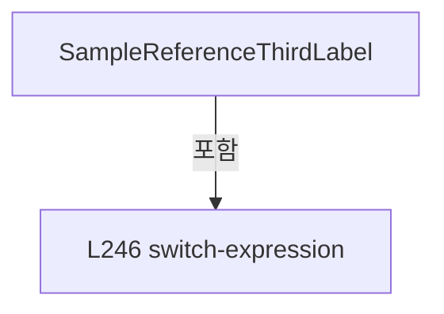

변경 전 점검: 입력/반환 타입, 위 호출자, 예외/취소 경로, 공유 상태와 저장·전송 소비자를 함께 확인합니다. 값의 단위나 물리 방향을 이름만으로 확정하지 않습니다.

### PropertyDeclaration `SampleCorrectionTarget` · L251–251

[Drilling.UI/Menu/Menus/CMenuReview.cs:251–251](https://github.com/kjuws10-rgb/A3Drilling/blob/dfa5920e6301d9ec4b0eab1452ae59521aafc986/Drilling.UI/Menu/Menus/CMenuReview.cs#L251-L251)

| 항목 | 실제 추출 값 |
| --- | --- |
| 서명 | string Drilling.UI.Menu.Menus.CMenuReview.SampleCorrectionTarget |
| 접근/수식자 | Public / public |
| 반환/값 타입 | string |
| 소속 타입 | NamedType:Drilling.UI.Menu.Menus.CMenuReview |

현재 부분 분석에서 직접 연결된 호출자는 없습니다. XAML/이벤트/인터페이스·델리게이트·외부 진입을 추가 확인해야 하며, 미사용으로 판정한 것이 아닙니다.

호출하는 대상과 해석 범위:

| 원본 행 | 표현식 | 분석 상태 | 대상/소스 위치 |
| --- | --- | --- | --- |
| 251 | string.IsNullOrWhiteSpace | resolved | bool string.IsNullOrWhiteSpace(string?) |

본문의 실제 연산·분기·예외·반환 순서(원문 위치 순):

| 원본 행 | 종류 | 주석 해설 |
| --- | --- | --- |
| 251 | call | 함수·델리게이트 또는 객체 생성자를 호출합니다: string.IsNullOrWhiteSpace(_simpleSampleShotKey) |
| 251 | conditional-expression | 조건에 따라 결과식을 선택합니다: string.IsNullOrWhiteSpace(_simpleSampleShotKey) ? "Select one processed Shot from Cell Preview" : $"H{_sampleRuleHeadNo:00} / {(_sampleRuleScope == "HEAD_CELL" ? $"HEAD + Cell{_sampleRuleCellNo}" : "HEAD")}" |
| 251 | conditional-expression | 조건에 따라 결과식을 선택합니다: _sampleRuleScope == "HEAD_CELL" ? $"HEAD + Cell{_sampleRuleCellNo}" : "HEAD" |

변경 전 점검: 입력/반환 타입, 위 호출자, 예외/취소 경로, 공유 상태와 저장·전송 소비자를 함께 확인합니다. 값의 단위나 물리 방향을 이름만으로 확정하지 않습니다.

### PropertyDeclaration `SampleReferenceHead` · L252–252

[Drilling.UI/Menu/Menus/CMenuReview.cs:252–252](https://github.com/kjuws10-rgb/A3Drilling/blob/dfa5920e6301d9ec4b0eab1452ae59521aafc986/Drilling.UI/Menu/Menus/CMenuReview.cs#L252-L252)

| 항목 | 실제 추출 값 |
| --- | --- |
| 서명 | string Drilling.UI.Menu.Menus.CMenuReview.SampleReferenceHead |
| 접근/수식자 | Public / public |
| 반환/값 타입 | string |
| 소속 타입 | NamedType:Drilling.UI.Menu.Menus.CMenuReview |

현재 부분 분석에서 직접 연결된 호출자는 없습니다. XAML/이벤트/인터페이스·델리게이트·외부 진입을 추가 확인해야 하며, 미사용으로 판정한 것이 아닙니다.

호출하는 대상과 해석 범위:

| 원본 행 | 표현식 | 분석 상태 | 대상/소스 위치 |
| --- | --- | --- | --- |
| 252 | GetSimpleReferencePoint | resolved | Drilling.Common.Review.ST_REVIEW_PLAN_POINT? Drilling.UI.Menu.Menus.CMenuReview.GetSimpleReferencePoint() · Drilling.UI/Menu/Menus/CMenuReview.cs:1555 |

본문의 실제 연산·분기·예외·반환 순서(원문 위치 순):

| 원본 행 | 종류 | 주석 해설 |
| --- | --- | --- |
| 252 | call | 함수·델리게이트 또는 객체 생성자를 호출합니다: GetSimpleReferencePoint() |
| 252 | conditional-expression | 조건에 따라 결과식을 선택합니다: IsSimpleSampleRuleUi ? (GetSimpleReferencePoint()is { } point ? $"H{point.HeadNo:00}" : "-") : "ALL" |
| 252 | conditional-expression | 조건에 따라 결과식을 선택합니다: GetSimpleReferencePoint()is { } point ? $"H{point.HeadNo:00}" : "-" |

변경 전 점검: 입력/반환 타입, 위 호출자, 예외/취소 경로, 공유 상태와 저장·전송 소비자를 함께 확인합니다. 값의 단위나 물리 방향을 이름만으로 확정하지 않습니다.

### PropertyDeclaration `SampleReferenceCell` · L253–253

[Drilling.UI/Menu/Menus/CMenuReview.cs:253–253](https://github.com/kjuws10-rgb/A3Drilling/blob/dfa5920e6301d9ec4b0eab1452ae59521aafc986/Drilling.UI/Menu/Menus/CMenuReview.cs#L253-L253)

| 항목 | 실제 추출 값 |
| --- | --- |
| 서명 | string Drilling.UI.Menu.Menus.CMenuReview.SampleReferenceCell |
| 접근/수식자 | Public / public |
| 반환/값 타입 | string |
| 소속 타입 | NamedType:Drilling.UI.Menu.Menus.CMenuReview |

현재 부분 분석에서 직접 연결된 호출자는 없습니다. XAML/이벤트/인터페이스·델리게이트·외부 진입을 추가 확인해야 하며, 미사용으로 판정한 것이 아닙니다.

호출하는 대상과 해석 범위:

| 원본 행 | 표현식 | 분석 상태 | 대상/소스 위치 |
| --- | --- | --- | --- |
| 253 | GetSimpleReferencePoint | resolved | Drilling.Common.Review.ST_REVIEW_PLAN_POINT? Drilling.UI.Menu.Menus.CMenuReview.GetSimpleReferencePoint() · Drilling.UI/Menu/Menus/CMenuReview.cs:1555 |

본문의 실제 연산·분기·예외·반환 순서(원문 위치 순):

| 원본 행 | 종류 | 주석 해설 |
| --- | --- | --- |
| 253 | call | 함수·델리게이트 또는 객체 생성자를 호출합니다: GetSimpleReferencePoint() |
| 253 | conditional-expression | 조건에 따라 결과식을 선택합니다: IsSimpleSampleRuleUi ? (GetSimpleReferencePoint()is { } point ? $"Cell{point.CellNo}" : "-") : IsRoughSampleRuleUi ? "HEAD RANGE" : "ALL" |
| 253 | conditional-expression | 조건에 따라 결과식을 선택합니다: GetSimpleReferencePoint()is { } point ? $"Cell{point.CellNo}" : "-" |
| 253 | conditional-expression | 조건에 따라 결과식을 선택합니다: IsRoughSampleRuleUi ? "HEAD RANGE" : "ALL" |

변경 전 점검: 입력/반환 타입, 위 호출자, 예외/취소 경로, 공유 상태와 저장·전송 소비자를 함께 확인합니다. 값의 단위나 물리 방향을 이름만으로 확정하지 않습니다.

### PropertyDeclaration `SampleReferenceShot` · L254–259

[Drilling.UI/Menu/Menus/CMenuReview.cs:254–259](https://github.com/kjuws10-rgb/A3Drilling/blob/dfa5920e6301d9ec4b0eab1452ae59521aafc986/Drilling.UI/Menu/Menus/CMenuReview.cs#L254-L259)

| 항목 | 실제 추출 값 |
| --- | --- |
| 서명 | string Drilling.UI.Menu.Menus.CMenuReview.SampleReferenceShot |
| 접근/수식자 | Public / public |
| 반환/값 타입 | string |
| 소속 타입 | NamedType:Drilling.UI.Menu.Menus.CMenuReview |

현재 부분 분석에서 직접 연결된 호출자는 없습니다. XAML/이벤트/인터페이스·델리게이트·외부 진입을 추가 확인해야 하며, 미사용으로 판정한 것이 아닙니다.

호출하는 대상과 해석 범위:

| 원본 행 | 표현식 | 분석 상태 | 대상/소스 위치 |
| --- | --- | --- | --- |
| 254 | GetSimpleReferencePoint | resolved | Drilling.Common.Review.ST_REVIEW_PLAN_POINT? Drilling.UI.Menu.Menus.CMenuReview.GetSimpleReferencePoint() · Drilling.UI/Menu/Menus/CMenuReview.cs:1555 |
| 254 | ToMatrixShotName | resolved | string Drilling.UI.Menu.Menus.CMenuReview.ToMatrixShotName(Drilling.Common.Review.ST_REVIEW_PLAN_POINT) · Drilling.UI/Menu/Menus/CMenuReview.cs:2099 |

본문의 실제 연산·분기·예외·반환 순서(원문 위치 순):

| 원본 행 | 종류 | 주석 해설 |
| --- | --- | --- |
| 254 | call | 함수·델리게이트 또는 객체 생성자를 호출합니다: GetSimpleReferencePoint() |
| 254 | call | 함수·델리게이트 또는 객체 생성자를 호출합니다: ToMatrixShotName(point) |
| 254 | conditional-expression | 조건에 따라 결과식을 선택합니다: GetSimpleReferencePoint()is { } point ? ToMatrixShotName(point) : "-" |
| 254 | conditional-expression | 조건에 따라 결과식을 선택합니다: IsSimpleSampleRuleUi ? (GetSimpleReferencePoint()is { } point ? ToMatrixShotName(point) : "-") : _selectedSampleRuleUi switch { "ROUGH" => _roughReference, "FINE" => _fineLineCount == 1 ? "1 LINE" : $"{_fineLineCount} LINES", _ => |
| 254 | switch-expression | 값별 결과식을 선택합니다: _selectedSampleRuleUi switch { "ROUGH" => _roughReference, "FINE" => _fineLineCount == 1 ? "1 LINE" : $"{_fineLineCount} LINES", _ => "-" } |
| 257 | conditional-expression | 조건에 따라 결과식을 선택합니다: _fineLineCount == 1 ? "1 LINE" : $"{_fineLineCount} LINES" |

제어 구문의 포함 구조(실제 실행 순서/CFG가 아닌 구문 탐색 그림):


변경 전 점검: 입력/반환 타입, 위 호출자, 예외/취소 경로, 공유 상태와 저장·전송 소비자를 함께 확인합니다. 값의 단위나 물리 방향을 이름만으로 확정하지 않습니다.

### PropertyDeclaration `SampleOffsetApplyCount` · L260–260

[Drilling.UI/Menu/Menus/CMenuReview.cs:260–260](https://github.com/kjuws10-rgb/A3Drilling/blob/dfa5920e6301d9ec4b0eab1452ae59521aafc986/Drilling.UI/Menu/Menus/CMenuReview.cs#L260-L260)

| 항목 | 실제 추출 값 |
| --- | --- |
| 서명 | string Drilling.UI.Menu.Menus.CMenuReview.SampleOffsetApplyCount |
| 접근/수식자 | Public / public |
| 반환/값 타입 | string |
| 소속 타입 | NamedType:Drilling.UI.Menu.Menus.CMenuReview |

현재 부분 분석에서 직접 연결된 호출자는 없습니다. XAML/이벤트/인터페이스·델리게이트·외부 진입을 추가 확인해야 하며, 미사용으로 판정한 것이 아닙니다.

호출하는 대상과 해석 범위:

| 원본 행 | 표현식 | 분석 상태 | 대상/소스 위치 |
| --- | --- | --- | --- |
| 260 | GetSimpleOffsetApplyCount().ToString | resolved | string int.ToString(string?, System.IFormatProvider?) |
| 260 | GetSimpleOffsetApplyCount | resolved | int Drilling.UI.Menu.Menus.CMenuReview.GetSimpleOffsetApplyCount() · Drilling.UI/Menu/Menus/CMenuReview.cs:1589 |
| 260 | GetAutomaticOffsetApplyCount().ToString | resolved | string int.ToString(string?, System.IFormatProvider?) |
| 260 | GetAutomaticOffsetApplyCount | resolved | int Drilling.UI.Menu.Menus.CMenuReview.GetAutomaticOffsetApplyCount() · Drilling.UI/Menu/Menus/CMenuReview.cs:1606 |

본문의 실제 연산·분기·예외·반환 순서(원문 위치 순):

| 원본 행 | 종류 | 주석 해설 |
| --- | --- | --- |
| 260 | call | 함수·델리게이트 또는 객체 생성자를 호출합니다: GetSimpleOffsetApplyCount().ToString("N0", CultureInfo.InvariantCulture) |
| 260 | call | 함수·델리게이트 또는 객체 생성자를 호출합니다: GetSimpleOffsetApplyCount() |
| 260 | call | 함수·델리게이트 또는 객체 생성자를 호출합니다: GetAutomaticOffsetApplyCount().ToString("N0", CultureInfo.InvariantCulture) |
| 260 | call | 함수·델리게이트 또는 객체 생성자를 호출합니다: GetAutomaticOffsetApplyCount() |
| 260 | conditional-expression | 조건에 따라 결과식을 선택합니다: IsSimpleSampleRuleUi ? GetSimpleOffsetApplyCount().ToString("N0", CultureInfo.InvariantCulture) : GetAutomaticOffsetApplyCount().ToString("N0", CultureInfo.InvariantCulture) |

변경 전 점검: 입력/반환 타입, 위 호출자, 예외/취소 경로, 공유 상태와 저장·전송 소비자를 함께 확인합니다. 값의 단위나 물리 방향을 이름만으로 확정하지 않습니다.

### PropertyDeclaration `SampleInspectionShotCount` · L261–261

[Drilling.UI/Menu/Menus/CMenuReview.cs:261–261](https://github.com/kjuws10-rgb/A3Drilling/blob/dfa5920e6301d9ec4b0eab1452ae59521aafc986/Drilling.UI/Menu/Menus/CMenuReview.cs#L261-L261)

| 항목 | 실제 추출 값 |
| --- | --- |
| 서명 | string Drilling.UI.Menu.Menus.CMenuReview.SampleInspectionShotCount |
| 접근/수식자 | Public / public |
| 반환/값 타입 | string |
| 소속 타입 | NamedType:Drilling.UI.Menu.Menus.CMenuReview |

현재 부분 분석에서 직접 연결된 호출자는 없습니다. XAML/이벤트/인터페이스·델리게이트·외부 진입을 추가 확인해야 하며, 미사용으로 판정한 것이 아닙니다.

호출하는 대상과 해석 범위:

| 원본 행 | 표현식 | 분석 상태 | 대상/소스 위치 |
| --- | --- | --- | --- |
| 261 | GetSimpleReferencePoint | resolved | Drilling.Common.Review.ST_REVIEW_PLAN_POINT? Drilling.UI.Menu.Menus.CMenuReview.GetSimpleReferencePoint() · Drilling.UI/Menu/Menus/CMenuReview.cs:1555 |
| 261 | GetAutomaticInspectionShotCount().ToString | resolved | string int.ToString(string?, System.IFormatProvider?) |
| 261 | GetAutomaticInspectionShotCount | resolved | int Drilling.UI.Menu.Menus.CMenuReview.GetAutomaticInspectionShotCount() · Drilling.UI/Menu/Menus/CMenuReview.cs:1601 |

본문의 실제 연산·분기·예외·반환 순서(원문 위치 순):

| 원본 행 | 종류 | 주석 해설 |
| --- | --- | --- |
| 261 | call | 함수·델리게이트 또는 객체 생성자를 호출합니다: GetSimpleReferencePoint() |
| 261 | call | 함수·델리게이트 또는 객체 생성자를 호출합니다: GetAutomaticInspectionShotCount().ToString("N0", CultureInfo.InvariantCulture) |
| 261 | call | 함수·델리게이트 또는 객체 생성자를 호출합니다: GetAutomaticInspectionShotCount() |
| 261 | conditional-expression | 조건에 따라 결과식을 선택합니다: IsSimpleSampleRuleUi ? (GetSimpleReferencePoint()is null ? "0" : "1") : GetAutomaticInspectionShotCount().ToString("N0", CultureInfo.InvariantCulture) |
| 261 | conditional-expression | 조건에 따라 결과식을 선택합니다: GetSimpleReferencePoint()is null ? "0" : "1" |

변경 전 점검: 입력/반환 타입, 위 호출자, 예외/취소 경로, 공유 상태와 저장·전송 소비자를 함께 확인합니다. 값의 단위나 물리 방향을 이름만으로 확정하지 않습니다.

### PropertyDeclaration `SamplePlanStatus` · L262–262

[Drilling.UI/Menu/Menus/CMenuReview.cs:262–262](https://github.com/kjuws10-rgb/A3Drilling/blob/dfa5920e6301d9ec4b0eab1452ae59521aafc986/Drilling.UI/Menu/Menus/CMenuReview.cs#L262-L262)

| 항목 | 실제 추출 값 |
| --- | --- |
| 서명 | string Drilling.UI.Menu.Menus.CMenuReview.SamplePlanStatus |
| 접근/수식자 | Public / public |
| 반환/값 타입 | string |
| 소속 타입 | NamedType:Drilling.UI.Menu.Menus.CMenuReview |

현재 부분 분석에서 직접 연결된 호출자는 없습니다. XAML/이벤트/인터페이스·델리게이트·외부 진입을 추가 확인해야 하며, 미사용으로 판정한 것이 아닙니다.

호출하는 대상과 해석 범위:

| 원본 행 | 표현식 | 분석 상태 | 대상/소스 위치 |
| --- | --- | --- | --- |
| 262 | GetSimpleReferencePoint | resolved | Drilling.Common.Review.ST_REVIEW_PLAN_POINT? Drilling.UI.Menu.Menus.CMenuReview.GetSimpleReferencePoint() · Drilling.UI/Menu/Menus/CMenuReview.cs:1555 |

본문의 실제 연산·분기·예외·반환 순서(원문 위치 순):

| 원본 행 | 종류 | 주석 해설 |
| --- | --- | --- |
| 262 | call | 함수·델리게이트 또는 객체 생성자를 호출합니다: GetSimpleReferencePoint() |
| 262 | conditional-expression | 조건에 따라 결과식을 선택합니다: IsSimpleSampleRuleUi && GetSimpleReferencePoint()is null ? "Reference Shot Required" : "Ready" |

변경 전 점검: 입력/반환 타입, 위 호출자, 예외/취소 경로, 공유 상태와 저장·전송 소비자를 함께 확인합니다. 값의 단위나 물리 방향을 이름만으로 확정하지 않습니다.

### PropertyDeclaration `IsSampleGlassPreviewVisible` · L263–263

[Drilling.UI/Menu/Menus/CMenuReview.cs:263–263](https://github.com/kjuws10-rgb/A3Drilling/blob/dfa5920e6301d9ec4b0eab1452ae59521aafc986/Drilling.UI/Menu/Menus/CMenuReview.cs#L263-L263)

| 항목 | 실제 추출 값 |
| --- | --- |
| 서명 | bool Drilling.UI.Menu.Menus.CMenuReview.IsSampleGlassPreviewVisible |
| 접근/수식자 | Public / public |
| 반환/값 타입 | bool |
| 소속 타입 | NamedType:Drilling.UI.Menu.Menus.CMenuReview |

현재 부분 분석에서 직접 연결된 호출자는 없습니다. XAML/이벤트/인터페이스·델리게이트·외부 진입을 추가 확인해야 하며, 미사용으로 판정한 것이 아닙니다.

변경 전 점검: 입력/반환 타입, 위 호출자, 예외/취소 경로, 공유 상태와 저장·전송 소비자를 함께 확인합니다. 값의 단위나 물리 방향을 이름만으로 확정하지 않습니다.

### PropertyDeclaration `IsSampleCellDetailVisible` · L264–264

[Drilling.UI/Menu/Menus/CMenuReview.cs:264–264](https://github.com/kjuws10-rgb/A3Drilling/blob/dfa5920e6301d9ec4b0eab1452ae59521aafc986/Drilling.UI/Menu/Menus/CMenuReview.cs#L264-L264)

| 항목 | 실제 추출 값 |
| --- | --- |
| 서명 | bool Drilling.UI.Menu.Menus.CMenuReview.IsSampleCellDetailVisible |
| 접근/수식자 | Public / public |
| 반환/값 타입 | bool |
| 소속 타입 | NamedType:Drilling.UI.Menu.Menus.CMenuReview |

현재 부분 분석에서 직접 연결된 호출자는 없습니다. XAML/이벤트/인터페이스·델리게이트·외부 진입을 추가 확인해야 하며, 미사용으로 판정한 것이 아닙니다.

변경 전 점검: 입력/반환 타입, 위 호출자, 예외/취소 경로, 공유 상태와 저장·전송 소비자를 함께 확인합니다. 값의 단위나 물리 방향을 이름만으로 확정하지 않습니다.

### PropertyDeclaration `SampleWorkspaceTitle` · L265–265

[Drilling.UI/Menu/Menus/CMenuReview.cs:265–265](https://github.com/kjuws10-rgb/A3Drilling/blob/dfa5920e6301d9ec4b0eab1452ae59521aafc986/Drilling.UI/Menu/Menus/CMenuReview.cs#L265-L265)

| 항목 | 실제 추출 값 |
| --- | --- |
| 서명 | string Drilling.UI.Menu.Menus.CMenuReview.SampleWorkspaceTitle |
| 접근/수식자 | Public / public |
| 반환/값 타입 | string |
| 소속 타입 | NamedType:Drilling.UI.Menu.Menus.CMenuReview |

현재 부분 분석에서 직접 연결된 호출자는 없습니다. XAML/이벤트/인터페이스·델리게이트·외부 진입을 추가 확인해야 하며, 미사용으로 판정한 것이 아닙니다.

본문의 실제 연산·분기·예외·반환 순서(원문 위치 순):

| 원본 행 | 종류 | 주석 해설 |
| --- | --- | --- |
| 265 | conditional-expression | 조건에 따라 결과식을 선택합니다: !_isSampleCellDetailVisible ? "Glass / Cell Preview" : IsSimpleSampleRuleUi ? $"Cell{_selectedSampleCellNo} / SIMPLE Reference Shot Selection" : $"Cell{_selectedSampleCellNo} / {_selectedSampleRuleUi} Inspection Shot Preview" |
| 265 | conditional-expression | 조건에 따라 결과식을 선택합니다: IsSimpleSampleRuleUi ? $"Cell{_selectedSampleCellNo} / SIMPLE Reference Shot Selection" : $"Cell{_selectedSampleCellNo} / {_selectedSampleRuleUi} Inspection Shot Preview" |

변경 전 점검: 입력/반환 타입, 위 호출자, 예외/취소 경로, 공유 상태와 저장·전송 소비자를 함께 확인합니다. 값의 단위나 물리 방향을 이름만으로 확정하지 않습니다.

### PropertyDeclaration `SampleWorkspaceSummary` · L266–266

[Drilling.UI/Menu/Menus/CMenuReview.cs:266–266](https://github.com/kjuws10-rgb/A3Drilling/blob/dfa5920e6301d9ec4b0eab1452ae59521aafc986/Drilling.UI/Menu/Menus/CMenuReview.cs#L266-L266)

| 항목 | 실제 추출 값 |
| --- | --- |
| 서명 | string Drilling.UI.Menu.Menus.CMenuReview.SampleWorkspaceSummary |
| 접근/수식자 | Public / public |
| 반환/값 타입 | string |
| 소속 타입 | NamedType:Drilling.UI.Menu.Menus.CMenuReview |

현재 부분 분석에서 직접 연결된 호출자는 없습니다. XAML/이벤트/인터페이스·델리게이트·외부 진입을 추가 확인해야 하며, 미사용으로 판정한 것이 아닙니다.

호출하는 대상과 해석 범위:

| 원본 행 | 표현식 | 분석 상태 | 대상/소스 위치 |
| --- | --- | --- | --- |
| 266 | GetSimpleReferencePoint | resolved | Drilling.Common.Review.ST_REVIEW_PLAN_POINT? Drilling.UI.Menu.Menus.CMenuReview.GetSimpleReferencePoint() · Drilling.UI/Menu/Menus/CMenuReview.cs:1555 |
| 266 | GetSelectedSampleCellShotCount | resolved | int Drilling.UI.Menu.Menus.CMenuReview.GetSelectedSampleCellShotCount() · Drilling.UI/Menu/Menus/CMenuReview.cs:1664 |
| 266 | GetSampleCellShotCount | resolved | int Drilling.UI.Menu.Menus.CMenuReview.GetSampleCellShotCount() · Drilling.UI/Menu/Menus/CMenuReview.cs:1663 |

본문의 실제 연산·분기·예외·반환 순서(원문 위치 순):

| 원본 행 | 종류 | 주석 해설 |
| --- | --- | --- |
| 266 | call | 함수·델리게이트 또는 객체 생성자를 호출합니다: GetSimpleReferencePoint() |
| 266 | call | 함수·델리게이트 또는 객체 생성자를 호출합니다: GetSelectedSampleCellShotCount() |
| 266 | call | 함수·델리게이트 또는 객체 생성자를 호출합니다: GetSampleCellShotCount() |
| 266 | conditional-expression | 조건에 따라 결과식을 선택합니다: !_isSampleCellDetailVisible ? SampleGlassPreviewSummary : IsSimpleSampleRuleUi ? (GetSimpleReferencePoint()is null ? "Select one processed Shot" : "1 Reference Shot Selected") : $"{GetSelectedSampleCellShotCount():N0} / {GetSample |
| 266 | conditional-expression | 조건에 따라 결과식을 선택합니다: IsSimpleSampleRuleUi ? (GetSimpleReferencePoint()is null ? "Select one processed Shot" : "1 Reference Shot Selected") : $"{GetSelectedSampleCellShotCount():N0} / {GetSampleCellShotCount():N0} Inspection Shots (Read Only)" |
| 266 | conditional-expression | 조건에 따라 결과식을 선택합니다: GetSimpleReferencePoint()is null ? "Select one processed Shot" : "1 Reference Shot Selected" |

변경 전 점검: 입력/반환 타입, 위 호출자, 예외/취소 경로, 공유 상태와 저장·전송 소비자를 함께 확인합니다. 값의 단위나 물리 방향을 이름만으로 확정하지 않습니다.

### PropertyDeclaration `SampleRuleName` · L267–267

[Drilling.UI/Menu/Menus/CMenuReview.cs:267–267](https://github.com/kjuws10-rgb/A3Drilling/blob/dfa5920e6301d9ec4b0eab1452ae59521aafc986/Drilling.UI/Menu/Menus/CMenuReview.cs#L267-L267)

| 항목 | 실제 추출 값 |
| --- | --- |
| 서명 | string Drilling.UI.Menu.Menus.CMenuReview.SampleRuleName |
| 접근/수식자 | Public / public |
| 반환/값 타입 | string |
| 소속 타입 | NamedType:Drilling.UI.Menu.Menus.CMenuReview |

현재 부분 분석에서 직접 연결된 호출자는 없습니다. XAML/이벤트/인터페이스·델리게이트·외부 진입을 추가 확인해야 하며, 미사용으로 판정한 것이 아닙니다.

호출하는 대상과 해석 범위:

| 원본 행 | 표현식 | 분석 상태 | 대상/소스 위치 |
| --- | --- | --- | --- |
| 267 | GetSelectionRuleText | resolved | string Drilling.UI.Menu.Menus.CMenuReview.GetSelectionRuleText() · Drilling.UI/Menu/Menus/CMenuReview.cs:1787 |

본문의 실제 연산·분기·예외·반환 순서(원문 위치 순):

| 원본 행 | 종류 | 주석 해설 |
| --- | --- | --- |
| 267 | call | 함수·델리게이트 또는 객체 생성자를 호출합니다: GetSelectionRuleText() |

변경 전 점검: 입력/반환 타입, 위 호출자, 예외/취소 경로, 공유 상태와 저장·전송 소비자를 함께 확인합니다. 값의 단위나 물리 방향을 이름만으로 확정하지 않습니다.

### PropertyDeclaration `SampleHeadOptions` · L268–268

[Drilling.UI/Menu/Menus/CMenuReview.cs:268–268](https://github.com/kjuws10-rgb/A3Drilling/blob/dfa5920e6301d9ec4b0eab1452ae59521aafc986/Drilling.UI/Menu/Menus/CMenuReview.cs#L268-L268)

| 항목 | 실제 추출 값 |
| --- | --- |
| 서명 | System.Collections.Generic.IReadOnlyList<string> Drilling.UI.Menu.Menus.CMenuReview.SampleHeadOptions |
| 접근/수식자 | Public / public |
| 반환/값 타입 | System.Collections.Generic.IReadOnlyList<string> |
| 소속 타입 | NamedType:Drilling.UI.Menu.Menus.CMenuReview |

현재 부분 분석에서 직접 연결된 호출자는 없습니다. XAML/이벤트/인터페이스·델리게이트·외부 진입을 추가 확인해야 하며, 미사용으로 판정한 것이 아닙니다.

호출하는 대상과 해석 범위:

| 원본 행 | 표현식 | 분석 상태 | 대상/소스 위치 |
| --- | --- | --- | --- |
| 268 | Enumerable.Range(1, Math.Max(1, _headCount)).Select(headNo => $"H{headNo:00}").ToArray | resolved | string[] System.Collections.Generic.IEnumerable<string>.ToArray<string>() |
| 268 | Enumerable.Range(1, Math.Max(1, _headCount)).Select | resolved | System.Collections.Generic.IEnumerable<string> System.Collections.Generic.IEnumerable<int>.Select<int, string>(System.Func<int, string>) |
| 268 | Enumerable.Range | resolved | System.Collections.Generic.IEnumerable<int> System.Linq.Enumerable.Range(int, int) |
| 268 | Math.Max | resolved | int System.Math.Max(int, int) |

본문의 실제 연산·분기·예외·반환 순서(원문 위치 순):

| 원본 행 | 종류 | 주석 해설 |
| --- | --- | --- |
| 268 | call | 함수·델리게이트 또는 객체 생성자를 호출합니다: Enumerable.Range(1, Math.Max(1, _headCount)).Select(headNo => $"H{headNo:00}").ToArray() |
| 268 | call | 함수·델리게이트 또는 객체 생성자를 호출합니다: Enumerable.Range(1, Math.Max(1, _headCount)).Select(headNo => $"H{headNo:00}") |
| 268 | call | 함수·델리게이트 또는 객체 생성자를 호출합니다: Enumerable.Range(1, Math.Max(1, _headCount)) |
| 268 | call | 함수·델리게이트 또는 객체 생성자를 호출합니다: Math.Max(1, _headCount) |

변경 전 점검: 입력/반환 타입, 위 호출자, 예외/취소 경로, 공유 상태와 저장·전송 소비자를 함께 확인합니다. 값의 단위나 물리 방향을 이름만으로 확정하지 않습니다.

### PropertyDeclaration `SelectedSampleHead` · L270–286

[Drilling.UI/Menu/Menus/CMenuReview.cs:270–286](https://github.com/kjuws10-rgb/A3Drilling/blob/dfa5920e6301d9ec4b0eab1452ae59521aafc986/Drilling.UI/Menu/Menus/CMenuReview.cs#L270-L286)

| 항목 | 실제 추출 값 |
| --- | --- |
| 서명 | string Drilling.UI.Menu.Menus.CMenuReview.SelectedSampleHead |
| 접근/수식자 | Public / public |
| 반환/값 타입 | string |
| 소속 타입 | NamedType:Drilling.UI.Menu.Menus.CMenuReview |

현재 부분 분석에서 직접 연결된 호출자는 없습니다. XAML/이벤트/인터페이스·델리게이트·외부 진입을 추가 확인해야 하며, 미사용으로 판정한 것이 아닙니다.

변경 전 점검: 입력/반환 타입, 위 호출자, 예외/취소 경로, 공유 상태와 저장·전송 소비자를 함께 확인합니다. 값의 단위나 물리 방향을 이름만으로 확정하지 않습니다.

### GetAccessorDeclaration `get_SelectedSampleHead` · L272–272

[Drilling.UI/Menu/Menus/CMenuReview.cs:272–272](https://github.com/kjuws10-rgb/A3Drilling/blob/dfa5920e6301d9ec4b0eab1452ae59521aafc986/Drilling.UI/Menu/Menus/CMenuReview.cs#L272-L272)

| 항목 | 실제 추출 값 |
| --- | --- |
| 서명 | string Drilling.UI.Menu.Menus.CMenuReview.SelectedSampleHead.get |
| 접근/수식자 | Public / get |
| 반환/값 타입 | string |
| 소속 타입 | NamedType:Drilling.UI.Menu.Menus.CMenuReview |

현재 부분 분석에서 직접 연결된 호출자는 없습니다. XAML/이벤트/인터페이스·델리게이트·외부 진입을 추가 확인해야 하며, 미사용으로 판정한 것이 아닙니다.

변경 전 점검: 입력/반환 타입, 위 호출자, 예외/취소 경로, 공유 상태와 저장·전송 소비자를 함께 확인합니다. 값의 단위나 물리 방향을 이름만으로 확정하지 않습니다.

### SetAccessorDeclaration `set_SelectedSampleHead` · L273–285

[Drilling.UI/Menu/Menus/CMenuReview.cs:273–285](https://github.com/kjuws10-rgb/A3Drilling/blob/dfa5920e6301d9ec4b0eab1452ae59521aafc986/Drilling.UI/Menu/Menus/CMenuReview.cs#L273-L285)

| 항목 | 실제 추출 값 |
| --- | --- |
| 서명 | void Drilling.UI.Menu.Menus.CMenuReview.SelectedSampleHead.set |
| 접근/수식자 | Public / set |
| 반환/값 타입 | void |
| 소속 타입 | NamedType:Drilling.UI.Menu.Menus.CMenuReview |

입력 계약:

| 이름 | 타입 | 전달 | 선택/기본값 |
| --- | --- | --- | --- |
| value | string | None | False /  |

현재 부분 분석에서 직접 연결된 호출자는 없습니다. XAML/이벤트/인터페이스·델리게이트·외부 진입을 추가 확인해야 하며, 미사용으로 판정한 것이 아닙니다.

호출하는 대상과 해석 범위:

| 원본 행 | 표현식 | 분석 상태 | 대상/소스 위치 |
| --- | --- | --- | --- |
| 275 | .Trim | resolved | string string.Trim() |
| 276 | normalized.StartsWith | resolved | bool string.StartsWith(char) |
| 281 | int.TryParse | resolved | bool int.TryParse(string?, System.Globalization.NumberStyles, System.IFormatProvider?, out int) |
| 283 | Math.Clamp | resolved | int System.Math.Clamp(int, int, int) |
| 283 | Math.Max | resolved | int System.Math.Max(int, int) |

본문의 실제 연산·분기·예외·반환 순서(원문 위치 순):

| 원본 행 | 종류 | 주석 해설 |
| --- | --- | --- |
| 275 | call | 함수·델리게이트 또는 객체 생성자를 호출합니다: .Trim() |
| 275 | local-declaration | 지역 변수를 선언합니다: var normalized = value?.Trim() ?? ""; |
| 275 | variable-initializer | 변수의 초기값을 지정합니다: normalized = value?.Trim() ?? "" |
| 276 | call | 함수·델리게이트 또는 객체 생성자를 호출합니다: normalized.StartsWith('H') |
| 276 | if | 조건에 따라 분기합니다: if (normalized.StartsWith('H')) |
| 278 | assignment | 값을 대상에 대입합니다: normalized = normalized[1..] |
| 281 | call | 함수·델리게이트 또는 객체 생성자를 호출합니다: int.TryParse(normalized, NumberStyles.Integer, CultureInfo.InvariantCulture, out var headNo) |
| 281 | if | 조건에 따라 분기합니다: if (int.TryParse(normalized, NumberStyles.Integer, CultureInfo.InvariantCulture, out var headNo)) |
| 283 | assignment | 값을 대상에 대입합니다: _sampleRuleHeadNo = Math.Clamp(headNo, 1, Math.Max(1, _headCount)) |
| 283 | call | 함수·델리게이트 또는 객체 생성자를 호출합니다: Math.Clamp(headNo, 1, Math.Max(1, _headCount)) |
| 283 | call | 함수·델리게이트 또는 객체 생성자를 호출합니다: Math.Max(1, _headCount) |

제어 구문의 포함 구조(실제 실행 순서/CFG가 아닌 구문 탐색 그림):

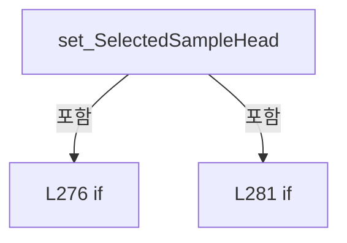

변경 전 점검: 입력/반환 타입, 위 호출자, 예외/취소 경로, 공유 상태와 저장·전송 소비자를 함께 확인합니다. 값의 단위나 물리 방향을 이름만으로 확정하지 않습니다.

### PropertyDeclaration `SampleCellOptions` · L288–288

[Drilling.UI/Menu/Menus/CMenuReview.cs:288–288](https://github.com/kjuws10-rgb/A3Drilling/blob/dfa5920e6301d9ec4b0eab1452ae59521aafc986/Drilling.UI/Menu/Menus/CMenuReview.cs#L288-L288)

| 항목 | 실제 추출 값 |
| --- | --- |
| 서명 | System.Collections.Generic.IReadOnlyList<string> Drilling.UI.Menu.Menus.CMenuReview.SampleCellOptions |
| 접근/수식자 | Public / public |
| 반환/값 타입 | System.Collections.Generic.IReadOnlyList<string> |
| 소속 타입 | NamedType:Drilling.UI.Menu.Menus.CMenuReview |

현재 부분 분석에서 직접 연결된 호출자는 없습니다. XAML/이벤트/인터페이스·델리게이트·외부 진입을 추가 확인해야 하며, 미사용으로 판정한 것이 아닙니다.

호출하는 대상과 해석 범위:

| 원본 행 | 표현식 | 분석 상태 | 대상/소스 위치 |
| --- | --- | --- | --- |
| 288 | Enumerable.Range(1, Math.Max(1, _cellCount)).Select(cellNo => $"Cell{cellNo}").ToArray | resolved | string[] System.Collections.Generic.IEnumerable<string>.ToArray<string>() |
| 288 | Enumerable.Range(1, Math.Max(1, _cellCount)).Select | resolved | System.Collections.Generic.IEnumerable<string> System.Collections.Generic.IEnumerable<int>.Select<int, string>(System.Func<int, string>) |
| 288 | Enumerable.Range | resolved | System.Collections.Generic.IEnumerable<int> System.Linq.Enumerable.Range(int, int) |
| 288 | Math.Max | resolved | int System.Math.Max(int, int) |

본문의 실제 연산·분기·예외·반환 순서(원문 위치 순):

| 원본 행 | 종류 | 주석 해설 |
| --- | --- | --- |
| 288 | call | 함수·델리게이트 또는 객체 생성자를 호출합니다: Enumerable.Range(1, Math.Max(1, _cellCount)).Select(cellNo => $"Cell{cellNo}").ToArray() |
| 288 | call | 함수·델리게이트 또는 객체 생성자를 호출합니다: Enumerable.Range(1, Math.Max(1, _cellCount)).Select(cellNo => $"Cell{cellNo}") |
| 288 | call | 함수·델리게이트 또는 객체 생성자를 호출합니다: Enumerable.Range(1, Math.Max(1, _cellCount)) |
| 288 | call | 함수·델리게이트 또는 객체 생성자를 호출합니다: Math.Max(1, _cellCount) |

변경 전 점검: 입력/반환 타입, 위 호출자, 예외/취소 경로, 공유 상태와 저장·전송 소비자를 함께 확인합니다. 값의 단위나 물리 방향을 이름만으로 확정하지 않습니다.

### PropertyDeclaration `SelectedSampleCell` · L290–306

[Drilling.UI/Menu/Menus/CMenuReview.cs:290–306](https://github.com/kjuws10-rgb/A3Drilling/blob/dfa5920e6301d9ec4b0eab1452ae59521aafc986/Drilling.UI/Menu/Menus/CMenuReview.cs#L290-L306)

| 항목 | 실제 추출 값 |
| --- | --- |
| 서명 | string Drilling.UI.Menu.Menus.CMenuReview.SelectedSampleCell |
| 접근/수식자 | Public / public |
| 반환/값 타입 | string |
| 소속 타입 | NamedType:Drilling.UI.Menu.Menus.CMenuReview |

현재 부분 분석에서 직접 연결된 호출자는 없습니다. XAML/이벤트/인터페이스·델리게이트·외부 진입을 추가 확인해야 하며, 미사용으로 판정한 것이 아닙니다.

변경 전 점검: 입력/반환 타입, 위 호출자, 예외/취소 경로, 공유 상태와 저장·전송 소비자를 함께 확인합니다. 값의 단위나 물리 방향을 이름만으로 확정하지 않습니다.

### GetAccessorDeclaration `get_SelectedSampleCell` · L292–292

[Drilling.UI/Menu/Menus/CMenuReview.cs:292–292](https://github.com/kjuws10-rgb/A3Drilling/blob/dfa5920e6301d9ec4b0eab1452ae59521aafc986/Drilling.UI/Menu/Menus/CMenuReview.cs#L292-L292)

| 항목 | 실제 추출 값 |
| --- | --- |
| 서명 | string Drilling.UI.Menu.Menus.CMenuReview.SelectedSampleCell.get |
| 접근/수식자 | Public / get |
| 반환/값 타입 | string |
| 소속 타입 | NamedType:Drilling.UI.Menu.Menus.CMenuReview |

현재 부분 분석에서 직접 연결된 호출자는 없습니다. XAML/이벤트/인터페이스·델리게이트·외부 진입을 추가 확인해야 하며, 미사용으로 판정한 것이 아닙니다.

변경 전 점검: 입력/반환 타입, 위 호출자, 예외/취소 경로, 공유 상태와 저장·전송 소비자를 함께 확인합니다. 값의 단위나 물리 방향을 이름만으로 확정하지 않습니다.

### SetAccessorDeclaration `set_SelectedSampleCell` · L293–305

[Drilling.UI/Menu/Menus/CMenuReview.cs:293–305](https://github.com/kjuws10-rgb/A3Drilling/blob/dfa5920e6301d9ec4b0eab1452ae59521aafc986/Drilling.UI/Menu/Menus/CMenuReview.cs#L293-L305)

| 항목 | 실제 추출 값 |
| --- | --- |
| 서명 | void Drilling.UI.Menu.Menus.CMenuReview.SelectedSampleCell.set |
| 접근/수식자 | Public / set |
| 반환/값 타입 | void |
| 소속 타입 | NamedType:Drilling.UI.Menu.Menus.CMenuReview |

입력 계약:

| 이름 | 타입 | 전달 | 선택/기본값 |
| --- | --- | --- | --- |
| value | string | None | False /  |

현재 부분 분석에서 직접 연결된 호출자는 없습니다. XAML/이벤트/인터페이스·델리게이트·외부 진입을 추가 확인해야 하며, 미사용으로 판정한 것이 아닙니다.

호출하는 대상과 해석 범위:

| 원본 행 | 표현식 | 분석 상태 | 대상/소스 위치 |
| --- | --- | --- | --- |
| 295 | .Trim | resolved | string string.Trim() |
| 296 | normalized.StartsWith | resolved | bool string.StartsWith(string, System.StringComparison) |
| 301 | int.TryParse | resolved | bool int.TryParse(string?, System.Globalization.NumberStyles, System.IFormatProvider?, out int) |
| 303 | Math.Clamp | resolved | int System.Math.Clamp(int, int, int) |
| 303 | Math.Max | resolved | int System.Math.Max(int, int) |

본문의 실제 연산·분기·예외·반환 순서(원문 위치 순):

| 원본 행 | 종류 | 주석 해설 |
| --- | --- | --- |
| 295 | call | 함수·델리게이트 또는 객체 생성자를 호출합니다: .Trim() |
| 295 | local-declaration | 지역 변수를 선언합니다: var normalized = value?.Trim() ?? ""; |
| 295 | variable-initializer | 변수의 초기값을 지정합니다: normalized = value?.Trim() ?? "" |
| 296 | call | 함수·델리게이트 또는 객체 생성자를 호출합니다: normalized.StartsWith("Cell", StringComparison.OrdinalIgnoreCase) |
| 296 | if | 조건에 따라 분기합니다: if (normalized.StartsWith("Cell", StringComparison.OrdinalIgnoreCase)) |
| 298 | assignment | 값을 대상에 대입합니다: normalized = normalized[4..] |
| 301 | call | 함수·델리게이트 또는 객체 생성자를 호출합니다: int.TryParse(normalized, NumberStyles.Integer, CultureInfo.InvariantCulture, out var cellNo) |
| 301 | if | 조건에 따라 분기합니다: if (int.TryParse(normalized, NumberStyles.Integer, CultureInfo.InvariantCulture, out var cellNo)) |
| 303 | assignment | 값을 대상에 대입합니다: _sampleRuleCellNo = Math.Clamp(cellNo, 1, Math.Max(1, _cellCount)) |
| 303 | call | 함수·델리게이트 또는 객체 생성자를 호출합니다: Math.Clamp(cellNo, 1, Math.Max(1, _cellCount)) |
| 303 | call | 함수·델리게이트 또는 객체 생성자를 호출합니다: Math.Max(1, _cellCount) |

제어 구문의 포함 구조(실제 실행 순서/CFG가 아닌 구문 탐색 그림):

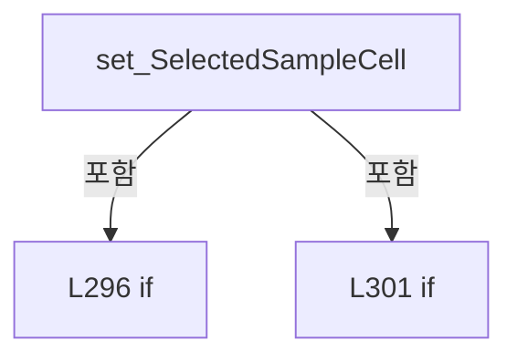

변경 전 점검: 입력/반환 타입, 위 호출자, 예외/취소 경로, 공유 상태와 저장·전송 소비자를 함께 확인합니다. 값의 단위나 물리 방향을 이름만으로 확정하지 않습니다.

### PropertyDeclaration `SampleRuleSelectionSummary` · L308–314

[Drilling.UI/Menu/Menus/CMenuReview.cs:308–314](https://github.com/kjuws10-rgb/A3Drilling/blob/dfa5920e6301d9ec4b0eab1452ae59521aafc986/Drilling.UI/Menu/Menus/CMenuReview.cs#L308-L314)

| 항목 | 실제 추출 값 |
| --- | --- |
| 서명 | string Drilling.UI.Menu.Menus.CMenuReview.SampleRuleSelectionSummary |
| 접근/수식자 | Public / public |
| 반환/값 타입 | string |
| 소속 타입 | NamedType:Drilling.UI.Menu.Menus.CMenuReview |

현재 부분 분석에서 직접 연결된 호출자는 없습니다. XAML/이벤트/인터페이스·델리게이트·외부 진입을 추가 확인해야 하며, 미사용으로 판정한 것이 아닙니다.

호출하는 대상과 해석 범위:

| 원본 행 | 표현식 | 분석 상태 | 대상/소스 위치 |
| --- | --- | --- | --- |
| 310 | string.IsNullOrWhiteSpace | resolved | bool string.IsNullOrWhiteSpace(string?) |

본문의 실제 연산·분기·예외·반환 순서(원문 위치 순):

| 원본 행 | 종류 | 주석 해설 |
| --- | --- | --- |
| 308 | switch-expression | 값별 결과식을 선택합니다: _selectedSampleRuleUi switch { "SIMPLE" => string.IsNullOrWhiteSpace(_simpleSampleShotKey) ? "Select 1 Shot" : SampleCorrectionTarget, "ROUGH" => $"Every Head / Full Head Range / {_roughReference}", "FINE" => $"Each Cell / {_fineL |
| 310 | call | 함수·델리게이트 또는 객체 생성자를 호출합니다: string.IsNullOrWhiteSpace(_simpleSampleShotKey) |
| 310 | conditional-expression | 조건에 따라 결과식을 선택합니다: string.IsNullOrWhiteSpace(_simpleSampleShotKey) ? "Select 1 Shot" : SampleCorrectionTarget |

제어 구문의 포함 구조(실제 실행 순서/CFG가 아닌 구문 탐색 그림):

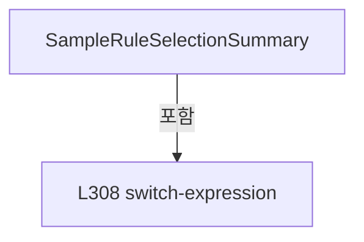

변경 전 점검: 입력/반환 타입, 위 호출자, 예외/취소 경로, 공유 상태와 저장·전송 소비자를 함께 확인합니다. 값의 단위나 물리 방향을 이름만으로 확정하지 않습니다.

### PropertyDeclaration `SampleRuleDescription` · L315–321

[Drilling.UI/Menu/Menus/CMenuReview.cs:315–321](https://github.com/kjuws10-rgb/A3Drilling/blob/dfa5920e6301d9ec4b0eab1452ae59521aafc986/Drilling.UI/Menu/Menus/CMenuReview.cs#L315-L321)

| 항목 | 실제 추출 값 |
| --- | --- |
| 서명 | string Drilling.UI.Menu.Menus.CMenuReview.SampleRuleDescription |
| 접근/수식자 | Public / public |
| 반환/값 타입 | string |
| 소속 타입 | NamedType:Drilling.UI.Menu.Menus.CMenuReview |

현재 부분 분석에서 직접 연결된 호출자는 없습니다. XAML/이벤트/인터페이스·델리게이트·외부 진입을 추가 확인해야 하며, 미사용으로 판정한 것이 아닙니다.

본문의 실제 연산·분기·예외·반환 순서(원문 위치 순):

| 원본 행 | 종류 | 주석 해설 |
| --- | --- | --- |
| 315 | switch-expression | 값별 결과식을 선택합니다: _selectedSampleRuleUi switch { "SIMPLE" => "Measure one Shot and apply the same correction to HEAD or HEAD + CELL.", "ROUGH" => "Measure the first processed Shot on the FIRST, CENTER, or LAST line of each Head's full processing ra |

제어 구문의 포함 구조(실제 실행 순서/CFG가 아닌 구문 탐색 그림):

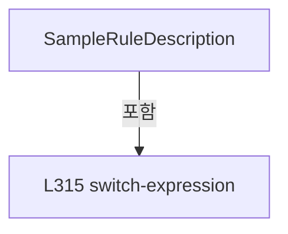

변경 전 점검: 입력/반환 타입, 위 호출자, 예외/취소 경로, 공유 상태와 저장·전송 소비자를 함께 확인합니다. 값의 단위나 물리 방향을 이름만으로 확정하지 않습니다.

### PropertyDeclaration `BeamOptions` · L322–322

[Drilling.UI/Menu/Menus/CMenuReview.cs:322–322](https://github.com/kjuws10-rgb/A3Drilling/blob/dfa5920e6301d9ec4b0eab1452ae59521aafc986/Drilling.UI/Menu/Menus/CMenuReview.cs#L322-L322)

| 항목 | 실제 추출 값 |
| --- | --- |
| 서명 | System.Collections.Generic.IReadOnlyList<string> Drilling.UI.Menu.Menus.CMenuReview.BeamOptions |
| 접근/수식자 | Public / public |
| 반환/값 타입 | System.Collections.Generic.IReadOnlyList<string> |
| 소속 타입 | NamedType:Drilling.UI.Menu.Menus.CMenuReview |

현재 부분 분석에서 직접 연결된 호출자는 없습니다. XAML/이벤트/인터페이스·델리게이트·외부 진입을 추가 확인해야 하며, 미사용으로 판정한 것이 아닙니다.

호출하는 대상과 해석 범위:

| 원본 행 | 표현식 | 분석 상태 | 대상/소스 위치 |
| --- | --- | --- | --- |
| 322 | Enumerable.Range(1, _splitBeamCount * _splitBeamCount).Select(beamNo => $"Beam{beamNo}").ToArray | resolved | string[] System.Collections.Generic.IEnumerable<string>.ToArray<string>() |
| 322 | Enumerable.Range(1, _splitBeamCount * _splitBeamCount).Select | resolved | System.Collections.Generic.IEnumerable<string> System.Collections.Generic.IEnumerable<int>.Select<int, string>(System.Func<int, string>) |
| 322 | Enumerable.Range | resolved | System.Collections.Generic.IEnumerable<int> System.Linq.Enumerable.Range(int, int) |

본문의 실제 연산·분기·예외·반환 순서(원문 위치 순):

| 원본 행 | 종류 | 주석 해설 |
| --- | --- | --- |
| 322 | call | 함수·델리게이트 또는 객체 생성자를 호출합니다: Enumerable.Range(1, _splitBeamCount * _splitBeamCount).Select(beamNo => $"Beam{beamNo}").ToArray() |
| 322 | call | 함수·델리게이트 또는 객체 생성자를 호출합니다: Enumerable.Range(1, _splitBeamCount * _splitBeamCount).Select(beamNo => $"Beam{beamNo}") |
| 322 | call | 함수·델리게이트 또는 객체 생성자를 호출합니다: Enumerable.Range(1, _splitBeamCount * _splitBeamCount) |

변경 전 점검: 입력/반환 타입, 위 호출자, 예외/취소 경로, 공유 상태와 저장·전송 소비자를 함께 확인합니다. 값의 단위나 물리 방향을 이름만으로 확정하지 않습니다.

### PropertyDeclaration `SelectedBeam` · L323–323

[Drilling.UI/Menu/Menus/CMenuReview.cs:323–323](https://github.com/kjuws10-rgb/A3Drilling/blob/dfa5920e6301d9ec4b0eab1452ae59521aafc986/Drilling.UI/Menu/Menus/CMenuReview.cs#L323-L323)

| 항목 | 실제 추출 값 |
| --- | --- |
| 서명 | string Drilling.UI.Menu.Menus.CMenuReview.SelectedBeam |
| 접근/수식자 | Public / public |
| 반환/값 타입 | string |
| 소속 타입 | NamedType:Drilling.UI.Menu.Menus.CMenuReview |

현재 부분 분석에서 직접 연결된 호출자는 없습니다. XAML/이벤트/인터페이스·델리게이트·외부 진입을 추가 확인해야 하며, 미사용으로 판정한 것이 아닙니다.

변경 전 점검: 입력/반환 타입, 위 호출자, 예외/취소 경로, 공유 상태와 저장·전송 소비자를 함께 확인합니다. 값의 단위나 물리 방향을 이름만으로 확정하지 않습니다.

### GetAccessorDeclaration `get_SelectedBeam` · L323–323

[Drilling.UI/Menu/Menus/CMenuReview.cs:323–323](https://github.com/kjuws10-rgb/A3Drilling/blob/dfa5920e6301d9ec4b0eab1452ae59521aafc986/Drilling.UI/Menu/Menus/CMenuReview.cs#L323-L323)

| 항목 | 실제 추출 값 |
| --- | --- |
| 서명 | string Drilling.UI.Menu.Menus.CMenuReview.SelectedBeam.get |
| 접근/수식자 | Public / get |
| 반환/값 타입 | string |
| 소속 타입 | NamedType:Drilling.UI.Menu.Menus.CMenuReview |

현재 부분 분석에서 직접 연결된 호출자는 없습니다. XAML/이벤트/인터페이스·델리게이트·외부 진입을 추가 확인해야 하며, 미사용으로 판정한 것이 아닙니다.

변경 전 점검: 입력/반환 타입, 위 호출자, 예외/취소 경로, 공유 상태와 저장·전송 소비자를 함께 확인합니다. 값의 단위나 물리 방향을 이름만으로 확정하지 않습니다.

### SetAccessorDeclaration `set_SelectedBeam` · L323–323

[Drilling.UI/Menu/Menus/CMenuReview.cs:323–323](https://github.com/kjuws10-rgb/A3Drilling/blob/dfa5920e6301d9ec4b0eab1452ae59521aafc986/Drilling.UI/Menu/Menus/CMenuReview.cs#L323-L323)

| 항목 | 실제 추출 값 |
| --- | --- |
| 서명 | void Drilling.UI.Menu.Menus.CMenuReview.SelectedBeam.set |
| 접근/수식자 | Public / set |
| 반환/값 타입 | void |
| 소속 타입 | NamedType:Drilling.UI.Menu.Menus.CMenuReview |

입력 계약:

| 이름 | 타입 | 전달 | 선택/기본값 |
| --- | --- | --- | --- |
| value | string | None | False /  |

현재 부분 분석에서 직접 연결된 호출자는 없습니다. XAML/이벤트/인터페이스·델리게이트·외부 진입을 추가 확인해야 하며, 미사용으로 판정한 것이 아닙니다.

호출하는 대상과 해석 범위:

| 원본 행 | 표현식 | 분석 상태 | 대상/소스 위치 |
| --- | --- | --- | --- |
| 323 | SelectRunBeam | resolved | void Drilling.UI.Menu.Menus.CMenuReview.SelectRunBeam(object?) · Drilling.UI/Menu/Menus/CMenuReview.cs:1245 |

본문의 실제 연산·분기·예외·반환 순서(원문 위치 순):

| 원본 행 | 종류 | 주석 해설 |
| --- | --- | --- |
| 323 | call | 함수·델리게이트 또는 객체 생성자를 호출합니다: SelectRunBeam(value) |

변경 전 점검: 입력/반환 타입, 위 호출자, 예외/취소 경로, 공유 상태와 저장·전송 소비자를 함께 확인합니다. 값의 단위나 물리 방향을 이름만으로 확정하지 않습니다.

### PropertyDeclaration `CanSelectBeam` · L324–324

[Drilling.UI/Menu/Menus/CMenuReview.cs:324–324](https://github.com/kjuws10-rgb/A3Drilling/blob/dfa5920e6301d9ec4b0eab1452ae59521aafc986/Drilling.UI/Menu/Menus/CMenuReview.cs#L324-L324)

| 항목 | 실제 추출 값 |
| --- | --- |
| 서명 | bool Drilling.UI.Menu.Menus.CMenuReview.CanSelectBeam |
| 접근/수식자 | Public / public |
| 반환/값 타입 | bool |
| 소속 타입 | NamedType:Drilling.UI.Menu.Menus.CMenuReview |

현재 부분 분석에서 직접 연결된 호출자는 없습니다. XAML/이벤트/인터페이스·델리게이트·외부 진입을 추가 확인해야 하며, 미사용으로 판정한 것이 아닙니다.

변경 전 점검: 입력/반환 타입, 위 호출자, 예외/취소 경로, 공유 상태와 저장·전송 소비자를 함께 확인합니다. 값의 단위나 물리 방향을 이름만으로 확정하지 않습니다.

### PropertyDeclaration `CanStopOneShot` · L325–325

[Drilling.UI/Menu/Menus/CMenuReview.cs:325–325](https://github.com/kjuws10-rgb/A3Drilling/blob/dfa5920e6301d9ec4b0eab1452ae59521aafc986/Drilling.UI/Menu/Menus/CMenuReview.cs#L325-L325)

| 항목 | 실제 추출 값 |
| --- | --- |
| 서명 | bool Drilling.UI.Menu.Menus.CMenuReview.CanStopOneShot |
| 접근/수식자 | Public / public |
| 반환/값 타입 | bool |
| 소속 타입 | NamedType:Drilling.UI.Menu.Menus.CMenuReview |

현재 부분 분석에서 직접 연결된 호출자는 없습니다. XAML/이벤트/인터페이스·델리게이트·외부 진입을 추가 확인해야 하며, 미사용으로 판정한 것이 아닙니다.

변경 전 점검: 입력/반환 타입, 위 호출자, 예외/취소 경로, 공유 상태와 저장·전송 소비자를 함께 확인합니다. 값의 단위나 물리 방향을 이름만으로 확정하지 않습니다.

### PropertyDeclaration `BeamSelectionSummary` · L326–326

[Drilling.UI/Menu/Menus/CMenuReview.cs:326–326](https://github.com/kjuws10-rgb/A3Drilling/blob/dfa5920e6301d9ec4b0eab1452ae59521aafc986/Drilling.UI/Menu/Menus/CMenuReview.cs#L326-L326)

| 항목 | 실제 추출 값 |
| --- | --- |
| 서명 | string Drilling.UI.Menu.Menus.CMenuReview.BeamSelectionSummary |
| 접근/수식자 | Public / public |
| 반환/값 타입 | string |
| 소속 타입 | NamedType:Drilling.UI.Menu.Menus.CMenuReview |

현재 부분 분석에서 직접 연결된 호출자는 없습니다. XAML/이벤트/인터페이스·델리게이트·외부 진입을 추가 확인해야 하며, 미사용으로 판정한 것이 아닙니다.

호출하는 대상과 해석 범위:

| 원본 행 | 표현식 | 분석 상태 | 대상/소스 위치 |
| --- | --- | --- | --- |
| 326 | GetLoadedInspectionShot | resolved | Drilling.Common.Review.ST_BEAM_INSPECTION_RESULT_SHOT? Drilling.UI.Menu.Menus.CMenuReview.GetLoadedInspectionShot() · Drilling.UI/Menu/Menus/CMenuReview.cs:2508 |
| 326 | loaded.Beams.Count | resolved | int System.Collections.Generic.IEnumerable<Drilling.Common.Review.ST_BEAM_INSPECTION_RESULT_BEAM>.Count<Drilling.Common.Review.ST_BEAM_INSPECTION_RESULT_BEAM>(System.Func<Drilling.Common.Review.ST_BEAM_INSPECTION_RESULT_BEAM, bool>) |
| 326 | _beamInspectionSnapshot.Points.Select(p => p.BeamNo).Distinct().Count | resolved | int System.Collections.Generic.IEnumerable<int>.Count<int>() |
| 326 | _beamInspectionSnapshot.Points.Select(p => p.BeamNo).Distinct | resolved | System.Collections.Generic.IEnumerable<int> System.Collections.Generic.IEnumerable<int>.Distinct<int>() |
| 326 | _beamInspectionSnapshot.Points.Select | resolved | System.Collections.Generic.IEnumerable<int> System.Collections.Generic.IEnumerable<Drilling.Common.Review.ST_REVIEW_PLAN_POINT>.Select<Drilling.Common.Review.ST_REVIEW_PLAN_POINT, int>(System.Func<Drilling.Common.Review.ST_REVIEW_PLAN_POINT, int>) |

본문의 실제 연산·분기·예외·반환 순서(원문 위치 순):

| 원본 행 | 종류 | 주석 해설 |
| --- | --- | --- |
| 326 | call | 함수·델리게이트 또는 객체 생성자를 호출합니다: GetLoadedInspectionShot() |
| 326 | call | 함수·델리게이트 또는 객체 생성자를 호출합니다: loaded.Beams.Count(beam => beam.IsMeasured) |
| 326 | call | 함수·델리게이트 또는 객체 생성자를 호출합니다: _beamInspectionSnapshot.Points.Select(p => p.BeamNo).Distinct().Count() |
| 326 | call | 함수·델리게이트 또는 객체 생성자를 호출합니다: _beamInspectionSnapshot.Points.Select(p => p.BeamNo).Distinct() |
| 326 | call | 함수·델리게이트 또는 객체 생성자를 호출합니다: _beamInspectionSnapshot.Points.Select(p => p.BeamNo) |
| 326 | conditional-expression | 조건에 따라 결과식을 선택합니다: GetLoadedInspectionShot()is { } loaded ? $"{loaded.Beams.Count(beam => beam.IsMeasured)} / 16 검사" : IsBeamInspectionMode ? $"{(IsInspectionExecutionViewVisible && _beamInspectionSnapshot is not null ? _beamInspectionSnapshot.Point |
| 326 | conditional-expression | 조건에 따라 결과식을 선택합니다: IsBeamInspectionMode ? $"{(IsInspectionExecutionViewVisible && _beamInspectionSnapshot is not null ? _beamInspectionSnapshot.Points.Select(p => p.BeamNo).Distinct().Count() : _selectedInspectionBeamNos.Count)} / {_splitBeamCount * |
| 326 | conditional-expression | 조건에 따라 결과식을 선택합니다: IsInspectionExecutionViewVisible && _beamInspectionSnapshot is not null ? _beamInspectionSnapshot.Points.Select(p => p.BeamNo).Distinct().Count() : _selectedInspectionBeamNos.Count |

변경 전 점검: 입력/반환 타입, 위 호출자, 예외/취소 경로, 공유 상태와 저장·전송 소비자를 함께 확인합니다. 값의 단위나 물리 방향을 이름만으로 확정하지 않습니다.

### PropertyDeclaration `SelectedInspectionMethod` · L327–327

[Drilling.UI/Menu/Menus/CMenuReview.cs:327–327](https://github.com/kjuws10-rgb/A3Drilling/blob/dfa5920e6301d9ec4b0eab1452ae59521aafc986/Drilling.UI/Menu/Menus/CMenuReview.cs#L327-L327)

| 항목 | 실제 추출 값 |
| --- | --- |
| 서명 | string Drilling.UI.Menu.Menus.CMenuReview.SelectedInspectionMethod |
| 접근/수식자 | Public / public |
| 반환/값 타입 | string |
| 소속 타입 | NamedType:Drilling.UI.Menu.Menus.CMenuReview |

현재 부분 분석에서 직접 연결된 호출자는 없습니다. XAML/이벤트/인터페이스·델리게이트·외부 진입을 추가 확인해야 하며, 미사용으로 판정한 것이 아닙니다.

변경 전 점검: 입력/반환 타입, 위 호출자, 예외/취소 경로, 공유 상태와 저장·전송 소비자를 함께 확인합니다. 값의 단위나 물리 방향을 이름만으로 확정하지 않습니다.

### PropertyDeclaration `CanSelectInspectionMethod` · L328–328

[Drilling.UI/Menu/Menus/CMenuReview.cs:328–328](https://github.com/kjuws10-rgb/A3Drilling/blob/dfa5920e6301d9ec4b0eab1452ae59521aafc986/Drilling.UI/Menu/Menus/CMenuReview.cs#L328-L328)

| 항목 | 실제 추출 값 |
| --- | --- |
| 서명 | bool Drilling.UI.Menu.Menus.CMenuReview.CanSelectInspectionMethod |
| 접근/수식자 | Public / public |
| 반환/값 타입 | bool |
| 소속 타입 | NamedType:Drilling.UI.Menu.Menus.CMenuReview |

현재 부분 분석에서 직접 연결된 호출자는 없습니다. XAML/이벤트/인터페이스·델리게이트·외부 진입을 추가 확인해야 하며, 미사용으로 판정한 것이 아닙니다.

변경 전 점검: 입력/반환 타입, 위 호출자, 예외/취소 경로, 공유 상태와 저장·전송 소비자를 함께 확인합니다. 값의 단위나 물리 방향을 이름만으로 확정하지 않습니다.

### PropertyDeclaration `InspectionMethodItems` · L329–329

[Drilling.UI/Menu/Menus/CMenuReview.cs:329–329](https://github.com/kjuws10-rgb/A3Drilling/blob/dfa5920e6301d9ec4b0eab1452ae59521aafc986/Drilling.UI/Menu/Menus/CMenuReview.cs#L329-L329)

| 항목 | 실제 추출 값 |
| --- | --- |
| 서명 | System.Collections.Generic.IReadOnlyList<Drilling.UI.Menu.Menus.ST_REVIEW_INSPECTION_METHOD_ITEM> Drilling.UI.Menu.Menus.CMenuReview.InspectionMethodItems |
| 접근/수식자 | Public / public |
| 반환/값 타입 | System.Collections.Generic.IReadOnlyList<Drilling.UI.Menu.Menus.ST_REVIEW_INSPECTION_METHOD_ITEM> |
| 소속 타입 | NamedType:Drilling.UI.Menu.Menus.CMenuReview |

현재 부분 분석에서 직접 연결된 호출자는 없습니다. XAML/이벤트/인터페이스·델리게이트·외부 진입을 추가 확인해야 하며, 미사용으로 판정한 것이 아닙니다.

변경 전 점검: 입력/반환 타입, 위 호출자, 예외/취소 경로, 공유 상태와 저장·전송 소비자를 함께 확인합니다. 값의 단위나 물리 방향을 이름만으로 확정하지 않습니다.

### GetAccessorDeclaration `get_InspectionMethodItems` · L329–329

[Drilling.UI/Menu/Menus/CMenuReview.cs:329–329](https://github.com/kjuws10-rgb/A3Drilling/blob/dfa5920e6301d9ec4b0eab1452ae59521aafc986/Drilling.UI/Menu/Menus/CMenuReview.cs#L329-L329)

| 항목 | 실제 추출 값 |
| --- | --- |
| 서명 | System.Collections.Generic.IReadOnlyList<Drilling.UI.Menu.Menus.ST_REVIEW_INSPECTION_METHOD_ITEM> Drilling.UI.Menu.Menus.CMenuReview.InspectionMethodItems.get |
| 접근/수식자 | Public / get |
| 반환/값 타입 | System.Collections.Generic.IReadOnlyList<Drilling.UI.Menu.Menus.ST_REVIEW_INSPECTION_METHOD_ITEM> |
| 소속 타입 | NamedType:Drilling.UI.Menu.Menus.CMenuReview |

현재 부분 분석에서 직접 연결된 호출자는 없습니다. XAML/이벤트/인터페이스·델리게이트·외부 진입을 추가 확인해야 하며, 미사용으로 판정한 것이 아닙니다.

변경 전 점검: 입력/반환 타입, 위 호출자, 예외/취소 경로, 공유 상태와 저장·전송 소비자를 함께 확인합니다. 값의 단위나 물리 방향을 이름만으로 확정하지 않습니다.

### SetAccessorDeclaration `set_InspectionMethodItems` · L329–329

[Drilling.UI/Menu/Menus/CMenuReview.cs:329–329](https://github.com/kjuws10-rgb/A3Drilling/blob/dfa5920e6301d9ec4b0eab1452ae59521aafc986/Drilling.UI/Menu/Menus/CMenuReview.cs#L329-L329)

| 항목 | 실제 추출 값 |
| --- | --- |
| 서명 | void Drilling.UI.Menu.Menus.CMenuReview.InspectionMethodItems.set |
| 접근/수식자 | Private / private, set |
| 반환/값 타입 | void |
| 소속 타입 | NamedType:Drilling.UI.Menu.Menus.CMenuReview |

입력 계약:

| 이름 | 타입 | 전달 | 선택/기본값 |
| --- | --- | --- | --- |
| value | System.Collections.Generic.IReadOnlyList<Drilling.UI.Menu.Menus.ST_REVIEW_INSPECTION_METHOD_ITEM> | None | False /  |

현재 부분 분석에서 직접 연결된 호출자는 없습니다. XAML/이벤트/인터페이스·델리게이트·외부 진입을 추가 확인해야 하며, 미사용으로 판정한 것이 아닙니다.

변경 전 점검: 입력/반환 타입, 위 호출자, 예외/취소 경로, 공유 상태와 저장·전송 소비자를 함께 확인합니다. 값의 단위나 물리 방향을 이름만으로 확정하지 않습니다.

### PropertyDeclaration `RunGlassPreviewImage` · L330–330

[Drilling.UI/Menu/Menus/CMenuReview.cs:330–330](https://github.com/kjuws10-rgb/A3Drilling/blob/dfa5920e6301d9ec4b0eab1452ae59521aafc986/Drilling.UI/Menu/Menus/CMenuReview.cs#L330-L330)

| 항목 | 실제 추출 값 |
| --- | --- |
| 서명 | ImageSource? Drilling.UI.Menu.Menus.CMenuReview.RunGlassPreviewImage |
| 접근/수식자 | Public / public |
| 반환/값 타입 | ImageSource? |
| 소속 타입 | NamedType:Drilling.UI.Menu.Menus.CMenuReview |

현재 부분 분석에서 직접 연결된 호출자는 없습니다. XAML/이벤트/인터페이스·델리게이트·외부 진입을 추가 확인해야 하며, 미사용으로 판정한 것이 아닙니다.

변경 전 점검: 입력/반환 타입, 위 호출자, 예외/취소 경로, 공유 상태와 저장·전송 소비자를 함께 확인합니다. 값의 단위나 물리 방향을 이름만으로 확정하지 않습니다.

### GetAccessorDeclaration `get_RunGlassPreviewImage` · L330–330

[Drilling.UI/Menu/Menus/CMenuReview.cs:330–330](https://github.com/kjuws10-rgb/A3Drilling/blob/dfa5920e6301d9ec4b0eab1452ae59521aafc986/Drilling.UI/Menu/Menus/CMenuReview.cs#L330-L330)

| 항목 | 실제 추출 값 |
| --- | --- |
| 서명 | ImageSource? Drilling.UI.Menu.Menus.CMenuReview.RunGlassPreviewImage.get |
| 접근/수식자 | Public / get |
| 반환/값 타입 | ImageSource? |
| 소속 타입 | NamedType:Drilling.UI.Menu.Menus.CMenuReview |

현재 부분 분석에서 직접 연결된 호출자는 없습니다. XAML/이벤트/인터페이스·델리게이트·외부 진입을 추가 확인해야 하며, 미사용으로 판정한 것이 아닙니다.

변경 전 점검: 입력/반환 타입, 위 호출자, 예외/취소 경로, 공유 상태와 저장·전송 소비자를 함께 확인합니다. 값의 단위나 물리 방향을 이름만으로 확정하지 않습니다.

### SetAccessorDeclaration `set_RunGlassPreviewImage` · L330–330

[Drilling.UI/Menu/Menus/CMenuReview.cs:330–330](https://github.com/kjuws10-rgb/A3Drilling/blob/dfa5920e6301d9ec4b0eab1452ae59521aafc986/Drilling.UI/Menu/Menus/CMenuReview.cs#L330-L330)

| 항목 | 실제 추출 값 |
| --- | --- |
| 서명 | void Drilling.UI.Menu.Menus.CMenuReview.RunGlassPreviewImage.set |
| 접근/수식자 | Private / private, set |
| 반환/값 타입 | void |
| 소속 타입 | NamedType:Drilling.UI.Menu.Menus.CMenuReview |

입력 계약:

| 이름 | 타입 | 전달 | 선택/기본값 |
| --- | --- | --- | --- |
| value | ImageSource? | None | False /  |

현재 부분 분석에서 직접 연결된 호출자는 없습니다. XAML/이벤트/인터페이스·델리게이트·외부 진입을 추가 확인해야 하며, 미사용으로 판정한 것이 아닙니다.

변경 전 점검: 입력/반환 타입, 위 호출자, 예외/취소 경로, 공유 상태와 저장·전송 소비자를 함께 확인합니다. 값의 단위나 물리 방향을 이름만으로 확정하지 않습니다.

### PropertyDeclaration `RunGlassPreviewInspectionOverlayImage` · L331–331

[Drilling.UI/Menu/Menus/CMenuReview.cs:331–331](https://github.com/kjuws10-rgb/A3Drilling/blob/dfa5920e6301d9ec4b0eab1452ae59521aafc986/Drilling.UI/Menu/Menus/CMenuReview.cs#L331-L331)

| 항목 | 실제 추출 값 |
| --- | --- |
| 서명 | ImageSource? Drilling.UI.Menu.Menus.CMenuReview.RunGlassPreviewInspectionOverlayImage |
| 접근/수식자 | Public / public |
| 반환/값 타입 | ImageSource? |
| 소속 타입 | NamedType:Drilling.UI.Menu.Menus.CMenuReview |

현재 부분 분석에서 직접 연결된 호출자는 없습니다. XAML/이벤트/인터페이스·델리게이트·외부 진입을 추가 확인해야 하며, 미사용으로 판정한 것이 아닙니다.

변경 전 점검: 입력/반환 타입, 위 호출자, 예외/취소 경로, 공유 상태와 저장·전송 소비자를 함께 확인합니다. 값의 단위나 물리 방향을 이름만으로 확정하지 않습니다.

### GetAccessorDeclaration `get_RunGlassPreviewInspectionOverlayImage` · L331–331

[Drilling.UI/Menu/Menus/CMenuReview.cs:331–331](https://github.com/kjuws10-rgb/A3Drilling/blob/dfa5920e6301d9ec4b0eab1452ae59521aafc986/Drilling.UI/Menu/Menus/CMenuReview.cs#L331-L331)

| 항목 | 실제 추출 값 |
| --- | --- |
| 서명 | ImageSource? Drilling.UI.Menu.Menus.CMenuReview.RunGlassPreviewInspectionOverlayImage.get |
| 접근/수식자 | Public / get |
| 반환/값 타입 | ImageSource? |
| 소속 타입 | NamedType:Drilling.UI.Menu.Menus.CMenuReview |

현재 부분 분석에서 직접 연결된 호출자는 없습니다. XAML/이벤트/인터페이스·델리게이트·외부 진입을 추가 확인해야 하며, 미사용으로 판정한 것이 아닙니다.

변경 전 점검: 입력/반환 타입, 위 호출자, 예외/취소 경로, 공유 상태와 저장·전송 소비자를 함께 확인합니다. 값의 단위나 물리 방향을 이름만으로 확정하지 않습니다.

### SetAccessorDeclaration `set_RunGlassPreviewInspectionOverlayImage` · L331–331

[Drilling.UI/Menu/Menus/CMenuReview.cs:331–331](https://github.com/kjuws10-rgb/A3Drilling/blob/dfa5920e6301d9ec4b0eab1452ae59521aafc986/Drilling.UI/Menu/Menus/CMenuReview.cs#L331-L331)

| 항목 | 실제 추출 값 |
| --- | --- |
| 서명 | void Drilling.UI.Menu.Menus.CMenuReview.RunGlassPreviewInspectionOverlayImage.set |
| 접근/수식자 | Private / private, set |
| 반환/값 타입 | void |
| 소속 타입 | NamedType:Drilling.UI.Menu.Menus.CMenuReview |

입력 계약:

| 이름 | 타입 | 전달 | 선택/기본값 |
| --- | --- | --- | --- |
| value | ImageSource? | None | False /  |

현재 부분 분석에서 직접 연결된 호출자는 없습니다. XAML/이벤트/인터페이스·델리게이트·외부 진입을 추가 확인해야 하며, 미사용으로 판정한 것이 아닙니다.

변경 전 점검: 입력/반환 타입, 위 호출자, 예외/취소 경로, 공유 상태와 저장·전송 소비자를 함께 확인합니다. 값의 단위나 물리 방향을 이름만으로 확정하지 않습니다.

### PropertyDeclaration `InspectionHeadRows` · L333–347

[Drilling.UI/Menu/Menus/CMenuReview.cs:333–347](https://github.com/kjuws10-rgb/A3Drilling/blob/dfa5920e6301d9ec4b0eab1452ae59521aafc986/Drilling.UI/Menu/Menus/CMenuReview.cs#L333-L347)

| 항목 | 실제 추출 값 |
| --- | --- |
| 서명 | System.Collections.Generic.IReadOnlyList<Drilling.UI.Menu.Menus.ST_REVIEW_INSPECTION_HEAD_ROW> Drilling.UI.Menu.Menus.CMenuReview.InspectionHeadRows |
| 접근/수식자 | Public / public |
| 반환/값 타입 | System.Collections.Generic.IReadOnlyList<Drilling.UI.Menu.Menus.ST_REVIEW_INSPECTION_HEAD_ROW> |
| 소속 타입 | NamedType:Drilling.UI.Menu.Menus.CMenuReview |

현재 부분 분석에서 직접 연결된 호출자는 없습니다. XAML/이벤트/인터페이스·델리게이트·외부 진입을 추가 확인해야 하며, 미사용으로 판정한 것이 아닙니다.

변경 전 점검: 입력/반환 타입, 위 호출자, 예외/취소 경로, 공유 상태와 저장·전송 소비자를 함께 확인합니다. 값의 단위나 물리 방향을 이름만으로 확정하지 않습니다.

### GetAccessorDeclaration `get_InspectionHeadRows` · L335–346

[Drilling.UI/Menu/Menus/CMenuReview.cs:335–346](https://github.com/kjuws10-rgb/A3Drilling/blob/dfa5920e6301d9ec4b0eab1452ae59521aafc986/Drilling.UI/Menu/Menus/CMenuReview.cs#L335-L346)

| 항목 | 실제 추출 값 |
| --- | --- |
| 서명 | System.Collections.Generic.IReadOnlyList<Drilling.UI.Menu.Menus.ST_REVIEW_INSPECTION_HEAD_ROW> Drilling.UI.Menu.Menus.CMenuReview.InspectionHeadRows.get |
| 접근/수식자 | Public / get |
| 반환/값 타입 | System.Collections.Generic.IReadOnlyList<Drilling.UI.Menu.Menus.ST_REVIEW_INSPECTION_HEAD_ROW> |
| 소속 타입 | NamedType:Drilling.UI.Menu.Menus.CMenuReview |

현재 부분 분석에서 직접 연결된 호출자는 없습니다. XAML/이벤트/인터페이스·델리게이트·외부 진입을 추가 확인해야 하며, 미사용으로 판정한 것이 아닙니다.

호출하는 대상과 해석 범위:

| 원본 행 | 표현식 | 분석 상태 | 대상/소스 위치 |
| --- | --- | --- | --- |
| 337 | (IsOneShotReviewMode ? new[] { _selectedRunShotKey } : IsOneLineReviewMode ? _selectedLineShotKeys.AsEnumerable() : _selectedInspectionShotKeys.AsEnumerable()).Select(key => FindPointByShotKey(_lastAllPlan, key)).OfType<ST_REVIEW_PLAN_POINT>().GroupBy(point => point.HeadNo).ToDictionary | resolved | System.Collections.Generic.Dictionary<int, int> System.Collections.Generic.IEnumerable<System.Linq.IGrouping<int, Drilling.Common.Review.ST_REVIEW_PLAN_POINT>>.ToDictionary<System.Linq.IGrouping<int, Drilling.Common.Review.ST_REVIEW_PLAN_POINT>, int, int>(System.Func<System.Linq.IGrouping<int, Drilling.Common.Review.ST_REVIEW_PLAN_POINT>, int>, System.Func<System.Linq.IGrouping<int, Drilling.Common.Review.ST_REVIEW_PLAN_POINT>, int>) |
| 337 | (IsOneShotReviewMode ? new[] { _selectedRunShotKey } : IsOneLineReviewMode ? _selectedLineShotKeys.AsEnumerable() : _selectedInspectionShotKeys.AsEnumerable()).Select(key => FindPointByShotKey(_lastAllPlan, key)).OfType<ST_REVIEW_PLAN_POINT>().GroupBy | resolved | System.Collections.Generic.IEnumerable<System.Linq.IGrouping<int, Drilling.Common.Review.ST_REVIEW_PLAN_POINT>> System.Collections.Generic.IEnumerable<Drilling.Common.Review.ST_REVIEW_PLAN_POINT>.GroupBy<Drilling.Common.Review.ST_REVIEW_PLAN_POINT, int>(System.Func<Drilling.Common.Review.ST_REVIEW_PLAN_POINT, int>) |
| 337 | (IsOneShotReviewMode ? new[] { _selectedRunShotKey } : IsOneLineReviewMode ? _selectedLineShotKeys.AsEnumerable() : _selectedInspectionShotKeys.AsEnumerable()).Select(key => FindPointByShotKey(_lastAllPlan, key)).OfType<ST_REVIEW_PLAN_POINT> | resolved | System.Collections.Generic.IEnumerable<Drilling.Common.Review.ST_REVIEW_PLAN_POINT> System.Collections.IEnumerable.OfType<Drilling.Common.Review.ST_REVIEW_PLAN_POINT>() |
| 337 | (IsOneShotReviewMode ? new[] { _selectedRunShotKey } : IsOneLineReviewMode ? _selectedLineShotKeys.AsEnumerable() : _selectedInspectionShotKeys.AsEnumerable()).Select | resolved | System.Collections.Generic.IEnumerable<Drilling.Common.Review.ST_REVIEW_PLAN_POINT?> System.Collections.Generic.IEnumerable<string>.Select<string, Drilling.Common.Review.ST_REVIEW_PLAN_POINT?>(System.Func<string, Drilling.Common.Review.ST_REVIEW_PLAN_POINT?>) |
| 343 | _selectedLineShotKeys.AsEnumerable | resolved | System.Collections.Generic.IEnumerable<string> System.Collections.Generic.IEnumerable<string>.AsEnumerable<string>() |
| 344 | _selectedInspectionShotKeys.AsEnumerable | resolved | System.Collections.Generic.IEnumerable<string> System.Collections.Generic.IEnumerable<string>.AsEnumerable<string>() |
| 344 | FindPointByShotKey | resolved | Drilling.Common.Review.ST_REVIEW_PLAN_POINT? Drilling.UI.Menu.Menus.CMenuReview.FindPointByShotKey(Drilling.Common.Review.ST_REVIEW_PLAN?, string) · Drilling.UI/Menu/Menus/CMenuReview.cs:1502 |
| 344 | group.Count | resolved | int System.Collections.Generic.IEnumerable<Drilling.Common.Review.ST_REVIEW_PLAN_POINT>.Count<Drilling.Common.Review.ST_REVIEW_PLAN_POINT>() |
| 345 | Enumerable.Range(1, _headCount).Select(headNo => new ST_REVIEW_INSPECTION_HEAD_ROW(headNo, counts.GetValueOrDefault(headNo))).ToArray | resolved | Drilling.UI.Menu.Menus.ST_REVIEW_INSPECTION_HEAD_ROW[] System.Collections.Generic.IEnumerable<Drilling.UI.Menu.Menus.ST_REVIEW_INSPECTION_HEAD_ROW>.ToArray<Drilling.UI.Menu.Menus.ST_REVIEW_INSPECTION_HEAD_ROW>() |
| 345 | Enumerable.Range(1, _headCount).Select | resolved | System.Collections.Generic.IEnumerable<Drilling.UI.Menu.Menus.ST_REVIEW_INSPECTION_HEAD_ROW> System.Collections.Generic.IEnumerable<int>.Select<int, Drilling.UI.Menu.Menus.ST_REVIEW_INSPECTION_HEAD_ROW>(System.Func<int, Drilling.UI.Menu.Menus.ST_REVIEW_INSPECTION_HEAD_ROW>) |
| 345 | Enumerable.Range | resolved | System.Collections.Generic.IEnumerable<int> System.Linq.Enumerable.Range(int, int) |
| 345 | new ST_REVIEW_INSPECTION_HEAD_ROW | resolved | Drilling.UI.Menu.Menus.ST_REVIEW_INSPECTION_HEAD_ROW.ST_REVIEW_INSPECTION_HEAD_ROW(int, int) · Drilling.UI/Menu/Menus/CMenuReview.cs:4195 |
| 345 | counts.GetValueOrDefault | resolved | int System.Collections.Generic.IReadOnlyDictionary<int, int>.GetValueOrDefault<int, int>(int) |

본문의 실제 연산·분기·예외·반환 순서(원문 위치 순):

| 원본 행 | 종류 | 주석 해설 |
| --- | --- | --- |
| 337 | call | 함수·델리게이트 또는 객체 생성자를 호출합니다: (IsOneShotReviewMode ? new[] { _selectedRunShotKey } : IsOneLineReviewMode ? _selectedLineShotKeys.AsEnumerable() : _selectedInspectionShotKeys.AsEnumerable()).Select(key => FindPointByShotKey(_lastAllPlan, key)).OfType<… |
| 337 | call | 함수·델리게이트 또는 객체 생성자를 호출합니다: (IsOneShotReviewMode ? new[] { _selectedRunShotKey } : IsOneLineReviewMode ? _selectedLineShotKeys.AsEnumerable() : _selectedInspectionShotKeys.AsEnumerable()).Select(key => FindPointByShotKey(_lastAllPlan, key)).OfType<… |
| 337 | call | 함수·델리게이트 또는 객체 생성자를 호출합니다: (IsOneShotReviewMode ? new[] { _selectedRunShotKey } : IsOneLineReviewMode ? _selectedLineShotKeys.AsEnumerable() : _selectedInspectionShotKeys.AsEnumerable()).Select(key => FindPointByShotKey(_lastAllPlan, key)).OfType<… |
| 337 | call | 함수·델리게이트 또는 객체 생성자를 호출합니다: (IsOneShotReviewMode ? new[] { _selectedRunShotKey } : IsOneLineReviewMode ? _selectedLineShotKeys.AsEnumerable() : _selectedInspectionShotKeys.AsEnumerable()).Select(key => FindPointByShotKey(_lastAllPlan, key)) |
| 337 | conditional-expression | 조건에 따라 결과식을 선택합니다: IsOneShotReviewMode ? new[] { _selectedRunShotKey } : IsOneLineReviewMode ? _selectedLineShotKeys.AsEnumerable() : _selectedInspectionShotKeys.AsEnumerable() |
| 337 | local-declaration | 지역 변수를 선언합니다: var counts = (IsOneShotReviewMode ? new[] { _selectedRunShotKey } : IsOneLineReviewMode ? _selectedLineShotKeys.AsEnumerable() : _selectedInspectionShotKeys.AsEnumerable()).Select(key => FindPointByShotKey(_lastAllPlan, key)).OfTy |
| 337 | variable-initializer | 변수의 초기값을 지정합니다: counts = (IsOneShotReviewMode ? new[] { _selectedRunShotKey } : IsOneLineReviewMode ? _selectedLineShotKeys.AsEnumerable() : _selectedInspectionShotKeys.AsEnumerable()).Select(key => FindPointByShotKey(_lastAllPlan, key)).OfType<S |
| 342 | conditional-expression | 조건에 따라 결과식을 선택합니다: IsOneLineReviewMode ? _selectedLineShotKeys.AsEnumerable() : _selectedInspectionShotKeys.AsEnumerable() |
| 343 | call | 함수·델리게이트 또는 객체 생성자를 호출합니다: _selectedLineShotKeys.AsEnumerable() |
| 344 | call | 함수·델리게이트 또는 객체 생성자를 호출합니다: _selectedInspectionShotKeys.AsEnumerable() |
| 344 | call | 함수·델리게이트 또는 객체 생성자를 호출합니다: FindPointByShotKey(_lastAllPlan, key) |
| 344 | call | 함수·델리게이트 또는 객체 생성자를 호출합니다: group.Count() |
| 345 | call | 함수·델리게이트 또는 객체 생성자를 호출합니다: Enumerable.Range(1, _headCount).Select(headNo => new ST_REVIEW_INSPECTION_HEAD_ROW(headNo, counts.GetValueOrDefault(headNo))).ToArray() |
| 345 | call | 함수·델리게이트 또는 객체 생성자를 호출합니다: Enumerable.Range(1, _headCount).Select(headNo => new ST_REVIEW_INSPECTION_HEAD_ROW(headNo, counts.GetValueOrDefault(headNo))) |
| 345 | call | 함수·델리게이트 또는 객체 생성자를 호출합니다: Enumerable.Range(1, _headCount) |
| 345 | call | 함수·델리게이트 또는 객체 생성자를 호출합니다: new ST_REVIEW_INSPECTION_HEAD_ROW(headNo, counts.GetValueOrDefault(headNo)) |
| 345 | call | 함수·델리게이트 또는 객체 생성자를 호출합니다: counts.GetValueOrDefault(headNo) |
| 345 | return | 호출자에게 값 또는 제어를 반환합니다: return Enumerable.Range(1, _headCount).Select(headNo => new ST_REVIEW_INSPECTION_HEAD_ROW(headNo, counts.GetValueOrDefault(headNo))).ToArray(); |

변경 전 점검: 입력/반환 타입, 위 호출자, 예외/취소 경로, 공유 상태와 저장·전송 소비자를 함께 확인합니다. 값의 단위나 물리 방향을 이름만으로 확정하지 않습니다.

### PropertyDeclaration `SampleGlassPreviewImage` · L349–349

[Drilling.UI/Menu/Menus/CMenuReview.cs:349–349](https://github.com/kjuws10-rgb/A3Drilling/blob/dfa5920e6301d9ec4b0eab1452ae59521aafc986/Drilling.UI/Menu/Menus/CMenuReview.cs#L349-L349)

| 항목 | 실제 추출 값 |
| --- | --- |
| 서명 | ImageSource? Drilling.UI.Menu.Menus.CMenuReview.SampleGlassPreviewImage |
| 접근/수식자 | Public / public |
| 반환/값 타입 | ImageSource? |
| 소속 타입 | NamedType:Drilling.UI.Menu.Menus.CMenuReview |

현재 부분 분석에서 직접 연결된 호출자는 없습니다. XAML/이벤트/인터페이스·델리게이트·외부 진입을 추가 확인해야 하며, 미사용으로 판정한 것이 아닙니다.

변경 전 점검: 입력/반환 타입, 위 호출자, 예외/취소 경로, 공유 상태와 저장·전송 소비자를 함께 확인합니다. 값의 단위나 물리 방향을 이름만으로 확정하지 않습니다.

### GetAccessorDeclaration `get_SampleGlassPreviewImage` · L349–349

[Drilling.UI/Menu/Menus/CMenuReview.cs:349–349](https://github.com/kjuws10-rgb/A3Drilling/blob/dfa5920e6301d9ec4b0eab1452ae59521aafc986/Drilling.UI/Menu/Menus/CMenuReview.cs#L349-L349)

| 항목 | 실제 추출 값 |
| --- | --- |
| 서명 | ImageSource? Drilling.UI.Menu.Menus.CMenuReview.SampleGlassPreviewImage.get |
| 접근/수식자 | Public / get |
| 반환/값 타입 | ImageSource? |
| 소속 타입 | NamedType:Drilling.UI.Menu.Menus.CMenuReview |

현재 부분 분석에서 직접 연결된 호출자는 없습니다. XAML/이벤트/인터페이스·델리게이트·외부 진입을 추가 확인해야 하며, 미사용으로 판정한 것이 아닙니다.

변경 전 점검: 입력/반환 타입, 위 호출자, 예외/취소 경로, 공유 상태와 저장·전송 소비자를 함께 확인합니다. 값의 단위나 물리 방향을 이름만으로 확정하지 않습니다.

### SetAccessorDeclaration `set_SampleGlassPreviewImage` · L349–349

[Drilling.UI/Menu/Menus/CMenuReview.cs:349–349](https://github.com/kjuws10-rgb/A3Drilling/blob/dfa5920e6301d9ec4b0eab1452ae59521aafc986/Drilling.UI/Menu/Menus/CMenuReview.cs#L349-L349)

| 항목 | 실제 추출 값 |
| --- | --- |
| 서명 | void Drilling.UI.Menu.Menus.CMenuReview.SampleGlassPreviewImage.set |
| 접근/수식자 | Private / private, set |
| 반환/값 타입 | void |
| 소속 타입 | NamedType:Drilling.UI.Menu.Menus.CMenuReview |

입력 계약:

| 이름 | 타입 | 전달 | 선택/기본값 |
| --- | --- | --- | --- |
| value | ImageSource? | None | False /  |

현재 부분 분석에서 직접 연결된 호출자는 없습니다. XAML/이벤트/인터페이스·델리게이트·외부 진입을 추가 확인해야 하며, 미사용으로 판정한 것이 아닙니다.

변경 전 점검: 입력/반환 타입, 위 호출자, 예외/취소 경로, 공유 상태와 저장·전송 소비자를 함께 확인합니다. 값의 단위나 물리 방향을 이름만으로 확정하지 않습니다.

### PropertyDeclaration `SampleGlassPreviewInspectionOverlayImage` · L350–350

[Drilling.UI/Menu/Menus/CMenuReview.cs:350–350](https://github.com/kjuws10-rgb/A3Drilling/blob/dfa5920e6301d9ec4b0eab1452ae59521aafc986/Drilling.UI/Menu/Menus/CMenuReview.cs#L350-L350)

| 항목 | 실제 추출 값 |
| --- | --- |
| 서명 | ImageSource? Drilling.UI.Menu.Menus.CMenuReview.SampleGlassPreviewInspectionOverlayImage |
| 접근/수식자 | Public / public |
| 반환/값 타입 | ImageSource? |
| 소속 타입 | NamedType:Drilling.UI.Menu.Menus.CMenuReview |

현재 부분 분석에서 직접 연결된 호출자는 없습니다. XAML/이벤트/인터페이스·델리게이트·외부 진입을 추가 확인해야 하며, 미사용으로 판정한 것이 아닙니다.

변경 전 점검: 입력/반환 타입, 위 호출자, 예외/취소 경로, 공유 상태와 저장·전송 소비자를 함께 확인합니다. 값의 단위나 물리 방향을 이름만으로 확정하지 않습니다.

### GetAccessorDeclaration `get_SampleGlassPreviewInspectionOverlayImage` · L350–350

[Drilling.UI/Menu/Menus/CMenuReview.cs:350–350](https://github.com/kjuws10-rgb/A3Drilling/blob/dfa5920e6301d9ec4b0eab1452ae59521aafc986/Drilling.UI/Menu/Menus/CMenuReview.cs#L350-L350)

| 항목 | 실제 추출 값 |
| --- | --- |
| 서명 | ImageSource? Drilling.UI.Menu.Menus.CMenuReview.SampleGlassPreviewInspectionOverlayImage.get |
| 접근/수식자 | Public / get |
| 반환/값 타입 | ImageSource? |
| 소속 타입 | NamedType:Drilling.UI.Menu.Menus.CMenuReview |

현재 부분 분석에서 직접 연결된 호출자는 없습니다. XAML/이벤트/인터페이스·델리게이트·외부 진입을 추가 확인해야 하며, 미사용으로 판정한 것이 아닙니다.

변경 전 점검: 입력/반환 타입, 위 호출자, 예외/취소 경로, 공유 상태와 저장·전송 소비자를 함께 확인합니다. 값의 단위나 물리 방향을 이름만으로 확정하지 않습니다.

### SetAccessorDeclaration `set_SampleGlassPreviewInspectionOverlayImage` · L350–350

[Drilling.UI/Menu/Menus/CMenuReview.cs:350–350](https://github.com/kjuws10-rgb/A3Drilling/blob/dfa5920e6301d9ec4b0eab1452ae59521aafc986/Drilling.UI/Menu/Menus/CMenuReview.cs#L350-L350)

| 항목 | 실제 추출 값 |
| --- | --- |
| 서명 | void Drilling.UI.Menu.Menus.CMenuReview.SampleGlassPreviewInspectionOverlayImage.set |
| 접근/수식자 | Private / private, set |
| 반환/값 타입 | void |
| 소속 타입 | NamedType:Drilling.UI.Menu.Menus.CMenuReview |

입력 계약:

| 이름 | 타입 | 전달 | 선택/기본값 |
| --- | --- | --- | --- |
| value | ImageSource? | None | False /  |

현재 부분 분석에서 직접 연결된 호출자는 없습니다. XAML/이벤트/인터페이스·델리게이트·외부 진입을 추가 확인해야 하며, 미사용으로 판정한 것이 아닙니다.

변경 전 점검: 입력/반환 타입, 위 호출자, 예외/취소 경로, 공유 상태와 저장·전송 소비자를 함께 확인합니다. 값의 단위나 물리 방향을 이름만으로 확정하지 않습니다.

### PropertyDeclaration `SelectTabCommand` · L351–351

[Drilling.UI/Menu/Menus/CMenuReview.cs:351–351](https://github.com/kjuws10-rgb/A3Drilling/blob/dfa5920e6301d9ec4b0eab1452ae59521aafc986/Drilling.UI/Menu/Menus/CMenuReview.cs#L351-L351)

| 항목 | 실제 추출 값 |
| --- | --- |
| 서명 | Drilling.UI.Menu.CButtonCommand Drilling.UI.Menu.Menus.CMenuReview.SelectTabCommand |
| 접근/수식자 | Public / public |
| 반환/값 타입 | Drilling.UI.Menu.CButtonCommand |
| 소속 타입 | NamedType:Drilling.UI.Menu.Menus.CMenuReview |

현재 부분 분석에서 직접 연결된 호출자는 없습니다. XAML/이벤트/인터페이스·델리게이트·외부 진입을 추가 확인해야 하며, 미사용으로 판정한 것이 아닙니다.

변경 전 점검: 입력/반환 타입, 위 호출자, 예외/취소 경로, 공유 상태와 저장·전송 소비자를 함께 확인합니다. 값의 단위나 물리 방향을 이름만으로 확정하지 않습니다.

### GetAccessorDeclaration `get_SelectTabCommand` · L351–351

[Drilling.UI/Menu/Menus/CMenuReview.cs:351–351](https://github.com/kjuws10-rgb/A3Drilling/blob/dfa5920e6301d9ec4b0eab1452ae59521aafc986/Drilling.UI/Menu/Menus/CMenuReview.cs#L351-L351)

| 항목 | 실제 추출 값 |
| --- | --- |
| 서명 | Drilling.UI.Menu.CButtonCommand Drilling.UI.Menu.Menus.CMenuReview.SelectTabCommand.get |
| 접근/수식자 | Public / get |
| 반환/값 타입 | Drilling.UI.Menu.CButtonCommand |
| 소속 타입 | NamedType:Drilling.UI.Menu.Menus.CMenuReview |

현재 부분 분석에서 직접 연결된 호출자는 없습니다. XAML/이벤트/인터페이스·델리게이트·외부 진입을 추가 확인해야 하며, 미사용으로 판정한 것이 아닙니다.

변경 전 점검: 입력/반환 타입, 위 호출자, 예외/취소 경로, 공유 상태와 저장·전송 소비자를 함께 확인합니다. 값의 단위나 물리 방향을 이름만으로 확정하지 않습니다.

### PropertyDeclaration `SelectModeCommand` · L352–352

[Drilling.UI/Menu/Menus/CMenuReview.cs:352–352](https://github.com/kjuws10-rgb/A3Drilling/blob/dfa5920e6301d9ec4b0eab1452ae59521aafc986/Drilling.UI/Menu/Menus/CMenuReview.cs#L352-L352)

| 항목 | 실제 추출 값 |
| --- | --- |
| 서명 | Drilling.UI.Menu.CButtonCommand Drilling.UI.Menu.Menus.CMenuReview.SelectModeCommand |
| 접근/수식자 | Public / public |
| 반환/값 타입 | Drilling.UI.Menu.CButtonCommand |
| 소속 타입 | NamedType:Drilling.UI.Menu.Menus.CMenuReview |

현재 부분 분석에서 직접 연결된 호출자는 없습니다. XAML/이벤트/인터페이스·델리게이트·외부 진입을 추가 확인해야 하며, 미사용으로 판정한 것이 아닙니다.

변경 전 점검: 입력/반환 타입, 위 호출자, 예외/취소 경로, 공유 상태와 저장·전송 소비자를 함께 확인합니다. 값의 단위나 물리 방향을 이름만으로 확정하지 않습니다.

### GetAccessorDeclaration `get_SelectModeCommand` · L352–352

[Drilling.UI/Menu/Menus/CMenuReview.cs:352–352](https://github.com/kjuws10-rgb/A3Drilling/blob/dfa5920e6301d9ec4b0eab1452ae59521aafc986/Drilling.UI/Menu/Menus/CMenuReview.cs#L352-L352)

| 항목 | 실제 추출 값 |
| --- | --- |
| 서명 | Drilling.UI.Menu.CButtonCommand Drilling.UI.Menu.Menus.CMenuReview.SelectModeCommand.get |
| 접근/수식자 | Public / get |
| 반환/값 타입 | Drilling.UI.Menu.CButtonCommand |
| 소속 타입 | NamedType:Drilling.UI.Menu.Menus.CMenuReview |

현재 부분 분석에서 직접 연결된 호출자는 없습니다. XAML/이벤트/인터페이스·델리게이트·외부 진입을 추가 확인해야 하며, 미사용으로 판정한 것이 아닙니다.

변경 전 점검: 입력/반환 타입, 위 호출자, 예외/취소 경로, 공유 상태와 저장·전송 소비자를 함께 확인합니다. 값의 단위나 물리 방향을 이름만으로 확정하지 않습니다.

### PropertyDeclaration `SelectSampleRuleUiCommand` · L353–353

[Drilling.UI/Menu/Menus/CMenuReview.cs:353–353](https://github.com/kjuws10-rgb/A3Drilling/blob/dfa5920e6301d9ec4b0eab1452ae59521aafc986/Drilling.UI/Menu/Menus/CMenuReview.cs#L353-L353)

| 항목 | 실제 추출 값 |
| --- | --- |
| 서명 | Drilling.UI.Menu.CButtonCommand Drilling.UI.Menu.Menus.CMenuReview.SelectSampleRuleUiCommand |
| 접근/수식자 | Public / public |
| 반환/값 타입 | Drilling.UI.Menu.CButtonCommand |
| 소속 타입 | NamedType:Drilling.UI.Menu.Menus.CMenuReview |

현재 부분 분석에서 직접 연결된 호출자는 없습니다. XAML/이벤트/인터페이스·델리게이트·외부 진입을 추가 확인해야 하며, 미사용으로 판정한 것이 아닙니다.

변경 전 점검: 입력/반환 타입, 위 호출자, 예외/취소 경로, 공유 상태와 저장·전송 소비자를 함께 확인합니다. 값의 단위나 물리 방향을 이름만으로 확정하지 않습니다.

### GetAccessorDeclaration `get_SelectSampleRuleUiCommand` · L353–353

[Drilling.UI/Menu/Menus/CMenuReview.cs:353–353](https://github.com/kjuws10-rgb/A3Drilling/blob/dfa5920e6301d9ec4b0eab1452ae59521aafc986/Drilling.UI/Menu/Menus/CMenuReview.cs#L353-L353)

| 항목 | 실제 추출 값 |
| --- | --- |
| 서명 | Drilling.UI.Menu.CButtonCommand Drilling.UI.Menu.Menus.CMenuReview.SelectSampleRuleUiCommand.get |
| 접근/수식자 | Public / get |
| 반환/값 타입 | Drilling.UI.Menu.CButtonCommand |
| 소속 타입 | NamedType:Drilling.UI.Menu.Menus.CMenuReview |

현재 부분 분석에서 직접 연결된 호출자는 없습니다. XAML/이벤트/인터페이스·델리게이트·외부 진입을 추가 확인해야 하며, 미사용으로 판정한 것이 아닙니다.

변경 전 점검: 입력/반환 타입, 위 호출자, 예외/취소 경로, 공유 상태와 저장·전송 소비자를 함께 확인합니다. 값의 단위나 물리 방향을 이름만으로 확정하지 않습니다.

### PropertyDeclaration `SelectSampleRuleScopeCommand` · L354–354

[Drilling.UI/Menu/Menus/CMenuReview.cs:354–354](https://github.com/kjuws10-rgb/A3Drilling/blob/dfa5920e6301d9ec4b0eab1452ae59521aafc986/Drilling.UI/Menu/Menus/CMenuReview.cs#L354-L354)

| 항목 | 실제 추출 값 |
| --- | --- |
| 서명 | Drilling.UI.Menu.CButtonCommand Drilling.UI.Menu.Menus.CMenuReview.SelectSampleRuleScopeCommand |
| 접근/수식자 | Public / public |
| 반환/값 타입 | Drilling.UI.Menu.CButtonCommand |
| 소속 타입 | NamedType:Drilling.UI.Menu.Menus.CMenuReview |

현재 부분 분석에서 직접 연결된 호출자는 없습니다. XAML/이벤트/인터페이스·델리게이트·외부 진입을 추가 확인해야 하며, 미사용으로 판정한 것이 아닙니다.

변경 전 점검: 입력/반환 타입, 위 호출자, 예외/취소 경로, 공유 상태와 저장·전송 소비자를 함께 확인합니다. 값의 단위나 물리 방향을 이름만으로 확정하지 않습니다.

### GetAccessorDeclaration `get_SelectSampleRuleScopeCommand` · L354–354

[Drilling.UI/Menu/Menus/CMenuReview.cs:354–354](https://github.com/kjuws10-rgb/A3Drilling/blob/dfa5920e6301d9ec4b0eab1452ae59521aafc986/Drilling.UI/Menu/Menus/CMenuReview.cs#L354-L354)

| 항목 | 실제 추출 값 |
| --- | --- |
| 서명 | Drilling.UI.Menu.CButtonCommand Drilling.UI.Menu.Menus.CMenuReview.SelectSampleRuleScopeCommand.get |
| 접근/수식자 | Public / get |
| 반환/값 타입 | Drilling.UI.Menu.CButtonCommand |
| 소속 타입 | NamedType:Drilling.UI.Menu.Menus.CMenuReview |

현재 부분 분석에서 직접 연결된 호출자는 없습니다. XAML/이벤트/인터페이스·델리게이트·외부 진입을 추가 확인해야 하며, 미사용으로 판정한 것이 아닙니다.

변경 전 점검: 입력/반환 타입, 위 호출자, 예외/취소 경로, 공유 상태와 저장·전송 소비자를 함께 확인합니다. 값의 단위나 물리 방향을 이름만으로 확정하지 않습니다.

### PropertyDeclaration `SelectRoughReferenceCommand` · L355–355

[Drilling.UI/Menu/Menus/CMenuReview.cs:355–355](https://github.com/kjuws10-rgb/A3Drilling/blob/dfa5920e6301d9ec4b0eab1452ae59521aafc986/Drilling.UI/Menu/Menus/CMenuReview.cs#L355-L355)

| 항목 | 실제 추출 값 |
| --- | --- |
| 서명 | Drilling.UI.Menu.CButtonCommand Drilling.UI.Menu.Menus.CMenuReview.SelectRoughReferenceCommand |
| 접근/수식자 | Public / public |
| 반환/값 타입 | Drilling.UI.Menu.CButtonCommand |
| 소속 타입 | NamedType:Drilling.UI.Menu.Menus.CMenuReview |

현재 부분 분석에서 직접 연결된 호출자는 없습니다. XAML/이벤트/인터페이스·델리게이트·외부 진입을 추가 확인해야 하며, 미사용으로 판정한 것이 아닙니다.

변경 전 점검: 입력/반환 타입, 위 호출자, 예외/취소 경로, 공유 상태와 저장·전송 소비자를 함께 확인합니다. 값의 단위나 물리 방향을 이름만으로 확정하지 않습니다.

### GetAccessorDeclaration `get_SelectRoughReferenceCommand` · L355–355

[Drilling.UI/Menu/Menus/CMenuReview.cs:355–355](https://github.com/kjuws10-rgb/A3Drilling/blob/dfa5920e6301d9ec4b0eab1452ae59521aafc986/Drilling.UI/Menu/Menus/CMenuReview.cs#L355-L355)

| 항목 | 실제 추출 값 |
| --- | --- |
| 서명 | Drilling.UI.Menu.CButtonCommand Drilling.UI.Menu.Menus.CMenuReview.SelectRoughReferenceCommand.get |
| 접근/수식자 | Public / get |
| 반환/값 타입 | Drilling.UI.Menu.CButtonCommand |
| 소속 타입 | NamedType:Drilling.UI.Menu.Menus.CMenuReview |

현재 부분 분석에서 직접 연결된 호출자는 없습니다. XAML/이벤트/인터페이스·델리게이트·외부 진입을 추가 확인해야 하며, 미사용으로 판정한 것이 아닙니다.

변경 전 점검: 입력/반환 타입, 위 호출자, 예외/취소 경로, 공유 상태와 저장·전송 소비자를 함께 확인합니다. 값의 단위나 물리 방향을 이름만으로 확정하지 않습니다.

### PropertyDeclaration `SelectFineLineCountCommand` · L356–356

[Drilling.UI/Menu/Menus/CMenuReview.cs:356–356](https://github.com/kjuws10-rgb/A3Drilling/blob/dfa5920e6301d9ec4b0eab1452ae59521aafc986/Drilling.UI/Menu/Menus/CMenuReview.cs#L356-L356)

| 항목 | 실제 추출 값 |
| --- | --- |
| 서명 | Drilling.UI.Menu.CButtonCommand Drilling.UI.Menu.Menus.CMenuReview.SelectFineLineCountCommand |
| 접근/수식자 | Public / public |
| 반환/값 타입 | Drilling.UI.Menu.CButtonCommand |
| 소속 타입 | NamedType:Drilling.UI.Menu.Menus.CMenuReview |

현재 부분 분석에서 직접 연결된 호출자는 없습니다. XAML/이벤트/인터페이스·델리게이트·외부 진입을 추가 확인해야 하며, 미사용으로 판정한 것이 아닙니다.

변경 전 점검: 입력/반환 타입, 위 호출자, 예외/취소 경로, 공유 상태와 저장·전송 소비자를 함께 확인합니다. 값의 단위나 물리 방향을 이름만으로 확정하지 않습니다.

### GetAccessorDeclaration `get_SelectFineLineCountCommand` · L356–356

[Drilling.UI/Menu/Menus/CMenuReview.cs:356–356](https://github.com/kjuws10-rgb/A3Drilling/blob/dfa5920e6301d9ec4b0eab1452ae59521aafc986/Drilling.UI/Menu/Menus/CMenuReview.cs#L356-L356)

| 항목 | 실제 추출 값 |
| --- | --- |
| 서명 | Drilling.UI.Menu.CButtonCommand Drilling.UI.Menu.Menus.CMenuReview.SelectFineLineCountCommand.get |
| 접근/수식자 | Public / get |
| 반환/값 타입 | Drilling.UI.Menu.CButtonCommand |
| 소속 타입 | NamedType:Drilling.UI.Menu.Menus.CMenuReview |

현재 부분 분석에서 직접 연결된 호출자는 없습니다. XAML/이벤트/인터페이스·델리게이트·외부 진입을 추가 확인해야 하며, 미사용으로 판정한 것이 아닙니다.

변경 전 점검: 입력/반환 타입, 위 호출자, 예외/취소 경로, 공유 상태와 저장·전송 소비자를 함께 확인합니다. 값의 단위나 물리 방향을 이름만으로 확정하지 않습니다.

### PropertyDeclaration `TogglePointCommand` · L357–357

[Drilling.UI/Menu/Menus/CMenuReview.cs:357–357](https://github.com/kjuws10-rgb/A3Drilling/blob/dfa5920e6301d9ec4b0eab1452ae59521aafc986/Drilling.UI/Menu/Menus/CMenuReview.cs#L357-L357)

| 항목 | 실제 추출 값 |
| --- | --- |
| 서명 | Drilling.UI.Menu.CButtonCommand Drilling.UI.Menu.Menus.CMenuReview.TogglePointCommand |
| 접근/수식자 | Public / public |
| 반환/값 타입 | Drilling.UI.Menu.CButtonCommand |
| 소속 타입 | NamedType:Drilling.UI.Menu.Menus.CMenuReview |

현재 부분 분석에서 직접 연결된 호출자는 없습니다. XAML/이벤트/인터페이스·델리게이트·외부 진입을 추가 확인해야 하며, 미사용으로 판정한 것이 아닙니다.

변경 전 점검: 입력/반환 타입, 위 호출자, 예외/취소 경로, 공유 상태와 저장·전송 소비자를 함께 확인합니다. 값의 단위나 물리 방향을 이름만으로 확정하지 않습니다.

### GetAccessorDeclaration `get_TogglePointCommand` · L357–357

[Drilling.UI/Menu/Menus/CMenuReview.cs:357–357](https://github.com/kjuws10-rgb/A3Drilling/blob/dfa5920e6301d9ec4b0eab1452ae59521aafc986/Drilling.UI/Menu/Menus/CMenuReview.cs#L357-L357)

| 항목 | 실제 추출 값 |
| --- | --- |
| 서명 | Drilling.UI.Menu.CButtonCommand Drilling.UI.Menu.Menus.CMenuReview.TogglePointCommand.get |
| 접근/수식자 | Public / get |
| 반환/값 타입 | Drilling.UI.Menu.CButtonCommand |
| 소속 타입 | NamedType:Drilling.UI.Menu.Menus.CMenuReview |

현재 부분 분석에서 직접 연결된 호출자는 없습니다. XAML/이벤트/인터페이스·델리게이트·외부 진입을 추가 확인해야 하며, 미사용으로 판정한 것이 아닙니다.

변경 전 점검: 입력/반환 타입, 위 호출자, 예외/취소 경로, 공유 상태와 저장·전송 소비자를 함께 확인합니다. 값의 단위나 물리 방향을 이름만으로 확정하지 않습니다.

### PropertyDeclaration `SetSampleShotSelectionCommand` · L358–358

[Drilling.UI/Menu/Menus/CMenuReview.cs:358–358](https://github.com/kjuws10-rgb/A3Drilling/blob/dfa5920e6301d9ec4b0eab1452ae59521aafc986/Drilling.UI/Menu/Menus/CMenuReview.cs#L358-L358)

| 항목 | 실제 추출 값 |
| --- | --- |
| 서명 | Drilling.UI.Menu.CButtonCommand Drilling.UI.Menu.Menus.CMenuReview.SetSampleShotSelectionCommand |
| 접근/수식자 | Public / public |
| 반환/값 타입 | Drilling.UI.Menu.CButtonCommand |
| 소속 타입 | NamedType:Drilling.UI.Menu.Menus.CMenuReview |

현재 부분 분석에서 직접 연결된 호출자는 없습니다. XAML/이벤트/인터페이스·델리게이트·외부 진입을 추가 확인해야 하며, 미사용으로 판정한 것이 아닙니다.

변경 전 점검: 입력/반환 타입, 위 호출자, 예외/취소 경로, 공유 상태와 저장·전송 소비자를 함께 확인합니다. 값의 단위나 물리 방향을 이름만으로 확정하지 않습니다.

### GetAccessorDeclaration `get_SetSampleShotSelectionCommand` · L358–358

[Drilling.UI/Menu/Menus/CMenuReview.cs:358–358](https://github.com/kjuws10-rgb/A3Drilling/blob/dfa5920e6301d9ec4b0eab1452ae59521aafc986/Drilling.UI/Menu/Menus/CMenuReview.cs#L358-L358)

| 항목 | 실제 추출 값 |
| --- | --- |
| 서명 | Drilling.UI.Menu.CButtonCommand Drilling.UI.Menu.Menus.CMenuReview.SetSampleShotSelectionCommand.get |
| 접근/수식자 | Public / get |
| 반환/값 타입 | Drilling.UI.Menu.CButtonCommand |
| 소속 타입 | NamedType:Drilling.UI.Menu.Menus.CMenuReview |

현재 부분 분석에서 직접 연결된 호출자는 없습니다. XAML/이벤트/인터페이스·델리게이트·외부 진입을 추가 확인해야 하며, 미사용으로 판정한 것이 아닙니다.

변경 전 점검: 입력/반환 타입, 위 호출자, 예외/취소 경로, 공유 상태와 저장·전송 소비자를 함께 확인합니다. 값의 단위나 물리 방향을 이름만으로 확정하지 않습니다.

### PropertyDeclaration `QuickSelectCommand` · L359–359

[Drilling.UI/Menu/Menus/CMenuReview.cs:359–359](https://github.com/kjuws10-rgb/A3Drilling/blob/dfa5920e6301d9ec4b0eab1452ae59521aafc986/Drilling.UI/Menu/Menus/CMenuReview.cs#L359-L359)

| 항목 | 실제 추출 값 |
| --- | --- |
| 서명 | Drilling.UI.Menu.CButtonCommand Drilling.UI.Menu.Menus.CMenuReview.QuickSelectCommand |
| 접근/수식자 | Public / public |
| 반환/값 타입 | Drilling.UI.Menu.CButtonCommand |
| 소속 타입 | NamedType:Drilling.UI.Menu.Menus.CMenuReview |

현재 부분 분석에서 직접 연결된 호출자는 없습니다. XAML/이벤트/인터페이스·델리게이트·외부 진입을 추가 확인해야 하며, 미사용으로 판정한 것이 아닙니다.

변경 전 점검: 입력/반환 타입, 위 호출자, 예외/취소 경로, 공유 상태와 저장·전송 소비자를 함께 확인합니다. 값의 단위나 물리 방향을 이름만으로 확정하지 않습니다.

### GetAccessorDeclaration `get_QuickSelectCommand` · L359–359

[Drilling.UI/Menu/Menus/CMenuReview.cs:359–359](https://github.com/kjuws10-rgb/A3Drilling/blob/dfa5920e6301d9ec4b0eab1452ae59521aafc986/Drilling.UI/Menu/Menus/CMenuReview.cs#L359-L359)

| 항목 | 실제 추출 값 |
| --- | --- |
| 서명 | Drilling.UI.Menu.CButtonCommand Drilling.UI.Menu.Menus.CMenuReview.QuickSelectCommand.get |
| 접근/수식자 | Public / get |
| 반환/값 타입 | Drilling.UI.Menu.CButtonCommand |
| 소속 타입 | NamedType:Drilling.UI.Menu.Menus.CMenuReview |

현재 부분 분석에서 직접 연결된 호출자는 없습니다. XAML/이벤트/인터페이스·델리게이트·외부 진입을 추가 확인해야 하며, 미사용으로 판정한 것이 아닙니다.

변경 전 점검: 입력/반환 타입, 위 호출자, 예외/취소 경로, 공유 상태와 저장·전송 소비자를 함께 확인합니다. 값의 단위나 물리 방향을 이름만으로 확정하지 않습니다.

### PropertyDeclaration `SelectRunCellCommand` · L360–360

[Drilling.UI/Menu/Menus/CMenuReview.cs:360–360](https://github.com/kjuws10-rgb/A3Drilling/blob/dfa5920e6301d9ec4b0eab1452ae59521aafc986/Drilling.UI/Menu/Menus/CMenuReview.cs#L360-L360)

| 항목 | 실제 추출 값 |
| --- | --- |
| 서명 | Drilling.UI.Menu.CButtonCommand Drilling.UI.Menu.Menus.CMenuReview.SelectRunCellCommand |
| 접근/수식자 | Public / public |
| 반환/값 타입 | Drilling.UI.Menu.CButtonCommand |
| 소속 타입 | NamedType:Drilling.UI.Menu.Menus.CMenuReview |

현재 부분 분석에서 직접 연결된 호출자는 없습니다. XAML/이벤트/인터페이스·델리게이트·외부 진입을 추가 확인해야 하며, 미사용으로 판정한 것이 아닙니다.

변경 전 점검: 입력/반환 타입, 위 호출자, 예외/취소 경로, 공유 상태와 저장·전송 소비자를 함께 확인합니다. 값의 단위나 물리 방향을 이름만으로 확정하지 않습니다.

### GetAccessorDeclaration `get_SelectRunCellCommand` · L360–360

[Drilling.UI/Menu/Menus/CMenuReview.cs:360–360](https://github.com/kjuws10-rgb/A3Drilling/blob/dfa5920e6301d9ec4b0eab1452ae59521aafc986/Drilling.UI/Menu/Menus/CMenuReview.cs#L360-L360)

| 항목 | 실제 추출 값 |
| --- | --- |
| 서명 | Drilling.UI.Menu.CButtonCommand Drilling.UI.Menu.Menus.CMenuReview.SelectRunCellCommand.get |
| 접근/수식자 | Public / get |
| 반환/값 타입 | Drilling.UI.Menu.CButtonCommand |
| 소속 타입 | NamedType:Drilling.UI.Menu.Menus.CMenuReview |

현재 부분 분석에서 직접 연결된 호출자는 없습니다. XAML/이벤트/인터페이스·델리게이트·외부 진입을 추가 확인해야 하며, 미사용으로 판정한 것이 아닙니다.

변경 전 점검: 입력/반환 타입, 위 호출자, 예외/취소 경로, 공유 상태와 저장·전송 소비자를 함께 확인합니다. 값의 단위나 물리 방향을 이름만으로 확정하지 않습니다.

### PropertyDeclaration `OpenCorrectionReviewCommand` · L361–361

[Drilling.UI/Menu/Menus/CMenuReview.cs:361–361](https://github.com/kjuws10-rgb/A3Drilling/blob/dfa5920e6301d9ec4b0eab1452ae59521aafc986/Drilling.UI/Menu/Menus/CMenuReview.cs#L361-L361)

| 항목 | 실제 추출 값 |
| --- | --- |
| 서명 | Drilling.UI.Menu.CButtonCommand Drilling.UI.Menu.Menus.CMenuReview.OpenCorrectionReviewCommand |
| 접근/수식자 | Public / public |
| 반환/값 타입 | Drilling.UI.Menu.CButtonCommand |
| 소속 타입 | NamedType:Drilling.UI.Menu.Menus.CMenuReview |

현재 부분 분석에서 직접 연결된 호출자는 없습니다. XAML/이벤트/인터페이스·델리게이트·외부 진입을 추가 확인해야 하며, 미사용으로 판정한 것이 아닙니다.

변경 전 점검: 입력/반환 타입, 위 호출자, 예외/취소 경로, 공유 상태와 저장·전송 소비자를 함께 확인합니다. 값의 단위나 물리 방향을 이름만으로 확정하지 않습니다.

### GetAccessorDeclaration `get_OpenCorrectionReviewCommand` · L361–361

[Drilling.UI/Menu/Menus/CMenuReview.cs:361–361](https://github.com/kjuws10-rgb/A3Drilling/blob/dfa5920e6301d9ec4b0eab1452ae59521aafc986/Drilling.UI/Menu/Menus/CMenuReview.cs#L361-L361)

| 항목 | 실제 추출 값 |
| --- | --- |
| 서명 | Drilling.UI.Menu.CButtonCommand Drilling.UI.Menu.Menus.CMenuReview.OpenCorrectionReviewCommand.get |
| 접근/수식자 | Public / get |
| 반환/값 타입 | Drilling.UI.Menu.CButtonCommand |
| 소속 타입 | NamedType:Drilling.UI.Menu.Menus.CMenuReview |

현재 부분 분석에서 직접 연결된 호출자는 없습니다. XAML/이벤트/인터페이스·델리게이트·외부 진입을 추가 확인해야 하며, 미사용으로 판정한 것이 아닙니다.

변경 전 점검: 입력/반환 타입, 위 호출자, 예외/취소 경로, 공유 상태와 저장·전송 소비자를 함께 확인합니다. 값의 단위나 물리 방향을 이름만으로 확정하지 않습니다.

### PropertyDeclaration `SelectRunShotCommand` · L362–362

[Drilling.UI/Menu/Menus/CMenuReview.cs:362–362](https://github.com/kjuws10-rgb/A3Drilling/blob/dfa5920e6301d9ec4b0eab1452ae59521aafc986/Drilling.UI/Menu/Menus/CMenuReview.cs#L362-L362)

| 항목 | 실제 추출 값 |
| --- | --- |
| 서명 | Drilling.UI.Menu.CButtonCommand Drilling.UI.Menu.Menus.CMenuReview.SelectRunShotCommand |
| 접근/수식자 | Public / public |
| 반환/값 타입 | Drilling.UI.Menu.CButtonCommand |
| 소속 타입 | NamedType:Drilling.UI.Menu.Menus.CMenuReview |

현재 부분 분석에서 직접 연결된 호출자는 없습니다. XAML/이벤트/인터페이스·델리게이트·외부 진입을 추가 확인해야 하며, 미사용으로 판정한 것이 아닙니다.

변경 전 점검: 입력/반환 타입, 위 호출자, 예외/취소 경로, 공유 상태와 저장·전송 소비자를 함께 확인합니다. 값의 단위나 물리 방향을 이름만으로 확정하지 않습니다.

### GetAccessorDeclaration `get_SelectRunShotCommand` · L362–362

[Drilling.UI/Menu/Menus/CMenuReview.cs:362–362](https://github.com/kjuws10-rgb/A3Drilling/blob/dfa5920e6301d9ec4b0eab1452ae59521aafc986/Drilling.UI/Menu/Menus/CMenuReview.cs#L362-L362)

| 항목 | 실제 추출 값 |
| --- | --- |
| 서명 | Drilling.UI.Menu.CButtonCommand Drilling.UI.Menu.Menus.CMenuReview.SelectRunShotCommand.get |
| 접근/수식자 | Public / get |
| 반환/값 타입 | Drilling.UI.Menu.CButtonCommand |
| 소속 타입 | NamedType:Drilling.UI.Menu.Menus.CMenuReview |

현재 부분 분석에서 직접 연결된 호출자는 없습니다. XAML/이벤트/인터페이스·델리게이트·외부 진입을 추가 확인해야 하며, 미사용으로 판정한 것이 아닙니다.

변경 전 점검: 입력/반환 타입, 위 호출자, 예외/취소 경로, 공유 상태와 저장·전송 소비자를 함께 확인합니다. 값의 단위나 물리 방향을 이름만으로 확정하지 않습니다.

### PropertyDeclaration `SelectRunBeamCommand` · L363–363

[Drilling.UI/Menu/Menus/CMenuReview.cs:363–363](https://github.com/kjuws10-rgb/A3Drilling/blob/dfa5920e6301d9ec4b0eab1452ae59521aafc986/Drilling.UI/Menu/Menus/CMenuReview.cs#L363-L363)

| 항목 | 실제 추출 값 |
| --- | --- |
| 서명 | Drilling.UI.Menu.CButtonCommand Drilling.UI.Menu.Menus.CMenuReview.SelectRunBeamCommand |
| 접근/수식자 | Public / public |
| 반환/값 타입 | Drilling.UI.Menu.CButtonCommand |
| 소속 타입 | NamedType:Drilling.UI.Menu.Menus.CMenuReview |

현재 부분 분석에서 직접 연결된 호출자는 없습니다. XAML/이벤트/인터페이스·델리게이트·외부 진입을 추가 확인해야 하며, 미사용으로 판정한 것이 아닙니다.

변경 전 점검: 입력/반환 타입, 위 호출자, 예외/취소 경로, 공유 상태와 저장·전송 소비자를 함께 확인합니다. 값의 단위나 물리 방향을 이름만으로 확정하지 않습니다.

### GetAccessorDeclaration `get_SelectRunBeamCommand` · L363–363

[Drilling.UI/Menu/Menus/CMenuReview.cs:363–363](https://github.com/kjuws10-rgb/A3Drilling/blob/dfa5920e6301d9ec4b0eab1452ae59521aafc986/Drilling.UI/Menu/Menus/CMenuReview.cs#L363-L363)

| 항목 | 실제 추출 값 |
| --- | --- |
| 서명 | Drilling.UI.Menu.CButtonCommand Drilling.UI.Menu.Menus.CMenuReview.SelectRunBeamCommand.get |
| 접근/수식자 | Public / get |
| 반환/값 타입 | Drilling.UI.Menu.CButtonCommand |
| 소속 타입 | NamedType:Drilling.UI.Menu.Menus.CMenuReview |

현재 부분 분석에서 직접 연결된 호출자는 없습니다. XAML/이벤트/인터페이스·델리게이트·외부 진입을 추가 확인해야 하며, 미사용으로 판정한 것이 아닙니다.

변경 전 점검: 입력/반환 타입, 위 호출자, 예외/취소 경로, 공유 상태와 저장·전송 소비자를 함께 확인합니다. 값의 단위나 물리 방향을 이름만으로 확정하지 않습니다.

### PropertyDeclaration `SelectAllInspectionBeamsCommand` · L364–364

[Drilling.UI/Menu/Menus/CMenuReview.cs:364–364](https://github.com/kjuws10-rgb/A3Drilling/blob/dfa5920e6301d9ec4b0eab1452ae59521aafc986/Drilling.UI/Menu/Menus/CMenuReview.cs#L364-L364)

| 항목 | 실제 추출 값 |
| --- | --- |
| 서명 | Drilling.UI.Menu.CButtonCommand Drilling.UI.Menu.Menus.CMenuReview.SelectAllInspectionBeamsCommand |
| 접근/수식자 | Public / public |
| 반환/값 타입 | Drilling.UI.Menu.CButtonCommand |
| 소속 타입 | NamedType:Drilling.UI.Menu.Menus.CMenuReview |

현재 부분 분석에서 직접 연결된 호출자는 없습니다. XAML/이벤트/인터페이스·델리게이트·외부 진입을 추가 확인해야 하며, 미사용으로 판정한 것이 아닙니다.

변경 전 점검: 입력/반환 타입, 위 호출자, 예외/취소 경로, 공유 상태와 저장·전송 소비자를 함께 확인합니다. 값의 단위나 물리 방향을 이름만으로 확정하지 않습니다.

### GetAccessorDeclaration `get_SelectAllInspectionBeamsCommand` · L364–364

[Drilling.UI/Menu/Menus/CMenuReview.cs:364–364](https://github.com/kjuws10-rgb/A3Drilling/blob/dfa5920e6301d9ec4b0eab1452ae59521aafc986/Drilling.UI/Menu/Menus/CMenuReview.cs#L364-L364)

| 항목 | 실제 추출 값 |
| --- | --- |
| 서명 | Drilling.UI.Menu.CButtonCommand Drilling.UI.Menu.Menus.CMenuReview.SelectAllInspectionBeamsCommand.get |
| 접근/수식자 | Public / get |
| 반환/값 타입 | Drilling.UI.Menu.CButtonCommand |
| 소속 타입 | NamedType:Drilling.UI.Menu.Menus.CMenuReview |

현재 부분 분석에서 직접 연결된 호출자는 없습니다. XAML/이벤트/인터페이스·델리게이트·외부 진입을 추가 확인해야 하며, 미사용으로 판정한 것이 아닙니다.

변경 전 점검: 입력/반환 타입, 위 호출자, 예외/취소 경로, 공유 상태와 저장·전송 소비자를 함께 확인합니다. 값의 단위나 물리 방향을 이름만으로 확정하지 않습니다.

### PropertyDeclaration `ClearInspectionBeamsCommand` · L365–365

[Drilling.UI/Menu/Menus/CMenuReview.cs:365–365](https://github.com/kjuws10-rgb/A3Drilling/blob/dfa5920e6301d9ec4b0eab1452ae59521aafc986/Drilling.UI/Menu/Menus/CMenuReview.cs#L365-L365)

| 항목 | 실제 추출 값 |
| --- | --- |
| 서명 | Drilling.UI.Menu.CButtonCommand Drilling.UI.Menu.Menus.CMenuReview.ClearInspectionBeamsCommand |
| 접근/수식자 | Public / public |
| 반환/값 타입 | Drilling.UI.Menu.CButtonCommand |
| 소속 타입 | NamedType:Drilling.UI.Menu.Menus.CMenuReview |

현재 부분 분석에서 직접 연결된 호출자는 없습니다. XAML/이벤트/인터페이스·델리게이트·외부 진입을 추가 확인해야 하며, 미사용으로 판정한 것이 아닙니다.

변경 전 점검: 입력/반환 타입, 위 호출자, 예외/취소 경로, 공유 상태와 저장·전송 소비자를 함께 확인합니다. 값의 단위나 물리 방향을 이름만으로 확정하지 않습니다.

### GetAccessorDeclaration `get_ClearInspectionBeamsCommand` · L365–365

[Drilling.UI/Menu/Menus/CMenuReview.cs:365–365](https://github.com/kjuws10-rgb/A3Drilling/blob/dfa5920e6301d9ec4b0eab1452ae59521aafc986/Drilling.UI/Menu/Menus/CMenuReview.cs#L365-L365)

| 항목 | 실제 추출 값 |
| --- | --- |
| 서명 | Drilling.UI.Menu.CButtonCommand Drilling.UI.Menu.Menus.CMenuReview.ClearInspectionBeamsCommand.get |
| 접근/수식자 | Public / get |
| 반환/값 타입 | Drilling.UI.Menu.CButtonCommand |
| 소속 타입 | NamedType:Drilling.UI.Menu.Menus.CMenuReview |

현재 부분 분석에서 직접 연결된 호출자는 없습니다. XAML/이벤트/인터페이스·델리게이트·외부 진입을 추가 확인해야 하며, 미사용으로 판정한 것이 아닙니다.

변경 전 점검: 입력/반환 타입, 위 호출자, 예외/취소 경로, 공유 상태와 저장·전송 소비자를 함께 확인합니다. 값의 단위나 물리 방향을 이름만으로 확정하지 않습니다.

### PropertyDeclaration `ShowSelectedInspectionShotsCommand` · L366–366

[Drilling.UI/Menu/Menus/CMenuReview.cs:366–366](https://github.com/kjuws10-rgb/A3Drilling/blob/dfa5920e6301d9ec4b0eab1452ae59521aafc986/Drilling.UI/Menu/Menus/CMenuReview.cs#L366-L366)

| 항목 | 실제 추출 값 |
| --- | --- |
| 서명 | Drilling.UI.Menu.CButtonCommand Drilling.UI.Menu.Menus.CMenuReview.ShowSelectedInspectionShotsCommand |
| 접근/수식자 | Public / public |
| 반환/값 타입 | Drilling.UI.Menu.CButtonCommand |
| 소속 타입 | NamedType:Drilling.UI.Menu.Menus.CMenuReview |

현재 부분 분석에서 직접 연결된 호출자는 없습니다. XAML/이벤트/인터페이스·델리게이트·외부 진입을 추가 확인해야 하며, 미사용으로 판정한 것이 아닙니다.

변경 전 점검: 입력/반환 타입, 위 호출자, 예외/취소 경로, 공유 상태와 저장·전송 소비자를 함께 확인합니다. 값의 단위나 물리 방향을 이름만으로 확정하지 않습니다.

### GetAccessorDeclaration `get_ShowSelectedInspectionShotsCommand` · L366–366

[Drilling.UI/Menu/Menus/CMenuReview.cs:366–366](https://github.com/kjuws10-rgb/A3Drilling/blob/dfa5920e6301d9ec4b0eab1452ae59521aafc986/Drilling.UI/Menu/Menus/CMenuReview.cs#L366-L366)

| 항목 | 실제 추출 값 |
| --- | --- |
| 서명 | Drilling.UI.Menu.CButtonCommand Drilling.UI.Menu.Menus.CMenuReview.ShowSelectedInspectionShotsCommand.get |
| 접근/수식자 | Public / get |
| 반환/값 타입 | Drilling.UI.Menu.CButtonCommand |
| 소속 타입 | NamedType:Drilling.UI.Menu.Menus.CMenuReview |

현재 부분 분석에서 직접 연결된 호출자는 없습니다. XAML/이벤트/인터페이스·델리게이트·외부 진입을 추가 확인해야 하며, 미사용으로 판정한 것이 아닙니다.

변경 전 점검: 입력/반환 타입, 위 호출자, 예외/취소 경로, 공유 상태와 저장·전송 소비자를 함께 확인합니다. 값의 단위나 물리 방향을 이름만으로 확정하지 않습니다.

### PropertyDeclaration `ClearInspectionShotsCommand` · L367–367

[Drilling.UI/Menu/Menus/CMenuReview.cs:367–367](https://github.com/kjuws10-rgb/A3Drilling/blob/dfa5920e6301d9ec4b0eab1452ae59521aafc986/Drilling.UI/Menu/Menus/CMenuReview.cs#L367-L367)

| 항목 | 실제 추출 값 |
| --- | --- |
| 서명 | Drilling.UI.Menu.CButtonCommand Drilling.UI.Menu.Menus.CMenuReview.ClearInspectionShotsCommand |
| 접근/수식자 | Public / public |
| 반환/값 타입 | Drilling.UI.Menu.CButtonCommand |
| 소속 타입 | NamedType:Drilling.UI.Menu.Menus.CMenuReview |

현재 부분 분석에서 직접 연결된 호출자는 없습니다. XAML/이벤트/인터페이스·델리게이트·외부 진입을 추가 확인해야 하며, 미사용으로 판정한 것이 아닙니다.

변경 전 점검: 입력/반환 타입, 위 호출자, 예외/취소 경로, 공유 상태와 저장·전송 소비자를 함께 확인합니다. 값의 단위나 물리 방향을 이름만으로 확정하지 않습니다.

### GetAccessorDeclaration `get_ClearInspectionShotsCommand` · L367–367

[Drilling.UI/Menu/Menus/CMenuReview.cs:367–367](https://github.com/kjuws10-rgb/A3Drilling/blob/dfa5920e6301d9ec4b0eab1452ae59521aafc986/Drilling.UI/Menu/Menus/CMenuReview.cs#L367-L367)

| 항목 | 실제 추출 값 |
| --- | --- |
| 서명 | Drilling.UI.Menu.CButtonCommand Drilling.UI.Menu.Menus.CMenuReview.ClearInspectionShotsCommand.get |
| 접근/수식자 | Public / get |
| 반환/값 타입 | Drilling.UI.Menu.CButtonCommand |
| 소속 타입 | NamedType:Drilling.UI.Menu.Menus.CMenuReview |

현재 부분 분석에서 직접 연결된 호출자는 없습니다. XAML/이벤트/인터페이스·델리게이트·외부 진입을 추가 확인해야 하며, 미사용으로 판정한 것이 아닙니다.

변경 전 점검: 입력/반환 타입, 위 호출자, 예외/취소 경로, 공유 상태와 저장·전송 소비자를 함께 확인합니다. 값의 단위나 물리 방향을 이름만으로 확정하지 않습니다.

### PropertyDeclaration `ShowShotBeamPositionsCommand` · L368–368

[Drilling.UI/Menu/Menus/CMenuReview.cs:368–368](https://github.com/kjuws10-rgb/A3Drilling/blob/dfa5920e6301d9ec4b0eab1452ae59521aafc986/Drilling.UI/Menu/Menus/CMenuReview.cs#L368-L368)

| 항목 | 실제 추출 값 |
| --- | --- |
| 서명 | Drilling.UI.Menu.CButtonCommand Drilling.UI.Menu.Menus.CMenuReview.ShowShotBeamPositionsCommand |
| 접근/수식자 | Public / public |
| 반환/값 타입 | Drilling.UI.Menu.CButtonCommand |
| 소속 타입 | NamedType:Drilling.UI.Menu.Menus.CMenuReview |

현재 부분 분석에서 직접 연결된 호출자는 없습니다. XAML/이벤트/인터페이스·델리게이트·외부 진입을 추가 확인해야 하며, 미사용으로 판정한 것이 아닙니다.

변경 전 점검: 입력/반환 타입, 위 호출자, 예외/취소 경로, 공유 상태와 저장·전송 소비자를 함께 확인합니다. 값의 단위나 물리 방향을 이름만으로 확정하지 않습니다.

### GetAccessorDeclaration `get_ShowShotBeamPositionsCommand` · L368–368

[Drilling.UI/Menu/Menus/CMenuReview.cs:368–368](https://github.com/kjuws10-rgb/A3Drilling/blob/dfa5920e6301d9ec4b0eab1452ae59521aafc986/Drilling.UI/Menu/Menus/CMenuReview.cs#L368-L368)

| 항목 | 실제 추출 값 |
| --- | --- |
| 서명 | Drilling.UI.Menu.CButtonCommand Drilling.UI.Menu.Menus.CMenuReview.ShowShotBeamPositionsCommand.get |
| 접근/수식자 | Public / get |
| 반환/값 타입 | Drilling.UI.Menu.CButtonCommand |
| 소속 타입 | NamedType:Drilling.UI.Menu.Menus.CMenuReview |

현재 부분 분석에서 직접 연결된 호출자는 없습니다. XAML/이벤트/인터페이스·델리게이트·외부 진입을 추가 확인해야 하며, 미사용으로 판정한 것이 아닙니다.

변경 전 점검: 입력/반환 타입, 위 호출자, 예외/취소 경로, 공유 상태와 저장·전송 소비자를 함께 확인합니다. 값의 단위나 물리 방향을 이름만으로 확정하지 않습니다.

### PropertyDeclaration `SelectInspectionMethodCommand` · L369–369

[Drilling.UI/Menu/Menus/CMenuReview.cs:369–369](https://github.com/kjuws10-rgb/A3Drilling/blob/dfa5920e6301d9ec4b0eab1452ae59521aafc986/Drilling.UI/Menu/Menus/CMenuReview.cs#L369-L369)

| 항목 | 실제 추출 값 |
| --- | --- |
| 서명 | Drilling.UI.Menu.CButtonCommand Drilling.UI.Menu.Menus.CMenuReview.SelectInspectionMethodCommand |
| 접근/수식자 | Public / public |
| 반환/값 타입 | Drilling.UI.Menu.CButtonCommand |
| 소속 타입 | NamedType:Drilling.UI.Menu.Menus.CMenuReview |

현재 부분 분석에서 직접 연결된 호출자는 없습니다. XAML/이벤트/인터페이스·델리게이트·외부 진입을 추가 확인해야 하며, 미사용으로 판정한 것이 아닙니다.

변경 전 점검: 입력/반환 타입, 위 호출자, 예외/취소 경로, 공유 상태와 저장·전송 소비자를 함께 확인합니다. 값의 단위나 물리 방향을 이름만으로 확정하지 않습니다.

### GetAccessorDeclaration `get_SelectInspectionMethodCommand` · L369–369

[Drilling.UI/Menu/Menus/CMenuReview.cs:369–369](https://github.com/kjuws10-rgb/A3Drilling/blob/dfa5920e6301d9ec4b0eab1452ae59521aafc986/Drilling.UI/Menu/Menus/CMenuReview.cs#L369-L369)

| 항목 | 실제 추출 값 |
| --- | --- |
| 서명 | Drilling.UI.Menu.CButtonCommand Drilling.UI.Menu.Menus.CMenuReview.SelectInspectionMethodCommand.get |
| 접근/수식자 | Public / get |
| 반환/값 타입 | Drilling.UI.Menu.CButtonCommand |
| 소속 타입 | NamedType:Drilling.UI.Menu.Menus.CMenuReview |

현재 부분 분석에서 직접 연결된 호출자는 없습니다. XAML/이벤트/인터페이스·델리게이트·외부 진입을 추가 확인해야 하며, 미사용으로 판정한 것이 아닙니다.

변경 전 점검: 입력/반환 타입, 위 호출자, 예외/취소 경로, 공유 상태와 저장·전송 소비자를 함께 확인합니다. 값의 단위나 물리 방향을 이름만으로 확정하지 않습니다.

### PropertyDeclaration `BackToRunShotMapCommand` · L370–370

[Drilling.UI/Menu/Menus/CMenuReview.cs:370–370](https://github.com/kjuws10-rgb/A3Drilling/blob/dfa5920e6301d9ec4b0eab1452ae59521aafc986/Drilling.UI/Menu/Menus/CMenuReview.cs#L370-L370)

| 항목 | 실제 추출 값 |
| --- | --- |
| 서명 | Drilling.UI.Menu.CButtonCommand Drilling.UI.Menu.Menus.CMenuReview.BackToRunShotMapCommand |
| 접근/수식자 | Public / public |
| 반환/값 타입 | Drilling.UI.Menu.CButtonCommand |
| 소속 타입 | NamedType:Drilling.UI.Menu.Menus.CMenuReview |

현재 부분 분석에서 직접 연결된 호출자는 없습니다. XAML/이벤트/인터페이스·델리게이트·외부 진입을 추가 확인해야 하며, 미사용으로 판정한 것이 아닙니다.

변경 전 점검: 입력/반환 타입, 위 호출자, 예외/취소 경로, 공유 상태와 저장·전송 소비자를 함께 확인합니다. 값의 단위나 물리 방향을 이름만으로 확정하지 않습니다.

### GetAccessorDeclaration `get_BackToRunShotMapCommand` · L370–370

[Drilling.UI/Menu/Menus/CMenuReview.cs:370–370](https://github.com/kjuws10-rgb/A3Drilling/blob/dfa5920e6301d9ec4b0eab1452ae59521aafc986/Drilling.UI/Menu/Menus/CMenuReview.cs#L370-L370)

| 항목 | 실제 추출 값 |
| --- | --- |
| 서명 | Drilling.UI.Menu.CButtonCommand Drilling.UI.Menu.Menus.CMenuReview.BackToRunShotMapCommand.get |
| 접근/수식자 | Public / get |
| 반환/값 타입 | Drilling.UI.Menu.CButtonCommand |
| 소속 타입 | NamedType:Drilling.UI.Menu.Menus.CMenuReview |

현재 부분 분석에서 직접 연결된 호출자는 없습니다. XAML/이벤트/인터페이스·델리게이트·외부 진입을 추가 확인해야 하며, 미사용으로 판정한 것이 아닙니다.

변경 전 점검: 입력/반환 타입, 위 호출자, 예외/취소 경로, 공유 상태와 저장·전송 소비자를 함께 확인합니다. 값의 단위나 물리 방향을 이름만으로 확정하지 않습니다.

### PropertyDeclaration `BackToRunGlassPreviewCommand` · L371–371

[Drilling.UI/Menu/Menus/CMenuReview.cs:371–371](https://github.com/kjuws10-rgb/A3Drilling/blob/dfa5920e6301d9ec4b0eab1452ae59521aafc986/Drilling.UI/Menu/Menus/CMenuReview.cs#L371-L371)

| 항목 | 실제 추출 값 |
| --- | --- |
| 서명 | Drilling.UI.Menu.CButtonCommand Drilling.UI.Menu.Menus.CMenuReview.BackToRunGlassPreviewCommand |
| 접근/수식자 | Public / public |
| 반환/값 타입 | Drilling.UI.Menu.CButtonCommand |
| 소속 타입 | NamedType:Drilling.UI.Menu.Menus.CMenuReview |

현재 부분 분석에서 직접 연결된 호출자는 없습니다. XAML/이벤트/인터페이스·델리게이트·외부 진입을 추가 확인해야 하며, 미사용으로 판정한 것이 아닙니다.

변경 전 점검: 입력/반환 타입, 위 호출자, 예외/취소 경로, 공유 상태와 저장·전송 소비자를 함께 확인합니다. 값의 단위나 물리 방향을 이름만으로 확정하지 않습니다.

### GetAccessorDeclaration `get_BackToRunGlassPreviewCommand` · L371–371

[Drilling.UI/Menu/Menus/CMenuReview.cs:371–371](https://github.com/kjuws10-rgb/A3Drilling/blob/dfa5920e6301d9ec4b0eab1452ae59521aafc986/Drilling.UI/Menu/Menus/CMenuReview.cs#L371-L371)

| 항목 | 실제 추출 값 |
| --- | --- |
| 서명 | Drilling.UI.Menu.CButtonCommand Drilling.UI.Menu.Menus.CMenuReview.BackToRunGlassPreviewCommand.get |
| 접근/수식자 | Public / get |
| 반환/값 타입 | Drilling.UI.Menu.CButtonCommand |
| 소속 타입 | NamedType:Drilling.UI.Menu.Menus.CMenuReview |

현재 부분 분석에서 직접 연결된 호출자는 없습니다. XAML/이벤트/인터페이스·델리게이트·외부 진입을 추가 확인해야 하며, 미사용으로 판정한 것이 아닙니다.

변경 전 점검: 입력/반환 타입, 위 호출자, 예외/취소 경로, 공유 상태와 저장·전송 소비자를 함께 확인합니다. 값의 단위나 물리 방향을 이름만으로 확정하지 않습니다.

### PropertyDeclaration `SelectSampleCellCommand` · L372–372

[Drilling.UI/Menu/Menus/CMenuReview.cs:372–372](https://github.com/kjuws10-rgb/A3Drilling/blob/dfa5920e6301d9ec4b0eab1452ae59521aafc986/Drilling.UI/Menu/Menus/CMenuReview.cs#L372-L372)

| 항목 | 실제 추출 값 |
| --- | --- |
| 서명 | Drilling.UI.Menu.CButtonCommand Drilling.UI.Menu.Menus.CMenuReview.SelectSampleCellCommand |
| 접근/수식자 | Public / public |
| 반환/값 타입 | Drilling.UI.Menu.CButtonCommand |
| 소속 타입 | NamedType:Drilling.UI.Menu.Menus.CMenuReview |

현재 부분 분석에서 직접 연결된 호출자는 없습니다. XAML/이벤트/인터페이스·델리게이트·외부 진입을 추가 확인해야 하며, 미사용으로 판정한 것이 아닙니다.

변경 전 점검: 입력/반환 타입, 위 호출자, 예외/취소 경로, 공유 상태와 저장·전송 소비자를 함께 확인합니다. 값의 단위나 물리 방향을 이름만으로 확정하지 않습니다.

### GetAccessorDeclaration `get_SelectSampleCellCommand` · L372–372

[Drilling.UI/Menu/Menus/CMenuReview.cs:372–372](https://github.com/kjuws10-rgb/A3Drilling/blob/dfa5920e6301d9ec4b0eab1452ae59521aafc986/Drilling.UI/Menu/Menus/CMenuReview.cs#L372-L372)

| 항목 | 실제 추출 값 |
| --- | --- |
| 서명 | Drilling.UI.Menu.CButtonCommand Drilling.UI.Menu.Menus.CMenuReview.SelectSampleCellCommand.get |
| 접근/수식자 | Public / get |
| 반환/값 타입 | Drilling.UI.Menu.CButtonCommand |
| 소속 타입 | NamedType:Drilling.UI.Menu.Menus.CMenuReview |

현재 부분 분석에서 직접 연결된 호출자는 없습니다. XAML/이벤트/인터페이스·델리게이트·외부 진입을 추가 확인해야 하며, 미사용으로 판정한 것이 아닙니다.

변경 전 점검: 입력/반환 타입, 위 호출자, 예외/취소 경로, 공유 상태와 저장·전송 소비자를 함께 확인합니다. 값의 단위나 물리 방향을 이름만으로 확정하지 않습니다.

### PropertyDeclaration `BackToSampleGlassPreviewCommand` · L373–373

[Drilling.UI/Menu/Menus/CMenuReview.cs:373–373](https://github.com/kjuws10-rgb/A3Drilling/blob/dfa5920e6301d9ec4b0eab1452ae59521aafc986/Drilling.UI/Menu/Menus/CMenuReview.cs#L373-L373)

| 항목 | 실제 추출 값 |
| --- | --- |
| 서명 | Drilling.UI.Menu.CButtonCommand Drilling.UI.Menu.Menus.CMenuReview.BackToSampleGlassPreviewCommand |
| 접근/수식자 | Public / public |
| 반환/값 타입 | Drilling.UI.Menu.CButtonCommand |
| 소속 타입 | NamedType:Drilling.UI.Menu.Menus.CMenuReview |

현재 부분 분석에서 직접 연결된 호출자는 없습니다. XAML/이벤트/인터페이스·델리게이트·외부 진입을 추가 확인해야 하며, 미사용으로 판정한 것이 아닙니다.

변경 전 점검: 입력/반환 타입, 위 호출자, 예외/취소 경로, 공유 상태와 저장·전송 소비자를 함께 확인합니다. 값의 단위나 물리 방향을 이름만으로 확정하지 않습니다.

### GetAccessorDeclaration `get_BackToSampleGlassPreviewCommand` · L373–373

[Drilling.UI/Menu/Menus/CMenuReview.cs:373–373](https://github.com/kjuws10-rgb/A3Drilling/blob/dfa5920e6301d9ec4b0eab1452ae59521aafc986/Drilling.UI/Menu/Menus/CMenuReview.cs#L373-L373)

| 항목 | 실제 추출 값 |
| --- | --- |
| 서명 | Drilling.UI.Menu.CButtonCommand Drilling.UI.Menu.Menus.CMenuReview.BackToSampleGlassPreviewCommand.get |
| 접근/수식자 | Public / get |
| 반환/값 타입 | Drilling.UI.Menu.CButtonCommand |
| 소속 타입 | NamedType:Drilling.UI.Menu.Menus.CMenuReview |

현재 부분 분석에서 직접 연결된 호출자는 없습니다. XAML/이벤트/인터페이스·델리게이트·외부 진입을 추가 확인해야 하며, 미사용으로 판정한 것이 아닙니다.

변경 전 점검: 입력/반환 타입, 위 호출자, 예외/취소 경로, 공유 상태와 저장·전송 소비자를 함께 확인합니다. 값의 단위나 물리 방향을 이름만으로 확정하지 않습니다.

### PropertyDeclaration `StartCommand` · L374–374

[Drilling.UI/Menu/Menus/CMenuReview.cs:374–374](https://github.com/kjuws10-rgb/A3Drilling/blob/dfa5920e6301d9ec4b0eab1452ae59521aafc986/Drilling.UI/Menu/Menus/CMenuReview.cs#L374-L374)

| 항목 | 실제 추출 값 |
| --- | --- |
| 서명 | Drilling.UI.Menu.CButtonCommand Drilling.UI.Menu.Menus.CMenuReview.StartCommand |
| 접근/수식자 | Public / public |
| 반환/값 타입 | Drilling.UI.Menu.CButtonCommand |
| 소속 타입 | NamedType:Drilling.UI.Menu.Menus.CMenuReview |

현재 부분 분석에서 직접 연결된 호출자는 없습니다. XAML/이벤트/인터페이스·델리게이트·외부 진입을 추가 확인해야 하며, 미사용으로 판정한 것이 아닙니다.

변경 전 점검: 입력/반환 타입, 위 호출자, 예외/취소 경로, 공유 상태와 저장·전송 소비자를 함께 확인합니다. 값의 단위나 물리 방향을 이름만으로 확정하지 않습니다.

### GetAccessorDeclaration `get_StartCommand` · L374–374

[Drilling.UI/Menu/Menus/CMenuReview.cs:374–374](https://github.com/kjuws10-rgb/A3Drilling/blob/dfa5920e6301d9ec4b0eab1452ae59521aafc986/Drilling.UI/Menu/Menus/CMenuReview.cs#L374-L374)

| 항목 | 실제 추출 값 |
| --- | --- |
| 서명 | Drilling.UI.Menu.CButtonCommand Drilling.UI.Menu.Menus.CMenuReview.StartCommand.get |
| 접근/수식자 | Public / get |
| 반환/값 타입 | Drilling.UI.Menu.CButtonCommand |
| 소속 타입 | NamedType:Drilling.UI.Menu.Menus.CMenuReview |

현재 부분 분석에서 직접 연결된 호출자는 없습니다. XAML/이벤트/인터페이스·델리게이트·외부 진입을 추가 확인해야 하며, 미사용으로 판정한 것이 아닙니다.

변경 전 점검: 입력/반환 타입, 위 호출자, 예외/취소 경로, 공유 상태와 저장·전송 소비자를 함께 확인합니다. 값의 단위나 물리 방향을 이름만으로 확정하지 않습니다.

### PropertyDeclaration `StopCommand` · L375–375

[Drilling.UI/Menu/Menus/CMenuReview.cs:375–375](https://github.com/kjuws10-rgb/A3Drilling/blob/dfa5920e6301d9ec4b0eab1452ae59521aafc986/Drilling.UI/Menu/Menus/CMenuReview.cs#L375-L375)

| 항목 | 실제 추출 값 |
| --- | --- |
| 서명 | Drilling.UI.Menu.CButtonCommand Drilling.UI.Menu.Menus.CMenuReview.StopCommand |
| 접근/수식자 | Public / public |
| 반환/값 타입 | Drilling.UI.Menu.CButtonCommand |
| 소속 타입 | NamedType:Drilling.UI.Menu.Menus.CMenuReview |

현재 부분 분석에서 직접 연결된 호출자는 없습니다. XAML/이벤트/인터페이스·델리게이트·외부 진입을 추가 확인해야 하며, 미사용으로 판정한 것이 아닙니다.

변경 전 점검: 입력/반환 타입, 위 호출자, 예외/취소 경로, 공유 상태와 저장·전송 소비자를 함께 확인합니다. 값의 단위나 물리 방향을 이름만으로 확정하지 않습니다.

### GetAccessorDeclaration `get_StopCommand` · L375–375

[Drilling.UI/Menu/Menus/CMenuReview.cs:375–375](https://github.com/kjuws10-rgb/A3Drilling/blob/dfa5920e6301d9ec4b0eab1452ae59521aafc986/Drilling.UI/Menu/Menus/CMenuReview.cs#L375-L375)

| 항목 | 실제 추출 값 |
| --- | --- |
| 서명 | Drilling.UI.Menu.CButtonCommand Drilling.UI.Menu.Menus.CMenuReview.StopCommand.get |
| 접근/수식자 | Public / get |
| 반환/값 타입 | Drilling.UI.Menu.CButtonCommand |
| 소속 타입 | NamedType:Drilling.UI.Menu.Menus.CMenuReview |

현재 부분 분석에서 직접 연결된 호출자는 없습니다. XAML/이벤트/인터페이스·델리게이트·외부 진입을 추가 확인해야 하며, 미사용으로 판정한 것이 아닙니다.

변경 전 점검: 입력/반환 타입, 위 호출자, 예외/취소 경로, 공유 상태와 저장·전송 소비자를 함께 확인합니다. 값의 단위나 물리 방향을 이름만으로 확정하지 않습니다.

### PropertyDeclaration `RetryCommand` · L376–376

[Drilling.UI/Menu/Menus/CMenuReview.cs:376–376](https://github.com/kjuws10-rgb/A3Drilling/blob/dfa5920e6301d9ec4b0eab1452ae59521aafc986/Drilling.UI/Menu/Menus/CMenuReview.cs#L376-L376)

| 항목 | 실제 추출 값 |
| --- | --- |
| 서명 | Drilling.UI.Menu.CButtonCommand Drilling.UI.Menu.Menus.CMenuReview.RetryCommand |
| 접근/수식자 | Public / public |
| 반환/값 타입 | Drilling.UI.Menu.CButtonCommand |
| 소속 타입 | NamedType:Drilling.UI.Menu.Menus.CMenuReview |

현재 부분 분석에서 직접 연결된 호출자는 없습니다. XAML/이벤트/인터페이스·델리게이트·외부 진입을 추가 확인해야 하며, 미사용으로 판정한 것이 아닙니다.

변경 전 점검: 입력/반환 타입, 위 호출자, 예외/취소 경로, 공유 상태와 저장·전송 소비자를 함께 확인합니다. 값의 단위나 물리 방향을 이름만으로 확정하지 않습니다.

### GetAccessorDeclaration `get_RetryCommand` · L376–376

[Drilling.UI/Menu/Menus/CMenuReview.cs:376–376](https://github.com/kjuws10-rgb/A3Drilling/blob/dfa5920e6301d9ec4b0eab1452ae59521aafc986/Drilling.UI/Menu/Menus/CMenuReview.cs#L376-L376)

| 항목 | 실제 추출 값 |
| --- | --- |
| 서명 | Drilling.UI.Menu.CButtonCommand Drilling.UI.Menu.Menus.CMenuReview.RetryCommand.get |
| 접근/수식자 | Public / get |
| 반환/값 타입 | Drilling.UI.Menu.CButtonCommand |
| 소속 타입 | NamedType:Drilling.UI.Menu.Menus.CMenuReview |

현재 부분 분석에서 직접 연결된 호출자는 없습니다. XAML/이벤트/인터페이스·델리게이트·외부 진입을 추가 확인해야 하며, 미사용으로 판정한 것이 아닙니다.

변경 전 점검: 입력/반환 타입, 위 호출자, 예외/취소 경로, 공유 상태와 저장·전송 소비자를 함께 확인합니다. 값의 단위나 물리 방향을 이름만으로 확정하지 않습니다.

### MethodDeclaration `ResetForMenuOpen` · L378–387

[Drilling.UI/Menu/Menus/CMenuReview.cs:378–387](https://github.com/kjuws10-rgb/A3Drilling/blob/dfa5920e6301d9ec4b0eab1452ae59521aafc986/Drilling.UI/Menu/Menus/CMenuReview.cs#L378-L387)

| 항목 | 실제 추출 값 |
| --- | --- |
| 서명 | void Drilling.UI.Menu.Menus.CMenuReview.ResetForMenuOpen() |
| 접근/수식자 | Public / public |
| 반환/값 타입 | void |
| 소속 타입 | NamedType:Drilling.UI.Menu.Menus.CMenuReview |

정적 호출자로 확인된 위치:

| 호출 파일/행 | 호출 표현식 | 런타임 분기 가능 |
| --- | --- | --- |
| [Drilling.UI/CRootView.cs:552–552](https://github.com/kjuws10-rgb/A3Drilling/blob/dfa5920e6301d9ec4b0eab1452ae59521aafc986/Drilling.UI/CRootView.cs#L552-L552) | .ResetForMenuOpen | False |

본문의 실제 연산·분기·예외·반환 순서(원문 위치 순):

| 원본 행 | 종류 | 주석 해설 |
| --- | --- | --- |
| 380 | if | 조건에 따라 분기합니다: if (_reviewManager.SequenceState is EN_REVIEW_SEQUENCE_STATE.Running or EN_REVIEW_SEQUENCE_STATE.Stopping) |
| 382 | return | 호출자에게 값 또는 제어를 반환합니다: return; |
| 385 | assignment | 값을 대상에 대입합니다: _isRunCellDetailVisible = false |
| 386 | assignment | 값을 대상에 대입합니다: _isSampleCellDetailVisible = false |

제어 구문의 포함 구조(실제 실행 순서/CFG가 아닌 구문 탐색 그림):


변경 전 점검: 입력/반환 타입, 위 호출자, 예외/취소 경로, 공유 상태와 저장·전송 소비자를 함께 확인합니다. 값의 단위나 물리 방향을 이름만으로 확정하지 않습니다.

### MethodDeclaration `Build` · L389–425

[Drilling.UI/Menu/Menus/CMenuReview.cs:389–425](https://github.com/kjuws10-rgb/A3Drilling/blob/dfa5920e6301d9ec4b0eab1452ae59521aafc986/Drilling.UI/Menu/Menus/CMenuReview.cs#L389-L425)

| 항목 | 실제 추출 값 |
| --- | --- |
| 서명 | System.Threading.Tasks.Task<Drilling.UI.Menu.Menus.CScreenViewModel> Drilling.UI.Menu.Menus.CMenuReview.Build(System.Threading.CancellationToken) |
| 접근/수식자 | Public / public, override, async |
| 반환/값 타입 | System.Threading.Tasks.Task<Drilling.UI.Menu.Menus.CScreenViewModel> |
| 소속 타입 | NamedType:Drilling.UI.Menu.Menus.CMenuReview |

입력 계약:

| 이름 | 타입 | 전달 | 선택/기본값 |
| --- | --- | --- | --- |
| cancellationToken | System.Threading.CancellationToken | None | True / null |

정적 호출자로 확인된 위치:

| 호출 파일/행 | 호출 표현식 | 런타임 분기 가능 |
| --- | --- | --- |
| [Drilling.UI/Menu/Menus/CMenuCorrection.cs:450–450](https://github.com/kjuws10-rgb/A3Drilling/blob/dfa5920e6301d9ec4b0eab1452ae59521aafc986/Drilling.UI/Menu/Menus/CMenuCorrection.cs#L450-L450) | Review.Build | True |

호출하는 대상과 해석 범위:

| 원본 행 | 표현식 | 분석 상태 | 대상/소스 위치 |
| --- | --- | --- | --- |
| 391 | cancellationToken.ThrowIfCancellationRequested | resolved | void System.Threading.CancellationToken.ThrowIfCancellationRequested() |
| 394 | LoadSelectedRecipe | resolved | System.Threading.Tasks.Task<Drilling.Common.Managers.ST_RECIPE_DEFINITION?> Drilling.UI.Menu.Menus.CMenuReview.LoadSelectedRecipe(System.Threading.CancellationToken) · Drilling.UI/Menu/Menus/CMenuReview.cs:477 |
| 394 | CreateFallbackRecipe | resolved | Drilling.Common.Managers.ST_RECIPE_DEFINITION Drilling.UI.Menu.Menus.CMenuReview.CreateFallbackRecipe() · Drilling.UI/Menu/Menus/CMenuReview.cs:472 |
| 395 | ReferenceEquals | resolved | bool object.ReferenceEquals(object?, object?) |
| 402 | ApplySplitBeamContext | resolved | void Drilling.UI.Menu.Menus.CMenuReview.ApplySplitBeamContext(Drilling.Common.Managers.ST_RECIPE_DEFINITION) · Drilling.UI/Menu/Menus/CMenuReview.cs:570 |
| 403 | _reviewManager.CreateAllPlan | resolved | Drilling.Common.Review.ST_REVIEW_PLAN Drilling.Common.Review.CReviewManager.CreateAllPlan(Drilling.Common.Managers.ST_RECIPE_DEFINITION, int) · Drilling.Common/Review/CReviewManager.cs:195 |
| 407 | RestoreSimpleShotSelection | resolved | void Drilling.UI.Menu.Menus.CMenuReview.RestoreSimpleShotSelection(Drilling.Common.Review.ST_REVIEW_PLAN) · Drilling.UI/Menu/Menus/CMenuReview.cs:1321 |
| 408 | ApplyRecipeContext | resolved | void Drilling.UI.Menu.Menus.CMenuReview.ApplyRecipeContext(Drilling.Common.Managers.ST_RECIPE_DEFINITION, Drilling.Common.Review.ST_REVIEW_PLAN) · Drilling.UI/Menu/Menus/CMenuReview.cs:498 |
| 409 | ApplyScreenData | resolved | void Drilling.UI.Menu.Menus.CMenuReview.ApplyScreenData(Drilling.Common.Managers.ST_RECIPE_DEFINITION, Drilling.Common.Review.ST_REVIEW_PLAN) · Drilling.UI/Menu/Menus/CMenuReview.cs:3453 |
| 410 | StartCommand.NotifyCanExecuteChanged | resolved | void Drilling.UI.Menu.CButtonCommand.NotifyCanExecuteChanged() · Drilling.UI/Menu/CButtonCommand.cs:24 |
| 411 | CreateReviewScreen | resolved | Drilling.UI.Menu.Menus.CScreenViewModel Drilling.UI.Menu.Menus.CMenuReview.CreateReviewScreen(string) · Drilling.UI/Menu/Menus/CMenuReview.cs:427 |
| 420 | ResetPlanDisplayAfterBuildFailure | resolved | void Drilling.UI.Menu.Menus.CMenuReview.ResetPlanDisplayAfterBuildFailure() · Drilling.UI/Menu/Menus/CMenuReview.cs:443 |
| 421 | StartCommand.NotifyCanExecuteChanged | resolved | void Drilling.UI.Menu.CButtonCommand.NotifyCanExecuteChanged() · Drilling.UI/Menu/CButtonCommand.cs:24 |
| 422 | _statusReporter | resolved · 동적 구현 선택 가능 | void System.Action<string>.Invoke(string) |
| 423 | CreateReviewScreen | resolved | Drilling.UI.Menu.Menus.CScreenViewModel Drilling.UI.Menu.Menus.CMenuReview.CreateReviewScreen(string) · Drilling.UI/Menu/Menus/CMenuReview.cs:427 |

본문의 실제 연산·분기·예외·반환 순서(원문 위치 순):

| 원본 행 | 종류 | 주석 해설 |
| --- | --- | --- |
| 391 | call | 함수·델리게이트 또는 객체 생성자를 호출합니다: cancellationToken.ThrowIfCancellationRequested() |
| 392 | try | 예외 처리 범위입니다: try |
| 394 | await | 비동기 완료를 기다립니다: await LoadSelectedRecipe(cancellationToken) |
| 394 | call | 함수·델리게이트 또는 객체 생성자를 호출합니다: LoadSelectedRecipe(cancellationToken) |
| 394 | call | 함수·델리게이트 또는 객체 생성자를 호출합니다: CreateFallbackRecipe() |
| 394 | local-declaration | 지역 변수를 선언합니다: var recipe = await LoadSelectedRecipe(cancellationToken) ?? CreateFallbackRecipe(); |
| 394 | variable-initializer | 변수의 초기값을 지정합니다: recipe = await LoadSelectedRecipe(cancellationToken) ?? CreateFallbackRecipe() |
| 395 | call | 함수·델리게이트 또는 객체 생성자를 호출합니다: ReferenceEquals(recipe, _lastRecipe) |
| 395 | if | 조건에 따라 분기합니다: if (!ReferenceEquals(recipe, _lastRecipe)) |
| 397 | assignment | 값을 대상에 대입합니다: _lastAllPlan = null |
| 398 | assignment | 값을 대상에 대입합니다: _lastAllPlanBeamNo = 0 |
| 401 | assignment | 값을 대상에 대입합니다: _lastRecipe = recipe |
| 402 | call | 함수·델리게이트 또는 객체 생성자를 호출합니다: ApplySplitBeamContext(recipe) |
| 403 | call | 함수·델리게이트 또는 객체 생성자를 호출합니다: _reviewManager.CreateAllPlan(recipe, _selectedRunBeamNo) |
| 403 | conditional-expression | 조건에 따라 결과식을 선택합니다: _lastAllPlan is not null && _lastAllPlanBeamNo == _selectedRunBeamNo ? _lastAllPlan : _reviewManager.CreateAllPlan(recipe, _selectedRunBeamNo) |
| 403 | local-declaration | 지역 변수를 선언합니다: var allPlan = _lastAllPlan is not null && _lastAllPlanBeamNo == _selectedRunBeamNo ? _lastAllPlan : _reviewManager.CreateAllPlan(recipe, _selectedRunBeamNo); |
| 403 | variable-initializer | 변수의 초기값을 지정합니다: allPlan = _lastAllPlan is not null && _lastAllPlanBeamNo == _selectedRunBeamNo ? _lastAllPlan : _reviewManager.CreateAllPlan(recipe, _selectedRunBeamNo) |
| 404 | assignment | 값을 대상에 대입합니다: _planBuildError = "" |
| 405 | assignment | 값을 대상에 대입합니다: _lastAllPlan = allPlan |
| 406 | assignment | 값을 대상에 대입합니다: _lastAllPlanBeamNo = _selectedRunBeamNo |
| 407 | call | 함수·델리게이트 또는 객체 생성자를 호출합니다: RestoreSimpleShotSelection(allPlan) |
| 408 | call | 함수·델리게이트 또는 객체 생성자를 호출합니다: ApplyRecipeContext(recipe, allPlan) |
| 409 | call | 함수·델리게이트 또는 객체 생성자를 호출합니다: ApplyScreenData(recipe, allPlan) |
| 410 | call | 함수·델리게이트 또는 객체 생성자를 호출합니다: StartCommand.NotifyCanExecuteChanged() |
| 411 | call | 함수·델리게이트 또는 객체 생성자를 호출합니다: CreateReviewScreen("Ready") |
| 411 | return | 호출자에게 값 또는 제어를 반환합니다: return CreateReviewScreen("Ready"); |
| 413 | catch | 지정 예외를 처리합니다: catch (OperationCanceledException) |
| 415 | throw | 예외를 발생/전달합니다: throw; |
| 417 | catch | 지정 예외를 처리합니다: catch (Exception exception) |
| 419 | assignment | 값을 대상에 대입합니다: _planBuildError = exception.Message |
| 420 | call | 함수·델리게이트 또는 객체 생성자를 호출합니다: ResetPlanDisplayAfterBuildFailure() |
| 421 | call | 함수·델리게이트 또는 객체 생성자를 호출합니다: StartCommand.NotifyCanExecuteChanged() |
| 422 | call | 함수·델리게이트 또는 객체 생성자를 호출합니다: _statusReporter($"Review plan cannot be created: {_planBuildError}") |
| 423 | call | 함수·델리게이트 또는 객체 생성자를 호출합니다: CreateReviewScreen("Configuration Error") |
| 423 | return | 호출자에게 값 또는 제어를 반환합니다: return CreateReviewScreen("Configuration Error"); |

제어 구문의 포함 구조(실제 실행 순서/CFG가 아닌 구문 탐색 그림):

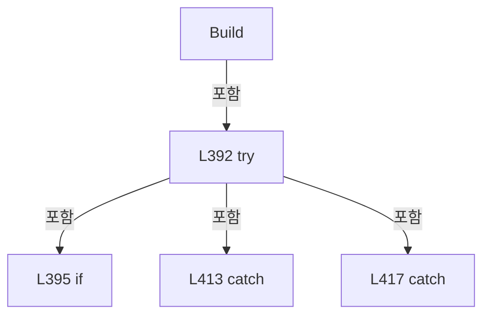

변경 전 점검: 입력/반환 타입, 위 호출자, 예외/취소 경로, 공유 상태와 저장·전송 소비자를 함께 확인합니다. 값의 단위나 물리 방향을 이름만으로 확정하지 않습니다.

### MethodDeclaration `CreateReviewScreen` · L427–441

[Drilling.UI/Menu/Menus/CMenuReview.cs:427–441](https://github.com/kjuws10-rgb/A3Drilling/blob/dfa5920e6301d9ec4b0eab1452ae59521aafc986/Drilling.UI/Menu/Menus/CMenuReview.cs#L427-L441)

| 항목 | 실제 추출 값 |
| --- | --- |
| 서명 | Drilling.UI.Menu.Menus.CScreenViewModel Drilling.UI.Menu.Menus.CMenuReview.CreateReviewScreen(string) |
| 접근/수식자 | Private / private |
| 반환/값 타입 | Drilling.UI.Menu.Menus.CScreenViewModel |
| 소속 타입 | NamedType:Drilling.UI.Menu.Menus.CMenuReview |

입력 계약:

| 이름 | 타입 | 전달 | 선택/기본값 |
| --- | --- | --- | --- |
| result | string | None | False /  |

정적 호출자로 확인된 위치:

| 호출 파일/행 | 호출 표현식 | 런타임 분기 가능 |
| --- | --- | --- |
| [Drilling.UI/Menu/Menus/CMenuReview.cs:411–411](https://github.com/kjuws10-rgb/A3Drilling/blob/dfa5920e6301d9ec4b0eab1452ae59521aafc986/Drilling.UI/Menu/Menus/CMenuReview.cs#L411-L411) | CreateReviewScreen | False |
| [Drilling.UI/Menu/Menus/CMenuReview.cs:423–423](https://github.com/kjuws10-rgb/A3Drilling/blob/dfa5920e6301d9ec4b0eab1452ae59521aafc986/Drilling.UI/Menu/Menus/CMenuReview.cs#L423-L423) | CreateReviewScreen | False |

호출하는 대상과 해석 범위:

| 원본 행 | 표현식 | 분석 상태 | 대상/소스 위치 |
| --- | --- | --- | --- |
| 429 | new CScreenViewModel | resolved | Drilling.UI.Menu.Menus.CScreenViewModel.CScreenViewModel(Drilling.UI.Menu.Menus.EN_MENU, string, string, System.Collections.Generic.IReadOnlyList<Drilling.UI.Menu.Menus.ST_DISPLAY_ITEM>, System.Collections.Generic.IReadOnlyList<Drilling.UI.Menu.Menus.ST_SCREEN_SECTION>, bool, Drilling.UI.Menu.Menus.CMenuMain?, Drilling.UI.Menu.Menus.CMenuManual?, Drilling.UI.Menu.Menus.CMenuRecipe?, Drilling.UI.Menu.Menus.CMenuSetting?, Drilling.UI.Menu.Menus.CMenuAlarm?, Drilling.UI.Menu.Menus.CMenuMonitor?, Drilling.UI.Menu.Menus.CMenuReview?, Drilling.UI.Menu.Menus.CMenuCorrection?, Drilling.UI.Menu.Menus.CMenuPm?) · Drilling.UI/Menu/Menus/CMenuBase.cs:411 |
| 434 | new | resolved | Drilling.UI.Menu.Menus.ST_DISPLAY_ITEM.ST_DISPLAY_ITEM(string, string, string) · Drilling.UI/Menu/Menus/CMenuBase.cs:43 |
| 434 | ToDisplayModeName | resolved | string Drilling.UI.Menu.Menus.CMenuReview.ToDisplayModeName(string) · Drilling.UI/Menu/Menus/CMenuReview.cs:2066 |
| 435 | new | resolved | Drilling.UI.Menu.Menus.ST_DISPLAY_ITEM.ST_DISPLAY_ITEM(string, string, string) · Drilling.UI/Menu/Menus/CMenuBase.cs:43 |
| 435 | GetConfiguredSampleInspectionShotCount | resolved | int Drilling.UI.Menu.Menus.CMenuReview.GetConfiguredSampleInspectionShotCount() · Drilling.UI/Menu/Menus/CMenuReview.cs:1532 |
| 436 | new | resolved | Drilling.UI.Menu.Menus.ST_DISPLAY_ITEM.ST_DISPLAY_ITEM(string, string, string) · Drilling.UI/Menu/Menus/CMenuBase.cs:43 |
| 438 | new | resolved | Drilling.UI.Menu.Menus.ST_SCREEN_SECTION.ST_SCREEN_SECTION(string, System.Collections.Generic.IReadOnlyList<Drilling.UI.Menu.Menus.ST_DISPLAY_ITEM>) · Drilling.UI/Menu/Menus/CMenuBase.cs:410 |
| 438 | new | resolved | Drilling.UI.Menu.Menus.ST_SCREEN_SECTION.ST_SCREEN_SECTION(string, System.Collections.Generic.IReadOnlyList<Drilling.UI.Menu.Menus.ST_DISPLAY_ITEM>) · Drilling.UI/Menu/Menus/CMenuBase.cs:410 |

본문의 실제 연산·분기·예외·반환 순서(원문 위치 순):

| 원본 행 | 종류 | 주석 해설 |
| --- | --- | --- |
| 429 | call | 함수·델리게이트 또는 객체 생성자를 호출합니다: new CScreenViewModel( EN_MENU.Review, Title, Subtitle, [ new("Mode", ToDisplayModeName(_selectedMode)), new("Shot", IsSampleSelectTab ? $"{GetConfiguredSampleInspectionShotCount()} / {_totalReviewPointCount}" : $"{_activ… |
| 429 | return | 호출자에게 값 또는 제어를 반환합니다: return new CScreenViewModel( EN_MENU.Review, Title, Subtitle, [ new("Mode", ToDisplayModeName(_selectedMode)), new("Shot", IsSampleSelectTab ? $"{GetConfiguredSampleInspectionShotCount()} / {_totalReviewPointCount}" : $"{_activePl |
| 434 | call | 함수·델리게이트 또는 객체 생성자를 호출합니다: new("Mode", ToDisplayModeName(_selectedMode)) |
| 434 | call | 함수·델리게이트 또는 객체 생성자를 호출합니다: ToDisplayModeName(_selectedMode) |
| 435 | call | 함수·델리게이트 또는 객체 생성자를 호출합니다: new("Shot", IsSampleSelectTab ? $"{GetConfiguredSampleInspectionShotCount()} / {_totalReviewPointCount}" : $"{_activePlanPointCount} / {_totalReviewPointCount}") |
| 435 | call | 함수·델리게이트 또는 객체 생성자를 호출합니다: GetConfiguredSampleInspectionShotCount() |
| 435 | conditional-expression | 조건에 따라 결과식을 선택합니다: IsSampleSelectTab ? $"{GetConfiguredSampleInspectionShotCount()} / {_totalReviewPointCount}" : $"{_activePlanPointCount} / {_totalReviewPointCount}" |
| 436 | call | 함수·델리게이트 또는 객체 생성자를 호출합니다: new("Result", result) |
| 438 | call | 함수·델리게이트 또는 객체 생성자를 호출합니다: new("Review Plan", []) |
| 438 | call | 함수·델리게이트 또는 객체 생성자를 호출합니다: new("Review Result", []) |

변경 전 점검: 입력/반환 타입, 위 호출자, 예외/취소 경로, 공유 상태와 저장·전송 소비자를 함께 확인합니다. 값의 단위나 물리 방향을 이름만으로 확정하지 않습니다.

### MethodDeclaration `ResetPlanDisplayAfterBuildFailure` · L443–470

[Drilling.UI/Menu/Menus/CMenuReview.cs:443–470](https://github.com/kjuws10-rgb/A3Drilling/blob/dfa5920e6301d9ec4b0eab1452ae59521aafc986/Drilling.UI/Menu/Menus/CMenuReview.cs#L443-L470)

| 항목 | 실제 추출 값 |
| --- | --- |
| 서명 | void Drilling.UI.Menu.Menus.CMenuReview.ResetPlanDisplayAfterBuildFailure() |
| 접근/수식자 | Private / private |
| 반환/값 타입 | void |
| 소속 타입 | NamedType:Drilling.UI.Menu.Menus.CMenuReview |

정적 호출자로 확인된 위치:

| 호출 파일/행 | 호출 표현식 | 런타임 분기 가능 |
| --- | --- | --- |
| [Drilling.UI/Menu/Menus/CMenuReview.cs:420–420](https://github.com/kjuws10-rgb/A3Drilling/blob/dfa5920e6301d9ec4b0eab1452ae59521aafc986/Drilling.UI/Menu/Menus/CMenuReview.cs#L420-L420) | ResetPlanDisplayAfterBuildFailure | False |

호출하는 대상과 해석 범위:

| 원본 행 | 표현식 | 분석 상태 | 대상/소스 위치 |
| --- | --- | --- | --- |
| 446 | _selectedLineShotKeys.Clear | resolved | void System.Collections.Generic.HashSet<string>.Clear() |
| 449 | new | resolved | Drilling.UI.Menu.Menus.ST_REVIEW_TAB_ITEM.ST_REVIEW_TAB_ITEM(string, bool, Drilling.UI.Menu.CButtonCommand) · Drilling.UI/Menu/Menus/CMenuReview.cs:3922 |
| 450 | Mode | resolved | Drilling.UI.Menu.Menus.ST_REVIEW_MODE_ITEM Drilling.UI.Menu.Menus.CMenuReview.Mode(string, string) · Drilling.UI/Menu/Menus/CMenuReview.cs:2067 |
| 450 | Mode | resolved | Drilling.UI.Menu.Menus.ST_REVIEW_MODE_ITEM Drilling.UI.Menu.Menus.CMenuReview.Mode(string, string) · Drilling.UI/Menu/Menus/CMenuReview.cs:2067 |
| 450 | Mode | resolved | Drilling.UI.Menu.Menus.ST_REVIEW_MODE_ITEM Drilling.UI.Menu.Menus.CMenuReview.Mode(string, string) · Drilling.UI/Menu/Menus/CMenuReview.cs:2067 |
| 450 | Mode | resolved | Drilling.UI.Menu.Menus.ST_REVIEW_MODE_ITEM Drilling.UI.Menu.Menus.CMenuReview.Mode(string, string) · Drilling.UI/Menu/Menus/CMenuReview.cs:2067 |
| 451 | new | resolved | Drilling.UI.Menu.Menus.ST_DISPLAY_ITEM.ST_DISPLAY_ITEM(string, string, string) · Drilling.UI/Menu/Menus/CMenuBase.cs:43 |
| 451 | _selectedRecipeIdProvider | resolved · 동적 구현 선택 가능 | string System.Func<string>.Invoke() |
| 451 | new | resolved | Drilling.UI.Menu.Menus.ST_DISPLAY_ITEM.ST_DISPLAY_ITEM(string, string, string) · Drilling.UI/Menu/Menus/CMenuBase.cs:43 |
| 451 | new | resolved | Drilling.UI.Menu.Menus.ST_DISPLAY_ITEM.ST_DISPLAY_ITEM(string, string, string) · Drilling.UI/Menu/Menus/CMenuBase.cs:43 |
| 452 | new | resolved | Drilling.UI.Menu.Menus.ST_DISPLAY_ITEM.ST_DISPLAY_ITEM(string, string, string) · Drilling.UI/Menu/Menus/CMenuBase.cs:43 |
| 452 | new | resolved | Drilling.UI.Menu.Menus.ST_DISPLAY_ITEM.ST_DISPLAY_ITEM(string, string, string) · Drilling.UI/Menu/Menus/CMenuBase.cs:43 |
| 462 | Camera.Clear | resolved | void Drilling.UI.Menu.Menus.CReviewCameraPreview.Clear() · Drilling.UI/Menu/Menus/CMenuReview.cs:4267 |

본문의 실제 연산·분기·예외·반환 순서(원문 위치 순):

| 원본 행 | 종류 | 주석 해설 |
| --- | --- | --- |
| 445 | assignment | 값을 대상에 대입합니다: _lastAllPlan = null |
| 446 | call | 함수·델리게이트 또는 객체 생성자를 호출합니다: _selectedLineShotKeys.Clear() |
| 447 | assignment | 값을 대상에 대입합니다: _activePlanPointCount = 0 |
| 448 | assignment | 값을 대상에 대입합니다: _totalReviewPointCount = 0 |
| 449 | assignment | 값을 대상에 대입합니다: Tabs = [new("RUN", IsRunTab, SelectTabCommand)] |
| 449 | call | 함수·델리게이트 또는 객체 생성자를 호출합니다: new("RUN", IsRunTab, SelectTabCommand) |
| 450 | assignment | 값을 대상에 대입합니다: Modes = [Mode("ALL SHOT", ""), Mode("ONE SHOT", ""), Mode("ONE LINE", ""), Mode("BEAM INSPECTION", "")] |
| 450 | call | 함수·델리게이트 또는 객체 생성자를 호출합니다: Mode("ALL SHOT", "") |
| 450 | call | 함수·델리게이트 또는 객체 생성자를 호출합니다: Mode("ONE SHOT", "") |
| 450 | call | 함수·델리게이트 또는 객체 생성자를 호출합니다: Mode("ONE LINE", "") |
| 450 | call | 함수·델리게이트 또는 객체 생성자를 호출합니다: Mode("BEAM INSPECTION", "") |
| 451 | assignment | 값을 대상에 대입합니다: TargetItems = [new("Recipe Name", _selectedRecipeIdProvider()), new("Glass ID", _productManager.Current?.GlassId ?? "-"), new("Tolerance", "-")] |
| 451 | call | 함수·델리게이트 또는 객체 생성자를 호출합니다: new("Recipe Name", _selectedRecipeIdProvider()) |
| 451 | call | 함수·델리게이트 또는 객체 생성자를 호출합니다: _selectedRecipeIdProvider() |
| 451 | call | 함수·델리게이트 또는 객체 생성자를 호출합니다: new("Glass ID", _productManager.Current?.GlassId ?? "-") |
| 451 | call | 함수·델리게이트 또는 객체 생성자를 호출합니다: new("Tolerance", "-") |
| 452 | assignment | 값을 대상에 대입합니다: SelectionSummaryItems = [new("Status", "Configuration Error"), new("Reason", _planBuildError)] |
| 452 | call | 함수·델리게이트 또는 객체 생성자를 호출합니다: new("Status", "Configuration Error") |
| 452 | call | 함수·델리게이트 또는 객체 생성자를 호출합니다: new("Reason", _planBuildError) |
| 453 | assignment | 값을 대상에 대입합니다: SelectedPointItems = [] |
| 454 | assignment | 값을 대상에 대입합니다: PointSelectRows = [] |
| 455 | assignment | 값을 대상에 대입합니다: RunCellShotRows = [] |
| 456 | assignment | 값을 대상에 대입합니다: RunCellShotMatrixRows = [] |
| 457 | assignment | 값을 대상에 대입합니다: RunBeamRows = [] |
| 458 | assignment | 값을 대상에 대입합니다: SampleCellShotRows = [] |
| 459 | assignment | 값을 대상에 대입합니다: SampleCellShotMatrixRows = [] |
| 460 | assignment | 값을 대상에 대입합니다: RunGlassPreviewImage = null |
| 461 | assignment | 값을 대상에 대입합니다: _cameraGlassBounds = Rect.Empty |
| 462 | call | 함수·델리게이트 또는 객체 생성자를 호출합니다: Camera.Clear() |
| 463 | assignment | 값을 대상에 대입합니다: RunGlassPreviewInspectionOverlayImage = null |
| 464 | assignment | 값을 대상에 대입합니다: RunCellPreviewLabels = [] |
| 465 | assignment | 값을 대상에 대입합니다: RunGlassPreviewSummary = "Review plan unavailable" |
| 466 | assignment | 값을 대상에 대입합니다: SampleGlassPreviewImage = null |
| 467 | assignment | 값을 대상에 대입합니다: SampleGlassPreviewInspectionOverlayImage = null |
| 468 | assignment | 값을 대상에 대입합니다: SampleCellPreviewLabels = [] |
| 469 | assignment | 값을 대상에 대입합니다: SampleGlassPreviewSummary = "Review plan unavailable" |

변경 전 점검: 입력/반환 타입, 위 호출자, 예외/취소 경로, 공유 상태와 저장·전송 소비자를 함께 확인합니다. 값의 단위나 물리 방향을 이름만으로 확정하지 않습니다.

### MethodDeclaration `CreateFallbackRecipe` · L472–475

[Drilling.UI/Menu/Menus/CMenuReview.cs:472–475](https://github.com/kjuws10-rgb/A3Drilling/blob/dfa5920e6301d9ec4b0eab1452ae59521aafc986/Drilling.UI/Menu/Menus/CMenuReview.cs#L472-L475)

| 항목 | 실제 추출 값 |
| --- | --- |
| 서명 | Drilling.Common.Managers.ST_RECIPE_DEFINITION Drilling.UI.Menu.Menus.CMenuReview.CreateFallbackRecipe() |
| 접근/수식자 | Private / private |
| 반환/값 타입 | Drilling.Common.Managers.ST_RECIPE_DEFINITION |
| 소속 타입 | NamedType:Drilling.UI.Menu.Menus.CMenuReview |

정적 호출자로 확인된 위치:

| 호출 파일/행 | 호출 표현식 | 런타임 분기 가능 |
| --- | --- | --- |
| [Drilling.UI/Menu/Menus/CMenuReview.cs:394–394](https://github.com/kjuws10-rgb/A3Drilling/blob/dfa5920e6301d9ec4b0eab1452ae59521aafc986/Drilling.UI/Menu/Menus/CMenuReview.cs#L394-L394) | CreateFallbackRecipe | False |
| [Drilling.UI/Menu/Menus/CMenuReview.cs:3159–3159](https://github.com/kjuws10-rgb/A3Drilling/blob/dfa5920e6301d9ec4b0eab1452ae59521aafc986/Drilling.UI/Menu/Menus/CMenuReview.cs#L3159-L3159) | CreateFallbackRecipe | False |

호출하는 대상과 해석 범위:

| 원본 행 | 표현식 | 분석 상태 | 대상/소스 위치 |
| --- | --- | --- | --- |
| 474 | new ST_RECIPE_DEFINITION | resolved | Drilling.Common.Managers.ST_RECIPE_DEFINITION.ST_RECIPE_DEFINITION(string, string, System.Collections.Generic.IReadOnlyList<Drilling.Common.Managers.ST_RECIPE_PARAMETER>, System.Collections.Generic.IReadOnlyList<Drilling.Common.Managers.ST_RECIPE_HISTORY>) · Drilling.Common/Managers/CRecipeManager.cs:385 |

본문의 실제 연산·분기·예외·반환 순서(원문 위치 순):

| 원본 행 | 종류 | 주석 해설 |
| --- | --- | --- |
| 474 | call | 함수·델리게이트 또는 객체 생성자를 호출합니다: new ST_RECIPE_DEFINITION(_recipeId, _recipeId, [], []) |
| 474 | return | 호출자에게 값 또는 제어를 반환합니다: return new ST_RECIPE_DEFINITION(_recipeId, _recipeId, [], []); |

변경 전 점검: 입력/반환 타입, 위 호출자, 예외/취소 경로, 공유 상태와 저장·전송 소비자를 함께 확인합니다. 값의 단위나 물리 방향을 이름만으로 확정하지 않습니다.

### MethodDeclaration `LoadSelectedRecipe` · L477–496

[Drilling.UI/Menu/Menus/CMenuReview.cs:477–496](https://github.com/kjuws10-rgb/A3Drilling/blob/dfa5920e6301d9ec4b0eab1452ae59521aafc986/Drilling.UI/Menu/Menus/CMenuReview.cs#L477-L496)

| 항목 | 실제 추출 값 |
| --- | --- |
| 서명 | System.Threading.Tasks.Task<Drilling.Common.Managers.ST_RECIPE_DEFINITION?> Drilling.UI.Menu.Menus.CMenuReview.LoadSelectedRecipe(System.Threading.CancellationToken) |
| 접근/수식자 | Private / private, async |
| 반환/값 타입 | System.Threading.Tasks.Task<Drilling.Common.Managers.ST_RECIPE_DEFINITION?> |
| 소속 타입 | NamedType:Drilling.UI.Menu.Menus.CMenuReview |

입력 계약:

| 이름 | 타입 | 전달 | 선택/기본값 |
| --- | --- | --- | --- |
| cancellationToken | System.Threading.CancellationToken | None | False /  |

정적 호출자로 확인된 위치:

| 호출 파일/행 | 호출 표현식 | 런타임 분기 가능 |
| --- | --- | --- |
| [Drilling.UI/Menu/Menus/CMenuReview.cs:394–394](https://github.com/kjuws10-rgb/A3Drilling/blob/dfa5920e6301d9ec4b0eab1452ae59521aafc986/Drilling.UI/Menu/Menus/CMenuReview.cs#L394-L394) | LoadSelectedRecipe | False |
| [Drilling.UI/Menu/Menus/CMenuReview.cs:2315–2315](https://github.com/kjuws10-rgb/A3Drilling/blob/dfa5920e6301d9ec4b0eab1452ae59521aafc986/Drilling.UI/Menu/Menus/CMenuReview.cs#L2315-L2315) | LoadSelectedRecipe | False |
| [Drilling.UI/Menu/Menus/CMenuReview.cs:2754–2754](https://github.com/kjuws10-rgb/A3Drilling/blob/dfa5920e6301d9ec4b0eab1452ae59521aafc986/Drilling.UI/Menu/Menus/CMenuReview.cs#L2754-L2754) | LoadSelectedRecipe | False |
| [Drilling.UI/Menu/Menus/CMenuReview.cs:3159–3159](https://github.com/kjuws10-rgb/A3Drilling/blob/dfa5920e6301d9ec4b0eab1452ae59521aafc986/Drilling.UI/Menu/Menus/CMenuReview.cs#L3159-L3159) | LoadSelectedRecipe | False |

호출하는 대상과 해석 범위:

| 원본 행 | 표현식 | 분석 상태 | 대상/소스 위치 |
| --- | --- | --- | --- |
| 479 | _recipeManager.LoadRecipes | resolved | System.Threading.Tasks.Task<System.Collections.Generic.IReadOnlyList<Drilling.Common.Managers.ST_RECIPE_DEFINITION>> Drilling.Common.Managers.CRecipeManager.LoadRecipes(System.Threading.CancellationToken) · Drilling.Common/Managers/CRecipeManager.cs:40 |
| 485 | _selectedRecipeIdProvider | resolved · 동적 구현 선택 가능 | string System.Func<string>.Invoke() |
| 486 | string.IsNullOrWhiteSpace | resolved | bool string.IsNullOrWhiteSpace(string?) |
| 488 | recipes.FirstOrDefault | resolved | Drilling.Common.Managers.ST_RECIPE_DEFINITION? System.Collections.Generic.IEnumerable<Drilling.Common.Managers.ST_RECIPE_DEFINITION>.FirstOrDefault<Drilling.Common.Managers.ST_RECIPE_DEFINITION>(System.Func<Drilling.Common.Managers.ST_RECIPE_DEFINITION, bool>) |
| 488 | recipe.Id.Equals | resolved | bool string.Equals(string?, System.StringComparison) |
| 495 | recipes.FirstOrDefault | resolved | Drilling.Common.Managers.ST_RECIPE_DEFINITION? System.Collections.Generic.IEnumerable<Drilling.Common.Managers.ST_RECIPE_DEFINITION>.FirstOrDefault<Drilling.Common.Managers.ST_RECIPE_DEFINITION>(System.Func<Drilling.Common.Managers.ST_RECIPE_DEFINITION, bool>) |
| 495 | recipe.Id.Equals | resolved | bool string.Equals(string?, System.StringComparison) |

본문의 실제 연산·분기·예외·반환 순서(원문 위치 순):

| 원본 행 | 종류 | 주석 해설 |
| --- | --- | --- |
| 479 | await | 비동기 완료를 기다립니다: await _recipeManager.LoadRecipes(cancellationToken) |
| 479 | call | 함수·델리게이트 또는 객체 생성자를 호출합니다: _recipeManager.LoadRecipes(cancellationToken) |
| 479 | local-declaration | 지역 변수를 선언합니다: var recipes = await _recipeManager.LoadRecipes(cancellationToken); |
| 479 | variable-initializer | 변수의 초기값을 지정합니다: recipes = await _recipeManager.LoadRecipes(cancellationToken) |
| 480 | if | 조건에 따라 분기합니다: if (recipes.Count == 0) |
| 482 | return | 호출자에게 값 또는 제어를 반환합니다: return null; |
| 485 | call | 함수·델리게이트 또는 객체 생성자를 호출합니다: _selectedRecipeIdProvider() |
| 485 | local-declaration | 지역 변수를 선언합니다: var selectedRecipeId = _selectedRecipeIdProvider(); |
| 485 | variable-initializer | 변수의 초기값을 지정합니다: selectedRecipeId = _selectedRecipeIdProvider() |
| 486 | call | 함수·델리게이트 또는 객체 생성자를 호출합니다: string.IsNullOrWhiteSpace(selectedRecipeId) |
| 486 | if | 조건에 따라 분기합니다: if (!string.IsNullOrWhiteSpace(selectedRecipeId)) |
| 488 | call | 함수·델리게이트 또는 객체 생성자를 호출합니다: recipes.FirstOrDefault(recipe => recipe.Id.Equals(selectedRecipeId, StringComparison.OrdinalIgnoreCase)) |
| 488 | call | 함수·델리게이트 또는 객체 생성자를 호출합니다: recipe.Id.Equals(selectedRecipeId, StringComparison.OrdinalIgnoreCase) |
| 488 | local-declaration | 지역 변수를 선언합니다: var selectedRecipe = recipes.FirstOrDefault(recipe => recipe.Id.Equals(selectedRecipeId, StringComparison.OrdinalIgnoreCase)); |
| 488 | variable-initializer | 변수의 초기값을 지정합니다: selectedRecipe = recipes.FirstOrDefault(recipe => recipe.Id.Equals(selectedRecipeId, StringComparison.OrdinalIgnoreCase)) |
| 489 | if | 조건에 따라 분기합니다: if (selectedRecipe is not null) |
| 491 | return | 호출자에게 값 또는 제어를 반환합니다: return selectedRecipe; |
| 495 | call | 함수·델리게이트 또는 객체 생성자를 호출합니다: recipes.FirstOrDefault(recipe => recipe.Id.Equals("DRILL_A01", StringComparison.OrdinalIgnoreCase)) |
| 495 | call | 함수·델리게이트 또는 객체 생성자를 호출합니다: recipe.Id.Equals("DRILL_A01", StringComparison.OrdinalIgnoreCase) |
| 495 | return | 호출자에게 값 또는 제어를 반환합니다: return recipes.FirstOrDefault(recipe => recipe.Id.Equals("DRILL_A01", StringComparison.OrdinalIgnoreCase)) ?? recipes[0]; |

제어 구문의 포함 구조(실제 실행 순서/CFG가 아닌 구문 탐색 그림):


변경 전 점검: 입력/반환 타입, 위 호출자, 예외/취소 경로, 공유 상태와 저장·전송 소비자를 함께 확인합니다. 값의 단위나 물리 방향을 이름만으로 확정하지 않습니다.

### MethodDeclaration `ApplyRecipeContext` · L498–548

[Drilling.UI/Menu/Menus/CMenuReview.cs:498–548](https://github.com/kjuws10-rgb/A3Drilling/blob/dfa5920e6301d9ec4b0eab1452ae59521aafc986/Drilling.UI/Menu/Menus/CMenuReview.cs#L498-L548)

| 항목 | 실제 추출 값 |
| --- | --- |
| 서명 | void Drilling.UI.Menu.Menus.CMenuReview.ApplyRecipeContext(Drilling.Common.Managers.ST_RECIPE_DEFINITION, Drilling.Common.Review.ST_REVIEW_PLAN) |
| 접근/수식자 | Private / private |
| 반환/값 타입 | void |
| 소속 타입 | NamedType:Drilling.UI.Menu.Menus.CMenuReview |

입력 계약:

| 이름 | 타입 | 전달 | 선택/기본값 |
| --- | --- | --- | --- |
| recipe | Drilling.Common.Managers.ST_RECIPE_DEFINITION | None | False /  |
| allPlan | Drilling.Common.Review.ST_REVIEW_PLAN | None | False /  |

정적 호출자로 확인된 위치:

| 호출 파일/행 | 호출 표현식 | 런타임 분기 가능 |
| --- | --- | --- |
| [Drilling.UI/Menu/Menus/CMenuReview.cs:408–408](https://github.com/kjuws10-rgb/A3Drilling/blob/dfa5920e6301d9ec4b0eab1452ae59521aafc986/Drilling.UI/Menu/Menus/CMenuReview.cs#L408-L408) | ApplyRecipeContext | False |
| [Drilling.UI/Menu/Menus/CMenuReview.cs:3162–3162](https://github.com/kjuws10-rgb/A3Drilling/blob/dfa5920e6301d9ec4b0eab1452ae59521aafc986/Drilling.UI/Menu/Menus/CMenuReview.cs#L3162-L3162) | ApplyRecipeContext | False |

호출하는 대상과 해석 범위:

| 원본 행 | 표현식 | 분석 상태 | 대상/소스 위치 |
| --- | --- | --- | --- |
| 501 | Math.Clamp | resolved | int System.Math.Clamp(int, int, int) |
| 502 | Math.Max | resolved | int System.Math.Max(int, int) |
| 503 | Math.Clamp | resolved | int System.Math.Clamp(int, int, int) |
| 504 | string.IsNullOrWhiteSpace | resolved | bool string.IsNullOrWhiteSpace(string?) |
| 505 | _sampleSelectionRecipeId.Equals | resolved | bool string.Equals(string?, System.StringComparison) |
| 507 | ApplySplitBeamContext | resolved | void Drilling.UI.Menu.Menus.CMenuReview.ApplySplitBeamContext(Drilling.Common.Managers.ST_RECIPE_DEFINITION) · Drilling.UI/Menu/Menus/CMenuReview.cs:570 |
| 521 | _selectedLineShotKeys.Clear | resolved | void System.Collections.Generic.HashSet<string>.Clear() |
| 523 | NotifyOneShot | resolved | void Drilling.UI.Menu.Menus.CMenuReview.NotifyOneShot() · Drilling.UI/Menu/Menus/CMenuReview.cs:2656 |
| 526 | ResetBeamInspectionResults | resolved | void Drilling.UI.Menu.Menus.CMenuReview.ResetBeamInspectionResults() · Drilling.UI/Menu/Menus/CMenuReview.cs:2244 |
| 527 | _selectedSampleShotKeys.Clear | resolved | void System.Collections.Generic.HashSet<string>.Clear() |
| 528 | _selectedInspectionShotKeys.Clear | resolved | void System.Collections.Generic.HashSet<string>.Clear() |
| 535 | _selectedSampleShotKeys.RemoveWhere | resolved | int System.Collections.Generic.HashSet<string>.RemoveWhere(System.Predicate<string>) |
| 535 | IsValidShotKey | resolved | bool IsValidShotKey(string) · Drilling.UI/Menu/Menus/CMenuReview.cs:508 |
| 536 | _selectedInspectionShotKeys.RemoveWhere | resolved | int System.Collections.Generic.HashSet<string>.RemoveWhere(System.Predicate<string>) |
| 536 | IsValidShotKey | resolved | bool IsValidShotKey(string) · Drilling.UI/Menu/Menus/CMenuReview.cs:508 |
| 539 | Math.Clamp | resolved | int System.Math.Clamp(int, int, int) |
| 540 | SetSampleMapColumnCount | resolved | void Drilling.UI.Menu.Menus.CMenuReview.SetSampleMapColumnCount(int) · Drilling.UI/Menu/Menus/CMenuReview.cs:1702 |
| 540 | CalculateShotMapColumnCount | resolved | int Drilling.UI.Menu.Menus.CMenuReview.CalculateShotMapColumnCount(Drilling.Common.Review.ST_REVIEW_PLAN, int) · Drilling.UI/Menu/Menus/CMenuReview.cs:1684 |
| 541 | Math.Clamp | resolved | int System.Math.Clamp(int, int, int) |
| 542 | string.IsNullOrWhiteSpace | resolved | bool string.IsNullOrWhiteSpace(string?) |
| 542 | IsValidShotKey | resolved | bool IsValidShotKey(string) · Drilling.UI/Menu/Menus/CMenuReview.cs:508 |
| 547 | RefreshSelectedLineKeys | resolved | void Drilling.UI.Menu.Menus.CMenuReview.RefreshSelectedLineKeys(Drilling.Common.Review.ST_REVIEW_PLAN?) · Drilling.UI/Menu/Menus/CMenuReview.cs:1807 |

본문의 실제 연산·분기·예외·반환 순서(원문 위치 순):

| 원본 행 | 종류 | 주석 해설 |
| --- | --- | --- |
| 500 | assignment | 값을 대상에 대입합니다: _headCount = MaxHeadCount |
| 501 | assignment | 값을 대상에 대입합니다: _sampleRuleHeadNo = Math.Clamp(_sampleRuleHeadNo, 1, _headCount) |
| 501 | call | 함수·델리게이트 또는 객체 생성자를 호출합니다: Math.Clamp(_sampleRuleHeadNo, 1, _headCount) |
| 502 | assignment | 값을 대상에 대입합니다: _cellCount = Math.Max(1, allPlan.CellCount) |
| 502 | call | 함수·델리게이트 또는 객체 생성자를 호출합니다: Math.Max(1, allPlan.CellCount) |
| 503 | assignment | 값을 대상에 대입합니다: _sampleRuleCellNo = Math.Clamp(_sampleRuleCellNo, 1, _cellCount) |
| 503 | call | 함수·델리게이트 또는 객체 생성자를 호출합니다: Math.Clamp(_sampleRuleCellNo, 1, _cellCount) |
| 504 | assignment | 값을 대상에 대입합니다: _recipeId = string.IsNullOrWhiteSpace(recipe.Id) ? "DRILL_A01" : recipe.Id |
| 504 | call | 함수·델리게이트 또는 객체 생성자를 호출합니다: string.IsNullOrWhiteSpace(recipe.Id) |
| 504 | conditional-expression | 조건에 따라 결과식을 선택합니다: string.IsNullOrWhiteSpace(recipe.Id) ? "DRILL_A01" : recipe.Id |
| 505 | call | 함수·델리게이트 또는 객체 생성자를 호출합니다: _sampleSelectionRecipeId.Equals(_recipeId, StringComparison.OrdinalIgnoreCase) |
| 505 | local-declaration | 지역 변수를 선언합니다: var isSampleSelectionRecipeChanged = !_sampleSelectionRecipeId.Equals(_recipeId, StringComparison.OrdinalIgnoreCase); |
| 505 | variable-initializer | 변수의 초기값을 지정합니다: isSampleSelectionRecipeChanged = !_sampleSelectionRecipeId.Equals(_recipeId, StringComparison.OrdinalIgnoreCase) |
| 506 | assignment | 값을 대상에 대입합니다: _totalReviewPointCount = allPlan.Points.Count |
| 507 | call | 함수·델리게이트 또는 객체 생성자를 호출합니다: ApplySplitBeamContext(recipe) |
| 515 | if | 조건에 따라 분기합니다: if (isSampleSelectionRecipeChanged) |
| 517 | assignment | 값을 대상에 대입합니다: _oneShotResult = null |
| 518 | if | 조건에 따라 분기합니다: if (IsOneShotReviewMode &#124;&#124; IsOneLineReviewMode) |
| 520 | assignment | 값을 대상에 대입합니다: _selectedRunShotKey = "" |
| 521 | call | 함수·델리게이트 또는 객체 생성자를 호출합니다: _selectedLineShotKeys.Clear() |
| 522 | assignment | 값을 대상에 대입합니다: OneShotStatus = "Shot을 선택해 주세요." |
| 523 | call | 함수·델리게이트 또는 객체 생성자를 호출합니다: NotifyOneShot() |
| 526 | call | 함수·델리게이트 또는 객체 생성자를 호출합니다: ResetBeamInspectionResults() |
| 527 | call | 함수·델리게이트 또는 객체 생성자를 호출합니다: _selectedSampleShotKeys.Clear() |
| 528 | call | 함수·델리게이트 또는 객체 생성자를 호출합니다: _selectedInspectionShotKeys.Clear() |
| 529 | assignment | 값을 대상에 대입합니다: _simpleSampleShotKey = "" |
| 530 | assignment | 값을 대상에 대입합니다: _lastCorrectionRulePlan = null |
| 531 | assignment | 값을 대상에 대입합니다: _sampleSelectionRecipeId = _recipeId |
| 533 | else | 앞 조건이 거짓인 경로입니다: else |
| 535 | call | 함수·델리게이트 또는 객체 생성자를 호출합니다: _selectedSampleShotKeys.RemoveWhere(key => !IsValidShotKey(key)) |
| 535 | call | 함수·델리게이트 또는 객체 생성자를 호출합니다: IsValidShotKey(key) |
| 536 | call | 함수·델리게이트 또는 객체 생성자를 호출합니다: _selectedInspectionShotKeys.RemoveWhere(key => !IsValidShotKey(key)) |
| 536 | call | 함수·델리게이트 또는 객체 생성자를 호출합니다: IsValidShotKey(key) |
| 539 | assignment | 값을 대상에 대입합니다: _selectedSampleCellNo = Math.Clamp(_selectedSampleCellNo, 1, _cellCount) |
| 539 | call | 함수·델리게이트 또는 객체 생성자를 호출합니다: Math.Clamp(_selectedSampleCellNo, 1, _cellCount) |
| 540 | call | 함수·델리게이트 또는 객체 생성자를 호출합니다: SetSampleMapColumnCount(CalculateShotMapColumnCount(allPlan, _selectedSampleCellNo)) |
| 540 | call | 함수·델리게이트 또는 객체 생성자를 호출합니다: CalculateShotMapColumnCount(allPlan, _selectedSampleCellNo) |
| 541 | assignment | 값을 대상에 대입합니다: _selectedRunCellNo = Math.Clamp(_selectedRunCellNo, 1, _cellCount) |
| 541 | call | 함수·델리게이트 또는 객체 생성자를 호출합니다: Math.Clamp(_selectedRunCellNo, 1, _cellCount) |
| 542 | call | 함수·델리게이트 또는 객체 생성자를 호출합니다: string.IsNullOrWhiteSpace(_selectedRunShotKey) |
| 542 | call | 함수·델리게이트 또는 객체 생성자를 호출합니다: IsValidShotKey(_selectedRunShotKey) |
| 542 | if | 조건에 따라 분기합니다: if (!string.IsNullOrWhiteSpace(_selectedRunShotKey) && !IsValidShotKey(_selectedRunShotKey)) |
| 544 | assignment | 값을 대상에 대입합니다: _selectedRunShotKey = "" |
| 547 | call | 함수·델리게이트 또는 객체 생성자를 호출합니다: RefreshSelectedLineKeys(allPlan) |

제어 구문의 포함 구조(실제 실행 순서/CFG가 아닌 구문 탐색 그림):

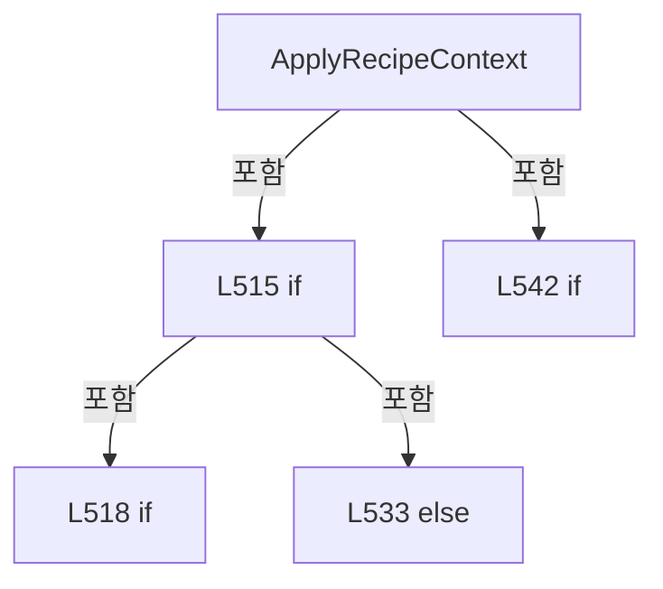

변경 전 점검: 입력/반환 타입, 위 호출자, 예외/취소 경로, 공유 상태와 저장·전송 소비자를 함께 확인합니다. 값의 단위나 물리 방향을 이름만으로 확정하지 않습니다.

### LocalFunctionStatement `IsValidShotKey` · L508–513

[Drilling.UI/Menu/Menus/CMenuReview.cs:508–513](https://github.com/kjuws10-rgb/A3Drilling/blob/dfa5920e6301d9ec4b0eab1452ae59521aafc986/Drilling.UI/Menu/Menus/CMenuReview.cs#L508-L513)

| 항목 | 실제 추출 값 |
| --- | --- |
| 서명 | bool IsValidShotKey(string) |
| 접근/수식자 | Private /  |
| 반환/값 타입 | bool |
| 소속 타입 | NamedType:Drilling.UI.Menu.Menus.CMenuReview |

입력 계약:

| 이름 | 타입 | 전달 | 선택/기본값 |
| --- | --- | --- | --- |
| key | string | None | False /  |

정적 호출자로 확인된 위치:

| 호출 파일/행 | 호출 표현식 | 런타임 분기 가능 |
| --- | --- | --- |
| [Drilling.UI/Menu/Menus/CMenuReview.cs:535–535](https://github.com/kjuws10-rgb/A3Drilling/blob/dfa5920e6301d9ec4b0eab1452ae59521aafc986/Drilling.UI/Menu/Menus/CMenuReview.cs#L535-L535) | IsValidShotKey | False |
| [Drilling.UI/Menu/Menus/CMenuReview.cs:536–536](https://github.com/kjuws10-rgb/A3Drilling/blob/dfa5920e6301d9ec4b0eab1452ae59521aafc986/Drilling.UI/Menu/Menus/CMenuReview.cs#L536-L536) | IsValidShotKey | False |
| [Drilling.UI/Menu/Menus/CMenuReview.cs:542–542](https://github.com/kjuws10-rgb/A3Drilling/blob/dfa5920e6301d9ec4b0eab1452ae59521aafc986/Drilling.UI/Menu/Menus/CMenuReview.cs#L542-L542) | IsValidShotKey | False |

호출하는 대상과 해석 범위:

| 원본 행 | 표현식 | 분석 상태 | 대상/소스 위치 |
| --- | --- | --- | --- |
| 510 | CReviewManager.NormalizeShotKey | resolved | string Drilling.Common.Review.CReviewManager.NormalizeShotKey(string) · Drilling.Common/Review/CReviewManager.cs:1238 |
| 511 | normalized.IndexOf | resolved | int string.IndexOf(string, System.StringComparison) |
| 512 | int.TryParse | resolved | bool int.TryParse(System.ReadOnlySpan<char>, System.Globalization.NumberStyles, System.IFormatProvider?, out int) |
| 512 | normalized.AsSpan | resolved | System.ReadOnlySpan<char> string?.AsSpan(int, int) |
| 512 | int.TryParse | resolved | bool int.TryParse(System.ReadOnlySpan<char>, System.Globalization.NumberStyles, System.IFormatProvider?, out int) |
| 512 | normalized.AsSpan | resolved | System.ReadOnlySpan<char> string?.AsSpan(int) |
| 512 | allPlan.FindPoint | resolved | Drilling.Common.Review.ST_REVIEW_PLAN_POINT? Drilling.Common.Review.ST_REVIEW_PLAN.FindPoint(int, int) · Drilling.Common/Review/CReviewManager.cs:4119 |

본문의 실제 연산·분기·예외·반환 순서(원문 위치 순):

| 원본 행 | 종류 | 주석 해설 |
| --- | --- | --- |
| 510 | call | 함수·델리게이트 또는 객체 생성자를 호출합니다: CReviewManager.NormalizeShotKey(key) |
| 510 | local-declaration | 지역 변수를 선언합니다: var normalized = CReviewManager.NormalizeShotKey(key); |
| 510 | variable-initializer | 변수의 초기값을 지정합니다: normalized = CReviewManager.NormalizeShotKey(key) |
| 511 | call | 함수·델리게이트 또는 객체 생성자를 호출합니다: normalized.IndexOf("_SHOT", StringComparison.Ordinal) |
| 511 | local-declaration | 지역 변수를 선언합니다: var separator = normalized.IndexOf("_SHOT", StringComparison.Ordinal); |
| 511 | variable-initializer | 변수의 초기값을 지정합니다: separator = normalized.IndexOf("_SHOT", StringComparison.Ordinal) |
| 512 | call | 함수·델리게이트 또는 객체 생성자를 호출합니다: int.TryParse(normalized.AsSpan(4, separator - 4), NumberStyles.Integer, CultureInfo.InvariantCulture, out var cellNo) |
| 512 | call | 함수·델리게이트 또는 객체 생성자를 호출합니다: normalized.AsSpan(4, separator - 4) |
| 512 | call | 함수·델리게이트 또는 객체 생성자를 호출합니다: int.TryParse(normalized.AsSpan(separator + 5), NumberStyles.Integer, CultureInfo.InvariantCulture, out var shotNo) |
| 512 | call | 함수·델리게이트 또는 객체 생성자를 호출합니다: normalized.AsSpan(separator + 5) |
| 512 | call | 함수·델리게이트 또는 객체 생성자를 호출합니다: allPlan.FindPoint(cellNo, shotNo) |
| 512 | return | 호출자에게 값 또는 제어를 반환합니다: return separator > 4 && int.TryParse(normalized.AsSpan(4, separator - 4), NumberStyles.Integer, CultureInfo.InvariantCulture, out var cellNo) && int.TryParse(normalized.AsSpan(separator + 5), NumberStyles.Integer, CultureInfo.Inva |

변경 전 점검: 입력/반환 타입, 위 호출자, 예외/취소 경로, 공유 상태와 저장·전송 소비자를 함께 확인합니다. 값의 단위나 물리 방향을 이름만으로 확정하지 않습니다.

### MethodDeclaration `ReadRecipeString` · L550–567

[Drilling.UI/Menu/Menus/CMenuReview.cs:550–567](https://github.com/kjuws10-rgb/A3Drilling/blob/dfa5920e6301d9ec4b0eab1452ae59521aafc986/Drilling.UI/Menu/Menus/CMenuReview.cs#L550-L567)

| 항목 | 실제 추출 값 |
| --- | --- |
| 서명 | string Drilling.UI.Menu.Menus.CMenuReview.ReadRecipeString(Drilling.Common.Managers.ST_RECIPE_DEFINITION?, params string[]) |
| 접근/수식자 | Private / private, static |
| 반환/값 타입 | string |
| 소속 타입 | NamedType:Drilling.UI.Menu.Menus.CMenuReview |

입력 계약:

| 이름 | 타입 | 전달 | 선택/기본값 |
| --- | --- | --- | --- |
| recipe | Drilling.Common.Managers.ST_RECIPE_DEFINITION? | None | False /  |
| keys | string[] | None | False /  |

정적 호출자로 확인된 위치:

| 호출 파일/행 | 호출 표현식 | 런타임 분기 가능 |
| --- | --- | --- |
| [Drilling.UI/Menu/Menus/CMenuReview.cs:569–569](https://github.com/kjuws10-rgb/A3Drilling/blob/dfa5920e6301d9ec4b0eab1452ae59521aafc986/Drilling.UI/Menu/Menus/CMenuReview.cs#L569-L569) | ReadRecipeString | False |

호출하는 대상과 해석 범위:

| 원본 행 | 표현식 | 분석 상태 | 대상/소스 위치 |
| --- | --- | --- | --- |
| 559 | recipe.Parameters.FirstOrDefault | resolved | Drilling.Common.Managers.ST_RECIPE_PARAMETER? System.Collections.Generic.IEnumerable<Drilling.Common.Managers.ST_RECIPE_PARAMETER>.FirstOrDefault<Drilling.Common.Managers.ST_RECIPE_PARAMETER>(System.Func<Drilling.Common.Managers.ST_RECIPE_PARAMETER, bool>) |
| 559 | item.Key.Equals | resolved | bool string.Equals(string?, System.StringComparison) |
| 559 | item.Name.Equals | resolved | bool string.Equals(string?, System.StringComparison) |
| 560 | string.IsNullOrWhiteSpace | resolved | bool string.IsNullOrWhiteSpace(string?) |
| 562 | parameter.Value.Trim | resolved | string string.Trim() |

본문의 실제 연산·분기·예외·반환 순서(원문 위치 순):

| 원본 행 | 종류 | 주석 해설 |
| --- | --- | --- |
| 552 | if | 조건에 따라 분기합니다: if (recipe is null) |
| 554 | return | 호출자에게 값 또는 제어를 반환합니다: return ""; |
| 557 | foreach | 컬렉션 요소를 순회합니다: foreach (var key in keys) |
| 559 | call | 함수·델리게이트 또는 객체 생성자를 호출합니다: recipe.Parameters.FirstOrDefault(item => item.Key.Equals(key, StringComparison.OrdinalIgnoreCase) &#124;&#124; item.Name.Equals(key, StringComparison.OrdinalIgnoreCase)) |
| 559 | call | 함수·델리게이트 또는 객체 생성자를 호출합니다: item.Key.Equals(key, StringComparison.OrdinalIgnoreCase) |
| 559 | call | 함수·델리게이트 또는 객체 생성자를 호출합니다: item.Name.Equals(key, StringComparison.OrdinalIgnoreCase) |
| 559 | local-declaration | 지역 변수를 선언합니다: var parameter = recipe.Parameters.FirstOrDefault(item => item.Key.Equals(key, StringComparison.OrdinalIgnoreCase) &#124;&#124; item.Name.Equals(key, StringComparison.OrdinalIgnoreCase)); |
| 559 | variable-initializer | 변수의 초기값을 지정합니다: parameter = recipe.Parameters.FirstOrDefault(item => item.Key.Equals(key, StringComparison.OrdinalIgnoreCase) &#124;&#124; item.Name.Equals(key, StringComparison.OrdinalIgnoreCase)) |
| 560 | call | 함수·델리게이트 또는 객체 생성자를 호출합니다: string.IsNullOrWhiteSpace(parameter.Value) |
| 560 | if | 조건에 따라 분기합니다: if (parameter is not null && !string.IsNullOrWhiteSpace(parameter.Value)) |
| 562 | call | 함수·델리게이트 또는 객체 생성자를 호출합니다: parameter.Value.Trim() |
| 562 | return | 호출자에게 값 또는 제어를 반환합니다: return parameter.Value.Trim(); |
| 566 | return | 호출자에게 값 또는 제어를 반환합니다: return ""; |

제어 구문의 포함 구조(실제 실행 순서/CFG가 아닌 구문 탐색 그림):

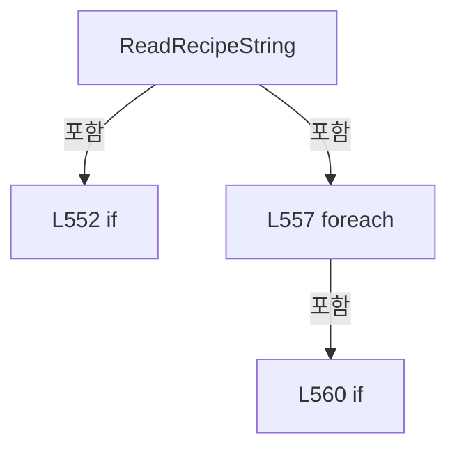

변경 전 점검: 입력/반환 타입, 위 호출자, 예외/취소 경로, 공유 상태와 저장·전송 소비자를 함께 확인합니다. 값의 단위나 물리 방향을 이름만으로 확정하지 않습니다.

### MethodDeclaration `ReadRecipeInt` · L569–569

[Drilling.UI/Menu/Menus/CMenuReview.cs:569–569](https://github.com/kjuws10-rgb/A3Drilling/blob/dfa5920e6301d9ec4b0eab1452ae59521aafc986/Drilling.UI/Menu/Menus/CMenuReview.cs#L569-L569)

| 항목 | 실제 추출 값 |
| --- | --- |
| 서명 | int Drilling.UI.Menu.Menus.CMenuReview.ReadRecipeInt(Drilling.Common.Managers.ST_RECIPE_DEFINITION, int, params string[]) |
| 접근/수식자 | Private / private, static |
| 반환/값 타입 | int |
| 소속 타입 | NamedType:Drilling.UI.Menu.Menus.CMenuReview |

입력 계약:

| 이름 | 타입 | 전달 | 선택/기본값 |
| --- | --- | --- | --- |
| recipe | Drilling.Common.Managers.ST_RECIPE_DEFINITION | None | False /  |
| fallback | int | None | False /  |
| keys | string[] | None | False /  |

정적 호출자로 확인된 위치:

| 호출 파일/행 | 호출 표현식 | 런타임 분기 가능 |
| --- | --- | --- |
| [Drilling.UI/Menu/Menus/CMenuReview.cs:572–572](https://github.com/kjuws10-rgb/A3Drilling/blob/dfa5920e6301d9ec4b0eab1452ae59521aafc986/Drilling.UI/Menu/Menus/CMenuReview.cs#L572-L572) | ReadRecipeInt | False |

호출하는 대상과 해석 범위:

| 원본 행 | 표현식 | 분석 상태 | 대상/소스 위치 |
| --- | --- | --- | --- |
| 569 | int.TryParse | resolved | bool int.TryParse(string?, System.Globalization.NumberStyles, System.IFormatProvider?, out int) |
| 569 | ReadRecipeString | resolved | string Drilling.UI.Menu.Menus.CMenuReview.ReadRecipeString(Drilling.Common.Managers.ST_RECIPE_DEFINITION?, params string[]) · Drilling.UI/Menu/Menus/CMenuReview.cs:550 |

본문의 실제 연산·분기·예외·반환 순서(원문 위치 순):

| 원본 행 | 종류 | 주석 해설 |
| --- | --- | --- |
| 569 | call | 함수·델리게이트 또는 객체 생성자를 호출합니다: int.TryParse(ReadRecipeString(recipe, keys), NumberStyles.Integer, CultureInfo.InvariantCulture, out var value) |
| 569 | call | 함수·델리게이트 또는 객체 생성자를 호출합니다: ReadRecipeString(recipe, keys) |
| 569 | conditional-expression | 조건에 따라 결과식을 선택합니다: int.TryParse(ReadRecipeString(recipe, keys), NumberStyles.Integer, CultureInfo.InvariantCulture, out var value) ? value : fallback |

변경 전 점검: 입력/반환 타입, 위 호출자, 예외/취소 경로, 공유 상태와 저장·전송 소비자를 함께 확인합니다. 값의 단위나 물리 방향을 이름만으로 확정하지 않습니다.

### MethodDeclaration `ApplySplitBeamContext` · L570–581

[Drilling.UI/Menu/Menus/CMenuReview.cs:570–581](https://github.com/kjuws10-rgb/A3Drilling/blob/dfa5920e6301d9ec4b0eab1452ae59521aafc986/Drilling.UI/Menu/Menus/CMenuReview.cs#L570-L581)

| 항목 | 실제 추출 값 |
| --- | --- |
| 서명 | void Drilling.UI.Menu.Menus.CMenuReview.ApplySplitBeamContext(Drilling.Common.Managers.ST_RECIPE_DEFINITION) |
| 접근/수식자 | Private / private |
| 반환/값 타입 | void |
| 소속 타입 | NamedType:Drilling.UI.Menu.Menus.CMenuReview |

입력 계약:

| 이름 | 타입 | 전달 | 선택/기본값 |
| --- | --- | --- | --- |
| recipe | Drilling.Common.Managers.ST_RECIPE_DEFINITION | None | False /  |

정적 호출자로 확인된 위치:

| 호출 파일/행 | 호출 표현식 | 런타임 분기 가능 |
| --- | --- | --- |
| [Drilling.UI/Menu/Menus/CMenuReview.cs:402–402](https://github.com/kjuws10-rgb/A3Drilling/blob/dfa5920e6301d9ec4b0eab1452ae59521aafc986/Drilling.UI/Menu/Menus/CMenuReview.cs#L402-L402) | ApplySplitBeamContext | False |
| [Drilling.UI/Menu/Menus/CMenuReview.cs:507–507](https://github.com/kjuws10-rgb/A3Drilling/blob/dfa5920e6301d9ec4b0eab1452ae59521aafc986/Drilling.UI/Menu/Menus/CMenuReview.cs#L507-L507) | ApplySplitBeamContext | False |
| [Drilling.UI/Menu/Menus/CMenuReview.cs:3160–3160](https://github.com/kjuws10-rgb/A3Drilling/blob/dfa5920e6301d9ec4b0eab1452ae59521aafc986/Drilling.UI/Menu/Menus/CMenuReview.cs#L3160-L3160) | ApplySplitBeamContext | False |

호출하는 대상과 해석 범위:

| 원본 행 | 표현식 | 분석 상태 | 대상/소스 위치 |
| --- | --- | --- | --- |
| 572 | ReadRecipeInt | resolved | int Drilling.UI.Menu.Menus.CMenuReview.ReadRecipeInt(Drilling.Common.Managers.ST_RECIPE_DEFINITION, int, params string[]) · Drilling.UI/Menu/Menus/CMenuReview.cs:569 |
| 573 | CCellPatternCalculator.IsSupportedSplitBeamCount | resolved | bool Drilling.Common.Recipe.CCellPatternCalculator.IsSupportedSplitBeamCount(int) · Drilling.Common/Recipe/CCellPatternCalculator.cs:15 |
| 579 | Math.Clamp | resolved | int System.Math.Clamp(int, int, int) |
| 580 | _selectedInspectionBeamNos.RemoveWhere | resolved | int System.Collections.Generic.HashSet<int>.RemoveWhere(System.Predicate<int>) |

본문의 실제 연산·분기·예외·반환 순서(원문 위치 순):

| 원본 행 | 종류 | 주석 해설 |
| --- | --- | --- |
| 572 | assignment | 값을 대상에 대입합니다: _splitBeamCount = ReadRecipeInt(recipe, 1, "SPLITED_BEAM_COUNT") |
| 572 | call | 함수·델리게이트 또는 객체 생성자를 호출합니다: ReadRecipeInt(recipe, 1, "SPLITED_BEAM_COUNT") |
| 573 | call | 함수·델리게이트 또는 객체 생성자를 호출합니다: CCellPatternCalculator.IsSupportedSplitBeamCount(_splitBeamCount) |
| 573 | if | 조건에 따라 분기합니다: if (!CCellPatternCalculator.IsSupportedSplitBeamCount(_splitBeamCount)) |
| 575 | assignment | 값을 대상에 대입합니다: _splitBeamCount = 1 |
| 578 | local-declaration | 지역 변수를 선언합니다: var maximumBeamNo = _splitBeamCount * _splitBeamCount; |
| 578 | variable-initializer | 변수의 초기값을 지정합니다: maximumBeamNo = _splitBeamCount * _splitBeamCount |
| 579 | assignment | 값을 대상에 대입합니다: _selectedRunBeamNo = Math.Clamp(_selectedRunBeamNo, 1, maximumBeamNo) |
| 579 | call | 함수·델리게이트 또는 객체 생성자를 호출합니다: Math.Clamp(_selectedRunBeamNo, 1, maximumBeamNo) |
| 580 | call | 함수·델리게이트 또는 객체 생성자를 호출합니다: _selectedInspectionBeamNos.RemoveWhere(beamNo => beamNo < 1 &#124;&#124; beamNo > maximumBeamNo) |

제어 구문의 포함 구조(실제 실행 순서/CFG가 아닌 구문 탐색 그림):

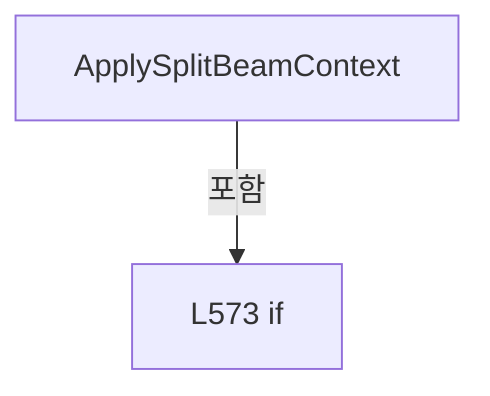

변경 전 점검: 입력/반환 타입, 위 호출자, 예외/취소 경로, 공유 상태와 저장·전송 소비자를 함께 확인합니다. 값의 단위나 물리 방향을 이름만으로 확정하지 않습니다.

### MethodDeclaration `SelectTab` · L583–619

[Drilling.UI/Menu/Menus/CMenuReview.cs:583–619](https://github.com/kjuws10-rgb/A3Drilling/blob/dfa5920e6301d9ec4b0eab1452ae59521aafc986/Drilling.UI/Menu/Menus/CMenuReview.cs#L583-L619)

| 항목 | 실제 추출 값 |
| --- | --- |
| 서명 | void Drilling.UI.Menu.Menus.CMenuReview.SelectTab(object?) |
| 접근/수식자 | Private / private |
| 반환/값 타입 | void |
| 소속 타입 | NamedType:Drilling.UI.Menu.Menus.CMenuReview |

입력 계약:

| 이름 | 타입 | 전달 | 선택/기본값 |
| --- | --- | --- | --- |
| parameter | object? | None | False /  |

현재 부분 분석에서 직접 연결된 호출자는 없습니다. XAML/이벤트/인터페이스·델리게이트·외부 진입을 추가 확인해야 하며, 미사용으로 판정한 것이 아닙니다.

호출하는 대상과 해석 범위:

| 원본 행 | 표현식 | 분석 상태 | 대상/소스 위치 |
| --- | --- | --- | --- |
| 585 | string.IsNullOrWhiteSpace | resolved | bool string.IsNullOrWhiteSpace(string?) |
| 595 | tab.Equals | resolved | bool string.Equals(string?, System.StringComparison) |
| 602 | _statusReporter | resolved · 동적 구현 선택 가능 | void System.Action<string>.Invoke(string) |
| 603 | CRecipeConfirmDialog.ShowWarning | resolved | void Drilling.UI.Popup.CRecipeConfirmDialog.ShowWarning(string, string, Window?) · Drilling.UI/Popup/CRecipeConfirmDialog.xaml.cs:86 |
| 607 | InvalidateBeamInspectionResultLoad | resolved | void Drilling.UI.Menu.Menus.CMenuReview.InvalidateBeamInspectionResultLoad(bool) · Drilling.UI/Menu/Menus/CMenuReview.cs:2575 |
| 616 | NotifyReviewExecutionCommandStates | resolved | void Drilling.UI.Menu.Menus.CMenuReview.NotifyReviewExecutionCommandStates() · Drilling.UI/Menu/Menus/CMenuReview.cs:3295 |
| 617 | _statusReporter | resolved · 동적 구현 선택 가능 | void System.Action<string>.Invoke(string) |
| 618 | _refreshScreen | resolved · 동적 구현 선택 가능 | void System.Action.Invoke() |

본문의 실제 연산·분기·예외·반환 순서(원문 위치 순):

| 원본 행 | 종류 | 주석 해설 |
| --- | --- | --- |
| 585 | call | 함수·델리게이트 또는 객체 생성자를 호출합니다: string.IsNullOrWhiteSpace(tab) |
| 585 | if | 조건에 따라 분기합니다: if (parameter is not string tab &#124;&#124; string.IsNullOrWhiteSpace(tab)) |
| 587 | return | 호출자에게 값 또는 제어를 반환합니다: return; |
| 590 | if | 조건에 따라 분기합니다: if (tab != "RUN") |
| 592 | return | 호출자에게 값 또는 제어를 반환합니다: return; |
| 595 | call | 함수·델리게이트 또는 객체 생성자를 호출합니다: tab.Equals(_selectedTab, StringComparison.OrdinalIgnoreCase) |
| 595 | if | 조건에 따라 분기합니다: if (tab.Equals(_selectedTab, StringComparison.OrdinalIgnoreCase)) |
| 597 | return | 호출자에게 값 또는 제어를 반환합니다: return; |
| 600 | if | 조건에 따라 분기합니다: if (IsReviewExecutionActive) |
| 602 | call | 함수·델리게이트 또는 객체 생성자를 호출합니다: _statusReporter("Review is running. Stop the current review before changing the tab.") |
| 603 | call | 함수·델리게이트 또는 객체 생성자를 호출합니다: CRecipeConfirmDialog.ShowWarning("검사 진행 중", "검사를 중지한 후 탭을 변경해 주세요.") |
| 604 | return | 호출자에게 값 또는 제어를 반환합니다: return; |
| 607 | call | 함수·델리게이트 또는 객체 생성자를 호출합니다: InvalidateBeamInspectionResultLoad(clearLoaded: true) |
| 608 | assignment | 값을 대상에 대입합니다: _selectedTab = tab |
| 609 | if | 조건에 따라 분기합니다: if (IsSampleSelectTab) |
| 611 | assignment | 값을 대상에 대입합니다: _isSampleCellDetailVisible = false |
| 612 | assignment | 값을 대상에 대입합니다: _selectedMode = "SAMPLE SHOT" |
| 613 | assignment | 값을 대상에 대입합니다: _selectionRuleText = _selectedSampleRuleUi |
| 616 | call | 함수·델리게이트 또는 객체 생성자를 호출합니다: NotifyReviewExecutionCommandStates() |
| 617 | call | 함수·델리게이트 또는 객체 생성자를 호출합니다: _statusReporter($"Review tab selected: {_selectedTab}") |
| 618 | call | 함수·델리게이트 또는 객체 생성자를 호출합니다: _refreshScreen() |

제어 구문의 포함 구조(실제 실행 순서/CFG가 아닌 구문 탐색 그림):

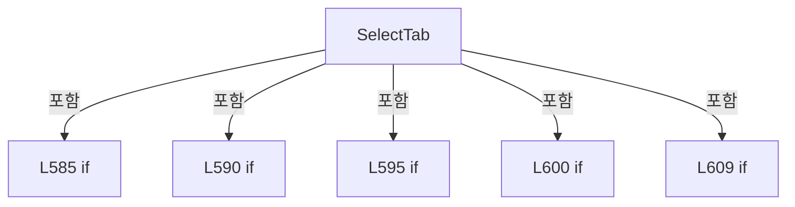

변경 전 점검: 입력/반환 타입, 위 호출자, 예외/취소 경로, 공유 상태와 저장·전송 소비자를 함께 확인합니다. 값의 단위나 물리 방향을 이름만으로 확정하지 않습니다.

### MethodDeclaration `SelectSampleRuleUi` · L621–634

[Drilling.UI/Menu/Menus/CMenuReview.cs:621–634](https://github.com/kjuws10-rgb/A3Drilling/blob/dfa5920e6301d9ec4b0eab1452ae59521aafc986/Drilling.UI/Menu/Menus/CMenuReview.cs#L621-L634)

| 항목 | 실제 추출 값 |
| --- | --- |
| 서명 | void Drilling.UI.Menu.Menus.CMenuReview.SelectSampleRuleUi(object?) |
| 접근/수식자 | Private / private |
| 반환/값 타입 | void |
| 소속 타입 | NamedType:Drilling.UI.Menu.Menus.CMenuReview |

입력 계약:

| 이름 | 타입 | 전달 | 선택/기본값 |
| --- | --- | --- | --- |
| parameter | object? | None | False /  |

현재 부분 분석에서 직접 연결된 호출자는 없습니다. XAML/이벤트/인터페이스·델리게이트·외부 진입을 추가 확인해야 하며, 미사용으로 판정한 것이 아닙니다.

호출하는 대상과 해석 범위:

| 원본 행 | 표현식 | 분석 상태 | 대상/소스 위치 |
| --- | --- | --- | --- |
| 623 | .ToString | resolved · 동적 구현 선택 가능 | string? object.ToString() |
| 623 | .Trim().ToUpperInvariant | resolved | string string.ToUpperInvariant() |
| 623 | .Trim | resolved | string string.Trim() |
| 629 | _selectedSampleShotKeys.Clear | resolved | void System.Collections.Generic.HashSet<string>.Clear() |
| 632 | _statusReporter | resolved · 동적 구현 선택 가능 | void System.Action<string>.Invoke(string) |
| 633 | RefreshSampleRuleUi | resolved | void Drilling.UI.Menu.Menus.CMenuReview.RefreshSampleRuleUi() · Drilling.UI/Menu/Menus/CMenuReview.cs:841 |

본문의 실제 연산·분기·예외·반환 순서(원문 위치 순):

| 원본 행 | 종류 | 주석 해설 |
| --- | --- | --- |
| 623 | call | 함수·델리게이트 또는 객체 생성자를 호출합니다: .ToString() |
| 623 | call | 함수·델리게이트 또는 객체 생성자를 호출합니다: .Trim().ToUpperInvariant() |
| 623 | call | 함수·델리게이트 또는 객체 생성자를 호출합니다: .Trim() |
| 623 | local-declaration | 지역 변수를 선언합니다: var rule = parameter?.ToString()?.Trim().ToUpperInvariant(); |
| 623 | variable-initializer | 변수의 초기값을 지정합니다: rule = parameter?.ToString()?.Trim().ToUpperInvariant() |
| 624 | if | 조건에 따라 분기합니다: if (rule is not ("ROUGH" or "FINE") &#124;&#124; rule == _selectedSampleRuleUi) |
| 625 | return | 호출자에게 값 또는 제어를 반환합니다: return; |
| 626 | assignment | 값을 대상에 대입합니다: _selectedSampleRuleUi = rule |
| 627 | assignment | 값을 대상에 대입합니다: _lastCorrectionRulePlan = null |
| 628 | assignment | 값을 대상에 대입합니다: _isSampleCellDetailVisible = false |
| 629 | call | 함수·델리게이트 또는 객체 생성자를 호출합니다: _selectedSampleShotKeys.Clear() |
| 630 | assignment | 값을 대상에 대입합니다: _selectedMode = "SAMPLE SHOT" |
| 631 | assignment | 값을 대상에 대입합니다: _selectionRuleText = rule |
| 632 | call | 함수·델리게이트 또는 객체 생성자를 호출합니다: _statusReporter($"Review correction rule selected: {rule}") |
| 633 | call | 함수·델리게이트 또는 객체 생성자를 호출합니다: RefreshSampleRuleUi() |

제어 구문의 포함 구조(실제 실행 순서/CFG가 아닌 구문 탐색 그림):


변경 전 점검: 입력/반환 타입, 위 호출자, 예외/취소 경로, 공유 상태와 저장·전송 소비자를 함께 확인합니다. 값의 단위나 물리 방향을 이름만으로 확정하지 않습니다.

### MethodDeclaration `SelectSampleRuleScope` · L636–644

[Drilling.UI/Menu/Menus/CMenuReview.cs:636–644](https://github.com/kjuws10-rgb/A3Drilling/blob/dfa5920e6301d9ec4b0eab1452ae59521aafc986/Drilling.UI/Menu/Menus/CMenuReview.cs#L636-L644)

| 항목 | 실제 추출 값 |
| --- | --- |
| 서명 | void Drilling.UI.Menu.Menus.CMenuReview.SelectSampleRuleScope(object?) |
| 접근/수식자 | Private / private |
| 반환/값 타입 | void |
| 소속 타입 | NamedType:Drilling.UI.Menu.Menus.CMenuReview |

입력 계약:

| 이름 | 타입 | 전달 | 선택/기본값 |
| --- | --- | --- | --- |
| parameter | object? | None | False /  |

현재 부분 분석에서 직접 연결된 호출자는 없습니다. XAML/이벤트/인터페이스·델리게이트·외부 진입을 추가 확인해야 하며, 미사용으로 판정한 것이 아닙니다.

호출하는 대상과 해석 범위:

| 원본 행 | 표현식 | 분석 상태 | 대상/소스 위치 |
| --- | --- | --- | --- |
| 638 | .ToString | resolved · 동적 구현 선택 가능 | string? object.ToString() |
| 638 | .Trim().ToUpperInvariant | resolved | string string.ToUpperInvariant() |
| 638 | .Trim | resolved | string string.Trim() |
| 643 | RefreshSampleRuleUi | resolved | void Drilling.UI.Menu.Menus.CMenuReview.RefreshSampleRuleUi() · Drilling.UI/Menu/Menus/CMenuReview.cs:841 |

본문의 실제 연산·분기·예외·반환 순서(원문 위치 순):

| 원본 행 | 종류 | 주석 해설 |
| --- | --- | --- |
| 638 | call | 함수·델리게이트 또는 객체 생성자를 호출합니다: .ToString() |
| 638 | call | 함수·델리게이트 또는 객체 생성자를 호출합니다: .Trim().ToUpperInvariant() |
| 638 | call | 함수·델리게이트 또는 객체 생성자를 호출합니다: .Trim() |
| 638 | local-declaration | 지역 변수를 선언합니다: var scope = parameter?.ToString()?.Trim().ToUpperInvariant(); |
| 638 | variable-initializer | 변수의 초기값을 지정합니다: scope = parameter?.ToString()?.Trim().ToUpperInvariant() |
| 639 | if | 조건에 따라 분기합니다: if (scope is not ("HEAD" or "HEAD_CELL") &#124;&#124; scope == _sampleRuleScope) |
| 640 | return | 호출자에게 값 또는 제어를 반환합니다: return; |
| 641 | assignment | 값을 대상에 대입합니다: _sampleRuleScope = scope |
| 642 | assignment | 값을 대상에 대입합니다: _lastCorrectionRulePlan = null |
| 643 | call | 함수·델리게이트 또는 객체 생성자를 호출합니다: RefreshSampleRuleUi() |

제어 구문의 포함 구조(실제 실행 순서/CFG가 아닌 구문 탐색 그림):

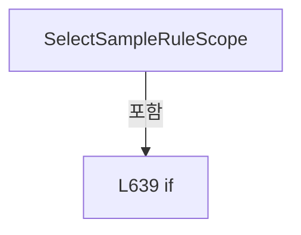

변경 전 점검: 입력/반환 타입, 위 호출자, 예외/취소 경로, 공유 상태와 저장·전송 소비자를 함께 확인합니다. 값의 단위나 물리 방향을 이름만으로 확정하지 않습니다.

### MethodDeclaration `SelectRoughReference` · L646–654

[Drilling.UI/Menu/Menus/CMenuReview.cs:646–654](https://github.com/kjuws10-rgb/A3Drilling/blob/dfa5920e6301d9ec4b0eab1452ae59521aafc986/Drilling.UI/Menu/Menus/CMenuReview.cs#L646-L654)

| 항목 | 실제 추출 값 |
| --- | --- |
| 서명 | void Drilling.UI.Menu.Menus.CMenuReview.SelectRoughReference(object?) |
| 접근/수식자 | Private / private |
| 반환/값 타입 | void |
| 소속 타입 | NamedType:Drilling.UI.Menu.Menus.CMenuReview |

입력 계약:

| 이름 | 타입 | 전달 | 선택/기본값 |
| --- | --- | --- | --- |
| parameter | object? | None | False /  |

현재 부분 분석에서 직접 연결된 호출자는 없습니다. XAML/이벤트/인터페이스·델리게이트·외부 진입을 추가 확인해야 하며, 미사용으로 판정한 것이 아닙니다.

호출하는 대상과 해석 범위:

| 원본 행 | 표현식 | 분석 상태 | 대상/소스 위치 |
| --- | --- | --- | --- |
| 648 | .ToString | resolved · 동적 구현 선택 가능 | string? object.ToString() |
| 648 | .Trim().ToUpperInvariant | resolved | string string.ToUpperInvariant() |
| 648 | .Trim | resolved | string string.Trim() |
| 653 | RefreshSampleRuleUi | resolved | void Drilling.UI.Menu.Menus.CMenuReview.RefreshSampleRuleUi() · Drilling.UI/Menu/Menus/CMenuReview.cs:841 |

본문의 실제 연산·분기·예외·반환 순서(원문 위치 순):

| 원본 행 | 종류 | 주석 해설 |
| --- | --- | --- |
| 648 | call | 함수·델리게이트 또는 객체 생성자를 호출합니다: .ToString() |
| 648 | call | 함수·델리게이트 또는 객체 생성자를 호출합니다: .Trim().ToUpperInvariant() |
| 648 | call | 함수·델리게이트 또는 객체 생성자를 호출합니다: .Trim() |
| 648 | local-declaration | 지역 변수를 선언합니다: var reference = parameter?.ToString()?.Trim().ToUpperInvariant(); |
| 648 | variable-initializer | 변수의 초기값을 지정합니다: reference = parameter?.ToString()?.Trim().ToUpperInvariant() |
| 649 | if | 조건에 따라 분기합니다: if (reference is not ("FIRST" or "CENTER" or "LAST") &#124;&#124; reference == _roughReference) |
| 650 | return | 호출자에게 값 또는 제어를 반환합니다: return; |
| 651 | assignment | 값을 대상에 대입합니다: _roughReference = reference |
| 652 | assignment | 값을 대상에 대입합니다: _lastCorrectionRulePlan = null |
| 653 | call | 함수·델리게이트 또는 객체 생성자를 호출합니다: RefreshSampleRuleUi() |

제어 구문의 포함 구조(실제 실행 순서/CFG가 아닌 구문 탐색 그림):


변경 전 점검: 입력/반환 타입, 위 호출자, 예외/취소 경로, 공유 상태와 저장·전송 소비자를 함께 확인합니다. 값의 단위나 물리 방향을 이름만으로 확정하지 않습니다.

### MethodDeclaration `SelectFineLineCount` · L656–663

[Drilling.UI/Menu/Menus/CMenuReview.cs:656–663](https://github.com/kjuws10-rgb/A3Drilling/blob/dfa5920e6301d9ec4b0eab1452ae59521aafc986/Drilling.UI/Menu/Menus/CMenuReview.cs#L656-L663)

| 항목 | 실제 추출 값 |
| --- | --- |
| 서명 | void Drilling.UI.Menu.Menus.CMenuReview.SelectFineLineCount(object?) |
| 접근/수식자 | Private / private |
| 반환/값 타입 | void |
| 소속 타입 | NamedType:Drilling.UI.Menu.Menus.CMenuReview |

입력 계약:

| 이름 | 타입 | 전달 | 선택/기본값 |
| --- | --- | --- | --- |
| parameter | object? | None | False /  |

현재 부분 분석에서 직접 연결된 호출자는 없습니다. XAML/이벤트/인터페이스·델리게이트·외부 진입을 추가 확인해야 하며, 미사용으로 판정한 것이 아닙니다.

호출하는 대상과 해석 범위:

| 원본 행 | 표현식 | 분석 상태 | 대상/소스 위치 |
| --- | --- | --- | --- |
| 658 | int.TryParse | resolved | bool int.TryParse(string?, System.Globalization.NumberStyles, System.IFormatProvider?, out int) |
| 658 | .ToString | resolved · 동적 구현 선택 가능 | string? object.ToString() |
| 662 | RefreshSampleRuleUi | resolved | void Drilling.UI.Menu.Menus.CMenuReview.RefreshSampleRuleUi() · Drilling.UI/Menu/Menus/CMenuReview.cs:841 |

본문의 실제 연산·분기·예외·반환 순서(원문 위치 순):

| 원본 행 | 종류 | 주석 해설 |
| --- | --- | --- |
| 658 | call | 함수·델리게이트 또는 객체 생성자를 호출합니다: int.TryParse(parameter?.ToString(), NumberStyles.Integer, CultureInfo.InvariantCulture, out var count) |
| 658 | call | 함수·델리게이트 또는 객체 생성자를 호출합니다: .ToString() |
| 658 | if | 조건에 따라 분기합니다: if (!int.TryParse(parameter?.ToString(), NumberStyles.Integer, CultureInfo.InvariantCulture, out var count) &#124;&#124; count is not (1 or 3 or 5 or 7) &#124;&#124; count == _fineLineCount) |
| 659 | return | 호출자에게 값 또는 제어를 반환합니다: return; |
| 660 | assignment | 값을 대상에 대입합니다: _fineLineCount = count |
| 661 | assignment | 값을 대상에 대입합니다: _lastCorrectionRulePlan = null |
| 662 | call | 함수·델리게이트 또는 객체 생성자를 호출합니다: RefreshSampleRuleUi() |

제어 구문의 포함 구조(실제 실행 순서/CFG가 아닌 구문 탐색 그림):

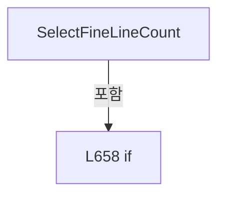

변경 전 점검: 입력/반환 타입, 위 호출자, 예외/취소 경로, 공유 상태와 저장·전송 소비자를 함께 확인합니다. 값의 단위나 물리 방향을 이름만으로 확정하지 않습니다.

### MethodDeclaration `SelectMode` · L665–718

[Drilling.UI/Menu/Menus/CMenuReview.cs:665–718](https://github.com/kjuws10-rgb/A3Drilling/blob/dfa5920e6301d9ec4b0eab1452ae59521aafc986/Drilling.UI/Menu/Menus/CMenuReview.cs#L665-L718)

| 항목 | 실제 추출 값 |
| --- | --- |
| 서명 | void Drilling.UI.Menu.Menus.CMenuReview.SelectMode(object?) |
| 접근/수식자 | Private / private |
| 반환/값 타입 | void |
| 소속 타입 | NamedType:Drilling.UI.Menu.Menus.CMenuReview |

입력 계약:

| 이름 | 타입 | 전달 | 선택/기본값 |
| --- | --- | --- | --- |
| parameter | object? | None | False /  |

현재 부분 분석에서 직접 연결된 호출자는 없습니다. XAML/이벤트/인터페이스·델리게이트·외부 진입을 추가 확인해야 하며, 미사용으로 판정한 것이 아닙니다.

호출하는 대상과 해석 범위:

| 원본 행 | 표현식 | 분석 상태 | 대상/소스 위치 |
| --- | --- | --- | --- |
| 669 | _statusReporter | resolved · 동적 구현 선택 가능 | void System.Action<string>.Invoke(string) |
| 673 | string.IsNullOrWhiteSpace | resolved | bool string.IsNullOrWhiteSpace(string?) |
| 678 | mode.Trim().ToUpperInvariant | resolved | string string.ToUpperInvariant() |
| 678 | mode.Trim | resolved | string string.Trim() |
| 681 | InvalidateBeamInspectionResultLoad | resolved | void Drilling.UI.Menu.Menus.CMenuReview.InvalidateBeamInspectionResultLoad(bool) · Drilling.UI/Menu/Menus/CMenuReview.cs:2575 |
| 683 | mode.Trim().ToUpperInvariant | resolved | string string.ToUpperInvariant() |
| 683 | mode.Trim | resolved | string string.Trim() |
| 698 | _selectedLineShotKeys.Clear | resolved | void System.Collections.Generic.HashSet<string>.Clear() |
| 699 | RefreshOneShotSelection | resolved | void Drilling.UI.Menu.Menus.CMenuReview.RefreshOneShotSelection(bool) · Drilling.UI/Menu/Menus/CMenuReview.cs:2641 |
| 700 | OnPropertyChanged | resolved | void Drilling.UI.Menu.CBindingBase.OnPropertyChanged(string?) · Drilling.UI/Menu/CBindingBase.cs:761 |
| 700 | nameof | unresolved | None |
| 701 | OnPropertyChanged | resolved | void Drilling.UI.Menu.CBindingBase.OnPropertyChanged(string?) · Drilling.UI/Menu/CBindingBase.cs:761 |
| 701 | nameof | unresolved | None |
| 702 | OnPropertyChanged | resolved | void Drilling.UI.Menu.CBindingBase.OnPropertyChanged(string?) · Drilling.UI/Menu/CBindingBase.cs:761 |
| 702 | nameof | unresolved | None |
| 703 | _statusReporter | resolved · 동적 구현 선택 가능 | void System.Action<string>.Invoke(string) |
| 704 | OnPropertyChanged | resolved | void Drilling.UI.Menu.CBindingBase.OnPropertyChanged(string?) · Drilling.UI/Menu/CBindingBase.cs:761 |
| 704 | nameof | unresolved | None |
| 705 | OnPropertyChanged | resolved | void Drilling.UI.Menu.CBindingBase.OnPropertyChanged(string?) · Drilling.UI/Menu/CBindingBase.cs:761 |
| 705 | nameof | unresolved | None |
| 706 | OnPropertyChanged | resolved | void Drilling.UI.Menu.CBindingBase.OnPropertyChanged(string?) · Drilling.UI/Menu/CBindingBase.cs:761 |
| 706 | nameof | unresolved | None |
| 707 | OnPropertyChanged | resolved | void Drilling.UI.Menu.CBindingBase.OnPropertyChanged(string?) · Drilling.UI/Menu/CBindingBase.cs:761 |
| 707 | nameof | unresolved | None |
| 708 | OnPropertyChanged | resolved | void Drilling.UI.Menu.CBindingBase.OnPropertyChanged(string?) · Drilling.UI/Menu/CBindingBase.cs:761 |
| 708 | nameof | unresolved | None |
| 709 | OnPropertyChanged | resolved | void Drilling.UI.Menu.CBindingBase.OnPropertyChanged(string?) · Drilling.UI/Menu/CBindingBase.cs:761 |
| 709 | nameof | unresolved | None |
| 710 | OnPropertyChanged | resolved | void Drilling.UI.Menu.CBindingBase.OnPropertyChanged(string?) · Drilling.UI/Menu/CBindingBase.cs:761 |
| 710 | nameof | unresolved | None |
| 711 | OnPropertyChanged | resolved | void Drilling.UI.Menu.CBindingBase.OnPropertyChanged(string?) · Drilling.UI/Menu/CBindingBase.cs:761 |
| 711 | nameof | unresolved | None |
| 712 | OnPropertyChanged | resolved | void Drilling.UI.Menu.CBindingBase.OnPropertyChanged(string?) · Drilling.UI/Menu/CBindingBase.cs:761 |
| 712 | nameof | unresolved | None |
| 713 | OnPropertyChanged | resolved | void Drilling.UI.Menu.CBindingBase.OnPropertyChanged(string?) · Drilling.UI/Menu/CBindingBase.cs:761 |
| 713 | nameof | unresolved | None |
| 714 | OnPropertyChanged | resolved | void Drilling.UI.Menu.CBindingBase.OnPropertyChanged(string?) · Drilling.UI/Menu/CBindingBase.cs:761 |
| 714 | nameof | unresolved | None |
| 715 | SelectRunCellCommand.NotifyCanExecuteChanged | resolved | void Drilling.UI.Menu.CButtonCommand.NotifyCanExecuteChanged() · Drilling.UI/Menu/CButtonCommand.cs:24 |
| 716 | NotifyReviewExecutionCommandStates | resolved | void Drilling.UI.Menu.Menus.CMenuReview.NotifyReviewExecutionCommandStates() · Drilling.UI/Menu/Menus/CMenuReview.cs:3295 |
| 717 | RefreshRunDisplayFromCachedContext | resolved | void Drilling.UI.Menu.Menus.CMenuReview.RefreshRunDisplayFromCachedContext(bool) · Drilling.UI/Menu/Menus/CMenuReview.cs:3395 |

본문의 실제 연산·분기·예외·반환 순서(원문 위치 순):

| 원본 행 | 종류 | 주석 해설 |
| --- | --- | --- |
| 667 | if | 조건에 따라 분기합니다: if (IsReviewExecutionActive) |
| 669 | call | 함수·델리게이트 또는 객체 생성자를 호출합니다: _statusReporter("Review is running. Stop the current review before changing the mode.") |
| 670 | return | 호출자에게 값 또는 제어를 반환합니다: return; |
| 673 | call | 함수·델리게이트 또는 객체 생성자를 호출합니다: string.IsNullOrWhiteSpace(mode) |
| 673 | if | 조건에 따라 분기합니다: if (parameter is not string mode &#124;&#124; string.IsNullOrWhiteSpace(mode)) |
| 675 | return | 호출자에게 값 또는 제어를 반환합니다: return; |
| 678 | assignment | 값을 대상에 대입합니다: mode = mode.Trim().ToUpperInvariant() |
| 678 | call | 함수·델리게이트 또는 객체 생성자를 호출합니다: mode.Trim().ToUpperInvariant() |
| 678 | call | 함수·델리게이트 또는 객체 생성자를 호출합니다: mode.Trim() |
| 679 | if | 조건에 따라 분기합니다: if (mode is not ("ALL SHOT" or "ONE SHOT" or "ONE LINE" or "BEAM INSPECTION")) |
| 680 | return | 호출자에게 값 또는 제어를 반환합니다: return; |
| 681 | call | 함수·델리게이트 또는 객체 생성자를 호출합니다: InvalidateBeamInspectionResultLoad(clearLoaded: true) |
| 682 | assignment | 값을 대상에 대입합니다: _selectedMode = mode |
| 683 | call | 함수·델리게이트 또는 객체 생성자를 호출합니다: mode.Trim().ToUpperInvariant() |
| 683 | call | 함수·델리게이트 또는 객체 생성자를 호출합니다: mode.Trim() |
| 683 | assignment | 값을 대상에 대입합니다: _selectedRuleType = mode.Trim().ToUpperInvariant() switch { "ALL SHOT" => EN_REVIEW_RULE_TYPE.AllPoint, "ZERO DEFENSE" => EN_REVIEW_RULE_TYPE.ZeroLine, _ => EN_REVIEW_RULE_TYPE.SamplePoint } |
| 683 | switch-expression | 값별 결과식을 선택합니다: mode.Trim().ToUpperInvariant() switch { "ALL SHOT" => EN_REVIEW_RULE_TYPE.AllPoint, "ZERO DEFENSE" => EN_REVIEW_RULE_TYPE.ZeroLine, _ => EN_REVIEW_RULE_TYPE.SamplePoint } |
| 689 | assignment | 값을 대상에 대입합니다: _selectionRuleText = _selectedRuleType switch { EN_REVIEW_RULE_TYPE.AllPoint => "All Shot", EN_REVIEW_RULE_TYPE.ZeroLine => "0-Line", _ when mode == "ONE LINE" => "Selected Glass Line", _ => _selectionRuleText is "All Shot" or "0- |
| 689 | switch-expression | 값별 결과식을 선택합니다: _selectedRuleType switch { EN_REVIEW_RULE_TYPE.AllPoint => "All Shot", EN_REVIEW_RULE_TYPE.ZeroLine => "0-Line", _ when mode == "ONE LINE" => "Selected Glass Line", _ => _selectionRuleText is "All Shot" or "0-Line" or "Selected Gl |
| 694 | conditional-expression | 조건에 따라 결과식을 선택합니다: _selectionRuleText is "All Shot" or "0-Line" or "Selected Glass Line" ? "Manual Sample" : _selectionRuleText |
| 696 | assignment | 값을 대상에 대입합니다: _isRunCellDetailVisible = false |
| 697 | assignment | 값을 대상에 대입합니다: _selectedRunShotKey = "" |
| 698 | call | 함수·델리게이트 또는 객체 생성자를 호출합니다: _selectedLineShotKeys.Clear() |
| 699 | call | 함수·델리게이트 또는 객체 생성자를 호출합니다: RefreshOneShotSelection(clearResult: true) |
| 700 | call | 함수·델리게이트 또는 객체 생성자를 호출합니다: OnPropertyChanged(nameof(IsShotSelectionMode)) |
| 700 | call | 함수·델리게이트 또는 객체 생성자를 호출합니다: nameof(IsShotSelectionMode) |
| 701 | call | 함수·델리게이트 또는 객체 생성자를 호출합니다: OnPropertyChanged(nameof(IsReviewHeadCardsVisible)) |
| 701 | call | 함수·델리게이트 또는 객체 생성자를 호출합니다: nameof(IsReviewHeadCardsVisible) |
| 702 | call | 함수·델리게이트 또는 객체 생성자를 호출합니다: OnPropertyChanged(nameof(InspectionHeadRows)) |
| 702 | call | 함수·델리게이트 또는 객체 생성자를 호출합니다: nameof(InspectionHeadRows) |
| 703 | call | 함수·델리게이트 또는 객체 생성자를 호출합니다: _statusReporter($"Review mode selected: {_selectedMode}") |
| 704 | call | 함수·델리게이트 또는 객체 생성자를 호출합니다: OnPropertyChanged(nameof(IsAllShotReviewMode)) |
| 704 | call | 함수·델리게이트 또는 객체 생성자를 호출합니다: nameof(IsAllShotReviewMode) |
| 705 | call | 함수·델리게이트 또는 객체 생성자를 호출합니다: OnPropertyChanged(nameof(IsOneLineReviewMode)) |
| 705 | call | 함수·델리게이트 또는 객체 생성자를 호출합니다: nameof(IsOneLineReviewMode) |
| 706 | call | 함수·델리게이트 또는 객체 생성자를 호출합니다: OnPropertyChanged(nameof(IsAllShotStyleReviewMode)) |
| 706 | call | 함수·델리게이트 또는 객체 생성자를 호출합니다: nameof(IsAllShotStyleReviewMode) |
| 707 | call | 함수·델리게이트 또는 객체 생성자를 호출합니다: OnPropertyChanged(nameof(IsOneShotReviewMode)) |
| 707 | call | 함수·델리게이트 또는 객체 생성자를 호출합니다: nameof(IsOneShotReviewMode) |
| 708 | call | 함수·델리게이트 또는 객체 생성자를 호출합니다: OnPropertyChanged(nameof(IsRunStageStatusVisible)) |
| 708 | call | 함수·델리게이트 또는 객체 생성자를 호출합니다: nameof(IsRunStageStatusVisible) |
| 709 | call | 함수·델리게이트 또는 객체 생성자를 호출합니다: OnPropertyChanged(nameof(IsRunCommandsVisible)) |
| 709 | call | 함수·델리게이트 또는 객체 생성자를 호출합니다: nameof(IsRunCommandsVisible) |
| 710 | call | 함수·델리게이트 또는 객체 생성자를 호출합니다: OnPropertyChanged(nameof(IsRuleReviewMode)) |
| 710 | call | 함수·델리게이트 또는 객체 생성자를 호출합니다: nameof(IsRuleReviewMode) |
| 711 | call | 함수·델리게이트 또는 객체 생성자를 호출합니다: OnPropertyChanged(nameof(IsBeamInspectionMode)) |
| 711 | call | 함수·델리게이트 또는 객체 생성자를 호출합니다: nameof(IsBeamInspectionMode) |
| 712 | call | 함수·델리게이트 또는 객체 생성자를 호출합니다: OnPropertyChanged(nameof(IsBeamSelectionVisible)) |
| 712 | call | 함수·델리게이트 또는 객체 생성자를 호출합니다: nameof(IsBeamSelectionVisible) |
| 713 | call | 함수·델리게이트 또는 객체 생성자를 호출합니다: OnPropertyChanged(nameof(IsLastMeasurementVisible)) |
| 713 | call | 함수·델리게이트 또는 객체 생성자를 호출합니다: nameof(IsLastMeasurementVisible) |
| 714 | call | 함수·델리게이트 또는 객체 생성자를 호출합니다: OnPropertyChanged(nameof(BeamSelectionSummary)) |
| 714 | call | 함수·델리게이트 또는 객체 생성자를 호출합니다: nameof(BeamSelectionSummary) |
| 715 | call | 함수·델리게이트 또는 객체 생성자를 호출합니다: SelectRunCellCommand.NotifyCanExecuteChanged() |
| 716 | call | 함수·델리게이트 또는 객체 생성자를 호출합니다: NotifyReviewExecutionCommandStates() |
| 717 | call | 함수·델리게이트 또는 객체 생성자를 호출합니다: RefreshRunDisplayFromCachedContext() |

제어 구문의 포함 구조(실제 실행 순서/CFG가 아닌 구문 탐색 그림):

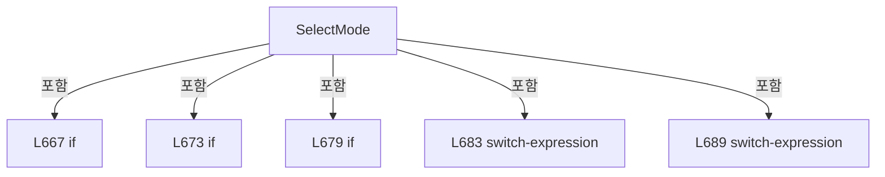

변경 전 점검: 입력/반환 타입, 위 호출자, 예외/취소 경로, 공유 상태와 저장·전송 소비자를 함께 확인합니다. 값의 단위나 물리 방향을 이름만으로 확정하지 않습니다.

### MethodDeclaration `ToggleShot` · L720–768

[Drilling.UI/Menu/Menus/CMenuReview.cs:720–768](https://github.com/kjuws10-rgb/A3Drilling/blob/dfa5920e6301d9ec4b0eab1452ae59521aafc986/Drilling.UI/Menu/Menus/CMenuReview.cs#L720-L768)

| 항목 | 실제 추출 값 |
| --- | --- |
| 서명 | void Drilling.UI.Menu.Menus.CMenuReview.ToggleShot(object?) |
| 접근/수식자 | Private / private |
| 반환/값 타입 | void |
| 소속 타입 | NamedType:Drilling.UI.Menu.Menus.CMenuReview |

입력 계약:

| 이름 | 타입 | 전달 | 선택/기본값 |
| --- | --- | --- | --- |
| parameter | object? | None | False /  |

정적 호출자로 확인된 위치:

| 호출 파일/행 | 호출 표현식 | 런타임 분기 가능 |
| --- | --- | --- |
| [Drilling.UI/Menu/Menus/CMenuReview.cs:782–782](https://github.com/kjuws10-rgb/A3Drilling/blob/dfa5920e6301d9ec4b0eab1452ae59521aafc986/Drilling.UI/Menu/Menus/CMenuReview.cs#L782-L782) | ToggleShot | False |

호출하는 대상과 해석 범위:

| 원본 행 | 표현식 | 분석 상태 | 대상/소스 위치 |
| --- | --- | --- | --- |
| 724 | _statusReporter | resolved · 동적 구현 선택 가능 | void System.Action<string>.Invoke(string) |
| 728 | CReviewManager.NormalizeShotKey | resolved | string Drilling.Common.Review.CReviewManager.NormalizeShotKey(string) · Drilling.Common/Review/CReviewManager.cs:1238 |
| 728 | .ToString | resolved · 동적 구현 선택 가능 | string? object.ToString() |
| 729 | string.IsNullOrWhiteSpace | resolved | bool string.IsNullOrWhiteSpace(string?) |
| 734 | FindPointByShotKey | resolved | Drilling.Common.Review.ST_REVIEW_PLAN_POINT? Drilling.UI.Menu.Menus.CMenuReview.FindPointByShotKey(Drilling.Common.Review.ST_REVIEW_PLAN?, string) · Drilling.UI/Menu/Menus/CMenuReview.cs:1502 |
| 742 | _selectedSampleShotKeys.Remove | resolved | bool System.Collections.Generic.HashSet<string>.Remove(string) |
| 743 | _statusReporter | resolved · 동적 구현 선택 가능 | void System.Action<string>.Invoke(string) |
| 743 | ToMatrixShotName | resolved | string Drilling.UI.Menu.Menus.CMenuReview.ToMatrixShotName(Drilling.Common.Review.ST_REVIEW_PLAN_POINT) · Drilling.UI/Menu/Menus/CMenuReview.cs:2099 |
| 744 | RefreshSampleSelectionDisplay | resolved | void Drilling.UI.Menu.Menus.CMenuReview.RefreshSampleSelectionDisplay(System.Collections.Generic.IEnumerable<string>) · Drilling.UI/Menu/Menus/CMenuReview.cs:785 |
| 750 | _selectedSampleShotKeys.Remove | resolved | bool System.Collections.Generic.HashSet<string>.Remove(string) |
| 751 | _statusReporter | resolved · 동적 구현 선택 가능 | void System.Action<string>.Invoke(string) |
| 751 | ToMatrixShotName | resolved | string Drilling.UI.Menu.Menus.CMenuReview.ToMatrixShotName(Drilling.Common.Review.ST_REVIEW_PLAN_POINT) · Drilling.UI/Menu/Menus/CMenuReview.cs:2099 |
| 752 | RefreshSampleSelectionDisplay | resolved | void Drilling.UI.Menu.Menus.CMenuReview.RefreshSampleSelectionDisplay(System.Collections.Generic.IEnumerable<string>) · Drilling.UI/Menu/Menus/CMenuReview.cs:785 |
| 757 | _selectedSampleShotKeys.Clear | resolved | void System.Collections.Generic.HashSet<string>.Clear() |
| 758 | _selectedSampleShotKeys.Add | resolved | bool System.Collections.Generic.HashSet<string>.Add(string) |
| 766 | _statusReporter | resolved · 동적 구현 선택 가능 | void System.Action<string>.Invoke(string) |
| 767 | RefreshSampleSelectionDisplay | resolved | void Drilling.UI.Menu.Menus.CMenuReview.RefreshSampleSelectionDisplay(System.Collections.Generic.IEnumerable<string>) · Drilling.UI/Menu/Menus/CMenuReview.cs:785 |
| 767 | string.IsNullOrWhiteSpace | resolved | bool string.IsNullOrWhiteSpace(string?) |

본문의 실제 연산·분기·예외·반환 순서(원문 위치 순):

| 원본 행 | 종류 | 주석 해설 |
| --- | --- | --- |
| 722 | if | 조건에 따라 분기합니다: if (!IsSimpleSampleRuleUi &#124;&#124; IsReviewExecutionActive) |
| 724 | call | 함수·델리게이트 또는 객체 생성자를 호출합니다: _statusReporter($"{_selectedSampleRuleUi} Shot selection is determined automatically by its rule settings.") |
| 725 | return | 호출자에게 값 또는 제어를 반환합니다: return; |
| 728 | call | 함수·델리게이트 또는 객체 생성자를 호출합니다: CReviewManager.NormalizeShotKey(parameter?.ToString() ?? "") |
| 728 | call | 함수·델리게이트 또는 객체 생성자를 호출합니다: .ToString() |
| 728 | local-declaration | 지역 변수를 선언합니다: var shotKey = CReviewManager.NormalizeShotKey(parameter?.ToString() ?? ""); |
| 728 | variable-initializer | 변수의 초기값을 지정합니다: shotKey = CReviewManager.NormalizeShotKey(parameter?.ToString() ?? "") |
| 729 | call | 함수·델리게이트 또는 객체 생성자를 호출합니다: string.IsNullOrWhiteSpace(shotKey) |
| 729 | if | 조건에 따라 분기합니다: if (string.IsNullOrWhiteSpace(shotKey)) |
| 731 | return | 호출자에게 값 또는 제어를 반환합니다: return; |
| 734 | call | 함수·델리게이트 또는 객체 생성자를 호출합니다: FindPointByShotKey(_lastAllPlan, shotKey) |
| 734 | local-declaration | 지역 변수를 선언합니다: var point = FindPointByShotKey(_lastAllPlan, shotKey); |
| 734 | variable-initializer | 변수의 초기값을 지정합니다: point = FindPointByShotKey(_lastAllPlan, shotKey) |
| 735 | if | 조건에 따라 분기합니다: if (point is null) |
| 737 | return | 호출자에게 값 또는 제어를 반환합니다: return; |
| 740 | if | 조건에 따라 분기합니다: if (point.HeadNo <= 0) |
| 742 | call | 함수·델리게이트 또는 객체 생성자를 호출합니다: _selectedSampleShotKeys.Remove(point.ShotKey) |
| 743 | call | 함수·델리게이트 또는 객체 생성자를 호출합니다: _statusReporter($"CELL{point.CellNo:00} / {ToMatrixShotName(point)} cannot be selected because it is not assigned to a processing Head.") |
| 743 | call | 함수·델리게이트 또는 객체 생성자를 호출합니다: ToMatrixShotName(point) |
| 744 | call | 함수·델리게이트 또는 객체 생성자를 호출합니다: RefreshSampleSelectionDisplay([point.ShotKey]) |
| 745 | return | 호출자에게 값 또는 제어를 반환합니다: return; |
| 748 | if | 조건에 따라 분기합니다: if (!point.Use) |
| 750 | call | 함수·델리게이트 또는 객체 생성자를 호출합니다: _selectedSampleShotKeys.Remove(point.ShotKey) |
| 751 | call | 함수·델리게이트 또는 객체 생성자를 호출합니다: _statusReporter($"CELL{point.CellNo:00} / {ToMatrixShotName(point)} is excluded from Review by Recipe Masking/Chess settings.") |
| 751 | call | 함수·델리게이트 또는 객체 생성자를 호출합니다: ToMatrixShotName(point) |
| 752 | call | 함수·델리게이트 또는 객체 생성자를 호출합니다: RefreshSampleSelectionDisplay([point.ShotKey]) |
| 753 | return | 호출자에게 값 또는 제어를 반환합니다: return; |
| 756 | local-declaration | 지역 변수를 선언합니다: var previousSimpleKey = _simpleSampleShotKey; |
| 756 | variable-initializer | 변수의 초기값을 지정합니다: previousSimpleKey = _simpleSampleShotKey |
| 757 | call | 함수·델리게이트 또는 객체 생성자를 호출합니다: _selectedSampleShotKeys.Clear() |
| 758 | call | 함수·델리게이트 또는 객체 생성자를 호출합니다: _selectedSampleShotKeys.Add(shotKey) |
| 759 | assignment | 값을 대상에 대입합니다: _simpleSampleShotKey = shotKey |
| 760 | assignment | 값을 대상에 대입합니다: _lastCorrectionRulePlan = null |
| 761 | assignment | 값을 대상에 대입합니다: _sampleRuleHeadNo = point.HeadNo |
| 762 | assignment | 값을 대상에 대입합니다: _sampleRuleCellNo = point.CellNo |
| 763 | assignment | 값을 대상에 대입합니다: _selectedMode = "SAMPLE SHOT" |
| 764 | assignment | 값을 대상에 대입합니다: _selectedRuleType = EN_REVIEW_RULE_TYPE.SamplePoint |
| 765 | assignment | 값을 대상에 대입합니다: _selectionRuleText = _selectedSampleRuleUi |
| 766 | call | 함수·델리게이트 또는 객체 생성자를 호출합니다: _statusReporter($"Review shot selection updated: {_selectedSampleShotKeys.Count} shots.") |
| 767 | call | 함수·델리게이트 또는 객체 생성자를 호출합니다: RefreshSampleSelectionDisplay(string.IsNullOrWhiteSpace(previousSimpleKey) ? [shotKey] : [previousSimpleKey, shotKey]) |
| 767 | call | 함수·델리게이트 또는 객체 생성자를 호출합니다: string.IsNullOrWhiteSpace(previousSimpleKey) |
| 767 | conditional-expression | 조건에 따라 결과식을 선택합니다: string.IsNullOrWhiteSpace(previousSimpleKey) ? [shotKey] : [previousSimpleKey, shotKey] |

제어 구문의 포함 구조(실제 실행 순서/CFG가 아닌 구문 탐색 그림):

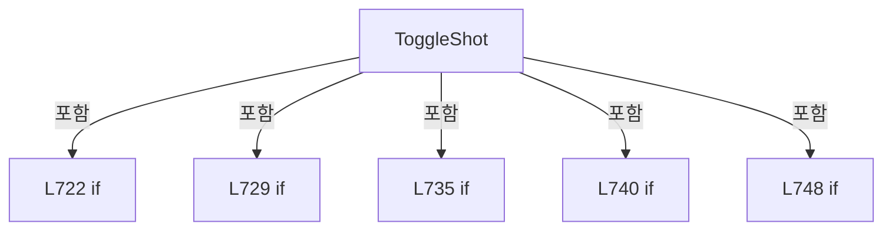

변경 전 점검: 입력/반환 타입, 위 호출자, 예외/취소 경로, 공유 상태와 저장·전송 소비자를 함께 확인합니다. 값의 단위나 물리 방향을 이름만으로 확정하지 않습니다.

### MethodDeclaration `SetSampleShotSelection` · L770–783

[Drilling.UI/Menu/Menus/CMenuReview.cs:770–783](https://github.com/kjuws10-rgb/A3Drilling/blob/dfa5920e6301d9ec4b0eab1452ae59521aafc986/Drilling.UI/Menu/Menus/CMenuReview.cs#L770-L783)

| 항목 | 실제 추출 값 |
| --- | --- |
| 서명 | void Drilling.UI.Menu.Menus.CMenuReview.SetSampleShotSelection(object?) |
| 접근/수식자 | Private / private |
| 반환/값 타입 | void |
| 소속 타입 | NamedType:Drilling.UI.Menu.Menus.CMenuReview |

입력 계약:

| 이름 | 타입 | 전달 | 선택/기본값 |
| --- | --- | --- | --- |
| parameter | object? | None | False /  |

현재 부분 분석에서 직접 연결된 호출자는 없습니다. XAML/이벤트/인터페이스·델리게이트·외부 진입을 추가 확인해야 하며, 미사용으로 판정한 것이 아닙니다.

호출하는 대상과 해석 범위:

| 원본 행 | 표현식 | 분석 상태 | 대상/소스 위치 |
| --- | --- | --- | --- |
| 782 | ToggleShot | resolved | void Drilling.UI.Menu.Menus.CMenuReview.ToggleShot(object?) · Drilling.UI/Menu/Menus/CMenuReview.cs:720 |

본문의 실제 연산·분기·예외·반환 순서(원문 위치 순):

| 원본 행 | 종류 | 주석 해설 |
| --- | --- | --- |
| 772 | if | 조건에 따라 분기합니다: if (!IsSimpleSampleRuleUi &#124;&#124; IsReviewExecutionActive) |
| 774 | return | 호출자에게 값 또는 제어를 반환합니다: return; |
| 777 | if | 조건에 따라 분기합니다: if (parameter is not ST_REVIEW_SAMPLE_DRAG_SELECTION selection &#124;&#124; selection.ShotKeys.Count == 0) |
| 779 | return | 호출자에게 값 또는 제어를 반환합니다: return; |
| 782 | call | 함수·델리게이트 또는 객체 생성자를 호출합니다: ToggleShot(selection.ShotKeys[^1]) |

제어 구문의 포함 구조(실제 실행 순서/CFG가 아닌 구문 탐색 그림):

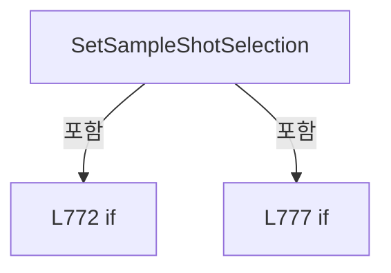

변경 전 점검: 입력/반환 타입, 위 호출자, 예외/취소 경로, 공유 상태와 저장·전송 소비자를 함께 확인합니다. 값의 단위나 물리 방향을 이름만으로 확정하지 않습니다.

### MethodDeclaration `RefreshSampleSelectionDisplay` · L785–835

[Drilling.UI/Menu/Menus/CMenuReview.cs:785–835](https://github.com/kjuws10-rgb/A3Drilling/blob/dfa5920e6301d9ec4b0eab1452ae59521aafc986/Drilling.UI/Menu/Menus/CMenuReview.cs#L785-L835)

| 항목 | 실제 추출 값 |
| --- | --- |
| 서명 | void Drilling.UI.Menu.Menus.CMenuReview.RefreshSampleSelectionDisplay(System.Collections.Generic.IEnumerable<string>) |
| 접근/수식자 | Private / private |
| 반환/값 타입 | void |
| 소속 타입 | NamedType:Drilling.UI.Menu.Menus.CMenuReview |

입력 계약:

| 이름 | 타입 | 전달 | 선택/기본값 |
| --- | --- | --- | --- |
| changedShotKeys | System.Collections.Generic.IEnumerable<string> | None | False /  |

정적 호출자로 확인된 위치:

| 호출 파일/행 | 호출 표현식 | 런타임 분기 가능 |
| --- | --- | --- |
| [Drilling.UI/Menu/Menus/CMenuReview.cs:744–744](https://github.com/kjuws10-rgb/A3Drilling/blob/dfa5920e6301d9ec4b0eab1452ae59521aafc986/Drilling.UI/Menu/Menus/CMenuReview.cs#L744-L744) | RefreshSampleSelectionDisplay | False |
| [Drilling.UI/Menu/Menus/CMenuReview.cs:752–752](https://github.com/kjuws10-rgb/A3Drilling/blob/dfa5920e6301d9ec4b0eab1452ae59521aafc986/Drilling.UI/Menu/Menus/CMenuReview.cs#L752-L752) | RefreshSampleSelectionDisplay | False |
| [Drilling.UI/Menu/Menus/CMenuReview.cs:767–767](https://github.com/kjuws10-rgb/A3Drilling/blob/dfa5920e6301d9ec4b0eab1452ae59521aafc986/Drilling.UI/Menu/Menus/CMenuReview.cs#L767-L767) | RefreshSampleSelectionDisplay | False |
| [Drilling.UI/Menu/Menus/CMenuReview.cs:1042–1042](https://github.com/kjuws10-rgb/A3Drilling/blob/dfa5920e6301d9ec4b0eab1452ae59521aafc986/Drilling.UI/Menu/Menus/CMenuReview.cs#L1042-L1042) | RefreshSampleSelectionDisplay | False |

호출하는 대상과 해석 범위:

| 원본 행 | 표현식 | 분석 상태 | 대상/소스 위치 |
| --- | --- | --- | --- |
| 787 | changedShotKeys.Select(CReviewManager.NormalizeShotKey).Where(key => !string.IsNullOrWhiteSpace(key)).ToHashSet | resolved | System.Collections.Generic.HashSet<string> System.Collections.Generic.IEnumerable<string>.ToHashSet<string>(System.Collections.Generic.IEqualityComparer<string>?) |
| 787 | changedShotKeys.Select(CReviewManager.NormalizeShotKey).Where | resolved | System.Collections.Generic.IEnumerable<string> System.Collections.Generic.IEnumerable<string>.Where<string>(System.Func<string, bool>) |
| 787 | changedShotKeys.Select | resolved | System.Collections.Generic.IEnumerable<string> System.Collections.Generic.IEnumerable<string>.Select<string, string>(System.Func<string, string>) |
| 787 | string.IsNullOrWhiteSpace | resolved | bool string.IsNullOrWhiteSpace(string?) |
| 790 | _sampleShotRowsByKey.TryGetValue | resolved | bool System.Collections.Generic.Dictionary<string, Drilling.UI.Menu.Menus.ST_REVIEW_POINT_SELECT_ROW>.TryGetValue(string, out Drilling.UI.Menu.Menus.ST_REVIEW_POINT_SELECT_ROW) |
| 797 | row.SetSelection | resolved | void Drilling.UI.Menu.Menus.ST_REVIEW_POINT_SELECT_ROW.SetSelection(bool, string) · Drilling.UI/Menu/Menus/CMenuReview.cs:4099 |
| 801 | _selectedMode.Equals | resolved | bool string.Equals(string?, System.StringComparison) |
| 801 | _selectedSampleShotKeys.Contains | resolved | bool System.Collections.Generic.HashSet<string>.Contains(string) |
| 802 | row.SetSelection | resolved | void Drilling.UI.Menu.Menus.ST_REVIEW_POINT_SELECT_ROW.SetSelection(bool, string) · Drilling.UI/Menu/Menus/CMenuReview.cs:4099 |
| 805 | GetSelectedSampleShotCount | resolved | int Drilling.UI.Menu.Menus.CMenuReview.GetSelectedSampleShotCount() · Drilling.UI/Menu/Menus/CMenuReview.cs:1661 |
| 808 | CreateSamplePlanSummaryItems | resolved | System.Collections.Generic.IReadOnlyList<Drilling.UI.Menu.Menus.ST_DISPLAY_ITEM> Drilling.UI.Menu.Menus.CMenuReview.CreateSamplePlanSummaryItems() · Drilling.UI/Menu/Menus/CMenuReview.cs:1533 |
| 812 | SelectionSummaryItems.Select(item => item.Name.Equals("Selected", StringComparison.OrdinalIgnoreCase) ? item with { Value = selectedShotCount.ToString(CultureInfo.InvariantCulture) } : item).ToArray | resolved | Drilling.UI.Menu.Menus.ST_DISPLAY_ITEM[] System.Collections.Generic.IEnumerable<Drilling.UI.Menu.Menus.ST_DISPLAY_ITEM>.ToArray<Drilling.UI.Menu.Menus.ST_DISPLAY_ITEM>() |
| 812 | SelectionSummaryItems.Select | resolved | System.Collections.Generic.IEnumerable<Drilling.UI.Menu.Menus.ST_DISPLAY_ITEM> System.Collections.Generic.IEnumerable<Drilling.UI.Menu.Menus.ST_DISPLAY_ITEM>.Select<Drilling.UI.Menu.Menus.ST_DISPLAY_ITEM, Drilling.UI.Menu.Menus.ST_DISPLAY_ITEM>(System.Func<Drilling.UI.Menu.Menus.ST_DISPLAY_ITEM, Drilling.UI.Menu.Menus.ST_DISPLAY_ITEM>) |
| 812 | item.Name.Equals | resolved | bool string.Equals(string?, System.StringComparison) |
| 812 | selectedShotCount.ToString | resolved | string int.ToString(System.IFormatProvider?) |
| 815 | BuildSampleGlassPreviewSummary | resolved | string Drilling.UI.Menu.Menus.CMenuReview.BuildSampleGlassPreviewSummary() · Drilling.UI/Menu/Menus/CMenuReview.cs:1522 |
| 816 | OnPropertyChanged | resolved | void Drilling.UI.Menu.CBindingBase.OnPropertyChanged(string?) · Drilling.UI/Menu/CBindingBase.cs:761 |
| 816 | nameof | unresolved | None |
| 817 | OnPropertyChanged | resolved | void Drilling.UI.Menu.CBindingBase.OnPropertyChanged(string?) · Drilling.UI/Menu/CBindingBase.cs:761 |
| 817 | nameof | unresolved | None |
| 818 | OnPropertyChanged | resolved | void Drilling.UI.Menu.CBindingBase.OnPropertyChanged(string?) · Drilling.UI/Menu/CBindingBase.cs:761 |
| 818 | nameof | unresolved | None |
| 819 | OnPropertyChanged | resolved | void Drilling.UI.Menu.CBindingBase.OnPropertyChanged(string?) · Drilling.UI/Menu/CBindingBase.cs:761 |
| 819 | nameof | unresolved | None |
| 820 | OnPropertyChanged | resolved | void Drilling.UI.Menu.CBindingBase.OnPropertyChanged(string?) · Drilling.UI/Menu/CBindingBase.cs:761 |
| 820 | nameof | unresolved | None |
| 821 | OnPropertyChanged | resolved | void Drilling.UI.Menu.CBindingBase.OnPropertyChanged(string?) · Drilling.UI/Menu/CBindingBase.cs:761 |
| 821 | nameof | unresolved | None |
| 822 | OnPropertyChanged | resolved | void Drilling.UI.Menu.CBindingBase.OnPropertyChanged(string?) · Drilling.UI/Menu/CBindingBase.cs:761 |
| 822 | nameof | unresolved | None |
| 823 | OnPropertyChanged | resolved | void Drilling.UI.Menu.CBindingBase.OnPropertyChanged(string?) · Drilling.UI/Menu/CBindingBase.cs:761 |
| 823 | nameof | unresolved | None |
| 824 | OnPropertyChanged | resolved | void Drilling.UI.Menu.CBindingBase.OnPropertyChanged(string?) · Drilling.UI/Menu/CBindingBase.cs:761 |
| 824 | nameof | unresolved | None |
| 825 | OnPropertyChanged | resolved | void Drilling.UI.Menu.CBindingBase.OnPropertyChanged(string?) · Drilling.UI/Menu/CBindingBase.cs:761 |
| 825 | nameof | unresolved | None |
| 826 | OnPropertyChanged | resolved | void Drilling.UI.Menu.CBindingBase.OnPropertyChanged(string?) · Drilling.UI/Menu/CBindingBase.cs:761 |
| 826 | nameof | unresolved | None |
| 833 | RefreshSampleGlassPreview | resolved | void Drilling.UI.Menu.Menus.CMenuReview.RefreshSampleGlassPreview() · Drilling.UI/Menu/Menus/CMenuReview.cs:1045 |

본문의 실제 연산·분기·예외·반환 순서(원문 위치 순):

| 원본 행 | 종류 | 주석 해설 |
| --- | --- | --- |
| 787 | call | 함수·델리게이트 또는 객체 생성자를 호출합니다: changedShotKeys.Select(CReviewManager.NormalizeShotKey).Where(key => !string.IsNullOrWhiteSpace(key)).ToHashSet(StringComparer.OrdinalIgnoreCase) |
| 787 | call | 함수·델리게이트 또는 객체 생성자를 호출합니다: changedShotKeys.Select(CReviewManager.NormalizeShotKey).Where(key => !string.IsNullOrWhiteSpace(key)) |
| 787 | call | 함수·델리게이트 또는 객체 생성자를 호출합니다: changedShotKeys.Select(CReviewManager.NormalizeShotKey) |
| 787 | call | 함수·델리게이트 또는 객체 생성자를 호출합니다: string.IsNullOrWhiteSpace(key) |
| 787 | local-declaration | 지역 변수를 선언합니다: var changedKeys = changedShotKeys.Select(CReviewManager.NormalizeShotKey).Where(key => !string.IsNullOrWhiteSpace(key)).ToHashSet(StringComparer.OrdinalIgnoreCase); |
| 787 | variable-initializer | 변수의 초기값을 지정합니다: changedKeys = changedShotKeys.Select(CReviewManager.NormalizeShotKey).Where(key => !string.IsNullOrWhiteSpace(key)).ToHashSet(StringComparer.OrdinalIgnoreCase) |
| 788 | foreach | 컬렉션 요소를 순회합니다: foreach (var key in changedKeys) |
| 790 | call | 함수·델리게이트 또는 객체 생성자를 호출합니다: _sampleShotRowsByKey.TryGetValue(key, out var row) |
| 790 | if | 조건에 따라 분기합니다: if (!_sampleShotRowsByKey.TryGetValue(key, out var row)) |
| 792 | continue | 다음 반복으로 진행합니다: continue; |
| 795 | if | 조건에 따라 분기합니다: if (row.IsExcluded) |
| 797 | call | 함수·델리게이트 또는 객체 생성자를 호출합니다: row.SetSelection(false, row.ExclusionReason) |
| 798 | continue | 다음 반복으로 진행합니다: continue; |
| 801 | call | 함수·델리게이트 또는 객체 생성자를 호출합니다: _selectedMode.Equals("ALL SHOT", StringComparison.OrdinalIgnoreCase) |
| 801 | call | 함수·델리게이트 또는 객체 생성자를 호출합니다: _selectedSampleShotKeys.Contains(row.ShotKey) |
| 801 | local-declaration | 지역 변수를 선언합니다: var use = _selectedMode.Equals("ALL SHOT", StringComparison.OrdinalIgnoreCase) &#124;&#124; _selectedSampleShotKeys.Contains(row.ShotKey); |
| 801 | variable-initializer | 변수의 초기값을 지정합니다: use = _selectedMode.Equals("ALL SHOT", StringComparison.OrdinalIgnoreCase) &#124;&#124; _selectedSampleShotKeys.Contains(row.ShotKey) |
| 802 | call | 함수·델리게이트 또는 객체 생성자를 호출합니다: row.SetSelection(use, use ? (IsSimpleSampleRuleUi ? "REFERENCE" : "SAMPLE") : "-") |
| 802 | conditional-expression | 조건에 따라 결과식을 선택합니다: use ? (IsSimpleSampleRuleUi ? "REFERENCE" : "SAMPLE") : "-" |
| 802 | conditional-expression | 조건에 따라 결과식을 선택합니다: IsSimpleSampleRuleUi ? "REFERENCE" : "SAMPLE" |
| 805 | call | 함수·델리게이트 또는 객체 생성자를 호출합니다: GetSelectedSampleShotCount() |
| 805 | local-declaration | 지역 변수를 선언합니다: var selectedShotCount = GetSelectedSampleShotCount(); |
| 805 | variable-initializer | 변수의 초기값을 지정합니다: selectedShotCount = GetSelectedSampleShotCount() |
| 806 | if | 조건에 따라 분기합니다: if (IsSampleSelectTab) |
| 808 | assignment | 값을 대상에 대입합니다: SelectionSummaryItems = CreateSamplePlanSummaryItems() |
| 808 | call | 함수·델리게이트 또는 객체 생성자를 호출합니다: CreateSamplePlanSummaryItems() |
| 810 | else | 앞 조건이 거짓인 경로입니다: else |
| 812 | assignment | 값을 대상에 대입합니다: SelectionSummaryItems = SelectionSummaryItems.Select(item => item.Name.Equals("Selected", StringComparison.OrdinalIgnoreCase) ? item with { Value = selectedShotCount.ToString(CultureInfo.InvariantCulture) } : item).ToArray() |
| 812 | assignment | 값을 대상에 대입합니다: Value = selectedShotCount.ToString(CultureInfo.InvariantCulture) |
| 812 | call | 함수·델리게이트 또는 객체 생성자를 호출합니다: SelectionSummaryItems.Select(item => item.Name.Equals("Selected", StringComparison.OrdinalIgnoreCase) ? item with { Value = selectedShotCount.ToString(CultureInfo.InvariantCulture) } : item).ToArray() |
| 812 | call | 함수·델리게이트 또는 객체 생성자를 호출합니다: SelectionSummaryItems.Select(item => item.Name.Equals("Selected", StringComparison.OrdinalIgnoreCase) ? item with { Value = selectedShotCount.ToString(CultureInfo.InvariantCulture) } : item) |
| 812 | call | 함수·델리게이트 또는 객체 생성자를 호출합니다: item.Name.Equals("Selected", StringComparison.OrdinalIgnoreCase) |
| 812 | call | 함수·델리게이트 또는 객체 생성자를 호출합니다: selectedShotCount.ToString(CultureInfo.InvariantCulture) |
| 812 | conditional-expression | 조건에 따라 결과식을 선택합니다: item.Name.Equals("Selected", StringComparison.OrdinalIgnoreCase) ? item with { Value = selectedShotCount.ToString(CultureInfo.InvariantCulture) } : item |
| 815 | assignment | 값을 대상에 대입합니다: SampleGlassPreviewSummary = BuildSampleGlassPreviewSummary() |
| 815 | call | 함수·델리게이트 또는 객체 생성자를 호출합니다: BuildSampleGlassPreviewSummary() |
| 816 | call | 함수·델리게이트 또는 객체 생성자를 호출합니다: OnPropertyChanged(nameof(SelectionSummaryItems)) |
| 816 | call | 함수·델리게이트 또는 객체 생성자를 호출합니다: nameof(SelectionSummaryItems) |
| 817 | call | 함수·델리게이트 또는 객체 생성자를 호출합니다: OnPropertyChanged(nameof(SampleGlassPreviewSummary)) |
| 817 | call | 함수·델리게이트 또는 객체 생성자를 호출합니다: nameof(SampleGlassPreviewSummary) |
| 818 | call | 함수·델리게이트 또는 객체 생성자를 호출합니다: OnPropertyChanged(nameof(PlanSummary)) |
| 818 | call | 함수·델리게이트 또는 객체 생성자를 호출합니다: nameof(PlanSummary) |
| 819 | call | 함수·델리게이트 또는 객체 생성자를 호출합니다: OnPropertyChanged(nameof(SampleWorkspaceSummary)) |
| 819 | call | 함수·델리게이트 또는 객체 생성자를 호출합니다: nameof(SampleWorkspaceSummary) |
| 820 | call | 함수·델리게이트 또는 객체 생성자를 호출합니다: OnPropertyChanged(nameof(SampleRuleSelectionSummary)) |
| 820 | call | 함수·델리게이트 또는 객체 생성자를 호출합니다: nameof(SampleRuleSelectionSummary) |
| 821 | call | 함수·델리게이트 또는 객체 생성자를 호출합니다: OnPropertyChanged(nameof(SampleReferenceHead)) |
| 821 | call | 함수·델리게이트 또는 객체 생성자를 호출합니다: nameof(SampleReferenceHead) |
| 822 | call | 함수·델리게이트 또는 객체 생성자를 호출합니다: OnPropertyChanged(nameof(SampleReferenceCell)) |
| 822 | call | 함수·델리게이트 또는 객체 생성자를 호출합니다: nameof(SampleReferenceCell) |
| 823 | call | 함수·델리게이트 또는 객체 생성자를 호출합니다: OnPropertyChanged(nameof(SampleReferenceShot)) |
| 823 | call | 함수·델리게이트 또는 객체 생성자를 호출합니다: nameof(SampleReferenceShot) |
| 824 | call | 함수·델리게이트 또는 객체 생성자를 호출합니다: OnPropertyChanged(nameof(SampleOffsetApplyCount)) |
| 824 | call | 함수·델리게이트 또는 객체 생성자를 호출합니다: nameof(SampleOffsetApplyCount) |
| 825 | call | 함수·델리게이트 또는 객체 생성자를 호출합니다: OnPropertyChanged(nameof(SampleInspectionShotCount)) |
| 825 | call | 함수·델리게이트 또는 객체 생성자를 호출합니다: nameof(SampleInspectionShotCount) |
| 826 | call | 함수·델리게이트 또는 객체 생성자를 호출합니다: OnPropertyChanged(nameof(SamplePlanStatus)) |
| 826 | call | 함수·델리게이트 또는 객체 생성자를 호출합니다: nameof(SamplePlanStatus) |
| 831 | if | 조건에 따라 분기합니다: if (IsSampleSelectTab && !_isSampleCellDetailVisible) |
| 833 | call | 함수·델리게이트 또는 객체 생성자를 호출합니다: RefreshSampleGlassPreview() |

제어 구문의 포함 구조(실제 실행 순서/CFG가 아닌 구문 탐색 그림):

```mermaid
flowchart TD
 M["RefreshSampleSelectionDisplay"]
 N0["L788 foreach"]
 M -->|포함| N0
 N1["L790 if"]
 N0 -->|포함| N1
 N2["L795 if"]
 N0 -->|포함| N2
 N3["L806 if"]
 M -->|포함| N3
 N4["L810 else"]
 N3 -->|포함| N4
 N5["L831 if"]
 M -->|포함| N5
```

변경 전 점검: 입력/반환 타입, 위 호출자, 예외/취소 경로, 공유 상태와 저장·전송 소비자를 함께 확인합니다. 값의 단위나 물리 방향을 이름만으로 확정하지 않습니다.

### MethodDeclaration `RefreshSampleRuleUi` · L841–886

[Drilling.UI/Menu/Menus/CMenuReview.cs:841–886](https://github.com/kjuws10-rgb/A3Drilling/blob/dfa5920e6301d9ec4b0eab1452ae59521aafc986/Drilling.UI/Menu/Menus/CMenuReview.cs#L841-L886)

| 항목 | 실제 추출 값 |
| --- | --- |
| 서명 | void Drilling.UI.Menu.Menus.CMenuReview.RefreshSampleRuleUi() |
| 접근/수식자 | Private / private |
| 반환/값 타입 | void |
| 소속 타입 | NamedType:Drilling.UI.Menu.Menus.CMenuReview |

정적 호출자로 확인된 위치:

| 호출 파일/행 | 호출 표현식 | 런타임 분기 가능 |
| --- | --- | --- |
| [Drilling.UI/Menu/Menus/CMenuReview.cs:633–633](https://github.com/kjuws10-rgb/A3Drilling/blob/dfa5920e6301d9ec4b0eab1452ae59521aafc986/Drilling.UI/Menu/Menus/CMenuReview.cs#L633-L633) | RefreshSampleRuleUi | False |
| [Drilling.UI/Menu/Menus/CMenuReview.cs:643–643](https://github.com/kjuws10-rgb/A3Drilling/blob/dfa5920e6301d9ec4b0eab1452ae59521aafc986/Drilling.UI/Menu/Menus/CMenuReview.cs#L643-L643) | RefreshSampleRuleUi | False |
| [Drilling.UI/Menu/Menus/CMenuReview.cs:653–653](https://github.com/kjuws10-rgb/A3Drilling/blob/dfa5920e6301d9ec4b0eab1452ae59521aafc986/Drilling.UI/Menu/Menus/CMenuReview.cs#L653-L653) | RefreshSampleRuleUi | False |
| [Drilling.UI/Menu/Menus/CMenuReview.cs:662–662](https://github.com/kjuws10-rgb/A3Drilling/blob/dfa5920e6301d9ec4b0eab1452ae59521aafc986/Drilling.UI/Menu/Menus/CMenuReview.cs#L662-L662) | RefreshSampleRuleUi | False |

호출하는 대상과 해석 범위:

| 원본 행 | 표현식 | 분석 상태 | 대상/소스 위치 |
| --- | --- | --- | --- |
| 845 | _refreshScreen | resolved · 동적 구현 선택 가능 | void System.Action.Invoke() |
| 851 | RefreshSampleCellDetailRows | resolved | void Drilling.UI.Menu.Menus.CMenuReview.RefreshSampleCellDetailRows() · Drilling.UI/Menu/Menus/CMenuReview.cs:1437 |
| 855 | RefreshSampleGlassPreview | resolved | void Drilling.UI.Menu.Menus.CMenuReview.RefreshSampleGlassPreview() · Drilling.UI/Menu/Menus/CMenuReview.cs:1045 |
| 858 | OnPropertyChanged | resolved | void Drilling.UI.Menu.CBindingBase.OnPropertyChanged(string?) · Drilling.UI/Menu/CBindingBase.cs:761 |
| 858 | nameof | unresolved | None |
| 859 | OnPropertyChanged | resolved | void Drilling.UI.Menu.CBindingBase.OnPropertyChanged(string?) · Drilling.UI/Menu/CBindingBase.cs:761 |
| 859 | nameof | unresolved | None |
| 860 | OnPropertyChanged | resolved | void Drilling.UI.Menu.CBindingBase.OnPropertyChanged(string?) · Drilling.UI/Menu/CBindingBase.cs:761 |
| 860 | nameof | unresolved | None |
| 861 | OnPropertyChanged | resolved | void Drilling.UI.Menu.CBindingBase.OnPropertyChanged(string?) · Drilling.UI/Menu/CBindingBase.cs:761 |
| 861 | nameof | unresolved | None |
| 862 | OnPropertyChanged | resolved | void Drilling.UI.Menu.CBindingBase.OnPropertyChanged(string?) · Drilling.UI/Menu/CBindingBase.cs:761 |
| 862 | nameof | unresolved | None |
| 863 | OnPropertyChanged | resolved | void Drilling.UI.Menu.CBindingBase.OnPropertyChanged(string?) · Drilling.UI/Menu/CBindingBase.cs:761 |
| 863 | nameof | unresolved | None |
| 864 | OnPropertyChanged | resolved | void Drilling.UI.Menu.CBindingBase.OnPropertyChanged(string?) · Drilling.UI/Menu/CBindingBase.cs:761 |
| 864 | nameof | unresolved | None |
| 865 | OnPropertyChanged | resolved | void Drilling.UI.Menu.CBindingBase.OnPropertyChanged(string?) · Drilling.UI/Menu/CBindingBase.cs:761 |
| 865 | nameof | unresolved | None |
| 866 | OnPropertyChanged | resolved | void Drilling.UI.Menu.CBindingBase.OnPropertyChanged(string?) · Drilling.UI/Menu/CBindingBase.cs:761 |
| 866 | nameof | unresolved | None |
| 867 | OnPropertyChanged | resolved | void Drilling.UI.Menu.CBindingBase.OnPropertyChanged(string?) · Drilling.UI/Menu/CBindingBase.cs:761 |
| 867 | nameof | unresolved | None |
| 868 | OnPropertyChanged | resolved | void Drilling.UI.Menu.CBindingBase.OnPropertyChanged(string?) · Drilling.UI/Menu/CBindingBase.cs:761 |
| 868 | nameof | unresolved | None |
| 869 | OnPropertyChanged | resolved | void Drilling.UI.Menu.CBindingBase.OnPropertyChanged(string?) · Drilling.UI/Menu/CBindingBase.cs:761 |
| 869 | nameof | unresolved | None |
| 870 | OnPropertyChanged | resolved | void Drilling.UI.Menu.CBindingBase.OnPropertyChanged(string?) · Drilling.UI/Menu/CBindingBase.cs:761 |
| 870 | nameof | unresolved | None |
| 871 | OnPropertyChanged | resolved | void Drilling.UI.Menu.CBindingBase.OnPropertyChanged(string?) · Drilling.UI/Menu/CBindingBase.cs:761 |
| 871 | nameof | unresolved | None |
| 872 | OnPropertyChanged | resolved | void Drilling.UI.Menu.CBindingBase.OnPropertyChanged(string?) · Drilling.UI/Menu/CBindingBase.cs:761 |
| 872 | nameof | unresolved | None |
| 873 | OnPropertyChanged | resolved | void Drilling.UI.Menu.CBindingBase.OnPropertyChanged(string?) · Drilling.UI/Menu/CBindingBase.cs:761 |
| 873 | nameof | unresolved | None |
| 874 | OnPropertyChanged | resolved | void Drilling.UI.Menu.CBindingBase.OnPropertyChanged(string?) · Drilling.UI/Menu/CBindingBase.cs:761 |
| 874 | nameof | unresolved | None |
| 875 | OnPropertyChanged | resolved | void Drilling.UI.Menu.CBindingBase.OnPropertyChanged(string?) · Drilling.UI/Menu/CBindingBase.cs:761 |
| 875 | nameof | unresolved | None |
| 876 | OnPropertyChanged | resolved | void Drilling.UI.Menu.CBindingBase.OnPropertyChanged(string?) · Drilling.UI/Menu/CBindingBase.cs:761 |
| 876 | nameof | unresolved | None |
| 877 | OnPropertyChanged | resolved | void Drilling.UI.Menu.CBindingBase.OnPropertyChanged(string?) · Drilling.UI/Menu/CBindingBase.cs:761 |
| 877 | nameof | unresolved | None |
| 878 | OnPropertyChanged | resolved | void Drilling.UI.Menu.CBindingBase.OnPropertyChanged(string?) · Drilling.UI/Menu/CBindingBase.cs:761 |
| 878 | nameof | unresolved | None |
| 879 | OnPropertyChanged | resolved | void Drilling.UI.Menu.CBindingBase.OnPropertyChanged(string?) · Drilling.UI/Menu/CBindingBase.cs:761 |
| 879 | nameof | unresolved | None |
| 880 | OnPropertyChanged | resolved | void Drilling.UI.Menu.CBindingBase.OnPropertyChanged(string?) · Drilling.UI/Menu/CBindingBase.cs:761 |
| 880 | nameof | unresolved | None |
| 881 | OnPropertyChanged | resolved | void Drilling.UI.Menu.CBindingBase.OnPropertyChanged(string?) · Drilling.UI/Menu/CBindingBase.cs:761 |
| 881 | nameof | unresolved | None |
| 882 | OnPropertyChanged | resolved | void Drilling.UI.Menu.CBindingBase.OnPropertyChanged(string?) · Drilling.UI/Menu/CBindingBase.cs:761 |
| 882 | nameof | unresolved | None |
| 883 | OnPropertyChanged | resolved | void Drilling.UI.Menu.CBindingBase.OnPropertyChanged(string?) · Drilling.UI/Menu/CBindingBase.cs:761 |
| 883 | nameof | unresolved | None |
| 884 | TogglePointCommand.NotifyCanExecuteChanged | resolved | void Drilling.UI.Menu.CButtonCommand.NotifyCanExecuteChanged() · Drilling.UI/Menu/CButtonCommand.cs:24 |
| 885 | SetSampleShotSelectionCommand.NotifyCanExecuteChanged | resolved | void Drilling.UI.Menu.CButtonCommand.NotifyCanExecuteChanged() · Drilling.UI/Menu/CButtonCommand.cs:24 |

본문의 실제 연산·분기·예외·반환 순서(원문 위치 순):

| 원본 행 | 종류 | 주석 해설 |
| --- | --- | --- |
| 843 | if | 조건에 따라 분기합니다: if (!IsSampleSelectTab) |
| 845 | call | 함수·델리게이트 또는 객체 생성자를 호출합니다: _refreshScreen() |
| 846 | return | 호출자에게 값 또는 제어를 반환합니다: return; |
| 849 | if | 조건에 따라 분기합니다: if (_isSampleCellDetailVisible) |
| 851 | call | 함수·델리게이트 또는 객체 생성자를 호출합니다: RefreshSampleCellDetailRows() |
| 853 | else | 앞 조건이 거짓인 경로입니다: else |
| 855 | call | 함수·델리게이트 또는 객체 생성자를 호출합니다: RefreshSampleGlassPreview() |
| 858 | call | 함수·델리게이트 또는 객체 생성자를 호출합니다: OnPropertyChanged(nameof(PlanSummary)) |
| 858 | call | 함수·델리게이트 또는 객체 생성자를 호출합니다: nameof(PlanSummary) |
| 859 | call | 함수·델리게이트 또는 객체 생성자를 호출합니다: OnPropertyChanged(nameof(IsSimpleSampleRuleUi)) |
| 859 | call | 함수·델리게이트 또는 객체 생성자를 호출합니다: nameof(IsSimpleSampleRuleUi) |
| 860 | call | 함수·델리게이트 또는 객체 생성자를 호출합니다: OnPropertyChanged(nameof(IsRoughSampleRuleUi)) |
| 860 | call | 함수·델리게이트 또는 객체 생성자를 호출합니다: nameof(IsRoughSampleRuleUi) |
| 861 | call | 함수·델리게이트 또는 객체 생성자를 호출합니다: OnPropertyChanged(nameof(IsFineSampleRuleUi)) |
| 861 | call | 함수·델리게이트 또는 객체 생성자를 호출합니다: nameof(IsFineSampleRuleUi) |
| 862 | call | 함수·델리게이트 또는 객체 생성자를 호출합니다: OnPropertyChanged(nameof(IsSampleScopeVisible)) |
| 862 | call | 함수·델리게이트 또는 객체 생성자를 호출합니다: nameof(IsSampleScopeVisible) |
| 863 | call | 함수·델리게이트 또는 객체 생성자를 호출합니다: OnPropertyChanged(nameof(IsSampleScopeHead)) |
| 863 | call | 함수·델리게이트 또는 객체 생성자를 호출합니다: nameof(IsSampleScopeHead) |
| 864 | call | 함수·델리게이트 또는 객체 생성자를 호출합니다: OnPropertyChanged(nameof(IsSampleScopeHeadCell)) |
| 864 | call | 함수·델리게이트 또는 객체 생성자를 호출합니다: nameof(IsSampleScopeHeadCell) |
| 865 | call | 함수·델리게이트 또는 객체 생성자를 호출합니다: OnPropertyChanged(nameof(IsRoughFirst)) |
| 865 | call | 함수·델리게이트 또는 객체 생성자를 호출합니다: nameof(IsRoughFirst) |
| 866 | call | 함수·델리게이트 또는 객체 생성자를 호출합니다: OnPropertyChanged(nameof(IsRoughCenter)) |
| 866 | call | 함수·델리게이트 또는 객체 생성자를 호출합니다: nameof(IsRoughCenter) |
| 867 | call | 함수·델리게이트 또는 객체 생성자를 호출합니다: OnPropertyChanged(nameof(IsRoughLast)) |
| 867 | call | 함수·델리게이트 또는 객체 생성자를 호출합니다: nameof(IsRoughLast) |
| 868 | call | 함수·델리게이트 또는 객체 생성자를 호출합니다: OnPropertyChanged(nameof(IsFineOneLine)) |
| 868 | call | 함수·델리게이트 또는 객체 생성자를 호출합니다: nameof(IsFineOneLine) |
| 869 | call | 함수·델리게이트 또는 객체 생성자를 호출합니다: OnPropertyChanged(nameof(IsFineThreeLine)) |
| 869 | call | 함수·델리게이트 또는 객체 생성자를 호출합니다: nameof(IsFineThreeLine) |
| 870 | call | 함수·델리게이트 또는 객체 생성자를 호출합니다: OnPropertyChanged(nameof(IsFineFiveLine)) |
| 870 | call | 함수·델리게이트 또는 객체 생성자를 호출합니다: nameof(IsFineFiveLine) |
| 871 | call | 함수·델리게이트 또는 객체 생성자를 호출합니다: OnPropertyChanged(nameof(IsFineSevenLine)) |
| 871 | call | 함수·델리게이트 또는 객체 생성자를 호출합니다: nameof(IsFineSevenLine) |
| 872 | call | 함수·델리게이트 또는 객체 생성자를 호출합니다: OnPropertyChanged(nameof(SelectedSampleRuleUi)) |
| 872 | call | 함수·델리게이트 또는 객체 생성자를 호출합니다: nameof(SelectedSampleRuleUi) |
| 873 | call | 함수·델리게이트 또는 객체 생성자를 호출합니다: OnPropertyChanged(nameof(SampleCorrectionTitle)) |
| 873 | call | 함수·델리게이트 또는 객체 생성자를 호출합니다: nameof(SampleCorrectionTitle) |
| 874 | call | 함수·델리게이트 또는 객체 생성자를 호출합니다: OnPropertyChanged(nameof(SampleTargetSectionTitle)) |
| 874 | call | 함수·델리게이트 또는 객체 생성자를 호출합니다: nameof(SampleTargetSectionTitle) |
| 875 | call | 함수·델리게이트 또는 객체 생성자를 호출합니다: OnPropertyChanged(nameof(SampleReferenceThirdLabel)) |
| 875 | call | 함수·델리게이트 또는 객체 생성자를 호출합니다: nameof(SampleReferenceThirdLabel) |
| 876 | call | 함수·델리게이트 또는 객체 생성자를 호출합니다: OnPropertyChanged(nameof(SampleCorrectionTarget)) |
| 876 | call | 함수·델리게이트 또는 객체 생성자를 호출합니다: nameof(SampleCorrectionTarget) |
| 877 | call | 함수·델리게이트 또는 객체 생성자를 호출합니다: OnPropertyChanged(nameof(SampleRuleSelectionSummary)) |
| 877 | call | 함수·델리게이트 또는 객체 생성자를 호출합니다: nameof(SampleRuleSelectionSummary) |
| 878 | call | 함수·델리게이트 또는 객체 생성자를 호출합니다: OnPropertyChanged(nameof(SampleInspectionShotCount)) |
| 878 | call | 함수·델리게이트 또는 객체 생성자를 호출합니다: nameof(SampleInspectionShotCount) |
| 879 | call | 함수·델리게이트 또는 객체 생성자를 호출합니다: OnPropertyChanged(nameof(SampleOffsetApplyCount)) |
| 879 | call | 함수·델리게이트 또는 객체 생성자를 호출합니다: nameof(SampleOffsetApplyCount) |
| 880 | call | 함수·델리게이트 또는 객체 생성자를 호출합니다: OnPropertyChanged(nameof(IsSampleGlassPreviewVisible)) |
| 880 | call | 함수·델리게이트 또는 객체 생성자를 호출합니다: nameof(IsSampleGlassPreviewVisible) |
| 881 | call | 함수·델리게이트 또는 객체 생성자를 호출합니다: OnPropertyChanged(nameof(IsSampleCellDetailVisible)) |
| 881 | call | 함수·델리게이트 또는 객체 생성자를 호출합니다: nameof(IsSampleCellDetailVisible) |
| 882 | call | 함수·델리게이트 또는 객체 생성자를 호출합니다: OnPropertyChanged(nameof(SampleWorkspaceTitle)) |
| 882 | call | 함수·델리게이트 또는 객체 생성자를 호출합니다: nameof(SampleWorkspaceTitle) |
| 883 | call | 함수·델리게이트 또는 객체 생성자를 호출합니다: OnPropertyChanged(nameof(SampleWorkspaceSummary)) |
| 883 | call | 함수·델리게이트 또는 객체 생성자를 호출합니다: nameof(SampleWorkspaceSummary) |
| 884 | call | 함수·델리게이트 또는 객체 생성자를 호출합니다: TogglePointCommand.NotifyCanExecuteChanged() |
| 885 | call | 함수·델리게이트 또는 객체 생성자를 호출합니다: SetSampleShotSelectionCommand.NotifyCanExecuteChanged() |

제어 구문의 포함 구조(실제 실행 순서/CFG가 아닌 구문 탐색 그림):

```mermaid
flowchart TD
 M["RefreshSampleRuleUi"]
 N0["L843 if"]
 M -->|포함| N0
 N1["L849 if"]
 M -->|포함| N1
 N2["L853 else"]
 N1 -->|포함| N2
```

변경 전 점검: 입력/반환 타입, 위 호출자, 예외/취소 경로, 공유 상태와 저장·전송 소비자를 함께 확인합니다. 값의 단위나 물리 방향을 이름만으로 확정하지 않습니다.

### MethodDeclaration `ApplyQuickSelect` · L888–1043

[Drilling.UI/Menu/Menus/CMenuReview.cs:888–1043](https://github.com/kjuws10-rgb/A3Drilling/blob/dfa5920e6301d9ec4b0eab1452ae59521aafc986/Drilling.UI/Menu/Menus/CMenuReview.cs#L888-L1043)

| 항목 | 실제 추출 값 |
| --- | --- |
| 서명 | void Drilling.UI.Menu.Menus.CMenuReview.ApplyQuickSelect(object?) |
| 접근/수식자 | Private / private |
| 반환/값 타입 | void |
| 소속 타입 | NamedType:Drilling.UI.Menu.Menus.CMenuReview |

입력 계약:

| 이름 | 타입 | 전달 | 선택/기본값 |
| --- | --- | --- | --- |
| parameter | object? | None | False /  |

현재 부분 분석에서 직접 연결된 호출자는 없습니다. XAML/이벤트/인터페이스·델리게이트·외부 진입을 추가 확인해야 하며, 미사용으로 판정한 것이 아닙니다.

호출하는 대상과 해석 범위:

| 원본 행 | 표현식 | 분석 상태 | 대상/소스 위치 |
| --- | --- | --- | --- |
| 891 | .ToString | resolved · 동적 구현 선택 가능 | string? object.ToString() |
| 891 | .Trim().ToUpperInvariant | resolved | string string.ToUpperInvariant() |
| 891 | .Trim | resolved | string string.Trim() |
| 892 | string.IsNullOrWhiteSpace | resolved | bool string.IsNullOrWhiteSpace(string?) |
| 901 | allPlan.Points.FirstOrDefault | resolved | Drilling.Common.Review.ST_REVIEW_PLAN_POINT? System.Collections.Generic.IEnumerable<Drilling.Common.Review.ST_REVIEW_PLAN_POINT>.FirstOrDefault<Drilling.Common.Review.ST_REVIEW_PLAN_POINT>(System.Func<Drilling.Common.Review.ST_REVIEW_PLAN_POINT, bool>) |
| 902 | allPlan.Points.Where(point => point.CellNo == 1 && _selectedSampleShotKeys.Contains(point.ShotKey)).Select(ToMatrixShotName).ToHashSet | resolved | System.Collections.Generic.HashSet<string> System.Collections.Generic.IEnumerable<string>.ToHashSet<string>(System.Collections.Generic.IEqualityComparer<string>?) |
| 902 | allPlan.Points.Where(point => point.CellNo == 1 && _selectedSampleShotKeys.Contains(point.ShotKey)).Select | resolved | System.Collections.Generic.IEnumerable<string> System.Collections.Generic.IEnumerable<Drilling.Common.Review.ST_REVIEW_PLAN_POINT>.Select<Drilling.Common.Review.ST_REVIEW_PLAN_POINT, string>(System.Func<Drilling.Common.Review.ST_REVIEW_PLAN_POINT, string>) |
| 902 | allPlan.Points.Where | resolved | System.Collections.Generic.IEnumerable<Drilling.Common.Review.ST_REVIEW_PLAN_POINT> System.Collections.Generic.IEnumerable<Drilling.Common.Review.ST_REVIEW_PLAN_POINT>.Where<Drilling.Common.Review.ST_REVIEW_PLAN_POINT>(System.Func<Drilling.Common.Review.ST_REVIEW_PLAN_POINT, bool>) |
| 902 | _selectedSampleShotKeys.Contains | resolved | bool System.Collections.Generic.HashSet<string>.Contains(string) |
| 905 | _statusReporter | resolved · 동적 구현 선택 가능 | void System.Action<string>.Invoke(string) |
| 910 | _selectedSampleShotKeys.Clear | resolved | void System.Collections.Generic.HashSet<string>.Clear() |
| 924 | SelectEdgeKeys | resolved | System.Collections.Generic.IReadOnlyCollection<string> Drilling.UI.Menu.Menus.CMenuReview.SelectEdgeKeys(Drilling.Common.Review.ST_REVIEW_PLAN) · Drilling.UI/Menu/Menus/CMenuReview.cs:1917 |
| 926 | _selectedSampleShotKeys.Add | resolved | bool System.Collections.Generic.HashSet<string>.Add(string) |
| 934 | SelectCenterKeys | resolved | System.Collections.Generic.IReadOnlyCollection<string> Drilling.UI.Menu.Menus.CMenuReview.SelectCenterKeys(Drilling.Common.Review.ST_REVIEW_PLAN) · Drilling.UI/Menu/Menus/CMenuReview.cs:1923 |
| 936 | _selectedSampleShotKeys.Add | resolved | bool System.Collections.Generic.HashSet<string>.Add(string) |
| 944 | allPlan.Points.Where(point => point.HeadNo > 0 && GetShotRow(point) == GetCenterRow(point.PixelCountY)).Select | resolved | System.Collections.Generic.IEnumerable<string> System.Collections.Generic.IEnumerable<Drilling.Common.Review.ST_REVIEW_PLAN_POINT>.Select<Drilling.Common.Review.ST_REVIEW_PLAN_POINT, string>(System.Func<Drilling.Common.Review.ST_REVIEW_PLAN_POINT, string>) |
| 944 | allPlan.Points.Where | resolved | System.Collections.Generic.IEnumerable<Drilling.Common.Review.ST_REVIEW_PLAN_POINT> System.Collections.Generic.IEnumerable<Drilling.Common.Review.ST_REVIEW_PLAN_POINT>.Where<Drilling.Common.Review.ST_REVIEW_PLAN_POINT>(System.Func<Drilling.Common.Review.ST_REVIEW_PLAN_POINT, bool>) |
| 944 | GetShotRow | resolved | int Drilling.UI.Menu.Menus.CMenuReview.GetShotRow(Drilling.Common.Review.ST_REVIEW_PLAN_POINT) · Drilling.UI/Menu/Menus/CMenuReview.cs:1915 |
| 944 | GetCenterRow | resolved | int Drilling.UI.Menu.Menus.CMenuReview.GetCenterRow(int) · Drilling.UI/Menu/Menus/CMenuReview.cs:1916 |
| 946 | _selectedSampleShotKeys.Add | resolved | bool System.Collections.Generic.HashSet<string>.Add(string) |
| 954 | allPlan.Points.Where(point => { if (point.HeadNo <= 0) { return false; } var row = GetShotRow(point); return row == 1 &#124;&#124; row == GetCenterRow(point.PixelCountY) &#124;&#124; row == point.PixelCountY; }).Select | resolved | System.Collections.Generic.IEnumerable<string> System.Collections.Generic.IEnumerable<Drilling.Common.Review.ST_REVIEW_PLAN_POINT>.Select<Drilling.Common.Review.ST_REVIEW_PLAN_POINT, string>(System.Func<Drilling.Common.Review.ST_REVIEW_PLAN_POINT, string>) |
| 954 | allPlan.Points.Where | resolved | System.Collections.Generic.IEnumerable<Drilling.Common.Review.ST_REVIEW_PLAN_POINT> System.Collections.Generic.IEnumerable<Drilling.Common.Review.ST_REVIEW_PLAN_POINT>.Where<Drilling.Common.Review.ST_REVIEW_PLAN_POINT>(System.Func<Drilling.Common.Review.ST_REVIEW_PLAN_POINT, bool>) |
| 961 | GetShotRow | resolved | int Drilling.UI.Menu.Menus.CMenuReview.GetShotRow(Drilling.Common.Review.ST_REVIEW_PLAN_POINT) · Drilling.UI/Menu/Menus/CMenuReview.cs:1915 |
| 962 | GetCenterRow | resolved | int Drilling.UI.Menu.Menus.CMenuReview.GetCenterRow(int) · Drilling.UI/Menu/Menus/CMenuReview.cs:1916 |
| 965 | _selectedSampleShotKeys.Add | resolved | bool System.Collections.Generic.HashSet<string>.Add(string) |
| 973 | allPlan.Points.Where(point => point.HeadNo == _sampleRuleHeadNo).Select | resolved | System.Collections.Generic.IEnumerable<string> System.Collections.Generic.IEnumerable<Drilling.Common.Review.ST_REVIEW_PLAN_POINT>.Select<Drilling.Common.Review.ST_REVIEW_PLAN_POINT, string>(System.Func<Drilling.Common.Review.ST_REVIEW_PLAN_POINT, string>) |
| 973 | allPlan.Points.Where | resolved | System.Collections.Generic.IEnumerable<Drilling.Common.Review.ST_REVIEW_PLAN_POINT> System.Collections.Generic.IEnumerable<Drilling.Common.Review.ST_REVIEW_PLAN_POINT>.Where<Drilling.Common.Review.ST_REVIEW_PLAN_POINT>(System.Func<Drilling.Common.Review.ST_REVIEW_PLAN_POINT, bool>) |
| 975 | _selectedSampleShotKeys.Add | resolved | bool System.Collections.Generic.HashSet<string>.Add(string) |
| 984 | allPlan.Points.Where(point => point.HeadNo > 0 && point.CellNo == _sampleRuleCellNo).Select | resolved | System.Collections.Generic.IEnumerable<string> System.Collections.Generic.IEnumerable<Drilling.Common.Review.ST_REVIEW_PLAN_POINT>.Select<Drilling.Common.Review.ST_REVIEW_PLAN_POINT, string>(System.Func<Drilling.Common.Review.ST_REVIEW_PLAN_POINT, string>) |
| 984 | allPlan.Points.Where | resolved | System.Collections.Generic.IEnumerable<Drilling.Common.Review.ST_REVIEW_PLAN_POINT> System.Collections.Generic.IEnumerable<Drilling.Common.Review.ST_REVIEW_PLAN_POINT>.Where<Drilling.Common.Review.ST_REVIEW_PLAN_POINT>(System.Func<Drilling.Common.Review.ST_REVIEW_PLAN_POINT, bool>) |
| 986 | _selectedSampleShotKeys.Add | resolved | bool System.Collections.Generic.HashSet<string>.Add(string) |
| 994 | SelectZeroLineKeys | resolved | System.Collections.Generic.IReadOnlyCollection<string> Drilling.UI.Menu.Menus.CMenuReview.SelectZeroLineKeys(Drilling.Common.Review.ST_REVIEW_PLAN, int) · Drilling.UI/Menu/Menus/CMenuReview.cs:1929 |
| 996 | _selectedSampleShotKeys.Add | resolved | bool System.Collections.Generic.HashSet<string>.Add(string) |
| 1004 | allPlan.Points.Where(point => point.HeadNo > 0 && point.PixelCountX == cell1ReferencePoint!.PixelCountX && point.PixelCountY == cell1ReferencePoint.PixelCountY && cell1ShotNames!.Contains(ToMatrixShotName(point))).Select | resolved | System.Collections.Generic.IEnumerable<string> System.Collections.Generic.IEnumerable<Drilling.Common.Review.ST_REVIEW_PLAN_POINT>.Select<Drilling.Common.Review.ST_REVIEW_PLAN_POINT, string>(System.Func<Drilling.Common.Review.ST_REVIEW_PLAN_POINT, string>) |
| 1004 | allPlan.Points.Where | resolved | System.Collections.Generic.IEnumerable<Drilling.Common.Review.ST_REVIEW_PLAN_POINT> System.Collections.Generic.IEnumerable<Drilling.Common.Review.ST_REVIEW_PLAN_POINT>.Where<Drilling.Common.Review.ST_REVIEW_PLAN_POINT>(System.Func<Drilling.Common.Review.ST_REVIEW_PLAN_POINT, bool>) |
| 1004 | cell1ShotNames!.Contains | resolved | bool System.Collections.Generic.HashSet<string>.Contains(string) |
| 1004 | ToMatrixShotName | resolved | string Drilling.UI.Menu.Menus.CMenuReview.ToMatrixShotName(Drilling.Common.Review.ST_REVIEW_PLAN_POINT) · Drilling.UI/Menu/Menus/CMenuReview.cs:2099 |
| 1006 | _selectedSampleShotKeys.Add | resolved | bool System.Collections.Generic.HashSet<string>.Add(string) |
| 1016 | CreateDefaultSampleShotKeys | resolved | System.Collections.Generic.IReadOnlyCollection<string> Drilling.UI.Menu.Menus.CMenuReview.CreateDefaultSampleShotKeys(Drilling.Common.Review.ST_REVIEW_PLAN) · Drilling.UI/Menu/Menus/CMenuReview.cs:1872 |
| 1018 | FindPointByShotKey | resolved | Drilling.Common.Review.ST_REVIEW_PLAN_POINT? Drilling.UI.Menu.Menus.CMenuReview.FindPointByShotKey(Drilling.Common.Review.ST_REVIEW_PLAN?, string) · Drilling.UI/Menu/Menus/CMenuReview.cs:1502 |
| 1020 | _selectedSampleShotKeys.Add | resolved | bool System.Collections.Generic.HashSet<string>.Add(string) |
| 1030 | _selectedSampleShotKeys.RemoveWhere | resolved | int System.Collections.Generic.HashSet<string>.RemoveWhere(System.Predicate<string>) |
| 1030 | FindPointByShotKey | resolved | Drilling.Common.Review.ST_REVIEW_PLAN_POINT? Drilling.UI.Menu.Menus.CMenuReview.FindPointByShotKey(Drilling.Common.Review.ST_REVIEW_PLAN?, string) · Drilling.UI/Menu/Menus/CMenuReview.cs:1502 |
| 1033 | allPlan.Points.Where(point => _selectedSampleShotKeys.Contains(point.ShotKey)).Select(point => point.CellNo).Distinct().Count | resolved | int System.Collections.Generic.IEnumerable<int>.Count<int>() |
| 1033 | allPlan.Points.Where(point => _selectedSampleShotKeys.Contains(point.ShotKey)).Select(point => point.CellNo).Distinct | resolved | System.Collections.Generic.IEnumerable<int> System.Collections.Generic.IEnumerable<int>.Distinct<int>() |
| 1033 | allPlan.Points.Where(point => _selectedSampleShotKeys.Contains(point.ShotKey)).Select | resolved | System.Collections.Generic.IEnumerable<int> System.Collections.Generic.IEnumerable<Drilling.Common.Review.ST_REVIEW_PLAN_POINT>.Select<Drilling.Common.Review.ST_REVIEW_PLAN_POINT, int>(System.Func<Drilling.Common.Review.ST_REVIEW_PLAN_POINT, int>) |
| 1033 | allPlan.Points.Where | resolved | System.Collections.Generic.IEnumerable<Drilling.Common.Review.ST_REVIEW_PLAN_POINT> System.Collections.Generic.IEnumerable<Drilling.Common.Review.ST_REVIEW_PLAN_POINT>.Where<Drilling.Common.Review.ST_REVIEW_PLAN_POINT>(System.Func<Drilling.Common.Review.ST_REVIEW_PLAN_POINT, bool>) |
| 1033 | _selectedSampleShotKeys.Contains | resolved | bool System.Collections.Generic.HashSet<string>.Contains(string) |
| 1034 | Math.Max | resolved | int System.Math.Max(int, int) |
| 1035 | _statusReporter | resolved · 동적 구현 선택 가능 | void System.Action<string>.Invoke(string) |
| 1039 | _statusReporter | resolved · 동적 구현 선택 가능 | void System.Action<string>.Invoke(string) |
| 1039 | GetSelectedSampleShotCount | resolved | int Drilling.UI.Menu.Menus.CMenuReview.GetSelectedSampleShotCount() · Drilling.UI/Menu/Menus/CMenuReview.cs:1661 |
| 1042 | RefreshSampleSelectionDisplay | resolved | void Drilling.UI.Menu.Menus.CMenuReview.RefreshSampleSelectionDisplay(System.Collections.Generic.IEnumerable<string>) · Drilling.UI/Menu/Menus/CMenuReview.cs:785 |
| 1042 | _sampleShotRowsByKey.Keys.ToArray | resolved | string[] System.Collections.Generic.IEnumerable<string>.ToArray<string>() |

본문의 실제 연산·분기·예외·반환 순서(원문 위치 순):

| 원본 행 | 종류 | 주석 해설 |
| --- | --- | --- |
| 890 | local-declaration | 지역 변수를 선언합니다: var allPlan = _lastAllPlan; |
| 890 | variable-initializer | 변수의 초기값을 지정합니다: allPlan = _lastAllPlan |
| 891 | call | 함수·델리게이트 또는 객체 생성자를 호출합니다: .ToString() |
| 891 | call | 함수·델리게이트 또는 객체 생성자를 호출합니다: .Trim().ToUpperInvariant() |
| 891 | call | 함수·델리게이트 또는 객체 생성자를 호출합니다: .Trim() |
| 891 | local-declaration | 지역 변수를 선언합니다: var rule = parameter?.ToString()?.Trim().ToUpperInvariant() ?? ""; |
| 891 | variable-initializer | 변수의 초기값을 지정합니다: rule = parameter?.ToString()?.Trim().ToUpperInvariant() ?? "" |
| 892 | call | 함수·델리게이트 또는 객체 생성자를 호출합니다: string.IsNullOrWhiteSpace(rule) |
| 892 | if | 조건에 따라 분기합니다: if (allPlan is null &#124;&#124; string.IsNullOrWhiteSpace(rule)) |
| 894 | return | 호출자에게 값 또는 제어를 반환합니다: return; |
| 897 | local-declaration | 지역 변수를 선언합니다: HashSet<string>? cell1ShotNames = null; |
| 897 | variable-initializer | 변수의 초기값을 지정합니다: cell1ShotNames = null |
| 898 | local-declaration | 지역 변수를 선언합니다: ST_REVIEW_PLAN_POINT? cell1ReferencePoint = null; |
| 898 | variable-initializer | 변수의 초기값을 지정합니다: cell1ReferencePoint = null |
| 899 | if | 조건에 따라 분기합니다: if (rule == "COPY_CELL1") |
| 901 | assignment | 값을 대상에 대입합니다: cell1ReferencePoint = allPlan.Points.FirstOrDefault(point => point.CellNo == 1) |
| 901 | call | 함수·델리게이트 또는 객체 생성자를 호출합니다: allPlan.Points.FirstOrDefault(point => point.CellNo == 1) |
| 902 | assignment | 값을 대상에 대입합니다: cell1ShotNames = allPlan.Points.Where(point => point.CellNo == 1 && _selectedSampleShotKeys.Contains(point.ShotKey)).Select(ToMatrixShotName).ToHashSet(StringComparer.OrdinalIgnoreCase) |
| 902 | call | 함수·델리게이트 또는 객체 생성자를 호출합니다: allPlan.Points.Where(point => point.CellNo == 1 && _selectedSampleShotKeys.Contains(point.ShotKey)).Select(ToMatrixShotName).ToHashSet(StringComparer.OrdinalIgnoreCase) |
| 902 | call | 함수·델리게이트 또는 객체 생성자를 호출합니다: allPlan.Points.Where(point => point.CellNo == 1 && _selectedSampleShotKeys.Contains(point.ShotKey)).Select(ToMatrixShotName) |
| 902 | call | 함수·델리게이트 또는 객체 생성자를 호출합니다: allPlan.Points.Where(point => point.CellNo == 1 && _selectedSampleShotKeys.Contains(point.ShotKey)) |
| 902 | call | 함수·델리게이트 또는 객체 생성자를 호출합니다: _selectedSampleShotKeys.Contains(point.ShotKey) |
| 903 | if | 조건에 따라 분기합니다: if (cell1ReferencePoint is null &#124;&#124; cell1ShotNames.Count == 0) |
| 905 | call | 함수·델리게이트 또는 객체 생성자를 호출합니다: _statusReporter("Select at least one shot in CELL01 before copying the pattern.") |
| 906 | return | 호출자에게 값 또는 제어를 반환합니다: return; |
| 910 | call | 함수·델리게이트 또는 객체 생성자를 호출합니다: _selectedSampleShotKeys.Clear() |
| 911 | switch | 값에 따라 분기합니다: switch (rule) |
| 913 | case | 분기값/패턴의 구간입니다: case "ALL": |
| 914 | assignment | 값을 대상에 대입합니다: _selectedMode = "ALL SHOT" |
| 915 | assignment | 값을 대상에 대입합니다: _selectedRuleType = EN_REVIEW_RULE_TYPE.AllPoint |
| 916 | assignment | 값을 대상에 대입합니다: _selectionRuleText = "All Shot" |
| 917 | break | 해당 반복/분기 구간을 종료합니다: break; |
| 918 | case | 분기값/패턴의 구간입니다: case "CLEAR": |
| 919 | assignment | 값을 대상에 대입합니다: _selectedMode = "SAMPLE SHOT" |
| 920 | assignment | 값을 대상에 대입합니다: _selectedRuleType = EN_REVIEW_RULE_TYPE.SamplePoint |
| 921 | assignment | 값을 대상에 대입합니다: _selectionRuleText = "None" |
| 922 | break | 해당 반복/분기 구간을 종료합니다: break; |
| 923 | case | 분기값/패턴의 구간입니다: case "EDGE": |
| 924 | call | 함수·델리게이트 또는 객체 생성자를 호출합니다: SelectEdgeKeys(allPlan) |
| 924 | foreach | 컬렉션 요소를 순회합니다: foreach (var key in SelectEdgeKeys(allPlan)) |
| 926 | call | 함수·델리게이트 또는 객체 생성자를 호출합니다: _selectedSampleShotKeys.Add(key) |
| 929 | assignment | 값을 대상에 대입합니다: _selectedMode = "SAMPLE SHOT" |
| 930 | assignment | 값을 대상에 대입합니다: _selectedRuleType = EN_REVIEW_RULE_TYPE.Edge |
| 931 | assignment | 값을 대상에 대입합니다: _selectionRuleText = "Edge" |
| 932 | break | 해당 반복/분기 구간을 종료합니다: break; |
| 933 | case | 분기값/패턴의 구간입니다: case "CENTER": |
| 934 | call | 함수·델리게이트 또는 객체 생성자를 호출합니다: SelectCenterKeys(allPlan) |
| 934 | foreach | 컬렉션 요소를 순회합니다: foreach (var key in SelectCenterKeys(allPlan)) |
| 936 | call | 함수·델리게이트 또는 객체 생성자를 호출합니다: _selectedSampleShotKeys.Add(key) |
| 939 | assignment | 값을 대상에 대입합니다: _selectedMode = "SAMPLE SHOT" |
| 940 | assignment | 값을 대상에 대입합니다: _selectedRuleType = EN_REVIEW_RULE_TYPE.Center |
| 941 | assignment | 값을 대상에 대입합니다: _selectionRuleText = "Center" |
| 942 | break | 해당 반복/분기 구간을 종료합니다: break; |
| 943 | case | 분기값/패턴의 구간입니다: case "ONE_LINE": |
| 944 | call | 함수·델리게이트 또는 객체 생성자를 호출합니다: allPlan.Points.Where(point => point.HeadNo > 0 && GetShotRow(point) == GetCenterRow(point.PixelCountY)).Select(point => point.ShotKey) |
| 944 | call | 함수·델리게이트 또는 객체 생성자를 호출합니다: allPlan.Points.Where(point => point.HeadNo > 0 && GetShotRow(point) == GetCenterRow(point.PixelCountY)) |
| 944 | call | 함수·델리게이트 또는 객체 생성자를 호출합니다: GetShotRow(point) |
| 944 | call | 함수·델리게이트 또는 객체 생성자를 호출합니다: GetCenterRow(point.PixelCountY) |
| 944 | foreach | 컬렉션 요소를 순회합니다: foreach (var key in allPlan.Points.Where(point => point.HeadNo > 0 && GetShotRow(point) == GetCenterRow(point.PixelCountY)).Select(point => point.ShotKey)) |
| 946 | call | 함수·델리게이트 또는 객체 생성자를 호출합니다: _selectedSampleShotKeys.Add(key) |
| 949 | assignment | 값을 대상에 대입합니다: _selectedMode = "SAMPLE SHOT" |
| 950 | assignment | 값을 대상에 대입합니다: _selectedRuleType = EN_REVIEW_RULE_TYPE.SamplePoint |
| 951 | assignment | 값을 대상에 대입합니다: _selectionRuleText = "1-Line" |
| 952 | break | 해당 반복/분기 구간을 종료합니다: break; |
| 953 | case | 분기값/패턴의 구간입니다: case "THREE_LINE": |
| 954 | call | 함수·델리게이트 또는 객체 생성자를 호출합니다: allPlan.Points.Where(point => { if (point.HeadNo <= 0) { return false; } var row = GetShotRow(point); return row == 1 &#124;&#124; row == GetCenterRow(point.PixelCountY) &#124;&#124; row == point.PixelCountY; }).Select(point => point.ShotKe… |
| 954 | call | 함수·델리게이트 또는 객체 생성자를 호출합니다: allPlan.Points.Where(point => { if (point.HeadNo <= 0) { return false; } var row = GetShotRow(point); return row == 1 &#124;&#124; row == GetCenterRow(point.PixelCountY) &#124;&#124; row == point.PixelCountY; }) |
| 954 | foreach | 컬렉션 요소를 순회합니다: foreach (var key in allPlan.Points.Where(point => { if (point.HeadNo <= 0) { return false; } var row = GetShotRow(point); return row == 1 &#124;&#124; row == GetCenterRow(point.PixelCountY) &#124;&#124; row == point.PixelCountY; }).Select(point => po |
| 956 | if | 조건에 따라 분기합니다: if (point.HeadNo <= 0) |
| 958 | return | 호출자에게 값 또는 제어를 반환합니다: return false; |
| 961 | call | 함수·델리게이트 또는 객체 생성자를 호출합니다: GetShotRow(point) |
| 961 | local-declaration | 지역 변수를 선언합니다: var row = GetShotRow(point); |
| 961 | variable-initializer | 변수의 초기값을 지정합니다: row = GetShotRow(point) |
| 962 | call | 함수·델리게이트 또는 객체 생성자를 호출합니다: GetCenterRow(point.PixelCountY) |
| 962 | return | 호출자에게 값 또는 제어를 반환합니다: return row == 1 &#124;&#124; row == GetCenterRow(point.PixelCountY) &#124;&#124; row == point.PixelCountY; |
| 965 | call | 함수·델리게이트 또는 객체 생성자를 호출합니다: _selectedSampleShotKeys.Add(key) |
| 968 | assignment | 값을 대상에 대입합니다: _selectedMode = "SAMPLE SHOT" |
| 969 | assignment | 값을 대상에 대입합니다: _selectedRuleType = EN_REVIEW_RULE_TYPE.SamplePoint |
| 970 | assignment | 값을 대상에 대입합니다: _selectionRuleText = "3-Line" |
| 971 | break | 해당 반복/분기 구간을 종료합니다: break; |
| 972 | case | 분기값/패턴의 구간입니다: case "HEAD": |
| 973 | call | 함수·델리게이트 또는 객체 생성자를 호출합니다: allPlan.Points.Where(point => point.HeadNo == _sampleRuleHeadNo).Select(point => point.ShotKey) |
| 973 | call | 함수·델리게이트 또는 객체 생성자를 호출합니다: allPlan.Points.Where(point => point.HeadNo == _sampleRuleHeadNo) |
| 973 | foreach | 컬렉션 요소를 순회합니다: foreach (var key in allPlan.Points.Where(point => point.HeadNo == _sampleRuleHeadNo).Select(point => point.ShotKey)) |
| 975 | call | 함수·델리게이트 또는 객체 생성자를 호출합니다: _selectedSampleShotKeys.Add(key) |
| 978 | assignment | 값을 대상에 대입합니다: _selectedMode = "SAMPLE SHOT" |
| 979 | assignment | 값을 대상에 대입합니다: _selectedRuleType = EN_REVIEW_RULE_TYPE.HeadPoint |
| 980 | assignment | 값을 대상에 대입합니다: _selectionRuleText = $"Head Shot H{_sampleRuleHeadNo:00}" |
| 981 | break | 해당 반복/분기 구간을 종료합니다: break; |
| 982 | case | 분기값/패턴의 구간입니다: case "CELL": |
| 983 | assignment | 값을 대상에 대입합니다: _selectedSampleCellNo = _sampleRuleCellNo |
| 984 | call | 함수·델리게이트 또는 객체 생성자를 호출합니다: allPlan.Points.Where(point => point.HeadNo > 0 && point.CellNo == _sampleRuleCellNo).Select(point => point.ShotKey) |
| 984 | call | 함수·델리게이트 또는 객체 생성자를 호출합니다: allPlan.Points.Where(point => point.HeadNo > 0 && point.CellNo == _sampleRuleCellNo) |
| 984 | foreach | 컬렉션 요소를 순회합니다: foreach (var key in allPlan.Points.Where(point => point.HeadNo > 0 && point.CellNo == _sampleRuleCellNo).Select(point => point.ShotKey)) |
| 986 | call | 함수·델리게이트 또는 객체 생성자를 호출합니다: _selectedSampleShotKeys.Add(key) |
| 989 | assignment | 값을 대상에 대입합니다: _selectedMode = "SAMPLE SHOT" |
| 990 | assignment | 값을 대상에 대입합니다: _selectedRuleType = EN_REVIEW_RULE_TYPE.CellPoint |
| 991 | assignment | 값을 대상에 대입합니다: _selectionRuleText = $"Cell Shot CELL{_sampleRuleCellNo:00}" |
| 992 | break | 해당 반복/분기 구간을 종료합니다: break; |
| 993 | case | 분기값/패턴의 구간입니다: case "ZERO": |
| 994 | call | 함수·델리게이트 또는 객체 생성자를 호출합니다: SelectZeroLineKeys(allPlan, 0) |
| 994 | foreach | 컬렉션 요소를 순회합니다: foreach (var key in SelectZeroLineKeys(allPlan, 0)) |
| 996 | call | 함수·델리게이트 또는 객체 생성자를 호출합니다: _selectedSampleShotKeys.Add(key) |
| 999 | assignment | 값을 대상에 대입합니다: _selectedMode = "ZERO DEFENSE" |
| 1000 | assignment | 값을 대상에 대입합니다: _selectedRuleType = EN_REVIEW_RULE_TYPE.ZeroLine |
| 1001 | assignment | 값을 대상에 대입합니다: _selectionRuleText = "0-Line" |
| 1002 | break | 해당 반복/분기 구간을 종료합니다: break; |
| 1003 | case | 분기값/패턴의 구간입니다: case "COPY_CELL1": |
| 1004 | call | 함수·델리게이트 또는 객체 생성자를 호출합니다: allPlan.Points.Where(point => point.HeadNo > 0 && point.PixelCountX == cell1ReferencePoint!.PixelCountX && point.PixelCountY == cell1ReferencePoint.PixelCountY && cell1ShotNames!.Contains(ToMatrixShotName(point))).Select… |
| 1004 | call | 함수·델리게이트 또는 객체 생성자를 호출합니다: allPlan.Points.Where(point => point.HeadNo > 0 && point.PixelCountX == cell1ReferencePoint!.PixelCountX && point.PixelCountY == cell1ReferencePoint.PixelCountY && cell1ShotNames!.Contains(ToMatrixShotName(point))) |
| 1004 | call | 함수·델리게이트 또는 객체 생성자를 호출합니다: cell1ShotNames!.Contains(ToMatrixShotName(point)) |
| 1004 | call | 함수·델리게이트 또는 객체 생성자를 호출합니다: ToMatrixShotName(point) |
| 1004 | foreach | 컬렉션 요소를 순회합니다: foreach (var key in allPlan.Points.Where(point => point.HeadNo > 0 && point.PixelCountX == cell1ReferencePoint!.PixelCountX && point.PixelCountY == cell1ReferencePoint.PixelCountY && cell1ShotNames!.Contains(ToMatrixShotName(point |
| 1006 | call | 함수·델리게이트 또는 객체 생성자를 호출합니다: _selectedSampleShotKeys.Add(key) |
| 1009 | assignment | 값을 대상에 대입합니다: _selectedSampleCellNo = 1 |
| 1010 | assignment | 값을 대상에 대입합니다: _sampleRuleCellNo = 1 |
| 1011 | assignment | 값을 대상에 대입합니다: _selectedMode = "SAMPLE SHOT" |
| 1012 | assignment | 값을 대상에 대입합니다: _selectedRuleType = EN_REVIEW_RULE_TYPE.SamplePoint |
| 1013 | assignment | 값을 대상에 대입합니다: _selectionRuleText = "CELL01 Pattern" |
| 1014 | break | 해당 반복/분기 구간을 종료합니다: break; |
| 1015 | case | 분기값/패턴의 구간입니다: default: |
| 1016 | call | 함수·델리게이트 또는 객체 생성자를 호출합니다: CreateDefaultSampleShotKeys(allPlan) |
| 1016 | foreach | 컬렉션 요소를 순회합니다: foreach (var key in CreateDefaultSampleShotKeys(allPlan)) |
| 1018 | call | 함수·델리게이트 또는 객체 생성자를 호출합니다: FindPointByShotKey(allPlan, key) |
| 1018 | if | 조건에 따라 분기합니다: if (FindPointByShotKey(allPlan, key)?.HeadNo > 0) |
| 1020 | call | 함수·델리게이트 또는 객체 생성자를 호출합니다: _selectedSampleShotKeys.Add(key) |
| 1024 | assignment | 값을 대상에 대입합니다: _selectedMode = "SAMPLE SHOT" |
| 1025 | assignment | 값을 대상에 대입합니다: _selectedRuleType = EN_REVIEW_RULE_TYPE.SamplePoint |
| 1026 | assignment | 값을 대상에 대입합니다: _selectionRuleText = "Default Sample" |
| 1027 | break | 해당 반복/분기 구간을 종료합니다: break; |
| 1030 | call | 함수·델리게이트 또는 객체 생성자를 호출합니다: _selectedSampleShotKeys.RemoveWhere(key => FindPointByShotKey(allPlan, key)?.Use != true) |
| 1030 | call | 함수·델리게이트 또는 객체 생성자를 호출합니다: FindPointByShotKey(allPlan, key) |
| 1031 | if | 조건에 따라 분기합니다: if (rule == "COPY_CELL1") |
| 1033 | call | 함수·델리게이트 또는 객체 생성자를 호출합니다: allPlan.Points.Where(point => _selectedSampleShotKeys.Contains(point.ShotKey)).Select(point => point.CellNo).Distinct().Count() |
| 1033 | call | 함수·델리게이트 또는 객체 생성자를 호출합니다: allPlan.Points.Where(point => _selectedSampleShotKeys.Contains(point.ShotKey)).Select(point => point.CellNo).Distinct() |
| 1033 | call | 함수·델리게이트 또는 객체 생성자를 호출합니다: allPlan.Points.Where(point => _selectedSampleShotKeys.Contains(point.ShotKey)).Select(point => point.CellNo) |
| 1033 | call | 함수·델리게이트 또는 객체 생성자를 호출합니다: allPlan.Points.Where(point => _selectedSampleShotKeys.Contains(point.ShotKey)) |
| 1033 | call | 함수·델리게이트 또는 객체 생성자를 호출합니다: _selectedSampleShotKeys.Contains(point.ShotKey) |
| 1033 | local-declaration | 지역 변수를 선언합니다: var appliedCellCount = allPlan.Points.Where(point => _selectedSampleShotKeys.Contains(point.ShotKey)).Select(point => point.CellNo).Distinct().Count(); |
| 1033 | variable-initializer | 변수의 초기값을 지정합니다: appliedCellCount = allPlan.Points.Where(point => _selectedSampleShotKeys.Contains(point.ShotKey)).Select(point => point.CellNo).Distinct().Count() |
| 1034 | call | 함수·델리게이트 또는 객체 생성자를 호출합니다: Math.Max(0, allPlan.CellCount - appliedCellCount) |
| 1034 | local-declaration | 지역 변수를 선언합니다: var skippedCellCount = Math.Max(0, allPlan.CellCount - appliedCellCount); |
| 1034 | variable-initializer | 변수의 초기값을 지정합니다: skippedCellCount = Math.Max(0, allPlan.CellCount - appliedCellCount) |
| 1035 | call | 함수·델리게이트 또는 객체 생성자를 호출합니다: _statusReporter($"CELL01 {cell1ReferencePoint!.PixelCountX}x{cell1ReferencePoint.PixelCountY} pattern copied: " + $"{appliedCellCount} cells applied, {skippedCellCount} cells skipped, " + $"{_selectedSampleShotKeys.Count… |
| 1037 | else | 앞 조건이 거짓인 경로입니다: else |
| 1039 | call | 함수·델리게이트 또는 객체 생성자를 호출합니다: _statusReporter($"Review shot rule applied: {rule}, {GetSelectedSampleShotCount()} shots.") |
| 1039 | call | 함수·델리게이트 또는 객체 생성자를 호출합니다: GetSelectedSampleShotCount() |
| 1042 | call | 함수·델리게이트 또는 객체 생성자를 호출합니다: RefreshSampleSelectionDisplay(_sampleShotRowsByKey.Keys.ToArray()) |
| 1042 | call | 함수·델리게이트 또는 객체 생성자를 호출합니다: _sampleShotRowsByKey.Keys.ToArray() |

제어 구문의 포함 구조(실제 실행 순서/CFG가 아닌 구문 탐색 그림):

```mermaid
flowchart TD
 M["ApplyQuickSelect"]
 N0["L892 if"]
 M -->|포함| N0
 N1["L899 if"]
 M -->|포함| N1
 N2["L903 if"]
 N1 -->|포함| N2
 N3["L911 switch"]
 M -->|포함| N3
 N4["L924 foreach"]
 N3 -->|포함| N4
 N5["L934 foreach"]
 N3 -->|포함| N5
 N6["L944 foreach"]
 N3 -->|포함| N6
 N7["L954 foreach"]
 N3 -->|포함| N7
 N8["L956 if"]
 N7 -->|포함| N8
 N9["L973 foreach"]
 N3 -->|포함| N9
 N10["L984 foreach"]
 N3 -->|포함| N10
 N11["L994 foreach"]
 N3 -->|포함| N11
 N12["L1004 foreach"]
 N3 -->|포함| N12
 N13["L1016 foreach"]
 N3 -->|포함| N13
 N14["L1018 if"]
 N13 -->|포함| N14
 N15["L1031 if"]
 M -->|포함| N15
 N16["L1037 else"]
 N15 -->|포함| N16
```

변경 전 점검: 입력/반환 타입, 위 호출자, 예외/취소 경로, 공유 상태와 저장·전송 소비자를 함께 확인합니다. 값의 단위나 물리 방향을 이름만으로 확정하지 않습니다.

### MethodDeclaration `RefreshSampleGlassPreview` · L1045–1089

[Drilling.UI/Menu/Menus/CMenuReview.cs:1045–1089](https://github.com/kjuws10-rgb/A3Drilling/blob/dfa5920e6301d9ec4b0eab1452ae59521aafc986/Drilling.UI/Menu/Menus/CMenuReview.cs#L1045-L1089)

| 항목 | 실제 추출 값 |
| --- | --- |
| 서명 | void Drilling.UI.Menu.Menus.CMenuReview.RefreshSampleGlassPreview() |
| 접근/수식자 | Private / private |
| 반환/값 타입 | void |
| 소속 타입 | NamedType:Drilling.UI.Menu.Menus.CMenuReview |

정적 호출자로 확인된 위치:

| 호출 파일/행 | 호출 표현식 | 런타임 분기 가능 |
| --- | --- | --- |
| [Drilling.UI/Menu/Menus/CMenuReview.cs:833–833](https://github.com/kjuws10-rgb/A3Drilling/blob/dfa5920e6301d9ec4b0eab1452ae59521aafc986/Drilling.UI/Menu/Menus/CMenuReview.cs#L833-L833) | RefreshSampleGlassPreview | False |
| [Drilling.UI/Menu/Menus/CMenuReview.cs:855–855](https://github.com/kjuws10-rgb/A3Drilling/blob/dfa5920e6301d9ec4b0eab1452ae59521aafc986/Drilling.UI/Menu/Menus/CMenuReview.cs#L855-L855) | RefreshSampleGlassPreview | False |
| [Drilling.UI/Menu/Menus/CMenuReview.cs:1458–1458](https://github.com/kjuws10-rgb/A3Drilling/blob/dfa5920e6301d9ec4b0eab1452ae59521aafc986/Drilling.UI/Menu/Menus/CMenuReview.cs#L1458-L1458) | RefreshSampleGlassPreview | False |

호출하는 대상과 해석 범위:

| 원본 행 | 표현식 | 분석 상태 | 대상/소스 위치 |
| --- | --- | --- | --- |
| 1052 | GetSimpleReferencePoint | resolved | Drilling.Common.Review.ST_REVIEW_PLAN_POINT? Drilling.UI.Menu.Menus.CMenuReview.GetSimpleReferencePoint() · Drilling.UI/Menu/Menus/CMenuReview.cs:1555 |
| 1053 | CReviewGlassPreviewBuilder.Build | resolved | Drilling.UI.Menu.Menus.ST_REVIEW_GLASS_PREVIEW Drilling.UI.Menu.Menus.CReviewGlassPreviewBuilder.Build(Drilling.Common.Managers.ST_RECIPE_DEFINITION, int, int, System.Collections.Generic.IReadOnlyList<Drilling.Common.Review.ST_REVIEW_PLAN_POINT>?, bool, System.Collections.Generic.IReadOnlySet<int>?, Drilling.UI.Menu.Menus.ST_REVIEW_GLASS_AXIS_INDICATOR?, System.Collections.Generic.IReadOnlyList<Drilling.UI.Menu.Menus.ST_REVIEW_GLASS_AXIS_INDICATOR>?, Drilling.Common.Review.EN_REVIEW_POINT_STATE, System.Collections.Generic.IReadOnlySet<string>?, bool, bool, System.Collections.Generic.IReadOnlyList<Drilling.Common.Review.ST_REVIEW_PLAN_POINT>?, Drilling.Common.Review.EN_REVIEW_CORRECTION_RULE?, System.Collections.Generic.IReadOnlyList<Drilling.UI.Menu.Menus.ST_REVIEW_SCOPE_TARGET>?, System.Collections.Generic.IReadOnlyList<Drilling.Common.Review.ST_REVIEW_PLAN_POINT>?, int, int, System.Collections.Generic.IReadOnlyList<Drilling.Common.Review.ST_REVIEW_HEAD_SCOPE>?, Drilling.Common.Review.ST_REVIEW_PLAN_POINT?, bool, bool, System.Collections.Generic.IReadOnlySet<int>?, System.Collections.Generic.IReadOnlySet<int>?, System.Collections.Generic.IReadOnlyList<Drilling.Common.Managers.ST_SYSTEM_PARAMETER>?) · Drilling.UI/Menu/Menus/CReviewGlassPreviewBuilder.cs:30 |
| 1061 | GetAutomaticInspectionPreviewPoints | resolved | System.Collections.Generic.IReadOnlyList<Drilling.Common.Review.ST_REVIEW_PLAN_POINT> Drilling.UI.Menu.Menus.CMenuReview.GetAutomaticInspectionPreviewPoints(Drilling.Common.Review.ST_REVIEW_PLAN) · Drilling.UI/Menu/Menus/CMenuReview.cs:2005 |
| 1062 | GetAutomaticInspectionPreviewRule | resolved | Drilling.Common.Review.EN_REVIEW_CORRECTION_RULE? Drilling.UI.Menu.Menus.CMenuReview.GetAutomaticInspectionPreviewRule() · Drilling.UI/Menu/Menus/CMenuReview.cs:2015 |
| 1063 | GetRoughScopeTargets | resolved | System.Collections.Generic.IReadOnlyList<Drilling.UI.Menu.Menus.ST_REVIEW_SCOPE_TARGET> Drilling.UI.Menu.Menus.CMenuReview.GetRoughScopeTargets(Drilling.Common.Review.ST_REVIEW_PLAN) · Drilling.UI/Menu/Menus/CMenuReview.cs:2022 |
| 1064 | ShouldDrawSampleScope | resolved | bool Drilling.UI.Menu.Menus.CMenuReview.ShouldDrawSampleScope() · Drilling.UI/Menu/Menus/CMenuReview.cs:2021 |
| 1067 | ShouldDrawSampleScope | resolved | bool Drilling.UI.Menu.Menus.CMenuReview.ShouldDrawSampleScope() · Drilling.UI/Menu/Menus/CMenuReview.cs:2021 |
| 1067 | _reviewManager.GetHeadScopes | resolved | System.Collections.Generic.IReadOnlyList<Drilling.Common.Review.ST_REVIEW_HEAD_SCOPE> Drilling.Common.Review.CReviewManager.GetHeadScopes(Drilling.Common.Managers.ST_RECIPE_DEFINITION) · Drilling.Common/Review/CReviewManager.cs:280 |
| 1068 | GetSimpleReferencePoint | resolved | Drilling.Common.Review.ST_REVIEW_PLAN_POINT? Drilling.UI.Menu.Menus.CMenuReview.GetSimpleReferencePoint() · Drilling.UI/Menu/Menus/CMenuReview.cs:1555 |
| 1070 | .LoadSection | resolved | System.Collections.Generic.IReadOnlyList<Drilling.Common.Managers.ST_SYSTEM_PARAMETER> Drilling.Common.Managers.CSettingManager.LoadSection(Drilling.Common.Managers.EN_SETTING_TAB, System.Threading.CancellationToken) · Drilling.Common/Managers/CSettingManager.cs:26 |
| 1074 | BuildSampleGlassPreviewSummary | resolved | string Drilling.UI.Menu.Menus.CMenuReview.BuildSampleGlassPreviewSummary() · Drilling.UI/Menu/Menus/CMenuReview.cs:1522 |
| 1075 | OnPropertyChanged | resolved | void Drilling.UI.Menu.CBindingBase.OnPropertyChanged(string?) · Drilling.UI/Menu/CBindingBase.cs:761 |
| 1075 | nameof | unresolved | None |
| 1076 | OnPropertyChanged | resolved | void Drilling.UI.Menu.CBindingBase.OnPropertyChanged(string?) · Drilling.UI/Menu/CBindingBase.cs:761 |
| 1076 | nameof | unresolved | None |
| 1077 | OnPropertyChanged | resolved | void Drilling.UI.Menu.CBindingBase.OnPropertyChanged(string?) · Drilling.UI/Menu/CBindingBase.cs:761 |
| 1077 | nameof | unresolved | None |
| 1078 | OnPropertyChanged | resolved | void Drilling.UI.Menu.CBindingBase.OnPropertyChanged(string?) · Drilling.UI/Menu/CBindingBase.cs:761 |
| 1078 | nameof | unresolved | None |
| 1079 | OnPropertyChanged | resolved | void Drilling.UI.Menu.CBindingBase.OnPropertyChanged(string?) · Drilling.UI/Menu/CBindingBase.cs:761 |
| 1079 | nameof | unresolved | None |
| 1080 | OnPropertyChanged | resolved | void Drilling.UI.Menu.CBindingBase.OnPropertyChanged(string?) · Drilling.UI/Menu/CBindingBase.cs:761 |
| 1080 | nameof | unresolved | None |
| 1081 | OnPropertyChanged | resolved | void Drilling.UI.Menu.CBindingBase.OnPropertyChanged(string?) · Drilling.UI/Menu/CBindingBase.cs:761 |
| 1081 | nameof | unresolved | None |
| 1082 | OnPropertyChanged | resolved | void Drilling.UI.Menu.CBindingBase.OnPropertyChanged(string?) · Drilling.UI/Menu/CBindingBase.cs:761 |
| 1082 | nameof | unresolved | None |
| 1083 | OnPropertyChanged | resolved | void Drilling.UI.Menu.CBindingBase.OnPropertyChanged(string?) · Drilling.UI/Menu/CBindingBase.cs:761 |
| 1083 | nameof | unresolved | None |
| 1084 | OnPropertyChanged | resolved | void Drilling.UI.Menu.CBindingBase.OnPropertyChanged(string?) · Drilling.UI/Menu/CBindingBase.cs:761 |
| 1084 | nameof | unresolved | None |
| 1085 | OnPropertyChanged | resolved | void Drilling.UI.Menu.CBindingBase.OnPropertyChanged(string?) · Drilling.UI/Menu/CBindingBase.cs:761 |
| 1085 | nameof | unresolved | None |
| 1086 | OnPropertyChanged | resolved | void Drilling.UI.Menu.CBindingBase.OnPropertyChanged(string?) · Drilling.UI/Menu/CBindingBase.cs:761 |
| 1086 | nameof | unresolved | None |
| 1087 | OnPropertyChanged | resolved | void Drilling.UI.Menu.CBindingBase.OnPropertyChanged(string?) · Drilling.UI/Menu/CBindingBase.cs:761 |
| 1087 | nameof | unresolved | None |
| 1088 | OnPropertyChanged | resolved | void Drilling.UI.Menu.CBindingBase.OnPropertyChanged(string?) · Drilling.UI/Menu/CBindingBase.cs:761 |
| 1088 | nameof | unresolved | None |

본문의 실제 연산·분기·예외·반환 순서(원문 위치 순):

| 원본 행 | 종류 | 주석 해설 |
| --- | --- | --- |
| 1047 | if | 조건에 따라 분기합니다: if (_lastRecipe is null &#124;&#124; _lastAllPlan is null) |
| 1049 | return | 호출자에게 값 또는 제어를 반환합니다: return; |
| 1052 | call | 함수·델리게이트 또는 객체 생성자를 호출합니다: GetSimpleReferencePoint() |
| 1052 | conditional-expression | 조건에 따라 결과식을 선택합니다: IsSimpleSampleRuleUi ? GetSimpleReferencePoint() : null |
| 1052 | local-declaration | 지역 변수를 선언합니다: var simpleReferencePoint = IsSimpleSampleRuleUi ? GetSimpleReferencePoint() : null; |
| 1052 | variable-initializer | 변수의 초기값을 지정합니다: simpleReferencePoint = IsSimpleSampleRuleUi ? GetSimpleReferencePoint() : null |
| 1053 | call | 함수·델리게이트 또는 객체 생성자를 호출합니다: CReviewGlassPreviewBuilder.Build( _lastRecipe, _lastAllPlan.CellCount, _isSampleCellDetailVisible ? _selectedSampleCellNo : simpleReferencePoint?.CellNo ?? 0, useSampleSelectionColors: true, selectedShotKeys: _selectedSa… |
| 1053 | local-declaration | 지역 변수를 선언합니다: var preview = CReviewGlassPreviewBuilder.Build( _lastRecipe, _lastAllPlan.CellCount, _isSampleCellDetailVisible ? _selectedSampleCellNo : simpleReferencePoint?.CellNo ?? 0, useSampleSelectionColors: true, selectedShotKeys: _select |
| 1053 | variable-initializer | 변수의 초기값을 지정합니다: preview = CReviewGlassPreviewBuilder.Build( _lastRecipe, _lastAllPlan.CellCount, _isSampleCellDetailVisible ? _selectedSampleCellNo : simpleReferencePoint?.CellNo ?? 0, useSampleSelectionColors: true, selectedShotKeys: _selectedSa |
| 1056 | conditional-expression | 조건에 따라 결과식을 선택합니다: _isSampleCellDetailVisible ? _selectedSampleCellNo : simpleReferencePoint?.CellNo ?? 0 |
| 1061 | call | 함수·델리게이트 또는 객체 생성자를 호출합니다: GetAutomaticInspectionPreviewPoints(_lastAllPlan) |
| 1062 | call | 함수·델리게이트 또는 객체 생성자를 호출합니다: GetAutomaticInspectionPreviewRule() |
| 1063 | call | 함수·델리게이트 또는 객체 생성자를 호출합니다: GetRoughScopeTargets(_lastAllPlan) |
| 1064 | call | 함수·델리게이트 또는 객체 생성자를 호출합니다: ShouldDrawSampleScope() |
| 1064 | conditional-expression | 조건에 따라 결과식을 선택합니다: ShouldDrawSampleScope() ? _lastAllPlan.Points : null |
| 1066 | conditional-expression | 조건에 따라 결과식을 선택합니다: IsSimpleSampleRuleUi && _sampleRuleScope == "HEAD_CELL" ? simpleReferencePoint?.CellNo ?? 0 : 0 |
| 1067 | call | 함수·델리게이트 또는 객체 생성자를 호출합니다: ShouldDrawSampleScope() |
| 1067 | call | 함수·델리게이트 또는 객체 생성자를 호출합니다: _reviewManager.GetHeadScopes(_lastRecipe) |
| 1067 | conditional-expression | 조건에 따라 결과식을 선택합니다: ShouldDrawSampleScope() ? _reviewManager.GetHeadScopes(_lastRecipe) : null |
| 1068 | call | 함수·델리게이트 또는 객체 생성자를 호출합니다: GetSimpleReferencePoint() |
| 1068 | conditional-expression | 조건에 따라 결과식을 선택합니다: IsSimpleSampleRuleUi ? GetSimpleReferencePoint() : null |
| 1070 | call | 함수·델리게이트 또는 객체 생성자를 호출합니다: .LoadSection(EN_SETTING_TAB.Motor) |
| 1071 | assignment | 값을 대상에 대입합니다: SampleGlassPreviewImage = preview.Image |
| 1072 | assignment | 값을 대상에 대입합니다: SampleGlassPreviewInspectionOverlayImage = preview.InspectionOverlayImage |
| 1073 | assignment | 값을 대상에 대입합니다: SampleCellPreviewLabels = preview.CellLabels |
| 1074 | assignment | 값을 대상에 대입합니다: SampleGlassPreviewSummary = BuildSampleGlassPreviewSummary() |
| 1074 | call | 함수·델리게이트 또는 객체 생성자를 호출합니다: BuildSampleGlassPreviewSummary() |
| 1075 | call | 함수·델리게이트 또는 객체 생성자를 호출합니다: OnPropertyChanged(nameof(SampleGlassPreviewImage)) |
| 1075 | call | 함수·델리게이트 또는 객체 생성자를 호출합니다: nameof(SampleGlassPreviewImage) |
| 1076 | call | 함수·델리게이트 또는 객체 생성자를 호출합니다: OnPropertyChanged(nameof(SampleGlassPreviewInspectionOverlayImage)) |
| 1076 | call | 함수·델리게이트 또는 객체 생성자를 호출합니다: nameof(SampleGlassPreviewInspectionOverlayImage) |
| 1077 | call | 함수·델리게이트 또는 객체 생성자를 호출합니다: OnPropertyChanged(nameof(SampleCellPreviewLabels)) |
| 1077 | call | 함수·델리게이트 또는 객체 생성자를 호출합니다: nameof(SampleCellPreviewLabels) |
| 1078 | call | 함수·델리게이트 또는 객체 생성자를 호출합니다: OnPropertyChanged(nameof(SampleGlassPreviewSummary)) |
| 1078 | call | 함수·델리게이트 또는 객체 생성자를 호출합니다: nameof(SampleGlassPreviewSummary) |
| 1079 | call | 함수·델리게이트 또는 객체 생성자를 호출합니다: OnPropertyChanged(nameof(SampleWorkspaceSummary)) |
| 1079 | call | 함수·델리게이트 또는 객체 생성자를 호출합니다: nameof(SampleWorkspaceSummary) |
| 1080 | call | 함수·델리게이트 또는 객체 생성자를 호출합니다: OnPropertyChanged(nameof(SampleRuleName)) |
| 1080 | call | 함수·델리게이트 또는 객체 생성자를 호출합니다: nameof(SampleRuleName) |
| 1081 | call | 함수·델리게이트 또는 객체 생성자를 호출합니다: OnPropertyChanged(nameof(SampleRuleDescription)) |
| 1081 | call | 함수·델리게이트 또는 객체 생성자를 호출합니다: nameof(SampleRuleDescription) |
| 1082 | call | 함수·델리게이트 또는 객체 생성자를 호출합니다: OnPropertyChanged(nameof(SampleCorrectionTarget)) |
| 1082 | call | 함수·델리게이트 또는 객체 생성자를 호출합니다: nameof(SampleCorrectionTarget) |
| 1083 | call | 함수·델리게이트 또는 객체 생성자를 호출합니다: OnPropertyChanged(nameof(SampleReferenceHead)) |
| 1083 | call | 함수·델리게이트 또는 객체 생성자를 호출합니다: nameof(SampleReferenceHead) |
| 1084 | call | 함수·델리게이트 또는 객체 생성자를 호출합니다: OnPropertyChanged(nameof(SampleReferenceCell)) |
| 1084 | call | 함수·델리게이트 또는 객체 생성자를 호출합니다: nameof(SampleReferenceCell) |
| 1085 | call | 함수·델리게이트 또는 객체 생성자를 호출합니다: OnPropertyChanged(nameof(SampleReferenceShot)) |
| 1085 | call | 함수·델리게이트 또는 객체 생성자를 호출합니다: nameof(SampleReferenceShot) |
| 1086 | call | 함수·델리게이트 또는 객체 생성자를 호출합니다: OnPropertyChanged(nameof(SampleOffsetApplyCount)) |
| 1086 | call | 함수·델리게이트 또는 객체 생성자를 호출합니다: nameof(SampleOffsetApplyCount) |
| 1087 | call | 함수·델리게이트 또는 객체 생성자를 호출합니다: OnPropertyChanged(nameof(SampleInspectionShotCount)) |
| 1087 | call | 함수·델리게이트 또는 객체 생성자를 호출합니다: nameof(SampleInspectionShotCount) |
| 1088 | call | 함수·델리게이트 또는 객체 생성자를 호출합니다: OnPropertyChanged(nameof(SamplePlanStatus)) |
| 1088 | call | 함수·델리게이트 또는 객체 생성자를 호출합니다: nameof(SamplePlanStatus) |

제어 구문의 포함 구조(실제 실행 순서/CFG가 아닌 구문 탐색 그림):

```mermaid
flowchart TD
 M["RefreshSampleGlassPreview"]
 N0["L1047 if"]
 M -->|포함| N0
```

변경 전 점검: 입력/반환 타입, 위 호출자, 예외/취소 경로, 공유 상태와 저장·전송 소비자를 함께 확인합니다. 값의 단위나 물리 방향을 이름만으로 확정하지 않습니다.

### MethodDeclaration `SelectRunCell` · L1091–1110

[Drilling.UI/Menu/Menus/CMenuReview.cs:1091–1110](https://github.com/kjuws10-rgb/A3Drilling/blob/dfa5920e6301d9ec4b0eab1452ae59521aafc986/Drilling.UI/Menu/Menus/CMenuReview.cs#L1091-L1110)

| 항목 | 실제 추출 값 |
| --- | --- |
| 서명 | void Drilling.UI.Menu.Menus.CMenuReview.SelectRunCell(object?) |
| 접근/수식자 | Private / private |
| 반환/값 타입 | void |
| 소속 타입 | NamedType:Drilling.UI.Menu.Menus.CMenuReview |

입력 계약:

| 이름 | 타입 | 전달 | 선택/기본값 |
| --- | --- | --- | --- |
| parameter | object? | None | False /  |

현재 부분 분석에서 직접 연결된 호출자는 없습니다. XAML/이벤트/인터페이스·델리게이트·외부 진입을 추가 확인해야 하며, 미사용으로 판정한 것이 아닙니다.

호출하는 대상과 해석 범위:

| 원본 행 | 표현식 | 분석 상태 | 대상/소스 위치 |
| --- | --- | --- | --- |
| 1097 | int.TryParse | resolved | bool int.TryParse(string?, System.Globalization.NumberStyles, System.IFormatProvider?, out int) |
| 1097 | .ToString | resolved · 동적 구현 선택 가능 | string? object.ToString() |
| 1102 | Math.Clamp | resolved | int System.Math.Clamp(int, int, int) |
| 1104 | _selectedLineShotKeys.Clear | resolved | void System.Collections.Generic.HashSet<string>.Clear() |
| 1106 | _statusReporter | resolved · 동적 구현 선택 가능 | void System.Action<string>.Invoke(string) |
| 1107 | RefreshRunCellDetail | resolved | void Drilling.UI.Menu.Menus.CMenuReview.RefreshRunCellDetail() · Drilling.UI/Menu/Menus/CMenuReview.cs:3047 |
| 1108 | RefreshOneShotSelection | resolved | void Drilling.UI.Menu.Menus.CMenuReview.RefreshOneShotSelection(bool) · Drilling.UI/Menu/Menus/CMenuReview.cs:2641 |
| 1109 | StartCommand.NotifyCanExecuteChanged | resolved | void Drilling.UI.Menu.CButtonCommand.NotifyCanExecuteChanged() · Drilling.UI/Menu/CButtonCommand.cs:24 |

본문의 실제 연산·분기·예외·반환 순서(원문 위치 순):

| 원본 행 | 종류 | 주석 해설 |
| --- | --- | --- |
| 1093 | if | 조건에 따라 분기합니다: if (!IsShotSelectionMode) |
| 1094 | return | 호출자에게 값 또는 제어를 반환합니다: return; |
| 1095 | if | 조건에 따라 분기합니다: if (IsOneShotReviewMode && IsReviewExecutionActive) |
| 1096 | return | 호출자에게 값 또는 제어를 반환합니다: return; |
| 1097 | call | 함수·델리게이트 또는 객체 생성자를 호출합니다: int.TryParse(parameter?.ToString(), NumberStyles.Integer, CultureInfo.InvariantCulture, out var cellNo) |
| 1097 | call | 함수·델리게이트 또는 객체 생성자를 호출합니다: .ToString() |
| 1097 | if | 조건에 따라 분기합니다: if (!int.TryParse(parameter?.ToString(), NumberStyles.Integer, CultureInfo.InvariantCulture, out var cellNo)) |
| 1099 | return | 호출자에게 값 또는 제어를 반환합니다: return; |
| 1102 | assignment | 값을 대상에 대입합니다: _selectedRunCellNo = Math.Clamp(cellNo, 1, _cellCount) |
| 1102 | call | 함수·델리게이트 또는 객체 생성자를 호출합니다: Math.Clamp(cellNo, 1, _cellCount) |
| 1103 | assignment | 값을 대상에 대입합니다: _selectedRunShotKey = "" |
| 1104 | call | 함수·델리게이트 또는 객체 생성자를 호출합니다: _selectedLineShotKeys.Clear() |
| 1105 | assignment | 값을 대상에 대입합니다: _isRunCellDetailVisible = true |
| 1106 | call | 함수·델리게이트 또는 객체 생성자를 호출합니다: _statusReporter($"Review Cell selected: Cell{_selectedRunCellNo}") |
| 1107 | call | 함수·델리게이트 또는 객체 생성자를 호출합니다: RefreshRunCellDetail() |
| 1108 | call | 함수·델리게이트 또는 객체 생성자를 호출합니다: RefreshOneShotSelection(clearResult: true) |
| 1109 | call | 함수·델리게이트 또는 객체 생성자를 호출합니다: StartCommand.NotifyCanExecuteChanged() |

제어 구문의 포함 구조(실제 실행 순서/CFG가 아닌 구문 탐색 그림):

```mermaid
flowchart TD
 M["SelectRunCell"]
 N0["L1093 if"]
 M -->|포함| N0
 N1["L1095 if"]
 M -->|포함| N1
 N2["L1097 if"]
 M -->|포함| N2
```

변경 전 점검: 입력/반환 타입, 위 호출자, 예외/취소 경로, 공유 상태와 저장·전송 소비자를 함께 확인합니다. 값의 단위나 물리 방향을 이름만으로 확정하지 않습니다.

### MethodDeclaration `SelectRunShot` · L1112–1243

[Drilling.UI/Menu/Menus/CMenuReview.cs:1112–1243](https://github.com/kjuws10-rgb/A3Drilling/blob/dfa5920e6301d9ec4b0eab1452ae59521aafc986/Drilling.UI/Menu/Menus/CMenuReview.cs#L1112-L1243)

| 항목 | 실제 추출 값 |
| --- | --- |
| 서명 | void Drilling.UI.Menu.Menus.CMenuReview.SelectRunShot(object?) |
| 접근/수식자 | Private / private |
| 반환/값 타입 | void |
| 소속 타입 | NamedType:Drilling.UI.Menu.Menus.CMenuReview |

입력 계약:

| 이름 | 타입 | 전달 | 선택/기본값 |
| --- | --- | --- | --- |
| parameter | object? | None | False /  |

현재 부분 분석에서 직접 연결된 호출자는 없습니다. XAML/이벤트/인터페이스·델리게이트·외부 진입을 추가 확인해야 하며, 미사용으로 판정한 것이 아닙니다.

호출하는 대상과 해석 범위:

| 원본 행 | 표현식 | 분석 상태 | 대상/소스 위치 |
| --- | --- | --- | --- |
| 1116 | _statusReporter | resolved · 동적 구현 선택 가능 | void System.Action<string>.Invoke(string) |
| 1120 | CReviewManager.NormalizeShotKey | resolved | string Drilling.Common.Review.CReviewManager.NormalizeShotKey(string) · Drilling.Common/Review/CReviewManager.cs:1238 |
| 1120 | .ToString | resolved · 동적 구현 선택 가능 | string? object.ToString() |
| 1123 | FindPointByShotKey | resolved | Drilling.Common.Review.ST_REVIEW_PLAN_POINT? Drilling.UI.Menu.Menus.CMenuReview.FindPointByShotKey(Drilling.Common.Review.ST_REVIEW_PLAN?, string) · Drilling.UI/Menu/Menus/CMenuReview.cs:1502 |
| 1124 | IsReviewPointExcluded | resolved | bool Drilling.UI.Menu.Menus.CMenuReview.IsReviewPointExcluded(Drilling.Common.Review.ST_REVIEW_PLAN_POINT) · Drilling.UI/Menu/Menus/CMenuReview.cs:3800 |
| 1126 | _runShotRowsByKey.TryGetValue | resolved · 동적 구현 선택 가능 | bool System.Collections.Generic.IReadOnlyDictionary<string, Drilling.UI.Menu.Menus.ST_REVIEW_RUN_SHOT_ROW>.TryGetValue(string, out Drilling.UI.Menu.Menus.ST_REVIEW_RUN_SHOT_ROW) |
| 1127 | previous.SetSelected | resolved | void Drilling.UI.Menu.Menus.ST_REVIEW_RUN_SHOT_ROW.SetSelected(bool) · Drilling.UI/Menu/Menus/CMenuReview.cs:3979 |
| 1130 | _runShotRowsByKey.TryGetValue | resolved · 동적 구현 선택 가능 | bool System.Collections.Generic.IReadOnlyDictionary<string, Drilling.UI.Menu.Menus.ST_REVIEW_RUN_SHOT_ROW>.TryGetValue(string, out Drilling.UI.Menu.Menus.ST_REVIEW_RUN_SHOT_ROW) |
| 1131 | row.SetSelected | resolved | void Drilling.UI.Menu.Menus.ST_REVIEW_RUN_SHOT_ROW.SetSelected(bool) · Drilling.UI/Menu/Menus/CMenuReview.cs:3979 |
| 1132 | RefreshOneShotSelection | resolved | void Drilling.UI.Menu.Menus.CMenuReview.RefreshOneShotSelection(bool) · Drilling.UI/Menu/Menus/CMenuReview.cs:2641 |
| 1133 | RefreshInspectionCellSelection | resolved | void Drilling.UI.Menu.Menus.CMenuReview.RefreshInspectionCellSelection() · Drilling.UI/Menu/Menus/CMenuReview.cs:2417 |
| 1134 | OnPropertyChanged | resolved | void Drilling.UI.Menu.CBindingBase.OnPropertyChanged(string?) · Drilling.UI/Menu/CBindingBase.cs:761 |
| 1134 | nameof | unresolved | None |
| 1138 | ResolveReviewPlan | resolved | Drilling.Common.Review.ST_REVIEW_PLAN Drilling.UI.Menu.Menus.CMenuReview.ResolveReviewPlan(Drilling.Common.Managers.ST_RECIPE_DEFINITION, Drilling.Common.Review.ST_REVIEW_PLAN) · Drilling.UI/Menu/Menus/CMenuReview.cs:3071 |
| 1139 | FindPointByShotKey | resolved | Drilling.Common.Review.ST_REVIEW_PLAN_POINT? Drilling.UI.Menu.Menus.CMenuReview.FindPointByShotKey(Drilling.Common.Review.ST_REVIEW_PLAN?, string) · Drilling.UI/Menu/Menus/CMenuReview.cs:1502 |
| 1140 | _runShotRowsByKey.TryGetValue | resolved · 동적 구현 선택 가능 | bool System.Collections.Generic.IReadOnlyDictionary<string, Drilling.UI.Menu.Menus.ST_REVIEW_RUN_SHOT_ROW>.TryGetValue(string, out Drilling.UI.Menu.Menus.ST_REVIEW_RUN_SHOT_ROW) |
| 1140 | visibleRow.State.Equals | resolved | bool string.Equals(string?, System.StringComparison) |
| 1140 | ToRunShotState | resolved | string Drilling.UI.Menu.Menus.CMenuReview.ToRunShotState(Drilling.Common.Review.ST_REVIEW_PLAN_POINT) · Drilling.UI/Menu/Menus/CMenuReview.cs:3799 |
| 1140 | visibleRow.Detail.Equals | resolved | bool string.Equals(string?, System.StringComparison) |
| 1140 | ToRunShotDetail | resolved | string Drilling.UI.Menu.Menus.CMenuReview.ToRunShotDetail(Drilling.Common.Review.ST_REVIEW_PLAN_POINT) · Drilling.UI/Menu/Menus/CMenuReview.cs:3783 |
| 1140 | FindPointByShotKey | resolved | Drilling.Common.Review.ST_REVIEW_PLAN_POINT? Drilling.UI.Menu.Menus.CMenuReview.FindPointByShotKey(Drilling.Common.Review.ST_REVIEW_PLAN?, string) · Drilling.UI/Menu/Menus/CMenuReview.cs:1502 |
| 1140 | FindPointByShotKey | resolved | Drilling.Common.Review.ST_REVIEW_PLAN_POINT? Drilling.UI.Menu.Menus.CMenuReview.FindPointByShotKey(Drilling.Common.Review.ST_REVIEW_PLAN?, string) · Drilling.UI/Menu/Menus/CMenuReview.cs:1502 |
| 1146 | FindPointByShotKey | resolved | Drilling.Common.Review.ST_REVIEW_PLAN_POINT? Drilling.UI.Menu.Menus.CMenuReview.FindPointByShotKey(Drilling.Common.Review.ST_REVIEW_PLAN?, string) · Drilling.UI/Menu/Menus/CMenuReview.cs:1502 |
| 1147 | IsReviewPointExcluded | resolved | bool Drilling.UI.Menu.Menus.CMenuReview.IsReviewPointExcluded(Drilling.Common.Review.ST_REVIEW_PLAN_POINT) · Drilling.UI/Menu/Menus/CMenuReview.cs:3800 |
| 1149 | _selectedInspectionShotKeys.Remove | resolved | bool System.Collections.Generic.HashSet<string>.Remove(string) |
| 1150 | point.ShotKey.Equals | resolved | bool string.Equals(string?, System.StringComparison) |
| 1155 | _runShotRowsByKey.TryGetValue | resolved · 동적 구현 선택 가능 | bool System.Collections.Generic.IReadOnlyDictionary<string, Drilling.UI.Menu.Menus.ST_REVIEW_RUN_SHOT_ROW>.TryGetValue(string, out Drilling.UI.Menu.Menus.ST_REVIEW_RUN_SHOT_ROW) |
| 1157 | excludedRow.SetSelected | resolved | void Drilling.UI.Menu.Menus.ST_REVIEW_RUN_SHOT_ROW.SetSelected(bool) · Drilling.UI/Menu/Menus/CMenuReview.cs:3979 |
| 1160 | RefreshInspectionCellSelection | resolved | void Drilling.UI.Menu.Menus.CMenuReview.RefreshInspectionCellSelection() · Drilling.UI/Menu/Menus/CMenuReview.cs:2417 |
| 1161 | OnPropertyChanged | resolved | void Drilling.UI.Menu.CBindingBase.OnPropertyChanged(string?) · Drilling.UI/Menu/CBindingBase.cs:761 |
| 1161 | nameof | unresolved | None |
| 1162 | _statusReporter | resolved · 동적 구현 선택 가능 | void System.Action<string>.Invoke(string) |
| 1162 | ToMatrixShotName | resolved | string Drilling.UI.Menu.Menus.CMenuReview.ToMatrixShotName(Drilling.Common.Review.ST_REVIEW_PLAN_POINT) · Drilling.UI/Menu/Menus/CMenuReview.cs:2099 |
| 1170 | _runShotRowsByKey.TryGetValue | resolved · 동적 구현 선택 가능 | bool System.Collections.Generic.IReadOnlyDictionary<string, Drilling.UI.Menu.Menus.ST_REVIEW_RUN_SHOT_ROW>.TryGetValue(string, out Drilling.UI.Menu.Menus.ST_REVIEW_RUN_SHOT_ROW) |
| 1172 | previousLineRow.SetSelected | resolved | void Drilling.UI.Menu.Menus.ST_REVIEW_RUN_SHOT_ROW.SetSelected(bool) · Drilling.UI/Menu/Menus/CMenuReview.cs:3979 |
| 1179 | RefreshSelectedLineKeys | resolved | void Drilling.UI.Menu.Menus.CMenuReview.RefreshSelectedLineKeys(Drilling.Common.Review.ST_REVIEW_PLAN?) · Drilling.UI/Menu/Menus/CMenuReview.cs:1807 |
| 1182 | _runShotRowsByKey.TryGetValue | resolved · 동적 구현 선택 가능 | bool System.Collections.Generic.IReadOnlyDictionary<string, Drilling.UI.Menu.Menus.ST_REVIEW_RUN_SHOT_ROW>.TryGetValue(string, out Drilling.UI.Menu.Menus.ST_REVIEW_RUN_SHOT_ROW) |
| 1184 | selectedLineRow.SetSelected | resolved | void Drilling.UI.Menu.Menus.ST_REVIEW_RUN_SHOT_ROW.SetSelected(bool) · Drilling.UI/Menu/Menus/CMenuReview.cs:3979 |
| 1188 | BuildSelectedPointItems | resolved | System.Collections.Generic.IReadOnlyList<Drilling.UI.Menu.Menus.ST_DISPLAY_ITEM> Drilling.UI.Menu.Menus.CMenuReview.BuildSelectedPointItems(Drilling.Common.Review.ST_REVIEW_PLAN_POINT?) · Drilling.UI/Menu/Menus/CMenuReview.cs:3581 |
| 1189 | RefreshInspectionCellSelection | resolved | void Drilling.UI.Menu.Menus.CMenuReview.RefreshInspectionCellSelection() · Drilling.UI/Menu/Menus/CMenuReview.cs:2417 |
| 1190 | OnPropertyChanged | resolved | void Drilling.UI.Menu.CBindingBase.OnPropertyChanged(string?) · Drilling.UI/Menu/CBindingBase.cs:761 |
| 1190 | nameof | unresolved | None |
| 1191 | OnPropertyChanged | resolved | void Drilling.UI.Menu.CBindingBase.OnPropertyChanged(string?) · Drilling.UI/Menu/CBindingBase.cs:761 |
| 1191 | nameof | unresolved | None |
| 1192 | OnPropertyChanged | resolved | void Drilling.UI.Menu.CBindingBase.OnPropertyChanged(string?) · Drilling.UI/Menu/CBindingBase.cs:761 |
| 1192 | nameof | unresolved | None |
| 1193 | StartCommand.NotifyCanExecuteChanged | resolved | void Drilling.UI.Menu.CButtonCommand.NotifyCanExecuteChanged() · Drilling.UI/Menu/CButtonCommand.cs:24 |
| 1194 | _statusReporter | resolved · 동적 구현 선택 가능 | void System.Action<string>.Invoke(string) |
| 1200 | _selectedInspectionShotKeys.Add | resolved | bool System.Collections.Generic.HashSet<string>.Add(string) |
| 1203 | _selectedInspectionShotKeys.Remove | resolved | bool System.Collections.Generic.HashSet<string>.Remove(string) |
| 1208 | point.ShotKey.Equals | resolved | bool string.Equals(string?, System.StringComparison) |
| 1213 | _runShotRowsByKey.TryGetValue | resolved · 동적 구현 선택 가능 | bool System.Collections.Generic.IReadOnlyDictionary<string, Drilling.UI.Menu.Menus.ST_REVIEW_RUN_SHOT_ROW>.TryGetValue(string, out Drilling.UI.Menu.Menus.ST_REVIEW_RUN_SHOT_ROW) |
| 1215 | inspectionRow.SetSelected | resolved | void Drilling.UI.Menu.Menus.ST_REVIEW_RUN_SHOT_ROW.SetSelected(bool) · Drilling.UI/Menu/Menus/CMenuReview.cs:3979 |
| 1218 | ResetBeamInspectionResults | resolved | void Drilling.UI.Menu.Menus.CMenuReview.ResetBeamInspectionResults() · Drilling.UI/Menu/Menus/CMenuReview.cs:2244 |
| 1219 | RefreshInspectionCellSelection | resolved | void Drilling.UI.Menu.Menus.CMenuReview.RefreshInspectionCellSelection() · Drilling.UI/Menu/Menus/CMenuReview.cs:2417 |
| 1220 | OnPropertyChanged | resolved | void Drilling.UI.Menu.CBindingBase.OnPropertyChanged(string?) · Drilling.UI/Menu/CBindingBase.cs:761 |
| 1220 | nameof | unresolved | None |
| 1221 | _statusReporter | resolved · 동적 구현 선택 가능 | void System.Action<string>.Invoke(string) |
| 1221 | ToMatrixShotName | resolved | string Drilling.UI.Menu.Menus.CMenuReview.ToMatrixShotName(Drilling.Common.Review.ST_REVIEW_PLAN_POINT) · Drilling.UI/Menu/Menus/CMenuReview.cs:2099 |
| 1229 | _statusReporter | resolved · 동적 구현 선택 가능 | void System.Action<string>.Invoke(string) |
| 1229 | IsReviewPointExcluded | resolved | bool Drilling.UI.Menu.Menus.CMenuReview.IsReviewPointExcluded(Drilling.Common.Review.ST_REVIEW_PLAN_POINT) · Drilling.UI/Menu/Menus/CMenuReview.cs:3800 |
| 1229 | ToMatrixShotName | resolved | string Drilling.UI.Menu.Menus.CMenuReview.ToMatrixShotName(Drilling.Common.Review.ST_REVIEW_PLAN_POINT) · Drilling.UI/Menu/Menus/CMenuReview.cs:2099 |
| 1229 | ToMatrixShotName | resolved | string Drilling.UI.Menu.Menus.CMenuReview.ToMatrixShotName(Drilling.Common.Review.ST_REVIEW_PLAN_POINT) · Drilling.UI/Menu/Menus/CMenuReview.cs:2099 |
| 1230 | _runShotRowsByKey.TryGetValue | resolved · 동적 구현 선택 가능 | bool System.Collections.Generic.IReadOnlyDictionary<string, Drilling.UI.Menu.Menus.ST_REVIEW_RUN_SHOT_ROW>.TryGetValue(string, out Drilling.UI.Menu.Menus.ST_REVIEW_RUN_SHOT_ROW) |
| 1232 | previousRow.SetSelected | resolved | void Drilling.UI.Menu.Menus.ST_REVIEW_RUN_SHOT_ROW.SetSelected(bool) · Drilling.UI/Menu/Menus/CMenuReview.cs:3979 |
| 1235 | _runShotRowsByKey.TryGetValue | resolved · 동적 구현 선택 가능 | bool System.Collections.Generic.IReadOnlyDictionary<string, Drilling.UI.Menu.Menus.ST_REVIEW_RUN_SHOT_ROW>.TryGetValue(string, out Drilling.UI.Menu.Menus.ST_REVIEW_RUN_SHOT_ROW) |
| 1237 | selectedRow.SetSelected | resolved | void Drilling.UI.Menu.Menus.ST_REVIEW_RUN_SHOT_ROW.SetSelected(bool) · Drilling.UI/Menu/Menus/CMenuReview.cs:3979 |
| 1240 | BuildSelectedPointItems | resolved | System.Collections.Generic.IReadOnlyList<Drilling.UI.Menu.Menus.ST_DISPLAY_ITEM> Drilling.UI.Menu.Menus.CMenuReview.BuildSelectedPointItems(Drilling.Common.Review.ST_REVIEW_PLAN_POINT?) · Drilling.UI/Menu/Menus/CMenuReview.cs:3581 |
| 1241 | OnPropertyChanged | resolved | void Drilling.UI.Menu.CBindingBase.OnPropertyChanged(string?) · Drilling.UI/Menu/CBindingBase.cs:761 |
| 1241 | nameof | unresolved | None |
| 1242 | OnPropertyChanged | resolved | void Drilling.UI.Menu.CBindingBase.OnPropertyChanged(string?) · Drilling.UI/Menu/CBindingBase.cs:761 |
| 1242 | nameof | unresolved | None |

본문의 실제 연산·분기·예외·반환 순서(원문 위치 순):

| 원본 행 | 종류 | 주석 해설 |
| --- | --- | --- |
| 1114 | if | 조건에 따라 분기합니다: if (!CanSelectBeam) |
| 1116 | call | 함수·델리게이트 또는 객체 생성자를 호출합니다: _statusReporter("Shot selection is locked while Review is running. Last Measurement follows the last completed Shot.") |
| 1117 | return | 호출자에게 값 또는 제어를 반환합니다: return; |
| 1120 | call | 함수·델리게이트 또는 객체 생성자를 호출합니다: CReviewManager.NormalizeShotKey(parameter?.ToString() ?? "") |
| 1120 | call | 함수·델리게이트 또는 객체 생성자를 호출합니다: .ToString() |
| 1120 | local-declaration | 지역 변수를 선언합니다: var shotKey = CReviewManager.NormalizeShotKey(parameter?.ToString() ?? ""); |
| 1120 | variable-initializer | 변수의 초기값을 지정합니다: shotKey = CReviewManager.NormalizeShotKey(parameter?.ToString() ?? "") |
| 1121 | if | 조건에 따라 분기합니다: if (IsOneShotReviewMode) |
| 1123 | call | 함수·델리게이트 또는 객체 생성자를 호출합니다: FindPointByShotKey(_lastAllPlan, shotKey) |
| 1123 | local-declaration | 지역 변수를 선언합니다: var selected = FindPointByShotKey(_lastAllPlan, shotKey); |
| 1123 | variable-initializer | 변수의 초기값을 지정합니다: selected = FindPointByShotKey(_lastAllPlan, shotKey) |
| 1124 | call | 함수·델리게이트 또는 객체 생성자를 호출합니다: IsReviewPointExcluded(selected) |
| 1124 | if | 조건에 따라 분기합니다: if (selected is not { Use: true, HeadNo: > 0 } &#124;&#124; IsReviewPointExcluded(selected)) |
| 1125 | return | 호출자에게 값 또는 제어를 반환합니다: return; |
| 1126 | call | 함수·델리게이트 또는 객체 생성자를 호출합니다: _runShotRowsByKey.TryGetValue(_selectedRunShotKey, out var previous) |
| 1126 | if | 조건에 따라 분기합니다: if (_runShotRowsByKey.TryGetValue(_selectedRunShotKey, out var previous)) |
| 1127 | call | 함수·델리게이트 또는 객체 생성자를 호출합니다: previous.SetSelected(false) |
| 1128 | assignment | 값을 대상에 대입합니다: _selectedRunShotKey = selected.ShotKey |
| 1129 | assignment | 값을 대상에 대입합니다: _selectedRunCellNo = selected.CellNo |
| 1130 | call | 함수·델리게이트 또는 객체 생성자를 호출합니다: _runShotRowsByKey.TryGetValue(selected.ShotKey, out var row) |
| 1130 | if | 조건에 따라 분기합니다: if (_runShotRowsByKey.TryGetValue(selected.ShotKey, out var row)) |
| 1131 | call | 함수·델리게이트 또는 객체 생성자를 호출합니다: row.SetSelected(true) |
| 1132 | call | 함수·델리게이트 또는 객체 생성자를 호출합니다: RefreshOneShotSelection(clearResult: true) |
| 1133 | call | 함수·델리게이트 또는 객체 생성자를 호출합니다: RefreshInspectionCellSelection() |
| 1134 | call | 함수·델리게이트 또는 객체 생성자를 호출합니다: OnPropertyChanged(nameof(SelectedRunShotName)) |
| 1134 | call | 함수·델리게이트 또는 객체 생성자를 호출합니다: nameof(SelectedRunShotName) |
| 1135 | return | 호출자에게 값 또는 제어를 반환합니다: return; |
| 1138 | call | 함수·델리게이트 또는 객체 생성자를 호출합니다: ResolveReviewPlan(_lastRecipe, _lastAllPlan) |
| 1138 | conditional-expression | 조건에 따라 결과식을 선택합니다: _lastRecipe is not null && _lastAllPlan is not null ? ResolveReviewPlan(_lastRecipe, _lastAllPlan) : _reviewManager.CurrentPlan ?? _lastAllPlan |
| 1138 | local-declaration | 지역 변수를 선언합니다: var displayPlan = _lastRecipe is not null && _lastAllPlan is not null ? ResolveReviewPlan(_lastRecipe, _lastAllPlan) : _reviewManager.CurrentPlan ?? _lastAllPlan; |
| 1138 | variable-initializer | 변수의 초기값을 지정합니다: displayPlan = _lastRecipe is not null && _lastAllPlan is not null ? ResolveReviewPlan(_lastRecipe, _lastAllPlan) : _reviewManager.CurrentPlan ?? _lastAllPlan |
| 1139 | call | 함수·델리게이트 또는 객체 생성자를 호출합니다: FindPointByShotKey(_reviewManager.CurrentPlan, shotKey) |
| 1139 | local-declaration | 지역 변수를 선언합니다: var runtimePoint = FindPointByShotKey(_reviewManager.CurrentPlan, shotKey); |
| 1139 | variable-initializer | 변수의 초기값을 지정합니다: runtimePoint = FindPointByShotKey(_reviewManager.CurrentPlan, shotKey) |
| 1140 | call | 함수·델리게이트 또는 객체 생성자를 호출합니다: _runShotRowsByKey.TryGetValue(shotKey, out var visibleRow) |
| 1140 | call | 함수·델리게이트 또는 객체 생성자를 호출합니다: visibleRow.State.Equals(ToRunShotState(runtimePoint), StringComparison.OrdinalIgnoreCase) |
| 1140 | call | 함수·델리게이트 또는 객체 생성자를 호출합니다: ToRunShotState(runtimePoint) |
| 1140 | call | 함수·델리게이트 또는 객체 생성자를 호출합니다: visibleRow.Detail.Equals(ToRunShotDetail(runtimePoint), StringComparison.Ordinal) |
| 1140 | call | 함수·델리게이트 또는 객체 생성자를 호출합니다: ToRunShotDetail(runtimePoint) |
| 1140 | call | 함수·델리게이트 또는 객체 생성자를 호출합니다: FindPointByShotKey(displayPlan, shotKey) |
| 1140 | call | 함수·델리게이트 또는 객체 생성자를 호출합니다: FindPointByShotKey(_lastAllPlan, shotKey) |
| 1140 | conditional-expression | 조건에 따라 결과식을 선택합니다: runtimePoint is not null && _runShotRowsByKey.TryGetValue(shotKey, out var visibleRow) && visibleRow.State.Equals(ToRunShotState(runtimePoint), StringComparison.OrdinalIgnoreCase) && visibleRow.Detail.Equals(ToRunShotDetail(runtim |
| 1140 | local-declaration | 지역 변수를 선언합니다: var point = runtimePoint is not null && _runShotRowsByKey.TryGetValue(shotKey, out var visibleRow) && visibleRow.State.Equals(ToRunShotState(runtimePoint), StringComparison.OrdinalIgnoreCase) && visibleRow.Detail.Equals(ToRunShotD |
| 1140 | variable-initializer | 변수의 초기값을 지정합니다: point = runtimePoint is not null && _runShotRowsByKey.TryGetValue(shotKey, out var visibleRow) && visibleRow.State.Equals(ToRunShotState(runtimePoint), StringComparison.OrdinalIgnoreCase) && visibleRow.Detail.Equals(ToRunShotDetai |
| 1141 | if | 조건에 따라 분기합니다: if (point is null) |
| 1143 | return | 호출자에게 값 또는 제어를 반환합니다: return; |
| 1146 | call | 함수·델리게이트 또는 객체 생성자를 호출합니다: FindPointByShotKey(_lastAllPlan, point.ShotKey) |
| 1146 | local-declaration | 지역 변수를 선언합니다: var recipePoint = FindPointByShotKey(_lastAllPlan, point.ShotKey) ?? point; |
| 1146 | variable-initializer | 변수의 초기값을 지정합니다: recipePoint = FindPointByShotKey(_lastAllPlan, point.ShotKey) ?? point |
| 1147 | call | 함수·델리게이트 또는 객체 생성자를 호출합니다: IsReviewPointExcluded(recipePoint) |
| 1147 | if | 조건에 따라 분기합니다: if (IsReviewPointExcluded(recipePoint)) |
| 1149 | call | 함수·델리게이트 또는 객체 생성자를 호출합니다: _selectedInspectionShotKeys.Remove(point.ShotKey) |
| 1150 | call | 함수·델리게이트 또는 객체 생성자를 호출합니다: point.ShotKey.Equals(_selectedRunShotKey, StringComparison.OrdinalIgnoreCase) |
| 1150 | if | 조건에 따라 분기합니다: if (point.ShotKey.Equals(_selectedRunShotKey, StringComparison.OrdinalIgnoreCase)) |
| 1152 | assignment | 값을 대상에 대입합니다: _selectedRunShotKey = "" |
| 1155 | call | 함수·델리게이트 또는 객체 생성자를 호출합니다: _runShotRowsByKey.TryGetValue(point.ShotKey, out var excludedRow) |
| 1155 | if | 조건에 따라 분기합니다: if (_runShotRowsByKey.TryGetValue(point.ShotKey, out var excludedRow)) |
| 1157 | call | 함수·델리게이트 또는 객체 생성자를 호출합니다: excludedRow.SetSelected(false) |
| 1160 | call | 함수·델리게이트 또는 객체 생성자를 호출합니다: RefreshInspectionCellSelection() |
| 1161 | call | 함수·델리게이트 또는 객체 생성자를 호출합니다: OnPropertyChanged(nameof(SelectedRunShotName)) |
| 1161 | call | 함수·델리게이트 또는 객체 생성자를 호출합니다: nameof(SelectedRunShotName) |
| 1162 | call | 함수·델리게이트 또는 객체 생성자를 호출합니다: _statusReporter($"Cell{point.CellNo} / {ToMatrixShotName(point)}: {recipePoint.ExclusionReason} 제외 Shot은 선택할 수 없습니다.") |
| 1162 | call | 함수·델리게이트 또는 객체 생성자를 호출합니다: ToMatrixShotName(point) |
| 1163 | return | 호출자에게 값 또는 제어를 반환합니다: return; |
| 1166 | if | 조건에 따라 분기합니다: if (IsOneLineReviewMode) |
| 1168 | foreach | 컬렉션 요소를 순회합니다: foreach (var selectedKey in _selectedLineShotKeys) |
| 1170 | call | 함수·델리게이트 또는 객체 생성자를 호출합니다: _runShotRowsByKey.TryGetValue(selectedKey, out var previousLineRow) |
| 1170 | if | 조건에 따라 분기합니다: if (_runShotRowsByKey.TryGetValue(selectedKey, out var previousLineRow)) |
| 1172 | call | 함수·델리게이트 또는 객체 생성자를 호출합니다: previousLineRow.SetSelected(false) |
| 1176 | assignment | 값을 대상에 대입합니다: _selectedRunCellNo = point.CellNo |
| 1177 | assignment | 값을 대상에 대입합니다: _selectedRunShotKey = point.ShotKey |
| 1178 | assignment | 값을 대상에 대입합니다: _isRunCellDetailVisible = true |
| 1179 | call | 함수·델리게이트 또는 객체 생성자를 호출합니다: RefreshSelectedLineKeys(_lastAllPlan ?? displayPlan) |
| 1180 | foreach | 컬렉션 요소를 순회합니다: foreach (var selectedKey in _selectedLineShotKeys) |
| 1182 | call | 함수·델리게이트 또는 객체 생성자를 호출합니다: _runShotRowsByKey.TryGetValue(selectedKey, out var selectedLineRow) |
| 1182 | if | 조건에 따라 분기합니다: if (_runShotRowsByKey.TryGetValue(selectedKey, out var selectedLineRow)) |
| 1184 | call | 함수·델리게이트 또는 객체 생성자를 호출합니다: selectedLineRow.SetSelected(true) |
| 1188 | assignment | 값을 대상에 대입합니다: SelectedPointItems = BuildSelectedPointItems(point) |
| 1188 | call | 함수·델리게이트 또는 객체 생성자를 호출합니다: BuildSelectedPointItems(point) |
| 1189 | call | 함수·델리게이트 또는 객체 생성자를 호출합니다: RefreshInspectionCellSelection() |
| 1190 | call | 함수·델리게이트 또는 객체 생성자를 호출합니다: OnPropertyChanged(nameof(SelectedRunShotName)) |
| 1190 | call | 함수·델리게이트 또는 객체 생성자를 호출합니다: nameof(SelectedRunShotName) |
| 1191 | call | 함수·델리게이트 또는 객체 생성자를 호출합니다: OnPropertyChanged(nameof(SelectedPointItems)) |
| 1191 | call | 함수·델리게이트 또는 객체 생성자를 호출합니다: nameof(SelectedPointItems) |
| 1192 | call | 함수·델리게이트 또는 객체 생성자를 호출합니다: OnPropertyChanged(nameof(InspectionHeadRows)) |
| 1192 | call | 함수·델리게이트 또는 객체 생성자를 호출합니다: nameof(InspectionHeadRows) |
| 1193 | call | 함수·델리게이트 또는 객체 생성자를 호출합니다: StartCommand.NotifyCanExecuteChanged() |
| 1194 | call | 함수·델리게이트 또는 객체 생성자를 호출합니다: _statusReporter($"ONE LINE selected: Glass Y {point.DesignY:0.0000} mm / {_selectedLineShotKeys.Count:N0} Shots / Beam{_selectedRunBeamNo}") |
| 1195 | return | 호출자에게 값 또는 제어를 반환합니다: return; |
| 1198 | if | 조건에 따라 분기합니다: if (IsBeamInspectionMode) |
| 1200 | call | 함수·델리게이트 또는 객체 생성자를 호출합니다: _selectedInspectionShotKeys.Add(point.ShotKey) |
| 1200 | local-declaration | 지역 변수를 선언합니다: var isSelected = _selectedInspectionShotKeys.Add(point.ShotKey); |
| 1200 | variable-initializer | 변수의 초기값을 지정합니다: isSelected = _selectedInspectionShotKeys.Add(point.ShotKey) |
| 1201 | if | 조건에 따라 분기합니다: if (!isSelected) |
| 1203 | call | 함수·델리게이트 또는 객체 생성자를 호출합니다: _selectedInspectionShotKeys.Remove(point.ShotKey) |
| 1206 | assignment | 값을 대상에 대입합니다: _selectedRunCellNo = point.CellNo |
| 1207 | assignment | 값을 대상에 대입합니다: _isRunCellDetailVisible = true |
| 1208 | call | 함수·델리게이트 또는 객체 생성자를 호출합니다: point.ShotKey.Equals(_selectedRunShotKey, StringComparison.OrdinalIgnoreCase) |
| 1208 | if | 조건에 따라 분기합니다: if (isSelected &#124;&#124; point.ShotKey.Equals(_selectedRunShotKey, StringComparison.OrdinalIgnoreCase)) |
| 1210 | assignment | 값을 대상에 대입합니다: _selectedRunShotKey = isSelected ? point.ShotKey : "" |
| 1210 | conditional-expression | 조건에 따라 결과식을 선택합니다: isSelected ? point.ShotKey : "" |
| 1213 | call | 함수·델리게이트 또는 객체 생성자를 호출합니다: _runShotRowsByKey.TryGetValue(point.ShotKey, out var inspectionRow) |
| 1213 | if | 조건에 따라 분기합니다: if (_runShotRowsByKey.TryGetValue(point.ShotKey, out var inspectionRow)) |
| 1215 | call | 함수·델리게이트 또는 객체 생성자를 호출합니다: inspectionRow.SetSelected(isSelected) |
| 1218 | call | 함수·델리게이트 또는 객체 생성자를 호출합니다: ResetBeamInspectionResults() |
| 1219 | call | 함수·델리게이트 또는 객체 생성자를 호출합니다: RefreshInspectionCellSelection() |
| 1220 | call | 함수·델리게이트 또는 객체 생성자를 호출합니다: OnPropertyChanged(nameof(SelectedRunShotName)) |
| 1220 | call | 함수·델리게이트 또는 객체 생성자를 호출합니다: nameof(SelectedRunShotName) |
| 1221 | call | 함수·델리게이트 또는 객체 생성자를 호출합니다: _statusReporter($"Beam inspection Shot {(isSelected ? "selected" : "deselected")}: Cell{point.CellNo} / {ToMatrixShotName(point)} ({_selectedInspectionShotKeys.Count} selected)") |
| 1221 | call | 함수·델리게이트 또는 객체 생성자를 호출합니다: ToMatrixShotName(point) |
| 1221 | conditional-expression | 조건에 따라 결과식을 선택합니다: isSelected ? "selected" : "deselected" |
| 1222 | return | 호출자에게 값 또는 제어를 반환합니다: return; |
| 1225 | local-declaration | 지역 변수를 선언합니다: var previousShotKey = _selectedRunShotKey; |
| 1225 | variable-initializer | 변수의 초기값을 지정합니다: previousShotKey = _selectedRunShotKey |
| 1226 | assignment | 값을 대상에 대입합니다: _selectedRunCellNo = point.CellNo |
| 1227 | assignment | 값을 대상에 대입합니다: _selectedRunShotKey = point.ShotKey |
| 1228 | assignment | 값을 대상에 대입합니다: _isRunCellDetailVisible = true |
| 1229 | call | 함수·델리게이트 또는 객체 생성자를 호출합니다: _statusReporter(IsReviewPointExcluded(point) ? $"Review Shot excluded: Cell{point.CellNo} / {ToMatrixShotName(point)} / {point.ExclusionReason}" : $"Review Shot selected: Cell{point.CellNo} / {ToMatrixShotName(point)} / … |
| 1229 | call | 함수·델리게이트 또는 객체 생성자를 호출합니다: IsReviewPointExcluded(point) |
| 1229 | call | 함수·델리게이트 또는 객체 생성자를 호출합니다: ToMatrixShotName(point) |
| 1229 | call | 함수·델리게이트 또는 객체 생성자를 호출합니다: ToMatrixShotName(point) |
| 1229 | conditional-expression | 조건에 따라 결과식을 선택합니다: IsReviewPointExcluded(point) ? $"Review Shot excluded: Cell{point.CellNo} / {ToMatrixShotName(point)} / {point.ExclusionReason}" : $"Review Shot selected: Cell{point.CellNo} / {ToMatrixShotName(point)} / Beam{_selectedRunBeamNo}" |
| 1230 | call | 함수·델리게이트 또는 객체 생성자를 호출합니다: _runShotRowsByKey.TryGetValue(previousShotKey, out var previousRow) |
| 1230 | if | 조건에 따라 분기합니다: if (_runShotRowsByKey.TryGetValue(previousShotKey, out var previousRow)) |
| 1232 | call | 함수·델리게이트 또는 객체 생성자를 호출합니다: previousRow.SetSelected(false) |
| 1235 | call | 함수·델리게이트 또는 객체 생성자를 호출합니다: _runShotRowsByKey.TryGetValue(point.ShotKey, out var selectedRow) |
| 1235 | if | 조건에 따라 분기합니다: if (_runShotRowsByKey.TryGetValue(point.ShotKey, out var selectedRow)) |
| 1237 | call | 함수·델리게이트 또는 객체 생성자를 호출합니다: selectedRow.SetSelected(true) |
| 1240 | assignment | 값을 대상에 대입합니다: SelectedPointItems = BuildSelectedPointItems(point) |
| 1240 | call | 함수·델리게이트 또는 객체 생성자를 호출합니다: BuildSelectedPointItems(point) |
| 1241 | call | 함수·델리게이트 또는 객체 생성자를 호출합니다: OnPropertyChanged(nameof(SelectedRunShotName)) |
| 1241 | call | 함수·델리게이트 또는 객체 생성자를 호출합니다: nameof(SelectedRunShotName) |
| 1242 | call | 함수·델리게이트 또는 객체 생성자를 호출합니다: OnPropertyChanged(nameof(SelectedPointItems)) |
| 1242 | call | 함수·델리게이트 또는 객체 생성자를 호출합니다: nameof(SelectedPointItems) |

제어 구문의 포함 구조(실제 실행 순서/CFG가 아닌 구문 탐색 그림):

```mermaid
flowchart TD
 M["SelectRunShot"]
 N0["L1114 if"]
 M -->|포함| N0
 N1["L1121 if"]
 M -->|포함| N1
 N2["L1124 if"]
 N1 -->|포함| N2
 N3["L1126 if"]
 N1 -->|포함| N3
 N4["L1130 if"]
 N1 -->|포함| N4
 N5["L1141 if"]
 M -->|포함| N5
 N6["L1147 if"]
 M -->|포함| N6
 N7["L1150 if"]
 N6 -->|포함| N7
 N8["L1155 if"]
 N6 -->|포함| N8
 N9["L1166 if"]
 M -->|포함| N9
 N10["L1168 foreach"]
 N9 -->|포함| N10
 N11["L1170 if"]
 N10 -->|포함| N11
 N12["L1180 foreach"]
 N9 -->|포함| N12
 N13["L1182 if"]
 N12 -->|포함| N13
 N14["L1198 if"]
 M -->|포함| N14
 N15["L1201 if"]
 N14 -->|포함| N15
 N16["L1208 if"]
 N14 -->|포함| N16
 N17["L1213 if"]
 N14 -->|포함| N17
 N18["L1230 if"]
 M -->|포함| N18
 N19["L1235 if"]
 M -->|포함| N19
```

변경 전 점검: 입력/반환 타입, 위 호출자, 예외/취소 경로, 공유 상태와 저장·전송 소비자를 함께 확인합니다. 값의 단위나 물리 방향을 이름만으로 확정하지 않습니다.

### MethodDeclaration `SelectRunBeam` · L1245–1292

[Drilling.UI/Menu/Menus/CMenuReview.cs:1245–1292](https://github.com/kjuws10-rgb/A3Drilling/blob/dfa5920e6301d9ec4b0eab1452ae59521aafc986/Drilling.UI/Menu/Menus/CMenuReview.cs#L1245-L1292)

| 항목 | 실제 추출 값 |
| --- | --- |
| 서명 | void Drilling.UI.Menu.Menus.CMenuReview.SelectRunBeam(object?) |
| 접근/수식자 | Private / private |
| 반환/값 타입 | void |
| 소속 타입 | NamedType:Drilling.UI.Menu.Menus.CMenuReview |

입력 계약:

| 이름 | 타입 | 전달 | 선택/기본값 |
| --- | --- | --- | --- |
| parameter | object? | None | False /  |

정적 호출자로 확인된 위치:

| 호출 파일/행 | 호출 표현식 | 런타임 분기 가능 |
| --- | --- | --- |
| [Drilling.UI/Menu/Menus/CMenuReview.cs:323–323](https://github.com/kjuws10-rgb/A3Drilling/blob/dfa5920e6301d9ec4b0eab1452ae59521aafc986/Drilling.UI/Menu/Menus/CMenuReview.cs#L323-L323) | SelectRunBeam | False |

호출하는 대상과 해석 범위:

| 원본 행 | 표현식 | 분석 상태 | 대상/소스 위치 |
| --- | --- | --- | --- |
| 1249 | _statusReporter | resolved · 동적 구현 선택 가능 | void System.Action<string>.Invoke(string) |
| 1253 | .ToString | resolved · 동적 구현 선택 가능 | string? object.ToString() |
| 1253 | .Trim | resolved | string string.Trim() |
| 1254 | beamText.StartsWith | resolved | bool string.StartsWith(string, System.StringComparison) |
| 1259 | int.TryParse | resolved | bool int.TryParse(string?, System.Globalization.NumberStyles, System.IFormatProvider?, out int) |
| 1266 | _selectedInspectionBeamNos.Add | resolved | bool System.Collections.Generic.HashSet<int>.Add(int) |
| 1268 | _selectedInspectionBeamNos.Remove | resolved | bool System.Collections.Generic.HashSet<int>.Remove(int) |
| 1271 | RefreshInspectionBeamSelection | resolved | void Drilling.UI.Menu.Menus.CMenuReview.RefreshInspectionBeamSelection() · Drilling.UI/Menu/Menus/CMenuReview.cs:2382 |
| 1281 | ResolveRunShotKeyForBeamChange | resolved | string Drilling.UI.Menu.Menus.CMenuReview.ResolveRunShotKeyForBeamChange(string, Drilling.Common.Review.ST_REVIEW_PLAN_POINT?, Drilling.Common.Review.ST_REVIEW_PLAN_POINT?) · Drilling.UI/Menu/Menus/CMenuReview.cs:3628 |
| 1282 | FindPointByShotKey | resolved | Drilling.Common.Review.ST_REVIEW_PLAN_POINT? Drilling.UI.Menu.Menus.CMenuReview.FindPointByShotKey(Drilling.Common.Review.ST_REVIEW_PLAN?, string) · Drilling.UI/Menu/Menus/CMenuReview.cs:1502 |
| 1289 | _statusReporter | resolved · 동적 구현 선택 가능 | void System.Action<string>.Invoke(string) |
| 1290 | RefreshRunDisplayFromCachedContext | resolved | void Drilling.UI.Menu.Menus.CMenuReview.RefreshRunDisplayFromCachedContext(bool) · Drilling.UI/Menu/Menus/CMenuReview.cs:3395 |
| 1291 | RefreshOneShotSelection | resolved | void Drilling.UI.Menu.Menus.CMenuReview.RefreshOneShotSelection(bool) · Drilling.UI/Menu/Menus/CMenuReview.cs:2641 |

본문의 실제 연산·분기·예외·반환 순서(원문 위치 순):

| 원본 행 | 종류 | 주석 해설 |
| --- | --- | --- |
| 1247 | if | 조건에 따라 분기합니다: if (!CanSelectBeam) |
| 1249 | call | 함수·델리게이트 또는 객체 생성자를 호출합니다: _statusReporter("Beam cannot be changed while Review is running. Stop the Review before selecting another Beam.") |
| 1250 | return | 호출자에게 값 또는 제어를 반환합니다: return; |
| 1253 | call | 함수·델리게이트 또는 객체 생성자를 호출합니다: .ToString() |
| 1253 | call | 함수·델리게이트 또는 객체 생성자를 호출합니다: .Trim() |
| 1253 | local-declaration | 지역 변수를 선언합니다: var beamText = parameter?.ToString()?.Trim() ?? ""; |
| 1253 | variable-initializer | 변수의 초기값을 지정합니다: beamText = parameter?.ToString()?.Trim() ?? "" |
| 1254 | call | 함수·델리게이트 또는 객체 생성자를 호출합니다: beamText.StartsWith("Beam", StringComparison.OrdinalIgnoreCase) |
| 1254 | if | 조건에 따라 분기합니다: if (beamText.StartsWith("Beam", StringComparison.OrdinalIgnoreCase)) |
| 1256 | assignment | 값을 대상에 대입합니다: beamText = beamText[4..] |
| 1259 | call | 함수·델리게이트 또는 객체 생성자를 호출합니다: int.TryParse(beamText, NumberStyles.Integer, CultureInfo.InvariantCulture, out var beamNo) |
| 1259 | if | 조건에 따라 분기합니다: if (!int.TryParse(beamText, NumberStyles.Integer, CultureInfo.InvariantCulture, out var beamNo) &#124;&#124; beamNo < 1 &#124;&#124; beamNo > _splitBeamCount * _splitBeamCount) |
| 1261 | return | 호출자에게 값 또는 제어를 반환합니다: return; |
| 1264 | if | 조건에 따라 분기합니다: if (IsBeamInspectionMode) |
| 1266 | call | 함수·델리게이트 또는 객체 생성자를 호출합니다: _selectedInspectionBeamNos.Add(beamNo) |
| 1266 | if | 조건에 따라 분기합니다: if (!_selectedInspectionBeamNos.Add(beamNo)) |
| 1268 | call | 함수·델리게이트 또는 객체 생성자를 호출합니다: _selectedInspectionBeamNos.Remove(beamNo) |
| 1271 | call | 함수·델리게이트 또는 객체 생성자를 호출합니다: RefreshInspectionBeamSelection() |
| 1272 | return | 호출자에게 값 또는 제어를 반환합니다: return; |
| 1275 | if | 조건에 따라 분기합니다: if (_selectedRunBeamNo == beamNo) |
| 1277 | return | 호출자에게 값 또는 제어를 반환합니다: return; |
| 1280 | if | 조건에 따라 분기합니다: if (!IsOneShotReviewMode) |
| 1281 | assignment | 값을 대상에 대입합니다: _selectedRunShotKey = ResolveRunShotKeyForBeamChange(_selectedRunShotKey, _reviewManager.CurrentPoint, _reviewManager.LastMeasuredPoint) |
| 1281 | call | 함수·델리게이트 또는 객체 생성자를 호출합니다: ResolveRunShotKeyForBeamChange(_selectedRunShotKey, _reviewManager.CurrentPoint, _reviewManager.LastMeasuredPoint) |
| 1282 | call | 함수·델리게이트 또는 객체 생성자를 호출합니다: FindPointByShotKey(_reviewManager.CurrentPlan, _selectedRunShotKey) |
| 1282 | local-declaration | 지역 변수를 선언합니다: var preservedPoint = FindPointByShotKey(_reviewManager.CurrentPlan, _selectedRunShotKey); |
| 1282 | variable-initializer | 변수의 초기값을 지정합니다: preservedPoint = FindPointByShotKey(_reviewManager.CurrentPlan, _selectedRunShotKey) |
| 1283 | if | 조건에 따라 분기합니다: if (preservedPoint is not null) |
| 1285 | assignment | 값을 대상에 대입합니다: _selectedRunCellNo = preservedPoint.CellNo |
| 1288 | assignment | 값을 대상에 대입합니다: _selectedRunBeamNo = beamNo |
| 1289 | call | 함수·델리게이트 또는 객체 생성자를 호출합니다: _statusReporter($"Review Beam selected: Beam{beamNo}") |
| 1290 | call | 함수·델리게이트 또는 객체 생성자를 호출합니다: RefreshRunDisplayFromCachedContext(rebuildAllPlan: true) |
| 1291 | call | 함수·델리게이트 또는 객체 생성자를 호출합니다: RefreshOneShotSelection(clearResult: true) |

제어 구문의 포함 구조(실제 실행 순서/CFG가 아닌 구문 탐색 그림):

```mermaid
flowchart TD
 M["SelectRunBeam"]
 N0["L1247 if"]
 M -->|포함| N0
 N1["L1254 if"]
 M -->|포함| N1
 N2["L1259 if"]
 M -->|포함| N2
 N3["L1264 if"]
 M -->|포함| N3
 N4["L1266 if"]
 N3 -->|포함| N4
 N5["L1275 if"]
 M -->|포함| N5
 N6["L1280 if"]
 M -->|포함| N6
 N7["L1283 if"]
 M -->|포함| N7
```

변경 전 점검: 입력/반환 타입, 위 호출자, 예외/취소 경로, 공유 상태와 저장·전송 소비자를 함께 확인합니다. 값의 단위나 물리 방향을 이름만으로 확정하지 않습니다.

### MethodDeclaration `SelectInspectionMethod` · L1294–1314

[Drilling.UI/Menu/Menus/CMenuReview.cs:1294–1314](https://github.com/kjuws10-rgb/A3Drilling/blob/dfa5920e6301d9ec4b0eab1452ae59521aafc986/Drilling.UI/Menu/Menus/CMenuReview.cs#L1294-L1314)

| 항목 | 실제 추출 값 |
| --- | --- |
| 서명 | void Drilling.UI.Menu.Menus.CMenuReview.SelectInspectionMethod(object?) |
| 접근/수식자 | Private / private |
| 반환/값 타입 | void |
| 소속 타입 | NamedType:Drilling.UI.Menu.Menus.CMenuReview |

입력 계약:

| 이름 | 타입 | 전달 | 선택/기본값 |
| --- | --- | --- | --- |
| parameter | object? | None | False /  |

현재 부분 분석에서 직접 연결된 호출자는 없습니다. XAML/이벤트/인터페이스·델리게이트·외부 진입을 추가 확인해야 하며, 미사용으로 판정한 것이 아닙니다.

호출하는 대상과 해석 범위:

| 원본 행 | 표현식 | 분석 상태 | 대상/소스 위치 |
| --- | --- | --- | --- |
| 1298 | _statusReporter | resolved · 동적 구현 선택 가능 | void System.Action<string>.Invoke(string) |
| 1302 | NormalizeInspectionMethod | resolved | string Drilling.UI.Menu.Menus.CMenuReview.NormalizeInspectionMethod(string?) · Drilling.UI/Menu/Menus/CMenuReview.cs:1389 |
| 1302 | .ToString | resolved · 동적 구현 선택 가능 | string? object.ToString() |
| 1303 | _selectedInspectionMethod.Equals | resolved | bool string.Equals(string?, System.StringComparison) |
| 1309 | BuildInspectionMethodItems | resolved | System.Collections.Generic.IReadOnlyList<Drilling.UI.Menu.Menus.ST_REVIEW_INSPECTION_METHOD_ITEM> Drilling.UI.Menu.Menus.CMenuReview.BuildInspectionMethodItems() · Drilling.UI/Menu/Menus/CMenuReview.cs:1384 |
| 1310 | _statusReporter | resolved · 동적 구현 선택 가능 | void System.Action<string>.Invoke(string) |
| 1311 | OnPropertyChanged | resolved | void Drilling.UI.Menu.CBindingBase.OnPropertyChanged(string?) · Drilling.UI/Menu/CBindingBase.cs:761 |
| 1311 | nameof | unresolved | None |
| 1312 | OnPropertyChanged | resolved | void Drilling.UI.Menu.CBindingBase.OnPropertyChanged(string?) · Drilling.UI/Menu/CBindingBase.cs:761 |
| 1312 | nameof | unresolved | None |
| 1313 | OnPropertyChanged | resolved | void Drilling.UI.Menu.CBindingBase.OnPropertyChanged(string?) · Drilling.UI/Menu/CBindingBase.cs:761 |
| 1313 | nameof | unresolved | None |

본문의 실제 연산·분기·예외·반환 순서(원문 위치 순):

| 원본 행 | 종류 | 주석 해설 |
| --- | --- | --- |
| 1296 | if | 조건에 따라 분기합니다: if (IsReviewExecutionActive) |
| 1298 | call | 함수·델리게이트 또는 객체 생성자를 호출합니다: _statusReporter("Inspection Method cannot be changed while Review is running.") |
| 1299 | return | 호출자에게 값 또는 제어를 반환합니다: return; |
| 1302 | call | 함수·델리게이트 또는 객체 생성자를 호출합니다: NormalizeInspectionMethod(parameter?.ToString()) |
| 1302 | call | 함수·델리게이트 또는 객체 생성자를 호출합니다: .ToString() |
| 1302 | local-declaration | 지역 변수를 선언합니다: var inspectionMethod = NormalizeInspectionMethod(parameter?.ToString()); |
| 1302 | variable-initializer | 변수의 초기값을 지정합니다: inspectionMethod = NormalizeInspectionMethod(parameter?.ToString()) |
| 1303 | call | 함수·델리게이트 또는 객체 생성자를 호출합니다: _selectedInspectionMethod.Equals(inspectionMethod, StringComparison.OrdinalIgnoreCase) |
| 1303 | if | 조건에 따라 분기합니다: if (_selectedInspectionMethod.Equals(inspectionMethod, StringComparison.OrdinalIgnoreCase)) |
| 1305 | return | 호출자에게 값 또는 제어를 반환합니다: return; |
| 1308 | assignment | 값을 대상에 대입합니다: _selectedInspectionMethod = inspectionMethod |
| 1309 | assignment | 값을 대상에 대입합니다: InspectionMethodItems = BuildInspectionMethodItems() |
| 1309 | call | 함수·델리게이트 또는 객체 생성자를 호출합니다: BuildInspectionMethodItems() |
| 1310 | call | 함수·델리게이트 또는 객체 생성자를 호출합니다: _statusReporter($"Review Inspection Method selected: {_selectedInspectionMethod}") |
| 1311 | call | 함수·델리게이트 또는 객체 생성자를 호출합니다: OnPropertyChanged(nameof(SelectedInspectionMethod)) |
| 1311 | call | 함수·델리게이트 또는 객체 생성자를 호출합니다: nameof(SelectedInspectionMethod) |
| 1312 | call | 함수·델리게이트 또는 객체 생성자를 호출합니다: OnPropertyChanged(nameof(InspectionMethodItems)) |
| 1312 | call | 함수·델리게이트 또는 객체 생성자를 호출합니다: nameof(InspectionMethodItems) |
| 1313 | call | 함수·델리게이트 또는 객체 생성자를 호출합니다: OnPropertyChanged(nameof(SampleRuleSelectionSummary)) |
| 1313 | call | 함수·델리게이트 또는 객체 생성자를 호출합니다: nameof(SampleRuleSelectionSummary) |

제어 구문의 포함 구조(실제 실행 순서/CFG가 아닌 구문 탐색 그림):

```mermaid
flowchart TD
 M["SelectInspectionMethod"]
 N0["L1296 if"]
 M -->|포함| N0
 N1["L1303 if"]
 M -->|포함| N1
```

변경 전 점검: 입력/반환 타입, 위 호출자, 예외/취소 경로, 공유 상태와 저장·전송 소비자를 함께 확인합니다. 값의 단위나 물리 방향을 이름만으로 확정하지 않습니다.

### MethodDeclaration `CanSelectInspectionMethodCommand` · L1316–1319

[Drilling.UI/Menu/Menus/CMenuReview.cs:1316–1319](https://github.com/kjuws10-rgb/A3Drilling/blob/dfa5920e6301d9ec4b0eab1452ae59521aafc986/Drilling.UI/Menu/Menus/CMenuReview.cs#L1316-L1319)

| 항목 | 실제 추출 값 |
| --- | --- |
| 서명 | bool Drilling.UI.Menu.Menus.CMenuReview.CanSelectInspectionMethodCommand(object?) |
| 접근/수식자 | Private / private |
| 반환/값 타입 | bool |
| 소속 타입 | NamedType:Drilling.UI.Menu.Menus.CMenuReview |

입력 계약:

| 이름 | 타입 | 전달 | 선택/기본값 |
| --- | --- | --- | --- |
| parameter | object? | None | False /  |

현재 부분 분석에서 직접 연결된 호출자는 없습니다. XAML/이벤트/인터페이스·델리게이트·외부 진입을 추가 확인해야 하며, 미사용으로 판정한 것이 아닙니다.

본문의 실제 연산·분기·예외·반환 순서(원문 위치 순):

| 원본 행 | 종류 | 주석 해설 |
| --- | --- | --- |
| 1318 | return | 호출자에게 값 또는 제어를 반환합니다: return !IsReviewExecutionActive; |

변경 전 점검: 입력/반환 타입, 위 호출자, 예외/취소 경로, 공유 상태와 저장·전송 소비자를 함께 확인합니다. 값의 단위나 물리 방향을 이름만으로 확정하지 않습니다.

### MethodDeclaration `RestoreSimpleShotSelection` · L1321–1359

[Drilling.UI/Menu/Menus/CMenuReview.cs:1321–1359](https://github.com/kjuws10-rgb/A3Drilling/blob/dfa5920e6301d9ec4b0eab1452ae59521aafc986/Drilling.UI/Menu/Menus/CMenuReview.cs#L1321-L1359)

| 항목 | 실제 추출 값 |
| --- | --- |
| 서명 | void Drilling.UI.Menu.Menus.CMenuReview.RestoreSimpleShotSelection(Drilling.Common.Review.ST_REVIEW_PLAN) |
| 접근/수식자 | Private / private |
| 반환/값 타입 | void |
| 소속 타입 | NamedType:Drilling.UI.Menu.Menus.CMenuReview |

입력 계약:

| 이름 | 타입 | 전달 | 선택/기본값 |
| --- | --- | --- | --- |
| plan | Drilling.Common.Review.ST_REVIEW_PLAN | None | False /  |

정적 호출자로 확인된 위치:

| 호출 파일/행 | 호출 표현식 | 런타임 분기 가능 |
| --- | --- | --- |
| [Drilling.UI/Menu/Menus/CMenuReview.cs:407–407](https://github.com/kjuws10-rgb/A3Drilling/blob/dfa5920e6301d9ec4b0eab1452ae59521aafc986/Drilling.UI/Menu/Menus/CMenuReview.cs#L407-L407) | RestoreSimpleShotSelection | False |

호출하는 대상과 해석 범위:

| 원본 행 | 표현식 | 분석 상태 | 대상/소스 위치 |
| --- | --- | --- | --- |
| 1323 | _selectedSampleShotKeys.RemoveWhere | resolved | int System.Collections.Generic.HashSet<string>.RemoveWhere(System.Predicate<string>) |
| 1323 | FindPointByShotKey | resolved | Drilling.Common.Review.ST_REVIEW_PLAN_POINT? Drilling.UI.Menu.Menus.CMenuReview.FindPointByShotKey(Drilling.Common.Review.ST_REVIEW_PLAN?, string) · Drilling.UI/Menu/Menus/CMenuReview.cs:1502 |
| 1324 | string.IsNullOrWhiteSpace | resolved | bool string.IsNullOrWhiteSpace(string?) |
| 1324 | FindPointByShotKey | resolved | Drilling.Common.Review.ST_REVIEW_PLAN_POINT? Drilling.UI.Menu.Menus.CMenuReview.FindPointByShotKey(Drilling.Common.Review.ST_REVIEW_PLAN?, string) · Drilling.UI/Menu/Menus/CMenuReview.cs:1502 |
| 1329 | string.IsNullOrWhiteSpace | resolved | bool string.IsNullOrWhiteSpace(string?) |
| 1336 | CReviewManager.NormalizeShotKey | resolved | string Drilling.Common.Review.CReviewManager.NormalizeShotKey(string) · Drilling.Common/Review/CReviewManager.cs:1238 |
| 1340 | string.IsNullOrWhiteSpace | resolved | bool string.IsNullOrWhiteSpace(string?) |
| 1340 | point.ShotKey.Equals | resolved | bool string.Equals(string?, System.StringComparison) |
| 1340 | FormatSimpleShot(point).Equals | resolved | bool string.Equals(string?, System.StringComparison) |
| 1340 | FormatSimpleShot | resolved | string Drilling.UI.Menu.Menus.CMenuReview.FormatSimpleShot(Drilling.Common.Review.ST_REVIEW_PLAN_POINT) · Drilling.UI/Menu/Menus/CMenuReview.cs:1379 |
| 1348 | _selectedSampleShotKeys.Clear | resolved | void System.Collections.Generic.HashSet<string>.Clear() |
| 1351 | _selectedSampleShotKeys.Add | resolved | bool System.Collections.Generic.HashSet<string>.Add(string) |
| 1355 | _selectedSampleRuleUi.Equals | resolved | bool string.Equals(string?, System.StringComparison) |
| 1357 | _statusReporter | resolved · 동적 구현 선택 가능 | void System.Action<string>.Invoke(string) |

본문의 실제 연산·분기·예외·반환 순서(원문 위치 순):

| 원본 행 | 종류 | 주석 해설 |
| --- | --- | --- |
| 1323 | call | 함수·델리게이트 또는 객체 생성자를 호출합니다: _selectedSampleShotKeys.RemoveWhere(key => FindPointByShotKey(plan, key)?.Use != true) |
| 1323 | call | 함수·델리게이트 또는 객체 생성자를 호출합니다: FindPointByShotKey(plan, key) |
| 1324 | call | 함수·델리게이트 또는 객체 생성자를 호출합니다: string.IsNullOrWhiteSpace(_simpleSampleShotKey) |
| 1324 | call | 함수·델리게이트 또는 객체 생성자를 호출합니다: FindPointByShotKey(plan, _simpleSampleShotKey) |
| 1324 | if | 조건에 따라 분기합니다: if (!string.IsNullOrWhiteSpace(_simpleSampleShotKey) && FindPointByShotKey(plan, _simpleSampleShotKey)?.Use != true) |
| 1326 | assignment | 값을 대상에 대입합니다: _simpleSampleShotKey = "" |
| 1329 | call | 함수·델리게이트 또는 객체 생성자를 호출합니다: string.IsNullOrWhiteSpace(_pendingSimpleShot) |
| 1329 | if | 조건에 따라 분기합니다: if (string.IsNullOrWhiteSpace(_pendingSimpleShot)) |
| 1331 | return | 호출자에게 값 또는 제어를 반환합니다: return; |
| 1334 | local-declaration | 지역 변수를 선언합니다: var savedShot = _pendingSimpleShot; |
| 1334 | variable-initializer | 변수의 초기값을 지정합니다: savedShot = _pendingSimpleShot |
| 1335 | assignment | 값을 대상에 대입합니다: _pendingSimpleShot = "" |
| 1336 | call | 함수·델리게이트 또는 객체 생성자를 호출합니다: CReviewManager.NormalizeShotKey(savedShot) |
| 1336 | local-declaration | 지역 변수를 선언합니다: var normalizedKey = CReviewManager.NormalizeShotKey(savedShot); |
| 1336 | variable-initializer | 변수의 초기값을 지정합니다: normalizedKey = CReviewManager.NormalizeShotKey(savedShot) |
| 1337 | local-declaration | 지역 변수를 선언합니다: ST_REVIEW_PLAN_POINT? selectedPoint = null; |
| 1337 | variable-initializer | 변수의 초기값을 지정합니다: selectedPoint = null |
| 1338 | foreach | 컬렉션 요소를 순회합니다: foreach (var point in plan.Points) |
| 1340 | call | 함수·델리게이트 또는 객체 생성자를 호출합니다: string.IsNullOrWhiteSpace(normalizedKey) |
| 1340 | call | 함수·델리게이트 또는 객체 생성자를 호출합니다: point.ShotKey.Equals(normalizedKey, StringComparison.OrdinalIgnoreCase) |
| 1340 | call | 함수·델리게이트 또는 객체 생성자를 호출합니다: FormatSimpleShot(point).Equals(savedShot, StringComparison.OrdinalIgnoreCase) |
| 1340 | call | 함수·델리게이트 또는 객체 생성자를 호출합니다: FormatSimpleShot(point) |
| 1340 | if | 조건에 따라 분기합니다: if ((!string.IsNullOrWhiteSpace(normalizedKey) && point.ShotKey.Equals(normalizedKey, StringComparison.OrdinalIgnoreCase)) &#124;&#124; FormatSimpleShot(point).Equals(savedShot, StringComparison.OrdinalIgnoreCase)) |
| 1342 | assignment | 값을 대상에 대입합니다: selectedPoint = point.Use ? point : null |
| 1342 | conditional-expression | 조건에 따라 결과식을 선택합니다: point.Use ? point : null |
| 1343 | break | 해당 반복/분기 구간을 종료합니다: break; |
| 1347 | assignment | 값을 대상에 대입합니다: _simpleSampleShotKey = selectedPoint?.ShotKey ?? "" |
| 1348 | call | 함수·델리게이트 또는 객체 생성자를 호출합니다: _selectedSampleShotKeys.Clear() |
| 1349 | if | 조건에 따라 분기합니다: if (selectedPoint is not null) |
| 1351 | call | 함수·델리게이트 또는 객체 생성자를 호출합니다: _selectedSampleShotKeys.Add(selectedPoint.ShotKey) |
| 1352 | return | 호출자에게 값 또는 제어를 반환합니다: return; |
| 1355 | call | 함수·델리게이트 또는 객체 생성자를 호출합니다: _selectedSampleRuleUi.Equals("SIMPLE", StringComparison.OrdinalIgnoreCase) |
| 1355 | if | 조건에 따라 분기합니다: if (_selectedSampleRuleUi.Equals("SIMPLE", StringComparison.OrdinalIgnoreCase)) |
| 1357 | call | 함수·델리게이트 또는 객체 생성자를 호출합니다: _statusReporter($"Saved SIMPLE Shot is not available in the current Recipe: {savedShot}") |

제어 구문의 포함 구조(실제 실행 순서/CFG가 아닌 구문 탐색 그림):

```mermaid
flowchart TD
 M["RestoreSimpleShotSelection"]
 N0["L1324 if"]
 M -->|포함| N0
 N1["L1329 if"]
 M -->|포함| N1
 N2["L1338 foreach"]
 M -->|포함| N2
 N3["L1340 if"]
 N2 -->|포함| N3
 N4["L1349 if"]
 M -->|포함| N4
 N5["L1355 if"]
 M -->|포함| N5
```

변경 전 점검: 입력/반환 타입, 위 호출자, 예외/취소 경로, 공유 상태와 저장·전송 소비자를 함께 확인합니다. 값의 단위나 물리 방향을 이름만으로 확정하지 않습니다.

### MethodDeclaration `FormatSimpleShot` · L1361–1377

[Drilling.UI/Menu/Menus/CMenuReview.cs:1361–1377](https://github.com/kjuws10-rgb/A3Drilling/blob/dfa5920e6301d9ec4b0eab1452ae59521aafc986/Drilling.UI/Menu/Menus/CMenuReview.cs#L1361-L1377)

| 항목 | 실제 추출 값 |
| --- | --- |
| 서명 | string Drilling.UI.Menu.Menus.CMenuReview.FormatSimpleShot(Drilling.Common.Review.ST_REVIEW_PLAN?, string) |
| 접근/수식자 | Private / private, static |
| 반환/값 타입 | string |
| 소속 타입 | NamedType:Drilling.UI.Menu.Menus.CMenuReview |

입력 계약:

| 이름 | 타입 | 전달 | 선택/기본값 |
| --- | --- | --- | --- |
| plan | Drilling.Common.Review.ST_REVIEW_PLAN? | None | False /  |
| shotKey | string | None | False /  |

현재 부분 분석에서 직접 연결된 호출자는 없습니다. XAML/이벤트/인터페이스·델리게이트·외부 진입을 추가 확인해야 하며, 미사용으로 판정한 것이 아닙니다.

호출하는 대상과 해석 범위:

| 원본 행 | 표현식 | 분석 상태 | 대상/소스 위치 |
| --- | --- | --- | --- |
| 1363 | string.IsNullOrWhiteSpace | resolved | bool string.IsNullOrWhiteSpace(string?) |
| 1370 | point.ShotKey.Equals | resolved | bool string.Equals(string?, System.StringComparison) |
| 1372 | FormatSimpleShot | resolved | string Drilling.UI.Menu.Menus.CMenuReview.FormatSimpleShot(Drilling.Common.Review.ST_REVIEW_PLAN_POINT) · Drilling.UI/Menu/Menus/CMenuReview.cs:1379 |

본문의 실제 연산·분기·예외·반환 순서(원문 위치 순):

| 원본 행 | 종류 | 주석 해설 |
| --- | --- | --- |
| 1363 | call | 함수·델리게이트 또는 객체 생성자를 호출합니다: string.IsNullOrWhiteSpace(shotKey) |
| 1363 | if | 조건에 따라 분기합니다: if (plan is null &#124;&#124; string.IsNullOrWhiteSpace(shotKey)) |
| 1365 | return | 호출자에게 값 또는 제어를 반환합니다: return ""; |
| 1368 | foreach | 컬렉션 요소를 순회합니다: foreach (var point in plan.Points) |
| 1370 | call | 함수·델리게이트 또는 객체 생성자를 호출합니다: point.ShotKey.Equals(shotKey, StringComparison.OrdinalIgnoreCase) |
| 1370 | if | 조건에 따라 분기합니다: if (point.ShotKey.Equals(shotKey, StringComparison.OrdinalIgnoreCase)) |
| 1372 | call | 함수·델리게이트 또는 객체 생성자를 호출합니다: FormatSimpleShot(point) |
| 1372 | return | 호출자에게 값 또는 제어를 반환합니다: return FormatSimpleShot(point); |
| 1376 | return | 호출자에게 값 또는 제어를 반환합니다: return ""; |

제어 구문의 포함 구조(실제 실행 순서/CFG가 아닌 구문 탐색 그림):

```mermaid
flowchart TD
 M["FormatSimpleShot"]
 N0["L1363 if"]
 M -->|포함| N0
 N1["L1368 foreach"]
 M -->|포함| N1
 N2["L1370 if"]
 N1 -->|포함| N2
```

변경 전 점검: 입력/반환 타입, 위 호출자, 예외/취소 경로, 공유 상태와 저장·전송 소비자를 함께 확인합니다. 값의 단위나 물리 방향을 이름만으로 확정하지 않습니다.

### MethodDeclaration `FormatSimpleShot` · L1379–1382

[Drilling.UI/Menu/Menus/CMenuReview.cs:1379–1382](https://github.com/kjuws10-rgb/A3Drilling/blob/dfa5920e6301d9ec4b0eab1452ae59521aafc986/Drilling.UI/Menu/Menus/CMenuReview.cs#L1379-L1382)

| 항목 | 실제 추출 값 |
| --- | --- |
| 서명 | string Drilling.UI.Menu.Menus.CMenuReview.FormatSimpleShot(Drilling.Common.Review.ST_REVIEW_PLAN_POINT) |
| 접근/수식자 | Private / private, static |
| 반환/값 타입 | string |
| 소속 타입 | NamedType:Drilling.UI.Menu.Menus.CMenuReview |

입력 계약:

| 이름 | 타입 | 전달 | 선택/기본값 |
| --- | --- | --- | --- |
| point | Drilling.Common.Review.ST_REVIEW_PLAN_POINT | None | False /  |

정적 호출자로 확인된 위치:

| 호출 파일/행 | 호출 표현식 | 런타임 분기 가능 |
| --- | --- | --- |
| [Drilling.UI/Menu/Menus/CMenuReview.cs:1340–1340](https://github.com/kjuws10-rgb/A3Drilling/blob/dfa5920e6301d9ec4b0eab1452ae59521aafc986/Drilling.UI/Menu/Menus/CMenuReview.cs#L1340-L1340) | FormatSimpleShot | False |
| [Drilling.UI/Menu/Menus/CMenuReview.cs:1372–1372](https://github.com/kjuws10-rgb/A3Drilling/blob/dfa5920e6301d9ec4b0eab1452ae59521aafc986/Drilling.UI/Menu/Menus/CMenuReview.cs#L1372-L1372) | FormatSimpleShot | False |

호출하는 대상과 해석 범위:

| 원본 행 | 표현식 | 분석 상태 | 대상/소스 위치 |
| --- | --- | --- | --- |
| 1381 | ToMatrixShotName | resolved | string Drilling.UI.Menu.Menus.CMenuReview.ToMatrixShotName(Drilling.Common.Review.ST_REVIEW_PLAN_POINT) · Drilling.UI/Menu/Menus/CMenuReview.cs:2099 |

본문의 실제 연산·분기·예외·반환 순서(원문 위치 순):

| 원본 행 | 종류 | 주석 해설 |
| --- | --- | --- |
| 1381 | call | 함수·델리게이트 또는 객체 생성자를 호출합니다: ToMatrixShotName(point) |
| 1381 | return | 호출자에게 값 또는 제어를 반환합니다: return $"CELL{point.CellNo}_{ToMatrixShotName(point)}"; |

변경 전 점검: 입력/반환 타입, 위 호출자, 예외/취소 경로, 공유 상태와 저장·전송 소비자를 함께 확인합니다. 값의 단위나 물리 방향을 이름만으로 확정하지 않습니다.

### MethodDeclaration `BuildInspectionMethodItems` · L1384–1387

[Drilling.UI/Menu/Menus/CMenuReview.cs:1384–1387](https://github.com/kjuws10-rgb/A3Drilling/blob/dfa5920e6301d9ec4b0eab1452ae59521aafc986/Drilling.UI/Menu/Menus/CMenuReview.cs#L1384-L1387)

| 항목 | 실제 추출 값 |
| --- | --- |
| 서명 | System.Collections.Generic.IReadOnlyList<Drilling.UI.Menu.Menus.ST_REVIEW_INSPECTION_METHOD_ITEM> Drilling.UI.Menu.Menus.CMenuReview.BuildInspectionMethodItems() |
| 접근/수식자 | Private / private |
| 반환/값 타입 | System.Collections.Generic.IReadOnlyList<Drilling.UI.Menu.Menus.ST_REVIEW_INSPECTION_METHOD_ITEM> |
| 소속 타입 | NamedType:Drilling.UI.Menu.Menus.CMenuReview |

정적 호출자로 확인된 위치:

| 호출 파일/행 | 호출 표현식 | 런타임 분기 가능 |
| --- | --- | --- |
| [Drilling.UI/Menu/Menus/CMenuReview.cs:188–188](https://github.com/kjuws10-rgb/A3Drilling/blob/dfa5920e6301d9ec4b0eab1452ae59521aafc986/Drilling.UI/Menu/Menus/CMenuReview.cs#L188-L188) | BuildInspectionMethodItems | False |
| [Drilling.UI/Menu/Menus/CMenuReview.cs:1309–1309](https://github.com/kjuws10-rgb/A3Drilling/blob/dfa5920e6301d9ec4b0eab1452ae59521aafc986/Drilling.UI/Menu/Menus/CMenuReview.cs#L1309-L1309) | BuildInspectionMethodItems | False |

호출하는 대상과 해석 범위:

| 원본 행 | 표현식 | 분석 상태 | 대상/소스 위치 |
| --- | --- | --- | --- |
| 1386 | new ST_REVIEW_INSPECTION_METHOD_ITEM | resolved | Drilling.UI.Menu.Menus.ST_REVIEW_INSPECTION_METHOD_ITEM.ST_REVIEW_INSPECTION_METHOD_ITEM(string, string, bool, Drilling.UI.Menu.CButtonCommand) · Drilling.UI/Menu/Menus/CMenuReview.cs:3934 |
| 1386 | _selectedInspectionMethod.Equals | resolved | bool string.Equals(string?, System.StringComparison) |
| 1386 | new ST_REVIEW_INSPECTION_METHOD_ITEM | resolved | Drilling.UI.Menu.Menus.ST_REVIEW_INSPECTION_METHOD_ITEM.ST_REVIEW_INSPECTION_METHOD_ITEM(string, string, bool, Drilling.UI.Menu.CButtonCommand) · Drilling.UI/Menu/Menus/CMenuReview.cs:3934 |
| 1386 | _selectedInspectionMethod.Equals | resolved | bool string.Equals(string?, System.StringComparison) |

본문의 실제 연산·분기·예외·반환 순서(원문 위치 순):

| 원본 행 | 종류 | 주석 해설 |
| --- | --- | --- |
| 1386 | call | 함수·델리게이트 또는 객체 생성자를 호출합니다: new ST_REVIEW_INSPECTION_METHOD_ITEM(PointToPointInspectionMethod, "Point to Point", _selectedInspectionMethod.Equals(PointToPointInspectionMethod, StringComparison.OrdinalIgnoreCase), SelectInspectionMethodCommand) |
| 1386 | call | 함수·델리게이트 또는 객체 생성자를 호출합니다: _selectedInspectionMethod.Equals(PointToPointInspectionMethod, StringComparison.OrdinalIgnoreCase) |
| 1386 | call | 함수·델리게이트 또는 객체 생성자를 호출합니다: new ST_REVIEW_INSPECTION_METHOD_ITEM(InspectionOnFlyMethod, "IOF", _selectedInspectionMethod.Equals(InspectionOnFlyMethod, StringComparison.OrdinalIgnoreCase), SelectInspectionMethodCommand) |
| 1386 | call | 함수·델리게이트 또는 객체 생성자를 호출합니다: _selectedInspectionMethod.Equals(InspectionOnFlyMethod, StringComparison.OrdinalIgnoreCase) |
| 1386 | return | 호출자에게 값 또는 제어를 반환합니다: return[new ST_REVIEW_INSPECTION_METHOD_ITEM(PointToPointInspectionMethod, "Point to Point", _selectedInspectionMethod.Equals(PointToPointInspectionMethod, StringComparison.OrdinalIgnoreCase), SelectInspectionMethodCommand), new ST |

변경 전 점검: 입력/반환 타입, 위 호출자, 예외/취소 경로, 공유 상태와 저장·전송 소비자를 함께 확인합니다. 값의 단위나 물리 방향을 이름만으로 확정하지 않습니다.

### MethodDeclaration `NormalizeInspectionMethod` · L1389–1392

[Drilling.UI/Menu/Menus/CMenuReview.cs:1389–1392](https://github.com/kjuws10-rgb/A3Drilling/blob/dfa5920e6301d9ec4b0eab1452ae59521aafc986/Drilling.UI/Menu/Menus/CMenuReview.cs#L1389-L1392)

| 항목 | 실제 추출 값 |
| --- | --- |
| 서명 | string Drilling.UI.Menu.Menus.CMenuReview.NormalizeInspectionMethod(string?) |
| 접근/수식자 | Private / private, static |
| 반환/값 타입 | string |
| 소속 타입 | NamedType:Drilling.UI.Menu.Menus.CMenuReview |

입력 계약:

| 이름 | 타입 | 전달 | 선택/기본값 |
| --- | --- | --- | --- |
| inspectionMethod | string? | None | False /  |

정적 호출자로 확인된 위치:

| 호출 파일/행 | 호출 표현식 | 런타임 분기 가능 |
| --- | --- | --- |
| [Drilling.UI/Menu/Menus/CMenuReview.cs:1302–1302](https://github.com/kjuws10-rgb/A3Drilling/blob/dfa5920e6301d9ec4b0eab1452ae59521aafc986/Drilling.UI/Menu/Menus/CMenuReview.cs#L1302-L1302) | NormalizeInspectionMethod | False |

호출하는 대상과 해석 범위:

| 원본 행 | 표현식 | 분석 상태 | 대상/소스 위치 |
| --- | --- | --- | --- |
| 1391 | .Trim().Equals | resolved | bool string.Equals(string?, System.StringComparison) |
| 1391 | .Trim | resolved | string string.Trim() |

본문의 실제 연산·분기·예외·반환 순서(원문 위치 순):

| 원본 행 | 종류 | 주석 해설 |
| --- | --- | --- |
| 1391 | call | 함수·델리게이트 또는 객체 생성자를 호출합니다: .Trim().Equals(InspectionOnFlyMethod, StringComparison.OrdinalIgnoreCase) |
| 1391 | call | 함수·델리게이트 또는 객체 생성자를 호출합니다: .Trim() |
| 1391 | conditional-expression | 조건에 따라 결과식을 선택합니다: inspectionMethod?.Trim().Equals(InspectionOnFlyMethod, StringComparison.OrdinalIgnoreCase) == true ? InspectionOnFlyMethod : PointToPointInspectionMethod |
| 1391 | return | 호출자에게 값 또는 제어를 반환합니다: return inspectionMethod?.Trim().Equals(InspectionOnFlyMethod, StringComparison.OrdinalIgnoreCase) == true ? InspectionOnFlyMethod : PointToPointInspectionMethod; |

변경 전 점검: 입력/반환 타입, 위 호출자, 예외/취소 경로, 공유 상태와 저장·전송 소비자를 함께 확인합니다. 값의 단위나 물리 방향을 이름만으로 확정하지 않습니다.

### MethodDeclaration `BackToRunShotMap` · L1394–1397

[Drilling.UI/Menu/Menus/CMenuReview.cs:1394–1397](https://github.com/kjuws10-rgb/A3Drilling/blob/dfa5920e6301d9ec4b0eab1452ae59521aafc986/Drilling.UI/Menu/Menus/CMenuReview.cs#L1394-L1397)

| 항목 | 실제 추출 값 |
| --- | --- |
| 서명 | void Drilling.UI.Menu.Menus.CMenuReview.BackToRunShotMap(object?) |
| 접근/수식자 | Private / private |
| 반환/값 타입 | void |
| 소속 타입 | NamedType:Drilling.UI.Menu.Menus.CMenuReview |

입력 계약:

| 이름 | 타입 | 전달 | 선택/기본값 |
| --- | --- | --- | --- |
| parameter | object? | None | False /  |

현재 부분 분석에서 직접 연결된 호출자는 없습니다. XAML/이벤트/인터페이스·델리게이트·외부 진입을 추가 확인해야 하며, 미사용으로 판정한 것이 아닙니다.

호출하는 대상과 해석 범위:

| 원본 행 | 표현식 | 분석 상태 | 대상/소스 위치 |
| --- | --- | --- | --- |
| 1396 | _statusReporter | resolved · 동적 구현 선택 가능 | void System.Action<string>.Invoke(string) |

본문의 실제 연산·분기·예외·반환 순서(원문 위치 순):

| 원본 행 | 종류 | 주석 해설 |
| --- | --- | --- |
| 1396 | call | 함수·델리게이트 또는 객체 생성자를 호출합니다: _statusReporter($"Review Shot selection opened: Cell{_selectedRunCellNo}") |

변경 전 점검: 입력/반환 타입, 위 호출자, 예외/취소 경로, 공유 상태와 저장·전송 소비자를 함께 확인합니다. 값의 단위나 물리 방향을 이름만으로 확정하지 않습니다.

### MethodDeclaration `BackToRunGlassPreview` · L1399–1414

[Drilling.UI/Menu/Menus/CMenuReview.cs:1399–1414](https://github.com/kjuws10-rgb/A3Drilling/blob/dfa5920e6301d9ec4b0eab1452ae59521aafc986/Drilling.UI/Menu/Menus/CMenuReview.cs#L1399-L1414)

| 항목 | 실제 추출 값 |
| --- | --- |
| 서명 | void Drilling.UI.Menu.Menus.CMenuReview.BackToRunGlassPreview(object?) |
| 접근/수식자 | Private / private |
| 반환/값 타입 | void |
| 소속 타입 | NamedType:Drilling.UI.Menu.Menus.CMenuReview |

입력 계약:

| 이름 | 타입 | 전달 | 선택/기본값 |
| --- | --- | --- | --- |
| parameter | object? | None | False /  |

현재 부분 분석에서 직접 연결된 호출자는 없습니다. XAML/이벤트/인터페이스·델리게이트·외부 진입을 추가 확인해야 하며, 미사용으로 판정한 것이 아닙니다.

호출하는 대상과 해석 범위:

| 원본 행 | 표현식 | 분석 상태 | 대상/소스 위치 |
| --- | --- | --- | --- |
| 1404 | new Dictionary<string, ST_REVIEW_RUN_SHOT_ROW> | resolved | System.Collections.Generic.Dictionary<string, Drilling.UI.Menu.Menus.ST_REVIEW_RUN_SHOT_ROW>.Dictionary(System.Collections.Generic.IEqualityComparer<string>?) |
| 1405 | _statusReporter | resolved · 동적 구현 선택 가능 | void System.Action<string>.Invoke(string) |
| 1406 | RefreshInspectionCellSelection | resolved | void Drilling.UI.Menu.Menus.CMenuReview.RefreshInspectionCellSelection() · Drilling.UI/Menu/Menus/CMenuReview.cs:2417 |
| 1407 | OnPropertyChanged | resolved | void Drilling.UI.Menu.CBindingBase.OnPropertyChanged(string?) · Drilling.UI/Menu/CBindingBase.cs:761 |
| 1407 | nameof | unresolved | None |
| 1408 | OnPropertyChanged | resolved | void Drilling.UI.Menu.CBindingBase.OnPropertyChanged(string?) · Drilling.UI/Menu/CBindingBase.cs:761 |
| 1408 | nameof | unresolved | None |
| 1409 | OnPropertyChanged | resolved | void Drilling.UI.Menu.CBindingBase.OnPropertyChanged(string?) · Drilling.UI/Menu/CBindingBase.cs:761 |
| 1409 | nameof | unresolved | None |
| 1410 | OnPropertyChanged | resolved | void Drilling.UI.Menu.CBindingBase.OnPropertyChanged(string?) · Drilling.UI/Menu/CBindingBase.cs:761 |
| 1410 | nameof | unresolved | None |
| 1411 | OnPropertyChanged | resolved | void Drilling.UI.Menu.CBindingBase.OnPropertyChanged(string?) · Drilling.UI/Menu/CBindingBase.cs:761 |
| 1411 | nameof | unresolved | None |
| 1412 | OnPropertyChanged | resolved | void Drilling.UI.Menu.CBindingBase.OnPropertyChanged(string?) · Drilling.UI/Menu/CBindingBase.cs:761 |
| 1412 | nameof | unresolved | None |
| 1413 | OnPropertyChanged | resolved | void Drilling.UI.Menu.CBindingBase.OnPropertyChanged(string?) · Drilling.UI/Menu/CBindingBase.cs:761 |
| 1413 | nameof | unresolved | None |

본문의 실제 연산·분기·예외·반환 순서(원문 위치 순):

| 원본 행 | 종류 | 주석 해설 |
| --- | --- | --- |
| 1401 | assignment | 값을 대상에 대입합니다: _isRunCellDetailVisible = false |
| 1402 | assignment | 값을 대상에 대입합니다: RunCellShotRows = [] |
| 1403 | assignment | 값을 대상에 대입합니다: RunCellShotMatrixRows = [] |
| 1404 | assignment | 값을 대상에 대입합니다: _runShotRowsByKey = new Dictionary<string, ST_REVIEW_RUN_SHOT_ROW>(StringComparer.OrdinalIgnoreCase) |
| 1404 | call | 함수·델리게이트 또는 객체 생성자를 호출합니다: new Dictionary<string, ST_REVIEW_RUN_SHOT_ROW>(StringComparer.OrdinalIgnoreCase) |
| 1405 | call | 함수·델리게이트 또는 객체 생성자를 호출합니다: _statusReporter("Review Glass preview opened.") |
| 1406 | call | 함수·델리게이트 또는 객체 생성자를 호출합니다: RefreshInspectionCellSelection() |
| 1407 | call | 함수·델리게이트 또는 객체 생성자를 호출합니다: OnPropertyChanged(nameof(IsRunGlassPreviewVisible)) |
| 1407 | call | 함수·델리게이트 또는 객체 생성자를 호출합니다: nameof(IsRunGlassPreviewVisible) |
| 1408 | call | 함수·델리게이트 또는 객체 생성자를 호출합니다: OnPropertyChanged(nameof(IsRunCellDetailVisible)) |
| 1408 | call | 함수·델리게이트 또는 객체 생성자를 호출합니다: nameof(IsRunCellDetailVisible) |
| 1409 | call | 함수·델리게이트 또는 객체 생성자를 호출합니다: OnPropertyChanged(nameof(IsRunShotMapVisible)) |
| 1409 | call | 함수·델리게이트 또는 객체 생성자를 호출합니다: nameof(IsRunShotMapVisible) |
| 1410 | call | 함수·델리게이트 또는 객체 생성자를 호출합니다: OnPropertyChanged(nameof(RunWorkspaceTitle)) |
| 1410 | call | 함수·델리게이트 또는 객체 생성자를 호출합니다: nameof(RunWorkspaceTitle) |
| 1411 | call | 함수·델리게이트 또는 객체 생성자를 호출합니다: OnPropertyChanged(nameof(RunWorkspaceSummary)) |
| 1411 | call | 함수·델리게이트 또는 객체 생성자를 호출합니다: nameof(RunWorkspaceSummary) |
| 1412 | call | 함수·델리게이트 또는 객체 생성자를 호출합니다: OnPropertyChanged(nameof(RunCellShotRows)) |
| 1412 | call | 함수·델리게이트 또는 객체 생성자를 호출합니다: nameof(RunCellShotRows) |
| 1413 | call | 함수·델리게이트 또는 객체 생성자를 호출합니다: OnPropertyChanged(nameof(RunCellShotMatrixRows)) |
| 1413 | call | 함수·델리게이트 또는 객체 생성자를 호출합니다: nameof(RunCellShotMatrixRows) |

변경 전 점검: 입력/반환 타입, 위 호출자, 예외/취소 경로, 공유 상태와 저장·전송 소비자를 함께 확인합니다. 값의 단위나 물리 방향을 이름만으로 확정하지 않습니다.

### MethodDeclaration `SelectSampleCell` · L1416–1435

[Drilling.UI/Menu/Menus/CMenuReview.cs:1416–1435](https://github.com/kjuws10-rgb/A3Drilling/blob/dfa5920e6301d9ec4b0eab1452ae59521aafc986/Drilling.UI/Menu/Menus/CMenuReview.cs#L1416-L1435)

| 항목 | 실제 추출 값 |
| --- | --- |
| 서명 | void Drilling.UI.Menu.Menus.CMenuReview.SelectSampleCell(object?) |
| 접근/수식자 | Private / private |
| 반환/값 타입 | void |
| 소속 타입 | NamedType:Drilling.UI.Menu.Menus.CMenuReview |

입력 계약:

| 이름 | 타입 | 전달 | 선택/기본값 |
| --- | --- | --- | --- |
| parameter | object? | None | False /  |

현재 부분 분석에서 직접 연결된 호출자는 없습니다. XAML/이벤트/인터페이스·델리게이트·외부 진입을 추가 확인해야 하며, 미사용으로 판정한 것이 아닙니다.

호출하는 대상과 해석 범위:

| 원본 행 | 표현식 | 분석 상태 | 대상/소스 위치 |
| --- | --- | --- | --- |
| 1418 | int.TryParse | resolved | bool int.TryParse(string?, System.Globalization.NumberStyles, System.IFormatProvider?, out int) |
| 1418 | .ToString | resolved · 동적 구현 선택 가능 | string? object.ToString() |
| 1423 | Math.Clamp | resolved | int System.Math.Clamp(int, int, int) |
| 1426 | _statusReporter | resolved · 동적 구현 선택 가능 | void System.Action<string>.Invoke(string) |
| 1427 | RefreshSampleCellDetailRows | resolved | void Drilling.UI.Menu.Menus.CMenuReview.RefreshSampleCellDetailRows() · Drilling.UI/Menu/Menus/CMenuReview.cs:1437 |
| 1428 | OnPropertyChanged | resolved | void Drilling.UI.Menu.CBindingBase.OnPropertyChanged(string?) · Drilling.UI/Menu/CBindingBase.cs:761 |
| 1428 | nameof | unresolved | None |
| 1429 | OnPropertyChanged | resolved | void Drilling.UI.Menu.CBindingBase.OnPropertyChanged(string?) · Drilling.UI/Menu/CBindingBase.cs:761 |
| 1429 | nameof | unresolved | None |
| 1430 | OnPropertyChanged | resolved | void Drilling.UI.Menu.CBindingBase.OnPropertyChanged(string?) · Drilling.UI/Menu/CBindingBase.cs:761 |
| 1430 | nameof | unresolved | None |
| 1431 | OnPropertyChanged | resolved | void Drilling.UI.Menu.CBindingBase.OnPropertyChanged(string?) · Drilling.UI/Menu/CBindingBase.cs:761 |
| 1431 | nameof | unresolved | None |
| 1432 | OnPropertyChanged | resolved | void Drilling.UI.Menu.CBindingBase.OnPropertyChanged(string?) · Drilling.UI/Menu/CBindingBase.cs:761 |
| 1432 | nameof | unresolved | None |
| 1433 | OnPropertyChanged | resolved | void Drilling.UI.Menu.CBindingBase.OnPropertyChanged(string?) · Drilling.UI/Menu/CBindingBase.cs:761 |
| 1433 | nameof | unresolved | None |
| 1434 | OnPropertyChanged | resolved | void Drilling.UI.Menu.CBindingBase.OnPropertyChanged(string?) · Drilling.UI/Menu/CBindingBase.cs:761 |
| 1434 | nameof | unresolved | None |

본문의 실제 연산·분기·예외·반환 순서(원문 위치 순):

| 원본 행 | 종류 | 주석 해설 |
| --- | --- | --- |
| 1418 | call | 함수·델리게이트 또는 객체 생성자를 호출합니다: int.TryParse(parameter?.ToString(), NumberStyles.Integer, CultureInfo.InvariantCulture, out var cellNo) |
| 1418 | call | 함수·델리게이트 또는 객체 생성자를 호출합니다: .ToString() |
| 1418 | if | 조건에 따라 분기합니다: if (!int.TryParse(parameter?.ToString(), NumberStyles.Integer, CultureInfo.InvariantCulture, out var cellNo)) |
| 1420 | return | 호출자에게 값 또는 제어를 반환합니다: return; |
| 1423 | assignment | 값을 대상에 대입합니다: _selectedSampleCellNo = Math.Clamp(cellNo, 1, _cellCount) |
| 1423 | call | 함수·델리게이트 또는 객체 생성자를 호출합니다: Math.Clamp(cellNo, 1, _cellCount) |
| 1424 | assignment | 값을 대상에 대입합니다: _sampleRuleCellNo = _selectedSampleCellNo |
| 1425 | assignment | 값을 대상에 대입합니다: _isSampleCellDetailVisible = true |
| 1426 | call | 함수·델리게이트 또는 객체 생성자를 호출합니다: _statusReporter($"Sample Cell selected: Cell{_selectedSampleCellNo}") |
| 1427 | call | 함수·델리게이트 또는 객체 생성자를 호출합니다: RefreshSampleCellDetailRows() |
| 1428 | call | 함수·델리게이트 또는 객체 생성자를 호출합니다: OnPropertyChanged(nameof(SampleMapColumnCount)) |
| 1428 | call | 함수·델리게이트 또는 객체 생성자를 호출합니다: nameof(SampleMapColumnCount) |
| 1429 | call | 함수·델리게이트 또는 객체 생성자를 호출합니다: OnPropertyChanged(nameof(IsSampleGlassPreviewVisible)) |
| 1429 | call | 함수·델리게이트 또는 객체 생성자를 호출합니다: nameof(IsSampleGlassPreviewVisible) |
| 1430 | call | 함수·델리게이트 또는 객체 생성자를 호출합니다: OnPropertyChanged(nameof(IsSampleCellDetailVisible)) |
| 1430 | call | 함수·델리게이트 또는 객체 생성자를 호출합니다: nameof(IsSampleCellDetailVisible) |
| 1431 | call | 함수·델리게이트 또는 객체 생성자를 호출합니다: OnPropertyChanged(nameof(SampleWorkspaceTitle)) |
| 1431 | call | 함수·델리게이트 또는 객체 생성자를 호출합니다: nameof(SampleWorkspaceTitle) |
| 1432 | call | 함수·델리게이트 또는 객체 생성자를 호출합니다: OnPropertyChanged(nameof(SampleWorkspaceSummary)) |
| 1432 | call | 함수·델리게이트 또는 객체 생성자를 호출합니다: nameof(SampleWorkspaceSummary) |
| 1433 | call | 함수·델리게이트 또는 객체 생성자를 호출합니다: OnPropertyChanged(nameof(SampleCellShotRows)) |
| 1433 | call | 함수·델리게이트 또는 객체 생성자를 호출합니다: nameof(SampleCellShotRows) |
| 1434 | call | 함수·델리게이트 또는 객체 생성자를 호출합니다: OnPropertyChanged(nameof(SampleCellShotMatrixRows)) |
| 1434 | call | 함수·델리게이트 또는 객체 생성자를 호출합니다: nameof(SampleCellShotMatrixRows) |

제어 구문의 포함 구조(실제 실행 순서/CFG가 아닌 구문 탐색 그림):

```mermaid
flowchart TD
 M["SelectSampleCell"]
 N0["L1418 if"]
 M -->|포함| N0
```

변경 전 점검: 입력/반환 타입, 위 호출자, 예외/취소 경로, 공유 상태와 저장·전송 소비자를 함께 확인합니다. 값의 단위나 물리 방향을 이름만으로 확정하지 않습니다.

### MethodDeclaration `RefreshSampleCellDetailRows` · L1437–1448

[Drilling.UI/Menu/Menus/CMenuReview.cs:1437–1448](https://github.com/kjuws10-rgb/A3Drilling/blob/dfa5920e6301d9ec4b0eab1452ae59521aafc986/Drilling.UI/Menu/Menus/CMenuReview.cs#L1437-L1448)

| 항목 | 실제 추출 값 |
| --- | --- |
| 서명 | void Drilling.UI.Menu.Menus.CMenuReview.RefreshSampleCellDetailRows() |
| 접근/수식자 | Private / private |
| 반환/값 타입 | void |
| 소속 타입 | NamedType:Drilling.UI.Menu.Menus.CMenuReview |

정적 호출자로 확인된 위치:

| 호출 파일/행 | 호출 표현식 | 런타임 분기 가능 |
| --- | --- | --- |
| [Drilling.UI/Menu/Menus/CMenuReview.cs:851–851](https://github.com/kjuws10-rgb/A3Drilling/blob/dfa5920e6301d9ec4b0eab1452ae59521aafc986/Drilling.UI/Menu/Menus/CMenuReview.cs#L851-L851) | RefreshSampleCellDetailRows | False |
| [Drilling.UI/Menu/Menus/CMenuReview.cs:1427–1427](https://github.com/kjuws10-rgb/A3Drilling/blob/dfa5920e6301d9ec4b0eab1452ae59521aafc986/Drilling.UI/Menu/Menus/CMenuReview.cs#L1427-L1427) | RefreshSampleCellDetailRows | False |

호출하는 대상과 해석 범위:

| 원본 행 | 표현식 | 분석 상태 | 대상/소스 위치 |
| --- | --- | --- | --- |
| 1444 | SetSampleMapColumnCount | resolved | void Drilling.UI.Menu.Menus.CMenuReview.SetSampleMapColumnCount(int) · Drilling.UI/Menu/Menus/CMenuReview.cs:1702 |
| 1444 | CalculateShotMapColumnCount | resolved | int Drilling.UI.Menu.Menus.CMenuReview.CalculateShotMapColumnCount(Drilling.Common.Review.ST_REVIEW_PLAN, int) · Drilling.UI/Menu/Menus/CMenuReview.cs:1684 |
| 1445 | _sampleShotRowsByKey.Clear | resolved | void System.Collections.Generic.Dictionary<string, Drilling.UI.Menu.Menus.ST_REVIEW_POINT_SELECT_ROW>.Clear() |
| 1447 | CreateLazySampleCellShotRows | resolved | System.Collections.Generic.IReadOnlyList<Drilling.UI.Menu.Menus.ST_REVIEW_POINT_SELECT_MATRIX_ROW> Drilling.UI.Menu.Menus.CMenuReview.CreateLazySampleCellShotRows(Drilling.Common.Review.ST_REVIEW_PLAN, int) · Drilling.UI/Menu/Menus/CMenuReview.cs:1743 |

본문의 실제 연산·분기·예외·반환 순서(원문 위치 순):

| 원본 행 | 종류 | 주석 해설 |
| --- | --- | --- |
| 1439 | if | 조건에 따라 분기합니다: if (!_isSampleCellDetailVisible &#124;&#124; _lastAllPlan is null) |
| 1441 | return | 호출자에게 값 또는 제어를 반환합니다: return; |
| 1444 | call | 함수·델리게이트 또는 객체 생성자를 호출합니다: SetSampleMapColumnCount(CalculateShotMapColumnCount(_lastAllPlan, _selectedSampleCellNo)) |
| 1444 | call | 함수·델리게이트 또는 객체 생성자를 호출합니다: CalculateShotMapColumnCount(_lastAllPlan, _selectedSampleCellNo) |
| 1445 | call | 함수·델리게이트 또는 객체 생성자를 호출합니다: _sampleShotRowsByKey.Clear() |
| 1446 | assignment | 값을 대상에 대입합니다: SampleCellShotRows = [] |
| 1447 | assignment | 값을 대상에 대입합니다: SampleCellShotMatrixRows = CreateLazySampleCellShotRows(_lastAllPlan, _selectedSampleCellNo) |
| 1447 | call | 함수·델리게이트 또는 객체 생성자를 호출합니다: CreateLazySampleCellShotRows(_lastAllPlan, _selectedSampleCellNo) |

제어 구문의 포함 구조(실제 실행 순서/CFG가 아닌 구문 탐색 그림):

```mermaid
flowchart TD
 M["RefreshSampleCellDetailRows"]
 N0["L1439 if"]
 M -->|포함| N0
```

변경 전 점검: 입력/반환 타입, 위 호출자, 예외/취소 경로, 공유 상태와 저장·전송 소비자를 함께 확인합니다. 값의 단위나 물리 방향을 이름만으로 확정하지 않습니다.

### MethodDeclaration `BackToSampleGlassPreview` · L1450–1466

[Drilling.UI/Menu/Menus/CMenuReview.cs:1450–1466](https://github.com/kjuws10-rgb/A3Drilling/blob/dfa5920e6301d9ec4b0eab1452ae59521aafc986/Drilling.UI/Menu/Menus/CMenuReview.cs#L1450-L1466)

| 항목 | 실제 추출 값 |
| --- | --- |
| 서명 | void Drilling.UI.Menu.Menus.CMenuReview.BackToSampleGlassPreview(object?) |
| 접근/수식자 | Private / private |
| 반환/값 타입 | void |
| 소속 타입 | NamedType:Drilling.UI.Menu.Menus.CMenuReview |

입력 계약:

| 이름 | 타입 | 전달 | 선택/기본값 |
| --- | --- | --- | --- |
| parameter | object? | None | False /  |

현재 부분 분석에서 직접 연결된 호출자는 없습니다. XAML/이벤트/인터페이스·델리게이트·외부 진입을 추가 확인해야 하며, 미사용으로 판정한 것이 아닙니다.

호출하는 대상과 해석 범위:

| 원본 행 | 표현식 | 분석 상태 | 대상/소스 위치 |
| --- | --- | --- | --- |
| 1458 | RefreshSampleGlassPreview | resolved | void Drilling.UI.Menu.Menus.CMenuReview.RefreshSampleGlassPreview() · Drilling.UI/Menu/Menus/CMenuReview.cs:1045 |
| 1459 | _statusReporter | resolved · 동적 구현 선택 가능 | void System.Action<string>.Invoke(string) |
| 1460 | OnPropertyChanged | resolved | void Drilling.UI.Menu.CBindingBase.OnPropertyChanged(string?) · Drilling.UI/Menu/CBindingBase.cs:761 |
| 1460 | nameof | unresolved | None |
| 1461 | OnPropertyChanged | resolved | void Drilling.UI.Menu.CBindingBase.OnPropertyChanged(string?) · Drilling.UI/Menu/CBindingBase.cs:761 |
| 1461 | nameof | unresolved | None |
| 1462 | OnPropertyChanged | resolved | void Drilling.UI.Menu.CBindingBase.OnPropertyChanged(string?) · Drilling.UI/Menu/CBindingBase.cs:761 |
| 1462 | nameof | unresolved | None |
| 1463 | OnPropertyChanged | resolved | void Drilling.UI.Menu.CBindingBase.OnPropertyChanged(string?) · Drilling.UI/Menu/CBindingBase.cs:761 |
| 1463 | nameof | unresolved | None |
| 1464 | OnPropertyChanged | resolved | void Drilling.UI.Menu.CBindingBase.OnPropertyChanged(string?) · Drilling.UI/Menu/CBindingBase.cs:761 |
| 1464 | nameof | unresolved | None |
| 1465 | OnPropertyChanged | resolved | void Drilling.UI.Menu.CBindingBase.OnPropertyChanged(string?) · Drilling.UI/Menu/CBindingBase.cs:761 |
| 1465 | nameof | unresolved | None |

본문의 실제 연산·분기·예외·반환 순서(원문 위치 순):

| 원본 행 | 종류 | 주석 해설 |
| --- | --- | --- |
| 1452 | assignment | 값을 대상에 대입합니다: _isSampleCellDetailVisible = false |
| 1453 | assignment | 값을 대상에 대입합니다: SampleCellShotRows = [] |
| 1454 | assignment | 값을 대상에 대입합니다: SampleCellShotMatrixRows = [] |
| 1458 | call | 함수·델리게이트 또는 객체 생성자를 호출합니다: RefreshSampleGlassPreview() |
| 1459 | call | 함수·델리게이트 또는 객체 생성자를 호출합니다: _statusReporter("Sample Glass preview opened.") |
| 1460 | call | 함수·델리게이트 또는 객체 생성자를 호출합니다: OnPropertyChanged(nameof(IsSampleGlassPreviewVisible)) |
| 1460 | call | 함수·델리게이트 또는 객체 생성자를 호출합니다: nameof(IsSampleGlassPreviewVisible) |
| 1461 | call | 함수·델리게이트 또는 객체 생성자를 호출합니다: OnPropertyChanged(nameof(IsSampleCellDetailVisible)) |
| 1461 | call | 함수·델리게이트 또는 객체 생성자를 호출합니다: nameof(IsSampleCellDetailVisible) |
| 1462 | call | 함수·델리게이트 또는 객체 생성자를 호출합니다: OnPropertyChanged(nameof(SampleWorkspaceTitle)) |
| 1462 | call | 함수·델리게이트 또는 객체 생성자를 호출합니다: nameof(SampleWorkspaceTitle) |
| 1463 | call | 함수·델리게이트 또는 객체 생성자를 호출합니다: OnPropertyChanged(nameof(SampleWorkspaceSummary)) |
| 1463 | call | 함수·델리게이트 또는 객체 생성자를 호출합니다: nameof(SampleWorkspaceSummary) |
| 1464 | call | 함수·델리게이트 또는 객체 생성자를 호출합니다: OnPropertyChanged(nameof(SampleCellShotRows)) |
| 1464 | call | 함수·델리게이트 또는 객체 생성자를 호출합니다: nameof(SampleCellShotRows) |
| 1465 | call | 함수·델리게이트 또는 객체 생성자를 호출합니다: OnPropertyChanged(nameof(SampleCellShotMatrixRows)) |
| 1465 | call | 함수·델리게이트 또는 객체 생성자를 호출합니다: nameof(SampleCellShotMatrixRows) |

변경 전 점검: 입력/반환 타입, 위 호출자, 예외/취소 경로, 공유 상태와 저장·전송 소비자를 함께 확인합니다. 값의 단위나 물리 방향을 이름만으로 확정하지 않습니다.

### PropertyDeclaration `IsReviewExecutionActive` · L1468–1474

[Drilling.UI/Menu/Menus/CMenuReview.cs:1468–1474](https://github.com/kjuws10-rgb/A3Drilling/blob/dfa5920e6301d9ec4b0eab1452ae59521aafc986/Drilling.UI/Menu/Menus/CMenuReview.cs#L1468-L1474)

| 항목 | 실제 추출 값 |
| --- | --- |
| 서명 | bool Drilling.UI.Menu.Menus.CMenuReview.IsReviewExecutionActive |
| 접근/수식자 | Internal / internal |
| 반환/값 타입 | bool |
| 소속 타입 | NamedType:Drilling.UI.Menu.Menus.CMenuReview |

현재 부분 분석에서 직접 연결된 호출자는 없습니다. XAML/이벤트/인터페이스·델리게이트·외부 진입을 추가 확인해야 하며, 미사용으로 판정한 것이 아닙니다.

변경 전 점검: 입력/반환 타입, 위 호출자, 예외/취소 경로, 공유 상태와 저장·전송 소비자를 함께 확인합니다. 값의 단위나 물리 방향을 이름만으로 확정하지 않습니다.

### GetAccessorDeclaration `get_IsReviewExecutionActive` · L1470–1473

[Drilling.UI/Menu/Menus/CMenuReview.cs:1470–1473](https://github.com/kjuws10-rgb/A3Drilling/blob/dfa5920e6301d9ec4b0eab1452ae59521aafc986/Drilling.UI/Menu/Menus/CMenuReview.cs#L1470-L1473)

| 항목 | 실제 추출 값 |
| --- | --- |
| 서명 | bool Drilling.UI.Menu.Menus.CMenuReview.IsReviewExecutionActive.get |
| 접근/수식자 | Internal / get |
| 반환/값 타입 | bool |
| 소속 타입 | NamedType:Drilling.UI.Menu.Menus.CMenuReview |

현재 부분 분석에서 직접 연결된 호출자는 없습니다. XAML/이벤트/인터페이스·델리게이트·외부 진입을 추가 확인해야 하며, 미사용으로 판정한 것이 아닙니다.

본문의 실제 연산·분기·예외·반환 순서(원문 위치 순):

| 원본 행 | 종류 | 주석 해설 |
| --- | --- | --- |
| 1472 | return | 호출자에게 값 또는 제어를 반환합니다: return _oneShotRunning &#124;&#124; _isStartRequestPending &#124;&#124; _reviewManager.SequenceState is EN_REVIEW_SEQUENCE_STATE.Running or EN_REVIEW_SEQUENCE_STATE.Stopping; |

변경 전 점검: 입력/반환 타입, 위 호출자, 예외/취소 경로, 공유 상태와 저장·전송 소비자를 함께 확인합니다. 값의 단위나 물리 방향을 이름만으로 확정하지 않습니다.

### PropertyDeclaration `BlocksMenuNavigation` · L1476–1485

[Drilling.UI/Menu/Menus/CMenuReview.cs:1476–1485](https://github.com/kjuws10-rgb/A3Drilling/blob/dfa5920e6301d9ec4b0eab1452ae59521aafc986/Drilling.UI/Menu/Menus/CMenuReview.cs#L1476-L1485)

| 항목 | 실제 추출 값 |
| --- | --- |
| 서명 | bool Drilling.UI.Menu.Menus.CMenuReview.BlocksMenuNavigation |
| 접근/수식자 | Internal / internal |
| 반환/값 타입 | bool |
| 소속 타입 | NamedType:Drilling.UI.Menu.Menus.CMenuReview |

현재 부분 분석에서 직접 연결된 호출자는 없습니다. XAML/이벤트/인터페이스·델리게이트·외부 진입을 추가 확인해야 하며, 미사용으로 판정한 것이 아닙니다.

변경 전 점검: 입력/반환 타입, 위 호출자, 예외/취소 경로, 공유 상태와 저장·전송 소비자를 함께 확인합니다. 값의 단위나 물리 방향을 이름만으로 확정하지 않습니다.

### GetAccessorDeclaration `get_BlocksMenuNavigation` · L1478–1484

[Drilling.UI/Menu/Menus/CMenuReview.cs:1478–1484](https://github.com/kjuws10-rgb/A3Drilling/blob/dfa5920e6301d9ec4b0eab1452ae59521aafc986/Drilling.UI/Menu/Menus/CMenuReview.cs#L1478-L1484)

| 항목 | 실제 추출 값 |
| --- | --- |
| 서명 | bool Drilling.UI.Menu.Menus.CMenuReview.BlocksMenuNavigation.get |
| 접근/수식자 | Internal / get |
| 반환/값 타입 | bool |
| 소속 타입 | NamedType:Drilling.UI.Menu.Menus.CMenuReview |

현재 부분 분석에서 직접 연결된 호출자는 없습니다. XAML/이벤트/인터페이스·델리게이트·외부 진입을 추가 확인해야 하며, 미사용으로 판정한 것이 아닙니다.

본문의 실제 연산·분기·예외·반환 순서(원문 위치 순):

| 원본 행 | 종류 | 주석 해설 |
| --- | --- | --- |
| 1482 | conditional-expression | 조건에 따라 결과식을 선택합니다: _oneShotRunning ? _oneShotCancellation : _beamInspectionCancellation ?? _reviewCancellation |
| 1482 | local-declaration | 지역 변수를 선언합니다: var cancellation = _oneShotRunning ? _oneShotCancellation : _beamInspectionCancellation ?? _reviewCancellation; |
| 1482 | variable-initializer | 변수의 초기값을 지정합니다: cancellation = _oneShotRunning ? _oneShotCancellation : _beamInspectionCancellation ?? _reviewCancellation |
| 1483 | return | 호출자에게 값 또는 제어를 반환합니다: return (_oneShotRunning &#124;&#124; _isStartRequestPending) && cancellation?.IsCancellationRequested != true; |

변경 전 점검: 입력/반환 타입, 위 호출자, 예외/취소 경로, 공유 상태와 저장·전송 소비자를 함께 확인합니다. 값의 단위나 물리 방향을 이름만으로 확정하지 않습니다.

### MethodDeclaration `ConfigureReviewCorrectionPlan` · L1487–1500

[Drilling.UI/Menu/Menus/CMenuReview.cs:1487–1500](https://github.com/kjuws10-rgb/A3Drilling/blob/dfa5920e6301d9ec4b0eab1452ae59521aafc986/Drilling.UI/Menu/Menus/CMenuReview.cs#L1487-L1500)

| 항목 | 실제 추출 값 |
| --- | --- |
| 서명 | Drilling.Common.Review.ST_REVIEW_PLAN Drilling.UI.Menu.Menus.CMenuReview.ConfigureReviewCorrectionPlan(Drilling.Common.Review.ST_REVIEW_PLAN, Drilling.Common.Review.ST_REVIEW_PLAN) |
| 접근/수식자 | Private / private |
| 반환/값 타입 | Drilling.Common.Review.ST_REVIEW_PLAN |
| 소속 타입 | NamedType:Drilling.UI.Menu.Menus.CMenuReview |

입력 계약:

| 이름 | 타입 | 전달 | 선택/기본값 |
| --- | --- | --- | --- |
| reviewPlan | Drilling.Common.Review.ST_REVIEW_PLAN | None | False /  |
| allPlan | Drilling.Common.Review.ST_REVIEW_PLAN | None | False /  |

정적 호출자로 확인된 위치:

| 호출 파일/행 | 호출 표현식 | 런타임 분기 가능 |
| --- | --- | --- |
| [Drilling.UI/Menu/Menus/CMenuReview.cs:3177–3177](https://github.com/kjuws10-rgb/A3Drilling/blob/dfa5920e6301d9ec4b0eab1452ae59521aafc986/Drilling.UI/Menu/Menus/CMenuReview.cs#L3177-L3177) | ConfigureReviewCorrectionPlan | False |

호출하는 대상과 해석 범위:

| 원본 행 | 표현식 | 분석 상태 | 대상/소스 위치 |
| --- | --- | --- | --- |
| 1489 | _selectedMode.Equals | resolved | bool string.Equals(string?, System.StringComparison) |
| 1494 | CreateCorrectionRuleConfiguration | resolved | Drilling.Common.Review.ST_REVIEW_RULE_CONFIGURATION Drilling.UI.Menu.Menus.CMenuReview.CreateCorrectionRuleConfiguration() · Drilling.UI/Menu/Menus/CMenuReview.cs:1988 |
| 1495 | new ST_REVIEW_CORRECTION_PLAN | resolved | Drilling.Common.Review.ST_REVIEW_CORRECTION_PLAN.ST_REVIEW_CORRECTION_PLAN(Drilling.Common.Review.EN_REVIEW_CORRECTION_RULE, Drilling.Common.Review.EN_REVIEW_CORRECTION_SCOPE, System.Collections.Generic.IReadOnlyList<Drilling.Common.Review.ST_REVIEW_PLAN_POINT>, Drilling.Common.Review.EN_REVIEW_REFERENCE_LINE, int) · Drilling.Common/Review/CReviewManager.cs:4162 |

본문의 실제 연산·분기·예외·반환 순서(원문 위치 순):

| 원본 행 | 종류 | 주석 해설 |
| --- | --- | --- |
| 1489 | call | 함수·델리게이트 또는 객체 생성자를 호출합니다: _selectedMode.Equals("SAMPLE SHOT", StringComparison.OrdinalIgnoreCase) |
| 1489 | if | 조건에 따라 분기합니다: if (!_selectedMode.Equals("SAMPLE SHOT", StringComparison.OrdinalIgnoreCase) &#124;&#124; reviewPlan.ReviewPoints.Count == 0) |
| 1491 | return | 호출자에게 값 또는 제어를 반환합니다: return reviewPlan; |
| 1494 | call | 함수·델리게이트 또는 객체 생성자를 호출합니다: CreateCorrectionRuleConfiguration() |
| 1494 | local-declaration | 지역 변수를 선언합니다: var configuration = CreateCorrectionRuleConfiguration(); |
| 1494 | variable-initializer | 변수의 초기값을 지정합니다: configuration = CreateCorrectionRuleConfiguration() |
| 1495 | call | 함수·델리게이트 또는 객체 생성자를 호출합니다: new ST_REVIEW_CORRECTION_PLAN(configuration.Rule, configuration.Scope, allPlan.Points, configuration.RoughReference, configuration.FineLineCount) |
| 1495 | local-declaration | 지역 변수를 선언합니다: var correctionPlan = new ST_REVIEW_CORRECTION_PLAN(configuration.Rule, configuration.Scope, allPlan.Points, configuration.RoughReference, configuration.FineLineCount); |
| 1495 | variable-initializer | 변수의 초기값을 지정합니다: correctionPlan = new ST_REVIEW_CORRECTION_PLAN(configuration.Rule, configuration.Scope, allPlan.Points, configuration.RoughReference, configuration.FineLineCount) |
| 1496 | return | 호출자에게 값 또는 제어를 반환합니다: return reviewPlan with { CorrectionPlan = correctionPlan }; |
| 1498 | assignment | 값을 대상에 대입합니다: CorrectionPlan = correctionPlan |

제어 구문의 포함 구조(실제 실행 순서/CFG가 아닌 구문 탐색 그림):

```mermaid
flowchart TD
 M["ConfigureReviewCorrectionPlan"]
 N0["L1489 if"]
 M -->|포함| N0
```

변경 전 점검: 입력/반환 타입, 위 호출자, 예외/취소 경로, 공유 상태와 저장·전송 소비자를 함께 확인합니다. 값의 단위나 물리 방향을 이름만으로 확정하지 않습니다.

### MethodDeclaration `FindPointByShotKey` · L1502–1510

[Drilling.UI/Menu/Menus/CMenuReview.cs:1502–1510](https://github.com/kjuws10-rgb/A3Drilling/blob/dfa5920e6301d9ec4b0eab1452ae59521aafc986/Drilling.UI/Menu/Menus/CMenuReview.cs#L1502-L1510)

| 항목 | 실제 추출 값 |
| --- | --- |
| 서명 | Drilling.Common.Review.ST_REVIEW_PLAN_POINT? Drilling.UI.Menu.Menus.CMenuReview.FindPointByShotKey(Drilling.Common.Review.ST_REVIEW_PLAN?, string) |
| 접근/수식자 | Private / private |
| 반환/값 타입 | Drilling.Common.Review.ST_REVIEW_PLAN_POINT? |
| 소속 타입 | NamedType:Drilling.UI.Menu.Menus.CMenuReview |

입력 계약:

| 이름 | 타입 | 전달 | 선택/기본값 |
| --- | --- | --- | --- |
| plan | Drilling.Common.Review.ST_REVIEW_PLAN? | None | False /  |
| shotKey | string | None | False /  |

정적 호출자로 확인된 위치:

| 호출 파일/행 | 호출 표현식 | 런타임 분기 가능 |
| --- | --- | --- |
| [Drilling.UI/Menu/Menus/CMenuReview.cs:228–228](https://github.com/kjuws10-rgb/A3Drilling/blob/dfa5920e6301d9ec4b0eab1452ae59521aafc986/Drilling.UI/Menu/Menus/CMenuReview.cs#L228-L228) | FindPointByShotKey | False |
| [Drilling.UI/Menu/Menus/CMenuReview.cs:344–344](https://github.com/kjuws10-rgb/A3Drilling/blob/dfa5920e6301d9ec4b0eab1452ae59521aafc986/Drilling.UI/Menu/Menus/CMenuReview.cs#L344-L344) | FindPointByShotKey | False |
| [Drilling.UI/Menu/Menus/CMenuReview.cs:734–734](https://github.com/kjuws10-rgb/A3Drilling/blob/dfa5920e6301d9ec4b0eab1452ae59521aafc986/Drilling.UI/Menu/Menus/CMenuReview.cs#L734-L734) | FindPointByShotKey | False |
| [Drilling.UI/Menu/Menus/CMenuReview.cs:1018–1018](https://github.com/kjuws10-rgb/A3Drilling/blob/dfa5920e6301d9ec4b0eab1452ae59521aafc986/Drilling.UI/Menu/Menus/CMenuReview.cs#L1018-L1018) | FindPointByShotKey | False |
| [Drilling.UI/Menu/Menus/CMenuReview.cs:1030–1030](https://github.com/kjuws10-rgb/A3Drilling/blob/dfa5920e6301d9ec4b0eab1452ae59521aafc986/Drilling.UI/Menu/Menus/CMenuReview.cs#L1030-L1030) | FindPointByShotKey | False |
| [Drilling.UI/Menu/Menus/CMenuReview.cs:1123–1123](https://github.com/kjuws10-rgb/A3Drilling/blob/dfa5920e6301d9ec4b0eab1452ae59521aafc986/Drilling.UI/Menu/Menus/CMenuReview.cs#L1123-L1123) | FindPointByShotKey | False |
| [Drilling.UI/Menu/Menus/CMenuReview.cs:1139–1139](https://github.com/kjuws10-rgb/A3Drilling/blob/dfa5920e6301d9ec4b0eab1452ae59521aafc986/Drilling.UI/Menu/Menus/CMenuReview.cs#L1139-L1139) | FindPointByShotKey | False |
| [Drilling.UI/Menu/Menus/CMenuReview.cs:1140–1140](https://github.com/kjuws10-rgb/A3Drilling/blob/dfa5920e6301d9ec4b0eab1452ae59521aafc986/Drilling.UI/Menu/Menus/CMenuReview.cs#L1140-L1140) | FindPointByShotKey | False |
| [Drilling.UI/Menu/Menus/CMenuReview.cs:1140–1140](https://github.com/kjuws10-rgb/A3Drilling/blob/dfa5920e6301d9ec4b0eab1452ae59521aafc986/Drilling.UI/Menu/Menus/CMenuReview.cs#L1140-L1140) | FindPointByShotKey | False |
| [Drilling.UI/Menu/Menus/CMenuReview.cs:1146–1146](https://github.com/kjuws10-rgb/A3Drilling/blob/dfa5920e6301d9ec4b0eab1452ae59521aafc986/Drilling.UI/Menu/Menus/CMenuReview.cs#L1146-L1146) | FindPointByShotKey | False |
| [Drilling.UI/Menu/Menus/CMenuReview.cs:1282–1282](https://github.com/kjuws10-rgb/A3Drilling/blob/dfa5920e6301d9ec4b0eab1452ae59521aafc986/Drilling.UI/Menu/Menus/CMenuReview.cs#L1282-L1282) | FindPointByShotKey | False |
| [Drilling.UI/Menu/Menus/CMenuReview.cs:1323–1323](https://github.com/kjuws10-rgb/A3Drilling/blob/dfa5920e6301d9ec4b0eab1452ae59521aafc986/Drilling.UI/Menu/Menus/CMenuReview.cs#L1323-L1323) | FindPointByShotKey | False |
| [Drilling.UI/Menu/Menus/CMenuReview.cs:1324–1324](https://github.com/kjuws10-rgb/A3Drilling/blob/dfa5920e6301d9ec4b0eab1452ae59521aafc986/Drilling.UI/Menu/Menus/CMenuReview.cs#L1324-L1324) | FindPointByShotKey | False |
| [Drilling.UI/Menu/Menus/CMenuReview.cs:1562–1562](https://github.com/kjuws10-rgb/A3Drilling/blob/dfa5920e6301d9ec4b0eab1452ae59521aafc986/Drilling.UI/Menu/Menus/CMenuReview.cs#L1562-L1562) | FindPointByShotKey | False |
| [Drilling.UI/Menu/Menus/CMenuReview.cs:1577–1577](https://github.com/kjuws10-rgb/A3Drilling/blob/dfa5920e6301d9ec4b0eab1452ae59521aafc986/Drilling.UI/Menu/Menus/CMenuReview.cs#L1577-L1577) | FindPointByShotKey | False |
| [Drilling.UI/Menu/Menus/CMenuReview.cs:1834–1834](https://github.com/kjuws10-rgb/A3Drilling/blob/dfa5920e6301d9ec4b0eab1452ae59521aafc986/Drilling.UI/Menu/Menus/CMenuReview.cs#L1834-L1834) | FindPointByShotKey | False |
| [Drilling.UI/Menu/Menus/CMenuReview.cs:1869–1869](https://github.com/kjuws10-rgb/A3Drilling/blob/dfa5920e6301d9ec4b0eab1452ae59521aafc986/Drilling.UI/Menu/Menus/CMenuReview.cs#L1869-L1869) | FindPointByShotKey | False |
| [Drilling.UI/Menu/Menus/CMenuReview.cs:2012–2012](https://github.com/kjuws10-rgb/A3Drilling/blob/dfa5920e6301d9ec4b0eab1452ae59521aafc986/Drilling.UI/Menu/Menus/CMenuReview.cs#L2012-L2012) | FindPointByShotKey | False |
| [Drilling.UI/Menu/Menus/CMenuReview.cs:2222–2222](https://github.com/kjuws10-rgb/A3Drilling/blob/dfa5920e6301d9ec4b0eab1452ae59521aafc986/Drilling.UI/Menu/Menus/CMenuReview.cs#L2222-L2222) | FindPointByShotKey | False |
| [Drilling.UI/Menu/Menus/CMenuReview.cs:2390–2390](https://github.com/kjuws10-rgb/A3Drilling/blob/dfa5920e6301d9ec4b0eab1452ae59521aafc986/Drilling.UI/Menu/Menus/CMenuReview.cs#L2390-L2390) | FindPointByShotKey | False |
| [Drilling.UI/Menu/Menus/CMenuReview.cs:2452–2452](https://github.com/kjuws10-rgb/A3Drilling/blob/dfa5920e6301d9ec4b0eab1452ae59521aafc986/Drilling.UI/Menu/Menus/CMenuReview.cs#L2452-L2452) | FindPointByShotKey | False |
| [Drilling.UI/Menu/Menus/CMenuReview.cs:2460–2460](https://github.com/kjuws10-rgb/A3Drilling/blob/dfa5920e6301d9ec4b0eab1452ae59521aafc986/Drilling.UI/Menu/Menus/CMenuReview.cs#L2460-L2460) | FindPointByShotKey | False |
| [Drilling.UI/Menu/Menus/CMenuReview.cs:2634–2634](https://github.com/kjuws10-rgb/A3Drilling/blob/dfa5920e6301d9ec4b0eab1452ae59521aafc986/Drilling.UI/Menu/Menus/CMenuReview.cs#L2634-L2634) | FindPointByShotKey | False |
| [Drilling.UI/Menu/Menus/CMenuReview.cs:2759–2759](https://github.com/kjuws10-rgb/A3Drilling/blob/dfa5920e6301d9ec4b0eab1452ae59521aafc986/Drilling.UI/Menu/Menus/CMenuReview.cs#L2759-L2759) | FindPointByShotKey | False |
| [Drilling.UI/Menu/Menus/CMenuReview.cs:3455–3455](https://github.com/kjuws10-rgb/A3Drilling/blob/dfa5920e6301d9ec4b0eab1452ae59521aafc986/Drilling.UI/Menu/Menus/CMenuReview.cs#L3455-L3455) | FindPointByShotKey | False |
| [Drilling.UI/Menu/Menus/CMenuReview.cs:3456–3456](https://github.com/kjuws10-rgb/A3Drilling/blob/dfa5920e6301d9ec4b0eab1452ae59521aafc986/Drilling.UI/Menu/Menus/CMenuReview.cs#L3456-L3456) | FindPointByShotKey | False |
| [Drilling.UI/Menu/Menus/CMenuReview.cs:3540–3540](https://github.com/kjuws10-rgb/A3Drilling/blob/dfa5920e6301d9ec4b0eab1452ae59521aafc986/Drilling.UI/Menu/Menus/CMenuReview.cs#L3540-L3540) | FindPointByShotKey | False |
| [Drilling.UI/Menu/Menus/CMenuReview.cs:3719–3719](https://github.com/kjuws10-rgb/A3Drilling/blob/dfa5920e6301d9ec4b0eab1452ae59521aafc986/Drilling.UI/Menu/Menus/CMenuReview.cs#L3719-L3719) | FindPointByShotKey | False |

호출하는 대상과 해석 범위:

| 원본 행 | 표현식 | 분석 상태 | 대상/소스 위치 |
| --- | --- | --- | --- |
| 1504 | TryParseShotKey | resolved | bool Drilling.UI.Menu.Menus.CMenuReview.TryParseShotKey(string, out int, out int) · Drilling.UI/Menu/Menus/CMenuReview.cs:1675 |
| 1509 | plan.FindPoint | resolved | Drilling.Common.Review.ST_REVIEW_PLAN_POINT? Drilling.Common.Review.ST_REVIEW_PLAN.FindPoint(int, int) · Drilling.Common/Review/CReviewManager.cs:4119 |

본문의 실제 연산·분기·예외·반환 순서(원문 위치 순):

| 원본 행 | 종류 | 주석 해설 |
| --- | --- | --- |
| 1504 | call | 함수·델리게이트 또는 객체 생성자를 호출합니다: TryParseShotKey(shotKey, out var cellNo, out var shotNo) |
| 1504 | if | 조건에 따라 분기합니다: if (plan is null &#124;&#124; !TryParseShotKey(shotKey, out var cellNo, out var shotNo)) |
| 1506 | return | 호출자에게 값 또는 제어를 반환합니다: return null; |
| 1509 | call | 함수·델리게이트 또는 객체 생성자를 호출합니다: plan.FindPoint(cellNo, shotNo) |
| 1509 | return | 호출자에게 값 또는 제어를 반환합니다: return plan.FindPoint(cellNo, shotNo); |

제어 구문의 포함 구조(실제 실행 순서/CFG가 아닌 구문 탐색 그림):

```mermaid
flowchart TD
 M["FindPointByShotKey"]
 N0["L1504 if"]
 M -->|포함| N0
```

변경 전 점검: 입력/반환 타입, 위 호출자, 예외/취소 경로, 공유 상태와 저장·전송 소비자를 함께 확인합니다. 값의 단위나 물리 방향을 이름만으로 확정하지 않습니다.

### MethodDeclaration `CountSelectedSampleCells` · L1512–1520

[Drilling.UI/Menu/Menus/CMenuReview.cs:1512–1520](https://github.com/kjuws10-rgb/A3Drilling/blob/dfa5920e6301d9ec4b0eab1452ae59521aafc986/Drilling.UI/Menu/Menus/CMenuReview.cs#L1512-L1520)

| 항목 | 실제 추출 값 |
| --- | --- |
| 서명 | int Drilling.UI.Menu.Menus.CMenuReview.CountSelectedSampleCells() |
| 접근/수식자 | Private / private |
| 반환/값 타입 | int |
| 소속 타입 | NamedType:Drilling.UI.Menu.Menus.CMenuReview |

정적 호출자로 확인된 위치:

| 호출 파일/행 | 호출 표현식 | 런타임 분기 가능 |
| --- | --- | --- |
| [Drilling.UI/Menu/Menus/CMenuReview.cs:1529–1529](https://github.com/kjuws10-rgb/A3Drilling/blob/dfa5920e6301d9ec4b0eab1452ae59521aafc986/Drilling.UI/Menu/Menus/CMenuReview.cs#L1529-L1529) | CountSelectedSampleCells | False |

호출하는 대상과 해석 범위:

| 원본 행 | 표현식 | 분석 상태 | 대상/소스 위치 |
| --- | --- | --- | --- |
| 1514 | _selectedMode.Equals | resolved | bool string.Equals(string?, System.StringComparison) |
| 1519 | _selectedSampleShotKeys.Select(key => TryParseShotKey(key, out var cellNo, out _) ? cellNo : 0).Where(cellNo => cellNo > 0).Distinct().Count | resolved | int System.Collections.Generic.IEnumerable<int>.Count<int>() |
| 1519 | _selectedSampleShotKeys.Select(key => TryParseShotKey(key, out var cellNo, out _) ? cellNo : 0).Where(cellNo => cellNo > 0).Distinct | resolved | System.Collections.Generic.IEnumerable<int> System.Collections.Generic.IEnumerable<int>.Distinct<int>() |
| 1519 | _selectedSampleShotKeys.Select(key => TryParseShotKey(key, out var cellNo, out _) ? cellNo : 0).Where | resolved | System.Collections.Generic.IEnumerable<int> System.Collections.Generic.IEnumerable<int>.Where<int>(System.Func<int, bool>) |
| 1519 | _selectedSampleShotKeys.Select | resolved | System.Collections.Generic.IEnumerable<int> System.Collections.Generic.IEnumerable<string>.Select<string, int>(System.Func<string, int>) |
| 1519 | TryParseShotKey | resolved | bool Drilling.UI.Menu.Menus.CMenuReview.TryParseShotKey(string, out int, out int) · Drilling.UI/Menu/Menus/CMenuReview.cs:1675 |

본문의 실제 연산·분기·예외·반환 순서(원문 위치 순):

| 원본 행 | 종류 | 주석 해설 |
| --- | --- | --- |
| 1514 | call | 함수·델리게이트 또는 객체 생성자를 호출합니다: _selectedMode.Equals("ALL SHOT", StringComparison.OrdinalIgnoreCase) |
| 1514 | if | 조건에 따라 분기합니다: if (_selectedMode.Equals("ALL SHOT", StringComparison.OrdinalIgnoreCase)) |
| 1516 | return | 호출자에게 값 또는 제어를 반환합니다: return _lastAllPlan?.CellCount ?? 0; |
| 1519 | call | 함수·델리게이트 또는 객체 생성자를 호출합니다: _selectedSampleShotKeys.Select(key => TryParseShotKey(key, out var cellNo, out _) ? cellNo : 0).Where(cellNo => cellNo > 0).Distinct().Count() |
| 1519 | call | 함수·델리게이트 또는 객체 생성자를 호출합니다: _selectedSampleShotKeys.Select(key => TryParseShotKey(key, out var cellNo, out _) ? cellNo : 0).Where(cellNo => cellNo > 0).Distinct() |
| 1519 | call | 함수·델리게이트 또는 객체 생성자를 호출합니다: _selectedSampleShotKeys.Select(key => TryParseShotKey(key, out var cellNo, out _) ? cellNo : 0).Where(cellNo => cellNo > 0) |
| 1519 | call | 함수·델리게이트 또는 객체 생성자를 호출합니다: _selectedSampleShotKeys.Select(key => TryParseShotKey(key, out var cellNo, out _) ? cellNo : 0) |
| 1519 | call | 함수·델리게이트 또는 객체 생성자를 호출합니다: TryParseShotKey(key, out var cellNo, out _) |
| 1519 | conditional-expression | 조건에 따라 결과식을 선택합니다: TryParseShotKey(key, out var cellNo, out _) ? cellNo : 0 |
| 1519 | return | 호출자에게 값 또는 제어를 반환합니다: return _selectedSampleShotKeys.Select(key => TryParseShotKey(key, out var cellNo, out _) ? cellNo : 0).Where(cellNo => cellNo > 0).Distinct().Count(); |

제어 구문의 포함 구조(실제 실행 순서/CFG가 아닌 구문 탐색 그림):

```mermaid
flowchart TD
 M["CountSelectedSampleCells"]
 N0["L1514 if"]
 M -->|포함| N0
```

변경 전 점검: 입력/반환 타입, 위 호출자, 예외/취소 경로, 공유 상태와 저장·전송 소비자를 함께 확인합니다. 값의 단위나 물리 방향을 이름만으로 확정하지 않습니다.

### MethodDeclaration `BuildSampleGlassPreviewSummary` · L1522–1530

[Drilling.UI/Menu/Menus/CMenuReview.cs:1522–1530](https://github.com/kjuws10-rgb/A3Drilling/blob/dfa5920e6301d9ec4b0eab1452ae59521aafc986/Drilling.UI/Menu/Menus/CMenuReview.cs#L1522-L1530)

| 항목 | 실제 추출 값 |
| --- | --- |
| 서명 | string Drilling.UI.Menu.Menus.CMenuReview.BuildSampleGlassPreviewSummary() |
| 접근/수식자 | Private / private |
| 반환/값 타입 | string |
| 소속 타입 | NamedType:Drilling.UI.Menu.Menus.CMenuReview |

정적 호출자로 확인된 위치:

| 호출 파일/행 | 호출 표현식 | 런타임 분기 가능 |
| --- | --- | --- |
| [Drilling.UI/Menu/Menus/CMenuReview.cs:815–815](https://github.com/kjuws10-rgb/A3Drilling/blob/dfa5920e6301d9ec4b0eab1452ae59521aafc986/Drilling.UI/Menu/Menus/CMenuReview.cs#L815-L815) | BuildSampleGlassPreviewSummary | False |
| [Drilling.UI/Menu/Menus/CMenuReview.cs:1074–1074](https://github.com/kjuws10-rgb/A3Drilling/blob/dfa5920e6301d9ec4b0eab1452ae59521aafc986/Drilling.UI/Menu/Menus/CMenuReview.cs#L1074-L1074) | BuildSampleGlassPreviewSummary | False |
| [Drilling.UI/Menu/Menus/CMenuReview.cs:3574–3574](https://github.com/kjuws10-rgb/A3Drilling/blob/dfa5920e6301d9ec4b0eab1452ae59521aafc986/Drilling.UI/Menu/Menus/CMenuReview.cs#L3574-L3574) | BuildSampleGlassPreviewSummary | False |

호출하는 대상과 해석 범위:

| 원본 행 | 표현식 | 분석 상태 | 대상/소스 위치 |
| --- | --- | --- | --- |
| 1526 | GetAutomaticInspectionShotCount | resolved | int Drilling.UI.Menu.Menus.CMenuReview.GetAutomaticInspectionShotCount() · Drilling.UI/Menu/Menus/CMenuReview.cs:1601 |
| 1529 | CountSelectedSampleCells | resolved | int Drilling.UI.Menu.Menus.CMenuReview.CountSelectedSampleCells() · Drilling.UI/Menu/Menus/CMenuReview.cs:1512 |
| 1529 | GetSelectedSampleShotCount | resolved | int Drilling.UI.Menu.Menus.CMenuReview.GetSelectedSampleShotCount() · Drilling.UI/Menu/Menus/CMenuReview.cs:1661 |

본문의 실제 연산·분기·예외·반환 순서(원문 위치 순):

| 원본 행 | 종류 | 주석 해설 |
| --- | --- | --- |
| 1524 | if | 조건에 따라 분기합니다: if (!IsSimpleSampleRuleUi) |
| 1526 | call | 함수·델리게이트 또는 객체 생성자를 호출합니다: GetAutomaticInspectionShotCount() |
| 1526 | return | 호출자에게 값 또는 제어를 반환합니다: return $"AUTO / {GetAutomaticInspectionShotCount():N0} Inspection Shots"; |
| 1529 | call | 함수·델리게이트 또는 객체 생성자를 호출합니다: CountSelectedSampleCells() |
| 1529 | call | 함수·델리게이트 또는 객체 생성자를 호출합니다: GetSelectedSampleShotCount() |
| 1529 | return | 호출자에게 값 또는 제어를 반환합니다: return $"{CountSelectedSampleCells()} Cells / {GetSelectedSampleShotCount()} Shots Selected"; |

제어 구문의 포함 구조(실제 실행 순서/CFG가 아닌 구문 탐색 그림):

```mermaid
flowchart TD
 M["BuildSampleGlassPreviewSummary"]
 N0["L1524 if"]
 M -->|포함| N0
```

변경 전 점검: 입력/반환 타입, 위 호출자, 예외/취소 경로, 공유 상태와 저장·전송 소비자를 함께 확인합니다. 값의 단위나 물리 방향을 이름만으로 확정하지 않습니다.

### MethodDeclaration `GetConfiguredSampleInspectionShotCount` · L1532–1532

[Drilling.UI/Menu/Menus/CMenuReview.cs:1532–1532](https://github.com/kjuws10-rgb/A3Drilling/blob/dfa5920e6301d9ec4b0eab1452ae59521aafc986/Drilling.UI/Menu/Menus/CMenuReview.cs#L1532-L1532)

| 항목 | 실제 추출 값 |
| --- | --- |
| 서명 | int Drilling.UI.Menu.Menus.CMenuReview.GetConfiguredSampleInspectionShotCount() |
| 접근/수식자 | Private / private |
| 반환/값 타입 | int |
| 소속 타입 | NamedType:Drilling.UI.Menu.Menus.CMenuReview |

정적 호출자로 확인된 위치:

| 호출 파일/행 | 호출 표현식 | 런타임 분기 가능 |
| --- | --- | --- |
| [Drilling.UI/Menu/Menus/CMenuReview.cs:208–208](https://github.com/kjuws10-rgb/A3Drilling/blob/dfa5920e6301d9ec4b0eab1452ae59521aafc986/Drilling.UI/Menu/Menus/CMenuReview.cs#L208-L208) | GetConfiguredSampleInspectionShotCount | False |
| [Drilling.UI/Menu/Menus/CMenuReview.cs:435–435](https://github.com/kjuws10-rgb/A3Drilling/blob/dfa5920e6301d9ec4b0eab1452ae59521aafc986/Drilling.UI/Menu/Menus/CMenuReview.cs#L435-L435) | GetConfiguredSampleInspectionShotCount | False |

호출하는 대상과 해석 범위:

| 원본 행 | 표현식 | 분석 상태 | 대상/소스 위치 |
| --- | --- | --- | --- |
| 1532 | GetSimpleReferencePoint | resolved | Drilling.Common.Review.ST_REVIEW_PLAN_POINT? Drilling.UI.Menu.Menus.CMenuReview.GetSimpleReferencePoint() · Drilling.UI/Menu/Menus/CMenuReview.cs:1555 |
| 1532 | GetAutomaticInspectionShotCount | resolved | int Drilling.UI.Menu.Menus.CMenuReview.GetAutomaticInspectionShotCount() · Drilling.UI/Menu/Menus/CMenuReview.cs:1601 |

본문의 실제 연산·분기·예외·반환 순서(원문 위치 순):

| 원본 행 | 종류 | 주석 해설 |
| --- | --- | --- |
| 1532 | call | 함수·델리게이트 또는 객체 생성자를 호출합니다: GetSimpleReferencePoint() |
| 1532 | call | 함수·델리게이트 또는 객체 생성자를 호출합니다: GetAutomaticInspectionShotCount() |
| 1532 | conditional-expression | 조건에 따라 결과식을 선택합니다: IsSimpleSampleRuleUi ? (GetSimpleReferencePoint()is null ? 0 : 1) : GetAutomaticInspectionShotCount() |
| 1532 | conditional-expression | 조건에 따라 결과식을 선택합니다: GetSimpleReferencePoint()is null ? 0 : 1 |

변경 전 점검: 입력/반환 타입, 위 호출자, 예외/취소 경로, 공유 상태와 저장·전송 소비자를 함께 확인합니다. 값의 단위나 물리 방향을 이름만으로 확정하지 않습니다.

### MethodDeclaration `CreateSamplePlanSummaryItems` · L1533–1547

[Drilling.UI/Menu/Menus/CMenuReview.cs:1533–1547](https://github.com/kjuws10-rgb/A3Drilling/blob/dfa5920e6301d9ec4b0eab1452ae59521aafc986/Drilling.UI/Menu/Menus/CMenuReview.cs#L1533-L1547)

| 항목 | 실제 추출 값 |
| --- | --- |
| 서명 | System.Collections.Generic.IReadOnlyList<Drilling.UI.Menu.Menus.ST_DISPLAY_ITEM> Drilling.UI.Menu.Menus.CMenuReview.CreateSamplePlanSummaryItems() |
| 접근/수식자 | Private / private |
| 반환/값 타입 | System.Collections.Generic.IReadOnlyList<Drilling.UI.Menu.Menus.ST_DISPLAY_ITEM> |
| 소속 타입 | NamedType:Drilling.UI.Menu.Menus.CMenuReview |

정적 호출자로 확인된 위치:

| 호출 파일/행 | 호출 표현식 | 런타임 분기 가능 |
| --- | --- | --- |
| [Drilling.UI/Menu/Menus/CMenuReview.cs:808–808](https://github.com/kjuws10-rgb/A3Drilling/blob/dfa5920e6301d9ec4b0eab1452ae59521aafc986/Drilling.UI/Menu/Menus/CMenuReview.cs#L808-L808) | CreateSamplePlanSummaryItems | False |
| [Drilling.UI/Menu/Menus/CMenuReview.cs:3528–3528](https://github.com/kjuws10-rgb/A3Drilling/blob/dfa5920e6301d9ec4b0eab1452ae59521aafc986/Drilling.UI/Menu/Menus/CMenuReview.cs#L3528-L3528) | CreateSamplePlanSummaryItems | False |

호출하는 대상과 해석 범위:

| 원본 행 | 표현식 | 분석 상태 | 대상/소스 위치 |
| --- | --- | --- | --- |
| 1535 | GetSimpleReferencePoint | resolved | Drilling.Common.Review.ST_REVIEW_PLAN_POINT? Drilling.UI.Menu.Menus.CMenuReview.GetSimpleReferencePoint() · Drilling.UI/Menu/Menus/CMenuReview.cs:1555 |
| 1538 | new | resolved | Drilling.UI.Menu.Menus.ST_DISPLAY_ITEM.ST_DISPLAY_ITEM(string, string, string) · Drilling.UI/Menu/Menus/CMenuBase.cs:43 |
| 1539 | new | resolved | Drilling.UI.Menu.Menus.ST_DISPLAY_ITEM.ST_DISPLAY_ITEM(string, string, string) · Drilling.UI/Menu/Menus/CMenuBase.cs:43 |
| 1540 | new | resolved | Drilling.UI.Menu.Menus.ST_DISPLAY_ITEM.ST_DISPLAY_ITEM(string, string, string) · Drilling.UI/Menu/Menus/CMenuBase.cs:43 |
| 1541 | new | resolved | Drilling.UI.Menu.Menus.ST_DISPLAY_ITEM.ST_DISPLAY_ITEM(string, string, string) · Drilling.UI/Menu/Menus/CMenuBase.cs:43 |
| 1541 | ToMatrixShotName | resolved | string Drilling.UI.Menu.Menus.CMenuReview.ToMatrixShotName(Drilling.Common.Review.ST_REVIEW_PLAN_POINT) · Drilling.UI/Menu/Menus/CMenuReview.cs:2099 |
| 1541 | GetAutomaticReferenceText | resolved | string Drilling.UI.Menu.Menus.CMenuReview.GetAutomaticReferenceText() · Drilling.UI/Menu/Menus/CMenuReview.cs:1549 |
| 1542 | new | resolved | Drilling.UI.Menu.Menus.ST_DISPLAY_ITEM.ST_DISPLAY_ITEM(string, string, string) · Drilling.UI/Menu/Menus/CMenuBase.cs:43 |
| 1543 | new | resolved | Drilling.UI.Menu.Menus.ST_DISPLAY_ITEM.ST_DISPLAY_ITEM(string, string, string) · Drilling.UI/Menu/Menus/CMenuBase.cs:43 |
| 1544 | new | resolved | Drilling.UI.Menu.Menus.ST_DISPLAY_ITEM.ST_DISPLAY_ITEM(string, string, string) · Drilling.UI/Menu/Menus/CMenuBase.cs:43 |
| 1544 | GetSimpleOffsetApplyCount().ToString | resolved | string int.ToString(string?, System.IFormatProvider?) |
| 1544 | GetSimpleOffsetApplyCount | resolved | int Drilling.UI.Menu.Menus.CMenuReview.GetSimpleOffsetApplyCount() · Drilling.UI/Menu/Menus/CMenuReview.cs:1589 |
| 1545 | new | resolved | Drilling.UI.Menu.Menus.ST_DISPLAY_ITEM.ST_DISPLAY_ITEM(string, string, string) · Drilling.UI/Menu/Menus/CMenuBase.cs:43 |

본문의 실제 연산·분기·예외·반환 순서(원문 위치 순):

| 원본 행 | 종류 | 주석 해설 |
| --- | --- | --- |
| 1535 | call | 함수·델리게이트 또는 객체 생성자를 호출합니다: GetSimpleReferencePoint() |
| 1535 | local-declaration | 지역 변수를 선언합니다: var simplePoint = GetSimpleReferencePoint(); |
| 1535 | variable-initializer | 변수의 초기값을 지정합니다: simplePoint = GetSimpleReferencePoint() |
| 1536 | local-declaration | 지역 변수를 선언합니다: var isSimple = _selectedSampleRuleUi == "SIMPLE"; |
| 1536 | variable-initializer | 변수의 초기값을 지정합니다: isSimple = _selectedSampleRuleUi == "SIMPLE" |
| 1537 | return | 호출자에게 값 또는 제어를 반환합니다: return[ new("Rule", _selectedSampleRuleUi), new("Head", isSimple ? (simplePoint is null ? "-" : $"H{simplePoint.HeadNo:00}") : "Every assigned Head"), new("Cell", isSimple ? (simplePoint is null ? "-" : $"Cell{simplePoint.CellNo}" |
| 1538 | call | 함수·델리게이트 또는 객체 생성자를 호출합니다: new("Rule", _selectedSampleRuleUi) |
| 1539 | call | 함수·델리게이트 또는 객체 생성자를 호출합니다: new("Head", isSimple ? (simplePoint is null ? "-" : $"H{simplePoint.HeadNo:00}") : "Every assigned Head") |
| 1539 | conditional-expression | 조건에 따라 결과식을 선택합니다: isSimple ? (simplePoint is null ? "-" : $"H{simplePoint.HeadNo:00}") : "Every assigned Head" |
| 1539 | conditional-expression | 조건에 따라 결과식을 선택합니다: simplePoint is null ? "-" : $"H{simplePoint.HeadNo:00}" |
| 1540 | call | 함수·델리게이트 또는 객체 생성자를 호출합니다: new("Cell", isSimple ? (simplePoint is null ? "-" : $"Cell{simplePoint.CellNo}") : IsRoughSampleRuleUi ? "Head range" : "Every Cell") |
| 1540 | conditional-expression | 조건에 따라 결과식을 선택합니다: isSimple ? (simplePoint is null ? "-" : $"Cell{simplePoint.CellNo}") : IsRoughSampleRuleUi ? "Head range" : "Every Cell" |
| 1540 | conditional-expression | 조건에 따라 결과식을 선택합니다: simplePoint is null ? "-" : $"Cell{simplePoint.CellNo}" |
| 1540 | conditional-expression | 조건에 따라 결과식을 선택합니다: IsRoughSampleRuleUi ? "Head range" : "Every Cell" |
| 1541 | call | 함수·델리게이트 또는 객체 생성자를 호출합니다: new("Shot", isSimple ? (simplePoint is null ? "-" : ToMatrixShotName(simplePoint)) : GetAutomaticReferenceText()) |
| 1541 | call | 함수·델리게이트 또는 객체 생성자를 호출합니다: ToMatrixShotName(simplePoint) |
| 1541 | call | 함수·델리게이트 또는 객체 생성자를 호출합니다: GetAutomaticReferenceText() |
| 1541 | conditional-expression | 조건에 따라 결과식을 선택합니다: isSimple ? (simplePoint is null ? "-" : ToMatrixShotName(simplePoint)) : GetAutomaticReferenceText() |
| 1541 | conditional-expression | 조건에 따라 결과식을 선택합니다: simplePoint is null ? "-" : ToMatrixShotName(simplePoint) |
| 1542 | call | 함수·델리게이트 또는 객체 생성자를 호출합니다: new("Apply Scope", _sampleRuleScope == "HEAD_CELL" ? "HEAD + CELL" : "HEAD") |
| 1542 | conditional-expression | 조건에 따라 결과식을 선택합니다: _sampleRuleScope == "HEAD_CELL" ? "HEAD + CELL" : "HEAD" |
| 1543 | call | 함수·델리게이트 또는 객체 생성자를 호출합니다: new("Inspection Points", isSimple ? (simplePoint is null ? "0" : "1") : "Automatic at START") |
| 1543 | conditional-expression | 조건에 따라 결과식을 선택합니다: isSimple ? (simplePoint is null ? "0" : "1") : "Automatic at START" |
| 1543 | conditional-expression | 조건에 따라 결과식을 선택합니다: simplePoint is null ? "0" : "1" |
| 1544 | call | 함수·델리게이트 또는 객체 생성자를 호출합니다: new("Offset Apply Points", isSimple ? GetSimpleOffsetApplyCount().ToString("N0", CultureInfo.InvariantCulture) : "Calculated at START") |
| 1544 | call | 함수·델리게이트 또는 객체 생성자를 호출합니다: GetSimpleOffsetApplyCount().ToString("N0", CultureInfo.InvariantCulture) |
| 1544 | call | 함수·델리게이트 또는 객체 생성자를 호출합니다: GetSimpleOffsetApplyCount() |
| 1544 | conditional-expression | 조건에 따라 결과식을 선택합니다: isSimple ? GetSimpleOffsetApplyCount().ToString("N0", CultureInfo.InvariantCulture) : "Calculated at START" |
| 1545 | call | 함수·델리게이트 또는 객체 생성자를 호출합니다: new("Output", "Review Correction Plan") |

변경 전 점검: 입력/반환 타입, 위 호출자, 예외/취소 경로, 공유 상태와 저장·전송 소비자를 함께 확인합니다. 값의 단위나 물리 방향을 이름만으로 확정하지 않습니다.

### MethodDeclaration `GetAutomaticReferenceText` · L1549–1554

[Drilling.UI/Menu/Menus/CMenuReview.cs:1549–1554](https://github.com/kjuws10-rgb/A3Drilling/blob/dfa5920e6301d9ec4b0eab1452ae59521aafc986/Drilling.UI/Menu/Menus/CMenuReview.cs#L1549-L1554)

| 항목 | 실제 추출 값 |
| --- | --- |
| 서명 | string Drilling.UI.Menu.Menus.CMenuReview.GetAutomaticReferenceText() |
| 접근/수식자 | Private / private |
| 반환/값 타입 | string |
| 소속 타입 | NamedType:Drilling.UI.Menu.Menus.CMenuReview |

정적 호출자로 확인된 위치:

| 호출 파일/행 | 호출 표현식 | 런타임 분기 가능 |
| --- | --- | --- |
| [Drilling.UI/Menu/Menus/CMenuReview.cs:1541–1541](https://github.com/kjuws10-rgb/A3Drilling/blob/dfa5920e6301d9ec4b0eab1452ae59521aafc986/Drilling.UI/Menu/Menus/CMenuReview.cs#L1541-L1541) | GetAutomaticReferenceText | False |

본문의 실제 연산·분기·예외·반환 순서(원문 위치 순):

| 원본 행 | 종류 | 주석 해설 |
| --- | --- | --- |
| 1549 | switch-expression | 값별 결과식을 선택합니다: _selectedSampleRuleUi switch { "ROUGH" => _roughReference, "FINE" => $"{_fineLineCount} automatic line(s) per Cell", _ => "-" } |

제어 구문의 포함 구조(실제 실행 순서/CFG가 아닌 구문 탐색 그림):

```mermaid
flowchart TD
 M["GetAutomaticReferenceText"]
 N0["L1549 switch-expression"]
 M -->|포함| N0
```

변경 전 점검: 입력/반환 타입, 위 호출자, 예외/취소 경로, 공유 상태와 저장·전송 소비자를 함께 확인합니다. 값의 단위나 물리 방향을 이름만으로 확정하지 않습니다.

### MethodDeclaration `GetSimpleReferencePoint` · L1555–1587

[Drilling.UI/Menu/Menus/CMenuReview.cs:1555–1587](https://github.com/kjuws10-rgb/A3Drilling/blob/dfa5920e6301d9ec4b0eab1452ae59521aafc986/Drilling.UI/Menu/Menus/CMenuReview.cs#L1555-L1587)

| 항목 | 실제 추출 값 |
| --- | --- |
| 서명 | Drilling.Common.Review.ST_REVIEW_PLAN_POINT? Drilling.UI.Menu.Menus.CMenuReview.GetSimpleReferencePoint() |
| 접근/수식자 | Private / private |
| 반환/값 타입 | Drilling.Common.Review.ST_REVIEW_PLAN_POINT? |
| 소속 타입 | NamedType:Drilling.UI.Menu.Menus.CMenuReview |

정적 호출자로 확인된 위치:

| 호출 파일/행 | 호출 표현식 | 런타임 분기 가능 |
| --- | --- | --- |
| [Drilling.UI/Menu/Menus/CMenuReview.cs:252–252](https://github.com/kjuws10-rgb/A3Drilling/blob/dfa5920e6301d9ec4b0eab1452ae59521aafc986/Drilling.UI/Menu/Menus/CMenuReview.cs#L252-L252) | GetSimpleReferencePoint | False |
| [Drilling.UI/Menu/Menus/CMenuReview.cs:253–253](https://github.com/kjuws10-rgb/A3Drilling/blob/dfa5920e6301d9ec4b0eab1452ae59521aafc986/Drilling.UI/Menu/Menus/CMenuReview.cs#L253-L253) | GetSimpleReferencePoint | False |
| [Drilling.UI/Menu/Menus/CMenuReview.cs:254–254](https://github.com/kjuws10-rgb/A3Drilling/blob/dfa5920e6301d9ec4b0eab1452ae59521aafc986/Drilling.UI/Menu/Menus/CMenuReview.cs#L254-L254) | GetSimpleReferencePoint | False |
| [Drilling.UI/Menu/Menus/CMenuReview.cs:261–261](https://github.com/kjuws10-rgb/A3Drilling/blob/dfa5920e6301d9ec4b0eab1452ae59521aafc986/Drilling.UI/Menu/Menus/CMenuReview.cs#L261-L261) | GetSimpleReferencePoint | False |
| [Drilling.UI/Menu/Menus/CMenuReview.cs:262–262](https://github.com/kjuws10-rgb/A3Drilling/blob/dfa5920e6301d9ec4b0eab1452ae59521aafc986/Drilling.UI/Menu/Menus/CMenuReview.cs#L262-L262) | GetSimpleReferencePoint | False |
| [Drilling.UI/Menu/Menus/CMenuReview.cs:266–266](https://github.com/kjuws10-rgb/A3Drilling/blob/dfa5920e6301d9ec4b0eab1452ae59521aafc986/Drilling.UI/Menu/Menus/CMenuReview.cs#L266-L266) | GetSimpleReferencePoint | False |
| [Drilling.UI/Menu/Menus/CMenuReview.cs:1052–1052](https://github.com/kjuws10-rgb/A3Drilling/blob/dfa5920e6301d9ec4b0eab1452ae59521aafc986/Drilling.UI/Menu/Menus/CMenuReview.cs#L1052-L1052) | GetSimpleReferencePoint | False |
| [Drilling.UI/Menu/Menus/CMenuReview.cs:1068–1068](https://github.com/kjuws10-rgb/A3Drilling/blob/dfa5920e6301d9ec4b0eab1452ae59521aafc986/Drilling.UI/Menu/Menus/CMenuReview.cs#L1068-L1068) | GetSimpleReferencePoint | False |
| [Drilling.UI/Menu/Menus/CMenuReview.cs:1532–1532](https://github.com/kjuws10-rgb/A3Drilling/blob/dfa5920e6301d9ec4b0eab1452ae59521aafc986/Drilling.UI/Menu/Menus/CMenuReview.cs#L1532-L1532) | GetSimpleReferencePoint | False |
| [Drilling.UI/Menu/Menus/CMenuReview.cs:1535–1535](https://github.com/kjuws10-rgb/A3Drilling/blob/dfa5920e6301d9ec4b0eab1452ae59521aafc986/Drilling.UI/Menu/Menus/CMenuReview.cs#L1535-L1535) | GetSimpleReferencePoint | False |
| [Drilling.UI/Menu/Menus/CMenuReview.cs:1591–1591](https://github.com/kjuws10-rgb/A3Drilling/blob/dfa5920e6301d9ec4b0eab1452ae59521aafc986/Drilling.UI/Menu/Menus/CMenuReview.cs#L1591-L1591) | GetSimpleReferencePoint | False |
| [Drilling.UI/Menu/Menus/CMenuReview.cs:3501–3501](https://github.com/kjuws10-rgb/A3Drilling/blob/dfa5920e6301d9ec4b0eab1452ae59521aafc986/Drilling.UI/Menu/Menus/CMenuReview.cs#L3501-L3501) | GetSimpleReferencePoint | False |
| [Drilling.UI/Menu/Menus/CMenuReview.cs:3517–3517](https://github.com/kjuws10-rgb/A3Drilling/blob/dfa5920e6301d9ec4b0eab1452ae59521aafc986/Drilling.UI/Menu/Menus/CMenuReview.cs#L3517-L3517) | GetSimpleReferencePoint | False |

호출하는 대상과 해석 범위:

| 원본 행 | 표현식 | 분석 상태 | 대상/소스 위치 |
| --- | --- | --- | --- |
| 1557 | string.IsNullOrWhiteSpace | resolved | bool string.IsNullOrWhiteSpace(string?) |
| 1562 | FindPointByShotKey | resolved | Drilling.Common.Review.ST_REVIEW_PLAN_POINT? Drilling.UI.Menu.Menus.CMenuReview.FindPointByShotKey(Drilling.Common.Review.ST_REVIEW_PLAN?, string) · Drilling.UI/Menu/Menus/CMenuReview.cs:1502 |
| 1577 | FindPointByShotKey | resolved | Drilling.Common.Review.ST_REVIEW_PLAN_POINT? Drilling.UI.Menu.Menus.CMenuReview.FindPointByShotKey(Drilling.Common.Review.ST_REVIEW_PLAN?, string) · Drilling.UI/Menu/Menus/CMenuReview.cs:1502 |
| 1577 | _selectedSampleShotKeys.First | resolved | string System.Collections.Generic.IEnumerable<string>.First<string>() |

본문의 실제 연산·분기·예외·반환 순서(원문 위치 순):

| 원본 행 | 종류 | 주석 해설 |
| --- | --- | --- |
| 1557 | call | 함수·델리게이트 또는 객체 생성자를 호출합니다: string.IsNullOrWhiteSpace(_simpleSampleShotKey) |
| 1557 | if | 조건에 따라 분기합니다: if (string.IsNullOrWhiteSpace(_simpleSampleShotKey)) |
| 1559 | return | 호출자에게 값 또는 제어를 반환합니다: return null; |
| 1562 | call | 함수·델리게이트 또는 객체 생성자를 호출합니다: FindPointByShotKey(_lastAllPlan, _simpleSampleShotKey) |
| 1562 | local-declaration | 지역 변수를 선언합니다: var referencePoint = FindPointByShotKey(_lastAllPlan, _simpleSampleShotKey); |
| 1562 | variable-initializer | 변수의 초기값을 지정합니다: referencePoint = FindPointByShotKey(_lastAllPlan, _simpleSampleShotKey) |
| 1563 | if | 조건에 따라 분기합니다: if (referencePoint is not null) |
| 1565 | return | 호출자에게 값 또는 제어를 반환합니다: return referencePoint; |
| 1572 | if | 조건에 따라 분기합니다: if (_selectedSampleShotKeys.Count != 1) |
| 1574 | return | 호출자에게 값 또는 제어를 반환합니다: return null; |
| 1577 | assignment | 값을 대상에 대입합니다: referencePoint = FindPointByShotKey(_lastAllPlan, _selectedSampleShotKeys.First()) |
| 1577 | call | 함수·델리게이트 또는 객체 생성자를 호출합니다: FindPointByShotKey(_lastAllPlan, _selectedSampleShotKeys.First()) |
| 1577 | call | 함수·델리게이트 또는 객체 생성자를 호출합니다: _selectedSampleShotKeys.First() |
| 1578 | if | 조건에 따라 분기합니다: if (referencePoint is null) |
| 1580 | return | 호출자에게 값 또는 제어를 반환합니다: return null; |
| 1583 | assignment | 값을 대상에 대입합니다: _simpleSampleShotKey = referencePoint.ShotKey |
| 1584 | assignment | 값을 대상에 대입합니다: _sampleRuleHeadNo = referencePoint.HeadNo |
| 1585 | assignment | 값을 대상에 대입합니다: _sampleRuleCellNo = referencePoint.CellNo |
| 1586 | return | 호출자에게 값 또는 제어를 반환합니다: return referencePoint; |

제어 구문의 포함 구조(실제 실행 순서/CFG가 아닌 구문 탐색 그림):

```mermaid
flowchart TD
 M["GetSimpleReferencePoint"]
 N0["L1557 if"]
 M -->|포함| N0
 N1["L1563 if"]
 M -->|포함| N1
 N2["L1572 if"]
 M -->|포함| N2
 N3["L1578 if"]
 M -->|포함| N3
```

변경 전 점검: 입력/반환 타입, 위 호출자, 예외/취소 경로, 공유 상태와 저장·전송 소비자를 함께 확인합니다. 값의 단위나 물리 방향을 이름만으로 확정하지 않습니다.

### MethodDeclaration `GetSimpleOffsetApplyCount` · L1589–1599

[Drilling.UI/Menu/Menus/CMenuReview.cs:1589–1599](https://github.com/kjuws10-rgb/A3Drilling/blob/dfa5920e6301d9ec4b0eab1452ae59521aafc986/Drilling.UI/Menu/Menus/CMenuReview.cs#L1589-L1599)

| 항목 | 실제 추출 값 |
| --- | --- |
| 서명 | int Drilling.UI.Menu.Menus.CMenuReview.GetSimpleOffsetApplyCount() |
| 접근/수식자 | Private / private |
| 반환/값 타입 | int |
| 소속 타입 | NamedType:Drilling.UI.Menu.Menus.CMenuReview |

정적 호출자로 확인된 위치:

| 호출 파일/행 | 호출 표현식 | 런타임 분기 가능 |
| --- | --- | --- |
| [Drilling.UI/Menu/Menus/CMenuReview.cs:260–260](https://github.com/kjuws10-rgb/A3Drilling/blob/dfa5920e6301d9ec4b0eab1452ae59521aafc986/Drilling.UI/Menu/Menus/CMenuReview.cs#L260-L260) | GetSimpleOffsetApplyCount | False |
| [Drilling.UI/Menu/Menus/CMenuReview.cs:1544–1544](https://github.com/kjuws10-rgb/A3Drilling/blob/dfa5920e6301d9ec4b0eab1452ae59521aafc986/Drilling.UI/Menu/Menus/CMenuReview.cs#L1544-L1544) | GetSimpleOffsetApplyCount | False |

호출하는 대상과 해석 범위:

| 원본 행 | 표현식 | 분석 상태 | 대상/소스 위치 |
| --- | --- | --- | --- |
| 1591 | GetSimpleReferencePoint | resolved | Drilling.Common.Review.ST_REVIEW_PLAN_POINT? Drilling.UI.Menu.Menus.CMenuReview.GetSimpleReferencePoint() · Drilling.UI/Menu/Menus/CMenuReview.cs:1555 |
| 1597 | EnsureSampleScopePointCounts | resolved | void Drilling.UI.Menu.Menus.CMenuReview.EnsureSampleScopePointCounts(Drilling.Common.Review.ST_REVIEW_PLAN) · Drilling.UI/Menu/Menus/CMenuReview.cs:1623 |
| 1598 | _sampleHeadCellPointCounts.GetValueOrDefault | resolved | int System.Collections.Generic.IReadOnlyDictionary<(int HeadNo, int CellNo), int>.GetValueOrDefault<(int HeadNo, int CellNo), int>((int HeadNo, int CellNo)) |
| 1598 | _sampleHeadPointCounts.GetValueOrDefault | resolved | int System.Collections.Generic.IReadOnlyDictionary<int, int>.GetValueOrDefault<int, int>(int) |

본문의 실제 연산·분기·예외·반환 순서(원문 위치 순):

| 원본 행 | 종류 | 주석 해설 |
| --- | --- | --- |
| 1591 | call | 함수·델리게이트 또는 객체 생성자를 호출합니다: GetSimpleReferencePoint() |
| 1591 | local-declaration | 지역 변수를 선언합니다: var point = GetSimpleReferencePoint(); |
| 1591 | variable-initializer | 변수의 초기값을 지정합니다: point = GetSimpleReferencePoint() |
| 1592 | if | 조건에 따라 분기합니다: if (point is null &#124;&#124; _lastAllPlan is null) |
| 1594 | return | 호출자에게 값 또는 제어를 반환합니다: return 0; |
| 1597 | call | 함수·델리게이트 또는 객체 생성자를 호출합니다: EnsureSampleScopePointCounts(_lastAllPlan) |
| 1598 | call | 함수·델리게이트 또는 객체 생성자를 호출합니다: _sampleHeadCellPointCounts.GetValueOrDefault((point.HeadNo, point.CellNo)) |
| 1598 | call | 함수·델리게이트 또는 객체 생성자를 호출합니다: _sampleHeadPointCounts.GetValueOrDefault(point.HeadNo) |
| 1598 | conditional-expression | 조건에 따라 결과식을 선택합니다: _sampleRuleScope == "HEAD_CELL" ? _sampleHeadCellPointCounts.GetValueOrDefault((point.HeadNo, point.CellNo)) : _sampleHeadPointCounts.GetValueOrDefault(point.HeadNo) |
| 1598 | return | 호출자에게 값 또는 제어를 반환합니다: return _sampleRuleScope == "HEAD_CELL" ? _sampleHeadCellPointCounts.GetValueOrDefault((point.HeadNo, point.CellNo)) : _sampleHeadPointCounts.GetValueOrDefault(point.HeadNo); |

제어 구문의 포함 구조(실제 실행 순서/CFG가 아닌 구문 탐색 그림):

```mermaid
flowchart TD
 M["GetSimpleOffsetApplyCount"]
 N0["L1592 if"]
 M -->|포함| N0
```

변경 전 점검: 입력/반환 타입, 위 호출자, 예외/취소 경로, 공유 상태와 저장·전송 소비자를 함께 확인합니다. 값의 단위나 물리 방향을 이름만으로 확정하지 않습니다.

### MethodDeclaration `GetAutomaticInspectionShotCount` · L1601–1604

[Drilling.UI/Menu/Menus/CMenuReview.cs:1601–1604](https://github.com/kjuws10-rgb/A3Drilling/blob/dfa5920e6301d9ec4b0eab1452ae59521aafc986/Drilling.UI/Menu/Menus/CMenuReview.cs#L1601-L1604)

| 항목 | 실제 추출 값 |
| --- | --- |
| 서명 | int Drilling.UI.Menu.Menus.CMenuReview.GetAutomaticInspectionShotCount() |
| 접근/수식자 | Private / private |
| 반환/값 타입 | int |
| 소속 타입 | NamedType:Drilling.UI.Menu.Menus.CMenuReview |

정적 호출자로 확인된 위치:

| 호출 파일/행 | 호출 표현식 | 런타임 분기 가능 |
| --- | --- | --- |
| [Drilling.UI/Menu/Menus/CMenuReview.cs:261–261](https://github.com/kjuws10-rgb/A3Drilling/blob/dfa5920e6301d9ec4b0eab1452ae59521aafc986/Drilling.UI/Menu/Menus/CMenuReview.cs#L261-L261) | GetAutomaticInspectionShotCount | False |
| [Drilling.UI/Menu/Menus/CMenuReview.cs:1526–1526](https://github.com/kjuws10-rgb/A3Drilling/blob/dfa5920e6301d9ec4b0eab1452ae59521aafc986/Drilling.UI/Menu/Menus/CMenuReview.cs#L1526-L1526) | GetAutomaticInspectionShotCount | False |
| [Drilling.UI/Menu/Menus/CMenuReview.cs:1532–1532](https://github.com/kjuws10-rgb/A3Drilling/blob/dfa5920e6301d9ec4b0eab1452ae59521aafc986/Drilling.UI/Menu/Menus/CMenuReview.cs#L1532-L1532) | GetAutomaticInspectionShotCount | False |

호출하는 대상과 해석 범위:

| 원본 행 | 표현식 | 분석 상태 | 대상/소스 위치 |
| --- | --- | --- | --- |
| 1603 | GetOrBuildCorrectionRulePlan | resolved | Drilling.Common.Review.ST_REVIEW_RULE_PLAN Drilling.UI.Menu.Menus.CMenuReview.GetOrBuildCorrectionRulePlan(Drilling.Common.Review.ST_REVIEW_PLAN) · Drilling.UI/Menu/Menus/CMenuReview.cs:1975 |

본문의 실제 연산·분기·예외·반환 순서(원문 위치 순):

| 원본 행 | 종류 | 주석 해설 |
| --- | --- | --- |
| 1603 | call | 함수·델리게이트 또는 객체 생성자를 호출합니다: GetOrBuildCorrectionRulePlan(_lastAllPlan) |
| 1603 | conditional-expression | 조건에 따라 결과식을 선택합니다: _lastAllPlan is null ? 0 : GetOrBuildCorrectionRulePlan(_lastAllPlan).Targets.Count |
| 1603 | return | 호출자에게 값 또는 제어를 반환합니다: return _lastAllPlan is null ? 0 : GetOrBuildCorrectionRulePlan(_lastAllPlan).Targets.Count; |

변경 전 점검: 입력/반환 타입, 위 호출자, 예외/취소 경로, 공유 상태와 저장·전송 소비자를 함께 확인합니다. 값의 단위나 물리 방향을 이름만으로 확정하지 않습니다.

### MethodDeclaration `GetAutomaticOffsetApplyCount` · L1606–1621

[Drilling.UI/Menu/Menus/CMenuReview.cs:1606–1621](https://github.com/kjuws10-rgb/A3Drilling/blob/dfa5920e6301d9ec4b0eab1452ae59521aafc986/Drilling.UI/Menu/Menus/CMenuReview.cs#L1606-L1621)

| 항목 | 실제 추출 값 |
| --- | --- |
| 서명 | int Drilling.UI.Menu.Menus.CMenuReview.GetAutomaticOffsetApplyCount() |
| 접근/수식자 | Private / private |
| 반환/값 타입 | int |
| 소속 타입 | NamedType:Drilling.UI.Menu.Menus.CMenuReview |

정적 호출자로 확인된 위치:

| 호출 파일/행 | 호출 표현식 | 런타임 분기 가능 |
| --- | --- | --- |
| [Drilling.UI/Menu/Menus/CMenuReview.cs:260–260](https://github.com/kjuws10-rgb/A3Drilling/blob/dfa5920e6301d9ec4b0eab1452ae59521aafc986/Drilling.UI/Menu/Menus/CMenuReview.cs#L260-L260) | GetAutomaticOffsetApplyCount | False |

호출하는 대상과 해석 범위:

| 원본 행 | 표현식 | 분석 상태 | 대상/소스 위치 |
| --- | --- | --- | --- |
| 1613 | EnsureSampleScopePointCounts | resolved | void Drilling.UI.Menu.Menus.CMenuReview.EnsureSampleScopePointCounts(Drilling.Common.Review.ST_REVIEW_PLAN) · Drilling.UI/Menu/Menus/CMenuReview.cs:1623 |
| 1614 | GetOrBuildCorrectionRulePlan | resolved | Drilling.Common.Review.ST_REVIEW_RULE_PLAN Drilling.UI.Menu.Menus.CMenuReview.GetOrBuildCorrectionRulePlan(Drilling.Common.Review.ST_REVIEW_PLAN) · Drilling.UI/Menu/Menus/CMenuReview.cs:1975 |
| 1617 | targets.Select(target => (target.HeadNo, target.CellNo)).Distinct().Sum | resolved | int System.Collections.Generic.IEnumerable<(int HeadNo, int CellNo)>.Sum<(int HeadNo, int CellNo)>(System.Func<(int HeadNo, int CellNo), int>) |
| 1617 | targets.Select(target => (target.HeadNo, target.CellNo)).Distinct | resolved | System.Collections.Generic.IEnumerable<(int HeadNo, int CellNo)> System.Collections.Generic.IEnumerable<(int HeadNo, int CellNo)>.Distinct<(int HeadNo, int CellNo)>() |
| 1617 | targets.Select | resolved | System.Collections.Generic.IEnumerable<(int HeadNo, int CellNo)> System.Collections.Generic.IEnumerable<Drilling.Common.Review.ST_REVIEW_RULE_TARGET>.Select<Drilling.Common.Review.ST_REVIEW_RULE_TARGET, (int HeadNo, int CellNo)>(System.Func<Drilling.Common.Review.ST_REVIEW_RULE_TARGET, (int HeadNo, int CellNo)>) |
| 1617 | _sampleHeadCellPointCounts.GetValueOrDefault | resolved | int System.Collections.Generic.IReadOnlyDictionary<(int HeadNo, int CellNo), int>.GetValueOrDefault<(int HeadNo, int CellNo), int>((int HeadNo, int CellNo)) |
| 1620 | targets.Select(target => target.HeadNo).Distinct().Sum | resolved | int System.Collections.Generic.IEnumerable<int>.Sum<int>(System.Func<int, int>) |
| 1620 | targets.Select(target => target.HeadNo).Distinct | resolved | System.Collections.Generic.IEnumerable<int> System.Collections.Generic.IEnumerable<int>.Distinct<int>() |
| 1620 | targets.Select | resolved | System.Collections.Generic.IEnumerable<int> System.Collections.Generic.IEnumerable<Drilling.Common.Review.ST_REVIEW_RULE_TARGET>.Select<Drilling.Common.Review.ST_REVIEW_RULE_TARGET, int>(System.Func<Drilling.Common.Review.ST_REVIEW_RULE_TARGET, int>) |
| 1620 | _sampleHeadPointCounts.GetValueOrDefault | resolved | int System.Collections.Generic.IReadOnlyDictionary<int, int>.GetValueOrDefault<int, int>(int) |

본문의 실제 연산·분기·예외·반환 순서(원문 위치 순):

| 원본 행 | 종류 | 주석 해설 |
| --- | --- | --- |
| 1608 | if | 조건에 따라 분기합니다: if (_lastAllPlan is null) |
| 1610 | return | 호출자에게 값 또는 제어를 반환합니다: return 0; |
| 1613 | call | 함수·델리게이트 또는 객체 생성자를 호출합니다: EnsureSampleScopePointCounts(_lastAllPlan) |
| 1614 | call | 함수·델리게이트 또는 객체 생성자를 호출합니다: GetOrBuildCorrectionRulePlan(_lastAllPlan) |
| 1614 | local-declaration | 지역 변수를 선언합니다: var targets = GetOrBuildCorrectionRulePlan(_lastAllPlan).Targets; |
| 1614 | variable-initializer | 변수의 초기값을 지정합니다: targets = GetOrBuildCorrectionRulePlan(_lastAllPlan).Targets |
| 1615 | if | 조건에 따라 분기합니다: if (_sampleRuleScope == "HEAD_CELL") |
| 1617 | call | 함수·델리게이트 또는 객체 생성자를 호출합니다: targets.Select(target => (target.HeadNo, target.CellNo)).Distinct().Sum(key => _sampleHeadCellPointCounts.GetValueOrDefault(key)) |
| 1617 | call | 함수·델리게이트 또는 객체 생성자를 호출합니다: targets.Select(target => (target.HeadNo, target.CellNo)).Distinct() |
| 1617 | call | 함수·델리게이트 또는 객체 생성자를 호출합니다: targets.Select(target => (target.HeadNo, target.CellNo)) |
| 1617 | call | 함수·델리게이트 또는 객체 생성자를 호출합니다: _sampleHeadCellPointCounts.GetValueOrDefault(key) |
| 1617 | return | 호출자에게 값 또는 제어를 반환합니다: return targets.Select(target => (target.HeadNo, target.CellNo)).Distinct().Sum(key => _sampleHeadCellPointCounts.GetValueOrDefault(key)); |
| 1620 | call | 함수·델리게이트 또는 객체 생성자를 호출합니다: targets.Select(target => target.HeadNo).Distinct().Sum(headNo => _sampleHeadPointCounts.GetValueOrDefault(headNo)) |
| 1620 | call | 함수·델리게이트 또는 객체 생성자를 호출합니다: targets.Select(target => target.HeadNo).Distinct() |
| 1620 | call | 함수·델리게이트 또는 객체 생성자를 호출합니다: targets.Select(target => target.HeadNo) |
| 1620 | call | 함수·델리게이트 또는 객체 생성자를 호출합니다: _sampleHeadPointCounts.GetValueOrDefault(headNo) |
| 1620 | return | 호출자에게 값 또는 제어를 반환합니다: return targets.Select(target => target.HeadNo).Distinct().Sum(headNo => _sampleHeadPointCounts.GetValueOrDefault(headNo)); |

제어 구문의 포함 구조(실제 실행 순서/CFG가 아닌 구문 탐색 그림):

```mermaid
flowchart TD
 M["GetAutomaticOffsetApplyCount"]
 N0["L1608 if"]
 M -->|포함| N0
 N1["L1615 if"]
 M -->|포함| N1
```

변경 전 점검: 입력/반환 타입, 위 호출자, 예외/취소 경로, 공유 상태와 저장·전송 소비자를 함께 확인합니다. 값의 단위나 물리 방향을 이름만으로 확정하지 않습니다.

### MethodDeclaration `EnsureSampleScopePointCounts` · L1623–1645

[Drilling.UI/Menu/Menus/CMenuReview.cs:1623–1645](https://github.com/kjuws10-rgb/A3Drilling/blob/dfa5920e6301d9ec4b0eab1452ae59521aafc986/Drilling.UI/Menu/Menus/CMenuReview.cs#L1623-L1645)

| 항목 | 실제 추출 값 |
| --- | --- |
| 서명 | void Drilling.UI.Menu.Menus.CMenuReview.EnsureSampleScopePointCounts(Drilling.Common.Review.ST_REVIEW_PLAN) |
| 접근/수식자 | Private / private |
| 반환/값 타입 | void |
| 소속 타입 | NamedType:Drilling.UI.Menu.Menus.CMenuReview |

입력 계약:

| 이름 | 타입 | 전달 | 선택/기본값 |
| --- | --- | --- | --- |
| plan | Drilling.Common.Review.ST_REVIEW_PLAN | None | False /  |

정적 호출자로 확인된 위치:

| 호출 파일/행 | 호출 표현식 | 런타임 분기 가능 |
| --- | --- | --- |
| [Drilling.UI/Menu/Menus/CMenuReview.cs:1597–1597](https://github.com/kjuws10-rgb/A3Drilling/blob/dfa5920e6301d9ec4b0eab1452ae59521aafc986/Drilling.UI/Menu/Menus/CMenuReview.cs#L1597-L1597) | EnsureSampleScopePointCounts | False |
| [Drilling.UI/Menu/Menus/CMenuReview.cs:1613–1613](https://github.com/kjuws10-rgb/A3Drilling/blob/dfa5920e6301d9ec4b0eab1452ae59521aafc986/Drilling.UI/Menu/Menus/CMenuReview.cs#L1613-L1613) | EnsureSampleScopePointCounts | False |

호출하는 대상과 해석 범위:

| 원본 행 | 표현식 | 분석 상태 | 대상/소스 위치 |
| --- | --- | --- | --- |
| 1625 | ReferenceEquals | resolved | bool object.ReferenceEquals(object?, object?) |
| 1630 | new Dictionary<int, int> | resolved | System.Collections.Generic.Dictionary<int, int>.Dictionary() |
| 1631 | new Dictionary<(int HeadNo, int CellNo), int> | resolved | System.Collections.Generic.Dictionary<(int HeadNo, int CellNo), int>.Dictionary() |
| 1634 | plan.GetCellPoints | resolved | System.Collections.Generic.IReadOnlyList<Drilling.Common.Review.ST_REVIEW_PLAN_POINT> Drilling.Common.Review.ST_REVIEW_PLAN.GetCellPoints(int) · Drilling.Common/Review/CReviewManager.cs:4091 |
| 1638 | AddScopePointCount | resolved | void Drilling.UI.Menu.Menus.CMenuReview.AddScopePointCount(int, int, int, System.Collections.Generic.IDictionary<int, int>, System.Collections.Generic.IDictionary<(int HeadNo, int CellNo), int>) · Drilling.UI/Menu/Menus/CMenuReview.cs:1647 |

본문의 실제 연산·분기·예외·반환 순서(원문 위치 순):

| 원본 행 | 종류 | 주석 해설 |
| --- | --- | --- |
| 1625 | call | 함수·델리게이트 또는 객체 생성자를 호출합니다: ReferenceEquals(_sampleScopeCountPlan, plan) |
| 1625 | if | 조건에 따라 분기합니다: if (ReferenceEquals(_sampleScopeCountPlan, plan)) |
| 1627 | return | 호출자에게 값 또는 제어를 반환합니다: return; |
| 1630 | call | 함수·델리게이트 또는 객체 생성자를 호출합니다: new Dictionary<int, int>() |
| 1630 | local-declaration | 지역 변수를 선언합니다: var headCounts = new Dictionary<int, int>(); |
| 1630 | variable-initializer | 변수의 초기값을 지정합니다: headCounts = new Dictionary<int, int>() |
| 1631 | call | 함수·델리게이트 또는 객체 생성자를 호출합니다: new Dictionary<(int HeadNo, int CellNo), int>() |
| 1631 | local-declaration | 지역 변수를 선언합니다: var headCellCounts = new Dictionary<(int HeadNo, int CellNo), int>(); |
| 1631 | variable-initializer | 변수의 초기값을 지정합니다: headCellCounts = new Dictionary<(int HeadNo, int CellNo), int>() |
| 1632 | variable-initializer | 변수의 초기값을 지정합니다: cellNo = 1 |
| 1632 | for | 초기화·조건·증감이 있는 반복입니다: for (var cellNo = 1; cellNo <= plan.CellCount; cellNo++) |
| 1634 | call | 함수·델리게이트 또는 객체 생성자를 호출합니다: plan.GetCellPoints(cellNo) |
| 1634 | local-declaration | 지역 변수를 선언합니다: var cellPoints = plan.GetCellPoints(cellNo); |
| 1634 | variable-initializer | 변수의 초기값을 지정합니다: cellPoints = plan.GetCellPoints(cellNo) |
| 1635 | variable-initializer | 변수의 초기값을 지정합니다: index = 0 |
| 1635 | for | 초기화·조건·증감이 있는 반복입니다: for (var index = 0; index < cellPoints.Count; index++) |
| 1637 | local-declaration | 지역 변수를 선언합니다: var point = cellPoints[index]; |
| 1637 | variable-initializer | 변수의 초기값을 지정합니다: point = cellPoints[index] |
| 1638 | call | 함수·델리게이트 또는 객체 생성자를 호출합니다: AddScopePointCount(point.HeadNo, cellNo, 1, headCounts, headCellCounts) |
| 1642 | assignment | 값을 대상에 대입합니다: _sampleScopeCountPlan = plan |
| 1643 | assignment | 값을 대상에 대입합니다: _sampleHeadPointCounts = headCounts |
| 1644 | assignment | 값을 대상에 대입합니다: _sampleHeadCellPointCounts = headCellCounts |

제어 구문의 포함 구조(실제 실행 순서/CFG가 아닌 구문 탐색 그림):

```mermaid
flowchart TD
 M["EnsureSampleScopePointCounts"]
 N0["L1625 if"]
 M -->|포함| N0
 N1["L1632 for"]
 M -->|포함| N1
 N2["L1635 for"]
 N1 -->|포함| N2
```

변경 전 점검: 입력/반환 타입, 위 호출자, 예외/취소 경로, 공유 상태와 저장·전송 소비자를 함께 확인합니다. 값의 단위나 물리 방향을 이름만으로 확정하지 않습니다.

### MethodDeclaration `AddScopePointCount` · L1647–1659

[Drilling.UI/Menu/Menus/CMenuReview.cs:1647–1659](https://github.com/kjuws10-rgb/A3Drilling/blob/dfa5920e6301d9ec4b0eab1452ae59521aafc986/Drilling.UI/Menu/Menus/CMenuReview.cs#L1647-L1659)

| 항목 | 실제 추출 값 |
| --- | --- |
| 서명 | void Drilling.UI.Menu.Menus.CMenuReview.AddScopePointCount(int, int, int, System.Collections.Generic.IDictionary<int, int>, System.Collections.Generic.IDictionary<(int HeadNo, int CellNo), int>) |
| 접근/수식자 | Private / private, static |
| 반환/값 타입 | void |
| 소속 타입 | NamedType:Drilling.UI.Menu.Menus.CMenuReview |

입력 계약:

| 이름 | 타입 | 전달 | 선택/기본값 |
| --- | --- | --- | --- |
| headNo | int | None | False /  |
| cellNo | int | None | False /  |
| count | int | None | False /  |
| headCounts | System.Collections.Generic.IDictionary<int, int> | None | False /  |
| headCellCounts | System.Collections.Generic.IDictionary<(int HeadNo, int CellNo), int> | None | False /  |

정적 호출자로 확인된 위치:

| 호출 파일/행 | 호출 표현식 | 런타임 분기 가능 |
| --- | --- | --- |
| [Drilling.UI/Menu/Menus/CMenuReview.cs:1638–1638](https://github.com/kjuws10-rgb/A3Drilling/blob/dfa5920e6301d9ec4b0eab1452ae59521aafc986/Drilling.UI/Menu/Menus/CMenuReview.cs#L1638-L1638) | AddScopePointCount | False |

호출하는 대상과 해석 범위:

| 원본 행 | 표현식 | 분석 상태 | 대상/소스 위치 |
| --- | --- | --- | --- |
| 1654 | headCounts.TryGetValue | resolved · 동적 구현 선택 가능 | bool System.Collections.Generic.IDictionary<int, int>.TryGetValue(int, out int) |
| 1657 | headCellCounts.TryGetValue | resolved · 동적 구현 선택 가능 | bool System.Collections.Generic.IDictionary<(int HeadNo, int CellNo), int>.TryGetValue((int HeadNo, int CellNo), out int) |

본문의 실제 연산·분기·예외·반환 순서(원문 위치 순):

| 원본 행 | 종류 | 주석 해설 |
| --- | --- | --- |
| 1649 | if | 조건에 따라 분기합니다: if (headNo <= 0 &#124;&#124; count <= 0) |
| 1651 | return | 호출자에게 값 또는 제어를 반환합니다: return; |
| 1654 | call | 함수·델리게이트 또는 객체 생성자를 호출합니다: headCounts.TryGetValue(headNo, out var headCount) |
| 1655 | assignment | 값을 대상에 대입합니다: headCounts[headNo] = headCount + count |
| 1656 | local-declaration | 지역 변수를 선언합니다: var key = (headNo, cellNo); |
| 1656 | variable-initializer | 변수의 초기값을 지정합니다: key = (headNo, cellNo) |
| 1657 | call | 함수·델리게이트 또는 객체 생성자를 호출합니다: headCellCounts.TryGetValue(key, out var headCellCount) |
| 1658 | assignment | 값을 대상에 대입합니다: headCellCounts[key] = headCellCount + count |

제어 구문의 포함 구조(실제 실행 순서/CFG가 아닌 구문 탐색 그림):

```mermaid
flowchart TD
 M["AddScopePointCount"]
 N0["L1649 if"]
 M -->|포함| N0
```

변경 전 점검: 입력/반환 타입, 위 호출자, 예외/취소 경로, 공유 상태와 저장·전송 소비자를 함께 확인합니다. 값의 단위나 물리 방향을 이름만으로 확정하지 않습니다.

### MethodDeclaration `GetSelectedSampleShotCount` · L1661–1661

[Drilling.UI/Menu/Menus/CMenuReview.cs:1661–1661](https://github.com/kjuws10-rgb/A3Drilling/blob/dfa5920e6301d9ec4b0eab1452ae59521aafc986/Drilling.UI/Menu/Menus/CMenuReview.cs#L1661-L1661)

| 항목 | 실제 추출 값 |
| --- | --- |
| 서명 | int Drilling.UI.Menu.Menus.CMenuReview.GetSelectedSampleShotCount() |
| 접근/수식자 | Private / private |
| 반환/값 타입 | int |
| 소속 타입 | NamedType:Drilling.UI.Menu.Menus.CMenuReview |

정적 호출자로 확인된 위치:

| 호출 파일/행 | 호출 표현식 | 런타임 분기 가능 |
| --- | --- | --- |
| [Drilling.UI/Menu/Menus/CMenuReview.cs:805–805](https://github.com/kjuws10-rgb/A3Drilling/blob/dfa5920e6301d9ec4b0eab1452ae59521aafc986/Drilling.UI/Menu/Menus/CMenuReview.cs#L805-L805) | GetSelectedSampleShotCount | False |
| [Drilling.UI/Menu/Menus/CMenuReview.cs:1039–1039](https://github.com/kjuws10-rgb/A3Drilling/blob/dfa5920e6301d9ec4b0eab1452ae59521aafc986/Drilling.UI/Menu/Menus/CMenuReview.cs#L1039-L1039) | GetSelectedSampleShotCount | False |
| [Drilling.UI/Menu/Menus/CMenuReview.cs:1529–1529](https://github.com/kjuws10-rgb/A3Drilling/blob/dfa5920e6301d9ec4b0eab1452ae59521aafc986/Drilling.UI/Menu/Menus/CMenuReview.cs#L1529-L1529) | GetSelectedSampleShotCount | False |
| [Drilling.UI/Menu/Menus/CMenuReview.cs:3470–3470](https://github.com/kjuws10-rgb/A3Drilling/blob/dfa5920e6301d9ec4b0eab1452ae59521aafc986/Drilling.UI/Menu/Menus/CMenuReview.cs#L3470-L3470) | GetSelectedSampleShotCount | False |

호출하는 대상과 해석 범위:

| 원본 행 | 표현식 | 분석 상태 | 대상/소스 위치 |
| --- | --- | --- | --- |
| 1661 | _selectedMode.Equals | resolved | bool string.Equals(string?, System.StringComparison) |

본문의 실제 연산·분기·예외·반환 순서(원문 위치 순):

| 원본 행 | 종류 | 주석 해설 |
| --- | --- | --- |
| 1661 | call | 함수·델리게이트 또는 객체 생성자를 호출합니다: _selectedMode.Equals("ALL SHOT", StringComparison.OrdinalIgnoreCase) |
| 1661 | conditional-expression | 조건에 따라 결과식을 선택합니다: _selectedMode.Equals("ALL SHOT", StringComparison.OrdinalIgnoreCase) ? _lastAllPlan?.ReviewPoints.Count ?? 0 : _selectedSampleShotKeys.Count |

변경 전 점검: 입력/반환 타입, 위 호출자, 예외/취소 경로, 공유 상태와 저장·전송 소비자를 함께 확인합니다. 값의 단위나 물리 방향을 이름만으로 확정하지 않습니다.

### MethodDeclaration `GetCellPointCount` · L1662–1662

[Drilling.UI/Menu/Menus/CMenuReview.cs:1662–1662](https://github.com/kjuws10-rgb/A3Drilling/blob/dfa5920e6301d9ec4b0eab1452ae59521aafc986/Drilling.UI/Menu/Menus/CMenuReview.cs#L1662-L1662)

| 항목 | 실제 추출 값 |
| --- | --- |
| 서명 | int Drilling.UI.Menu.Menus.CMenuReview.GetCellPointCount(Drilling.Common.Review.ST_REVIEW_PLAN?, int) |
| 접근/수식자 | Private / private, static |
| 반환/값 타입 | int |
| 소속 타입 | NamedType:Drilling.UI.Menu.Menus.CMenuReview |

입력 계약:

| 이름 | 타입 | 전달 | 선택/기본값 |
| --- | --- | --- | --- |
| plan | Drilling.Common.Review.ST_REVIEW_PLAN? | None | False /  |
| cellNo | int | None | False /  |

정적 호출자로 확인된 위치:

| 호출 파일/행 | 호출 표현식 | 런타임 분기 가능 |
| --- | --- | --- |
| [Drilling.UI/Menu/Menus/CMenuReview.cs:227–227](https://github.com/kjuws10-rgb/A3Drilling/blob/dfa5920e6301d9ec4b0eab1452ae59521aafc986/Drilling.UI/Menu/Menus/CMenuReview.cs#L227-L227) | GetCellPointCount | False |

호출하는 대상과 해석 범위:

| 원본 행 | 표현식 | 분석 상태 | 대상/소스 위치 |
| --- | --- | --- | --- |
| 1662 | plan.GetCellPoints | resolved | System.Collections.Generic.IReadOnlyList<Drilling.Common.Review.ST_REVIEW_PLAN_POINT> Drilling.Common.Review.ST_REVIEW_PLAN.GetCellPoints(int) · Drilling.Common/Review/CReviewManager.cs:4091 |

본문의 실제 연산·분기·예외·반환 순서(원문 위치 순):

| 원본 행 | 종류 | 주석 해설 |
| --- | --- | --- |
| 1662 | call | 함수·델리게이트 또는 객체 생성자를 호출합니다: plan.GetCellPoints(cellNo) |
| 1662 | conditional-expression | 조건에 따라 결과식을 선택합니다: plan is { CellCount: > 0 } ? plan.GetCellPoints(cellNo).Count : 0 |

변경 전 점검: 입력/반환 타입, 위 호출자, 예외/취소 경로, 공유 상태와 저장·전송 소비자를 함께 확인합니다. 값의 단위나 물리 방향을 이름만으로 확정하지 않습니다.

### MethodDeclaration `GetSampleCellShotCount` · L1663–1663

[Drilling.UI/Menu/Menus/CMenuReview.cs:1663–1663](https://github.com/kjuws10-rgb/A3Drilling/blob/dfa5920e6301d9ec4b0eab1452ae59521aafc986/Drilling.UI/Menu/Menus/CMenuReview.cs#L1663-L1663)

| 항목 | 실제 추출 값 |
| --- | --- |
| 서명 | int Drilling.UI.Menu.Menus.CMenuReview.GetSampleCellShotCount() |
| 접근/수식자 | Private / private |
| 반환/값 타입 | int |
| 소속 타입 | NamedType:Drilling.UI.Menu.Menus.CMenuReview |

정적 호출자로 확인된 위치:

| 호출 파일/행 | 호출 표현식 | 런타임 분기 가능 |
| --- | --- | --- |
| [Drilling.UI/Menu/Menus/CMenuReview.cs:266–266](https://github.com/kjuws10-rgb/A3Drilling/blob/dfa5920e6301d9ec4b0eab1452ae59521aafc986/Drilling.UI/Menu/Menus/CMenuReview.cs#L266-L266) | GetSampleCellShotCount | False |
| [Drilling.UI/Menu/Menus/CMenuReview.cs:1668–1668](https://github.com/kjuws10-rgb/A3Drilling/blob/dfa5920e6301d9ec4b0eab1452ae59521aafc986/Drilling.UI/Menu/Menus/CMenuReview.cs#L1668-L1668) | GetSampleCellShotCount | False |

호출하는 대상과 해석 범위:

| 원본 행 | 표현식 | 분석 상태 | 대상/소스 위치 |
| --- | --- | --- | --- |
| 1663 | plan.GetCellPoints | resolved | System.Collections.Generic.IReadOnlyList<Drilling.Common.Review.ST_REVIEW_PLAN_POINT> Drilling.Common.Review.ST_REVIEW_PLAN.GetCellPoints(int) · Drilling.Common/Review/CReviewManager.cs:4091 |

본문의 실제 연산·분기·예외·반환 순서(원문 위치 순):

| 원본 행 | 종류 | 주석 해설 |
| --- | --- | --- |
| 1663 | call | 함수·델리게이트 또는 객체 생성자를 호출합니다: plan.GetCellPoints(_selectedSampleCellNo) |
| 1663 | conditional-expression | 조건에 따라 결과식을 선택합니다: _lastAllPlan is { CellCount: > 0 } plan ? plan.GetCellPoints(_selectedSampleCellNo).Count : 0 |

변경 전 점검: 입력/반환 타입, 위 호출자, 예외/취소 경로, 공유 상태와 저장·전송 소비자를 함께 확인합니다. 값의 단위나 물리 방향을 이름만으로 확정하지 않습니다.

### MethodDeclaration `GetSelectedSampleCellShotCount` · L1664–1673

[Drilling.UI/Menu/Menus/CMenuReview.cs:1664–1673](https://github.com/kjuws10-rgb/A3Drilling/blob/dfa5920e6301d9ec4b0eab1452ae59521aafc986/Drilling.UI/Menu/Menus/CMenuReview.cs#L1664-L1673)

| 항목 | 실제 추출 값 |
| --- | --- |
| 서명 | int Drilling.UI.Menu.Menus.CMenuReview.GetSelectedSampleCellShotCount() |
| 접근/수식자 | Private / private |
| 반환/값 타입 | int |
| 소속 타입 | NamedType:Drilling.UI.Menu.Menus.CMenuReview |

정적 호출자로 확인된 위치:

| 호출 파일/행 | 호출 표현식 | 런타임 분기 가능 |
| --- | --- | --- |
| [Drilling.UI/Menu/Menus/CMenuReview.cs:266–266](https://github.com/kjuws10-rgb/A3Drilling/blob/dfa5920e6301d9ec4b0eab1452ae59521aafc986/Drilling.UI/Menu/Menus/CMenuReview.cs#L266-L266) | GetSelectedSampleCellShotCount | False |

호출하는 대상과 해석 범위:

| 원본 행 | 표현식 | 분석 상태 | 대상/소스 위치 |
| --- | --- | --- | --- |
| 1666 | _selectedMode.Equals | resolved | bool string.Equals(string?, System.StringComparison) |
| 1668 | GetSampleCellShotCount | resolved | int Drilling.UI.Menu.Menus.CMenuReview.GetSampleCellShotCount() · Drilling.UI/Menu/Menus/CMenuReview.cs:1663 |
| 1671 | GetOrBuildCorrectionRulePlan | resolved | Drilling.Common.Review.ST_REVIEW_RULE_PLAN Drilling.UI.Menu.Menus.CMenuReview.GetOrBuildCorrectionRulePlan(Drilling.Common.Review.ST_REVIEW_PLAN) · Drilling.UI/Menu/Menus/CMenuReview.cs:1975 |
| 1672 | selectedKeys.Count | resolved | int System.Collections.Generic.IEnumerable<string>.Count<string>(System.Func<string, bool>) |
| 1672 | TryParseShotKey | resolved | bool Drilling.UI.Menu.Menus.CMenuReview.TryParseShotKey(string, out int, out int) · Drilling.UI/Menu/Menus/CMenuReview.cs:1675 |

본문의 실제 연산·분기·예외·반환 순서(원문 위치 순):

| 원본 행 | 종류 | 주석 해설 |
| --- | --- | --- |
| 1666 | call | 함수·델리게이트 또는 객체 생성자를 호출합니다: _selectedMode.Equals("ALL SHOT", StringComparison.OrdinalIgnoreCase) |
| 1666 | if | 조건에 따라 분기합니다: if (_selectedMode.Equals("ALL SHOT", StringComparison.OrdinalIgnoreCase)) |
| 1668 | call | 함수·델리게이트 또는 객체 생성자를 호출합니다: GetSampleCellShotCount() |
| 1668 | return | 호출자에게 값 또는 제어를 반환합니다: return GetSampleCellShotCount(); |
| 1671 | call | 함수·델리게이트 또는 객체 생성자를 호출합니다: GetOrBuildCorrectionRulePlan(_lastAllPlan) |
| 1671 | conditional-expression | 조건에 따라 결과식을 선택합니다: IsSimpleSampleRuleUi &#124;&#124; _lastAllPlan is null ? _selectedSampleShotKeys : GetOrBuildCorrectionRulePlan(_lastAllPlan).ShotKeys |
| 1671 | local-declaration | 지역 변수를 선언합니다: var selectedKeys = IsSimpleSampleRuleUi &#124;&#124; _lastAllPlan is null ? _selectedSampleShotKeys : GetOrBuildCorrectionRulePlan(_lastAllPlan).ShotKeys; |
| 1671 | variable-initializer | 변수의 초기값을 지정합니다: selectedKeys = IsSimpleSampleRuleUi &#124;&#124; _lastAllPlan is null ? _selectedSampleShotKeys : GetOrBuildCorrectionRulePlan(_lastAllPlan).ShotKeys |
| 1672 | call | 함수·델리게이트 또는 객체 생성자를 호출합니다: selectedKeys.Count(key => TryParseShotKey(key, out var cellNo, out _) && cellNo == _selectedSampleCellNo) |
| 1672 | call | 함수·델리게이트 또는 객체 생성자를 호출합니다: TryParseShotKey(key, out var cellNo, out _) |
| 1672 | return | 호출자에게 값 또는 제어를 반환합니다: return selectedKeys.Count(key => TryParseShotKey(key, out var cellNo, out _) && cellNo == _selectedSampleCellNo); |

제어 구문의 포함 구조(실제 실행 순서/CFG가 아닌 구문 탐색 그림):

```mermaid
flowchart TD
 M["GetSelectedSampleCellShotCount"]
 N0["L1666 if"]
 M -->|포함| N0
```

변경 전 점검: 입력/반환 타입, 위 호출자, 예외/취소 경로, 공유 상태와 저장·전송 소비자를 함께 확인합니다. 값의 단위나 물리 방향을 이름만으로 확정하지 않습니다.

### MethodDeclaration `TryParseShotKey` · L1675–1682

[Drilling.UI/Menu/Menus/CMenuReview.cs:1675–1682](https://github.com/kjuws10-rgb/A3Drilling/blob/dfa5920e6301d9ec4b0eab1452ae59521aafc986/Drilling.UI/Menu/Menus/CMenuReview.cs#L1675-L1682)

| 항목 | 실제 추출 값 |
| --- | --- |
| 서명 | bool Drilling.UI.Menu.Menus.CMenuReview.TryParseShotKey(string, out int, out int) |
| 접근/수식자 | Private / private, static |
| 반환/값 타입 | bool |
| 소속 타입 | NamedType:Drilling.UI.Menu.Menus.CMenuReview |

입력 계약:

| 이름 | 타입 | 전달 | 선택/기본값 |
| --- | --- | --- | --- |
| value | string | None | False /  |
| cellNo | int | Out | False /  |
| shotNo | int | Out | False /  |

정적 호출자로 확인된 위치:

| 호출 파일/행 | 호출 표현식 | 런타임 분기 가능 |
| --- | --- | --- |
| [Drilling.UI/Menu/Menus/CMenuReview.cs:1504–1504](https://github.com/kjuws10-rgb/A3Drilling/blob/dfa5920e6301d9ec4b0eab1452ae59521aafc986/Drilling.UI/Menu/Menus/CMenuReview.cs#L1504-L1504) | TryParseShotKey | False |
| [Drilling.UI/Menu/Menus/CMenuReview.cs:1519–1519](https://github.com/kjuws10-rgb/A3Drilling/blob/dfa5920e6301d9ec4b0eab1452ae59521aafc986/Drilling.UI/Menu/Menus/CMenuReview.cs#L1519-L1519) | TryParseShotKey | False |
| [Drilling.UI/Menu/Menus/CMenuReview.cs:1672–1672](https://github.com/kjuws10-rgb/A3Drilling/blob/dfa5920e6301d9ec4b0eab1452ae59521aafc986/Drilling.UI/Menu/Menus/CMenuReview.cs#L1672-L1672) | TryParseShotKey | False |

호출하는 대상과 해석 범위:

| 원본 행 | 표현식 | 분석 상태 | 대상/소스 위치 |
| --- | --- | --- | --- |
| 1679 | CReviewManager.NormalizeShotKey | resolved | string Drilling.Common.Review.CReviewManager.NormalizeShotKey(string) · Drilling.Common/Review/CReviewManager.cs:1238 |
| 1680 | normalized.IndexOf | resolved | int string.IndexOf(string, System.StringComparison) |
| 1681 | int.TryParse | resolved | bool int.TryParse(System.ReadOnlySpan<char>, System.Globalization.NumberStyles, System.IFormatProvider?, out int) |
| 1681 | normalized.AsSpan | resolved | System.ReadOnlySpan<char> string?.AsSpan(int, int) |
| 1681 | int.TryParse | resolved | bool int.TryParse(System.ReadOnlySpan<char>, System.Globalization.NumberStyles, System.IFormatProvider?, out int) |
| 1681 | normalized.AsSpan | resolved | System.ReadOnlySpan<char> string?.AsSpan(int) |

본문의 실제 연산·분기·예외·반환 순서(원문 위치 순):

| 원본 행 | 종류 | 주석 해설 |
| --- | --- | --- |
| 1677 | assignment | 값을 대상에 대입합니다: cellNo = 0 |
| 1678 | assignment | 값을 대상에 대입합니다: shotNo = 0 |
| 1679 | call | 함수·델리게이트 또는 객체 생성자를 호출합니다: CReviewManager.NormalizeShotKey(value) |
| 1679 | local-declaration | 지역 변수를 선언합니다: var normalized = CReviewManager.NormalizeShotKey(value); |
| 1679 | variable-initializer | 변수의 초기값을 지정합니다: normalized = CReviewManager.NormalizeShotKey(value) |
| 1680 | call | 함수·델리게이트 또는 객체 생성자를 호출합니다: normalized.IndexOf("_SHOT", StringComparison.Ordinal) |
| 1680 | local-declaration | 지역 변수를 선언합니다: var separator = normalized.IndexOf("_SHOT", StringComparison.Ordinal); |
| 1680 | variable-initializer | 변수의 초기값을 지정합니다: separator = normalized.IndexOf("_SHOT", StringComparison.Ordinal) |
| 1681 | call | 함수·델리게이트 또는 객체 생성자를 호출합니다: int.TryParse(normalized.AsSpan(4, separator - 4), NumberStyles.Integer, CultureInfo.InvariantCulture, out cellNo) |
| 1681 | call | 함수·델리게이트 또는 객체 생성자를 호출합니다: normalized.AsSpan(4, separator - 4) |
| 1681 | call | 함수·델리게이트 또는 객체 생성자를 호출합니다: int.TryParse(normalized.AsSpan(separator + 5), NumberStyles.Integer, CultureInfo.InvariantCulture, out shotNo) |
| 1681 | call | 함수·델리게이트 또는 객체 생성자를 호출합니다: normalized.AsSpan(separator + 5) |
| 1681 | return | 호출자에게 값 또는 제어를 반환합니다: return separator > 4 && int.TryParse(normalized.AsSpan(4, separator - 4), NumberStyles.Integer, CultureInfo.InvariantCulture, out cellNo) && int.TryParse(normalized.AsSpan(separator + 5), NumberStyles.Integer, CultureInfo.Invarian |

변경 전 점검: 입력/반환 타입, 위 호출자, 예외/취소 경로, 공유 상태와 저장·전송 소비자를 함께 확인합니다. 값의 단위나 물리 방향을 이름만으로 확정하지 않습니다.

### MethodDeclaration `CalculateShotMapColumnCount` · L1684–1700

[Drilling.UI/Menu/Menus/CMenuReview.cs:1684–1700](https://github.com/kjuws10-rgb/A3Drilling/blob/dfa5920e6301d9ec4b0eab1452ae59521aafc986/Drilling.UI/Menu/Menus/CMenuReview.cs#L1684-L1700)

| 항목 | 실제 추출 값 |
| --- | --- |
| 서명 | int Drilling.UI.Menu.Menus.CMenuReview.CalculateShotMapColumnCount(Drilling.Common.Review.ST_REVIEW_PLAN, int) |
| 접근/수식자 | Private / private, static |
| 반환/값 타입 | int |
| 소속 타입 | NamedType:Drilling.UI.Menu.Menus.CMenuReview |

입력 계약:

| 이름 | 타입 | 전달 | 선택/기본값 |
| --- | --- | --- | --- |
| allPlan | Drilling.Common.Review.ST_REVIEW_PLAN | None | False /  |
| cellNo | int | None | False /  |

정적 호출자로 확인된 위치:

| 호출 파일/행 | 호출 표현식 | 런타임 분기 가능 |
| --- | --- | --- |
| [Drilling.UI/Menu/Menus/CMenuReview.cs:540–540](https://github.com/kjuws10-rgb/A3Drilling/blob/dfa5920e6301d9ec4b0eab1452ae59521aafc986/Drilling.UI/Menu/Menus/CMenuReview.cs#L540-L540) | CalculateShotMapColumnCount | False |
| [Drilling.UI/Menu/Menus/CMenuReview.cs:1444–1444](https://github.com/kjuws10-rgb/A3Drilling/blob/dfa5920e6301d9ec4b0eab1452ae59521aafc986/Drilling.UI/Menu/Menus/CMenuReview.cs#L1444-L1444) | CalculateShotMapColumnCount | False |
| [Drilling.UI/Menu/Menus/CMenuReview.cs:3500–3500](https://github.com/kjuws10-rgb/A3Drilling/blob/dfa5920e6301d9ec4b0eab1452ae59521aafc986/Drilling.UI/Menu/Menus/CMenuReview.cs#L3500-L3500) | CalculateShotMapColumnCount | False |

호출하는 대상과 해석 범위:

| 원본 행 | 표현식 | 분석 상태 | 대상/소스 위치 |
| --- | --- | --- | --- |
| 1691 | allPlan.GetCellPoints | resolved | System.Collections.Generic.IReadOnlyList<Drilling.Common.Review.ST_REVIEW_PLAN_POINT> Drilling.Common.Review.ST_REVIEW_PLAN.GetCellPoints(int) · Drilling.Common/Review/CReviewManager.cs:4091 |
| 1691 | Math.Clamp | resolved | int System.Math.Clamp(int, int, int) |
| 1699 | Math.Clamp | resolved | int System.Math.Clamp(int, int, int) |

본문의 실제 연산·분기·예외·반환 순서(원문 위치 순):

| 원본 행 | 종류 | 주석 해설 |
| --- | --- | --- |
| 1686 | if | 조건에 따라 분기합니다: if (allPlan.CellCount <= 0 &#124;&#124; allPlan.Points.Count == 0) |
| 1688 | return | 호출자에게 값 또는 제어를 반환합니다: return 4; |
| 1691 | call | 함수·델리게이트 또는 객체 생성자를 호출합니다: allPlan.GetCellPoints(Math.Clamp(cellNo, 1, allPlan.CellCount)) |
| 1691 | call | 함수·델리게이트 또는 객체 생성자를 호출합니다: Math.Clamp(cellNo, 1, allPlan.CellCount) |
| 1691 | local-declaration | 지역 변수를 선언합니다: var cellPoints = allPlan.GetCellPoints(Math.Clamp(cellNo, 1, allPlan.CellCount)); |
| 1691 | variable-initializer | 변수의 초기값을 지정합니다: cellPoints = allPlan.GetCellPoints(Math.Clamp(cellNo, 1, allPlan.CellCount)) |
| 1692 | if | 조건에 따라 분기합니다: if (cellPoints.Count == 0) |
| 1694 | return | 호출자에게 값 또는 제어를 반환합니다: return 4; |
| 1699 | call | 함수·델리게이트 또는 객체 생성자를 호출합니다: Math.Clamp(cellPoints[0].PixelCountX, 1, 80) |
| 1699 | return | 호출자에게 값 또는 제어를 반환합니다: return Math.Clamp(cellPoints[0].PixelCountX, 1, 80); |

제어 구문의 포함 구조(실제 실행 순서/CFG가 아닌 구문 탐색 그림):

```mermaid
flowchart TD
 M["CalculateShotMapColumnCount"]
 N0["L1686 if"]
 M -->|포함| N0
 N1["L1692 if"]
 M -->|포함| N1
```

변경 전 점검: 입력/반환 타입, 위 호출자, 예외/취소 경로, 공유 상태와 저장·전송 소비자를 함께 확인합니다. 값의 단위나 물리 방향을 이름만으로 확정하지 않습니다.

### MethodDeclaration `SetSampleMapColumnCount` · L1702–1711

[Drilling.UI/Menu/Menus/CMenuReview.cs:1702–1711](https://github.com/kjuws10-rgb/A3Drilling/blob/dfa5920e6301d9ec4b0eab1452ae59521aafc986/Drilling.UI/Menu/Menus/CMenuReview.cs#L1702-L1711)

| 항목 | 실제 추출 값 |
| --- | --- |
| 서명 | void Drilling.UI.Menu.Menus.CMenuReview.SetSampleMapColumnCount(int) |
| 접근/수식자 | Private / private |
| 반환/값 타입 | void |
| 소속 타입 | NamedType:Drilling.UI.Menu.Menus.CMenuReview |

입력 계약:

| 이름 | 타입 | 전달 | 선택/기본값 |
| --- | --- | --- | --- |
| columnCount | int | None | False /  |

정적 호출자로 확인된 위치:

| 호출 파일/행 | 호출 표현식 | 런타임 분기 가능 |
| --- | --- | --- |
| [Drilling.UI/Menu/Menus/CMenuReview.cs:540–540](https://github.com/kjuws10-rgb/A3Drilling/blob/dfa5920e6301d9ec4b0eab1452ae59521aafc986/Drilling.UI/Menu/Menus/CMenuReview.cs#L540-L540) | SetSampleMapColumnCount | False |
| [Drilling.UI/Menu/Menus/CMenuReview.cs:1444–1444](https://github.com/kjuws10-rgb/A3Drilling/blob/dfa5920e6301d9ec4b0eab1452ae59521aafc986/Drilling.UI/Menu/Menus/CMenuReview.cs#L1444-L1444) | SetSampleMapColumnCount | False |
| [Drilling.UI/Menu/Menus/CMenuReview.cs:3500–3500](https://github.com/kjuws10-rgb/A3Drilling/blob/dfa5920e6301d9ec4b0eab1452ae59521aafc986/Drilling.UI/Menu/Menus/CMenuReview.cs#L3500-L3500) | SetSampleMapColumnCount | False |

호출하는 대상과 해석 범위:

| 원본 행 | 표현식 | 분석 상태 | 대상/소스 위치 |
| --- | --- | --- | --- |
| 1704 | Math.Max | resolved | int System.Math.Max(int, int) |

본문의 실제 연산·분기·예외·반환 순서(원문 위치 순):

| 원본 행 | 종류 | 주석 해설 |
| --- | --- | --- |
| 1704 | assignment | 값을 대상에 대입합니다: columnCount = Math.Max(1, columnCount) |
| 1704 | call | 함수·델리게이트 또는 객체 생성자를 호출합니다: Math.Max(1, columnCount) |
| 1705 | if | 조건에 따라 분기합니다: if (_sampleMapColumnCount == columnCount) |
| 1707 | return | 호출자에게 값 또는 제어를 반환합니다: return; |
| 1710 | assignment | 값을 대상에 대입합니다: _sampleMapColumnCount = columnCount |

제어 구문의 포함 구조(실제 실행 순서/CFG가 아닌 구문 탐색 그림):

```mermaid
flowchart TD
 M["SetSampleMapColumnCount"]
 N0["L1705 if"]
 M -->|포함| N0
```

변경 전 점검: 입력/반환 타입, 위 호출자, 예외/취소 경로, 공유 상태와 저장·전송 소비자를 함께 확인합니다. 값의 단위나 물리 방향을 이름만으로 확정하지 않습니다.

### MethodDeclaration `CreatePointSelectRows` · L1713–1741

[Drilling.UI/Menu/Menus/CMenuReview.cs:1713–1741](https://github.com/kjuws10-rgb/A3Drilling/blob/dfa5920e6301d9ec4b0eab1452ae59521aafc986/Drilling.UI/Menu/Menus/CMenuReview.cs#L1713-L1741)

| 항목 | 실제 추출 값 |
| --- | --- |
| 서명 | System.Collections.Generic.IReadOnlyList<Drilling.UI.Menu.Menus.ST_REVIEW_POINT_SELECT_ROW> Drilling.UI.Menu.Menus.CMenuReview.CreatePointSelectRows(Drilling.Common.Review.ST_REVIEW_PLAN, System.Collections.Generic.IReadOnlySet<string>, Drilling.UI.Menu.CButtonCommand) |
| 접근/수식자 | Private / private |
| 반환/값 타입 | System.Collections.Generic.IReadOnlyList<Drilling.UI.Menu.Menus.ST_REVIEW_POINT_SELECT_ROW> |
| 소속 타입 | NamedType:Drilling.UI.Menu.Menus.CMenuReview |

입력 계약:

| 이름 | 타입 | 전달 | 선택/기본값 |
| --- | --- | --- | --- |
| reviewPlan | Drilling.Common.Review.ST_REVIEW_PLAN | None | False /  |
| selectedKeys | System.Collections.Generic.IReadOnlySet<string> | None | False /  |
| command | Drilling.UI.Menu.CButtonCommand | None | False /  |

정적 호출자로 확인된 위치:

| 호출 파일/행 | 호출 표현식 | 런타임 분기 가능 |
| --- | --- | --- |
| [Drilling.UI/Menu/Menus/CMenuReview.cs:1766–1766](https://github.com/kjuws10-rgb/A3Drilling/blob/dfa5920e6301d9ec4b0eab1452ae59521aafc986/Drilling.UI/Menu/Menus/CMenuReview.cs#L1766-L1766) | CreatePointSelectRows | False |

호출하는 대상과 해석 범위:

| 원본 행 | 표현식 | 분석 상태 | 대상/소스 위치 |
| --- | --- | --- | --- |
| 1715 | new List<ST_REVIEW_POINT_SELECT_ROW> | resolved | System.Collections.Generic.List<Drilling.UI.Menu.Menus.ST_REVIEW_POINT_SELECT_ROW>.List(int) |
| 1716 | reviewPlan.Points.OrderBy(point => point.CellNo).ThenBy | resolved | System.Linq.IOrderedEnumerable<Drilling.Common.Review.ST_REVIEW_PLAN_POINT> System.Linq.IOrderedEnumerable<Drilling.Common.Review.ST_REVIEW_PLAN_POINT>.ThenBy<Drilling.Common.Review.ST_REVIEW_PLAN_POINT, int>(System.Func<Drilling.Common.Review.ST_REVIEW_PLAN_POINT, int>) |
| 1716 | reviewPlan.Points.OrderBy | resolved | System.Linq.IOrderedEnumerable<Drilling.Common.Review.ST_REVIEW_PLAN_POINT> System.Collections.Generic.IEnumerable<Drilling.Common.Review.ST_REVIEW_PLAN_POINT>.OrderBy<Drilling.Common.Review.ST_REVIEW_PLAN_POINT, int>(System.Func<Drilling.Common.Review.ST_REVIEW_PLAN_POINT, int>) |
| 1718 | selectedKeys.Contains | resolved · 동적 구현 선택 가능 | bool System.Collections.Generic.IReadOnlySet<string>.Contains(string) |
| 1719 | IsReviewPointExcluded | resolved | bool Drilling.UI.Menu.Menus.CMenuReview.IsReviewPointExcluded(Drilling.Common.Review.ST_REVIEW_PLAN_POINT) · Drilling.UI/Menu/Menus/CMenuReview.cs:3800 |
| 1719 | GetShotReason | resolved | string Drilling.UI.Menu.Menus.CMenuReview.GetShotReason(Drilling.Common.Review.ST_REVIEW_PLAN_POINT, bool) · Drilling.UI/Menu/Menus/CMenuReview.cs:2032 |
| 1720 | rows.Add | resolved | void System.Collections.Generic.List<Drilling.UI.Menu.Menus.ST_REVIEW_POINT_SELECT_ROW>.Add(Drilling.UI.Menu.Menus.ST_REVIEW_POINT_SELECT_ROW) |
| 1720 | new ST_REVIEW_POINT_SELECT_ROW | resolved | Drilling.UI.Menu.Menus.ST_REVIEW_POINT_SELECT_ROW.ST_REVIEW_POINT_SELECT_ROW(int, string, string, string, string, string, string, string, string, string, string, bool, string, string, Drilling.UI.Menu.CButtonCommand, Drilling.UI.Menu.CButtonCommand) · Drilling.UI/Menu/Menus/CMenuReview.cs:4054 |
| 1725 | ToMatrixShotName | resolved | string Drilling.UI.Menu.Menus.CMenuReview.ToMatrixShotName(Drilling.Common.Review.ST_REVIEW_PLAN_POINT) · Drilling.UI/Menu/Menus/CMenuReview.cs:2099 |
| 1726 | point.CellNo.ToString | resolved | string int.ToString(System.IFormatProvider?) |
| 1727 | point.ShotNo.ToString | resolved | string int.ToString(System.IFormatProvider?) |
| 1728 | FormatDouble | resolved | string Drilling.UI.Menu.Menus.CMenuReview.FormatDouble(double) · Drilling.UI/Menu/Menus/CMenuReview.cs:2104 |
| 1729 | FormatDouble | resolved | string Drilling.UI.Menu.Menus.CMenuReview.FormatDouble(double) · Drilling.UI/Menu/Menus/CMenuReview.cs:2104 |
| 1730 | FormatDouble | resolved | string Drilling.UI.Menu.Menus.CMenuReview.FormatDouble(double) · Drilling.UI/Menu/Menus/CMenuReview.cs:2104 |
| 1731 | FormatDouble | resolved | string Drilling.UI.Menu.Menus.CMenuReview.FormatDouble(double) · Drilling.UI/Menu/Menus/CMenuReview.cs:2104 |

본문의 실제 연산·분기·예외·반환 순서(원문 위치 순):

| 원본 행 | 종류 | 주석 해설 |
| --- | --- | --- |
| 1715 | call | 함수·델리게이트 또는 객체 생성자를 호출합니다: new List<ST_REVIEW_POINT_SELECT_ROW>(reviewPlan.Points.Count) |
| 1715 | local-declaration | 지역 변수를 선언합니다: var rows = new List<ST_REVIEW_POINT_SELECT_ROW>(reviewPlan.Points.Count); |
| 1715 | variable-initializer | 변수의 초기값을 지정합니다: rows = new List<ST_REVIEW_POINT_SELECT_ROW>(reviewPlan.Points.Count) |
| 1716 | call | 함수·델리게이트 또는 객체 생성자를 호출합니다: reviewPlan.Points.OrderBy(point => point.CellNo).ThenBy(point => point.ShotNo) |
| 1716 | call | 함수·델리게이트 또는 객체 생성자를 호출합니다: reviewPlan.Points.OrderBy(point => point.CellNo) |
| 1716 | foreach | 컬렉션 요소를 순회합니다: foreach (var point in reviewPlan.Points.OrderBy(point => point.CellNo).ThenBy(point => point.ShotNo)) |
| 1718 | call | 함수·델리게이트 또는 객체 생성자를 호출합니다: selectedKeys.Contains(point.ShotKey) |
| 1718 | local-declaration | 지역 변수를 선언합니다: var use = point.Use && selectedKeys.Contains(point.ShotKey); |
| 1718 | variable-initializer | 변수의 초기값을 지정합니다: use = point.Use && selectedKeys.Contains(point.ShotKey) |
| 1719 | call | 함수·델리게이트 또는 객체 생성자를 호출합니다: IsReviewPointExcluded(point) |
| 1719 | call | 함수·델리게이트 또는 객체 생성자를 호출합니다: GetShotReason(point, use) |
| 1719 | conditional-expression | 조건에 따라 결과식을 선택합니다: IsReviewPointExcluded(point) ? point.ExclusionReason : GetShotReason(point, use) |
| 1719 | local-declaration | 지역 변수를 선언합니다: var reason = IsReviewPointExcluded(point) ? point.ExclusionReason : GetShotReason(point, use); |
| 1719 | variable-initializer | 변수의 초기값을 지정합니다: reason = IsReviewPointExcluded(point) ? point.ExclusionReason : GetShotReason(point, use) |
| 1720 | call | 함수·델리게이트 또는 객체 생성자를 호출합니다: rows.Add(new ST_REVIEW_POINT_SELECT_ROW( point.PointNo, point.ShotKey, $"H{point.HeadNo:00}", $"CELL{point.CellNo:00}", ToMatrixShotName(point), point.CellNo.ToString(CultureInfo.InvariantCulture), point.ShotNo.ToString(… |
| 1720 | call | 함수·델리게이트 또는 객체 생성자를 호출합니다: new ST_REVIEW_POINT_SELECT_ROW( point.PointNo, point.ShotKey, $"H{point.HeadNo:00}", $"CELL{point.CellNo:00}", ToMatrixShotName(point), point.CellNo.ToString(CultureInfo.InvariantCulture), point.ShotNo.ToString(CultureIn… |
| 1725 | call | 함수·델리게이트 또는 객체 생성자를 호출합니다: ToMatrixShotName(point) |
| 1726 | call | 함수·델리게이트 또는 객체 생성자를 호출합니다: point.CellNo.ToString(CultureInfo.InvariantCulture) |
| 1727 | call | 함수·델리게이트 또는 객체 생성자를 호출합니다: point.ShotNo.ToString(CultureInfo.InvariantCulture) |
| 1728 | call | 함수·델리게이트 또는 객체 생성자를 호출합니다: FormatDouble(point.DesignX) |
| 1729 | call | 함수·델리게이트 또는 객체 생성자를 호출합니다: FormatDouble(point.DesignY) |
| 1730 | call | 함수·델리게이트 또는 객체 생성자를 호출합니다: FormatDouble(point.ReviewTargetX) |
| 1731 | call | 함수·델리게이트 또는 객체 생성자를 호출합니다: FormatDouble(point.ReviewTargetY) |
| 1740 | return | 호출자에게 값 또는 제어를 반환합니다: return rows; |

제어 구문의 포함 구조(실제 실행 순서/CFG가 아닌 구문 탐색 그림):

```mermaid
flowchart TD
 M["CreatePointSelectRows"]
 N0["L1716 foreach"]
 M -->|포함| N0
```

변경 전 점검: 입력/반환 타입, 위 호출자, 예외/취소 경로, 공유 상태와 저장·전송 소비자를 함께 확인합니다. 값의 단위나 물리 방향을 이름만으로 확정하지 않습니다.

### MethodDeclaration `CreateLazySampleCellShotRows` · L1743–1785

[Drilling.UI/Menu/Menus/CMenuReview.cs:1743–1785](https://github.com/kjuws10-rgb/A3Drilling/blob/dfa5920e6301d9ec4b0eab1452ae59521aafc986/Drilling.UI/Menu/Menus/CMenuReview.cs#L1743-L1785)

| 항목 | 실제 추출 값 |
| --- | --- |
| 서명 | System.Collections.Generic.IReadOnlyList<Drilling.UI.Menu.Menus.ST_REVIEW_POINT_SELECT_MATRIX_ROW> Drilling.UI.Menu.Menus.CMenuReview.CreateLazySampleCellShotRows(Drilling.Common.Review.ST_REVIEW_PLAN, int) |
| 접근/수식자 | Private / private |
| 반환/값 타입 | System.Collections.Generic.IReadOnlyList<Drilling.UI.Menu.Menus.ST_REVIEW_POINT_SELECT_MATRIX_ROW> |
| 소속 타입 | NamedType:Drilling.UI.Menu.Menus.CMenuReview |

입력 계약:

| 이름 | 타입 | 전달 | 선택/기본값 |
| --- | --- | --- | --- |
| allPlan | Drilling.Common.Review.ST_REVIEW_PLAN | None | False /  |
| cellNo | int | None | False /  |

정적 호출자로 확인된 위치:

| 호출 파일/행 | 호출 표현식 | 런타임 분기 가능 |
| --- | --- | --- |
| [Drilling.UI/Menu/Menus/CMenuReview.cs:1447–1447](https://github.com/kjuws10-rgb/A3Drilling/blob/dfa5920e6301d9ec4b0eab1452ae59521aafc986/Drilling.UI/Menu/Menus/CMenuReview.cs#L1447-L1447) | CreateLazySampleCellShotRows | False |
| [Drilling.UI/Menu/Menus/CMenuReview.cs:3539–3539](https://github.com/kjuws10-rgb/A3Drilling/blob/dfa5920e6301d9ec4b0eab1452ae59521aafc986/Drilling.UI/Menu/Menus/CMenuReview.cs#L3539-L3539) | CreateLazySampleCellShotRows | False |

호출하는 대상과 해석 범위:

| 원본 행 | 표현식 | 분석 상태 | 대상/소스 위치 |
| --- | --- | --- | --- |
| 1750 | Math.Clamp | resolved | int System.Math.Clamp(int, int, int) |
| 1751 | allPlan.GetCellPoints | resolved | System.Collections.Generic.IReadOnlyList<Drilling.Common.Review.ST_REVIEW_PLAN_POINT> Drilling.Common.Review.ST_REVIEW_PLAN.GetCellPoints(int) · Drilling.Common/Review/CReviewManager.cs:4091 |
| 1758 | Math.Max | resolved | int System.Math.Max(int, int) |
| 1760 | GetOrBuildCorrectionRulePlan(allPlan).ShotKeys.ToHashSet | resolved | System.Collections.Generic.HashSet<string> System.Collections.Generic.IEnumerable<string>.ToHashSet<string>(System.Collections.Generic.IEqualityComparer<string>?) |
| 1760 | GetOrBuildCorrectionRulePlan | resolved | Drilling.Common.Review.ST_REVIEW_RULE_PLAN Drilling.UI.Menu.Menus.CMenuReview.GetOrBuildCorrectionRulePlan(Drilling.Common.Review.ST_REVIEW_PLAN) · Drilling.UI/Menu/Menus/CMenuReview.cs:1975 |
| 1761 | new CLazyReadOnlyList<ST_REVIEW_POINT_SELECT_MATRIX_ROW> | resolved | Drilling.UI.Menu.Menus.CLazyReadOnlyList<Drilling.UI.Menu.Menus.ST_REVIEW_POINT_SELECT_MATRIX_ROW>.CLazyReadOnlyList(int, System.Func<int, Drilling.UI.Menu.Menus.ST_REVIEW_POINT_SELECT_MATRIX_ROW>) · Drilling.UI/Menu/Menus/CMenuReview.cs:4127 |
| 1764 | Math.Min | resolved | int System.Math.Min(int, int) |
| 1765 | Enumerable.Range(0, count).Select(offset => cellPoints[firstShotIndex + offset]).ToArray | resolved | Drilling.Common.Review.ST_REVIEW_PLAN_POINT[] System.Collections.Generic.IEnumerable<Drilling.Common.Review.ST_REVIEW_PLAN_POINT>.ToArray<Drilling.Common.Review.ST_REVIEW_PLAN_POINT>() |
| 1765 | Enumerable.Range(0, count).Select | resolved | System.Collections.Generic.IEnumerable<Drilling.Common.Review.ST_REVIEW_PLAN_POINT> System.Collections.Generic.IEnumerable<int>.Select<int, Drilling.Common.Review.ST_REVIEW_PLAN_POINT>(System.Func<int, Drilling.Common.Review.ST_REVIEW_PLAN_POINT>) |
| 1765 | Enumerable.Range | resolved | System.Collections.Generic.IEnumerable<int> System.Linq.Enumerable.Range(int, int) |
| 1766 | CreatePointSelectRows | resolved | System.Collections.Generic.IReadOnlyList<Drilling.UI.Menu.Menus.ST_REVIEW_POINT_SELECT_ROW> Drilling.UI.Menu.Menus.CMenuReview.CreatePointSelectRows(Drilling.Common.Review.ST_REVIEW_PLAN, System.Collections.Generic.IReadOnlySet<string>, Drilling.UI.Menu.CButtonCommand) · Drilling.UI/Menu/Menus/CMenuReview.cs:1713 |
| 1767 | _selectedMode.Equals | resolved | bool string.Equals(string?, System.StringComparison) |
| 1773 | row.SetSelection | resolved | void Drilling.UI.Menu.Menus.ST_REVIEW_POINT_SELECT_ROW.SetSelection(bool, string) · Drilling.UI/Menu/Menus/CMenuReview.cs:4099 |
| 1783 | new ST_REVIEW_POINT_SELECT_MATRIX_ROW | resolved | Drilling.UI.Menu.Menus.ST_REVIEW_POINT_SELECT_MATRIX_ROW.ST_REVIEW_POINT_SELECT_MATRIX_ROW(int, System.Collections.Generic.IReadOnlyList<Drilling.UI.Menu.Menus.ST_REVIEW_POINT_SELECT_ROW>) · Drilling.UI/Menu/Menus/CMenuReview.cs:4124 |

본문의 실제 연산·분기·예외·반환 순서(원문 위치 순):

| 원본 행 | 종류 | 주석 해설 |
| --- | --- | --- |
| 1745 | if | 조건에 따라 분기합니다: if (allPlan.CellCount <= 0 &#124;&#124; allPlan.Points.Count == 0) |
| 1747 | return | 호출자에게 값 또는 제어를 반환합니다: return[]; |
| 1750 | call | 함수·델리게이트 또는 객체 생성자를 호출합니다: Math.Clamp(cellNo, 1, allPlan.CellCount) |
| 1750 | local-declaration | 지역 변수를 선언합니다: var normalizedCellNo = Math.Clamp(cellNo, 1, allPlan.CellCount); |
| 1750 | variable-initializer | 변수의 초기값을 지정합니다: normalizedCellNo = Math.Clamp(cellNo, 1, allPlan.CellCount) |
| 1751 | call | 함수·델리게이트 또는 객체 생성자를 호출합니다: allPlan.GetCellPoints(normalizedCellNo) |
| 1751 | local-declaration | 지역 변수를 선언합니다: var cellPoints = allPlan.GetCellPoints(normalizedCellNo); |
| 1751 | variable-initializer | 변수의 초기값을 지정합니다: cellPoints = allPlan.GetCellPoints(normalizedCellNo) |
| 1752 | local-declaration | 지역 변수를 선언합니다: var shotsPerCell = cellPoints.Count; |
| 1752 | variable-initializer | 변수의 초기값을 지정합니다: shotsPerCell = cellPoints.Count |
| 1753 | if | 조건에 따라 분기합니다: if (shotsPerCell == 0) |
| 1755 | return | 호출자에게 값 또는 제어를 반환합니다: return[]; |
| 1758 | call | 함수·델리게이트 또는 객체 생성자를 호출합니다: Math.Max(1, SampleMapColumnCount) |
| 1758 | local-declaration | 지역 변수를 선언합니다: var columnCount = Math.Max(1, SampleMapColumnCount); |
| 1758 | variable-initializer | 변수의 초기값을 지정합니다: columnCount = Math.Max(1, SampleMapColumnCount) |
| 1759 | local-declaration | 지역 변수를 선언합니다: var rowCount = (shotsPerCell + columnCount - 1) / columnCount; |
| 1759 | variable-initializer | 변수의 초기값을 지정합니다: rowCount = (shotsPerCell + columnCount - 1) / columnCount |
| 1760 | call | 함수·델리게이트 또는 객체 생성자를 호출합니다: GetOrBuildCorrectionRulePlan(allPlan).ShotKeys.ToHashSet(StringComparer.OrdinalIgnoreCase) |
| 1760 | call | 함수·델리게이트 또는 객체 생성자를 호출합니다: GetOrBuildCorrectionRulePlan(allPlan) |
| 1760 | conditional-expression | 조건에 따라 결과식을 선택합니다: IsSimpleSampleRuleUi ? _selectedSampleShotKeys : GetOrBuildCorrectionRulePlan(allPlan).ShotKeys.ToHashSet(StringComparer.OrdinalIgnoreCase) |
| 1760 | local-declaration | 지역 변수를 선언합니다: IReadOnlySet<string> selectedKeys = IsSimpleSampleRuleUi ? _selectedSampleShotKeys : GetOrBuildCorrectionRulePlan(allPlan).ShotKeys.ToHashSet(StringComparer.OrdinalIgnoreCase); |
| 1760 | variable-initializer | 변수의 초기값을 지정합니다: selectedKeys = IsSimpleSampleRuleUi ? _selectedSampleShotKeys : GetOrBuildCorrectionRulePlan(allPlan).ShotKeys.ToHashSet(StringComparer.OrdinalIgnoreCase) |
| 1761 | call | 함수·델리게이트 또는 객체 생성자를 호출합니다: new CLazyReadOnlyList<ST_REVIEW_POINT_SELECT_MATRIX_ROW>(rowCount, rowIndex => { var firstShotIndex = rowIndex * columnCount; var count = Math.Min(columnCount, shotsPerCell - firstShotIndex); var points = Enumerable.Rang… |
| 1761 | return | 호출자에게 값 또는 제어를 반환합니다: return new CLazyReadOnlyList<ST_REVIEW_POINT_SELECT_MATRIX_ROW>(rowCount, rowIndex => { var firstShotIndex = rowIndex * columnCount; var count = Math.Min(columnCount, shotsPerCell - firstShotIndex); var points = Enumerable.Range(0 |
| 1763 | local-declaration | 지역 변수를 선언합니다: var firstShotIndex = rowIndex * columnCount; |
| 1763 | variable-initializer | 변수의 초기값을 지정합니다: firstShotIndex = rowIndex * columnCount |
| 1764 | call | 함수·델리게이트 또는 객체 생성자를 호출합니다: Math.Min(columnCount, shotsPerCell - firstShotIndex) |
| 1764 | local-declaration | 지역 변수를 선언합니다: var count = Math.Min(columnCount, shotsPerCell - firstShotIndex); |
| 1764 | variable-initializer | 변수의 초기값을 지정합니다: count = Math.Min(columnCount, shotsPerCell - firstShotIndex) |
| 1765 | call | 함수·델리게이트 또는 객체 생성자를 호출합니다: Enumerable.Range(0, count).Select(offset => cellPoints[firstShotIndex + offset]).ToArray() |
| 1765 | call | 함수·델리게이트 또는 객체 생성자를 호출합니다: Enumerable.Range(0, count).Select(offset => cellPoints[firstShotIndex + offset]) |
| 1765 | call | 함수·델리게이트 또는 객체 생성자를 호출합니다: Enumerable.Range(0, count) |
| 1765 | local-declaration | 지역 변수를 선언합니다: var points = Enumerable.Range(0, count).Select(offset => cellPoints[firstShotIndex + offset]).ToArray(); |
| 1765 | variable-initializer | 변수의 초기값을 지정합니다: points = Enumerable.Range(0, count).Select(offset => cellPoints[firstShotIndex + offset]).ToArray() |
| 1766 | assignment | 값을 대상에 대입합니다: Points = points |
| 1766 | call | 함수·델리게이트 또는 객체 생성자를 호출합니다: CreatePointSelectRows(allPlan with { Points = points }, selectedKeys, TogglePointCommand) |
| 1766 | local-declaration | 지역 변수를 선언합니다: var rows = CreatePointSelectRows(allPlan with { Points = points }, selectedKeys, TogglePointCommand); |
| 1766 | variable-initializer | 변수의 초기값을 지정합니다: rows = CreatePointSelectRows(allPlan with { Points = points }, selectedKeys, TogglePointCommand) |
| 1767 | call | 함수·델리게이트 또는 객체 생성자를 호출합니다: _selectedMode.Equals("ALL SHOT", StringComparison.OrdinalIgnoreCase) |
| 1767 | if | 조건에 따라 분기합니다: if (_selectedMode.Equals("ALL SHOT", StringComparison.OrdinalIgnoreCase)) |
| 1769 | foreach | 컬렉션 요소를 순회합니다: foreach (var row in rows) |
| 1771 | if | 조건에 따라 분기합니다: if (!row.IsExcluded) |
| 1773 | call | 함수·델리게이트 또는 객체 생성자를 호출합니다: row.SetSelection(true, "ALL") |
| 1778 | foreach | 컬렉션 요소를 순회합니다: foreach (var row in rows) |
| 1780 | assignment | 값을 대상에 대입합니다: _sampleShotRowsByKey[row.ShotKey] = row |
| 1783 | call | 함수·델리게이트 또는 객체 생성자를 호출합니다: new ST_REVIEW_POINT_SELECT_MATRIX_ROW(rowIndex + 1, rows) |
| 1783 | return | 호출자에게 값 또는 제어를 반환합니다: return new ST_REVIEW_POINT_SELECT_MATRIX_ROW(rowIndex + 1, rows); |

제어 구문의 포함 구조(실제 실행 순서/CFG가 아닌 구문 탐색 그림):

```mermaid
flowchart TD
 M["CreateLazySampleCellShotRows"]
 N0["L1745 if"]
 M -->|포함| N0
 N1["L1753 if"]
 M -->|포함| N1
 N2["L1767 if"]
 M -->|포함| N2
 N3["L1769 foreach"]
 N2 -->|포함| N3
 N4["L1771 if"]
 N3 -->|포함| N4
 N5["L1778 foreach"]
 M -->|포함| N5
```

변경 전 점검: 입력/반환 타입, 위 호출자, 예외/취소 경로, 공유 상태와 저장·전송 소비자를 함께 확인합니다. 값의 단위나 물리 방향을 이름만으로 확정하지 않습니다.

### MethodDeclaration `GetSelectionRuleText` · L1787–1805

[Drilling.UI/Menu/Menus/CMenuReview.cs:1787–1805](https://github.com/kjuws10-rgb/A3Drilling/blob/dfa5920e6301d9ec4b0eab1452ae59521aafc986/Drilling.UI/Menu/Menus/CMenuReview.cs#L1787-L1805)

| 항목 | 실제 추출 값 |
| --- | --- |
| 서명 | string Drilling.UI.Menu.Menus.CMenuReview.GetSelectionRuleText() |
| 접근/수식자 | Private / private |
| 반환/값 타입 | string |
| 소속 타입 | NamedType:Drilling.UI.Menu.Menus.CMenuReview |

정적 호출자로 확인된 위치:

| 호출 파일/행 | 호출 표현식 | 런타임 분기 가능 |
| --- | --- | --- |
| [Drilling.UI/Menu/Menus/CMenuReview.cs:267–267](https://github.com/kjuws10-rgb/A3Drilling/blob/dfa5920e6301d9ec4b0eab1452ae59521aafc986/Drilling.UI/Menu/Menus/CMenuReview.cs#L267-L267) | GetSelectionRuleText | False |
| [Drilling.UI/Menu/Menus/CMenuReview.cs:3532–3532](https://github.com/kjuws10-rgb/A3Drilling/blob/dfa5920e6301d9ec4b0eab1452ae59521aafc986/Drilling.UI/Menu/Menus/CMenuReview.cs#L3532-L3532) | GetSelectionRuleText | False |

호출하는 대상과 해석 범위:

| 원본 행 | 표현식 | 분석 상태 | 대상/소스 위치 |
| --- | --- | --- | --- |
| 1789 | _selectedMode.Equals | resolved | bool string.Equals(string?, System.StringComparison) |
| 1794 | _selectedMode.Equals | resolved | bool string.Equals(string?, System.StringComparison) |

본문의 실제 연산·분기·예외·반환 순서(원문 위치 순):

| 원본 행 | 종류 | 주석 해설 |
| --- | --- | --- |
| 1789 | call | 함수·델리게이트 또는 객체 생성자를 호출합니다: _selectedMode.Equals("ALL SHOT", StringComparison.OrdinalIgnoreCase) |
| 1789 | if | 조건에 따라 분기합니다: if (_selectedMode.Equals("ALL SHOT", StringComparison.OrdinalIgnoreCase)) |
| 1791 | return | 호출자에게 값 또는 제어를 반환합니다: return "All Shot"; |
| 1794 | call | 함수·델리게이트 또는 객체 생성자를 호출합니다: _selectedMode.Equals("ZERO DEFENSE", StringComparison.OrdinalIgnoreCase) |
| 1794 | if | 조건에 따라 분기합니다: if (_selectedMode.Equals("ZERO DEFENSE", StringComparison.OrdinalIgnoreCase)) |
| 1796 | return | 호출자에게 값 또는 제어를 반환합니다: return "0-Line"; |
| 1799 | if | 조건에 따라 분기합니다: if (IsOneLineReviewMode) |
| 1801 | return | 호출자에게 값 또는 제어를 반환합니다: return "Selected Glass Line"; |
| 1804 | return | 호출자에게 값 또는 제어를 반환합니다: return _selectionRuleText; |

제어 구문의 포함 구조(실제 실행 순서/CFG가 아닌 구문 탐색 그림):

```mermaid
flowchart TD
 M["GetSelectionRuleText"]
 N0["L1789 if"]
 M -->|포함| N0
 N1["L1794 if"]
 M -->|포함| N1
 N2["L1799 if"]
 M -->|포함| N2
```

변경 전 점검: 입력/반환 타입, 위 호출자, 예외/취소 경로, 공유 상태와 저장·전송 소비자를 함께 확인합니다. 값의 단위나 물리 방향을 이름만으로 확정하지 않습니다.

### MethodDeclaration `RefreshSelectedLineKeys` · L1807–1824

[Drilling.UI/Menu/Menus/CMenuReview.cs:1807–1824](https://github.com/kjuws10-rgb/A3Drilling/blob/dfa5920e6301d9ec4b0eab1452ae59521aafc986/Drilling.UI/Menu/Menus/CMenuReview.cs#L1807-L1824)

| 항목 | 실제 추출 값 |
| --- | --- |
| 서명 | void Drilling.UI.Menu.Menus.CMenuReview.RefreshSelectedLineKeys(Drilling.Common.Review.ST_REVIEW_PLAN?) |
| 접근/수식자 | Private / private |
| 반환/값 타입 | void |
| 소속 타입 | NamedType:Drilling.UI.Menu.Menus.CMenuReview |

입력 계약:

| 이름 | 타입 | 전달 | 선택/기본값 |
| --- | --- | --- | --- |
| plan | Drilling.Common.Review.ST_REVIEW_PLAN? | None | False /  |

정적 호출자로 확인된 위치:

| 호출 파일/행 | 호출 표현식 | 런타임 분기 가능 |
| --- | --- | --- |
| [Drilling.UI/Menu/Menus/CMenuReview.cs:547–547](https://github.com/kjuws10-rgb/A3Drilling/blob/dfa5920e6301d9ec4b0eab1452ae59521aafc986/Drilling.UI/Menu/Menus/CMenuReview.cs#L547-L547) | RefreshSelectedLineKeys | False |
| [Drilling.UI/Menu/Menus/CMenuReview.cs:1179–1179](https://github.com/kjuws10-rgb/A3Drilling/blob/dfa5920e6301d9ec4b0eab1452ae59521aafc986/Drilling.UI/Menu/Menus/CMenuReview.cs#L1179-L1179) | RefreshSelectedLineKeys | False |
| [Drilling.UI/Menu/Menus/CMenuReview.cs:3460–3460](https://github.com/kjuws10-rgb/A3Drilling/blob/dfa5920e6301d9ec4b0eab1452ae59521aafc986/Drilling.UI/Menu/Menus/CMenuReview.cs#L3460-L3460) | RefreshSelectedLineKeys | False |

호출하는 대상과 해석 범위:

| 원본 행 | 표현식 | 분석 상태 | 대상/소스 위치 |
| --- | --- | --- | --- |
| 1809 | _selectedLineShotKeys.Clear | resolved | void System.Collections.Generic.HashSet<string>.Clear() |
| 1810 | string.IsNullOrWhiteSpace | resolved | bool string.IsNullOrWhiteSpace(string?) |
| 1815 | CReviewManager.SelectGlassLineShotKeys | resolved | System.Collections.Generic.IReadOnlyList<string> Drilling.Common.Review.CReviewManager.SelectGlassLineShotKeys(Drilling.Common.Review.ST_REVIEW_PLAN, string) · Drilling.Common/Review/CReviewManager.cs:211 |
| 1817 | _selectedLineShotKeys.Add | resolved | bool System.Collections.Generic.HashSet<string>.Add(string) |

본문의 실제 연산·분기·예외·반환 순서(원문 위치 순):

| 원본 행 | 종류 | 주석 해설 |
| --- | --- | --- |
| 1809 | call | 함수·델리게이트 또는 객체 생성자를 호출합니다: _selectedLineShotKeys.Clear() |
| 1810 | call | 함수·델리게이트 또는 객체 생성자를 호출합니다: string.IsNullOrWhiteSpace(_selectedRunShotKey) |
| 1810 | if | 조건에 따라 분기합니다: if (!IsOneLineReviewMode &#124;&#124; plan is null &#124;&#124; string.IsNullOrWhiteSpace(_selectedRunShotKey)) |
| 1812 | return | 호출자에게 값 또는 제어를 반환합니다: return; |
| 1815 | call | 함수·델리게이트 또는 객체 생성자를 호출합니다: CReviewManager.SelectGlassLineShotKeys(plan, _selectedRunShotKey) |
| 1815 | foreach | 컬렉션 요소를 순회합니다: foreach (var key in CReviewManager.SelectGlassLineShotKeys(plan, _selectedRunShotKey)) |
| 1817 | call | 함수·델리게이트 또는 객체 생성자를 호출합니다: _selectedLineShotKeys.Add(key) |
| 1820 | if | 조건에 따라 분기합니다: if (_selectedLineShotKeys.Count == 0) |
| 1822 | assignment | 값을 대상에 대입합니다: _selectedRunShotKey = "" |

제어 구문의 포함 구조(실제 실행 순서/CFG가 아닌 구문 탐색 그림):

```mermaid
flowchart TD
 M["RefreshSelectedLineKeys"]
 N0["L1810 if"]
 M -->|포함| N0
 N1["L1815 foreach"]
 M -->|포함| N1
 N2["L1820 if"]
 M -->|포함| N2
```

변경 전 점검: 입력/반환 타입, 위 호출자, 예외/취소 경로, 공유 상태와 저장·전송 소비자를 함께 확인합니다. 값의 단위나 물리 방향을 이름만으로 확정하지 않습니다.

### MethodDeclaration `GetSelectedLinePoints` · L1826–1840

[Drilling.UI/Menu/Menus/CMenuReview.cs:1826–1840](https://github.com/kjuws10-rgb/A3Drilling/blob/dfa5920e6301d9ec4b0eab1452ae59521aafc986/Drilling.UI/Menu/Menus/CMenuReview.cs#L1826-L1840)

| 항목 | 실제 추출 값 |
| --- | --- |
| 서명 | System.Collections.Generic.IReadOnlyList<Drilling.Common.Review.ST_REVIEW_PLAN_POINT> Drilling.UI.Menu.Menus.CMenuReview.GetSelectedLinePoints(Drilling.Common.Review.ST_REVIEW_PLAN?) |
| 접근/수식자 | Private / private |
| 반환/값 타입 | System.Collections.Generic.IReadOnlyList<Drilling.Common.Review.ST_REVIEW_PLAN_POINT> |
| 소속 타입 | NamedType:Drilling.UI.Menu.Menus.CMenuReview |

입력 계약:

| 이름 | 타입 | 전달 | 선택/기본값 |
| --- | --- | --- | --- |
| plan | Drilling.Common.Review.ST_REVIEW_PLAN? | None | False /  |

정적 호출자로 확인된 위치:

| 호출 파일/행 | 호출 표현식 | 런타임 분기 가능 |
| --- | --- | --- |
| [Drilling.UI/Menu/Menus/CMenuReview.cs:2426–2426](https://github.com/kjuws10-rgb/A3Drilling/blob/dfa5920e6301d9ec4b0eab1452ae59521aafc986/Drilling.UI/Menu/Menus/CMenuReview.cs#L2426-L2426) | GetSelectedLinePoints | False |
| [Drilling.UI/Menu/Menus/CMenuReview.cs:3025–3025](https://github.com/kjuws10-rgb/A3Drilling/blob/dfa5920e6301d9ec4b0eab1452ae59521aafc986/Drilling.UI/Menu/Menus/CMenuReview.cs#L3025-L3025) | GetSelectedLinePoints | False |
| [Drilling.UI/Menu/Menus/CMenuReview.cs:3481–3481](https://github.com/kjuws10-rgb/A3Drilling/blob/dfa5920e6301d9ec4b0eab1452ae59521aafc986/Drilling.UI/Menu/Menus/CMenuReview.cs#L3481-L3481) | GetSelectedLinePoints | False |

호출하는 대상과 해석 범위:

| 원본 행 | 표현식 | 분석 상태 | 대상/소스 위치 |
| --- | --- | --- | --- |
| 1833 | _selectedLineShotKeys .Select(key => FindPointByShotKey(plan, key)) .OfType<ST_REVIEW_PLAN_POINT>() .OrderBy(point => point.DesignX) .ThenBy(point => point.CellNo) .ThenBy(point => point.ShotNo) .ToArray | resolved | Drilling.Common.Review.ST_REVIEW_PLAN_POINT[] System.Collections.Generic.IEnumerable<Drilling.Common.Review.ST_REVIEW_PLAN_POINT>.ToArray<Drilling.Common.Review.ST_REVIEW_PLAN_POINT>() |
| 1833 | _selectedLineShotKeys .Select(key => FindPointByShotKey(plan, key)) .OfType<ST_REVIEW_PLAN_POINT>() .OrderBy(point => point.DesignX) .ThenBy(point => point.CellNo) .ThenBy | resolved | System.Linq.IOrderedEnumerable<Drilling.Common.Review.ST_REVIEW_PLAN_POINT> System.Linq.IOrderedEnumerable<Drilling.Common.Review.ST_REVIEW_PLAN_POINT>.ThenBy<Drilling.Common.Review.ST_REVIEW_PLAN_POINT, int>(System.Func<Drilling.Common.Review.ST_REVIEW_PLAN_POINT, int>) |
| 1833 | _selectedLineShotKeys .Select(key => FindPointByShotKey(plan, key)) .OfType<ST_REVIEW_PLAN_POINT>() .OrderBy(point => point.DesignX) .ThenBy | resolved | System.Linq.IOrderedEnumerable<Drilling.Common.Review.ST_REVIEW_PLAN_POINT> System.Linq.IOrderedEnumerable<Drilling.Common.Review.ST_REVIEW_PLAN_POINT>.ThenBy<Drilling.Common.Review.ST_REVIEW_PLAN_POINT, int>(System.Func<Drilling.Common.Review.ST_REVIEW_PLAN_POINT, int>) |
| 1833 | _selectedLineShotKeys .Select(key => FindPointByShotKey(plan, key)) .OfType<ST_REVIEW_PLAN_POINT>() .OrderBy | resolved | System.Linq.IOrderedEnumerable<Drilling.Common.Review.ST_REVIEW_PLAN_POINT> System.Collections.Generic.IEnumerable<Drilling.Common.Review.ST_REVIEW_PLAN_POINT>.OrderBy<Drilling.Common.Review.ST_REVIEW_PLAN_POINT, double>(System.Func<Drilling.Common.Review.ST_REVIEW_PLAN_POINT, double>) |
| 1833 | _selectedLineShotKeys .Select(key => FindPointByShotKey(plan, key)) .OfType<ST_REVIEW_PLAN_POINT> | resolved | System.Collections.Generic.IEnumerable<Drilling.Common.Review.ST_REVIEW_PLAN_POINT> System.Collections.IEnumerable.OfType<Drilling.Common.Review.ST_REVIEW_PLAN_POINT>() |
| 1833 | _selectedLineShotKeys .Select | resolved | System.Collections.Generic.IEnumerable<Drilling.Common.Review.ST_REVIEW_PLAN_POINT?> System.Collections.Generic.IEnumerable<string>.Select<string, Drilling.Common.Review.ST_REVIEW_PLAN_POINT?>(System.Func<string, Drilling.Common.Review.ST_REVIEW_PLAN_POINT?>) |
| 1834 | FindPointByShotKey | resolved | Drilling.Common.Review.ST_REVIEW_PLAN_POINT? Drilling.UI.Menu.Menus.CMenuReview.FindPointByShotKey(Drilling.Common.Review.ST_REVIEW_PLAN?, string) · Drilling.UI/Menu/Menus/CMenuReview.cs:1502 |

본문의 실제 연산·분기·예외·반환 순서(원문 위치 순):

| 원본 행 | 종류 | 주석 해설 |
| --- | --- | --- |
| 1828 | if | 조건에 따라 분기합니다: if (!IsOneLineReviewMode &#124;&#124; plan is null &#124;&#124; _selectedLineShotKeys.Count == 0) |
| 1830 | return | 호출자에게 값 또는 제어를 반환합니다: return []; |
| 1833 | call | 함수·델리게이트 또는 객체 생성자를 호출합니다: _selectedLineShotKeys .Select(key => FindPointByShotKey(plan, key)) |
| 1833 | call | 함수·델리게이트 또는 객체 생성자를 호출합니다: _selectedLineShotKeys .Select(key => FindPointByShotKey(plan, key)) .OfType<ST_REVIEW_PLAN_POINT>() |
| 1833 | call | 함수·델리게이트 또는 객체 생성자를 호출합니다: _selectedLineShotKeys .Select(key => FindPointByShotKey(plan, key)) .OfType<ST_REVIEW_PLAN_POINT>() .OrderBy(point => point.DesignX) |
| 1833 | call | 함수·델리게이트 또는 객체 생성자를 호출합니다: _selectedLineShotKeys .Select(key => FindPointByShotKey(plan, key)) .OfType<ST_REVIEW_PLAN_POINT>() .OrderBy(point => point.DesignX) .ThenBy(point => point.CellNo) |
| 1833 | call | 함수·델리게이트 또는 객체 생성자를 호출합니다: _selectedLineShotKeys .Select(key => FindPointByShotKey(plan, key)) .OfType<ST_REVIEW_PLAN_POINT>() .OrderBy(point => point.DesignX) .ThenBy(point => point.CellNo) .ThenBy(point => point.ShotNo) |
| 1833 | call | 함수·델리게이트 또는 객체 생성자를 호출합니다: _selectedLineShotKeys .Select(key => FindPointByShotKey(plan, key)) .OfType<ST_REVIEW_PLAN_POINT>() .OrderBy(point => point.DesignX) .ThenBy(point => point.CellNo) .ThenBy(point => point.ShotNo) .ToArray() |
| 1833 | return | 호출자에게 값 또는 제어를 반환합니다: return _selectedLineShotKeys .Select(key => FindPointByShotKey(plan, key)) .OfType<ST_REVIEW_PLAN_POINT>() .OrderBy(point => point.DesignX) .ThenBy(point => point.CellNo) .ThenBy(point => point.ShotNo) .ToArray(); |
| 1834 | call | 함수·델리게이트 또는 객체 생성자를 호출합니다: FindPointByShotKey(plan, key) |

제어 구문의 포함 구조(실제 실행 순서/CFG가 아닌 구문 탐색 그림):

```mermaid
flowchart TD
 M["GetSelectedLinePoints"]
 N0["L1828 if"]
 M -->|포함| N0
```

변경 전 점검: 입력/반환 타입, 위 호출자, 예외/취소 경로, 공유 상태와 저장·전송 소비자를 함께 확인합니다. 값의 단위나 물리 방향을 이름만으로 확정하지 않습니다.

### MethodDeclaration `GetPlanShotKeys` · L1842–1870

[Drilling.UI/Menu/Menus/CMenuReview.cs:1842–1870](https://github.com/kjuws10-rgb/A3Drilling/blob/dfa5920e6301d9ec4b0eab1452ae59521aafc986/Drilling.UI/Menu/Menus/CMenuReview.cs#L1842-L1870)

| 항목 | 실제 추출 값 |
| --- | --- |
| 서명 | System.Collections.Generic.IReadOnlyCollection<string> Drilling.UI.Menu.Menus.CMenuReview.GetPlanShotKeys(Drilling.Common.Review.ST_REVIEW_PLAN?) |
| 접근/수식자 | Private / private |
| 반환/값 타입 | System.Collections.Generic.IReadOnlyCollection<string> |
| 소속 타입 | NamedType:Drilling.UI.Menu.Menus.CMenuReview |

입력 계약:

| 이름 | 타입 | 전달 | 선택/기본값 |
| --- | --- | --- | --- |
| allPlan | Drilling.Common.Review.ST_REVIEW_PLAN? | None | False /  |

정적 호출자로 확인된 위치:

| 호출 파일/행 | 호출 표현식 | 런타임 분기 가능 |
| --- | --- | --- |
| [Drilling.UI/Menu/Menus/CMenuReview.cs:3098–3098](https://github.com/kjuws10-rgb/A3Drilling/blob/dfa5920e6301d9ec4b0eab1452ae59521aafc986/Drilling.UI/Menu/Menus/CMenuReview.cs#L3098-L3098) | GetPlanShotKeys | False |
| [Drilling.UI/Menu/Menus/CMenuReview.cs:3163–3163](https://github.com/kjuws10-rgb/A3Drilling/blob/dfa5920e6301d9ec4b0eab1452ae59521aafc986/Drilling.UI/Menu/Menus/CMenuReview.cs#L3163-L3163) | GetPlanShotKeys | False |

호출하는 대상과 해석 범위:

| 원본 행 | 표현식 | 분석 상태 | 대상/소스 위치 |
| --- | --- | --- | --- |
| 1849 | _selectedMode.Equals | resolved | bool string.Equals(string?, System.StringComparison) |
| 1851 | allPlan.Points.Where(point => point.HeadNo > 0).Select(point => point.ShotKey).ToArray | resolved | string[] System.Collections.Generic.IEnumerable<string>.ToArray<string>() |
| 1851 | allPlan.Points.Where(point => point.HeadNo > 0).Select | resolved | System.Collections.Generic.IEnumerable<string> System.Collections.Generic.IEnumerable<Drilling.Common.Review.ST_REVIEW_PLAN_POINT>.Select<Drilling.Common.Review.ST_REVIEW_PLAN_POINT, string>(System.Func<Drilling.Common.Review.ST_REVIEW_PLAN_POINT, string>) |
| 1851 | allPlan.Points.Where | resolved | System.Collections.Generic.IEnumerable<Drilling.Common.Review.ST_REVIEW_PLAN_POINT> System.Collections.Generic.IEnumerable<Drilling.Common.Review.ST_REVIEW_PLAN_POINT>.Where<Drilling.Common.Review.ST_REVIEW_PLAN_POINT>(System.Func<Drilling.Common.Review.ST_REVIEW_PLAN_POINT, bool>) |
| 1856 | CReviewManager.SelectGlassLineShotKeys | resolved | System.Collections.Generic.IReadOnlyList<string> Drilling.Common.Review.CReviewManager.SelectGlassLineShotKeys(Drilling.Common.Review.ST_REVIEW_PLAN, string) · Drilling.Common/Review/CReviewManager.cs:211 |
| 1859 | _selectedMode.Equals | resolved | bool string.Equals(string?, System.StringComparison) |
| 1861 | SelectZeroLineKeys | resolved | System.Collections.Generic.IReadOnlyCollection<string> Drilling.UI.Menu.Menus.CMenuReview.SelectZeroLineKeys(Drilling.Common.Review.ST_REVIEW_PLAN, int) · Drilling.UI/Menu/Menus/CMenuReview.cs:1929 |
| 1864 | _selectedMode.Equals | resolved | bool string.Equals(string?, System.StringComparison) |
| 1866 | GetOrBuildCorrectionRulePlan | resolved | Drilling.Common.Review.ST_REVIEW_RULE_PLAN Drilling.UI.Menu.Menus.CMenuReview.GetOrBuildCorrectionRulePlan(Drilling.Common.Review.ST_REVIEW_PLAN) · Drilling.UI/Menu/Menus/CMenuReview.cs:1975 |
| 1869 | _selectedSampleShotKeys.Where(key => FindPointByShotKey(allPlan, key)?.HeadNo > 0).OrderBy(key => key, StringComparer.OrdinalIgnoreCase).ToArray | resolved | string[] System.Collections.Generic.IEnumerable<string>.ToArray<string>() |
| 1869 | _selectedSampleShotKeys.Where(key => FindPointByShotKey(allPlan, key)?.HeadNo > 0).OrderBy | resolved | System.Linq.IOrderedEnumerable<string> System.Collections.Generic.IEnumerable<string>.OrderBy<string, string>(System.Func<string, string>, System.Collections.Generic.IComparer<string>?) |
| 1869 | _selectedSampleShotKeys.Where | resolved | System.Collections.Generic.IEnumerable<string> System.Collections.Generic.IEnumerable<string>.Where<string>(System.Func<string, bool>) |
| 1869 | FindPointByShotKey | resolved | Drilling.Common.Review.ST_REVIEW_PLAN_POINT? Drilling.UI.Menu.Menus.CMenuReview.FindPointByShotKey(Drilling.Common.Review.ST_REVIEW_PLAN?, string) · Drilling.UI/Menu/Menus/CMenuReview.cs:1502 |

본문의 실제 연산·분기·예외·반환 순서(원문 위치 순):

| 원본 행 | 종류 | 주석 해설 |
| --- | --- | --- |
| 1844 | if | 조건에 따라 분기합니다: if (allPlan is null &#124;&#124; IsBeamInspectionMode) |
| 1846 | return | 호출자에게 값 또는 제어를 반환합니다: return[]; |
| 1849 | call | 함수·델리게이트 또는 객체 생성자를 호출합니다: _selectedMode.Equals("ALL SHOT", StringComparison.OrdinalIgnoreCase) |
| 1849 | if | 조건에 따라 분기합니다: if (_selectedMode.Equals("ALL SHOT", StringComparison.OrdinalIgnoreCase)) |
| 1851 | call | 함수·델리게이트 또는 객체 생성자를 호출합니다: allPlan.Points.Where(point => point.HeadNo > 0).Select(point => point.ShotKey).ToArray() |
| 1851 | call | 함수·델리게이트 또는 객체 생성자를 호출합니다: allPlan.Points.Where(point => point.HeadNo > 0).Select(point => point.ShotKey) |
| 1851 | call | 함수·델리게이트 또는 객체 생성자를 호출합니다: allPlan.Points.Where(point => point.HeadNo > 0) |
| 1851 | return | 호출자에게 값 또는 제어를 반환합니다: return allPlan.Points.Where(point => point.HeadNo > 0).Select(point => point.ShotKey).ToArray(); |
| 1854 | if | 조건에 따라 분기합니다: if (IsOneLineReviewMode) |
| 1856 | call | 함수·델리게이트 또는 객체 생성자를 호출합니다: CReviewManager.SelectGlassLineShotKeys(allPlan, _selectedRunShotKey) |
| 1856 | return | 호출자에게 값 또는 제어를 반환합니다: return CReviewManager.SelectGlassLineShotKeys(allPlan, _selectedRunShotKey); |
| 1859 | call | 함수·델리게이트 또는 객체 생성자를 호출합니다: _selectedMode.Equals("ZERO DEFENSE", StringComparison.OrdinalIgnoreCase) |
| 1859 | if | 조건에 따라 분기합니다: if (_selectedMode.Equals("ZERO DEFENSE", StringComparison.OrdinalIgnoreCase)) |
| 1861 | call | 함수·델리게이트 또는 객체 생성자를 호출합니다: SelectZeroLineKeys(allPlan, 0) |
| 1861 | return | 호출자에게 값 또는 제어를 반환합니다: return SelectZeroLineKeys(allPlan, 0); |
| 1864 | call | 함수·델리게이트 또는 객체 생성자를 호출합니다: _selectedMode.Equals("SAMPLE SHOT", StringComparison.OrdinalIgnoreCase) |
| 1864 | if | 조건에 따라 분기합니다: if (_selectedMode.Equals("SAMPLE SHOT", StringComparison.OrdinalIgnoreCase)) |
| 1866 | call | 함수·델리게이트 또는 객체 생성자를 호출합니다: GetOrBuildCorrectionRulePlan(allPlan) |
| 1866 | return | 호출자에게 값 또는 제어를 반환합니다: return GetOrBuildCorrectionRulePlan(allPlan).ShotKeys; |
| 1869 | call | 함수·델리게이트 또는 객체 생성자를 호출합니다: _selectedSampleShotKeys.Where(key => FindPointByShotKey(allPlan, key)?.HeadNo > 0).OrderBy(key => key, StringComparer.OrdinalIgnoreCase).ToArray() |
| 1869 | call | 함수·델리게이트 또는 객체 생성자를 호출합니다: _selectedSampleShotKeys.Where(key => FindPointByShotKey(allPlan, key)?.HeadNo > 0).OrderBy(key => key, StringComparer.OrdinalIgnoreCase) |
| 1869 | call | 함수·델리게이트 또는 객체 생성자를 호출합니다: _selectedSampleShotKeys.Where(key => FindPointByShotKey(allPlan, key)?.HeadNo > 0) |
| 1869 | call | 함수·델리게이트 또는 객체 생성자를 호출합니다: FindPointByShotKey(allPlan, key) |
| 1869 | return | 호출자에게 값 또는 제어를 반환합니다: return _selectedSampleShotKeys.Where(key => FindPointByShotKey(allPlan, key)?.HeadNo > 0).OrderBy(key => key, StringComparer.OrdinalIgnoreCase).ToArray(); |

제어 구문의 포함 구조(실제 실행 순서/CFG가 아닌 구문 탐색 그림):

```mermaid
flowchart TD
 M["GetPlanShotKeys"]
 N0["L1844 if"]
 M -->|포함| N0
 N1["L1849 if"]
 M -->|포함| N1
 N2["L1854 if"]
 M -->|포함| N2
 N3["L1859 if"]
 M -->|포함| N3
 N4["L1864 if"]
 M -->|포함| N4
```

변경 전 점검: 입력/반환 타입, 위 호출자, 예외/취소 경로, 공유 상태와 저장·전송 소비자를 함께 확인합니다. 값의 단위나 물리 방향을 이름만으로 확정하지 않습니다.

### MethodDeclaration `CreateDefaultSampleShotKeys` · L1872–1913

[Drilling.UI/Menu/Menus/CMenuReview.cs:1872–1913](https://github.com/kjuws10-rgb/A3Drilling/blob/dfa5920e6301d9ec4b0eab1452ae59521aafc986/Drilling.UI/Menu/Menus/CMenuReview.cs#L1872-L1913)

| 항목 | 실제 추출 값 |
| --- | --- |
| 서명 | System.Collections.Generic.IReadOnlyCollection<string> Drilling.UI.Menu.Menus.CMenuReview.CreateDefaultSampleShotKeys(Drilling.Common.Review.ST_REVIEW_PLAN) |
| 접근/수식자 | Private / private, static |
| 반환/값 타입 | System.Collections.Generic.IReadOnlyCollection<string> |
| 소속 타입 | NamedType:Drilling.UI.Menu.Menus.CMenuReview |

입력 계약:

| 이름 | 타입 | 전달 | 선택/기본값 |
| --- | --- | --- | --- |
| allPlan | Drilling.Common.Review.ST_REVIEW_PLAN | None | False /  |

정적 호출자로 확인된 위치:

| 호출 파일/행 | 호출 표현식 | 런타임 분기 가능 |
| --- | --- | --- |
| [Drilling.UI/Menu/Menus/CMenuReview.cs:1016–1016](https://github.com/kjuws10-rgb/A3Drilling/blob/dfa5920e6301d9ec4b0eab1452ae59521aafc986/Drilling.UI/Menu/Menus/CMenuReview.cs#L1016-L1016) | CreateDefaultSampleShotKeys | False |

호출하는 대상과 해석 범위:

| 원본 행 | 표현식 | 분석 상태 | 대상/소스 위치 |
| --- | --- | --- | --- |
| 1879 | new List<string> | resolved | System.Collections.Generic.List<string>.List(int) |
| 1882 | allPlan.GetCellPoints | resolved | System.Collections.Generic.IReadOnlyList<Drilling.Common.Review.ST_REVIEW_PLAN_POINT> Drilling.Common.Review.ST_REVIEW_PLAN.GetCellPoints(int) · Drilling.Common/Review/CReviewManager.cs:4091 |
| 1907 | keys.Add | resolved | void System.Collections.Generic.List<string>.Add(string) |

본문의 실제 연산·분기·예외·반환 순서(원문 위치 순):

| 원본 행 | 종류 | 주석 해설 |
| --- | --- | --- |
| 1874 | if | 조건에 따라 분기합니다: if (allPlan.CellCount <= 0 &#124;&#124; allPlan.Points.Count == 0) |
| 1876 | return | 호출자에게 값 또는 제어를 반환합니다: return[]; |
| 1879 | call | 함수·델리게이트 또는 객체 생성자를 호출합니다: new List<string>(allPlan.CellCount * 3) |
| 1879 | local-declaration | 지역 변수를 선언합니다: var keys = new List<string>(allPlan.CellCount * 3); |
| 1879 | variable-initializer | 변수의 초기값을 지정합니다: keys = new List<string>(allPlan.CellCount * 3) |
| 1880 | variable-initializer | 변수의 초기값을 지정합니다: cellNo = 1 |
| 1880 | for | 초기화·조건·증감이 있는 반복입니다: for (var cellNo = 1; cellNo <= allPlan.CellCount; cellNo++) |
| 1882 | call | 함수·델리게이트 또는 객체 생성자를 호출합니다: allPlan.GetCellPoints(cellNo) |
| 1882 | local-declaration | 지역 변수를 선언합니다: var cellPoints = allPlan.GetCellPoints(cellNo); |
| 1882 | variable-initializer | 변수의 초기값을 지정합니다: cellPoints = allPlan.GetCellPoints(cellNo) |
| 1883 | if | 조건에 따라 분기합니다: if (cellPoints.Count == 0) |
| 1885 | continue | 다음 반복으로 진행합니다: continue; |
| 1888 | local-declaration | 지역 변수를 선언합니다: var offsets = new[] { 0, cellPoints.Count / 2, cellPoints.Count - 1 }; |
| 1888 | variable-initializer | 변수의 초기값을 지정합니다: offsets = new[] { 0, cellPoints.Count / 2, cellPoints.Count - 1 } |
| 1894 | local-declaration | 지역 변수를 선언합니다: var previousOffset = -1; |
| 1894 | variable-initializer | 변수의 초기값을 지정합니다: previousOffset = -1 |
| 1895 | variable-initializer | 변수의 초기값을 지정합니다: index = 0 |
| 1895 | for | 초기화·조건·증감이 있는 반복입니다: for (var index = 0; index < offsets.Length; index++) |
| 1897 | local-declaration | 지역 변수를 선언합니다: var offset = offsets[index]; |
| 1897 | variable-initializer | 변수의 초기값을 지정합니다: offset = offsets[index] |
| 1898 | if | 조건에 따라 분기합니다: if (offset == previousOffset) |
| 1900 | continue | 다음 반복으로 진행합니다: continue; |
| 1903 | assignment | 값을 대상에 대입합니다: previousOffset = offset |
| 1904 | local-declaration | 지역 변수를 선언합니다: var point = cellPoints[offset]; |
| 1904 | variable-initializer | 변수의 초기값을 지정합니다: point = cellPoints[offset] |
| 1905 | if | 조건에 따라 분기합니다: if (point.HeadNo > 0) |
| 1907 | call | 함수·델리게이트 또는 객체 생성자를 호출합니다: keys.Add(point.ShotKey) |
| 1912 | return | 호출자에게 값 또는 제어를 반환합니다: return keys; |

제어 구문의 포함 구조(실제 실행 순서/CFG가 아닌 구문 탐색 그림):

```mermaid
flowchart TD
 M["CreateDefaultSampleShotKeys"]
 N0["L1874 if"]
 M -->|포함| N0
 N1["L1880 for"]
 M -->|포함| N1
 N2["L1883 if"]
 N1 -->|포함| N2
 N3["L1895 for"]
 N1 -->|포함| N3
 N4["L1898 if"]
 N3 -->|포함| N4
 N5["L1905 if"]
 N3 -->|포함| N5
```

변경 전 점검: 입력/반환 타입, 위 호출자, 예외/취소 경로, 공유 상태와 저장·전송 소비자를 함께 확인합니다. 값의 단위나 물리 방향을 이름만으로 확정하지 않습니다.

### MethodDeclaration `GetShotRow` · L1915–1915

[Drilling.UI/Menu/Menus/CMenuReview.cs:1915–1915](https://github.com/kjuws10-rgb/A3Drilling/blob/dfa5920e6301d9ec4b0eab1452ae59521aafc986/Drilling.UI/Menu/Menus/CMenuReview.cs#L1915-L1915)

| 항목 | 실제 추출 값 |
| --- | --- |
| 서명 | int Drilling.UI.Menu.Menus.CMenuReview.GetShotRow(Drilling.Common.Review.ST_REVIEW_PLAN_POINT) |
| 접근/수식자 | Private / private, static |
| 반환/값 타입 | int |
| 소속 타입 | NamedType:Drilling.UI.Menu.Menus.CMenuReview |

입력 계약:

| 이름 | 타입 | 전달 | 선택/기본값 |
| --- | --- | --- | --- |
| point | Drilling.Common.Review.ST_REVIEW_PLAN_POINT | None | False /  |

정적 호출자로 확인된 위치:

| 호출 파일/행 | 호출 표현식 | 런타임 분기 가능 |
| --- | --- | --- |
| [Drilling.UI/Menu/Menus/CMenuReview.cs:944–944](https://github.com/kjuws10-rgb/A3Drilling/blob/dfa5920e6301d9ec4b0eab1452ae59521aafc986/Drilling.UI/Menu/Menus/CMenuReview.cs#L944-L944) | GetShotRow | False |
| [Drilling.UI/Menu/Menus/CMenuReview.cs:961–961](https://github.com/kjuws10-rgb/A3Drilling/blob/dfa5920e6301d9ec4b0eab1452ae59521aafc986/Drilling.UI/Menu/Menus/CMenuReview.cs#L961-L961) | GetShotRow | False |

호출하는 대상과 해석 범위:

| 원본 행 | 표현식 | 분석 상태 | 대상/소스 위치 |
| --- | --- | --- | --- |
| 1915 | Math.Max | resolved | int System.Math.Max(int, int) |
| 1915 | Math.Max | resolved | int System.Math.Max(int, int) |

본문의 실제 연산·분기·예외·반환 순서(원문 위치 순):

| 원본 행 | 종류 | 주석 해설 |
| --- | --- | --- |
| 1915 | call | 함수·델리게이트 또는 객체 생성자를 호출합니다: Math.Max(1, point.ShotNo) |
| 1915 | call | 함수·델리게이트 또는 객체 생성자를 호출합니다: Math.Max(1, point.PixelCountX) |

변경 전 점검: 입력/반환 타입, 위 호출자, 예외/취소 경로, 공유 상태와 저장·전송 소비자를 함께 확인합니다. 값의 단위나 물리 방향을 이름만으로 확정하지 않습니다.

### MethodDeclaration `GetCenterRow` · L1916–1916

[Drilling.UI/Menu/Menus/CMenuReview.cs:1916–1916](https://github.com/kjuws10-rgb/A3Drilling/blob/dfa5920e6301d9ec4b0eab1452ae59521aafc986/Drilling.UI/Menu/Menus/CMenuReview.cs#L1916-L1916)

| 항목 | 실제 추출 값 |
| --- | --- |
| 서명 | int Drilling.UI.Menu.Menus.CMenuReview.GetCenterRow(int) |
| 접근/수식자 | Private / private, static |
| 반환/값 타입 | int |
| 소속 타입 | NamedType:Drilling.UI.Menu.Menus.CMenuReview |

입력 계약:

| 이름 | 타입 | 전달 | 선택/기본값 |
| --- | --- | --- | --- |
| rowCount | int | None | False /  |

정적 호출자로 확인된 위치:

| 호출 파일/행 | 호출 표현식 | 런타임 분기 가능 |
| --- | --- | --- |
| [Drilling.UI/Menu/Menus/CMenuReview.cs:944–944](https://github.com/kjuws10-rgb/A3Drilling/blob/dfa5920e6301d9ec4b0eab1452ae59521aafc986/Drilling.UI/Menu/Menus/CMenuReview.cs#L944-L944) | GetCenterRow | False |
| [Drilling.UI/Menu/Menus/CMenuReview.cs:962–962](https://github.com/kjuws10-rgb/A3Drilling/blob/dfa5920e6301d9ec4b0eab1452ae59521aafc986/Drilling.UI/Menu/Menus/CMenuReview.cs#L962-L962) | GetCenterRow | False |

호출하는 대상과 해석 범위:

| 원본 행 | 표현식 | 분석 상태 | 대상/소스 위치 |
| --- | --- | --- | --- |
| 1916 | Math.Max | resolved | int System.Math.Max(int, int) |

본문의 실제 연산·분기·예외·반환 순서(원문 위치 순):

| 원본 행 | 종류 | 주석 해설 |
| --- | --- | --- |
| 1916 | call | 함수·델리게이트 또는 객체 생성자를 호출합니다: Math.Max(1, rowCount) |

변경 전 점검: 입력/반환 타입, 위 호출자, 예외/취소 경로, 공유 상태와 저장·전송 소비자를 함께 확인합니다. 값의 단위나 물리 방향을 이름만으로 확정하지 않습니다.

### MethodDeclaration `SelectEdgeKeys` · L1917–1921

[Drilling.UI/Menu/Menus/CMenuReview.cs:1917–1921](https://github.com/kjuws10-rgb/A3Drilling/blob/dfa5920e6301d9ec4b0eab1452ae59521aafc986/Drilling.UI/Menu/Menus/CMenuReview.cs#L1917-L1921)

| 항목 | 실제 추출 값 |
| --- | --- |
| 서명 | System.Collections.Generic.IReadOnlyCollection<string> Drilling.UI.Menu.Menus.CMenuReview.SelectEdgeKeys(Drilling.Common.Review.ST_REVIEW_PLAN) |
| 접근/수식자 | Private / private, static |
| 반환/값 타입 | System.Collections.Generic.IReadOnlyCollection<string> |
| 소속 타입 | NamedType:Drilling.UI.Menu.Menus.CMenuReview |

입력 계약:

| 이름 | 타입 | 전달 | 선택/기본값 |
| --- | --- | --- | --- |
| plan | Drilling.Common.Review.ST_REVIEW_PLAN | None | False /  |

정적 호출자로 확인된 위치:

| 호출 파일/행 | 호출 표현식 | 런타임 분기 가능 |
| --- | --- | --- |
| [Drilling.UI/Menu/Menus/CMenuReview.cs:924–924](https://github.com/kjuws10-rgb/A3Drilling/blob/dfa5920e6301d9ec4b0eab1452ae59521aafc986/Drilling.UI/Menu/Menus/CMenuReview.cs#L924-L924) | SelectEdgeKeys | False |

호출하는 대상과 해석 범위:

| 원본 행 | 표현식 | 분석 상태 | 대상/소스 위치 |
| --- | --- | --- | --- |
| 1919 | plan.Points.Where(point => point.HeadNo > 0).Select(point => point.ShotKey).ToHashSet | resolved | System.Collections.Generic.HashSet<string> System.Collections.Generic.IEnumerable<string>.ToHashSet<string>(System.Collections.Generic.IEqualityComparer<string>?) |
| 1919 | plan.Points.Where(point => point.HeadNo > 0).Select | resolved | System.Collections.Generic.IEnumerable<string> System.Collections.Generic.IEnumerable<Drilling.Common.Review.ST_REVIEW_PLAN_POINT>.Select<Drilling.Common.Review.ST_REVIEW_PLAN_POINT, string>(System.Func<Drilling.Common.Review.ST_REVIEW_PLAN_POINT, string>) |
| 1919 | plan.Points.Where | resolved | System.Collections.Generic.IEnumerable<Drilling.Common.Review.ST_REVIEW_PLAN_POINT> System.Collections.Generic.IEnumerable<Drilling.Common.Review.ST_REVIEW_PLAN_POINT>.Where<Drilling.Common.Review.ST_REVIEW_PLAN_POINT>(System.Func<Drilling.Common.Review.ST_REVIEW_PLAN_POINT, bool>) |
| 1920 | CReviewRulePlanBuilder.SelectEdgeShotKeys(plan).Where(executableKeys.Contains).ToArray | resolved | string[] System.Collections.Generic.IEnumerable<string>.ToArray<string>() |
| 1920 | CReviewRulePlanBuilder.SelectEdgeShotKeys(plan).Where | resolved | System.Collections.Generic.IEnumerable<string> System.Collections.Generic.IEnumerable<string>.Where<string>(System.Func<string, bool>) |
| 1920 | CReviewRulePlanBuilder.SelectEdgeShotKeys | resolved | System.Collections.Generic.IReadOnlyCollection<string> Drilling.Common.Review.CReviewRulePlanBuilder.SelectEdgeShotKeys(Drilling.Common.Review.ST_REVIEW_PLAN) · Drilling.Common/Review/CReviewRulePlanBuilder.cs:466 |

본문의 실제 연산·분기·예외·반환 순서(원문 위치 순):

| 원본 행 | 종류 | 주석 해설 |
| --- | --- | --- |
| 1919 | call | 함수·델리게이트 또는 객체 생성자를 호출합니다: plan.Points.Where(point => point.HeadNo > 0).Select(point => point.ShotKey).ToHashSet(StringComparer.OrdinalIgnoreCase) |
| 1919 | call | 함수·델리게이트 또는 객체 생성자를 호출합니다: plan.Points.Where(point => point.HeadNo > 0).Select(point => point.ShotKey) |
| 1919 | call | 함수·델리게이트 또는 객체 생성자를 호출합니다: plan.Points.Where(point => point.HeadNo > 0) |
| 1919 | local-declaration | 지역 변수를 선언합니다: var executableKeys = plan.Points.Where(point => point.HeadNo > 0).Select(point => point.ShotKey).ToHashSet(StringComparer.OrdinalIgnoreCase); |
| 1919 | variable-initializer | 변수의 초기값을 지정합니다: executableKeys = plan.Points.Where(point => point.HeadNo > 0).Select(point => point.ShotKey).ToHashSet(StringComparer.OrdinalIgnoreCase) |
| 1920 | call | 함수·델리게이트 또는 객체 생성자를 호출합니다: CReviewRulePlanBuilder.SelectEdgeShotKeys(plan).Where(executableKeys.Contains).ToArray() |
| 1920 | call | 함수·델리게이트 또는 객체 생성자를 호출합니다: CReviewRulePlanBuilder.SelectEdgeShotKeys(plan).Where(executableKeys.Contains) |
| 1920 | call | 함수·델리게이트 또는 객체 생성자를 호출합니다: CReviewRulePlanBuilder.SelectEdgeShotKeys(plan) |
| 1920 | return | 호출자에게 값 또는 제어를 반환합니다: return CReviewRulePlanBuilder.SelectEdgeShotKeys(plan).Where(executableKeys.Contains).ToArray(); |

변경 전 점검: 입력/반환 타입, 위 호출자, 예외/취소 경로, 공유 상태와 저장·전송 소비자를 함께 확인합니다. 값의 단위나 물리 방향을 이름만으로 확정하지 않습니다.

### MethodDeclaration `SelectCenterKeys` · L1923–1927

[Drilling.UI/Menu/Menus/CMenuReview.cs:1923–1927](https://github.com/kjuws10-rgb/A3Drilling/blob/dfa5920e6301d9ec4b0eab1452ae59521aafc986/Drilling.UI/Menu/Menus/CMenuReview.cs#L1923-L1927)

| 항목 | 실제 추출 값 |
| --- | --- |
| 서명 | System.Collections.Generic.IReadOnlyCollection<string> Drilling.UI.Menu.Menus.CMenuReview.SelectCenterKeys(Drilling.Common.Review.ST_REVIEW_PLAN) |
| 접근/수식자 | Private / private, static |
| 반환/값 타입 | System.Collections.Generic.IReadOnlyCollection<string> |
| 소속 타입 | NamedType:Drilling.UI.Menu.Menus.CMenuReview |

입력 계약:

| 이름 | 타입 | 전달 | 선택/기본값 |
| --- | --- | --- | --- |
| plan | Drilling.Common.Review.ST_REVIEW_PLAN | None | False /  |

정적 호출자로 확인된 위치:

| 호출 파일/행 | 호출 표현식 | 런타임 분기 가능 |
| --- | --- | --- |
| [Drilling.UI/Menu/Menus/CMenuReview.cs:934–934](https://github.com/kjuws10-rgb/A3Drilling/blob/dfa5920e6301d9ec4b0eab1452ae59521aafc986/Drilling.UI/Menu/Menus/CMenuReview.cs#L934-L934) | SelectCenterKeys | False |

호출하는 대상과 해석 범위:

| 원본 행 | 표현식 | 분석 상태 | 대상/소스 위치 |
| --- | --- | --- | --- |
| 1925 | plan.Points.Where(point => point.HeadNo > 0).Select(point => point.ShotKey).ToHashSet | resolved | System.Collections.Generic.HashSet<string> System.Collections.Generic.IEnumerable<string>.ToHashSet<string>(System.Collections.Generic.IEqualityComparer<string>?) |
| 1925 | plan.Points.Where(point => point.HeadNo > 0).Select | resolved | System.Collections.Generic.IEnumerable<string> System.Collections.Generic.IEnumerable<Drilling.Common.Review.ST_REVIEW_PLAN_POINT>.Select<Drilling.Common.Review.ST_REVIEW_PLAN_POINT, string>(System.Func<Drilling.Common.Review.ST_REVIEW_PLAN_POINT, string>) |
| 1925 | plan.Points.Where | resolved | System.Collections.Generic.IEnumerable<Drilling.Common.Review.ST_REVIEW_PLAN_POINT> System.Collections.Generic.IEnumerable<Drilling.Common.Review.ST_REVIEW_PLAN_POINT>.Where<Drilling.Common.Review.ST_REVIEW_PLAN_POINT>(System.Func<Drilling.Common.Review.ST_REVIEW_PLAN_POINT, bool>) |
| 1926 | CReviewRulePlanBuilder.SelectCenterShotKeys(plan).Where(executableKeys.Contains).ToArray | resolved | string[] System.Collections.Generic.IEnumerable<string>.ToArray<string>() |
| 1926 | CReviewRulePlanBuilder.SelectCenterShotKeys(plan).Where | resolved | System.Collections.Generic.IEnumerable<string> System.Collections.Generic.IEnumerable<string>.Where<string>(System.Func<string, bool>) |
| 1926 | CReviewRulePlanBuilder.SelectCenterShotKeys | resolved | System.Collections.Generic.IReadOnlyCollection<string> Drilling.Common.Review.CReviewRulePlanBuilder.SelectCenterShotKeys(Drilling.Common.Review.ST_REVIEW_PLAN) · Drilling.Common/Review/CReviewRulePlanBuilder.cs:476 |

본문의 실제 연산·분기·예외·반환 순서(원문 위치 순):

| 원본 행 | 종류 | 주석 해설 |
| --- | --- | --- |
| 1925 | call | 함수·델리게이트 또는 객체 생성자를 호출합니다: plan.Points.Where(point => point.HeadNo > 0).Select(point => point.ShotKey).ToHashSet(StringComparer.OrdinalIgnoreCase) |
| 1925 | call | 함수·델리게이트 또는 객체 생성자를 호출합니다: plan.Points.Where(point => point.HeadNo > 0).Select(point => point.ShotKey) |
| 1925 | call | 함수·델리게이트 또는 객체 생성자를 호출합니다: plan.Points.Where(point => point.HeadNo > 0) |
| 1925 | local-declaration | 지역 변수를 선언합니다: var executableKeys = plan.Points.Where(point => point.HeadNo > 0).Select(point => point.ShotKey).ToHashSet(StringComparer.OrdinalIgnoreCase); |
| 1925 | variable-initializer | 변수의 초기값을 지정합니다: executableKeys = plan.Points.Where(point => point.HeadNo > 0).Select(point => point.ShotKey).ToHashSet(StringComparer.OrdinalIgnoreCase) |
| 1926 | call | 함수·델리게이트 또는 객체 생성자를 호출합니다: CReviewRulePlanBuilder.SelectCenterShotKeys(plan).Where(executableKeys.Contains).ToArray() |
| 1926 | call | 함수·델리게이트 또는 객체 생성자를 호출합니다: CReviewRulePlanBuilder.SelectCenterShotKeys(plan).Where(executableKeys.Contains) |
| 1926 | call | 함수·델리게이트 또는 객체 생성자를 호출합니다: CReviewRulePlanBuilder.SelectCenterShotKeys(plan) |
| 1926 | return | 호출자에게 값 또는 제어를 반환합니다: return CReviewRulePlanBuilder.SelectCenterShotKeys(plan).Where(executableKeys.Contains).ToArray(); |

변경 전 점검: 입력/반환 타입, 위 호출자, 예외/취소 경로, 공유 상태와 저장·전송 소비자를 함께 확인합니다. 값의 단위나 물리 방향을 이름만으로 확정하지 않습니다.

### MethodDeclaration `SelectZeroLineKeys` · L1929–1973

[Drilling.UI/Menu/Menus/CMenuReview.cs:1929–1973](https://github.com/kjuws10-rgb/A3Drilling/blob/dfa5920e6301d9ec4b0eab1452ae59521aafc986/Drilling.UI/Menu/Menus/CMenuReview.cs#L1929-L1973)

| 항목 | 실제 추출 값 |
| --- | --- |
| 서명 | System.Collections.Generic.IReadOnlyCollection<string> Drilling.UI.Menu.Menus.CMenuReview.SelectZeroLineKeys(Drilling.Common.Review.ST_REVIEW_PLAN, int) |
| 접근/수식자 | Private / private, static |
| 반환/값 타입 | System.Collections.Generic.IReadOnlyCollection<string> |
| 소속 타입 | NamedType:Drilling.UI.Menu.Menus.CMenuReview |

입력 계약:

| 이름 | 타입 | 전달 | 선택/기본값 |
| --- | --- | --- | --- |
| plan | Drilling.Common.Review.ST_REVIEW_PLAN | None | False /  |
| zeroPointCount | int | None | False /  |

정적 호출자로 확인된 위치:

| 호출 파일/행 | 호출 표현식 | 런타임 분기 가능 |
| --- | --- | --- |
| [Drilling.UI/Menu/Menus/CMenuReview.cs:994–994](https://github.com/kjuws10-rgb/A3Drilling/blob/dfa5920e6301d9ec4b0eab1452ae59521aafc986/Drilling.UI/Menu/Menus/CMenuReview.cs#L994-L994) | SelectZeroLineKeys | False |
| [Drilling.UI/Menu/Menus/CMenuReview.cs:1861–1861](https://github.com/kjuws10-rgb/A3Drilling/blob/dfa5920e6301d9ec4b0eab1452ae59521aafc986/Drilling.UI/Menu/Menus/CMenuReview.cs#L1861-L1861) | SelectZeroLineKeys | False |

호출하는 대상과 해석 범위:

| 원본 행 | 표현식 | 분석 상태 | 대상/소스 위치 |
| --- | --- | --- | --- |
| 1942 | Math.Min | resolved | double System.Math.Min(double, double) |
| 1943 | Math.Max | resolved | double System.Math.Max(double, double) |
| 1952 | Math.Min | resolved | int System.Math.Min(int, int) |
| 1952 | Math.Min | resolved | int System.Math.Min(int, int) |
| 1953 | new PriorityQueue<ST_REVIEW_PLAN_POINT, (double Distance, double X)> | resolved | System.Collections.Generic.PriorityQueue<Drilling.Common.Review.ST_REVIEW_PLAN_POINT, (double Distance, double X)>.PriorityQueue(System.Collections.Generic.IComparer<(double Distance, double X)>?) |
| 1953 | Comparer<(double Distance, double X)>.Create | resolved | System.Collections.Generic.Comparer<(double Distance, double X)> System.Collections.Generic.Comparer<(double Distance, double X)>.Create(System.Comparison<(double Distance, double X)>) |
| 1955 | right.Distance.CompareTo | resolved | int double.CompareTo(double) |
| 1956 | right.X.CompareTo | resolved | int double.CompareTo(double) |
| 1965 | nearestPoints.Enqueue | resolved | void System.Collections.Generic.PriorityQueue<Drilling.Common.Review.ST_REVIEW_PLAN_POINT, (double Distance, double X)>.Enqueue(Drilling.Common.Review.ST_REVIEW_PLAN_POINT, (double Distance, double X)) |
| 1965 | Math.Abs | resolved | double System.Math.Abs(double) |
| 1968 | nearestPoints.Dequeue | resolved | Drilling.Common.Review.ST_REVIEW_PLAN_POINT System.Collections.Generic.PriorityQueue<Drilling.Common.Review.ST_REVIEW_PLAN_POINT, (double Distance, double X)>.Dequeue() |
| 1972 | nearestPoints.UnorderedItems.Select(item => item.Element).OrderBy(point => Math.Abs(point.DesignY - targetY)).ThenBy(point => point.DesignX).Select(point => point.ShotKey).ToArray | resolved | string[] System.Collections.Generic.IEnumerable<string>.ToArray<string>() |
| 1972 | nearestPoints.UnorderedItems.Select(item => item.Element).OrderBy(point => Math.Abs(point.DesignY - targetY)).ThenBy(point => point.DesignX).Select | resolved | System.Collections.Generic.IEnumerable<string> System.Collections.Generic.IEnumerable<Drilling.Common.Review.ST_REVIEW_PLAN_POINT>.Select<Drilling.Common.Review.ST_REVIEW_PLAN_POINT, string>(System.Func<Drilling.Common.Review.ST_REVIEW_PLAN_POINT, string>) |
| 1972 | nearestPoints.UnorderedItems.Select(item => item.Element).OrderBy(point => Math.Abs(point.DesignY - targetY)).ThenBy | resolved | System.Linq.IOrderedEnumerable<Drilling.Common.Review.ST_REVIEW_PLAN_POINT> System.Linq.IOrderedEnumerable<Drilling.Common.Review.ST_REVIEW_PLAN_POINT>.ThenBy<Drilling.Common.Review.ST_REVIEW_PLAN_POINT, double>(System.Func<Drilling.Common.Review.ST_REVIEW_PLAN_POINT, double>) |
| 1972 | nearestPoints.UnorderedItems.Select(item => item.Element).OrderBy | resolved | System.Linq.IOrderedEnumerable<Drilling.Common.Review.ST_REVIEW_PLAN_POINT> System.Collections.Generic.IEnumerable<Drilling.Common.Review.ST_REVIEW_PLAN_POINT>.OrderBy<Drilling.Common.Review.ST_REVIEW_PLAN_POINT, double>(System.Func<Drilling.Common.Review.ST_REVIEW_PLAN_POINT, double>) |
| 1972 | nearestPoints.UnorderedItems.Select | resolved | System.Collections.Generic.IEnumerable<Drilling.Common.Review.ST_REVIEW_PLAN_POINT> System.Collections.Generic.IEnumerable<(Drilling.Common.Review.ST_REVIEW_PLAN_POINT Element, (double Distance, double X) Priority)>.Select<(Drilling.Common.Review.ST_REVIEW_PLAN_POINT Element, (double Distance, double X) Priority), Drilling.Common.Review.ST_REVIEW_PLAN_POINT>(System.Func<(Drilling.Common.Review.ST_REVIEW_PLAN_POINT Element, (double Distance, double X) Priority), Drilling.Common.Review.ST_REVIEW_PLAN_POINT>) |
| 1972 | Math.Abs | resolved | double System.Math.Abs(double) |

본문의 실제 연산·분기·예외·반환 순서(원문 위치 순):

| 원본 행 | 종류 | 주석 해설 |
| --- | --- | --- |
| 1931 | local-declaration | 지역 변수를 선언합니다: var executableCount = 0; |
| 1931 | variable-initializer | 변수의 초기값을 지정합니다: executableCount = 0 |
| 1932 | local-declaration | 지역 변수를 선언합니다: var minY = double.PositiveInfinity; |
| 1932 | variable-initializer | 변수의 초기값을 지정합니다: minY = double.PositiveInfinity |
| 1933 | local-declaration | 지역 변수를 선언합니다: var maxY = double.NegativeInfinity; |
| 1933 | variable-initializer | 변수의 초기값을 지정합니다: maxY = double.NegativeInfinity |
| 1934 | foreach | 컬렉션 요소를 순회합니다: foreach (var point in plan.Points) |
| 1936 | if | 조건에 따라 분기합니다: if (point.HeadNo <= 0) |
| 1938 | continue | 다음 반복으로 진행합니다: continue; |
| 1942 | assignment | 값을 대상에 대입합니다: minY = Math.Min(minY, point.DesignY) |
| 1942 | call | 함수·델리게이트 또는 객체 생성자를 호출합니다: Math.Min(minY, point.DesignY) |
| 1943 | assignment | 값을 대상에 대입합니다: maxY = Math.Max(maxY, point.DesignY) |
| 1943 | call | 함수·델리게이트 또는 객체 생성자를 호출합니다: Math.Max(maxY, point.DesignY) |
| 1946 | if | 조건에 따라 분기합니다: if (executableCount == 0) |
| 1948 | return | 호출자에게 값 또는 제어를 반환합니다: return[]; |
| 1951 | local-declaration | 지역 변수를 선언합니다: var targetY = (minY + maxY) / 2.0; |
| 1951 | variable-initializer | 변수의 초기값을 지정합니다: targetY = (minY + maxY) / 2.0 |
| 1952 | call | 함수·델리게이트 또는 객체 생성자를 호출합니다: Math.Min(5, executableCount) |
| 1952 | call | 함수·델리게이트 또는 객체 생성자를 호출합니다: Math.Min(zeroPointCount, executableCount) |
| 1952 | conditional-expression | 조건에 따라 결과식을 선택합니다: zeroPointCount <= 0 ? Math.Min(5, executableCount) : Math.Min(zeroPointCount, executableCount) |
| 1952 | local-declaration | 지역 변수를 선언합니다: var count = zeroPointCount <= 0 ? Math.Min(5, executableCount) : Math.Min(zeroPointCount, executableCount); |
| 1952 | variable-initializer | 변수의 초기값을 지정합니다: count = zeroPointCount <= 0 ? Math.Min(5, executableCount) : Math.Min(zeroPointCount, executableCount) |
| 1953 | call | 함수·델리게이트 또는 객체 생성자를 호출합니다: new PriorityQueue<ST_REVIEW_PLAN_POINT, (double Distance, double X)>(Comparer<(double Distance, double X)>.Create((left, right) => { var distanceComparison = right.Distance.CompareTo(left.Distance); return distanceCompar… |
| 1953 | call | 함수·델리게이트 또는 객체 생성자를 호출합니다: Comparer<(double Distance, double X)>.Create((left, right) => { var distanceComparison = right.Distance.CompareTo(left.Distance); return distanceComparison != 0 ? distanceComparison : right.X.CompareTo(left.X); }) |
| 1953 | local-declaration | 지역 변수를 선언합니다: var nearestPoints = new PriorityQueue<ST_REVIEW_PLAN_POINT, (double Distance, double X)>(Comparer<(double Distance, double X)>.Create((left, right) => { var distanceComparison = right.Distance.CompareTo(left.Distance); return dist |
| 1953 | variable-initializer | 변수의 초기값을 지정합니다: nearestPoints = new PriorityQueue<ST_REVIEW_PLAN_POINT, (double Distance, double X)>(Comparer<(double Distance, double X)>.Create((left, right) => { var distanceComparison = right.Distance.CompareTo(left.Distance); return distance |
| 1955 | call | 함수·델리게이트 또는 객체 생성자를 호출합니다: right.Distance.CompareTo(left.Distance) |
| 1955 | local-declaration | 지역 변수를 선언합니다: var distanceComparison = right.Distance.CompareTo(left.Distance); |
| 1955 | variable-initializer | 변수의 초기값을 지정합니다: distanceComparison = right.Distance.CompareTo(left.Distance) |
| 1956 | call | 함수·델리게이트 또는 객체 생성자를 호출합니다: right.X.CompareTo(left.X) |
| 1956 | conditional-expression | 조건에 따라 결과식을 선택합니다: distanceComparison != 0 ? distanceComparison : right.X.CompareTo(left.X) |
| 1956 | return | 호출자에게 값 또는 제어를 반환합니다: return distanceComparison != 0 ? distanceComparison : right.X.CompareTo(left.X); |
| 1958 | foreach | 컬렉션 요소를 순회합니다: foreach (var point in plan.Points) |
| 1960 | if | 조건에 따라 분기합니다: if (point.HeadNo <= 0) |
| 1962 | continue | 다음 반복으로 진행합니다: continue; |
| 1965 | call | 함수·델리게이트 또는 객체 생성자를 호출합니다: nearestPoints.Enqueue(point, (Math.Abs(point.DesignY - targetY), point.DesignX)) |
| 1965 | call | 함수·델리게이트 또는 객체 생성자를 호출합니다: Math.Abs(point.DesignY - targetY) |
| 1966 | if | 조건에 따라 분기합니다: if (nearestPoints.Count > count) |
| 1968 | call | 함수·델리게이트 또는 객체 생성자를 호출합니다: nearestPoints.Dequeue() |
| 1972 | call | 함수·델리게이트 또는 객체 생성자를 호출합니다: nearestPoints.UnorderedItems.Select(item => item.Element).OrderBy(point => Math.Abs(point.DesignY - targetY)).ThenBy(point => point.DesignX).Select(point => point.ShotKey).ToArray() |
| 1972 | call | 함수·델리게이트 또는 객체 생성자를 호출합니다: nearestPoints.UnorderedItems.Select(item => item.Element).OrderBy(point => Math.Abs(point.DesignY - targetY)).ThenBy(point => point.DesignX).Select(point => point.ShotKey) |
| 1972 | call | 함수·델리게이트 또는 객체 생성자를 호출합니다: nearestPoints.UnorderedItems.Select(item => item.Element).OrderBy(point => Math.Abs(point.DesignY - targetY)).ThenBy(point => point.DesignX) |
| 1972 | call | 함수·델리게이트 또는 객체 생성자를 호출합니다: nearestPoints.UnorderedItems.Select(item => item.Element).OrderBy(point => Math.Abs(point.DesignY - targetY)) |
| 1972 | call | 함수·델리게이트 또는 객체 생성자를 호출합니다: nearestPoints.UnorderedItems.Select(item => item.Element) |
| 1972 | call | 함수·델리게이트 또는 객체 생성자를 호출합니다: Math.Abs(point.DesignY - targetY) |
| 1972 | return | 호출자에게 값 또는 제어를 반환합니다: return nearestPoints.UnorderedItems.Select(item => item.Element).OrderBy(point => Math.Abs(point.DesignY - targetY)).ThenBy(point => point.DesignX).Select(point => point.ShotKey).ToArray(); |

제어 구문의 포함 구조(실제 실행 순서/CFG가 아닌 구문 탐색 그림):

```mermaid
flowchart TD
 M["SelectZeroLineKeys"]
 N0["L1934 foreach"]
 M -->|포함| N0
 N1["L1936 if"]
 N0 -->|포함| N1
 N2["L1946 if"]
 M -->|포함| N2
 N3["L1958 foreach"]
 M -->|포함| N3
 N4["L1960 if"]
 N3 -->|포함| N4
 N5["L1966 if"]
 N3 -->|포함| N5
```

변경 전 점검: 입력/반환 타입, 위 호출자, 예외/취소 경로, 공유 상태와 저장·전송 소비자를 함께 확인합니다. 값의 단위나 물리 방향을 이름만으로 확정하지 않습니다.

### MethodDeclaration `GetOrBuildCorrectionRulePlan` · L1975–1986

[Drilling.UI/Menu/Menus/CMenuReview.cs:1975–1986](https://github.com/kjuws10-rgb/A3Drilling/blob/dfa5920e6301d9ec4b0eab1452ae59521aafc986/Drilling.UI/Menu/Menus/CMenuReview.cs#L1975-L1986)

| 항목 | 실제 추출 값 |
| --- | --- |
| 서명 | Drilling.Common.Review.ST_REVIEW_RULE_PLAN Drilling.UI.Menu.Menus.CMenuReview.GetOrBuildCorrectionRulePlan(Drilling.Common.Review.ST_REVIEW_PLAN) |
| 접근/수식자 | Private / private |
| 반환/값 타입 | Drilling.Common.Review.ST_REVIEW_RULE_PLAN |
| 소속 타입 | NamedType:Drilling.UI.Menu.Menus.CMenuReview |

입력 계약:

| 이름 | 타입 | 전달 | 선택/기본값 |
| --- | --- | --- | --- |
| allPlan | Drilling.Common.Review.ST_REVIEW_PLAN | None | False /  |

정적 호출자로 확인된 위치:

| 호출 파일/행 | 호출 표현식 | 런타임 분기 가능 |
| --- | --- | --- |
| [Drilling.UI/Menu/Menus/CMenuReview.cs:1603–1603](https://github.com/kjuws10-rgb/A3Drilling/blob/dfa5920e6301d9ec4b0eab1452ae59521aafc986/Drilling.UI/Menu/Menus/CMenuReview.cs#L1603-L1603) | GetOrBuildCorrectionRulePlan | False |
| [Drilling.UI/Menu/Menus/CMenuReview.cs:1614–1614](https://github.com/kjuws10-rgb/A3Drilling/blob/dfa5920e6301d9ec4b0eab1452ae59521aafc986/Drilling.UI/Menu/Menus/CMenuReview.cs#L1614-L1614) | GetOrBuildCorrectionRulePlan | False |
| [Drilling.UI/Menu/Menus/CMenuReview.cs:1671–1671](https://github.com/kjuws10-rgb/A3Drilling/blob/dfa5920e6301d9ec4b0eab1452ae59521aafc986/Drilling.UI/Menu/Menus/CMenuReview.cs#L1671-L1671) | GetOrBuildCorrectionRulePlan | False |
| [Drilling.UI/Menu/Menus/CMenuReview.cs:1760–1760](https://github.com/kjuws10-rgb/A3Drilling/blob/dfa5920e6301d9ec4b0eab1452ae59521aafc986/Drilling.UI/Menu/Menus/CMenuReview.cs#L1760-L1760) | GetOrBuildCorrectionRulePlan | False |
| [Drilling.UI/Menu/Menus/CMenuReview.cs:1866–1866](https://github.com/kjuws10-rgb/A3Drilling/blob/dfa5920e6301d9ec4b0eab1452ae59521aafc986/Drilling.UI/Menu/Menus/CMenuReview.cs#L1866-L1866) | GetOrBuildCorrectionRulePlan | False |
| [Drilling.UI/Menu/Menus/CMenuReview.cs:2012–2012](https://github.com/kjuws10-rgb/A3Drilling/blob/dfa5920e6301d9ec4b0eab1452ae59521aafc986/Drilling.UI/Menu/Menus/CMenuReview.cs#L2012-L2012) | GetOrBuildCorrectionRulePlan | False |
| [Drilling.UI/Menu/Menus/CMenuReview.cs:2029–2029](https://github.com/kjuws10-rgb/A3Drilling/blob/dfa5920e6301d9ec4b0eab1452ae59521aafc986/Drilling.UI/Menu/Menus/CMenuReview.cs#L2029-L2029) | GetOrBuildCorrectionRulePlan | False |

호출하는 대상과 해석 범위:

| 원본 행 | 표현식 | 분석 상태 | 대상/소스 위치 |
| --- | --- | --- | --- |
| 1977 | CreateCorrectionRuleConfiguration | resolved | Drilling.Common.Review.ST_REVIEW_RULE_CONFIGURATION Drilling.UI.Menu.Menus.CMenuReview.CreateCorrectionRuleConfiguration() · Drilling.UI/Menu/Menus/CMenuReview.cs:1988 |
| 1978 | ReferenceEquals | resolved | bool object.ReferenceEquals(object?, object?) |
| 1983 | CReviewRulePlanBuilder.Build | resolved | Drilling.Common.Review.ST_REVIEW_RULE_PLAN Drilling.Common.Review.CReviewRulePlanBuilder.Build(Drilling.Common.Review.ST_REVIEW_PLAN, Drilling.Common.Review.ST_REVIEW_RULE_CONFIGURATION) · Drilling.Common/Review/CReviewRulePlanBuilder.cs:5 |

본문의 실제 연산·분기·예외·반환 순서(원문 위치 순):

| 원본 행 | 종류 | 주석 해설 |
| --- | --- | --- |
| 1977 | call | 함수·델리게이트 또는 객체 생성자를 호출합니다: CreateCorrectionRuleConfiguration() |
| 1977 | local-declaration | 지역 변수를 선언합니다: var configuration = CreateCorrectionRuleConfiguration(); |
| 1977 | variable-initializer | 변수의 초기값을 지정합니다: configuration = CreateCorrectionRuleConfiguration() |
| 1978 | call | 함수·델리게이트 또는 객체 생성자를 호출합니다: ReferenceEquals(_lastCorrectionRuleSource, allPlan.Points) |
| 1978 | if | 조건에 따라 분기합니다: if (_lastCorrectionRulePlan is not null && _lastCorrectionRulePlan.Configuration == configuration && ReferenceEquals(_lastCorrectionRuleSource, allPlan.Points)) |
| 1980 | return | 호출자에게 값 또는 제어를 반환합니다: return _lastCorrectionRulePlan; |
| 1983 | assignment | 값을 대상에 대입합니다: _lastCorrectionRulePlan = CReviewRulePlanBuilder.Build(allPlan, configuration) |
| 1983 | call | 함수·델리게이트 또는 객체 생성자를 호출합니다: CReviewRulePlanBuilder.Build(allPlan, configuration) |
| 1984 | assignment | 값을 대상에 대입합니다: _lastCorrectionRuleSource = allPlan.Points |
| 1985 | return | 호출자에게 값 또는 제어를 반환합니다: return _lastCorrectionRulePlan; |

제어 구문의 포함 구조(실제 실행 순서/CFG가 아닌 구문 탐색 그림):

```mermaid
flowchart TD
 M["GetOrBuildCorrectionRulePlan"]
 N0["L1978 if"]
 M -->|포함| N0
```

변경 전 점검: 입력/반환 타입, 위 호출자, 예외/취소 경로, 공유 상태와 저장·전송 소비자를 함께 확인합니다. 값의 단위나 물리 방향을 이름만으로 확정하지 않습니다.

### MethodDeclaration `CreateCorrectionRuleConfiguration` · L1988–2003

[Drilling.UI/Menu/Menus/CMenuReview.cs:1988–2003](https://github.com/kjuws10-rgb/A3Drilling/blob/dfa5920e6301d9ec4b0eab1452ae59521aafc986/Drilling.UI/Menu/Menus/CMenuReview.cs#L1988-L2003)

| 항목 | 실제 추출 값 |
| --- | --- |
| 서명 | Drilling.Common.Review.ST_REVIEW_RULE_CONFIGURATION Drilling.UI.Menu.Menus.CMenuReview.CreateCorrectionRuleConfiguration() |
| 접근/수식자 | Private / private |
| 반환/값 타입 | Drilling.Common.Review.ST_REVIEW_RULE_CONFIGURATION |
| 소속 타입 | NamedType:Drilling.UI.Menu.Menus.CMenuReview |

정적 호출자로 확인된 위치:

| 호출 파일/행 | 호출 표현식 | 런타임 분기 가능 |
| --- | --- | --- |
| [Drilling.UI/Menu/Menus/CMenuReview.cs:1494–1494](https://github.com/kjuws10-rgb/A3Drilling/blob/dfa5920e6301d9ec4b0eab1452ae59521aafc986/Drilling.UI/Menu/Menus/CMenuReview.cs#L1494-L1494) | CreateCorrectionRuleConfiguration | False |
| [Drilling.UI/Menu/Menus/CMenuReview.cs:1977–1977](https://github.com/kjuws10-rgb/A3Drilling/blob/dfa5920e6301d9ec4b0eab1452ae59521aafc986/Drilling.UI/Menu/Menus/CMenuReview.cs#L1977-L1977) | CreateCorrectionRuleConfiguration | False |

호출하는 대상과 해석 범위:

| 원본 행 | 표현식 | 분석 상태 | 대상/소스 위치 |
| --- | --- | --- | --- |
| 2002 | new | resolved | Drilling.Common.Review.ST_REVIEW_RULE_CONFIGURATION.ST_REVIEW_RULE_CONFIGURATION(Drilling.Common.Review.EN_REVIEW_CORRECTION_RULE, Drilling.Common.Review.EN_REVIEW_CORRECTION_SCOPE, int, string, Drilling.Common.Review.EN_REVIEW_REFERENCE_LINE, int) · Drilling.Common/Review/CReviewRulePlanBuilder.cs:524 |

본문의 실제 연산·분기·예외·반환 순서(원문 위치 순):

| 원본 행 | 종류 | 주석 해설 |
| --- | --- | --- |
| 1990 | local-declaration | 지역 변수를 선언합니다: var rule = _selectedSampleRuleUi switch { "ROUGH" => EN_REVIEW_CORRECTION_RULE.Rough, "FINE" => EN_REVIEW_CORRECTION_RULE.Fine, _ => EN_REVIEW_CORRECTION_RULE.Rough }; |
| 1990 | switch-expression | 값별 결과식을 선택합니다: _selectedSampleRuleUi switch { "ROUGH" => EN_REVIEW_CORRECTION_RULE.Rough, "FINE" => EN_REVIEW_CORRECTION_RULE.Fine, _ => EN_REVIEW_CORRECTION_RULE.Rough } |
| 1990 | variable-initializer | 변수의 초기값을 지정합니다: rule = _selectedSampleRuleUi switch { "ROUGH" => EN_REVIEW_CORRECTION_RULE.Rough, "FINE" => EN_REVIEW_CORRECTION_RULE.Fine, _ => EN_REVIEW_CORRECTION_RULE.Rough } |
| 1996 | local-declaration | 지역 변수를 선언합니다: var reference = _roughReference switch { "CENTER" => EN_REVIEW_REFERENCE_LINE.Center, "LAST" => EN_REVIEW_REFERENCE_LINE.Last, _ => EN_REVIEW_REFERENCE_LINE.First }; |
| 1996 | switch-expression | 값별 결과식을 선택합니다: _roughReference switch { "CENTER" => EN_REVIEW_REFERENCE_LINE.Center, "LAST" => EN_REVIEW_REFERENCE_LINE.Last, _ => EN_REVIEW_REFERENCE_LINE.First } |
| 1996 | variable-initializer | 변수의 초기값을 지정합니다: reference = _roughReference switch { "CENTER" => EN_REVIEW_REFERENCE_LINE.Center, "LAST" => EN_REVIEW_REFERENCE_LINE.Last, _ => EN_REVIEW_REFERENCE_LINE.First } |
| 2002 | call | 함수·델리게이트 또는 객체 생성자를 호출합니다: new(rule, _sampleRuleScope == "HEAD_CELL" ? EN_REVIEW_CORRECTION_SCOPE.HeadCell : EN_REVIEW_CORRECTION_SCOPE.Head, _selectedRunBeamNo, _simpleSampleShotKey, reference, _fineLineCount) |
| 2002 | conditional-expression | 조건에 따라 결과식을 선택합니다: _sampleRuleScope == "HEAD_CELL" ? EN_REVIEW_CORRECTION_SCOPE.HeadCell : EN_REVIEW_CORRECTION_SCOPE.Head |
| 2002 | return | 호출자에게 값 또는 제어를 반환합니다: return new(rule, _sampleRuleScope == "HEAD_CELL" ? EN_REVIEW_CORRECTION_SCOPE.HeadCell : EN_REVIEW_CORRECTION_SCOPE.Head, _selectedRunBeamNo, _simpleSampleShotKey, reference, _fineLineCount); |

제어 구문의 포함 구조(실제 실행 순서/CFG가 아닌 구문 탐색 그림):

```mermaid
flowchart TD
 M["CreateCorrectionRuleConfiguration"]
 N0["L1990 switch-expression"]
 M -->|포함| N0
 N1["L1996 switch-expression"]
 M -->|포함| N1
```

변경 전 점검: 입력/반환 타입, 위 호출자, 예외/취소 경로, 공유 상태와 저장·전송 소비자를 함께 확인합니다. 값의 단위나 물리 방향을 이름만으로 확정하지 않습니다.

### MethodDeclaration `GetAutomaticInspectionPreviewPoints` · L2005–2013

[Drilling.UI/Menu/Menus/CMenuReview.cs:2005–2013](https://github.com/kjuws10-rgb/A3Drilling/blob/dfa5920e6301d9ec4b0eab1452ae59521aafc986/Drilling.UI/Menu/Menus/CMenuReview.cs#L2005-L2013)

| 항목 | 실제 추출 값 |
| --- | --- |
| 서명 | System.Collections.Generic.IReadOnlyList<Drilling.Common.Review.ST_REVIEW_PLAN_POINT> Drilling.UI.Menu.Menus.CMenuReview.GetAutomaticInspectionPreviewPoints(Drilling.Common.Review.ST_REVIEW_PLAN) |
| 접근/수식자 | Private / private |
| 반환/값 타입 | System.Collections.Generic.IReadOnlyList<Drilling.Common.Review.ST_REVIEW_PLAN_POINT> |
| 소속 타입 | NamedType:Drilling.UI.Menu.Menus.CMenuReview |

입력 계약:

| 이름 | 타입 | 전달 | 선택/기본값 |
| --- | --- | --- | --- |
| plan | Drilling.Common.Review.ST_REVIEW_PLAN | None | False /  |

정적 호출자로 확인된 위치:

| 호출 파일/행 | 호출 표현식 | 런타임 분기 가능 |
| --- | --- | --- |
| [Drilling.UI/Menu/Menus/CMenuReview.cs:1061–1061](https://github.com/kjuws10-rgb/A3Drilling/blob/dfa5920e6301d9ec4b0eab1452ae59521aafc986/Drilling.UI/Menu/Menus/CMenuReview.cs#L1061-L1061) | GetAutomaticInspectionPreviewPoints | False |
| [Drilling.UI/Menu/Menus/CMenuReview.cs:3510–3510](https://github.com/kjuws10-rgb/A3Drilling/blob/dfa5920e6301d9ec4b0eab1452ae59521aafc986/Drilling.UI/Menu/Menus/CMenuReview.cs#L3510-L3510) | GetAutomaticInspectionPreviewPoints | False |

호출하는 대상과 해석 범위:

| 원본 행 | 표현식 | 분석 상태 | 대상/소스 위치 |
| --- | --- | --- | --- |
| 2012 | GetOrBuildCorrectionRulePlan(plan).Targets.Select(target => FindPointByShotKey(plan, target.ShotKey)).Where(point => point is not null).Cast<ST_REVIEW_PLAN_POINT>().ToArray | resolved | Drilling.Common.Review.ST_REVIEW_PLAN_POINT[] System.Collections.Generic.IEnumerable<Drilling.Common.Review.ST_REVIEW_PLAN_POINT>.ToArray<Drilling.Common.Review.ST_REVIEW_PLAN_POINT>() |
| 2012 | GetOrBuildCorrectionRulePlan(plan).Targets.Select(target => FindPointByShotKey(plan, target.ShotKey)).Where(point => point is not null).Cast<ST_REVIEW_PLAN_POINT> | resolved | System.Collections.Generic.IEnumerable<Drilling.Common.Review.ST_REVIEW_PLAN_POINT> System.Collections.IEnumerable.Cast<Drilling.Common.Review.ST_REVIEW_PLAN_POINT>() |
| 2012 | GetOrBuildCorrectionRulePlan(plan).Targets.Select(target => FindPointByShotKey(plan, target.ShotKey)).Where | resolved | System.Collections.Generic.IEnumerable<Drilling.Common.Review.ST_REVIEW_PLAN_POINT?> System.Collections.Generic.IEnumerable<Drilling.Common.Review.ST_REVIEW_PLAN_POINT?>.Where<Drilling.Common.Review.ST_REVIEW_PLAN_POINT?>(System.Func<Drilling.Common.Review.ST_REVIEW_PLAN_POINT?, bool>) |
| 2012 | GetOrBuildCorrectionRulePlan(plan).Targets.Select | resolved | System.Collections.Generic.IEnumerable<Drilling.Common.Review.ST_REVIEW_PLAN_POINT?> System.Collections.Generic.IEnumerable<Drilling.Common.Review.ST_REVIEW_RULE_TARGET>.Select<Drilling.Common.Review.ST_REVIEW_RULE_TARGET, Drilling.Common.Review.ST_REVIEW_PLAN_POINT?>(System.Func<Drilling.Common.Review.ST_REVIEW_RULE_TARGET, Drilling.Common.Review.ST_REVIEW_PLAN_POINT?>) |
| 2012 | GetOrBuildCorrectionRulePlan | resolved | Drilling.Common.Review.ST_REVIEW_RULE_PLAN Drilling.UI.Menu.Menus.CMenuReview.GetOrBuildCorrectionRulePlan(Drilling.Common.Review.ST_REVIEW_PLAN) · Drilling.UI/Menu/Menus/CMenuReview.cs:1975 |
| 2012 | FindPointByShotKey | resolved | Drilling.Common.Review.ST_REVIEW_PLAN_POINT? Drilling.UI.Menu.Menus.CMenuReview.FindPointByShotKey(Drilling.Common.Review.ST_REVIEW_PLAN?, string) · Drilling.UI/Menu/Menus/CMenuReview.cs:1502 |

본문의 실제 연산·분기·예외·반환 순서(원문 위치 순):

| 원본 행 | 종류 | 주석 해설 |
| --- | --- | --- |
| 2007 | if | 조건에 따라 분기합니다: if (IsSimpleSampleRuleUi) |
| 2009 | return | 호출자에게 값 또는 제어를 반환합니다: return[]; |
| 2012 | call | 함수·델리게이트 또는 객체 생성자를 호출합니다: GetOrBuildCorrectionRulePlan(plan).Targets.Select(target => FindPointByShotKey(plan, target.ShotKey)).Where(point => point is not null).Cast<ST_REVIEW_PLAN_POINT>().ToArray() |
| 2012 | call | 함수·델리게이트 또는 객체 생성자를 호출합니다: GetOrBuildCorrectionRulePlan(plan).Targets.Select(target => FindPointByShotKey(plan, target.ShotKey)).Where(point => point is not null).Cast<ST_REVIEW_PLAN_POINT>() |
| 2012 | call | 함수·델리게이트 또는 객체 생성자를 호출합니다: GetOrBuildCorrectionRulePlan(plan).Targets.Select(target => FindPointByShotKey(plan, target.ShotKey)).Where(point => point is not null) |
| 2012 | call | 함수·델리게이트 또는 객체 생성자를 호출합니다: GetOrBuildCorrectionRulePlan(plan).Targets.Select(target => FindPointByShotKey(plan, target.ShotKey)) |
| 2012 | call | 함수·델리게이트 또는 객체 생성자를 호출합니다: GetOrBuildCorrectionRulePlan(plan) |
| 2012 | call | 함수·델리게이트 또는 객체 생성자를 호출합니다: FindPointByShotKey(plan, target.ShotKey) |
| 2012 | return | 호출자에게 값 또는 제어를 반환합니다: return GetOrBuildCorrectionRulePlan(plan).Targets.Select(target => FindPointByShotKey(plan, target.ShotKey)).Where(point => point is not null).Cast<ST_REVIEW_PLAN_POINT>().ToArray(); |

제어 구문의 포함 구조(실제 실행 순서/CFG가 아닌 구문 탐색 그림):

```mermaid
flowchart TD
 M["GetAutomaticInspectionPreviewPoints"]
 N0["L2007 if"]
 M -->|포함| N0
```

변경 전 점검: 입력/반환 타입, 위 호출자, 예외/취소 경로, 공유 상태와 저장·전송 소비자를 함께 확인합니다. 값의 단위나 물리 방향을 이름만으로 확정하지 않습니다.

### MethodDeclaration `GetAutomaticInspectionPreviewRule` · L2015–2020

[Drilling.UI/Menu/Menus/CMenuReview.cs:2015–2020](https://github.com/kjuws10-rgb/A3Drilling/blob/dfa5920e6301d9ec4b0eab1452ae59521aafc986/Drilling.UI/Menu/Menus/CMenuReview.cs#L2015-L2020)

| 항목 | 실제 추출 값 |
| --- | --- |
| 서명 | Drilling.Common.Review.EN_REVIEW_CORRECTION_RULE? Drilling.UI.Menu.Menus.CMenuReview.GetAutomaticInspectionPreviewRule() |
| 접근/수식자 | Private / private |
| 반환/값 타입 | Drilling.Common.Review.EN_REVIEW_CORRECTION_RULE? |
| 소속 타입 | NamedType:Drilling.UI.Menu.Menus.CMenuReview |

정적 호출자로 확인된 위치:

| 호출 파일/행 | 호출 표현식 | 런타임 분기 가능 |
| --- | --- | --- |
| [Drilling.UI/Menu/Menus/CMenuReview.cs:1062–1062](https://github.com/kjuws10-rgb/A3Drilling/blob/dfa5920e6301d9ec4b0eab1452ae59521aafc986/Drilling.UI/Menu/Menus/CMenuReview.cs#L1062-L1062) | GetAutomaticInspectionPreviewRule | False |
| [Drilling.UI/Menu/Menus/CMenuReview.cs:3511–3511](https://github.com/kjuws10-rgb/A3Drilling/blob/dfa5920e6301d9ec4b0eab1452ae59521aafc986/Drilling.UI/Menu/Menus/CMenuReview.cs#L3511-L3511) | GetAutomaticInspectionPreviewRule | False |

본문의 실제 연산·분기·예외·반환 순서(원문 위치 순):

| 원본 행 | 종류 | 주석 해설 |
| --- | --- | --- |
| 2015 | switch-expression | 값별 결과식을 선택합니다: _selectedSampleRuleUi switch { "ROUGH" => EN_REVIEW_CORRECTION_RULE.Rough, "FINE" => EN_REVIEW_CORRECTION_RULE.Fine, _ => null } |

제어 구문의 포함 구조(실제 실행 순서/CFG가 아닌 구문 탐색 그림):

```mermaid
flowchart TD
 M["GetAutomaticInspectionPreviewRule"]
 N0["L2015 switch-expression"]
 M -->|포함| N0
```

변경 전 점검: 입력/반환 타입, 위 호출자, 예외/취소 경로, 공유 상태와 저장·전송 소비자를 함께 확인합니다. 값의 단위나 물리 방향을 이름만으로 확정하지 않습니다.

### MethodDeclaration `ShouldDrawSampleScope` · L2021–2021

[Drilling.UI/Menu/Menus/CMenuReview.cs:2021–2021](https://github.com/kjuws10-rgb/A3Drilling/blob/dfa5920e6301d9ec4b0eab1452ae59521aafc986/Drilling.UI/Menu/Menus/CMenuReview.cs#L2021-L2021)

| 항목 | 실제 추출 값 |
| --- | --- |
| 서명 | bool Drilling.UI.Menu.Menus.CMenuReview.ShouldDrawSampleScope() |
| 접근/수식자 | Private / private |
| 반환/값 타입 | bool |
| 소속 타입 | NamedType:Drilling.UI.Menu.Menus.CMenuReview |

정적 호출자로 확인된 위치:

| 호출 파일/행 | 호출 표현식 | 런타임 분기 가능 |
| --- | --- | --- |
| [Drilling.UI/Menu/Menus/CMenuReview.cs:1064–1064](https://github.com/kjuws10-rgb/A3Drilling/blob/dfa5920e6301d9ec4b0eab1452ae59521aafc986/Drilling.UI/Menu/Menus/CMenuReview.cs#L1064-L1064) | ShouldDrawSampleScope | False |
| [Drilling.UI/Menu/Menus/CMenuReview.cs:1067–1067](https://github.com/kjuws10-rgb/A3Drilling/blob/dfa5920e6301d9ec4b0eab1452ae59521aafc986/Drilling.UI/Menu/Menus/CMenuReview.cs#L1067-L1067) | ShouldDrawSampleScope | False |
| [Drilling.UI/Menu/Menus/CMenuReview.cs:3513–3513](https://github.com/kjuws10-rgb/A3Drilling/blob/dfa5920e6301d9ec4b0eab1452ae59521aafc986/Drilling.UI/Menu/Menus/CMenuReview.cs#L3513-L3513) | ShouldDrawSampleScope | False |
| [Drilling.UI/Menu/Menus/CMenuReview.cs:3516–3516](https://github.com/kjuws10-rgb/A3Drilling/blob/dfa5920e6301d9ec4b0eab1452ae59521aafc986/Drilling.UI/Menu/Menus/CMenuReview.cs#L3516-L3516) | ShouldDrawSampleScope | False |

호출하는 대상과 해석 범위:

| 원본 행 | 표현식 | 분석 상태 | 대상/소스 위치 |
| --- | --- | --- | --- |
| 2021 | string.IsNullOrWhiteSpace | resolved | bool string.IsNullOrWhiteSpace(string?) |

본문의 실제 연산·분기·예외·반환 순서(원문 위치 순):

| 원본 행 | 종류 | 주석 해설 |
| --- | --- | --- |
| 2021 | call | 함수·델리게이트 또는 객체 생성자를 호출합니다: string.IsNullOrWhiteSpace(_simpleSampleShotKey) |

변경 전 점검: 입력/반환 타입, 위 호출자, 예외/취소 경로, 공유 상태와 저장·전송 소비자를 함께 확인합니다. 값의 단위나 물리 방향을 이름만으로 확정하지 않습니다.

### MethodDeclaration `GetRoughScopeTargets` · L2022–2030

[Drilling.UI/Menu/Menus/CMenuReview.cs:2022–2030](https://github.com/kjuws10-rgb/A3Drilling/blob/dfa5920e6301d9ec4b0eab1452ae59521aafc986/Drilling.UI/Menu/Menus/CMenuReview.cs#L2022-L2030)

| 항목 | 실제 추출 값 |
| --- | --- |
| 서명 | System.Collections.Generic.IReadOnlyList<Drilling.UI.Menu.Menus.ST_REVIEW_SCOPE_TARGET> Drilling.UI.Menu.Menus.CMenuReview.GetRoughScopeTargets(Drilling.Common.Review.ST_REVIEW_PLAN) |
| 접근/수식자 | Private / private |
| 반환/값 타입 | System.Collections.Generic.IReadOnlyList<Drilling.UI.Menu.Menus.ST_REVIEW_SCOPE_TARGET> |
| 소속 타입 | NamedType:Drilling.UI.Menu.Menus.CMenuReview |

입력 계약:

| 이름 | 타입 | 전달 | 선택/기본값 |
| --- | --- | --- | --- |
| plan | Drilling.Common.Review.ST_REVIEW_PLAN | None | False /  |

정적 호출자로 확인된 위치:

| 호출 파일/행 | 호출 표현식 | 런타임 분기 가능 |
| --- | --- | --- |
| [Drilling.UI/Menu/Menus/CMenuReview.cs:1063–1063](https://github.com/kjuws10-rgb/A3Drilling/blob/dfa5920e6301d9ec4b0eab1452ae59521aafc986/Drilling.UI/Menu/Menus/CMenuReview.cs#L1063-L1063) | GetRoughScopeTargets | False |
| [Drilling.UI/Menu/Menus/CMenuReview.cs:3512–3512](https://github.com/kjuws10-rgb/A3Drilling/blob/dfa5920e6301d9ec4b0eab1452ae59521aafc986/Drilling.UI/Menu/Menus/CMenuReview.cs#L3512-L3512) | GetRoughScopeTargets | False |

호출하는 대상과 해석 범위:

| 원본 행 | 표현식 | 분석 상태 | 대상/소스 위치 |
| --- | --- | --- | --- |
| 2029 | GetOrBuildCorrectionRulePlan(plan).Targets.Select(target => new ST_REVIEW_SCOPE_TARGET(target.HeadNo, _sampleRuleScope == "HEAD_CELL" ? target.CellNo : 0)).Distinct().ToArray | resolved | Drilling.UI.Menu.Menus.ST_REVIEW_SCOPE_TARGET[] System.Collections.Generic.IEnumerable<Drilling.UI.Menu.Menus.ST_REVIEW_SCOPE_TARGET>.ToArray<Drilling.UI.Menu.Menus.ST_REVIEW_SCOPE_TARGET>() |
| 2029 | GetOrBuildCorrectionRulePlan(plan).Targets.Select(target => new ST_REVIEW_SCOPE_TARGET(target.HeadNo, _sampleRuleScope == "HEAD_CELL" ? target.CellNo : 0)).Distinct | resolved | System.Collections.Generic.IEnumerable<Drilling.UI.Menu.Menus.ST_REVIEW_SCOPE_TARGET> System.Collections.Generic.IEnumerable<Drilling.UI.Menu.Menus.ST_REVIEW_SCOPE_TARGET>.Distinct<Drilling.UI.Menu.Menus.ST_REVIEW_SCOPE_TARGET>() |
| 2029 | GetOrBuildCorrectionRulePlan(plan).Targets.Select | resolved | System.Collections.Generic.IEnumerable<Drilling.UI.Menu.Menus.ST_REVIEW_SCOPE_TARGET> System.Collections.Generic.IEnumerable<Drilling.Common.Review.ST_REVIEW_RULE_TARGET>.Select<Drilling.Common.Review.ST_REVIEW_RULE_TARGET, Drilling.UI.Menu.Menus.ST_REVIEW_SCOPE_TARGET>(System.Func<Drilling.Common.Review.ST_REVIEW_RULE_TARGET, Drilling.UI.Menu.Menus.ST_REVIEW_SCOPE_TARGET>) |
| 2029 | GetOrBuildCorrectionRulePlan | resolved | Drilling.Common.Review.ST_REVIEW_RULE_PLAN Drilling.UI.Menu.Menus.CMenuReview.GetOrBuildCorrectionRulePlan(Drilling.Common.Review.ST_REVIEW_PLAN) · Drilling.UI/Menu/Menus/CMenuReview.cs:1975 |
| 2029 | new ST_REVIEW_SCOPE_TARGET | resolved | Drilling.UI.Menu.Menus.ST_REVIEW_SCOPE_TARGET.ST_REVIEW_SCOPE_TARGET(int, int) · Drilling.UI/Menu/Menus/CReviewGlassPreviewBuilder.cs:1849 |

본문의 실제 연산·분기·예외·반환 순서(원문 위치 순):

| 원본 행 | 종류 | 주석 해설 |
| --- | --- | --- |
| 2024 | if | 조건에 따라 분기합니다: if (!IsRoughSampleRuleUi) |
| 2026 | return | 호출자에게 값 또는 제어를 반환합니다: return[]; |
| 2029 | call | 함수·델리게이트 또는 객체 생성자를 호출합니다: GetOrBuildCorrectionRulePlan(plan).Targets.Select(target => new ST_REVIEW_SCOPE_TARGET(target.HeadNo, _sampleRuleScope == "HEAD_CELL" ? target.CellNo : 0)).Distinct().ToArray() |
| 2029 | call | 함수·델리게이트 또는 객체 생성자를 호출합니다: GetOrBuildCorrectionRulePlan(plan).Targets.Select(target => new ST_REVIEW_SCOPE_TARGET(target.HeadNo, _sampleRuleScope == "HEAD_CELL" ? target.CellNo : 0)).Distinct() |
| 2029 | call | 함수·델리게이트 또는 객체 생성자를 호출합니다: GetOrBuildCorrectionRulePlan(plan).Targets.Select(target => new ST_REVIEW_SCOPE_TARGET(target.HeadNo, _sampleRuleScope == "HEAD_CELL" ? target.CellNo : 0)) |
| 2029 | call | 함수·델리게이트 또는 객체 생성자를 호출합니다: GetOrBuildCorrectionRulePlan(plan) |
| 2029 | call | 함수·델리게이트 또는 객체 생성자를 호출합니다: new ST_REVIEW_SCOPE_TARGET(target.HeadNo, _sampleRuleScope == "HEAD_CELL" ? target.CellNo : 0) |
| 2029 | conditional-expression | 조건에 따라 결과식을 선택합니다: _sampleRuleScope == "HEAD_CELL" ? target.CellNo : 0 |
| 2029 | return | 호출자에게 값 또는 제어를 반환합니다: return GetOrBuildCorrectionRulePlan(plan).Targets.Select(target => new ST_REVIEW_SCOPE_TARGET(target.HeadNo, _sampleRuleScope == "HEAD_CELL" ? target.CellNo : 0)).Distinct().ToArray(); |

제어 구문의 포함 구조(실제 실행 순서/CFG가 아닌 구문 탐색 그림):

```mermaid
flowchart TD
 M["GetRoughScopeTargets"]
 N0["L2024 if"]
 M -->|포함| N0
```

변경 전 점검: 입력/반환 타입, 위 호출자, 예외/취소 경로, 공유 상태와 저장·전송 소비자를 함께 확인합니다. 값의 단위나 물리 방향을 이름만으로 확정하지 않습니다.

### MethodDeclaration `GetShotReason` · L2032–2050

[Drilling.UI/Menu/Menus/CMenuReview.cs:2032–2050](https://github.com/kjuws10-rgb/A3Drilling/blob/dfa5920e6301d9ec4b0eab1452ae59521aafc986/Drilling.UI/Menu/Menus/CMenuReview.cs#L2032-L2050)

| 항목 | 실제 추출 값 |
| --- | --- |
| 서명 | string Drilling.UI.Menu.Menus.CMenuReview.GetShotReason(Drilling.Common.Review.ST_REVIEW_PLAN_POINT, bool) |
| 접근/수식자 | Private / private |
| 반환/값 타입 | string |
| 소속 타입 | NamedType:Drilling.UI.Menu.Menus.CMenuReview |

입력 계약:

| 이름 | 타입 | 전달 | 선택/기본값 |
| --- | --- | --- | --- |
| point | Drilling.Common.Review.ST_REVIEW_PLAN_POINT | None | False /  |
| use | bool | None | False /  |

정적 호출자로 확인된 위치:

| 호출 파일/행 | 호출 표현식 | 런타임 분기 가능 |
| --- | --- | --- |
| [Drilling.UI/Menu/Menus/CMenuReview.cs:1719–1719](https://github.com/kjuws10-rgb/A3Drilling/blob/dfa5920e6301d9ec4b0eab1452ae59521aafc986/Drilling.UI/Menu/Menus/CMenuReview.cs#L1719-L1719) | GetShotReason | False |

호출하는 대상과 해석 범위:

| 원본 행 | 표현식 | 분석 상태 | 대상/소스 위치 |
| --- | --- | --- | --- |
| 2039 | _selectedMode.Equals | resolved | bool string.Equals(string?, System.StringComparison) |
| 2049 | _selectionRuleText.Equals | resolved | bool string.Equals(string?, System.StringComparison) |
| 2049 | _selectionRuleText.ToUpperInvariant | resolved | string string.ToUpperInvariant() |

본문의 실제 연산·분기·예외·반환 순서(원문 위치 순):

| 원본 행 | 종류 | 주석 해설 |
| --- | --- | --- |
| 2034 | if | 조건에 따라 분기합니다: if (!use) |
| 2036 | return | 호출자에게 값 또는 제어를 반환합니다: return "-"; |
| 2039 | call | 함수·델리게이트 또는 객체 생성자를 호출합니다: _selectedMode.Equals("ALL SHOT", StringComparison.OrdinalIgnoreCase) |
| 2039 | if | 조건에 따라 분기합니다: if (_selectedMode.Equals("ALL SHOT", StringComparison.OrdinalIgnoreCase)) |
| 2041 | return | 호출자에게 값 또는 제어를 반환합니다: return "ALL"; |
| 2044 | if | 조건에 따라 분기합니다: if (IsOneLineReviewMode) |
| 2046 | return | 호출자에게 값 또는 제어를 반환합니다: return "LINE"; |
| 2049 | call | 함수·델리게이트 또는 객체 생성자를 호출합니다: _selectionRuleText.Equals("None", StringComparison.OrdinalIgnoreCase) |
| 2049 | call | 함수·델리게이트 또는 객체 생성자를 호출합니다: _selectionRuleText.ToUpperInvariant() |
| 2049 | conditional-expression | 조건에 따라 결과식을 선택합니다: _selectionRuleText.Equals("None", StringComparison.OrdinalIgnoreCase) ? "MANUAL" : _selectionRuleText.ToUpperInvariant() |
| 2049 | return | 호출자에게 값 또는 제어를 반환합니다: return _selectionRuleText.Equals("None", StringComparison.OrdinalIgnoreCase) ? "MANUAL" : _selectionRuleText.ToUpperInvariant(); |

제어 구문의 포함 구조(실제 실행 순서/CFG가 아닌 구문 탐색 그림):

```mermaid
flowchart TD
 M["GetShotReason"]
 N0["L2034 if"]
 M -->|포함| N0
 N1["L2039 if"]
 M -->|포함| N1
 N2["L2044 if"]
 M -->|포함| N2
```

변경 전 점검: 입력/반환 타입, 위 호출자, 예외/취소 경로, 공유 상태와 저장·전송 소비자를 함께 확인합니다. 값의 단위나 물리 방향을 이름만으로 확정하지 않습니다.

### MethodDeclaration `ToRuleText` · L2052–2064

[Drilling.UI/Menu/Menus/CMenuReview.cs:2052–2064](https://github.com/kjuws10-rgb/A3Drilling/blob/dfa5920e6301d9ec4b0eab1452ae59521aafc986/Drilling.UI/Menu/Menus/CMenuReview.cs#L2052-L2064)

| 항목 | 실제 추출 값 |
| --- | --- |
| 서명 | string Drilling.UI.Menu.Menus.CMenuReview.ToRuleText(Drilling.Common.Review.EN_REVIEW_RULE_TYPE) |
| 접근/수식자 | Private / private, static |
| 반환/값 타입 | string |
| 소속 타입 | NamedType:Drilling.UI.Menu.Menus.CMenuReview |

입력 계약:

| 이름 | 타입 | 전달 | 선택/기본값 |
| --- | --- | --- | --- |
| ruleType | Drilling.Common.Review.EN_REVIEW_RULE_TYPE | None | False /  |

현재 부분 분석에서 직접 연결된 호출자는 없습니다. XAML/이벤트/인터페이스·델리게이트·외부 진입을 추가 확인해야 하며, 미사용으로 판정한 것이 아닙니다.

본문의 실제 연산·분기·예외·반환 순서(원문 위치 순):

| 원본 행 | 종류 | 주석 해설 |
| --- | --- | --- |
| 2054 | return | 호출자에게 값 또는 제어를 반환합니다: return ruleType switch { EN_REVIEW_RULE_TYPE.AllPoint => "All Shot", EN_REVIEW_RULE_TYPE.Edge => "Edge", EN_REVIEW_RULE_TYPE.Center => "Center", EN_REVIEW_RULE_TYPE.HeadPoint => "Head Shot", EN_REVIEW_RULE_TYPE.CellPoint => "Cell  |
| 2054 | switch-expression | 값별 결과식을 선택합니다: ruleType switch { EN_REVIEW_RULE_TYPE.AllPoint => "All Shot", EN_REVIEW_RULE_TYPE.Edge => "Edge", EN_REVIEW_RULE_TYPE.Center => "Center", EN_REVIEW_RULE_TYPE.HeadPoint => "Head Shot", EN_REVIEW_RULE_TYPE.CellPoint => "Cell Shot",  |

제어 구문의 포함 구조(실제 실행 순서/CFG가 아닌 구문 탐색 그림):

```mermaid
flowchart TD
 M["ToRuleText"]
 N0["L2054 switch-expression"]
 M -->|포함| N0
```

변경 전 점검: 입력/반환 타입, 위 호출자, 예외/취소 경로, 공유 상태와 저장·전송 소비자를 함께 확인합니다. 값의 단위나 물리 방향을 이름만으로 확정하지 않습니다.

### MethodDeclaration `ToDisplayModeName` · L2066–2066

[Drilling.UI/Menu/Menus/CMenuReview.cs:2066–2066](https://github.com/kjuws10-rgb/A3Drilling/blob/dfa5920e6301d9ec4b0eab1452ae59521aafc986/Drilling.UI/Menu/Menus/CMenuReview.cs#L2066-L2066)

| 항목 | 실제 추출 값 |
| --- | --- |
| 서명 | string Drilling.UI.Menu.Menus.CMenuReview.ToDisplayModeName(string) |
| 접근/수식자 | Private / private, static |
| 반환/값 타입 | string |
| 소속 타입 | NamedType:Drilling.UI.Menu.Menus.CMenuReview |

입력 계약:

| 이름 | 타입 | 전달 | 선택/기본값 |
| --- | --- | --- | --- |
| mode | string | None | False /  |

정적 호출자로 확인된 위치:

| 호출 파일/행 | 호출 표현식 | 런타임 분기 가능 |
| --- | --- | --- |
| [Drilling.UI/Menu/Menus/CMenuReview.cs:434–434](https://github.com/kjuws10-rgb/A3Drilling/blob/dfa5920e6301d9ec4b0eab1452ae59521aafc986/Drilling.UI/Menu/Menus/CMenuReview.cs#L434-L434) | ToDisplayModeName | False |
| [Drilling.UI/Menu/Menus/CMenuReview.cs:3531–3531](https://github.com/kjuws10-rgb/A3Drilling/blob/dfa5920e6301d9ec4b0eab1452ae59521aafc986/Drilling.UI/Menu/Menus/CMenuReview.cs#L3531-L3531) | ToDisplayModeName | False |

호출하는 대상과 해석 범위:

| 원본 행 | 표현식 | 분석 상태 | 대상/소스 위치 |
| --- | --- | --- | --- |
| 2066 | ToReviewModeDisplayName | resolved | string Drilling.UI.Menu.Menus.CMenuReview.ToReviewModeDisplayName(string) · Drilling.UI/Menu/Menus/CMenuReview.cs:2077 |

본문의 실제 연산·분기·예외·반환 순서(원문 위치 순):

| 원본 행 | 종류 | 주석 해설 |
| --- | --- | --- |
| 2066 | call | 함수·델리게이트 또는 객체 생성자를 호출합니다: ToReviewModeDisplayName(mode) |

변경 전 점검: 입력/반환 타입, 위 호출자, 예외/취소 경로, 공유 상태와 저장·전송 소비자를 함께 확인합니다. 값의 단위나 물리 방향을 이름만으로 확정하지 않습니다.

### MethodDeclaration `Mode` · L2067–2070

[Drilling.UI/Menu/Menus/CMenuReview.cs:2067–2070](https://github.com/kjuws10-rgb/A3Drilling/blob/dfa5920e6301d9ec4b0eab1452ae59521aafc986/Drilling.UI/Menu/Menus/CMenuReview.cs#L2067-L2070)

| 항목 | 실제 추출 값 |
| --- | --- |
| 서명 | Drilling.UI.Menu.Menus.ST_REVIEW_MODE_ITEM Drilling.UI.Menu.Menus.CMenuReview.Mode(string, string) |
| 접근/수식자 | Private / private |
| 반환/값 타입 | Drilling.UI.Menu.Menus.ST_REVIEW_MODE_ITEM |
| 소속 타입 | NamedType:Drilling.UI.Menu.Menus.CMenuReview |

입력 계약:

| 이름 | 타입 | 전달 | 선택/기본값 |
| --- | --- | --- | --- |
| name | string | None | False /  |
| detail | string | None | False /  |

정적 호출자로 확인된 위치:

| 호출 파일/행 | 호출 표현식 | 런타임 분기 가능 |
| --- | --- | --- |
| [Drilling.UI/Menu/Menus/CMenuReview.cs:450–450](https://github.com/kjuws10-rgb/A3Drilling/blob/dfa5920e6301d9ec4b0eab1452ae59521aafc986/Drilling.UI/Menu/Menus/CMenuReview.cs#L450-L450) | Mode | False |
| [Drilling.UI/Menu/Menus/CMenuReview.cs:450–450](https://github.com/kjuws10-rgb/A3Drilling/blob/dfa5920e6301d9ec4b0eab1452ae59521aafc986/Drilling.UI/Menu/Menus/CMenuReview.cs#L450-L450) | Mode | False |
| [Drilling.UI/Menu/Menus/CMenuReview.cs:450–450](https://github.com/kjuws10-rgb/A3Drilling/blob/dfa5920e6301d9ec4b0eab1452ae59521aafc986/Drilling.UI/Menu/Menus/CMenuReview.cs#L450-L450) | Mode | False |
| [Drilling.UI/Menu/Menus/CMenuReview.cs:450–450](https://github.com/kjuws10-rgb/A3Drilling/blob/dfa5920e6301d9ec4b0eab1452ae59521aafc986/Drilling.UI/Menu/Menus/CMenuReview.cs#L450-L450) | Mode | False |
| [Drilling.UI/Menu/Menus/CMenuReview.cs:3522–3522](https://github.com/kjuws10-rgb/A3Drilling/blob/dfa5920e6301d9ec4b0eab1452ae59521aafc986/Drilling.UI/Menu/Menus/CMenuReview.cs#L3522-L3522) | Mode | False |
| [Drilling.UI/Menu/Menus/CMenuReview.cs:3522–3522](https://github.com/kjuws10-rgb/A3Drilling/blob/dfa5920e6301d9ec4b0eab1452ae59521aafc986/Drilling.UI/Menu/Menus/CMenuReview.cs#L3522-L3522) | Mode | False |
| [Drilling.UI/Menu/Menus/CMenuReview.cs:3522–3522](https://github.com/kjuws10-rgb/A3Drilling/blob/dfa5920e6301d9ec4b0eab1452ae59521aafc986/Drilling.UI/Menu/Menus/CMenuReview.cs#L3522-L3522) | Mode | False |
| [Drilling.UI/Menu/Menus/CMenuReview.cs:3522–3522](https://github.com/kjuws10-rgb/A3Drilling/blob/dfa5920e6301d9ec4b0eab1452ae59521aafc986/Drilling.UI/Menu/Menus/CMenuReview.cs#L3522-L3522) | Mode | False |

호출하는 대상과 해석 범위:

| 원본 행 | 표현식 | 분석 상태 | 대상/소스 위치 |
| --- | --- | --- | --- |
| 2069 | new ST_REVIEW_MODE_ITEM | resolved | Drilling.UI.Menu.Menus.ST_REVIEW_MODE_ITEM.ST_REVIEW_MODE_ITEM(string, string, bool, Drilling.UI.Menu.CButtonCommand, string) · Drilling.UI/Menu/Menus/CMenuReview.cs:3927 |
| 2069 | name.Equals | resolved | bool string.Equals(string?, System.StringComparison) |
| 2069 | ToReviewModeDisplayName | resolved | string Drilling.UI.Menu.Menus.CMenuReview.ToReviewModeDisplayName(string) · Drilling.UI/Menu/Menus/CMenuReview.cs:2077 |

본문의 실제 연산·분기·예외·반환 순서(원문 위치 순):

| 원본 행 | 종류 | 주석 해설 |
| --- | --- | --- |
| 2069 | call | 함수·델리게이트 또는 객체 생성자를 호출합니다: new ST_REVIEW_MODE_ITEM(name, detail, name.Equals(_selectedMode, StringComparison.OrdinalIgnoreCase), SelectModeCommand, ToReviewModeDisplayName(name)) |
| 2069 | call | 함수·델리게이트 또는 객체 생성자를 호출합니다: name.Equals(_selectedMode, StringComparison.OrdinalIgnoreCase) |
| 2069 | call | 함수·델리게이트 또는 객체 생성자를 호출합니다: ToReviewModeDisplayName(name) |
| 2069 | return | 호출자에게 값 또는 제어를 반환합니다: return new ST_REVIEW_MODE_ITEM(name, detail, name.Equals(_selectedMode, StringComparison.OrdinalIgnoreCase), SelectModeCommand, ToReviewModeDisplayName(name)); |

변경 전 점검: 입력/반환 타입, 위 호출자, 예외/취소 경로, 공유 상태와 저장·전송 소비자를 함께 확인합니다. 값의 단위나 물리 방향을 이름만으로 확정하지 않습니다.

### MethodDeclaration `ReviewTab` · L2072–2075

[Drilling.UI/Menu/Menus/CMenuReview.cs:2072–2075](https://github.com/kjuws10-rgb/A3Drilling/blob/dfa5920e6301d9ec4b0eab1452ae59521aafc986/Drilling.UI/Menu/Menus/CMenuReview.cs#L2072-L2075)

| 항목 | 실제 추출 값 |
| --- | --- |
| 서명 | Drilling.UI.Menu.Menus.ST_REVIEW_TAB_ITEM Drilling.UI.Menu.Menus.CMenuReview.ReviewTab(string, bool) |
| 접근/수식자 | Private / private |
| 반환/값 타입 | Drilling.UI.Menu.Menus.ST_REVIEW_TAB_ITEM |
| 소속 타입 | NamedType:Drilling.UI.Menu.Menus.CMenuReview |

입력 계약:

| 이름 | 타입 | 전달 | 선택/기본값 |
| --- | --- | --- | --- |
| name | string | None | False /  |
| isSelected | bool | None | False /  |

현재 부분 분석에서 직접 연결된 호출자는 없습니다. XAML/이벤트/인터페이스·델리게이트·외부 진입을 추가 확인해야 하며, 미사용으로 판정한 것이 아닙니다.

호출하는 대상과 해석 범위:

| 원본 행 | 표현식 | 분석 상태 | 대상/소스 위치 |
| --- | --- | --- | --- |
| 2074 | new ST_REVIEW_TAB_ITEM | resolved | Drilling.UI.Menu.Menus.ST_REVIEW_TAB_ITEM.ST_REVIEW_TAB_ITEM(string, bool, Drilling.UI.Menu.CButtonCommand, string) · Drilling.UI/Menu/Menus/CMenuReview.cs:3920 |
| 2074 | ToReviewTabDisplayName | resolved | string Drilling.UI.Menu.Menus.CMenuReview.ToReviewTabDisplayName(string) · Drilling.UI/Menu/Menus/CMenuReview.cs:2082 |

본문의 실제 연산·분기·예외·반환 순서(원문 위치 순):

| 원본 행 | 종류 | 주석 해설 |
| --- | --- | --- |
| 2074 | call | 함수·델리게이트 또는 객체 생성자를 호출합니다: new ST_REVIEW_TAB_ITEM(name, isSelected, SelectTabCommand, ToReviewTabDisplayName(name)) |
| 2074 | call | 함수·델리게이트 또는 객체 생성자를 호출합니다: ToReviewTabDisplayName(name) |
| 2074 | return | 호출자에게 값 또는 제어를 반환합니다: return new ST_REVIEW_TAB_ITEM(name, isSelected, SelectTabCommand, ToReviewTabDisplayName(name)); |

변경 전 점검: 입력/반환 타입, 위 호출자, 예외/취소 경로, 공유 상태와 저장·전송 소비자를 함께 확인합니다. 값의 단위나 물리 방향을 이름만으로 확정하지 않습니다.

### MethodDeclaration `ToReviewModeDisplayName` · L2077–2080

[Drilling.UI/Menu/Menus/CMenuReview.cs:2077–2080](https://github.com/kjuws10-rgb/A3Drilling/blob/dfa5920e6301d9ec4b0eab1452ae59521aafc986/Drilling.UI/Menu/Menus/CMenuReview.cs#L2077-L2080)

| 항목 | 실제 추출 값 |
| --- | --- |
| 서명 | string Drilling.UI.Menu.Menus.CMenuReview.ToReviewModeDisplayName(string) |
| 접근/수식자 | Private / private, static |
| 반환/값 타입 | string |
| 소속 타입 | NamedType:Drilling.UI.Menu.Menus.CMenuReview |

입력 계약:

| 이름 | 타입 | 전달 | 선택/기본값 |
| --- | --- | --- | --- |
| mode | string | None | False /  |

정적 호출자로 확인된 위치:

| 호출 파일/행 | 호출 표현식 | 런타임 분기 가능 |
| --- | --- | --- |
| [Drilling.UI/Menu/Menus/CMenuReview.cs:2066–2066](https://github.com/kjuws10-rgb/A3Drilling/blob/dfa5920e6301d9ec4b0eab1452ae59521aafc986/Drilling.UI/Menu/Menus/CMenuReview.cs#L2066-L2066) | ToReviewModeDisplayName | False |
| [Drilling.UI/Menu/Menus/CMenuReview.cs:2069–2069](https://github.com/kjuws10-rgb/A3Drilling/blob/dfa5920e6301d9ec4b0eab1452ae59521aafc986/Drilling.UI/Menu/Menus/CMenuReview.cs#L2069-L2069) | ToReviewModeDisplayName | False |

호출하는 대상과 해석 범위:

| 원본 행 | 표현식 | 분석 상태 | 대상/소스 위치 |
| --- | --- | --- | --- |
| 2079 | mode.Equals | resolved | bool string.Equals(string?, System.StringComparison) |

본문의 실제 연산·분기·예외·반환 순서(원문 위치 순):

| 원본 행 | 종류 | 주석 해설 |
| --- | --- | --- |
| 2079 | call | 함수·델리게이트 또는 객체 생성자를 호출합니다: mode.Equals("SAMPLE SHOT", StringComparison.OrdinalIgnoreCase) |
| 2079 | conditional-expression | 조건에 따라 결과식을 선택합니다: mode.Equals("SAMPLE SHOT", StringComparison.OrdinalIgnoreCase) ? "RULE" : mode |
| 2079 | return | 호출자에게 값 또는 제어를 반환합니다: return mode.Equals("SAMPLE SHOT", StringComparison.OrdinalIgnoreCase) ? "RULE" : mode; |

변경 전 점검: 입력/반환 타입, 위 호출자, 예외/취소 경로, 공유 상태와 저장·전송 소비자를 함께 확인합니다. 값의 단위나 물리 방향을 이름만으로 확정하지 않습니다.

### MethodDeclaration `ToReviewTabDisplayName` · L2082–2085

[Drilling.UI/Menu/Menus/CMenuReview.cs:2082–2085](https://github.com/kjuws10-rgb/A3Drilling/blob/dfa5920e6301d9ec4b0eab1452ae59521aafc986/Drilling.UI/Menu/Menus/CMenuReview.cs#L2082-L2085)

| 항목 | 실제 추출 값 |
| --- | --- |
| 서명 | string Drilling.UI.Menu.Menus.CMenuReview.ToReviewTabDisplayName(string) |
| 접근/수식자 | Private / private, static |
| 반환/값 타입 | string |
| 소속 타입 | NamedType:Drilling.UI.Menu.Menus.CMenuReview |

입력 계약:

| 이름 | 타입 | 전달 | 선택/기본값 |
| --- | --- | --- | --- |
| tab | string | None | False /  |

정적 호출자로 확인된 위치:

| 호출 파일/행 | 호출 표현식 | 런타임 분기 가능 |
| --- | --- | --- |
| [Drilling.UI/Menu/Menus/CMenuReview.cs:2074–2074](https://github.com/kjuws10-rgb/A3Drilling/blob/dfa5920e6301d9ec4b0eab1452ae59521aafc986/Drilling.UI/Menu/Menus/CMenuReview.cs#L2074-L2074) | ToReviewTabDisplayName | False |

호출하는 대상과 해석 범위:

| 원본 행 | 표현식 | 분석 상태 | 대상/소스 위치 |
| --- | --- | --- | --- |
| 2084 | tab.Equals | resolved | bool string.Equals(string?, System.StringComparison) |

본문의 실제 연산·분기·예외·반환 순서(원문 위치 순):

| 원본 행 | 종류 | 주석 해설 |
| --- | --- | --- |
| 2084 | call | 함수·델리게이트 또는 객체 생성자를 호출합니다: tab.Equals("SAMPLE SELECT", StringComparison.OrdinalIgnoreCase) |
| 2084 | conditional-expression | 조건에 따라 결과식을 선택합니다: tab.Equals("SAMPLE SELECT", StringComparison.OrdinalIgnoreCase) ? "RULE SETTING" : tab |
| 2084 | return | 호출자에게 값 또는 제어를 반환합니다: return tab.Equals("SAMPLE SELECT", StringComparison.OrdinalIgnoreCase) ? "RULE SETTING" : tab; |

변경 전 점검: 입력/반환 타입, 위 호출자, 예외/취소 경로, 공유 상태와 저장·전송 소비자를 함께 확인합니다. 값의 단위나 물리 방향을 이름만으로 확정하지 않습니다.

### MethodDeclaration `ToStateText` · L2087–2097

[Drilling.UI/Menu/Menus/CMenuReview.cs:2087–2097](https://github.com/kjuws10-rgb/A3Drilling/blob/dfa5920e6301d9ec4b0eab1452ae59521aafc986/Drilling.UI/Menu/Menus/CMenuReview.cs#L2087-L2097)

| 항목 | 실제 추출 값 |
| --- | --- |
| 서명 | string Drilling.UI.Menu.Menus.CMenuReview.ToStateText(Drilling.Common.Review.EN_REVIEW_POINT_STATE) |
| 접근/수식자 | Private / private, static |
| 반환/값 타입 | string |
| 소속 타입 | NamedType:Drilling.UI.Menu.Menus.CMenuReview |

입력 계약:

| 이름 | 타입 | 전달 | 선택/기본값 |
| --- | --- | --- | --- |
| state | Drilling.Common.Review.EN_REVIEW_POINT_STATE | None | False /  |

정적 호출자로 확인된 위치:

| 호출 파일/행 | 호출 표현식 | 런타임 분기 가능 |
| --- | --- | --- |
| [Drilling.UI/Menu/Menus/CMenuReview.cs:3754–3754](https://github.com/kjuws10-rgb/A3Drilling/blob/dfa5920e6301d9ec4b0eab1452ae59521aafc986/Drilling.UI/Menu/Menus/CMenuReview.cs#L3754-L3754) | ToStateText | False |
| [Drilling.UI/Menu/Menus/CMenuReview.cs:3799–3799](https://github.com/kjuws10-rgb/A3Drilling/blob/dfa5920e6301d9ec4b0eab1452ae59521aafc986/Drilling.UI/Menu/Menus/CMenuReview.cs#L3799-L3799) | ToStateText | False |

본문의 실제 연산·분기·예외·반환 순서(원문 위치 순):

| 원본 행 | 종류 | 주석 해설 |
| --- | --- | --- |
| 2089 | return | 호출자에게 값 또는 제어를 반환합니다: return state switch { EN_REVIEW_POINT_STATE.Current => "Current", EN_REVIEW_POINT_STATE.Ok => "OK", EN_REVIEW_POINT_STATE.Ng => "NG", EN_REVIEW_POINT_STATE.Skip => "Skip", _ => "Ready" }; |
| 2089 | switch-expression | 값별 결과식을 선택합니다: state switch { EN_REVIEW_POINT_STATE.Current => "Current", EN_REVIEW_POINT_STATE.Ok => "OK", EN_REVIEW_POINT_STATE.Ng => "NG", EN_REVIEW_POINT_STATE.Skip => "Skip", _ => "Ready" } |

제어 구문의 포함 구조(실제 실행 순서/CFG가 아닌 구문 탐색 그림):

```mermaid
flowchart TD
 M["ToStateText"]
 N0["L2089 switch-expression"]
 M -->|포함| N0
```

변경 전 점검: 입력/반환 타입, 위 호출자, 예외/취소 경로, 공유 상태와 저장·전송 소비자를 함께 확인합니다. 값의 단위나 물리 방향을 이름만으로 확정하지 않습니다.

### MethodDeclaration `ToMatrixShotName` · L2099–2102

[Drilling.UI/Menu/Menus/CMenuReview.cs:2099–2102](https://github.com/kjuws10-rgb/A3Drilling/blob/dfa5920e6301d9ec4b0eab1452ae59521aafc986/Drilling.UI/Menu/Menus/CMenuReview.cs#L2099-L2102)

| 항목 | 실제 추출 값 |
| --- | --- |
| 서명 | string Drilling.UI.Menu.Menus.CMenuReview.ToMatrixShotName(Drilling.Common.Review.ST_REVIEW_PLAN_POINT) |
| 접근/수식자 | Private / private, static |
| 반환/값 타입 | string |
| 소속 타입 | NamedType:Drilling.UI.Menu.Menus.CMenuReview |

입력 계약:

| 이름 | 타입 | 전달 | 선택/기본값 |
| --- | --- | --- | --- |
| point | Drilling.Common.Review.ST_REVIEW_PLAN_POINT | None | False /  |

정적 호출자로 확인된 위치:

| 호출 파일/행 | 호출 표현식 | 런타임 분기 가능 |
| --- | --- | --- |
| [Drilling.UI/Menu/Menus/CMenuReview.cs:228–228](https://github.com/kjuws10-rgb/A3Drilling/blob/dfa5920e6301d9ec4b0eab1452ae59521aafc986/Drilling.UI/Menu/Menus/CMenuReview.cs#L228-L228) | ToMatrixShotName | False |
| [Drilling.UI/Menu/Menus/CMenuReview.cs:254–254](https://github.com/kjuws10-rgb/A3Drilling/blob/dfa5920e6301d9ec4b0eab1452ae59521aafc986/Drilling.UI/Menu/Menus/CMenuReview.cs#L254-L254) | ToMatrixShotName | False |
| [Drilling.UI/Menu/Menus/CMenuReview.cs:743–743](https://github.com/kjuws10-rgb/A3Drilling/blob/dfa5920e6301d9ec4b0eab1452ae59521aafc986/Drilling.UI/Menu/Menus/CMenuReview.cs#L743-L743) | ToMatrixShotName | False |
| [Drilling.UI/Menu/Menus/CMenuReview.cs:751–751](https://github.com/kjuws10-rgb/A3Drilling/blob/dfa5920e6301d9ec4b0eab1452ae59521aafc986/Drilling.UI/Menu/Menus/CMenuReview.cs#L751-L751) | ToMatrixShotName | False |
| [Drilling.UI/Menu/Menus/CMenuReview.cs:1004–1004](https://github.com/kjuws10-rgb/A3Drilling/blob/dfa5920e6301d9ec4b0eab1452ae59521aafc986/Drilling.UI/Menu/Menus/CMenuReview.cs#L1004-L1004) | ToMatrixShotName | False |
| [Drilling.UI/Menu/Menus/CMenuReview.cs:1162–1162](https://github.com/kjuws10-rgb/A3Drilling/blob/dfa5920e6301d9ec4b0eab1452ae59521aafc986/Drilling.UI/Menu/Menus/CMenuReview.cs#L1162-L1162) | ToMatrixShotName | False |
| [Drilling.UI/Menu/Menus/CMenuReview.cs:1221–1221](https://github.com/kjuws10-rgb/A3Drilling/blob/dfa5920e6301d9ec4b0eab1452ae59521aafc986/Drilling.UI/Menu/Menus/CMenuReview.cs#L1221-L1221) | ToMatrixShotName | False |
| [Drilling.UI/Menu/Menus/CMenuReview.cs:1229–1229](https://github.com/kjuws10-rgb/A3Drilling/blob/dfa5920e6301d9ec4b0eab1452ae59521aafc986/Drilling.UI/Menu/Menus/CMenuReview.cs#L1229-L1229) | ToMatrixShotName | False |
| [Drilling.UI/Menu/Menus/CMenuReview.cs:1229–1229](https://github.com/kjuws10-rgb/A3Drilling/blob/dfa5920e6301d9ec4b0eab1452ae59521aafc986/Drilling.UI/Menu/Menus/CMenuReview.cs#L1229-L1229) | ToMatrixShotName | False |
| [Drilling.UI/Menu/Menus/CMenuReview.cs:1381–1381](https://github.com/kjuws10-rgb/A3Drilling/blob/dfa5920e6301d9ec4b0eab1452ae59521aafc986/Drilling.UI/Menu/Menus/CMenuReview.cs#L1381-L1381) | ToMatrixShotName | False |
| [Drilling.UI/Menu/Menus/CMenuReview.cs:1541–1541](https://github.com/kjuws10-rgb/A3Drilling/blob/dfa5920e6301d9ec4b0eab1452ae59521aafc986/Drilling.UI/Menu/Menus/CMenuReview.cs#L1541-L1541) | ToMatrixShotName | False |
| [Drilling.UI/Menu/Menus/CMenuReview.cs:1725–1725](https://github.com/kjuws10-rgb/A3Drilling/blob/dfa5920e6301d9ec4b0eab1452ae59521aafc986/Drilling.UI/Menu/Menus/CMenuReview.cs#L1725-L1725) | ToMatrixShotName | False |
| [Drilling.UI/Menu/Menus/CMenuReview.cs:2201–2201](https://github.com/kjuws10-rgb/A3Drilling/blob/dfa5920e6301d9ec4b0eab1452ae59521aafc986/Drilling.UI/Menu/Menus/CMenuReview.cs#L2201-L2201) | ToMatrixShotName | False |
| [Drilling.UI/Menu/Menus/CMenuReview.cs:2218–2218](https://github.com/kjuws10-rgb/A3Drilling/blob/dfa5920e6301d9ec4b0eab1452ae59521aafc986/Drilling.UI/Menu/Menus/CMenuReview.cs#L2218-L2218) | ToMatrixShotName | False |
| [Drilling.UI/Menu/Menus/CMenuReview.cs:2390–2390](https://github.com/kjuws10-rgb/A3Drilling/blob/dfa5920e6301d9ec4b0eab1452ae59521aafc986/Drilling.UI/Menu/Menus/CMenuReview.cs#L2390-L2390) | ToMatrixShotName | False |
| [Drilling.UI/Menu/Menus/CMenuReview.cs:2618–2618](https://github.com/kjuws10-rgb/A3Drilling/blob/dfa5920e6301d9ec4b0eab1452ae59521aafc986/Drilling.UI/Menu/Menus/CMenuReview.cs#L2618-L2618) | ToMatrixShotName | False |
| [Drilling.UI/Menu/Menus/CMenuReview.cs:2714–2714](https://github.com/kjuws10-rgb/A3Drilling/blob/dfa5920e6301d9ec4b0eab1452ae59521aafc986/Drilling.UI/Menu/Menus/CMenuReview.cs#L2714-L2714) | ToMatrixShotName | False |
| [Drilling.UI/Menu/Menus/CMenuReview.cs:2770–2770](https://github.com/kjuws10-rgb/A3Drilling/blob/dfa5920e6301d9ec4b0eab1452ae59521aafc986/Drilling.UI/Menu/Menus/CMenuReview.cs#L2770-L2770) | ToMatrixShotName | False |
| [Drilling.UI/Menu/Menus/CMenuReview.cs:3599–3599](https://github.com/kjuws10-rgb/A3Drilling/blob/dfa5920e6301d9ec4b0eab1452ae59521aafc986/Drilling.UI/Menu/Menus/CMenuReview.cs#L3599-L3599) | ToMatrixShotName | False |
| [Drilling.UI/Menu/Menus/CMenuReview.cs:3609–3609](https://github.com/kjuws10-rgb/A3Drilling/blob/dfa5920e6301d9ec4b0eab1452ae59521aafc986/Drilling.UI/Menu/Menus/CMenuReview.cs#L3609-L3609) | ToMatrixShotName | False |
| [Drilling.UI/Menu/Menus/CMenuReview.cs:3670–3670](https://github.com/kjuws10-rgb/A3Drilling/blob/dfa5920e6301d9ec4b0eab1452ae59521aafc986/Drilling.UI/Menu/Menus/CMenuReview.cs#L3670-L3670) | ToMatrixShotName | False |

호출하는 대상과 해석 범위:

| 원본 행 | 표현식 | 분석 상태 | 대상/소스 위치 |
| --- | --- | --- | --- |
| 2101 | CReviewShotNameFormatter.ToMatrixName | resolved | string Drilling.Common.Review.CReviewShotNameFormatter.ToMatrixName(int, int) · Drilling.Common/Review/CReviewManager.cs:4057 |

본문의 실제 연산·분기·예외·반환 순서(원문 위치 순):

| 원본 행 | 종류 | 주석 해설 |
| --- | --- | --- |
| 2101 | call | 함수·델리게이트 또는 객체 생성자를 호출합니다: CReviewShotNameFormatter.ToMatrixName(point.ShotNo, point.PixelCountX) |
| 2101 | return | 호출자에게 값 또는 제어를 반환합니다: return CReviewShotNameFormatter.ToMatrixName(point.ShotNo, point.PixelCountX); |

변경 전 점검: 입력/반환 타입, 위 호출자, 예외/취소 경로, 공유 상태와 저장·전송 소비자를 함께 확인합니다. 값의 단위나 물리 방향을 이름만으로 확정하지 않습니다.

### MethodDeclaration `FormatDouble` · L2104–2107

[Drilling.UI/Menu/Menus/CMenuReview.cs:2104–2107](https://github.com/kjuws10-rgb/A3Drilling/blob/dfa5920e6301d9ec4b0eab1452ae59521aafc986/Drilling.UI/Menu/Menus/CMenuReview.cs#L2104-L2107)

| 항목 | 실제 추출 값 |
| --- | --- |
| 서명 | string Drilling.UI.Menu.Menus.CMenuReview.FormatDouble(double) |
| 접근/수식자 | Private / private, static |
| 반환/값 타입 | string |
| 소속 타입 | NamedType:Drilling.UI.Menu.Menus.CMenuReview |

입력 계약:

| 이름 | 타입 | 전달 | 선택/기본값 |
| --- | --- | --- | --- |
| value | double | None | False /  |

정적 호출자로 확인된 위치:

| 호출 파일/행 | 호출 표현식 | 런타임 분기 가능 |
| --- | --- | --- |
| [Drilling.UI/Menu/Menus/CMenuReview.cs:1728–1728](https://github.com/kjuws10-rgb/A3Drilling/blob/dfa5920e6301d9ec4b0eab1452ae59521aafc986/Drilling.UI/Menu/Menus/CMenuReview.cs#L1728-L1728) | FormatDouble | False |
| [Drilling.UI/Menu/Menus/CMenuReview.cs:1729–1729](https://github.com/kjuws10-rgb/A3Drilling/blob/dfa5920e6301d9ec4b0eab1452ae59521aafc986/Drilling.UI/Menu/Menus/CMenuReview.cs#L1729-L1729) | FormatDouble | False |
| [Drilling.UI/Menu/Menus/CMenuReview.cs:1730–1730](https://github.com/kjuws10-rgb/A3Drilling/blob/dfa5920e6301d9ec4b0eab1452ae59521aafc986/Drilling.UI/Menu/Menus/CMenuReview.cs#L1730-L1730) | FormatDouble | False |
| [Drilling.UI/Menu/Menus/CMenuReview.cs:1731–1731](https://github.com/kjuws10-rgb/A3Drilling/blob/dfa5920e6301d9ec4b0eab1452ae59521aafc986/Drilling.UI/Menu/Menus/CMenuReview.cs#L1731-L1731) | FormatDouble | False |

호출하는 대상과 해석 범위:

| 원본 행 | 표현식 | 분석 상태 | 대상/소스 위치 |
| --- | --- | --- | --- |
| 2106 | value.ToString | resolved | string double.ToString(string?, System.IFormatProvider?) |

본문의 실제 연산·분기·예외·반환 순서(원문 위치 순):

| 원본 행 | 종류 | 주석 해설 |
| --- | --- | --- |
| 2106 | call | 함수·델리게이트 또는 객체 생성자를 호출합니다: value.ToString("0.0000", CultureInfo.InvariantCulture) |
| 2106 | return | 호출자에게 값 또는 제어를 반환합니다: return value.ToString("0.0000", CultureInfo.InvariantCulture); |

변경 전 점검: 입력/반환 타입, 위 호출자, 예외/취소 경로, 공유 상태와 저장·전송 소비자를 함께 확인합니다. 값의 단위나 물리 방향을 이름만으로 확정하지 않습니다.

### MethodDeclaration `FormatSigned` · L2109–2112

[Drilling.UI/Menu/Menus/CMenuReview.cs:2109–2112](https://github.com/kjuws10-rgb/A3Drilling/blob/dfa5920e6301d9ec4b0eab1452ae59521aafc986/Drilling.UI/Menu/Menus/CMenuReview.cs#L2109-L2112)

| 항목 | 실제 추출 값 |
| --- | --- |
| 서명 | string Drilling.UI.Menu.Menus.CMenuReview.FormatSigned(double) |
| 접근/수식자 | Private / private, static |
| 반환/값 타입 | string |
| 소속 타입 | NamedType:Drilling.UI.Menu.Menus.CMenuReview |

입력 계약:

| 이름 | 타입 | 전달 | 선택/기본값 |
| --- | --- | --- | --- |
| value | double | None | False /  |

정적 호출자로 확인된 위치:

| 호출 파일/행 | 호출 표현식 | 런타임 분기 가능 |
| --- | --- | --- |
| [Drilling.UI/Menu/Menus/CMenuReview.cs:2629–2629](https://github.com/kjuws10-rgb/A3Drilling/blob/dfa5920e6301d9ec4b0eab1452ae59521aafc986/Drilling.UI/Menu/Menus/CMenuReview.cs#L2629-L2629) | FormatSigned | False |
| [Drilling.UI/Menu/Menus/CMenuReview.cs:2629–2629](https://github.com/kjuws10-rgb/A3Drilling/blob/dfa5920e6301d9ec4b0eab1452ae59521aafc986/Drilling.UI/Menu/Menus/CMenuReview.cs#L2629-L2629) | FormatSigned | False |
| [Drilling.UI/Menu/Menus/CMenuReview.cs:2629–2629](https://github.com/kjuws10-rgb/A3Drilling/blob/dfa5920e6301d9ec4b0eab1452ae59521aafc986/Drilling.UI/Menu/Menus/CMenuReview.cs#L2629-L2629) | FormatSigned | False |
| [Drilling.UI/Menu/Menus/CMenuReview.cs:2629–2629](https://github.com/kjuws10-rgb/A3Drilling/blob/dfa5920e6301d9ec4b0eab1452ae59521aafc986/Drilling.UI/Menu/Menus/CMenuReview.cs#L2629-L2629) | FormatSigned | False |
| [Drilling.UI/Menu/Menus/CMenuReview.cs:3611–3611](https://github.com/kjuws10-rgb/A3Drilling/blob/dfa5920e6301d9ec4b0eab1452ae59521aafc986/Drilling.UI/Menu/Menus/CMenuReview.cs#L3611-L3611) | FormatSigned | False |
| [Drilling.UI/Menu/Menus/CMenuReview.cs:3611–3611](https://github.com/kjuws10-rgb/A3Drilling/blob/dfa5920e6301d9ec4b0eab1452ae59521aafc986/Drilling.UI/Menu/Menus/CMenuReview.cs#L3611-L3611) | FormatSigned | False |
| [Drilling.UI/Menu/Menus/CMenuReview.cs:3612–3612](https://github.com/kjuws10-rgb/A3Drilling/blob/dfa5920e6301d9ec4b0eab1452ae59521aafc986/Drilling.UI/Menu/Menus/CMenuReview.cs#L3612-L3612) | FormatSigned | False |
| [Drilling.UI/Menu/Menus/CMenuReview.cs:3612–3612](https://github.com/kjuws10-rgb/A3Drilling/blob/dfa5920e6301d9ec4b0eab1452ae59521aafc986/Drilling.UI/Menu/Menus/CMenuReview.cs#L3612-L3612) | FormatSigned | False |
| [Drilling.UI/Menu/Menus/CMenuReview.cs:3768–3768](https://github.com/kjuws10-rgb/A3Drilling/blob/dfa5920e6301d9ec4b0eab1452ae59521aafc986/Drilling.UI/Menu/Menus/CMenuReview.cs#L3768-L3768) | FormatSigned | False |
| [Drilling.UI/Menu/Menus/CMenuReview.cs:3768–3768](https://github.com/kjuws10-rgb/A3Drilling/blob/dfa5920e6301d9ec4b0eab1452ae59521aafc986/Drilling.UI/Menu/Menus/CMenuReview.cs#L3768-L3768) | FormatSigned | False |
| [Drilling.UI/Menu/Menus/CMenuReview.cs:3792–3792](https://github.com/kjuws10-rgb/A3Drilling/blob/dfa5920e6301d9ec4b0eab1452ae59521aafc986/Drilling.UI/Menu/Menus/CMenuReview.cs#L3792-L3792) | FormatSigned | False |
| [Drilling.UI/Menu/Menus/CMenuReview.cs:3792–3792](https://github.com/kjuws10-rgb/A3Drilling/blob/dfa5920e6301d9ec4b0eab1452ae59521aafc986/Drilling.UI/Menu/Menus/CMenuReview.cs#L3792-L3792) | FormatSigned | False |

호출하는 대상과 해석 범위:

| 원본 행 | 표현식 | 분석 상태 | 대상/소스 위치 |
| --- | --- | --- | --- |
| 2111 | value.ToString | resolved | string double.ToString(string?, System.IFormatProvider?) |

본문의 실제 연산·분기·예외·반환 순서(원문 위치 순):

| 원본 행 | 종류 | 주석 해설 |
| --- | --- | --- |
| 2111 | call | 함수·델리게이트 또는 객체 생성자를 호출합니다: value.ToString("+0.0000;-0.0000;0.0000", CultureInfo.InvariantCulture) |
| 2111 | return | 호출자에게 값 또는 제어를 반환합니다: return value.ToString("+0.0000;-0.0000;0.0000", CultureInfo.InvariantCulture); |

변경 전 점검: 입력/반환 타입, 위 호출자, 예외/취소 경로, 공유 상태와 저장·전송 소비자를 함께 확인합니다. 값의 단위나 물리 방향을 이름만으로 확정하지 않습니다.

### MethodDeclaration `StopForHeavyAlarm` · L2114–2122

[Drilling.UI/Menu/Menus/CMenuReview.cs:2114–2122](https://github.com/kjuws10-rgb/A3Drilling/blob/dfa5920e6301d9ec4b0eab1452ae59521aafc986/Drilling.UI/Menu/Menus/CMenuReview.cs#L2114-L2122)

| 항목 | 실제 추출 값 |
| --- | --- |
| 서명 | System.Threading.Tasks.Task Drilling.UI.Menu.Menus.CMenuReview.StopForHeavyAlarm() |
| 접근/수식자 | Public / public, override |
| 반환/값 타입 | System.Threading.Tasks.Task |
| 소속 타입 | NamedType:Drilling.UI.Menu.Menus.CMenuReview |

정적 호출자로 확인된 위치:

| 호출 파일/행 | 호출 표현식 | 런타임 분기 가능 |
| --- | --- | --- |
| [Drilling.UI/Menu/Menus/CMenuCorrection.cs:2581–2581](https://github.com/kjuws10-rgb/A3Drilling/blob/dfa5920e6301d9ec4b0eab1452ae59521aafc986/Drilling.UI/Menu/Menus/CMenuCorrection.cs#L2581-L2581) | Review.StopForHeavyAlarm | True |

호출하는 대상과 해석 범위:

| 원본 행 | 표현식 | 분석 상태 | 대상/소스 위치 |
| --- | --- | --- | --- |
| 2116 | .Cancel | resolved | void System.Threading.CancellationTokenSource.Cancel() |
| 2117 | .Cancel | resolved | void System.Threading.CancellationTokenSource.Cancel() |
| 2118 | .Cancel | resolved | void System.Threading.CancellationTokenSource.Cancel() |
| 2120 | _reviewManager.Stop | resolved | void Drilling.Common.Review.CReviewManager.Stop() · Drilling.Common/Review/CReviewManager.cs:441 |

본문의 실제 연산·분기·예외·반환 순서(원문 위치 순):

| 원본 행 | 종류 | 주석 해설 |
| --- | --- | --- |
| 2116 | call | 함수·델리게이트 또는 객체 생성자를 호출합니다: .Cancel() |
| 2117 | call | 함수·델리게이트 또는 객체 생성자를 호출합니다: .Cancel() |
| 2118 | call | 함수·델리게이트 또는 객체 생성자를 호출합니다: .Cancel() |
| 2119 | if | 조건에 따라 분기합니다: if (IsReviewExecutionActive) |
| 2120 | call | 함수·델리게이트 또는 객체 생성자를 호출합니다: _reviewManager.Stop() |
| 2121 | return | 호출자에게 값 또는 제어를 반환합니다: return Task.CompletedTask; |

제어 구문의 포함 구조(실제 실행 순서/CFG가 아닌 구문 탐색 그림):

```mermaid
flowchart TD
 M["StopForHeavyAlarm"]
 N0["L2119 if"]
 M -->|포함| N0
```

변경 전 점검: 입력/반환 타입, 위 호출자, 예외/취소 경로, 공유 상태와 저장·전송 소비자를 함께 확인합니다. 값의 단위나 물리 방향을 이름만으로 확정하지 않습니다.

### MethodDeclaration `RequestOpenCorrectionReview` · L2124–2131

[Drilling.UI/Menu/Menus/CMenuReview.cs:2124–2131](https://github.com/kjuws10-rgb/A3Drilling/blob/dfa5920e6301d9ec4b0eab1452ae59521aafc986/Drilling.UI/Menu/Menus/CMenuReview.cs#L2124-L2131)

| 항목 | 실제 추출 값 |
| --- | --- |
| 서명 | void Drilling.UI.Menu.Menus.CMenuReview.RequestOpenCorrectionReview(System.Func<string, string, bool>?) |
| 접근/수식자 | Private / private |
| 반환/값 타입 | void |
| 소속 타입 | NamedType:Drilling.UI.Menu.Menus.CMenuReview |

입력 계약:

| 이름 | 타입 | 전달 | 선택/기본값 |
| --- | --- | --- | --- |
| confirm | System.Func<string, string, bool>? | None | True / null |

정적 호출자로 확인된 위치:

| 호출 파일/행 | 호출 표현식 | 런타임 분기 가능 |
| --- | --- | --- |
| [Drilling.UI/Menu/Menus/CMenuReview.cs:171–171](https://github.com/kjuws10-rgb/A3Drilling/blob/dfa5920e6301d9ec4b0eab1452ae59521aafc986/Drilling.UI/Menu/Menus/CMenuReview.cs#L171-L171) | RequestOpenCorrectionReview | False |

호출하는 대상과 해석 범위:

| 원본 행 | 표현식 | 분석 상태 | 대상/소스 위치 |
| --- | --- | --- | --- |
| 2126 | OpenCorrectionReviewCommand.CanExecute | resolved | bool Drilling.UI.Menu.CButtonCommand.CanExecute(object?) · Drilling.UI/Menu/CButtonCommand.cs:14 |
| 2128 | CRecipeConfirmDialog.ShowConfirmation | resolved | bool Drilling.UI.Popup.CRecipeConfirmDialog.ShowConfirmation(string, string, string, bool) · Drilling.UI/Popup/CRecipeConfirmDialog.xaml.cs:11 |
| 2129 | confirm | resolved · 동적 구현 선택 가능 | bool System.Func<string, string, bool>.Invoke(string, string) |
| 2129 | OpenCorrectionReviewCommand.CanExecute | resolved | bool Drilling.UI.Menu.CButtonCommand.CanExecute(object?) · Drilling.UI/Menu/CButtonCommand.cs:14 |
| 2130 | .Invoke | resolved · 동적 구현 선택 가능 | void System.Action.Invoke() |

본문의 실제 연산·분기·예외·반환 순서(원문 위치 순):

| 원본 행 | 종류 | 주석 해설 |
| --- | --- | --- |
| 2126 | call | 함수·델리게이트 또는 객체 생성자를 호출합니다: OpenCorrectionReviewCommand.CanExecute(null) |
| 2126 | if | 조건에 따라 분기합니다: if (!OpenCorrectionReviewCommand.CanExecute(null)) |
| 2127 | return | 호출자에게 값 또는 제어를 반환합니다: return; |
| 2128 | assignment | 값을 대상에 대입합니다: confirm ??= (title, message) => CRecipeConfirmDialog.ShowConfirmation(title, message, "OK") |
| 2128 | call | 함수·델리게이트 또는 객체 생성자를 호출합니다: CRecipeConfirmDialog.ShowConfirmation(title, message, "OK") |
| 2129 | call | 함수·델리게이트 또는 객체 생성자를 호출합니다: confirm("화면 이동", "SIMPLE/ROUGH/FINE 보정 및 검사 화면으로 이동하시겠습니까?") |
| 2129 | call | 함수·델리게이트 또는 객체 생성자를 호출합니다: OpenCorrectionReviewCommand.CanExecute(null) |
| 2129 | if | 조건에 따라 분기합니다: if (confirm("화면 이동", "SIMPLE/ROUGH/FINE 보정 및 검사 화면으로 이동하시겠습니까?") && OpenCorrectionReviewCommand.CanExecute(null)) |
| 2130 | call | 함수·델리게이트 또는 객체 생성자를 호출합니다: .Invoke() |

제어 구문의 포함 구조(실제 실행 순서/CFG가 아닌 구문 탐색 그림):

```mermaid
flowchart TD
 M["RequestOpenCorrectionReview"]
 N0["L2126 if"]
 M -->|포함| N0
 N1["L2129 if"]
 M -->|포함| N1
```

변경 전 점검: 입력/반환 타입, 위 호출자, 예외/취소 경로, 공유 상태와 저장·전송 소비자를 함께 확인합니다. 값의 단위나 물리 방향을 이름만으로 확정하지 않습니다.

### MethodDeclaration `RequestReviewStart` · L2133–2167

[Drilling.UI/Menu/Menus/CMenuReview.cs:2133–2167](https://github.com/kjuws10-rgb/A3Drilling/blob/dfa5920e6301d9ec4b0eab1452ae59521aafc986/Drilling.UI/Menu/Menus/CMenuReview.cs#L2133-L2167)

| 항목 | 실제 추출 값 |
| --- | --- |
| 서명 | System.Threading.Tasks.Task Drilling.UI.Menu.Menus.CMenuReview.RequestReviewStart(System.Func<string, string, bool>?) |
| 접근/수식자 | Private / private, async |
| 반환/값 타입 | System.Threading.Tasks.Task |
| 소속 타입 | NamedType:Drilling.UI.Menu.Menus.CMenuReview |

입력 계약:

| 이름 | 타입 | 전달 | 선택/기본값 |
| --- | --- | --- | --- |
| confirm | System.Func<string, string, bool>? | None | True / null |

정적 호출자로 확인된 위치:

| 호출 파일/행 | 호출 표현식 | 런타임 분기 가능 |
| --- | --- | --- |
| [Drilling.UI/Menu/Menus/CMenuReview.cs:194–194](https://github.com/kjuws10-rgb/A3Drilling/blob/dfa5920e6301d9ec4b0eab1452ae59521aafc986/Drilling.UI/Menu/Menus/CMenuReview.cs#L194-L194) | RequestReviewStart | False |

호출하는 대상과 해석 범위:

| 원본 행 | 표현식 | 분석 상태 | 대상/소스 위치 |
| --- | --- | --- | --- |
| 2135 | CheckOperationAlarm | resolved | bool Drilling.UI.Menu.Menus.CMenuBase.CheckOperationAlarm(string) · Drilling.UI/Menu/Menus/CMenuBase.cs:15 |
| 2137 | StartCommand.CanExecute | resolved | bool Drilling.UI.Menu.CButtonCommand.CanExecute(object?) · Drilling.UI/Menu/CButtonCommand.cs:14 |
| 2147 | confirm | resolved · 동적 구현 선택 가능 | bool System.Func<string, string, bool>.Invoke(string, string) |
| 2152 | CReviewShiftOffsetDialog.Show | resolved | Drilling.UI.Popup.EN_REVIEW_SHIFT_OFFSET_CHOICE Drilling.UI.Popup.CReviewShiftOffsetDialog.Show(Drilling.Common.Station.ST_MANUAL_MOF_COMPLETION, string) · Drilling.UI/Popup/CReviewShiftOffsetDialog.xaml.cs:27 |
| 2158 | CRecipeConfirmDialog.ShowConfirmation | resolved | bool Drilling.UI.Popup.CRecipeConfirmDialog.ShowConfirmation(string, string, string, bool) · Drilling.UI/Popup/CRecipeConfirmDialog.xaml.cs:11 |
| 2166 | StartReviewSequence | resolved | System.Threading.Tasks.Task Drilling.UI.Menu.Menus.CMenuReview.StartReviewSequence(double, double) · Drilling.UI/Menu/Menus/CMenuReview.cs:3107 |

본문의 실제 연산·분기·예외·반환 순서(원문 위치 순):

| 원본 행 | 종류 | 주석 해설 |
| --- | --- | --- |
| 2135 | call | 함수·델리게이트 또는 객체 생성자를 호출합니다: CheckOperationAlarm("REVIEW START") |
| 2135 | if | 조건에 따라 분기합니다: if (!CheckOperationAlarm("REVIEW START")) |
| 2136 | return | 호출자에게 값 또는 제어를 반환합니다: return; |
| 2137 | call | 함수·델리게이트 또는 객체 생성자를 호출합니다: StartCommand.CanExecute(null) |
| 2137 | if | 조건에 따라 분기합니다: if (!StartCommand.CanExecute(null)) |
| 2138 | return | 호출자에게 값 또는 제어를 반환합니다: return; |
| 2139 | conditional-expression | 조건에 따라 결과식을 선택합니다: IsBeamInspectionMode ? $"선택 Shot {_selectedInspectionShotKeys.Count:N0}개 / Beam {_selectedInspectionBeamNos.Count}개" : IsOneLineReviewMode ? $"선택 Glass Line {_selectedLineShotKeys.Count:N0} Shots / {_selectedInspectionMethod} / Be |
| 2139 | local-declaration | 지역 변수를 선언합니다: var detail = IsBeamInspectionMode ? $"선택 Shot {_selectedInspectionShotKeys.Count:N0}개 / Beam {_selectedInspectionBeamNos.Count}개" : IsOneLineReviewMode ? $"선택 Glass Line {_selectedLineShotKeys.Count:N0} Shots / {_selectedInspectio |
| 2139 | variable-initializer | 변수의 초기값을 지정합니다: detail = IsBeamInspectionMode ? $"선택 Shot {_selectedInspectionShotKeys.Count:N0}개 / Beam {_selectedInspectionBeamNos.Count}개" : IsOneLineReviewMode ? $"선택 Glass Line {_selectedLineShotKeys.Count:N0} Shots / {_selectedInspectionMet |
| 2141 | conditional-expression | 조건에 따라 결과식을 선택합니다: IsOneLineReviewMode ? $"선택 Glass Line {_selectedLineShotKeys.Count:N0} Shots / {_selectedInspectionMethod} / Beam{_selectedRunBeamNo}" : $"{_selectedInspectionMethod} / Beam{_selectedRunBeamNo}" |
| 2144 | local-declaration | 지역 변수를 선언합니다: var shiftOffset = (X: 0.0, Y: 0.0); |
| 2144 | variable-initializer | 변수의 초기값을 지정합니다: shiftOffset = (X: 0.0, Y: 0.0) |
| 2145 | if | 조건에 따라 분기합니다: if (confirm is not null) |
| 2147 | call | 함수·델리게이트 또는 객체 생성자를 호출합니다: confirm($"{_selectedMode} 검사 시작", $"Recipe: {_recipeId}\n{detail}\n\n{_selectedMode} 검사를 시작하시겠습니까?") |
| 2147 | if | 조건에 따라 분기합니다: if (!confirm($"{_selectedMode} 검사 시작", $"Recipe: {_recipeId}\n{detail}\n\n{_selectedMode} 검사를 시작하시겠습니까?")) |
| 2148 | return | 호출자에게 값 또는 제어를 반환합니다: return; |
| 2150 | else | 앞 조건이 거짓인 경로입니다: else |
| 2150 | if | 조건에 따라 분기합니다: if (_stationManager.LastCompletedManualMof is { } completion) |
| 2152 | call | 함수·델리게이트 또는 객체 생성자를 호출합니다: CReviewShiftOffsetDialog.Show(completion, $"Recipe: {_recipeId} / {_selectedMode} / {detail}") |
| 2152 | local-declaration | 지역 변수를 선언합니다: var choice = CReviewShiftOffsetDialog.Show(completion, $"Recipe: {_recipeId} / {_selectedMode} / {detail}"); |
| 2152 | variable-initializer | 변수의 초기값을 지정합니다: choice = CReviewShiftOffsetDialog.Show(completion, $"Recipe: {_recipeId} / {_selectedMode} / {detail}") |
| 2153 | if | 조건에 따라 분기합니다: if (choice == EN_REVIEW_SHIFT_OFFSET_CHOICE.Cancel) |
| 2154 | return | 호출자에게 값 또는 제어를 반환합니다: return; |
| 2155 | if | 조건에 따라 분기합니다: if (choice == EN_REVIEW_SHIFT_OFFSET_CHOICE.Apply) |
| 2156 | assignment | 값을 대상에 대입합니다: shiftOffset = (completion.ShiftOffsetX, completion.ShiftOffsetY) |
| 2158 | call | 함수·델리게이트 또는 객체 생성자를 호출합니다: CRecipeConfirmDialog.ShowConfirmation( $"{_selectedMode} 검사 시작", $"Recipe: {_recipeId}\n{detail}\n\n성공 완료한 Manual MOF 이력이 없습니다.\nShift Offset 0.000 / 0.000 mm로 검사를 시작하시겠습니까?", "시작") |
| 2158 | else | 앞 조건이 거짓인 경로입니다: else |
| 2158 | if | 조건에 따라 분기합니다: if (!CRecipeConfirmDialog.ShowConfirmation( $"{_selectedMode} 검사 시작", $"Recipe: {_recipeId}\n{detail}\n\n성공 완료한 Manual MOF 이력이 없습니다.\nShift Offset 0.000 / 0.000 mm로 검사를 시작하시겠습니까?", "시작")) |
| 2163 | return | 호출자에게 값 또는 제어를 반환합니다: return; |
| 2166 | await | 비동기 완료를 기다립니다: await StartReviewSequence(shiftOffset.X, shiftOffset.Y) |
| 2166 | call | 함수·델리게이트 또는 객체 생성자를 호출합니다: StartReviewSequence(shiftOffset.X, shiftOffset.Y) |

제어 구문의 포함 구조(실제 실행 순서/CFG가 아닌 구문 탐색 그림):

```mermaid
flowchart TD
 M["RequestReviewStart"]
 N0["L2135 if"]
 M -->|포함| N0
 N1["L2137 if"]
 M -->|포함| N1
 N2["L2145 if"]
 M -->|포함| N2
 N3["L2147 if"]
 N2 -->|포함| N3
 N4["L2150 else"]
 N2 -->|포함| N4
 N5["L2150 if"]
 N2 -->|포함| N5
 N6["L2153 if"]
 N4 -->|포함| N6
 N7["L2155 if"]
 N4 -->|포함| N7
 N8["L2158 else"]
 N4 -->|포함| N8
 N9["L2158 if"]
 N4 -->|포함| N9
```

변경 전 점검: 입력/반환 타입, 위 호출자, 예외/취소 경로, 공유 상태와 저장·전송 소비자를 함께 확인합니다. 값의 단위나 물리 방향을 이름만으로 확정하지 않습니다.

### MethodDeclaration `RequestReviewStop` · L2169–2181

[Drilling.UI/Menu/Menus/CMenuReview.cs:2169–2181](https://github.com/kjuws10-rgb/A3Drilling/blob/dfa5920e6301d9ec4b0eab1452ae59521aafc986/Drilling.UI/Menu/Menus/CMenuReview.cs#L2169-L2181)

| 항목 | 실제 추출 값 |
| --- | --- |
| 서명 | void Drilling.UI.Menu.Menus.CMenuReview.RequestReviewStop(System.Func<string, string, bool>?) |
| 접근/수식자 | Private / private |
| 반환/값 타입 | void |
| 소속 타입 | NamedType:Drilling.UI.Menu.Menus.CMenuReview |

입력 계약:

| 이름 | 타입 | 전달 | 선택/기본값 |
| --- | --- | --- | --- |
| confirm | System.Func<string, string, bool>? | None | True / null |

정적 호출자로 확인된 위치:

| 호출 파일/행 | 호출 표현식 | 런타임 분기 가능 |
| --- | --- | --- |
| [Drilling.UI/Menu/Menus/CMenuReview.cs:199–199](https://github.com/kjuws10-rgb/A3Drilling/blob/dfa5920e6301d9ec4b0eab1452ae59521aafc986/Drilling.UI/Menu/Menus/CMenuReview.cs#L199-L199) | RequestReviewStop | False |

호출하는 대상과 해석 범위:

| 원본 행 | 표현식 | 분석 상태 | 대상/소스 위치 |
| --- | --- | --- | --- |
| 2171 | StopCommand.CanExecute | resolved | bool Drilling.UI.Menu.CButtonCommand.CanExecute(object?) · Drilling.UI/Menu/CButtonCommand.cs:14 |
| 2175 | CRecipeConfirmDialog.ShowConfirmation | resolved | bool Drilling.UI.Popup.CRecipeConfirmDialog.ShowConfirmation(string, string, string, bool) · Drilling.UI/Popup/CRecipeConfirmDialog.xaml.cs:11 |
| 2176 | confirm | resolved · 동적 구현 선택 가능 | bool System.Func<string, string, bool>.Invoke(string, string) |
| 2180 | StopReviewSequence | resolved | void Drilling.UI.Menu.Menus.CMenuReview.StopReviewSequence() · Drilling.UI/Menu/Menus/CMenuReview.cs:3323 |

본문의 실제 연산·분기·예외·반환 순서(원문 위치 순):

| 원본 행 | 종류 | 주석 해설 |
| --- | --- | --- |
| 2171 | call | 함수·델리게이트 또는 객체 생성자를 호출합니다: StopCommand.CanExecute(null) |
| 2171 | if | 조건에 따라 분기합니다: if (!StopCommand.CanExecute(null)) |
| 2172 | return | 호출자에게 값 또는 제어를 반환합니다: return; |
| 2173 | if | 조건에 따라 분기합니다: if (IsAllShotStyleReviewMode &#124;&#124; IsBeamInspectionMode) |
| 2175 | assignment | 값을 대상에 대입합니다: confirm ??= (title, message) => CRecipeConfirmDialog.ShowConfirmation(title, message, "중지", useDangerStyle: true) |
| 2175 | call | 함수·델리게이트 또는 객체 생성자를 호출합니다: CRecipeConfirmDialog.ShowConfirmation(title, message, "중지", useDangerStyle: true) |
| 2176 | call | 함수·델리게이트 또는 객체 생성자를 호출합니다: confirm($"{_selectedMode} 검사 중지", $"{_selectedMode} 검사를 중지하시겠습니까?") |
| 2176 | if | 조건에 따라 분기합니다: if (!confirm($"{_selectedMode} 검사 중지", $"{_selectedMode} 검사를 중지하시겠습니까?")) |
| 2177 | return | 호출자에게 값 또는 제어를 반환합니다: return; |
| 2180 | call | 함수·델리게이트 또는 객체 생성자를 호출합니다: StopReviewSequence() |

제어 구문의 포함 구조(실제 실행 순서/CFG가 아닌 구문 탐색 그림):

```mermaid
flowchart TD
 M["RequestReviewStop"]
 N0["L2171 if"]
 M -->|포함| N0
 N1["L2173 if"]
 M -->|포함| N1
 N2["L2176 if"]
 N1 -->|포함| N2
```

변경 전 점검: 입력/반환 타입, 위 호출자, 예외/취소 경로, 공유 상태와 저장·전송 소비자를 함께 확인합니다. 값의 단위나 물리 방향을 이름만으로 확정하지 않습니다.

### PropertyDeclaration `PreviousInspectionShotCommand` · L2185–2185

[Drilling.UI/Menu/Menus/CMenuReview.cs:2185–2185](https://github.com/kjuws10-rgb/A3Drilling/blob/dfa5920e6301d9ec4b0eab1452ae59521aafc986/Drilling.UI/Menu/Menus/CMenuReview.cs#L2185-L2185)

| 항목 | 실제 추출 값 |
| --- | --- |
| 서명 | Drilling.UI.Menu.CButtonCommand Drilling.UI.Menu.Menus.CMenuReview.PreviousInspectionShotCommand |
| 접근/수식자 | Public / public |
| 반환/값 타입 | Drilling.UI.Menu.CButtonCommand |
| 소속 타입 | NamedType:Drilling.UI.Menu.Menus.CMenuReview |

현재 부분 분석에서 직접 연결된 호출자는 없습니다. XAML/이벤트/인터페이스·델리게이트·외부 진입을 추가 확인해야 하며, 미사용으로 판정한 것이 아닙니다.

변경 전 점검: 입력/반환 타입, 위 호출자, 예외/취소 경로, 공유 상태와 저장·전송 소비자를 함께 확인합니다. 값의 단위나 물리 방향을 이름만으로 확정하지 않습니다.

### GetAccessorDeclaration `get_PreviousInspectionShotCommand` · L2185–2185

[Drilling.UI/Menu/Menus/CMenuReview.cs:2185–2185](https://github.com/kjuws10-rgb/A3Drilling/blob/dfa5920e6301d9ec4b0eab1452ae59521aafc986/Drilling.UI/Menu/Menus/CMenuReview.cs#L2185-L2185)

| 항목 | 실제 추출 값 |
| --- | --- |
| 서명 | Drilling.UI.Menu.CButtonCommand Drilling.UI.Menu.Menus.CMenuReview.PreviousInspectionShotCommand.get |
| 접근/수식자 | Public / get |
| 반환/값 타입 | Drilling.UI.Menu.CButtonCommand |
| 소속 타입 | NamedType:Drilling.UI.Menu.Menus.CMenuReview |

현재 부분 분석에서 직접 연결된 호출자는 없습니다. XAML/이벤트/인터페이스·델리게이트·외부 진입을 추가 확인해야 하며, 미사용으로 판정한 것이 아닙니다.

변경 전 점검: 입력/반환 타입, 위 호출자, 예외/취소 경로, 공유 상태와 저장·전송 소비자를 함께 확인합니다. 값의 단위나 물리 방향을 이름만으로 확정하지 않습니다.

### PropertyDeclaration `NextInspectionShotCommand` · L2186–2186

[Drilling.UI/Menu/Menus/CMenuReview.cs:2186–2186](https://github.com/kjuws10-rgb/A3Drilling/blob/dfa5920e6301d9ec4b0eab1452ae59521aafc986/Drilling.UI/Menu/Menus/CMenuReview.cs#L2186-L2186)

| 항목 | 실제 추출 값 |
| --- | --- |
| 서명 | Drilling.UI.Menu.CButtonCommand Drilling.UI.Menu.Menus.CMenuReview.NextInspectionShotCommand |
| 접근/수식자 | Public / public |
| 반환/값 타입 | Drilling.UI.Menu.CButtonCommand |
| 소속 타입 | NamedType:Drilling.UI.Menu.Menus.CMenuReview |

현재 부분 분석에서 직접 연결된 호출자는 없습니다. XAML/이벤트/인터페이스·델리게이트·외부 진입을 추가 확인해야 하며, 미사용으로 판정한 것이 아닙니다.

변경 전 점검: 입력/반환 타입, 위 호출자, 예외/취소 경로, 공유 상태와 저장·전송 소비자를 함께 확인합니다. 값의 단위나 물리 방향을 이름만으로 확정하지 않습니다.

### GetAccessorDeclaration `get_NextInspectionShotCommand` · L2186–2186

[Drilling.UI/Menu/Menus/CMenuReview.cs:2186–2186](https://github.com/kjuws10-rgb/A3Drilling/blob/dfa5920e6301d9ec4b0eab1452ae59521aafc986/Drilling.UI/Menu/Menus/CMenuReview.cs#L2186-L2186)

| 항목 | 실제 추출 값 |
| --- | --- |
| 서명 | Drilling.UI.Menu.CButtonCommand Drilling.UI.Menu.Menus.CMenuReview.NextInspectionShotCommand.get |
| 접근/수식자 | Public / get |
| 반환/값 타입 | Drilling.UI.Menu.CButtonCommand |
| 소속 타입 | NamedType:Drilling.UI.Menu.Menus.CMenuReview |

현재 부분 분석에서 직접 연결된 호출자는 없습니다. XAML/이벤트/인터페이스·델리게이트·외부 진입을 추가 확인해야 하며, 미사용으로 판정한 것이 아닙니다.

변경 전 점검: 입력/반환 타입, 위 호출자, 예외/취소 경로, 공유 상태와 저장·전송 소비자를 함께 확인합니다. 값의 단위나 물리 방향을 이름만으로 확정하지 않습니다.

### PropertyDeclaration `IsInspectionExecutionViewVisible` · L2187–2187

[Drilling.UI/Menu/Menus/CMenuReview.cs:2187–2187](https://github.com/kjuws10-rgb/A3Drilling/blob/dfa5920e6301d9ec4b0eab1452ae59521aafc986/Drilling.UI/Menu/Menus/CMenuReview.cs#L2187-L2187)

| 항목 | 실제 추출 값 |
| --- | --- |
| 서명 | bool Drilling.UI.Menu.Menus.CMenuReview.IsInspectionExecutionViewVisible |
| 접근/수식자 | Public / public |
| 반환/값 타입 | bool |
| 소속 타입 | NamedType:Drilling.UI.Menu.Menus.CMenuReview |

현재 부분 분석에서 직접 연결된 호출자는 없습니다. XAML/이벤트/인터페이스·델리게이트·외부 진입을 추가 확인해야 하며, 미사용으로 판정한 것이 아닙니다.

변경 전 점검: 입력/반환 타입, 위 호출자, 예외/취소 경로, 공유 상태와 저장·전송 소비자를 함께 확인합니다. 값의 단위나 물리 방향을 이름만으로 확정하지 않습니다.

### PropertyDeclaration `IsInspectionSelectionControlsVisible` · L2188–2188

[Drilling.UI/Menu/Menus/CMenuReview.cs:2188–2188](https://github.com/kjuws10-rgb/A3Drilling/blob/dfa5920e6301d9ec4b0eab1452ae59521aafc986/Drilling.UI/Menu/Menus/CMenuReview.cs#L2188-L2188)

| 항목 | 실제 추출 값 |
| --- | --- |
| 서명 | bool Drilling.UI.Menu.Menus.CMenuReview.IsInspectionSelectionControlsVisible |
| 접근/수식자 | Public / public |
| 반환/값 타입 | bool |
| 소속 타입 | NamedType:Drilling.UI.Menu.Menus.CMenuReview |

현재 부분 분석에서 직접 연결된 호출자는 없습니다. XAML/이벤트/인터페이스·델리게이트·외부 진입을 추가 확인해야 하며, 미사용으로 판정한 것이 아닙니다.

변경 전 점검: 입력/반환 타입, 위 호출자, 예외/취소 경로, 공유 상태와 저장·전송 소비자를 함께 확인합니다. 값의 단위나 물리 방향을 이름만으로 확정하지 않습니다.

### PropertyDeclaration `InspectionShotSummary` · L2190–2203

[Drilling.UI/Menu/Menus/CMenuReview.cs:2190–2203](https://github.com/kjuws10-rgb/A3Drilling/blob/dfa5920e6301d9ec4b0eab1452ae59521aafc986/Drilling.UI/Menu/Menus/CMenuReview.cs#L2190-L2203)

| 항목 | 실제 추출 값 |
| --- | --- |
| 서명 | string Drilling.UI.Menu.Menus.CMenuReview.InspectionShotSummary |
| 접근/수식자 | Public / public |
| 반환/값 타입 | string |
| 소속 타입 | NamedType:Drilling.UI.Menu.Menus.CMenuReview |

현재 부분 분석에서 직접 연결된 호출자는 없습니다. XAML/이벤트/인터페이스·델리게이트·외부 진입을 추가 확인해야 하며, 미사용으로 판정한 것이 아닙니다.

변경 전 점검: 입력/반환 타입, 위 호출자, 예외/취소 경로, 공유 상태와 저장·전송 소비자를 함께 확인합니다. 값의 단위나 물리 방향을 이름만으로 확정하지 않습니다.

### GetAccessorDeclaration `get_InspectionShotSummary` · L2192–2202

[Drilling.UI/Menu/Menus/CMenuReview.cs:2192–2202](https://github.com/kjuws10-rgb/A3Drilling/blob/dfa5920e6301d9ec4b0eab1452ae59521aafc986/Drilling.UI/Menu/Menus/CMenuReview.cs#L2192-L2202)

| 항목 | 실제 추출 값 |
| --- | --- |
| 서명 | string Drilling.UI.Menu.Menus.CMenuReview.InspectionShotSummary.get |
| 접근/수식자 | Public / get |
| 반환/값 타입 | string |
| 소속 타입 | NamedType:Drilling.UI.Menu.Menus.CMenuReview |

현재 부분 분석에서 직접 연결된 호출자는 없습니다. XAML/이벤트/인터페이스·델리게이트·외부 진입을 추가 확인해야 하며, 미사용으로 판정한 것이 아닙니다.

호출하는 대상과 해석 범위:

| 원본 행 | 표현식 | 분석 상태 | 대상/소스 위치 |
| --- | --- | --- | --- |
| 2194 | GetLoadedInspectionShot | resolved | Drilling.Common.Review.ST_BEAM_INSPECTION_RESULT_SHOT? Drilling.UI.Menu.Menus.CMenuReview.GetLoadedInspectionShot() · Drilling.UI/Menu/Menus/CMenuReview.cs:2508 |
| 2196 | GetInspectionDisplayShots | resolved | System.Collections.Generic.IReadOnlyList<Drilling.Common.Review.ST_REVIEW_PLAN_POINT> Drilling.UI.Menu.Menus.CMenuReview.GetInspectionDisplayShots() · Drilling.UI/Menu/Menus/CMenuReview.cs:2222 |
| 2199 | Math.Clamp | resolved | int System.Math.Clamp(int, int, int) |
| 2201 | ToMatrixShotName | resolved | string Drilling.UI.Menu.Menus.CMenuReview.ToMatrixShotName(Drilling.Common.Review.ST_REVIEW_PLAN_POINT) · Drilling.UI/Menu/Menus/CMenuReview.cs:2099 |

본문의 실제 연산·분기·예외·반환 순서(원문 위치 순):

| 원본 행 | 종류 | 주석 해설 |
| --- | --- | --- |
| 2194 | call | 함수·델리게이트 또는 객체 생성자를 호출합니다: GetLoadedInspectionShot() |
| 2194 | if | 조건에 따라 분기합니다: if (GetLoadedInspectionShot()is { } loaded) |
| 2195 | return | 호출자에게 값 또는 제어를 반환합니다: return $"{loaded.GlassName} / {loaded.HeadName} / {loaded.CellName} / {loaded.ShotName} · {_beamInspectionBrowseIndex + 1}/{_loadedBeamInspectionResult!.Shots.Count}"; |
| 2196 | call | 함수·델리게이트 또는 객체 생성자를 호출합니다: GetInspectionDisplayShots() |
| 2196 | local-declaration | 지역 변수를 선언합니다: var shots = GetInspectionDisplayShots(); |
| 2196 | variable-initializer | 변수의 초기값을 지정합니다: shots = GetInspectionDisplayShots() |
| 2197 | if | 조건에 따라 분기합니다: if (shots.Count == 0) |
| 2198 | return | 호출자에게 값 또는 제어를 반환합니다: return "선택된 Shot 없음"; |
| 2199 | call | 함수·델리게이트 또는 객체 생성자를 호출합니다: Math.Clamp(_beamInspectionBrowseIndex, 0, shots.Count - 1) |
| 2199 | local-declaration | 지역 변수를 선언합니다: var index = Math.Clamp(_beamInspectionBrowseIndex, 0, shots.Count - 1); |
| 2199 | variable-initializer | 변수의 초기값을 지정합니다: index = Math.Clamp(_beamInspectionBrowseIndex, 0, shots.Count - 1) |
| 2200 | local-declaration | 지역 변수를 선언합니다: var shot = shots[index]; |
| 2200 | variable-initializer | 변수의 초기값을 지정합니다: shot = shots[index] |
| 2201 | call | 함수·델리게이트 또는 객체 생성자를 호출합니다: ToMatrixShotName(shot) |
| 2201 | return | 호출자에게 값 또는 제어를 반환합니다: return $"HEAD {shot.HeadNo:00} / CELL {shot.CellNo:00} / {ToMatrixShotName(shot)} · {index + 1}/{shots.Count}"; |

제어 구문의 포함 구조(실제 실행 순서/CFG가 아닌 구문 탐색 그림):

```mermaid
flowchart TD
 M["get_InspectionShotSummary"]
 N0["L2194 if"]
 M -->|포함| N0
 N1["L2197 if"]
 M -->|포함| N1
```

변경 전 점검: 입력/반환 타입, 위 호출자, 예외/취소 경로, 공유 상태와 저장·전송 소비자를 함께 확인합니다. 값의 단위나 물리 방향을 이름만으로 확정하지 않습니다.

### PropertyDeclaration `InspectionProgressText` · L2205–2220

[Drilling.UI/Menu/Menus/CMenuReview.cs:2205–2220](https://github.com/kjuws10-rgb/A3Drilling/blob/dfa5920e6301d9ec4b0eab1452ae59521aafc986/Drilling.UI/Menu/Menus/CMenuReview.cs#L2205-L2220)

| 항목 | 실제 추출 값 |
| --- | --- |
| 서명 | string Drilling.UI.Menu.Menus.CMenuReview.InspectionProgressText |
| 접근/수식자 | Public / public |
| 반환/값 타입 | string |
| 소속 타입 | NamedType:Drilling.UI.Menu.Menus.CMenuReview |

현재 부분 분석에서 직접 연결된 호출자는 없습니다. XAML/이벤트/인터페이스·델리게이트·외부 진입을 추가 확인해야 하며, 미사용으로 판정한 것이 아닙니다.

변경 전 점검: 입력/반환 타입, 위 호출자, 예외/취소 경로, 공유 상태와 저장·전송 소비자를 함께 확인합니다. 값의 단위나 물리 방향을 이름만으로 확정하지 않습니다.

### GetAccessorDeclaration `get_InspectionProgressText` · L2207–2219

[Drilling.UI/Menu/Menus/CMenuReview.cs:2207–2219](https://github.com/kjuws10-rgb/A3Drilling/blob/dfa5920e6301d9ec4b0eab1452ae59521aafc986/Drilling.UI/Menu/Menus/CMenuReview.cs#L2207-L2219)

| 항목 | 실제 추출 값 |
| --- | --- |
| 서명 | string Drilling.UI.Menu.Menus.CMenuReview.InspectionProgressText.get |
| 접근/수식자 | Public / get |
| 반환/값 타입 | string |
| 소속 타입 | NamedType:Drilling.UI.Menu.Menus.CMenuReview |

현재 부분 분석에서 직접 연결된 호출자는 없습니다. XAML/이벤트/인터페이스·델리게이트·외부 진입을 추가 확인해야 하며, 미사용으로 판정한 것이 아닙니다.

호출하는 대상과 해석 범위:

| 원본 행 | 표현식 | 분석 상태 | 대상/소스 위치 |
| --- | --- | --- | --- |
| 2218 | ToMatrixShotName | resolved | string Drilling.UI.Menu.Menus.CMenuReview.ToMatrixShotName(Drilling.Common.Review.ST_REVIEW_PLAN_POINT) · Drilling.UI/Menu/Menus/CMenuReview.cs:2099 |

본문의 실제 연산·분기·예외·반환 순서(원문 위치 순):

| 원본 행 | 종류 | 주석 해설 |
| --- | --- | --- |
| 2209 | if | 조건에 따라 분기합니다: if (_loadedBeamInspectionResult is { } loaded) |
| 2210 | conditional-expression | 조건에 따라 결과식을 선택합니다: loaded.IsSimulation ? " · SIM" : "" |
| 2210 | return | 호출자에게 값 또는 제어를 반환합니다: return $"불러온 결과{(loaded.IsSimulation ? " · SIM" : "")} · {loaded.FileName} · {loaded.SavedAt:yyyy-MM-dd HH:mm:ss}"; |
| 2211 | if | 조건에 따라 분기합니다: if (_isBeamInspectionResultLoading) |
| 2212 | return | 호출자에게 값 또는 제어를 반환합니다: return "최근 Beam Inspection 결과를 불러오는 중입니다."; |
| 2213 | local-declaration | 지역 변수를 선언합니다: var snapshot = _beamInspectionSnapshot; |
| 2213 | variable-initializer | 변수의 초기값을 지정합니다: snapshot = _beamInspectionSnapshot |
| 2214 | if | 조건에 따라 분기합니다: if (snapshot is null) |
| 2215 | return | 호출자에게 값 또는 제어를 반환합니다: return "검사 대기 · 결과: ΔX / ΔY (mm)"; |
| 2216 | conditional-expression | 조건에 따라 결과식을 선택합니다: snapshot.IsStageSimulation ? "SIM" : "REAL" |
| 2216 | conditional-expression | 조건에 따라 결과식을 선택합니다: snapshot.IsVisionSimulation ? "SIM" : "REAL" |
| 2216 | local-declaration | 지역 변수를 선언합니다: var mode = $"MELSEC {(snapshot.IsStageSimulation ? "SIM" : "REAL")} / Vision {(snapshot.IsVisionSimulation ? "SIM" : "REAL")} · "; |
| 2216 | variable-initializer | 변수의 초기값을 지정합니다: mode = $"MELSEC {(snapshot.IsStageSimulation ? "SIM" : "REAL")} / Vision {(snapshot.IsVisionSimulation ? "SIM" : "REAL")} · " |
| 2217 | conditional-expression | 조건에 따라 결과식을 선택합니다: snapshot.ActiveIndex >= 0 ? snapshot.Points[snapshot.ActiveIndex] : null |
| 2217 | local-declaration | 지역 변수를 선언합니다: var active = snapshot.ActiveIndex >= 0 ? snapshot.Points[snapshot.ActiveIndex] : null; |
| 2217 | variable-initializer | 변수의 초기값을 지정합니다: active = snapshot.ActiveIndex >= 0 ? snapshot.Points[snapshot.ActiveIndex] : null |
| 2218 | call | 함수·델리게이트 또는 객체 생성자를 호출합니다: ToMatrixShotName(active) |
| 2218 | conditional-expression | 조건에 따라 결과식을 선택합니다: active is null ? $"{mode}{snapshot.Message} · {snapshot.CompletedCount}/{snapshot.Points.Count} Beam" : $"{mode}검사 중: C{active.CellNo} / {ToMatrixShotName(active)} / Beam{active.BeamNo} · {snapshot.CompletedCount}/{snapshot.Points |
| 2218 | return | 호출자에게 값 또는 제어를 반환합니다: return active is null ? $"{mode}{snapshot.Message} · {snapshot.CompletedCount}/{snapshot.Points.Count} Beam" : $"{mode}검사 중: C{active.CellNo} / {ToMatrixShotName(active)} / Beam{active.BeamNo} · {snapshot.CompletedCount}/{snapshot |

제어 구문의 포함 구조(실제 실행 순서/CFG가 아닌 구문 탐색 그림):

```mermaid
flowchart TD
 M["get_InspectionProgressText"]
 N0["L2209 if"]
 M -->|포함| N0
 N1["L2211 if"]
 M -->|포함| N1
 N2["L2214 if"]
 M -->|포함| N2
```

변경 전 점검: 입력/반환 타입, 위 호출자, 예외/취소 경로, 공유 상태와 저장·전송 소비자를 함께 확인합니다. 값의 단위나 물리 방향을 이름만으로 확정하지 않습니다.

### MethodDeclaration `GetInspectionDisplayShots` · L2222–2222

[Drilling.UI/Menu/Menus/CMenuReview.cs:2222–2222](https://github.com/kjuws10-rgb/A3Drilling/blob/dfa5920e6301d9ec4b0eab1452ae59521aafc986/Drilling.UI/Menu/Menus/CMenuReview.cs#L2222-L2222)

| 항목 | 실제 추출 값 |
| --- | --- |
| 서명 | System.Collections.Generic.IReadOnlyList<Drilling.Common.Review.ST_REVIEW_PLAN_POINT> Drilling.UI.Menu.Menus.CMenuReview.GetInspectionDisplayShots() |
| 접근/수식자 | Private / private |
| 반환/값 타입 | System.Collections.Generic.IReadOnlyList<Drilling.Common.Review.ST_REVIEW_PLAN_POINT> |
| 소속 타입 | NamedType:Drilling.UI.Menu.Menus.CMenuReview |

정적 호출자로 확인된 위치:

| 호출 파일/행 | 호출 표현식 | 런타임 분기 가능 |
| --- | --- | --- |
| [Drilling.UI/Menu/Menus/CMenuReview.cs:2196–2196](https://github.com/kjuws10-rgb/A3Drilling/blob/dfa5920e6301d9ec4b0eab1452ae59521aafc986/Drilling.UI/Menu/Menus/CMenuReview.cs#L2196-L2196) | GetInspectionDisplayShots | False |
| [Drilling.UI/Menu/Menus/CMenuReview.cs:2227–2227](https://github.com/kjuws10-rgb/A3Drilling/blob/dfa5920e6301d9ec4b0eab1452ae59521aafc986/Drilling.UI/Menu/Menus/CMenuReview.cs#L2227-L2227) | GetInspectionDisplayShots | False |
| [Drilling.UI/Menu/Menus/CMenuReview.cs:2290–2290](https://github.com/kjuws10-rgb/A3Drilling/blob/dfa5920e6301d9ec4b0eab1452ae59521aafc986/Drilling.UI/Menu/Menus/CMenuReview.cs#L2290-L2290) | GetInspectionDisplayShots | False |
| [Drilling.UI/Menu/Menus/CMenuReview.cs:2507–2507](https://github.com/kjuws10-rgb/A3Drilling/blob/dfa5920e6301d9ec4b0eab1452ae59521aafc986/Drilling.UI/Menu/Menus/CMenuReview.cs#L2507-L2507) | GetInspectionDisplayShots | False |

호출하는 대상과 해석 범위:

| 원본 행 | 표현식 | 분석 상태 | 대상/소스 위치 |
| --- | --- | --- | --- |
| 2222 | snapshot.Points.DistinctBy(p => p.ShotKey, StringComparer.OrdinalIgnoreCase).ToArray | resolved | Drilling.Common.Review.ST_REVIEW_PLAN_POINT[] System.Collections.Generic.IEnumerable<Drilling.Common.Review.ST_REVIEW_PLAN_POINT>.ToArray<Drilling.Common.Review.ST_REVIEW_PLAN_POINT>() |
| 2222 | snapshot.Points.DistinctBy | resolved | System.Collections.Generic.IEnumerable<Drilling.Common.Review.ST_REVIEW_PLAN_POINT> System.Collections.Generic.IEnumerable<Drilling.Common.Review.ST_REVIEW_PLAN_POINT>.DistinctBy<Drilling.Common.Review.ST_REVIEW_PLAN_POINT, string>(System.Func<Drilling.Common.Review.ST_REVIEW_PLAN_POINT, string>, System.Collections.Generic.IEqualityComparer<string>?) |
| 2222 | _selectedInspectionShotKeys.Select(key => FindPointByShotKey(_lastAllPlan, key)).OfType<ST_REVIEW_PLAN_POINT>().Where(p => !IsReviewPointExcluded(p)).OrderBy(p => p.CellNo).ThenBy(p => p.ShotNo).ToArray | resolved | Drilling.Common.Review.ST_REVIEW_PLAN_POINT[] System.Collections.Generic.IEnumerable<Drilling.Common.Review.ST_REVIEW_PLAN_POINT>.ToArray<Drilling.Common.Review.ST_REVIEW_PLAN_POINT>() |
| 2222 | _selectedInspectionShotKeys.Select(key => FindPointByShotKey(_lastAllPlan, key)).OfType<ST_REVIEW_PLAN_POINT>().Where(p => !IsReviewPointExcluded(p)).OrderBy(p => p.CellNo).ThenBy | resolved | System.Linq.IOrderedEnumerable<Drilling.Common.Review.ST_REVIEW_PLAN_POINT> System.Linq.IOrderedEnumerable<Drilling.Common.Review.ST_REVIEW_PLAN_POINT>.ThenBy<Drilling.Common.Review.ST_REVIEW_PLAN_POINT, int>(System.Func<Drilling.Common.Review.ST_REVIEW_PLAN_POINT, int>) |
| 2222 | _selectedInspectionShotKeys.Select(key => FindPointByShotKey(_lastAllPlan, key)).OfType<ST_REVIEW_PLAN_POINT>().Where(p => !IsReviewPointExcluded(p)).OrderBy | resolved | System.Linq.IOrderedEnumerable<Drilling.Common.Review.ST_REVIEW_PLAN_POINT> System.Collections.Generic.IEnumerable<Drilling.Common.Review.ST_REVIEW_PLAN_POINT>.OrderBy<Drilling.Common.Review.ST_REVIEW_PLAN_POINT, int>(System.Func<Drilling.Common.Review.ST_REVIEW_PLAN_POINT, int>) |
| 2222 | _selectedInspectionShotKeys.Select(key => FindPointByShotKey(_lastAllPlan, key)).OfType<ST_REVIEW_PLAN_POINT>().Where | resolved | System.Collections.Generic.IEnumerable<Drilling.Common.Review.ST_REVIEW_PLAN_POINT> System.Collections.Generic.IEnumerable<Drilling.Common.Review.ST_REVIEW_PLAN_POINT>.Where<Drilling.Common.Review.ST_REVIEW_PLAN_POINT>(System.Func<Drilling.Common.Review.ST_REVIEW_PLAN_POINT, bool>) |
| 2222 | _selectedInspectionShotKeys.Select(key => FindPointByShotKey(_lastAllPlan, key)).OfType<ST_REVIEW_PLAN_POINT> | resolved | System.Collections.Generic.IEnumerable<Drilling.Common.Review.ST_REVIEW_PLAN_POINT> System.Collections.IEnumerable.OfType<Drilling.Common.Review.ST_REVIEW_PLAN_POINT>() |
| 2222 | _selectedInspectionShotKeys.Select | resolved | System.Collections.Generic.IEnumerable<Drilling.Common.Review.ST_REVIEW_PLAN_POINT?> System.Collections.Generic.IEnumerable<string>.Select<string, Drilling.Common.Review.ST_REVIEW_PLAN_POINT?>(System.Func<string, Drilling.Common.Review.ST_REVIEW_PLAN_POINT?>) |
| 2222 | FindPointByShotKey | resolved | Drilling.Common.Review.ST_REVIEW_PLAN_POINT? Drilling.UI.Menu.Menus.CMenuReview.FindPointByShotKey(Drilling.Common.Review.ST_REVIEW_PLAN?, string) · Drilling.UI/Menu/Menus/CMenuReview.cs:1502 |
| 2222 | IsReviewPointExcluded | resolved | bool Drilling.UI.Menu.Menus.CMenuReview.IsReviewPointExcluded(Drilling.Common.Review.ST_REVIEW_PLAN_POINT) · Drilling.UI/Menu/Menus/CMenuReview.cs:3800 |

본문의 실제 연산·분기·예외·반환 순서(원문 위치 순):

| 원본 행 | 종류 | 주석 해설 |
| --- | --- | --- |
| 2222 | call | 함수·델리게이트 또는 객체 생성자를 호출합니다: snapshot.Points.DistinctBy(p => p.ShotKey, StringComparer.OrdinalIgnoreCase).ToArray() |
| 2222 | call | 함수·델리게이트 또는 객체 생성자를 호출합니다: snapshot.Points.DistinctBy(p => p.ShotKey, StringComparer.OrdinalIgnoreCase) |
| 2222 | call | 함수·델리게이트 또는 객체 생성자를 호출합니다: _selectedInspectionShotKeys.Select(key => FindPointByShotKey(_lastAllPlan, key)).OfType<ST_REVIEW_PLAN_POINT>().Where(p => !IsReviewPointExcluded(p)).OrderBy(p => p.CellNo).ThenBy(p => p.ShotNo).ToArray() |
| 2222 | call | 함수·델리게이트 또는 객체 생성자를 호출합니다: _selectedInspectionShotKeys.Select(key => FindPointByShotKey(_lastAllPlan, key)).OfType<ST_REVIEW_PLAN_POINT>().Where(p => !IsReviewPointExcluded(p)).OrderBy(p => p.CellNo).ThenBy(p => p.ShotNo) |
| 2222 | call | 함수·델리게이트 또는 객체 생성자를 호출합니다: _selectedInspectionShotKeys.Select(key => FindPointByShotKey(_lastAllPlan, key)).OfType<ST_REVIEW_PLAN_POINT>().Where(p => !IsReviewPointExcluded(p)).OrderBy(p => p.CellNo) |
| 2222 | call | 함수·델리게이트 또는 객체 생성자를 호출합니다: _selectedInspectionShotKeys.Select(key => FindPointByShotKey(_lastAllPlan, key)).OfType<ST_REVIEW_PLAN_POINT>().Where(p => !IsReviewPointExcluded(p)) |
| 2222 | call | 함수·델리게이트 또는 객체 생성자를 호출합니다: _selectedInspectionShotKeys.Select(key => FindPointByShotKey(_lastAllPlan, key)).OfType<ST_REVIEW_PLAN_POINT>() |
| 2222 | call | 함수·델리게이트 또는 객체 생성자를 호출합니다: _selectedInspectionShotKeys.Select(key => FindPointByShotKey(_lastAllPlan, key)) |
| 2222 | call | 함수·델리게이트 또는 객체 생성자를 호출합니다: FindPointByShotKey(_lastAllPlan, key) |
| 2222 | call | 함수·델리게이트 또는 객체 생성자를 호출합니다: IsReviewPointExcluded(p) |
| 2222 | conditional-expression | 조건에 따라 결과식을 선택합니다: _beamInspectionSnapshot is { } snapshot ? snapshot.Points.DistinctBy(p => p.ShotKey, StringComparer.OrdinalIgnoreCase).ToArray() : _selectedInspectionShotKeys.Select(key => FindPointByShotKey(_lastAllPlan, key)).OfType<ST_REVIEW_P |

변경 전 점검: 입력/반환 타입, 위 호출자, 예외/취소 경로, 공유 상태와 저장·전송 소비자를 함께 확인합니다. 값의 단위나 물리 방향을 이름만으로 확정하지 않습니다.

### MethodDeclaration `GetDisplayedInspectionResults` · L2223–2232

[Drilling.UI/Menu/Menus/CMenuReview.cs:2223–2232](https://github.com/kjuws10-rgb/A3Drilling/blob/dfa5920e6301d9ec4b0eab1452ae59521aafc986/Drilling.UI/Menu/Menus/CMenuReview.cs#L2223-L2232)

| 항목 | 실제 추출 값 |
| --- | --- |
| 서명 | System.Collections.Generic.IReadOnlyDictionary<int, Drilling.Common.Review.ST_REVIEW_PLAN_POINT> Drilling.UI.Menu.Menus.CMenuReview.GetDisplayedInspectionResults() |
| 접근/수식자 | Private / private |
| 반환/값 타입 | System.Collections.Generic.IReadOnlyDictionary<int, Drilling.Common.Review.ST_REVIEW_PLAN_POINT> |
| 소속 타입 | NamedType:Drilling.UI.Menu.Menus.CMenuReview |

정적 호출자로 확인된 위치:

| 호출 파일/행 | 호출 표현식 | 런타임 분기 가능 |
| --- | --- | --- |
| [Drilling.UI/Menu/Menus/CMenuReview.cs:3739–3739](https://github.com/kjuws10-rgb/A3Drilling/blob/dfa5920e6301d9ec4b0eab1452ae59521aafc986/Drilling.UI/Menu/Menus/CMenuReview.cs#L3739-L3739) | GetDisplayedInspectionResults | False |

호출하는 대상과 해석 범위:

| 원본 행 | 표현식 | 분석 상태 | 대상/소스 위치 |
| --- | --- | --- | --- |
| 2226 | new Dictionary<int, ST_REVIEW_PLAN_POINT> | resolved | System.Collections.Generic.Dictionary<int, Drilling.Common.Review.ST_REVIEW_PLAN_POINT>.Dictionary() |
| 2227 | GetInspectionDisplayShots | resolved | System.Collections.Generic.IReadOnlyList<Drilling.Common.Review.ST_REVIEW_PLAN_POINT> Drilling.UI.Menu.Menus.CMenuReview.GetInspectionDisplayShots() · Drilling.UI/Menu/Menus/CMenuReview.cs:2222 |
| 2229 | new Dictionary<int, ST_REVIEW_PLAN_POINT> | resolved | System.Collections.Generic.Dictionary<int, Drilling.Common.Review.ST_REVIEW_PLAN_POINT>.Dictionary() |
| 2230 | Math.Clamp | resolved | int System.Math.Clamp(int, int, int) |
| 2231 | _beamInspectionSnapshot.Points.Where(p => p.ShotKey == shot.ShotKey).ToDictionary | resolved | System.Collections.Generic.Dictionary<int, Drilling.Common.Review.ST_REVIEW_PLAN_POINT> System.Collections.Generic.IEnumerable<Drilling.Common.Review.ST_REVIEW_PLAN_POINT>.ToDictionary<Drilling.Common.Review.ST_REVIEW_PLAN_POINT, int>(System.Func<Drilling.Common.Review.ST_REVIEW_PLAN_POINT, int>) |
| 2231 | _beamInspectionSnapshot.Points.Where | resolved | System.Collections.Generic.IEnumerable<Drilling.Common.Review.ST_REVIEW_PLAN_POINT> System.Collections.Generic.IEnumerable<Drilling.Common.Review.ST_REVIEW_PLAN_POINT>.Where<Drilling.Common.Review.ST_REVIEW_PLAN_POINT>(System.Func<Drilling.Common.Review.ST_REVIEW_PLAN_POINT, bool>) |

본문의 실제 연산·분기·예외·반환 순서(원문 위치 순):

| 원본 행 | 종류 | 주석 해설 |
| --- | --- | --- |
| 2225 | if | 조건에 따라 분기합니다: if (!IsInspectionExecutionViewVisible &#124;&#124; _beamInspectionSnapshot is null) |
| 2226 | call | 함수·델리게이트 또는 객체 생성자를 호출합니다: new Dictionary<int, ST_REVIEW_PLAN_POINT>() |
| 2226 | return | 호출자에게 값 또는 제어를 반환합니다: return new Dictionary<int, ST_REVIEW_PLAN_POINT>(); |
| 2227 | call | 함수·델리게이트 또는 객체 생성자를 호출합니다: GetInspectionDisplayShots() |
| 2227 | local-declaration | 지역 변수를 선언합니다: var shots = GetInspectionDisplayShots(); |
| 2227 | variable-initializer | 변수의 초기값을 지정합니다: shots = GetInspectionDisplayShots() |
| 2228 | if | 조건에 따라 분기합니다: if (shots.Count == 0) |
| 2229 | call | 함수·델리게이트 또는 객체 생성자를 호출합니다: new Dictionary<int, ST_REVIEW_PLAN_POINT>() |
| 2229 | return | 호출자에게 값 또는 제어를 반환합니다: return new Dictionary<int, ST_REVIEW_PLAN_POINT>(); |
| 2230 | call | 함수·델리게이트 또는 객체 생성자를 호출합니다: Math.Clamp(_beamInspectionBrowseIndex, 0, shots.Count - 1) |
| 2230 | local-declaration | 지역 변수를 선언합니다: var shot = shots[Math.Clamp(_beamInspectionBrowseIndex, 0, shots.Count - 1)]; |
| 2230 | variable-initializer | 변수의 초기값을 지정합니다: shot = shots[Math.Clamp(_beamInspectionBrowseIndex, 0, shots.Count - 1)] |
| 2231 | call | 함수·델리게이트 또는 객체 생성자를 호출합니다: _beamInspectionSnapshot.Points.Where(p => p.ShotKey == shot.ShotKey).ToDictionary(p => p.BeamNo) |
| 2231 | call | 함수·델리게이트 또는 객체 생성자를 호출합니다: _beamInspectionSnapshot.Points.Where(p => p.ShotKey == shot.ShotKey) |
| 2231 | return | 호출자에게 값 또는 제어를 반환합니다: return _beamInspectionSnapshot.Points.Where(p => p.ShotKey == shot.ShotKey).ToDictionary(p => p.BeamNo); |

제어 구문의 포함 구조(실제 실행 순서/CFG가 아닌 구문 탐색 그림):

```mermaid
flowchart TD
 M["GetDisplayedInspectionResults"]
 N0["L2225 if"]
 M -->|포함| N0
 N1["L2228 if"]
 M -->|포함| N1
```

변경 전 점검: 입력/반환 타입, 위 호출자, 예외/취소 경로, 공유 상태와 저장·전송 소비자를 함께 확인합니다. 값의 단위나 물리 방향을 이름만으로 확정하지 않습니다.

### MethodDeclaration `BrowseInspectionShot` · L2234–2242

[Drilling.UI/Menu/Menus/CMenuReview.cs:2234–2242](https://github.com/kjuws10-rgb/A3Drilling/blob/dfa5920e6301d9ec4b0eab1452ae59521aafc986/Drilling.UI/Menu/Menus/CMenuReview.cs#L2234-L2242)

| 항목 | 실제 추출 값 |
| --- | --- |
| 서명 | void Drilling.UI.Menu.Menus.CMenuReview.BrowseInspectionShot(int) |
| 접근/수식자 | Private / private |
| 반환/값 타입 | void |
| 소속 타입 | NamedType:Drilling.UI.Menu.Menus.CMenuReview |

입력 계약:

| 이름 | 타입 | 전달 | 선택/기본값 |
| --- | --- | --- | --- |
| delta | int | None | False /  |

정적 호출자로 확인된 위치:

| 호출 파일/행 | 호출 표현식 | 런타임 분기 가능 |
| --- | --- | --- |
| [Drilling.UI/Menu/Menus/CMenuReview.cs:195–195](https://github.com/kjuws10-rgb/A3Drilling/blob/dfa5920e6301d9ec4b0eab1452ae59521aafc986/Drilling.UI/Menu/Menus/CMenuReview.cs#L195-L195) | BrowseInspectionShot | False |
| [Drilling.UI/Menu/Menus/CMenuReview.cs:196–196](https://github.com/kjuws10-rgb/A3Drilling/blob/dfa5920e6301d9ec4b0eab1452ae59521aafc986/Drilling.UI/Menu/Menus/CMenuReview.cs#L196-L196) | BrowseInspectionShot | False |

호출하는 대상과 해석 범위:

| 원본 행 | 표현식 | 분석 상태 | 대상/소스 위치 |
| --- | --- | --- | --- |
| 2236 | GetInspectionDisplayShotCount | resolved | int Drilling.UI.Menu.Menus.CMenuReview.GetInspectionDisplayShotCount() · Drilling.UI/Menu/Menus/CMenuReview.cs:2507 |
| 2239 | Math.Clamp | resolved | int System.Math.Clamp(int, int, int) |
| 2241 | RefreshBeamInspectionDisplay | resolved | void Drilling.UI.Menu.Menus.CMenuReview.RefreshBeamInspectionDisplay() · Drilling.UI/Menu/Menus/CMenuReview.cs:2258 |

본문의 실제 연산·분기·예외·반환 순서(원문 위치 순):

| 원본 행 | 종류 | 주석 해설 |
| --- | --- | --- |
| 2236 | call | 함수·델리게이트 또는 객체 생성자를 호출합니다: GetInspectionDisplayShotCount() |
| 2236 | local-declaration | 지역 변수를 선언합니다: var count = GetInspectionDisplayShotCount(); |
| 2236 | variable-initializer | 변수의 초기값을 지정합니다: count = GetInspectionDisplayShotCount() |
| 2237 | if | 조건에 따라 분기합니다: if (!IsInspectionExecutionViewVisible &#124;&#124; count == 0) |
| 2238 | return | 호출자에게 값 또는 제어를 반환합니다: return; |
| 2239 | assignment | 값을 대상에 대입합니다: _beamInspectionBrowseIndex = Math.Clamp(_beamInspectionBrowseIndex + delta, 0, count - 1) |
| 2239 | call | 함수·델리게이트 또는 객체 생성자를 호출합니다: Math.Clamp(_beamInspectionBrowseIndex + delta, 0, count - 1) |
| 2240 | assignment | 값을 대상에 대입합니다: _followBeamInspection = false |
| 2241 | call | 함수·델리게이트 또는 객체 생성자를 호출합니다: RefreshBeamInspectionDisplay() |

제어 구문의 포함 구조(실제 실행 순서/CFG가 아닌 구문 탐색 그림):

```mermaid
flowchart TD
 M["BrowseInspectionShot"]
 N0["L2237 if"]
 M -->|포함| N0
```

변경 전 점검: 입력/반환 타입, 위 호출자, 예외/취소 경로, 공유 상태와 저장·전송 소비자를 함께 확인합니다. 값의 단위나 물리 방향을 이름만으로 확정하지 않습니다.

### MethodDeclaration `ResetBeamInspectionResults` · L2244–2256

[Drilling.UI/Menu/Menus/CMenuReview.cs:2244–2256](https://github.com/kjuws10-rgb/A3Drilling/blob/dfa5920e6301d9ec4b0eab1452ae59521aafc986/Drilling.UI/Menu/Menus/CMenuReview.cs#L2244-L2256)

| 항목 | 실제 추출 값 |
| --- | --- |
| 서명 | void Drilling.UI.Menu.Menus.CMenuReview.ResetBeamInspectionResults() |
| 접근/수식자 | Private / private |
| 반환/값 타입 | void |
| 소속 타입 | NamedType:Drilling.UI.Menu.Menus.CMenuReview |

정적 호출자로 확인된 위치:

| 호출 파일/행 | 호출 표현식 | 런타임 분기 가능 |
| --- | --- | --- |
| [Drilling.UI/Menu/Menus/CMenuReview.cs:526–526](https://github.com/kjuws10-rgb/A3Drilling/blob/dfa5920e6301d9ec4b0eab1452ae59521aafc986/Drilling.UI/Menu/Menus/CMenuReview.cs#L526-L526) | ResetBeamInspectionResults | False |
| [Drilling.UI/Menu/Menus/CMenuReview.cs:1218–1218](https://github.com/kjuws10-rgb/A3Drilling/blob/dfa5920e6301d9ec4b0eab1452ae59521aafc986/Drilling.UI/Menu/Menus/CMenuReview.cs#L1218-L1218) | ResetBeamInspectionResults | False |
| [Drilling.UI/Menu/Menus/CMenuReview.cs:2308–2308](https://github.com/kjuws10-rgb/A3Drilling/blob/dfa5920e6301d9ec4b0eab1452ae59521aafc986/Drilling.UI/Menu/Menus/CMenuReview.cs#L2308-L2308) | ResetBeamInspectionResults | False |
| [Drilling.UI/Menu/Menus/CMenuReview.cs:2384–2384](https://github.com/kjuws10-rgb/A3Drilling/blob/dfa5920e6301d9ec4b0eab1452ae59521aafc986/Drilling.UI/Menu/Menus/CMenuReview.cs#L2384-L2384) | ResetBeamInspectionResults | False |
| [Drilling.UI/Menu/Menus/CMenuReview.cs:2404–2404](https://github.com/kjuws10-rgb/A3Drilling/blob/dfa5920e6301d9ec4b0eab1452ae59521aafc986/Drilling.UI/Menu/Menus/CMenuReview.cs#L2404-L2404) | ResetBeamInspectionResults | False |

호출하는 대상과 해석 범위:

| 원본 행 | 표현식 | 분석 상태 | 대상/소스 위치 |
| --- | --- | --- | --- |
| 2255 | RefreshBeamInspectionDisplay | resolved | void Drilling.UI.Menu.Menus.CMenuReview.RefreshBeamInspectionDisplay() · Drilling.UI/Menu/Menus/CMenuReview.cs:2258 |

본문의 실제 연산·분기·예외·반환 순서(원문 위치 순):

| 원본 행 | 종류 | 주석 해설 |
| --- | --- | --- |
| 2246 | if | 조건에 따라 분기합니다: if (IsReviewExecutionActive) |
| 2247 | return | 호출자에게 값 또는 제어를 반환합니다: return; |
| 2248 | assignment | 값을 대상에 대입합니다: _beamInspectionSnapshot = null |
| 2249 | if | 조건에 따라 분기합니다: if (_loadedBeamInspectionResult is null) |
| 2251 | assignment | 값을 대상에 대입합니다: _beamInspectionBrowseIndex = 0 |
| 2252 | assignment | 값을 대상에 대입합니다: _followBeamInspection = true |
| 2255 | call | 함수·델리게이트 또는 객체 생성자를 호출합니다: RefreshBeamInspectionDisplay() |

제어 구문의 포함 구조(실제 실행 순서/CFG가 아닌 구문 탐색 그림):

```mermaid
flowchart TD
 M["ResetBeamInspectionResults"]
 N0["L2246 if"]
 M -->|포함| N0
 N1["L2249 if"]
 M -->|포함| N1
```

변경 전 점검: 입력/반환 타입, 위 호출자, 예외/취소 경로, 공유 상태와 저장·전송 소비자를 함께 확인합니다. 값의 단위나 물리 방향을 이름만으로 확정하지 않습니다.

### MethodDeclaration `RefreshBeamInspectionDisplay` · L2258–2280

[Drilling.UI/Menu/Menus/CMenuReview.cs:2258–2280](https://github.com/kjuws10-rgb/A3Drilling/blob/dfa5920e6301d9ec4b0eab1452ae59521aafc986/Drilling.UI/Menu/Menus/CMenuReview.cs#L2258-L2280)

| 항목 | 실제 추출 값 |
| --- | --- |
| 서명 | void Drilling.UI.Menu.Menus.CMenuReview.RefreshBeamInspectionDisplay() |
| 접근/수식자 | Private / private |
| 반환/값 타입 | void |
| 소속 타입 | NamedType:Drilling.UI.Menu.Menus.CMenuReview |

정적 호출자로 확인된 위치:

| 호출 파일/행 | 호출 표현식 | 런타임 분기 가능 |
| --- | --- | --- |
| [Drilling.UI/Menu/Menus/CMenuReview.cs:2241–2241](https://github.com/kjuws10-rgb/A3Drilling/blob/dfa5920e6301d9ec4b0eab1452ae59521aafc986/Drilling.UI/Menu/Menus/CMenuReview.cs#L2241-L2241) | RefreshBeamInspectionDisplay | False |
| [Drilling.UI/Menu/Menus/CMenuReview.cs:2255–2255](https://github.com/kjuws10-rgb/A3Drilling/blob/dfa5920e6301d9ec4b0eab1452ae59521aafc986/Drilling.UI/Menu/Menus/CMenuReview.cs#L2255-L2255) | RefreshBeamInspectionDisplay | False |
| [Drilling.UI/Menu/Menus/CMenuReview.cs:2293–2293](https://github.com/kjuws10-rgb/A3Drilling/blob/dfa5920e6301d9ec4b0eab1452ae59521aafc986/Drilling.UI/Menu/Menus/CMenuReview.cs#L2293-L2293) | RefreshBeamInspectionDisplay | False |
| [Drilling.UI/Menu/Menus/CMenuReview.cs:2355–2355](https://github.com/kjuws10-rgb/A3Drilling/blob/dfa5920e6301d9ec4b0eab1452ae59521aafc986/Drilling.UI/Menu/Menus/CMenuReview.cs#L2355-L2355) | RefreshBeamInspectionDisplay | False |
| [Drilling.UI/Menu/Menus/CMenuReview.cs:2419–2419](https://github.com/kjuws10-rgb/A3Drilling/blob/dfa5920e6301d9ec4b0eab1452ae59521aafc986/Drilling.UI/Menu/Menus/CMenuReview.cs#L2419-L2419) | RefreshBeamInspectionDisplay | False |
| [Drilling.UI/Menu/Menus/CMenuReview.cs:2517–2517](https://github.com/kjuws10-rgb/A3Drilling/blob/dfa5920e6301d9ec4b0eab1452ae59521aafc986/Drilling.UI/Menu/Menus/CMenuReview.cs#L2517-L2517) | RefreshBeamInspectionDisplay | False |
| [Drilling.UI/Menu/Menus/CMenuReview.cs:2547–2547](https://github.com/kjuws10-rgb/A3Drilling/blob/dfa5920e6301d9ec4b0eab1452ae59521aafc986/Drilling.UI/Menu/Menus/CMenuReview.cs#L2547-L2547) | RefreshBeamInspectionDisplay | False |
| [Drilling.UI/Menu/Menus/CMenuReview.cs:2562–2562](https://github.com/kjuws10-rgb/A3Drilling/blob/dfa5920e6301d9ec4b0eab1452ae59521aafc986/Drilling.UI/Menu/Menus/CMenuReview.cs#L2562-L2562) | RefreshBeamInspectionDisplay | False |
| [Drilling.UI/Menu/Menus/CMenuReview.cs:2571–2571](https://github.com/kjuws10-rgb/A3Drilling/blob/dfa5920e6301d9ec4b0eab1452ae59521aafc986/Drilling.UI/Menu/Menus/CMenuReview.cs#L2571-L2571) | RefreshBeamInspectionDisplay | False |
| [Drilling.UI/Menu/Menus/CMenuReview.cs:3315–3315](https://github.com/kjuws10-rgb/A3Drilling/blob/dfa5920e6301d9ec4b0eab1452ae59521aafc986/Drilling.UI/Menu/Menus/CMenuReview.cs#L3315-L3315) | RefreshBeamInspectionDisplay | False |

호출하는 대상과 해석 범위:

| 원본 행 | 표현식 | 분석 상태 | 대상/소스 위치 |
| --- | --- | --- | --- |
| 2260 | BuildBeamRows | resolved | System.Collections.Generic.IReadOnlyList<Drilling.UI.Menu.Menus.ST_REVIEW_BEAM_MATRIX_ROW> Drilling.UI.Menu.Menus.CMenuReview.BuildBeamRows(int) · Drilling.UI/Menu/Menus/CMenuReview.cs:3735 |
| 2261 | OnPropertyChanged | resolved | void Drilling.UI.Menu.CBindingBase.OnPropertyChanged(string?) · Drilling.UI/Menu/CBindingBase.cs:761 |
| 2261 | nameof | unresolved | None |
| 2262 | OnPropertyChanged | resolved | void Drilling.UI.Menu.CBindingBase.OnPropertyChanged(string?) · Drilling.UI/Menu/CBindingBase.cs:761 |
| 2262 | nameof | unresolved | None |
| 2263 | OnPropertyChanged | resolved | void Drilling.UI.Menu.CBindingBase.OnPropertyChanged(string?) · Drilling.UI/Menu/CBindingBase.cs:761 |
| 2263 | nameof | unresolved | None |
| 2264 | OnPropertyChanged | resolved | void Drilling.UI.Menu.CBindingBase.OnPropertyChanged(string?) · Drilling.UI/Menu/CBindingBase.cs:761 |
| 2264 | nameof | unresolved | None |
| 2265 | OnPropertyChanged | resolved | void Drilling.UI.Menu.CBindingBase.OnPropertyChanged(string?) · Drilling.UI/Menu/CBindingBase.cs:761 |
| 2265 | nameof | unresolved | None |
| 2266 | OnPropertyChanged | resolved | void Drilling.UI.Menu.CBindingBase.OnPropertyChanged(string?) · Drilling.UI/Menu/CBindingBase.cs:761 |
| 2266 | nameof | unresolved | None |
| 2267 | OnPropertyChanged | resolved | void Drilling.UI.Menu.CBindingBase.OnPropertyChanged(string?) · Drilling.UI/Menu/CBindingBase.cs:761 |
| 2267 | nameof | unresolved | None |
| 2268 | OnPropertyChanged | resolved | void Drilling.UI.Menu.CBindingBase.OnPropertyChanged(string?) · Drilling.UI/Menu/CBindingBase.cs:761 |
| 2268 | nameof | unresolved | None |
| 2269 | OnPropertyChanged | resolved | void Drilling.UI.Menu.CBindingBase.OnPropertyChanged(string?) · Drilling.UI/Menu/CBindingBase.cs:761 |
| 2269 | nameof | unresolved | None |
| 2270 | .NotifyCanExecuteChanged | resolved | void Drilling.UI.Menu.CButtonCommand.NotifyCanExecuteChanged() · Drilling.UI/Menu/CButtonCommand.cs:24 |
| 2271 | .NotifyCanExecuteChanged | resolved | void Drilling.UI.Menu.CButtonCommand.NotifyCanExecuteChanged() · Drilling.UI/Menu/CButtonCommand.cs:24 |
| 2272 | .NotifyCanExecuteChanged | resolved | void Drilling.UI.Menu.CButtonCommand.NotifyCanExecuteChanged() · Drilling.UI/Menu/CButtonCommand.cs:24 |
| 2273 | .NotifyCanExecuteChanged | resolved | void Drilling.UI.Menu.CButtonCommand.NotifyCanExecuteChanged() · Drilling.UI/Menu/CButtonCommand.cs:24 |
| 2274 | .NotifyCanExecuteChanged | resolved | void Drilling.UI.Menu.CButtonCommand.NotifyCanExecuteChanged() · Drilling.UI/Menu/CButtonCommand.cs:24 |
| 2275 | .NotifyCanExecuteChanged | resolved | void Drilling.UI.Menu.CButtonCommand.NotifyCanExecuteChanged() · Drilling.UI/Menu/CButtonCommand.cs:24 |
| 2276 | .NotifyCanExecuteChanged | resolved | void Drilling.UI.Menu.CButtonCommand.NotifyCanExecuteChanged() · Drilling.UI/Menu/CButtonCommand.cs:24 |
| 2277 | .NotifyCanExecuteChanged | resolved | void Drilling.UI.Menu.CButtonCommand.NotifyCanExecuteChanged() · Drilling.UI/Menu/CButtonCommand.cs:24 |
| 2278 | .NotifyCanExecuteChanged | resolved | void Drilling.UI.Menu.CButtonCommand.NotifyCanExecuteChanged() · Drilling.UI/Menu/CButtonCommand.cs:24 |
| 2279 | .NotifyCanExecuteChanged | resolved | void Drilling.UI.Menu.CButtonCommand.NotifyCanExecuteChanged() · Drilling.UI/Menu/CButtonCommand.cs:24 |

본문의 실제 연산·분기·예외·반환 순서(원문 위치 순):

| 원본 행 | 종류 | 주석 해설 |
| --- | --- | --- |
| 2260 | assignment | 값을 대상에 대입합니다: RunBeamRows = BuildBeamRows(_selectedRunBeamNo) |
| 2260 | call | 함수·델리게이트 또는 객체 생성자를 호출합니다: BuildBeamRows(_selectedRunBeamNo) |
| 2261 | call | 함수·델리게이트 또는 객체 생성자를 호출합니다: OnPropertyChanged(nameof(RunBeamRows)) |
| 2261 | call | 함수·델리게이트 또는 객체 생성자를 호출합니다: nameof(RunBeamRows) |
| 2262 | call | 함수·델리게이트 또는 객체 생성자를 호출합니다: OnPropertyChanged(nameof(BeamSelectionSummary)) |
| 2262 | call | 함수·델리게이트 또는 객체 생성자를 호출합니다: nameof(BeamSelectionSummary) |
| 2263 | call | 함수·델리게이트 또는 객체 생성자를 호출합니다: OnPropertyChanged(nameof(InspectionShotSummary)) |
| 2263 | call | 함수·델리게이트 또는 객체 생성자를 호출합니다: nameof(InspectionShotSummary) |
| 2264 | call | 함수·델리게이트 또는 객체 생성자를 호출합니다: OnPropertyChanged(nameof(InspectionProgressText)) |
| 2264 | call | 함수·델리게이트 또는 객체 생성자를 호출합니다: nameof(InspectionProgressText) |
| 2265 | call | 함수·델리게이트 또는 객체 생성자를 호출합니다: OnPropertyChanged(nameof(IsInspectionExecutionViewVisible)) |
| 2265 | call | 함수·델리게이트 또는 객체 생성자를 호출합니다: nameof(IsInspectionExecutionViewVisible) |
| 2266 | call | 함수·델리게이트 또는 객체 생성자를 호출합니다: OnPropertyChanged(nameof(IsInspectionSelectionControlsVisible)) |
| 2266 | call | 함수·델리게이트 또는 객체 생성자를 호출합니다: nameof(IsInspectionSelectionControlsVisible) |
| 2267 | call | 함수·델리게이트 또는 객체 생성자를 호출합니다: OnPropertyChanged(nameof(CanSelectBeam)) |
| 2267 | call | 함수·델리게이트 또는 객체 생성자를 호출합니다: nameof(CanSelectBeam) |
| 2268 | call | 함수·델리게이트 또는 객체 생성자를 호출합니다: OnPropertyChanged(nameof(CanLoadBeamInspectionResult)) |
| 2268 | call | 함수·델리게이트 또는 객체 생성자를 호출합니다: nameof(CanLoadBeamInspectionResult) |
| 2269 | call | 함수·델리게이트 또는 객체 생성자를 호출합니다: OnPropertyChanged(nameof(CanClearLoadedBeamInspectionResult)) |
| 2269 | call | 함수·델리게이트 또는 객체 생성자를 호출합니다: nameof(CanClearLoadedBeamInspectionResult) |
| 2270 | call | 함수·델리게이트 또는 객체 생성자를 호출합니다: .NotifyCanExecuteChanged() |
| 2271 | call | 함수·델리게이트 또는 객체 생성자를 호출합니다: .NotifyCanExecuteChanged() |
| 2272 | call | 함수·델리게이트 또는 객체 생성자를 호출합니다: .NotifyCanExecuteChanged() |
| 2273 | call | 함수·델리게이트 또는 객체 생성자를 호출합니다: .NotifyCanExecuteChanged() |
| 2274 | call | 함수·델리게이트 또는 객체 생성자를 호출합니다: .NotifyCanExecuteChanged() |
| 2275 | call | 함수·델리게이트 또는 객체 생성자를 호출합니다: .NotifyCanExecuteChanged() |
| 2276 | call | 함수·델리게이트 또는 객체 생성자를 호출합니다: .NotifyCanExecuteChanged() |
| 2277 | call | 함수·델리게이트 또는 객체 생성자를 호출합니다: .NotifyCanExecuteChanged() |
| 2278 | call | 함수·델리게이트 또는 객체 생성자를 호출합니다: .NotifyCanExecuteChanged() |
| 2279 | call | 함수·델리게이트 또는 객체 생성자를 호출합니다: .NotifyCanExecuteChanged() |

변경 전 점검: 입력/반환 타입, 위 호출자, 예외/취소 경로, 공유 상태와 저장·전송 소비자를 함께 확인합니다. 값의 단위나 물리 방향을 이름만으로 확정하지 않습니다.

### MethodDeclaration `ApplyBeamInspectionProgress` · L2282–2301

[Drilling.UI/Menu/Menus/CMenuReview.cs:2282–2301](https://github.com/kjuws10-rgb/A3Drilling/blob/dfa5920e6301d9ec4b0eab1452ae59521aafc986/Drilling.UI/Menu/Menus/CMenuReview.cs#L2282-L2301)

| 항목 | 실제 추출 값 |
| --- | --- |
| 서명 | void Drilling.UI.Menu.Menus.CMenuReview.ApplyBeamInspectionProgress(Drilling.Common.Review.ST_BEAM_INSPECTION_SNAPSHOT) |
| 접근/수식자 | Private / private |
| 반환/값 타입 | void |
| 소속 타입 | NamedType:Drilling.UI.Menu.Menus.CMenuReview |

입력 계약:

| 이름 | 타입 | 전달 | 선택/기본값 |
| --- | --- | --- | --- |
| snapshot | Drilling.Common.Review.ST_BEAM_INSPECTION_SNAPSHOT | None | False /  |

현재 부분 분석에서 직접 연결된 호출자는 없습니다. XAML/이벤트/인터페이스·델리게이트·외부 진입을 추가 확인해야 하며, 미사용으로 판정한 것이 아닙니다.

호출하는 대상과 해석 범위:

| 원본 행 | 표현식 | 분석 상태 | 대상/소스 위치 |
| --- | --- | --- | --- |
| 2297 | dispatcher.CheckAccess | unresolved | None |
| 2298 | dispatcher.Invoke | unresolved | None |
| 2300 | Apply | resolved | void Apply() · Drilling.UI/Menu/Menus/CMenuReview.cs:2284 |

본문의 실제 연산·분기·예외·반환 순서(원문 위치 순):

| 원본 행 | 종류 | 주석 해설 |
| --- | --- | --- |
| 2296 | local-declaration | 지역 변수를 선언합니다: var dispatcher = Application.Current?.Dispatcher; |
| 2296 | variable-initializer | 변수의 초기값을 지정합니다: dispatcher = Application.Current?.Dispatcher |
| 2297 | call | 함수·델리게이트 또는 객체 생성자를 호출합니다: dispatcher.CheckAccess() |
| 2297 | if | 조건에 따라 분기합니다: if (dispatcher is not null && !dispatcher.CheckAccess()) |
| 2298 | call | 함수·델리게이트 또는 객체 생성자를 호출합니다: dispatcher.Invoke(Apply) |
| 2299 | else | 앞 조건이 거짓인 경로입니다: else |
| 2300 | call | 함수·델리게이트 또는 객체 생성자를 호출합니다: Apply() |

제어 구문의 포함 구조(실제 실행 순서/CFG가 아닌 구문 탐색 그림):

```mermaid
flowchart TD
 M["ApplyBeamInspectionProgress"]
 N0["L2297 if"]
 M -->|포함| N0
 N1["L2299 else"]
 N0 -->|포함| N1
```

변경 전 점검: 입력/반환 타입, 위 호출자, 예외/취소 경로, 공유 상태와 저장·전송 소비자를 함께 확인합니다. 값의 단위나 물리 방향을 이름만으로 확정하지 않습니다.

### LocalFunctionStatement `Apply` · L2284–2294

[Drilling.UI/Menu/Menus/CMenuReview.cs:2284–2294](https://github.com/kjuws10-rgb/A3Drilling/blob/dfa5920e6301d9ec4b0eab1452ae59521aafc986/Drilling.UI/Menu/Menus/CMenuReview.cs#L2284-L2294)

| 항목 | 실제 추출 값 |
| --- | --- |
| 서명 | void Apply() |
| 접근/수식자 | Private /  |
| 반환/값 타입 | void |
| 소속 타입 | NamedType:Drilling.UI.Menu.Menus.CMenuReview |

정적 호출자로 확인된 위치:

| 호출 파일/행 | 호출 표현식 | 런타임 분기 가능 |
| --- | --- | --- |
| [Drilling.UI/Menu/Menus/CMenuReview.cs:2300–2300](https://github.com/kjuws10-rgb/A3Drilling/blob/dfa5920e6301d9ec4b0eab1452ae59521aafc986/Drilling.UI/Menu/Menus/CMenuReview.cs#L2300-L2300) | Apply | False |

호출하는 대상과 해석 범위:

| 원본 행 | 표현식 | 분석 상태 | 대상/소스 위치 |
| --- | --- | --- | --- |
| 2290 | GetInspectionDisplayShots().ToList().FindIndex | resolved | int System.Collections.Generic.List<Drilling.Common.Review.ST_REVIEW_PLAN_POINT>.FindIndex(System.Predicate<Drilling.Common.Review.ST_REVIEW_PLAN_POINT>) |
| 2290 | GetInspectionDisplayShots().ToList | resolved | System.Collections.Generic.List<Drilling.Common.Review.ST_REVIEW_PLAN_POINT> System.Collections.Generic.IEnumerable<Drilling.Common.Review.ST_REVIEW_PLAN_POINT>.ToList<Drilling.Common.Review.ST_REVIEW_PLAN_POINT>() |
| 2290 | GetInspectionDisplayShots | resolved | System.Collections.Generic.IReadOnlyList<Drilling.Common.Review.ST_REVIEW_PLAN_POINT> Drilling.UI.Menu.Menus.CMenuReview.GetInspectionDisplayShots() · Drilling.UI/Menu/Menus/CMenuReview.cs:2222 |
| 2293 | RefreshBeamInspectionDisplay | resolved | void Drilling.UI.Menu.Menus.CMenuReview.RefreshBeamInspectionDisplay() · Drilling.UI/Menu/Menus/CMenuReview.cs:2258 |

본문의 실제 연산·분기·예외·반환 순서(원문 위치 순):

| 원본 행 | 종류 | 주석 해설 |
| --- | --- | --- |
| 2286 | assignment | 값을 대상에 대입합니다: _beamInspectionSnapshot = snapshot |
| 2287 | if | 조건에 따라 분기합니다: if (_followBeamInspection && snapshot.ActiveIndex >= 0) |
| 2289 | local-declaration | 지역 변수를 선언합니다: var key = snapshot.Points[snapshot.ActiveIndex].ShotKey; |
| 2289 | variable-initializer | 변수의 초기값을 지정합니다: key = snapshot.Points[snapshot.ActiveIndex].ShotKey |
| 2290 | assignment | 값을 대상에 대입합니다: _beamInspectionBrowseIndex = GetInspectionDisplayShots().ToList().FindIndex(p => p.ShotKey == key) |
| 2290 | call | 함수·델리게이트 또는 객체 생성자를 호출합니다: GetInspectionDisplayShots().ToList().FindIndex(p => p.ShotKey == key) |
| 2290 | call | 함수·델리게이트 또는 객체 생성자를 호출합니다: GetInspectionDisplayShots().ToList() |
| 2290 | call | 함수·델리게이트 또는 객체 생성자를 호출합니다: GetInspectionDisplayShots() |
| 2293 | call | 함수·델리게이트 또는 객체 생성자를 호출합니다: RefreshBeamInspectionDisplay() |

제어 구문의 포함 구조(실제 실행 순서/CFG가 아닌 구문 탐색 그림):

```mermaid
flowchart TD
 M["Apply"]
 N0["L2287 if"]
 M -->|포함| N0
```

변경 전 점검: 입력/반환 타입, 위 호출자, 예외/취소 경로, 공유 상태와 저장·전송 소비자를 함께 확인합니다. 값의 단위나 물리 방향을 이름만으로 확정하지 않습니다.

### MethodDeclaration `StartBeamInspectionSequence` · L2303–2358

[Drilling.UI/Menu/Menus/CMenuReview.cs:2303–2358](https://github.com/kjuws10-rgb/A3Drilling/blob/dfa5920e6301d9ec4b0eab1452ae59521aafc986/Drilling.UI/Menu/Menus/CMenuReview.cs#L2303-L2358)

| 항목 | 실제 추출 값 |
| --- | --- |
| 서명 | System.Threading.Tasks.Task Drilling.UI.Menu.Menus.CMenuReview.StartBeamInspectionSequence(double, double) |
| 접근/수식자 | Private / private, async |
| 반환/값 타입 | System.Threading.Tasks.Task |
| 소속 타입 | NamedType:Drilling.UI.Menu.Menus.CMenuReview |

입력 계약:

| 이름 | 타입 | 전달 | 선택/기본값 |
| --- | --- | --- | --- |
| shiftOffsetX | double | None | False /  |
| shiftOffsetY | double | None | False /  |

정적 호출자로 확인된 위치:

| 호출 파일/행 | 호출 표현식 | 런타임 분기 가능 |
| --- | --- | --- |
| [Drilling.UI/Menu/Menus/CMenuReview.cs:3115–3115](https://github.com/kjuws10-rgb/A3Drilling/blob/dfa5920e6301d9ec4b0eab1452ae59521aafc986/Drilling.UI/Menu/Menus/CMenuReview.cs#L3115-L3115) | StartBeamInspectionSequence | False |

호출하는 대상과 해석 범위:

| 원본 행 | 표현식 | 분석 상태 | 대상/소스 위치 |
| --- | --- | --- | --- |
| 2307 | InvalidateBeamInspectionResultLoad | resolved | void Drilling.UI.Menu.Menus.CMenuReview.InvalidateBeamInspectionResultLoad(bool) · Drilling.UI/Menu/Menus/CMenuReview.cs:2575 |
| 2308 | ResetBeamInspectionResults | resolved | void Drilling.UI.Menu.Menus.CMenuReview.ResetBeamInspectionResults() · Drilling.UI/Menu/Menus/CMenuReview.cs:2244 |
| 2310 | new CancellationTokenSource | resolved | System.Threading.CancellationTokenSource.CancellationTokenSource() |
| 2312 | NotifyReviewExecutionCommandStates | resolved | void Drilling.UI.Menu.Menus.CMenuReview.NotifyReviewExecutionCommandStates() · Drilling.UI/Menu/Menus/CMenuReview.cs:3295 |
| 2315 | LoadSelectedRecipe | resolved | System.Threading.Tasks.Task<Drilling.Common.Managers.ST_RECIPE_DEFINITION?> Drilling.UI.Menu.Menus.CMenuReview.LoadSelectedRecipe(System.Threading.CancellationToken) · Drilling.UI/Menu/Menus/CMenuReview.cs:477 |
| 2315 | new InvalidOperationException | resolved | System.InvalidOperationException.InvalidOperationException(string?) |
| 2316 | recipe.Id.Equals | resolved | bool string.Equals(string?, System.StringComparison) |
| 2317 | new InvalidOperationException | resolved | System.InvalidOperationException.InvalidOperationException(string?) |
| 2318 | _reviewManager.CreateAllPlan | resolved | Drilling.Common.Review.ST_REVIEW_PLAN Drilling.Common.Review.CReviewManager.CreateAllPlan(Drilling.Common.Managers.ST_RECIPE_DEFINITION, int, double, double) · Drilling.Common/Review/CReviewManager.cs:200 |
| 2320 | _selectedInspectionShotKeys.ToArray | resolved | string[] System.Collections.Generic.IEnumerable<string>.ToArray<string>() |
| 2321 | _selectedInspectionBeamNos.ToArray | resolved | int[] System.Collections.Generic.IEnumerable<int>.ToArray<int>() |
| 2327 | _reviewManager.StartBeamInspection | resolved | System.Threading.Tasks.Task<Drilling.Common.Review.ST_BEAM_INSPECTION_SNAPSHOT> Drilling.Common.Review.CReviewManager.StartBeamInspection(Drilling.Common.Managers.ST_RECIPE_DEFINITION, Drilling.Common.Review.ST_REVIEW_PLAN, System.Collections.Generic.IReadOnlyCollection<string>, System.Collections.Generic.IReadOnlyCollection<int>, System.Action<Drilling.Common.Review.ST_BEAM_INSPECTION_SNAPSHOT>, System.Threading.CancellationToken) · Drilling.Common/Review/CReviewManager.cs:1387 |
| 2328 | _statusReporter | resolved · 동적 구현 선택 가능 | void System.Action<string>.Invoke(string) |
| 2331 | CRecipeConfirmDialog.ShowWarning | resolved | void Drilling.UI.Popup.CRecipeConfirmDialog.ShowWarning(string, string, Window?) · Drilling.UI/Popup/CRecipeConfirmDialog.xaml.cs:86 |
| 2335 | _statusReporter | resolved · 동적 구현 선택 가능 | void System.Action<string>.Invoke(string) |
| 2337 | CRecipeConfirmDialog.ShowWarning | resolved | void Drilling.UI.Popup.CRecipeConfirmDialog.ShowWarning(string, string, Window?) · Drilling.UI/Popup/CRecipeConfirmDialog.xaml.cs:86 |
| 2339 | CRecipeConfirmDialog.ShowCompletion | resolved | void Drilling.UI.Popup.CRecipeConfirmDialog.ShowCompletion(string, string, Window?) · Drilling.UI/Popup/CRecipeConfirmDialog.xaml.cs:81 |
| 2343 | _statusReporter | resolved · 동적 구현 선택 가능 | void System.Action<string>.Invoke(string) |
| 2347 | CRecipeConfirmDialog.ShowWarning | resolved | void Drilling.UI.Popup.CRecipeConfirmDialog.ShowWarning(string, string, Window?) · Drilling.UI/Popup/CRecipeConfirmDialog.xaml.cs:86 |
| 2351 | _beamInspectionCancellation.Dispose | resolved | void System.Threading.CancellationTokenSource.Dispose() |
| 2354 | NotifyReviewExecutionCommandStates | resolved | void Drilling.UI.Menu.Menus.CMenuReview.NotifyReviewExecutionCommandStates() · Drilling.UI/Menu/Menus/CMenuReview.cs:3295 |
| 2355 | RefreshBeamInspectionDisplay | resolved | void Drilling.UI.Menu.Menus.CMenuReview.RefreshBeamInspectionDisplay() · Drilling.UI/Menu/Menus/CMenuReview.cs:2258 |
| 2356 | _refreshScreen | resolved · 동적 구현 선택 가능 | void System.Action.Invoke() |

본문의 실제 연산·분기·예외·반환 순서(원문 위치 순):

| 원본 행 | 종류 | 주석 해설 |
| --- | --- | --- |
| 2305 | if | 조건에 따라 분기합니다: if (IsReviewExecutionActive &#124;&#124; IsSampleSelectTab &#124;&#124; _loadedBeamInspectionResult is not null &#124;&#124; _isBeamInspectionResultLoading) |
| 2306 | return | 호출자에게 값 또는 제어를 반환합니다: return; |
| 2307 | call | 함수·델리게이트 또는 객체 생성자를 호출합니다: InvalidateBeamInspectionResultLoad(clearLoaded: true) |
| 2308 | call | 함수·델리게이트 또는 객체 생성자를 호출합니다: ResetBeamInspectionResults() |
| 2309 | assignment | 값을 대상에 대입합니다: _isStartRequestPending = true |
| 2310 | assignment | 값을 대상에 대입합니다: _beamInspectionCancellation = new CancellationTokenSource() |
| 2310 | call | 함수·델리게이트 또는 객체 생성자를 호출합니다: new CancellationTokenSource() |
| 2311 | local-declaration | 지역 변수를 선언합니다: var token = _beamInspectionCancellation.Token; |
| 2311 | variable-initializer | 변수의 초기값을 지정합니다: token = _beamInspectionCancellation.Token |
| 2312 | call | 함수·델리게이트 또는 객체 생성자를 호출합니다: NotifyReviewExecutionCommandStates() |
| 2313 | try | 예외 처리 범위입니다: try |
| 2315 | await | 비동기 완료를 기다립니다: await LoadSelectedRecipe(token) |
| 2315 | call | 함수·델리게이트 또는 객체 생성자를 호출합니다: LoadSelectedRecipe(token) |
| 2315 | call | 함수·델리게이트 또는 객체 생성자를 호출합니다: new InvalidOperationException("Recipe를 불러올 수 없습니다.") |
| 2315 | local-declaration | 지역 변수를 선언합니다: var recipe = await LoadSelectedRecipe(token) ?? throw new InvalidOperationException("Recipe를 불러올 수 없습니다."); |
| 2315 | throw | 예외를 발생/전달합니다: throw new InvalidOperationException("Recipe를 불러올 수 없습니다.") |
| 2315 | variable-initializer | 변수의 초기값을 지정합니다: recipe = await LoadSelectedRecipe(token) ?? throw new InvalidOperationException("Recipe를 불러올 수 없습니다.") |
| 2316 | call | 함수·델리게이트 또는 객체 생성자를 호출합니다: recipe.Id.Equals(_lastRecipe.Id, StringComparison.OrdinalIgnoreCase) |
| 2316 | if | 조건에 따라 분기합니다: if (_lastRecipe is null &#124;&#124; !recipe.Id.Equals(_lastRecipe.Id, StringComparison.OrdinalIgnoreCase)) |
| 2317 | call | 함수·델리게이트 또는 객체 생성자를 호출합니다: new InvalidOperationException("Recipe가 변경되었습니다. Shot과 Beam을 다시 선택해 주세요.") |
| 2317 | throw | 예외를 발생/전달합니다: throw new InvalidOperationException("Recipe가 변경되었습니다. Shot과 Beam을 다시 선택해 주세요."); |
| 2318 | call | 함수·델리게이트 또는 객체 생성자를 호출합니다: _reviewManager.CreateAllPlan(recipe, _selectedRunBeamNo, shiftOffsetX, shiftOffsetY) |
| 2318 | local-declaration | 지역 변수를 선언합니다: var allPlan = _reviewManager.CreateAllPlan(recipe, _selectedRunBeamNo, shiftOffsetX, shiftOffsetY); |
| 2318 | variable-initializer | 변수의 초기값을 지정합니다: allPlan = _reviewManager.CreateAllPlan(recipe, _selectedRunBeamNo, shiftOffsetX, shiftOffsetY) |
| 2320 | call | 함수·델리게이트 또는 객체 생성자를 호출합니다: _selectedInspectionShotKeys.ToArray() |
| 2320 | local-declaration | 지역 변수를 선언합니다: var shots = _selectedInspectionShotKeys.ToArray(); |
| 2320 | variable-initializer | 변수의 초기값을 지정합니다: shots = _selectedInspectionShotKeys.ToArray() |
| 2321 | call | 함수·델리게이트 또는 객체 생성자를 호출합니다: _selectedInspectionBeamNos.ToArray() |
| 2321 | local-declaration | 지역 변수를 선언합니다: var beams = _selectedInspectionBeamNos.ToArray(); |
| 2321 | variable-initializer | 변수의 초기값을 지정합니다: beams = _selectedInspectionBeamNos.ToArray() |
| 2322 | assignment | 값을 대상에 대입합니다: _lastRecipe = recipe |
| 2323 | assignment | 값을 대상에 대입합니다: _lastAllPlan = allPlan |
| 2324 | assignment | 값을 대상에 대입합니다: _lastAllPlanBeamNo = _selectedRunBeamNo |
| 2325 | assignment | 값을 대상에 대입합니다: _followBeamInspection = true |
| 2326 | assignment | 값을 대상에 대입합니다: _beamInspectionBrowseIndex = 0 |
| 2327 | await | 비동기 완료를 기다립니다: await _reviewManager.StartBeamInspection(recipe, allPlan, shots, beams, ApplyBeamInspectionProgress, token) |
| 2327 | call | 함수·델리게이트 또는 객체 생성자를 호출합니다: _reviewManager.StartBeamInspection(recipe, allPlan, shots, beams, ApplyBeamInspectionProgress, token) |
| 2327 | local-declaration | 지역 변수를 선언합니다: var result = await _reviewManager.StartBeamInspection(recipe, allPlan, shots, beams, ApplyBeamInspectionProgress, token); |
| 2327 | variable-initializer | 변수의 초기값을 지정합니다: result = await _reviewManager.StartBeamInspection(recipe, allPlan, shots, beams, ApplyBeamInspectionProgress, token) |
| 2328 | call | 함수·델리게이트 또는 객체 생성자를 호출합니다: _statusReporter($"{result.Message} ({result.CompletedCount}/{result.Points.Count}, NG={result.NgCount})") |
| 2329 | if | 조건에 따라 분기합니다: if (result.SaveError is not null) |
| 2331 | call | 함수·델리게이트 또는 객체 생성자를 호출합니다: CRecipeConfirmDialog.ShowWarning("Beam Inspection 결과 저장 실패", $"{result.Message}\n검사 결과를 저장하지 못했습니다.\n{result.SaveError}") |
| 2332 | return | 호출자에게 값 또는 제어를 반환합니다: return; |
| 2335 | call | 함수·델리게이트 또는 객체 생성자를 호출합니다: _statusReporter($"{result.Message} · 결과 저장: {result.SavedPath}") |
| 2336 | if | 조건에 따라 분기합니다: if (result.State == EN_REVIEW_SEQUENCE_STATE.Failed) |
| 2337 | call | 함수·델리게이트 또는 객체 생성자를 호출합니다: CRecipeConfirmDialog.ShowWarning("Beam Inspection 실패", result.Message) |
| 2338 | else | 앞 조건이 거짓인 경로입니다: else |
| 2338 | if | 조건에 따라 분기합니다: if (result.State == EN_REVIEW_SEQUENCE_STATE.Completed) |
| 2339 | call | 함수·델리게이트 또는 객체 생성자를 호출합니다: CRecipeConfirmDialog.ShowCompletion("Beam Inspection", $"검사가 완료되었습니다.\n완료 {result.CompletedCount} Beam / NG {result.NgCount}\n결과 저장: {result.SavedPath}") |
| 2341 | catch | 지정 예외를 처리합니다: catch (OperationCanceledException) |
| 2343 | call | 함수·델리게이트 또는 객체 생성자를 호출합니다: _statusReporter("Beam Inspection 시작이 취소되었습니다.") |
| 2345 | catch | 지정 예외를 처리합니다: catch (Exception exception) |
| 2347 | call | 함수·델리게이트 또는 객체 생성자를 호출합니다: CRecipeConfirmDialog.ShowWarning("Beam Inspection 시작 불가", exception.Message) |
| 2349 | finally | 종료 정리 구간입니다: finally |
| 2351 | call | 함수·델리게이트 또는 객체 생성자를 호출합니다: _beamInspectionCancellation.Dispose() |
| 2352 | assignment | 값을 대상에 대입합니다: _beamInspectionCancellation = null |
| 2353 | assignment | 값을 대상에 대입합니다: _isStartRequestPending = false |
| 2354 | call | 함수·델리게이트 또는 객체 생성자를 호출합니다: NotifyReviewExecutionCommandStates() |
| 2355 | call | 함수·델리게이트 또는 객체 생성자를 호출합니다: RefreshBeamInspectionDisplay() |
| 2356 | call | 함수·델리게이트 또는 객체 생성자를 호출합니다: _refreshScreen() |

제어 구문의 포함 구조(실제 실행 순서/CFG가 아닌 구문 탐색 그림):

```mermaid
flowchart TD
 M["StartBeamInspectionSequence"]
 N0["L2305 if"]
 M -->|포함| N0
 N1["L2313 try"]
 M -->|포함| N1
 N2["L2316 if"]
 N1 -->|포함| N2
 N3["L2329 if"]
 N1 -->|포함| N3
 N4["L2336 if"]
 N1 -->|포함| N4
 N5["L2338 else"]
 N4 -->|포함| N5
 N6["L2338 if"]
 N4 -->|포함| N6
 N7["L2341 catch"]
 N1 -->|포함| N7
 N8["L2345 catch"]
 N1 -->|포함| N8
 N9["L2349 finally"]
 N1 -->|포함| N9
```

변경 전 점검: 입력/반환 타입, 위 호출자, 예외/취소 경로, 공유 상태와 저장·전송 소비자를 함께 확인합니다. 값의 단위나 물리 방향을 이름만으로 확정하지 않습니다.

### MethodDeclaration `SelectAllInspectionBeams` · L2360–2369

[Drilling.UI/Menu/Menus/CMenuReview.cs:2360–2369](https://github.com/kjuws10-rgb/A3Drilling/blob/dfa5920e6301d9ec4b0eab1452ae59521aafc986/Drilling.UI/Menu/Menus/CMenuReview.cs#L2360-L2369)

| 항목 | 실제 추출 값 |
| --- | --- |
| 서명 | void Drilling.UI.Menu.Menus.CMenuReview.SelectAllInspectionBeams(object?) |
| 접근/수식자 | Private / private |
| 반환/값 타입 | void |
| 소속 타입 | NamedType:Drilling.UI.Menu.Menus.CMenuReview |

입력 계약:

| 이름 | 타입 | 전달 | 선택/기본값 |
| --- | --- | --- | --- |
| parameter | object? | None | False /  |

현재 부분 분석에서 직접 연결된 호출자는 없습니다. XAML/이벤트/인터페이스·델리게이트·외부 진입을 추가 확인해야 하며, 미사용으로 판정한 것이 아닙니다.

호출하는 대상과 해석 범위:

| 원본 행 | 표현식 | 분석 상태 | 대상/소스 위치 |
| --- | --- | --- | --- |
| 2367 | _selectedInspectionBeamNos.UnionWith | resolved | void System.Collections.Generic.HashSet<int>.UnionWith(System.Collections.Generic.IEnumerable<int>) |
| 2367 | Enumerable.Range | resolved | System.Collections.Generic.IEnumerable<int> System.Linq.Enumerable.Range(int, int) |
| 2368 | RefreshInspectionBeamSelection | resolved | void Drilling.UI.Menu.Menus.CMenuReview.RefreshInspectionBeamSelection() · Drilling.UI/Menu/Menus/CMenuReview.cs:2382 |

본문의 실제 연산·분기·예외·반환 순서(원문 위치 순):

| 원본 행 | 종류 | 주석 해설 |
| --- | --- | --- |
| 2362 | if | 조건에 따라 분기합니다: if (!IsBeamInspectionMode &#124;&#124; !CanSelectBeam) |
| 2364 | return | 호출자에게 값 또는 제어를 반환합니다: return; |
| 2367 | call | 함수·델리게이트 또는 객체 생성자를 호출합니다: _selectedInspectionBeamNos.UnionWith(Enumerable.Range(1, _splitBeamCount * _splitBeamCount)) |
| 2367 | call | 함수·델리게이트 또는 객체 생성자를 호출합니다: Enumerable.Range(1, _splitBeamCount * _splitBeamCount) |
| 2368 | call | 함수·델리게이트 또는 객체 생성자를 호출합니다: RefreshInspectionBeamSelection() |

제어 구문의 포함 구조(실제 실행 순서/CFG가 아닌 구문 탐색 그림):

```mermaid
flowchart TD
 M["SelectAllInspectionBeams"]
 N0["L2362 if"]
 M -->|포함| N0
```

변경 전 점검: 입력/반환 타입, 위 호출자, 예외/취소 경로, 공유 상태와 저장·전송 소비자를 함께 확인합니다. 값의 단위나 물리 방향을 이름만으로 확정하지 않습니다.

### MethodDeclaration `ClearInspectionBeams` · L2371–2380

[Drilling.UI/Menu/Menus/CMenuReview.cs:2371–2380](https://github.com/kjuws10-rgb/A3Drilling/blob/dfa5920e6301d9ec4b0eab1452ae59521aafc986/Drilling.UI/Menu/Menus/CMenuReview.cs#L2371-L2380)

| 항목 | 실제 추출 값 |
| --- | --- |
| 서명 | void Drilling.UI.Menu.Menus.CMenuReview.ClearInspectionBeams(object?) |
| 접근/수식자 | Private / private |
| 반환/값 타입 | void |
| 소속 타입 | NamedType:Drilling.UI.Menu.Menus.CMenuReview |

입력 계약:

| 이름 | 타입 | 전달 | 선택/기본값 |
| --- | --- | --- | --- |
| parameter | object? | None | False /  |

현재 부분 분석에서 직접 연결된 호출자는 없습니다. XAML/이벤트/인터페이스·델리게이트·외부 진입을 추가 확인해야 하며, 미사용으로 판정한 것이 아닙니다.

호출하는 대상과 해석 범위:

| 원본 행 | 표현식 | 분석 상태 | 대상/소스 위치 |
| --- | --- | --- | --- |
| 2378 | _selectedInspectionBeamNos.Clear | resolved | void System.Collections.Generic.HashSet<int>.Clear() |
| 2379 | RefreshInspectionBeamSelection | resolved | void Drilling.UI.Menu.Menus.CMenuReview.RefreshInspectionBeamSelection() · Drilling.UI/Menu/Menus/CMenuReview.cs:2382 |

본문의 실제 연산·분기·예외·반환 순서(원문 위치 순):

| 원본 행 | 종류 | 주석 해설 |
| --- | --- | --- |
| 2373 | if | 조건에 따라 분기합니다: if (!IsBeamInspectionMode &#124;&#124; !CanSelectBeam) |
| 2375 | return | 호출자에게 값 또는 제어를 반환합니다: return; |
| 2378 | call | 함수·델리게이트 또는 객체 생성자를 호출합니다: _selectedInspectionBeamNos.Clear() |
| 2379 | call | 함수·델리게이트 또는 객체 생성자를 호출합니다: RefreshInspectionBeamSelection() |

제어 구문의 포함 구조(실제 실행 순서/CFG가 아닌 구문 탐색 그림):

```mermaid
flowchart TD
 M["ClearInspectionBeams"]
 N0["L2373 if"]
 M -->|포함| N0
```

변경 전 점검: 입력/반환 타입, 위 호출자, 예외/취소 경로, 공유 상태와 저장·전송 소비자를 함께 확인합니다. 값의 단위나 물리 방향을 이름만으로 확정하지 않습니다.

### MethodDeclaration `RefreshInspectionBeamSelection` · L2382–2388

[Drilling.UI/Menu/Menus/CMenuReview.cs:2382–2388](https://github.com/kjuws10-rgb/A3Drilling/blob/dfa5920e6301d9ec4b0eab1452ae59521aafc986/Drilling.UI/Menu/Menus/CMenuReview.cs#L2382-L2388)

| 항목 | 실제 추출 값 |
| --- | --- |
| 서명 | void Drilling.UI.Menu.Menus.CMenuReview.RefreshInspectionBeamSelection() |
| 접근/수식자 | Private / private |
| 반환/값 타입 | void |
| 소속 타입 | NamedType:Drilling.UI.Menu.Menus.CMenuReview |

정적 호출자로 확인된 위치:

| 호출 파일/행 | 호출 표현식 | 런타임 분기 가능 |
| --- | --- | --- |
| [Drilling.UI/Menu/Menus/CMenuReview.cs:1271–1271](https://github.com/kjuws10-rgb/A3Drilling/blob/dfa5920e6301d9ec4b0eab1452ae59521aafc986/Drilling.UI/Menu/Menus/CMenuReview.cs#L1271-L1271) | RefreshInspectionBeamSelection | False |
| [Drilling.UI/Menu/Menus/CMenuReview.cs:2368–2368](https://github.com/kjuws10-rgb/A3Drilling/blob/dfa5920e6301d9ec4b0eab1452ae59521aafc986/Drilling.UI/Menu/Menus/CMenuReview.cs#L2368-L2368) | RefreshInspectionBeamSelection | False |
| [Drilling.UI/Menu/Menus/CMenuReview.cs:2379–2379](https://github.com/kjuws10-rgb/A3Drilling/blob/dfa5920e6301d9ec4b0eab1452ae59521aafc986/Drilling.UI/Menu/Menus/CMenuReview.cs#L2379-L2379) | RefreshInspectionBeamSelection | False |

호출하는 대상과 해석 범위:

| 원본 행 | 표현식 | 분석 상태 | 대상/소스 위치 |
| --- | --- | --- | --- |
| 2384 | ResetBeamInspectionResults | resolved | void Drilling.UI.Menu.Menus.CMenuReview.ResetBeamInspectionResults() · Drilling.UI/Menu/Menus/CMenuReview.cs:2244 |
| 2385 | BuildBeamRows | resolved | System.Collections.Generic.IReadOnlyList<Drilling.UI.Menu.Menus.ST_REVIEW_BEAM_MATRIX_ROW> Drilling.UI.Menu.Menus.CMenuReview.BuildBeamRows(int) · Drilling.UI/Menu/Menus/CMenuReview.cs:3735 |
| 2386 | OnPropertyChanged | resolved | void Drilling.UI.Menu.CBindingBase.OnPropertyChanged(string?) · Drilling.UI/Menu/CBindingBase.cs:761 |
| 2386 | nameof | unresolved | None |
| 2387 | OnPropertyChanged | resolved | void Drilling.UI.Menu.CBindingBase.OnPropertyChanged(string?) · Drilling.UI/Menu/CBindingBase.cs:761 |
| 2387 | nameof | unresolved | None |

본문의 실제 연산·분기·예외·반환 순서(원문 위치 순):

| 원본 행 | 종류 | 주석 해설 |
| --- | --- | --- |
| 2384 | call | 함수·델리게이트 또는 객체 생성자를 호출합니다: ResetBeamInspectionResults() |
| 2385 | assignment | 값을 대상에 대입합니다: RunBeamRows = BuildBeamRows(_selectedRunBeamNo) |
| 2385 | call | 함수·델리게이트 또는 객체 생성자를 호출합니다: BuildBeamRows(_selectedRunBeamNo) |
| 2386 | call | 함수·델리게이트 또는 객체 생성자를 호출합니다: OnPropertyChanged(nameof(RunBeamRows)) |
| 2386 | call | 함수·델리게이트 또는 객체 생성자를 호출합니다: nameof(RunBeamRows) |
| 2387 | call | 함수·델리게이트 또는 객체 생성자를 호출합니다: OnPropertyChanged(nameof(BeamSelectionSummary)) |
| 2387 | call | 함수·델리게이트 또는 객체 생성자를 호출합니다: nameof(BeamSelectionSummary) |

변경 전 점검: 입력/반환 타입, 위 호출자, 예외/취소 경로, 공유 상태와 저장·전송 소비자를 함께 확인합니다. 값의 단위나 물리 방향을 이름만으로 확정하지 않습니다.

### MethodDeclaration `BuildSelectedInspectionShotRows` · L2390–2390

[Drilling.UI/Menu/Menus/CMenuReview.cs:2390–2390](https://github.com/kjuws10-rgb/A3Drilling/blob/dfa5920e6301d9ec4b0eab1452ae59521aafc986/Drilling.UI/Menu/Menus/CMenuReview.cs#L2390-L2390)

| 항목 | 실제 추출 값 |
| --- | --- |
| 서명 | System.Collections.Generic.IReadOnlyList<Drilling.UI.Popup.ST_REVIEW_SELECTED_SHOT_ROW> Drilling.UI.Menu.Menus.CMenuReview.BuildSelectedInspectionShotRows() |
| 접근/수식자 | Private / private |
| 반환/값 타입 | System.Collections.Generic.IReadOnlyList<Drilling.UI.Popup.ST_REVIEW_SELECTED_SHOT_ROW> |
| 소속 타입 | NamedType:Drilling.UI.Menu.Menus.CMenuReview |

정적 호출자로 확인된 위치:

| 호출 파일/행 | 호출 표현식 | 런타임 분기 가능 |
| --- | --- | --- |
| [Drilling.UI/Menu/Menus/CMenuReview.cs:2495–2495](https://github.com/kjuws10-rgb/A3Drilling/blob/dfa5920e6301d9ec4b0eab1452ae59521aafc986/Drilling.UI/Menu/Menus/CMenuReview.cs#L2495-L2495) | BuildSelectedInspectionShotRows | False |

호출하는 대상과 해석 범위:

| 원본 행 | 표현식 | 분석 상태 | 대상/소스 위치 |
| --- | --- | --- | --- |
| 2390 | _selectedInspectionShotKeys.Select(key => FindPointByShotKey(_lastAllPlan, key)).OfType<ST_REVIEW_PLAN_POINT>().OrderBy(point => point.HeadNo > 0 ? point.HeadNo : int.MaxValue).ThenBy(point => point.CellNo).ThenBy(point => point.ShotNo).Select(point => new ST_REVIEW_SELECTED_SHOT_ROW(point.HeadNo, point.CellNo, point.ShotNo, ToMatrixShotName(point)… | resolved | Drilling.UI.Popup.ST_REVIEW_SELECTED_SHOT_ROW[] System.Collections.Generic.IEnumerable<Drilling.UI.Popup.ST_REVIEW_SELECTED_SHOT_ROW>.ToArray<Drilling.UI.Popup.ST_REVIEW_SELECTED_SHOT_ROW>() |
| 2390 | _selectedInspectionShotKeys.Select(key => FindPointByShotKey(_lastAllPlan, key)).OfType<ST_REVIEW_PLAN_POINT>().OrderBy(point => point.HeadNo > 0 ? point.HeadNo : int.MaxValue).ThenBy(point => point.CellNo).ThenBy(point => point.ShotNo).Select | resolved | System.Collections.Generic.IEnumerable<Drilling.UI.Popup.ST_REVIEW_SELECTED_SHOT_ROW> System.Collections.Generic.IEnumerable<Drilling.Common.Review.ST_REVIEW_PLAN_POINT>.Select<Drilling.Common.Review.ST_REVIEW_PLAN_POINT, Drilling.UI.Popup.ST_REVIEW_SELECTED_SHOT_ROW>(System.Func<Drilling.Common.Review.ST_REVIEW_PLAN_POINT, Drilling.UI.Popup.ST_REVIEW_SELECTED_SHOT_ROW>) |
| 2390 | _selectedInspectionShotKeys.Select(key => FindPointByShotKey(_lastAllPlan, key)).OfType<ST_REVIEW_PLAN_POINT>().OrderBy(point => point.HeadNo > 0 ? point.HeadNo : int.MaxValue).ThenBy(point => point.CellNo).ThenBy | resolved | System.Linq.IOrderedEnumerable<Drilling.Common.Review.ST_REVIEW_PLAN_POINT> System.Linq.IOrderedEnumerable<Drilling.Common.Review.ST_REVIEW_PLAN_POINT>.ThenBy<Drilling.Common.Review.ST_REVIEW_PLAN_POINT, int>(System.Func<Drilling.Common.Review.ST_REVIEW_PLAN_POINT, int>) |
| 2390 | _selectedInspectionShotKeys.Select(key => FindPointByShotKey(_lastAllPlan, key)).OfType<ST_REVIEW_PLAN_POINT>().OrderBy(point => point.HeadNo > 0 ? point.HeadNo : int.MaxValue).ThenBy | resolved | System.Linq.IOrderedEnumerable<Drilling.Common.Review.ST_REVIEW_PLAN_POINT> System.Linq.IOrderedEnumerable<Drilling.Common.Review.ST_REVIEW_PLAN_POINT>.ThenBy<Drilling.Common.Review.ST_REVIEW_PLAN_POINT, int>(System.Func<Drilling.Common.Review.ST_REVIEW_PLAN_POINT, int>) |
| 2390 | _selectedInspectionShotKeys.Select(key => FindPointByShotKey(_lastAllPlan, key)).OfType<ST_REVIEW_PLAN_POINT>().OrderBy | resolved | System.Linq.IOrderedEnumerable<Drilling.Common.Review.ST_REVIEW_PLAN_POINT> System.Collections.Generic.IEnumerable<Drilling.Common.Review.ST_REVIEW_PLAN_POINT>.OrderBy<Drilling.Common.Review.ST_REVIEW_PLAN_POINT, int>(System.Func<Drilling.Common.Review.ST_REVIEW_PLAN_POINT, int>) |
| 2390 | _selectedInspectionShotKeys.Select(key => FindPointByShotKey(_lastAllPlan, key)).OfType<ST_REVIEW_PLAN_POINT> | resolved | System.Collections.Generic.IEnumerable<Drilling.Common.Review.ST_REVIEW_PLAN_POINT> System.Collections.IEnumerable.OfType<Drilling.Common.Review.ST_REVIEW_PLAN_POINT>() |
| 2390 | _selectedInspectionShotKeys.Select | resolved | System.Collections.Generic.IEnumerable<Drilling.Common.Review.ST_REVIEW_PLAN_POINT?> System.Collections.Generic.IEnumerable<string>.Select<string, Drilling.Common.Review.ST_REVIEW_PLAN_POINT?>(System.Func<string, Drilling.Common.Review.ST_REVIEW_PLAN_POINT?>) |
| 2390 | FindPointByShotKey | resolved | Drilling.Common.Review.ST_REVIEW_PLAN_POINT? Drilling.UI.Menu.Menus.CMenuReview.FindPointByShotKey(Drilling.Common.Review.ST_REVIEW_PLAN?, string) · Drilling.UI/Menu/Menus/CMenuReview.cs:1502 |
| 2390 | new ST_REVIEW_SELECTED_SHOT_ROW | resolved | Drilling.UI.Popup.ST_REVIEW_SELECTED_SHOT_ROW.ST_REVIEW_SELECTED_SHOT_ROW(int, int, int, string) · Drilling.UI/Popup/CSelectedReviewShotsDialog.xaml.cs:29 |
| 2390 | ToMatrixShotName | resolved | string Drilling.UI.Menu.Menus.CMenuReview.ToMatrixShotName(Drilling.Common.Review.ST_REVIEW_PLAN_POINT) · Drilling.UI/Menu/Menus/CMenuReview.cs:2099 |

본문의 실제 연산·분기·예외·반환 순서(원문 위치 순):

| 원본 행 | 종류 | 주석 해설 |
| --- | --- | --- |
| 2390 | call | 함수·델리게이트 또는 객체 생성자를 호출합니다: _selectedInspectionShotKeys.Select(key => FindPointByShotKey(_lastAllPlan, key)).OfType<ST_REVIEW_PLAN_POINT>().OrderBy(point => point.HeadNo > 0 ? point.HeadNo : int.MaxValue).ThenBy(point => point.CellNo).ThenBy(point … |
| 2390 | call | 함수·델리게이트 또는 객체 생성자를 호출합니다: _selectedInspectionShotKeys.Select(key => FindPointByShotKey(_lastAllPlan, key)).OfType<ST_REVIEW_PLAN_POINT>().OrderBy(point => point.HeadNo > 0 ? point.HeadNo : int.MaxValue).ThenBy(point => point.CellNo).ThenBy(point … |
| 2390 | call | 함수·델리게이트 또는 객체 생성자를 호출합니다: _selectedInspectionShotKeys.Select(key => FindPointByShotKey(_lastAllPlan, key)).OfType<ST_REVIEW_PLAN_POINT>().OrderBy(point => point.HeadNo > 0 ? point.HeadNo : int.MaxValue).ThenBy(point => point.CellNo).ThenBy(point … |
| 2390 | call | 함수·델리게이트 또는 객체 생성자를 호출합니다: _selectedInspectionShotKeys.Select(key => FindPointByShotKey(_lastAllPlan, key)).OfType<ST_REVIEW_PLAN_POINT>().OrderBy(point => point.HeadNo > 0 ? point.HeadNo : int.MaxValue).ThenBy(point => point.CellNo) |
| 2390 | call | 함수·델리게이트 또는 객체 생성자를 호출합니다: _selectedInspectionShotKeys.Select(key => FindPointByShotKey(_lastAllPlan, key)).OfType<ST_REVIEW_PLAN_POINT>().OrderBy(point => point.HeadNo > 0 ? point.HeadNo : int.MaxValue) |
| 2390 | call | 함수·델리게이트 또는 객체 생성자를 호출합니다: _selectedInspectionShotKeys.Select(key => FindPointByShotKey(_lastAllPlan, key)).OfType<ST_REVIEW_PLAN_POINT>() |
| 2390 | call | 함수·델리게이트 또는 객체 생성자를 호출합니다: _selectedInspectionShotKeys.Select(key => FindPointByShotKey(_lastAllPlan, key)) |
| 2390 | call | 함수·델리게이트 또는 객체 생성자를 호출합니다: FindPointByShotKey(_lastAllPlan, key) |
| 2390 | call | 함수·델리게이트 또는 객체 생성자를 호출합니다: new ST_REVIEW_SELECTED_SHOT_ROW(point.HeadNo, point.CellNo, point.ShotNo, ToMatrixShotName(point)) |
| 2390 | call | 함수·델리게이트 또는 객체 생성자를 호출합니다: ToMatrixShotName(point) |
| 2390 | conditional-expression | 조건에 따라 결과식을 선택합니다: point.HeadNo > 0 ? point.HeadNo : int.MaxValue |

변경 전 점검: 입력/반환 타입, 위 호출자, 예외/취소 경로, 공유 상태와 저장·전송 소비자를 함께 확인합니다. 값의 단위나 물리 방향을 이름만으로 확정하지 않습니다.

### MethodDeclaration `ClearInspectionShots` · L2391–2415

[Drilling.UI/Menu/Menus/CMenuReview.cs:2391–2415](https://github.com/kjuws10-rgb/A3Drilling/blob/dfa5920e6301d9ec4b0eab1452ae59521aafc986/Drilling.UI/Menu/Menus/CMenuReview.cs#L2391-L2415)

| 항목 | 실제 추출 값 |
| --- | --- |
| 서명 | void Drilling.UI.Menu.Menus.CMenuReview.ClearInspectionShots(object?) |
| 접근/수식자 | Private / private |
| 반환/값 타입 | void |
| 소속 타입 | NamedType:Drilling.UI.Menu.Menus.CMenuReview |

입력 계약:

| 이름 | 타입 | 전달 | 선택/기본값 |
| --- | --- | --- | --- |
| parameter | object? | None | False /  |

현재 부분 분석에서 직접 연결된 호출자는 없습니다. XAML/이벤트/인터페이스·델리게이트·외부 진입을 추가 확인해야 하며, 미사용으로 판정한 것이 아닙니다.

호출하는 대상과 해석 범위:

| 원본 행 | 표현식 | 분석 상태 | 대상/소스 위치 |
| --- | --- | --- | --- |
| 2398 | CRecipeConfirmDialog.ShowConfirmation | resolved | bool Drilling.UI.Popup.CRecipeConfirmDialog.ShowConfirmation(string, string, string, bool) · Drilling.UI/Popup/CRecipeConfirmDialog.xaml.cs:11 |
| 2403 | _selectedInspectionShotKeys.Clear | resolved | void System.Collections.Generic.HashSet<string>.Clear() |
| 2404 | ResetBeamInspectionResults | resolved | void Drilling.UI.Menu.Menus.CMenuReview.ResetBeamInspectionResults() · Drilling.UI/Menu/Menus/CMenuReview.cs:2244 |
| 2408 | row.SetSelected | resolved | void Drilling.UI.Menu.Menus.ST_REVIEW_RUN_SHOT_ROW.SetSelected(bool) · Drilling.UI/Menu/Menus/CMenuReview.cs:3979 |
| 2411 | RefreshInspectionCellSelection | resolved | void Drilling.UI.Menu.Menus.CMenuReview.RefreshInspectionCellSelection() · Drilling.UI/Menu/Menus/CMenuReview.cs:2417 |
| 2412 | OnPropertyChanged | resolved | void Drilling.UI.Menu.CBindingBase.OnPropertyChanged(string?) · Drilling.UI/Menu/CBindingBase.cs:761 |
| 2412 | nameof | unresolved | None |
| 2413 | _statusReporter | resolved · 동적 구현 선택 가능 | void System.Action<string>.Invoke(string) |
| 2414 | CRecipeConfirmDialog.ShowCompletion | resolved | void Drilling.UI.Popup.CRecipeConfirmDialog.ShowCompletion(string, string, Window?) · Drilling.UI/Popup/CRecipeConfirmDialog.xaml.cs:81 |

본문의 실제 연산·분기·예외·반환 순서(원문 위치 순):

| 원본 행 | 종류 | 주석 해설 |
| --- | --- | --- |
| 2393 | if | 조건에 따라 분기합니다: if (!IsBeamInspectionMode &#124;&#124; !CanSelectBeam) |
| 2395 | return | 호출자에게 값 또는 제어를 반환합니다: return; |
| 2398 | call | 함수·델리게이트 또는 객체 생성자를 호출합니다: CRecipeConfirmDialog.ShowConfirmation("Shot Select Clear", "모든 Cell의 Shot 선택을 초기화하시겠습니까?") |
| 2398 | if | 조건에 따라 분기합니다: if (!CRecipeConfirmDialog.ShowConfirmation("Shot Select Clear", "모든 Cell의 Shot 선택을 초기화하시겠습니까?")) |
| 2400 | return | 호출자에게 값 또는 제어를 반환합니다: return; |
| 2403 | call | 함수·델리게이트 또는 객체 생성자를 호출합니다: _selectedInspectionShotKeys.Clear() |
| 2404 | call | 함수·델리게이트 또는 객체 생성자를 호출합니다: ResetBeamInspectionResults() |
| 2405 | assignment | 값을 대상에 대입합니다: _selectedRunShotKey = "" |
| 2406 | foreach | 컬렉션 요소를 순회합니다: foreach (var row in _runShotRowsByKey.Values) |
| 2408 | call | 함수·델리게이트 또는 객체 생성자를 호출합니다: row.SetSelected(false) |
| 2411 | call | 함수·델리게이트 또는 객체 생성자를 호출합니다: RefreshInspectionCellSelection() |
| 2412 | call | 함수·델리게이트 또는 객체 생성자를 호출합니다: OnPropertyChanged(nameof(SelectedRunShotName)) |
| 2412 | call | 함수·델리게이트 또는 객체 생성자를 호출합니다: nameof(SelectedRunShotName) |
| 2413 | call | 함수·델리게이트 또는 객체 생성자를 호출합니다: _statusReporter("Beam inspection Shot selection cleared.") |
| 2414 | call | 함수·델리게이트 또는 객체 생성자를 호출합니다: CRecipeConfirmDialog.ShowCompletion("Shot Select Clear", "CLEAR 되었습니다") |

제어 구문의 포함 구조(실제 실행 순서/CFG가 아닌 구문 탐색 그림):

```mermaid
flowchart TD
 M["ClearInspectionShots"]
 N0["L2393 if"]
 M -->|포함| N0
 N1["L2398 if"]
 M -->|포함| N1
 N2["L2406 foreach"]
 M -->|포함| N2
```

변경 전 점검: 입력/반환 타입, 위 호출자, 예외/취소 경로, 공유 상태와 저장·전송 소비자를 함께 확인합니다. 값의 단위나 물리 방향을 이름만으로 확정하지 않습니다.

### MethodDeclaration `RefreshInspectionCellSelection` · L2417–2443

[Drilling.UI/Menu/Menus/CMenuReview.cs:2417–2443](https://github.com/kjuws10-rgb/A3Drilling/blob/dfa5920e6301d9ec4b0eab1452ae59521aafc986/Drilling.UI/Menu/Menus/CMenuReview.cs#L2417-L2443)

| 항목 | 실제 추출 값 |
| --- | --- |
| 서명 | void Drilling.UI.Menu.Menus.CMenuReview.RefreshInspectionCellSelection() |
| 접근/수식자 | Private / private |
| 반환/값 타입 | void |
| 소속 타입 | NamedType:Drilling.UI.Menu.Menus.CMenuReview |

정적 호출자로 확인된 위치:

| 호출 파일/행 | 호출 표현식 | 런타임 분기 가능 |
| --- | --- | --- |
| [Drilling.UI/Menu/Menus/CMenuReview.cs:1133–1133](https://github.com/kjuws10-rgb/A3Drilling/blob/dfa5920e6301d9ec4b0eab1452ae59521aafc986/Drilling.UI/Menu/Menus/CMenuReview.cs#L1133-L1133) | RefreshInspectionCellSelection | False |
| [Drilling.UI/Menu/Menus/CMenuReview.cs:1160–1160](https://github.com/kjuws10-rgb/A3Drilling/blob/dfa5920e6301d9ec4b0eab1452ae59521aafc986/Drilling.UI/Menu/Menus/CMenuReview.cs#L1160-L1160) | RefreshInspectionCellSelection | False |
| [Drilling.UI/Menu/Menus/CMenuReview.cs:1189–1189](https://github.com/kjuws10-rgb/A3Drilling/blob/dfa5920e6301d9ec4b0eab1452ae59521aafc986/Drilling.UI/Menu/Menus/CMenuReview.cs#L1189-L1189) | RefreshInspectionCellSelection | False |
| [Drilling.UI/Menu/Menus/CMenuReview.cs:1219–1219](https://github.com/kjuws10-rgb/A3Drilling/blob/dfa5920e6301d9ec4b0eab1452ae59521aafc986/Drilling.UI/Menu/Menus/CMenuReview.cs#L1219-L1219) | RefreshInspectionCellSelection | False |
| [Drilling.UI/Menu/Menus/CMenuReview.cs:1406–1406](https://github.com/kjuws10-rgb/A3Drilling/blob/dfa5920e6301d9ec4b0eab1452ae59521aafc986/Drilling.UI/Menu/Menus/CMenuReview.cs#L1406-L1406) | RefreshInspectionCellSelection | False |
| [Drilling.UI/Menu/Menus/CMenuReview.cs:2411–2411](https://github.com/kjuws10-rgb/A3Drilling/blob/dfa5920e6301d9ec4b0eab1452ae59521aafc986/Drilling.UI/Menu/Menus/CMenuReview.cs#L2411-L2411) | RefreshInspectionCellSelection | False |

호출하는 대상과 해석 범위:

| 원본 행 | 표현식 | 분석 상태 | 대상/소스 위치 |
| --- | --- | --- | --- |
| 2419 | RefreshBeamInspectionDisplay | resolved | void Drilling.UI.Menu.Menus.CMenuReview.RefreshBeamInspectionDisplay() · Drilling.UI/Menu/Menus/CMenuReview.cs:2258 |
| 2420 | OnPropertyChanged | resolved | void Drilling.UI.Menu.CBindingBase.OnPropertyChanged(string?) · Drilling.UI/Menu/CBindingBase.cs:761 |
| 2420 | nameof | unresolved | None |
| 2426 | GetSelectedLinePoints | resolved | System.Collections.Generic.IReadOnlyList<Drilling.Common.Review.ST_REVIEW_PLAN_POINT> Drilling.UI.Menu.Menus.CMenuReview.GetSelectedLinePoints(Drilling.Common.Review.ST_REVIEW_PLAN?) · Drilling.UI/Menu/Menus/CMenuReview.cs:1826 |
| 2427 | CReviewGlassPreviewBuilder.Build | resolved | Drilling.UI.Menu.Menus.ST_REVIEW_GLASS_PREVIEW Drilling.UI.Menu.Menus.CReviewGlassPreviewBuilder.Build(Drilling.Common.Managers.ST_RECIPE_DEFINITION, int, int, System.Collections.Generic.IReadOnlyList<Drilling.Common.Review.ST_REVIEW_PLAN_POINT>?, bool, System.Collections.Generic.IReadOnlySet<int>?, Drilling.UI.Menu.Menus.ST_REVIEW_GLASS_AXIS_INDICATOR?, System.Collections.Generic.IReadOnlyList<Drilling.UI.Menu.Menus.ST_REVIEW_GLASS_AXIS_INDICATOR>?, Drilling.Common.Review.EN_REVIEW_POINT_STATE, System.Collections.Generic.IReadOnlySet<string>?, bool, bool, System.Collections.Generic.IReadOnlyList<Drilling.Common.Review.ST_REVIEW_PLAN_POINT>?, Drilling.Common.Review.EN_REVIEW_CORRECTION_RULE?, System.Collections.Generic.IReadOnlyList<Drilling.UI.Menu.Menus.ST_REVIEW_SCOPE_TARGET>?, System.Collections.Generic.IReadOnlyList<Drilling.Common.Review.ST_REVIEW_PLAN_POINT>?, int, int, System.Collections.Generic.IReadOnlyList<Drilling.Common.Review.ST_REVIEW_HEAD_SCOPE>?, Drilling.Common.Review.ST_REVIEW_PLAN_POINT?, bool, bool, System.Collections.Generic.IReadOnlySet<int>?, System.Collections.Generic.IReadOnlySet<int>?, System.Collections.Generic.IReadOnlyList<Drilling.Common.Managers.ST_SYSTEM_PARAMETER>?) · Drilling.UI/Menu/Menus/CReviewGlassPreviewBuilder.cs:30 |
| 2434 | GetSelectedInspectionCellNos | resolved | System.Collections.Generic.IReadOnlySet<int> Drilling.UI.Menu.Menus.CMenuReview.GetSelectedInspectionCellNos() · Drilling.UI/Menu/Menus/CMenuReview.cs:2445 |
| 2435 | .LoadSection | resolved | System.Collections.Generic.IReadOnlyList<Drilling.Common.Managers.ST_SYSTEM_PARAMETER> Drilling.Common.Managers.CSettingManager.LoadSection(Drilling.Common.Managers.EN_SETTING_TAB, System.Threading.CancellationToken) · Drilling.Common/Managers/CSettingManager.cs:26 |
| 2437 | SetCameraPreviewGeometry | resolved | void Drilling.UI.Menu.Menus.CMenuReview.SetCameraPreviewGeometry(Drilling.UI.Menu.Menus.ST_REVIEW_GLASS_PREVIEW) · Drilling.UI/Menu/Menus/CMenuReview.cs:3859 |
| 2440 | OnPropertyChanged | resolved | void Drilling.UI.Menu.CBindingBase.OnPropertyChanged(string?) · Drilling.UI/Menu/CBindingBase.cs:761 |
| 2440 | nameof | unresolved | None |
| 2441 | OnPropertyChanged | resolved | void Drilling.UI.Menu.CBindingBase.OnPropertyChanged(string?) · Drilling.UI/Menu/CBindingBase.cs:761 |
| 2441 | nameof | unresolved | None |
| 2442 | OnPropertyChanged | resolved | void Drilling.UI.Menu.CBindingBase.OnPropertyChanged(string?) · Drilling.UI/Menu/CBindingBase.cs:761 |
| 2442 | nameof | unresolved | None |

본문의 실제 연산·분기·예외·반환 순서(원문 위치 순):

| 원본 행 | 종류 | 주석 해설 |
| --- | --- | --- |
| 2419 | call | 함수·델리게이트 또는 객체 생성자를 호출합니다: RefreshBeamInspectionDisplay() |
| 2420 | call | 함수·델리게이트 또는 객체 생성자를 호출합니다: OnPropertyChanged(nameof(InspectionHeadRows)) |
| 2420 | call | 함수·델리게이트 또는 객체 생성자를 호출합니다: nameof(InspectionHeadRows) |
| 2421 | if | 조건에 따라 분기합니다: if (!IsShotSelectionMode &#124;&#124; _lastRecipe is null &#124;&#124; _lastAllPlan is null) |
| 2423 | return | 호출자에게 값 또는 제어를 반환합니다: return; |
| 2426 | call | 함수·델리게이트 또는 객체 생성자를 호출합니다: GetSelectedLinePoints(_lastAllPlan) |
| 2426 | local-declaration | 지역 변수를 선언합니다: var linePoints = GetSelectedLinePoints(_lastAllPlan); |
| 2426 | variable-initializer | 변수의 초기값을 지정합니다: linePoints = GetSelectedLinePoints(_lastAllPlan) |
| 2427 | call | 함수·델리게이트 또는 객체 생성자를 호출합니다: CReviewGlassPreviewBuilder.Build( _lastRecipe, _lastAllPlan.CellCount, showShotPoints: false, inspectionPoints: linePoints, inspectionRule: IsOneLineReviewMode ? EN_REVIEW_CORRECTION_RULE.Fine : null, expandSmallCellBoun… |
| 2427 | local-declaration | 지역 변수를 선언합니다: var preview = CReviewGlassPreviewBuilder.Build( _lastRecipe, _lastAllPlan.CellCount, showShotPoints: false, inspectionPoints: linePoints, inspectionRule: IsOneLineReviewMode ? EN_REVIEW_CORRECTION_RULE.Fine : null, expandSmallCell |
| 2427 | variable-initializer | 변수의 초기값을 지정합니다: preview = CReviewGlassPreviewBuilder.Build( _lastRecipe, _lastAllPlan.CellCount, showShotPoints: false, inspectionPoints: linePoints, inspectionRule: IsOneLineReviewMode ? EN_REVIEW_CORRECTION_RULE.Fine : null, expandSmallCellBoun |
| 2432 | conditional-expression | 조건에 따라 결과식을 선택합니다: IsOneLineReviewMode ? EN_REVIEW_CORRECTION_RULE.Fine : null |
| 2434 | call | 함수·델리게이트 또는 객체 생성자를 호출합니다: GetSelectedInspectionCellNos() |
| 2435 | call | 함수·델리게이트 또는 객체 생성자를 호출합니다: .LoadSection(EN_SETTING_TAB.Motor) |
| 2436 | assignment | 값을 대상에 대입합니다: RunGlassPreviewImage = preview.Image |
| 2437 | call | 함수·델리게이트 또는 객체 생성자를 호출합니다: SetCameraPreviewGeometry(preview) |
| 2438 | assignment | 값을 대상에 대입합니다: RunGlassPreviewInspectionOverlayImage = preview.InspectionOverlayImage |
| 2439 | assignment | 값을 대상에 대입합니다: RunCellPreviewLabels = preview.CellLabels |
| 2440 | call | 함수·델리게이트 또는 객체 생성자를 호출합니다: OnPropertyChanged(nameof(RunGlassPreviewImage)) |
| 2440 | call | 함수·델리게이트 또는 객체 생성자를 호출합니다: nameof(RunGlassPreviewImage) |
| 2441 | call | 함수·델리게이트 또는 객체 생성자를 호출합니다: OnPropertyChanged(nameof(RunGlassPreviewInspectionOverlayImage)) |
| 2441 | call | 함수·델리게이트 또는 객체 생성자를 호출합니다: nameof(RunGlassPreviewInspectionOverlayImage) |
| 2442 | call | 함수·델리게이트 또는 객체 생성자를 호출합니다: OnPropertyChanged(nameof(RunCellPreviewLabels)) |
| 2442 | call | 함수·델리게이트 또는 객체 생성자를 호출합니다: nameof(RunCellPreviewLabels) |

제어 구문의 포함 구조(실제 실행 순서/CFG가 아닌 구문 탐색 그림):

```mermaid
flowchart TD
 M["RefreshInspectionCellSelection"]
 N0["L2421 if"]
 M -->|포함| N0
```

변경 전 점검: 입력/반환 타입, 위 호출자, 예외/취소 경로, 공유 상태와 저장·전송 소비자를 함께 확인합니다. 값의 단위나 물리 방향을 이름만으로 확정하지 않습니다.

### MethodDeclaration `GetSelectedInspectionCellNos` · L2445–2452

[Drilling.UI/Menu/Menus/CMenuReview.cs:2445–2452](https://github.com/kjuws10-rgb/A3Drilling/blob/dfa5920e6301d9ec4b0eab1452ae59521aafc986/Drilling.UI/Menu/Menus/CMenuReview.cs#L2445-L2452)

| 항목 | 실제 추출 값 |
| --- | --- |
| 서명 | System.Collections.Generic.IReadOnlySet<int> Drilling.UI.Menu.Menus.CMenuReview.GetSelectedInspectionCellNos() |
| 접근/수식자 | Private / private |
| 반환/값 타입 | System.Collections.Generic.IReadOnlySet<int> |
| 소속 타입 | NamedType:Drilling.UI.Menu.Menus.CMenuReview |

정적 호출자로 확인된 위치:

| 호출 파일/행 | 호출 표현식 | 런타임 분기 가능 |
| --- | --- | --- |
| [Drilling.UI/Menu/Menus/CMenuReview.cs:2434–2434](https://github.com/kjuws10-rgb/A3Drilling/blob/dfa5920e6301d9ec4b0eab1452ae59521aafc986/Drilling.UI/Menu/Menus/CMenuReview.cs#L2434-L2434) | GetSelectedInspectionCellNos | False |
| [Drilling.UI/Menu/Menus/CMenuReview.cs:3495–3495](https://github.com/kjuws10-rgb/A3Drilling/blob/dfa5920e6301d9ec4b0eab1452ae59521aafc986/Drilling.UI/Menu/Menus/CMenuReview.cs#L3495-L3495) | GetSelectedInspectionCellNos | False |

호출하는 대상과 해석 범위:

| 원본 행 | 표현식 | 분석 상태 | 대상/소스 위치 |
| --- | --- | --- | --- |
| 2445 | (IsOneShotReviewMode ? new[] { _selectedRunShotKey } : IsOneLineReviewMode ? _selectedLineShotKeys.AsEnumerable() : _selectedInspectionShotKeys.AsEnumerable()).Select(key => FindPointByShotKey(_lastAllPlan, key)).OfType<ST_REVIEW_PLAN_POINT>().Select(point => point.CellNo).ToHashSet | resolved | System.Collections.Generic.HashSet<int> System.Collections.Generic.IEnumerable<int>.ToHashSet<int>() |
| 2445 | (IsOneShotReviewMode ? new[] { _selectedRunShotKey } : IsOneLineReviewMode ? _selectedLineShotKeys.AsEnumerable() : _selectedInspectionShotKeys.AsEnumerable()).Select(key => FindPointByShotKey(_lastAllPlan, key)).OfType<ST_REVIEW_PLAN_POINT>().Select | resolved | System.Collections.Generic.IEnumerable<int> System.Collections.Generic.IEnumerable<Drilling.Common.Review.ST_REVIEW_PLAN_POINT>.Select<Drilling.Common.Review.ST_REVIEW_PLAN_POINT, int>(System.Func<Drilling.Common.Review.ST_REVIEW_PLAN_POINT, int>) |
| 2445 | (IsOneShotReviewMode ? new[] { _selectedRunShotKey } : IsOneLineReviewMode ? _selectedLineShotKeys.AsEnumerable() : _selectedInspectionShotKeys.AsEnumerable()).Select(key => FindPointByShotKey(_lastAllPlan, key)).OfType<ST_REVIEW_PLAN_POINT> | resolved | System.Collections.Generic.IEnumerable<Drilling.Common.Review.ST_REVIEW_PLAN_POINT> System.Collections.IEnumerable.OfType<Drilling.Common.Review.ST_REVIEW_PLAN_POINT>() |
| 2445 | (IsOneShotReviewMode ? new[] { _selectedRunShotKey } : IsOneLineReviewMode ? _selectedLineShotKeys.AsEnumerable() : _selectedInspectionShotKeys.AsEnumerable()).Select | resolved | System.Collections.Generic.IEnumerable<Drilling.Common.Review.ST_REVIEW_PLAN_POINT?> System.Collections.Generic.IEnumerable<string>.Select<string, Drilling.Common.Review.ST_REVIEW_PLAN_POINT?>(System.Func<string, Drilling.Common.Review.ST_REVIEW_PLAN_POINT?>) |
| 2451 | _selectedLineShotKeys.AsEnumerable | resolved | System.Collections.Generic.IEnumerable<string> System.Collections.Generic.IEnumerable<string>.AsEnumerable<string>() |
| 2452 | _selectedInspectionShotKeys.AsEnumerable | resolved | System.Collections.Generic.IEnumerable<string> System.Collections.Generic.IEnumerable<string>.AsEnumerable<string>() |
| 2452 | FindPointByShotKey | resolved | Drilling.Common.Review.ST_REVIEW_PLAN_POINT? Drilling.UI.Menu.Menus.CMenuReview.FindPointByShotKey(Drilling.Common.Review.ST_REVIEW_PLAN?, string) · Drilling.UI/Menu/Menus/CMenuReview.cs:1502 |

본문의 실제 연산·분기·예외·반환 순서(원문 위치 순):

| 원본 행 | 종류 | 주석 해설 |
| --- | --- | --- |
| 2445 | call | 함수·델리게이트 또는 객체 생성자를 호출합니다: (IsOneShotReviewMode ? new[] { _selectedRunShotKey } : IsOneLineReviewMode ? _selectedLineShotKeys.AsEnumerable() : _selectedInspectionShotKeys.AsEnumerable()).Select(key => FindPointByShotKey(_lastAllPlan, key)).OfType<… |
| 2445 | call | 함수·델리게이트 또는 객체 생성자를 호출합니다: (IsOneShotReviewMode ? new[] { _selectedRunShotKey } : IsOneLineReviewMode ? _selectedLineShotKeys.AsEnumerable() : _selectedInspectionShotKeys.AsEnumerable()).Select(key => FindPointByShotKey(_lastAllPlan, key)).OfType<… |
| 2445 | call | 함수·델리게이트 또는 객체 생성자를 호출합니다: (IsOneShotReviewMode ? new[] { _selectedRunShotKey } : IsOneLineReviewMode ? _selectedLineShotKeys.AsEnumerable() : _selectedInspectionShotKeys.AsEnumerable()).Select(key => FindPointByShotKey(_lastAllPlan, key)).OfType<… |
| 2445 | call | 함수·델리게이트 또는 객체 생성자를 호출합니다: (IsOneShotReviewMode ? new[] { _selectedRunShotKey } : IsOneLineReviewMode ? _selectedLineShotKeys.AsEnumerable() : _selectedInspectionShotKeys.AsEnumerable()).Select(key => FindPointByShotKey(_lastAllPlan, key)) |
| 2445 | conditional-expression | 조건에 따라 결과식을 선택합니다: IsOneShotReviewMode ? new[] { _selectedRunShotKey } : IsOneLineReviewMode ? _selectedLineShotKeys.AsEnumerable() : _selectedInspectionShotKeys.AsEnumerable() |
| 2450 | conditional-expression | 조건에 따라 결과식을 선택합니다: IsOneLineReviewMode ? _selectedLineShotKeys.AsEnumerable() : _selectedInspectionShotKeys.AsEnumerable() |
| 2451 | call | 함수·델리게이트 또는 객체 생성자를 호출합니다: _selectedLineShotKeys.AsEnumerable() |
| 2452 | call | 함수·델리게이트 또는 객체 생성자를 호출합니다: _selectedInspectionShotKeys.AsEnumerable() |
| 2452 | call | 함수·델리게이트 또는 객체 생성자를 호출합니다: FindPointByShotKey(_lastAllPlan, key) |

변경 전 점검: 입력/반환 타입, 위 호출자, 예외/취소 경로, 공유 상태와 저장·전송 소비자를 함께 확인합니다. 값의 단위나 물리 방향을 이름만으로 확정하지 않습니다.

### MethodDeclaration `ShowShotBeamPositions` · L2453–2480

[Drilling.UI/Menu/Menus/CMenuReview.cs:2453–2480](https://github.com/kjuws10-rgb/A3Drilling/blob/dfa5920e6301d9ec4b0eab1452ae59521aafc986/Drilling.UI/Menu/Menus/CMenuReview.cs#L2453-L2480)

| 항목 | 실제 추출 값 |
| --- | --- |
| 서명 | void Drilling.UI.Menu.Menus.CMenuReview.ShowShotBeamPositions(object?) |
| 접근/수식자 | Private / private |
| 반환/값 타입 | void |
| 소속 타입 | NamedType:Drilling.UI.Menu.Menus.CMenuReview |

입력 계약:

| 이름 | 타입 | 전달 | 선택/기본값 |
| --- | --- | --- | --- |
| parameter | object? | None | False /  |

현재 부분 분석에서 직접 연결된 호출자는 없습니다. XAML/이벤트/인터페이스·델리게이트·외부 진입을 추가 확인해야 하며, 미사용으로 판정한 것이 아닙니다.

호출하는 대상과 해석 범위:

| 원본 행 | 표현식 | 분석 상태 | 대상/소스 위치 |
| --- | --- | --- | --- |
| 2460 | FindPointByShotKey | resolved | Drilling.Common.Review.ST_REVIEW_PLAN_POINT? Drilling.UI.Menu.Menus.CMenuReview.FindPointByShotKey(Drilling.Common.Review.ST_REVIEW_PLAN?, string) · Drilling.UI/Menu/Menus/CMenuReview.cs:1502 |
| 2460 | CReviewManager.NormalizeShotKey | resolved | string Drilling.Common.Review.CReviewManager.NormalizeShotKey(string) · Drilling.Common/Review/CReviewManager.cs:1238 |
| 2460 | .ToString | resolved · 동적 구현 선택 가능 | string? object.ToString() |
| 2463 | CRecipeConfirmDialog.ShowWarning | resolved | void Drilling.UI.Popup.CRecipeConfirmDialog.ShowWarning(string, string, Window?) · Drilling.UI/Popup/CRecipeConfirmDialog.xaml.cs:86 |
| 2469 | CReviewManager.GetShotBeamPositions | resolved | System.Collections.Generic.IReadOnlyList<Drilling.Common.Review.ST_REVIEW_BEAM_POSITION> Drilling.Common.Review.CReviewManager.GetShotBeamPositions(Drilling.Common.Managers.ST_RECIPE_DEFINITION, Drilling.Common.Review.ST_REVIEW_PLAN_POINT, double, double, double) · Drilling.Common/Review/CReviewManager.cs:138 |
| 2470 | new CReviewBeamPositionsDialog | resolved | Drilling.UI.Popup.CReviewBeamPositionsDialog.CReviewBeamPositionsDialog(Drilling.Common.Review.ST_REVIEW_PLAN_POINT, System.Collections.Generic.IReadOnlyList<Drilling.Common.Review.ST_REVIEW_BEAM_POSITION>) · Drilling.UI/Popup/CReviewBeamPositionsDialog.xaml.cs:11 |
| 2472 | .Windows.OfType<Window>().FirstOrDefault | unresolved | None |
| 2472 | .Windows.OfType<Window> | unresolved | None |
| 2474 | dialog.ShowDialog | unresolved | None |
| 2478 | CRecipeConfirmDialog.ShowWarning | resolved | void Drilling.UI.Popup.CRecipeConfirmDialog.ShowWarning(string, string, Window?) · Drilling.UI/Popup/CRecipeConfirmDialog.xaml.cs:86 |

본문의 실제 연산·분기·예외·반환 순서(원문 위치 순):

| 원본 행 | 종류 | 주석 해설 |
| --- | --- | --- |
| 2455 | if | 조건에 따라 분기합니다: if (!IsBeamInspectionMode &#124;&#124; IsReviewExecutionActive) |
| 2457 | return | 호출자에게 값 또는 제어를 반환합니다: return; |
| 2460 | call | 함수·델리게이트 또는 객체 생성자를 호출합니다: FindPointByShotKey(_lastAllPlan, CReviewManager.NormalizeShotKey(parameter?.ToString() ?? "")) |
| 2460 | call | 함수·델리게이트 또는 객체 생성자를 호출합니다: CReviewManager.NormalizeShotKey(parameter?.ToString() ?? "") |
| 2460 | call | 함수·델리게이트 또는 객체 생성자를 호출합니다: .ToString() |
| 2460 | local-declaration | 지역 변수를 선언합니다: var point = FindPointByShotKey(_lastAllPlan, CReviewManager.NormalizeShotKey(parameter?.ToString() ?? "")); |
| 2460 | variable-initializer | 변수의 초기값을 지정합니다: point = FindPointByShotKey(_lastAllPlan, CReviewManager.NormalizeShotKey(parameter?.ToString() ?? "")) |
| 2461 | if | 조건에 따라 분기합니다: if (_lastRecipe is null &#124;&#124; _lastAllPlan is null &#124;&#124; point is null) |
| 2463 | call | 함수·델리게이트 또는 객체 생성자를 호출합니다: CRecipeConfirmDialog.ShowWarning("Beam Positions", "현재 Recipe의 Shot 정보를 불러온 후 확인해 주세요.") |
| 2464 | return | 호출자에게 값 또는 제어를 반환합니다: return; |
| 2467 | try | 예외 처리 범위입니다: try |
| 2469 | call | 함수·델리게이트 또는 객체 생성자를 호출합니다: CReviewManager.GetShotBeamPositions(_lastRecipe, point, _lastAllPlan.StageScanDirectionY) |
| 2469 | local-declaration | 지역 변수를 선언합니다: var positions = CReviewManager.GetShotBeamPositions(_lastRecipe, point, _lastAllPlan.StageScanDirectionY); |
| 2469 | variable-initializer | 변수의 초기값을 지정합니다: positions = CReviewManager.GetShotBeamPositions(_lastRecipe, point, _lastAllPlan.StageScanDirectionY) |
| 2470 | call | 함수·델리게이트 또는 객체 생성자를 호출합니다: new CReviewBeamPositionsDialog(point, positions) { Owner = Application.Current?.Windows.OfType<Window>().FirstOrDefault(window => window.IsActive) ?? Application.Current?.MainWindow } |
| 2470 | local-declaration | 지역 변수를 선언합니다: var dialog = new CReviewBeamPositionsDialog(point, positions) { Owner = Application.Current?.Windows.OfType<Window>().FirstOrDefault(window => window.IsActive) ?? Application.Current?.MainWindow }; |
| 2470 | variable-initializer | 변수의 초기값을 지정합니다: dialog = new CReviewBeamPositionsDialog(point, positions) { Owner = Application.Current?.Windows.OfType<Window>().FirstOrDefault(window => window.IsActive) ?? Application.Current?.MainWindow } |
| 2472 | assignment | 값을 대상에 대입합니다: Owner = Application.Current?.Windows.OfType<Window>().FirstOrDefault(window => window.IsActive) ?? Application.Current?.MainWindow |
| 2472 | call | 함수·델리게이트 또는 객체 생성자를 호출합니다: .Windows.OfType<Window>().FirstOrDefault(window => window.IsActive) |
| 2472 | call | 함수·델리게이트 또는 객체 생성자를 호출합니다: .Windows.OfType<Window>() |
| 2474 | call | 함수·델리게이트 또는 객체 생성자를 호출합니다: dialog.ShowDialog() |
| 2476 | catch | 지정 예외를 처리합니다: catch (Exception exception) |
| 2478 | call | 함수·델리게이트 또는 객체 생성자를 호출합니다: CRecipeConfirmDialog.ShowWarning("Beam 위치 확인 실패", exception.Message) |

제어 구문의 포함 구조(실제 실행 순서/CFG가 아닌 구문 탐색 그림):

```mermaid
flowchart TD
 M["ShowShotBeamPositions"]
 N0["L2455 if"]
 M -->|포함| N0
 N1["L2461 if"]
 M -->|포함| N1
 N2["L2467 try"]
 M -->|포함| N2
 N3["L2476 catch"]
 N2 -->|포함| N3
```

변경 전 점검: 입력/반환 타입, 위 호출자, 예외/취소 경로, 공유 상태와 저장·전송 소비자를 함께 확인합니다. 값의 단위나 물리 방향을 이름만으로 확정하지 않습니다.

### MethodDeclaration `ShowSelectedInspectionShots` · L2482–2500

[Drilling.UI/Menu/Menus/CMenuReview.cs:2482–2500](https://github.com/kjuws10-rgb/A3Drilling/blob/dfa5920e6301d9ec4b0eab1452ae59521aafc986/Drilling.UI/Menu/Menus/CMenuReview.cs#L2482-L2500)

| 항목 | 실제 추출 값 |
| --- | --- |
| 서명 | void Drilling.UI.Menu.Menus.CMenuReview.ShowSelectedInspectionShots(object?) |
| 접근/수식자 | Private / private |
| 반환/값 타입 | void |
| 소속 타입 | NamedType:Drilling.UI.Menu.Menus.CMenuReview |

입력 계약:

| 이름 | 타입 | 전달 | 선택/기본값 |
| --- | --- | --- | --- |
| parameter | object? | None | False /  |

현재 부분 분석에서 직접 연결된 호출자는 없습니다. XAML/이벤트/인터페이스·델리게이트·외부 진입을 추가 확인해야 하며, 미사용으로 판정한 것이 아닙니다.

호출하는 대상과 해석 범위:

| 원본 행 | 표현식 | 분석 상태 | 대상/소스 위치 |
| --- | --- | --- | --- |
| 2491 | CRecipeConfirmDialog.ShowWarning | resolved | void Drilling.UI.Popup.CRecipeConfirmDialog.ShowWarning(string, string, Window?) · Drilling.UI/Popup/CRecipeConfirmDialog.xaml.cs:86 |
| 2495 | new CSelectedReviewShotsDialog | resolved | Drilling.UI.Popup.CSelectedReviewShotsDialog.CSelectedReviewShotsDialog(System.Collections.Generic.IReadOnlyList<Drilling.UI.Popup.ST_REVIEW_SELECTED_SHOT_ROW>, int) · Drilling.UI/Popup/CSelectedReviewShotsDialog.xaml.cs:8 |
| 2495 | BuildSelectedInspectionShotRows | resolved | System.Collections.Generic.IReadOnlyList<Drilling.UI.Popup.ST_REVIEW_SELECTED_SHOT_ROW> Drilling.UI.Menu.Menus.CMenuReview.BuildSelectedInspectionShotRows() · Drilling.UI/Menu/Menus/CMenuReview.cs:2390 |
| 2497 | .Windows.OfType<Window>().FirstOrDefault | unresolved | None |
| 2497 | .Windows.OfType<Window> | unresolved | None |
| 2499 | dialog.ShowDialog | unresolved | None |

본문의 실제 연산·분기·예외·반환 순서(원문 위치 순):

| 원본 행 | 종류 | 주석 해설 |
| --- | --- | --- |
| 2484 | if | 조건에 따라 분기합니다: if (!IsBeamInspectionMode) |
| 2486 | return | 호출자에게 값 또는 제어를 반환합니다: return; |
| 2489 | if | 조건에 따라 분기합니다: if (_lastAllPlan is null && _selectedInspectionShotKeys.Count > 0) |
| 2491 | call | 함수·델리게이트 또는 객체 생성자를 호출합니다: CRecipeConfirmDialog.ShowWarning("Cur Selected Shot", "현재 Recipe의 Shot 정보를 불러온 후 확인해 주세요.") |
| 2492 | return | 호출자에게 값 또는 제어를 반환합니다: return; |
| 2495 | call | 함수·델리게이트 또는 객체 생성자를 호출합니다: BuildSelectedInspectionShotRows() |
| 2495 | call | 함수·델리게이트 또는 객체 생성자를 호출합니다: new CSelectedReviewShotsDialog(BuildSelectedInspectionShotRows(), _headCount) { Owner = Application.Current?.Windows.OfType<Window>().FirstOrDefault(window => window.IsActive) ?? Application.Current?.MainWindow } |
| 2495 | local-declaration | 지역 변수를 선언합니다: var dialog = new CSelectedReviewShotsDialog(BuildSelectedInspectionShotRows(), _headCount) { Owner = Application.Current?.Windows.OfType<Window>().FirstOrDefault(window => window.IsActive) ?? Application.Current?.MainWindow }; |
| 2495 | variable-initializer | 변수의 초기값을 지정합니다: dialog = new CSelectedReviewShotsDialog(BuildSelectedInspectionShotRows(), _headCount) { Owner = Application.Current?.Windows.OfType<Window>().FirstOrDefault(window => window.IsActive) ?? Application.Current?.MainWindow } |
| 2497 | assignment | 값을 대상에 대입합니다: Owner = Application.Current?.Windows.OfType<Window>().FirstOrDefault(window => window.IsActive) ?? Application.Current?.MainWindow |
| 2497 | call | 함수·델리게이트 또는 객체 생성자를 호출합니다: .Windows.OfType<Window>().FirstOrDefault(window => window.IsActive) |
| 2497 | call | 함수·델리게이트 또는 객체 생성자를 호출합니다: .Windows.OfType<Window>() |
| 2499 | call | 함수·델리게이트 또는 객체 생성자를 호출합니다: dialog.ShowDialog() |

제어 구문의 포함 구조(실제 실행 순서/CFG가 아닌 구문 탐색 그림):

```mermaid
flowchart TD
 M["ShowSelectedInspectionShots"]
 N0["L2484 if"]
 M -->|포함| N0
 N1["L2489 if"]
 M -->|포함| N1
```

변경 전 점검: 입력/반환 타입, 위 호출자, 예외/취소 경로, 공유 상태와 저장·전송 소비자를 함께 확인합니다. 값의 단위나 물리 방향을 이름만으로 확정하지 않습니다.

### PropertyDeclaration `LoadLastBeamInspectionResultCommand` · L2502–2502

[Drilling.UI/Menu/Menus/CMenuReview.cs:2502–2502](https://github.com/kjuws10-rgb/A3Drilling/blob/dfa5920e6301d9ec4b0eab1452ae59521aafc986/Drilling.UI/Menu/Menus/CMenuReview.cs#L2502-L2502)

| 항목 | 실제 추출 값 |
| --- | --- |
| 서명 | Drilling.UI.Menu.CButtonCommand Drilling.UI.Menu.Menus.CMenuReview.LoadLastBeamInspectionResultCommand |
| 접근/수식자 | Public / public |
| 반환/값 타입 | Drilling.UI.Menu.CButtonCommand |
| 소속 타입 | NamedType:Drilling.UI.Menu.Menus.CMenuReview |

현재 부분 분석에서 직접 연결된 호출자는 없습니다. XAML/이벤트/인터페이스·델리게이트·외부 진입을 추가 확인해야 하며, 미사용으로 판정한 것이 아닙니다.

변경 전 점검: 입력/반환 타입, 위 호출자, 예외/취소 경로, 공유 상태와 저장·전송 소비자를 함께 확인합니다. 값의 단위나 물리 방향을 이름만으로 확정하지 않습니다.

### GetAccessorDeclaration `get_LoadLastBeamInspectionResultCommand` · L2502–2502

[Drilling.UI/Menu/Menus/CMenuReview.cs:2502–2502](https://github.com/kjuws10-rgb/A3Drilling/blob/dfa5920e6301d9ec4b0eab1452ae59521aafc986/Drilling.UI/Menu/Menus/CMenuReview.cs#L2502-L2502)

| 항목 | 실제 추출 값 |
| --- | --- |
| 서명 | Drilling.UI.Menu.CButtonCommand Drilling.UI.Menu.Menus.CMenuReview.LoadLastBeamInspectionResultCommand.get |
| 접근/수식자 | Public / get |
| 반환/값 타입 | Drilling.UI.Menu.CButtonCommand |
| 소속 타입 | NamedType:Drilling.UI.Menu.Menus.CMenuReview |

현재 부분 분석에서 직접 연결된 호출자는 없습니다. XAML/이벤트/인터페이스·델리게이트·외부 진입을 추가 확인해야 하며, 미사용으로 판정한 것이 아닙니다.

변경 전 점검: 입력/반환 타입, 위 호출자, 예외/취소 경로, 공유 상태와 저장·전송 소비자를 함께 확인합니다. 값의 단위나 물리 방향을 이름만으로 확정하지 않습니다.

### PropertyDeclaration `ClearLoadedBeamInspectionResultCommand` · L2503–2503

[Drilling.UI/Menu/Menus/CMenuReview.cs:2503–2503](https://github.com/kjuws10-rgb/A3Drilling/blob/dfa5920e6301d9ec4b0eab1452ae59521aafc986/Drilling.UI/Menu/Menus/CMenuReview.cs#L2503-L2503)

| 항목 | 실제 추출 값 |
| --- | --- |
| 서명 | Drilling.UI.Menu.CButtonCommand Drilling.UI.Menu.Menus.CMenuReview.ClearLoadedBeamInspectionResultCommand |
| 접근/수식자 | Public / public |
| 반환/값 타입 | Drilling.UI.Menu.CButtonCommand |
| 소속 타입 | NamedType:Drilling.UI.Menu.Menus.CMenuReview |

현재 부분 분석에서 직접 연결된 호출자는 없습니다. XAML/이벤트/인터페이스·델리게이트·외부 진입을 추가 확인해야 하며, 미사용으로 판정한 것이 아닙니다.

변경 전 점검: 입력/반환 타입, 위 호출자, 예외/취소 경로, 공유 상태와 저장·전송 소비자를 함께 확인합니다. 값의 단위나 물리 방향을 이름만으로 확정하지 않습니다.

### GetAccessorDeclaration `get_ClearLoadedBeamInspectionResultCommand` · L2503–2503

[Drilling.UI/Menu/Menus/CMenuReview.cs:2503–2503](https://github.com/kjuws10-rgb/A3Drilling/blob/dfa5920e6301d9ec4b0eab1452ae59521aafc986/Drilling.UI/Menu/Menus/CMenuReview.cs#L2503-L2503)

| 항목 | 실제 추출 값 |
| --- | --- |
| 서명 | Drilling.UI.Menu.CButtonCommand Drilling.UI.Menu.Menus.CMenuReview.ClearLoadedBeamInspectionResultCommand.get |
| 접근/수식자 | Public / get |
| 반환/값 타입 | Drilling.UI.Menu.CButtonCommand |
| 소속 타입 | NamedType:Drilling.UI.Menu.Menus.CMenuReview |

현재 부분 분석에서 직접 연결된 호출자는 없습니다. XAML/이벤트/인터페이스·델리게이트·외부 진입을 추가 확인해야 하며, 미사용으로 판정한 것이 아닙니다.

변경 전 점검: 입력/반환 타입, 위 호출자, 예외/취소 경로, 공유 상태와 저장·전송 소비자를 함께 확인합니다. 값의 단위나 물리 방향을 이름만으로 확정하지 않습니다.

### PropertyDeclaration `CanLoadBeamInspectionResult` · L2504–2504

[Drilling.UI/Menu/Menus/CMenuReview.cs:2504–2504](https://github.com/kjuws10-rgb/A3Drilling/blob/dfa5920e6301d9ec4b0eab1452ae59521aafc986/Drilling.UI/Menu/Menus/CMenuReview.cs#L2504-L2504)

| 항목 | 실제 추출 값 |
| --- | --- |
| 서명 | bool Drilling.UI.Menu.Menus.CMenuReview.CanLoadBeamInspectionResult |
| 접근/수식자 | Public / public |
| 반환/값 타입 | bool |
| 소속 타입 | NamedType:Drilling.UI.Menu.Menus.CMenuReview |

현재 부분 분석에서 직접 연결된 호출자는 없습니다. XAML/이벤트/인터페이스·델리게이트·외부 진입을 추가 확인해야 하며, 미사용으로 판정한 것이 아닙니다.

변경 전 점검: 입력/반환 타입, 위 호출자, 예외/취소 경로, 공유 상태와 저장·전송 소비자를 함께 확인합니다. 값의 단위나 물리 방향을 이름만으로 확정하지 않습니다.

### PropertyDeclaration `CanClearLoadedBeamInspectionResult` · L2505–2505

[Drilling.UI/Menu/Menus/CMenuReview.cs:2505–2505](https://github.com/kjuws10-rgb/A3Drilling/blob/dfa5920e6301d9ec4b0eab1452ae59521aafc986/Drilling.UI/Menu/Menus/CMenuReview.cs#L2505-L2505)

| 항목 | 실제 추출 값 |
| --- | --- |
| 서명 | bool Drilling.UI.Menu.Menus.CMenuReview.CanClearLoadedBeamInspectionResult |
| 접근/수식자 | Public / public |
| 반환/값 타입 | bool |
| 소속 타입 | NamedType:Drilling.UI.Menu.Menus.CMenuReview |

현재 부분 분석에서 직접 연결된 호출자는 없습니다. XAML/이벤트/인터페이스·델리게이트·외부 진입을 추가 확인해야 하며, 미사용으로 판정한 것이 아닙니다.

변경 전 점검: 입력/반환 타입, 위 호출자, 예외/취소 경로, 공유 상태와 저장·전송 소비자를 함께 확인합니다. 값의 단위나 물리 방향을 이름만으로 확정하지 않습니다.

### MethodDeclaration `GetInspectionDisplayShotCount` · L2507–2507

[Drilling.UI/Menu/Menus/CMenuReview.cs:2507–2507](https://github.com/kjuws10-rgb/A3Drilling/blob/dfa5920e6301d9ec4b0eab1452ae59521aafc986/Drilling.UI/Menu/Menus/CMenuReview.cs#L2507-L2507)

| 항목 | 실제 추출 값 |
| --- | --- |
| 서명 | int Drilling.UI.Menu.Menus.CMenuReview.GetInspectionDisplayShotCount() |
| 접근/수식자 | Private / private |
| 반환/값 타입 | int |
| 소속 타입 | NamedType:Drilling.UI.Menu.Menus.CMenuReview |

정적 호출자로 확인된 위치:

| 호출 파일/행 | 호출 표현식 | 런타임 분기 가능 |
| --- | --- | --- |
| [Drilling.UI/Menu/Menus/CMenuReview.cs:196–196](https://github.com/kjuws10-rgb/A3Drilling/blob/dfa5920e6301d9ec4b0eab1452ae59521aafc986/Drilling.UI/Menu/Menus/CMenuReview.cs#L196-L196) | GetInspectionDisplayShotCount | False |
| [Drilling.UI/Menu/Menus/CMenuReview.cs:2236–2236](https://github.com/kjuws10-rgb/A3Drilling/blob/dfa5920e6301d9ec4b0eab1452ae59521aafc986/Drilling.UI/Menu/Menus/CMenuReview.cs#L2236-L2236) | GetInspectionDisplayShotCount | False |

호출하는 대상과 해석 범위:

| 원본 행 | 표현식 | 분석 상태 | 대상/소스 위치 |
| --- | --- | --- | --- |
| 2507 | GetInspectionDisplayShots | resolved | System.Collections.Generic.IReadOnlyList<Drilling.Common.Review.ST_REVIEW_PLAN_POINT> Drilling.UI.Menu.Menus.CMenuReview.GetInspectionDisplayShots() · Drilling.UI/Menu/Menus/CMenuReview.cs:2222 |

본문의 실제 연산·분기·예외·반환 순서(원문 위치 순):

| 원본 행 | 종류 | 주석 해설 |
| --- | --- | --- |
| 2507 | call | 함수·델리게이트 또는 객체 생성자를 호출합니다: GetInspectionDisplayShots() |

변경 전 점검: 입력/반환 타입, 위 호출자, 예외/취소 경로, 공유 상태와 저장·전송 소비자를 함께 확인합니다. 값의 단위나 물리 방향을 이름만으로 확정하지 않습니다.

### MethodDeclaration `GetLoadedInspectionShot` · L2508–2508

[Drilling.UI/Menu/Menus/CMenuReview.cs:2508–2508](https://github.com/kjuws10-rgb/A3Drilling/blob/dfa5920e6301d9ec4b0eab1452ae59521aafc986/Drilling.UI/Menu/Menus/CMenuReview.cs#L2508-L2508)

| 항목 | 실제 추출 값 |
| --- | --- |
| 서명 | Drilling.Common.Review.ST_BEAM_INSPECTION_RESULT_SHOT? Drilling.UI.Menu.Menus.CMenuReview.GetLoadedInspectionShot() |
| 접근/수식자 | Private / private |
| 반환/값 타입 | Drilling.Common.Review.ST_BEAM_INSPECTION_RESULT_SHOT? |
| 소속 타입 | NamedType:Drilling.UI.Menu.Menus.CMenuReview |

정적 호출자로 확인된 위치:

| 호출 파일/행 | 호출 표현식 | 런타임 분기 가능 |
| --- | --- | --- |
| [Drilling.UI/Menu/Menus/CMenuReview.cs:326–326](https://github.com/kjuws10-rgb/A3Drilling/blob/dfa5920e6301d9ec4b0eab1452ae59521aafc986/Drilling.UI/Menu/Menus/CMenuReview.cs#L326-L326) | GetLoadedInspectionShot | False |
| [Drilling.UI/Menu/Menus/CMenuReview.cs:2194–2194](https://github.com/kjuws10-rgb/A3Drilling/blob/dfa5920e6301d9ec4b0eab1452ae59521aafc986/Drilling.UI/Menu/Menus/CMenuReview.cs#L2194-L2194) | GetLoadedInspectionShot | False |
| [Drilling.UI/Menu/Menus/CMenuReview.cs:2585–2585](https://github.com/kjuws10-rgb/A3Drilling/blob/dfa5920e6301d9ec4b0eab1452ae59521aafc986/Drilling.UI/Menu/Menus/CMenuReview.cs#L2585-L2585) | GetLoadedInspectionShot | False |

호출하는 대상과 해석 범위:

| 원본 행 | 표현식 | 분석 상태 | 대상/소스 위치 |
| --- | --- | --- | --- |
| 2508 | Math.Clamp | resolved | int System.Math.Clamp(int, int, int) |

본문의 실제 연산·분기·예외·반환 순서(원문 위치 순):

| 원본 행 | 종류 | 주석 해설 |
| --- | --- | --- |
| 2508 | call | 함수·델리게이트 또는 객체 생성자를 호출합니다: Math.Clamp(_beamInspectionBrowseIndex, 0, file.Shots.Count - 1) |
| 2508 | conditional-expression | 조건에 따라 결과식을 선택합니다: _loadedBeamInspectionResult is { Shots.Count: > 0 } file ? file.Shots[Math.Clamp(_beamInspectionBrowseIndex, 0, file.Shots.Count - 1)] : null |

변경 전 점검: 입력/반환 타입, 위 호출자, 예외/취소 경로, 공유 상태와 저장·전송 소비자를 함께 확인합니다. 값의 단위나 물리 방향을 이름만으로 확정하지 않습니다.

### MethodDeclaration `LoadLastBeamInspectionResult` · L2509–2552

[Drilling.UI/Menu/Menus/CMenuReview.cs:2509–2552](https://github.com/kjuws10-rgb/A3Drilling/blob/dfa5920e6301d9ec4b0eab1452ae59521aafc986/Drilling.UI/Menu/Menus/CMenuReview.cs#L2509-L2552)

| 항목 | 실제 추출 값 |
| --- | --- |
| 서명 | System.Threading.Tasks.Task Drilling.UI.Menu.Menus.CMenuReview.LoadLastBeamInspectionResult() |
| 접근/수식자 | Private / private, async |
| 반환/값 타입 | System.Threading.Tasks.Task |
| 소속 타입 | NamedType:Drilling.UI.Menu.Menus.CMenuReview |

정적 호출자로 확인된 위치:

| 호출 파일/행 | 호출 표현식 | 런타임 분기 가능 |
| --- | --- | --- |
| [Drilling.UI/Menu/Menus/CMenuReview.cs:197–197](https://github.com/kjuws10-rgb/A3Drilling/blob/dfa5920e6301d9ec4b0eab1452ae59521aafc986/Drilling.UI/Menu/Menus/CMenuReview.cs#L197-L197) | LoadLastBeamInspectionResult | False |

호출하는 대상과 해석 범위:

| 원본 행 | 표현식 | 분석 상태 | 대상/소스 위치 |
| --- | --- | --- | --- |
| 2514 | new CancellationTokenSource | resolved | System.Threading.CancellationTokenSource.CancellationTokenSource() |
| 2517 | RefreshBeamInspectionDisplay | resolved | void Drilling.UI.Menu.Menus.CMenuReview.RefreshBeamInspectionDisplay() · Drilling.UI/Menu/Menus/CMenuReview.cs:2258 |
| 2521 | Task.Run | resolved | System.Threading.Tasks.Task<Drilling.Common.Review.ST_BEAM_INSPECTION_RESULT_FILE_DATA?> System.Threading.Tasks.Task.Run<Drilling.Common.Review.ST_BEAM_INSPECTION_RESULT_FILE_DATA?>(System.Func<System.Threading.Tasks.Task<Drilling.Common.Review.ST_BEAM_INSPECTION_RESULT_FILE_DATA?>?>, System.Threading.CancellationToken) |
| 2521 | _reviewManager.LoadLastBeamInspection(request.Token).ConfigureAwait | resolved | System.Runtime.CompilerServices.ConfiguredTaskAwaitable<Drilling.Common.Review.ST_BEAM_INSPECTION_RESULT_FILE_DATA?> System.Threading.Tasks.Task<Drilling.Common.Review.ST_BEAM_INSPECTION_RESULT_FILE_DATA?>.ConfigureAwait(bool) |
| 2521 | _reviewManager.LoadLastBeamInspection | resolved | System.Threading.Tasks.Task<Drilling.Common.Review.ST_BEAM_INSPECTION_RESULT_FILE_DATA?> Drilling.Common.Review.CReviewManager.LoadLastBeamInspection(System.Threading.CancellationToken) · Drilling.Common/Review/CReviewManager.cs:1515 |
| 2521 | loader(request.Token).ConfigureAwait | resolved | System.Runtime.CompilerServices.ConfiguredTaskAwaitable<Drilling.Common.Review.ST_BEAM_INSPECTION_RESULT_FILE_DATA?> System.Threading.Tasks.Task<Drilling.Common.Review.ST_BEAM_INSPECTION_RESULT_FILE_DATA?>.ConfigureAwait(bool) |
| 2521 | loader | resolved · 동적 구현 선택 가능 | System.Threading.Tasks.Task<Drilling.Common.Review.ST_BEAM_INSPECTION_RESULT_FILE_DATA?> System.Func<System.Threading.CancellationToken, System.Threading.Tasks.Task<Drilling.Common.Review.ST_BEAM_INSPECTION_RESULT_FILE_DATA?>>.Invoke(System.Threading.CancellationToken) |
| 2526 | CRecipeConfirmDialog.ShowWarning | resolved | void Drilling.UI.Popup.CRecipeConfirmDialog.ShowWarning(string, string, Window?) · Drilling.UI/Popup/CRecipeConfirmDialog.xaml.cs:86 |
| 2530 | ApplyLoadedBeamInspectionResult | resolved | void Drilling.UI.Menu.Menus.CMenuReview.ApplyLoadedBeamInspectionResult(Drilling.Common.Review.ST_BEAM_INSPECTION_RESULT_FILE_DATA) · Drilling.UI/Menu/Menus/CMenuReview.cs:2554 |
| 2531 | _statusReporter | resolved · 동적 구현 선택 가능 | void System.Action<string>.Invoke(string) |
| 2539 | CRecipeConfirmDialog.ShowWarning | resolved | void Drilling.UI.Popup.CRecipeConfirmDialog.ShowWarning(string, string, Window?) · Drilling.UI/Popup/CRecipeConfirmDialog.xaml.cs:86 |
| 2543 | ReferenceEquals | resolved | bool object.ReferenceEquals(object?, object?) |
| 2547 | RefreshBeamInspectionDisplay | resolved | void Drilling.UI.Menu.Menus.CMenuReview.RefreshBeamInspectionDisplay() · Drilling.UI/Menu/Menus/CMenuReview.cs:2258 |
| 2550 | request.Dispose | resolved | void System.Threading.CancellationTokenSource.Dispose() |

본문의 실제 연산·분기·예외·반환 순서(원문 위치 순):

| 원본 행 | 종류 | 주석 해설 |
| --- | --- | --- |
| 2511 | if | 조건에 따라 분기합니다: if (!CanLoadBeamInspectionResult) |
| 2512 | return | 호출자에게 값 또는 제어를 반환합니다: return; |
| 2513 | local-declaration | 지역 변수를 선언합니다: var generation = ++_beamInspectionResultLoadGeneration; |
| 2513 | variable-initializer | 변수의 초기값을 지정합니다: generation = ++_beamInspectionResultLoadGeneration |
| 2514 | call | 함수·델리게이트 또는 객체 생성자를 호출합니다: new CancellationTokenSource() |
| 2514 | local-declaration | 지역 변수를 선언합니다: var request = new CancellationTokenSource(); |
| 2514 | variable-initializer | 변수의 초기값을 지정합니다: request = new CancellationTokenSource() |
| 2515 | assignment | 값을 대상에 대입합니다: _beamInspectionResultLoadCancellation = request |
| 2516 | assignment | 값을 대상에 대입합니다: _isBeamInspectionResultLoading = true |
| 2517 | call | 함수·델리게이트 또는 객체 생성자를 호출합니다: RefreshBeamInspectionDisplay() |
| 2518 | try | 예외 처리 범위입니다: try |
| 2520 | local-declaration | 지역 변수를 선언합니다: var loader = _beamInspectionResultLoader; |
| 2520 | variable-initializer | 변수의 초기값을 지정합니다: loader = _beamInspectionResultLoader |
| 2521 | await | 비동기 완료를 기다립니다: await Task.Run(async () => loader is null ? await _reviewManager.LoadLastBeamInspection(request.Token).ConfigureAwait(false) : await loader(request.Token).ConfigureAwait(false), request.Token) |
| 2521 | await | 비동기 완료를 기다립니다: await _reviewManager.LoadLastBeamInspection(request.Token).ConfigureAwait(false) |
| 2521 | await | 비동기 완료를 기다립니다: await loader(request.Token).ConfigureAwait(false) |
| 2521 | call | 함수·델리게이트 또는 객체 생성자를 호출합니다: Task.Run(async () => loader is null ? await _reviewManager.LoadLastBeamInspection(request.Token).ConfigureAwait(false) : await loader(request.Token).ConfigureAwait(false), request.Token) |
| 2521 | call | 함수·델리게이트 또는 객체 생성자를 호출합니다: _reviewManager.LoadLastBeamInspection(request.Token).ConfigureAwait(false) |
| 2521 | call | 함수·델리게이트 또는 객체 생성자를 호출합니다: _reviewManager.LoadLastBeamInspection(request.Token) |
| 2521 | call | 함수·델리게이트 또는 객체 생성자를 호출합니다: loader(request.Token).ConfigureAwait(false) |
| 2521 | call | 함수·델리게이트 또는 객체 생성자를 호출합니다: loader(request.Token) |
| 2521 | conditional-expression | 조건에 따라 결과식을 선택합니다: loader is null ? await _reviewManager.LoadLastBeamInspection(request.Token).ConfigureAwait(false) : await loader(request.Token).ConfigureAwait(false) |
| 2521 | local-declaration | 지역 변수를 선언합니다: var result = await Task.Run(async () => loader is null ? await _reviewManager.LoadLastBeamInspection(request.Token).ConfigureAwait(false) : await loader(request.Token).ConfigureAwait(false), request.Token); |
| 2521 | variable-initializer | 변수의 초기값을 지정합니다: result = await Task.Run(async () => loader is null ? await _reviewManager.LoadLastBeamInspection(request.Token).ConfigureAwait(false) : await loader(request.Token).ConfigureAwait(false), request.Token) |
| 2522 | if | 조건에 따라 분기합니다: if (generation != _beamInspectionResultLoadGeneration &#124;&#124; !IsBeamInspectionMode &#124;&#124; IsSampleSelectTab &#124;&#124; IsReviewExecutionActive) |
| 2523 | return | 호출자에게 값 또는 제어를 반환합니다: return; |
| 2524 | if | 조건에 따라 분기합니다: if (result is null) |
| 2526 | call | 함수·델리게이트 또는 객체 생성자를 호출합니다: CRecipeConfirmDialog.ShowWarning("Beam Inspection 결과", "저장된 Beam Inspection 결과가 없습니다.") |
| 2527 | return | 호출자에게 값 또는 제어를 반환합니다: return; |
| 2530 | call | 함수·델리게이트 또는 객체 생성자를 호출합니다: ApplyLoadedBeamInspectionResult(result) |
| 2531 | call | 함수·델리게이트 또는 객체 생성자를 호출합니다: _statusReporter($"Beam Inspection 결과 불러오기: {result.FileName}") |
| 2533 | catch | 지정 예외를 처리합니다: catch (OperationCanceledException) when (request.IsCancellationRequested) |
| 2536 | catch | 지정 예외를 처리합니다: catch (Exception exception) |
| 2538 | if | 조건에 따라 분기합니다: if (generation == _beamInspectionResultLoadGeneration && IsBeamInspectionMode && !IsSampleSelectTab) |
| 2539 | call | 함수·델리게이트 또는 객체 생성자를 호출합니다: CRecipeConfirmDialog.ShowWarning("Beam Inspection 결과 불러오기 실패", exception.Message) |
| 2541 | finally | 종료 정리 구간입니다: finally |
| 2543 | call | 함수·델리게이트 또는 객체 생성자를 호출합니다: ReferenceEquals(_beamInspectionResultLoadCancellation, request) |
| 2543 | if | 조건에 따라 분기합니다: if (ReferenceEquals(_beamInspectionResultLoadCancellation, request)) |
| 2545 | assignment | 값을 대상에 대입합니다: _beamInspectionResultLoadCancellation = null |
| 2546 | assignment | 값을 대상에 대입합니다: _isBeamInspectionResultLoading = false |
| 2547 | call | 함수·델리게이트 또는 객체 생성자를 호출합니다: RefreshBeamInspectionDisplay() |
| 2550 | call | 함수·델리게이트 또는 객체 생성자를 호출합니다: request.Dispose() |

제어 구문의 포함 구조(실제 실행 순서/CFG가 아닌 구문 탐색 그림):

```mermaid
flowchart TD
 M["LoadLastBeamInspectionResult"]
 N0["L2511 if"]
 M -->|포함| N0
 N1["L2518 try"]
 M -->|포함| N1
 N2["L2522 if"]
 N1 -->|포함| N2
 N3["L2524 if"]
 N1 -->|포함| N3
 N4["L2533 catch"]
 N1 -->|포함| N4
 N5["L2536 catch"]
 N1 -->|포함| N5
 N6["L2538 if"]
 N5 -->|포함| N6
 N7["L2541 finally"]
 N1 -->|포함| N7
 N8["L2543 if"]
 N7 -->|포함| N8
```

변경 전 점검: 입력/반환 타입, 위 호출자, 예외/취소 경로, 공유 상태와 저장·전송 소비자를 함께 확인합니다. 값의 단위나 물리 방향을 이름만으로 확정하지 않습니다.

### MethodDeclaration `ApplyLoadedBeamInspectionResult` · L2554–2563

[Drilling.UI/Menu/Menus/CMenuReview.cs:2554–2563](https://github.com/kjuws10-rgb/A3Drilling/blob/dfa5920e6301d9ec4b0eab1452ae59521aafc986/Drilling.UI/Menu/Menus/CMenuReview.cs#L2554-L2563)

| 항목 | 실제 추출 값 |
| --- | --- |
| 서명 | void Drilling.UI.Menu.Menus.CMenuReview.ApplyLoadedBeamInspectionResult(Drilling.Common.Review.ST_BEAM_INSPECTION_RESULT_FILE_DATA) |
| 접근/수식자 | Private / private |
| 반환/값 타입 | void |
| 소속 타입 | NamedType:Drilling.UI.Menu.Menus.CMenuReview |

입력 계약:

| 이름 | 타입 | 전달 | 선택/기본값 |
| --- | --- | --- | --- |
| result | Drilling.Common.Review.ST_BEAM_INSPECTION_RESULT_FILE_DATA | None | False /  |

정적 호출자로 확인된 위치:

| 호출 파일/행 | 호출 표현식 | 런타임 분기 가능 |
| --- | --- | --- |
| [Drilling.UI/Menu/Menus/CMenuReview.cs:2530–2530](https://github.com/kjuws10-rgb/A3Drilling/blob/dfa5920e6301d9ec4b0eab1452ae59521aafc986/Drilling.UI/Menu/Menus/CMenuReview.cs#L2530-L2530) | ApplyLoadedBeamInspectionResult | False |

호출하는 대상과 해석 범위:

| 원본 행 | 표현식 | 분석 상태 | 대상/소스 위치 |
| --- | --- | --- | --- |
| 2559 | new InvalidDataException | resolved | System.IO.InvalidDataException.InvalidDataException(string?) |
| 2562 | RefreshBeamInspectionDisplay | resolved | void Drilling.UI.Menu.Menus.CMenuReview.RefreshBeamInspectionDisplay() · Drilling.UI/Menu/Menus/CMenuReview.cs:2258 |

본문의 실제 연산·분기·예외·반환 순서(원문 위치 순):

| 원본 행 | 종류 | 주석 해설 |
| --- | --- | --- |
| 2556 | if | 조건에 따라 분기합니다: if (IsReviewExecutionActive) |
| 2557 | return | 호출자에게 값 또는 제어를 반환합니다: return; |
| 2558 | if | 조건에 따라 분기합니다: if (result.Shots.Count == 0) |
| 2559 | call | 함수·델리게이트 또는 객체 생성자를 호출합니다: new InvalidDataException("Beam Inspection 결과에 Shot이 없습니다.") |
| 2559 | throw | 예외를 발생/전달합니다: throw new InvalidDataException("Beam Inspection 결과에 Shot이 없습니다."); |
| 2560 | assignment | 값을 대상에 대입합니다: _loadedBeamInspectionResult = result |
| 2561 | assignment | 값을 대상에 대입합니다: _beamInspectionBrowseIndex = 0 |
| 2562 | call | 함수·델리게이트 또는 객체 생성자를 호출합니다: RefreshBeamInspectionDisplay() |

제어 구문의 포함 구조(실제 실행 순서/CFG가 아닌 구문 탐색 그림):

```mermaid
flowchart TD
 M["ApplyLoadedBeamInspectionResult"]
 N0["L2556 if"]
 M -->|포함| N0
 N1["L2558 if"]
 M -->|포함| N1
```

변경 전 점검: 입력/반환 타입, 위 호출자, 예외/취소 경로, 공유 상태와 저장·전송 소비자를 함께 확인합니다. 값의 단위나 물리 방향을 이름만으로 확정하지 않습니다.

### MethodDeclaration `ClearLoadedBeamInspectionResult` · L2565–2573

[Drilling.UI/Menu/Menus/CMenuReview.cs:2565–2573](https://github.com/kjuws10-rgb/A3Drilling/blob/dfa5920e6301d9ec4b0eab1452ae59521aafc986/Drilling.UI/Menu/Menus/CMenuReview.cs#L2565-L2573)

| 항목 | 실제 추출 값 |
| --- | --- |
| 서명 | void Drilling.UI.Menu.Menus.CMenuReview.ClearLoadedBeamInspectionResult() |
| 접근/수식자 | Private / private |
| 반환/값 타입 | void |
| 소속 타입 | NamedType:Drilling.UI.Menu.Menus.CMenuReview |

정적 호출자로 확인된 위치:

| 호출 파일/행 | 호출 표현식 | 런타임 분기 가능 |
| --- | --- | --- |
| [Drilling.UI/Menu/Menus/CMenuReview.cs:198–198](https://github.com/kjuws10-rgb/A3Drilling/blob/dfa5920e6301d9ec4b0eab1452ae59521aafc986/Drilling.UI/Menu/Menus/CMenuReview.cs#L198-L198) | ClearLoadedBeamInspectionResult | False |

호출하는 대상과 해석 범위:

| 원본 행 | 표현식 | 분석 상태 | 대상/소스 위치 |
| --- | --- | --- | --- |
| 2569 | InvalidateBeamInspectionResultLoad | resolved | void Drilling.UI.Menu.Menus.CMenuReview.InvalidateBeamInspectionResultLoad(bool) · Drilling.UI/Menu/Menus/CMenuReview.cs:2575 |
| 2571 | RefreshBeamInspectionDisplay | resolved | void Drilling.UI.Menu.Menus.CMenuReview.RefreshBeamInspectionDisplay() · Drilling.UI/Menu/Menus/CMenuReview.cs:2258 |
| 2572 | _statusReporter | resolved · 동적 구현 선택 가능 | void System.Action<string>.Invoke(string) |

본문의 실제 연산·분기·예외·반환 순서(원문 위치 순):

| 원본 행 | 종류 | 주석 해설 |
| --- | --- | --- |
| 2567 | if | 조건에 따라 분기합니다: if (!CanClearLoadedBeamInspectionResult) |
| 2568 | return | 호출자에게 값 또는 제어를 반환합니다: return; |
| 2569 | call | 함수·델리게이트 또는 객체 생성자를 호출합니다: InvalidateBeamInspectionResultLoad(clearLoaded: true) |
| 2570 | assignment | 값을 대상에 대입합니다: _beamInspectionBrowseIndex = 0 |
| 2571 | call | 함수·델리게이트 또는 객체 생성자를 호출합니다: RefreshBeamInspectionDisplay() |
| 2572 | call | 함수·델리게이트 또는 객체 생성자를 호출합니다: _statusReporter("불러온 Beam Inspection 결과 표시를 해제했습니다.") |

제어 구문의 포함 구조(실제 실행 순서/CFG가 아닌 구문 탐색 그림):

```mermaid
flowchart TD
 M["ClearLoadedBeamInspectionResult"]
 N0["L2567 if"]
 M -->|포함| N0
```

변경 전 점검: 입력/반환 타입, 위 호출자, 예외/취소 경로, 공유 상태와 저장·전송 소비자를 함께 확인합니다. 값의 단위나 물리 방향을 이름만으로 확정하지 않습니다.

### MethodDeclaration `InvalidateBeamInspectionResultLoad` · L2575–2581

[Drilling.UI/Menu/Menus/CMenuReview.cs:2575–2581](https://github.com/kjuws10-rgb/A3Drilling/blob/dfa5920e6301d9ec4b0eab1452ae59521aafc986/Drilling.UI/Menu/Menus/CMenuReview.cs#L2575-L2581)

| 항목 | 실제 추출 값 |
| --- | --- |
| 서명 | void Drilling.UI.Menu.Menus.CMenuReview.InvalidateBeamInspectionResultLoad(bool) |
| 접근/수식자 | Private / private |
| 반환/값 타입 | void |
| 소속 타입 | NamedType:Drilling.UI.Menu.Menus.CMenuReview |

입력 계약:

| 이름 | 타입 | 전달 | 선택/기본값 |
| --- | --- | --- | --- |
| clearLoaded | bool | None | False /  |

정적 호출자로 확인된 위치:

| 호출 파일/행 | 호출 표현식 | 런타임 분기 가능 |
| --- | --- | --- |
| [Drilling.UI/Menu/Menus/CMenuReview.cs:607–607](https://github.com/kjuws10-rgb/A3Drilling/blob/dfa5920e6301d9ec4b0eab1452ae59521aafc986/Drilling.UI/Menu/Menus/CMenuReview.cs#L607-L607) | InvalidateBeamInspectionResultLoad | False |
| [Drilling.UI/Menu/Menus/CMenuReview.cs:681–681](https://github.com/kjuws10-rgb/A3Drilling/blob/dfa5920e6301d9ec4b0eab1452ae59521aafc986/Drilling.UI/Menu/Menus/CMenuReview.cs#L681-L681) | InvalidateBeamInspectionResultLoad | False |
| [Drilling.UI/Menu/Menus/CMenuReview.cs:2307–2307](https://github.com/kjuws10-rgb/A3Drilling/blob/dfa5920e6301d9ec4b0eab1452ae59521aafc986/Drilling.UI/Menu/Menus/CMenuReview.cs#L2307-L2307) | InvalidateBeamInspectionResultLoad | False |
| [Drilling.UI/Menu/Menus/CMenuReview.cs:2569–2569](https://github.com/kjuws10-rgb/A3Drilling/blob/dfa5920e6301d9ec4b0eab1452ae59521aafc986/Drilling.UI/Menu/Menus/CMenuReview.cs#L2569-L2569) | InvalidateBeamInspectionResultLoad | False |

호출하는 대상과 해석 범위:

| 원본 행 | 표현식 | 분석 상태 | 대상/소스 위치 |
| --- | --- | --- | --- |
| 2578 | .Cancel | resolved | void System.Threading.CancellationTokenSource.Cancel() |

본문의 실제 연산·분기·예외·반환 순서(원문 위치 순):

| 원본 행 | 종류 | 주석 해설 |
| --- | --- | --- |
| 2578 | call | 함수·델리게이트 또는 객체 생성자를 호출합니다: .Cancel() |
| 2579 | if | 조건에 따라 분기합니다: if (clearLoaded) |
| 2580 | assignment | 값을 대상에 대입합니다: _loadedBeamInspectionResult = null |

제어 구문의 포함 구조(실제 실행 순서/CFG가 아닌 구문 탐색 그림):

```mermaid
flowchart TD
 M["InvalidateBeamInspectionResultLoad"]
 N0["L2579 if"]
 M -->|포함| N0
```

변경 전 점검: 입력/반환 타입, 위 호출자, 예외/취소 경로, 공유 상태와 저장·전송 소비자를 함께 확인합니다. 값의 단위나 물리 방향을 이름만으로 확정하지 않습니다.

### MethodDeclaration `BuildLoadedInspectionBeamRows` · L2583–2600

[Drilling.UI/Menu/Menus/CMenuReview.cs:2583–2600](https://github.com/kjuws10-rgb/A3Drilling/blob/dfa5920e6301d9ec4b0eab1452ae59521aafc986/Drilling.UI/Menu/Menus/CMenuReview.cs#L2583-L2600)

| 항목 | 실제 추출 값 |
| --- | --- |
| 서명 | System.Collections.Generic.IReadOnlyList<Drilling.UI.Menu.Menus.ST_REVIEW_BEAM_MATRIX_ROW> Drilling.UI.Menu.Menus.CMenuReview.BuildLoadedInspectionBeamRows() |
| 접근/수식자 | Private / private |
| 반환/값 타입 | System.Collections.Generic.IReadOnlyList<Drilling.UI.Menu.Menus.ST_REVIEW_BEAM_MATRIX_ROW> |
| 소속 타입 | NamedType:Drilling.UI.Menu.Menus.CMenuReview |

정적 호출자로 확인된 위치:

| 호출 파일/행 | 호출 표현식 | 런타임 분기 가능 |
| --- | --- | --- |
| [Drilling.UI/Menu/Menus/CMenuReview.cs:3738–3738](https://github.com/kjuws10-rgb/A3Drilling/blob/dfa5920e6301d9ec4b0eab1452ae59521aafc986/Drilling.UI/Menu/Menus/CMenuReview.cs#L3738-L3738) | BuildLoadedInspectionBeamRows | False |

호출하는 대상과 해석 범위:

| 원본 행 | 표현식 | 분석 상태 | 대상/소스 위치 |
| --- | --- | --- | --- |
| 2585 | GetLoadedInspectionShot | resolved | Drilling.Common.Review.ST_BEAM_INSPECTION_RESULT_SHOT? Drilling.UI.Menu.Menus.CMenuReview.GetLoadedInspectionShot() · Drilling.UI/Menu/Menus/CMenuReview.cs:2508 |
| 2586 | .Beams.ToDictionary | resolved | System.Collections.Generic.Dictionary<int, Drilling.Common.Review.ST_BEAM_INSPECTION_RESULT_BEAM> System.Collections.Generic.IEnumerable<Drilling.Common.Review.ST_BEAM_INSPECTION_RESULT_BEAM>.ToDictionary<Drilling.Common.Review.ST_BEAM_INSPECTION_RESULT_BEAM, int>(System.Func<Drilling.Common.Review.ST_BEAM_INSPECTION_RESULT_BEAM, int>) |
| 2587 | Enumerable.Range(0, 4).Select(row => new ST_REVIEW_BEAM_MATRIX_ROW(row + 1, Enumerable.Range(0, 4).Select(column => { var number = row * 4 + column + 1; beams.TryGetValue(number, out var beam); var measured = beam?.IsMeasured == true; var judge = measured ? beam!.Judge : "미검사"; return new ST_REVIEW_BEAM_ROW(number, $"Beam{number}", row + 1, column … | resolved | Drilling.UI.Menu.Menus.ST_REVIEW_BEAM_MATRIX_ROW[] System.Collections.Generic.IEnumerable<Drilling.UI.Menu.Menus.ST_REVIEW_BEAM_MATRIX_ROW>.ToArray<Drilling.UI.Menu.Menus.ST_REVIEW_BEAM_MATRIX_ROW>() |
| 2587 | Enumerable.Range(0, 4).Select | resolved | System.Collections.Generic.IEnumerable<Drilling.UI.Menu.Menus.ST_REVIEW_BEAM_MATRIX_ROW> System.Collections.Generic.IEnumerable<int>.Select<int, Drilling.UI.Menu.Menus.ST_REVIEW_BEAM_MATRIX_ROW>(System.Func<int, Drilling.UI.Menu.Menus.ST_REVIEW_BEAM_MATRIX_ROW>) |
| 2587 | Enumerable.Range | resolved | System.Collections.Generic.IEnumerable<int> System.Linq.Enumerable.Range(int, int) |
| 2587 | new ST_REVIEW_BEAM_MATRIX_ROW | resolved | Drilling.UI.Menu.Menus.ST_REVIEW_BEAM_MATRIX_ROW.ST_REVIEW_BEAM_MATRIX_ROW(int, System.Collections.Generic.IReadOnlyList<Drilling.UI.Menu.Menus.ST_REVIEW_BEAM_ROW>) · Drilling.UI/Menu/Menus/CMenuReview.cs:4007 |
| 2587 | Enumerable.Range(0, 4).Select(column => { var number = row * 4 + column + 1; beams.TryGetValue(number, out var beam); var measured = beam?.IsMeasured == true; var judge = measured ? beam!.Judge : "미검사"; return new ST_REVIEW_BEAM_ROW(number, $"Beam{number}", row + 1, column + 1, measured, false, "", measured ? judge : "READY", SelectRunBeamCommand) … | resolved | Drilling.UI.Menu.Menus.ST_REVIEW_BEAM_ROW[] System.Collections.Generic.IEnumerable<Drilling.UI.Menu.Menus.ST_REVIEW_BEAM_ROW>.ToArray<Drilling.UI.Menu.Menus.ST_REVIEW_BEAM_ROW>() |
| 2587 | Enumerable.Range(0, 4).Select | resolved | System.Collections.Generic.IEnumerable<Drilling.UI.Menu.Menus.ST_REVIEW_BEAM_ROW> System.Collections.Generic.IEnumerable<int>.Select<int, Drilling.UI.Menu.Menus.ST_REVIEW_BEAM_ROW>(System.Func<int, Drilling.UI.Menu.Menus.ST_REVIEW_BEAM_ROW>) |
| 2587 | Enumerable.Range | resolved | System.Collections.Generic.IEnumerable<int> System.Linq.Enumerable.Range(int, int) |
| 2590 | beams.TryGetValue | resolved | bool System.Collections.Generic.Dictionary<int, Drilling.Common.Review.ST_BEAM_INSPECTION_RESULT_BEAM>.TryGetValue(int, out Drilling.Common.Review.ST_BEAM_INSPECTION_RESULT_BEAM) |
| 2593 | new ST_REVIEW_BEAM_ROW | resolved | Drilling.UI.Menu.Menus.ST_REVIEW_BEAM_ROW.ST_REVIEW_BEAM_ROW(int, string, int, int, bool, bool, string, string, Drilling.UI.Menu.CButtonCommand) · Drilling.UI/Menu/Menus/CMenuReview.cs:3994 |
| 2597 | beam!.XMm!.Value.ToString | resolved | string double.ToString(string?, System.IFormatProvider?) |
| 2597 | beam.YMm!.Value.ToString | resolved | string double.ToString(string?, System.IFormatProvider?) |

본문의 실제 연산·분기·예외·반환 순서(원문 위치 순):

| 원본 행 | 종류 | 주석 해설 |
| --- | --- | --- |
| 2585 | call | 함수·델리게이트 또는 객체 생성자를 호출합니다: GetLoadedInspectionShot() |
| 2585 | local-declaration | 지역 변수를 선언합니다: var shot = GetLoadedInspectionShot(); |
| 2585 | variable-initializer | 변수의 초기값을 지정합니다: shot = GetLoadedInspectionShot() |
| 2586 | call | 함수·델리게이트 또는 객체 생성자를 호출합니다: .Beams.ToDictionary(beam => beam.BeamNo) |
| 2586 | local-declaration | 지역 변수를 선언합니다: var beams = shot?.Beams.ToDictionary(beam => beam.BeamNo) ?? []; |
| 2586 | variable-initializer | 변수의 초기값을 지정합니다: beams = shot?.Beams.ToDictionary(beam => beam.BeamNo) ?? [] |
| 2587 | call | 함수·델리게이트 또는 객체 생성자를 호출합니다: Enumerable.Range(0, 4) |
| 2587 | call | 함수·델리게이트 또는 객체 생성자를 호출합니다: Enumerable.Range(0, 4) |
| 2587 | call | 함수·델리게이트 또는 객체 생성자를 호출합니다: Enumerable.Range(0, 4).Select(row => new ST_REVIEW_BEAM_MATRIX_ROW(row + 1, Enumerable.Range(0, 4).Select(column => { var number = row * 4 + column + 1; beams.TryGetValue(number, out var beam); var measured = beam?.IsMea… |
| 2587 | call | 함수·델리게이트 또는 객체 생성자를 호출합니다: Enumerable.Range(0, 4).Select(row => new ST_REVIEW_BEAM_MATRIX_ROW(row + 1, Enumerable.Range(0, 4).Select(column => { var number = row * 4 + column + 1; beams.TryGetValue(number, out var beam); var measured = beam?.IsMea… |
| 2587 | call | 함수·델리게이트 또는 객체 생성자를 호출합니다: new ST_REVIEW_BEAM_MATRIX_ROW(row + 1, Enumerable.Range(0, 4).Select(column => { var number = row * 4 + column + 1; beams.TryGetValue(number, out var beam); var measured = beam?.IsMeasured == true; var judge = measured ?… |
| 2587 | call | 함수·델리게이트 또는 객체 생성자를 호출합니다: Enumerable.Range(0, 4).Select(column => { var number = row * 4 + column + 1; beams.TryGetValue(number, out var beam); var measured = beam?.IsMeasured == true; var judge = measured ? beam!.Judge : "미검사"; return new ST_REV… |
| 2587 | call | 함수·델리게이트 또는 객체 생성자를 호출합니다: Enumerable.Range(0, 4).Select(column => { var number = row * 4 + column + 1; beams.TryGetValue(number, out var beam); var measured = beam?.IsMeasured == true; var judge = measured ? beam!.Judge : "미검사"; return new ST_REV… |
| 2587 | return | 호출자에게 값 또는 제어를 반환합니다: return Enumerable.Range(0, 4).Select(row => new ST_REVIEW_BEAM_MATRIX_ROW(row + 1, Enumerable.Range(0, 4).Select(column => { var number = row * 4 + column + 1; beams.TryGetValue(number, out var beam); var measured = beam?.IsMeasur |
| 2589 | local-declaration | 지역 변수를 선언합니다: var number = row * 4 + column + 1; |
| 2589 | variable-initializer | 변수의 초기값을 지정합니다: number = row * 4 + column + 1 |
| 2590 | call | 함수·델리게이트 또는 객체 생성자를 호출합니다: beams.TryGetValue(number, out var beam) |
| 2591 | local-declaration | 지역 변수를 선언합니다: var measured = beam?.IsMeasured == true; |
| 2591 | variable-initializer | 변수의 초기값을 지정합니다: measured = beam?.IsMeasured == true |
| 2592 | conditional-expression | 조건에 따라 결과식을 선택합니다: measured ? beam!.Judge : "미검사" |
| 2592 | local-declaration | 지역 변수를 선언합니다: var judge = measured ? beam!.Judge : "미검사"; |
| 2592 | variable-initializer | 변수의 초기값을 지정합니다: judge = measured ? beam!.Judge : "미검사" |
| 2593 | conditional-expression | 조건에 따라 결과식을 선택합니다: measured ? judge : "READY" |
| 2593 | call | 함수·델리게이트 또는 객체 생성자를 호출합니다: new ST_REVIEW_BEAM_ROW(number, $"Beam{number}", row + 1, column + 1, measured, false, "", measured ? judge : "READY", SelectRunBeamCommand) { IsInspectionResult = true, InspectionStatus = judge, InspectionResultText = me… |
| 2593 | return | 호출자에게 값 또는 제어를 반환합니다: return new ST_REVIEW_BEAM_ROW(number, $"Beam{number}", row + 1, column + 1, measured, false, "", measured ? judge : "READY", SelectRunBeamCommand) { IsInspectionResult = true, InspectionStatus = judge, InspectionResultText = measu |
| 2595 | assignment | 값을 대상에 대입합니다: IsInspectionResult = true |
| 2596 | assignment | 값을 대상에 대입합니다: InspectionStatus = judge |
| 2597 | assignment | 값을 대상에 대입합니다: InspectionResultText = measured ? $"ΔX {beam!.XMm!.Value.ToString("+0.0000;-0.0000;0.0000", CultureInfo.InvariantCulture)}\nΔY {beam.YMm!.Value.ToString("+0.0000;-0.0000;0.0000", CultureInfo.InvariantCulture)}" : "" |
| 2597 | call | 함수·델리게이트 또는 객체 생성자를 호출합니다: beam!.XMm!.Value.ToString("+0.0000;-0.0000;0.0000", CultureInfo.InvariantCulture) |
| 2597 | call | 함수·델리게이트 또는 객체 생성자를 호출합니다: beam.YMm!.Value.ToString("+0.0000;-0.0000;0.0000", CultureInfo.InvariantCulture) |
| 2597 | conditional-expression | 조건에 따라 결과식을 선택합니다: measured ? $"ΔX {beam!.XMm!.Value.ToString("+0.0000;-0.0000;0.0000", CultureInfo.InvariantCulture)}\nΔY {beam.YMm!.Value.ToString("+0.0000;-0.0000;0.0000", CultureInfo.InvariantCulture)}" : "" |

변경 전 점검: 입력/반환 타입, 위 호출자, 예외/취소 경로, 공유 상태와 저장·전송 소비자를 함께 확인합니다. 값의 단위나 물리 방향을 이름만으로 확정하지 않습니다.

### PropertyDeclaration `SelectedOneShotMethod` · L2604–2616

[Drilling.UI/Menu/Menus/CMenuReview.cs:2604–2616](https://github.com/kjuws10-rgb/A3Drilling/blob/dfa5920e6301d9ec4b0eab1452ae59521aafc986/Drilling.UI/Menu/Menus/CMenuReview.cs#L2604-L2616)

| 항목 | 실제 추출 값 |
| --- | --- |
| 서명 | string Drilling.UI.Menu.Menus.CMenuReview.SelectedOneShotMethod |
| 접근/수식자 | Public / public |
| 반환/값 타입 | string |
| 소속 타입 | NamedType:Drilling.UI.Menu.Menus.CMenuReview |

현재 부분 분석에서 직접 연결된 호출자는 없습니다. XAML/이벤트/인터페이스·델리게이트·외부 진입을 추가 확인해야 하며, 미사용으로 판정한 것이 아닙니다.

변경 전 점검: 입력/반환 타입, 위 호출자, 예외/취소 경로, 공유 상태와 저장·전송 소비자를 함께 확인합니다. 값의 단위나 물리 방향을 이름만으로 확정하지 않습니다.

### GetAccessorDeclaration `get_SelectedOneShotMethod` · L2606–2606

[Drilling.UI/Menu/Menus/CMenuReview.cs:2606–2606](https://github.com/kjuws10-rgb/A3Drilling/blob/dfa5920e6301d9ec4b0eab1452ae59521aafc986/Drilling.UI/Menu/Menus/CMenuReview.cs#L2606-L2606)

| 항목 | 실제 추출 값 |
| --- | --- |
| 서명 | string Drilling.UI.Menu.Menus.CMenuReview.SelectedOneShotMethod.get |
| 접근/수식자 | Public / get |
| 반환/값 타입 | string |
| 소속 타입 | NamedType:Drilling.UI.Menu.Menus.CMenuReview |

현재 부분 분석에서 직접 연결된 호출자는 없습니다. XAML/이벤트/인터페이스·델리게이트·외부 진입을 추가 확인해야 하며, 미사용으로 판정한 것이 아닙니다.

변경 전 점검: 입력/반환 타입, 위 호출자, 예외/취소 경로, 공유 상태와 저장·전송 소비자를 함께 확인합니다. 값의 단위나 물리 방향을 이름만으로 확정하지 않습니다.

### SetAccessorDeclaration `set_SelectedOneShotMethod` · L2607–2615

[Drilling.UI/Menu/Menus/CMenuReview.cs:2607–2615](https://github.com/kjuws10-rgb/A3Drilling/blob/dfa5920e6301d9ec4b0eab1452ae59521aafc986/Drilling.UI/Menu/Menus/CMenuReview.cs#L2607-L2615)

| 항목 | 실제 추출 값 |
| --- | --- |
| 서명 | void Drilling.UI.Menu.Menus.CMenuReview.SelectedOneShotMethod.set |
| 접근/수식자 | Public / set |
| 반환/값 타입 | void |
| 소속 타입 | NamedType:Drilling.UI.Menu.Menus.CMenuReview |

입력 계약:

| 이름 | 타입 | 전달 | 선택/기본값 |
| --- | --- | --- | --- |
| value | string | None | False /  |

현재 부분 분석에서 직접 연결된 호출자는 없습니다. XAML/이벤트/인터페이스·델리게이트·외부 진입을 추가 확인해야 하며, 미사용으로 판정한 것이 아닙니다.

호출하는 대상과 해석 범위:

| 원본 행 | 표현식 | 분석 상태 | 대상/소스 위치 |
| --- | --- | --- | --- |
| 2609 | OneShotMethods.Contains | resolved | bool System.Collections.Generic.IEnumerable<string>.Contains<string>(string) |
| 2614 | NotifyOneShot | resolved | void Drilling.UI.Menu.Menus.CMenuReview.NotifyOneShot() · Drilling.UI/Menu/Menus/CMenuReview.cs:2656 |

본문의 실제 연산·분기·예외·반환 순서(원문 위치 순):

| 원본 행 | 종류 | 주석 해설 |
| --- | --- | --- |
| 2609 | call | 함수·델리게이트 또는 객체 생성자를 호출합니다: OneShotMethods.Contains(value) |
| 2609 | if | 조건에 따라 분기합니다: if (IsReviewExecutionActive &#124;&#124; !OneShotMethods.Contains(value) &#124;&#124; value == _oneShotMethod) |
| 2610 | return | 호출자에게 값 또는 제어를 반환합니다: return; |
| 2611 | assignment | 값을 대상에 대입합니다: _oneShotMethod = value |
| 2612 | assignment | 값을 대상에 대입합니다: _oneShotResult = null |
| 2613 | assignment | 값을 대상에 대입합니다: OneShotStatus = "검사 대기" |
| 2614 | call | 함수·델리게이트 또는 객체 생성자를 호출합니다: NotifyOneShot() |

제어 구문의 포함 구조(실제 실행 순서/CFG가 아닌 구문 탐색 그림):

```mermaid
flowchart TD
 M["set_SelectedOneShotMethod"]
 N0["L2609 if"]
 M -->|포함| N0
```

변경 전 점검: 입력/반환 타입, 위 호출자, 예외/취소 경로, 공유 상태와 저장·전송 소비자를 함께 확인합니다. 값의 단위나 물리 방향을 이름만으로 확정하지 않습니다.

### PropertyDeclaration `OneShotSelection` · L2618–2618

[Drilling.UI/Menu/Menus/CMenuReview.cs:2618–2618](https://github.com/kjuws10-rgb/A3Drilling/blob/dfa5920e6301d9ec4b0eab1452ae59521aafc986/Drilling.UI/Menu/Menus/CMenuReview.cs#L2618-L2618)

| 항목 | 실제 추출 값 |
| --- | --- |
| 서명 | string Drilling.UI.Menu.Menus.CMenuReview.OneShotSelection |
| 접근/수식자 | Public / public |
| 반환/값 타입 | string |
| 소속 타입 | NamedType:Drilling.UI.Menu.Menus.CMenuReview |

현재 부분 분석에서 직접 연결된 호출자는 없습니다. XAML/이벤트/인터페이스·델리게이트·외부 진입을 추가 확인해야 하며, 미사용으로 판정한 것이 아닙니다.

호출하는 대상과 해석 범위:

| 원본 행 | 표현식 | 분석 상태 | 대상/소스 위치 |
| --- | --- | --- | --- |
| 2618 | ToMatrixShotName | resolved | string Drilling.UI.Menu.Menus.CMenuReview.ToMatrixShotName(Drilling.Common.Review.ST_REVIEW_PLAN_POINT) · Drilling.UI/Menu/Menus/CMenuReview.cs:2099 |

본문의 실제 연산·분기·예외·반환 순서(원문 위치 순):

| 원본 행 | 종류 | 주석 해설 |
| --- | --- | --- |
| 2618 | call | 함수·델리게이트 또는 객체 생성자를 호출합니다: ToMatrixShotName(point) |
| 2618 | conditional-expression | 조건에 따라 결과식을 선택합니다: SelectedOneShotPoint is { } point ? $"HEAD {point.HeadNo:00} / Cell{point.CellNo:00}-{ToMatrixShotName(point)} / Beam{_selectedRunBeamNo}" : "Shot을 선택해 주세요." |

변경 전 점검: 입력/반환 타입, 위 호출자, 예외/취소 경로, 공유 상태와 저장·전송 소비자를 함께 확인합니다. 값의 단위나 물리 방향을 이름만으로 확정하지 않습니다.

### PropertyDeclaration `OneShotResultText` · L2620–2631

[Drilling.UI/Menu/Menus/CMenuReview.cs:2620–2631](https://github.com/kjuws10-rgb/A3Drilling/blob/dfa5920e6301d9ec4b0eab1452ae59521aafc986/Drilling.UI/Menu/Menus/CMenuReview.cs#L2620-L2631)

| 항목 | 실제 추출 값 |
| --- | --- |
| 서명 | string Drilling.UI.Menu.Menus.CMenuReview.OneShotResultText |
| 접근/수식자 | Public / public |
| 반환/값 타입 | string |
| 소속 타입 | NamedType:Drilling.UI.Menu.Menus.CMenuReview |

현재 부분 분석에서 직접 연결된 호출자는 없습니다. XAML/이벤트/인터페이스·델리게이트·외부 진입을 추가 확인해야 하며, 미사용으로 판정한 것이 아닙니다.

변경 전 점검: 입력/반환 타입, 위 호출자, 예외/취소 경로, 공유 상태와 저장·전송 소비자를 함께 확인합니다. 값의 단위나 물리 방향을 이름만으로 확정하지 않습니다.

### GetAccessorDeclaration `get_OneShotResultText` · L2622–2630

[Drilling.UI/Menu/Menus/CMenuReview.cs:2622–2630](https://github.com/kjuws10-rgb/A3Drilling/blob/dfa5920e6301d9ec4b0eab1452ae59521aafc986/Drilling.UI/Menu/Menus/CMenuReview.cs#L2622-L2630)

| 항목 | 실제 추출 값 |
| --- | --- |
| 서명 | string Drilling.UI.Menu.Menus.CMenuReview.OneShotResultText.get |
| 접근/수식자 | Public / get |
| 반환/값 타입 | string |
| 소속 타입 | NamedType:Drilling.UI.Menu.Menus.CMenuReview |

현재 부분 분석에서 직접 연결된 호출자는 없습니다. XAML/이벤트/인터페이스·델리게이트·외부 진입을 추가 확인해야 하며, 미사용으로 판정한 것이 아닙니다.

호출하는 대상과 해석 범위:

| 원본 행 | 표현식 | 분석 상태 | 대상/소스 위치 |
| --- | --- | --- | --- |
| 2628 | CReviewManager.VisionErrorToStageOffset | resolved | Drilling.Common.Review.ST_REVIEW_COORDINATE_OFFSET Drilling.Common.Review.CReviewManager.VisionErrorToStageOffset(double, double, Drilling.Common.Review.EN_VISION_FLIP_TYPE) · Drilling.Common/Review/CReviewManager.cs:3607 |
| 2629 | FormatSigned | resolved | string Drilling.UI.Menu.Menus.CMenuReview.FormatSigned(double) · Drilling.UI/Menu/Menus/CMenuReview.cs:2109 |
| 2629 | FormatSigned | resolved | string Drilling.UI.Menu.Menus.CMenuReview.FormatSigned(double) · Drilling.UI/Menu/Menus/CMenuReview.cs:2109 |
| 2629 | FormatSigned | resolved | string Drilling.UI.Menu.Menus.CMenuReview.FormatSigned(double) · Drilling.UI/Menu/Menus/CMenuReview.cs:2109 |
| 2629 | FormatSigned | resolved | string Drilling.UI.Menu.Menus.CMenuReview.FormatSigned(double) · Drilling.UI/Menu/Menus/CMenuReview.cs:2109 |

본문의 실제 연산·분기·예외·반환 순서(원문 위치 순):

| 원본 행 | 종류 | 주석 해설 |
| --- | --- | --- |
| 2624 | if | 조건에 따라 분기합니다: if (_oneShotResult?.Mark is null &#124;&#124; _lastAllPlan is null) |
| 2625 | return | 호출자에게 값 또는 제어를 반환합니다: return ""; |
| 2626 | local-declaration | 지역 변수를 선언합니다: var x = _oneShotResult.Point.ErrorX; |
| 2626 | variable-initializer | 변수의 초기값을 지정합니다: x = _oneShotResult.Point.ErrorX |
| 2627 | local-declaration | 지역 변수를 선언합니다: var y = _oneShotResult.Point.ErrorY; |
| 2627 | variable-initializer | 변수의 초기값을 지정합니다: y = _oneShotResult.Point.ErrorY |
| 2628 | call | 함수·델리게이트 또는 객체 생성자를 호출합니다: CReviewManager.VisionErrorToStageOffset(x, y, _lastAllPlan.VisionFlipType) |
| 2628 | local-declaration | 지역 변수를 선언합니다: var converted = CReviewManager.VisionErrorToStageOffset(x, y, _lastAllPlan.VisionFlipType); |
| 2628 | variable-initializer | 변수의 초기값을 지정합니다: converted = CReviewManager.VisionErrorToStageOffset(x, y, _lastAllPlan.VisionFlipType) |
| 2629 | call | 함수·델리게이트 또는 객체 생성자를 호출합니다: FormatSigned(x) |
| 2629 | call | 함수·델리게이트 또는 객체 생성자를 호출합니다: FormatSigned(y) |
| 2629 | call | 함수·델리게이트 또는 객체 생성자를 호출합니다: FormatSigned(converted.X) |
| 2629 | call | 함수·델리게이트 또는 객체 생성자를 호출합니다: FormatSigned(converted.Y) |
| 2629 | conditional-expression | 조건에 따라 결과식을 선택합니다: _oneShotResult.IsVisionSimulation ? " (SIMULATION)" : "" |
| 2629 | return | 호출자에게 값 또는 제어를 반환합니다: return $"Recv (mm): X {FormatSigned(x)} / Y {FormatSigned(y)}\n" + $"Vision Flip (mm): X {FormatSigned(converted.X)} / Y {FormatSigned(converted.Y)}\n" + $"RESULT: {_oneShotResult.Point.Judge}" + (_oneShotResult.IsVisionSimulation |

제어 구문의 포함 구조(실제 실행 순서/CFG가 아닌 구문 탐색 그림):

```mermaid
flowchart TD
 M["get_OneShotResultText"]
 N0["L2624 if"]
 M -->|포함| N0
```

변경 전 점검: 입력/반환 타입, 위 호출자, 예외/취소 경로, 공유 상태와 저장·전송 소비자를 함께 확인합니다. 값의 단위나 물리 방향을 이름만으로 확정하지 않습니다.

### PropertyDeclaration `IsShotSelectionMode` · L2633–2633

[Drilling.UI/Menu/Menus/CMenuReview.cs:2633–2633](https://github.com/kjuws10-rgb/A3Drilling/blob/dfa5920e6301d9ec4b0eab1452ae59521aafc986/Drilling.UI/Menu/Menus/CMenuReview.cs#L2633-L2633)

| 항목 | 실제 추출 값 |
| --- | --- |
| 서명 | bool Drilling.UI.Menu.Menus.CMenuReview.IsShotSelectionMode |
| 접근/수식자 | Public / public |
| 반환/값 타입 | bool |
| 소속 타입 | NamedType:Drilling.UI.Menu.Menus.CMenuReview |

현재 부분 분석에서 직접 연결된 호출자는 없습니다. XAML/이벤트/인터페이스·델리게이트·외부 진입을 추가 확인해야 하며, 미사용으로 판정한 것이 아닙니다.

변경 전 점검: 입력/반환 타입, 위 호출자, 예외/취소 경로, 공유 상태와 저장·전송 소비자를 함께 확인합니다. 값의 단위나 물리 방향을 이름만으로 확정하지 않습니다.

### PropertyDeclaration `SelectedOneShotPoint` · L2634–2634

[Drilling.UI/Menu/Menus/CMenuReview.cs:2634–2634](https://github.com/kjuws10-rgb/A3Drilling/blob/dfa5920e6301d9ec4b0eab1452ae59521aafc986/Drilling.UI/Menu/Menus/CMenuReview.cs#L2634-L2634)

| 항목 | 실제 추출 값 |
| --- | --- |
| 서명 | Drilling.Common.Review.ST_REVIEW_PLAN_POINT? Drilling.UI.Menu.Menus.CMenuReview.SelectedOneShotPoint |
| 접근/수식자 | Private / private |
| 반환/값 타입 | Drilling.Common.Review.ST_REVIEW_PLAN_POINT? |
| 소속 타입 | NamedType:Drilling.UI.Menu.Menus.CMenuReview |

현재 부분 분석에서 직접 연결된 호출자는 없습니다. XAML/이벤트/인터페이스·델리게이트·외부 진입을 추가 확인해야 하며, 미사용으로 판정한 것이 아닙니다.

호출하는 대상과 해석 범위:

| 원본 행 | 표현식 | 분석 상태 | 대상/소스 위치 |
| --- | --- | --- | --- |
| 2634 | FindPointByShotKey | resolved | Drilling.Common.Review.ST_REVIEW_PLAN_POINT? Drilling.UI.Menu.Menus.CMenuReview.FindPointByShotKey(Drilling.Common.Review.ST_REVIEW_PLAN?, string) · Drilling.UI/Menu/Menus/CMenuReview.cs:1502 |

본문의 실제 연산·분기·예외·반환 순서(원문 위치 순):

| 원본 행 | 종류 | 주석 해설 |
| --- | --- | --- |
| 2634 | call | 함수·델리게이트 또는 객체 생성자를 호출합니다: FindPointByShotKey(_lastAllPlan, _selectedRunShotKey) |

변경 전 점검: 입력/반환 타입, 위 호출자, 예외/취소 경로, 공유 상태와 저장·전송 소비자를 함께 확인합니다. 값의 단위나 물리 방향을 이름만으로 확정하지 않습니다.

### MethodDeclaration `InitializeOneShot` · L2636–2639

[Drilling.UI/Menu/Menus/CMenuReview.cs:2636–2639](https://github.com/kjuws10-rgb/A3Drilling/blob/dfa5920e6301d9ec4b0eab1452ae59521aafc986/Drilling.UI/Menu/Menus/CMenuReview.cs#L2636-L2639)

| 항목 | 실제 추출 값 |
| --- | --- |
| 서명 | void Drilling.UI.Menu.Menus.CMenuReview.InitializeOneShot() |
| 접근/수식자 | Private / private |
| 반환/값 타입 | void |
| 소속 타입 | NamedType:Drilling.UI.Menu.Menus.CMenuReview |

정적 호출자로 확인된 위치:

| 호출 파일/행 | 호출 표현식 | 런타임 분기 가능 |
| --- | --- | --- |
| [Drilling.UI/Menu/Menus/CMenuReview.cs:189–189](https://github.com/kjuws10-rgb/A3Drilling/blob/dfa5920e6301d9ec4b0eab1452ae59521aafc986/Drilling.UI/Menu/Menus/CMenuReview.cs#L189-L189) | InitializeOneShot | False |

호출하는 대상과 해석 범위:

| 원본 행 | 표현식 | 분석 상태 | 대상/소스 위치 |
| --- | --- | --- | --- |
| 2638 | new | resolved | Drilling.UI.Menu.CButtonCommand.CButtonCommand(System.Action<object?>, System.Predicate<object?>?) · Drilling.UI/Menu/CButtonCommand.cs:9 |
| 2638 | ExecuteOneShotAction | resolved | System.Threading.Tasks.Task Drilling.UI.Menu.Menus.CMenuReview.ExecuteOneShotAction(string, System.Func<string, string, bool>?, System.Action<string, string>?) · Drilling.UI/Menu/Menus/CMenuReview.cs:2732 |
| 2638 | .ToString | resolved · 동적 구현 선택 가능 | string? object.ToString() |
| 2638 | IsReviewPointExcluded | resolved | bool Drilling.UI.Menu.Menus.CMenuReview.IsReviewPointExcluded(Drilling.Common.Review.ST_REVIEW_PLAN_POINT) · Drilling.UI/Menu/Menus/CMenuReview.cs:3800 |
| 2638 | .ToString | resolved · 동적 구현 선택 가능 | string? object.ToString() |

본문의 실제 연산·분기·예외·반환 순서(원문 위치 순):

| 원본 행 | 종류 | 주석 해설 |
| --- | --- | --- |
| 2638 | assignment | 값을 대상에 대입합니다: OneShotActionCommand = new(value => _ = ExecuteOneShotAction(value?.ToString() ?? ""), value => IsOneShotReviewMode && !IsReviewExecutionActive && SelectedOneShotPoint is { Use: true, HeadNo: > 0 } point && !IsReviewPointExcluded( |
| 2638 | assignment | 값을 대상에 대입합니다: _ = ExecuteOneShotAction(value?.ToString() ?? "") |
| 2638 | call | 함수·델리게이트 또는 객체 생성자를 호출합니다: new(value => _ = ExecuteOneShotAction(value?.ToString() ?? ""), value => IsOneShotReviewMode && !IsReviewExecutionActive && SelectedOneShotPoint is { Use: true, HeadNo: > 0 } point && !IsReviewPointExcluded(point) && val… |
| 2638 | call | 함수·델리게이트 또는 객체 생성자를 호출합니다: ExecuteOneShotAction(value?.ToString() ?? "") |
| 2638 | call | 함수·델리게이트 또는 객체 생성자를 호출합니다: .ToString() |
| 2638 | call | 함수·델리게이트 또는 객체 생성자를 호출합니다: IsReviewPointExcluded(point) |
| 2638 | call | 함수·델리게이트 또는 객체 생성자를 호출합니다: .ToString() |

변경 전 점검: 입력/반환 타입, 위 호출자, 예외/취소 경로, 공유 상태와 저장·전송 소비자를 함께 확인합니다. 값의 단위나 물리 방향을 이름만으로 확정하지 않습니다.

### MethodDeclaration `RefreshOneShotSelection` · L2641–2654

[Drilling.UI/Menu/Menus/CMenuReview.cs:2641–2654](https://github.com/kjuws10-rgb/A3Drilling/blob/dfa5920e6301d9ec4b0eab1452ae59521aafc986/Drilling.UI/Menu/Menus/CMenuReview.cs#L2641-L2654)

| 항목 | 실제 추출 값 |
| --- | --- |
| 서명 | void Drilling.UI.Menu.Menus.CMenuReview.RefreshOneShotSelection(bool) |
| 접근/수식자 | Private / private |
| 반환/값 타입 | void |
| 소속 타입 | NamedType:Drilling.UI.Menu.Menus.CMenuReview |

입력 계약:

| 이름 | 타입 | 전달 | 선택/기본값 |
| --- | --- | --- | --- |
| clearResult | bool | None | True / false |

정적 호출자로 확인된 위치:

| 호출 파일/행 | 호출 표현식 | 런타임 분기 가능 |
| --- | --- | --- |
| [Drilling.UI/Menu/Menus/CMenuReview.cs:699–699](https://github.com/kjuws10-rgb/A3Drilling/blob/dfa5920e6301d9ec4b0eab1452ae59521aafc986/Drilling.UI/Menu/Menus/CMenuReview.cs#L699-L699) | RefreshOneShotSelection | False |
| [Drilling.UI/Menu/Menus/CMenuReview.cs:1108–1108](https://github.com/kjuws10-rgb/A3Drilling/blob/dfa5920e6301d9ec4b0eab1452ae59521aafc986/Drilling.UI/Menu/Menus/CMenuReview.cs#L1108-L1108) | RefreshOneShotSelection | False |
| [Drilling.UI/Menu/Menus/CMenuReview.cs:1132–1132](https://github.com/kjuws10-rgb/A3Drilling/blob/dfa5920e6301d9ec4b0eab1452ae59521aafc986/Drilling.UI/Menu/Menus/CMenuReview.cs#L1132-L1132) | RefreshOneShotSelection | False |
| [Drilling.UI/Menu/Menus/CMenuReview.cs:1291–1291](https://github.com/kjuws10-rgb/A3Drilling/blob/dfa5920e6301d9ec4b0eab1452ae59521aafc986/Drilling.UI/Menu/Menus/CMenuReview.cs#L1291-L1291) | RefreshOneShotSelection | False |
| [Drilling.UI/Menu/Menus/CMenuReview.cs:2763–2763](https://github.com/kjuws10-rgb/A3Drilling/blob/dfa5920e6301d9ec4b0eab1452ae59521aafc986/Drilling.UI/Menu/Menus/CMenuReview.cs#L2763-L2763) | RefreshOneShotSelection | False |

호출하는 대상과 해석 범위:

| 원본 행 | 표현식 | 분석 상태 | 대상/소스 위치 |
| --- | --- | --- | --- |
| 2651 | BuildBeamRows | resolved | System.Collections.Generic.IReadOnlyList<Drilling.UI.Menu.Menus.ST_REVIEW_BEAM_MATRIX_ROW> Drilling.UI.Menu.Menus.CMenuReview.BuildBeamRows(int) · Drilling.UI/Menu/Menus/CMenuReview.cs:3735 |
| 2652 | OnPropertyChanged | resolved | void Drilling.UI.Menu.CBindingBase.OnPropertyChanged(string?) · Drilling.UI/Menu/CBindingBase.cs:761 |
| 2652 | nameof | unresolved | None |
| 2653 | NotifyOneShot | resolved | void Drilling.UI.Menu.Menus.CMenuReview.NotifyOneShot() · Drilling.UI/Menu/Menus/CMenuReview.cs:2656 |

본문의 실제 연산·분기·예외·반환 순서(원문 위치 순):

| 원본 행 | 종류 | 주석 해설 |
| --- | --- | --- |
| 2643 | if | 조건에 따라 분기합니다: if (!IsOneShotReviewMode) |
| 2644 | return | 호출자에게 값 또는 제어를 반환합니다: return; |
| 2645 | if | 조건에 따라 분기합니다: if (clearResult) |
| 2647 | assignment | 값을 대상에 대입합니다: _oneShotResult = null |
| 2648 | assignment | 값을 대상에 대입합니다: OneShotStatus = SelectedOneShotPoint is null ? "Shot을 선택해 주세요." : "동작 대기" |
| 2648 | conditional-expression | 조건에 따라 결과식을 선택합니다: SelectedOneShotPoint is null ? "Shot을 선택해 주세요." : "동작 대기" |
| 2651 | assignment | 값을 대상에 대입합니다: RunBeamRows = BuildBeamRows(_selectedRunBeamNo) |
| 2651 | call | 함수·델리게이트 또는 객체 생성자를 호출합니다: BuildBeamRows(_selectedRunBeamNo) |
| 2652 | call | 함수·델리게이트 또는 객체 생성자를 호출합니다: OnPropertyChanged(nameof(RunBeamRows)) |
| 2652 | call | 함수·델리게이트 또는 객체 생성자를 호출합니다: nameof(RunBeamRows) |
| 2653 | call | 함수·델리게이트 또는 객체 생성자를 호출합니다: NotifyOneShot() |

제어 구문의 포함 구조(실제 실행 순서/CFG가 아닌 구문 탐색 그림):

```mermaid
flowchart TD
 M["RefreshOneShotSelection"]
 N0["L2643 if"]
 M -->|포함| N0
 N1["L2645 if"]
 M -->|포함| N1
```

변경 전 점검: 입력/반환 타입, 위 호출자, 예외/취소 경로, 공유 상태와 저장·전송 소비자를 함께 확인합니다. 값의 단위나 물리 방향을 이름만으로 확정하지 않습니다.

### MethodDeclaration `NotifyOneShot` · L2656–2672

[Drilling.UI/Menu/Menus/CMenuReview.cs:2656–2672](https://github.com/kjuws10-rgb/A3Drilling/blob/dfa5920e6301d9ec4b0eab1452ae59521aafc986/Drilling.UI/Menu/Menus/CMenuReview.cs#L2656-L2672)

| 항목 | 실제 추출 값 |
| --- | --- |
| 서명 | void Drilling.UI.Menu.Menus.CMenuReview.NotifyOneShot() |
| 접근/수식자 | Private / private |
| 반환/값 타입 | void |
| 소속 타입 | NamedType:Drilling.UI.Menu.Menus.CMenuReview |

정적 호출자로 확인된 위치:

| 호출 파일/행 | 호출 표현식 | 런타임 분기 가능 |
| --- | --- | --- |
| [Drilling.UI/Menu/Menus/CMenuReview.cs:523–523](https://github.com/kjuws10-rgb/A3Drilling/blob/dfa5920e6301d9ec4b0eab1452ae59521aafc986/Drilling.UI/Menu/Menus/CMenuReview.cs#L523-L523) | NotifyOneShot | False |
| [Drilling.UI/Menu/Menus/CMenuReview.cs:2614–2614](https://github.com/kjuws10-rgb/A3Drilling/blob/dfa5920e6301d9ec4b0eab1452ae59521aafc986/Drilling.UI/Menu/Menus/CMenuReview.cs#L2614-L2614) | NotifyOneShot | False |
| [Drilling.UI/Menu/Menus/CMenuReview.cs:2653–2653](https://github.com/kjuws10-rgb/A3Drilling/blob/dfa5920e6301d9ec4b0eab1452ae59521aafc986/Drilling.UI/Menu/Menus/CMenuReview.cs#L2653-L2653) | NotifyOneShot | False |
| [Drilling.UI/Menu/Menus/CMenuReview.cs:2776–2776](https://github.com/kjuws10-rgb/A3Drilling/blob/dfa5920e6301d9ec4b0eab1452ae59521aafc986/Drilling.UI/Menu/Menus/CMenuReview.cs#L2776-L2776) | NotifyOneShot | False |
| [Drilling.UI/Menu/Menus/CMenuReview.cs:2783–2783](https://github.com/kjuws10-rgb/A3Drilling/blob/dfa5920e6301d9ec4b0eab1452ae59521aafc986/Drilling.UI/Menu/Menus/CMenuReview.cs#L2783-L2783) | NotifyOneShot | False |
| [Drilling.UI/Menu/Menus/CMenuReview.cs:2821–2821](https://github.com/kjuws10-rgb/A3Drilling/blob/dfa5920e6301d9ec4b0eab1452ae59521aafc986/Drilling.UI/Menu/Menus/CMenuReview.cs#L2821-L2821) | NotifyOneShot | False |
| [Drilling.UI/Menu/Menus/CMenuReview.cs:3442–3442](https://github.com/kjuws10-rgb/A3Drilling/blob/dfa5920e6301d9ec4b0eab1452ae59521aafc986/Drilling.UI/Menu/Menus/CMenuReview.cs#L3442-L3442) | NotifyOneShot | False |

호출하는 대상과 해석 범위:

| 원본 행 | 표현식 | 분석 상태 | 대상/소스 위치 |
| --- | --- | --- | --- |
| 2658 | OnPropertyChanged | resolved | void Drilling.UI.Menu.CBindingBase.OnPropertyChanged(string?) · Drilling.UI/Menu/CBindingBase.cs:761 |
| 2658 | nameof | unresolved | None |
| 2659 | OnPropertyChanged | resolved | void Drilling.UI.Menu.CBindingBase.OnPropertyChanged(string?) · Drilling.UI/Menu/CBindingBase.cs:761 |
| 2659 | nameof | unresolved | None |
| 2660 | OnPropertyChanged | resolved | void Drilling.UI.Menu.CBindingBase.OnPropertyChanged(string?) · Drilling.UI/Menu/CBindingBase.cs:761 |
| 2660 | nameof | unresolved | None |
| 2661 | OnPropertyChanged | resolved | void Drilling.UI.Menu.CBindingBase.OnPropertyChanged(string?) · Drilling.UI/Menu/CBindingBase.cs:761 |
| 2661 | nameof | unresolved | None |
| 2662 | OnPropertyChanged | resolved | void Drilling.UI.Menu.CBindingBase.OnPropertyChanged(string?) · Drilling.UI/Menu/CBindingBase.cs:761 |
| 2662 | nameof | unresolved | None |
| 2663 | OnPropertyChanged | resolved | void Drilling.UI.Menu.CBindingBase.OnPropertyChanged(string?) · Drilling.UI/Menu/CBindingBase.cs:761 |
| 2663 | nameof | unresolved | None |
| 2664 | OnPropertyChanged | resolved | void Drilling.UI.Menu.CBindingBase.OnPropertyChanged(string?) · Drilling.UI/Menu/CBindingBase.cs:761 |
| 2664 | nameof | unresolved | None |
| 2667 | BuildOneShotResultMatrix | resolved | System.Data.DataView Drilling.UI.Menu.Menus.CMenuReview.BuildOneShotResultMatrix() · Drilling.UI/Menu/Menus/CMenuReview.cs:2674 |
| 2668 | OnPropertyChanged | resolved | void Drilling.UI.Menu.CBindingBase.OnPropertyChanged(string?) · Drilling.UI/Menu/CBindingBase.cs:761 |
| 2668 | nameof | unresolved | None |
| 2671 | .NotifyCanExecuteChanged | resolved | void Drilling.UI.Menu.CButtonCommand.NotifyCanExecuteChanged() · Drilling.UI/Menu/CButtonCommand.cs:24 |

본문의 실제 연산·분기·예외·반환 순서(원문 위치 순):

| 원본 행 | 종류 | 주석 해설 |
| --- | --- | --- |
| 2658 | call | 함수·델리게이트 또는 객체 생성자를 호출합니다: OnPropertyChanged(nameof(OneShotSelection)) |
| 2658 | call | 함수·델리게이트 또는 객체 생성자를 호출합니다: nameof(OneShotSelection) |
| 2659 | call | 함수·델리게이트 또는 객체 생성자를 호출합니다: OnPropertyChanged(nameof(OneShotStatus)) |
| 2659 | call | 함수·델리게이트 또는 객체 생성자를 호출합니다: nameof(OneShotStatus) |
| 2660 | call | 함수·델리게이트 또는 객체 생성자를 호출합니다: OnPropertyChanged(nameof(OneShotResultText)) |
| 2660 | call | 함수·델리게이트 또는 객체 생성자를 호출합니다: nameof(OneShotResultText) |
| 2661 | call | 함수·델리게이트 또는 객체 생성자를 호출합니다: OnPropertyChanged(nameof(SelectedOneShotMethod)) |
| 2661 | call | 함수·델리게이트 또는 객체 생성자를 호출합니다: nameof(SelectedOneShotMethod) |
| 2662 | call | 함수·델리게이트 또는 객체 생성자를 호출합니다: OnPropertyChanged(nameof(IsShotSelectionMode)) |
| 2662 | call | 함수·델리게이트 또는 객체 생성자를 호출합니다: nameof(IsShotSelectionMode) |
| 2663 | call | 함수·델리게이트 또는 객체 생성자를 호출합니다: OnPropertyChanged(nameof(IsOneShotReviewMode)) |
| 2663 | call | 함수·델리게이트 또는 객체 생성자를 호출합니다: nameof(IsOneShotReviewMode) |
| 2664 | call | 함수·델리게이트 또는 객체 생성자를 호출합니다: OnPropertyChanged(nameof(InspectionHeadRows)) |
| 2664 | call | 함수·델리게이트 또는 객체 생성자를 호출합니다: nameof(InspectionHeadRows) |
| 2665 | if | 조건에 따라 분기합니다: if (IsOneShotReviewMode) |
| 2667 | assignment | 값을 대상에 대입합니다: ResultMatrix = BuildOneShotResultMatrix() |
| 2667 | call | 함수·델리게이트 또는 객체 생성자를 호출합니다: BuildOneShotResultMatrix() |
| 2668 | call | 함수·델리게이트 또는 객체 생성자를 호출합니다: OnPropertyChanged(nameof(ResultMatrix)) |
| 2668 | call | 함수·델리게이트 또는 객체 생성자를 호출합니다: nameof(ResultMatrix) |
| 2671 | call | 함수·델리게이트 또는 객체 생성자를 호출합니다: .NotifyCanExecuteChanged() |

제어 구문의 포함 구조(실제 실행 순서/CFG가 아닌 구문 탐색 그림):

```mermaid
flowchart TD
 M["NotifyOneShot"]
 N0["L2665 if"]
 M -->|포함| N0
```

변경 전 점검: 입력/반환 타입, 위 호출자, 예외/취소 경로, 공유 상태와 저장·전송 소비자를 함께 확인합니다. 값의 단위나 물리 방향을 이름만으로 확정하지 않습니다.

### MethodDeclaration `BuildOneShotResultMatrix` · L2674–2729

[Drilling.UI/Menu/Menus/CMenuReview.cs:2674–2729](https://github.com/kjuws10-rgb/A3Drilling/blob/dfa5920e6301d9ec4b0eab1452ae59521aafc986/Drilling.UI/Menu/Menus/CMenuReview.cs#L2674-L2729)

| 항목 | 실제 추출 값 |
| --- | --- |
| 서명 | System.Data.DataView Drilling.UI.Menu.Menus.CMenuReview.BuildOneShotResultMatrix() |
| 접근/수식자 | Private / private |
| 반환/값 타입 | System.Data.DataView |
| 소속 타입 | NamedType:Drilling.UI.Menu.Menus.CMenuReview |

정적 호출자로 확인된 위치:

| 호출 파일/행 | 호출 표현식 | 런타임 분기 가능 |
| --- | --- | --- |
| [Drilling.UI/Menu/Menus/CMenuReview.cs:2667–2667](https://github.com/kjuws10-rgb/A3Drilling/blob/dfa5920e6301d9ec4b0eab1452ae59521aafc986/Drilling.UI/Menu/Menus/CMenuReview.cs#L2667-L2667) | BuildOneShotResultMatrix | False |
| [Drilling.UI/Menu/Menus/CMenuReview.cs:3578–3578](https://github.com/kjuws10-rgb/A3Drilling/blob/dfa5920e6301d9ec4b0eab1452ae59521aafc986/Drilling.UI/Menu/Menus/CMenuReview.cs#L3578-L3578) | BuildOneShotResultMatrix | False |

호출하는 대상과 해석 범위:

| 원본 행 | 표현식 | 분석 상태 | 대상/소스 위치 |
| --- | --- | --- | --- |
| 2676 | new DataTable | resolved | System.Data.DataTable.DataTable(string?) |
| 2690 | table.Columns.Add | resolved | System.Data.DataColumn System.Data.DataColumnCollection.Add(string?, System.Type) |
| 2704 | table.Columns.Add | resolved | System.Data.DataColumn System.Data.DataColumnCollection.Add(string?, System.Type) |
| 2710 | CReviewManager.VisionErrorToStageOffset | resolved | Drilling.Common.Review.ST_REVIEW_COORDINATE_OFFSET Drilling.Common.Review.CReviewManager.VisionErrorToStageOffset(double, double, Drilling.Common.Review.EN_VISION_FLIP_TYPE) · Drilling.Common/Review/CReviewManager.cs:3607 |
| 2711 | table.Rows.Add | resolved | System.Data.DataRow System.Data.DataRowCollection.Add(params object?[]) |
| 2714 | ToMatrixShotName | resolved | string Drilling.UI.Menu.Menus.CMenuReview.ToMatrixShotName(Drilling.Common.Review.ST_REVIEW_PLAN_POINT) · Drilling.UI/Menu/Menus/CMenuReview.cs:2099 |

본문의 실제 연산·분기·예외·반환 순서(원문 위치 순):

| 원본 행 | 종류 | 주석 해설 |
| --- | --- | --- |
| 2676 | call | 함수·델리게이트 또는 객체 생성자를 호출합니다: new DataTable("OneShotResult") { Locale = CultureInfo.InvariantCulture } |
| 2676 | local-declaration | 지역 변수를 선언합니다: var table = new DataTable("OneShotResult") { Locale = CultureInfo.InvariantCulture }; |
| 2676 | variable-initializer | 변수의 초기값을 지정합니다: table = new DataTable("OneShotResult") { Locale = CultureInfo.InvariantCulture } |
| 2678 | assignment | 값을 대상에 대입합니다: Locale = CultureInfo.InvariantCulture |
| 2680 | foreach | 컬렉션 요소를 순회합니다: foreach (var name in new[] { "HEAD", "CELL", "SHOT", "BEAM", "RESULT" }) |
| 2690 | call | 함수·델리게이트 또는 객체 생성자를 호출합니다: table.Columns.Add(name, typeof(string)) |
| 2691 | foreach | 컬렉션 요소를 순회합니다: foreach (var name in new[] { "Recv X (mm)", "Recv Y (mm)", "Design X (mm)", "Design Y (mm)", "Target X (pixel)", "Target Y (pixel)", "Hole X (pixel)", "Hole Y (pixel)" }) |
| 2704 | call | 함수·델리게이트 또는 객체 생성자를 호출합니다: table.Columns.Add(name, typeof(double)) |
| 2705 | if | 조건에 따라 분기합니다: if (_oneShotResult?.Mark is { } mark && _lastAllPlan is { } plan) |
| 2707 | local-declaration | 지역 변수를 선언합니다: var point = _oneShotResult.Point; |
| 2707 | variable-initializer | 변수의 초기값을 지정합니다: point = _oneShotResult.Point |
| 2708 | local-declaration | 지역 변수를 선언합니다: var x = point.ErrorX; |
| 2708 | variable-initializer | 변수의 초기값을 지정합니다: x = point.ErrorX |
| 2709 | local-declaration | 지역 변수를 선언합니다: var y = point.ErrorY; |
| 2709 | variable-initializer | 변수의 초기값을 지정합니다: y = point.ErrorY |
| 2710 | call | 함수·델리게이트 또는 객체 생성자를 호출합니다: CReviewManager.VisionErrorToStageOffset(x, y, plan.VisionFlipType) |
| 2710 | local-declaration | 지역 변수를 선언합니다: var converted = CReviewManager.VisionErrorToStageOffset(x, y, plan.VisionFlipType); |
| 2710 | variable-initializer | 변수의 초기값을 지정합니다: converted = CReviewManager.VisionErrorToStageOffset(x, y, plan.VisionFlipType) |
| 2711 | call | 함수·델리게이트 또는 객체 생성자를 호출합니다: table.Rows.Add( $"HEAD {point.HeadNo:00}", $"Cell{point.CellNo:00}", ToMatrixShotName(point), $"Beam{point.BeamNo}", point.Judge, x, y, converted.X, converted.Y, mark.TargetMarkX, mark.TargetMarkY, mark.HoleX, mark.HoleY… |
| 2714 | call | 함수·델리게이트 또는 객체 생성자를 호출합니다: ToMatrixShotName(point) |
| 2728 | return | 호출자에게 값 또는 제어를 반환합니다: return table.DefaultView; |

제어 구문의 포함 구조(실제 실행 순서/CFG가 아닌 구문 탐색 그림):

```mermaid
flowchart TD
 M["BuildOneShotResultMatrix"]
 N0["L2680 foreach"]
 M -->|포함| N0
 N1["L2691 foreach"]
 M -->|포함| N1
 N2["L2705 if"]
 M -->|포함| N2
```

변경 전 점검: 입력/반환 타입, 위 호출자, 예외/취소 경로, 공유 상태와 저장·전송 소비자를 함께 확인합니다. 값의 단위나 물리 방향을 이름만으로 확정하지 않습니다.

### MethodDeclaration `OneShotBeamTargets` · L2731–2731

[Drilling.UI/Menu/Menus/CMenuReview.cs:2731–2731](https://github.com/kjuws10-rgb/A3Drilling/blob/dfa5920e6301d9ec4b0eab1452ae59521aafc986/Drilling.UI/Menu/Menus/CMenuReview.cs#L2731-L2731)

| 항목 | 실제 추출 값 |
| --- | --- |
| 서명 | System.Collections.Generic.IReadOnlyDictionary<int, Drilling.Common.Review.ST_REVIEW_BEAM_POSITION> Drilling.UI.Menu.Menus.CMenuReview.OneShotBeamTargets() |
| 접근/수식자 | Private / private |
| 반환/값 타입 | System.Collections.Generic.IReadOnlyDictionary<int, Drilling.Common.Review.ST_REVIEW_BEAM_POSITION> |
| 소속 타입 | NamedType:Drilling.UI.Menu.Menus.CMenuReview |

정적 호출자로 확인된 위치:

| 호출 파일/행 | 호출 표현식 | 런타임 분기 가능 |
| --- | --- | --- |
| [Drilling.UI/Menu/Menus/CMenuReview.cs:3740–3740](https://github.com/kjuws10-rgb/A3Drilling/blob/dfa5920e6301d9ec4b0eab1452ae59521aafc986/Drilling.UI/Menu/Menus/CMenuReview.cs#L3740-L3740) | OneShotBeamTargets | False |

호출하는 대상과 해석 범위:

| 원본 행 | 표현식 | 분석 상태 | 대상/소스 위치 |
| --- | --- | --- | --- |
| 2731 | CReviewManager.GetShotBeamPositions(_lastRecipe, point, _lastAllPlan.StageScanDirectionY).ToDictionary | resolved | System.Collections.Generic.Dictionary<int, Drilling.Common.Review.ST_REVIEW_BEAM_POSITION> System.Collections.Generic.IEnumerable<Drilling.Common.Review.ST_REVIEW_BEAM_POSITION>.ToDictionary<Drilling.Common.Review.ST_REVIEW_BEAM_POSITION, int>(System.Func<Drilling.Common.Review.ST_REVIEW_BEAM_POSITION, int>) |
| 2731 | CReviewManager.GetShotBeamPositions | resolved | System.Collections.Generic.IReadOnlyList<Drilling.Common.Review.ST_REVIEW_BEAM_POSITION> Drilling.Common.Review.CReviewManager.GetShotBeamPositions(Drilling.Common.Managers.ST_RECIPE_DEFINITION, Drilling.Common.Review.ST_REVIEW_PLAN_POINT, double, double, double) · Drilling.Common/Review/CReviewManager.cs:138 |
| 2731 | new Dictionary<int, ST_REVIEW_BEAM_POSITION> | resolved | System.Collections.Generic.Dictionary<int, Drilling.Common.Review.ST_REVIEW_BEAM_POSITION>.Dictionary() |

본문의 실제 연산·분기·예외·반환 순서(원문 위치 순):

| 원본 행 | 종류 | 주석 해설 |
| --- | --- | --- |
| 2731 | call | 함수·델리게이트 또는 객체 생성자를 호출합니다: CReviewManager.GetShotBeamPositions(_lastRecipe, point, _lastAllPlan.StageScanDirectionY).ToDictionary(item => item.BeamNo) |
| 2731 | call | 함수·델리게이트 또는 객체 생성자를 호출합니다: CReviewManager.GetShotBeamPositions(_lastRecipe, point, _lastAllPlan.StageScanDirectionY) |
| 2731 | call | 함수·델리게이트 또는 객체 생성자를 호출합니다: new Dictionary<int, ST_REVIEW_BEAM_POSITION>() |
| 2731 | conditional-expression | 조건에 따라 결과식을 선택합니다: IsOneShotReviewMode && _lastRecipe is not null && _lastAllPlan is not null && SelectedOneShotPoint is { } point ? CReviewManager.GetShotBeamPositions(_lastRecipe, point, _lastAllPlan.StageScanDirectionY).ToDictionary(item => item. |

변경 전 점검: 입력/반환 타입, 위 호출자, 예외/취소 경로, 공유 상태와 저장·전송 소비자를 함께 확인합니다. 값의 단위나 물리 방향을 이름만으로 확정하지 않습니다.

### MethodDeclaration `ExecuteOneShotAction` · L2732–2826

[Drilling.UI/Menu/Menus/CMenuReview.cs:2732–2826](https://github.com/kjuws10-rgb/A3Drilling/blob/dfa5920e6301d9ec4b0eab1452ae59521aafc986/Drilling.UI/Menu/Menus/CMenuReview.cs#L2732-L2826)

| 항목 | 실제 추출 값 |
| --- | --- |
| 서명 | System.Threading.Tasks.Task Drilling.UI.Menu.Menus.CMenuReview.ExecuteOneShotAction(string, System.Func<string, string, bool>?, System.Action<string, string>?) |
| 접근/수식자 | Private / private, async |
| 반환/값 타입 | System.Threading.Tasks.Task |
| 소속 타입 | NamedType:Drilling.UI.Menu.Menus.CMenuReview |

입력 계약:

| 이름 | 타입 | 전달 | 선택/기본값 |
| --- | --- | --- | --- |
| action | string | None | False /  |
| confirm | System.Func<string, string, bool>? | None | True / null |
| warn | System.Action<string, string>? | None | True / null |

정적 호출자로 확인된 위치:

| 호출 파일/행 | 호출 표현식 | 런타임 분기 가능 |
| --- | --- | --- |
| [Drilling.UI/Menu/Menus/CMenuReview.cs:2638–2638](https://github.com/kjuws10-rgb/A3Drilling/blob/dfa5920e6301d9ec4b0eab1452ae59521aafc986/Drilling.UI/Menu/Menus/CMenuReview.cs#L2638-L2638) | ExecuteOneShotAction | False |

호출하는 대상과 해석 범위:

| 원본 행 | 표현식 | 분석 상태 | 대상/소스 위치 |
| --- | --- | --- | --- |
| 2734 | CheckOperationAlarm | resolved | bool Drilling.UI.Menu.Menus.CMenuBase.CheckOperationAlarm(string) · Drilling.UI/Menu/Menus/CMenuBase.cs:15 |
| 2736 | OneShotActionCommand.CanExecute | resolved | bool Drilling.UI.Menu.CButtonCommand.CanExecute(object?) · Drilling.UI/Menu/CButtonCommand.cs:14 |
| 2745 | CRecipeConfirmDialog.ShowConfirmation | resolved | bool Drilling.UI.Popup.CRecipeConfirmDialog.ShowConfirmation(string, string, string, bool) · Drilling.UI/Popup/CRecipeConfirmDialog.xaml.cs:11 |
| 2746 | CRecipeConfirmDialog.ShowWarning | resolved | void Drilling.UI.Popup.CRecipeConfirmDialog.ShowWarning(string, string, Window?) · Drilling.UI/Popup/CRecipeConfirmDialog.xaml.cs:86 |
| 2748 | NotifyReviewExecutionCommandStates | resolved | void Drilling.UI.Menu.Menus.CMenuReview.NotifyReviewExecutionCommandStates() · Drilling.UI/Menu/Menus/CMenuReview.cs:3295 |
| 2749 | new CancellationTokenSource | resolved | System.Threading.CancellationTokenSource.CancellationTokenSource() |
| 2754 | LoadSelectedRecipe | resolved | System.Threading.Tasks.Task<Drilling.Common.Managers.ST_RECIPE_DEFINITION?> Drilling.UI.Menu.Menus.CMenuReview.LoadSelectedRecipe(System.Threading.CancellationToken) · Drilling.UI/Menu/Menus/CMenuReview.cs:477 |
| 2754 | new InvalidOperationException | resolved | System.InvalidOperationException.InvalidOperationException(string?) |
| 2755 | token.ThrowIfCancellationRequested | resolved | void System.Threading.CancellationToken.ThrowIfCancellationRequested() |
| 2757 | new InvalidOperationException | resolved | System.InvalidOperationException.InvalidOperationException(string?) |
| 2758 | _reviewManager.CreateAllPlan | resolved | Drilling.Common.Review.ST_REVIEW_PLAN Drilling.Common.Review.CReviewManager.CreateAllPlan(Drilling.Common.Managers.ST_RECIPE_DEFINITION, int) · Drilling.Common/Review/CReviewManager.cs:195 |
| 2759 | FindPointByShotKey | resolved | Drilling.Common.Review.ST_REVIEW_PLAN_POINT? Drilling.UI.Menu.Menus.CMenuReview.FindPointByShotKey(Drilling.Common.Review.ST_REVIEW_PLAN?, string) · Drilling.UI/Menu/Menus/CMenuReview.cs:1502 |
| 2759 | new InvalidOperationException | resolved | System.InvalidOperationException.InvalidOperationException(string?) |
| 2763 | RefreshOneShotSelection | resolved | void Drilling.UI.Menu.Menus.CMenuReview.RefreshOneShotSelection(bool) · Drilling.UI/Menu/Menus/CMenuReview.cs:2641 |
| 2770 | ToMatrixShotName | resolved | string Drilling.UI.Menu.Menus.CMenuReview.ToMatrixShotName(Drilling.Common.Review.ST_REVIEW_PLAN_POINT) · Drilling.UI/Menu/Menus/CMenuReview.cs:2099 |
| 2771 | confirm | resolved · 동적 구현 선택 가능 | bool System.Func<string, string, bool>.Invoke(string, string) |
| 2773 | token.ThrowIfCancellationRequested | resolved | void System.Threading.CancellationToken.ThrowIfCancellationRequested() |
| 2776 | NotifyOneShot | resolved | void Drilling.UI.Menu.Menus.CMenuReview.NotifyOneShot() · Drilling.UI/Menu/Menus/CMenuReview.cs:2656 |
| 2792 | _reviewManager.ExecuteOneShot | resolved | System.Threading.Tasks.Task<Drilling.Common.Review.ST_ONE_SHOT_RESULT> Drilling.Common.Review.CReviewManager.ExecuteOneShot(Drilling.Common.Review.ST_REVIEW_PLAN, Drilling.Common.Review.ST_REVIEW_PLAN_POINT, Drilling.Common.Review.EN_ONE_SHOT_ACTION, Drilling.Common.Review.EN_ONE_SHOT_METHOD, System.Action<string>, System.Threading.CancellationToken, bool) · Drilling.Common/Review/CReviewManager.cs:3151 |
| 2796 | string.IsNullOrWhiteSpace | resolved | bool string.IsNullOrWhiteSpace(string?) |
| 2799 | _statusReporter | resolved · 동적 구현 선택 가능 | void System.Action<string>.Invoke(string) |
| 2800 | string.IsNullOrWhiteSpace | resolved | bool string.IsNullOrWhiteSpace(string?) |
| 2801 | warn | resolved · 동적 구현 선택 가능 | void System.Action<string, string>.Invoke(string, string) |
| 2812 | _statusReporter | resolved · 동적 구현 선택 가능 | void System.Action<string>.Invoke(string) |
| 2813 | warn | resolved · 동적 구현 선택 가능 | void System.Action<string, string>.Invoke(string, string) |
| 2817 | .Dispose | resolved | void System.Threading.CancellationTokenSource.Dispose() |
| 2820 | NotifyReviewExecutionCommandStates | resolved | void Drilling.UI.Menu.Menus.CMenuReview.NotifyReviewExecutionCommandStates() · Drilling.UI/Menu/Menus/CMenuReview.cs:3295 |
| 2821 | NotifyOneShot | resolved | void Drilling.UI.Menu.Menus.CMenuReview.NotifyOneShot() · Drilling.UI/Menu/Menus/CMenuReview.cs:2656 |
| 2824 | string.IsNullOrWhiteSpace | resolved | bool string.IsNullOrWhiteSpace(string?) |
| 2825 | OfferOpenSavedReviewResult | resolved | System.Threading.Tasks.Task Drilling.UI.Menu.Menus.CMenuReview.OfferOpenSavedReviewResult(string) · Drilling.UI/Menu/Menus/CMenuReview.cs:2828 |

본문의 실제 연산·분기·예외·반환 순서(원문 위치 순):

| 원본 행 | 종류 | 주석 해설 |
| --- | --- | --- |
| 2734 | call | 함수·델리게이트 또는 객체 생성자를 호출합니다: CheckOperationAlarm("ONE SHOT " + action) |
| 2734 | if | 조건에 따라 분기합니다: if (!CheckOperationAlarm("ONE SHOT " + action)) |
| 2735 | return | 호출자에게 값 또는 제어를 반환합니다: return; |
| 2736 | call | 함수·델리게이트 또는 객체 생성자를 호출합니다: OneShotActionCommand.CanExecute(action) |
| 2736 | if | 조건에 따라 분기합니다: if (!OneShotActionCommand.CanExecute(action)) |
| 2737 | return | 호출자에게 값 또는 제어를 반환합니다: return; |
| 2738 | local-declaration | 지역 변수를 선언합니다: var operation = action switch { "MOVE" => EN_ONE_SHOT_ACTION.Move, "INSPECTION" => EN_ONE_SHOT_ACTION.Inspection, _ => EN_ONE_SHOT_ACTION.MoveAndInspection }; |
| 2738 | switch-expression | 값별 결과식을 선택합니다: action switch { "MOVE" => EN_ONE_SHOT_ACTION.Move, "INSPECTION" => EN_ONE_SHOT_ACTION.Inspection, _ => EN_ONE_SHOT_ACTION.MoveAndInspection } |
| 2738 | variable-initializer | 변수의 초기값을 지정합니다: operation = action switch { "MOVE" => EN_ONE_SHOT_ACTION.Move, "INSPECTION" => EN_ONE_SHOT_ACTION.Inspection, _ => EN_ONE_SHOT_ACTION.MoveAndInspection } |
| 2744 | conditional-expression | 조건에 따라 결과식을 선택합니다: _oneShotMethod == "Mark Find Single" ? EN_ONE_SHOT_METHOD.MarkFindSingle : EN_ONE_SHOT_METHOD.MarkFindSettingSingle |
| 2744 | local-declaration | 지역 변수를 선언합니다: var method = _oneShotMethod == "Mark Find Single" ? EN_ONE_SHOT_METHOD.MarkFindSingle : EN_ONE_SHOT_METHOD.MarkFindSettingSingle; |
| 2744 | variable-initializer | 변수의 초기값을 지정합니다: method = _oneShotMethod == "Mark Find Single" ? EN_ONE_SHOT_METHOD.MarkFindSingle : EN_ONE_SHOT_METHOD.MarkFindSettingSingle |
| 2745 | assignment | 값을 대상에 대입합니다: confirm ??= (title, message) => CRecipeConfirmDialog.ShowConfirmation(title, message) |
| 2745 | call | 함수·델리게이트 또는 객체 생성자를 호출합니다: CRecipeConfirmDialog.ShowConfirmation(title, message) |
| 2746 | assignment | 값을 대상에 대입합니다: warn ??= (title, message) => CRecipeConfirmDialog.ShowWarning(title, message) |
| 2746 | call | 함수·델리게이트 또는 객체 생성자를 호출합니다: CRecipeConfirmDialog.ShowWarning(title, message) |
| 2747 | assignment | 값을 대상에 대입합니다: _oneShotRunning = true |
| 2748 | call | 함수·델리게이트 또는 객체 생성자를 호출합니다: NotifyReviewExecutionCommandStates() |
| 2749 | assignment | 값을 대상에 대입합니다: _oneShotCancellation = new CancellationTokenSource() |
| 2749 | call | 함수·델리게이트 또는 객체 생성자를 호출합니다: new CancellationTokenSource() |
| 2750 | local-declaration | 지역 변수를 선언합니다: var token = _oneShotCancellation.Token; |
| 2750 | variable-initializer | 변수의 초기값을 지정합니다: token = _oneShotCancellation.Token |
| 2751 | local-declaration | 지역 변수를 선언합니다: var completedResultPath = ""; |
| 2751 | variable-initializer | 변수의 초기값을 지정합니다: completedResultPath = "" |
| 2752 | try | 예외 처리 범위입니다: try |
| 2754 | await | 비동기 완료를 기다립니다: await LoadSelectedRecipe(token) |
| 2754 | call | 함수·델리게이트 또는 객체 생성자를 호출합니다: LoadSelectedRecipe(token) |
| 2754 | call | 함수·델리게이트 또는 객체 생성자를 호출합니다: new InvalidOperationException("현재 레시피가 없습니다.") |
| 2754 | local-declaration | 지역 변수를 선언합니다: var recipe = await LoadSelectedRecipe(token) ?? throw new InvalidOperationException("현재 레시피가 없습니다."); |
| 2754 | throw | 예외를 발생/전달합니다: throw new InvalidOperationException("현재 레시피가 없습니다.") |
| 2754 | variable-initializer | 변수의 초기값을 지정합니다: recipe = await LoadSelectedRecipe(token) ?? throw new InvalidOperationException("현재 레시피가 없습니다.") |
| 2755 | call | 함수·델리게이트 또는 객체 생성자를 호출합니다: token.ThrowIfCancellationRequested() |
| 2756 | if | 조건에 따라 분기합니다: if (recipe.Id != _lastRecipe?.Id) |
| 2757 | call | 함수·델리게이트 또는 객체 생성자를 호출합니다: new InvalidOperationException("Recipe가 변경되었습니다. Shot을 다시 선택해 주세요.") |
| 2757 | throw | 예외를 발생/전달합니다: throw new InvalidOperationException("Recipe가 변경되었습니다. Shot을 다시 선택해 주세요."); |
| 2758 | call | 함수·델리게이트 또는 객체 생성자를 호출합니다: _reviewManager.CreateAllPlan(recipe, _selectedRunBeamNo) |
| 2758 | local-declaration | 지역 변수를 선언합니다: var plan = _reviewManager.CreateAllPlan(recipe, _selectedRunBeamNo); |
| 2758 | variable-initializer | 변수의 초기값을 지정합니다: plan = _reviewManager.CreateAllPlan(recipe, _selectedRunBeamNo) |
| 2759 | call | 함수·델리게이트 또는 객체 생성자를 호출합니다: FindPointByShotKey(plan, _selectedRunShotKey) |
| 2759 | call | 함수·델리게이트 또는 객체 생성자를 호출합니다: new InvalidOperationException("선택한 Shot이 없습니다.") |
| 2759 | local-declaration | 지역 변수를 선언합니다: var point = FindPointByShotKey(plan, _selectedRunShotKey) ?? throw new InvalidOperationException("선택한 Shot이 없습니다."); |
| 2759 | throw | 예외를 발생/전달합니다: throw new InvalidOperationException("선택한 Shot이 없습니다.") |
| 2759 | variable-initializer | 변수의 초기값을 지정합니다: point = FindPointByShotKey(plan, _selectedRunShotKey) ?? throw new InvalidOperationException("선택한 Shot이 없습니다.") |
| 2760 | assignment | 값을 대상에 대입합니다: _lastRecipe = recipe |
| 2761 | assignment | 값을 대상에 대입합니다: _lastAllPlan = plan |
| 2762 | assignment | 값을 대상에 대입합니다: _lastAllPlanBeamNo = _selectedRunBeamNo |
| 2763 | call | 함수·델리게이트 또는 객체 생성자를 호출합니다: RefreshOneShotSelection() |
| 2764 | local-declaration | 지역 변수를 선언합니다: var title = action switch { "MOVE" => "Move", "INSPECTION" => "Inspection", _ => "Move&Inspection" }; |
| 2764 | switch-expression | 값별 결과식을 선택합니다: action switch { "MOVE" => "Move", "INSPECTION" => "Inspection", _ => "Move&Inspection" } |
| 2764 | variable-initializer | 변수의 초기값을 지정합니다: title = action switch { "MOVE" => "Move", "INSPECTION" => "Inspection", _ => "Move&Inspection" } |
| 2770 | call | 함수·델리게이트 또는 객체 생성자를 호출합니다: ToMatrixShotName(point) |
| 2770 | conditional-expression | 조건에 따라 결과식을 선택합니다: operation == EN_ONE_SHOT_ACTION.Inspection ? "현재 위치에서 검사합니다.\n" : $"목표: Review X {point.ReviewTargetX:0.000} mm / Stage Y {point.ReviewTargetY:0.000} mm\n" |
| 2770 | conditional-expression | 조건에 따라 결과식을 선택합니다: operation == EN_ONE_SHOT_ACTION.Move ? "이동하시겠습니까?" : $"{_oneShotMethod} 명령으로 {(operation == EN_ONE_SHOT_ACTION.MoveAndInspection ? "이동 후 " : "")}검사하시겠습니까?" |
| 2770 | conditional-expression | 조건에 따라 결과식을 선택합니다: operation == EN_ONE_SHOT_ACTION.MoveAndInspection ? "이동 후 " : "" |
| 2770 | local-declaration | 지역 변수를 선언합니다: var message = $"HEAD {point.HeadNo:00} / Cell{point.CellNo:00}-{ToMatrixShotName(point)} / Beam{point.BeamNo}\n" + (operation == EN_ONE_SHOT_ACTION.Inspection ? "현재 위치에서 검사합니다.\n" : $"목표: Review X {point.ReviewTargetX:0.000} mm /  |
| 2770 | variable-initializer | 변수의 초기값을 지정합니다: message = $"HEAD {point.HeadNo:00} / Cell{point.CellNo:00}-{ToMatrixShotName(point)} / Beam{point.BeamNo}\n" + (operation == EN_ONE_SHOT_ACTION.Inspection ? "현재 위치에서 검사합니다.\n" : $"목표: Review X {point.ReviewTargetX:0.000} mm / Stag |
| 2771 | call | 함수·델리게이트 또는 객체 생성자를 호출합니다: confirm(title, message) |
| 2771 | if | 조건에 따라 분기합니다: if (!confirm(title, message)) |
| 2772 | return | 호출자에게 값 또는 제어를 반환합니다: return; |
| 2773 | call | 함수·델리게이트 또는 객체 생성자를 호출합니다: token.ThrowIfCancellationRequested() |
| 2774 | assignment | 값을 대상에 대입합니다: _oneShotResult = null |
| 2775 | assignment | 값을 대상에 대입합니다: OneShotStatus = "동작 준비 중" |
| 2776 | call | 함수·델리게이트 또는 객체 생성자를 호출합니다: NotifyOneShot() |
| 2777 | local-declaration | 지역 변수를 선언합니다: var dispatcher = Application.Current?.Dispatcher; |
| 2777 | variable-initializer | 변수의 초기값을 지정합니다: dispatcher = Application.Current?.Dispatcher |
| 2792 | await | 비동기 완료를 기다립니다: await _reviewManager.ExecuteOneShot(plan, point, operation, method, Progress, _oneShotCancellation.Token) |
| 2792 | call | 함수·델리게이트 또는 객체 생성자를 호출합니다: _reviewManager.ExecuteOneShot(plan, point, operation, method, Progress, _oneShotCancellation.Token) |
| 2792 | local-declaration | 지역 변수를 선언합니다: var result = await _reviewManager.ExecuteOneShot(plan, point, operation, method, Progress, _oneShotCancellation.Token); |
| 2792 | variable-initializer | 변수의 초기값을 지정합니다: result = await _reviewManager.ExecuteOneShot(plan, point, operation, method, Progress, _oneShotCancellation.Token) |
| 2793 | assignment | 값을 대상에 대입합니다: _oneShotResult = result |
| 2794 | assignment | 값을 대상에 대입합니다: OneShotStatus = operation == EN_ONE_SHOT_ACTION.Move ? result.IsStageSimulation ? "이동 완료 (SIMULATION)" : "이동 완료" : string.IsNullOrWhiteSpace(result.ResultSaveError) ? $"검사 완료 · {result.Point.Judge}" : $"검사 완료 · {result.Point.Judge |
| 2794 | conditional-expression | 조건에 따라 결과식을 선택합니다: operation == EN_ONE_SHOT_ACTION.Move ? result.IsStageSimulation ? "이동 완료 (SIMULATION)" : "이동 완료" : string.IsNullOrWhiteSpace(result.ResultSaveError) ? $"검사 완료 · {result.Point.Judge}" : $"검사 완료 · {result.Point.Judge} / 결과 저장 실패" |
| 2795 | conditional-expression | 조건에 따라 결과식을 선택합니다: result.IsStageSimulation ? "이동 완료 (SIMULATION)" : "이동 완료" |
| 2796 | call | 함수·델리게이트 또는 객체 생성자를 호출합니다: string.IsNullOrWhiteSpace(result.ResultSaveError) |
| 2796 | conditional-expression | 조건에 따라 결과식을 선택합니다: string.IsNullOrWhiteSpace(result.ResultSaveError) ? $"검사 완료 · {result.Point.Judge}" : $"검사 완료 · {result.Point.Judge} / 결과 저장 실패" |
| 2799 | call | 함수·델리게이트 또는 객체 생성자를 호출합니다: _statusReporter($"{OneShotSelection} · {OneShotStatus}") |
| 2800 | call | 함수·델리게이트 또는 객체 생성자를 호출합니다: string.IsNullOrWhiteSpace(result.ResultSaveError) |
| 2800 | if | 조건에 따라 분기합니다: if (!string.IsNullOrWhiteSpace(result.ResultSaveError)) |
| 2801 | call | 함수·델리게이트 또는 객체 생성자를 호출합니다: warn("One Shot 결과 저장", result.ResultSaveError) |
| 2802 | else | 앞 조건이 거짓인 경로입니다: else |
| 2802 | if | 조건에 따라 분기합니다: if (operation != EN_ONE_SHOT_ACTION.Move) |
| 2803 | assignment | 값을 대상에 대입합니다: completedResultPath = result.ResultFilePath |
| 2805 | catch | 지정 예외를 처리합니다: catch (OperationCanceledException) |
| 2807 | assignment | 값을 대상에 대입합니다: OneShotStatus = "동작 중지" |
| 2809 | catch | 지정 예외를 처리합니다: catch (Exception error) |
| 2811 | assignment | 값을 대상에 대입합니다: OneShotStatus = error.Message |
| 2812 | call | 함수·델리게이트 또는 객체 생성자를 호출합니다: _statusReporter(error.Message) |
| 2813 | call | 함수·델리게이트 또는 객체 생성자를 호출합니다: warn("One Shot 확인", error.Message) |
| 2815 | finally | 종료 정리 구간입니다: finally |
| 2817 | call | 함수·델리게이트 또는 객체 생성자를 호출합니다: .Dispose() |
| 2818 | assignment | 값을 대상에 대입합니다: _oneShotCancellation = null |
| 2819 | assignment | 값을 대상에 대입합니다: _oneShotRunning = false |
| 2820 | call | 함수·델리게이트 또는 객체 생성자를 호출합니다: NotifyReviewExecutionCommandStates() |
| 2821 | call | 함수·델리게이트 또는 객체 생성자를 호출합니다: NotifyOneShot() |
| 2824 | call | 함수·델리게이트 또는 객체 생성자를 호출합니다: string.IsNullOrWhiteSpace(completedResultPath) |
| 2824 | if | 조건에 따라 분기합니다: if (!string.IsNullOrWhiteSpace(completedResultPath)) |
| 2825 | await | 비동기 완료를 기다립니다: await OfferOpenSavedReviewResult(completedResultPath) |
| 2825 | call | 함수·델리게이트 또는 객체 생성자를 호출합니다: OfferOpenSavedReviewResult(completedResultPath) |

제어 구문의 포함 구조(실제 실행 순서/CFG가 아닌 구문 탐색 그림):

```mermaid
flowchart TD
 M["ExecuteOneShotAction"]
 N0["L2734 if"]
 M -->|포함| N0
 N1["L2736 if"]
 M -->|포함| N1
 N2["L2738 switch-expression"]
 M -->|포함| N2
 N3["L2752 try"]
 M -->|포함| N3
 N4["L2756 if"]
 N3 -->|포함| N4
 N5["L2764 switch-expression"]
 N3 -->|포함| N5
 N6["L2771 if"]
 N3 -->|포함| N6
 N7["L2800 if"]
 N3 -->|포함| N7
 N8["L2802 else"]
 N7 -->|포함| N8
 N9["L2802 if"]
 N7 -->|포함| N9
 N10["L2805 catch"]
 N3 -->|포함| N10
 N11["L2809 catch"]
 N3 -->|포함| N11
 N12["L2815 finally"]
 N3 -->|포함| N12
 N13["L2824 if"]
 M -->|포함| N13
```

변경 전 점검: 입력/반환 타입, 위 호출자, 예외/취소 경로, 공유 상태와 저장·전송 소비자를 함께 확인합니다. 값의 단위나 물리 방향을 이름만으로 확정하지 않습니다.

### LocalFunctionStatement `Progress` · L2778–2790

[Drilling.UI/Menu/Menus/CMenuReview.cs:2778–2790](https://github.com/kjuws10-rgb/A3Drilling/blob/dfa5920e6301d9ec4b0eab1452ae59521aafc986/Drilling.UI/Menu/Menus/CMenuReview.cs#L2778-L2790)

| 항목 | 실제 추출 값 |
| --- | --- |
| 서명 | void Progress(string) |
| 접근/수식자 | Private /  |
| 반환/값 타입 | void |
| 소속 타입 | NamedType:Drilling.UI.Menu.Menus.CMenuReview |

입력 계약:

| 이름 | 타입 | 전달 | 선택/기본값 |
| --- | --- | --- | --- |
| status | string | None | False /  |

현재 부분 분석에서 직접 연결된 호출자는 없습니다. XAML/이벤트/인터페이스·델리게이트·외부 진입을 추가 확인해야 하며, 미사용으로 판정한 것이 아닙니다.

호출하는 대상과 해석 범위:

| 원본 행 | 표현식 | 분석 상태 | 대상/소스 위치 |
| --- | --- | --- | --- |
| 2786 | dispatcher.CheckAccess | unresolved | None |
| 2787 | Apply | resolved | void Apply() · Drilling.UI/Menu/Menus/CMenuReview.cs:2780 |
| 2789 | dispatcher.Invoke | unresolved | None |

본문의 실제 연산·분기·예외·반환 순서(원문 위치 순):

| 원본 행 | 종류 | 주석 해설 |
| --- | --- | --- |
| 2786 | call | 함수·델리게이트 또는 객체 생성자를 호출합니다: dispatcher.CheckAccess() |
| 2786 | if | 조건에 따라 분기합니다: if (dispatcher is null &#124;&#124; dispatcher.CheckAccess()) |
| 2787 | call | 함수·델리게이트 또는 객체 생성자를 호출합니다: Apply() |
| 2788 | else | 앞 조건이 거짓인 경로입니다: else |
| 2789 | call | 함수·델리게이트 또는 객체 생성자를 호출합니다: dispatcher.Invoke(Apply) |

제어 구문의 포함 구조(실제 실행 순서/CFG가 아닌 구문 탐색 그림):

```mermaid
flowchart TD
 M["Progress"]
 N0["L2786 if"]
 M -->|포함| N0
 N1["L2788 else"]
 N0 -->|포함| N1
```

변경 전 점검: 입력/반환 타입, 위 호출자, 예외/취소 경로, 공유 상태와 저장·전송 소비자를 함께 확인합니다. 값의 단위나 물리 방향을 이름만으로 확정하지 않습니다.

### LocalFunctionStatement `Apply` · L2780–2784

[Drilling.UI/Menu/Menus/CMenuReview.cs:2780–2784](https://github.com/kjuws10-rgb/A3Drilling/blob/dfa5920e6301d9ec4b0eab1452ae59521aafc986/Drilling.UI/Menu/Menus/CMenuReview.cs#L2780-L2784)

| 항목 | 실제 추출 값 |
| --- | --- |
| 서명 | void Apply() |
| 접근/수식자 | Private /  |
| 반환/값 타입 | void |
| 소속 타입 | NamedType:Drilling.UI.Menu.Menus.CMenuReview |

정적 호출자로 확인된 위치:

| 호출 파일/행 | 호출 표현식 | 런타임 분기 가능 |
| --- | --- | --- |
| [Drilling.UI/Menu/Menus/CMenuReview.cs:2787–2787](https://github.com/kjuws10-rgb/A3Drilling/blob/dfa5920e6301d9ec4b0eab1452ae59521aafc986/Drilling.UI/Menu/Menus/CMenuReview.cs#L2787-L2787) | Apply | False |

호출하는 대상과 해석 범위:

| 원본 행 | 표현식 | 분석 상태 | 대상/소스 위치 |
| --- | --- | --- | --- |
| 2783 | NotifyOneShot | resolved | void Drilling.UI.Menu.Menus.CMenuReview.NotifyOneShot() · Drilling.UI/Menu/Menus/CMenuReview.cs:2656 |

본문의 실제 연산·분기·예외·반환 순서(원문 위치 순):

| 원본 행 | 종류 | 주석 해설 |
| --- | --- | --- |
| 2782 | assignment | 값을 대상에 대입합니다: OneShotStatus = status |
| 2783 | call | 함수·델리게이트 또는 객체 생성자를 호출합니다: NotifyOneShot() |

변경 전 점검: 입력/반환 타입, 위 호출자, 예외/취소 경로, 공유 상태와 저장·전송 소비자를 함께 확인합니다. 값의 단위나 물리 방향을 이름만으로 확정하지 않습니다.

### MethodDeclaration `OfferOpenSavedReviewResult` · L2828–2853

[Drilling.UI/Menu/Menus/CMenuReview.cs:2828–2853](https://github.com/kjuws10-rgb/A3Drilling/blob/dfa5920e6301d9ec4b0eab1452ae59521aafc986/Drilling.UI/Menu/Menus/CMenuReview.cs#L2828-L2853)

| 항목 | 실제 추출 값 |
| --- | --- |
| 서명 | System.Threading.Tasks.Task Drilling.UI.Menu.Menus.CMenuReview.OfferOpenSavedReviewResult(string) |
| 접근/수식자 | Private / private, async |
| 반환/값 타입 | System.Threading.Tasks.Task |
| 소속 타입 | NamedType:Drilling.UI.Menu.Menus.CMenuReview |

입력 계약:

| 이름 | 타입 | 전달 | 선택/기본값 |
| --- | --- | --- | --- |
| resultPath | string | None | False /  |

정적 호출자로 확인된 위치:

| 호출 파일/행 | 호출 표현식 | 런타임 분기 가능 |
| --- | --- | --- |
| [Drilling.UI/Menu/Menus/CMenuReview.cs:2825–2825](https://github.com/kjuws10-rgb/A3Drilling/blob/dfa5920e6301d9ec4b0eab1452ae59521aafc986/Drilling.UI/Menu/Menus/CMenuReview.cs#L2825-L2825) | OfferOpenSavedReviewResult | False |
| [Drilling.UI/Menu/Menus/CMenuReview.cs:3255–3255](https://github.com/kjuws10-rgb/A3Drilling/blob/dfa5920e6301d9ec4b0eab1452ae59521aafc986/Drilling.UI/Menu/Menus/CMenuReview.cs#L3255-L3255) | OfferOpenSavedReviewResult | False |

호출하는 대상과 해석 범위:

| 원본 행 | 표현식 | 분석 상태 | 대상/소스 위치 |
| --- | --- | --- | --- |
| 2830 | Path.GetFileName | resolved | string? System.IO.Path.GetFileName(string?) |
| 2831 | CRecipeConfirmDialog.ShowSavedResultLoadConfirmation | resolved | bool Drilling.UI.Popup.CRecipeConfirmDialog.ShowSavedResultLoadConfirmation(string, string) · Drilling.UI/Popup/CRecipeConfirmDialog.xaml.cs:30 |
| 2840 | CRecipeConfirmDialog.ShowWarning | resolved | void Drilling.UI.Popup.CRecipeConfirmDialog.ShowWarning(string, string, Window?) · Drilling.UI/Popup/CRecipeConfirmDialog.xaml.cs:86 |
| 2846 | OpenSavedReviewResultAsync | resolved · 동적 구현 선택 가능 | System.Threading.Tasks.Task System.Func<string, System.Threading.Tasks.Task>.Invoke(string) |
| 2850 | _statusReporter | resolved · 동적 구현 선택 가능 | void System.Action<string>.Invoke(string) |
| 2851 | CRecipeConfirmDialog.ShowWarning | resolved | void Drilling.UI.Popup.CRecipeConfirmDialog.ShowWarning(string, string, Window?) · Drilling.UI/Popup/CRecipeConfirmDialog.xaml.cs:86 |

본문의 실제 연산·분기·예외·반환 순서(원문 위치 순):

| 원본 행 | 종류 | 주석 해설 |
| --- | --- | --- |
| 2830 | call | 함수·델리게이트 또는 객체 생성자를 호출합니다: Path.GetFileName(resultPath) |
| 2830 | local-declaration | 지역 변수를 선언합니다: var fileName = Path.GetFileName(resultPath); |
| 2830 | variable-initializer | 변수의 초기값을 지정합니다: fileName = Path.GetFileName(resultPath) |
| 2831 | call | 함수·델리게이트 또는 객체 생성자를 호출합니다: CRecipeConfirmDialog.ShowSavedResultLoadConfirmation( "검사 완료", $"검사가 완료되었습니다.\n저장 파일: {fileName}\n\n검사 결과 화면으로 이동하시겠습니까?") |
| 2831 | if | 조건에 따라 분기합니다: if (!CRecipeConfirmDialog.ShowSavedResultLoadConfirmation( "검사 완료", $"검사가 완료되었습니다.\n저장 파일: {fileName}\n\n검사 결과 화면으로 이동하시겠습니까?")) |
| 2835 | return | 호출자에게 값 또는 제어를 반환합니다: return; |
| 2838 | if | 조건에 따라 분기합니다: if (OpenSavedReviewResultAsync is null) |
| 2840 | call | 함수·델리게이트 또는 객체 생성자를 호출합니다: CRecipeConfirmDialog.ShowWarning("검사 결과 이동", "REVIEW DATA 화면을 열 수 없습니다.") |
| 2841 | return | 호출자에게 값 또는 제어를 반환합니다: return; |
| 2844 | try | 예외 처리 범위입니다: try |
| 2846 | await | 비동기 완료를 기다립니다: await OpenSavedReviewResultAsync(resultPath) |
| 2846 | call | 함수·델리게이트 또는 객체 생성자를 호출합니다: OpenSavedReviewResultAsync(resultPath) |
| 2848 | catch | 지정 예외를 처리합니다: catch (Exception exception) |
| 2850 | call | 함수·델리게이트 또는 객체 생성자를 호출합니다: _statusReporter($"Review Result auto load failed: {exception.Message}") |
| 2851 | call | 함수·델리게이트 또는 객체 생성자를 호출합니다: CRecipeConfirmDialog.ShowWarning("검사 결과 불러오기 실패", exception.Message) |

제어 구문의 포함 구조(실제 실행 순서/CFG가 아닌 구문 탐색 그림):

```mermaid
flowchart TD
 M["OfferOpenSavedReviewResult"]
 N0["L2831 if"]
 M -->|포함| N0
 N1["L2838 if"]
 M -->|포함| N1
 N2["L2844 try"]
 M -->|포함| N2
 N3["L2848 catch"]
 N2 -->|포함| N3
```

변경 전 점검: 입력/반환 타입, 위 호출자, 예외/취소 경로, 공유 상태와 저장·전송 소비자를 함께 확인합니다. 값의 단위나 물리 방향을 이름만으로 확정하지 않습니다.

### PropertyDeclaration `IsReviewResultDeferred` · L2857–2857

[Drilling.UI/Menu/Menus/CMenuReview.cs:2857–2857](https://github.com/kjuws10-rgb/A3Drilling/blob/dfa5920e6301d9ec4b0eab1452ae59521aafc986/Drilling.UI/Menu/Menus/CMenuReview.cs#L2857-L2857)

| 항목 | 실제 추출 값 |
| --- | --- |
| 서명 | bool Drilling.UI.Menu.Menus.CMenuReview.IsReviewResultDeferred |
| 접근/수식자 | Public / public |
| 반환/값 타입 | bool |
| 소속 타입 | NamedType:Drilling.UI.Menu.Menus.CMenuReview |

현재 부분 분석에서 직접 연결된 호출자는 없습니다. XAML/이벤트/인터페이스·델리게이트·외부 진입을 추가 확인해야 하며, 미사용으로 판정한 것이 아닙니다.

변경 전 점검: 입력/반환 타입, 위 호출자, 예외/취소 경로, 공유 상태와 저장·전송 소비자를 함께 확인합니다. 값의 단위나 물리 방향을 이름만으로 확정하지 않습니다.

### MethodDeclaration `GetRuntimeResultMatrix` · L2859–2870

[Drilling.UI/Menu/Menus/CMenuReview.cs:2859–2870](https://github.com/kjuws10-rgb/A3Drilling/blob/dfa5920e6301d9ec4b0eab1452ae59521aafc986/Drilling.UI/Menu/Menus/CMenuReview.cs#L2859-L2870)

| 항목 | 실제 추출 값 |
| --- | --- |
| 서명 | System.Data.DataView Drilling.UI.Menu.Menus.CMenuReview.GetRuntimeResultMatrix(Drilling.Common.Review.ST_REVIEW_PLAN) |
| 접근/수식자 | Private / private |
| 반환/값 타입 | System.Data.DataView |
| 소속 타입 | NamedType:Drilling.UI.Menu.Menus.CMenuReview |

입력 계약:

| 이름 | 타입 | 전달 | 선택/기본값 |
| --- | --- | --- | --- |
| plan | Drilling.Common.Review.ST_REVIEW_PLAN | None | False /  |

정적 호출자로 확인된 위치:

| 호출 파일/행 | 호출 표현식 | 런타임 분기 가능 |
| --- | --- | --- |
| [Drilling.UI/Menu/Menus/CMenuReview.cs:3578–3578](https://github.com/kjuws10-rgb/A3Drilling/blob/dfa5920e6301d9ec4b0eab1452ae59521aafc986/Drilling.UI/Menu/Menus/CMenuReview.cs#L3578-L3578) | GetRuntimeResultMatrix | False |

호출하는 대상과 해석 범위:

| 원본 행 | 표현식 | 분석 상태 | 대상/소스 위치 |
| --- | --- | --- | --- |
| 2863 | ReferenceEquals | resolved | bool object.ReferenceEquals(object?, object?) |
| 2866 | BuildResultMatrix | resolved | System.Data.DataView Drilling.UI.Menu.Menus.CMenuReview.BuildResultMatrix(Drilling.Common.Review.ST_REVIEW_PLAN) · Drilling.UI/Menu/Menus/CMenuReview.cs:3815 |

본문의 실제 연산·분기·예외·반환 순서(원문 위치 순):

| 원본 행 | 종류 | 주석 해설 |
| --- | --- | --- |
| 2861 | if | 조건에 따라 분기합니다: if (_deferResultMatrix &#124;&#124; _reviewManager.SequenceState is EN_REVIEW_SEQUENCE_STATE.Running or EN_REVIEW_SEQUENCE_STATE.Stopping) |
| 2862 | return | 호출자에게 값 또는 제어를 반환합니다: return _emptyRuntimeMatrix; |
| 2863 | call | 함수·델리게이트 또는 객체 생성자를 호출합니다: ReferenceEquals(_finishedResultPlan, plan) |
| 2863 | if | 조건에 따라 분기합니다: if (!ReferenceEquals(_finishedResultPlan, plan) &#124;&#124; _finishedResultMatrix is null) |
| 2865 | assignment | 값을 대상에 대입합니다: _finishedResultPlan = plan |
| 2866 | assignment | 값을 대상에 대입합니다: _finishedResultMatrix = BuildResultMatrix(plan) |
| 2866 | call | 함수·델리게이트 또는 객체 생성자를 호출합니다: BuildResultMatrix(plan) |
| 2869 | return | 호출자에게 값 또는 제어를 반환합니다: return _finishedResultMatrix; |

제어 구문의 포함 구조(실제 실행 순서/CFG가 아닌 구문 탐색 그림):

```mermaid
flowchart TD
 M["GetRuntimeResultMatrix"]
 N0["L2861 if"]
 M -->|포함| N0
 N1["L2863 if"]
 M -->|포함| N1
```

변경 전 점검: 입력/반환 타입, 위 호출자, 예외/취소 경로, 공유 상태와 저장·전송 소비자를 함께 확인합니다. 값의 단위나 물리 방향을 이름만으로 확정하지 않습니다.

### MethodDeclaration `BeginDeferredResults` · L2872–2881

[Drilling.UI/Menu/Menus/CMenuReview.cs:2872–2881](https://github.com/kjuws10-rgb/A3Drilling/blob/dfa5920e6301d9ec4b0eab1452ae59521aafc986/Drilling.UI/Menu/Menus/CMenuReview.cs#L2872-L2881)

| 항목 | 실제 추출 값 |
| --- | --- |
| 서명 | void Drilling.UI.Menu.Menus.CMenuReview.BeginDeferredResults() |
| 접근/수식자 | Private / private |
| 반환/값 타입 | void |
| 소속 타입 | NamedType:Drilling.UI.Menu.Menus.CMenuReview |

정적 호출자로 확인된 위치:

| 호출 파일/행 | 호출 표현식 | 런타임 분기 가능 |
| --- | --- | --- |
| [Drilling.UI/Menu/Menus/CMenuReview.cs:3218–3218](https://github.com/kjuws10-rgb/A3Drilling/blob/dfa5920e6301d9ec4b0eab1452ae59521aafc986/Drilling.UI/Menu/Menus/CMenuReview.cs#L3218-L3218) | BeginDeferredResults | False |
| [Drilling.UI/Menu/Menus/CMenuReview.cs:3354–3354](https://github.com/kjuws10-rgb/A3Drilling/blob/dfa5920e6301d9ec4b0eab1452ae59521aafc986/Drilling.UI/Menu/Menus/CMenuReview.cs#L3354-L3354) | BeginDeferredResults | False |

호출하는 대상과 해석 범위:

| 원본 행 | 표현식 | 분석 상태 | 대상/소스 위치 |
| --- | --- | --- | --- |
| 2879 | OnPropertyChanged | resolved | void Drilling.UI.Menu.CBindingBase.OnPropertyChanged(string?) · Drilling.UI/Menu/CBindingBase.cs:761 |
| 2879 | nameof | unresolved | None |
| 2880 | OnPropertyChanged | resolved | void Drilling.UI.Menu.CBindingBase.OnPropertyChanged(string?) · Drilling.UI/Menu/CBindingBase.cs:761 |
| 2880 | nameof | unresolved | None |

본문의 실제 연산·분기·예외·반환 순서(원문 위치 순):

| 원본 행 | 종류 | 주석 해설 |
| --- | --- | --- |
| 2875 | assignment | 값을 대상에 대입합니다: _deferResultMatrix = true |
| 2876 | assignment | 값을 대상에 대입합니다: _finishedResultPlan = null |
| 2877 | assignment | 값을 대상에 대입합니다: _finishedResultMatrix = null |
| 2878 | assignment | 값을 대상에 대입합니다: ResultMatrix = _emptyRuntimeMatrix |
| 2879 | call | 함수·델리게이트 또는 객체 생성자를 호출합니다: OnPropertyChanged(nameof(ResultMatrix)) |
| 2879 | call | 함수·델리게이트 또는 객체 생성자를 호출합니다: nameof(ResultMatrix) |
| 2880 | call | 함수·델리게이트 또는 객체 생성자를 호출합니다: OnPropertyChanged(nameof(IsReviewResultDeferred)) |
| 2880 | call | 함수·델리게이트 또는 객체 생성자를 호출합니다: nameof(IsReviewResultDeferred) |

변경 전 점검: 입력/반환 타입, 위 호출자, 예외/취소 경로, 공유 상태와 저장·전송 소비자를 함께 확인합니다. 값의 단위나 물리 방향을 이름만으로 확정하지 않습니다.

### MethodDeclaration `CompleteDeferredResults` · L2883–2898

[Drilling.UI/Menu/Menus/CMenuReview.cs:2883–2898](https://github.com/kjuws10-rgb/A3Drilling/blob/dfa5920e6301d9ec4b0eab1452ae59521aafc986/Drilling.UI/Menu/Menus/CMenuReview.cs#L2883-L2898)

| 항목 | 실제 추출 값 |
| --- | --- |
| 서명 | System.Threading.Tasks.Task Drilling.UI.Menu.Menus.CMenuReview.CompleteDeferredResults() |
| 접근/수식자 | Private / private, async |
| 반환/값 타입 | System.Threading.Tasks.Task |
| 소속 타입 | NamedType:Drilling.UI.Menu.Menus.CMenuReview |

정적 호출자로 확인된 위치:

| 호출 파일/행 | 호출 표현식 | 런타임 분기 가능 |
| --- | --- | --- |
| [Drilling.UI/Menu/Menus/CMenuReview.cs:3221–3221](https://github.com/kjuws10-rgb/A3Drilling/blob/dfa5920e6301d9ec4b0eab1452ae59521aafc986/Drilling.UI/Menu/Menus/CMenuReview.cs#L3221-L3221) | CompleteDeferredResults | False |
| [Drilling.UI/Menu/Menus/CMenuReview.cs:3357–3357](https://github.com/kjuws10-rgb/A3Drilling/blob/dfa5920e6301d9ec4b0eab1452ae59521aafc986/Drilling.UI/Menu/Menus/CMenuReview.cs#L3357-L3357) | CompleteDeferredResults | False |

호출하는 대상과 해석 범위:

| 원본 행 | 표현식 | 분석 상태 | 대상/소스 위치 |
| --- | --- | --- | --- |
| 2889 | Task.Run | resolved | System.Threading.Tasks.Task<System.Data.DataView> System.Threading.Tasks.Task.Run<System.Data.DataView>(System.Func<System.Data.DataView>) |
| 2889 | BuildResultMatrix | resolved | System.Data.DataView Drilling.UI.Menu.Menus.CMenuReview.BuildResultMatrix(Drilling.Common.Review.ST_REVIEW_PLAN) · Drilling.UI/Menu/Menus/CMenuReview.cs:3815 |
| 2896 | OnPropertyChanged | resolved | void Drilling.UI.Menu.CBindingBase.OnPropertyChanged(string?) · Drilling.UI/Menu/CBindingBase.cs:761 |
| 2896 | nameof | unresolved | None |
| 2897 | OnPropertyChanged | resolved | void Drilling.UI.Menu.CBindingBase.OnPropertyChanged(string?) · Drilling.UI/Menu/CBindingBase.cs:761 |
| 2897 | nameof | unresolved | None |

본문의 실제 연산·분기·예외·반환 순서(원문 위치 순):

| 원본 행 | 종류 | 주석 해설 |
| --- | --- | --- |
| 2885 | local-declaration | 지역 변수를 선언합니다: var generation = _resultDisplayGeneration; |
| 2885 | variable-initializer | 변수의 초기값을 지정합니다: generation = _resultDisplayGeneration |
| 2886 | local-declaration | 지역 변수를 선언합니다: var plan = _reviewManager.CurrentPlan; |
| 2886 | variable-initializer | 변수의 초기값을 지정합니다: plan = _reviewManager.CurrentPlan |
| 2889 | await | 비동기 완료를 기다립니다: await Task.Run(() => BuildResultMatrix(plan)) |
| 2889 | call | 함수·델리게이트 또는 객체 생성자를 호출합니다: Task.Run(() => BuildResultMatrix(plan)) |
| 2889 | call | 함수·델리게이트 또는 객체 생성자를 호출합니다: BuildResultMatrix(plan) |
| 2889 | conditional-expression | 조건에 따라 결과식을 선택합니다: plan is null ? _emptyRuntimeMatrix : await Task.Run(() => BuildResultMatrix(plan)) |
| 2889 | local-declaration | 지역 변수를 선언합니다: var matrix = plan is null ? _emptyRuntimeMatrix : await Task.Run(() => BuildResultMatrix(plan)); |
| 2889 | variable-initializer | 변수의 초기값을 지정합니다: matrix = plan is null ? _emptyRuntimeMatrix : await Task.Run(() => BuildResultMatrix(plan)) |
| 2890 | if | 조건에 따라 분기합니다: if (generation != _resultDisplayGeneration) |
| 2891 | return | 호출자에게 값 또는 제어를 반환합니다: return; |
| 2892 | assignment | 값을 대상에 대입합니다: _finishedResultPlan = plan |
| 2893 | assignment | 값을 대상에 대입합니다: _finishedResultMatrix = matrix |
| 2894 | assignment | 값을 대상에 대입합니다: _deferResultMatrix = false |
| 2895 | assignment | 값을 대상에 대입합니다: ResultMatrix = matrix |
| 2896 | call | 함수·델리게이트 또는 객체 생성자를 호출합니다: OnPropertyChanged(nameof(ResultMatrix)) |
| 2896 | call | 함수·델리게이트 또는 객체 생성자를 호출합니다: nameof(ResultMatrix) |
| 2897 | call | 함수·델리게이트 또는 객체 생성자를 호출합니다: OnPropertyChanged(nameof(IsReviewResultDeferred)) |
| 2897 | call | 함수·델리게이트 또는 객체 생성자를 호출합니다: nameof(IsReviewResultDeferred) |

제어 구문의 포함 구조(실제 실행 순서/CFG가 아닌 구문 탐색 그림):

```mermaid
flowchart TD
 M["CompleteDeferredResults"]
 N0["L2890 if"]
 M -->|포함| N0
```

변경 전 점검: 입력/반환 타입, 위 호출자, 예외/취소 경로, 공유 상태와 저장·전송 소비자를 함께 확인합니다. 값의 단위나 물리 방향을 이름만으로 확정하지 않습니다.

### MethodDeclaration `QueueRuntimeDisplayRefresh` · L2900–2949

[Drilling.UI/Menu/Menus/CMenuReview.cs:2900–2949](https://github.com/kjuws10-rgb/A3Drilling/blob/dfa5920e6301d9ec4b0eab1452ae59521aafc986/Drilling.UI/Menu/Menus/CMenuReview.cs#L2900-L2949)

| 항목 | 실제 추출 값 |
| --- | --- |
| 서명 | void Drilling.UI.Menu.Menus.CMenuReview.QueueRuntimeDisplayRefresh(Drilling.Common.Review.ST_REVIEW_PLAN) |
| 접근/수식자 | Private / private |
| 반환/값 타입 | void |
| 소속 타입 | NamedType:Drilling.UI.Menu.Menus.CMenuReview |

입력 계약:

| 이름 | 타입 | 전달 | 선택/기본값 |
| --- | --- | --- | --- |
| plan | Drilling.Common.Review.ST_REVIEW_PLAN | None | False /  |

현재 부분 분석에서 직접 연결된 호출자는 없습니다. XAML/이벤트/인터페이스·델리게이트·외부 진입을 추가 확인해야 하며, 미사용으로 판정한 것이 아닙니다.

호출하는 대상과 해석 범위:

| 원본 행 | 표현식 | 분석 상태 | 대상/소스 위치 |
| --- | --- | --- | --- |
| 2910 | _runtimePendingPoints.Clear | resolved | void System.Collections.Generic.Dictionary<string, Drilling.Common.Review.ST_REVIEW_PLAN_POINT>.Clear() |
| 2918 | Interlocked.Exchange | resolved | int System.Threading.Interlocked.Exchange(ref int, int) |
| 2923 | Interlocked.Exchange | resolved | int System.Threading.Interlocked.Exchange(ref int, int) |
| 2927 | dispatcher.BeginInvoke | unresolved | None |
| 2927 | new Action | unresolved | None |
| 2933 | Interlocked.Exchange | resolved | int System.Threading.Interlocked.Exchange(ref int, int) |
| 2940 | new DispatcherTimer | unresolved | None |
| 2942 | TimeSpan.FromMilliseconds | resolved | System.TimeSpan System.TimeSpan.FromMilliseconds(long) |
| 2944 | FlushRuntimeDisplay | resolved | void Drilling.UI.Menu.Menus.CMenuReview.FlushRuntimeDisplay() · Drilling.UI/Menu/Menus/CMenuReview.cs:2951 |
| 2947 | _runtimeDisplayTimer.Start | unresolved | None |

본문의 실제 연산·분기·예외·반환 순서(원문 위치 순):

| 원본 행 | 종류 | 주석 해설 |
| --- | --- | --- |
| 2904 | lock | 공유 상태의 임계 구역에 진입합니다: lock (_runtimeUiGate) |
| 2906 | if | 조건에 따라 분기합니다: if (_runtimeQueuedId != plan.RuntimeId &#124;&#124; plan.PointUpdates is null) |
| 2908 | assignment | 값을 대상에 대입합니다: _runtimeQueuedId = plan.RuntimeId |
| 2909 | assignment | 값을 대상에 대입합니다: _runtimeSeedPlan = plan |
| 2910 | call | 함수·델리게이트 또는 객체 생성자를 호출합니다: _runtimePendingPoints.Clear() |
| 2913 | assignment | 값을 대상에 대입합니다: _runtimePendingPlan = plan |
| 2914 | foreach | 컬렉션 요소를 순회합니다: foreach (var point in plan.PointUpdates ?? []) |
| 2915 | assignment | 값을 대상에 대입합니다: _runtimePendingPoints[point.ShotKey] = point |
| 2918 | call | 함수·델리게이트 또는 객체 생성자를 호출합니다: Interlocked.Exchange(ref _runtimeTimerScheduled, 1) |
| 2918 | if | 조건에 따라 분기합니다: if (Interlocked.Exchange(ref _runtimeTimerScheduled, 1) != 0) |
| 2919 | return | 호출자에게 값 또는 제어를 반환합니다: return; |
| 2920 | local-declaration | 지역 변수를 선언합니다: var dispatcher = Application.Current?.Dispatcher; |
| 2920 | variable-initializer | 변수의 초기값을 지정합니다: dispatcher = Application.Current?.Dispatcher |
| 2921 | if | 조건에 따라 분기합니다: if (dispatcher is null &#124;&#124; dispatcher.HasShutdownStarted &#124;&#124; dispatcher.HasShutdownFinished) |
| 2923 | call | 함수·델리게이트 또는 객체 생성자를 호출합니다: Interlocked.Exchange(ref _runtimeTimerScheduled, 0) |
| 2924 | return | 호출자에게 값 또는 제어를 반환합니다: return; |
| 2927 | assignment | 값을 대상에 대입합니다: _ = dispatcher.BeginInvoke(DispatcherPriority.Background, new Action(() => { lock (_runtimeUiGate) { if (_runtimePendingPlan is null) { Interlocked.Exchange(ref _runtimeTimerScheduled, 0); return; } } if (_runtimeDisplayTimer is n |
| 2927 | call | 함수·델리게이트 또는 객체 생성자를 호출합니다: dispatcher.BeginInvoke(DispatcherPriority.Background, new Action(() => { lock (_runtimeUiGate) { if (_runtimePendingPlan is null) { Interlocked.Exchange(ref _runtimeTimerScheduled, 0); return; } } if (_runtimeDisplayTime… |
| 2927 | call | 함수·델리게이트 또는 객체 생성자를 호출합니다: new Action(() => { lock (_runtimeUiGate) { if (_runtimePendingPlan is null) { Interlocked.Exchange(ref _runtimeTimerScheduled, 0); return; } } if (_runtimeDisplayTimer is null) { _runtimeDisplayTimer = new DispatcherTime… |
| 2929 | lock | 공유 상태의 임계 구역에 진입합니다: lock (_runtimeUiGate) |
| 2931 | if | 조건에 따라 분기합니다: if (_runtimePendingPlan is null) |
| 2933 | call | 함수·델리게이트 또는 객체 생성자를 호출합니다: Interlocked.Exchange(ref _runtimeTimerScheduled, 0) |
| 2934 | return | 호출자에게 값 또는 제어를 반환합니다: return; |
| 2938 | if | 조건에 따라 분기합니다: if (_runtimeDisplayTimer is null) |
| 2940 | assignment | 값을 대상에 대입합니다: _runtimeDisplayTimer = new DispatcherTimer(DispatcherPriority.Background, dispatcher) { Interval = TimeSpan.FromMilliseconds(200) } |
| 2940 | call | 함수·델리게이트 또는 객체 생성자를 호출합니다: new DispatcherTimer(DispatcherPriority.Background, dispatcher) { Interval = TimeSpan.FromMilliseconds(200) } |
| 2942 | assignment | 값을 대상에 대입합니다: Interval = TimeSpan.FromMilliseconds(200) |
| 2942 | call | 함수·델리게이트 또는 객체 생성자를 호출합니다: TimeSpan.FromMilliseconds(200) |
| 2944 | call | 함수·델리게이트 또는 객체 생성자를 호출합니다: FlushRuntimeDisplay() |
| 2944 | compound-assignment-or-event-subscription | 복합 대입 또는 이벤트 구독/해지 표현입니다: _runtimeDisplayTimer.Tick += (_, _) => FlushRuntimeDisplay() |
| 2947 | call | 함수·델리게이트 또는 객체 생성자를 호출합니다: _runtimeDisplayTimer.Start() |

제어 구문의 포함 구조(실제 실행 순서/CFG가 아닌 구문 탐색 그림):

```mermaid
flowchart TD
 M["QueueRuntimeDisplayRefresh"]
 N0["L2904 lock"]
 M -->|포함| N0
 N1["L2906 if"]
 N0 -->|포함| N1
 N2["L2914 foreach"]
 N0 -->|포함| N2
 N3["L2918 if"]
 M -->|포함| N3
 N4["L2921 if"]
 M -->|포함| N4
 N5["L2929 lock"]
 M -->|포함| N5
 N6["L2931 if"]
 N5 -->|포함| N6
 N7["L2938 if"]
 M -->|포함| N7
```

변경 전 점검: 입력/반환 타입, 위 호출자, 예외/취소 경로, 공유 상태와 저장·전송 소비자를 함께 확인합니다. 값의 단위나 물리 방향을 이름만으로 확정하지 않습니다.

### MethodDeclaration `FlushRuntimeDisplay` · L2951–3005

[Drilling.UI/Menu/Menus/CMenuReview.cs:2951–3005](https://github.com/kjuws10-rgb/A3Drilling/blob/dfa5920e6301d9ec4b0eab1452ae59521aafc986/Drilling.UI/Menu/Menus/CMenuReview.cs#L2951-L3005)

| 항목 | 실제 추출 값 |
| --- | --- |
| 서명 | void Drilling.UI.Menu.Menus.CMenuReview.FlushRuntimeDisplay() |
| 접근/수식자 | Private / private |
| 반환/값 타입 | void |
| 소속 타입 | NamedType:Drilling.UI.Menu.Menus.CMenuReview |

정적 호출자로 확인된 위치:

| 호출 파일/행 | 호출 표현식 | 런타임 분기 가능 |
| --- | --- | --- |
| [Drilling.UI/Menu/Menus/CMenuReview.cs:2944–2944](https://github.com/kjuws10-rgb/A3Drilling/blob/dfa5920e6301d9ec4b0eab1452ae59521aafc986/Drilling.UI/Menu/Menus/CMenuReview.cs#L2944-L2944) | FlushRuntimeDisplay | False |
| [Drilling.UI/Menu/Menus/CMenuReview.cs:3220–3220](https://github.com/kjuws10-rgb/A3Drilling/blob/dfa5920e6301d9ec4b0eab1452ae59521aafc986/Drilling.UI/Menu/Menus/CMenuReview.cs#L3220-L3220) | FlushRuntimeDisplay | False |
| [Drilling.UI/Menu/Menus/CMenuReview.cs:3356–3356](https://github.com/kjuws10-rgb/A3Drilling/blob/dfa5920e6301d9ec4b0eab1452ae59521aafc986/Drilling.UI/Menu/Menus/CMenuReview.cs#L3356-L3356) | FlushRuntimeDisplay | False |

호출하는 대상과 해석 범위:

| 원본 행 | 표현식 | 분석 상태 | 대상/소스 위치 |
| --- | --- | --- | --- |
| 2960 | _runtimePendingPoints.Values.ToArray | resolved | Drilling.Common.Review.ST_REVIEW_PLAN_POINT[] System.Collections.Generic.IEnumerable<Drilling.Common.Review.ST_REVIEW_PLAN_POINT>.ToArray<Drilling.Common.Review.ST_REVIEW_PLAN_POINT>() |
| 2963 | _runtimePendingPoints.Clear | resolved | void System.Collections.Generic.Dictionary<string, Drilling.Common.Review.ST_REVIEW_PLAN_POINT>.Clear() |
| 2971 | _runtimeCurrentPointCells.Clear | resolved | void System.Collections.Generic.Dictionary<string, int>.Clear() |
| 2981 | _runtimeCurrentPointCells.Remove | resolved | bool System.Collections.Generic.Dictionary<string, int>.Remove(string) |
| 2985 | BuildSelectedPointItems | resolved | System.Collections.Generic.IReadOnlyList<Drilling.UI.Menu.Menus.ST_DISPLAY_ITEM> Drilling.UI.Menu.Menus.CMenuReview.BuildSelectedPointItems(Drilling.Common.Review.ST_REVIEW_PLAN_POINT?) · Drilling.UI/Menu/Menus/CMenuReview.cs:3581 |
| 2987 | SynchronizeMaterializedRunShotRows | resolved | void Drilling.UI.Menu.Menus.CMenuReview.SynchronizeMaterializedRunShotRows(Drilling.Common.Review.ST_REVIEW_PLAN) · Drilling.UI/Menu/Menus/CMenuReview.cs:3701 |
| 2990 | UpdateRunShotRuntimeState | resolved | void Drilling.UI.Menu.Menus.CMenuReview.UpdateRunShotRuntimeState(Drilling.Common.Review.ST_REVIEW_PLAN_POINT?) · Drilling.UI/Menu/Menus/CMenuReview.cs:3691 |
| 2991 | RefreshRuntimePreview | resolved | void Drilling.UI.Menu.Menus.CMenuReview.RefreshRuntimePreview(Drilling.Common.Review.ST_REVIEW_PLAN, Drilling.Common.Review.ST_REVIEW_PLAN_POINT?) · Drilling.UI/Menu/Menus/CMenuReview.cs:3007 |
| 2992 | OnPropertyChanged | resolved | void Drilling.UI.Menu.CBindingBase.OnPropertyChanged(string?) · Drilling.UI/Menu/CBindingBase.cs:761 |
| 2992 | nameof | unresolved | None |
| 2993 | OnPropertyChanged | resolved | void Drilling.UI.Menu.CBindingBase.OnPropertyChanged(string?) · Drilling.UI/Menu/CBindingBase.cs:761 |
| 2993 | nameof | unresolved | None |
| 2994 | NotifyReviewExecutionCommandStates | resolved | void Drilling.UI.Menu.Menus.CMenuReview.NotifyReviewExecutionCommandStates() · Drilling.UI/Menu/Menus/CMenuReview.cs:3295 |
| 3001 | .Stop | unresolved | None |
| 3002 | Interlocked.Exchange | resolved | int System.Threading.Interlocked.Exchange(ref int, int) |

본문의 실제 연산·분기·예외·반환 순서(원문 위치 순):

| 원본 행 | 종류 | 주석 해설 |
| --- | --- | --- |
| 2953 | local-declaration | 지역 변수를 선언합니다: ST_REVIEW_PLAN? plan; |
| 2954 | local-declaration | 지역 변수를 선언합니다: ST_REVIEW_PLAN? seed; |
| 2955 | local-declaration | 지역 변수를 선언합니다: ST_REVIEW_PLAN_POINT[] changes; |
| 2956 | lock | 공유 상태의 임계 구역에 진입합니다: lock (_runtimeUiGate) |
| 2958 | assignment | 값을 대상에 대입합니다: plan = _runtimePendingPlan |
| 2959 | assignment | 값을 대상에 대입합니다: seed = _runtimeSeedPlan |
| 2960 | assignment | 값을 대상에 대입합니다: changes = _runtimePendingPoints.Values.ToArray() |
| 2960 | call | 함수·델리게이트 또는 객체 생성자를 호출합니다: _runtimePendingPoints.Values.ToArray() |
| 2961 | assignment | 값을 대상에 대입합니다: _runtimePendingPlan = null |
| 2962 | assignment | 값을 대상에 대입합니다: _runtimeSeedPlan = null |
| 2963 | call | 함수·델리게이트 또는 객체 생성자를 호출합니다: _runtimePendingPoints.Clear() |
| 2966 | if | 조건에 따라 분기합니다: if (plan is not null && !IsOneShotReviewMode && !IsBeamInspectionMode) |
| 2969 | if | 조건에 따라 분기합니다: if (seed is not null) |
| 2971 | call | 함수·델리게이트 또는 객체 생성자를 호출합니다: _runtimeCurrentPointCells.Clear() |
| 2972 | foreach | 컬렉션 요소를 순회합니다: foreach (var point in seed.ReviewPoints) |
| 2973 | if | 조건에 따라 분기합니다: if (point.State == EN_REVIEW_POINT_STATE.Current) |
| 2974 | assignment | 값을 대상에 대입합니다: _runtimeCurrentPointCells[point.ShotKey] = point.CellNo |
| 2977 | foreach | 컬렉션 요소를 순회합니다: foreach (var point in changes) |
| 2978 | if | 조건에 따라 분기합니다: if (point.State == EN_REVIEW_POINT_STATE.Current) |
| 2979 | assignment | 값을 대상에 대입합니다: _runtimeCurrentPointCells[point.ShotKey] = point.CellNo |
| 2980 | else | 앞 조건이 거짓인 경로입니다: else |
| 2981 | call | 함수·델리게이트 또는 객체 생성자를 호출합니다: _runtimeCurrentPointCells.Remove(point.ShotKey) |
| 2982 | assignment | 값을 대상에 대입합니다: _activePlanPointCount = plan.ReviewPoints.Count |
| 2983 | local-declaration | 지역 변수를 선언합니다: var currentPoint = _reviewManager.CurrentPoint; |
| 2983 | variable-initializer | 변수의 초기값을 지정합니다: currentPoint = _reviewManager.CurrentPoint |
| 2984 | local-declaration | 지역 변수를 선언합니다: var measurementPoint = _reviewManager.LastMeasuredPoint; |
| 2984 | variable-initializer | 변수의 초기값을 지정합니다: measurementPoint = _reviewManager.LastMeasuredPoint |
| 2985 | assignment | 값을 대상에 대입합니다: SelectedPointItems = BuildSelectedPointItems(measurementPoint) |
| 2985 | call | 함수·델리게이트 또는 객체 생성자를 호출합니다: BuildSelectedPointItems(measurementPoint) |
| 2986 | if | 조건에 따라 분기합니다: if (seed is not null) |
| 2987 | call | 함수·델리게이트 또는 객체 생성자를 호출합니다: SynchronizeMaterializedRunShotRows(plan) |
| 2988 | else | 앞 조건이 거짓인 경로입니다: else |
| 2989 | foreach | 컬렉션 요소를 순회합니다: foreach (var point in changes) |
| 2990 | call | 함수·델리게이트 또는 객체 생성자를 호출합니다: UpdateRunShotRuntimeState(point) |
| 2991 | call | 함수·델리게이트 또는 객체 생성자를 호출합니다: RefreshRuntimePreview(plan, currentPoint ?? measurementPoint) |
| 2992 | call | 함수·델리게이트 또는 객체 생성자를 호출합니다: OnPropertyChanged(nameof(PlanSummary)) |
| 2992 | call | 함수·델리게이트 또는 객체 생성자를 호출합니다: nameof(PlanSummary) |
| 2993 | call | 함수·델리게이트 또는 객체 생성자를 호출합니다: OnPropertyChanged(nameof(SelectedPointItems)) |
| 2993 | call | 함수·델리게이트 또는 객체 생성자를 호출합니다: nameof(SelectedPointItems) |
| 2994 | call | 함수·델리게이트 또는 객체 생성자를 호출합니다: NotifyReviewExecutionCommandStates() |
| 2997 | lock | 공유 상태의 임계 구역에 진입합니다: lock (_runtimeUiGate) |
| 2999 | if | 조건에 따라 분기합니다: if (_runtimePendingPlan is null && _reviewManager.SequenceState is not (EN_REVIEW_SEQUENCE_STATE.Running or EN_REVIEW_SEQUENCE_STATE.Stopping)) |
| 3001 | call | 함수·델리게이트 또는 객체 생성자를 호출합니다: .Stop() |
| 3002 | call | 함수·델리게이트 또는 객체 생성자를 호출합니다: Interlocked.Exchange(ref _runtimeTimerScheduled, 0) |

제어 구문의 포함 구조(실제 실행 순서/CFG가 아닌 구문 탐색 그림):

```mermaid
flowchart TD
 M["FlushRuntimeDisplay"]
 N0["L2956 lock"]
 M -->|포함| N0
 N1["L2966 if"]
 M -->|포함| N1
 N2["L2969 if"]
 N1 -->|포함| N2
 N3["L2972 foreach"]
 N2 -->|포함| N3
 N4["L2973 if"]
 N3 -->|포함| N4
 N5["L2977 foreach"]
 N1 -->|포함| N5
 N6["L2978 if"]
 N5 -->|포함| N6
 N7["L2980 else"]
 N6 -->|포함| N7
 N8["L2986 if"]
 N1 -->|포함| N8
 N9["L2988 else"]
 N8 -->|포함| N9
 N10["L2989 foreach"]
 N9 -->|포함| N10
 N11["L2997 lock"]
 M -->|포함| N11
 N12["L2999 if"]
 N11 -->|포함| N12
```

변경 전 점검: 입력/반환 타입, 위 호출자, 예외/취소 경로, 공유 상태와 저장·전송 소비자를 함께 확인합니다. 값의 단위나 물리 방향을 이름만으로 확정하지 않습니다.

### MethodDeclaration `RefreshRuntimePreview` · L3007–3045

[Drilling.UI/Menu/Menus/CMenuReview.cs:3007–3045](https://github.com/kjuws10-rgb/A3Drilling/blob/dfa5920e6301d9ec4b0eab1452ae59521aafc986/Drilling.UI/Menu/Menus/CMenuReview.cs#L3007-L3045)

| 항목 | 실제 추출 값 |
| --- | --- |
| 서명 | void Drilling.UI.Menu.Menus.CMenuReview.RefreshRuntimePreview(Drilling.Common.Review.ST_REVIEW_PLAN, Drilling.Common.Review.ST_REVIEW_PLAN_POINT?) |
| 접근/수식자 | Private / private |
| 반환/값 타입 | void |
| 소속 타입 | NamedType:Drilling.UI.Menu.Menus.CMenuReview |

입력 계약:

| 이름 | 타입 | 전달 | 선택/기본값 |
| --- | --- | --- | --- |
| plan | Drilling.Common.Review.ST_REVIEW_PLAN | None | False /  |
| point | Drilling.Common.Review.ST_REVIEW_PLAN_POINT? | None | False /  |

정적 호출자로 확인된 위치:

| 호출 파일/행 | 호출 표현식 | 런타임 분기 가능 |
| --- | --- | --- |
| [Drilling.UI/Menu/Menus/CMenuReview.cs:2991–2991](https://github.com/kjuws10-rgb/A3Drilling/blob/dfa5920e6301d9ec4b0eab1452ae59521aafc986/Drilling.UI/Menu/Menus/CMenuReview.cs#L2991-L2991) | RefreshRuntimePreview | False |

호출하는 대상과 해석 범위:

| 원본 행 | 표현식 | 분석 상태 | 대상/소스 위치 |
| --- | --- | --- | --- |
| 3011 | _runtimeCurrentPointCells.Values.ToHashSet | resolved | System.Collections.Generic.HashSet<int> System.Collections.Generic.IEnumerable<int>.ToHashSet<int>() |
| 3013 | _runtimePreviewCells.SetEquals | resolved | bool System.Collections.Generic.HashSet<int>.SetEquals(System.Collections.Generic.IEnumerable<int>) |
| 3013 | ReferenceEquals | candidate | OverloadResolutionFailure |
| 3015 | CReviewGlassPreviewBuilder.Build | resolved | Drilling.UI.Menu.Menus.ST_REVIEW_GLASS_PREVIEW Drilling.UI.Menu.Menus.CReviewGlassPreviewBuilder.Build(Drilling.Common.Managers.ST_RECIPE_DEFINITION, int, int, System.Collections.Generic.IReadOnlyList<Drilling.Common.Review.ST_REVIEW_PLAN_POINT>?, bool, System.Collections.Generic.IReadOnlySet<int>?, Drilling.UI.Menu.Menus.ST_REVIEW_GLASS_AXIS_INDICATOR?, System.Collections.Generic.IReadOnlyList<Drilling.UI.Menu.Menus.ST_REVIEW_GLASS_AXIS_INDICATOR>?, Drilling.Common.Review.EN_REVIEW_POINT_STATE, System.Collections.Generic.IReadOnlySet<string>?, bool, bool, System.Collections.Generic.IReadOnlyList<Drilling.Common.Review.ST_REVIEW_PLAN_POINT>?, Drilling.Common.Review.EN_REVIEW_CORRECTION_RULE?, System.Collections.Generic.IReadOnlyList<Drilling.UI.Menu.Menus.ST_REVIEW_SCOPE_TARGET>?, System.Collections.Generic.IReadOnlyList<Drilling.Common.Review.ST_REVIEW_PLAN_POINT>?, int, int, System.Collections.Generic.IReadOnlyList<Drilling.Common.Review.ST_REVIEW_HEAD_SCOPE>?, Drilling.Common.Review.ST_REVIEW_PLAN_POINT?, bool, bool, System.Collections.Generic.IReadOnlySet<int>?, System.Collections.Generic.IReadOnlySet<int>?, System.Collections.Generic.IReadOnlyList<Drilling.Common.Managers.ST_SYSTEM_PARAMETER>?) · Drilling.UI/Menu/Menus/CReviewGlassPreviewBuilder.cs:30 |
| 3019 | plan.ReviewPoints.Select(p => p.CellNo).ToHashSet | resolved | System.Collections.Generic.HashSet<int> System.Collections.Generic.IEnumerable<int>.ToHashSet<int>() |
| 3019 | plan.ReviewPoints.Select | resolved | System.Collections.Generic.IEnumerable<int> System.Collections.Generic.IEnumerable<Drilling.Common.Review.ST_REVIEW_PLAN_POINT>.Select<Drilling.Common.Review.ST_REVIEW_PLAN_POINT, int>(System.Func<Drilling.Common.Review.ST_REVIEW_PLAN_POINT, int>) |
| 3025 | GetSelectedLinePoints | resolved | System.Collections.Generic.IReadOnlyList<Drilling.Common.Review.ST_REVIEW_PLAN_POINT> Drilling.UI.Menu.Menus.CMenuReview.GetSelectedLinePoints(Drilling.Common.Review.ST_REVIEW_PLAN?) · Drilling.UI/Menu/Menus/CMenuReview.cs:1826 |
| 3027 | .LoadSection | resolved | System.Collections.Generic.IReadOnlyList<Drilling.Common.Managers.ST_SYSTEM_PARAMETER> Drilling.Common.Managers.CSettingManager.LoadSection(Drilling.Common.Managers.EN_SETTING_TAB, System.Threading.CancellationToken) · Drilling.Common/Managers/CSettingManager.cs:26 |
| 3033 | SetCameraPreviewGeometry | resolved | void Drilling.UI.Menu.Menus.CMenuReview.SetCameraPreviewGeometry(Drilling.UI.Menu.Menus.ST_REVIEW_GLASS_PREVIEW) · Drilling.UI/Menu/Menus/CMenuReview.cs:3859 |
| 3034 | OnPropertyChanged | resolved | void Drilling.UI.Menu.CBindingBase.OnPropertyChanged(string?) · Drilling.UI/Menu/CBindingBase.cs:761 |
| 3034 | nameof | unresolved | None |
| 3039 | OnPropertyChanged | resolved | void Drilling.UI.Menu.CBindingBase.OnPropertyChanged(string?) · Drilling.UI/Menu/CBindingBase.cs:761 |
| 3039 | nameof | unresolved | None |
| 3040 | OnPropertyChanged | resolved | void Drilling.UI.Menu.CBindingBase.OnPropertyChanged(string?) · Drilling.UI/Menu/CBindingBase.cs:761 |
| 3040 | nameof | unresolved | None |
| 3041 | cells.ToHashSet | resolved | System.Collections.Generic.HashSet<int> System.Collections.Generic.IEnumerable<int>.ToHashSet<int>() |

본문의 실제 연산·분기·예외·반환 순서(원문 위치 순):

| 원본 행 | 종류 | 주석 해설 |
| --- | --- | --- |
| 3009 | if | 조건에 따라 분기합니다: if (_lastRecipe is null &#124;&#124; point is null &#124;&#124; !IsRunTab) |
| 3010 | return | 호출자에게 값 또는 제어를 반환합니다: return; |
| 3011 | call | 함수·델리게이트 또는 객체 생성자를 호출합니다: _runtimeCurrentPointCells.Values.ToHashSet() |
| 3011 | local-declaration | 지역 변수를 선언합니다: var cells = _runtimeCurrentPointCells.Values.ToHashSet(); |
| 3011 | variable-initializer | 변수의 초기값을 지정합니다: cells = _runtimeCurrentPointCells.Values.ToHashSet() |
| 3012 | local-declaration | 지역 변수를 선언합니다: var active = _reviewManager.SequenceState is EN_REVIEW_SEQUENCE_STATE.Running or EN_REVIEW_SEQUENCE_STATE.Stopping; |
| 3012 | variable-initializer | 변수의 초기값을 지정합니다: active = _reviewManager.SequenceState is EN_REVIEW_SEQUENCE_STATE.Running or EN_REVIEW_SEQUENCE_STATE.Stopping |
| 3013 | call | 함수·델리게이트 또는 객체 생성자를 호출합니다: _runtimePreviewCells.SetEquals(cells) |
| 3013 | call | 함수·델리게이트 또는 객체 생성자를 호출합니다: ReferenceEquals(_runtimePreviewBase, RunGlassPreviewImage) |
| 3013 | if | 조건에 따라 분기합니다: if (_runtimePreviewCells.SetEquals(cells) && _runtimePreviewCell == point.CellNo && _runtimePreviewActive == active && ReferenceEquals(_runtimePreviewBase, RunGlassPreviewImage)) |
| 3014 | return | 호출자에게 값 또는 제어를 반환합니다: return; |
| 3015 | call | 함수·델리게이트 또는 객체 생성자를 호출합니다: CReviewGlassPreviewBuilder.Build( _lastRecipe, plan.CellCount, point.CellNo, visibleCellNos: IsRuleReviewMode ? plan.ReviewPoints.Select(p => p.CellNo).ToHashSet() : null, defaultPointState: IsRuleReviewMode ? EN_REVIEW_… |
| 3015 | local-declaration | 지역 변수를 선언합니다: var preview = CReviewGlassPreviewBuilder.Build( _lastRecipe, plan.CellCount, point.CellNo, visibleCellNos: IsRuleReviewMode ? plan.ReviewPoints.Select(p => p.CellNo).ToHashSet() : null, defaultPointState: IsRuleReviewMode ? EN_REV |
| 3015 | variable-initializer | 변수의 초기값을 지정합니다: preview = CReviewGlassPreviewBuilder.Build( _lastRecipe, plan.CellCount, point.CellNo, visibleCellNos: IsRuleReviewMode ? plan.ReviewPoints.Select(p => p.CellNo).ToHashSet() : null, defaultPointState: IsRuleReviewMode ? EN_REVIEW_ |
| 3019 | call | 함수·델리게이트 또는 객체 생성자를 호출합니다: plan.ReviewPoints.Select(p => p.CellNo).ToHashSet() |
| 3019 | call | 함수·델리게이트 또는 객체 생성자를 호출합니다: plan.ReviewPoints.Select(p => p.CellNo) |
| 3019 | conditional-expression | 조건에 따라 결과식을 선택합니다: IsRuleReviewMode ? plan.ReviewPoints.Select(p => p.CellNo).ToHashSet() : null |
| 3020 | conditional-expression | 조건에 따라 결과식을 선택합니다: IsRuleReviewMode ? EN_REVIEW_POINT_STATE.Skip : EN_REVIEW_POINT_STATE.Ready |
| 3025 | call | 함수·델리게이트 또는 객체 생성자를 호출합니다: GetSelectedLinePoints(_lastAllPlan) |
| 3026 | conditional-expression | 조건에 따라 결과식을 선택합니다: IsOneLineReviewMode ? EN_REVIEW_CORRECTION_RULE.Fine : null |
| 3027 | call | 함수·델리게이트 또는 객체 생성자를 호출합니다: .LoadSection(EN_SETTING_TAB.Motor) |
| 3030 | if | 조건에 따라 분기합니다: if (RunGlassPreviewImage is null) |
| 3032 | assignment | 값을 대상에 대입합니다: RunGlassPreviewImage = preview.Image |
| 3033 | call | 함수·델리게이트 또는 객체 생성자를 호출합니다: SetCameraPreviewGeometry(preview) |
| 3034 | call | 함수·델리게이트 또는 객체 생성자를 호출합니다: OnPropertyChanged(nameof(RunGlassPreviewImage)) |
| 3034 | call | 함수·델리게이트 또는 객체 생성자를 호출합니다: nameof(RunGlassPreviewImage) |
| 3037 | assignment | 값을 대상에 대입합니다: RunGlassPreviewInspectionOverlayImage = preview.InspectionOverlayImage |
| 3038 | assignment | 값을 대상에 대입합니다: RunCellPreviewLabels = preview.CellLabels |
| 3039 | call | 함수·델리게이트 또는 객체 생성자를 호출합니다: OnPropertyChanged(nameof(RunGlassPreviewInspectionOverlayImage)) |
| 3039 | call | 함수·델리게이트 또는 객체 생성자를 호출합니다: nameof(RunGlassPreviewInspectionOverlayImage) |
| 3040 | call | 함수·델리게이트 또는 객체 생성자를 호출합니다: OnPropertyChanged(nameof(RunCellPreviewLabels)) |
| 3040 | call | 함수·델리게이트 또는 객체 생성자를 호출합니다: nameof(RunCellPreviewLabels) |
| 3041 | assignment | 값을 대상에 대입합니다: _runtimePreviewCells = cells.ToHashSet() |
| 3041 | call | 함수·델리게이트 또는 객체 생성자를 호출합니다: cells.ToHashSet() |
| 3042 | assignment | 값을 대상에 대입합니다: _runtimePreviewCell = point.CellNo |
| 3043 | assignment | 값을 대상에 대입합니다: _runtimePreviewActive = active |
| 3044 | assignment | 값을 대상에 대입합니다: _runtimePreviewBase = RunGlassPreviewImage |

제어 구문의 포함 구조(실제 실행 순서/CFG가 아닌 구문 탐색 그림):

```mermaid
flowchart TD
 M["RefreshRuntimePreview"]
 N0["L3009 if"]
 M -->|포함| N0
 N1["L3013 if"]
 M -->|포함| N1
 N2["L3030 if"]
 M -->|포함| N2
```

변경 전 점검: 입력/반환 타입, 위 호출자, 예외/취소 경로, 공유 상태와 저장·전송 소비자를 함께 확인합니다. 값의 단위나 물리 방향을 이름만으로 확정하지 않습니다.

### MethodDeclaration `RefreshRunCellDetail` · L3047–3069

[Drilling.UI/Menu/Menus/CMenuReview.cs:3047–3069](https://github.com/kjuws10-rgb/A3Drilling/blob/dfa5920e6301d9ec4b0eab1452ae59521aafc986/Drilling.UI/Menu/Menus/CMenuReview.cs#L3047-L3069)

| 항목 | 실제 추출 값 |
| --- | --- |
| 서명 | void Drilling.UI.Menu.Menus.CMenuReview.RefreshRunCellDetail() |
| 접근/수식자 | Private / private |
| 반환/값 타입 | void |
| 소속 타입 | NamedType:Drilling.UI.Menu.Menus.CMenuReview |

정적 호출자로 확인된 위치:

| 호출 파일/행 | 호출 표현식 | 런타임 분기 가능 |
| --- | --- | --- |
| [Drilling.UI/Menu/Menus/CMenuReview.cs:1107–1107](https://github.com/kjuws10-rgb/A3Drilling/blob/dfa5920e6301d9ec4b0eab1452ae59521aafc986/Drilling.UI/Menu/Menus/CMenuReview.cs#L1107-L1107) | RefreshRunCellDetail | False |

호출하는 대상과 해석 범위:

| 원본 행 | 표현식 | 분석 상태 | 대상/소스 위치 |
| --- | --- | --- | --- |
| 3054 | runtimePlan.RecipeId.Equals | resolved | bool string.Equals(string?, System.StringComparison) |
| 3054 | runtimePlan.ReviewPoints.FirstOrDefault | resolved | Drilling.Common.Review.ST_REVIEW_PLAN_POINT? System.Collections.Generic.IEnumerable<Drilling.Common.Review.ST_REVIEW_PLAN_POINT>.FirstOrDefault<Drilling.Common.Review.ST_REVIEW_PLAN_POINT>() |
| 3056 | ResolveReviewPlan | resolved | Drilling.Common.Review.ST_REVIEW_PLAN Drilling.UI.Menu.Menus.CMenuReview.ResolveReviewPlan(Drilling.Common.Managers.ST_RECIPE_DEFINITION, Drilling.Common.Review.ST_REVIEW_PLAN) · Drilling.UI/Menu/Menus/CMenuReview.cs:3071 |
| 3057 | BuildRunCellShotMatrixRows | resolved | System.Collections.Generic.IReadOnlyList<Drilling.UI.Menu.Menus.ST_REVIEW_RUN_SHOT_MATRIX_ROW> Drilling.UI.Menu.Menus.CMenuReview.BuildRunCellShotMatrixRows(Drilling.Common.Review.ST_REVIEW_PLAN, int) · Drilling.UI/Menu/Menus/CMenuReview.cs:3652 |
| 3061 | OnPropertyChanged | resolved | void Drilling.UI.Menu.CBindingBase.OnPropertyChanged(string?) · Drilling.UI/Menu/CBindingBase.cs:761 |
| 3061 | nameof | unresolved | None |
| 3062 | OnPropertyChanged | resolved | void Drilling.UI.Menu.CBindingBase.OnPropertyChanged(string?) · Drilling.UI/Menu/CBindingBase.cs:761 |
| 3062 | nameof | unresolved | None |
| 3063 | OnPropertyChanged | resolved | void Drilling.UI.Menu.CBindingBase.OnPropertyChanged(string?) · Drilling.UI/Menu/CBindingBase.cs:761 |
| 3063 | nameof | unresolved | None |
| 3064 | OnPropertyChanged | resolved | void Drilling.UI.Menu.CBindingBase.OnPropertyChanged(string?) · Drilling.UI/Menu/CBindingBase.cs:761 |
| 3064 | nameof | unresolved | None |
| 3065 | OnPropertyChanged | resolved | void Drilling.UI.Menu.CBindingBase.OnPropertyChanged(string?) · Drilling.UI/Menu/CBindingBase.cs:761 |
| 3065 | nameof | unresolved | None |
| 3066 | OnPropertyChanged | resolved | void Drilling.UI.Menu.CBindingBase.OnPropertyChanged(string?) · Drilling.UI/Menu/CBindingBase.cs:761 |
| 3066 | nameof | unresolved | None |
| 3067 | OnPropertyChanged | resolved | void Drilling.UI.Menu.CBindingBase.OnPropertyChanged(string?) · Drilling.UI/Menu/CBindingBase.cs:761 |
| 3067 | nameof | unresolved | None |
| 3068 | OnPropertyChanged | resolved | void Drilling.UI.Menu.CBindingBase.OnPropertyChanged(string?) · Drilling.UI/Menu/CBindingBase.cs:761 |
| 3068 | nameof | unresolved | None |

본문의 실제 연산·분기·예외·반환 순서(원문 위치 순):

| 원본 행 | 종류 | 주석 해설 |
| --- | --- | --- |
| 3049 | if | 조건에 따라 분기합니다: if (_lastRecipe is not null && _lastAllPlan is not null) |
| 3051 | local-declaration | 지역 변수를 선언합니다: var runtimePlan = _reviewManager.CurrentPlan; |
| 3051 | variable-initializer | 변수의 초기값을 지정합니다: runtimePlan = _reviewManager.CurrentPlan |
| 3052 | conditional-expression | 조건에 따라 결과식을 선택합니다: IsOneLineReviewMode ? _lastAllPlan : IsReviewExecutionActive && runtimePlan is not null && runtimePlan.RecipeId.Equals(_lastRecipe.Id, StringComparison.OrdinalIgnoreCase) && (runtimePlan.ReviewPoints.FirstOrDefault()?.BeamNo ?? _s |
| 3052 | local-declaration | 지역 변수를 선언합니다: var reviewPlan = IsOneLineReviewMode ? _lastAllPlan : IsReviewExecutionActive && runtimePlan is not null && runtimePlan.RecipeId.Equals(_lastRecipe.Id, StringComparison.OrdinalIgnoreCase) && (runtimePlan.ReviewPoints.FirstOrDefaul |
| 3052 | variable-initializer | 변수의 초기값을 지정합니다: reviewPlan = IsOneLineReviewMode ? _lastAllPlan : IsReviewExecutionActive && runtimePlan is not null && runtimePlan.RecipeId.Equals(_lastRecipe.Id, StringComparison.OrdinalIgnoreCase) && (runtimePlan.ReviewPoints.FirstOrDefault()? |
| 3054 | call | 함수·델리게이트 또는 객체 생성자를 호출합니다: runtimePlan.RecipeId.Equals(_lastRecipe.Id, StringComparison.OrdinalIgnoreCase) |
| 3054 | call | 함수·델리게이트 또는 객체 생성자를 호출합니다: runtimePlan.ReviewPoints.FirstOrDefault() |
| 3054 | conditional-expression | 조건에 따라 결과식을 선택합니다: IsReviewExecutionActive && runtimePlan is not null && runtimePlan.RecipeId.Equals(_lastRecipe.Id, StringComparison.OrdinalIgnoreCase) && (runtimePlan.ReviewPoints.FirstOrDefault()?.BeamNo ?? _selectedRunBeamNo) == _selectedRunBeam |
| 3056 | call | 함수·델리게이트 또는 객체 생성자를 호출합니다: ResolveReviewPlan(_lastRecipe, _lastAllPlan) |
| 3057 | assignment | 값을 대상에 대입합니다: RunCellShotMatrixRows = BuildRunCellShotMatrixRows(reviewPlan, _selectedRunCellNo) |
| 3057 | call | 함수·델리게이트 또는 객체 생성자를 호출합니다: BuildRunCellShotMatrixRows(reviewPlan, _selectedRunCellNo) |
| 3058 | assignment | 값을 대상에 대입합니다: RunCellShotRows = [] |
| 3061 | call | 함수·델리게이트 또는 객체 생성자를 호출합니다: OnPropertyChanged(nameof(IsRunGlassPreviewVisible)) |
| 3061 | call | 함수·델리게이트 또는 객체 생성자를 호출합니다: nameof(IsRunGlassPreviewVisible) |
| 3062 | call | 함수·델리게이트 또는 객체 생성자를 호출합니다: OnPropertyChanged(nameof(IsRunCellDetailVisible)) |
| 3062 | call | 함수·델리게이트 또는 객체 생성자를 호출합니다: nameof(IsRunCellDetailVisible) |
| 3063 | call | 함수·델리게이트 또는 객체 생성자를 호출합니다: OnPropertyChanged(nameof(IsRunShotMapVisible)) |
| 3063 | call | 함수·델리게이트 또는 객체 생성자를 호출합니다: nameof(IsRunShotMapVisible) |
| 3064 | call | 함수·델리게이트 또는 객체 생성자를 호출합니다: OnPropertyChanged(nameof(RunWorkspaceTitle)) |
| 3064 | call | 함수·델리게이트 또는 객체 생성자를 호출합니다: nameof(RunWorkspaceTitle) |
| 3065 | call | 함수·델리게이트 또는 객체 생성자를 호출합니다: OnPropertyChanged(nameof(RunWorkspaceSummary)) |
| 3065 | call | 함수·델리게이트 또는 객체 생성자를 호출합니다: nameof(RunWorkspaceSummary) |
| 3066 | call | 함수·델리게이트 또는 객체 생성자를 호출합니다: OnPropertyChanged(nameof(SelectedRunShotName)) |
| 3066 | call | 함수·델리게이트 또는 객체 생성자를 호출합니다: nameof(SelectedRunShotName) |
| 3067 | call | 함수·델리게이트 또는 객체 생성자를 호출합니다: OnPropertyChanged(nameof(RunCellShotRows)) |
| 3067 | call | 함수·델리게이트 또는 객체 생성자를 호출합니다: nameof(RunCellShotRows) |
| 3068 | call | 함수·델리게이트 또는 객체 생성자를 호출합니다: OnPropertyChanged(nameof(RunCellShotMatrixRows)) |
| 3068 | call | 함수·델리게이트 또는 객체 생성자를 호출합니다: nameof(RunCellShotMatrixRows) |

제어 구문의 포함 구조(실제 실행 순서/CFG가 아닌 구문 탐색 그림):

```mermaid
flowchart TD
 M["RefreshRunCellDetail"]
 N0["L3049 if"]
 M -->|포함| N0
```

변경 전 점검: 입력/반환 타입, 위 호출자, 예외/취소 경로, 공유 상태와 저장·전송 소비자를 함께 확인합니다. 값의 단위나 물리 방향을 이름만으로 확정하지 않습니다.

### MethodDeclaration `ResolveReviewPlan` · L3071–3105

[Drilling.UI/Menu/Menus/CMenuReview.cs:3071–3105](https://github.com/kjuws10-rgb/A3Drilling/blob/dfa5920e6301d9ec4b0eab1452ae59521aafc986/Drilling.UI/Menu/Menus/CMenuReview.cs#L3071-L3105)

| 항목 | 실제 추출 값 |
| --- | --- |
| 서명 | Drilling.Common.Review.ST_REVIEW_PLAN Drilling.UI.Menu.Menus.CMenuReview.ResolveReviewPlan(Drilling.Common.Managers.ST_RECIPE_DEFINITION, Drilling.Common.Review.ST_REVIEW_PLAN) |
| 접근/수식자 | Private / private |
| 반환/값 타입 | Drilling.Common.Review.ST_REVIEW_PLAN |
| 소속 타입 | NamedType:Drilling.UI.Menu.Menus.CMenuReview |

입력 계약:

| 이름 | 타입 | 전달 | 선택/기본값 |
| --- | --- | --- | --- |
| recipe | Drilling.Common.Managers.ST_RECIPE_DEFINITION | None | False /  |
| allPlan | Drilling.Common.Review.ST_REVIEW_PLAN | None | False /  |

정적 호출자로 확인된 위치:

| 호출 파일/행 | 호출 표현식 | 런타임 분기 가능 |
| --- | --- | --- |
| [Drilling.UI/Menu/Menus/CMenuReview.cs:1138–1138](https://github.com/kjuws10-rgb/A3Drilling/blob/dfa5920e6301d9ec4b0eab1452ae59521aafc986/Drilling.UI/Menu/Menus/CMenuReview.cs#L1138-L1138) | ResolveReviewPlan | False |
| [Drilling.UI/Menu/Menus/CMenuReview.cs:3056–3056](https://github.com/kjuws10-rgb/A3Drilling/blob/dfa5920e6301d9ec4b0eab1452ae59521aafc986/Drilling.UI/Menu/Menus/CMenuReview.cs#L3056-L3056) | ResolveReviewPlan | False |
| [Drilling.UI/Menu/Menus/CMenuReview.cs:3469–3469](https://github.com/kjuws10-rgb/A3Drilling/blob/dfa5920e6301d9ec4b0eab1452ae59521aafc986/Drilling.UI/Menu/Menus/CMenuReview.cs#L3469-L3469) | ResolveReviewPlan | False |

호출하는 대상과 해석 범위:

| 원본 행 | 표현식 | 분석 상태 | 대상/소스 위치 |
| --- | --- | --- | --- |
| 3088 | _selectedMode.Equals | resolved | bool string.Equals(string?, System.StringComparison) |
| 3090 | currentPlan.RecipeId.Equals | resolved | bool string.Equals(string?, System.StringComparison) |
| 3090 | currentPlan.ReviewPoints.All | resolved | bool System.Collections.Generic.IEnumerable<Drilling.Common.Review.ST_REVIEW_PLAN_POINT>.All<Drilling.Common.Review.ST_REVIEW_PLAN_POINT>(System.Func<Drilling.Common.Review.ST_REVIEW_PLAN_POINT, bool>) |
| 3098 | GetPlanShotKeys(allPlan).ToHashSet | resolved | System.Collections.Generic.HashSet<string> System.Collections.Generic.IEnumerable<string>.ToHashSet<string>(System.Collections.Generic.IEqualityComparer<string>?) |
| 3098 | GetPlanShotKeys | resolved | System.Collections.Generic.IReadOnlyCollection<string> Drilling.UI.Menu.Menus.CMenuReview.GetPlanShotKeys(Drilling.Common.Review.ST_REVIEW_PLAN?) · Drilling.UI/Menu/Menus/CMenuReview.cs:1842 |
| 3099 | currentPlan.RecipeId.Equals | resolved | bool string.Equals(string?, System.StringComparison) |
| 3099 | currentPlan.ReviewPoints.All | resolved | bool System.Collections.Generic.IEnumerable<Drilling.Common.Review.ST_REVIEW_PLAN_POINT>.All<Drilling.Common.Review.ST_REVIEW_PLAN_POINT>(System.Func<Drilling.Common.Review.ST_REVIEW_PLAN_POINT, bool>) |
| 3099 | currentPlan.ReviewPoints.Select(point => point.ShotKey).ToHashSet(StringComparer.OrdinalIgnoreCase).SetEquals | resolved | bool System.Collections.Generic.HashSet<string>.SetEquals(System.Collections.Generic.IEnumerable<string>) |
| 3099 | currentPlan.ReviewPoints.Select(point => point.ShotKey).ToHashSet | resolved | System.Collections.Generic.HashSet<string> System.Collections.Generic.IEnumerable<string>.ToHashSet<string>(System.Collections.Generic.IEqualityComparer<string>?) |
| 3099 | currentPlan.ReviewPoints.Select | resolved | System.Collections.Generic.IEnumerable<string> System.Collections.Generic.IEnumerable<Drilling.Common.Review.ST_REVIEW_PLAN_POINT>.Select<Drilling.Common.Review.ST_REVIEW_PLAN_POINT, string>(System.Func<Drilling.Common.Review.ST_REVIEW_PLAN_POINT, string>) |
| 3104 | _reviewManager.CreatePlan | resolved | Drilling.Common.Review.ST_REVIEW_PLAN Drilling.Common.Review.CReviewManager.CreatePlan(Drilling.Common.Managers.ST_RECIPE_DEFINITION, System.Collections.Generic.IReadOnlyCollection<string>, int) · Drilling.Common/Review/CReviewManager.cs:69 |

본문의 실제 연산·분기·예외·반환 순서(원문 위치 순):

| 원본 행 | 종류 | 주석 해설 |
| --- | --- | --- |
| 3073 | if | 조건에 따라 분기합니다: if (IsOneShotReviewMode) |
| 3075 | return | 호출자에게 값 또는 제어를 반환합니다: return allPlan; |
| 3078 | if | 조건에 따라 분기합니다: if (IsBeamInspectionMode) |
| 3081 | return | 호출자에게 값 또는 제어를 반환합니다: return allPlan; |
| 3084 | local-declaration | 지역 변수를 선언합니다: var currentPlan = _reviewManager.CurrentPlan; |
| 3084 | variable-initializer | 변수의 초기값을 지정합니다: currentPlan = _reviewManager.CurrentPlan |
| 3088 | call | 함수·델리게이트 또는 객체 생성자를 호출합니다: _selectedMode.Equals("ALL SHOT", StringComparison.OrdinalIgnoreCase) |
| 3088 | if | 조건에 따라 분기합니다: if (IsRunTab && _selectedMode.Equals("ALL SHOT", StringComparison.OrdinalIgnoreCase)) |
| 3090 | call | 함수·델리게이트 또는 객체 생성자를 호출합니다: currentPlan.RecipeId.Equals(recipe.Id, StringComparison.OrdinalIgnoreCase) |
| 3090 | call | 함수·델리게이트 또는 객체 생성자를 호출합니다: currentPlan.ReviewPoints.All(point => point.BeamNo == _selectedRunBeamNo) |
| 3090 | if | 조건에 따라 분기합니다: if (currentPlan is not null && currentPlan.RecipeId.Equals(recipe.Id, StringComparison.OrdinalIgnoreCase) && currentPlan.ReviewPoints.Count == allPlan.ReviewPoints.Count && currentPlan.ReviewPoints.All(point => point.BeamNo …) |
| 3092 | return | 호출자에게 값 또는 제어를 반환합니다: return currentPlan; |
| 3095 | return | 호출자에게 값 또는 제어를 반환합니다: return allPlan; |
| 3098 | call | 함수·델리게이트 또는 객체 생성자를 호출합니다: GetPlanShotKeys(allPlan).ToHashSet(StringComparer.OrdinalIgnoreCase) |
| 3098 | call | 함수·델리게이트 또는 객체 생성자를 호출합니다: GetPlanShotKeys(allPlan) |
| 3098 | local-declaration | 지역 변수를 선언합니다: var targetKeys = GetPlanShotKeys(allPlan).ToHashSet(StringComparer.OrdinalIgnoreCase); |
| 3098 | variable-initializer | 변수의 초기값을 지정합니다: targetKeys = GetPlanShotKeys(allPlan).ToHashSet(StringComparer.OrdinalIgnoreCase) |
| 3099 | call | 함수·델리게이트 또는 객체 생성자를 호출합니다: currentPlan.RecipeId.Equals(recipe.Id, StringComparison.OrdinalIgnoreCase) |
| 3099 | call | 함수·델리게이트 또는 객체 생성자를 호출합니다: currentPlan.ReviewPoints.All(point => point.BeamNo == _selectedRunBeamNo) |
| 3099 | call | 함수·델리게이트 또는 객체 생성자를 호출합니다: currentPlan.ReviewPoints.Select(point => point.ShotKey).ToHashSet(StringComparer.OrdinalIgnoreCase).SetEquals(targetKeys) |
| 3099 | call | 함수·델리게이트 또는 객체 생성자를 호출합니다: currentPlan.ReviewPoints.Select(point => point.ShotKey).ToHashSet(StringComparer.OrdinalIgnoreCase) |
| 3099 | call | 함수·델리게이트 또는 객체 생성자를 호출합니다: currentPlan.ReviewPoints.Select(point => point.ShotKey) |
| 3099 | if | 조건에 따라 분기합니다: if (currentPlan is not null && currentPlan.RecipeId.Equals(recipe.Id, StringComparison.OrdinalIgnoreCase) && currentPlan.ReviewPoints.Count == targetKeys.Count && currentPlan.ReviewPoints.All(point => point.BeamNo == _select…) |
| 3101 | return | 호출자에게 값 또는 제어를 반환합니다: return currentPlan; |
| 3104 | call | 함수·델리게이트 또는 객체 생성자를 호출합니다: _reviewManager.CreatePlan(recipe, targetKeys, _selectedRunBeamNo) |
| 3104 | return | 호출자에게 값 또는 제어를 반환합니다: return _reviewManager.CreatePlan(recipe, targetKeys, _selectedRunBeamNo); |

제어 구문의 포함 구조(실제 실행 순서/CFG가 아닌 구문 탐색 그림):

```mermaid
flowchart TD
 M["ResolveReviewPlan"]
 N0["L3073 if"]
 M -->|포함| N0
 N1["L3078 if"]
 M -->|포함| N1
 N2["L3088 if"]
 M -->|포함| N2
 N3["L3090 if"]
 N2 -->|포함| N3
 N4["L3099 if"]
 M -->|포함| N4
```

변경 전 점검: 입력/반환 타입, 위 호출자, 예외/취소 경로, 공유 상태와 저장·전송 소비자를 함께 확인합니다. 값의 단위나 물리 방향을 이름만으로 확정하지 않습니다.

### MethodDeclaration `StartReviewSequence` · L3107–3256

[Drilling.UI/Menu/Menus/CMenuReview.cs:3107–3256](https://github.com/kjuws10-rgb/A3Drilling/blob/dfa5920e6301d9ec4b0eab1452ae59521aafc986/Drilling.UI/Menu/Menus/CMenuReview.cs#L3107-L3256)

| 항목 | 실제 추출 값 |
| --- | --- |
| 서명 | System.Threading.Tasks.Task Drilling.UI.Menu.Menus.CMenuReview.StartReviewSequence(double, double) |
| 접근/수식자 | Private / private, async |
| 반환/값 타입 | System.Threading.Tasks.Task |
| 소속 타입 | NamedType:Drilling.UI.Menu.Menus.CMenuReview |

입력 계약:

| 이름 | 타입 | 전달 | 선택/기본값 |
| --- | --- | --- | --- |
| shiftOffsetX | double | None | False /  |
| shiftOffsetY | double | None | False /  |

정적 호출자로 확인된 위치:

| 호출 파일/행 | 호출 표현식 | 런타임 분기 가능 |
| --- | --- | --- |
| [Drilling.UI/Menu/Menus/CMenuReview.cs:2166–2166](https://github.com/kjuws10-rgb/A3Drilling/blob/dfa5920e6301d9ec4b0eab1452ae59521aafc986/Drilling.UI/Menu/Menus/CMenuReview.cs#L2166-L2166) | StartReviewSequence | False |

호출하는 대상과 해석 범위:

| 원본 행 | 표현식 | 분석 상태 | 대상/소스 위치 |
| --- | --- | --- | --- |
| 3109 | CheckOperationAlarm | resolved | bool Drilling.UI.Menu.Menus.CMenuBase.CheckOperationAlarm(string) · Drilling.UI/Menu/Menus/CMenuBase.cs:15 |
| 3115 | StartBeamInspectionSequence | resolved | System.Threading.Tasks.Task Drilling.UI.Menu.Menus.CMenuReview.StartBeamInspectionSequence(double, double) · Drilling.UI/Menu/Menus/CMenuReview.cs:2303 |
| 3121 | _statusReporter | resolved · 동적 구현 선택 가능 | void System.Action<string>.Invoke(string) |
| 3127 | _statusReporter | resolved · 동적 구현 선택 가능 | void System.Action<string>.Invoke(string) |
| 3132 | new CancellationTokenSource | resolved | System.Threading.CancellationTokenSource.CancellationTokenSource() |
| 3135 | NotifyReviewExecutionCommandStates | resolved | void Drilling.UI.Menu.Menus.CMenuReview.NotifyReviewExecutionCommandStates() · Drilling.UI/Menu/Menus/CMenuReview.cs:3295 |
| 3136 | _refreshScreen | resolved · 동적 구현 선택 가능 | void System.Action.Invoke() |
| 3142 | _statusReporter | resolved · 동적 구현 선택 가능 | void System.Action<string>.Invoke(string) |
| 3143 | _refreshScreen | resolved · 동적 구현 선택 가능 | void System.Action.Invoke() |
| 3155 | _statusReporter | resolved · 동적 구현 선택 가능 | void System.Action<string>.Invoke(string) |
| 3156 | _refreshScreen | resolved · 동적 구현 선택 가능 | void System.Action.Invoke() |
| 3159 | LoadSelectedRecipe | resolved | System.Threading.Tasks.Task<Drilling.Common.Managers.ST_RECIPE_DEFINITION?> Drilling.UI.Menu.Menus.CMenuReview.LoadSelectedRecipe(System.Threading.CancellationToken) · Drilling.UI/Menu/Menus/CMenuReview.cs:477 |
| 3159 | CreateFallbackRecipe | resolved | Drilling.Common.Managers.ST_RECIPE_DEFINITION Drilling.UI.Menu.Menus.CMenuReview.CreateFallbackRecipe() · Drilling.UI/Menu/Menus/CMenuReview.cs:472 |
| 3160 | ApplySplitBeamContext | resolved | void Drilling.UI.Menu.Menus.CMenuReview.ApplySplitBeamContext(Drilling.Common.Managers.ST_RECIPE_DEFINITION) · Drilling.UI/Menu/Menus/CMenuReview.cs:570 |
| 3161 | _reviewManager.CreateAllPlan | resolved | Drilling.Common.Review.ST_REVIEW_PLAN Drilling.Common.Review.CReviewManager.CreateAllPlan(Drilling.Common.Managers.ST_RECIPE_DEFINITION, int, double, double) · Drilling.Common/Review/CReviewManager.cs:200 |
| 3162 | ApplyRecipeContext | resolved | void Drilling.UI.Menu.Menus.CMenuReview.ApplyRecipeContext(Drilling.Common.Managers.ST_RECIPE_DEFINITION, Drilling.Common.Review.ST_REVIEW_PLAN) · Drilling.UI/Menu/Menus/CMenuReview.cs:498 |
| 3163 | _selectedMode.Equals | resolved | bool string.Equals(string?, System.StringComparison) |
| 3163 | GetPlanShotKeys | resolved | System.Collections.Generic.IReadOnlyCollection<string> Drilling.UI.Menu.Menus.CMenuReview.GetPlanShotKeys(Drilling.Common.Review.ST_REVIEW_PLAN?) · Drilling.UI/Menu/Menus/CMenuReview.cs:1842 |
| 3166 | _statusReporter | resolved · 동적 구현 선택 가능 | void System.Action<string>.Invoke(string) |
| 3176 | _reviewManager.CreatePlan | resolved | Drilling.Common.Review.ST_REVIEW_PLAN Drilling.Common.Review.CReviewManager.CreatePlan(Drilling.Common.Managers.ST_RECIPE_DEFINITION, System.Collections.Generic.IReadOnlyCollection<string>, int, double, double) · Drilling.Common/Review/CReviewManager.cs:74 |
| 3177 | ConfigureReviewCorrectionPlan | resolved | Drilling.Common.Review.ST_REVIEW_PLAN Drilling.UI.Menu.Menus.CMenuReview.ConfigureReviewCorrectionPlan(Drilling.Common.Review.ST_REVIEW_PLAN, Drilling.Common.Review.ST_REVIEW_PLAN) · Drilling.UI/Menu/Menus/CMenuReview.cs:1487 |
| 3185 | row.SetSelected | resolved | void Drilling.UI.Menu.Menus.ST_REVIEW_RUN_SHOT_ROW.SetSelected(bool) · Drilling.UI/Menu/Menus/CMenuReview.cs:3979 |
| 3185 | _selectedLineShotKeys.Contains | resolved | bool System.Collections.Generic.HashSet<string>.Contains(string) |
| 3193 | OnPropertyChanged | resolved | void Drilling.UI.Menu.CBindingBase.OnPropertyChanged(string?) · Drilling.UI/Menu/CBindingBase.cs:761 |
| 3193 | nameof | unresolved | None |
| 3194 | ResolveReviewProduct | resolved | System.Threading.Tasks.Task<(string? ProductId, string Message)> Drilling.UI.Menu.Menus.CMenuReview.ResolveReviewProduct(Drilling.Common.Review.ST_REVIEW_PLAN, System.Threading.CancellationToken) · Drilling.UI/Menu/Menus/CMenuReview.cs:3258 |
| 3195 | string.IsNullOrWhiteSpace | resolved | bool string.IsNullOrWhiteSpace(string?) |
| 3197 | _statusReporter | resolved · 동적 구현 선택 가능 | void System.Action<string>.Invoke(string) |
| 3198 | CRecipeConfirmDialog.ShowWarning | resolved | void Drilling.UI.Popup.CRecipeConfirmDialog.ShowWarning(string, string, Window?) · Drilling.UI/Popup/CRecipeConfirmDialog.xaml.cs:86 |
| 3204 | _reviewManager.FindIncompleteProductReview | resolved | System.Threading.Tasks.Task<Drilling.Common.Product.ST_PRODUCT_REVIEW_DATA?> Drilling.Common.Review.CReviewManager.FindIncompleteProductReview(Drilling.Common.Review.ST_REVIEW_PLAN, string, System.Threading.CancellationToken) · Drilling.Common/Review/CReviewManager.cs:453 |
| 3207 | CRecipeConfirmDialog.ShowReviewResumeChoice | resolved | Drilling.UI.Popup.EN_REVIEW_RESUME_CHOICE Drilling.UI.Popup.CRecipeConfirmDialog.ShowReviewResumeChoice(string) · Drilling.UI/Popup/CRecipeConfirmDialog.xaml.cs:91 |
| 3210 | _statusReporter | resolved · 동적 구현 선택 가능 | void System.Action<string>.Invoke(string) |
| 3215 | _statusReporter | resolved · 동적 구현 선택 가능 | void System.Action<string>.Invoke(string) |
| 3218 | BeginDeferredResults | resolved | void Drilling.UI.Menu.Menus.CMenuReview.BeginDeferredResults() · Drilling.UI/Menu/Menus/CMenuReview.cs:2872 |
| 3219 | Task.Run | resolved | System.Threading.Tasks.Task<Drilling.Common.Review.ST_REVIEW_SEQUENCE_STATUS> System.Threading.Tasks.Task.Run<Drilling.Common.Review.ST_REVIEW_SEQUENCE_STATUS>(System.Func<System.Threading.Tasks.Task<Drilling.Common.Review.ST_REVIEW_SEQUENCE_STATUS>?>) |
| 3219 | _reviewManager.Start | resolved | System.Threading.Tasks.Task<Drilling.Common.Review.ST_REVIEW_SEQUENCE_STATUS> Drilling.Common.Review.CReviewManager.Start(Drilling.Common.Review.ST_REVIEW_PLAN, string?, Drilling.Common.Product.ST_PRODUCT_REVIEW_DATA?, bool, System.Action<Drilling.Common.Review.ST_REVIEW_PLAN>?, System.Threading.CancellationToken) · Drilling.Common/Review/CReviewManager.cs:290 |
| 3220 | FlushRuntimeDisplay | resolved | void Drilling.UI.Menu.Menus.CMenuReview.FlushRuntimeDisplay() · Drilling.UI/Menu/Menus/CMenuReview.cs:2951 |
| 3221 | CompleteDeferredResults | resolved | System.Threading.Tasks.Task Drilling.UI.Menu.Menus.CMenuReview.CompleteDeferredResults() · Drilling.UI/Menu/Menus/CMenuReview.cs:2883 |
| 3224 | ReportAndShowReviewFailure | resolved | void Drilling.UI.Menu.Menus.CMenuReview.ReportAndShowReviewFailure(string) · Drilling.UI/Menu/Menus/CMenuReview.cs:3388 |
| 3228 | _statusReporter | resolved · 동적 구현 선택 가능 | void System.Action<string>.Invoke(string) |
| 3233 | _refreshScreen | resolved · 동적 구현 선택 가능 | void System.Action.Invoke() |
| 3237 | _statusReporter | resolved · 동적 구현 선택 가능 | void System.Action<string>.Invoke(string) |
| 3241 | ReportAndShowReviewFailure | resolved | void Drilling.UI.Menu.Menus.CMenuReview.ReportAndShowReviewFailure(string) · Drilling.UI/Menu/Menus/CMenuReview.cs:3388 |
| 3245 | .Dispose | resolved | void System.Threading.CancellationTokenSource.Dispose() |
| 3249 | OnPropertyChanged | resolved | void Drilling.UI.Menu.CBindingBase.OnPropertyChanged(string?) · Drilling.UI/Menu/CBindingBase.cs:761 |
| 3249 | nameof | unresolved | None |
| 3250 | NotifyReviewExecutionCommandStates | resolved | void Drilling.UI.Menu.Menus.CMenuReview.NotifyReviewExecutionCommandStates() · Drilling.UI/Menu/Menus/CMenuReview.cs:3295 |
| 3251 | _refreshScreen | resolved · 동적 구현 선택 가능 | void System.Action.Invoke() |
| 3254 | string.IsNullOrWhiteSpace | resolved | bool string.IsNullOrWhiteSpace(string?) |
| 3255 | OfferOpenSavedReviewResult | resolved | System.Threading.Tasks.Task Drilling.UI.Menu.Menus.CMenuReview.OfferOpenSavedReviewResult(string) · Drilling.UI/Menu/Menus/CMenuReview.cs:2828 |

본문의 실제 연산·분기·예외·반환 순서(원문 위치 순):

| 원본 행 | 종류 | 주석 해설 |
| --- | --- | --- |
| 3109 | call | 함수·델리게이트 또는 객체 생성자를 호출합니다: CheckOperationAlarm("REVIEW START") |
| 3109 | if | 조건에 따라 분기합니다: if (!CheckOperationAlarm("REVIEW START")) |
| 3110 | return | 호출자에게 값 또는 제어를 반환합니다: return; |
| 3111 | if | 조건에 따라 분기합니다: if (IsOneShotReviewMode) |
| 3112 | return | 호출자에게 값 또는 제어를 반환합니다: return; |
| 3113 | if | 조건에 따라 분기합니다: if (IsBeamInspectionMode) |
| 3115 | await | 비동기 완료를 기다립니다: await StartBeamInspectionSequence(shiftOffsetX, shiftOffsetY) |
| 3115 | call | 함수·델리게이트 또는 객체 생성자를 호출합니다: StartBeamInspectionSequence(shiftOffsetX, shiftOffsetY) |
| 3116 | return | 호출자에게 값 또는 제어를 반환합니다: return; |
| 3119 | if | 조건에 따라 분기합니다: if (IsSampleSelectTab) |
| 3121 | call | 함수·델리게이트 또는 객체 생성자를 호출합니다: _statusReporter("Rule Setting is for configuring review shots. Start Review from the Run tab.") |
| 3122 | return | 호출자에게 값 또는 제어를 반환합니다: return; |
| 3125 | if | 조건에 따라 분기합니다: if (IsReviewExecutionActive) |
| 3127 | call | 함수·델리게이트 또는 객체 생성자를 호출합니다: _statusReporter("Review sequence is already running. Stop it before starting another review.") |
| 3128 | return | 호출자에게 값 또는 제어를 반환합니다: return; |
| 3131 | assignment | 값을 대상에 대입합니다: _isStartRequestPending = true |
| 3132 | assignment | 값을 대상에 대입합니다: _reviewCancellation = new CancellationTokenSource() |
| 3132 | call | 함수·델리게이트 또는 객체 생성자를 호출합니다: new CancellationTokenSource() |
| 3133 | local-declaration | 지역 변수를 선언합니다: var token = _reviewCancellation.Token; |
| 3133 | variable-initializer | 변수의 초기값을 지정합니다: token = _reviewCancellation.Token |
| 3134 | local-declaration | 지역 변수를 선언합니다: var completedResultPath = ""; |
| 3134 | variable-initializer | 변수의 초기값을 지정합니다: completedResultPath = "" |
| 3135 | call | 함수·델리게이트 또는 객체 생성자를 호출합니다: NotifyReviewExecutionCommandStates() |
| 3136 | call | 함수·델리게이트 또는 객체 생성자를 호출합니다: _refreshScreen() |
| 3137 | try | 예외 처리 범위입니다: try |
| 3139 | local-declaration | 지역 변수를 선언합니다: var isSampleSelectRun = IsSampleSelectTab; |
| 3139 | variable-initializer | 변수의 초기값을 지정합니다: isSampleSelectRun = IsSampleSelectTab |
| 3140 | if | 조건에 따라 분기합니다: if (isSampleSelectRun && _selectedSampleShotKeys.Count == 0) |
| 3142 | call | 함수·델리게이트 또는 객체 생성자를 호출합니다: _statusReporter("Select at least one rule shot before starting Rule review.") |
| 3143 | call | 함수·델리게이트 또는 객체 생성자를 호출합니다: _refreshScreen() |
| 3144 | return | 호출자에게 값 또는 제어를 반환합니다: return; |
| 3147 | if | 조건에 따라 분기합니다: if (isSampleSelectRun) |
| 3149 | assignment | 값을 대상에 대입합니다: _selectedTab = "RUN" |
| 3150 | assignment | 값을 대상에 대입합니다: _selectedMode = "SAMPLE SHOT" |
| 3151 | assignment | 값을 대상에 대입합니다: _selectedRuleType = EN_REVIEW_RULE_TYPE.SamplePoint |
| 3152 | assignment | 값을 대상에 대입합니다: _isSampleCellDetailVisible = false |
| 3153 | assignment | 값을 대상에 대입합니다: _isRunCellDetailVisible = false |
| 3154 | assignment | 값을 대상에 대입합니다: _selectedRunShotKey = "" |
| 3155 | call | 함수·델리게이트 또는 객체 생성자를 호출합니다: _statusReporter($"Sample review started: {_selectedSampleShotKeys.Count} shots selected.") |
| 3156 | call | 함수·델리게이트 또는 객체 생성자를 호출합니다: _refreshScreen() |
| 3159 | await | 비동기 완료를 기다립니다: await LoadSelectedRecipe(token) |
| 3159 | call | 함수·델리게이트 또는 객체 생성자를 호출합니다: LoadSelectedRecipe(token) |
| 3159 | call | 함수·델리게이트 또는 객체 생성자를 호출합니다: CreateFallbackRecipe() |
| 3159 | local-declaration | 지역 변수를 선언합니다: var recipe = await LoadSelectedRecipe(token) ?? CreateFallbackRecipe(); |
| 3159 | variable-initializer | 변수의 초기값을 지정합니다: recipe = await LoadSelectedRecipe(token) ?? CreateFallbackRecipe() |
| 3160 | call | 함수·델리게이트 또는 객체 생성자를 호출합니다: ApplySplitBeamContext(recipe) |
| 3161 | call | 함수·델리게이트 또는 객체 생성자를 호출합니다: _reviewManager.CreateAllPlan(recipe, _selectedRunBeamNo, shiftOffsetX, shiftOffsetY) |
| 3161 | local-declaration | 지역 변수를 선언합니다: var allPlan = _reviewManager.CreateAllPlan(recipe, _selectedRunBeamNo, shiftOffsetX, shiftOffsetY); |
| 3161 | variable-initializer | 변수의 초기값을 지정합니다: allPlan = _reviewManager.CreateAllPlan(recipe, _selectedRunBeamNo, shiftOffsetX, shiftOffsetY) |
| 3162 | call | 함수·델리게이트 또는 객체 생성자를 호출합니다: ApplyRecipeContext(recipe, allPlan) |
| 3163 | call | 함수·델리게이트 또는 객체 생성자를 호출합니다: _selectedMode.Equals("ALL SHOT", StringComparison.OrdinalIgnoreCase) |
| 3163 | call | 함수·델리게이트 또는 객체 생성자를 호출합니다: GetPlanShotKeys(allPlan) |
| 3163 | conditional-expression | 조건에 따라 결과식을 선택합니다: _selectedMode.Equals("ALL SHOT", StringComparison.OrdinalIgnoreCase) ? null : GetPlanShotKeys(allPlan) |
| 3163 | local-declaration | 지역 변수를 선언합니다: var planShotKeys = _selectedMode.Equals("ALL SHOT", StringComparison.OrdinalIgnoreCase) ? null : GetPlanShotKeys(allPlan); |
| 3163 | variable-initializer | 변수의 초기값을 지정합니다: planShotKeys = _selectedMode.Equals("ALL SHOT", StringComparison.OrdinalIgnoreCase) ? null : GetPlanShotKeys(allPlan) |
| 3164 | if | 조건에 따라 분기합니다: if (planShotKeys is { Count: 0 }) |
| 3166 | call | 함수·델리게이트 또는 객체 생성자를 호출합니다: _statusReporter(IsOneLineReviewMode ? "Select one executable Shot to define the Glass line before starting ONE LINE Review." : IsSimpleSampleRuleUi ? "Select one processed Shot for SIMPLE Review before starting." : $"{_s… |
| 3166 | conditional-expression | 조건에 따라 결과식을 선택합니다: IsOneLineReviewMode ? "Select one executable Shot to define the Glass line before starting ONE LINE Review." : IsSimpleSampleRuleUi ? "Select one processed Shot for SIMPLE Review before starting." : $"{_selectedSampleRuleUi} has n |
| 3168 | conditional-expression | 조건에 따라 결과식을 선택합니다: IsSimpleSampleRuleUi ? "Select one processed Shot for SIMPLE Review before starting." : $"{_selectedSampleRuleUi} has no executable Review points." |
| 3171 | return | 호출자에게 값 또는 제어를 반환합니다: return; |
| 3174 | conditional-expression | 조건에 따라 결과식을 선택합니다: planShotKeys is null ? allPlan : _reviewManager.CreatePlan(recipe, planShotKeys, _selectedRunBeamNo, shiftOffsetX, shiftOffsetY) |
| 3174 | local-declaration | 지역 변수를 선언합니다: var reviewPlan = planShotKeys is null ? allPlan : _reviewManager.CreatePlan(recipe, planShotKeys, _selectedRunBeamNo, shiftOffsetX, shiftOffsetY); |
| 3174 | variable-initializer | 변수의 초기값을 지정합니다: reviewPlan = planShotKeys is null ? allPlan : _reviewManager.CreatePlan(recipe, planShotKeys, _selectedRunBeamNo, shiftOffsetX, shiftOffsetY) |
| 3176 | call | 함수·델리게이트 또는 객체 생성자를 호출합니다: _reviewManager.CreatePlan(recipe, planShotKeys, _selectedRunBeamNo, shiftOffsetX, shiftOffsetY) |
| 3177 | assignment | 값을 대상에 대입합니다: reviewPlan = ConfigureReviewCorrectionPlan(reviewPlan, allPlan) |
| 3177 | call | 함수·델리게이트 또는 객체 생성자를 호출합니다: ConfigureReviewCorrectionPlan(reviewPlan, allPlan) |
| 3178 | assignment | 값을 대상에 대입합니다: reviewPlan = reviewPlan with { InspectionMethod = _selectedInspectionMethod, ResultType = IsOneLineReviewMode ? "ONE_LINE" : "ALL_SHOT" } |
| 3180 | assignment | 값을 대상에 대입합니다: InspectionMethod = _selectedInspectionMethod |
| 3181 | assignment | 값을 대상에 대입합니다: ResultType = IsOneLineReviewMode ? "ONE_LINE" : "ALL_SHOT" |
| 3181 | conditional-expression | 조건에 따라 결과식을 선택합니다: IsOneLineReviewMode ? "ONE_LINE" : "ALL_SHOT" |
| 3183 | foreach | 컬렉션 요소를 순회합니다: foreach (var row in _runShotRowsByKey.Values) |
| 3185 | call | 함수·델리게이트 또는 객체 생성자를 호출합니다: row.SetSelected(IsOneLineReviewMode && _selectedLineShotKeys.Contains(row.ShotKey)) |
| 3185 | call | 함수·델리게이트 또는 객체 생성자를 호출합니다: _selectedLineShotKeys.Contains(row.ShotKey) |
| 3188 | if | 조건에 따라 분기합니다: if (!IsOneLineReviewMode) |
| 3190 | assignment | 값을 대상에 대입합니다: _selectedRunShotKey = "" |
| 3193 | call | 함수·델리게이트 또는 객체 생성자를 호출합니다: OnPropertyChanged(nameof(SelectedRunShotName)) |
| 3193 | call | 함수·델리게이트 또는 객체 생성자를 호출합니다: nameof(SelectedRunShotName) |
| 3194 | await | 비동기 완료를 기다립니다: await ResolveReviewProduct(reviewPlan, token) |
| 3194 | call | 함수·델리게이트 또는 객체 생성자를 호출합니다: ResolveReviewProduct(reviewPlan, token) |
| 3194 | local-declaration | 지역 변수를 선언합니다: var productLink = await ResolveReviewProduct(reviewPlan, token); |
| 3194 | variable-initializer | 변수의 초기값을 지정합니다: productLink = await ResolveReviewProduct(reviewPlan, token) |
| 3195 | call | 함수·델리게이트 또는 객체 생성자를 호출합니다: string.IsNullOrWhiteSpace(productLink.ProductId) |
| 3195 | if | 조건에 따라 분기합니다: if (string.IsNullOrWhiteSpace(productLink.ProductId)) |
| 3197 | call | 함수·델리게이트 또는 객체 생성자를 호출합니다: _statusReporter($"Review start blocked: {productLink.Message}") |
| 3198 | call | 함수·델리게이트 또는 객체 생성자를 호출합니다: CRecipeConfirmDialog.ShowWarning("검사 시작 불가", "Review 가능한 Glass가 없습니다.\nGlass 연결 상태를 확인해 주세요.") |
| 3199 | return | 호출자에게 값 또는 제어를 반환합니다: return; |
| 3202 | local-declaration | 지역 변수를 선언합니다: ST_PRODUCT_REVIEW_DATA? checkpoint = null; |
| 3202 | variable-initializer | 변수의 초기값을 지정합니다: checkpoint = null |
| 3203 | local-declaration | 지역 변수를 선언합니다: var resumeCheckpoint = false; |
| 3203 | variable-initializer | 변수의 초기값을 지정합니다: resumeCheckpoint = false |
| 3204 | assignment | 값을 대상에 대입합니다: checkpoint = await _reviewManager.FindIncompleteProductReview(reviewPlan, productLink.ProductId, token) |
| 3204 | await | 비동기 완료를 기다립니다: await _reviewManager.FindIncompleteProductReview(reviewPlan, productLink.ProductId, token) |
| 3204 | call | 함수·델리게이트 또는 객체 생성자를 호출합니다: _reviewManager.FindIncompleteProductReview(reviewPlan, productLink.ProductId, token) |
| 3205 | if | 조건에 따라 분기합니다: if (checkpoint is not null) |
| 3207 | call | 함수·델리게이트 또는 객체 생성자를 호출합니다: CRecipeConfirmDialog.ShowReviewResumeChoice($"중단된 Review 검사가 있습니다. (완료 {checkpoint.Results.Count}/{checkpoint.TotalCount})\n" + (_selectedInspectionMethod == InspectionOnFlyMethod ? "이어서 검사: 미완료 라인을 현재 카메라 위치에 가까운 끝에서 다시… |
| 3207 | conditional-expression | 조건에 따라 결과식을 선택합니다: _selectedInspectionMethod == InspectionOnFlyMethod ? "이어서 검사: 미완료 라인을 현재 카메라 위치에 가까운 끝에서 다시 검사합니다.\n" : "이어서 검사: 완료한 Shot은 유지하고 미검사 Shot부터 검사합니다.\n" |
| 3207 | local-declaration | 지역 변수를 선언합니다: var choice = CRecipeConfirmDialog.ShowReviewResumeChoice($"중단된 Review 검사가 있습니다. (완료 {checkpoint.Results.Count}/{checkpoint.TotalCount})\n" + (_selectedInspectionMethod == InspectionOnFlyMethod ? "이어서 검사: 미완료 라인을 현재 카메라 위치에 가까운 끝에서 |
| 3207 | variable-initializer | 변수의 초기값을 지정합니다: choice = CRecipeConfirmDialog.ShowReviewResumeChoice($"중단된 Review 검사가 있습니다. (완료 {checkpoint.Results.Count}/{checkpoint.TotalCount})\n" + (_selectedInspectionMethod == InspectionOnFlyMethod ? "이어서 검사: 미완료 라인을 현재 카메라 위치에 가까운 끝에서 다시  |
| 3208 | if | 조건에 따라 분기합니다: if (choice == EN_REVIEW_RESUME_CHOICE.Cancel) |
| 3210 | call | 함수·델리게이트 또는 객체 생성자를 호출합니다: _statusReporter("Review start canceled.") |
| 3211 | return | 호출자에게 값 또는 제어를 반환합니다: return; |
| 3214 | assignment | 값을 대상에 대입합니다: resumeCheckpoint = choice == EN_REVIEW_RESUME_CHOICE.Resume |
| 3215 | call | 함수·델리게이트 또는 객체 생성자를 호출합니다: _statusReporter(resumeCheckpoint ? $"Review resumes: {checkpoint.Results.Count}/{checkpoint.TotalCount}." : "Review restarts from the beginning.") |
| 3215 | conditional-expression | 조건에 따라 결과식을 선택합니다: resumeCheckpoint ? $"Review resumes: {checkpoint.Results.Count}/{checkpoint.TotalCount}." : "Review restarts from the beginning." |
| 3218 | call | 함수·델리게이트 또는 객체 생성자를 호출합니다: BeginDeferredResults() |
| 3219 | await | 비동기 완료를 기다립니다: await Task.Run(() => _reviewManager.Start(reviewPlan, productLink.ProductId, checkpoint, resumeCheckpoint, QueueRuntimeDisplayRefresh, token)) |
| 3219 | call | 함수·델리게이트 또는 객체 생성자를 호출합니다: Task.Run(() => _reviewManager.Start(reviewPlan, productLink.ProductId, checkpoint, resumeCheckpoint, QueueRuntimeDisplayRefresh, token)) |
| 3219 | call | 함수·델리게이트 또는 객체 생성자를 호출합니다: _reviewManager.Start(reviewPlan, productLink.ProductId, checkpoint, resumeCheckpoint, QueueRuntimeDisplayRefresh, token) |
| 3219 | local-declaration | 지역 변수를 선언합니다: var status = await Task.Run(() => _reviewManager.Start(reviewPlan, productLink.ProductId, checkpoint, resumeCheckpoint, QueueRuntimeDisplayRefresh, token)); |
| 3219 | variable-initializer | 변수의 초기값을 지정합니다: status = await Task.Run(() => _reviewManager.Start(reviewPlan, productLink.ProductId, checkpoint, resumeCheckpoint, QueueRuntimeDisplayRefresh, token)) |
| 3220 | call | 함수·델리게이트 또는 객체 생성자를 호출합니다: FlushRuntimeDisplay() |
| 3221 | await | 비동기 완료를 기다립니다: await CompleteDeferredResults() |
| 3221 | call | 함수·델리게이트 또는 객체 생성자를 호출합니다: CompleteDeferredResults() |
| 3222 | if | 조건에 따라 분기합니다: if (status.State == EN_REVIEW_SEQUENCE_STATE.Failed) |
| 3224 | call | 함수·델리게이트 또는 객체 생성자를 호출합니다: ReportAndShowReviewFailure(status.Message) |
| 3226 | else | 앞 조건이 거짓인 경로입니다: else |
| 3228 | call | 함수·델리게이트 또는 객체 생성자를 호출합니다: _statusReporter($"{status.Message} ({status.CompletedCount}/{status.TotalCount}, NG={status.NgCount}) " + $"[{productLink.Message}]") |
| 3229 | if | 조건에 따라 분기합니다: if (status.State == EN_REVIEW_SEQUENCE_STATE.Completed) |
| 3230 | assignment | 값을 대상에 대입합니다: completedResultPath = _reviewManager.LastSavedResultPath ?? "" |
| 3233 | call | 함수·델리게이트 또는 객체 생성자를 호출합니다: _refreshScreen() |
| 3235 | catch | 지정 예외를 처리합니다: catch (OperationCanceledException) when (token.IsCancellationRequested) |
| 3237 | call | 함수·델리게이트 또는 객체 생성자를 호출합니다: _statusReporter("Review 검사 중지 요청을 처리했습니다.") |
| 3239 | catch | 지정 예외를 처리합니다: catch (Exception exception) |
| 3241 | call | 함수·델리게이트 또는 객체 생성자를 호출합니다: ReportAndShowReviewFailure(exception.Message) |
| 3243 | finally | 종료 정리 구간입니다: finally |
| 3245 | call | 함수·델리게이트 또는 객체 생성자를 호출합니다: .Dispose() |
| 3246 | assignment | 값을 대상에 대입합니다: _reviewCancellation = null |
| 3247 | assignment | 값을 대상에 대입합니다: _isStartRequestPending = false |
| 3248 | assignment | 값을 대상에 대입합니다: _deferResultMatrix = false |
| 3249 | call | 함수·델리게이트 또는 객체 생성자를 호출합니다: OnPropertyChanged(nameof(IsReviewResultDeferred)) |
| 3249 | call | 함수·델리게이트 또는 객체 생성자를 호출합니다: nameof(IsReviewResultDeferred) |
| 3250 | call | 함수·델리게이트 또는 객체 생성자를 호출합니다: NotifyReviewExecutionCommandStates() |
| 3251 | call | 함수·델리게이트 또는 객체 생성자를 호출합니다: _refreshScreen() |
| 3254 | call | 함수·델리게이트 또는 객체 생성자를 호출합니다: string.IsNullOrWhiteSpace(completedResultPath) |
| 3254 | if | 조건에 따라 분기합니다: if (!string.IsNullOrWhiteSpace(completedResultPath)) |
| 3255 | await | 비동기 완료를 기다립니다: await OfferOpenSavedReviewResult(completedResultPath) |
| 3255 | call | 함수·델리게이트 또는 객체 생성자를 호출합니다: OfferOpenSavedReviewResult(completedResultPath) |

제어 구문의 포함 구조(실제 실행 순서/CFG가 아닌 구문 탐색 그림):

```mermaid
flowchart TD
 M["StartReviewSequence"]
 N0["L3109 if"]
 M -->|포함| N0
 N1["L3111 if"]
 M -->|포함| N1
 N2["L3113 if"]
 M -->|포함| N2
 N3["L3119 if"]
 M -->|포함| N3
 N4["L3125 if"]
 M -->|포함| N4
 N5["L3137 try"]
 M -->|포함| N5
 N6["L3140 if"]
 N5 -->|포함| N6
 N7["L3147 if"]
 N5 -->|포함| N7
 N8["L3164 if"]
 N5 -->|포함| N8
 N9["L3183 foreach"]
 N5 -->|포함| N9
 N10["L3188 if"]
 N5 -->|포함| N10
 N11["L3195 if"]
 N5 -->|포함| N11
 N12["L3205 if"]
 N5 -->|포함| N12
 N13["L3208 if"]
 N12 -->|포함| N13
 N14["L3222 if"]
 N5 -->|포함| N14
 N15["L3226 else"]
 N14 -->|포함| N15
 N16["L3229 if"]
 N15 -->|포함| N16
 N17["L3235 catch"]
 N5 -->|포함| N17
 N18["L3239 catch"]
 N5 -->|포함| N18
 N19["L3243 finally"]
 N5 -->|포함| N19
 N20["L3254 if"]
 M -->|포함| N20
```

변경 전 점검: 입력/반환 타입, 위 호출자, 예외/취소 경로, 공유 상태와 저장·전송 소비자를 함께 확인합니다. 값의 단위나 물리 방향을 이름만으로 확정하지 않습니다.

### MethodDeclaration `ResolveReviewProduct` · L3258–3293

[Drilling.UI/Menu/Menus/CMenuReview.cs:3258–3293](https://github.com/kjuws10-rgb/A3Drilling/blob/dfa5920e6301d9ec4b0eab1452ae59521aafc986/Drilling.UI/Menu/Menus/CMenuReview.cs#L3258-L3293)

| 항목 | 실제 추출 값 |
| --- | --- |
| 서명 | System.Threading.Tasks.Task<(string? ProductId, string Message)> Drilling.UI.Menu.Menus.CMenuReview.ResolveReviewProduct(Drilling.Common.Review.ST_REVIEW_PLAN, System.Threading.CancellationToken) |
| 접근/수식자 | Private / private |
| 반환/값 타입 | System.Threading.Tasks.Task<(string? ProductId, string Message)> |
| 소속 타입 | NamedType:Drilling.UI.Menu.Menus.CMenuReview |

입력 계약:

| 이름 | 타입 | 전달 | 선택/기본값 |
| --- | --- | --- | --- |
| reviewPlan | Drilling.Common.Review.ST_REVIEW_PLAN | None | False /  |
| cancellationToken | System.Threading.CancellationToken | None | False /  |

정적 호출자로 확인된 위치:

| 호출 파일/행 | 호출 표현식 | 런타임 분기 가능 |
| --- | --- | --- |
| [Drilling.UI/Menu/Menus/CMenuReview.cs:3194–3194](https://github.com/kjuws10-rgb/A3Drilling/blob/dfa5920e6301d9ec4b0eab1452ae59521aafc986/Drilling.UI/Menu/Menus/CMenuReview.cs#L3194-L3194) | ResolveReviewProduct | False |

호출하는 대상과 해석 범위:

| 원본 행 | 표현식 | 분석 상태 | 대상/소스 위치 |
| --- | --- | --- | --- |
| 3261 | string.IsNullOrWhiteSpace | resolved | bool string.IsNullOrWhiteSpace(string?) |
| 3263 | Task.FromResult<(string? ProductId, string Message)> | resolved | System.Threading.Tasks.Task<(string? ProductId, string Message)> System.Threading.Tasks.Task.FromResult<(string? ProductId, string Message)>((string? ProductId, string Message)) |
| 3268 | Task.FromResult<(string? ProductId, string Message)> | resolved | System.Threading.Tasks.Task<(string? ProductId, string Message)> System.Threading.Tasks.Task.FromResult<(string? ProductId, string Message)>((string? ProductId, string Message)) |
| 3271 | string.IsNullOrWhiteSpace | resolved | bool string.IsNullOrWhiteSpace(string?) |
| 3271 | product.RecipeId.Equals | resolved | bool string.Equals(string?, System.StringComparison) |
| 3273 | Task.FromResult<(string? ProductId, string Message)> | resolved | System.Threading.Tasks.Task<(string? ProductId, string Message)> System.Threading.Tasks.Task.FromResult<(string? ProductId, string Message)>((string? ProductId, string Message)) |
| 3276 | _stationManager.GetStatus | resolved | Drilling.Common.Station.ST_STATION_PROCESS_STATUS Drilling.Common.Station.CStationManager.GetStatus(System.Threading.CancellationToken) · Drilling.Common/Station/CStationManager.cs:65 |
| 3277 | string.IsNullOrWhiteSpace | resolved | bool string.IsNullOrWhiteSpace(string?) |
| 3279 | Task.FromResult<(string? ProductId, string Message)> | resolved | System.Threading.Tasks.Task<(string? ProductId, string Message)> System.Threading.Tasks.Task.FromResult<(string? ProductId, string Message)>((string? ProductId, string Message)) |
| 3282 | product.ProcessId.Equals | resolved | bool string.Equals(string?, System.StringComparison) |
| 3284 | Task.FromResult<(string? ProductId, string Message)> | resolved | System.Threading.Tasks.Task<(string? ProductId, string Message)> System.Threading.Tasks.Task.FromResult<(string? ProductId, string Message)>((string? ProductId, string Message)) |
| 3289 | Task.FromResult<(string? ProductId, string Message)> | resolved | System.Threading.Tasks.Task<(string? ProductId, string Message)> System.Threading.Tasks.Task.FromResult<(string? ProductId, string Message)>((string? ProductId, string Message)) |
| 3292 | Task.FromResult<(string? ProductId, string Message)> | resolved | System.Threading.Tasks.Task<(string? ProductId, string Message)> System.Threading.Tasks.Task.FromResult<(string? ProductId, string Message)>((string? ProductId, string Message)) |

본문의 실제 연산·분기·예외·반환 순서(원문 위치 순):

| 원본 행 | 종류 | 주석 해설 |
| --- | --- | --- |
| 3260 | local-declaration | 지역 변수를 선언합니다: var product = _productManager.Current; |
| 3260 | variable-initializer | 변수의 초기값을 지정합니다: product = _productManager.Current |
| 3261 | call | 함수·델리게이트 또는 객체 생성자를 호출합니다: string.IsNullOrWhiteSpace(product.GlassId) |
| 3261 | if | 조건에 따라 분기합니다: if (product is null &#124;&#124; string.IsNullOrWhiteSpace(product.GlassId)) |
| 3263 | call | 함수·델리게이트 또는 객체 생성자를 호출합니다: Task.FromResult<(string? ProductId, string Message)>((null, "UNLINKED REVIEW: Glass is unavailable")) |
| 3263 | return | 호출자에게 값 또는 제어를 반환합니다: return Task.FromResult<(string? ProductId, string Message)>((null, "UNLINKED REVIEW: Glass is unavailable")); |
| 3266 | if | 조건에 따라 분기합니다: if (product.Result == EN_PRODUCT_RESULT.Skipped) |
| 3268 | call | 함수·델리게이트 또는 객체 생성자를 호출합니다: Task.FromResult<(string? ProductId, string Message)>((null, "UNLINKED REVIEW: Product process was skipped")) |
| 3268 | return | 호출자에게 값 또는 제어를 반환합니다: return Task.FromResult<(string? ProductId, string Message)>((null, "UNLINKED REVIEW: Product process was skipped")); |
| 3271 | call | 함수·델리게이트 또는 객체 생성자를 호출합니다: string.IsNullOrWhiteSpace(product.RecipeId) |
| 3271 | call | 함수·델리게이트 또는 객체 생성자를 호출합니다: product.RecipeId.Equals(reviewPlan.RecipeId, StringComparison.OrdinalIgnoreCase) |
| 3271 | if | 조건에 따라 분기합니다: if (!string.IsNullOrWhiteSpace(product.RecipeId) && !product.RecipeId.Equals(reviewPlan.RecipeId, StringComparison.OrdinalIgnoreCase)) |
| 3273 | call | 함수·델리게이트 또는 객체 생성자를 호출합니다: Task.FromResult<(string? ProductId, string Message)>((null, "UNLINKED REVIEW: Product Recipe does not match")) |
| 3273 | return | 호출자에게 값 또는 제어를 반환합니다: return Task.FromResult<(string? ProductId, string Message)>((null, "UNLINKED REVIEW: Product Recipe does not match")); |
| 3276 | call | 함수·델리게이트 또는 객체 생성자를 호출합니다: _stationManager.GetStatus(cancellationToken) |
| 3276 | local-declaration | 지역 변수를 선언합니다: var station = _stationManager.GetStatus(cancellationToken); |
| 3276 | variable-initializer | 변수의 초기값을 지정합니다: station = _stationManager.GetStatus(cancellationToken) |
| 3277 | call | 함수·델리게이트 또는 객체 생성자를 호출합니다: string.IsNullOrWhiteSpace(product.ProcessId) |
| 3277 | if | 조건에 따라 분기합니다: if (string.IsNullOrWhiteSpace(product.ProcessId)) |
| 3279 | call | 함수·델리게이트 또는 객체 생성자를 호출합니다: Task.FromResult<(string? ProductId, string Message)>((product.GlassId, $"PRODUCT: {product.GlassId}")) |
| 3279 | return | 호출자에게 값 또는 제어를 반환합니다: return Task.FromResult<(string? ProductId, string Message)>((product.GlassId, $"PRODUCT: {product.GlassId}")); |
| 3282 | call | 함수·델리게이트 또는 객체 생성자를 호출합니다: product.ProcessId.Equals(station.ProcessModel.ProcessId, StringComparison.OrdinalIgnoreCase) |
| 3282 | if | 조건에 따라 분기합니다: if (station.ProcessModel is not null && product.ProcessId.Equals(station.ProcessModel.ProcessId, StringComparison.OrdinalIgnoreCase)) |
| 3284 | call | 함수·델리게이트 또는 객체 생성자를 호출합니다: Task.FromResult<(string? ProductId, string Message)>((product.GlassId, $"PRODUCT: {product.GlassId}")) |
| 3284 | return | 호출자에게 값 또는 제어를 반환합니다: return Task.FromResult<(string? ProductId, string Message)>((product.GlassId, $"PRODUCT: {product.GlassId}")); |
| 3287 | if | 조건에 따라 분기합니다: if (product.State == EN_PRODUCT_STATE.Completed) |
| 3289 | call | 함수·델리게이트 또는 객체 생성자를 호출합니다: Task.FromResult<(string? ProductId, string Message)>((product.GlassId, $"LAST COMPLETED PRODUCT: {product.GlassId}")) |
| 3289 | return | 호출자에게 값 또는 제어를 반환합니다: return Task.FromResult<(string? ProductId, string Message)>((product.GlassId, $"LAST COMPLETED PRODUCT: {product.GlassId}")); |
| 3292 | call | 함수·델리게이트 또는 객체 생성자를 호출합니다: Task.FromResult<(string? ProductId, string Message)>((null, "UNLINKED REVIEW: Product process does not match the current Station process")) |
| 3292 | return | 호출자에게 값 또는 제어를 반환합니다: return Task.FromResult<(string? ProductId, string Message)>((null, "UNLINKED REVIEW: Product process does not match the current Station process")); |

제어 구문의 포함 구조(실제 실행 순서/CFG가 아닌 구문 탐색 그림):

```mermaid
flowchart TD
 M["ResolveReviewProduct"]
 N0["L3261 if"]
 M -->|포함| N0
 N1["L3266 if"]
 M -->|포함| N1
 N2["L3271 if"]
 M -->|포함| N2
 N3["L3277 if"]
 M -->|포함| N3
 N4["L3282 if"]
 M -->|포함| N4
 N5["L3287 if"]
 M -->|포함| N5
```

변경 전 점검: 입력/반환 타입, 위 호출자, 예외/취소 경로, 공유 상태와 저장·전송 소비자를 함께 확인합니다. 값의 단위나 물리 방향을 이름만으로 확정하지 않습니다.

### MethodDeclaration `NotifyReviewExecutionCommandStates` · L3295–3321

[Drilling.UI/Menu/Menus/CMenuReview.cs:3295–3321](https://github.com/kjuws10-rgb/A3Drilling/blob/dfa5920e6301d9ec4b0eab1452ae59521aafc986/Drilling.UI/Menu/Menus/CMenuReview.cs#L3295-L3321)

| 항목 | 실제 추출 값 |
| --- | --- |
| 서명 | void Drilling.UI.Menu.Menus.CMenuReview.NotifyReviewExecutionCommandStates() |
| 접근/수식자 | Private / private |
| 반환/값 타입 | void |
| 소속 타입 | NamedType:Drilling.UI.Menu.Menus.CMenuReview |

정적 호출자로 확인된 위치:

| 호출 파일/행 | 호출 표현식 | 런타임 분기 가능 |
| --- | --- | --- |
| [Drilling.UI/Menu/Menus/CMenuReview.cs:616–616](https://github.com/kjuws10-rgb/A3Drilling/blob/dfa5920e6301d9ec4b0eab1452ae59521aafc986/Drilling.UI/Menu/Menus/CMenuReview.cs#L616-L616) | NotifyReviewExecutionCommandStates | False |
| [Drilling.UI/Menu/Menus/CMenuReview.cs:716–716](https://github.com/kjuws10-rgb/A3Drilling/blob/dfa5920e6301d9ec4b0eab1452ae59521aafc986/Drilling.UI/Menu/Menus/CMenuReview.cs#L716-L716) | NotifyReviewExecutionCommandStates | False |
| [Drilling.UI/Menu/Menus/CMenuReview.cs:2312–2312](https://github.com/kjuws10-rgb/A3Drilling/blob/dfa5920e6301d9ec4b0eab1452ae59521aafc986/Drilling.UI/Menu/Menus/CMenuReview.cs#L2312-L2312) | NotifyReviewExecutionCommandStates | False |
| [Drilling.UI/Menu/Menus/CMenuReview.cs:2354–2354](https://github.com/kjuws10-rgb/A3Drilling/blob/dfa5920e6301d9ec4b0eab1452ae59521aafc986/Drilling.UI/Menu/Menus/CMenuReview.cs#L2354-L2354) | NotifyReviewExecutionCommandStates | False |
| [Drilling.UI/Menu/Menus/CMenuReview.cs:2748–2748](https://github.com/kjuws10-rgb/A3Drilling/blob/dfa5920e6301d9ec4b0eab1452ae59521aafc986/Drilling.UI/Menu/Menus/CMenuReview.cs#L2748-L2748) | NotifyReviewExecutionCommandStates | False |
| [Drilling.UI/Menu/Menus/CMenuReview.cs:2820–2820](https://github.com/kjuws10-rgb/A3Drilling/blob/dfa5920e6301d9ec4b0eab1452ae59521aafc986/Drilling.UI/Menu/Menus/CMenuReview.cs#L2820-L2820) | NotifyReviewExecutionCommandStates | False |
| [Drilling.UI/Menu/Menus/CMenuReview.cs:2994–2994](https://github.com/kjuws10-rgb/A3Drilling/blob/dfa5920e6301d9ec4b0eab1452ae59521aafc986/Drilling.UI/Menu/Menus/CMenuReview.cs#L2994-L2994) | NotifyReviewExecutionCommandStates | False |
| [Drilling.UI/Menu/Menus/CMenuReview.cs:3135–3135](https://github.com/kjuws10-rgb/A3Drilling/blob/dfa5920e6301d9ec4b0eab1452ae59521aafc986/Drilling.UI/Menu/Menus/CMenuReview.cs#L3135-L3135) | NotifyReviewExecutionCommandStates | False |
| [Drilling.UI/Menu/Menus/CMenuReview.cs:3250–3250](https://github.com/kjuws10-rgb/A3Drilling/blob/dfa5920e6301d9ec4b0eab1452ae59521aafc986/Drilling.UI/Menu/Menus/CMenuReview.cs#L3250-L3250) | NotifyReviewExecutionCommandStates | False |
| [Drilling.UI/Menu/Menus/CMenuReview.cs:3329–3329](https://github.com/kjuws10-rgb/A3Drilling/blob/dfa5920e6301d9ec4b0eab1452ae59521aafc986/Drilling.UI/Menu/Menus/CMenuReview.cs#L3329-L3329) | NotifyReviewExecutionCommandStates | False |
| [Drilling.UI/Menu/Menus/CMenuReview.cs:3351–3351](https://github.com/kjuws10-rgb/A3Drilling/blob/dfa5920e6301d9ec4b0eab1452ae59521aafc986/Drilling.UI/Menu/Menus/CMenuReview.cs#L3351-L3351) | NotifyReviewExecutionCommandStates | False |
| [Drilling.UI/Menu/Menus/CMenuReview.cs:3384–3384](https://github.com/kjuws10-rgb/A3Drilling/blob/dfa5920e6301d9ec4b0eab1452ae59521aafc986/Drilling.UI/Menu/Menus/CMenuReview.cs#L3384-L3384) | NotifyReviewExecutionCommandStates | False |

호출하는 대상과 해석 범위:

| 원본 행 | 표현식 | 분석 상태 | 대상/소스 위치 |
| --- | --- | --- | --- |
| 3297 | .NotifyCanExecuteChanged | resolved | void Drilling.UI.Menu.CButtonCommand.NotifyCanExecuteChanged() · Drilling.UI/Menu/CButtonCommand.cs:24 |
| 3298 | StartCommand.NotifyCanExecuteChanged | resolved | void Drilling.UI.Menu.CButtonCommand.NotifyCanExecuteChanged() · Drilling.UI/Menu/CButtonCommand.cs:24 |
| 3299 | StopCommand.NotifyCanExecuteChanged | resolved | void Drilling.UI.Menu.CButtonCommand.NotifyCanExecuteChanged() · Drilling.UI/Menu/CButtonCommand.cs:24 |
| 3300 | RetryCommand.NotifyCanExecuteChanged | resolved | void Drilling.UI.Menu.CButtonCommand.NotifyCanExecuteChanged() · Drilling.UI/Menu/CButtonCommand.cs:24 |
| 3301 | SelectTabCommand.NotifyCanExecuteChanged | resolved | void Drilling.UI.Menu.CButtonCommand.NotifyCanExecuteChanged() · Drilling.UI/Menu/CButtonCommand.cs:24 |
| 3302 | SelectModeCommand.NotifyCanExecuteChanged | resolved | void Drilling.UI.Menu.CButtonCommand.NotifyCanExecuteChanged() · Drilling.UI/Menu/CButtonCommand.cs:24 |
| 3303 | OpenCorrectionReviewCommand.NotifyCanExecuteChanged | resolved | void Drilling.UI.Menu.CButtonCommand.NotifyCanExecuteChanged() · Drilling.UI/Menu/CButtonCommand.cs:24 |
| 3304 | SelectRunBeamCommand.NotifyCanExecuteChanged | resolved | void Drilling.UI.Menu.CButtonCommand.NotifyCanExecuteChanged() · Drilling.UI/Menu/CButtonCommand.cs:24 |
| 3305 | SelectAllInspectionBeamsCommand.NotifyCanExecuteChanged | resolved | void Drilling.UI.Menu.CButtonCommand.NotifyCanExecuteChanged() · Drilling.UI/Menu/CButtonCommand.cs:24 |
| 3306 | ClearInspectionBeamsCommand.NotifyCanExecuteChanged | resolved | void Drilling.UI.Menu.CButtonCommand.NotifyCanExecuteChanged() · Drilling.UI/Menu/CButtonCommand.cs:24 |
| 3307 | ShowSelectedInspectionShotsCommand.NotifyCanExecuteChanged | resolved | void Drilling.UI.Menu.CButtonCommand.NotifyCanExecuteChanged() · Drilling.UI/Menu/CButtonCommand.cs:24 |
| 3308 | ClearInspectionShotsCommand.NotifyCanExecuteChanged | resolved | void Drilling.UI.Menu.CButtonCommand.NotifyCanExecuteChanged() · Drilling.UI/Menu/CButtonCommand.cs:24 |
| 3309 | ShowShotBeamPositionsCommand.NotifyCanExecuteChanged | resolved | void Drilling.UI.Menu.CButtonCommand.NotifyCanExecuteChanged() · Drilling.UI/Menu/CButtonCommand.cs:24 |
| 3310 | SelectRunShotCommand.NotifyCanExecuteChanged | resolved | void Drilling.UI.Menu.CButtonCommand.NotifyCanExecuteChanged() · Drilling.UI/Menu/CButtonCommand.cs:24 |
| 3311 | PreviousInspectionShotCommand.NotifyCanExecuteChanged | resolved | void Drilling.UI.Menu.CButtonCommand.NotifyCanExecuteChanged() · Drilling.UI/Menu/CButtonCommand.cs:24 |
| 3312 | NextInspectionShotCommand.NotifyCanExecuteChanged | resolved | void Drilling.UI.Menu.CButtonCommand.NotifyCanExecuteChanged() · Drilling.UI/Menu/CButtonCommand.cs:24 |
| 3313 | OnPropertyChanged | resolved | void Drilling.UI.Menu.CBindingBase.OnPropertyChanged(string?) · Drilling.UI/Menu/CBindingBase.cs:761 |
| 3313 | nameof | unresolved | None |
| 3314 | OnPropertyChanged | resolved | void Drilling.UI.Menu.CBindingBase.OnPropertyChanged(string?) · Drilling.UI/Menu/CBindingBase.cs:761 |
| 3314 | nameof | unresolved | None |
| 3315 | RefreshBeamInspectionDisplay | resolved | void Drilling.UI.Menu.Menus.CMenuReview.RefreshBeamInspectionDisplay() · Drilling.UI/Menu/Menus/CMenuReview.cs:2258 |
| 3316 | SelectInspectionMethodCommand.NotifyCanExecuteChanged | resolved | void Drilling.UI.Menu.CButtonCommand.NotifyCanExecuteChanged() · Drilling.UI/Menu/CButtonCommand.cs:24 |
| 3317 | OnPropertyChanged | resolved | void Drilling.UI.Menu.CBindingBase.OnPropertyChanged(string?) · Drilling.UI/Menu/CBindingBase.cs:761 |
| 3317 | nameof | unresolved | None |
| 3318 | TogglePointCommand.NotifyCanExecuteChanged | resolved | void Drilling.UI.Menu.CButtonCommand.NotifyCanExecuteChanged() · Drilling.UI/Menu/CButtonCommand.cs:24 |
| 3319 | SetSampleShotSelectionCommand.NotifyCanExecuteChanged | resolved | void Drilling.UI.Menu.CButtonCommand.NotifyCanExecuteChanged() · Drilling.UI/Menu/CButtonCommand.cs:24 |
| 3320 | _refreshNavigationAccess | resolved · 동적 구현 선택 가능 | void System.Action.Invoke() |

본문의 실제 연산·분기·예외·반환 순서(원문 위치 순):

| 원본 행 | 종류 | 주석 해설 |
| --- | --- | --- |
| 3297 | call | 함수·델리게이트 또는 객체 생성자를 호출합니다: .NotifyCanExecuteChanged() |
| 3298 | call | 함수·델리게이트 또는 객체 생성자를 호출합니다: StartCommand.NotifyCanExecuteChanged() |
| 3299 | call | 함수·델리게이트 또는 객체 생성자를 호출합니다: StopCommand.NotifyCanExecuteChanged() |
| 3300 | call | 함수·델리게이트 또는 객체 생성자를 호출합니다: RetryCommand.NotifyCanExecuteChanged() |
| 3301 | call | 함수·델리게이트 또는 객체 생성자를 호출합니다: SelectTabCommand.NotifyCanExecuteChanged() |
| 3302 | call | 함수·델리게이트 또는 객체 생성자를 호출합니다: SelectModeCommand.NotifyCanExecuteChanged() |
| 3303 | call | 함수·델리게이트 또는 객체 생성자를 호출합니다: OpenCorrectionReviewCommand.NotifyCanExecuteChanged() |
| 3304 | call | 함수·델리게이트 또는 객체 생성자를 호출합니다: SelectRunBeamCommand.NotifyCanExecuteChanged() |
| 3305 | call | 함수·델리게이트 또는 객체 생성자를 호출합니다: SelectAllInspectionBeamsCommand.NotifyCanExecuteChanged() |
| 3306 | call | 함수·델리게이트 또는 객체 생성자를 호출합니다: ClearInspectionBeamsCommand.NotifyCanExecuteChanged() |
| 3307 | call | 함수·델리게이트 또는 객체 생성자를 호출합니다: ShowSelectedInspectionShotsCommand.NotifyCanExecuteChanged() |
| 3308 | call | 함수·델리게이트 또는 객체 생성자를 호출합니다: ClearInspectionShotsCommand.NotifyCanExecuteChanged() |
| 3309 | call | 함수·델리게이트 또는 객체 생성자를 호출합니다: ShowShotBeamPositionsCommand.NotifyCanExecuteChanged() |
| 3310 | call | 함수·델리게이트 또는 객체 생성자를 호출합니다: SelectRunShotCommand.NotifyCanExecuteChanged() |
| 3311 | call | 함수·델리게이트 또는 객체 생성자를 호출합니다: PreviousInspectionShotCommand.NotifyCanExecuteChanged() |
| 3312 | call | 함수·델리게이트 또는 객체 생성자를 호출합니다: NextInspectionShotCommand.NotifyCanExecuteChanged() |
| 3313 | call | 함수·델리게이트 또는 객체 생성자를 호출합니다: OnPropertyChanged(nameof(CanSelectBeam)) |
| 3313 | call | 함수·델리게이트 또는 객체 생성자를 호출합니다: nameof(CanSelectBeam) |
| 3314 | call | 함수·델리게이트 또는 객체 생성자를 호출합니다: OnPropertyChanged(nameof(CanStopOneShot)) |
| 3314 | call | 함수·델리게이트 또는 객체 생성자를 호출합니다: nameof(CanStopOneShot) |
| 3315 | call | 함수·델리게이트 또는 객체 생성자를 호출합니다: RefreshBeamInspectionDisplay() |
| 3316 | call | 함수·델리게이트 또는 객체 생성자를 호출합니다: SelectInspectionMethodCommand.NotifyCanExecuteChanged() |
| 3317 | call | 함수·델리게이트 또는 객체 생성자를 호출합니다: OnPropertyChanged(nameof(CanSelectInspectionMethod)) |
| 3317 | call | 함수·델리게이트 또는 객체 생성자를 호출합니다: nameof(CanSelectInspectionMethod) |
| 3318 | call | 함수·델리게이트 또는 객체 생성자를 호출합니다: TogglePointCommand.NotifyCanExecuteChanged() |
| 3319 | call | 함수·델리게이트 또는 객체 생성자를 호출합니다: SetSampleShotSelectionCommand.NotifyCanExecuteChanged() |
| 3320 | call | 함수·델리게이트 또는 객체 생성자를 호출합니다: _refreshNavigationAccess() |

변경 전 점검: 입력/반환 타입, 위 호출자, 예외/취소 경로, 공유 상태와 저장·전송 소비자를 함께 확인합니다. 값의 단위나 물리 방향을 이름만으로 확정하지 않습니다.

### MethodDeclaration `StopReviewSequence` · L3323–3332

[Drilling.UI/Menu/Menus/CMenuReview.cs:3323–3332](https://github.com/kjuws10-rgb/A3Drilling/blob/dfa5920e6301d9ec4b0eab1452ae59521aafc986/Drilling.UI/Menu/Menus/CMenuReview.cs#L3323-L3332)

| 항목 | 실제 추출 값 |
| --- | --- |
| 서명 | void Drilling.UI.Menu.Menus.CMenuReview.StopReviewSequence() |
| 접근/수식자 | Private / private |
| 반환/값 타입 | void |
| 소속 타입 | NamedType:Drilling.UI.Menu.Menus.CMenuReview |

정적 호출자로 확인된 위치:

| 호출 파일/행 | 호출 표현식 | 런타임 분기 가능 |
| --- | --- | --- |
| [Drilling.UI/Menu/Menus/CMenuReview.cs:2180–2180](https://github.com/kjuws10-rgb/A3Drilling/blob/dfa5920e6301d9ec4b0eab1452ae59521aafc986/Drilling.UI/Menu/Menus/CMenuReview.cs#L2180-L2180) | StopReviewSequence | False |

호출하는 대상과 해석 범위:

| 원본 행 | 표현식 | 분석 상태 | 대상/소스 위치 |
| --- | --- | --- | --- |
| 3325 | .Cancel | resolved | void System.Threading.CancellationTokenSource.Cancel() |
| 3326 | .Cancel | resolved | void System.Threading.CancellationTokenSource.Cancel() |
| 3327 | .Cancel | resolved | void System.Threading.CancellationTokenSource.Cancel() |
| 3328 | _reviewManager.Stop | resolved | void Drilling.Common.Review.CReviewManager.Stop() · Drilling.Common/Review/CReviewManager.cs:441 |
| 3329 | NotifyReviewExecutionCommandStates | resolved | void Drilling.UI.Menu.Menus.CMenuReview.NotifyReviewExecutionCommandStates() · Drilling.UI/Menu/Menus/CMenuReview.cs:3295 |
| 3330 | _statusReporter | resolved · 동적 구현 선택 가능 | void System.Action<string>.Invoke(string) |
| 3331 | _refreshScreen | resolved · 동적 구현 선택 가능 | void System.Action.Invoke() |

본문의 실제 연산·분기·예외·반환 순서(원문 위치 순):

| 원본 행 | 종류 | 주석 해설 |
| --- | --- | --- |
| 3325 | call | 함수·델리게이트 또는 객체 생성자를 호출합니다: .Cancel() |
| 3326 | call | 함수·델리게이트 또는 객체 생성자를 호출합니다: .Cancel() |
| 3327 | call | 함수·델리게이트 또는 객체 생성자를 호출합니다: .Cancel() |
| 3328 | call | 함수·델리게이트 또는 객체 생성자를 호출합니다: _reviewManager.Stop() |
| 3329 | call | 함수·델리게이트 또는 객체 생성자를 호출합니다: NotifyReviewExecutionCommandStates() |
| 3330 | call | 함수·델리게이트 또는 객체 생성자를 호출합니다: _statusReporter("Review sequence stop requested.") |
| 3331 | call | 함수·델리게이트 또는 객체 생성자를 호출합니다: _refreshScreen() |

변경 전 점검: 입력/반환 타입, 위 호출자, 예외/취소 경로, 공유 상태와 저장·전송 소비자를 함께 확인합니다. 값의 단위나 물리 방향을 이름만으로 확정하지 않습니다.

### MethodDeclaration `RetryRemainingReviewPoints` · L3334–3386

[Drilling.UI/Menu/Menus/CMenuReview.cs:3334–3386](https://github.com/kjuws10-rgb/A3Drilling/blob/dfa5920e6301d9ec4b0eab1452ae59521aafc986/Drilling.UI/Menu/Menus/CMenuReview.cs#L3334-L3386)

| 항목 | 실제 추출 값 |
| --- | --- |
| 서명 | System.Threading.Tasks.Task Drilling.UI.Menu.Menus.CMenuReview.RetryRemainingReviewPoints() |
| 접근/수식자 | Private / private, async |
| 반환/값 타입 | System.Threading.Tasks.Task |
| 소속 타입 | NamedType:Drilling.UI.Menu.Menus.CMenuReview |

정적 호출자로 확인된 위치:

| 호출 파일/행 | 호출 표현식 | 런타임 분기 가능 |
| --- | --- | --- |
| [Drilling.UI/Menu/Menus/CMenuReview.cs:200–200](https://github.com/kjuws10-rgb/A3Drilling/blob/dfa5920e6301d9ec4b0eab1452ae59521aafc986/Drilling.UI/Menu/Menus/CMenuReview.cs#L200-L200) | RetryRemainingReviewPoints | False |

호출하는 대상과 해석 범위:

| 원본 행 | 표현식 | 분석 상태 | 대상/소스 위치 |
| --- | --- | --- | --- |
| 3336 | CheckOperationAlarm | resolved | bool Drilling.UI.Menu.Menus.CMenuBase.CheckOperationAlarm(string) · Drilling.UI/Menu/Menus/CMenuBase.cs:15 |
| 3344 | _statusReporter | resolved · 동적 구현 선택 가능 | void System.Action<string>.Invoke(string) |
| 3349 | new CancellationTokenSource | resolved | System.Threading.CancellationTokenSource.CancellationTokenSource() |
| 3351 | NotifyReviewExecutionCommandStates | resolved | void Drilling.UI.Menu.Menus.CMenuReview.NotifyReviewExecutionCommandStates() · Drilling.UI/Menu/Menus/CMenuReview.cs:3295 |
| 3354 | BeginDeferredResults | resolved | void Drilling.UI.Menu.Menus.CMenuReview.BeginDeferredResults() · Drilling.UI/Menu/Menus/CMenuReview.cs:2872 |
| 3355 | Task.Run | resolved | System.Threading.Tasks.Task<Drilling.Common.Review.ST_REVIEW_SEQUENCE_STATUS> System.Threading.Tasks.Task.Run<Drilling.Common.Review.ST_REVIEW_SEQUENCE_STATUS>(System.Func<System.Threading.Tasks.Task<Drilling.Common.Review.ST_REVIEW_SEQUENCE_STATUS>?>) |
| 3355 | _reviewManager.RetryRemaining | resolved | System.Threading.Tasks.Task<Drilling.Common.Review.ST_REVIEW_SEQUENCE_STATUS> Drilling.Common.Review.CReviewManager.RetryRemaining(System.Action<Drilling.Common.Review.ST_REVIEW_PLAN>?, System.Threading.CancellationToken) · Drilling.Common/Review/CReviewManager.cs:476 |
| 3356 | FlushRuntimeDisplay | resolved | void Drilling.UI.Menu.Menus.CMenuReview.FlushRuntimeDisplay() · Drilling.UI/Menu/Menus/CMenuReview.cs:2951 |
| 3357 | CompleteDeferredResults | resolved | System.Threading.Tasks.Task Drilling.UI.Menu.Menus.CMenuReview.CompleteDeferredResults() · Drilling.UI/Menu/Menus/CMenuReview.cs:2883 |
| 3360 | ReportAndShowReviewFailure | resolved | void Drilling.UI.Menu.Menus.CMenuReview.ReportAndShowReviewFailure(string) · Drilling.UI/Menu/Menus/CMenuReview.cs:3388 |
| 3364 | _statusReporter | resolved · 동적 구현 선택 가능 | void System.Action<string>.Invoke(string) |
| 3367 | _refreshScreen | resolved · 동적 구현 선택 가능 | void System.Action.Invoke() |
| 3371 | _statusReporter | resolved · 동적 구현 선택 가능 | void System.Action<string>.Invoke(string) |
| 3375 | ReportAndShowReviewFailure | resolved | void Drilling.UI.Menu.Menus.CMenuReview.ReportAndShowReviewFailure(string) · Drilling.UI/Menu/Menus/CMenuReview.cs:3388 |
| 3379 | .Dispose | resolved | void System.Threading.CancellationTokenSource.Dispose() |
| 3383 | OnPropertyChanged | resolved | void Drilling.UI.Menu.CBindingBase.OnPropertyChanged(string?) · Drilling.UI/Menu/CBindingBase.cs:761 |
| 3383 | nameof | unresolved | None |
| 3384 | NotifyReviewExecutionCommandStates | resolved | void Drilling.UI.Menu.Menus.CMenuReview.NotifyReviewExecutionCommandStates() · Drilling.UI/Menu/Menus/CMenuReview.cs:3295 |

본문의 실제 연산·분기·예외·반환 순서(원문 위치 순):

| 원본 행 | 종류 | 주석 해설 |
| --- | --- | --- |
| 3336 | call | 함수·델리게이트 또는 객체 생성자를 호출합니다: CheckOperationAlarm("REVIEW RETRY") |
| 3336 | if | 조건에 따라 분기합니다: if (!CheckOperationAlarm("REVIEW RETRY")) |
| 3337 | return | 호출자에게 값 또는 제어를 반환합니다: return; |
| 3338 | if | 조건에 따라 분기합니다: if (IsReviewExecutionActive) |
| 3339 | return | 호출자에게 값 또는 제어를 반환합니다: return; |
| 3340 | if | 조건에 따라 분기합니다: if (IsOneShotReviewMode) |
| 3341 | return | 호출자에게 값 또는 제어를 반환합니다: return; |
| 3342 | if | 조건에 따라 분기합니다: if (IsBeamInspectionMode) |
| 3344 | call | 함수·델리게이트 또는 객체 생성자를 호출합니다: _statusReporter("BEAM INSPECTION 검사 동작은 아직 연결되지 않았습니다.") |
| 3345 | return | 호출자에게 값 또는 제어를 반환합니다: return; |
| 3348 | assignment | 값을 대상에 대입합니다: _isStartRequestPending = true |
| 3349 | assignment | 값을 대상에 대입합니다: _reviewCancellation = new CancellationTokenSource() |
| 3349 | call | 함수·델리게이트 또는 객체 생성자를 호출합니다: new CancellationTokenSource() |
| 3350 | local-declaration | 지역 변수를 선언합니다: var token = _reviewCancellation.Token; |
| 3350 | variable-initializer | 변수의 초기값을 지정합니다: token = _reviewCancellation.Token |
| 3351 | call | 함수·델리게이트 또는 객체 생성자를 호출합니다: NotifyReviewExecutionCommandStates() |
| 3352 | try | 예외 처리 범위입니다: try |
| 3354 | call | 함수·델리게이트 또는 객체 생성자를 호출합니다: BeginDeferredResults() |
| 3355 | await | 비동기 완료를 기다립니다: await Task.Run(() => _reviewManager.RetryRemaining(QueueRuntimeDisplayRefresh, token)) |
| 3355 | call | 함수·델리게이트 또는 객체 생성자를 호출합니다: Task.Run(() => _reviewManager.RetryRemaining(QueueRuntimeDisplayRefresh, token)) |
| 3355 | call | 함수·델리게이트 또는 객체 생성자를 호출합니다: _reviewManager.RetryRemaining(QueueRuntimeDisplayRefresh, token) |
| 3355 | local-declaration | 지역 변수를 선언합니다: var status = await Task.Run(() => _reviewManager.RetryRemaining(QueueRuntimeDisplayRefresh, token)); |
| 3355 | variable-initializer | 변수의 초기값을 지정합니다: status = await Task.Run(() => _reviewManager.RetryRemaining(QueueRuntimeDisplayRefresh, token)) |
| 3356 | call | 함수·델리게이트 또는 객체 생성자를 호출합니다: FlushRuntimeDisplay() |
| 3357 | await | 비동기 완료를 기다립니다: await CompleteDeferredResults() |
| 3357 | call | 함수·델리게이트 또는 객체 생성자를 호출합니다: CompleteDeferredResults() |
| 3358 | if | 조건에 따라 분기합니다: if (status.State == EN_REVIEW_SEQUENCE_STATE.Failed) |
| 3360 | call | 함수·델리게이트 또는 객체 생성자를 호출합니다: ReportAndShowReviewFailure(status.Message) |
| 3362 | else | 앞 조건이 거짓인 경로입니다: else |
| 3364 | call | 함수·델리게이트 또는 객체 생성자를 호출합니다: _statusReporter($"{status.Message} ({status.CompletedCount}/{status.TotalCount}, NG={status.NgCount})") |
| 3367 | call | 함수·델리게이트 또는 객체 생성자를 호출합니다: _refreshScreen() |
| 3369 | catch | 지정 예외를 처리합니다: catch (OperationCanceledException) when (token.IsCancellationRequested) |
| 3371 | call | 함수·델리게이트 또는 객체 생성자를 호출합니다: _statusReporter("Review 검사 중지 요청을 처리했습니다.") |
| 3373 | catch | 지정 예외를 처리합니다: catch (Exception exception) |
| 3375 | call | 함수·델리게이트 또는 객체 생성자를 호출합니다: ReportAndShowReviewFailure(exception.Message) |
| 3377 | finally | 종료 정리 구간입니다: finally |
| 3379 | call | 함수·델리게이트 또는 객체 생성자를 호출합니다: .Dispose() |
| 3380 | assignment | 값을 대상에 대입합니다: _reviewCancellation = null |
| 3381 | assignment | 값을 대상에 대입합니다: _isStartRequestPending = false |
| 3382 | assignment | 값을 대상에 대입합니다: _deferResultMatrix = false |
| 3383 | call | 함수·델리게이트 또는 객체 생성자를 호출합니다: OnPropertyChanged(nameof(IsReviewResultDeferred)) |
| 3383 | call | 함수·델리게이트 또는 객체 생성자를 호출합니다: nameof(IsReviewResultDeferred) |
| 3384 | call | 함수·델리게이트 또는 객체 생성자를 호출합니다: NotifyReviewExecutionCommandStates() |

제어 구문의 포함 구조(실제 실행 순서/CFG가 아닌 구문 탐색 그림):

```mermaid
flowchart TD
 M["RetryRemainingReviewPoints"]
 N0["L3336 if"]
 M -->|포함| N0
 N1["L3338 if"]
 M -->|포함| N1
 N2["L3340 if"]
 M -->|포함| N2
 N3["L3342 if"]
 M -->|포함| N3
 N4["L3352 try"]
 M -->|포함| N4
 N5["L3358 if"]
 N4 -->|포함| N5
 N6["L3362 else"]
 N5 -->|포함| N6
 N7["L3369 catch"]
 N4 -->|포함| N7
 N8["L3373 catch"]
 N4 -->|포함| N8
 N9["L3377 finally"]
 N4 -->|포함| N9
```

변경 전 점검: 입력/반환 타입, 위 호출자, 예외/취소 경로, 공유 상태와 저장·전송 소비자를 함께 확인합니다. 값의 단위나 물리 방향을 이름만으로 확정하지 않습니다.

### MethodDeclaration `ReportAndShowReviewFailure` · L3388–3393

[Drilling.UI/Menu/Menus/CMenuReview.cs:3388–3393](https://github.com/kjuws10-rgb/A3Drilling/blob/dfa5920e6301d9ec4b0eab1452ae59521aafc986/Drilling.UI/Menu/Menus/CMenuReview.cs#L3388-L3393)

| 항목 | 실제 추출 값 |
| --- | --- |
| 서명 | void Drilling.UI.Menu.Menus.CMenuReview.ReportAndShowReviewFailure(string) |
| 접근/수식자 | Private / private |
| 반환/값 타입 | void |
| 소속 타입 | NamedType:Drilling.UI.Menu.Menus.CMenuReview |

입력 계약:

| 이름 | 타입 | 전달 | 선택/기본값 |
| --- | --- | --- | --- |
| message | string | None | False /  |

정적 호출자로 확인된 위치:

| 호출 파일/행 | 호출 표현식 | 런타임 분기 가능 |
| --- | --- | --- |
| [Drilling.UI/Menu/Menus/CMenuReview.cs:3224–3224](https://github.com/kjuws10-rgb/A3Drilling/blob/dfa5920e6301d9ec4b0eab1452ae59521aafc986/Drilling.UI/Menu/Menus/CMenuReview.cs#L3224-L3224) | ReportAndShowReviewFailure | False |
| [Drilling.UI/Menu/Menus/CMenuReview.cs:3241–3241](https://github.com/kjuws10-rgb/A3Drilling/blob/dfa5920e6301d9ec4b0eab1452ae59521aafc986/Drilling.UI/Menu/Menus/CMenuReview.cs#L3241-L3241) | ReportAndShowReviewFailure | False |
| [Drilling.UI/Menu/Menus/CMenuReview.cs:3360–3360](https://github.com/kjuws10-rgb/A3Drilling/blob/dfa5920e6301d9ec4b0eab1452ae59521aafc986/Drilling.UI/Menu/Menus/CMenuReview.cs#L3360-L3360) | ReportAndShowReviewFailure | False |
| [Drilling.UI/Menu/Menus/CMenuReview.cs:3375–3375](https://github.com/kjuws10-rgb/A3Drilling/blob/dfa5920e6301d9ec4b0eab1452ae59521aafc986/Drilling.UI/Menu/Menus/CMenuReview.cs#L3375-L3375) | ReportAndShowReviewFailure | False |

호출하는 대상과 해석 범위:

| 원본 행 | 표현식 | 분석 상태 | 대상/소스 위치 |
| --- | --- | --- | --- |
| 3390 | CReviewFailureMessageBuilder.Create | resolved | Drilling.Common.Review.ST_REVIEW_FAILURE_MESSAGE Drilling.Common.Review.CReviewFailureMessageBuilder.Create(string?) · Drilling.Common/Review/CReviewManager.cs:3734 |
| 3391 | _statusReporter | resolved · 동적 구현 선택 가능 | void System.Action<string>.Invoke(string) |
| 3392 | CRecipeConfirmDialog.ShowWarning | resolved | void Drilling.UI.Popup.CRecipeConfirmDialog.ShowWarning(string, string, Window?) · Drilling.UI/Popup/CRecipeConfirmDialog.xaml.cs:86 |
| 3392 | failureMessage.ToDisplayText | resolved | string Drilling.Common.Review.ST_REVIEW_FAILURE_MESSAGE.ToDisplayText() · Drilling.Common/Review/CReviewManager.cs:3712 |

본문의 실제 연산·분기·예외·반환 순서(원문 위치 순):

| 원본 행 | 종류 | 주석 해설 |
| --- | --- | --- |
| 3390 | call | 함수·델리게이트 또는 객체 생성자를 호출합니다: CReviewFailureMessageBuilder.Create(message) |
| 3390 | local-declaration | 지역 변수를 선언합니다: var failureMessage = CReviewFailureMessageBuilder.Create(message); |
| 3390 | variable-initializer | 변수의 초기값을 지정합니다: failureMessage = CReviewFailureMessageBuilder.Create(message) |
| 3391 | call | 함수·델리게이트 또는 객체 생성자를 호출합니다: _statusReporter($"Review failed: {failureMessage.Stage} / {failureMessage.Cause}") |
| 3392 | call | 함수·델리게이트 또는 객체 생성자를 호출합니다: CRecipeConfirmDialog.ShowWarning("검사 실패", failureMessage.ToDisplayText()) |
| 3392 | call | 함수·델리게이트 또는 객체 생성자를 호출합니다: failureMessage.ToDisplayText() |

변경 전 점검: 입력/반환 타입, 위 호출자, 예외/취소 경로, 공유 상태와 저장·전송 소비자를 함께 확인합니다. 값의 단위나 물리 방향을 이름만으로 확정하지 않습니다.

### MethodDeclaration `RefreshRunDisplayFromCachedContext` · L3395–3451

[Drilling.UI/Menu/Menus/CMenuReview.cs:3395–3451](https://github.com/kjuws10-rgb/A3Drilling/blob/dfa5920e6301d9ec4b0eab1452ae59521aafc986/Drilling.UI/Menu/Menus/CMenuReview.cs#L3395-L3451)

| 항목 | 실제 추출 값 |
| --- | --- |
| 서명 | void Drilling.UI.Menu.Menus.CMenuReview.RefreshRunDisplayFromCachedContext(bool) |
| 접근/수식자 | Private / private |
| 반환/값 타입 | void |
| 소속 타입 | NamedType:Drilling.UI.Menu.Menus.CMenuReview |

입력 계약:

| 이름 | 타입 | 전달 | 선택/기본값 |
| --- | --- | --- | --- |
| rebuildAllPlan | bool | None | True / false |

정적 호출자로 확인된 위치:

| 호출 파일/행 | 호출 표현식 | 런타임 분기 가능 |
| --- | --- | --- |
| [Drilling.UI/Menu/Menus/CMenuReview.cs:717–717](https://github.com/kjuws10-rgb/A3Drilling/blob/dfa5920e6301d9ec4b0eab1452ae59521aafc986/Drilling.UI/Menu/Menus/CMenuReview.cs#L717-L717) | RefreshRunDisplayFromCachedContext | False |
| [Drilling.UI/Menu/Menus/CMenuReview.cs:1290–1290](https://github.com/kjuws10-rgb/A3Drilling/blob/dfa5920e6301d9ec4b0eab1452ae59521aafc986/Drilling.UI/Menu/Menus/CMenuReview.cs#L1290-L1290) | RefreshRunDisplayFromCachedContext | False |

호출하는 대상과 해석 범위:

| 원본 행 | 표현식 | 분석 상태 | 대상/소스 위치 |
| --- | --- | --- | --- |
| 3399 | _refreshScreen | resolved · 동적 구현 선택 가능 | void System.Action.Invoke() |
| 3408 | _reviewManager.CreateAllPlan | resolved | Drilling.Common.Review.ST_REVIEW_PLAN Drilling.Common.Review.CReviewManager.CreateAllPlan(Drilling.Common.Managers.ST_RECIPE_DEFINITION, int) · Drilling.Common/Review/CReviewManager.cs:195 |
| 3413 | ApplyScreenData | resolved | void Drilling.UI.Menu.Menus.CMenuReview.ApplyScreenData(Drilling.Common.Managers.ST_RECIPE_DEFINITION, Drilling.Common.Review.ST_REVIEW_PLAN) · Drilling.UI/Menu/Menus/CMenuReview.cs:3453 |
| 3414 | OnPropertyChanged | resolved | void Drilling.UI.Menu.CBindingBase.OnPropertyChanged(string?) · Drilling.UI/Menu/CBindingBase.cs:761 |
| 3414 | nameof | unresolved | None |
| 3415 | OnPropertyChanged | resolved | void Drilling.UI.Menu.CBindingBase.OnPropertyChanged(string?) · Drilling.UI/Menu/CBindingBase.cs:761 |
| 3415 | nameof | unresolved | None |
| 3416 | OnPropertyChanged | resolved | void Drilling.UI.Menu.CBindingBase.OnPropertyChanged(string?) · Drilling.UI/Menu/CBindingBase.cs:761 |
| 3416 | nameof | unresolved | None |
| 3417 | OnPropertyChanged | resolved | void Drilling.UI.Menu.CBindingBase.OnPropertyChanged(string?) · Drilling.UI/Menu/CBindingBase.cs:761 |
| 3417 | nameof | unresolved | None |
| 3418 | OnPropertyChanged | resolved | void Drilling.UI.Menu.CBindingBase.OnPropertyChanged(string?) · Drilling.UI/Menu/CBindingBase.cs:761 |
| 3418 | nameof | unresolved | None |
| 3419 | OnPropertyChanged | resolved | void Drilling.UI.Menu.CBindingBase.OnPropertyChanged(string?) · Drilling.UI/Menu/CBindingBase.cs:761 |
| 3419 | nameof | unresolved | None |
| 3420 | OnPropertyChanged | resolved | void Drilling.UI.Menu.CBindingBase.OnPropertyChanged(string?) · Drilling.UI/Menu/CBindingBase.cs:761 |
| 3420 | nameof | unresolved | None |
| 3421 | OnPropertyChanged | resolved | void Drilling.UI.Menu.CBindingBase.OnPropertyChanged(string?) · Drilling.UI/Menu/CBindingBase.cs:761 |
| 3421 | nameof | unresolved | None |
| 3422 | OnPropertyChanged | resolved | void Drilling.UI.Menu.CBindingBase.OnPropertyChanged(string?) · Drilling.UI/Menu/CBindingBase.cs:761 |
| 3422 | nameof | unresolved | None |
| 3423 | OnPropertyChanged | resolved | void Drilling.UI.Menu.CBindingBase.OnPropertyChanged(string?) · Drilling.UI/Menu/CBindingBase.cs:761 |
| 3423 | nameof | unresolved | None |
| 3424 | OnPropertyChanged | resolved | void Drilling.UI.Menu.CBindingBase.OnPropertyChanged(string?) · Drilling.UI/Menu/CBindingBase.cs:761 |
| 3424 | nameof | unresolved | None |
| 3425 | OnPropertyChanged | resolved | void Drilling.UI.Menu.CBindingBase.OnPropertyChanged(string?) · Drilling.UI/Menu/CBindingBase.cs:761 |
| 3425 | nameof | unresolved | None |
| 3426 | OnPropertyChanged | resolved | void Drilling.UI.Menu.CBindingBase.OnPropertyChanged(string?) · Drilling.UI/Menu/CBindingBase.cs:761 |
| 3426 | nameof | unresolved | None |
| 3427 | OnPropertyChanged | resolved | void Drilling.UI.Menu.CBindingBase.OnPropertyChanged(string?) · Drilling.UI/Menu/CBindingBase.cs:761 |
| 3427 | nameof | unresolved | None |
| 3428 | OnPropertyChanged | resolved | void Drilling.UI.Menu.CBindingBase.OnPropertyChanged(string?) · Drilling.UI/Menu/CBindingBase.cs:761 |
| 3428 | nameof | unresolved | None |
| 3429 | OnPropertyChanged | resolved | void Drilling.UI.Menu.CBindingBase.OnPropertyChanged(string?) · Drilling.UI/Menu/CBindingBase.cs:761 |
| 3429 | nameof | unresolved | None |
| 3430 | OnPropertyChanged | resolved | void Drilling.UI.Menu.CBindingBase.OnPropertyChanged(string?) · Drilling.UI/Menu/CBindingBase.cs:761 |
| 3430 | nameof | unresolved | None |
| 3431 | OnPropertyChanged | resolved | void Drilling.UI.Menu.CBindingBase.OnPropertyChanged(string?) · Drilling.UI/Menu/CBindingBase.cs:761 |
| 3431 | nameof | unresolved | None |
| 3432 | OnPropertyChanged | resolved | void Drilling.UI.Menu.CBindingBase.OnPropertyChanged(string?) · Drilling.UI/Menu/CBindingBase.cs:761 |
| 3432 | nameof | unresolved | None |
| 3433 | OnPropertyChanged | resolved | void Drilling.UI.Menu.CBindingBase.OnPropertyChanged(string?) · Drilling.UI/Menu/CBindingBase.cs:761 |
| 3433 | nameof | unresolved | None |
| 3434 | OnPropertyChanged | resolved | void Drilling.UI.Menu.CBindingBase.OnPropertyChanged(string?) · Drilling.UI/Menu/CBindingBase.cs:761 |
| 3434 | nameof | unresolved | None |
| 3435 | OnPropertyChanged | resolved | void Drilling.UI.Menu.CBindingBase.OnPropertyChanged(string?) · Drilling.UI/Menu/CBindingBase.cs:761 |
| 3435 | nameof | unresolved | None |
| 3436 | OnPropertyChanged | resolved | void Drilling.UI.Menu.CBindingBase.OnPropertyChanged(string?) · Drilling.UI/Menu/CBindingBase.cs:761 |
| 3436 | nameof | unresolved | None |
| 3437 | OnPropertyChanged | resolved | void Drilling.UI.Menu.CBindingBase.OnPropertyChanged(string?) · Drilling.UI/Menu/CBindingBase.cs:761 |
| 3437 | nameof | unresolved | None |
| 3438 | OnPropertyChanged | resolved | void Drilling.UI.Menu.CBindingBase.OnPropertyChanged(string?) · Drilling.UI/Menu/CBindingBase.cs:761 |
| 3438 | nameof | unresolved | None |
| 3439 | OnPropertyChanged | resolved | void Drilling.UI.Menu.CBindingBase.OnPropertyChanged(string?) · Drilling.UI/Menu/CBindingBase.cs:761 |
| 3439 | nameof | unresolved | None |
| 3440 | OnPropertyChanged | resolved | void Drilling.UI.Menu.CBindingBase.OnPropertyChanged(string?) · Drilling.UI/Menu/CBindingBase.cs:761 |
| 3440 | nameof | unresolved | None |
| 3441 | OnPropertyChanged | resolved | void Drilling.UI.Menu.CBindingBase.OnPropertyChanged(string?) · Drilling.UI/Menu/CBindingBase.cs:761 |
| 3441 | nameof | unresolved | None |
| 3442 | NotifyOneShot | resolved | void Drilling.UI.Menu.Menus.CMenuReview.NotifyOneShot() · Drilling.UI/Menu/Menus/CMenuReview.cs:2656 |
| 3443 | StartCommand.NotifyCanExecuteChanged | resolved | void Drilling.UI.Menu.CButtonCommand.NotifyCanExecuteChanged() · Drilling.UI/Menu/CButtonCommand.cs:24 |
| 3448 | _statusReporter | resolved · 동적 구현 선택 가능 | void System.Action<string>.Invoke(string) |
| 3449 | _refreshScreen | resolved · 동적 구현 선택 가능 | void System.Action.Invoke() |

본문의 실제 연산·분기·예외·반환 순서(원문 위치 순):

| 원본 행 | 종류 | 주석 해설 |
| --- | --- | --- |
| 3397 | if | 조건에 따라 분기합니다: if (!IsRunTab &#124;&#124; _lastRecipe is null &#124;&#124; _lastAllPlan is null) |
| 3399 | call | 함수·델리게이트 또는 객체 생성자를 호출합니다: _refreshScreen() |
| 3400 | return | 호출자에게 값 또는 제어를 반환합니다: return; |
| 3403 | try | 예외 처리 범위입니다: try |
| 3405 | local-declaration | 지역 변수를 선언합니다: var allPlan = _lastAllPlan; |
| 3405 | variable-initializer | 변수의 초기값을 지정합니다: allPlan = _lastAllPlan |
| 3406 | if | 조건에 따라 분기합니다: if (rebuildAllPlan &#124;&#124; _lastAllPlanBeamNo != _selectedRunBeamNo) |
| 3408 | assignment | 값을 대상에 대입합니다: allPlan = _reviewManager.CreateAllPlan(_lastRecipe, _selectedRunBeamNo) |
| 3408 | call | 함수·델리게이트 또는 객체 생성자를 호출합니다: _reviewManager.CreateAllPlan(_lastRecipe, _selectedRunBeamNo) |
| 3409 | assignment | 값을 대상에 대입합니다: _lastAllPlan = allPlan |
| 3410 | assignment | 값을 대상에 대입합니다: _lastAllPlanBeamNo = _selectedRunBeamNo |
| 3413 | call | 함수·델리게이트 또는 객체 생성자를 호출합니다: ApplyScreenData(_lastRecipe, allPlan) |
| 3414 | call | 함수·델리게이트 또는 객체 생성자를 호출합니다: OnPropertyChanged(nameof(PlanSummary)) |
| 3414 | call | 함수·델리게이트 또는 객체 생성자를 호출합니다: nameof(PlanSummary) |
| 3415 | call | 함수·델리게이트 또는 객체 생성자를 호출합니다: OnPropertyChanged(nameof(Modes)) |
| 3415 | call | 함수·델리게이트 또는 객체 생성자를 호출합니다: nameof(Modes) |
| 3416 | call | 함수·델리게이트 또는 객체 생성자를 호출합니다: OnPropertyChanged(nameof(TargetItems)) |
| 3416 | call | 함수·델리게이트 또는 객체 생성자를 호출합니다: nameof(TargetItems) |
| 3417 | call | 함수·델리게이트 또는 객체 생성자를 호출합니다: OnPropertyChanged(nameof(SelectionSummaryItems)) |
| 3417 | call | 함수·델리게이트 또는 객체 생성자를 호출합니다: nameof(SelectionSummaryItems) |
| 3418 | call | 함수·델리게이트 또는 객체 생성자를 호출합니다: OnPropertyChanged(nameof(SelectedPointItems)) |
| 3418 | call | 함수·델리게이트 또는 객체 생성자를 호출합니다: nameof(SelectedPointItems) |
| 3419 | call | 함수·델리게이트 또는 객체 생성자를 호출합니다: OnPropertyChanged(nameof(RunGlassPreviewImage)) |
| 3419 | call | 함수·델리게이트 또는 객체 생성자를 호출합니다: nameof(RunGlassPreviewImage) |
| 3420 | call | 함수·델리게이트 또는 객체 생성자를 호출합니다: OnPropertyChanged(nameof(RunGlassPreviewInspectionOverlayImage)) |
| 3420 | call | 함수·델리게이트 또는 객체 생성자를 호출합니다: nameof(RunGlassPreviewInspectionOverlayImage) |
| 3421 | call | 함수·델리게이트 또는 객체 생성자를 호출합니다: OnPropertyChanged(nameof(RunCellPreviewLabels)) |
| 3421 | call | 함수·델리게이트 또는 객체 생성자를 호출합니다: nameof(RunCellPreviewLabels) |
| 3422 | call | 함수·델리게이트 또는 객체 생성자를 호출합니다: OnPropertyChanged(nameof(RunGlassPreviewSummary)) |
| 3422 | call | 함수·델리게이트 또는 객체 생성자를 호출합니다: nameof(RunGlassPreviewSummary) |
| 3423 | call | 함수·델리게이트 또는 객체 생성자를 호출합니다: OnPropertyChanged(nameof(RunWorkspaceTitle)) |
| 3423 | call | 함수·델리게이트 또는 객체 생성자를 호출합니다: nameof(RunWorkspaceTitle) |
| 3424 | call | 함수·델리게이트 또는 객체 생성자를 호출합니다: OnPropertyChanged(nameof(RunWorkspaceSummary)) |
| 3424 | call | 함수·델리게이트 또는 객체 생성자를 호출합니다: nameof(RunWorkspaceSummary) |
| 3425 | call | 함수·델리게이트 또는 객체 생성자를 호출합니다: OnPropertyChanged(nameof(RunCellShotRows)) |
| 3425 | call | 함수·델리게이트 또는 객체 생성자를 호출합니다: nameof(RunCellShotRows) |
| 3426 | call | 함수·델리게이트 또는 객체 생성자를 호출합니다: OnPropertyChanged(nameof(RunCellShotMatrixRows)) |
| 3426 | call | 함수·델리게이트 또는 객체 생성자를 호출합니다: nameof(RunCellShotMatrixRows) |
| 3427 | call | 함수·델리게이트 또는 객체 생성자를 호출합니다: OnPropertyChanged(nameof(RunBeamRows)) |
| 3427 | call | 함수·델리게이트 또는 객체 생성자를 호출합니다: nameof(RunBeamRows) |
| 3428 | call | 함수·델리게이트 또는 객체 생성자를 호출합니다: OnPropertyChanged(nameof(SelectedBeam)) |
| 3428 | call | 함수·델리게이트 또는 객체 생성자를 호출합니다: nameof(SelectedBeam) |
| 3429 | call | 함수·델리게이트 또는 객체 생성자를 호출합니다: OnPropertyChanged(nameof(BeamSelectionSummary)) |
| 3429 | call | 함수·델리게이트 또는 객체 생성자를 호출합니다: nameof(BeamSelectionSummary) |
| 3430 | call | 함수·델리게이트 또는 객체 생성자를 호출합니다: OnPropertyChanged(nameof(IsAllShotReviewMode)) |
| 3430 | call | 함수·델리게이트 또는 객체 생성자를 호출합니다: nameof(IsAllShotReviewMode) |
| 3431 | call | 함수·델리게이트 또는 객체 생성자를 호출합니다: OnPropertyChanged(nameof(IsOneLineReviewMode)) |
| 3431 | call | 함수·델리게이트 또는 객체 생성자를 호출합니다: nameof(IsOneLineReviewMode) |
| 3432 | call | 함수·델리게이트 또는 객체 생성자를 호출합니다: OnPropertyChanged(nameof(IsAllShotStyleReviewMode)) |
| 3432 | call | 함수·델리게이트 또는 객체 생성자를 호출합니다: nameof(IsAllShotStyleReviewMode) |
| 3433 | call | 함수·델리게이트 또는 객체 생성자를 호출합니다: OnPropertyChanged(nameof(IsRunStageStatusVisible)) |
| 3433 | call | 함수·델리게이트 또는 객체 생성자를 호출합니다: nameof(IsRunStageStatusVisible) |
| 3434 | call | 함수·델리게이트 또는 객체 생성자를 호출합니다: OnPropertyChanged(nameof(IsRuleReviewMode)) |
| 3434 | call | 함수·델리게이트 또는 객체 생성자를 호출합니다: nameof(IsRuleReviewMode) |
| 3435 | call | 함수·델리게이트 또는 객체 생성자를 호출합니다: OnPropertyChanged(nameof(IsBeamInspectionMode)) |
| 3435 | call | 함수·델리게이트 또는 객체 생성자를 호출합니다: nameof(IsBeamInspectionMode) |
| 3436 | call | 함수·델리게이트 또는 객체 생성자를 호출합니다: OnPropertyChanged(nameof(IsBeamSelectionVisible)) |
| 3436 | call | 함수·델리게이트 또는 객체 생성자를 호출합니다: nameof(IsBeamSelectionVisible) |
| 3437 | call | 함수·델리게이트 또는 객체 생성자를 호출합니다: OnPropertyChanged(nameof(IsLastMeasurementVisible)) |
| 3437 | call | 함수·델리게이트 또는 객체 생성자를 호출합니다: nameof(IsLastMeasurementVisible) |
| 3438 | call | 함수·델리게이트 또는 객체 생성자를 호출합니다: OnPropertyChanged(nameof(SampleRuleSelectionSummary)) |
| 3438 | call | 함수·델리게이트 또는 객체 생성자를 호출합니다: nameof(SampleRuleSelectionSummary) |
| 3439 | call | 함수·델리게이트 또는 객체 생성자를 호출합니다: OnPropertyChanged(nameof(SampleInspectionShotCount)) |
| 3439 | call | 함수·델리게이트 또는 객체 생성자를 호출합니다: nameof(SampleInspectionShotCount) |
| 3440 | call | 함수·델리게이트 또는 객체 생성자를 호출합니다: OnPropertyChanged(nameof(SampleOffsetApplyCount)) |
| 3440 | call | 함수·델리게이트 또는 객체 생성자를 호출합니다: nameof(SampleOffsetApplyCount) |
| 3441 | call | 함수·델리게이트 또는 객체 생성자를 호출합니다: OnPropertyChanged(nameof(ResultMatrix)) |
| 3441 | call | 함수·델리게이트 또는 객체 생성자를 호출합니다: nameof(ResultMatrix) |
| 3442 | call | 함수·델리게이트 또는 객체 생성자를 호출합니다: NotifyOneShot() |
| 3443 | call | 함수·델리게이트 또는 객체 생성자를 호출합니다: StartCommand.NotifyCanExecuteChanged() |
| 3445 | catch | 지정 예외를 처리합니다: catch (Exception exception) |
| 3447 | assignment | 값을 대상에 대입합니다: _planBuildError = exception.Message |
| 3448 | call | 함수·델리게이트 또는 객체 생성자를 호출합니다: _statusReporter($"Review plan cannot be refreshed: {_planBuildError}") |
| 3449 | call | 함수·델리게이트 또는 객체 생성자를 호출합니다: _refreshScreen() |

제어 구문의 포함 구조(실제 실행 순서/CFG가 아닌 구문 탐색 그림):

```mermaid
flowchart TD
 M["RefreshRunDisplayFromCachedContext"]
 N0["L3397 if"]
 M -->|포함| N0
 N1["L3403 try"]
 M -->|포함| N1
 N2["L3406 if"]
 N1 -->|포함| N2
 N3["L3445 catch"]
 N1 -->|포함| N3
```

변경 전 점검: 입력/반환 타입, 위 호출자, 예외/취소 경로, 공유 상태와 저장·전송 소비자를 함께 확인합니다. 값의 단위나 물리 방향을 이름만으로 확정하지 않습니다.

### MethodDeclaration `ApplyScreenData` · L3453–3579

[Drilling.UI/Menu/Menus/CMenuReview.cs:3453–3579](https://github.com/kjuws10-rgb/A3Drilling/blob/dfa5920e6301d9ec4b0eab1452ae59521aafc986/Drilling.UI/Menu/Menus/CMenuReview.cs#L3453-L3579)

| 항목 | 실제 추출 값 |
| --- | --- |
| 서명 | void Drilling.UI.Menu.Menus.CMenuReview.ApplyScreenData(Drilling.Common.Managers.ST_RECIPE_DEFINITION, Drilling.Common.Review.ST_REVIEW_PLAN) |
| 접근/수식자 | Private / private |
| 반환/값 타입 | void |
| 소속 타입 | NamedType:Drilling.UI.Menu.Menus.CMenuReview |

입력 계약:

| 이름 | 타입 | 전달 | 선택/기본값 |
| --- | --- | --- | --- |
| recipe | Drilling.Common.Managers.ST_RECIPE_DEFINITION | None | False /  |
| allPlan | Drilling.Common.Review.ST_REVIEW_PLAN | None | False /  |

정적 호출자로 확인된 위치:

| 호출 파일/행 | 호출 표현식 | 런타임 분기 가능 |
| --- | --- | --- |
| [Drilling.UI/Menu/Menus/CMenuReview.cs:409–409](https://github.com/kjuws10-rgb/A3Drilling/blob/dfa5920e6301d9ec4b0eab1452ae59521aafc986/Drilling.UI/Menu/Menus/CMenuReview.cs#L409-L409) | ApplyScreenData | False |
| [Drilling.UI/Menu/Menus/CMenuReview.cs:3413–3413](https://github.com/kjuws10-rgb/A3Drilling/blob/dfa5920e6301d9ec4b0eab1452ae59521aafc986/Drilling.UI/Menu/Menus/CMenuReview.cs#L3413-L3413) | ApplyScreenData | False |

호출하는 대상과 해석 범위:

| 원본 행 | 표현식 | 분석 상태 | 대상/소스 위치 |
| --- | --- | --- | --- |
| 3455 | _selectedInspectionShotKeys.RemoveWhere | resolved | int System.Collections.Generic.HashSet<string>.RemoveWhere(System.Predicate<string>) |
| 3455 | FindPointByShotKey | resolved | Drilling.Common.Review.ST_REVIEW_PLAN_POINT? Drilling.UI.Menu.Menus.CMenuReview.FindPointByShotKey(Drilling.Common.Review.ST_REVIEW_PLAN?, string) · Drilling.UI/Menu/Menus/CMenuReview.cs:1502 |
| 3455 | IsReviewPointExcluded | resolved | bool Drilling.UI.Menu.Menus.CMenuReview.IsReviewPointExcluded(Drilling.Common.Review.ST_REVIEW_PLAN_POINT) · Drilling.UI/Menu/Menus/CMenuReview.cs:3800 |
| 3456 | FindPointByShotKey | resolved | Drilling.Common.Review.ST_REVIEW_PLAN_POINT? Drilling.UI.Menu.Menus.CMenuReview.FindPointByShotKey(Drilling.Common.Review.ST_REVIEW_PLAN?, string) · Drilling.UI/Menu/Menus/CMenuReview.cs:1502 |
| 3456 | IsReviewPointExcluded | resolved | bool Drilling.UI.Menu.Menus.CMenuReview.IsReviewPointExcluded(Drilling.Common.Review.ST_REVIEW_PLAN_POINT) · Drilling.UI/Menu/Menus/CMenuReview.cs:3800 |
| 3460 | RefreshSelectedLineKeys | resolved | void Drilling.UI.Menu.Menus.CMenuReview.RefreshSelectedLineKeys(Drilling.Common.Review.ST_REVIEW_PLAN?) · Drilling.UI/Menu/Menus/CMenuReview.cs:1807 |
| 3469 | ResolveReviewPlan | resolved | Drilling.Common.Review.ST_REVIEW_PLAN Drilling.UI.Menu.Menus.CMenuReview.ResolveReviewPlan(Drilling.Common.Managers.ST_RECIPE_DEFINITION, Drilling.Common.Review.ST_REVIEW_PLAN) · Drilling.UI/Menu/Menus/CMenuReview.cs:3071 |
| 3470 | GetSelectedSampleShotCount | resolved | int Drilling.UI.Menu.Menus.CMenuReview.GetSelectedSampleShotCount() · Drilling.UI/Menu/Menus/CMenuReview.cs:1661 |
| 3471 | ReferenceEquals | resolved | bool object.ReferenceEquals(object?, object?) |
| 3473 | new[] { currentPoint, _reviewManager.LastMeasuredPoint }.Where(point => point is not null).Select(point => point!).DistinctBy(point => point.ShotKey, StringComparer.OrdinalIgnoreCase).ToArray | resolved | Drilling.Common.Review.ST_REVIEW_PLAN_POINT[] System.Collections.Generic.IEnumerable<Drilling.Common.Review.ST_REVIEW_PLAN_POINT>.ToArray<Drilling.Common.Review.ST_REVIEW_PLAN_POINT>() |
| 3473 | new[] { currentPoint, _reviewManager.LastMeasuredPoint }.Where(point => point is not null).Select(point => point!).DistinctBy | resolved | System.Collections.Generic.IEnumerable<Drilling.Common.Review.ST_REVIEW_PLAN_POINT> System.Collections.Generic.IEnumerable<Drilling.Common.Review.ST_REVIEW_PLAN_POINT>.DistinctBy<Drilling.Common.Review.ST_REVIEW_PLAN_POINT, string>(System.Func<Drilling.Common.Review.ST_REVIEW_PLAN_POINT, string>, System.Collections.Generic.IEqualityComparer<string>?) |
| 3473 | new[] { currentPoint, _reviewManager.LastMeasuredPoint }.Where(point => point is not null).Select | resolved | System.Collections.Generic.IEnumerable<Drilling.Common.Review.ST_REVIEW_PLAN_POINT> System.Collections.Generic.IEnumerable<Drilling.Common.Review.ST_REVIEW_PLAN_POINT?>.Select<Drilling.Common.Review.ST_REVIEW_PLAN_POINT?, Drilling.Common.Review.ST_REVIEW_PLAN_POINT>(System.Func<Drilling.Common.Review.ST_REVIEW_PLAN_POINT?, Drilling.Common.Review.ST_REVIEW_PLAN_POINT>) |
| 3473 | new[] { currentPoint, _reviewManager.LastMeasuredPoint }.Where | resolved | System.Collections.Generic.IEnumerable<Drilling.Common.Review.ST_REVIEW_PLAN_POINT?> System.Collections.Generic.IEnumerable<Drilling.Common.Review.ST_REVIEW_PLAN_POINT?>.Where<Drilling.Common.Review.ST_REVIEW_PLAN_POINT?>(System.Func<Drilling.Common.Review.ST_REVIEW_PLAN_POINT?, bool>) |
| 3478 | GetCurrentCellNos | resolved | System.Collections.Generic.IReadOnlySet<int> Drilling.UI.Menu.Menus.CMenuReview.GetCurrentCellNos(Drilling.Common.Review.ST_REVIEW_PLAN) · Drilling.UI/Menu/Menus/CMenuReview.cs:3638 |
| 3479 | Math.Clamp | resolved | int System.Math.Clamp(int, int, int) |
| 3479 | Math.Max | resolved | int System.Math.Max(int, int) |
| 3480 | _selectedMode.Equals | resolved | bool string.Equals(string?, System.StringComparison) |
| 3480 | reviewPlan.ReviewPoints.Select(point => point.CellNo).ToHashSet | resolved | System.Collections.Generic.HashSet<int> System.Collections.Generic.IEnumerable<int>.ToHashSet<int>() |
| 3480 | reviewPlan.ReviewPoints.Select | resolved | System.Collections.Generic.IEnumerable<int> System.Collections.Generic.IEnumerable<Drilling.Common.Review.ST_REVIEW_PLAN_POINT>.Select<Drilling.Common.Review.ST_REVIEW_PLAN_POINT, int>(System.Func<Drilling.Common.Review.ST_REVIEW_PLAN_POINT, int>) |
| 3481 | GetSelectedLinePoints | resolved | System.Collections.Generic.IReadOnlyList<Drilling.Common.Review.ST_REVIEW_PLAN_POINT> Drilling.UI.Menu.Menus.CMenuReview.GetSelectedLinePoints(Drilling.Common.Review.ST_REVIEW_PLAN?) · Drilling.UI/Menu/Menus/CMenuReview.cs:1826 |
| 3482 | new ST_REVIEW_GLASS_PREVIEW | resolved | Drilling.UI.Menu.Menus.ST_REVIEW_GLASS_PREVIEW.ST_REVIEW_GLASS_PREVIEW(ImageSource?, ImageSource?, System.Collections.Generic.IReadOnlyList<Drilling.UI.Menu.Menus.ST_CELL_PREVIEW_LABEL>, string) · Drilling.UI/Menu/Menus/CReviewGlassPreviewBuilder.cs:1839 |
| 3483 | CReviewGlassPreviewBuilder.Build | resolved | Drilling.UI.Menu.Menus.ST_REVIEW_GLASS_PREVIEW Drilling.UI.Menu.Menus.CReviewGlassPreviewBuilder.Build(Drilling.Common.Managers.ST_RECIPE_DEFINITION, int, int, System.Collections.Generic.IReadOnlyList<Drilling.Common.Review.ST_REVIEW_PLAN_POINT>?, bool, System.Collections.Generic.IReadOnlySet<int>?, Drilling.UI.Menu.Menus.ST_REVIEW_GLASS_AXIS_INDICATOR?, System.Collections.Generic.IReadOnlyList<Drilling.UI.Menu.Menus.ST_REVIEW_GLASS_AXIS_INDICATOR>?, Drilling.Common.Review.EN_REVIEW_POINT_STATE, System.Collections.Generic.IReadOnlySet<string>?, bool, bool, System.Collections.Generic.IReadOnlyList<Drilling.Common.Review.ST_REVIEW_PLAN_POINT>?, Drilling.Common.Review.EN_REVIEW_CORRECTION_RULE?, System.Collections.Generic.IReadOnlyList<Drilling.UI.Menu.Menus.ST_REVIEW_SCOPE_TARGET>?, System.Collections.Generic.IReadOnlyList<Drilling.Common.Review.ST_REVIEW_PLAN_POINT>?, int, int, System.Collections.Generic.IReadOnlyList<Drilling.Common.Review.ST_REVIEW_HEAD_SCOPE>?, Drilling.Common.Review.ST_REVIEW_PLAN_POINT?, bool, bool, System.Collections.Generic.IReadOnlySet<int>?, System.Collections.Generic.IReadOnlySet<int>?, System.Collections.Generic.IReadOnlyList<Drilling.Common.Managers.ST_SYSTEM_PARAMETER>?) · Drilling.UI/Menu/Menus/CReviewGlassPreviewBuilder.cs:30 |
| 3489 | _selectedMode.Equals | resolved | bool string.Equals(string?, System.StringComparison) |
| 3495 | GetSelectedInspectionCellNos | resolved | System.Collections.Generic.IReadOnlySet<int> Drilling.UI.Menu.Menus.CMenuReview.GetSelectedInspectionCellNos() · Drilling.UI/Menu/Menus/CMenuReview.cs:2445 |
| 3498 | .LoadSection | resolved | System.Collections.Generic.IReadOnlyList<Drilling.Common.Managers.ST_SYSTEM_PARAMETER> Drilling.Common.Managers.CSettingManager.LoadSection(Drilling.Common.Managers.EN_SETTING_TAB, System.Threading.CancellationToken) · Drilling.Common/Managers/CSettingManager.cs:26 |
| 3499 | Math.Clamp | resolved | int System.Math.Clamp(int, int, int) |
| 3499 | Math.Max | resolved | int System.Math.Max(int, int) |
| 3500 | SetSampleMapColumnCount | resolved | void Drilling.UI.Menu.Menus.CMenuReview.SetSampleMapColumnCount(int) · Drilling.UI/Menu/Menus/CMenuReview.cs:1702 |
| 3500 | CalculateShotMapColumnCount | resolved | int Drilling.UI.Menu.Menus.CMenuReview.CalculateShotMapColumnCount(Drilling.Common.Review.ST_REVIEW_PLAN, int) · Drilling.UI/Menu/Menus/CMenuReview.cs:1684 |
| 3501 | GetSimpleReferencePoint | resolved | Drilling.Common.Review.ST_REVIEW_PLAN_POINT? Drilling.UI.Menu.Menus.CMenuReview.GetSimpleReferencePoint() · Drilling.UI/Menu/Menus/CMenuReview.cs:1555 |
| 3502 | CReviewGlassPreviewBuilder.Build | resolved | Drilling.UI.Menu.Menus.ST_REVIEW_GLASS_PREVIEW Drilling.UI.Menu.Menus.CReviewGlassPreviewBuilder.Build(Drilling.Common.Managers.ST_RECIPE_DEFINITION, int, int, System.Collections.Generic.IReadOnlyList<Drilling.Common.Review.ST_REVIEW_PLAN_POINT>?, bool, System.Collections.Generic.IReadOnlySet<int>?, Drilling.UI.Menu.Menus.ST_REVIEW_GLASS_AXIS_INDICATOR?, System.Collections.Generic.IReadOnlyList<Drilling.UI.Menu.Menus.ST_REVIEW_GLASS_AXIS_INDICATOR>?, Drilling.Common.Review.EN_REVIEW_POINT_STATE, System.Collections.Generic.IReadOnlySet<string>?, bool, bool, System.Collections.Generic.IReadOnlyList<Drilling.Common.Review.ST_REVIEW_PLAN_POINT>?, Drilling.Common.Review.EN_REVIEW_CORRECTION_RULE?, System.Collections.Generic.IReadOnlyList<Drilling.UI.Menu.Menus.ST_REVIEW_SCOPE_TARGET>?, System.Collections.Generic.IReadOnlyList<Drilling.Common.Review.ST_REVIEW_PLAN_POINT>?, int, int, System.Collections.Generic.IReadOnlyList<Drilling.Common.Review.ST_REVIEW_HEAD_SCOPE>?, Drilling.Common.Review.ST_REVIEW_PLAN_POINT?, bool, bool, System.Collections.Generic.IReadOnlySet<int>?, System.Collections.Generic.IReadOnlySet<int>?, System.Collections.Generic.IReadOnlyList<Drilling.Common.Managers.ST_SYSTEM_PARAMETER>?) · Drilling.UI/Menu/Menus/CReviewGlassPreviewBuilder.cs:30 |
| 3510 | GetAutomaticInspectionPreviewPoints | resolved | System.Collections.Generic.IReadOnlyList<Drilling.Common.Review.ST_REVIEW_PLAN_POINT> Drilling.UI.Menu.Menus.CMenuReview.GetAutomaticInspectionPreviewPoints(Drilling.Common.Review.ST_REVIEW_PLAN) · Drilling.UI/Menu/Menus/CMenuReview.cs:2005 |
| 3511 | GetAutomaticInspectionPreviewRule | resolved | Drilling.Common.Review.EN_REVIEW_CORRECTION_RULE? Drilling.UI.Menu.Menus.CMenuReview.GetAutomaticInspectionPreviewRule() · Drilling.UI/Menu/Menus/CMenuReview.cs:2015 |
| 3512 | GetRoughScopeTargets | resolved | System.Collections.Generic.IReadOnlyList<Drilling.UI.Menu.Menus.ST_REVIEW_SCOPE_TARGET> Drilling.UI.Menu.Menus.CMenuReview.GetRoughScopeTargets(Drilling.Common.Review.ST_REVIEW_PLAN) · Drilling.UI/Menu/Menus/CMenuReview.cs:2022 |
| 3513 | ShouldDrawSampleScope | resolved | bool Drilling.UI.Menu.Menus.CMenuReview.ShouldDrawSampleScope() · Drilling.UI/Menu/Menus/CMenuReview.cs:2021 |
| 3516 | ShouldDrawSampleScope | resolved | bool Drilling.UI.Menu.Menus.CMenuReview.ShouldDrawSampleScope() · Drilling.UI/Menu/Menus/CMenuReview.cs:2021 |
| 3516 | _reviewManager.GetHeadScopes | resolved | System.Collections.Generic.IReadOnlyList<Drilling.Common.Review.ST_REVIEW_HEAD_SCOPE> Drilling.Common.Review.CReviewManager.GetHeadScopes(Drilling.Common.Managers.ST_RECIPE_DEFINITION) · Drilling.Common/Review/CReviewManager.cs:280 |
| 3517 | GetSimpleReferencePoint | resolved | Drilling.Common.Review.ST_REVIEW_PLAN_POINT? Drilling.UI.Menu.Menus.CMenuReview.GetSimpleReferencePoint() · Drilling.UI/Menu/Menus/CMenuReview.cs:1555 |
| 3519 | .LoadSection | resolved | System.Collections.Generic.IReadOnlyList<Drilling.Common.Managers.ST_SYSTEM_PARAMETER> Drilling.Common.Managers.CSettingManager.LoadSection(Drilling.Common.Managers.EN_SETTING_TAB, System.Threading.CancellationToken) · Drilling.Common/Managers/CSettingManager.cs:26 |
| 3521 | new | resolved | Drilling.UI.Menu.Menus.ST_REVIEW_TAB_ITEM.ST_REVIEW_TAB_ITEM(string, bool, Drilling.UI.Menu.CButtonCommand) · Drilling.UI/Menu/Menus/CMenuReview.cs:3922 |
| 3522 | Mode | resolved | Drilling.UI.Menu.Menus.ST_REVIEW_MODE_ITEM Drilling.UI.Menu.Menus.CMenuReview.Mode(string, string) · Drilling.UI/Menu/Menus/CMenuReview.cs:2067 |
| 3522 | Mode | resolved | Drilling.UI.Menu.Menus.ST_REVIEW_MODE_ITEM Drilling.UI.Menu.Menus.CMenuReview.Mode(string, string) · Drilling.UI/Menu/Menus/CMenuReview.cs:2067 |
| 3522 | Mode | resolved | Drilling.UI.Menu.Menus.ST_REVIEW_MODE_ITEM Drilling.UI.Menu.Menus.CMenuReview.Mode(string, string) · Drilling.UI/Menu/Menus/CMenuReview.cs:2067 |
| 3522 | Mode | resolved | Drilling.UI.Menu.Menus.ST_REVIEW_MODE_ITEM Drilling.UI.Menu.Menus.CMenuReview.Mode(string, string) · Drilling.UI/Menu/Menus/CMenuReview.cs:2067 |
| 3524 | new | resolved | Drilling.UI.Menu.Menus.ST_DISPLAY_ITEM.ST_DISPLAY_ITEM(string, string, string) · Drilling.UI/Menu/Menus/CMenuBase.cs:43 |
| 3525 | new | resolved | Drilling.UI.Menu.Menus.ST_DISPLAY_ITEM.ST_DISPLAY_ITEM(string, string, string) · Drilling.UI/Menu/Menus/CMenuBase.cs:43 |
| 3526 | new | resolved | Drilling.UI.Menu.Menus.ST_DISPLAY_ITEM.ST_DISPLAY_ITEM(string, string, string) · Drilling.UI/Menu/Menus/CMenuBase.cs:43 |
| 3528 | CreateSamplePlanSummaryItems | resolved | System.Collections.Generic.IReadOnlyList<Drilling.UI.Menu.Menus.ST_DISPLAY_ITEM> Drilling.UI.Menu.Menus.CMenuReview.CreateSamplePlanSummaryItems() · Drilling.UI/Menu/Menus/CMenuReview.cs:1533 |
| 3529 | new | resolved | Drilling.UI.Menu.Menus.ST_DISPLAY_ITEM.ST_DISPLAY_ITEM(string, string, string) · Drilling.UI/Menu/Menus/CMenuBase.cs:43 |
| 3529 | allPlan.Points.Count.ToString | resolved | string int.ToString(System.IFormatProvider?) |
| 3530 | new | resolved | Drilling.UI.Menu.Menus.ST_DISPLAY_ITEM.ST_DISPLAY_ITEM(string, string, string) · Drilling.UI/Menu/Menus/CMenuBase.cs:43 |
| 3530 | activePointCount.ToString | resolved | string int.ToString(System.IFormatProvider?) |
| 3531 | new | resolved | Drilling.UI.Menu.Menus.ST_DISPLAY_ITEM.ST_DISPLAY_ITEM(string, string, string) · Drilling.UI/Menu/Menus/CMenuBase.cs:43 |
| 3531 | ToDisplayModeName | resolved | string Drilling.UI.Menu.Menus.CMenuReview.ToDisplayModeName(string) · Drilling.UI/Menu/Menus/CMenuReview.cs:2066 |
| 3532 | new | resolved | Drilling.UI.Menu.Menus.ST_DISPLAY_ITEM.ST_DISPLAY_ITEM(string, string, string) · Drilling.UI/Menu/Menus/CMenuBase.cs:43 |
| 3532 | GetSelectionRuleText | resolved | string Drilling.UI.Menu.Menus.CMenuReview.GetSelectionRuleText() · Drilling.UI/Menu/Menus/CMenuReview.cs:1787 |
| 3533 | new | resolved | Drilling.UI.Menu.Menus.ST_DISPLAY_ITEM.ST_DISPLAY_ITEM(string, string, string) · Drilling.UI/Menu/Menus/CMenuBase.cs:43 |
| 3533 | Math.Max | resolved | long System.Math.Max(long, long) |
| 3534 | new | resolved | Drilling.UI.Menu.Menus.ST_DISPLAY_ITEM.ST_DISPLAY_ITEM(string, string, string) · Drilling.UI/Menu/Menus/CMenuBase.cs:43 |
| 3538 | _sampleShotRowsByKey.Clear | resolved | void System.Collections.Generic.Dictionary<string, Drilling.UI.Menu.Menus.ST_REVIEW_POINT_SELECT_ROW>.Clear() |
| 3539 | CreateLazySampleCellShotRows | resolved | System.Collections.Generic.IReadOnlyList<Drilling.UI.Menu.Menus.ST_REVIEW_POINT_SELECT_MATRIX_ROW> Drilling.UI.Menu.Menus.CMenuReview.CreateLazySampleCellShotRows(Drilling.Common.Review.ST_REVIEW_PLAN, int) · Drilling.UI/Menu/Menus/CMenuReview.cs:1743 |
| 3540 | string.IsNullOrWhiteSpace | resolved | bool string.IsNullOrWhiteSpace(string?) |
| 3540 | FindPointByShotKey | resolved | Drilling.Common.Review.ST_REVIEW_PLAN_POINT? Drilling.UI.Menu.Menus.CMenuReview.FindPointByShotKey(Drilling.Common.Review.ST_REVIEW_PLAN?, string) · Drilling.UI/Menu/Menus/CMenuReview.cs:1502 |
| 3541 | ResolveRunMeasurementDisplayPoint | resolved | Drilling.Common.Review.ST_REVIEW_PLAN_POINT? Drilling.UI.Menu.Menus.CMenuReview.ResolveRunMeasurementDisplayPoint(bool, Drilling.Common.Review.ST_REVIEW_PLAN_POINT?, Drilling.Common.Review.ST_REVIEW_PLAN_POINT?, Drilling.Common.Review.ST_REVIEW_PLAN_POINT?, Drilling.Common.Review.ST_REVIEW_PLAN_POINT?) · Drilling.UI/Menu/Menus/CMenuReview.cs:3617 |
| 3541 | reviewPlan.ReviewPoints.FirstOrDefault | resolved | Drilling.Common.Review.ST_REVIEW_PLAN_POINT? System.Collections.Generic.IEnumerable<Drilling.Common.Review.ST_REVIEW_PLAN_POINT>.FirstOrDefault<Drilling.Common.Review.ST_REVIEW_PLAN_POINT>() |
| 3542 | BuildSelectedPointItems | resolved | System.Collections.Generic.IReadOnlyList<Drilling.UI.Menu.Menus.ST_DISPLAY_ITEM> Drilling.UI.Menu.Menus.CMenuReview.BuildSelectedPointItems(Drilling.Common.Review.ST_REVIEW_PLAN_POINT?) · Drilling.UI/Menu/Menus/CMenuReview.cs:3581 |
| 3544 | SetCameraPreviewGeometry | resolved | void Drilling.UI.Menu.Menus.CMenuReview.SetCameraPreviewGeometry(Drilling.UI.Menu.Menus.ST_REVIEW_GLASS_PREVIEW) · Drilling.UI/Menu/Menus/CMenuReview.cs:3859 |
| 3547 | OnPropertyChanged | resolved | void Drilling.UI.Menu.CBindingBase.OnPropertyChanged(string?) · Drilling.UI/Menu/CBindingBase.cs:761 |
| 3547 | nameof | unresolved | None |
| 3552 | new Dictionary<string, ST_REVIEW_RUN_SHOT_ROW> | resolved | System.Collections.Generic.Dictionary<string, Drilling.UI.Menu.Menus.ST_REVIEW_RUN_SHOT_ROW>.Dictionary(System.Collections.Generic.IEqualityComparer<string>?) |
| 3561 | SynchronizeMaterializedRunShotRows | resolved | void Drilling.UI.Menu.Menus.CMenuReview.SynchronizeMaterializedRunShotRows(Drilling.Common.Review.ST_REVIEW_PLAN) · Drilling.UI/Menu/Menus/CMenuReview.cs:3701 |
| 3566 | BuildRunCellShotMatrixRows | resolved | System.Collections.Generic.IReadOnlyList<Drilling.UI.Menu.Menus.ST_REVIEW_RUN_SHOT_MATRIX_ROW> Drilling.UI.Menu.Menus.CMenuReview.BuildRunCellShotMatrixRows(Drilling.Common.Review.ST_REVIEW_PLAN, int) · Drilling.UI/Menu/Menus/CMenuReview.cs:3652 |
| 3570 | BuildBeamRows | resolved | System.Collections.Generic.IReadOnlyList<Drilling.UI.Menu.Menus.ST_REVIEW_BEAM_MATRIX_ROW> Drilling.UI.Menu.Menus.CMenuReview.BuildBeamRows(int) · Drilling.UI/Menu/Menus/CMenuReview.cs:3735 |
| 3574 | BuildSampleGlassPreviewSummary | resolved | string Drilling.UI.Menu.Menus.CMenuReview.BuildSampleGlassPreviewSummary() · Drilling.UI/Menu/Menus/CMenuReview.cs:1522 |
| 3578 | BuildOneShotResultMatrix | resolved | System.Data.DataView Drilling.UI.Menu.Menus.CMenuReview.BuildOneShotResultMatrix() · Drilling.UI/Menu/Menus/CMenuReview.cs:2674 |
| 3578 | GetRuntimeResultMatrix | resolved | System.Data.DataView Drilling.UI.Menu.Menus.CMenuReview.GetRuntimeResultMatrix(Drilling.Common.Review.ST_REVIEW_PLAN) · Drilling.UI/Menu/Menus/CMenuReview.cs:2859 |
| 3578 | CreateEmptyResultMatrix | resolved | System.Data.DataView Drilling.UI.Menu.Menus.CMenuReview.CreateEmptyResultMatrix() · Drilling.UI/Menu/Menus/CMenuReview.cs:3805 |

본문의 실제 연산·분기·예외·반환 순서(원문 위치 순):

| 원본 행 | 종류 | 주석 해설 |
| --- | --- | --- |
| 3455 | call | 함수·델리게이트 또는 객체 생성자를 호출합니다: _selectedInspectionShotKeys.RemoveWhere(key => FindPointByShotKey(allPlan, key)is not { } point &#124;&#124; IsReviewPointExcluded(point)) |
| 3455 | call | 함수·델리게이트 또는 객체 생성자를 호출합니다: FindPointByShotKey(allPlan, key) |
| 3455 | call | 함수·델리게이트 또는 객체 생성자를 호출합니다: IsReviewPointExcluded(point) |
| 3456 | call | 함수·델리게이트 또는 객체 생성자를 호출합니다: FindPointByShotKey(allPlan, _selectedRunShotKey) |
| 3456 | call | 함수·델리게이트 또는 객체 생성자를 호출합니다: IsReviewPointExcluded(selectedPoint) |
| 3456 | if | 조건에 따라 분기합니다: if (FindPointByShotKey(allPlan, _selectedRunShotKey)is { } selectedPoint && IsReviewPointExcluded(selectedPoint)) |
| 3458 | assignment | 값을 대상에 대입합니다: _selectedRunShotKey = "" |
| 3460 | call | 함수·델리게이트 또는 객체 생성자를 호출합니다: RefreshSelectedLineKeys(allPlan) |
| 3464 | conditional-expression | 조건에 따라 결과식을 선택합니다: IsSampleSelectTab ? allPlan with { Points = [] } : ResolveReviewPlan(recipe, allPlan) |
| 3464 | local-declaration | 지역 변수를 선언합니다: var reviewPlan = IsSampleSelectTab ? allPlan with { Points = [] } : ResolveReviewPlan(recipe, allPlan); |
| 3464 | variable-initializer | 변수의 초기값을 지정합니다: reviewPlan = IsSampleSelectTab ? allPlan with { Points = [] } : ResolveReviewPlan(recipe, allPlan) |
| 3466 | assignment | 값을 대상에 대입합니다: Points = [] |
| 3469 | call | 함수·델리게이트 또는 객체 생성자를 호출합니다: ResolveReviewPlan(recipe, allPlan) |
| 3470 | call | 함수·델리게이트 또는 객체 생성자를 호출합니다: GetSelectedSampleShotCount() |
| 3470 | conditional-expression | 조건에 따라 결과식을 선택합니다: IsSampleSelectTab ? GetSelectedSampleShotCount() : IsOneShotReviewMode ? (SelectedOneShotPoint is null ? 0 : 1) : reviewPlan.ReviewPoints.Count |
| 3470 | conditional-expression | 조건에 따라 결과식을 선택합니다: IsOneShotReviewMode ? (SelectedOneShotPoint is null ? 0 : 1) : reviewPlan.ReviewPoints.Count |
| 3470 | conditional-expression | 조건에 따라 결과식을 선택합니다: SelectedOneShotPoint is null ? 0 : 1 |
| 3470 | local-declaration | 지역 변수를 선언합니다: var activePointCount = IsSampleSelectTab ? GetSelectedSampleShotCount() : IsOneShotReviewMode ? (SelectedOneShotPoint is null ? 0 : 1) : reviewPlan.ReviewPoints.Count; |
| 3470 | variable-initializer | 변수의 초기값을 지정합니다: activePointCount = IsSampleSelectTab ? GetSelectedSampleShotCount() : IsOneShotReviewMode ? (SelectedOneShotPoint is null ? 0 : 1) : reviewPlan.ReviewPoints.Count |
| 3471 | call | 함수·델리게이트 또는 객체 생성자를 호출합니다: ReferenceEquals(reviewPlan, _reviewManager.CurrentPlan) |
| 3471 | local-declaration | 지역 변수를 선언합니다: var hasRuntimePlan = !IsOneShotReviewMode && ReferenceEquals(reviewPlan, _reviewManager.CurrentPlan); |
| 3471 | variable-initializer | 변수의 초기값을 지정합니다: hasRuntimePlan = !IsOneShotReviewMode && ReferenceEquals(reviewPlan, _reviewManager.CurrentPlan) |
| 3472 | conditional-expression | 조건에 따라 결과식을 선택합니다: hasRuntimePlan ? _reviewManager.CurrentPoint : null |
| 3472 | local-declaration | 지역 변수를 선언합니다: var currentPoint = hasRuntimePlan ? _reviewManager.CurrentPoint : null; |
| 3472 | variable-initializer | 변수의 초기값을 지정합니다: currentPoint = hasRuntimePlan ? _reviewManager.CurrentPoint : null |
| 3473 | call | 함수·델리게이트 또는 객체 생성자를 호출합니다: new[] { currentPoint, _reviewManager.LastMeasuredPoint }.Where(point => point is not null).Select(point => point!).DistinctBy(point => point.ShotKey, StringComparer.OrdinalIgnoreCase).ToArray() |
| 3473 | call | 함수·델리게이트 또는 객체 생성자를 호출합니다: new[] { currentPoint, _reviewManager.LastMeasuredPoint }.Where(point => point is not null).Select(point => point!).DistinctBy(point => point.ShotKey, StringComparer.OrdinalIgnoreCase) |
| 3473 | call | 함수·델리게이트 또는 객체 생성자를 호출합니다: new[] { currentPoint, _reviewManager.LastMeasuredPoint }.Where(point => point is not null).Select(point => point!) |
| 3473 | call | 함수·델리게이트 또는 객체 생성자를 호출합니다: new[] { currentPoint, _reviewManager.LastMeasuredPoint }.Where(point => point is not null) |
| 3473 | conditional-expression | 조건에 따라 결과식을 선택합니다: hasRuntimePlan ? new[] { currentPoint, _reviewManager.LastMeasuredPoint }.Where(point => point is not null).Select(point => point!).DistinctBy(point => point.ShotKey, StringComparer.OrdinalIgnoreCase).ToArray() : [] |
| 3473 | local-declaration | 지역 변수를 선언합니다: var runtimePreviewPoints = hasRuntimePlan ? new[] { currentPoint, _reviewManager.LastMeasuredPoint }.Where(point => point is not null).Select(point => point!).DistinctBy(point => point.ShotKey, StringComparer.OrdinalIgnoreCase).To |
| 3473 | variable-initializer | 변수의 초기값을 지정합니다: runtimePreviewPoints = hasRuntimePlan ? new[] { currentPoint, _reviewManager.LastMeasuredPoint }.Where(point => point is not null).Select(point => point!).DistinctBy(point => point.ShotKey, StringComparer.OrdinalIgnoreCase).ToArra |
| 3478 | call | 함수·델리게이트 또는 객체 생성자를 호출합니다: GetCurrentCellNos(reviewPlan) |
| 3478 | conditional-expression | 조건에 따라 결과식을 선택합니다: hasRuntimePlan && IsReviewExecutionActive ? GetCurrentCellNos(reviewPlan) : null |
| 3478 | local-declaration | 지역 변수를 선언합니다: var currentCellNos = hasRuntimePlan && IsReviewExecutionActive ? GetCurrentCellNos(reviewPlan) : null; |
| 3478 | variable-initializer | 변수의 초기값을 지정합니다: currentCellNos = hasRuntimePlan && IsReviewExecutionActive ? GetCurrentCellNos(reviewPlan) : null |
| 3479 | assignment | 값을 대상에 대입합니다: _selectedRunCellNo = Math.Clamp(_selectedRunCellNo, 1, Math.Max(1, allPlan.CellCount)) |
| 3479 | call | 함수·델리게이트 또는 객체 생성자를 호출합니다: Math.Clamp(_selectedRunCellNo, 1, Math.Max(1, allPlan.CellCount)) |
| 3479 | call | 함수·델리게이트 또는 객체 생성자를 호출합니다: Math.Max(1, allPlan.CellCount) |
| 3480 | call | 함수·델리게이트 또는 객체 생성자를 호출합니다: _selectedMode.Equals("SAMPLE SHOT", StringComparison.OrdinalIgnoreCase) |
| 3480 | call | 함수·델리게이트 또는 객체 생성자를 호출합니다: reviewPlan.ReviewPoints.Select(point => point.CellNo).ToHashSet() |
| 3480 | call | 함수·델리게이트 또는 객체 생성자를 호출합니다: reviewPlan.ReviewPoints.Select(point => point.CellNo) |
| 3480 | conditional-expression | 조건에 따라 결과식을 선택합니다: _selectedMode.Equals("SAMPLE SHOT", StringComparison.OrdinalIgnoreCase) ? reviewPlan.ReviewPoints.Select(point => point.CellNo).ToHashSet() : null |
| 3480 | local-declaration | 지역 변수를 선언합니다: IReadOnlySet<int>? visibleRunCellNos = _selectedMode.Equals("SAMPLE SHOT", StringComparison.OrdinalIgnoreCase) ? reviewPlan.ReviewPoints.Select(point => point.CellNo).ToHashSet() : null; |
| 3480 | variable-initializer | 변수의 초기값을 지정합니다: visibleRunCellNos = _selectedMode.Equals("SAMPLE SHOT", StringComparison.OrdinalIgnoreCase) ? reviewPlan.ReviewPoints.Select(point => point.CellNo).ToHashSet() : null |
| 3481 | call | 함수·델리게이트 또는 객체 생성자를 호출합니다: GetSelectedLinePoints(allPlan) |
| 3481 | local-declaration | 지역 변수를 선언합니다: var selectedLinePoints = GetSelectedLinePoints(allPlan); |
| 3481 | variable-initializer | 변수의 초기값을 지정합니다: selectedLinePoints = GetSelectedLinePoints(allPlan) |
| 3482 | call | 함수·델리게이트 또는 객체 생성자를 호출합니다: new ST_REVIEW_GLASS_PREVIEW(null, null, [], "") |
| 3482 | local-declaration | 지역 변수를 선언합니다: var emptyPreview = new ST_REVIEW_GLASS_PREVIEW(null, null, [], ""); |
| 3482 | variable-initializer | 변수의 초기값을 지정합니다: emptyPreview = new ST_REVIEW_GLASS_PREVIEW(null, null, [], "") |
| 3483 | call | 함수·델리게이트 또는 객체 생성자를 호출합니다: CReviewGlassPreviewBuilder.Build( recipe, allPlan.CellCount, currentPoint?.CellNo ?? _reviewManager.LastMeasuredPoint?.CellNo ?? 0, runtimePreviewPoints, visibleCellNos: visibleRunCellNos, defaultPointState: _selectedMod… |
| 3483 | conditional-expression | 조건에 따라 결과식을 선택합니다: IsRunTab ? CReviewGlassPreviewBuilder.Build( recipe, allPlan.CellCount, currentPoint?.CellNo ?? _reviewManager.LastMeasuredPoint?.CellNo ?? 0, runtimePreviewPoints, visibleCellNos: visibleRunCellNos, defaultPointState: _selectedMo |
| 3483 | local-declaration | 지역 변수를 선언합니다: var glassPreview = IsRunTab ? CReviewGlassPreviewBuilder.Build( recipe, allPlan.CellCount, currentPoint?.CellNo ?? _reviewManager.LastMeasuredPoint?.CellNo ?? 0, runtimePreviewPoints, visibleCellNos: visibleRunCellNos, defaultPoin |
| 3483 | variable-initializer | 변수의 초기값을 지정합니다: glassPreview = IsRunTab ? CReviewGlassPreviewBuilder.Build( recipe, allPlan.CellCount, currentPoint?.CellNo ?? _reviewManager.LastMeasuredPoint?.CellNo ?? 0, runtimePreviewPoints, visibleCellNos: visibleRunCellNos, defaultPointSta |
| 3489 | call | 함수·델리게이트 또는 객체 생성자를 호출합니다: _selectedMode.Equals("SAMPLE SHOT", StringComparison.OrdinalIgnoreCase) |
| 3489 | conditional-expression | 조건에 따라 결과식을 선택합니다: _selectedMode.Equals("SAMPLE SHOT", StringComparison.OrdinalIgnoreCase) ? EN_REVIEW_POINT_STATE.Skip : EN_REVIEW_POINT_STATE.Ready |
| 3495 | call | 함수·델리게이트 또는 객체 생성자를 호출합니다: GetSelectedInspectionCellNos() |
| 3495 | conditional-expression | 조건에 따라 결과식을 선택합니다: IsShotSelectionMode ? GetSelectedInspectionCellNos() : null |
| 3497 | conditional-expression | 조건에 따라 결과식을 선택합니다: IsOneLineReviewMode ? EN_REVIEW_CORRECTION_RULE.Fine : null |
| 3498 | call | 함수·델리게이트 또는 객체 생성자를 호출합니다: .LoadSection(EN_SETTING_TAB.Motor) |
| 3499 | assignment | 값을 대상에 대입합니다: _selectedSampleCellNo = Math.Clamp(_selectedSampleCellNo, 1, Math.Max(1, allPlan.CellCount)) |
| 3499 | call | 함수·델리게이트 또는 객체 생성자를 호출합니다: Math.Clamp(_selectedSampleCellNo, 1, Math.Max(1, allPlan.CellCount)) |
| 3499 | call | 함수·델리게이트 또는 객체 생성자를 호출합니다: Math.Max(1, allPlan.CellCount) |
| 3500 | call | 함수·델리게이트 또는 객체 생성자를 호출합니다: SetSampleMapColumnCount(CalculateShotMapColumnCount(allPlan, _selectedSampleCellNo)) |
| 3500 | call | 함수·델리게이트 또는 객체 생성자를 호출합니다: CalculateShotMapColumnCount(allPlan, _selectedSampleCellNo) |
| 3501 | call | 함수·델리게이트 또는 객체 생성자를 호출합니다: GetSimpleReferencePoint() |
| 3501 | conditional-expression | 조건에 따라 결과식을 선택합니다: IsSimpleSampleRuleUi ? GetSimpleReferencePoint() : null |
| 3501 | local-declaration | 지역 변수를 선언합니다: var simpleReferencePoint = IsSimpleSampleRuleUi ? GetSimpleReferencePoint() : null; |
| 3501 | variable-initializer | 변수의 초기값을 지정합니다: simpleReferencePoint = IsSimpleSampleRuleUi ? GetSimpleReferencePoint() : null |
| 3502 | call | 함수·델리게이트 또는 객체 생성자를 호출합니다: CReviewGlassPreviewBuilder.Build( recipe, allPlan.CellCount, _isSampleCellDetailVisible ? _selectedSampleCellNo : simpleReferencePoint?.CellNo ?? 0, useSampleSelectionColors: true, selectedShotKeys: _selectedSampleShotKe… |
| 3502 | conditional-expression | 조건에 따라 결과식을 선택합니다: IsSampleSelectTab ? CReviewGlassPreviewBuilder.Build( recipe, allPlan.CellCount, _isSampleCellDetailVisible ? _selectedSampleCellNo : simpleReferencePoint?.CellNo ?? 0, useSampleSelectionColors: true, selectedShotKeys: _selectedSa |
| 3502 | local-declaration | 지역 변수를 선언합니다: var sampleGlassPreview = IsSampleSelectTab ? CReviewGlassPreviewBuilder.Build( recipe, allPlan.CellCount, _isSampleCellDetailVisible ? _selectedSampleCellNo : simpleReferencePoint?.CellNo ?? 0, useSampleSelectionColors: true, sele |
| 3502 | variable-initializer | 변수의 초기값을 지정합니다: sampleGlassPreview = IsSampleSelectTab ? CReviewGlassPreviewBuilder.Build( recipe, allPlan.CellCount, _isSampleCellDetailVisible ? _selectedSampleCellNo : simpleReferencePoint?.CellNo ?? 0, useSampleSelectionColors: true, selected |
| 3505 | conditional-expression | 조건에 따라 결과식을 선택합니다: _isSampleCellDetailVisible ? _selectedSampleCellNo : simpleReferencePoint?.CellNo ?? 0 |
| 3510 | call | 함수·델리게이트 또는 객체 생성자를 호출합니다: GetAutomaticInspectionPreviewPoints(allPlan) |
| 3511 | call | 함수·델리게이트 또는 객체 생성자를 호출합니다: GetAutomaticInspectionPreviewRule() |
| 3512 | call | 함수·델리게이트 또는 객체 생성자를 호출합니다: GetRoughScopeTargets(allPlan) |
| 3513 | call | 함수·델리게이트 또는 객체 생성자를 호출합니다: ShouldDrawSampleScope() |
| 3513 | conditional-expression | 조건에 따라 결과식을 선택합니다: ShouldDrawSampleScope() ? allPlan.Points : null |
| 3515 | conditional-expression | 조건에 따라 결과식을 선택합니다: IsSimpleSampleRuleUi && _sampleRuleScope == "HEAD_CELL" ? simpleReferencePoint?.CellNo ?? 0 : 0 |
| 3516 | call | 함수·델리게이트 또는 객체 생성자를 호출합니다: ShouldDrawSampleScope() |
| 3516 | call | 함수·델리게이트 또는 객체 생성자를 호출합니다: _reviewManager.GetHeadScopes(recipe) |
| 3516 | conditional-expression | 조건에 따라 결과식을 선택합니다: ShouldDrawSampleScope() ? _reviewManager.GetHeadScopes(recipe) : null |
| 3517 | call | 함수·델리게이트 또는 객체 생성자를 호출합니다: GetSimpleReferencePoint() |
| 3517 | conditional-expression | 조건에 따라 결과식을 선택합니다: IsSimpleSampleRuleUi ? GetSimpleReferencePoint() : null |
| 3519 | call | 함수·델리게이트 또는 객체 생성자를 호출합니다: .LoadSection(EN_SETTING_TAB.Motor) |
| 3520 | assignment | 값을 대상에 대입합니다: _activePlanPointCount = activePointCount |
| 3521 | assignment | 값을 대상에 대입합니다: Tabs = [new("RUN", IsRunTab, SelectTabCommand)] |
| 3521 | call | 함수·델리게이트 또는 객체 생성자를 호출합니다: new("RUN", IsRunTab, SelectTabCommand) |
| 3522 | assignment | 값을 대상에 대입합니다: Modes = [Mode("ALL SHOT", ""), Mode("ONE SHOT", ""), Mode("ONE LINE", ""), Mode("BEAM INSPECTION", "")] |
| 3522 | call | 함수·델리게이트 또는 객체 생성자를 호출합니다: Mode("ALL SHOT", "") |
| 3522 | call | 함수·델리게이트 또는 객체 생성자를 호출합니다: Mode("ONE SHOT", "") |
| 3522 | call | 함수·델리게이트 또는 객체 생성자를 호출합니다: Mode("ONE LINE", "") |
| 3522 | call | 함수·델리게이트 또는 객체 생성자를 호출합니다: Mode("BEAM INSPECTION", "") |
| 3523 | assignment | 값을 대상에 대입합니다: TargetItems = [ new("Recipe Name", reviewPlan.RecipeId), new("Glass ID", _productManager.Current?.GlassId ?? "-"), new("Tolerance", $"X ±{reviewPlan.ToleranceX:0.000} mm\nY ±{reviewPlan.ToleranceY:0.000} mm") ] |
| 3524 | call | 함수·델리게이트 또는 객체 생성자를 호출합니다: new("Recipe Name", reviewPlan.RecipeId) |
| 3525 | call | 함수·델리게이트 또는 객체 생성자를 호출합니다: new("Glass ID", _productManager.Current?.GlassId ?? "-") |
| 3526 | call | 함수·델리게이트 또는 객체 생성자를 호출합니다: new("Tolerance", $"X ±{reviewPlan.ToleranceX:0.000} mm\nY ±{reviewPlan.ToleranceY:0.000} mm") |
| 3528 | call | 함수·델리게이트 또는 객체 생성자를 호출합니다: CreateSamplePlanSummaryItems() |
| 3528 | assignment | 값을 대상에 대입합니다: SelectionSummaryItems = IsSampleSelectTab ? CreateSamplePlanSummaryItems() : [ new("Total Shot", allPlan.Points.Count.ToString(CultureInfo.InvariantCulture)), new("Selected", activePointCount.ToString(CultureInfo.InvariantCulture) |
| 3528 | conditional-expression | 조건에 따라 결과식을 선택합니다: IsSampleSelectTab ? CreateSamplePlanSummaryItems() : [ new("Total Shot", allPlan.Points.Count.ToString(CultureInfo.InvariantCulture)), new("Selected", activePointCount.ToString(CultureInfo.InvariantCulture)), new("Review Mode", To |
| 3529 | call | 함수·델리게이트 또는 객체 생성자를 호출합니다: new("Total Shot", allPlan.Points.Count.ToString(CultureInfo.InvariantCulture)) |
| 3529 | call | 함수·델리게이트 또는 객체 생성자를 호출합니다: allPlan.Points.Count.ToString(CultureInfo.InvariantCulture) |
| 3530 | call | 함수·델리게이트 또는 객체 생성자를 호출합니다: new("Selected", activePointCount.ToString(CultureInfo.InvariantCulture)) |
| 3530 | call | 함수·델리게이트 또는 객체 생성자를 호출합니다: activePointCount.ToString(CultureInfo.InvariantCulture) |
| 3531 | call | 함수·델리게이트 또는 객체 생성자를 호출합니다: new("Review Mode", ToDisplayModeName(_selectedMode)) |
| 3531 | call | 함수·델리게이트 또는 객체 생성자를 호출합니다: ToDisplayModeName(_selectedMode) |
| 3532 | call | 함수·델리게이트 또는 객체 생성자를 호출합니다: new("Selection Rule", GetSelectionRuleText()) |
| 3532 | call | 함수·델리게이트 또는 객체 생성자를 호출합니다: GetSelectionRuleText() |
| 3533 | call | 함수·델리게이트 또는 객체 생성자를 호출합니다: new("Expected Time", $"{Math.Max(1L, (long)activePointCount * 3L)} sec") |
| 3533 | call | 함수·델리게이트 또는 객체 생성자를 호출합니다: Math.Max(1L, (long)activePointCount * 3L) |
| 3534 | call | 함수·델리게이트 또는 객체 생성자를 호출합니다: new("Output", "Review Plan") |
| 3536 | assignment | 값을 대상에 대입합니다: PointSelectRows = [] |
| 3537 | assignment | 값을 대상에 대입합니다: SampleCellShotRows = IsSampleCellDetailVisible ? [] : [] |
| 3537 | conditional-expression | 조건에 따라 결과식을 선택합니다: IsSampleCellDetailVisible ? [] : [] |
| 3538 | call | 함수·델리게이트 또는 객체 생성자를 호출합니다: _sampleShotRowsByKey.Clear() |
| 3539 | assignment | 값을 대상에 대입합니다: SampleCellShotMatrixRows = IsSampleCellDetailVisible ? CreateLazySampleCellShotRows(allPlan, _selectedSampleCellNo) : [] |
| 3539 | call | 함수·델리게이트 또는 객체 생성자를 호출합니다: CreateLazySampleCellShotRows(allPlan, _selectedSampleCellNo) |
| 3539 | conditional-expression | 조건에 따라 결과식을 선택합니다: IsSampleCellDetailVisible ? CreateLazySampleCellShotRows(allPlan, _selectedSampleCellNo) : [] |
| 3540 | call | 함수·델리게이트 또는 객체 생성자를 호출합니다: string.IsNullOrWhiteSpace(_selectedRunShotKey) |
| 3540 | call | 함수·델리게이트 또는 객체 생성자를 호출합니다: FindPointByShotKey(reviewPlan, _selectedRunShotKey) |
| 3540 | conditional-expression | 조건에 따라 결과식을 선택합니다: string.IsNullOrWhiteSpace(_selectedRunShotKey) ? null : FindPointByShotKey(reviewPlan, _selectedRunShotKey) |
| 3540 | local-declaration | 지역 변수를 선언합니다: var selectedRunPoint = string.IsNullOrWhiteSpace(_selectedRunShotKey) ? null : FindPointByShotKey(reviewPlan, _selectedRunShotKey); |
| 3540 | variable-initializer | 변수의 초기값을 지정합니다: selectedRunPoint = string.IsNullOrWhiteSpace(_selectedRunShotKey) ? null : FindPointByShotKey(reviewPlan, _selectedRunShotKey) |
| 3541 | call | 함수·델리게이트 또는 객체 생성자를 호출합니다: ResolveRunMeasurementDisplayPoint(IsReviewExecutionActive, currentPoint, hasRuntimePlan ? _reviewManager.LastMeasuredPoint : null, selectedRunPoint, reviewPlan.ReviewPoints.FirstOrDefault()) |
| 3541 | call | 함수·델리게이트 또는 객체 생성자를 호출합니다: reviewPlan.ReviewPoints.FirstOrDefault() |
| 3541 | conditional-expression | 조건에 따라 결과식을 선택합니다: hasRuntimePlan ? _reviewManager.LastMeasuredPoint : null |
| 3541 | local-declaration | 지역 변수를 선언합니다: var runMeasurementPoint = ResolveRunMeasurementDisplayPoint(IsReviewExecutionActive, currentPoint, hasRuntimePlan ? _reviewManager.LastMeasuredPoint : null, selectedRunPoint, reviewPlan.ReviewPoints.FirstOrDefault()); |
| 3541 | variable-initializer | 변수의 초기값을 지정합니다: runMeasurementPoint = ResolveRunMeasurementDisplayPoint(IsReviewExecutionActive, currentPoint, hasRuntimePlan ? _reviewManager.LastMeasuredPoint : null, selectedRunPoint, reviewPlan.ReviewPoints.FirstOrDefault()) |
| 3542 | assignment | 값을 대상에 대입합니다: SelectedPointItems = BuildSelectedPointItems(runMeasurementPoint) |
| 3542 | call | 함수·델리게이트 또는 객체 생성자를 호출합니다: BuildSelectedPointItems(runMeasurementPoint) |
| 3543 | assignment | 값을 대상에 대입합니다: RunGlassPreviewImage = glassPreview.Image |
| 3544 | call | 함수·델리게이트 또는 객체 생성자를 호출합니다: SetCameraPreviewGeometry(glassPreview) |
| 3545 | assignment | 값을 대상에 대입합니다: RunGlassPreviewInspectionOverlayImage = glassPreview.InspectionOverlayImage |
| 3546 | assignment | 값을 대상에 대입합니다: RunCellPreviewLabels = glassPreview.CellLabels |
| 3547 | call | 함수·델리게이트 또는 객체 생성자를 호출합니다: OnPropertyChanged(nameof(InspectionHeadRows)) |
| 3547 | call | 함수·델리게이트 또는 객체 생성자를 호출합니다: nameof(InspectionHeadRows) |
| 3548 | assignment | 값을 대상에 대입합니다: RunGlassPreviewSummary = glassPreview.Summary |
| 3549 | if | 조건에 따라 분기합니다: if (!IsRunCellDetailVisible) |
| 3551 | assignment | 값을 대상에 대입합니다: RunCellShotMatrixRows = [] |
| 3552 | assignment | 값을 대상에 대입합니다: _runShotRowsByKey = new Dictionary<string, ST_REVIEW_RUN_SHOT_ROW>(StringComparer.OrdinalIgnoreCase) |
| 3552 | call | 함수·델리게이트 또는 객체 생성자를 호출합니다: new Dictionary<string, ST_REVIEW_RUN_SHOT_ROW>(StringComparer.OrdinalIgnoreCase) |
| 3554 | else | 앞 조건이 거짓인 경로입니다: else |
| 3554 | if | 조건에 따라 분기합니다: if (IsReviewExecutionActive && RunCellShotMatrixRows.Count > 0) |
| 3559 | if | 조건에 따라 분기합니다: if (hasRuntimePlan) |
| 3561 | call | 함수·델리게이트 또는 객체 생성자를 호출합니다: SynchronizeMaterializedRunShotRows(reviewPlan) |
| 3564 | else | 앞 조건이 거짓인 경로입니다: else |
| 3566 | assignment | 값을 대상에 대입합니다: RunCellShotMatrixRows = BuildRunCellShotMatrixRows(IsOneLineReviewMode ? allPlan : reviewPlan, _selectedRunCellNo) |
| 3566 | call | 함수·델리게이트 또는 객체 생성자를 호출합니다: BuildRunCellShotMatrixRows(IsOneLineReviewMode ? allPlan : reviewPlan, _selectedRunCellNo) |
| 3566 | conditional-expression | 조건에 따라 결과식을 선택합니다: IsOneLineReviewMode ? allPlan : reviewPlan |
| 3569 | assignment | 값을 대상에 대입합니다: RunCellShotRows = [] |
| 3570 | assignment | 값을 대상에 대입합니다: RunBeamRows = BuildBeamRows(_selectedRunBeamNo) |
| 3570 | call | 함수·델리게이트 또는 객체 생성자를 호출합니다: BuildBeamRows(_selectedRunBeamNo) |
| 3571 | assignment | 값을 대상에 대입합니다: SampleGlassPreviewImage = sampleGlassPreview.Image |
| 3572 | assignment | 값을 대상에 대입합니다: SampleGlassPreviewInspectionOverlayImage = sampleGlassPreview.InspectionOverlayImage |
| 3573 | assignment | 값을 대상에 대입합니다: SampleCellPreviewLabels = sampleGlassPreview.CellLabels |
| 3574 | assignment | 값을 대상에 대입합니다: SampleGlassPreviewSummary = BuildSampleGlassPreviewSummary() |
| 3574 | call | 함수·델리게이트 또는 객체 생성자를 호출합니다: BuildSampleGlassPreviewSummary() |
| 3578 | assignment | 값을 대상에 대입합니다: ResultMatrix = IsOneShotReviewMode ? BuildOneShotResultMatrix() : hasRuntimePlan ? GetRuntimeResultMatrix(reviewPlan) : CreateEmptyResultMatrix() |
| 3578 | call | 함수·델리게이트 또는 객체 생성자를 호출합니다: BuildOneShotResultMatrix() |
| 3578 | call | 함수·델리게이트 또는 객체 생성자를 호출합니다: GetRuntimeResultMatrix(reviewPlan) |
| 3578 | call | 함수·델리게이트 또는 객체 생성자를 호출합니다: CreateEmptyResultMatrix() |
| 3578 | conditional-expression | 조건에 따라 결과식을 선택합니다: IsOneShotReviewMode ? BuildOneShotResultMatrix() : hasRuntimePlan ? GetRuntimeResultMatrix(reviewPlan) : CreateEmptyResultMatrix() |
| 3578 | conditional-expression | 조건에 따라 결과식을 선택합니다: hasRuntimePlan ? GetRuntimeResultMatrix(reviewPlan) : CreateEmptyResultMatrix() |

제어 구문의 포함 구조(실제 실행 순서/CFG가 아닌 구문 탐색 그림):

```mermaid
flowchart TD
 M["ApplyScreenData"]
 N0["L3456 if"]
 M -->|포함| N0
 N1["L3549 if"]
 M -->|포함| N1
 N2["L3554 else"]
 N1 -->|포함| N2
 N3["L3554 if"]
 N1 -->|포함| N3
 N4["L3559 if"]
 N2 -->|포함| N4
 N5["L3564 else"]
 N2 -->|포함| N5
```

변경 전 점검: 입력/반환 타입, 위 호출자, 예외/취소 경로, 공유 상태와 저장·전송 소비자를 함께 확인합니다. 값의 단위나 물리 방향을 이름만으로 확정하지 않습니다.

### MethodDeclaration `BuildSelectedPointItems` · L3581–3615

[Drilling.UI/Menu/Menus/CMenuReview.cs:3581–3615](https://github.com/kjuws10-rgb/A3Drilling/blob/dfa5920e6301d9ec4b0eab1452ae59521aafc986/Drilling.UI/Menu/Menus/CMenuReview.cs#L3581-L3615)

| 항목 | 실제 추출 값 |
| --- | --- |
| 서명 | System.Collections.Generic.IReadOnlyList<Drilling.UI.Menu.Menus.ST_DISPLAY_ITEM> Drilling.UI.Menu.Menus.CMenuReview.BuildSelectedPointItems(Drilling.Common.Review.ST_REVIEW_PLAN_POINT?) |
| 접근/수식자 | Private / private |
| 반환/값 타입 | System.Collections.Generic.IReadOnlyList<Drilling.UI.Menu.Menus.ST_DISPLAY_ITEM> |
| 소속 타입 | NamedType:Drilling.UI.Menu.Menus.CMenuReview |

입력 계약:

| 이름 | 타입 | 전달 | 선택/기본값 |
| --- | --- | --- | --- |
| selectedPoint | Drilling.Common.Review.ST_REVIEW_PLAN_POINT? | None | False /  |

정적 호출자로 확인된 위치:

| 호출 파일/행 | 호출 표현식 | 런타임 분기 가능 |
| --- | --- | --- |
| [Drilling.UI/Menu/Menus/CMenuReview.cs:1188–1188](https://github.com/kjuws10-rgb/A3Drilling/blob/dfa5920e6301d9ec4b0eab1452ae59521aafc986/Drilling.UI/Menu/Menus/CMenuReview.cs#L1188-L1188) | BuildSelectedPointItems | False |
| [Drilling.UI/Menu/Menus/CMenuReview.cs:1240–1240](https://github.com/kjuws10-rgb/A3Drilling/blob/dfa5920e6301d9ec4b0eab1452ae59521aafc986/Drilling.UI/Menu/Menus/CMenuReview.cs#L1240-L1240) | BuildSelectedPointItems | False |
| [Drilling.UI/Menu/Menus/CMenuReview.cs:2985–2985](https://github.com/kjuws10-rgb/A3Drilling/blob/dfa5920e6301d9ec4b0eab1452ae59521aafc986/Drilling.UI/Menu/Menus/CMenuReview.cs#L2985-L2985) | BuildSelectedPointItems | False |
| [Drilling.UI/Menu/Menus/CMenuReview.cs:3542–3542](https://github.com/kjuws10-rgb/A3Drilling/blob/dfa5920e6301d9ec4b0eab1452ae59521aafc986/Drilling.UI/Menu/Menus/CMenuReview.cs#L3542-L3542) | BuildSelectedPointItems | False |

호출하는 대상과 해석 범위:

| 원본 행 | 표현식 | 분석 상태 | 대상/소스 위치 |
| --- | --- | --- | --- |
| 3586 | new | resolved | Drilling.UI.Menu.Menus.ST_DISPLAY_ITEM.ST_DISPLAY_ITEM(string, string, string) · Drilling.UI/Menu/Menus/CMenuBase.cs:43 |
| 3587 | new | resolved | Drilling.UI.Menu.Menus.ST_DISPLAY_ITEM.ST_DISPLAY_ITEM(string, string, string) · Drilling.UI/Menu/Menus/CMenuBase.cs:43 |
| 3588 | new | resolved | Drilling.UI.Menu.Menus.ST_DISPLAY_ITEM.ST_DISPLAY_ITEM(string, string, string) · Drilling.UI/Menu/Menus/CMenuBase.cs:43 |
| 3589 | new | resolved | Drilling.UI.Menu.Menus.ST_DISPLAY_ITEM.ST_DISPLAY_ITEM(string, string, string) · Drilling.UI/Menu/Menus/CMenuBase.cs:43 |
| 3590 | new | resolved | Drilling.UI.Menu.Menus.ST_DISPLAY_ITEM.ST_DISPLAY_ITEM(string, string, string) · Drilling.UI/Menu/Menus/CMenuBase.cs:43 |
| 3596 | IsReviewPointExcluded | resolved | bool Drilling.UI.Menu.Menus.CMenuReview.IsReviewPointExcluded(Drilling.Common.Review.ST_REVIEW_PLAN_POINT) · Drilling.UI/Menu/Menus/CMenuReview.cs:3800 |
| 3599 | new | resolved | Drilling.UI.Menu.Menus.ST_DISPLAY_ITEM.ST_DISPLAY_ITEM(string, string, string) · Drilling.UI/Menu/Menus/CMenuBase.cs:43 |
| 3599 | ToMatrixShotName | resolved | string Drilling.UI.Menu.Menus.CMenuReview.ToMatrixShotName(Drilling.Common.Review.ST_REVIEW_PLAN_POINT) · Drilling.UI/Menu/Menus/CMenuReview.cs:2099 |
| 3600 | new | resolved | Drilling.UI.Menu.Menus.ST_DISPLAY_ITEM.ST_DISPLAY_ITEM(string, string, string) · Drilling.UI/Menu/Menus/CMenuBase.cs:43 |
| 3601 | new | resolved | Drilling.UI.Menu.Menus.ST_DISPLAY_ITEM.ST_DISPLAY_ITEM(string, string, string) · Drilling.UI/Menu/Menus/CMenuBase.cs:43 |
| 3602 | new | resolved | Drilling.UI.Menu.Menus.ST_DISPLAY_ITEM.ST_DISPLAY_ITEM(string, string, string) · Drilling.UI/Menu/Menus/CMenuBase.cs:43 |
| 3603 | new | resolved | Drilling.UI.Menu.Menus.ST_DISPLAY_ITEM.ST_DISPLAY_ITEM(string, string, string) · Drilling.UI/Menu/Menus/CMenuBase.cs:43 |
| 3607 | string.IsNullOrWhiteSpace | resolved | bool string.IsNullOrWhiteSpace(string?) |
| 3609 | new | resolved | Drilling.UI.Menu.Menus.ST_DISPLAY_ITEM.ST_DISPLAY_ITEM(string, string, string) · Drilling.UI/Menu/Menus/CMenuBase.cs:43 |
| 3609 | ToMatrixShotName | resolved | string Drilling.UI.Menu.Menus.CMenuReview.ToMatrixShotName(Drilling.Common.Review.ST_REVIEW_PLAN_POINT) · Drilling.UI/Menu/Menus/CMenuReview.cs:2099 |
| 3610 | new | resolved | Drilling.UI.Menu.Menus.ST_DISPLAY_ITEM.ST_DISPLAY_ITEM(string, string, string) · Drilling.UI/Menu/Menus/CMenuBase.cs:43 |
| 3611 | new | resolved | Drilling.UI.Menu.Menus.ST_DISPLAY_ITEM.ST_DISPLAY_ITEM(string, string, string) · Drilling.UI/Menu/Menus/CMenuBase.cs:43 |
| 3611 | FormatSigned | resolved | string Drilling.UI.Menu.Menus.CMenuReview.FormatSigned(double) · Drilling.UI/Menu/Menus/CMenuReview.cs:2109 |
| 3611 | FormatSigned | resolved | string Drilling.UI.Menu.Menus.CMenuReview.FormatSigned(double) · Drilling.UI/Menu/Menus/CMenuReview.cs:2109 |
| 3612 | new | resolved | Drilling.UI.Menu.Menus.ST_DISPLAY_ITEM.ST_DISPLAY_ITEM(string, string, string) · Drilling.UI/Menu/Menus/CMenuBase.cs:43 |
| 3612 | FormatSigned | resolved | string Drilling.UI.Menu.Menus.CMenuReview.FormatSigned(double) · Drilling.UI/Menu/Menus/CMenuReview.cs:2109 |
| 3612 | FormatSigned | resolved | string Drilling.UI.Menu.Menus.CMenuReview.FormatSigned(double) · Drilling.UI/Menu/Menus/CMenuReview.cs:2109 |
| 3613 | new | resolved | Drilling.UI.Menu.Menus.ST_DISPLAY_ITEM.ST_DISPLAY_ITEM(string, string, string) · Drilling.UI/Menu/Menus/CMenuBase.cs:43 |

본문의 실제 연산·분기·예외·반환 순서(원문 위치 순):

| 원본 행 | 종류 | 주석 해설 |
| --- | --- | --- |
| 3583 | if | 조건에 따라 분기합니다: if (selectedPoint is null) |
| 3585 | return | 호출자에게 값 또는 제어를 반환합니다: return[ new("Measured Shot", "-"), new("Selected Beam", $"Beam{_selectedRunBeamNo}"), new("Move Target", "Review X - / Stage Y -"), new("Error Amount", "X - / Y -", "WAIT"), new("Judge", "WAIT") ]; |
| 3586 | call | 함수·델리게이트 또는 객체 생성자를 호출합니다: new("Measured Shot", "-") |
| 3587 | call | 함수·델리게이트 또는 객체 생성자를 호출합니다: new("Selected Beam", $"Beam{_selectedRunBeamNo}") |
| 3588 | call | 함수·델리게이트 또는 객체 생성자를 호출합니다: new("Move Target", "Review X - / Stage Y -") |
| 3589 | call | 함수·델리게이트 또는 객체 생성자를 호출합니다: new("Error Amount", "X - / Y -", "WAIT") |
| 3590 | call | 함수·델리게이트 또는 객체 생성자를 호출합니다: new("Judge", "WAIT") |
| 3594 | local-declaration | 지역 변수를 선언합니다: var errorX = selectedPoint.ErrorX; |
| 3594 | variable-initializer | 변수의 초기값을 지정합니다: errorX = selectedPoint.ErrorX |
| 3595 | local-declaration | 지역 변수를 선언합니다: var errorY = selectedPoint.ErrorY; |
| 3595 | variable-initializer | 변수의 초기값을 지정합니다: errorY = selectedPoint.ErrorY |
| 3596 | call | 함수·델리게이트 또는 객체 생성자를 호출합니다: IsReviewPointExcluded(selectedPoint) |
| 3596 | if | 조건에 따라 분기합니다: if (IsReviewPointExcluded(selectedPoint)) |
| 3598 | return | 호출자에게 값 또는 제어를 반환합니다: return[ new("Measured Shot", $"Cell{selectedPoint.CellNo}-{ToMatrixShotName(selectedPoint)}"), new("Selected Beam", $"Beam{selectedPoint.BeamNo}"), new("Move Target", "Excluded from Review"), new("Error Amount", "X - / Y -", "SKIP |
| 3599 | call | 함수·델리게이트 또는 객체 생성자를 호출합니다: new("Measured Shot", $"Cell{selectedPoint.CellNo}-{ToMatrixShotName(selectedPoint)}") |
| 3599 | call | 함수·델리게이트 또는 객체 생성자를 호출합니다: ToMatrixShotName(selectedPoint) |
| 3600 | call | 함수·델리게이트 또는 객체 생성자를 호출합니다: new("Selected Beam", $"Beam{selectedPoint.BeamNo}") |
| 3601 | call | 함수·델리게이트 또는 객체 생성자를 호출합니다: new("Move Target", "Excluded from Review") |
| 3602 | call | 함수·델리게이트 또는 객체 생성자를 호출합니다: new("Error Amount", "X - / Y -", "SKIP") |
| 3603 | call | 함수·델리게이트 또는 객체 생성자를 호출합니다: new("Judge", $"EXCLUDED / {selectedPoint.ExclusionReason}", "SKIP") |
| 3607 | call | 함수·델리게이트 또는 객체 생성자를 호출합니다: string.IsNullOrWhiteSpace(selectedPoint.Judge) |
| 3607 | conditional-expression | 조건에 따라 결과식을 선택합니다: string.IsNullOrWhiteSpace(selectedPoint.Judge) ? "WAIT" : selectedPoint.Judge |
| 3607 | local-declaration | 지역 변수를 선언합니다: var judge = string.IsNullOrWhiteSpace(selectedPoint.Judge) ? "WAIT" : selectedPoint.Judge; |
| 3607 | variable-initializer | 변수의 초기값을 지정합니다: judge = string.IsNullOrWhiteSpace(selectedPoint.Judge) ? "WAIT" : selectedPoint.Judge |
| 3608 | return | 호출자에게 값 또는 제어를 반환합니다: return[ new("Measured Shot", $"Cell{selectedPoint.CellNo}-{ToMatrixShotName(selectedPoint)}"), new("Selected Beam", $"Beam{selectedPoint.BeamNo}"), new("Move Target", $"Review X {FormatSigned(selectedPoint.ReviewTargetX)} / Stage  |
| 3609 | call | 함수·델리게이트 또는 객체 생성자를 호출합니다: new("Measured Shot", $"Cell{selectedPoint.CellNo}-{ToMatrixShotName(selectedPoint)}") |
| 3609 | call | 함수·델리게이트 또는 객체 생성자를 호출합니다: ToMatrixShotName(selectedPoint) |
| 3610 | call | 함수·델리게이트 또는 객체 생성자를 호출합니다: new("Selected Beam", $"Beam{selectedPoint.BeamNo}") |
| 3611 | call | 함수·델리게이트 또는 객체 생성자를 호출합니다: new("Move Target", $"Review X {FormatSigned(selectedPoint.ReviewTargetX)} / Stage Y {FormatSigned(selectedPoint.ReviewTargetY)}") |
| 3611 | call | 함수·델리게이트 또는 객체 생성자를 호출합니다: FormatSigned(selectedPoint.ReviewTargetX) |
| 3611 | call | 함수·델리게이트 또는 객체 생성자를 호출합니다: FormatSigned(selectedPoint.ReviewTargetY) |
| 3612 | call | 함수·델리게이트 또는 객체 생성자를 호출합니다: new("Error Amount", $"X {FormatSigned(errorX)} / Y {FormatSigned(errorY)}", judge) |
| 3612 | call | 함수·델리게이트 또는 객체 생성자를 호출합니다: FormatSigned(errorX) |
| 3612 | call | 함수·델리게이트 또는 객체 생성자를 호출합니다: FormatSigned(errorY) |
| 3613 | call | 함수·델리게이트 또는 객체 생성자를 호출합니다: new("Judge", judge) |

제어 구문의 포함 구조(실제 실행 순서/CFG가 아닌 구문 탐색 그림):

```mermaid
flowchart TD
 M["BuildSelectedPointItems"]
 N0["L3583 if"]
 M -->|포함| N0
 N1["L3596 if"]
 M -->|포함| N1
```

변경 전 점검: 입력/반환 타입, 위 호출자, 예외/취소 경로, 공유 상태와 저장·전송 소비자를 함께 확인합니다. 값의 단위나 물리 방향을 이름만으로 확정하지 않습니다.

### MethodDeclaration `ResolveRunMeasurementDisplayPoint` · L3617–3626

[Drilling.UI/Menu/Menus/CMenuReview.cs:3617–3626](https://github.com/kjuws10-rgb/A3Drilling/blob/dfa5920e6301d9ec4b0eab1452ae59521aafc986/Drilling.UI/Menu/Menus/CMenuReview.cs#L3617-L3626)

| 항목 | 실제 추출 값 |
| --- | --- |
| 서명 | Drilling.Common.Review.ST_REVIEW_PLAN_POINT? Drilling.UI.Menu.Menus.CMenuReview.ResolveRunMeasurementDisplayPoint(bool, Drilling.Common.Review.ST_REVIEW_PLAN_POINT?, Drilling.Common.Review.ST_REVIEW_PLAN_POINT?, Drilling.Common.Review.ST_REVIEW_PLAN_POINT?, Drilling.Common.Review.ST_REVIEW_PLAN_POINT?) |
| 접근/수식자 | Private / private, static |
| 반환/값 타입 | Drilling.Common.Review.ST_REVIEW_PLAN_POINT? |
| 소속 타입 | NamedType:Drilling.UI.Menu.Menus.CMenuReview |

입력 계약:

| 이름 | 타입 | 전달 | 선택/기본값 |
| --- | --- | --- | --- |
| isExecutionActive | bool | None | False /  |
| currentPoint | Drilling.Common.Review.ST_REVIEW_PLAN_POINT? | None | False /  |
| lastMeasuredPoint | Drilling.Common.Review.ST_REVIEW_PLAN_POINT? | None | False /  |
| selectedPoint | Drilling.Common.Review.ST_REVIEW_PLAN_POINT? | None | False /  |
| fallbackPoint | Drilling.Common.Review.ST_REVIEW_PLAN_POINT? | None | False /  |

정적 호출자로 확인된 위치:

| 호출 파일/행 | 호출 표현식 | 런타임 분기 가능 |
| --- | --- | --- |
| [Drilling.UI/Menu/Menus/CMenuReview.cs:3541–3541](https://github.com/kjuws10-rgb/A3Drilling/blob/dfa5920e6301d9ec4b0eab1452ae59521aafc986/Drilling.UI/Menu/Menus/CMenuReview.cs#L3541-L3541) | ResolveRunMeasurementDisplayPoint | False |

본문의 실제 연산·분기·예외·반환 순서(원문 위치 순):

| 원본 행 | 종류 | 주석 해설 |
| --- | --- | --- |
| 3625 | conditional-expression | 조건에 따라 결과식을 선택합니다: isExecutionActive ? lastMeasuredPoint : currentPoint ?? selectedPoint ?? lastMeasuredPoint ?? fallbackPoint |
| 3625 | return | 호출자에게 값 또는 제어를 반환합니다: return isExecutionActive ? lastMeasuredPoint : currentPoint ?? selectedPoint ?? lastMeasuredPoint ?? fallbackPoint; |

변경 전 점검: 입력/반환 타입, 위 호출자, 예외/취소 경로, 공유 상태와 저장·전송 소비자를 함께 확인합니다. 값의 단위나 물리 방향을 이름만으로 확정하지 않습니다.

### MethodDeclaration `ResolveRunShotKeyForBeamChange` · L3628–3636

[Drilling.UI/Menu/Menus/CMenuReview.cs:3628–3636](https://github.com/kjuws10-rgb/A3Drilling/blob/dfa5920e6301d9ec4b0eab1452ae59521aafc986/Drilling.UI/Menu/Menus/CMenuReview.cs#L3628-L3636)

| 항목 | 실제 추출 값 |
| --- | --- |
| 서명 | string Drilling.UI.Menu.Menus.CMenuReview.ResolveRunShotKeyForBeamChange(string, Drilling.Common.Review.ST_REVIEW_PLAN_POINT?, Drilling.Common.Review.ST_REVIEW_PLAN_POINT?) |
| 접근/수식자 | Private / private, static |
| 반환/값 타입 | string |
| 소속 타입 | NamedType:Drilling.UI.Menu.Menus.CMenuReview |

입력 계약:

| 이름 | 타입 | 전달 | 선택/기본값 |
| --- | --- | --- | --- |
| selectedShotKey | string | None | False /  |
| currentPoint | Drilling.Common.Review.ST_REVIEW_PLAN_POINT? | None | False /  |
| lastMeasuredPoint | Drilling.Common.Review.ST_REVIEW_PLAN_POINT? | None | False /  |

정적 호출자로 확인된 위치:

| 호출 파일/행 | 호출 표현식 | 런타임 분기 가능 |
| --- | --- | --- |
| [Drilling.UI/Menu/Menus/CMenuReview.cs:1281–1281](https://github.com/kjuws10-rgb/A3Drilling/blob/dfa5920e6301d9ec4b0eab1452ae59521aafc986/Drilling.UI/Menu/Menus/CMenuReview.cs#L1281-L1281) | ResolveRunShotKeyForBeamChange | False |

호출하는 대상과 해석 범위:

| 원본 행 | 표현식 | 분석 상태 | 대상/소스 위치 |
| --- | --- | --- | --- |
| 3630 | string.IsNullOrWhiteSpace | resolved | bool string.IsNullOrWhiteSpace(string?) |

본문의 실제 연산·분기·예외·반환 순서(원문 위치 순):

| 원본 행 | 종류 | 주석 해설 |
| --- | --- | --- |
| 3630 | call | 함수·델리게이트 또는 객체 생성자를 호출합니다: string.IsNullOrWhiteSpace(selectedShotKey) |
| 3630 | if | 조건에 따라 분기합니다: if (!string.IsNullOrWhiteSpace(selectedShotKey)) |
| 3632 | return | 호출자에게 값 또는 제어를 반환합니다: return selectedShotKey; |
| 3635 | return | 호출자에게 값 또는 제어를 반환합니다: return currentPoint?.ShotKey ?? lastMeasuredPoint?.ShotKey ?? ""; |

제어 구문의 포함 구조(실제 실행 순서/CFG가 아닌 구문 탐색 그림):

```mermaid
flowchart TD
 M["ResolveRunShotKeyForBeamChange"]
 N0["L3630 if"]
 M -->|포함| N0
```

변경 전 점검: 입력/반환 타입, 위 호출자, 예외/취소 경로, 공유 상태와 저장·전송 소비자를 함께 확인합니다. 값의 단위나 물리 방향을 이름만으로 확정하지 않습니다.

### MethodDeclaration `GetCurrentCellNos` · L3638–3650

[Drilling.UI/Menu/Menus/CMenuReview.cs:3638–3650](https://github.com/kjuws10-rgb/A3Drilling/blob/dfa5920e6301d9ec4b0eab1452ae59521aafc986/Drilling.UI/Menu/Menus/CMenuReview.cs#L3638-L3650)

| 항목 | 실제 추출 값 |
| --- | --- |
| 서명 | System.Collections.Generic.IReadOnlySet<int> Drilling.UI.Menu.Menus.CMenuReview.GetCurrentCellNos(Drilling.Common.Review.ST_REVIEW_PLAN) |
| 접근/수식자 | Private / private, static |
| 반환/값 타입 | System.Collections.Generic.IReadOnlySet<int> |
| 소속 타입 | NamedType:Drilling.UI.Menu.Menus.CMenuReview |

입력 계약:

| 이름 | 타입 | 전달 | 선택/기본값 |
| --- | --- | --- | --- |
| plan | Drilling.Common.Review.ST_REVIEW_PLAN | None | False /  |

정적 호출자로 확인된 위치:

| 호출 파일/행 | 호출 표현식 | 런타임 분기 가능 |
| --- | --- | --- |
| [Drilling.UI/Menu/Menus/CMenuReview.cs:3478–3478](https://github.com/kjuws10-rgb/A3Drilling/blob/dfa5920e6301d9ec4b0eab1452ae59521aafc986/Drilling.UI/Menu/Menus/CMenuReview.cs#L3478-L3478) | GetCurrentCellNos | False |

호출하는 대상과 해석 범위:

| 원본 행 | 표현식 | 분석 상태 | 대상/소스 위치 |
| --- | --- | --- | --- |
| 3640 | new HashSet<int> | resolved | System.Collections.Generic.HashSet<int>.HashSet() |
| 3645 | currentCellNos.Add | resolved | bool System.Collections.Generic.HashSet<int>.Add(int) |

본문의 실제 연산·분기·예외·반환 순서(원문 위치 순):

| 원본 행 | 종류 | 주석 해설 |
| --- | --- | --- |
| 3640 | call | 함수·델리게이트 또는 객체 생성자를 호출합니다: new HashSet<int>() |
| 3640 | local-declaration | 지역 변수를 선언합니다: var currentCellNos = new HashSet<int>(); |
| 3640 | variable-initializer | 변수의 초기값을 지정합니다: currentCellNos = new HashSet<int>() |
| 3641 | foreach | 컬렉션 요소를 순회합니다: foreach (var point in plan.ReviewPoints) |
| 3643 | if | 조건에 따라 분기합니다: if (point.State == EN_REVIEW_POINT_STATE.Current && point.CellNo > 0) |
| 3645 | call | 함수·델리게이트 또는 객체 생성자를 호출합니다: currentCellNos.Add(point.CellNo) |
| 3649 | return | 호출자에게 값 또는 제어를 반환합니다: return currentCellNos; |

제어 구문의 포함 구조(실제 실행 순서/CFG가 아닌 구문 탐색 그림):

```mermaid
flowchart TD
 M["GetCurrentCellNos"]
 N0["L3641 foreach"]
 M -->|포함| N0
 N1["L3643 if"]
 N0 -->|포함| N1
```

변경 전 점검: 입력/반환 타입, 위 호출자, 예외/취소 경로, 공유 상태와 저장·전송 소비자를 함께 확인합니다. 값의 단위나 물리 방향을 이름만으로 확정하지 않습니다.

### MethodDeclaration `BuildRunCellShotMatrixRows` · L3652–3689

[Drilling.UI/Menu/Menus/CMenuReview.cs:3652–3689](https://github.com/kjuws10-rgb/A3Drilling/blob/dfa5920e6301d9ec4b0eab1452ae59521aafc986/Drilling.UI/Menu/Menus/CMenuReview.cs#L3652-L3689)

| 항목 | 실제 추출 값 |
| --- | --- |
| 서명 | System.Collections.Generic.IReadOnlyList<Drilling.UI.Menu.Menus.ST_REVIEW_RUN_SHOT_MATRIX_ROW> Drilling.UI.Menu.Menus.CMenuReview.BuildRunCellShotMatrixRows(Drilling.Common.Review.ST_REVIEW_PLAN, int) |
| 접근/수식자 | Private / private |
| 반환/값 타입 | System.Collections.Generic.IReadOnlyList<Drilling.UI.Menu.Menus.ST_REVIEW_RUN_SHOT_MATRIX_ROW> |
| 소속 타입 | NamedType:Drilling.UI.Menu.Menus.CMenuReview |

입력 계약:

| 이름 | 타입 | 전달 | 선택/기본값 |
| --- | --- | --- | --- |
| reviewPlan | Drilling.Common.Review.ST_REVIEW_PLAN | None | False /  |
| cellNo | int | None | False /  |

정적 호출자로 확인된 위치:

| 호출 파일/행 | 호출 표현식 | 런타임 분기 가능 |
| --- | --- | --- |
| [Drilling.UI/Menu/Menus/CMenuReview.cs:3057–3057](https://github.com/kjuws10-rgb/A3Drilling/blob/dfa5920e6301d9ec4b0eab1452ae59521aafc986/Drilling.UI/Menu/Menus/CMenuReview.cs#L3057-L3057) | BuildRunCellShotMatrixRows | False |
| [Drilling.UI/Menu/Menus/CMenuReview.cs:3566–3566](https://github.com/kjuws10-rgb/A3Drilling/blob/dfa5920e6301d9ec4b0eab1452ae59521aafc986/Drilling.UI/Menu/Menus/CMenuReview.cs#L3566-L3566) | BuildRunCellShotMatrixRows | False |

호출하는 대상과 해석 범위:

| 원본 행 | 표현식 | 분석 상태 | 대상/소스 위치 |
| --- | --- | --- | --- |
| 3654 | GetCellPoints | resolved | System.Collections.Generic.IReadOnlyList<Drilling.Common.Review.ST_REVIEW_PLAN_POINT> Drilling.UI.Menu.Menus.CMenuReview.GetCellPoints(Drilling.Common.Review.ST_REVIEW_PLAN, int) · Drilling.UI/Menu/Menus/CMenuReview.cs:3730 |
| 3660 | Math.Max | resolved | int System.Math.Max(int, int) |
| 3662 | new Dictionary<string, ST_REVIEW_RUN_SHOT_ROW> | resolved | System.Collections.Generic.Dictionary<string, Drilling.UI.Menu.Menus.ST_REVIEW_RUN_SHOT_ROW>.Dictionary(System.Collections.Generic.IEqualityComparer<string>?) |
| 3664 | Enumerable.Range(0, rowCount).Select(rowIndex => { var start = rowIndex * columnCount; var count = Math.Min(columnCount, points.Count - start); var shots = Enumerable.Range(0, count).Select(offset => points[start + offset]).Select(point => new ST_REVIEW_RUN_SHOT_ROW( point.ShotKey, ToMatrixShotName(point), ToRunShotDetail(point), ToRunShotState(poi… | resolved | Drilling.UI.Menu.Menus.ST_REVIEW_RUN_SHOT_MATRIX_ROW[] System.Collections.Generic.IEnumerable<Drilling.UI.Menu.Menus.ST_REVIEW_RUN_SHOT_MATRIX_ROW>.ToArray<Drilling.UI.Menu.Menus.ST_REVIEW_RUN_SHOT_MATRIX_ROW>() |
| 3664 | Enumerable.Range(0, rowCount).Select | resolved | System.Collections.Generic.IEnumerable<Drilling.UI.Menu.Menus.ST_REVIEW_RUN_SHOT_MATRIX_ROW> System.Collections.Generic.IEnumerable<int>.Select<int, Drilling.UI.Menu.Menus.ST_REVIEW_RUN_SHOT_MATRIX_ROW>(System.Func<int, Drilling.UI.Menu.Menus.ST_REVIEW_RUN_SHOT_MATRIX_ROW>) |
| 3664 | Enumerable.Range | resolved | System.Collections.Generic.IEnumerable<int> System.Linq.Enumerable.Range(int, int) |
| 3667 | Math.Min | resolved | int System.Math.Min(int, int) |
| 3668 | Enumerable.Range(0, count).Select(offset => points[start + offset]).Select(point => new ST_REVIEW_RUN_SHOT_ROW( point.ShotKey, ToMatrixShotName(point), ToRunShotDetail(point), ToRunShotState(point), point.State == EN_REVIEW_POINT_STATE.Current, IsBeamInspectionMode ? _selectedInspectionShotKeys.Contains(point.ShotKey) : IsOneLineReviewMode ? _selec… | resolved | Drilling.UI.Menu.Menus.ST_REVIEW_RUN_SHOT_ROW[] System.Collections.Generic.IEnumerable<Drilling.UI.Menu.Menus.ST_REVIEW_RUN_SHOT_ROW>.ToArray<Drilling.UI.Menu.Menus.ST_REVIEW_RUN_SHOT_ROW>() |
| 3668 | Enumerable.Range(0, count).Select(offset => points[start + offset]).Select | resolved | System.Collections.Generic.IEnumerable<Drilling.UI.Menu.Menus.ST_REVIEW_RUN_SHOT_ROW> System.Collections.Generic.IEnumerable<Drilling.Common.Review.ST_REVIEW_PLAN_POINT>.Select<Drilling.Common.Review.ST_REVIEW_PLAN_POINT, Drilling.UI.Menu.Menus.ST_REVIEW_RUN_SHOT_ROW>(System.Func<Drilling.Common.Review.ST_REVIEW_PLAN_POINT, Drilling.UI.Menu.Menus.ST_REVIEW_RUN_SHOT_ROW>) |
| 3668 | Enumerable.Range(0, count).Select | resolved | System.Collections.Generic.IEnumerable<Drilling.Common.Review.ST_REVIEW_PLAN_POINT> System.Collections.Generic.IEnumerable<int>.Select<int, Drilling.Common.Review.ST_REVIEW_PLAN_POINT>(System.Func<int, Drilling.Common.Review.ST_REVIEW_PLAN_POINT>) |
| 3668 | Enumerable.Range | resolved | System.Collections.Generic.IEnumerable<int> System.Linq.Enumerable.Range(int, int) |
| 3668 | new ST_REVIEW_RUN_SHOT_ROW | resolved | Drilling.UI.Menu.Menus.ST_REVIEW_RUN_SHOT_ROW.ST_REVIEW_RUN_SHOT_ROW(string, string, string, string, bool, bool, string, Drilling.UI.Menu.CButtonCommand) · Drilling.UI/Menu/Menus/CMenuReview.cs:3941 |
| 3670 | ToMatrixShotName | resolved | string Drilling.UI.Menu.Menus.CMenuReview.ToMatrixShotName(Drilling.Common.Review.ST_REVIEW_PLAN_POINT) · Drilling.UI/Menu/Menus/CMenuReview.cs:2099 |
| 3671 | ToRunShotDetail | resolved | string Drilling.UI.Menu.Menus.CMenuReview.ToRunShotDetail(Drilling.Common.Review.ST_REVIEW_PLAN_POINT) · Drilling.UI/Menu/Menus/CMenuReview.cs:3783 |
| 3672 | ToRunShotState | resolved | string Drilling.UI.Menu.Menus.CMenuReview.ToRunShotState(Drilling.Common.Review.ST_REVIEW_PLAN_POINT) · Drilling.UI/Menu/Menus/CMenuReview.cs:3799 |
| 3675 | _selectedInspectionShotKeys.Contains | resolved | bool System.Collections.Generic.HashSet<string>.Contains(string) |
| 3677 | _selectedLineShotKeys.Contains | resolved | bool System.Collections.Generic.HashSet<string>.Contains(string) |
| 3678 | point.ShotKey.Equals | resolved | bool string.Equals(string?, System.StringComparison) |
| 3687 | new ST_REVIEW_RUN_SHOT_MATRIX_ROW | resolved | Drilling.UI.Menu.Menus.ST_REVIEW_RUN_SHOT_MATRIX_ROW.ST_REVIEW_RUN_SHOT_MATRIX_ROW(int, System.Collections.Generic.IReadOnlyList<Drilling.UI.Menu.Menus.ST_REVIEW_RUN_SHOT_ROW>) · Drilling.UI/Menu/Menus/CMenuReview.cs:3993 |

본문의 실제 연산·분기·예외·반환 순서(원문 위치 순):

| 원본 행 | 종류 | 주석 해설 |
| --- | --- | --- |
| 3654 | call | 함수·델리게이트 또는 객체 생성자를 호출합니다: GetCellPoints(reviewPlan, cellNo) |
| 3654 | local-declaration | 지역 변수를 선언합니다: var points = GetCellPoints(reviewPlan, cellNo); |
| 3654 | variable-initializer | 변수의 초기값을 지정합니다: points = GetCellPoints(reviewPlan, cellNo) |
| 3655 | if | 조건에 따라 분기합니다: if (points.Count == 0) |
| 3657 | return | 호출자에게 값 또는 제어를 반환합니다: return[]; |
| 3660 | call | 함수·델리게이트 또는 객체 생성자를 호출합니다: Math.Max(1, points[0].PixelCountX) |
| 3660 | local-declaration | 지역 변수를 선언합니다: var columnCount = Math.Max(1, points[0].PixelCountX); |
| 3660 | variable-initializer | 변수의 초기값을 지정합니다: columnCount = Math.Max(1, points[0].PixelCountX) |
| 3661 | local-declaration | 지역 변수를 선언합니다: var rowCount = (points.Count + columnCount - 1) / columnCount; |
| 3661 | variable-initializer | 변수의 초기값을 지정합니다: rowCount = (points.Count + columnCount - 1) / columnCount |
| 3662 | call | 함수·델리게이트 또는 객체 생성자를 호출합니다: new Dictionary<string, ST_REVIEW_RUN_SHOT_ROW>(StringComparer.OrdinalIgnoreCase) |
| 3662 | local-declaration | 지역 변수를 선언합니다: var materializedRows = new Dictionary<string, ST_REVIEW_RUN_SHOT_ROW>(StringComparer.OrdinalIgnoreCase); |
| 3662 | variable-initializer | 변수의 초기값을 지정합니다: materializedRows = new Dictionary<string, ST_REVIEW_RUN_SHOT_ROW>(StringComparer.OrdinalIgnoreCase) |
| 3663 | assignment | 값을 대상에 대입합니다: _runShotRowsByKey = materializedRows |
| 3664 | call | 함수·델리게이트 또는 객체 생성자를 호출합니다: Enumerable.Range(0, rowCount) |
| 3664 | call | 함수·델리게이트 또는 객체 생성자를 호출합니다: Enumerable.Range(0, rowCount).Select(rowIndex => { var start = rowIndex * columnCount; var count = Math.Min(columnCount, points.Count - start); var shots = Enumerable.Range(0, count).Select(offset => points[start + offse… |
| 3664 | call | 함수·델리게이트 또는 객체 생성자를 호출합니다: Enumerable.Range(0, rowCount).Select(rowIndex => { var start = rowIndex * columnCount; var count = Math.Min(columnCount, points.Count - start); var shots = Enumerable.Range(0, count).Select(offset => points[start + offse… |
| 3664 | return | 호출자에게 값 또는 제어를 반환합니다: return Enumerable.Range(0, rowCount).Select(rowIndex => { var start = rowIndex * columnCount; var count = Math.Min(columnCount, points.Count - start); var shots = Enumerable.Range(0, count).Select(offset => points[start + offset]) |
| 3666 | local-declaration | 지역 변수를 선언합니다: var start = rowIndex * columnCount; |
| 3666 | variable-initializer | 변수의 초기값을 지정합니다: start = rowIndex * columnCount |
| 3667 | call | 함수·델리게이트 또는 객체 생성자를 호출합니다: Math.Min(columnCount, points.Count - start) |
| 3667 | local-declaration | 지역 변수를 선언합니다: var count = Math.Min(columnCount, points.Count - start); |
| 3667 | variable-initializer | 변수의 초기값을 지정합니다: count = Math.Min(columnCount, points.Count - start) |
| 3668 | call | 함수·델리게이트 또는 객체 생성자를 호출합니다: Enumerable.Range(0, count).Select(offset => points[start + offset]) |
| 3668 | call | 함수·델리게이트 또는 객체 생성자를 호출합니다: Enumerable.Range(0, count) |
| 3668 | call | 함수·델리게이트 또는 객체 생성자를 호출합니다: Enumerable.Range(0, count).Select(offset => points[start + offset]).Select(point => new ST_REVIEW_RUN_SHOT_ROW( point.ShotKey, ToMatrixShotName(point), ToRunShotDetail(point), ToRunShotState(point), point.State == EN_REV… |
| 3668 | call | 함수·델리게이트 또는 객체 생성자를 호출합니다: Enumerable.Range(0, count).Select(offset => points[start + offset]).Select(point => new ST_REVIEW_RUN_SHOT_ROW( point.ShotKey, ToMatrixShotName(point), ToRunShotDetail(point), ToRunShotState(point), point.State == EN_REV… |
| 3668 | call | 함수·델리게이트 또는 객체 생성자를 호출합니다: new ST_REVIEW_RUN_SHOT_ROW( point.ShotKey, ToMatrixShotName(point), ToRunShotDetail(point), ToRunShotState(point), point.State == EN_REVIEW_POINT_STATE.Current, IsBeamInspectionMode ? _selectedInspectionShotKeys.Contains… |
| 3668 | local-declaration | 지역 변수를 선언합니다: var shots = Enumerable.Range(0, count).Select(offset => points[start + offset]).Select(point => new ST_REVIEW_RUN_SHOT_ROW( point.ShotKey, ToMatrixShotName(point), ToRunShotDetail(point), ToRunShotState(point), point.State == EN_R |
| 3668 | variable-initializer | 변수의 초기값을 지정합니다: shots = Enumerable.Range(0, count).Select(offset => points[start + offset]).Select(point => new ST_REVIEW_RUN_SHOT_ROW( point.ShotKey, ToMatrixShotName(point), ToRunShotDetail(point), ToRunShotState(point), point.State == EN_REVIE |
| 3670 | call | 함수·델리게이트 또는 객체 생성자를 호출합니다: ToMatrixShotName(point) |
| 3671 | call | 함수·델리게이트 또는 객체 생성자를 호출합니다: ToRunShotDetail(point) |
| 3672 | call | 함수·델리게이트 또는 객체 생성자를 호출합니다: ToRunShotState(point) |
| 3674 | conditional-expression | 조건에 따라 결과식을 선택합니다: IsBeamInspectionMode ? _selectedInspectionShotKeys.Contains(point.ShotKey) : IsOneLineReviewMode ? _selectedLineShotKeys.Contains(point.ShotKey) : point.ShotKey.Equals(_selectedRunShotKey, StringComparison.OrdinalIgnoreCase) |
| 3675 | call | 함수·델리게이트 또는 객체 생성자를 호출합니다: _selectedInspectionShotKeys.Contains(point.ShotKey) |
| 3676 | conditional-expression | 조건에 따라 결과식을 선택합니다: IsOneLineReviewMode ? _selectedLineShotKeys.Contains(point.ShotKey) : point.ShotKey.Equals(_selectedRunShotKey, StringComparison.OrdinalIgnoreCase) |
| 3677 | call | 함수·델리게이트 또는 객체 생성자를 호출합니다: _selectedLineShotKeys.Contains(point.ShotKey) |
| 3678 | call | 함수·델리게이트 또는 객체 생성자를 호출합니다: point.ShotKey.Equals(_selectedRunShotKey, StringComparison.OrdinalIgnoreCase) |
| 3681 | assignment | 값을 대상에 대입합니다: ShowBeamPositionsCommand = ShowShotBeamPositionsCommand |
| 3682 | foreach | 컬렉션 요소를 순회합니다: foreach (var shot in shots) |
| 3684 | assignment | 값을 대상에 대입합니다: materializedRows[shot.ShotKey] = shot |
| 3687 | call | 함수·델리게이트 또는 객체 생성자를 호출합니다: new ST_REVIEW_RUN_SHOT_MATRIX_ROW(rowIndex + 1, shots) |
| 3687 | return | 호출자에게 값 또는 제어를 반환합니다: return new ST_REVIEW_RUN_SHOT_MATRIX_ROW(rowIndex + 1, shots); |

제어 구문의 포함 구조(실제 실행 순서/CFG가 아닌 구문 탐색 그림):

```mermaid
flowchart TD
 M["BuildRunCellShotMatrixRows"]
 N0["L3655 if"]
 M -->|포함| N0
 N1["L3682 foreach"]
 M -->|포함| N1
```

변경 전 점검: 입력/반환 타입, 위 호출자, 예외/취소 경로, 공유 상태와 저장·전송 소비자를 함께 확인합니다. 값의 단위나 물리 방향을 이름만으로 확정하지 않습니다.

### MethodDeclaration `UpdateRunShotRuntimeState` · L3691–3699

[Drilling.UI/Menu/Menus/CMenuReview.cs:3691–3699](https://github.com/kjuws10-rgb/A3Drilling/blob/dfa5920e6301d9ec4b0eab1452ae59521aafc986/Drilling.UI/Menu/Menus/CMenuReview.cs#L3691-L3699)

| 항목 | 실제 추출 값 |
| --- | --- |
| 서명 | void Drilling.UI.Menu.Menus.CMenuReview.UpdateRunShotRuntimeState(Drilling.Common.Review.ST_REVIEW_PLAN_POINT?) |
| 접근/수식자 | Private / private |
| 반환/값 타입 | void |
| 소속 타입 | NamedType:Drilling.UI.Menu.Menus.CMenuReview |

입력 계약:

| 이름 | 타입 | 전달 | 선택/기본값 |
| --- | --- | --- | --- |
| point | Drilling.Common.Review.ST_REVIEW_PLAN_POINT? | None | False /  |

정적 호출자로 확인된 위치:

| 호출 파일/행 | 호출 표현식 | 런타임 분기 가능 |
| --- | --- | --- |
| [Drilling.UI/Menu/Menus/CMenuReview.cs:2990–2990](https://github.com/kjuws10-rgb/A3Drilling/blob/dfa5920e6301d9ec4b0eab1452ae59521aafc986/Drilling.UI/Menu/Menus/CMenuReview.cs#L2990-L2990) | UpdateRunShotRuntimeState | False |

호출하는 대상과 해석 범위:

| 원본 행 | 표현식 | 분석 상태 | 대상/소스 위치 |
| --- | --- | --- | --- |
| 3693 | _runShotRowsByKey.TryGetValue | resolved · 동적 구현 선택 가능 | bool System.Collections.Generic.IReadOnlyDictionary<string, Drilling.UI.Menu.Menus.ST_REVIEW_RUN_SHOT_ROW>.TryGetValue(string, out Drilling.UI.Menu.Menus.ST_REVIEW_RUN_SHOT_ROW) |
| 3698 | row.SetRuntimeState | resolved | void Drilling.UI.Menu.Menus.ST_REVIEW_RUN_SHOT_ROW.SetRuntimeState(string, string, bool) · Drilling.UI/Menu/Menus/CMenuReview.cs:3961 |
| 3698 | ToRunShotDetail | resolved | string Drilling.UI.Menu.Menus.CMenuReview.ToRunShotDetail(Drilling.Common.Review.ST_REVIEW_PLAN_POINT) · Drilling.UI/Menu/Menus/CMenuReview.cs:3783 |
| 3698 | ToRunShotState | resolved | string Drilling.UI.Menu.Menus.CMenuReview.ToRunShotState(Drilling.Common.Review.ST_REVIEW_PLAN_POINT) · Drilling.UI/Menu/Menus/CMenuReview.cs:3799 |

본문의 실제 연산·분기·예외·반환 순서(원문 위치 순):

| 원본 행 | 종류 | 주석 해설 |
| --- | --- | --- |
| 3693 | call | 함수·델리게이트 또는 객체 생성자를 호출합니다: _runShotRowsByKey.TryGetValue(point.ShotKey, out var row) |
| 3693 | if | 조건에 따라 분기합니다: if (point is null &#124;&#124; !_runShotRowsByKey.TryGetValue(point.ShotKey, out var row)) |
| 3695 | return | 호출자에게 값 또는 제어를 반환합니다: return; |
| 3698 | call | 함수·델리게이트 또는 객체 생성자를 호출합니다: row.SetRuntimeState(ToRunShotDetail(point), ToRunShotState(point), point.State == EN_REVIEW_POINT_STATE.Current) |
| 3698 | call | 함수·델리게이트 또는 객체 생성자를 호출합니다: ToRunShotDetail(point) |
| 3698 | call | 함수·델리게이트 또는 객체 생성자를 호출합니다: ToRunShotState(point) |

제어 구문의 포함 구조(실제 실행 순서/CFG가 아닌 구문 탐색 그림):

```mermaid
flowchart TD
 M["UpdateRunShotRuntimeState"]
 N0["L3693 if"]
 M -->|포함| N0
```

변경 전 점검: 입력/반환 타입, 위 호출자, 예외/취소 경로, 공유 상태와 저장·전송 소비자를 함께 확인합니다. 값의 단위나 물리 방향을 이름만으로 확정하지 않습니다.

### MethodDeclaration `SynchronizeMaterializedRunShotRows` · L3701–3728

[Drilling.UI/Menu/Menus/CMenuReview.cs:3701–3728](https://github.com/kjuws10-rgb/A3Drilling/blob/dfa5920e6301d9ec4b0eab1452ae59521aafc986/Drilling.UI/Menu/Menus/CMenuReview.cs#L3701-L3728)

| 항목 | 실제 추출 값 |
| --- | --- |
| 서명 | void Drilling.UI.Menu.Menus.CMenuReview.SynchronizeMaterializedRunShotRows(Drilling.Common.Review.ST_REVIEW_PLAN) |
| 접근/수식자 | Private / private |
| 반환/값 타입 | void |
| 소속 타입 | NamedType:Drilling.UI.Menu.Menus.CMenuReview |

입력 계약:

| 이름 | 타입 | 전달 | 선택/기본값 |
| --- | --- | --- | --- |
| runtimePlan | Drilling.Common.Review.ST_REVIEW_PLAN | None | False /  |

정적 호출자로 확인된 위치:

| 호출 파일/행 | 호출 표현식 | 런타임 분기 가능 |
| --- | --- | --- |
| [Drilling.UI/Menu/Menus/CMenuReview.cs:2987–2987](https://github.com/kjuws10-rgb/A3Drilling/blob/dfa5920e6301d9ec4b0eab1452ae59521aafc986/Drilling.UI/Menu/Menus/CMenuReview.cs#L2987-L2987) | SynchronizeMaterializedRunShotRows | False |
| [Drilling.UI/Menu/Menus/CMenuReview.cs:3561–3561](https://github.com/kjuws10-rgb/A3Drilling/blob/dfa5920e6301d9ec4b0eab1452ae59521aafc986/Drilling.UI/Menu/Menus/CMenuReview.cs#L3561-L3561) | SynchronizeMaterializedRunShotRows | False |

호출하는 대상과 해석 범위:

| 원본 행 | 표현식 | 분석 상태 | 대상/소스 위치 |
| --- | --- | --- | --- |
| 3712 | runtimePlan.ReviewPoints.ToDictionary | resolved | System.Collections.Generic.Dictionary<string, Drilling.Common.Review.ST_REVIEW_PLAN_POINT> System.Collections.Generic.IEnumerable<Drilling.Common.Review.ST_REVIEW_PLAN_POINT>.ToDictionary<Drilling.Common.Review.ST_REVIEW_PLAN_POINT, string>(System.Func<Drilling.Common.Review.ST_REVIEW_PLAN_POINT, string>, System.Collections.Generic.IEqualityComparer<string>?) |
| 3719 | FindPointByShotKey | resolved | Drilling.Common.Review.ST_REVIEW_PLAN_POINT? Drilling.UI.Menu.Menus.CMenuReview.FindPointByShotKey(Drilling.Common.Review.ST_REVIEW_PLAN?, string) · Drilling.UI/Menu/Menus/CMenuReview.cs:1502 |
| 3719 | runtimePointsByKey!.GetValueOrDefault | resolved | Drilling.Common.Review.ST_REVIEW_PLAN_POINT? System.Collections.Generic.IReadOnlyDictionary<string, Drilling.Common.Review.ST_REVIEW_PLAN_POINT>.GetValueOrDefault<string, Drilling.Common.Review.ST_REVIEW_PLAN_POINT>(string) |
| 3725 | row.SetRuntimeState | resolved | void Drilling.UI.Menu.Menus.ST_REVIEW_RUN_SHOT_ROW.SetRuntimeState(string, string, bool) · Drilling.UI/Menu/Menus/CMenuReview.cs:3961 |
| 3725 | ToRunShotDetail | resolved | string Drilling.UI.Menu.Menus.CMenuReview.ToRunShotDetail(Drilling.Common.Review.ST_REVIEW_PLAN_POINT) · Drilling.UI/Menu/Menus/CMenuReview.cs:3783 |
| 3725 | ToRunShotState | resolved | string Drilling.UI.Menu.Menus.CMenuReview.ToRunShotState(Drilling.Common.Review.ST_REVIEW_PLAN_POINT) · Drilling.UI/Menu/Menus/CMenuReview.cs:3799 |

본문의 실제 연산·분기·예외·반환 순서(원문 위치 순):

| 원본 행 | 종류 | 주석 해설 |
| --- | --- | --- |
| 3703 | if | 조건에 따라 분기합니다: if (RunCellShotMatrixRows.Count == 0) |
| 3705 | return | 호출자에게 값 또는 제어를 반환합니다: return; |
| 3708 | local-declaration | 지역 변수를 선언합니다: Dictionary<string, ST_REVIEW_PLAN_POINT>? runtimePointsByKey = null; |
| 3708 | variable-initializer | 변수의 초기값을 지정합니다: runtimePointsByKey = null |
| 3709 | local-declaration | 지역 변수를 선언합니다: var isFullPlan = _lastAllPlan is not null && runtimePlan.Points.Count == _lastAllPlan.Points.Count && runtimePlan.CellCount > 0; |
| 3709 | variable-initializer | 변수의 초기값을 지정합니다: isFullPlan = _lastAllPlan is not null && runtimePlan.Points.Count == _lastAllPlan.Points.Count && runtimePlan.CellCount > 0 |
| 3710 | if | 조건에 따라 분기합니다: if (!isFullPlan) |
| 3712 | assignment | 값을 대상에 대입합니다: runtimePointsByKey = runtimePlan.ReviewPoints.ToDictionary(point => point.ShotKey, StringComparer.OrdinalIgnoreCase) |
| 3712 | call | 함수·델리게이트 또는 객체 생성자를 호출합니다: runtimePlan.ReviewPoints.ToDictionary(point => point.ShotKey, StringComparer.OrdinalIgnoreCase) |
| 3715 | foreach | 컬렉션 요소를 순회합니다: foreach (var matrixRow in RunCellShotMatrixRows) |
| 3717 | foreach | 컬렉션 요소를 순회합니다: foreach (var row in matrixRow.Shots) |
| 3719 | call | 함수·델리게이트 또는 객체 생성자를 호출합니다: FindPointByShotKey(runtimePlan, row.ShotKey) |
| 3719 | call | 함수·델리게이트 또는 객체 생성자를 호출합니다: runtimePointsByKey!.GetValueOrDefault(row.ShotKey) |
| 3719 | conditional-expression | 조건에 따라 결과식을 선택합니다: isFullPlan ? FindPointByShotKey(runtimePlan, row.ShotKey) : runtimePointsByKey!.GetValueOrDefault(row.ShotKey) |
| 3719 | local-declaration | 지역 변수를 선언합니다: var point = isFullPlan ? FindPointByShotKey(runtimePlan, row.ShotKey) : runtimePointsByKey!.GetValueOrDefault(row.ShotKey); |
| 3719 | variable-initializer | 변수의 초기값을 지정합니다: point = isFullPlan ? FindPointByShotKey(runtimePlan, row.ShotKey) : runtimePointsByKey!.GetValueOrDefault(row.ShotKey) |
| 3720 | if | 조건에 따라 분기합니다: if (point is null) |
| 3722 | continue | 다음 반복으로 진행합니다: continue; |
| 3725 | call | 함수·델리게이트 또는 객체 생성자를 호출합니다: row.SetRuntimeState(ToRunShotDetail(point), ToRunShotState(point), point.State == EN_REVIEW_POINT_STATE.Current) |
| 3725 | call | 함수·델리게이트 또는 객체 생성자를 호출합니다: ToRunShotDetail(point) |
| 3725 | call | 함수·델리게이트 또는 객체 생성자를 호출합니다: ToRunShotState(point) |

제어 구문의 포함 구조(실제 실행 순서/CFG가 아닌 구문 탐색 그림):

```mermaid
flowchart TD
 M["SynchronizeMaterializedRunShotRows"]
 N0["L3703 if"]
 M -->|포함| N0
 N1["L3710 if"]
 M -->|포함| N1
 N2["L3715 foreach"]
 M -->|포함| N2
 N3["L3717 foreach"]
 N2 -->|포함| N3
 N4["L3720 if"]
 N3 -->|포함| N4
```

변경 전 점검: 입력/반환 타입, 위 호출자, 예외/취소 경로, 공유 상태와 저장·전송 소비자를 함께 확인합니다. 값의 단위나 물리 방향을 이름만으로 확정하지 않습니다.

### MethodDeclaration `GetCellPoints` · L3730–3733

[Drilling.UI/Menu/Menus/CMenuReview.cs:3730–3733](https://github.com/kjuws10-rgb/A3Drilling/blob/dfa5920e6301d9ec4b0eab1452ae59521aafc986/Drilling.UI/Menu/Menus/CMenuReview.cs#L3730-L3733)

| 항목 | 실제 추출 값 |
| --- | --- |
| 서명 | System.Collections.Generic.IReadOnlyList<Drilling.Common.Review.ST_REVIEW_PLAN_POINT> Drilling.UI.Menu.Menus.CMenuReview.GetCellPoints(Drilling.Common.Review.ST_REVIEW_PLAN, int) |
| 접근/수식자 | Private / private |
| 반환/값 타입 | System.Collections.Generic.IReadOnlyList<Drilling.Common.Review.ST_REVIEW_PLAN_POINT> |
| 소속 타입 | NamedType:Drilling.UI.Menu.Menus.CMenuReview |

입력 계약:

| 이름 | 타입 | 전달 | 선택/기본값 |
| --- | --- | --- | --- |
| plan | Drilling.Common.Review.ST_REVIEW_PLAN | None | False /  |
| cellNo | int | None | False /  |

정적 호출자로 확인된 위치:

| 호출 파일/행 | 호출 표현식 | 런타임 분기 가능 |
| --- | --- | --- |
| [Drilling.UI/Menu/Menus/CMenuReview.cs:3654–3654](https://github.com/kjuws10-rgb/A3Drilling/blob/dfa5920e6301d9ec4b0eab1452ae59521aafc986/Drilling.UI/Menu/Menus/CMenuReview.cs#L3654-L3654) | GetCellPoints | False |

호출하는 대상과 해석 범위:

| 원본 행 | 표현식 | 분석 상태 | 대상/소스 위치 |
| --- | --- | --- | --- |
| 3732 | plan.GetCellPoints | resolved | System.Collections.Generic.IReadOnlyList<Drilling.Common.Review.ST_REVIEW_PLAN_POINT> Drilling.Common.Review.ST_REVIEW_PLAN.GetCellPoints(int) · Drilling.Common/Review/CReviewManager.cs:4091 |

본문의 실제 연산·분기·예외·반환 순서(원문 위치 순):

| 원본 행 | 종류 | 주석 해설 |
| --- | --- | --- |
| 3732 | call | 함수·델리게이트 또는 객체 생성자를 호출합니다: plan.GetCellPoints(cellNo) |
| 3732 | return | 호출자에게 값 또는 제어를 반환합니다: return plan.GetCellPoints(cellNo); |

변경 전 점검: 입력/반환 타입, 위 호출자, 예외/취소 경로, 공유 상태와 저장·전송 소비자를 함께 확인합니다. 값의 단위나 물리 방향을 이름만으로 확정하지 않습니다.

### MethodDeclaration `BuildBeamRows` · L3735–3771

[Drilling.UI/Menu/Menus/CMenuReview.cs:3735–3771](https://github.com/kjuws10-rgb/A3Drilling/blob/dfa5920e6301d9ec4b0eab1452ae59521aafc986/Drilling.UI/Menu/Menus/CMenuReview.cs#L3735-L3771)

| 항목 | 실제 추출 값 |
| --- | --- |
| 서명 | System.Collections.Generic.IReadOnlyList<Drilling.UI.Menu.Menus.ST_REVIEW_BEAM_MATRIX_ROW> Drilling.UI.Menu.Menus.CMenuReview.BuildBeamRows(int) |
| 접근/수식자 | Private / private |
| 반환/값 타입 | System.Collections.Generic.IReadOnlyList<Drilling.UI.Menu.Menus.ST_REVIEW_BEAM_MATRIX_ROW> |
| 소속 타입 | NamedType:Drilling.UI.Menu.Menus.CMenuReview |

입력 계약:

| 이름 | 타입 | 전달 | 선택/기본값 |
| --- | --- | --- | --- |
| selectedBeamNo | int | None | False /  |

정적 호출자로 확인된 위치:

| 호출 파일/행 | 호출 표현식 | 런타임 분기 가능 |
| --- | --- | --- |
| [Drilling.UI/Menu/Menus/CMenuReview.cs:2260–2260](https://github.com/kjuws10-rgb/A3Drilling/blob/dfa5920e6301d9ec4b0eab1452ae59521aafc986/Drilling.UI/Menu/Menus/CMenuReview.cs#L2260-L2260) | BuildBeamRows | False |
| [Drilling.UI/Menu/Menus/CMenuReview.cs:2385–2385](https://github.com/kjuws10-rgb/A3Drilling/blob/dfa5920e6301d9ec4b0eab1452ae59521aafc986/Drilling.UI/Menu/Menus/CMenuReview.cs#L2385-L2385) | BuildBeamRows | False |
| [Drilling.UI/Menu/Menus/CMenuReview.cs:2651–2651](https://github.com/kjuws10-rgb/A3Drilling/blob/dfa5920e6301d9ec4b0eab1452ae59521aafc986/Drilling.UI/Menu/Menus/CMenuReview.cs#L2651-L2651) | BuildBeamRows | False |
| [Drilling.UI/Menu/Menus/CMenuReview.cs:3570–3570](https://github.com/kjuws10-rgb/A3Drilling/blob/dfa5920e6301d9ec4b0eab1452ae59521aafc986/Drilling.UI/Menu/Menus/CMenuReview.cs#L3570-L3570) | BuildBeamRows | False |

호출하는 대상과 해석 범위:

| 원본 행 | 표현식 | 분석 상태 | 대상/소스 위치 |
| --- | --- | --- | --- |
| 3738 | BuildLoadedInspectionBeamRows | resolved | System.Collections.Generic.IReadOnlyList<Drilling.UI.Menu.Menus.ST_REVIEW_BEAM_MATRIX_ROW> Drilling.UI.Menu.Menus.CMenuReview.BuildLoadedInspectionBeamRows() · Drilling.UI/Menu/Menus/CMenuReview.cs:2583 |
| 3739 | GetDisplayedInspectionResults | resolved | System.Collections.Generic.IReadOnlyDictionary<int, Drilling.Common.Review.ST_REVIEW_PLAN_POINT> Drilling.UI.Menu.Menus.CMenuReview.GetDisplayedInspectionResults() · Drilling.UI/Menu/Menus/CMenuReview.cs:2223 |
| 3740 | OneShotBeamTargets | resolved | System.Collections.Generic.IReadOnlyDictionary<int, Drilling.Common.Review.ST_REVIEW_BEAM_POSITION> Drilling.UI.Menu.Menus.CMenuReview.OneShotBeamTargets() · Drilling.UI/Menu/Menus/CMenuReview.cs:2731 |
| 3741 | Enumerable.Range(0, _splitBeamCount).Select(row => new ST_REVIEW_BEAM_MATRIX_ROW(row + 1, Enumerable.Range(0, _splitBeamCount).Select(column => { var beamNo = (row * _splitBeamCount) + column + 1; inspectionResults.TryGetValue(beamNo, out var beamResult); var isSelected = IsBeamInspectionMode ? IsInspectionExecutionViewVisible && _beamInspectionSna… | resolved | Drilling.UI.Menu.Menus.ST_REVIEW_BEAM_MATRIX_ROW[] System.Collections.Generic.IEnumerable<Drilling.UI.Menu.Menus.ST_REVIEW_BEAM_MATRIX_ROW>.ToArray<Drilling.UI.Menu.Menus.ST_REVIEW_BEAM_MATRIX_ROW>() |
| 3741 | Enumerable.Range(0, _splitBeamCount).Select | resolved | System.Collections.Generic.IEnumerable<Drilling.UI.Menu.Menus.ST_REVIEW_BEAM_MATRIX_ROW> System.Collections.Generic.IEnumerable<int>.Select<int, Drilling.UI.Menu.Menus.ST_REVIEW_BEAM_MATRIX_ROW>(System.Func<int, Drilling.UI.Menu.Menus.ST_REVIEW_BEAM_MATRIX_ROW>) |
| 3741 | Enumerable.Range | resolved | System.Collections.Generic.IEnumerable<int> System.Linq.Enumerable.Range(int, int) |
| 3741 | new ST_REVIEW_BEAM_MATRIX_ROW | resolved | Drilling.UI.Menu.Menus.ST_REVIEW_BEAM_MATRIX_ROW.ST_REVIEW_BEAM_MATRIX_ROW(int, System.Collections.Generic.IReadOnlyList<Drilling.UI.Menu.Menus.ST_REVIEW_BEAM_ROW>) · Drilling.UI/Menu/Menus/CMenuReview.cs:4007 |
| 3741 | Enumerable.Range(0, _splitBeamCount).Select(column => { var beamNo = (row * _splitBeamCount) + column + 1; inspectionResults.TryGetValue(beamNo, out var beamResult); var isSelected = IsBeamInspectionMode ? IsInspectionExecutionViewVisible && _beamInspectionSnapshot is not null ? beamResult is not null : _selectedInspectionBeamNos.Contains(beamNo) :… | resolved | Drilling.UI.Menu.Menus.ST_REVIEW_BEAM_ROW[] System.Collections.Generic.IEnumerable<Drilling.UI.Menu.Menus.ST_REVIEW_BEAM_ROW>.ToArray<Drilling.UI.Menu.Menus.ST_REVIEW_BEAM_ROW>() |
| 3741 | Enumerable.Range(0, _splitBeamCount).Select | resolved | System.Collections.Generic.IEnumerable<Drilling.UI.Menu.Menus.ST_REVIEW_BEAM_ROW> System.Collections.Generic.IEnumerable<int>.Select<int, Drilling.UI.Menu.Menus.ST_REVIEW_BEAM_ROW>(System.Func<int, Drilling.UI.Menu.Menus.ST_REVIEW_BEAM_ROW>) |
| 3741 | Enumerable.Range | resolved | System.Collections.Generic.IEnumerable<int> System.Linq.Enumerable.Range(int, int) |
| 3744 | inspectionResults.TryGetValue | resolved · 동적 구현 선택 가능 | bool System.Collections.Generic.IReadOnlyDictionary<int, Drilling.Common.Review.ST_REVIEW_PLAN_POINT>.TryGetValue(int, out Drilling.Common.Review.ST_REVIEW_PLAN_POINT) |
| 3745 | _selectedInspectionBeamNos.Contains | resolved | bool System.Collections.Generic.HashSet<int>.Contains(int) |
| 3746 | new ST_REVIEW_BEAM_ROW | resolved | Drilling.UI.Menu.Menus.ST_REVIEW_BEAM_ROW.ST_REVIEW_BEAM_ROW(int, string, int, int, bool, bool, string, string, Drilling.UI.Menu.CButtonCommand) · Drilling.UI/Menu/Menus/CMenuReview.cs:3994 |
| 3754 | ToStateText | resolved | string Drilling.UI.Menu.Menus.CMenuReview.ToStateText(Drilling.Common.Review.EN_REVIEW_POINT_STATE) · Drilling.UI/Menu/Menus/CMenuReview.cs:2087 |
| 3758 | targets.TryGetValue | resolved · 동적 구현 선택 가능 | bool System.Collections.Generic.IReadOnlyDictionary<int, Drilling.Common.Review.ST_REVIEW_BEAM_POSITION>.TryGetValue(int, out Drilling.Common.Review.ST_REVIEW_BEAM_POSITION) |
| 3758 | target.ReviewX.ToString | resolved | string double.ToString(string?, System.IFormatProvider?) |
| 3759 | target.StageY.ToString | resolved | string double.ToString(string?, System.IFormatProvider?) |
| 3768 | FormatSigned | resolved | string Drilling.UI.Menu.Menus.CMenuReview.FormatSigned(double) · Drilling.UI/Menu/Menus/CMenuReview.cs:2109 |
| 3768 | FormatSigned | resolved | string Drilling.UI.Menu.Menus.CMenuReview.FormatSigned(double) · Drilling.UI/Menu/Menus/CMenuReview.cs:2109 |

본문의 실제 연산·분기·예외·반환 순서(원문 위치 순):

| 원본 행 | 종류 | 주석 해설 |
| --- | --- | --- |
| 3737 | if | 조건에 따라 분기합니다: if (IsBeamInspectionMode && _loadedBeamInspectionResult is not null) |
| 3738 | call | 함수·델리게이트 또는 객체 생성자를 호출합니다: BuildLoadedInspectionBeamRows() |
| 3738 | return | 호출자에게 값 또는 제어를 반환합니다: return BuildLoadedInspectionBeamRows(); |
| 3739 | call | 함수·델리게이트 또는 객체 생성자를 호출합니다: GetDisplayedInspectionResults() |
| 3739 | local-declaration | 지역 변수를 선언합니다: var inspectionResults = GetDisplayedInspectionResults(); |
| 3739 | variable-initializer | 변수의 초기값을 지정합니다: inspectionResults = GetDisplayedInspectionResults() |
| 3740 | call | 함수·델리게이트 또는 객체 생성자를 호출합니다: OneShotBeamTargets() |
| 3740 | local-declaration | 지역 변수를 선언합니다: var targets = OneShotBeamTargets(); |
| 3740 | variable-initializer | 변수의 초기값을 지정합니다: targets = OneShotBeamTargets() |
| 3741 | call | 함수·델리게이트 또는 객체 생성자를 호출합니다: Enumerable.Range(0, _splitBeamCount) |
| 3741 | call | 함수·델리게이트 또는 객체 생성자를 호출합니다: Enumerable.Range(0, _splitBeamCount) |
| 3741 | call | 함수·델리게이트 또는 객체 생성자를 호출합니다: Enumerable.Range(0, _splitBeamCount).Select(row => new ST_REVIEW_BEAM_MATRIX_ROW(row + 1, Enumerable.Range(0, _splitBeamCount).Select(column => { var beamNo = (row * _splitBeamCount) + column + 1; inspectionResults.TryGe… |
| 3741 | call | 함수·델리게이트 또는 객체 생성자를 호출합니다: Enumerable.Range(0, _splitBeamCount).Select(row => new ST_REVIEW_BEAM_MATRIX_ROW(row + 1, Enumerable.Range(0, _splitBeamCount).Select(column => { var beamNo = (row * _splitBeamCount) + column + 1; inspectionResults.TryGe… |
| 3741 | call | 함수·델리게이트 또는 객체 생성자를 호출합니다: new ST_REVIEW_BEAM_MATRIX_ROW(row + 1, Enumerable.Range(0, _splitBeamCount).Select(column => { var beamNo = (row * _splitBeamCount) + column + 1; inspectionResults.TryGetValue(beamNo, out var beamResult); var isSelected … |
| 3741 | call | 함수·델리게이트 또는 객체 생성자를 호출합니다: Enumerable.Range(0, _splitBeamCount).Select(column => { var beamNo = (row * _splitBeamCount) + column + 1; inspectionResults.TryGetValue(beamNo, out var beamResult); var isSelected = IsBeamInspectionMode ? IsInspectionEx… |
| 3741 | call | 함수·델리게이트 또는 객체 생성자를 호출합니다: Enumerable.Range(0, _splitBeamCount).Select(column => { var beamNo = (row * _splitBeamCount) + column + 1; inspectionResults.TryGetValue(beamNo, out var beamResult); var isSelected = IsBeamInspectionMode ? IsInspectionEx… |
| 3741 | return | 호출자에게 값 또는 제어를 반환합니다: return Enumerable.Range(0, _splitBeamCount).Select(row => new ST_REVIEW_BEAM_MATRIX_ROW(row + 1, Enumerable.Range(0, _splitBeamCount).Select(column => { var beamNo = (row * _splitBeamCount) + column + 1; inspectionResults.TryGetVa |
| 3743 | local-declaration | 지역 변수를 선언합니다: var beamNo = (row * _splitBeamCount) + column + 1; |
| 3743 | variable-initializer | 변수의 초기값을 지정합니다: beamNo = (row * _splitBeamCount) + column + 1 |
| 3744 | call | 함수·델리게이트 또는 객체 생성자를 호출합니다: inspectionResults.TryGetValue(beamNo, out var beamResult) |
| 3745 | call | 함수·델리게이트 또는 객체 생성자를 호출합니다: _selectedInspectionBeamNos.Contains(beamNo) |
| 3745 | conditional-expression | 조건에 따라 결과식을 선택합니다: IsBeamInspectionMode ? IsInspectionExecutionViewVisible && _beamInspectionSnapshot is not null ? beamResult is not null : _selectedInspectionBeamNos.Contains(beamNo) : beamNo == selectedBeamNo |
| 3745 | conditional-expression | 조건에 따라 결과식을 선택합니다: IsInspectionExecutionViewVisible && _beamInspectionSnapshot is not null ? beamResult is not null : _selectedInspectionBeamNos.Contains(beamNo) |
| 3745 | local-declaration | 지역 변수를 선언합니다: var isSelected = IsBeamInspectionMode ? IsInspectionExecutionViewVisible && _beamInspectionSnapshot is not null ? beamResult is not null : _selectedInspectionBeamNos.Contains(beamNo) : beamNo == selectedBeamNo; |
| 3745 | variable-initializer | 변수의 초기값을 지정합니다: isSelected = IsBeamInspectionMode ? IsInspectionExecutionViewVisible && _beamInspectionSnapshot is not null ? beamResult is not null : _selectedInspectionBeamNos.Contains(beamNo) : beamNo == selectedBeamNo |
| 3746 | call | 함수·델리게이트 또는 객체 생성자를 호출합니다: new ST_REVIEW_BEAM_ROW( beamNo, $"Beam{beamNo}", row + 1, column + 1, isSelected, beamResult?.State == EN_REVIEW_POINT_STATE.Current, isSelected ? "SELECTED" : "", beamResult is null ? "READY" : beamResult.Judge == "ERRO… |
| 3746 | return | 호출자에게 값 또는 제어를 반환합니다: return new ST_REVIEW_BEAM_ROW( beamNo, $"Beam{beamNo}", row + 1, column + 1, isSelected, beamResult?.State == EN_REVIEW_POINT_STATE.Current, isSelected ? "SELECTED" : "", beamResult is null ? "READY" : beamResult.Judge == "ERROR"  |
| 3753 | conditional-expression | 조건에 따라 결과식을 선택합니다: isSelected ? "SELECTED" : "" |
| 3754 | call | 함수·델리게이트 또는 객체 생성자를 호출합니다: ToStateText(beamResult.State) |
| 3754 | conditional-expression | 조건에 따라 결과식을 선택합니다: beamResult is null ? "READY" : beamResult.Judge == "ERROR" ? "ERROR" : ToStateText(beamResult.State) |
| 3754 | conditional-expression | 조건에 따라 결과식을 선택합니다: beamResult.Judge == "ERROR" ? "ERROR" : ToStateText(beamResult.State) |
| 3758 | assignment | 값을 대상에 대입합니다: TargetX = targets.TryGetValue(beamNo, out var target) ? target.ReviewX.ToString("0.000", CultureInfo.InvariantCulture) : "-" |
| 3758 | call | 함수·델리게이트 또는 객체 생성자를 호출합니다: targets.TryGetValue(beamNo, out var target) |
| 3758 | call | 함수·델리게이트 또는 객체 생성자를 호출합니다: target.ReviewX.ToString("0.000", CultureInfo.InvariantCulture) |
| 3758 | conditional-expression | 조건에 따라 결과식을 선택합니다: targets.TryGetValue(beamNo, out var target) ? target.ReviewX.ToString("0.000", CultureInfo.InvariantCulture) : "-" |
| 3759 | assignment | 값을 대상에 대입합니다: TargetY = target is not null ? target.StageY.ToString("0.000", CultureInfo.InvariantCulture) : "-" |
| 3759 | call | 함수·델리게이트 또는 객체 생성자를 호출합니다: target.StageY.ToString("0.000", CultureInfo.InvariantCulture) |
| 3759 | conditional-expression | 조건에 따라 결과식을 선택합니다: target is not null ? target.StageY.ToString("0.000", CultureInfo.InvariantCulture) : "-" |
| 3760 | assignment | 값을 대상에 대입합니다: IsInspectionResult = IsInspectionExecutionViewVisible |
| 3761 | assignment | 값을 대상에 대입합니다: InspectionStatus = !isSelected ? "미선택" : beamResult?.Judge == "ERROR" ? "ERROR" : beamResult?.State switch { EN_REVIEW_POINT_STATE.Current => "측정 중", EN_REVIEW_POINT_STATE.Ok => "OK", EN_REVIEW_POINT_STATE.Ng => "NG", _ => "대기" } |
| 3761 | conditional-expression | 조건에 따라 결과식을 선택합니다: !isSelected ? "미선택" : beamResult?.Judge == "ERROR" ? "ERROR" : beamResult?.State switch { EN_REVIEW_POINT_STATE.Current => "측정 중", EN_REVIEW_POINT_STATE.Ok => "OK", EN_REVIEW_POINT_STATE.Ng => "NG", _ => "대기" } |
| 3761 | conditional-expression | 조건에 따라 결과식을 선택합니다: beamResult?.Judge == "ERROR" ? "ERROR" : beamResult?.State switch { EN_REVIEW_POINT_STATE.Current => "측정 중", EN_REVIEW_POINT_STATE.Ok => "OK", EN_REVIEW_POINT_STATE.Ng => "NG", _ => "대기" } |
| 3761 | switch-expression | 값별 결과식을 선택합니다: beamResult?.State switch { EN_REVIEW_POINT_STATE.Current => "측정 중", EN_REVIEW_POINT_STATE.Ok => "OK", EN_REVIEW_POINT_STATE.Ng => "NG", _ => "대기" } |
| 3768 | assignment | 값을 대상에 대입합니다: InspectionResultText = beamResult?.State is EN_REVIEW_POINT_STATE.Ok or EN_REVIEW_POINT_STATE.Ng ? $"ΔX {FormatSigned(beamResult.ErrorX)}\nΔY {FormatSigned(beamResult.ErrorY)}" : "" |
| 3768 | call | 함수·델리게이트 또는 객체 생성자를 호출합니다: FormatSigned(beamResult.ErrorX) |
| 3768 | call | 함수·델리게이트 또는 객체 생성자를 호출합니다: FormatSigned(beamResult.ErrorY) |
| 3768 | conditional-expression | 조건에 따라 결과식을 선택합니다: beamResult?.State is EN_REVIEW_POINT_STATE.Ok or EN_REVIEW_POINT_STATE.Ng ? $"ΔX {FormatSigned(beamResult.ErrorX)}\nΔY {FormatSigned(beamResult.ErrorY)}" : "" |

제어 구문의 포함 구조(실제 실행 순서/CFG가 아닌 구문 탐색 그림):

```mermaid
flowchart TD
 M["BuildBeamRows"]
 N0["L3737 if"]
 M -->|포함| N0
 N1["L3761 switch-expression"]
 M -->|포함| N1
```

변경 전 점검: 입력/반환 타입, 위 호출자, 예외/취소 경로, 공유 상태와 저장·전송 소비자를 함께 확인합니다. 값의 단위나 물리 방향을 이름만으로 확정하지 않습니다.

### MethodDeclaration `GetMatrixColumnIndex` · L3773–3776

[Drilling.UI/Menu/Menus/CMenuReview.cs:3773–3776](https://github.com/kjuws10-rgb/A3Drilling/blob/dfa5920e6301d9ec4b0eab1452ae59521aafc986/Drilling.UI/Menu/Menus/CMenuReview.cs#L3773-L3776)

| 항목 | 실제 추출 값 |
| --- | --- |
| 서명 | int Drilling.UI.Menu.Menus.CMenuReview.GetMatrixColumnIndex(Drilling.Common.Review.ST_REVIEW_PLAN_POINT) |
| 접근/수식자 | Private / private, static |
| 반환/값 타입 | int |
| 소속 타입 | NamedType:Drilling.UI.Menu.Menus.CMenuReview |

입력 계약:

| 이름 | 타입 | 전달 | 선택/기본값 |
| --- | --- | --- | --- |
| point | Drilling.Common.Review.ST_REVIEW_PLAN_POINT | None | False /  |

현재 부분 분석에서 직접 연결된 호출자는 없습니다. XAML/이벤트/인터페이스·델리게이트·외부 진입을 추가 확인해야 하며, 미사용으로 판정한 것이 아닙니다.

호출하는 대상과 해석 범위:

| 원본 행 | 표현식 | 분석 상태 | 대상/소스 위치 |
| --- | --- | --- | --- |
| 3775 | Math.Max | resolved | int System.Math.Max(int, int) |
| 3775 | Math.Max | resolved | int System.Math.Max(int, int) |

본문의 실제 연산·분기·예외·반환 순서(원문 위치 순):

| 원본 행 | 종류 | 주석 해설 |
| --- | --- | --- |
| 3775 | call | 함수·델리게이트 또는 객체 생성자를 호출합니다: Math.Max(1, point.ShotNo) |
| 3775 | call | 함수·델리게이트 또는 객체 생성자를 호출합니다: Math.Max(1, point.PixelCountX) |
| 3775 | return | 호출자에게 값 또는 제어를 반환합니다: return (Math.Max(1, point.ShotNo) - 1) % Math.Max(1, point.PixelCountX); |

변경 전 점검: 입력/반환 타입, 위 호출자, 예외/취소 경로, 공유 상태와 저장·전송 소비자를 함께 확인합니다. 값의 단위나 물리 방향을 이름만으로 확정하지 않습니다.

### MethodDeclaration `GetMatrixRowIndex` · L3778–3781

[Drilling.UI/Menu/Menus/CMenuReview.cs:3778–3781](https://github.com/kjuws10-rgb/A3Drilling/blob/dfa5920e6301d9ec4b0eab1452ae59521aafc986/Drilling.UI/Menu/Menus/CMenuReview.cs#L3778-L3781)

| 항목 | 실제 추출 값 |
| --- | --- |
| 서명 | int Drilling.UI.Menu.Menus.CMenuReview.GetMatrixRowIndex(Drilling.Common.Review.ST_REVIEW_PLAN_POINT) |
| 접근/수식자 | Private / private, static |
| 반환/값 타입 | int |
| 소속 타입 | NamedType:Drilling.UI.Menu.Menus.CMenuReview |

입력 계약:

| 이름 | 타입 | 전달 | 선택/기본값 |
| --- | --- | --- | --- |
| point | Drilling.Common.Review.ST_REVIEW_PLAN_POINT | None | False /  |

현재 부분 분석에서 직접 연결된 호출자는 없습니다. XAML/이벤트/인터페이스·델리게이트·외부 진입을 추가 확인해야 하며, 미사용으로 판정한 것이 아닙니다.

호출하는 대상과 해석 범위:

| 원본 행 | 표현식 | 분석 상태 | 대상/소스 위치 |
| --- | --- | --- | --- |
| 3780 | Math.Max | resolved | int System.Math.Max(int, int) |
| 3780 | Math.Max | resolved | int System.Math.Max(int, int) |

본문의 실제 연산·분기·예외·반환 순서(원문 위치 순):

| 원본 행 | 종류 | 주석 해설 |
| --- | --- | --- |
| 3780 | call | 함수·델리게이트 또는 객체 생성자를 호출합니다: Math.Max(1, point.ShotNo) |
| 3780 | call | 함수·델리게이트 또는 객체 생성자를 호출합니다: Math.Max(1, point.PixelCountX) |
| 3780 | return | 호출자에게 값 또는 제어를 반환합니다: return (Math.Max(1, point.ShotNo) - 1) / Math.Max(1, point.PixelCountX); |

변경 전 점검: 입력/반환 타입, 위 호출자, 예외/취소 경로, 공유 상태와 저장·전송 소비자를 함께 확인합니다. 값의 단위나 물리 방향을 이름만으로 확정하지 않습니다.

### MethodDeclaration `ToRunShotDetail` · L3783–3797

[Drilling.UI/Menu/Menus/CMenuReview.cs:3783–3797](https://github.com/kjuws10-rgb/A3Drilling/blob/dfa5920e6301d9ec4b0eab1452ae59521aafc986/Drilling.UI/Menu/Menus/CMenuReview.cs#L3783-L3797)

| 항목 | 실제 추출 값 |
| --- | --- |
| 서명 | string Drilling.UI.Menu.Menus.CMenuReview.ToRunShotDetail(Drilling.Common.Review.ST_REVIEW_PLAN_POINT) |
| 접근/수식자 | Private / private, static |
| 반환/값 타입 | string |
| 소속 타입 | NamedType:Drilling.UI.Menu.Menus.CMenuReview |

입력 계약:

| 이름 | 타입 | 전달 | 선택/기본값 |
| --- | --- | --- | --- |
| point | Drilling.Common.Review.ST_REVIEW_PLAN_POINT | None | False /  |

정적 호출자로 확인된 위치:

| 호출 파일/행 | 호출 표현식 | 런타임 분기 가능 |
| --- | --- | --- |
| [Drilling.UI/Menu/Menus/CMenuReview.cs:1140–1140](https://github.com/kjuws10-rgb/A3Drilling/blob/dfa5920e6301d9ec4b0eab1452ae59521aafc986/Drilling.UI/Menu/Menus/CMenuReview.cs#L1140-L1140) | ToRunShotDetail | False |
| [Drilling.UI/Menu/Menus/CMenuReview.cs:3671–3671](https://github.com/kjuws10-rgb/A3Drilling/blob/dfa5920e6301d9ec4b0eab1452ae59521aafc986/Drilling.UI/Menu/Menus/CMenuReview.cs#L3671-L3671) | ToRunShotDetail | False |
| [Drilling.UI/Menu/Menus/CMenuReview.cs:3698–3698](https://github.com/kjuws10-rgb/A3Drilling/blob/dfa5920e6301d9ec4b0eab1452ae59521aafc986/Drilling.UI/Menu/Menus/CMenuReview.cs#L3698-L3698) | ToRunShotDetail | False |
| [Drilling.UI/Menu/Menus/CMenuReview.cs:3725–3725](https://github.com/kjuws10-rgb/A3Drilling/blob/dfa5920e6301d9ec4b0eab1452ae59521aafc986/Drilling.UI/Menu/Menus/CMenuReview.cs#L3725-L3725) | ToRunShotDetail | False |

호출하는 대상과 해석 범위:

| 원본 행 | 표현식 | 분석 상태 | 대상/소스 위치 |
| --- | --- | --- | --- |
| 3785 | IsReviewPointExcluded | resolved | bool Drilling.UI.Menu.Menus.CMenuReview.IsReviewPointExcluded(Drilling.Common.Review.ST_REVIEW_PLAN_POINT) · Drilling.UI/Menu/Menus/CMenuReview.cs:3800 |
| 3787 | point.ExclusionReason.Equals | resolved | bool string.Equals(string?, System.StringComparison) |
| 3792 | FormatSigned | resolved | string Drilling.UI.Menu.Menus.CMenuReview.FormatSigned(double) · Drilling.UI/Menu/Menus/CMenuReview.cs:2109 |
| 3792 | FormatSigned | resolved | string Drilling.UI.Menu.Menus.CMenuReview.FormatSigned(double) · Drilling.UI/Menu/Menus/CMenuReview.cs:2109 |

본문의 실제 연산·분기·예외·반환 순서(원문 위치 순):

| 원본 행 | 종류 | 주석 해설 |
| --- | --- | --- |
| 3785 | call | 함수·델리게이트 또는 객체 생성자를 호출합니다: IsReviewPointExcluded(point) |
| 3785 | if | 조건에 따라 분기합니다: if (IsReviewPointExcluded(point)) |
| 3787 | call | 함수·델리게이트 또는 객체 생성자를 호출합니다: point.ExclusionReason.Equals("MASKING + CHESS", StringComparison.OrdinalIgnoreCase) |
| 3787 | conditional-expression | 조건에 따라 결과식을 선택합니다: point.ExclusionReason.Equals("MASKING + CHESS", StringComparison.OrdinalIgnoreCase) ? "MASK/CHESS\nEXCLUDED" : $"{point.ExclusionReason}\nEXCLUDED" |
| 3787 | return | 호출자에게 값 또는 제어를 반환합니다: return point.ExclusionReason.Equals("MASKING + CHESS", StringComparison.OrdinalIgnoreCase) ? "MASK/CHESS\nEXCLUDED" : $"{point.ExclusionReason}\nEXCLUDED"; |
| 3790 | return | 호출자에게 값 또는 제어를 반환합니다: return point.State switch { EN_REVIEW_POINT_STATE.Ok or EN_REVIEW_POINT_STATE.Ng => $"X {FormatSigned(point.ErrorX)}\nY {FormatSigned(point.ErrorY)}", EN_REVIEW_POINT_STATE.Current => "CURRENT", EN_REVIEW_POINT_STATE.Skip => "SKIP |
| 3790 | switch-expression | 값별 결과식을 선택합니다: point.State switch { EN_REVIEW_POINT_STATE.Ok or EN_REVIEW_POINT_STATE.Ng => $"X {FormatSigned(point.ErrorX)}\nY {FormatSigned(point.ErrorY)}", EN_REVIEW_POINT_STATE.Current => "CURRENT", EN_REVIEW_POINT_STATE.Skip => "SKIP", _ => |
| 3792 | call | 함수·델리게이트 또는 객체 생성자를 호출합니다: FormatSigned(point.ErrorX) |
| 3792 | call | 함수·델리게이트 또는 객체 생성자를 호출합니다: FormatSigned(point.ErrorY) |

제어 구문의 포함 구조(실제 실행 순서/CFG가 아닌 구문 탐색 그림):

```mermaid
flowchart TD
 M["ToRunShotDetail"]
 N0["L3785 if"]
 M -->|포함| N0
 N1["L3790 switch-expression"]
 M -->|포함| N1
```

변경 전 점검: 입력/반환 타입, 위 호출자, 예외/취소 경로, 공유 상태와 저장·전송 소비자를 함께 확인합니다. 값의 단위나 물리 방향을 이름만으로 확정하지 않습니다.

### MethodDeclaration `ToRunShotState` · L3799–3799

[Drilling.UI/Menu/Menus/CMenuReview.cs:3799–3799](https://github.com/kjuws10-rgb/A3Drilling/blob/dfa5920e6301d9ec4b0eab1452ae59521aafc986/Drilling.UI/Menu/Menus/CMenuReview.cs#L3799-L3799)

| 항목 | 실제 추출 값 |
| --- | --- |
| 서명 | string Drilling.UI.Menu.Menus.CMenuReview.ToRunShotState(Drilling.Common.Review.ST_REVIEW_PLAN_POINT) |
| 접근/수식자 | Private / private, static |
| 반환/값 타입 | string |
| 소속 타입 | NamedType:Drilling.UI.Menu.Menus.CMenuReview |

입력 계약:

| 이름 | 타입 | 전달 | 선택/기본값 |
| --- | --- | --- | --- |
| point | Drilling.Common.Review.ST_REVIEW_PLAN_POINT | None | False /  |

정적 호출자로 확인된 위치:

| 호출 파일/행 | 호출 표현식 | 런타임 분기 가능 |
| --- | --- | --- |
| [Drilling.UI/Menu/Menus/CMenuReview.cs:1140–1140](https://github.com/kjuws10-rgb/A3Drilling/blob/dfa5920e6301d9ec4b0eab1452ae59521aafc986/Drilling.UI/Menu/Menus/CMenuReview.cs#L1140-L1140) | ToRunShotState | False |
| [Drilling.UI/Menu/Menus/CMenuReview.cs:3672–3672](https://github.com/kjuws10-rgb/A3Drilling/blob/dfa5920e6301d9ec4b0eab1452ae59521aafc986/Drilling.UI/Menu/Menus/CMenuReview.cs#L3672-L3672) | ToRunShotState | False |
| [Drilling.UI/Menu/Menus/CMenuReview.cs:3698–3698](https://github.com/kjuws10-rgb/A3Drilling/blob/dfa5920e6301d9ec4b0eab1452ae59521aafc986/Drilling.UI/Menu/Menus/CMenuReview.cs#L3698-L3698) | ToRunShotState | False |
| [Drilling.UI/Menu/Menus/CMenuReview.cs:3725–3725](https://github.com/kjuws10-rgb/A3Drilling/blob/dfa5920e6301d9ec4b0eab1452ae59521aafc986/Drilling.UI/Menu/Menus/CMenuReview.cs#L3725-L3725) | ToRunShotState | False |

호출하는 대상과 해석 범위:

| 원본 행 | 표현식 | 분석 상태 | 대상/소스 위치 |
| --- | --- | --- | --- |
| 3799 | IsReviewPointExcluded | resolved | bool Drilling.UI.Menu.Menus.CMenuReview.IsReviewPointExcluded(Drilling.Common.Review.ST_REVIEW_PLAN_POINT) · Drilling.UI/Menu/Menus/CMenuReview.cs:3800 |
| 3799 | ToStateText | resolved | string Drilling.UI.Menu.Menus.CMenuReview.ToStateText(Drilling.Common.Review.EN_REVIEW_POINT_STATE) · Drilling.UI/Menu/Menus/CMenuReview.cs:2087 |

본문의 실제 연산·분기·예외·반환 순서(원문 위치 순):

| 원본 행 | 종류 | 주석 해설 |
| --- | --- | --- |
| 3799 | call | 함수·델리게이트 또는 객체 생성자를 호출합니다: IsReviewPointExcluded(point) |
| 3799 | call | 함수·델리게이트 또는 객체 생성자를 호출합니다: ToStateText(point.State) |
| 3799 | conditional-expression | 조건에 따라 결과식을 선택합니다: IsReviewPointExcluded(point) ? point.ExclusionReason : ToStateText(point.State) |

변경 전 점검: 입력/반환 타입, 위 호출자, 예외/취소 경로, 공유 상태와 저장·전송 소비자를 함께 확인합니다. 값의 단위나 물리 방향을 이름만으로 확정하지 않습니다.

### MethodDeclaration `IsReviewPointExcluded` · L3800–3803

[Drilling.UI/Menu/Menus/CMenuReview.cs:3800–3803](https://github.com/kjuws10-rgb/A3Drilling/blob/dfa5920e6301d9ec4b0eab1452ae59521aafc986/Drilling.UI/Menu/Menus/CMenuReview.cs#L3800-L3803)

| 항목 | 실제 추출 값 |
| --- | --- |
| 서명 | bool Drilling.UI.Menu.Menus.CMenuReview.IsReviewPointExcluded(Drilling.Common.Review.ST_REVIEW_PLAN_POINT) |
| 접근/수식자 | Private / private, static |
| 반환/값 타입 | bool |
| 소속 타입 | NamedType:Drilling.UI.Menu.Menus.CMenuReview |

입력 계약:

| 이름 | 타입 | 전달 | 선택/기본값 |
| --- | --- | --- | --- |
| point | Drilling.Common.Review.ST_REVIEW_PLAN_POINT | None | False /  |

정적 호출자로 확인된 위치:

| 호출 파일/행 | 호출 표현식 | 런타임 분기 가능 |
| --- | --- | --- |
| [Drilling.UI/Menu/Menus/CMenuReview.cs:1124–1124](https://github.com/kjuws10-rgb/A3Drilling/blob/dfa5920e6301d9ec4b0eab1452ae59521aafc986/Drilling.UI/Menu/Menus/CMenuReview.cs#L1124-L1124) | IsReviewPointExcluded | False |
| [Drilling.UI/Menu/Menus/CMenuReview.cs:1147–1147](https://github.com/kjuws10-rgb/A3Drilling/blob/dfa5920e6301d9ec4b0eab1452ae59521aafc986/Drilling.UI/Menu/Menus/CMenuReview.cs#L1147-L1147) | IsReviewPointExcluded | False |
| [Drilling.UI/Menu/Menus/CMenuReview.cs:1229–1229](https://github.com/kjuws10-rgb/A3Drilling/blob/dfa5920e6301d9ec4b0eab1452ae59521aafc986/Drilling.UI/Menu/Menus/CMenuReview.cs#L1229-L1229) | IsReviewPointExcluded | False |
| [Drilling.UI/Menu/Menus/CMenuReview.cs:1719–1719](https://github.com/kjuws10-rgb/A3Drilling/blob/dfa5920e6301d9ec4b0eab1452ae59521aafc986/Drilling.UI/Menu/Menus/CMenuReview.cs#L1719-L1719) | IsReviewPointExcluded | False |
| [Drilling.UI/Menu/Menus/CMenuReview.cs:2222–2222](https://github.com/kjuws10-rgb/A3Drilling/blob/dfa5920e6301d9ec4b0eab1452ae59521aafc986/Drilling.UI/Menu/Menus/CMenuReview.cs#L2222-L2222) | IsReviewPointExcluded | False |
| [Drilling.UI/Menu/Menus/CMenuReview.cs:2638–2638](https://github.com/kjuws10-rgb/A3Drilling/blob/dfa5920e6301d9ec4b0eab1452ae59521aafc986/Drilling.UI/Menu/Menus/CMenuReview.cs#L2638-L2638) | IsReviewPointExcluded | False |
| [Drilling.UI/Menu/Menus/CMenuReview.cs:3455–3455](https://github.com/kjuws10-rgb/A3Drilling/blob/dfa5920e6301d9ec4b0eab1452ae59521aafc986/Drilling.UI/Menu/Menus/CMenuReview.cs#L3455-L3455) | IsReviewPointExcluded | False |
| [Drilling.UI/Menu/Menus/CMenuReview.cs:3456–3456](https://github.com/kjuws10-rgb/A3Drilling/blob/dfa5920e6301d9ec4b0eab1452ae59521aafc986/Drilling.UI/Menu/Menus/CMenuReview.cs#L3456-L3456) | IsReviewPointExcluded | False |
| [Drilling.UI/Menu/Menus/CMenuReview.cs:3596–3596](https://github.com/kjuws10-rgb/A3Drilling/blob/dfa5920e6301d9ec4b0eab1452ae59521aafc986/Drilling.UI/Menu/Menus/CMenuReview.cs#L3596-L3596) | IsReviewPointExcluded | False |
| [Drilling.UI/Menu/Menus/CMenuReview.cs:3785–3785](https://github.com/kjuws10-rgb/A3Drilling/blob/dfa5920e6301d9ec4b0eab1452ae59521aafc986/Drilling.UI/Menu/Menus/CMenuReview.cs#L3785-L3785) | IsReviewPointExcluded | False |
| [Drilling.UI/Menu/Menus/CMenuReview.cs:3799–3799](https://github.com/kjuws10-rgb/A3Drilling/blob/dfa5920e6301d9ec4b0eab1452ae59521aafc986/Drilling.UI/Menu/Menus/CMenuReview.cs#L3799-L3799) | IsReviewPointExcluded | False |

호출하는 대상과 해석 범위:

| 원본 행 | 표현식 | 분석 상태 | 대상/소스 위치 |
| --- | --- | --- | --- |
| 3802 | string.IsNullOrWhiteSpace | resolved | bool string.IsNullOrWhiteSpace(string?) |

본문의 실제 연산·분기·예외·반환 순서(원문 위치 순):

| 원본 행 | 종류 | 주석 해설 |
| --- | --- | --- |
| 3802 | call | 함수·델리게이트 또는 객체 생성자를 호출합니다: string.IsNullOrWhiteSpace(point.ExclusionReason) |
| 3802 | return | 호출자에게 값 또는 제어를 반환합니다: return !string.IsNullOrWhiteSpace(point.ExclusionReason); |

변경 전 점검: 입력/반환 타입, 위 호출자, 예외/취소 경로, 공유 상태와 저장·전송 소비자를 함께 확인합니다. 값의 단위나 물리 방향을 이름만으로 확정하지 않습니다.

### MethodDeclaration `CreateEmptyResultMatrix` · L3805–3813

[Drilling.UI/Menu/Menus/CMenuReview.cs:3805–3813](https://github.com/kjuws10-rgb/A3Drilling/blob/dfa5920e6301d9ec4b0eab1452ae59521aafc986/Drilling.UI/Menu/Menus/CMenuReview.cs#L3805-L3813)

| 항목 | 실제 추출 값 |
| --- | --- |
| 서명 | System.Data.DataView Drilling.UI.Menu.Menus.CMenuReview.CreateEmptyResultMatrix() |
| 접근/수식자 | Private / private, static |
| 반환/값 타입 | System.Data.DataView |
| 소속 타입 | NamedType:Drilling.UI.Menu.Menus.CMenuReview |

정적 호출자로 확인된 위치:

| 호출 파일/행 | 호출 표현식 | 런타임 분기 가능 |
| --- | --- | --- |
| [Drilling.UI/Menu/Menus/CMenuReview.cs:104–104](https://github.com/kjuws10-rgb/A3Drilling/blob/dfa5920e6301d9ec4b0eab1452ae59521aafc986/Drilling.UI/Menu/Menus/CMenuReview.cs#L104-L104) | CreateEmptyResultMatrix | False |
| [Drilling.UI/Menu/Menus/CMenuReview.cs:123–123](https://github.com/kjuws10-rgb/A3Drilling/blob/dfa5920e6301d9ec4b0eab1452ae59521aafc986/Drilling.UI/Menu/Menus/CMenuReview.cs#L123-L123) | CreateEmptyResultMatrix | False |
| [Drilling.UI/Menu/Menus/CMenuReview.cs:3578–3578](https://github.com/kjuws10-rgb/A3Drilling/blob/dfa5920e6301d9ec4b0eab1452ae59521aafc986/Drilling.UI/Menu/Menus/CMenuReview.cs#L3578-L3578) | CreateEmptyResultMatrix | False |
| [Drilling.UI/Menu/Menus/CMenuReview.cs:3820–3820](https://github.com/kjuws10-rgb/A3Drilling/blob/dfa5920e6301d9ec4b0eab1452ae59521aafc986/Drilling.UI/Menu/Menus/CMenuReview.cs#L3820-L3820) | CreateEmptyResultMatrix | False |

호출하는 대상과 해석 범위:

| 원본 행 | 표현식 | 분석 상태 | 대상/소스 위치 |
| --- | --- | --- | --- |
| 3807 | new DataTable | resolved | System.Data.DataTable.DataTable(string?) |
| 3811 | table.Columns.Add | resolved | System.Data.DataColumn System.Data.DataColumnCollection.Add(string?, System.Type) |

본문의 실제 연산·분기·예외·반환 순서(원문 위치 순):

| 원본 행 | 종류 | 주석 해설 |
| --- | --- | --- |
| 3807 | call | 함수·델리게이트 또는 객체 생성자를 호출합니다: new DataTable("ReviewResultMatrix") { Locale = CultureInfo.InvariantCulture } |
| 3807 | local-declaration | 지역 변수를 선언합니다: var table = new DataTable("ReviewResultMatrix") { Locale = CultureInfo.InvariantCulture }; |
| 3807 | variable-initializer | 변수의 초기값을 지정합니다: table = new DataTable("ReviewResultMatrix") { Locale = CultureInfo.InvariantCulture } |
| 3809 | assignment | 값을 대상에 대입합니다: Locale = CultureInfo.InvariantCulture |
| 3811 | call | 함수·델리게이트 또는 객체 생성자를 호출합니다: table.Columns.Add("LINE", typeof(string)) |
| 3812 | return | 호출자에게 값 또는 제어를 반환합니다: return table.DefaultView; |

변경 전 점검: 입력/반환 타입, 위 호출자, 예외/취소 경로, 공유 상태와 저장·전송 소비자를 함께 확인합니다. 값의 단위나 물리 방향을 이름만으로 확정하지 않습니다.

### MethodDeclaration `BuildResultMatrix` · L3815–3857

[Drilling.UI/Menu/Menus/CMenuReview.cs:3815–3857](https://github.com/kjuws10-rgb/A3Drilling/blob/dfa5920e6301d9ec4b0eab1452ae59521aafc986/Drilling.UI/Menu/Menus/CMenuReview.cs#L3815-L3857)

| 항목 | 실제 추출 값 |
| --- | --- |
| 서명 | System.Data.DataView Drilling.UI.Menu.Menus.CMenuReview.BuildResultMatrix(Drilling.Common.Review.ST_REVIEW_PLAN) |
| 접근/수식자 | Private / private, static |
| 반환/값 타입 | System.Data.DataView |
| 소속 타입 | NamedType:Drilling.UI.Menu.Menus.CMenuReview |

입력 계약:

| 이름 | 타입 | 전달 | 선택/기본값 |
| --- | --- | --- | --- |
| reviewPlan | Drilling.Common.Review.ST_REVIEW_PLAN | None | False /  |

정적 호출자로 확인된 위치:

| 호출 파일/행 | 호출 표현식 | 런타임 분기 가능 |
| --- | --- | --- |
| [Drilling.UI/Menu/Menus/CMenuReview.cs:2866–2866](https://github.com/kjuws10-rgb/A3Drilling/blob/dfa5920e6301d9ec4b0eab1452ae59521aafc986/Drilling.UI/Menu/Menus/CMenuReview.cs#L2866-L2866) | BuildResultMatrix | False |
| [Drilling.UI/Menu/Menus/CMenuReview.cs:2889–2889](https://github.com/kjuws10-rgb/A3Drilling/blob/dfa5920e6301d9ec4b0eab1452ae59521aafc986/Drilling.UI/Menu/Menus/CMenuReview.cs#L2889-L2889) | BuildResultMatrix | False |

호출하는 대상과 해석 범위:

| 원본 행 | 표현식 | 분석 상태 | 대상/소스 위치 |
| --- | --- | --- | --- |
| 3817 | reviewPlan.ReviewPoints.Where(point => point.HeadNo > 0 && point.CellNo > 0 && point.Use && (point.State == EN_REVIEW_POINT_STATE.Ok &#124;&#124; point.State == EN_REVIEW_POINT_STATE.Ng)).OrderBy(point => point.ReviewTargetY).ThenBy(point => point.HeadNo).ThenBy(point => point.ShotNo).ToArray | resolved | Drilling.Common.Review.ST_REVIEW_PLAN_POINT[] System.Collections.Generic.IEnumerable<Drilling.Common.Review.ST_REVIEW_PLAN_POINT>.ToArray<Drilling.Common.Review.ST_REVIEW_PLAN_POINT>() |
| 3817 | reviewPlan.ReviewPoints.Where(point => point.HeadNo > 0 && point.CellNo > 0 && point.Use && (point.State == EN_REVIEW_POINT_STATE.Ok &#124;&#124; point.State == EN_REVIEW_POINT_STATE.Ng)).OrderBy(point => point.ReviewTargetY).ThenBy(point => point.HeadNo).ThenBy | resolved | System.Linq.IOrderedEnumerable<Drilling.Common.Review.ST_REVIEW_PLAN_POINT> System.Linq.IOrderedEnumerable<Drilling.Common.Review.ST_REVIEW_PLAN_POINT>.ThenBy<Drilling.Common.Review.ST_REVIEW_PLAN_POINT, int>(System.Func<Drilling.Common.Review.ST_REVIEW_PLAN_POINT, int>) |
| 3817 | reviewPlan.ReviewPoints.Where(point => point.HeadNo > 0 && point.CellNo > 0 && point.Use && (point.State == EN_REVIEW_POINT_STATE.Ok &#124;&#124; point.State == EN_REVIEW_POINT_STATE.Ng)).OrderBy(point => point.ReviewTargetY).ThenBy | resolved | System.Linq.IOrderedEnumerable<Drilling.Common.Review.ST_REVIEW_PLAN_POINT> System.Linq.IOrderedEnumerable<Drilling.Common.Review.ST_REVIEW_PLAN_POINT>.ThenBy<Drilling.Common.Review.ST_REVIEW_PLAN_POINT, int>(System.Func<Drilling.Common.Review.ST_REVIEW_PLAN_POINT, int>) |
| 3817 | reviewPlan.ReviewPoints.Where(point => point.HeadNo > 0 && point.CellNo > 0 && point.Use && (point.State == EN_REVIEW_POINT_STATE.Ok &#124;&#124; point.State == EN_REVIEW_POINT_STATE.Ng)).OrderBy | resolved | System.Linq.IOrderedEnumerable<Drilling.Common.Review.ST_REVIEW_PLAN_POINT> System.Collections.Generic.IEnumerable<Drilling.Common.Review.ST_REVIEW_PLAN_POINT>.OrderBy<Drilling.Common.Review.ST_REVIEW_PLAN_POINT, double>(System.Func<Drilling.Common.Review.ST_REVIEW_PLAN_POINT, double>) |
| 3817 | reviewPlan.ReviewPoints.Where | resolved | System.Collections.Generic.IEnumerable<Drilling.Common.Review.ST_REVIEW_PLAN_POINT> System.Collections.Generic.IEnumerable<Drilling.Common.Review.ST_REVIEW_PLAN_POINT>.Where<Drilling.Common.Review.ST_REVIEW_PLAN_POINT>(System.Func<Drilling.Common.Review.ST_REVIEW_PLAN_POINT, bool>) |
| 3820 | CreateEmptyResultMatrix | resolved | System.Data.DataView Drilling.UI.Menu.Menus.CMenuReview.CreateEmptyResultMatrix() · Drilling.UI/Menu/Menus/CMenuReview.cs:3805 |
| 3823 | measuredPoints.Select(point => new ST_REVIEW_RESULT_MATRIX_COLUMN(point.HeadNo, point.ShotNo, CReviewShotNameFormatter.ToMatrixName(point.ShotNo, point.PixelCountX))).Distinct().OrderBy(column => column.HeadNo).ThenBy(column => column.ShotNo).ToArray | resolved | Drilling.UI.Menu.Menus.ST_REVIEW_RESULT_MATRIX_COLUMN[] System.Collections.Generic.IEnumerable<Drilling.UI.Menu.Menus.ST_REVIEW_RESULT_MATRIX_COLUMN>.ToArray<Drilling.UI.Menu.Menus.ST_REVIEW_RESULT_MATRIX_COLUMN>() |
| 3823 | measuredPoints.Select(point => new ST_REVIEW_RESULT_MATRIX_COLUMN(point.HeadNo, point.ShotNo, CReviewShotNameFormatter.ToMatrixName(point.ShotNo, point.PixelCountX))).Distinct().OrderBy(column => column.HeadNo).ThenBy | resolved | System.Linq.IOrderedEnumerable<Drilling.UI.Menu.Menus.ST_REVIEW_RESULT_MATRIX_COLUMN> System.Linq.IOrderedEnumerable<Drilling.UI.Menu.Menus.ST_REVIEW_RESULT_MATRIX_COLUMN>.ThenBy<Drilling.UI.Menu.Menus.ST_REVIEW_RESULT_MATRIX_COLUMN, int>(System.Func<Drilling.UI.Menu.Menus.ST_REVIEW_RESULT_MATRIX_COLUMN, int>) |
| 3823 | measuredPoints.Select(point => new ST_REVIEW_RESULT_MATRIX_COLUMN(point.HeadNo, point.ShotNo, CReviewShotNameFormatter.ToMatrixName(point.ShotNo, point.PixelCountX))).Distinct().OrderBy | resolved | System.Linq.IOrderedEnumerable<Drilling.UI.Menu.Menus.ST_REVIEW_RESULT_MATRIX_COLUMN> System.Collections.Generic.IEnumerable<Drilling.UI.Menu.Menus.ST_REVIEW_RESULT_MATRIX_COLUMN>.OrderBy<Drilling.UI.Menu.Menus.ST_REVIEW_RESULT_MATRIX_COLUMN, int>(System.Func<Drilling.UI.Menu.Menus.ST_REVIEW_RESULT_MATRIX_COLUMN, int>) |
| 3823 | measuredPoints.Select(point => new ST_REVIEW_RESULT_MATRIX_COLUMN(point.HeadNo, point.ShotNo, CReviewShotNameFormatter.ToMatrixName(point.ShotNo, point.PixelCountX))).Distinct | resolved | System.Collections.Generic.IEnumerable<Drilling.UI.Menu.Menus.ST_REVIEW_RESULT_MATRIX_COLUMN> System.Collections.Generic.IEnumerable<Drilling.UI.Menu.Menus.ST_REVIEW_RESULT_MATRIX_COLUMN>.Distinct<Drilling.UI.Menu.Menus.ST_REVIEW_RESULT_MATRIX_COLUMN>() |
| 3823 | measuredPoints.Select | resolved | System.Collections.Generic.IEnumerable<Drilling.UI.Menu.Menus.ST_REVIEW_RESULT_MATRIX_COLUMN> System.Collections.Generic.IEnumerable<Drilling.Common.Review.ST_REVIEW_PLAN_POINT>.Select<Drilling.Common.Review.ST_REVIEW_PLAN_POINT, Drilling.UI.Menu.Menus.ST_REVIEW_RESULT_MATRIX_COLUMN>(System.Func<Drilling.Common.Review.ST_REVIEW_PLAN_POINT, Drilling.UI.Menu.Menus.ST_REVIEW_RESULT_MATRIX_COLUMN>) |
| 3823 | new ST_REVIEW_RESULT_MATRIX_COLUMN | resolved | Drilling.UI.Menu.Menus.ST_REVIEW_RESULT_MATRIX_COLUMN.ST_REVIEW_RESULT_MATRIX_COLUMN(int, int, string) · Drilling.UI/Menu/Menus/CMenuReview.cs:4202 |
| 3823 | CReviewShotNameFormatter.ToMatrixName | resolved | string Drilling.Common.Review.CReviewShotNameFormatter.ToMatrixName(int, int) · Drilling.Common/Review/CReviewManager.cs:4057 |
| 3824 | new DataTable | resolved | System.Data.DataTable.DataTable(string?) |
| 3828 | table.Columns.Add | resolved | System.Data.DataColumn System.Data.DataColumnCollection.Add(string?, System.Type) |
| 3831 | table.Columns.Add | resolved | System.Data.DataColumn System.Data.DataColumnCollection.Add(string?, System.Type) |
| 3837 | measuredPoints.GroupBy(point => Math.Round(point.DesignY, 6, MidpointRounding.AwayFromZero)).OrderBy(group => group.Key).ToArray | resolved | System.Linq.IGrouping<double, Drilling.Common.Review.ST_REVIEW_PLAN_POINT>[] System.Collections.Generic.IEnumerable<System.Linq.IGrouping<double, Drilling.Common.Review.ST_REVIEW_PLAN_POINT>>.ToArray<System.Linq.IGrouping<double, Drilling.Common.Review.ST_REVIEW_PLAN_POINT>>() |
| 3837 | measuredPoints.GroupBy(point => Math.Round(point.DesignY, 6, MidpointRounding.AwayFromZero)).OrderBy | resolved | System.Linq.IOrderedEnumerable<System.Linq.IGrouping<double, Drilling.Common.Review.ST_REVIEW_PLAN_POINT>> System.Collections.Generic.IEnumerable<System.Linq.IGrouping<double, Drilling.Common.Review.ST_REVIEW_PLAN_POINT>>.OrderBy<System.Linq.IGrouping<double, Drilling.Common.Review.ST_REVIEW_PLAN_POINT>, double>(System.Func<System.Linq.IGrouping<double, Drilling.Common.Review.ST_REVIEW_PLAN_POINT>, double>) |
| 3837 | measuredPoints.GroupBy | resolved | System.Collections.Generic.IEnumerable<System.Linq.IGrouping<double, Drilling.Common.Review.ST_REVIEW_PLAN_POINT>> System.Collections.Generic.IEnumerable<Drilling.Common.Review.ST_REVIEW_PLAN_POINT>.GroupBy<Drilling.Common.Review.ST_REVIEW_PLAN_POINT, double>(System.Func<Drilling.Common.Review.ST_REVIEW_PLAN_POINT, double>) |
| 3837 | Math.Round | resolved | double System.Math.Round(double, int, System.MidpointRounding) |
| 3840 | table.NewRow | resolved | System.Data.DataRow System.Data.DataTable.NewRow() |
| 3841 | table.NewRow | resolved | System.Data.DataRow System.Data.DataTable.NewRow() |
| 3846 | CReviewShotNameFormatter.ToMatrixName | resolved | string Drilling.Common.Review.CReviewShotNameFormatter.ToMatrixName(int, int) · Drilling.Common/Review/CReviewManager.cs:4057 |
| 3852 | table.Rows.Add | resolved | void System.Data.DataRowCollection.Add(System.Data.DataRow) |
| 3853 | table.Rows.Add | resolved | void System.Data.DataRowCollection.Add(System.Data.DataRow) |

본문의 실제 연산·분기·예외·반환 순서(원문 위치 순):

| 원본 행 | 종류 | 주석 해설 |
| --- | --- | --- |
| 3817 | call | 함수·델리게이트 또는 객체 생성자를 호출합니다: reviewPlan.ReviewPoints.Where(point => point.HeadNo > 0 && point.CellNo > 0 && point.Use && (point.State == EN_REVIEW_POINT_STATE.Ok &#124;&#124; point.State == EN_REVIEW_POINT_STATE.Ng)).OrderBy(point => point.ReviewTargetY).Then… |
| 3817 | call | 함수·델리게이트 또는 객체 생성자를 호출합니다: reviewPlan.ReviewPoints.Where(point => point.HeadNo > 0 && point.CellNo > 0 && point.Use && (point.State == EN_REVIEW_POINT_STATE.Ok &#124;&#124; point.State == EN_REVIEW_POINT_STATE.Ng)).OrderBy(point => point.ReviewTargetY).Then… |
| 3817 | call | 함수·델리게이트 또는 객체 생성자를 호출합니다: reviewPlan.ReviewPoints.Where(point => point.HeadNo > 0 && point.CellNo > 0 && point.Use && (point.State == EN_REVIEW_POINT_STATE.Ok &#124;&#124; point.State == EN_REVIEW_POINT_STATE.Ng)).OrderBy(point => point.ReviewTargetY).Then… |
| 3817 | call | 함수·델리게이트 또는 객체 생성자를 호출합니다: reviewPlan.ReviewPoints.Where(point => point.HeadNo > 0 && point.CellNo > 0 && point.Use && (point.State == EN_REVIEW_POINT_STATE.Ok &#124;&#124; point.State == EN_REVIEW_POINT_STATE.Ng)).OrderBy(point => point.ReviewTargetY) |
| 3817 | call | 함수·델리게이트 또는 객체 생성자를 호출합니다: reviewPlan.ReviewPoints.Where(point => point.HeadNo > 0 && point.CellNo > 0 && point.Use && (point.State == EN_REVIEW_POINT_STATE.Ok &#124;&#124; point.State == EN_REVIEW_POINT_STATE.Ng)) |
| 3817 | local-declaration | 지역 변수를 선언합니다: var measuredPoints = reviewPlan.ReviewPoints.Where(point => point.HeadNo > 0 && point.CellNo > 0 && point.Use && (point.State == EN_REVIEW_POINT_STATE.Ok &#124;&#124; point.State == EN_REVIEW_POINT_STATE.Ng)).OrderBy(point => point.ReviewTa |
| 3817 | variable-initializer | 변수의 초기값을 지정합니다: measuredPoints = reviewPlan.ReviewPoints.Where(point => point.HeadNo > 0 && point.CellNo > 0 && point.Use && (point.State == EN_REVIEW_POINT_STATE.Ok &#124;&#124; point.State == EN_REVIEW_POINT_STATE.Ng)).OrderBy(point => point.ReviewTarget |
| 3818 | if | 조건에 따라 분기합니다: if (measuredPoints.Length == 0) |
| 3820 | call | 함수·델리게이트 또는 객체 생성자를 호출합니다: CreateEmptyResultMatrix() |
| 3820 | return | 호출자에게 값 또는 제어를 반환합니다: return CreateEmptyResultMatrix(); |
| 3823 | call | 함수·델리게이트 또는 객체 생성자를 호출합니다: measuredPoints.Select(point => new ST_REVIEW_RESULT_MATRIX_COLUMN(point.HeadNo, point.ShotNo, CReviewShotNameFormatter.ToMatrixName(point.ShotNo, point.PixelCountX))).Distinct().OrderBy(column => column.HeadNo).ThenBy(co… |
| 3823 | call | 함수·델리게이트 또는 객체 생성자를 호출합니다: measuredPoints.Select(point => new ST_REVIEW_RESULT_MATRIX_COLUMN(point.HeadNo, point.ShotNo, CReviewShotNameFormatter.ToMatrixName(point.ShotNo, point.PixelCountX))).Distinct().OrderBy(column => column.HeadNo).ThenBy(co… |
| 3823 | call | 함수·델리게이트 또는 객체 생성자를 호출합니다: measuredPoints.Select(point => new ST_REVIEW_RESULT_MATRIX_COLUMN(point.HeadNo, point.ShotNo, CReviewShotNameFormatter.ToMatrixName(point.ShotNo, point.PixelCountX))).Distinct().OrderBy(column => column.HeadNo) |
| 3823 | call | 함수·델리게이트 또는 객체 생성자를 호출합니다: measuredPoints.Select(point => new ST_REVIEW_RESULT_MATRIX_COLUMN(point.HeadNo, point.ShotNo, CReviewShotNameFormatter.ToMatrixName(point.ShotNo, point.PixelCountX))).Distinct() |
| 3823 | call | 함수·델리게이트 또는 객체 생성자를 호출합니다: measuredPoints.Select(point => new ST_REVIEW_RESULT_MATRIX_COLUMN(point.HeadNo, point.ShotNo, CReviewShotNameFormatter.ToMatrixName(point.ShotNo, point.PixelCountX))) |
| 3823 | call | 함수·델리게이트 또는 객체 생성자를 호출합니다: new ST_REVIEW_RESULT_MATRIX_COLUMN(point.HeadNo, point.ShotNo, CReviewShotNameFormatter.ToMatrixName(point.ShotNo, point.PixelCountX)) |
| 3823 | call | 함수·델리게이트 또는 객체 생성자를 호출합니다: CReviewShotNameFormatter.ToMatrixName(point.ShotNo, point.PixelCountX) |
| 3823 | local-declaration | 지역 변수를 선언합니다: var columnKeys = measuredPoints.Select(point => new ST_REVIEW_RESULT_MATRIX_COLUMN(point.HeadNo, point.ShotNo, CReviewShotNameFormatter.ToMatrixName(point.ShotNo, point.PixelCountX))).Distinct().OrderBy(column => column.HeadNo).Th |
| 3823 | variable-initializer | 변수의 초기값을 지정합니다: columnKeys = measuredPoints.Select(point => new ST_REVIEW_RESULT_MATRIX_COLUMN(point.HeadNo, point.ShotNo, CReviewShotNameFormatter.ToMatrixName(point.ShotNo, point.PixelCountX))).Distinct().OrderBy(column => column.HeadNo).ThenBy |
| 3824 | call | 함수·델리게이트 또는 객체 생성자를 호출합니다: new DataTable("ReviewResultMatrix") { Locale = CultureInfo.InvariantCulture } |
| 3824 | local-declaration | 지역 변수를 선언합니다: var table = new DataTable("ReviewResultMatrix") { Locale = CultureInfo.InvariantCulture }; |
| 3824 | variable-initializer | 변수의 초기값을 지정합니다: table = new DataTable("ReviewResultMatrix") { Locale = CultureInfo.InvariantCulture } |
| 3826 | assignment | 값을 대상에 대입합니다: Locale = CultureInfo.InvariantCulture |
| 3828 | call | 함수·델리게이트 또는 객체 생성자를 호출합니다: table.Columns.Add("LINE", typeof(string)) |
| 3829 | foreach | 컬렉션 요소를 순회합니다: foreach (var column in columnKeys) |
| 3831 | call | 함수·델리게이트 또는 객체 생성자를 호출합니다: table.Columns.Add($"H{column.HeadNo:00}-{column.ShotName}", typeof(double)) |
| 3837 | call | 함수·델리게이트 또는 객체 생성자를 호출합니다: measuredPoints.GroupBy(point => Math.Round(point.DesignY, 6, MidpointRounding.AwayFromZero)).OrderBy(group => group.Key).ToArray() |
| 3837 | call | 함수·델리게이트 또는 객체 생성자를 호출합니다: measuredPoints.GroupBy(point => Math.Round(point.DesignY, 6, MidpointRounding.AwayFromZero)).OrderBy(group => group.Key) |
| 3837 | call | 함수·델리게이트 또는 객체 생성자를 호출합니다: measuredPoints.GroupBy(point => Math.Round(point.DesignY, 6, MidpointRounding.AwayFromZero)) |
| 3837 | call | 함수·델리게이트 또는 객체 생성자를 호출합니다: Math.Round(point.DesignY, 6, MidpointRounding.AwayFromZero) |
| 3837 | local-declaration | 지역 변수를 선언합니다: var lineGroups = measuredPoints.GroupBy(point => Math.Round(point.DesignY, 6, MidpointRounding.AwayFromZero)).OrderBy(group => group.Key).ToArray(); |
| 3837 | variable-initializer | 변수의 초기값을 지정합니다: lineGroups = measuredPoints.GroupBy(point => Math.Round(point.DesignY, 6, MidpointRounding.AwayFromZero)).OrderBy(group => group.Key).ToArray() |
| 3838 | variable-initializer | 변수의 초기값을 지정합니다: lineIndex = 0 |
| 3838 | for | 초기화·조건·증감이 있는 반복입니다: for (var lineIndex = 0; lineIndex < lineGroups.Length; lineIndex++) |
| 3840 | call | 함수·델리게이트 또는 객체 생성자를 호출합니다: table.NewRow() |
| 3840 | local-declaration | 지역 변수를 선언합니다: var xRow = table.NewRow(); |
| 3840 | variable-initializer | 변수의 초기값을 지정합니다: xRow = table.NewRow() |
| 3841 | call | 함수·델리게이트 또는 객체 생성자를 호출합니다: table.NewRow() |
| 3841 | local-declaration | 지역 변수를 선언합니다: var yRow = table.NewRow(); |
| 3841 | variable-initializer | 변수의 초기값을 지정합니다: yRow = table.NewRow() |
| 3842 | assignment | 값을 대상에 대입합니다: xRow["LINE"] = $"L{lineIndex + 1:00}-X" |
| 3843 | assignment | 값을 대상에 대입합니다: yRow["LINE"] = $"L{lineIndex + 1:00}-Y" |
| 3844 | foreach | 컬렉션 요소를 순회합니다: foreach (var point in lineGroups[lineIndex]) |
| 3846 | call | 함수·델리게이트 또는 객체 생성자를 호출합니다: CReviewShotNameFormatter.ToMatrixName(point.ShotNo, point.PixelCountX) |
| 3846 | local-declaration | 지역 변수를 선언합니다: var shotName = CReviewShotNameFormatter.ToMatrixName(point.ShotNo, point.PixelCountX); |
| 3846 | variable-initializer | 변수의 초기값을 지정합니다: shotName = CReviewShotNameFormatter.ToMatrixName(point.ShotNo, point.PixelCountX) |
| 3847 | local-declaration | 지역 변수를 선언합니다: var columnName = $"H{point.HeadNo:00}-{shotName}"; |
| 3847 | variable-initializer | 변수의 초기값을 지정합니다: columnName = $"H{point.HeadNo:00}-{shotName}" |
| 3848 | assignment | 값을 대상에 대입합니다: xRow[columnName] = point.ErrorX |
| 3849 | assignment | 값을 대상에 대입합니다: yRow[columnName] = point.ErrorY |
| 3852 | call | 함수·델리게이트 또는 객체 생성자를 호출합니다: table.Rows.Add(xRow) |
| 3853 | call | 함수·델리게이트 또는 객체 생성자를 호출합니다: table.Rows.Add(yRow) |
| 3856 | return | 호출자에게 값 또는 제어를 반환합니다: return table.DefaultView; |

제어 구문의 포함 구조(실제 실행 순서/CFG가 아닌 구문 탐색 그림):

```mermaid
flowchart TD
 M["BuildResultMatrix"]
 N0["L3818 if"]
 M -->|포함| N0
 N1["L3829 foreach"]
 M -->|포함| N1
 N2["L3838 for"]
 M -->|포함| N2
 N3["L3844 foreach"]
 N2 -->|포함| N3
```

변경 전 점검: 입력/반환 타입, 위 호출자, 예외/취소 경로, 공유 상태와 저장·전송 소비자를 함께 확인합니다. 값의 단위나 물리 방향을 이름만으로 확정하지 않습니다.

### MethodDeclaration `SetCameraPreviewGeometry` · L3859–3863

[Drilling.UI/Menu/Menus/CMenuReview.cs:3859–3863](https://github.com/kjuws10-rgb/A3Drilling/blob/dfa5920e6301d9ec4b0eab1452ae59521aafc986/Drilling.UI/Menu/Menus/CMenuReview.cs#L3859-L3863)

| 항목 | 실제 추출 값 |
| --- | --- |
| 서명 | void Drilling.UI.Menu.Menus.CMenuReview.SetCameraPreviewGeometry(Drilling.UI.Menu.Menus.ST_REVIEW_GLASS_PREVIEW) |
| 접근/수식자 | Private / private |
| 반환/값 타입 | void |
| 소속 타입 | NamedType:Drilling.UI.Menu.Menus.CMenuReview |

입력 계약:

| 이름 | 타입 | 전달 | 선택/기본값 |
| --- | --- | --- | --- |
| preview | Drilling.UI.Menu.Menus.ST_REVIEW_GLASS_PREVIEW | None | False /  |

정적 호출자로 확인된 위치:

| 호출 파일/행 | 호출 표현식 | 런타임 분기 가능 |
| --- | --- | --- |
| [Drilling.UI/Menu/Menus/CMenuReview.cs:2437–2437](https://github.com/kjuws10-rgb/A3Drilling/blob/dfa5920e6301d9ec4b0eab1452ae59521aafc986/Drilling.UI/Menu/Menus/CMenuReview.cs#L2437-L2437) | SetCameraPreviewGeometry | False |
| [Drilling.UI/Menu/Menus/CMenuReview.cs:3033–3033](https://github.com/kjuws10-rgb/A3Drilling/blob/dfa5920e6301d9ec4b0eab1452ae59521aafc986/Drilling.UI/Menu/Menus/CMenuReview.cs#L3033-L3033) | SetCameraPreviewGeometry | False |
| [Drilling.UI/Menu/Menus/CMenuReview.cs:3544–3544](https://github.com/kjuws10-rgb/A3Drilling/blob/dfa5920e6301d9ec4b0eab1452ae59521aafc986/Drilling.UI/Menu/Menus/CMenuReview.cs#L3544-L3544) | SetCameraPreviewGeometry | False |

본문의 실제 연산·분기·예외·반환 순서(원문 위치 순):

| 원본 행 | 종류 | 주석 해설 |
| --- | --- | --- |
| 3861 | assignment | 값을 대상에 대입합니다: _cameraGlassBounds = preview.GlassBounds |
| 3862 | assignment | 값을 대상에 대입합니다: _cameraCanvasSize = preview.CanvasSize |

변경 전 점검: 입력/반환 타입, 위 호출자, 예외/취소 경로, 공유 상태와 저장·전송 소비자를 함께 확인합니다. 값의 단위나 물리 방향을 이름만으로 확정하지 않습니다.

### MethodDeclaration `RefreshCameraFeedback` · L3866–3916

[Drilling.UI/Menu/Menus/CMenuReview.cs:3866–3916](https://github.com/kjuws10-rgb/A3Drilling/blob/dfa5920e6301d9ec4b0eab1452ae59521aafc986/Drilling.UI/Menu/Menus/CMenuReview.cs#L3866-L3916)

| 항목 | 실제 추출 값 |
| --- | --- |
| 서명 | void Drilling.UI.Menu.Menus.CMenuReview.RefreshCameraFeedback(double, double) |
| 접근/수식자 | Public / public |
| 반환/값 타입 | void |
| 소속 타입 | NamedType:Drilling.UI.Menu.Menus.CMenuReview |

원본 XML 주석:

````xml
/// <summary>Refreshes presentation from shared memory only. No device reads or file polling.</summary>
````

입력 계약:

| 이름 | 타입 | 전달 | 선택/기본값 |
| --- | --- | --- | --- |
| viewportWidth | double | None | False /  |
| viewportHeight | double | None | False /  |

현재 부분 분석에서 직접 연결된 호출자는 없습니다. XAML/이벤트/인터페이스·델리게이트·외부 진입을 추가 확인해야 하며, 미사용으로 판정한 것이 아닙니다.

호출하는 대상과 해석 범위:

| 원본 행 | 표현식 | 분석 상태 | 대상/소스 위치 |
| --- | --- | --- | --- |
| 3870 | Camera.Clear | resolved | void Drilling.UI.Menu.Menus.CReviewCameraPreview.Clear() · Drilling.UI/Menu/Menus/CMenuReview.cs:4267 |
| 3874 | .LoadSection | resolved | System.Collections.Generic.IReadOnlyList<Drilling.Common.Managers.ST_SYSTEM_PARAMETER> Drilling.Common.Managers.CSettingManager.LoadSection(Drilling.Common.Managers.EN_SETTING_TAB, System.Threading.CancellationToken) · Drilling.Common/Managers/CSettingManager.cs:26 |
| 3875 | ReferenceEquals | resolved | bool object.ReferenceEquals(object?, object?) |
| 3875 | ReferenceEquals | resolved | bool object.ReferenceEquals(object?, object?) |
| 3879 | new Dictionary<string, string> | resolved | System.Collections.Generic.Dictionary<string, string>.Dictionary(System.Collections.Generic.IEqualityComparer<string>?) |
| 3883 | string.IsNullOrWhiteSpace | resolved | bool string.IsNullOrWhiteSpace(string?) |
| 3890 | string.IsNullOrWhiteSpace | resolved | bool string.IsNullOrWhiteSpace(string?) |
| 3897 | CMotorStatusPollingService.ReadCachedSnapshot | resolved | System.Collections.Generic.IReadOnlyList<Drilling.UI.Menu.Menus.ST_MOTOR_STATUS_ITEM> Drilling.UI.Menu.Menus.CMotorStatusPollingService.ReadCachedSnapshot(Drilling.Common.Interface.CInterfaceManager) · Drilling.UI/Menu/Menus/CMenuMain.cs:4031 |
| 3898 | CMotorStatusPollingService.ReadStageConnectionState | resolved | Drilling.Common.Interface.EN_COMM_STATE Drilling.UI.Menu.Menus.CMotorStatusPollingService.ReadStageConnectionState(Drilling.Common.Interface.CInterfaceManager) · Drilling.UI/Menu/Menus/CMenuMain.cs:4068 |
| 3899 | values.FirstOrDefault | resolved | Drilling.UI.Menu.Menus.ST_MOTOR_STATUS_ITEM? System.Collections.Generic.IEnumerable<Drilling.UI.Menu.Menus.ST_MOTOR_STATUS_ITEM>.FirstOrDefault<Drilling.UI.Menu.Menus.ST_MOTOR_STATUS_ITEM>(System.Func<Drilling.UI.Menu.Menus.ST_MOTOR_STATUS_ITEM, bool>) |
| 3900 | values.FirstOrDefault | resolved | Drilling.UI.Menu.Menus.ST_MOTOR_STATUS_ITEM? System.Collections.Generic.IEnumerable<Drilling.UI.Menu.Menus.ST_MOTOR_STATUS_ITEM>.FirstOrDefault<Drilling.UI.Menu.Menus.ST_MOTOR_STATUS_ITEM>(System.Func<Drilling.UI.Menu.Menus.ST_MOTOR_STATUS_ITEM, bool>) |
| 3906 | Math.Min | candidate | OverloadResolutionFailure |
| 3909 | Camera.Configure | resolved | void Drilling.UI.Menu.Menus.CReviewCameraPreview.Configure(System.Collections.Generic.IReadOnlyDictionary<string, string>, Rect) · Drilling.UI/Menu/Menus/CMenuReview.cs:4222 |
| 3909 | new Rect | unresolved | None |
| 3910 | Camera.UpdateFeedback | resolved | void Drilling.UI.Menu.Menus.CReviewCameraPreview.UpdateFeedback(string, string, string) · Drilling.UI/Menu/Menus/CMenuReview.cs:4255 |
| 3914 | Camera.Clear | resolved | void Drilling.UI.Menu.Menus.CReviewCameraPreview.Clear() · Drilling.UI/Menu/Menus/CMenuReview.cs:4267 |

본문의 실제 연산·분기·예외·반환 순서(원문 위치 순):

| 원본 행 | 종류 | 주석 해설 |
| --- | --- | --- |
| 3868 | if | 조건에 따라 분기합니다: if (_cameraInterfaces is null &#124;&#124; _lastRecipe is null &#124;&#124; _cameraGlassBounds.IsEmpty &#124;&#124; _cameraCanvasSize.Width <= 0 &#124;&#124; _cameraCanvasSize.Height <= 0) |
| 3870 | call | 함수·델리게이트 또는 객체 생성자를 호출합니다: Camera.Clear() |
| 3871 | return | 호출자에게 값 또는 제어를 반환합니다: return; |
| 3874 | call | 함수·델리게이트 또는 객체 생성자를 호출합니다: .LoadSection(EN_SETTING_TAB.Option) |
| 3874 | local-declaration | 지역 변수를 선언합니다: var settings = _cameraSettings?.LoadSection(EN_SETTING_TAB.Option); |
| 3874 | variable-initializer | 변수의 초기값을 지정합니다: settings = _cameraSettings?.LoadSection(EN_SETTING_TAB.Option) |
| 3875 | call | 함수·델리게이트 또는 객체 생성자를 호출합니다: ReferenceEquals(_cameraRecipe, _lastRecipe) |
| 3875 | call | 함수·델리게이트 또는 객체 생성자를 호출합니다: ReferenceEquals(_cameraSettingFrame, settings) |
| 3875 | if | 조건에 따라 분기합니다: if (!ReferenceEquals(_cameraRecipe, _lastRecipe) &#124;&#124; !ReferenceEquals(_cameraSettingFrame, settings)) |
| 3877 | assignment | 값을 대상에 대입합니다: _cameraRecipe = _lastRecipe |
| 3878 | assignment | 값을 대상에 대입합니다: _cameraSettingFrame = settings |
| 3879 | call | 함수·델리게이트 또는 객체 생성자를 호출합니다: new Dictionary<string, string>(StringComparer.OrdinalIgnoreCase) |
| 3879 | local-declaration | 지역 변수를 선언합니다: var parameters = new Dictionary<string, string>(StringComparer.OrdinalIgnoreCase); |
| 3879 | variable-initializer | 변수의 초기값을 지정합니다: parameters = new Dictionary<string, string>(StringComparer.OrdinalIgnoreCase) |
| 3880 | foreach | 컬렉션 요소를 순회합니다: foreach (var item in _lastRecipe.Parameters) |
| 3882 | assignment | 값을 대상에 대입합니다: parameters[item.Name] = item.Value |
| 3883 | call | 함수·델리게이트 또는 객체 생성자를 호출합니다: string.IsNullOrWhiteSpace(item.Key) |
| 3883 | if | 조건에 따라 분기합니다: if (!string.IsNullOrWhiteSpace(item.Key)) |
| 3884 | assignment | 값을 대상에 대입합니다: parameters[item.Key] = item.Value |
| 3887 | foreach | 컬렉션 요소를 순회합니다: foreach (var item in settings ?? []) |
| 3889 | assignment | 값을 대상에 대입합니다: parameters[item.Name] = item.Value |
| 3890 | call | 함수·델리게이트 또는 객체 생성자를 호출합니다: string.IsNullOrWhiteSpace(item.Key) |
| 3890 | if | 조건에 따라 분기합니다: if (!string.IsNullOrWhiteSpace(item.Key)) |
| 3891 | assignment | 값을 대상에 대입합니다: parameters[item.Key] = item.Value |
| 3894 | assignment | 값을 대상에 대입합니다: _cameraParameters = parameters |
| 3897 | call | 함수·델리게이트 또는 객체 생성자를 호출합니다: CMotorStatusPollingService.ReadCachedSnapshot(_cameraInterfaces) |
| 3897 | local-declaration | 지역 변수를 선언합니다: var values = CMotorStatusPollingService.ReadCachedSnapshot(_cameraInterfaces); |
| 3897 | variable-initializer | 변수의 초기값을 지정합니다: values = CMotorStatusPollingService.ReadCachedSnapshot(_cameraInterfaces) |
| 3898 | call | 함수·델리게이트 또는 객체 생성자를 호출합니다: CMotorStatusPollingService.ReadStageConnectionState(_cameraInterfaces) |
| 3898 | local-declaration | 지역 변수를 선언합니다: var state = CMotorStatusPollingService.ReadStageConnectionState(_cameraInterfaces); |
| 3898 | variable-initializer | 변수의 초기값을 지정합니다: state = CMotorStatusPollingService.ReadStageConnectionState(_cameraInterfaces) |
| 3899 | call | 함수·델리게이트 또는 객체 생성자를 호출합니다: values.FirstOrDefault(row => row.Name == "Stage Y") |
| 3899 | local-declaration | 지역 변수를 선언합니다: var stageY = values.FirstOrDefault(row => row.Name == "Stage Y")?.Position ?? "-"; |
| 3899 | variable-initializer | 변수의 초기값을 지정합니다: stageY = values.FirstOrDefault(row => row.Name == "Stage Y")?.Position ?? "-" |
| 3900 | call | 함수·델리게이트 또는 객체 생성자를 호출합니다: values.FirstOrDefault(row => row.Name == "Review X") |
| 3900 | local-declaration | 지역 변수를 선언합니다: var reviewX = values.FirstOrDefault(row => row.Name == "Review X")?.Position ?? "-"; |
| 3900 | variable-initializer | 변수의 초기값을 지정합니다: reviewX = values.FirstOrDefault(row => row.Name == "Review X")?.Position ?? "-" |
| 3901 | conditional-expression | 조건에 따라 결과식을 선택합니다: state == EN_COMM_STATE.Simulation ? "SIMULATION" : state == EN_COMM_STATE.Online ? "ONLINE" : "OFFLINE" |
| 3901 | conditional-expression | 조건에 따라 결과식을 선택합니다: state == EN_COMM_STATE.Online ? "ONLINE" : "OFFLINE" |
| 3901 | local-declaration | 지역 변수를 선언합니다: var mode = state == EN_COMM_STATE.Simulation ? "SIMULATION" : state == EN_COMM_STATE.Online ? "ONLINE" : "OFFLINE"; |
| 3901 | variable-initializer | 변수의 초기값을 지정합니다: mode = state == EN_COMM_STATE.Simulation ? "SIMULATION" : state == EN_COMM_STATE.Online ? "ONLINE" : "OFFLINE" |
| 3903 | if | 조건에 따라 분기합니다: if (viewportWidth > 0 && viewportHeight > 0) |
| 3906 | call | 함수·델리게이트 또는 객체 생성자를 호출합니다: Math.Min(viewportWidth / _cameraCanvasSize.Width, viewportHeight / _cameraCanvasSize.Height) |
| 3906 | local-declaration | 지역 변수를 선언합니다: var scale = Math.Min(viewportWidth / _cameraCanvasSize.Width, viewportHeight / _cameraCanvasSize.Height); |
| 3906 | variable-initializer | 변수의 초기값을 지정합니다: scale = Math.Min(viewportWidth / _cameraCanvasSize.Width, viewportHeight / _cameraCanvasSize.Height) |
| 3907 | local-declaration | 지역 변수를 선언합니다: var left = (viewportWidth - _cameraCanvasSize.Width * scale) / 2; |
| 3907 | variable-initializer | 변수의 초기값을 지정합니다: left = (viewportWidth - _cameraCanvasSize.Width * scale) / 2 |
| 3908 | local-declaration | 지역 변수를 선언합니다: var top = (viewportHeight - _cameraCanvasSize.Height * scale) / 2; |
| 3908 | variable-initializer | 변수의 초기값을 지정합니다: top = (viewportHeight - _cameraCanvasSize.Height * scale) / 2 |
| 3909 | call | 함수·델리게이트 또는 객체 생성자를 호출합니다: Camera.Configure(_cameraParameters, new Rect(left + _cameraGlassBounds.Left * scale, top + _cameraGlassBounds.Top * scale, _cameraGlassBounds.Width * scale, _cameraGlassBounds.Height * scale)) |
| 3909 | call | 함수·델리게이트 또는 객체 생성자를 호출합니다: new Rect(left + _cameraGlassBounds.Left * scale, top + _cameraGlassBounds.Top * scale, _cameraGlassBounds.Width * scale, _cameraGlassBounds.Height * scale) |
| 3910 | call | 함수·델리게이트 또는 객체 생성자를 호출합니다: Camera.UpdateFeedback(stageY, reviewX, mode) |
| 3912 | else | 앞 조건이 거짓인 경로입니다: else |
| 3914 | call | 함수·델리게이트 또는 객체 생성자를 호출합니다: Camera.Clear() |

제어 구문의 포함 구조(실제 실행 순서/CFG가 아닌 구문 탐색 그림):

```mermaid
flowchart TD
 M["RefreshCameraFeedback"]
 N0["L3868 if"]
 M -->|포함| N0
 N1["L3875 if"]
 M -->|포함| N1
 N2["L3880 foreach"]
 N1 -->|포함| N2
 N3["L3883 if"]
 N2 -->|포함| N3
 N4["L3887 foreach"]
 N1 -->|포함| N4
 N5["L3890 if"]
 N4 -->|포함| N5
 N6["L3903 if"]
 M -->|포함| N6
 N7["L3912 else"]
 N6 -->|포함| N7
```

변경 전 점검: 입력/반환 타입, 위 호출자, 예외/취소 경로, 공유 상태와 저장·전송 소비자를 함께 확인합니다. 값의 단위나 물리 방향을 이름만으로 확정하지 않습니다.

### ConstructorDeclaration `.ctor` · L3922–3924

[Drilling.UI/Menu/Menus/CMenuReview.cs:3922–3924](https://github.com/kjuws10-rgb/A3Drilling/blob/dfa5920e6301d9ec4b0eab1452ae59521aafc986/Drilling.UI/Menu/Menus/CMenuReview.cs#L3922-L3924)

| 항목 | 실제 추출 값 |
| --- | --- |
| 서명 | Drilling.UI.Menu.Menus.ST_REVIEW_TAB_ITEM.ST_REVIEW_TAB_ITEM(string, bool, Drilling.UI.Menu.CButtonCommand) |
| 접근/수식자 | Public / public |
| 반환/값 타입 | void |
| 소속 타입 | NamedType:Drilling.UI.Menu.Menus.ST_REVIEW_TAB_ITEM |

입력 계약:

| 이름 | 타입 | 전달 | 선택/기본값 |
| --- | --- | --- | --- |
| name | string | None | False /  |
| isSelected | bool | None | False /  |
| selectCommand | Drilling.UI.Menu.CButtonCommand | None | False /  |

정적 호출자로 확인된 위치:

| 호출 파일/행 | 호출 표현식 | 런타임 분기 가능 |
| --- | --- | --- |
| [Drilling.UI/Menu/Menus/CMenuReview.cs:449–449](https://github.com/kjuws10-rgb/A3Drilling/blob/dfa5920e6301d9ec4b0eab1452ae59521aafc986/Drilling.UI/Menu/Menus/CMenuReview.cs#L449-L449) | new | False |
| [Drilling.UI/Menu/Menus/CMenuReview.cs:3521–3521](https://github.com/kjuws10-rgb/A3Drilling/blob/dfa5920e6301d9ec4b0eab1452ae59521aafc986/Drilling.UI/Menu/Menus/CMenuReview.cs#L3521-L3521) | new | False |

변경 전 점검: 입력/반환 타입, 위 호출자, 예외/취소 경로, 공유 상태와 저장·전송 소비자를 함께 확인합니다. 값의 단위나 물리 방향을 이름만으로 확정하지 않습니다.

### ConstructorDeclaration `.ctor` · L3929–3931

[Drilling.UI/Menu/Menus/CMenuReview.cs:3929–3931](https://github.com/kjuws10-rgb/A3Drilling/blob/dfa5920e6301d9ec4b0eab1452ae59521aafc986/Drilling.UI/Menu/Menus/CMenuReview.cs#L3929-L3931)

| 항목 | 실제 추출 값 |
| --- | --- |
| 서명 | Drilling.UI.Menu.Menus.ST_REVIEW_MODE_ITEM.ST_REVIEW_MODE_ITEM(string, string, bool, Drilling.UI.Menu.CButtonCommand) |
| 접근/수식자 | Public / public |
| 반환/값 타입 | void |
| 소속 타입 | NamedType:Drilling.UI.Menu.Menus.ST_REVIEW_MODE_ITEM |

입력 계약:

| 이름 | 타입 | 전달 | 선택/기본값 |
| --- | --- | --- | --- |
| name | string | None | False /  |
| detail | string | None | False /  |
| isSelected | bool | None | False /  |
| selectCommand | Drilling.UI.Menu.CButtonCommand | None | False /  |

현재 부분 분석에서 직접 연결된 호출자는 없습니다. XAML/이벤트/인터페이스·델리게이트·외부 진입을 추가 확인해야 하며, 미사용으로 판정한 것이 아닙니다.

변경 전 점검: 입력/반환 타입, 위 호출자, 예외/취소 경로, 공유 상태와 저장·전송 소비자를 함께 확인합니다. 값의 단위나 물리 방향을 이름만으로 확정하지 않습니다.

### PropertyDeclaration `BorderBrush` · L3936–3936

[Drilling.UI/Menu/Menus/CMenuReview.cs:3936–3936](https://github.com/kjuws10-rgb/A3Drilling/blob/dfa5920e6301d9ec4b0eab1452ae59521aafc986/Drilling.UI/Menu/Menus/CMenuReview.cs#L3936-L3936)

| 항목 | 실제 추출 값 |
| --- | --- |
| 서명 | Brush Drilling.UI.Menu.Menus.ST_REVIEW_INSPECTION_METHOD_ITEM.BorderBrush |
| 접근/수식자 | Public / public |
| 반환/값 타입 | Brush |
| 소속 타입 | NamedType:Drilling.UI.Menu.Menus.ST_REVIEW_INSPECTION_METHOD_ITEM |

현재 부분 분석에서 직접 연결된 호출자는 없습니다. XAML/이벤트/인터페이스·델리게이트·외부 진입을 추가 확인해야 하며, 미사용으로 판정한 것이 아닙니다.

본문의 실제 연산·분기·예외·반환 순서(원문 위치 순):

| 원본 행 | 종류 | 주석 해설 |
| --- | --- | --- |
| 3936 | conditional-expression | 조건에 따라 결과식을 선택합니다: IsSelected ? CStatusBrush.Active : CStatusBrush.CommandDarkBorder |

변경 전 점검: 입력/반환 타입, 위 호출자, 예외/취소 경로, 공유 상태와 저장·전송 소비자를 함께 확인합니다. 값의 단위나 물리 방향을 이름만으로 확정하지 않습니다.

### PropertyDeclaration `BackgroundBrush` · L3937–3937

[Drilling.UI/Menu/Menus/CMenuReview.cs:3937–3937](https://github.com/kjuws10-rgb/A3Drilling/blob/dfa5920e6301d9ec4b0eab1452ae59521aafc986/Drilling.UI/Menu/Menus/CMenuReview.cs#L3937-L3937)

| 항목 | 실제 추출 값 |
| --- | --- |
| 서명 | Brush Drilling.UI.Menu.Menus.ST_REVIEW_INSPECTION_METHOD_ITEM.BackgroundBrush |
| 접근/수식자 | Public / public |
| 반환/값 타입 | Brush |
| 소속 타입 | NamedType:Drilling.UI.Menu.Menus.ST_REVIEW_INSPECTION_METHOD_ITEM |

현재 부분 분석에서 직접 연결된 호출자는 없습니다. XAML/이벤트/인터페이스·델리게이트·외부 진입을 추가 확인해야 하며, 미사용으로 판정한 것이 아닙니다.

본문의 실제 연산·분기·예외·반환 순서(원문 위치 순):

| 원본 행 | 종류 | 주석 해설 |
| --- | --- | --- |
| 3937 | conditional-expression | 조건에 따라 결과식을 선택합니다: IsSelected ? CStatusBrush.CommandBlue : CStatusBrush.CardBackground |

변경 전 점검: 입력/반환 타입, 위 호출자, 예외/취소 경로, 공유 상태와 저장·전송 소비자를 함께 확인합니다. 값의 단위나 물리 방향을 이름만으로 확정하지 않습니다.

### PropertyDeclaration `TextBrush` · L3938–3938

[Drilling.UI/Menu/Menus/CMenuReview.cs:3938–3938](https://github.com/kjuws10-rgb/A3Drilling/blob/dfa5920e6301d9ec4b0eab1452ae59521aafc986/Drilling.UI/Menu/Menus/CMenuReview.cs#L3938-L3938)

| 항목 | 실제 추출 값 |
| --- | --- |
| 서명 | Brush Drilling.UI.Menu.Menus.ST_REVIEW_INSPECTION_METHOD_ITEM.TextBrush |
| 접근/수식자 | Public / public |
| 반환/값 타입 | Brush |
| 소속 타입 | NamedType:Drilling.UI.Menu.Menus.ST_REVIEW_INSPECTION_METHOD_ITEM |

현재 부분 분석에서 직접 연결된 호출자는 없습니다. XAML/이벤트/인터페이스·델리게이트·외부 진입을 추가 확인해야 하며, 미사용으로 판정한 것이 아닙니다.

본문의 실제 연산·분기·예외·반환 순서(원문 위치 순):

| 원본 행 | 종류 | 주석 해설 |
| --- | --- | --- |
| 3938 | conditional-expression | 조건에 따라 결과식을 선택합니다: IsSelected ? Brushes.White : CStatusBrush.PrimaryText |

변경 전 점검: 입력/반환 타입, 위 호출자, 예외/취소 경로, 공유 상태와 저장·전송 소비자를 함께 확인합니다. 값의 단위나 물리 방향을 이름만으로 확정하지 않습니다.

### FieldDeclaration `_detail` · L3943–3943

[Drilling.UI/Menu/Menus/CMenuReview.cs:3943–3943](https://github.com/kjuws10-rgb/A3Drilling/blob/dfa5920e6301d9ec4b0eab1452ae59521aafc986/Drilling.UI/Menu/Menus/CMenuReview.cs#L3943-L3943)

| 항목 | 실제 추출 값 |
| --- | --- |
| 서명 | string Drilling.UI.Menu.Menus.ST_REVIEW_RUN_SHOT_ROW._detail |
| 접근/수식자 | Private / private |
| 반환/값 타입 | string |
| 소속 타입 | NamedType:Drilling.UI.Menu.Menus.ST_REVIEW_RUN_SHOT_ROW |

현재 부분 분석에서 직접 연결된 호출자는 없습니다. XAML/이벤트/인터페이스·델리게이트·외부 진입을 추가 확인해야 하며, 미사용으로 판정한 것이 아닙니다.

본문의 실제 연산·분기·예외·반환 순서(원문 위치 순):

| 원본 행 | 종류 | 주석 해설 |
| --- | --- | --- |
| 3943 | variable-initializer | 변수의 초기값을 지정합니다: _detail = detail |

변경 전 점검: 입력/반환 타입, 위 호출자, 예외/취소 경로, 공유 상태와 저장·전송 소비자를 함께 확인합니다. 값의 단위나 물리 방향을 이름만으로 확정하지 않습니다.

### FieldDeclaration `_state` · L3944–3944

[Drilling.UI/Menu/Menus/CMenuReview.cs:3944–3944](https://github.com/kjuws10-rgb/A3Drilling/blob/dfa5920e6301d9ec4b0eab1452ae59521aafc986/Drilling.UI/Menu/Menus/CMenuReview.cs#L3944-L3944)

| 항목 | 실제 추출 값 |
| --- | --- |
| 서명 | string Drilling.UI.Menu.Menus.ST_REVIEW_RUN_SHOT_ROW._state |
| 접근/수식자 | Private / private |
| 반환/값 타입 | string |
| 소속 타입 | NamedType:Drilling.UI.Menu.Menus.ST_REVIEW_RUN_SHOT_ROW |

현재 부분 분석에서 직접 연결된 호출자는 없습니다. XAML/이벤트/인터페이스·델리게이트·외부 진입을 추가 확인해야 하며, 미사용으로 판정한 것이 아닙니다.

본문의 실제 연산·분기·예외·반환 순서(원문 위치 순):

| 원본 행 | 종류 | 주석 해설 |
| --- | --- | --- |
| 3944 | variable-initializer | 변수의 초기값을 지정합니다: _state = state |

변경 전 점검: 입력/반환 타입, 위 호출자, 예외/취소 경로, 공유 상태와 저장·전송 소비자를 함께 확인합니다. 값의 단위나 물리 방향을 이름만으로 확정하지 않습니다.

### FieldDeclaration `_isCurrent` · L3945–3945

[Drilling.UI/Menu/Menus/CMenuReview.cs:3945–3945](https://github.com/kjuws10-rgb/A3Drilling/blob/dfa5920e6301d9ec4b0eab1452ae59521aafc986/Drilling.UI/Menu/Menus/CMenuReview.cs#L3945-L3945)

| 항목 | 실제 추출 값 |
| --- | --- |
| 서명 | bool Drilling.UI.Menu.Menus.ST_REVIEW_RUN_SHOT_ROW._isCurrent |
| 접근/수식자 | Private / private |
| 반환/값 타입 | bool |
| 소속 타입 | NamedType:Drilling.UI.Menu.Menus.ST_REVIEW_RUN_SHOT_ROW |

현재 부분 분석에서 직접 연결된 호출자는 없습니다. XAML/이벤트/인터페이스·델리게이트·외부 진입을 추가 확인해야 하며, 미사용으로 판정한 것이 아닙니다.

본문의 실제 연산·분기·예외·반환 순서(원문 위치 순):

| 원본 행 | 종류 | 주석 해설 |
| --- | --- | --- |
| 3945 | variable-initializer | 변수의 초기값을 지정합니다: _isCurrent = isCurrent |

변경 전 점검: 입력/반환 타입, 위 호출자, 예외/취소 경로, 공유 상태와 저장·전송 소비자를 함께 확인합니다. 값의 단위나 물리 방향을 이름만으로 확정하지 않습니다.

### FieldDeclaration `_isSelected` · L3946–3946

[Drilling.UI/Menu/Menus/CMenuReview.cs:3946–3946](https://github.com/kjuws10-rgb/A3Drilling/blob/dfa5920e6301d9ec4b0eab1452ae59521aafc986/Drilling.UI/Menu/Menus/CMenuReview.cs#L3946-L3946)

| 항목 | 실제 추출 값 |
| --- | --- |
| 서명 | bool Drilling.UI.Menu.Menus.ST_REVIEW_RUN_SHOT_ROW._isSelected |
| 접근/수식자 | Private / private |
| 반환/값 타입 | bool |
| 소속 타입 | NamedType:Drilling.UI.Menu.Menus.ST_REVIEW_RUN_SHOT_ROW |

현재 부분 분석에서 직접 연결된 호출자는 없습니다. XAML/이벤트/인터페이스·델리게이트·외부 진입을 추가 확인해야 하며, 미사용으로 판정한 것이 아닙니다.

본문의 실제 연산·분기·예외·반환 순서(원문 위치 순):

| 원본 행 | 종류 | 주석 해설 |
| --- | --- | --- |
| 3946 | variable-initializer | 변수의 초기값을 지정합니다: _isSelected = isSelected |

변경 전 점검: 입력/반환 타입, 위 호출자, 예외/취소 경로, 공유 상태와 저장·전송 소비자를 함께 확인합니다. 값의 단위나 물리 방향을 이름만으로 확정하지 않습니다.

### PropertyDeclaration `ShotKey` · L3947–3947

[Drilling.UI/Menu/Menus/CMenuReview.cs:3947–3947](https://github.com/kjuws10-rgb/A3Drilling/blob/dfa5920e6301d9ec4b0eab1452ae59521aafc986/Drilling.UI/Menu/Menus/CMenuReview.cs#L3947-L3947)

| 항목 | 실제 추출 값 |
| --- | --- |
| 서명 | string Drilling.UI.Menu.Menus.ST_REVIEW_RUN_SHOT_ROW.ShotKey |
| 접근/수식자 | Public / public |
| 반환/값 타입 | string |
| 소속 타입 | NamedType:Drilling.UI.Menu.Menus.ST_REVIEW_RUN_SHOT_ROW |

현재 부분 분석에서 직접 연결된 호출자는 없습니다. XAML/이벤트/인터페이스·델리게이트·외부 진입을 추가 확인해야 하며, 미사용으로 판정한 것이 아닙니다.

변경 전 점검: 입력/반환 타입, 위 호출자, 예외/취소 경로, 공유 상태와 저장·전송 소비자를 함께 확인합니다. 값의 단위나 물리 방향을 이름만으로 확정하지 않습니다.

### GetAccessorDeclaration `get_ShotKey` · L3947–3947

[Drilling.UI/Menu/Menus/CMenuReview.cs:3947–3947](https://github.com/kjuws10-rgb/A3Drilling/blob/dfa5920e6301d9ec4b0eab1452ae59521aafc986/Drilling.UI/Menu/Menus/CMenuReview.cs#L3947-L3947)

| 항목 | 실제 추출 값 |
| --- | --- |
| 서명 | string Drilling.UI.Menu.Menus.ST_REVIEW_RUN_SHOT_ROW.ShotKey.get |
| 접근/수식자 | Public / get |
| 반환/값 타입 | string |
| 소속 타입 | NamedType:Drilling.UI.Menu.Menus.ST_REVIEW_RUN_SHOT_ROW |

현재 부분 분석에서 직접 연결된 호출자는 없습니다. XAML/이벤트/인터페이스·델리게이트·외부 진입을 추가 확인해야 하며, 미사용으로 판정한 것이 아닙니다.

변경 전 점검: 입력/반환 타입, 위 호출자, 예외/취소 경로, 공유 상태와 저장·전송 소비자를 함께 확인합니다. 값의 단위나 물리 방향을 이름만으로 확정하지 않습니다.

### PropertyDeclaration `ShotName` · L3948–3948

[Drilling.UI/Menu/Menus/CMenuReview.cs:3948–3948](https://github.com/kjuws10-rgb/A3Drilling/blob/dfa5920e6301d9ec4b0eab1452ae59521aafc986/Drilling.UI/Menu/Menus/CMenuReview.cs#L3948-L3948)

| 항목 | 실제 추출 값 |
| --- | --- |
| 서명 | string Drilling.UI.Menu.Menus.ST_REVIEW_RUN_SHOT_ROW.ShotName |
| 접근/수식자 | Public / public |
| 반환/값 타입 | string |
| 소속 타입 | NamedType:Drilling.UI.Menu.Menus.ST_REVIEW_RUN_SHOT_ROW |

현재 부분 분석에서 직접 연결된 호출자는 없습니다. XAML/이벤트/인터페이스·델리게이트·외부 진입을 추가 확인해야 하며, 미사용으로 판정한 것이 아닙니다.

변경 전 점검: 입력/반환 타입, 위 호출자, 예외/취소 경로, 공유 상태와 저장·전송 소비자를 함께 확인합니다. 값의 단위나 물리 방향을 이름만으로 확정하지 않습니다.

### GetAccessorDeclaration `get_ShotName` · L3948–3948

[Drilling.UI/Menu/Menus/CMenuReview.cs:3948–3948](https://github.com/kjuws10-rgb/A3Drilling/blob/dfa5920e6301d9ec4b0eab1452ae59521aafc986/Drilling.UI/Menu/Menus/CMenuReview.cs#L3948-L3948)

| 항목 | 실제 추출 값 |
| --- | --- |
| 서명 | string Drilling.UI.Menu.Menus.ST_REVIEW_RUN_SHOT_ROW.ShotName.get |
| 접근/수식자 | Public / get |
| 반환/값 타입 | string |
| 소속 타입 | NamedType:Drilling.UI.Menu.Menus.ST_REVIEW_RUN_SHOT_ROW |

현재 부분 분석에서 직접 연결된 호출자는 없습니다. XAML/이벤트/인터페이스·델리게이트·외부 진입을 추가 확인해야 하며, 미사용으로 판정한 것이 아닙니다.

변경 전 점검: 입력/반환 타입, 위 호출자, 예외/취소 경로, 공유 상태와 저장·전송 소비자를 함께 확인합니다. 값의 단위나 물리 방향을 이름만으로 확정하지 않습니다.

### PropertyDeclaration `Detail` · L3949–3949

[Drilling.UI/Menu/Menus/CMenuReview.cs:3949–3949](https://github.com/kjuws10-rgb/A3Drilling/blob/dfa5920e6301d9ec4b0eab1452ae59521aafc986/Drilling.UI/Menu/Menus/CMenuReview.cs#L3949-L3949)

| 항목 | 실제 추출 값 |
| --- | --- |
| 서명 | string Drilling.UI.Menu.Menus.ST_REVIEW_RUN_SHOT_ROW.Detail |
| 접근/수식자 | Public / public |
| 반환/값 타입 | string |
| 소속 타입 | NamedType:Drilling.UI.Menu.Menus.ST_REVIEW_RUN_SHOT_ROW |

현재 부분 분석에서 직접 연결된 호출자는 없습니다. XAML/이벤트/인터페이스·델리게이트·외부 진입을 추가 확인해야 하며, 미사용으로 판정한 것이 아닙니다.

변경 전 점검: 입력/반환 타입, 위 호출자, 예외/취소 경로, 공유 상태와 저장·전송 소비자를 함께 확인합니다. 값의 단위나 물리 방향을 이름만으로 확정하지 않습니다.

### PropertyDeclaration `State` · L3950–3950

[Drilling.UI/Menu/Menus/CMenuReview.cs:3950–3950](https://github.com/kjuws10-rgb/A3Drilling/blob/dfa5920e6301d9ec4b0eab1452ae59521aafc986/Drilling.UI/Menu/Menus/CMenuReview.cs#L3950-L3950)

| 항목 | 실제 추출 값 |
| --- | --- |
| 서명 | string Drilling.UI.Menu.Menus.ST_REVIEW_RUN_SHOT_ROW.State |
| 접근/수식자 | Public / public |
| 반환/값 타입 | string |
| 소속 타입 | NamedType:Drilling.UI.Menu.Menus.ST_REVIEW_RUN_SHOT_ROW |

현재 부분 분석에서 직접 연결된 호출자는 없습니다. XAML/이벤트/인터페이스·델리게이트·외부 진입을 추가 확인해야 하며, 미사용으로 판정한 것이 아닙니다.

변경 전 점검: 입력/반환 타입, 위 호출자, 예외/취소 경로, 공유 상태와 저장·전송 소비자를 함께 확인합니다. 값의 단위나 물리 방향을 이름만으로 확정하지 않습니다.

### PropertyDeclaration `IsCurrent` · L3951–3951

[Drilling.UI/Menu/Menus/CMenuReview.cs:3951–3951](https://github.com/kjuws10-rgb/A3Drilling/blob/dfa5920e6301d9ec4b0eab1452ae59521aafc986/Drilling.UI/Menu/Menus/CMenuReview.cs#L3951-L3951)

| 항목 | 실제 추출 값 |
| --- | --- |
| 서명 | bool Drilling.UI.Menu.Menus.ST_REVIEW_RUN_SHOT_ROW.IsCurrent |
| 접근/수식자 | Public / public |
| 반환/값 타입 | bool |
| 소속 타입 | NamedType:Drilling.UI.Menu.Menus.ST_REVIEW_RUN_SHOT_ROW |

현재 부분 분석에서 직접 연결된 호출자는 없습니다. XAML/이벤트/인터페이스·델리게이트·외부 진입을 추가 확인해야 하며, 미사용으로 판정한 것이 아닙니다.

변경 전 점검: 입력/반환 타입, 위 호출자, 예외/취소 경로, 공유 상태와 저장·전송 소비자를 함께 확인합니다. 값의 단위나 물리 방향을 이름만으로 확정하지 않습니다.

### PropertyDeclaration `IsSelected` · L3952–3952

[Drilling.UI/Menu/Menus/CMenuReview.cs:3952–3952](https://github.com/kjuws10-rgb/A3Drilling/blob/dfa5920e6301d9ec4b0eab1452ae59521aafc986/Drilling.UI/Menu/Menus/CMenuReview.cs#L3952-L3952)

| 항목 | 실제 추출 값 |
| --- | --- |
| 서명 | bool Drilling.UI.Menu.Menus.ST_REVIEW_RUN_SHOT_ROW.IsSelected |
| 접근/수식자 | Public / public |
| 반환/값 타입 | bool |
| 소속 타입 | NamedType:Drilling.UI.Menu.Menus.ST_REVIEW_RUN_SHOT_ROW |

현재 부분 분석에서 직접 연결된 호출자는 없습니다. XAML/이벤트/인터페이스·델리게이트·외부 진입을 추가 확인해야 하며, 미사용으로 판정한 것이 아닙니다.

변경 전 점검: 입력/반환 타입, 위 호출자, 예외/취소 경로, 공유 상태와 저장·전송 소비자를 함께 확인합니다. 값의 단위나 물리 방향을 이름만으로 확정하지 않습니다.

### PropertyDeclaration `ExclusionReason` · L3953–3953

[Drilling.UI/Menu/Menus/CMenuReview.cs:3953–3953](https://github.com/kjuws10-rgb/A3Drilling/blob/dfa5920e6301d9ec4b0eab1452ae59521aafc986/Drilling.UI/Menu/Menus/CMenuReview.cs#L3953-L3953)

| 항목 | 실제 추출 값 |
| --- | --- |
| 서명 | string Drilling.UI.Menu.Menus.ST_REVIEW_RUN_SHOT_ROW.ExclusionReason |
| 접근/수식자 | Public / public |
| 반환/값 타입 | string |
| 소속 타입 | NamedType:Drilling.UI.Menu.Menus.ST_REVIEW_RUN_SHOT_ROW |

현재 부분 분석에서 직접 연결된 호출자는 없습니다. XAML/이벤트/인터페이스·델리게이트·외부 진입을 추가 확인해야 하며, 미사용으로 판정한 것이 아닙니다.

변경 전 점검: 입력/반환 타입, 위 호출자, 예외/취소 경로, 공유 상태와 저장·전송 소비자를 함께 확인합니다. 값의 단위나 물리 방향을 이름만으로 확정하지 않습니다.

### GetAccessorDeclaration `get_ExclusionReason` · L3953–3953

[Drilling.UI/Menu/Menus/CMenuReview.cs:3953–3953](https://github.com/kjuws10-rgb/A3Drilling/blob/dfa5920e6301d9ec4b0eab1452ae59521aafc986/Drilling.UI/Menu/Menus/CMenuReview.cs#L3953-L3953)

| 항목 | 실제 추출 값 |
| --- | --- |
| 서명 | string Drilling.UI.Menu.Menus.ST_REVIEW_RUN_SHOT_ROW.ExclusionReason.get |
| 접근/수식자 | Public / get |
| 반환/값 타입 | string |
| 소속 타입 | NamedType:Drilling.UI.Menu.Menus.ST_REVIEW_RUN_SHOT_ROW |

현재 부분 분석에서 직접 연결된 호출자는 없습니다. XAML/이벤트/인터페이스·델리게이트·외부 진입을 추가 확인해야 하며, 미사용으로 판정한 것이 아닙니다.

변경 전 점검: 입력/반환 타입, 위 호출자, 예외/취소 경로, 공유 상태와 저장·전송 소비자를 함께 확인합니다. 값의 단위나 물리 방향을 이름만으로 확정하지 않습니다.

### PropertyDeclaration `IsExcluded` · L3954–3954

[Drilling.UI/Menu/Menus/CMenuReview.cs:3954–3954](https://github.com/kjuws10-rgb/A3Drilling/blob/dfa5920e6301d9ec4b0eab1452ae59521aafc986/Drilling.UI/Menu/Menus/CMenuReview.cs#L3954-L3954)

| 항목 | 실제 추출 값 |
| --- | --- |
| 서명 | bool Drilling.UI.Menu.Menus.ST_REVIEW_RUN_SHOT_ROW.IsExcluded |
| 접근/수식자 | Public / public |
| 반환/값 타입 | bool |
| 소속 타입 | NamedType:Drilling.UI.Menu.Menus.ST_REVIEW_RUN_SHOT_ROW |

현재 부분 분석에서 직접 연결된 호출자는 없습니다. XAML/이벤트/인터페이스·델리게이트·외부 진입을 추가 확인해야 하며, 미사용으로 판정한 것이 아닙니다.

호출하는 대상과 해석 범위:

| 원본 행 | 표현식 | 분석 상태 | 대상/소스 위치 |
| --- | --- | --- | --- |
| 3954 | string.IsNullOrWhiteSpace | resolved | bool string.IsNullOrWhiteSpace(string?) |

본문의 실제 연산·분기·예외·반환 순서(원문 위치 순):

| 원본 행 | 종류 | 주석 해설 |
| --- | --- | --- |
| 3954 | call | 함수·델리게이트 또는 객체 생성자를 호출합니다: string.IsNullOrWhiteSpace(ExclusionReason) |

변경 전 점검: 입력/반환 타입, 위 호출자, 예외/취소 경로, 공유 상태와 저장·전송 소비자를 함께 확인합니다. 값의 단위나 물리 방향을 이름만으로 확정하지 않습니다.

### PropertyDeclaration `SelectCommand` · L3955–3955

[Drilling.UI/Menu/Menus/CMenuReview.cs:3955–3955](https://github.com/kjuws10-rgb/A3Drilling/blob/dfa5920e6301d9ec4b0eab1452ae59521aafc986/Drilling.UI/Menu/Menus/CMenuReview.cs#L3955-L3955)

| 항목 | 실제 추출 값 |
| --- | --- |
| 서명 | Drilling.UI.Menu.CButtonCommand Drilling.UI.Menu.Menus.ST_REVIEW_RUN_SHOT_ROW.SelectCommand |
| 접근/수식자 | Public / public |
| 반환/값 타입 | Drilling.UI.Menu.CButtonCommand |
| 소속 타입 | NamedType:Drilling.UI.Menu.Menus.ST_REVIEW_RUN_SHOT_ROW |

현재 부분 분석에서 직접 연결된 호출자는 없습니다. XAML/이벤트/인터페이스·델리게이트·외부 진입을 추가 확인해야 하며, 미사용으로 판정한 것이 아닙니다.

변경 전 점검: 입력/반환 타입, 위 호출자, 예외/취소 경로, 공유 상태와 저장·전송 소비자를 함께 확인합니다. 값의 단위나 물리 방향을 이름만으로 확정하지 않습니다.

### GetAccessorDeclaration `get_SelectCommand` · L3955–3955

[Drilling.UI/Menu/Menus/CMenuReview.cs:3955–3955](https://github.com/kjuws10-rgb/A3Drilling/blob/dfa5920e6301d9ec4b0eab1452ae59521aafc986/Drilling.UI/Menu/Menus/CMenuReview.cs#L3955-L3955)

| 항목 | 실제 추출 값 |
| --- | --- |
| 서명 | Drilling.UI.Menu.CButtonCommand Drilling.UI.Menu.Menus.ST_REVIEW_RUN_SHOT_ROW.SelectCommand.get |
| 접근/수식자 | Public / get |
| 반환/값 타입 | Drilling.UI.Menu.CButtonCommand |
| 소속 타입 | NamedType:Drilling.UI.Menu.Menus.ST_REVIEW_RUN_SHOT_ROW |

현재 부분 분석에서 직접 연결된 호출자는 없습니다. XAML/이벤트/인터페이스·델리게이트·외부 진입을 추가 확인해야 하며, 미사용으로 판정한 것이 아닙니다.

변경 전 점검: 입력/반환 타입, 위 호출자, 예외/취소 경로, 공유 상태와 저장·전송 소비자를 함께 확인합니다. 값의 단위나 물리 방향을 이름만으로 확정하지 않습니다.

### PropertyDeclaration `ShowBeamPositionsCommand` · L3956–3956

[Drilling.UI/Menu/Menus/CMenuReview.cs:3956–3956](https://github.com/kjuws10-rgb/A3Drilling/blob/dfa5920e6301d9ec4b0eab1452ae59521aafc986/Drilling.UI/Menu/Menus/CMenuReview.cs#L3956-L3956)

| 항목 | 실제 추출 값 |
| --- | --- |
| 서명 | Drilling.UI.Menu.CButtonCommand? Drilling.UI.Menu.Menus.ST_REVIEW_RUN_SHOT_ROW.ShowBeamPositionsCommand |
| 접근/수식자 | Public / public |
| 반환/값 타입 | Drilling.UI.Menu.CButtonCommand? |
| 소속 타입 | NamedType:Drilling.UI.Menu.Menus.ST_REVIEW_RUN_SHOT_ROW |

현재 부분 분석에서 직접 연결된 호출자는 없습니다. XAML/이벤트/인터페이스·델리게이트·외부 진입을 추가 확인해야 하며, 미사용으로 판정한 것이 아닙니다.

변경 전 점검: 입력/반환 타입, 위 호출자, 예외/취소 경로, 공유 상태와 저장·전송 소비자를 함께 확인합니다. 값의 단위나 물리 방향을 이름만으로 확정하지 않습니다.

### GetAccessorDeclaration `get_ShowBeamPositionsCommand` · L3956–3956

[Drilling.UI/Menu/Menus/CMenuReview.cs:3956–3956](https://github.com/kjuws10-rgb/A3Drilling/blob/dfa5920e6301d9ec4b0eab1452ae59521aafc986/Drilling.UI/Menu/Menus/CMenuReview.cs#L3956-L3956)

| 항목 | 실제 추출 값 |
| --- | --- |
| 서명 | Drilling.UI.Menu.CButtonCommand? Drilling.UI.Menu.Menus.ST_REVIEW_RUN_SHOT_ROW.ShowBeamPositionsCommand.get |
| 접근/수식자 | Public / get |
| 반환/값 타입 | Drilling.UI.Menu.CButtonCommand? |
| 소속 타입 | NamedType:Drilling.UI.Menu.Menus.ST_REVIEW_RUN_SHOT_ROW |

현재 부분 분석에서 직접 연결된 호출자는 없습니다. XAML/이벤트/인터페이스·델리게이트·외부 진입을 추가 확인해야 하며, 미사용으로 판정한 것이 아닙니다.

변경 전 점검: 입력/반환 타입, 위 호출자, 예외/취소 경로, 공유 상태와 저장·전송 소비자를 함께 확인합니다. 값의 단위나 물리 방향을 이름만으로 확정하지 않습니다.

### InitAccessorDeclaration `set_ShowBeamPositionsCommand` · L3956–3956

[Drilling.UI/Menu/Menus/CMenuReview.cs:3956–3956](https://github.com/kjuws10-rgb/A3Drilling/blob/dfa5920e6301d9ec4b0eab1452ae59521aafc986/Drilling.UI/Menu/Menus/CMenuReview.cs#L3956-L3956)

| 항목 | 실제 추출 값 |
| --- | --- |
| 서명 | void Drilling.UI.Menu.Menus.ST_REVIEW_RUN_SHOT_ROW.ShowBeamPositionsCommand.init |
| 접근/수식자 | Public / init |
| 반환/값 타입 | void |
| 소속 타입 | NamedType:Drilling.UI.Menu.Menus.ST_REVIEW_RUN_SHOT_ROW |

입력 계약:

| 이름 | 타입 | 전달 | 선택/기본값 |
| --- | --- | --- | --- |
| value | Drilling.UI.Menu.CButtonCommand? | None | False /  |

현재 부분 분석에서 직접 연결된 호출자는 없습니다. XAML/이벤트/인터페이스·델리게이트·외부 진입을 추가 확인해야 하며, 미사용으로 판정한 것이 아닙니다.

변경 전 점검: 입력/반환 타입, 위 호출자, 예외/취소 경로, 공유 상태와 저장·전송 소비자를 함께 확인합니다. 값의 단위나 물리 방향을 이름만으로 확정하지 않습니다.

### PropertyDeclaration `StateBrush` · L3957–3957

[Drilling.UI/Menu/Menus/CMenuReview.cs:3957–3957](https://github.com/kjuws10-rgb/A3Drilling/blob/dfa5920e6301d9ec4b0eab1452ae59521aafc986/Drilling.UI/Menu/Menus/CMenuReview.cs#L3957-L3957)

| 항목 | 실제 추출 값 |
| --- | --- |
| 서명 | Brush Drilling.UI.Menu.Menus.ST_REVIEW_RUN_SHOT_ROW.StateBrush |
| 접근/수식자 | Public / public |
| 반환/값 타입 | Brush |
| 소속 타입 | NamedType:Drilling.UI.Menu.Menus.ST_REVIEW_RUN_SHOT_ROW |

현재 부분 분석에서 직접 연결된 호출자는 없습니다. XAML/이벤트/인터페이스·델리게이트·외부 진입을 추가 확인해야 하며, 미사용으로 판정한 것이 아닙니다.

호출하는 대상과 해석 범위:

| 원본 행 | 표현식 | 분석 상태 | 대상/소스 위치 |
| --- | --- | --- | --- |
| 3957 | ExclusionReason.Equals | resolved | bool string.Equals(string?, System.StringComparison) |
| 3957 | CStatusBrush.Frozen | resolved | SolidColorBrush Drilling.UI.Menu.Menus.CStatusBrush.Frozen(byte, byte, byte) · Drilling.UI/Menu/Menus/CMenuBase.cs:330 |
| 3957 | CStatusBrush.Frozen | resolved | SolidColorBrush Drilling.UI.Menu.Menus.CStatusBrush.Frozen(byte, byte, byte) · Drilling.UI/Menu/Menus/CMenuBase.cs:330 |
| 3957 | CReviewStatusBrush.ForState | resolved | Brush Drilling.UI.Menu.Menus.CReviewStatusBrush.ForState(string) · Drilling.UI/Menu/Menus/CMenuReview.cs:4016 |

본문의 실제 연산·분기·예외·반환 순서(원문 위치 순):

| 원본 행 | 종류 | 주석 해설 |
| --- | --- | --- |
| 3957 | call | 함수·델리게이트 또는 객체 생성자를 호출합니다: ExclusionReason.Equals("CHESS", StringComparison.OrdinalIgnoreCase) |
| 3957 | call | 함수·델리게이트 또는 객체 생성자를 호출합니다: CStatusBrush.Frozen(0x7A, 0x1F, 0xD0) |
| 3957 | call | 함수·델리게이트 또는 객체 생성자를 호출합니다: CStatusBrush.Frozen(0xD7, 0x19, 0x20) |
| 3957 | call | 함수·델리게이트 또는 객체 생성자를 호출합니다: CReviewStatusBrush.ForState(State) |
| 3957 | conditional-expression | 조건에 따라 결과식을 선택합니다: IsExcluded ? ExclusionReason.Equals("CHESS", StringComparison.OrdinalIgnoreCase) ? CStatusBrush.Frozen(0x7A, 0x1F, 0xD0) : CStatusBrush.Frozen(0xD7, 0x19, 0x20) : CReviewStatusBrush.ForState(State) |
| 3957 | conditional-expression | 조건에 따라 결과식을 선택합니다: ExclusionReason.Equals("CHESS", StringComparison.OrdinalIgnoreCase) ? CStatusBrush.Frozen(0x7A, 0x1F, 0xD0) : CStatusBrush.Frozen(0xD7, 0x19, 0x20) |

변경 전 점검: 입력/반환 타입, 위 호출자, 예외/취소 경로, 공유 상태와 저장·전송 소비자를 함께 확인합니다. 값의 단위나 물리 방향을 이름만으로 확정하지 않습니다.

### PropertyDeclaration `BorderBrush` · L3958–3958

[Drilling.UI/Menu/Menus/CMenuReview.cs:3958–3958](https://github.com/kjuws10-rgb/A3Drilling/blob/dfa5920e6301d9ec4b0eab1452ae59521aafc986/Drilling.UI/Menu/Menus/CMenuReview.cs#L3958-L3958)

| 항목 | 실제 추출 값 |
| --- | --- |
| 서명 | Brush Drilling.UI.Menu.Menus.ST_REVIEW_RUN_SHOT_ROW.BorderBrush |
| 접근/수식자 | Public / public |
| 반환/값 타입 | Brush |
| 소속 타입 | NamedType:Drilling.UI.Menu.Menus.ST_REVIEW_RUN_SHOT_ROW |

현재 부분 분석에서 직접 연결된 호출자는 없습니다. XAML/이벤트/인터페이스·델리게이트·외부 진입을 추가 확인해야 하며, 미사용으로 판정한 것이 아닙니다.

호출하는 대상과 해석 범위:

| 원본 행 | 표현식 | 분석 상태 | 대상/소스 위치 |
| --- | --- | --- | --- |
| 3958 | CStatusBrush.Frozen | resolved | SolidColorBrush Drilling.UI.Menu.Menus.CStatusBrush.Frozen(byte, byte, byte) · Drilling.UI/Menu/Menus/CMenuBase.cs:330 |

본문의 실제 연산·분기·예외·반환 순서(원문 위치 순):

| 원본 행 | 종류 | 주석 해설 |
| --- | --- | --- |
| 3958 | call | 함수·델리게이트 또는 객체 생성자를 호출합니다: CStatusBrush.Frozen(0x5B, 0x6F, 0x84) |
| 3958 | conditional-expression | 조건에 따라 결과식을 선택합니다: IsCurrent &#124;&#124; IsSelected ? CStatusBrush.Active : IsExcluded ? StateBrush : CStatusBrush.Frozen(0x5B, 0x6F, 0x84) |
| 3958 | conditional-expression | 조건에 따라 결과식을 선택합니다: IsExcluded ? StateBrush : CStatusBrush.Frozen(0x5B, 0x6F, 0x84) |

변경 전 점검: 입력/반환 타입, 위 호출자, 예외/취소 경로, 공유 상태와 저장·전송 소비자를 함께 확인합니다. 값의 단위나 물리 방향을 이름만으로 확정하지 않습니다.

### PropertyDeclaration `BackgroundBrush` · L3959–3959

[Drilling.UI/Menu/Menus/CMenuReview.cs:3959–3959](https://github.com/kjuws10-rgb/A3Drilling/blob/dfa5920e6301d9ec4b0eab1452ae59521aafc986/Drilling.UI/Menu/Menus/CMenuReview.cs#L3959-L3959)

| 항목 | 실제 추출 값 |
| --- | --- |
| 서명 | Brush Drilling.UI.Menu.Menus.ST_REVIEW_RUN_SHOT_ROW.BackgroundBrush |
| 접근/수식자 | Public / public |
| 반환/값 타입 | Brush |
| 소속 타입 | NamedType:Drilling.UI.Menu.Menus.ST_REVIEW_RUN_SHOT_ROW |

현재 부분 분석에서 직접 연결된 호출자는 없습니다. XAML/이벤트/인터페이스·델리게이트·외부 진입을 추가 확인해야 하며, 미사용으로 판정한 것이 아닙니다.

호출하는 대상과 해석 범위:

| 원본 행 | 표현식 | 분석 상태 | 대상/소스 위치 |
| --- | --- | --- | --- |
| 3959 | ExclusionReason.Equals | resolved | bool string.Equals(string?, System.StringComparison) |

본문의 실제 연산·분기·예외·반환 순서(원문 위치 순):

| 원본 행 | 종류 | 주석 해설 |
| --- | --- | --- |
| 3959 | call | 함수·델리게이트 또는 객체 생성자를 호출합니다: ExclusionReason.Equals("CHESS", StringComparison.OrdinalIgnoreCase) |
| 3959 | conditional-expression | 조건에 따라 결과식을 선택합니다: IsCurrent ? CStatusBrush.SoftSelectedBackground : IsExcluded ? ExclusionReason.Equals("CHESS", StringComparison.OrdinalIgnoreCase) ? CStatusBrush.ChessBackground : CStatusBrush.MaskBackground : IsSelected ? CStatusBrush.SoftSelect |
| 3959 | conditional-expression | 조건에 따라 결과식을 선택합니다: IsExcluded ? ExclusionReason.Equals("CHESS", StringComparison.OrdinalIgnoreCase) ? CStatusBrush.ChessBackground : CStatusBrush.MaskBackground : IsSelected ? CStatusBrush.SoftSelectedBackground : CStatusBrush.CardBackground |
| 3959 | conditional-expression | 조건에 따라 결과식을 선택합니다: ExclusionReason.Equals("CHESS", StringComparison.OrdinalIgnoreCase) ? CStatusBrush.ChessBackground : CStatusBrush.MaskBackground |
| 3959 | conditional-expression | 조건에 따라 결과식을 선택합니다: IsSelected ? CStatusBrush.SoftSelectedBackground : CStatusBrush.CardBackground |

변경 전 점검: 입력/반환 타입, 위 호출자, 예외/취소 경로, 공유 상태와 저장·전송 소비자를 함께 확인합니다. 값의 단위나 물리 방향을 이름만으로 확정하지 않습니다.

### MethodDeclaration `SetRuntimeState` · L3961–3977

[Drilling.UI/Menu/Menus/CMenuReview.cs:3961–3977](https://github.com/kjuws10-rgb/A3Drilling/blob/dfa5920e6301d9ec4b0eab1452ae59521aafc986/Drilling.UI/Menu/Menus/CMenuReview.cs#L3961-L3977)

| 항목 | 실제 추출 값 |
| --- | --- |
| 서명 | void Drilling.UI.Menu.Menus.ST_REVIEW_RUN_SHOT_ROW.SetRuntimeState(string, string, bool) |
| 접근/수식자 | Public / public |
| 반환/값 타입 | void |
| 소속 타입 | NamedType:Drilling.UI.Menu.Menus.ST_REVIEW_RUN_SHOT_ROW |

입력 계약:

| 이름 | 타입 | 전달 | 선택/기본값 |
| --- | --- | --- | --- |
| detailValue | string | None | False /  |
| stateValue | string | None | False /  |
| currentValue | bool | None | False /  |

정적 호출자로 확인된 위치:

| 호출 파일/행 | 호출 표현식 | 런타임 분기 가능 |
| --- | --- | --- |
| [Drilling.UI/Menu/Menus/CMenuReview.cs:3698–3698](https://github.com/kjuws10-rgb/A3Drilling/blob/dfa5920e6301d9ec4b0eab1452ae59521aafc986/Drilling.UI/Menu/Menus/CMenuReview.cs#L3698-L3698) | row.SetRuntimeState | False |
| [Drilling.UI/Menu/Menus/CMenuReview.cs:3725–3725](https://github.com/kjuws10-rgb/A3Drilling/blob/dfa5920e6301d9ec4b0eab1452ae59521aafc986/Drilling.UI/Menu/Menus/CMenuReview.cs#L3725-L3725) | row.SetRuntimeState | False |

호출하는 대상과 해석 범위:

| 원본 행 | 표현식 | 분석 상태 | 대상/소스 위치 |
| --- | --- | --- | --- |
| 3963 | _detail.Equals | resolved | bool string.Equals(string?, System.StringComparison) |
| 3963 | _state.Equals | resolved | bool string.Equals(string?, System.StringComparison) |
| 3971 | OnPropertyChanged | resolved | void Drilling.UI.Menu.CBindingBase.OnPropertyChanged(string?) · Drilling.UI/Menu/CBindingBase.cs:761 |
| 3971 | nameof | unresolved | None |
| 3972 | OnPropertyChanged | resolved | void Drilling.UI.Menu.CBindingBase.OnPropertyChanged(string?) · Drilling.UI/Menu/CBindingBase.cs:761 |
| 3972 | nameof | unresolved | None |
| 3973 | OnPropertyChanged | resolved | void Drilling.UI.Menu.CBindingBase.OnPropertyChanged(string?) · Drilling.UI/Menu/CBindingBase.cs:761 |
| 3973 | nameof | unresolved | None |
| 3974 | OnPropertyChanged | resolved | void Drilling.UI.Menu.CBindingBase.OnPropertyChanged(string?) · Drilling.UI/Menu/CBindingBase.cs:761 |
| 3974 | nameof | unresolved | None |
| 3975 | OnPropertyChanged | resolved | void Drilling.UI.Menu.CBindingBase.OnPropertyChanged(string?) · Drilling.UI/Menu/CBindingBase.cs:761 |
| 3975 | nameof | unresolved | None |
| 3976 | OnPropertyChanged | resolved | void Drilling.UI.Menu.CBindingBase.OnPropertyChanged(string?) · Drilling.UI/Menu/CBindingBase.cs:761 |
| 3976 | nameof | unresolved | None |

본문의 실제 연산·분기·예외·반환 순서(원문 위치 순):

| 원본 행 | 종류 | 주석 해설 |
| --- | --- | --- |
| 3963 | call | 함수·델리게이트 또는 객체 생성자를 호출합니다: _detail.Equals(detailValue, StringComparison.Ordinal) |
| 3963 | call | 함수·델리게이트 또는 객체 생성자를 호출합니다: _state.Equals(stateValue, StringComparison.Ordinal) |
| 3963 | if | 조건에 따라 분기합니다: if (_detail.Equals(detailValue, StringComparison.Ordinal) && _state.Equals(stateValue, StringComparison.Ordinal) && _isCurrent == currentValue) |
| 3965 | return | 호출자에게 값 또는 제어를 반환합니다: return; |
| 3968 | assignment | 값을 대상에 대입합니다: _detail = detailValue |
| 3969 | assignment | 값을 대상에 대입합니다: _state = stateValue |
| 3970 | assignment | 값을 대상에 대입합니다: _isCurrent = currentValue |
| 3971 | call | 함수·델리게이트 또는 객체 생성자를 호출합니다: OnPropertyChanged(nameof(Detail)) |
| 3971 | call | 함수·델리게이트 또는 객체 생성자를 호출합니다: nameof(Detail) |
| 3972 | call | 함수·델리게이트 또는 객체 생성자를 호출합니다: OnPropertyChanged(nameof(State)) |
| 3972 | call | 함수·델리게이트 또는 객체 생성자를 호출합니다: nameof(State) |
| 3973 | call | 함수·델리게이트 또는 객체 생성자를 호출합니다: OnPropertyChanged(nameof(IsCurrent)) |
| 3973 | call | 함수·델리게이트 또는 객체 생성자를 호출합니다: nameof(IsCurrent) |
| 3974 | call | 함수·델리게이트 또는 객체 생성자를 호출합니다: OnPropertyChanged(nameof(StateBrush)) |
| 3974 | call | 함수·델리게이트 또는 객체 생성자를 호출합니다: nameof(StateBrush) |
| 3975 | call | 함수·델리게이트 또는 객체 생성자를 호출합니다: OnPropertyChanged(nameof(BorderBrush)) |
| 3975 | call | 함수·델리게이트 또는 객체 생성자를 호출합니다: nameof(BorderBrush) |
| 3976 | call | 함수·델리게이트 또는 객체 생성자를 호출합니다: OnPropertyChanged(nameof(BackgroundBrush)) |
| 3976 | call | 함수·델리게이트 또는 객체 생성자를 호출합니다: nameof(BackgroundBrush) |

제어 구문의 포함 구조(실제 실행 순서/CFG가 아닌 구문 탐색 그림):

```mermaid
flowchart TD
 M["SetRuntimeState"]
 N0["L3963 if"]
 M -->|포함| N0
```

변경 전 점검: 입력/반환 타입, 위 호출자, 예외/취소 경로, 공유 상태와 저장·전송 소비자를 함께 확인합니다. 값의 단위나 물리 방향을 이름만으로 확정하지 않습니다.

### MethodDeclaration `SetSelected` · L3979–3990

[Drilling.UI/Menu/Menus/CMenuReview.cs:3979–3990](https://github.com/kjuws10-rgb/A3Drilling/blob/dfa5920e6301d9ec4b0eab1452ae59521aafc986/Drilling.UI/Menu/Menus/CMenuReview.cs#L3979-L3990)

| 항목 | 실제 추출 값 |
| --- | --- |
| 서명 | void Drilling.UI.Menu.Menus.ST_REVIEW_RUN_SHOT_ROW.SetSelected(bool) |
| 접근/수식자 | Public / public |
| 반환/값 타입 | void |
| 소속 타입 | NamedType:Drilling.UI.Menu.Menus.ST_REVIEW_RUN_SHOT_ROW |

입력 계약:

| 이름 | 타입 | 전달 | 선택/기본값 |
| --- | --- | --- | --- |
| selectedValue | bool | None | False /  |

정적 호출자로 확인된 위치:

| 호출 파일/행 | 호출 표현식 | 런타임 분기 가능 |
| --- | --- | --- |
| [Drilling.UI/Menu/Menus/CMenuReview.cs:1127–1127](https://github.com/kjuws10-rgb/A3Drilling/blob/dfa5920e6301d9ec4b0eab1452ae59521aafc986/Drilling.UI/Menu/Menus/CMenuReview.cs#L1127-L1127) | previous.SetSelected | False |
| [Drilling.UI/Menu/Menus/CMenuReview.cs:1131–1131](https://github.com/kjuws10-rgb/A3Drilling/blob/dfa5920e6301d9ec4b0eab1452ae59521aafc986/Drilling.UI/Menu/Menus/CMenuReview.cs#L1131-L1131) | row.SetSelected | False |
| [Drilling.UI/Menu/Menus/CMenuReview.cs:1157–1157](https://github.com/kjuws10-rgb/A3Drilling/blob/dfa5920e6301d9ec4b0eab1452ae59521aafc986/Drilling.UI/Menu/Menus/CMenuReview.cs#L1157-L1157) | excludedRow.SetSelected | False |
| [Drilling.UI/Menu/Menus/CMenuReview.cs:1172–1172](https://github.com/kjuws10-rgb/A3Drilling/blob/dfa5920e6301d9ec4b0eab1452ae59521aafc986/Drilling.UI/Menu/Menus/CMenuReview.cs#L1172-L1172) | previousLineRow.SetSelected | False |
| [Drilling.UI/Menu/Menus/CMenuReview.cs:1184–1184](https://github.com/kjuws10-rgb/A3Drilling/blob/dfa5920e6301d9ec4b0eab1452ae59521aafc986/Drilling.UI/Menu/Menus/CMenuReview.cs#L1184-L1184) | selectedLineRow.SetSelected | False |
| [Drilling.UI/Menu/Menus/CMenuReview.cs:1215–1215](https://github.com/kjuws10-rgb/A3Drilling/blob/dfa5920e6301d9ec4b0eab1452ae59521aafc986/Drilling.UI/Menu/Menus/CMenuReview.cs#L1215-L1215) | inspectionRow.SetSelected | False |
| [Drilling.UI/Menu/Menus/CMenuReview.cs:1232–1232](https://github.com/kjuws10-rgb/A3Drilling/blob/dfa5920e6301d9ec4b0eab1452ae59521aafc986/Drilling.UI/Menu/Menus/CMenuReview.cs#L1232-L1232) | previousRow.SetSelected | False |
| [Drilling.UI/Menu/Menus/CMenuReview.cs:1237–1237](https://github.com/kjuws10-rgb/A3Drilling/blob/dfa5920e6301d9ec4b0eab1452ae59521aafc986/Drilling.UI/Menu/Menus/CMenuReview.cs#L1237-L1237) | selectedRow.SetSelected | False |
| [Drilling.UI/Menu/Menus/CMenuReview.cs:2408–2408](https://github.com/kjuws10-rgb/A3Drilling/blob/dfa5920e6301d9ec4b0eab1452ae59521aafc986/Drilling.UI/Menu/Menus/CMenuReview.cs#L2408-L2408) | row.SetSelected | False |
| [Drilling.UI/Menu/Menus/CMenuReview.cs:3185–3185](https://github.com/kjuws10-rgb/A3Drilling/blob/dfa5920e6301d9ec4b0eab1452ae59521aafc986/Drilling.UI/Menu/Menus/CMenuReview.cs#L3185-L3185) | row.SetSelected | False |

호출하는 대상과 해석 범위:

| 원본 행 | 표현식 | 분석 상태 | 대상/소스 위치 |
| --- | --- | --- | --- |
| 3987 | OnPropertyChanged | resolved | void Drilling.UI.Menu.CBindingBase.OnPropertyChanged(string?) · Drilling.UI/Menu/CBindingBase.cs:761 |
| 3987 | nameof | unresolved | None |
| 3988 | OnPropertyChanged | resolved | void Drilling.UI.Menu.CBindingBase.OnPropertyChanged(string?) · Drilling.UI/Menu/CBindingBase.cs:761 |
| 3988 | nameof | unresolved | None |
| 3989 | OnPropertyChanged | resolved | void Drilling.UI.Menu.CBindingBase.OnPropertyChanged(string?) · Drilling.UI/Menu/CBindingBase.cs:761 |
| 3989 | nameof | unresolved | None |

본문의 실제 연산·분기·예외·반환 순서(원문 위치 순):

| 원본 행 | 종류 | 주석 해설 |
| --- | --- | --- |
| 3981 | if | 조건에 따라 분기합니다: if (_isSelected == selectedValue) |
| 3983 | return | 호출자에게 값 또는 제어를 반환합니다: return; |
| 3986 | assignment | 값을 대상에 대입합니다: _isSelected = selectedValue |
| 3987 | call | 함수·델리게이트 또는 객체 생성자를 호출합니다: OnPropertyChanged(nameof(IsSelected)) |
| 3987 | call | 함수·델리게이트 또는 객체 생성자를 호출합니다: nameof(IsSelected) |
| 3988 | call | 함수·델리게이트 또는 객체 생성자를 호출합니다: OnPropertyChanged(nameof(BorderBrush)) |
| 3988 | call | 함수·델리게이트 또는 객체 생성자를 호출합니다: nameof(BorderBrush) |
| 3989 | call | 함수·델리게이트 또는 객체 생성자를 호출합니다: OnPropertyChanged(nameof(BackgroundBrush)) |
| 3989 | call | 함수·델리게이트 또는 객체 생성자를 호출합니다: nameof(BackgroundBrush) |

제어 구문의 포함 구조(실제 실행 순서/CFG가 아닌 구문 탐색 그림):

```mermaid
flowchart TD
 M["SetSelected"]
 N0["L3981 if"]
 M -->|포함| N0
```

변경 전 점검: 입력/반환 타입, 위 호출자, 예외/취소 경로, 공유 상태와 저장·전송 소비자를 함께 확인합니다. 값의 단위나 물리 방향을 이름만으로 확정하지 않습니다.

### PropertyDeclaration `TargetX` · L3996–3996

[Drilling.UI/Menu/Menus/CMenuReview.cs:3996–3996](https://github.com/kjuws10-rgb/A3Drilling/blob/dfa5920e6301d9ec4b0eab1452ae59521aafc986/Drilling.UI/Menu/Menus/CMenuReview.cs#L3996-L3996)

| 항목 | 실제 추출 값 |
| --- | --- |
| 서명 | string Drilling.UI.Menu.Menus.ST_REVIEW_BEAM_ROW.TargetX |
| 접근/수식자 | Public / public |
| 반환/값 타입 | string |
| 소속 타입 | NamedType:Drilling.UI.Menu.Menus.ST_REVIEW_BEAM_ROW |

현재 부분 분석에서 직접 연결된 호출자는 없습니다. XAML/이벤트/인터페이스·델리게이트·외부 진입을 추가 확인해야 하며, 미사용으로 판정한 것이 아닙니다.

변경 전 점검: 입력/반환 타입, 위 호출자, 예외/취소 경로, 공유 상태와 저장·전송 소비자를 함께 확인합니다. 값의 단위나 물리 방향을 이름만으로 확정하지 않습니다.

### GetAccessorDeclaration `get_TargetX` · L3996–3996

[Drilling.UI/Menu/Menus/CMenuReview.cs:3996–3996](https://github.com/kjuws10-rgb/A3Drilling/blob/dfa5920e6301d9ec4b0eab1452ae59521aafc986/Drilling.UI/Menu/Menus/CMenuReview.cs#L3996-L3996)

| 항목 | 실제 추출 값 |
| --- | --- |
| 서명 | string Drilling.UI.Menu.Menus.ST_REVIEW_BEAM_ROW.TargetX.get |
| 접근/수식자 | Public / get |
| 반환/값 타입 | string |
| 소속 타입 | NamedType:Drilling.UI.Menu.Menus.ST_REVIEW_BEAM_ROW |

현재 부분 분석에서 직접 연결된 호출자는 없습니다. XAML/이벤트/인터페이스·델리게이트·외부 진입을 추가 확인해야 하며, 미사용으로 판정한 것이 아닙니다.

변경 전 점검: 입력/반환 타입, 위 호출자, 예외/취소 경로, 공유 상태와 저장·전송 소비자를 함께 확인합니다. 값의 단위나 물리 방향을 이름만으로 확정하지 않습니다.

### InitAccessorDeclaration `set_TargetX` · L3996–3996

[Drilling.UI/Menu/Menus/CMenuReview.cs:3996–3996](https://github.com/kjuws10-rgb/A3Drilling/blob/dfa5920e6301d9ec4b0eab1452ae59521aafc986/Drilling.UI/Menu/Menus/CMenuReview.cs#L3996-L3996)

| 항목 | 실제 추출 값 |
| --- | --- |
| 서명 | void Drilling.UI.Menu.Menus.ST_REVIEW_BEAM_ROW.TargetX.init |
| 접근/수식자 | Public / init |
| 반환/값 타입 | void |
| 소속 타입 | NamedType:Drilling.UI.Menu.Menus.ST_REVIEW_BEAM_ROW |

입력 계약:

| 이름 | 타입 | 전달 | 선택/기본값 |
| --- | --- | --- | --- |
| value | string | None | False /  |

현재 부분 분석에서 직접 연결된 호출자는 없습니다. XAML/이벤트/인터페이스·델리게이트·외부 진입을 추가 확인해야 하며, 미사용으로 판정한 것이 아닙니다.

변경 전 점검: 입력/반환 타입, 위 호출자, 예외/취소 경로, 공유 상태와 저장·전송 소비자를 함께 확인합니다. 값의 단위나 물리 방향을 이름만으로 확정하지 않습니다.

### PropertyDeclaration `TargetY` · L3997–3997

[Drilling.UI/Menu/Menus/CMenuReview.cs:3997–3997](https://github.com/kjuws10-rgb/A3Drilling/blob/dfa5920e6301d9ec4b0eab1452ae59521aafc986/Drilling.UI/Menu/Menus/CMenuReview.cs#L3997-L3997)

| 항목 | 실제 추출 값 |
| --- | --- |
| 서명 | string Drilling.UI.Menu.Menus.ST_REVIEW_BEAM_ROW.TargetY |
| 접근/수식자 | Public / public |
| 반환/값 타입 | string |
| 소속 타입 | NamedType:Drilling.UI.Menu.Menus.ST_REVIEW_BEAM_ROW |

현재 부분 분석에서 직접 연결된 호출자는 없습니다. XAML/이벤트/인터페이스·델리게이트·외부 진입을 추가 확인해야 하며, 미사용으로 판정한 것이 아닙니다.

변경 전 점검: 입력/반환 타입, 위 호출자, 예외/취소 경로, 공유 상태와 저장·전송 소비자를 함께 확인합니다. 값의 단위나 물리 방향을 이름만으로 확정하지 않습니다.

### GetAccessorDeclaration `get_TargetY` · L3997–3997

[Drilling.UI/Menu/Menus/CMenuReview.cs:3997–3997](https://github.com/kjuws10-rgb/A3Drilling/blob/dfa5920e6301d9ec4b0eab1452ae59521aafc986/Drilling.UI/Menu/Menus/CMenuReview.cs#L3997-L3997)

| 항목 | 실제 추출 값 |
| --- | --- |
| 서명 | string Drilling.UI.Menu.Menus.ST_REVIEW_BEAM_ROW.TargetY.get |
| 접근/수식자 | Public / get |
| 반환/값 타입 | string |
| 소속 타입 | NamedType:Drilling.UI.Menu.Menus.ST_REVIEW_BEAM_ROW |

현재 부분 분석에서 직접 연결된 호출자는 없습니다. XAML/이벤트/인터페이스·델리게이트·외부 진입을 추가 확인해야 하며, 미사용으로 판정한 것이 아닙니다.

변경 전 점검: 입력/반환 타입, 위 호출자, 예외/취소 경로, 공유 상태와 저장·전송 소비자를 함께 확인합니다. 값의 단위나 물리 방향을 이름만으로 확정하지 않습니다.

### InitAccessorDeclaration `set_TargetY` · L3997–3997

[Drilling.UI/Menu/Menus/CMenuReview.cs:3997–3997](https://github.com/kjuws10-rgb/A3Drilling/blob/dfa5920e6301d9ec4b0eab1452ae59521aafc986/Drilling.UI/Menu/Menus/CMenuReview.cs#L3997-L3997)

| 항목 | 실제 추출 값 |
| --- | --- |
| 서명 | void Drilling.UI.Menu.Menus.ST_REVIEW_BEAM_ROW.TargetY.init |
| 접근/수식자 | Public / init |
| 반환/값 타입 | void |
| 소속 타입 | NamedType:Drilling.UI.Menu.Menus.ST_REVIEW_BEAM_ROW |

입력 계약:

| 이름 | 타입 | 전달 | 선택/기본값 |
| --- | --- | --- | --- |
| value | string | None | False /  |

현재 부분 분석에서 직접 연결된 호출자는 없습니다. XAML/이벤트/인터페이스·델리게이트·외부 진입을 추가 확인해야 하며, 미사용으로 판정한 것이 아닙니다.

변경 전 점검: 입력/반환 타입, 위 호출자, 예외/취소 경로, 공유 상태와 저장·전송 소비자를 함께 확인합니다. 값의 단위나 물리 방향을 이름만으로 확정하지 않습니다.

### PropertyDeclaration `IsInspectionResult` · L3998–3998

[Drilling.UI/Menu/Menus/CMenuReview.cs:3998–3998](https://github.com/kjuws10-rgb/A3Drilling/blob/dfa5920e6301d9ec4b0eab1452ae59521aafc986/Drilling.UI/Menu/Menus/CMenuReview.cs#L3998-L3998)

| 항목 | 실제 추출 값 |
| --- | --- |
| 서명 | bool Drilling.UI.Menu.Menus.ST_REVIEW_BEAM_ROW.IsInspectionResult |
| 접근/수식자 | Public / public |
| 반환/값 타입 | bool |
| 소속 타입 | NamedType:Drilling.UI.Menu.Menus.ST_REVIEW_BEAM_ROW |

현재 부분 분석에서 직접 연결된 호출자는 없습니다. XAML/이벤트/인터페이스·델리게이트·외부 진입을 추가 확인해야 하며, 미사용으로 판정한 것이 아닙니다.

변경 전 점검: 입력/반환 타입, 위 호출자, 예외/취소 경로, 공유 상태와 저장·전송 소비자를 함께 확인합니다. 값의 단위나 물리 방향을 이름만으로 확정하지 않습니다.

### GetAccessorDeclaration `get_IsInspectionResult` · L3998–3998

[Drilling.UI/Menu/Menus/CMenuReview.cs:3998–3998](https://github.com/kjuws10-rgb/A3Drilling/blob/dfa5920e6301d9ec4b0eab1452ae59521aafc986/Drilling.UI/Menu/Menus/CMenuReview.cs#L3998-L3998)

| 항목 | 실제 추출 값 |
| --- | --- |
| 서명 | bool Drilling.UI.Menu.Menus.ST_REVIEW_BEAM_ROW.IsInspectionResult.get |
| 접근/수식자 | Public / get |
| 반환/값 타입 | bool |
| 소속 타입 | NamedType:Drilling.UI.Menu.Menus.ST_REVIEW_BEAM_ROW |

현재 부분 분석에서 직접 연결된 호출자는 없습니다. XAML/이벤트/인터페이스·델리게이트·외부 진입을 추가 확인해야 하며, 미사용으로 판정한 것이 아닙니다.

변경 전 점검: 입력/반환 타입, 위 호출자, 예외/취소 경로, 공유 상태와 저장·전송 소비자를 함께 확인합니다. 값의 단위나 물리 방향을 이름만으로 확정하지 않습니다.

### InitAccessorDeclaration `set_IsInspectionResult` · L3998–3998

[Drilling.UI/Menu/Menus/CMenuReview.cs:3998–3998](https://github.com/kjuws10-rgb/A3Drilling/blob/dfa5920e6301d9ec4b0eab1452ae59521aafc986/Drilling.UI/Menu/Menus/CMenuReview.cs#L3998-L3998)

| 항목 | 실제 추출 값 |
| --- | --- |
| 서명 | void Drilling.UI.Menu.Menus.ST_REVIEW_BEAM_ROW.IsInspectionResult.init |
| 접근/수식자 | Public / init |
| 반환/값 타입 | void |
| 소속 타입 | NamedType:Drilling.UI.Menu.Menus.ST_REVIEW_BEAM_ROW |

입력 계약:

| 이름 | 타입 | 전달 | 선택/기본값 |
| --- | --- | --- | --- |
| value | bool | None | False /  |

현재 부분 분석에서 직접 연결된 호출자는 없습니다. XAML/이벤트/인터페이스·델리게이트·외부 진입을 추가 확인해야 하며, 미사용으로 판정한 것이 아닙니다.

변경 전 점검: 입력/반환 타입, 위 호출자, 예외/취소 경로, 공유 상태와 저장·전송 소비자를 함께 확인합니다. 값의 단위나 물리 방향을 이름만으로 확정하지 않습니다.

### PropertyDeclaration `InspectionStatus` · L3999–3999

[Drilling.UI/Menu/Menus/CMenuReview.cs:3999–3999](https://github.com/kjuws10-rgb/A3Drilling/blob/dfa5920e6301d9ec4b0eab1452ae59521aafc986/Drilling.UI/Menu/Menus/CMenuReview.cs#L3999-L3999)

| 항목 | 실제 추출 값 |
| --- | --- |
| 서명 | string Drilling.UI.Menu.Menus.ST_REVIEW_BEAM_ROW.InspectionStatus |
| 접근/수식자 | Public / public |
| 반환/값 타입 | string |
| 소속 타입 | NamedType:Drilling.UI.Menu.Menus.ST_REVIEW_BEAM_ROW |

현재 부분 분석에서 직접 연결된 호출자는 없습니다. XAML/이벤트/인터페이스·델리게이트·외부 진입을 추가 확인해야 하며, 미사용으로 판정한 것이 아닙니다.

변경 전 점검: 입력/반환 타입, 위 호출자, 예외/취소 경로, 공유 상태와 저장·전송 소비자를 함께 확인합니다. 값의 단위나 물리 방향을 이름만으로 확정하지 않습니다.

### GetAccessorDeclaration `get_InspectionStatus` · L3999–3999

[Drilling.UI/Menu/Menus/CMenuReview.cs:3999–3999](https://github.com/kjuws10-rgb/A3Drilling/blob/dfa5920e6301d9ec4b0eab1452ae59521aafc986/Drilling.UI/Menu/Menus/CMenuReview.cs#L3999-L3999)

| 항목 | 실제 추출 값 |
| --- | --- |
| 서명 | string Drilling.UI.Menu.Menus.ST_REVIEW_BEAM_ROW.InspectionStatus.get |
| 접근/수식자 | Public / get |
| 반환/값 타입 | string |
| 소속 타입 | NamedType:Drilling.UI.Menu.Menus.ST_REVIEW_BEAM_ROW |

현재 부분 분석에서 직접 연결된 호출자는 없습니다. XAML/이벤트/인터페이스·델리게이트·외부 진입을 추가 확인해야 하며, 미사용으로 판정한 것이 아닙니다.

변경 전 점검: 입력/반환 타입, 위 호출자, 예외/취소 경로, 공유 상태와 저장·전송 소비자를 함께 확인합니다. 값의 단위나 물리 방향을 이름만으로 확정하지 않습니다.

### InitAccessorDeclaration `set_InspectionStatus` · L3999–3999

[Drilling.UI/Menu/Menus/CMenuReview.cs:3999–3999](https://github.com/kjuws10-rgb/A3Drilling/blob/dfa5920e6301d9ec4b0eab1452ae59521aafc986/Drilling.UI/Menu/Menus/CMenuReview.cs#L3999-L3999)

| 항목 | 실제 추출 값 |
| --- | --- |
| 서명 | void Drilling.UI.Menu.Menus.ST_REVIEW_BEAM_ROW.InspectionStatus.init |
| 접근/수식자 | Public / init |
| 반환/값 타입 | void |
| 소속 타입 | NamedType:Drilling.UI.Menu.Menus.ST_REVIEW_BEAM_ROW |

입력 계약:

| 이름 | 타입 | 전달 | 선택/기본값 |
| --- | --- | --- | --- |
| value | string | None | False /  |

현재 부분 분석에서 직접 연결된 호출자는 없습니다. XAML/이벤트/인터페이스·델리게이트·외부 진입을 추가 확인해야 하며, 미사용으로 판정한 것이 아닙니다.

변경 전 점검: 입력/반환 타입, 위 호출자, 예외/취소 경로, 공유 상태와 저장·전송 소비자를 함께 확인합니다. 값의 단위나 물리 방향을 이름만으로 확정하지 않습니다.

### PropertyDeclaration `InspectionResultText` · L4000–4000

[Drilling.UI/Menu/Menus/CMenuReview.cs:4000–4000](https://github.com/kjuws10-rgb/A3Drilling/blob/dfa5920e6301d9ec4b0eab1452ae59521aafc986/Drilling.UI/Menu/Menus/CMenuReview.cs#L4000-L4000)

| 항목 | 실제 추출 값 |
| --- | --- |
| 서명 | string Drilling.UI.Menu.Menus.ST_REVIEW_BEAM_ROW.InspectionResultText |
| 접근/수식자 | Public / public |
| 반환/값 타입 | string |
| 소속 타입 | NamedType:Drilling.UI.Menu.Menus.ST_REVIEW_BEAM_ROW |

현재 부분 분석에서 직접 연결된 호출자는 없습니다. XAML/이벤트/인터페이스·델리게이트·외부 진입을 추가 확인해야 하며, 미사용으로 판정한 것이 아닙니다.

변경 전 점검: 입력/반환 타입, 위 호출자, 예외/취소 경로, 공유 상태와 저장·전송 소비자를 함께 확인합니다. 값의 단위나 물리 방향을 이름만으로 확정하지 않습니다.

### GetAccessorDeclaration `get_InspectionResultText` · L4000–4000

[Drilling.UI/Menu/Menus/CMenuReview.cs:4000–4000](https://github.com/kjuws10-rgb/A3Drilling/blob/dfa5920e6301d9ec4b0eab1452ae59521aafc986/Drilling.UI/Menu/Menus/CMenuReview.cs#L4000-L4000)

| 항목 | 실제 추출 값 |
| --- | --- |
| 서명 | string Drilling.UI.Menu.Menus.ST_REVIEW_BEAM_ROW.InspectionResultText.get |
| 접근/수식자 | Public / get |
| 반환/값 타입 | string |
| 소속 타입 | NamedType:Drilling.UI.Menu.Menus.ST_REVIEW_BEAM_ROW |

현재 부분 분석에서 직접 연결된 호출자는 없습니다. XAML/이벤트/인터페이스·델리게이트·외부 진입을 추가 확인해야 하며, 미사용으로 판정한 것이 아닙니다.

변경 전 점검: 입력/반환 타입, 위 호출자, 예외/취소 경로, 공유 상태와 저장·전송 소비자를 함께 확인합니다. 값의 단위나 물리 방향을 이름만으로 확정하지 않습니다.

### InitAccessorDeclaration `set_InspectionResultText` · L4000–4000

[Drilling.UI/Menu/Menus/CMenuReview.cs:4000–4000](https://github.com/kjuws10-rgb/A3Drilling/blob/dfa5920e6301d9ec4b0eab1452ae59521aafc986/Drilling.UI/Menu/Menus/CMenuReview.cs#L4000-L4000)

| 항목 | 실제 추출 값 |
| --- | --- |
| 서명 | void Drilling.UI.Menu.Menus.ST_REVIEW_BEAM_ROW.InspectionResultText.init |
| 접근/수식자 | Public / init |
| 반환/값 타입 | void |
| 소속 타입 | NamedType:Drilling.UI.Menu.Menus.ST_REVIEW_BEAM_ROW |

입력 계약:

| 이름 | 타입 | 전달 | 선택/기본값 |
| --- | --- | --- | --- |
| value | string | None | False /  |

현재 부분 분석에서 직접 연결된 호출자는 없습니다. XAML/이벤트/인터페이스·델리게이트·외부 진입을 추가 확인해야 하며, 미사용으로 판정한 것이 아닙니다.

변경 전 점검: 입력/반환 타입, 위 호출자, 예외/취소 경로, 공유 상태와 저장·전송 소비자를 함께 확인합니다. 값의 단위나 물리 방향을 이름만으로 확정하지 않습니다.

### PropertyDeclaration `StateBrush` · L4001–4001

[Drilling.UI/Menu/Menus/CMenuReview.cs:4001–4001](https://github.com/kjuws10-rgb/A3Drilling/blob/dfa5920e6301d9ec4b0eab1452ae59521aafc986/Drilling.UI/Menu/Menus/CMenuReview.cs#L4001-L4001)

| 항목 | 실제 추출 값 |
| --- | --- |
| 서명 | Brush Drilling.UI.Menu.Menus.ST_REVIEW_BEAM_ROW.StateBrush |
| 접근/수식자 | Public / public |
| 반환/값 타입 | Brush |
| 소속 타입 | NamedType:Drilling.UI.Menu.Menus.ST_REVIEW_BEAM_ROW |

현재 부분 분석에서 직접 연결된 호출자는 없습니다. XAML/이벤트/인터페이스·델리게이트·외부 진입을 추가 확인해야 하며, 미사용으로 판정한 것이 아닙니다.

호출하는 대상과 해석 범위:

| 원본 행 | 표현식 | 분석 상태 | 대상/소스 위치 |
| --- | --- | --- | --- |
| 4001 | CReviewStatusBrush.ForState | resolved | Brush Drilling.UI.Menu.Menus.CReviewStatusBrush.ForState(string) · Drilling.UI/Menu/Menus/CMenuReview.cs:4016 |

본문의 실제 연산·분기·예외·반환 순서(원문 위치 순):

| 원본 행 | 종류 | 주석 해설 |
| --- | --- | --- |
| 4001 | call | 함수·델리게이트 또는 객체 생성자를 호출합니다: CReviewStatusBrush.ForState(State) |

변경 전 점검: 입력/반환 타입, 위 호출자, 예외/취소 경로, 공유 상태와 저장·전송 소비자를 함께 확인합니다. 값의 단위나 물리 방향을 이름만으로 확정하지 않습니다.

### PropertyDeclaration `BorderBrush` · L4002–4002

[Drilling.UI/Menu/Menus/CMenuReview.cs:4002–4002](https://github.com/kjuws10-rgb/A3Drilling/blob/dfa5920e6301d9ec4b0eab1452ae59521aafc986/Drilling.UI/Menu/Menus/CMenuReview.cs#L4002-L4002)

| 항목 | 실제 추출 값 |
| --- | --- |
| 서명 | Brush Drilling.UI.Menu.Menus.ST_REVIEW_BEAM_ROW.BorderBrush |
| 접근/수식자 | Public / public |
| 반환/값 타입 | Brush |
| 소속 타입 | NamedType:Drilling.UI.Menu.Menus.ST_REVIEW_BEAM_ROW |

현재 부분 분석에서 직접 연결된 호출자는 없습니다. XAML/이벤트/인터페이스·델리게이트·외부 진입을 추가 확인해야 하며, 미사용으로 판정한 것이 아닙니다.

본문의 실제 연산·분기·예외·반환 순서(원문 위치 순):

| 원본 행 | 종류 | 주석 해설 |
| --- | --- | --- |
| 4002 | conditional-expression | 조건에 따라 결과식을 선택합니다: IsSelected ? CStatusBrush.Active : CStatusBrush.CommandDarkBorder |

변경 전 점검: 입력/반환 타입, 위 호출자, 예외/취소 경로, 공유 상태와 저장·전송 소비자를 함께 확인합니다. 값의 단위나 물리 방향을 이름만으로 확정하지 않습니다.

### PropertyDeclaration `BackgroundBrush` · L4003–4003

[Drilling.UI/Menu/Menus/CMenuReview.cs:4003–4003](https://github.com/kjuws10-rgb/A3Drilling/blob/dfa5920e6301d9ec4b0eab1452ae59521aafc986/Drilling.UI/Menu/Menus/CMenuReview.cs#L4003-L4003)

| 항목 | 실제 추출 값 |
| --- | --- |
| 서명 | Brush Drilling.UI.Menu.Menus.ST_REVIEW_BEAM_ROW.BackgroundBrush |
| 접근/수식자 | Public / public |
| 반환/값 타입 | Brush |
| 소속 타입 | NamedType:Drilling.UI.Menu.Menus.ST_REVIEW_BEAM_ROW |

현재 부분 분석에서 직접 연결된 호출자는 없습니다. XAML/이벤트/인터페이스·델리게이트·외부 진입을 추가 확인해야 하며, 미사용으로 판정한 것이 아닙니다.

호출하는 대상과 해석 범위:

| 원본 행 | 표현식 | 분석 상태 | 대상/소스 위치 |
| --- | --- | --- | --- |
| 4003 | CStatusBrush.Frozen | resolved | SolidColorBrush Drilling.UI.Menu.Menus.CStatusBrush.Frozen(byte, byte, byte) · Drilling.UI/Menu/Menus/CMenuBase.cs:330 |
| 4003 | CStatusBrush.Frozen | resolved | SolidColorBrush Drilling.UI.Menu.Menus.CStatusBrush.Frozen(byte, byte, byte) · Drilling.UI/Menu/Menus/CMenuBase.cs:330 |
| 4003 | CStatusBrush.Frozen | resolved | SolidColorBrush Drilling.UI.Menu.Menus.CStatusBrush.Frozen(byte, byte, byte) · Drilling.UI/Menu/Menus/CMenuBase.cs:330 |

본문의 실제 연산·분기·예외·반환 순서(원문 위치 순):

| 원본 행 | 종류 | 주석 해설 |
| --- | --- | --- |
| 4003 | call | 함수·델리게이트 또는 객체 생성자를 호출합니다: CStatusBrush.Frozen(0xFF, 0xE0, 0x82) |
| 4003 | call | 함수·델리게이트 또는 객체 생성자를 호출합니다: CStatusBrush.Frozen(0xC8, 0xE6, 0xC9) |
| 4003 | call | 함수·델리게이트 또는 객체 생성자를 호출합니다: CStatusBrush.Frozen(0xFF, 0xCD, 0xD2) |
| 4003 | conditional-expression | 조건에 따라 결과식을 선택합니다: IsInspectionResult ? IsCurrent ? CStatusBrush.Frozen(0xFF, 0xE0, 0x82) : State == "OK" ? CStatusBrush.Frozen(0xC8, 0xE6, 0xC9) : State is "NG" or "ERROR" ? CStatusBrush.Frozen(0xFF, 0xCD, 0xD2) : CStatusBrush.CardBackground : IsSe |
| 4003 | conditional-expression | 조건에 따라 결과식을 선택합니다: IsCurrent ? CStatusBrush.Frozen(0xFF, 0xE0, 0x82) : State == "OK" ? CStatusBrush.Frozen(0xC8, 0xE6, 0xC9) : State is "NG" or "ERROR" ? CStatusBrush.Frozen(0xFF, 0xCD, 0xD2) : CStatusBrush.CardBackground |
| 4003 | conditional-expression | 조건에 따라 결과식을 선택합니다: State == "OK" ? CStatusBrush.Frozen(0xC8, 0xE6, 0xC9) : State is "NG" or "ERROR" ? CStatusBrush.Frozen(0xFF, 0xCD, 0xD2) : CStatusBrush.CardBackground |
| 4003 | conditional-expression | 조건에 따라 결과식을 선택합니다: State is "NG" or "ERROR" ? CStatusBrush.Frozen(0xFF, 0xCD, 0xD2) : CStatusBrush.CardBackground |
| 4003 | conditional-expression | 조건에 따라 결과식을 선택합니다: IsSelected ? CStatusBrush.CommandBlue : CStatusBrush.CardBackground |

변경 전 점검: 입력/반환 타입, 위 호출자, 예외/취소 경로, 공유 상태와 저장·전송 소비자를 함께 확인합니다. 값의 단위나 물리 방향을 이름만으로 확정하지 않습니다.

### PropertyDeclaration `TextBrush` · L4004–4004

[Drilling.UI/Menu/Menus/CMenuReview.cs:4004–4004](https://github.com/kjuws10-rgb/A3Drilling/blob/dfa5920e6301d9ec4b0eab1452ae59521aafc986/Drilling.UI/Menu/Menus/CMenuReview.cs#L4004-L4004)

| 항목 | 실제 추출 값 |
| --- | --- |
| 서명 | Brush Drilling.UI.Menu.Menus.ST_REVIEW_BEAM_ROW.TextBrush |
| 접근/수식자 | Public / public |
| 반환/값 타입 | Brush |
| 소속 타입 | NamedType:Drilling.UI.Menu.Menus.ST_REVIEW_BEAM_ROW |

현재 부분 분석에서 직접 연결된 호출자는 없습니다. XAML/이벤트/인터페이스·델리게이트·외부 진입을 추가 확인해야 하며, 미사용으로 판정한 것이 아닙니다.

본문의 실제 연산·분기·예외·반환 순서(원문 위치 순):

| 원본 행 | 종류 | 주석 해설 |
| --- | --- | --- |
| 4004 | conditional-expression | 조건에 따라 결과식을 선택합니다: IsInspectionResult ? CStatusBrush.PrimaryText : IsSelected ? Brushes.White : CStatusBrush.PrimaryText |
| 4004 | conditional-expression | 조건에 따라 결과식을 선택합니다: IsSelected ? Brushes.White : CStatusBrush.PrimaryText |

변경 전 점검: 입력/반환 타입, 위 호출자, 예외/취소 경로, 공유 상태와 저장·전송 소비자를 함께 확인합니다. 값의 단위나 물리 방향을 이름만으로 확정하지 않습니다.

### FieldDeclaration `Ready` · L4010–4010

[Drilling.UI/Menu/Menus/CMenuReview.cs:4010–4010](https://github.com/kjuws10-rgb/A3Drilling/blob/dfa5920e6301d9ec4b0eab1452ae59521aafc986/Drilling.UI/Menu/Menus/CMenuReview.cs#L4010-L4010)

| 항목 | 실제 추출 값 |
| --- | --- |
| 서명 | Brush Drilling.UI.Menu.Menus.CReviewStatusBrush.Ready |
| 접근/수식자 | Private / private, static, readonly |
| 반환/값 타입 | Brush |
| 소속 타입 | NamedType:Drilling.UI.Menu.Menus.CReviewStatusBrush |

현재 부분 분석에서 직접 연결된 호출자는 없습니다. XAML/이벤트/인터페이스·델리게이트·외부 진입을 추가 확인해야 하며, 미사용으로 판정한 것이 아닙니다.

호출하는 대상과 해석 범위:

| 원본 행 | 표현식 | 분석 상태 | 대상/소스 위치 |
| --- | --- | --- | --- |
| 4010 | CStatusBrush.Frozen | resolved | SolidColorBrush Drilling.UI.Menu.Menus.CStatusBrush.Frozen(byte, byte, byte) · Drilling.UI/Menu/Menus/CMenuBase.cs:330 |

본문의 실제 연산·분기·예외·반환 순서(원문 위치 순):

| 원본 행 | 종류 | 주석 해설 |
| --- | --- | --- |
| 4010 | call | 함수·델리게이트 또는 객체 생성자를 호출합니다: CStatusBrush.Frozen(0x1F, 0x1F, 0x1F) |
| 4010 | variable-initializer | 변수의 초기값을 지정합니다: Ready = CStatusBrush.Frozen(0x1F, 0x1F, 0x1F) |

변경 전 점검: 입력/반환 타입, 위 호출자, 예외/취소 경로, 공유 상태와 저장·전송 소비자를 함께 확인합니다. 값의 단위나 물리 방향을 이름만으로 확정하지 않습니다.

### FieldDeclaration `Current` · L4011–4011

[Drilling.UI/Menu/Menus/CMenuReview.cs:4011–4011](https://github.com/kjuws10-rgb/A3Drilling/blob/dfa5920e6301d9ec4b0eab1452ae59521aafc986/Drilling.UI/Menu/Menus/CMenuReview.cs#L4011-L4011)

| 항목 | 실제 추출 값 |
| --- | --- |
| 서명 | Brush Drilling.UI.Menu.Menus.CReviewStatusBrush.Current |
| 접근/수식자 | Private / private, static, readonly |
| 반환/값 타입 | Brush |
| 소속 타입 | NamedType:Drilling.UI.Menu.Menus.CReviewStatusBrush |

현재 부분 분석에서 직접 연결된 호출자는 없습니다. XAML/이벤트/인터페이스·델리게이트·외부 진입을 추가 확인해야 하며, 미사용으로 판정한 것이 아닙니다.

호출하는 대상과 해석 범위:

| 원본 행 | 표현식 | 분석 상태 | 대상/소스 위치 |
| --- | --- | --- | --- |
| 4011 | CStatusBrush.Frozen | resolved | SolidColorBrush Drilling.UI.Menu.Menus.CStatusBrush.Frozen(byte, byte, byte) · Drilling.UI/Menu/Menus/CMenuBase.cs:330 |

본문의 실제 연산·분기·예외·반환 순서(원문 위치 순):

| 원본 행 | 종류 | 주석 해설 |
| --- | --- | --- |
| 4011 | call | 함수·델리게이트 또는 객체 생성자를 호출합니다: CStatusBrush.Frozen(0xB8, 0x7A, 0x00) |
| 4011 | variable-initializer | 변수의 초기값을 지정합니다: Current = CStatusBrush.Frozen(0xB8, 0x7A, 0x00) |

변경 전 점검: 입력/반환 타입, 위 호출자, 예외/취소 경로, 공유 상태와 저장·전송 소비자를 함께 확인합니다. 값의 단위나 물리 방향을 이름만으로 확정하지 않습니다.

### FieldDeclaration `Ok` · L4012–4012

[Drilling.UI/Menu/Menus/CMenuReview.cs:4012–4012](https://github.com/kjuws10-rgb/A3Drilling/blob/dfa5920e6301d9ec4b0eab1452ae59521aafc986/Drilling.UI/Menu/Menus/CMenuReview.cs#L4012-L4012)

| 항목 | 실제 추출 값 |
| --- | --- |
| 서명 | Brush Drilling.UI.Menu.Menus.CReviewStatusBrush.Ok |
| 접근/수식자 | Private / private, static, readonly |
| 반환/값 타입 | Brush |
| 소속 타입 | NamedType:Drilling.UI.Menu.Menus.CReviewStatusBrush |

현재 부분 분석에서 직접 연결된 호출자는 없습니다. XAML/이벤트/인터페이스·델리게이트·외부 진입을 추가 확인해야 하며, 미사용으로 판정한 것이 아닙니다.

호출하는 대상과 해석 범위:

| 원본 행 | 표현식 | 분석 상태 | 대상/소스 위치 |
| --- | --- | --- | --- |
| 4012 | CStatusBrush.Frozen | resolved | SolidColorBrush Drilling.UI.Menu.Menus.CStatusBrush.Frozen(byte, byte, byte) · Drilling.UI/Menu/Menus/CMenuBase.cs:330 |

본문의 실제 연산·분기·예외·반환 순서(원문 위치 순):

| 원본 행 | 종류 | 주석 해설 |
| --- | --- | --- |
| 4012 | call | 함수·델리게이트 또는 객체 생성자를 호출합니다: CStatusBrush.Frozen(0x00, 0x72, 0x3A) |
| 4012 | variable-initializer | 변수의 초기값을 지정합니다: Ok = CStatusBrush.Frozen(0x00, 0x72, 0x3A) |

변경 전 점검: 입력/반환 타입, 위 호출자, 예외/취소 경로, 공유 상태와 저장·전송 소비자를 함께 확인합니다. 값의 단위나 물리 방향을 이름만으로 확정하지 않습니다.

### FieldDeclaration `Ng` · L4013–4013

[Drilling.UI/Menu/Menus/CMenuReview.cs:4013–4013](https://github.com/kjuws10-rgb/A3Drilling/blob/dfa5920e6301d9ec4b0eab1452ae59521aafc986/Drilling.UI/Menu/Menus/CMenuReview.cs#L4013-L4013)

| 항목 | 실제 추출 값 |
| --- | --- |
| 서명 | Brush Drilling.UI.Menu.Menus.CReviewStatusBrush.Ng |
| 접근/수식자 | Private / private, static, readonly |
| 반환/값 타입 | Brush |
| 소속 타입 | NamedType:Drilling.UI.Menu.Menus.CReviewStatusBrush |

현재 부분 분석에서 직접 연결된 호출자는 없습니다. XAML/이벤트/인터페이스·델리게이트·외부 진입을 추가 확인해야 하며, 미사용으로 판정한 것이 아닙니다.

호출하는 대상과 해석 범위:

| 원본 행 | 표현식 | 분석 상태 | 대상/소스 위치 |
| --- | --- | --- | --- |
| 4013 | CStatusBrush.Frozen | resolved | SolidColorBrush Drilling.UI.Menu.Menus.CStatusBrush.Frozen(byte, byte, byte) · Drilling.UI/Menu/Menus/CMenuBase.cs:330 |

본문의 실제 연산·분기·예외·반환 순서(원문 위치 순):

| 원본 행 | 종류 | 주석 해설 |
| --- | --- | --- |
| 4013 | call | 함수·델리게이트 또는 객체 생성자를 호출합니다: CStatusBrush.Frozen(0xD7, 0x19, 0x20) |
| 4013 | variable-initializer | 변수의 초기값을 지정합니다: Ng = CStatusBrush.Frozen(0xD7, 0x19, 0x20) |

변경 전 점검: 입력/반환 타입, 위 호출자, 예외/취소 경로, 공유 상태와 저장·전송 소비자를 함께 확인합니다. 값의 단위나 물리 방향을 이름만으로 확정하지 않습니다.

### FieldDeclaration `SampleSelected` · L4014–4014

[Drilling.UI/Menu/Menus/CMenuReview.cs:4014–4014](https://github.com/kjuws10-rgb/A3Drilling/blob/dfa5920e6301d9ec4b0eab1452ae59521aafc986/Drilling.UI/Menu/Menus/CMenuReview.cs#L4014-L4014)

| 항목 | 실제 추출 값 |
| --- | --- |
| 서명 | Brush Drilling.UI.Menu.Menus.CReviewStatusBrush.SampleSelected |
| 접근/수식자 | Private / private, static, readonly |
| 반환/값 타입 | Brush |
| 소속 타입 | NamedType:Drilling.UI.Menu.Menus.CReviewStatusBrush |

현재 부분 분석에서 직접 연결된 호출자는 없습니다. XAML/이벤트/인터페이스·델리게이트·외부 진입을 추가 확인해야 하며, 미사용으로 판정한 것이 아닙니다.

호출하는 대상과 해석 범위:

| 원본 행 | 표현식 | 분석 상태 | 대상/소스 위치 |
| --- | --- | --- | --- |
| 4014 | CStatusBrush.Frozen | resolved | SolidColorBrush Drilling.UI.Menu.Menus.CStatusBrush.Frozen(byte, byte, byte) · Drilling.UI/Menu/Menus/CMenuBase.cs:330 |

본문의 실제 연산·분기·예외·반환 순서(원문 위치 순):

| 원본 행 | 종류 | 주석 해설 |
| --- | --- | --- |
| 4014 | call | 함수·델리게이트 또는 객체 생성자를 호출합니다: CStatusBrush.Frozen(0x00, 0x5F, 0x7D) |
| 4014 | variable-initializer | 변수의 초기값을 지정합니다: SampleSelected = CStatusBrush.Frozen(0x00, 0x5F, 0x7D) |

변경 전 점검: 입력/반환 타입, 위 호출자, 예외/취소 경로, 공유 상태와 저장·전송 소비자를 함께 확인합니다. 값의 단위나 물리 방향을 이름만으로 확정하지 않습니다.

### FieldDeclaration `SampleNotSelected` · L4015–4015

[Drilling.UI/Menu/Menus/CMenuReview.cs:4015–4015](https://github.com/kjuws10-rgb/A3Drilling/blob/dfa5920e6301d9ec4b0eab1452ae59521aafc986/Drilling.UI/Menu/Menus/CMenuReview.cs#L4015-L4015)

| 항목 | 실제 추출 값 |
| --- | --- |
| 서명 | Brush Drilling.UI.Menu.Menus.CReviewStatusBrush.SampleNotSelected |
| 접근/수식자 | Private / private, static, readonly |
| 반환/값 타입 | Brush |
| 소속 타입 | NamedType:Drilling.UI.Menu.Menus.CReviewStatusBrush |

현재 부분 분석에서 직접 연결된 호출자는 없습니다. XAML/이벤트/인터페이스·델리게이트·외부 진입을 추가 확인해야 하며, 미사용으로 판정한 것이 아닙니다.

호출하는 대상과 해석 범위:

| 원본 행 | 표현식 | 분석 상태 | 대상/소스 위치 |
| --- | --- | --- | --- |
| 4015 | CStatusBrush.Frozen | resolved | SolidColorBrush Drilling.UI.Menu.Menus.CStatusBrush.Frozen(byte, byte, byte) · Drilling.UI/Menu/Menus/CMenuBase.cs:330 |

본문의 실제 연산·분기·예외·반환 순서(원문 위치 순):

| 원본 행 | 종류 | 주석 해설 |
| --- | --- | --- |
| 4015 | call | 함수·델리게이트 또는 객체 생성자를 호출합니다: CStatusBrush.Frozen(0x1F, 0x1F, 0x1F) |
| 4015 | variable-initializer | 변수의 초기값을 지정합니다: SampleNotSelected = CStatusBrush.Frozen(0x1F, 0x1F, 0x1F) |

변경 전 점검: 입력/반환 타입, 위 호출자, 예외/취소 경로, 공유 상태와 저장·전송 소비자를 함께 확인합니다. 값의 단위나 물리 방향을 이름만으로 확정하지 않습니다.

### MethodDeclaration `ForState` · L4016–4026

[Drilling.UI/Menu/Menus/CMenuReview.cs:4016–4026](https://github.com/kjuws10-rgb/A3Drilling/blob/dfa5920e6301d9ec4b0eab1452ae59521aafc986/Drilling.UI/Menu/Menus/CMenuReview.cs#L4016-L4026)

| 항목 | 실제 추출 값 |
| --- | --- |
| 서명 | Brush Drilling.UI.Menu.Menus.CReviewStatusBrush.ForState(string) |
| 접근/수식자 | Public / public, static |
| 반환/값 타입 | Brush |
| 소속 타입 | NamedType:Drilling.UI.Menu.Menus.CReviewStatusBrush |

입력 계약:

| 이름 | 타입 | 전달 | 선택/기본값 |
| --- | --- | --- | --- |
| state | string | None | False /  |

정적 호출자로 확인된 위치:

| 호출 파일/행 | 호출 표현식 | 런타임 분기 가능 |
| --- | --- | --- |
| [Drilling.UI/Menu/Menus/CMenuReview.cs:3957–3957](https://github.com/kjuws10-rgb/A3Drilling/blob/dfa5920e6301d9ec4b0eab1452ae59521aafc986/Drilling.UI/Menu/Menus/CMenuReview.cs#L3957-L3957) | CReviewStatusBrush.ForState | False |
| [Drilling.UI/Menu/Menus/CMenuReview.cs:4001–4001](https://github.com/kjuws10-rgb/A3Drilling/blob/dfa5920e6301d9ec4b0eab1452ae59521aafc986/Drilling.UI/Menu/Menus/CMenuReview.cs#L4001-L4001) | CReviewStatusBrush.ForState | False |

호출하는 대상과 해석 범위:

| 원본 행 | 표현식 | 분석 상태 | 대상/소스 위치 |
| --- | --- | --- | --- |
| 4018 | state.Trim().ToUpperInvariant | resolved | string string.ToUpperInvariant() |
| 4018 | state.Trim | resolved | string string.Trim() |
| 4025 | CStatusBrush.ForDisplayState | resolved | Brush Drilling.UI.Menu.Menus.CStatusBrush.ForDisplayState(string) · Drilling.UI/Menu/Menus/CMenuBase.cs:294 |

본문의 실제 연산·분기·예외·반환 순서(원문 위치 순):

| 원본 행 | 종류 | 주석 해설 |
| --- | --- | --- |
| 4018 | call | 함수·델리게이트 또는 객체 생성자를 호출합니다: state.Trim().ToUpperInvariant() |
| 4018 | call | 함수·델리게이트 또는 객체 생성자를 호출합니다: state.Trim() |
| 4018 | return | 호출자에게 값 또는 제어를 반환합니다: return state.Trim().ToUpperInvariant() switch { "READY" => Ready, "CURRENT" => Current, "OK" => Ok, "NG" => Ng, "SKIP" => CStatusBrush.Muted, _ => CStatusBrush.ForDisplayState(state)}; |
| 4018 | switch-expression | 값별 결과식을 선택합니다: state.Trim().ToUpperInvariant() switch { "READY" => Ready, "CURRENT" => Current, "OK" => Ok, "NG" => Ng, "SKIP" => CStatusBrush.Muted, _ => CStatusBrush.ForDisplayState(state)} |
| 4025 | call | 함수·델리게이트 또는 객체 생성자를 호출합니다: CStatusBrush.ForDisplayState(state) |

제어 구문의 포함 구조(실제 실행 순서/CFG가 아닌 구문 탐색 그림):

```mermaid
flowchart TD
 M["ForState"]
 N0["L4018 switch-expression"]
 M -->|포함| N0
```

변경 전 점검: 입력/반환 타입, 위 호출자, 예외/취소 경로, 공유 상태와 저장·전송 소비자를 함께 확인합니다. 값의 단위나 물리 방향을 이름만으로 확정하지 않습니다.

### MethodDeclaration `ForState` · L4028–4039

[Drilling.UI/Menu/Menus/CMenuReview.cs:4028–4039](https://github.com/kjuws10-rgb/A3Drilling/blob/dfa5920e6301d9ec4b0eab1452ae59521aafc986/Drilling.UI/Menu/Menus/CMenuReview.cs#L4028-L4039)

| 항목 | 실제 추출 값 |
| --- | --- |
| 서명 | Brush Drilling.UI.Menu.Menus.CReviewStatusBrush.ForState(Drilling.Common.Review.EN_REVIEW_POINT_STATE) |
| 접근/수식자 | Public / public, static |
| 반환/값 타입 | Brush |
| 소속 타입 | NamedType:Drilling.UI.Menu.Menus.CReviewStatusBrush |

입력 계약:

| 이름 | 타입 | 전달 | 선택/기본값 |
| --- | --- | --- | --- |
| state | Drilling.Common.Review.EN_REVIEW_POINT_STATE | None | False /  |

정적 호출자로 확인된 위치:

| 호출 파일/행 | 호출 표현식 | 런타임 분기 가능 |
| --- | --- | --- |
| [Drilling.UI/Menu/Menus/CMenuReview.cs:4045–4045](https://github.com/kjuws10-rgb/A3Drilling/blob/dfa5920e6301d9ec4b0eab1452ae59521aafc986/Drilling.UI/Menu/Menus/CMenuReview.cs#L4045-L4045) | ForState | False |
| [Drilling.UI/Menu/Menus/CReviewGlassPreviewBuilder.cs:1197–1197](https://github.com/kjuws10-rgb/A3Drilling/blob/dfa5920e6301d9ec4b0eab1452ae59521aafc986/Drilling.UI/Menu/Menus/CReviewGlassPreviewBuilder.cs#L1197-L1197) | CReviewStatusBrush.ForState | False |

본문의 실제 연산·분기·예외·반환 순서(원문 위치 순):

| 원본 행 | 종류 | 주석 해설 |
| --- | --- | --- |
| 4030 | return | 호출자에게 값 또는 제어를 반환합니다: return state switch { EN_REVIEW_POINT_STATE.Ready => Ready, EN_REVIEW_POINT_STATE.Current => Current, EN_REVIEW_POINT_STATE.Ok => Ok, EN_REVIEW_POINT_STATE.Ng => Ng, EN_REVIEW_POINT_STATE.Skip => CStatusBrush.Muted, _ => CStatusBr |
| 4030 | switch-expression | 값별 결과식을 선택합니다: state switch { EN_REVIEW_POINT_STATE.Ready => Ready, EN_REVIEW_POINT_STATE.Current => Current, EN_REVIEW_POINT_STATE.Ok => Ok, EN_REVIEW_POINT_STATE.Ng => Ng, EN_REVIEW_POINT_STATE.Skip => CStatusBrush.Muted, _ => CStatusBrush.Mut |

제어 구문의 포함 구조(실제 실행 순서/CFG가 아닌 구문 탐색 그림):

```mermaid
flowchart TD
 M["ForState"]
 N0["L4030 switch-expression"]
 M -->|포함| N0
```

변경 전 점검: 입력/반환 타입, 위 호출자, 예외/취소 경로, 공유 상태와 저장·전송 소비자를 함께 확인합니다. 값의 단위나 물리 방향을 이름만으로 확정하지 않습니다.

### MethodDeclaration `ForPreviewBaseState` · L4041–4046

[Drilling.UI/Menu/Menus/CMenuReview.cs:4041–4046](https://github.com/kjuws10-rgb/A3Drilling/blob/dfa5920e6301d9ec4b0eab1452ae59521aafc986/Drilling.UI/Menu/Menus/CMenuReview.cs#L4041-L4046)

| 항목 | 실제 추출 값 |
| --- | --- |
| 서명 | Brush Drilling.UI.Menu.Menus.CReviewStatusBrush.ForPreviewBaseState(Drilling.Common.Review.EN_REVIEW_POINT_STATE) |
| 접근/수식자 | Public / public, static |
| 반환/값 타입 | Brush |
| 소속 타입 | NamedType:Drilling.UI.Menu.Menus.CReviewStatusBrush |

입력 계약:

| 이름 | 타입 | 전달 | 선택/기본값 |
| --- | --- | --- | --- |
| state | Drilling.Common.Review.EN_REVIEW_POINT_STATE | None | False /  |

정적 호출자로 확인된 위치:

| 호출 파일/행 | 호출 표현식 | 런타임 분기 가능 |
| --- | --- | --- |
| [Drilling.UI/Menu/Menus/CReviewGlassPreviewBuilder.cs:559–559](https://github.com/kjuws10-rgb/A3Drilling/blob/dfa5920e6301d9ec4b0eab1452ae59521aafc986/Drilling.UI/Menu/Menus/CReviewGlassPreviewBuilder.cs#L559-L559) | CReviewStatusBrush.ForPreviewBaseState | False |

호출하는 대상과 해석 범위:

| 원본 행 | 표현식 | 분석 상태 | 대상/소스 위치 |
| --- | --- | --- | --- |
| 4045 | ForState | resolved | Brush Drilling.UI.Menu.Menus.CReviewStatusBrush.ForState(Drilling.Common.Review.EN_REVIEW_POINT_STATE) · Drilling.UI/Menu/Menus/CMenuReview.cs:4028 |

본문의 실제 연산·분기·예외·반환 순서(원문 위치 순):

| 원본 행 | 종류 | 주석 해설 |
| --- | --- | --- |
| 4045 | call | 함수·델리게이트 또는 객체 생성자를 호출합니다: ForState(state) |
| 4045 | conditional-expression | 조건에 따라 결과식을 선택합니다: state == EN_REVIEW_POINT_STATE.Current ? Ready : ForState(state) |
| 4045 | return | 호출자에게 값 또는 제어를 반환합니다: return state == EN_REVIEW_POINT_STATE.Current ? Ready : ForState(state); |

변경 전 점검: 입력/반환 타입, 위 호출자, 예외/취소 경로, 공유 상태와 저장·전송 소비자를 함께 확인합니다. 값의 단위나 물리 방향을 이름만으로 확정하지 않습니다.

### MethodDeclaration `ForSampleSelection` · L4048–4051

[Drilling.UI/Menu/Menus/CMenuReview.cs:4048–4051](https://github.com/kjuws10-rgb/A3Drilling/blob/dfa5920e6301d9ec4b0eab1452ae59521aafc986/Drilling.UI/Menu/Menus/CMenuReview.cs#L4048-L4051)

| 항목 | 실제 추출 값 |
| --- | --- |
| 서명 | Brush Drilling.UI.Menu.Menus.CReviewStatusBrush.ForSampleSelection(Drilling.Common.Review.EN_REVIEW_POINT_STATE) |
| 접근/수식자 | Public / public, static |
| 반환/값 타입 | Brush |
| 소속 타입 | NamedType:Drilling.UI.Menu.Menus.CReviewStatusBrush |

입력 계약:

| 이름 | 타입 | 전달 | 선택/기본값 |
| --- | --- | --- | --- |
| state | Drilling.Common.Review.EN_REVIEW_POINT_STATE | None | False /  |

정적 호출자로 확인된 위치:

| 호출 파일/행 | 호출 표현식 | 런타임 분기 가능 |
| --- | --- | --- |
| [Drilling.UI/Menu/Menus/CReviewGlassPreviewBuilder.cs:558–558](https://github.com/kjuws10-rgb/A3Drilling/blob/dfa5920e6301d9ec4b0eab1452ae59521aafc986/Drilling.UI/Menu/Menus/CReviewGlassPreviewBuilder.cs#L558-L558) | CReviewStatusBrush.ForSampleSelection | False |

본문의 실제 연산·분기·예외·반환 순서(원문 위치 순):

| 원본 행 | 종류 | 주석 해설 |
| --- | --- | --- |
| 4050 | conditional-expression | 조건에 따라 결과식을 선택합니다: state == EN_REVIEW_POINT_STATE.Skip ? SampleNotSelected : SampleSelected |
| 4050 | return | 호출자에게 값 또는 제어를 반환합니다: return state == EN_REVIEW_POINT_STATE.Skip ? SampleNotSelected : SampleSelected; |

변경 전 점검: 입력/반환 타입, 위 호출자, 예외/취소 경로, 공유 상태와 저장·전송 소비자를 함께 확인합니다. 값의 단위나 물리 방향을 이름만으로 확정하지 않습니다.

### FieldDeclaration `_use` · L4073–4073

[Drilling.UI/Menu/Menus/CMenuReview.cs:4073–4073](https://github.com/kjuws10-rgb/A3Drilling/blob/dfa5920e6301d9ec4b0eab1452ae59521aafc986/Drilling.UI/Menu/Menus/CMenuReview.cs#L4073-L4073)

| 항목 | 실제 추출 값 |
| --- | --- |
| 서명 | bool Drilling.UI.Menu.Menus.ST_REVIEW_POINT_SELECT_ROW._use |
| 접근/수식자 | Private / private |
| 반환/값 타입 | bool |
| 소속 타입 | NamedType:Drilling.UI.Menu.Menus.ST_REVIEW_POINT_SELECT_ROW |

현재 부분 분석에서 직접 연결된 호출자는 없습니다. XAML/이벤트/인터페이스·델리게이트·외부 진입을 추가 확인해야 하며, 미사용으로 판정한 것이 아닙니다.

본문의 실제 연산·분기·예외·반환 순서(원문 위치 순):

| 원본 행 | 종류 | 주석 해설 |
| --- | --- | --- |
| 4073 | variable-initializer | 변수의 초기값을 지정합니다: _use = use |

변경 전 점검: 입력/반환 타입, 위 호출자, 예외/취소 경로, 공유 상태와 저장·전송 소비자를 함께 확인합니다. 값의 단위나 물리 방향을 이름만으로 확정하지 않습니다.

### FieldDeclaration `_reason` · L4074–4074

[Drilling.UI/Menu/Menus/CMenuReview.cs:4074–4074](https://github.com/kjuws10-rgb/A3Drilling/blob/dfa5920e6301d9ec4b0eab1452ae59521aafc986/Drilling.UI/Menu/Menus/CMenuReview.cs#L4074-L4074)

| 항목 | 실제 추출 값 |
| --- | --- |
| 서명 | string Drilling.UI.Menu.Menus.ST_REVIEW_POINT_SELECT_ROW._reason |
| 접근/수식자 | Private / private |
| 반환/값 타입 | string |
| 소속 타입 | NamedType:Drilling.UI.Menu.Menus.ST_REVIEW_POINT_SELECT_ROW |

현재 부분 분석에서 직접 연결된 호출자는 없습니다. XAML/이벤트/인터페이스·델리게이트·외부 진입을 추가 확인해야 하며, 미사용으로 판정한 것이 아닙니다.

본문의 실제 연산·분기·예외·반환 순서(원문 위치 순):

| 원본 행 | 종류 | 주석 해설 |
| --- | --- | --- |
| 4074 | variable-initializer | 변수의 초기값을 지정합니다: _reason = reason |

변경 전 점검: 입력/반환 타입, 위 호출자, 예외/취소 경로, 공유 상태와 저장·전송 소비자를 함께 확인합니다. 값의 단위나 물리 방향을 이름만으로 확정하지 않습니다.

### PropertyDeclaration `No` · L4075–4075

[Drilling.UI/Menu/Menus/CMenuReview.cs:4075–4075](https://github.com/kjuws10-rgb/A3Drilling/blob/dfa5920e6301d9ec4b0eab1452ae59521aafc986/Drilling.UI/Menu/Menus/CMenuReview.cs#L4075-L4075)

| 항목 | 실제 추출 값 |
| --- | --- |
| 서명 | int Drilling.UI.Menu.Menus.ST_REVIEW_POINT_SELECT_ROW.No |
| 접근/수식자 | Public / public |
| 반환/값 타입 | int |
| 소속 타입 | NamedType:Drilling.UI.Menu.Menus.ST_REVIEW_POINT_SELECT_ROW |

현재 부분 분석에서 직접 연결된 호출자는 없습니다. XAML/이벤트/인터페이스·델리게이트·외부 진입을 추가 확인해야 하며, 미사용으로 판정한 것이 아닙니다.

변경 전 점검: 입력/반환 타입, 위 호출자, 예외/취소 경로, 공유 상태와 저장·전송 소비자를 함께 확인합니다. 값의 단위나 물리 방향을 이름만으로 확정하지 않습니다.

### GetAccessorDeclaration `get_No` · L4075–4075

[Drilling.UI/Menu/Menus/CMenuReview.cs:4075–4075](https://github.com/kjuws10-rgb/A3Drilling/blob/dfa5920e6301d9ec4b0eab1452ae59521aafc986/Drilling.UI/Menu/Menus/CMenuReview.cs#L4075-L4075)

| 항목 | 실제 추출 값 |
| --- | --- |
| 서명 | int Drilling.UI.Menu.Menus.ST_REVIEW_POINT_SELECT_ROW.No.get |
| 접근/수식자 | Public / get |
| 반환/값 타입 | int |
| 소속 타입 | NamedType:Drilling.UI.Menu.Menus.ST_REVIEW_POINT_SELECT_ROW |

현재 부분 분석에서 직접 연결된 호출자는 없습니다. XAML/이벤트/인터페이스·델리게이트·외부 진입을 추가 확인해야 하며, 미사용으로 판정한 것이 아닙니다.

변경 전 점검: 입력/반환 타입, 위 호출자, 예외/취소 경로, 공유 상태와 저장·전송 소비자를 함께 확인합니다. 값의 단위나 물리 방향을 이름만으로 확정하지 않습니다.

### PropertyDeclaration `ShotKey` · L4076–4076

[Drilling.UI/Menu/Menus/CMenuReview.cs:4076–4076](https://github.com/kjuws10-rgb/A3Drilling/blob/dfa5920e6301d9ec4b0eab1452ae59521aafc986/Drilling.UI/Menu/Menus/CMenuReview.cs#L4076-L4076)

| 항목 | 실제 추출 값 |
| --- | --- |
| 서명 | string Drilling.UI.Menu.Menus.ST_REVIEW_POINT_SELECT_ROW.ShotKey |
| 접근/수식자 | Public / public |
| 반환/값 타입 | string |
| 소속 타입 | NamedType:Drilling.UI.Menu.Menus.ST_REVIEW_POINT_SELECT_ROW |

현재 부분 분석에서 직접 연결된 호출자는 없습니다. XAML/이벤트/인터페이스·델리게이트·외부 진입을 추가 확인해야 하며, 미사용으로 판정한 것이 아닙니다.

변경 전 점검: 입력/반환 타입, 위 호출자, 예외/취소 경로, 공유 상태와 저장·전송 소비자를 함께 확인합니다. 값의 단위나 물리 방향을 이름만으로 확정하지 않습니다.

### GetAccessorDeclaration `get_ShotKey` · L4076–4076

[Drilling.UI/Menu/Menus/CMenuReview.cs:4076–4076](https://github.com/kjuws10-rgb/A3Drilling/blob/dfa5920e6301d9ec4b0eab1452ae59521aafc986/Drilling.UI/Menu/Menus/CMenuReview.cs#L4076-L4076)

| 항목 | 실제 추출 값 |
| --- | --- |
| 서명 | string Drilling.UI.Menu.Menus.ST_REVIEW_POINT_SELECT_ROW.ShotKey.get |
| 접근/수식자 | Public / get |
| 반환/값 타입 | string |
| 소속 타입 | NamedType:Drilling.UI.Menu.Menus.ST_REVIEW_POINT_SELECT_ROW |

현재 부분 분석에서 직접 연결된 호출자는 없습니다. XAML/이벤트/인터페이스·델리게이트·외부 진입을 추가 확인해야 하며, 미사용으로 판정한 것이 아닙니다.

변경 전 점검: 입력/반환 타입, 위 호출자, 예외/취소 경로, 공유 상태와 저장·전송 소비자를 함께 확인합니다. 값의 단위나 물리 방향을 이름만으로 확정하지 않습니다.

### PropertyDeclaration `Head` · L4077–4077

[Drilling.UI/Menu/Menus/CMenuReview.cs:4077–4077](https://github.com/kjuws10-rgb/A3Drilling/blob/dfa5920e6301d9ec4b0eab1452ae59521aafc986/Drilling.UI/Menu/Menus/CMenuReview.cs#L4077-L4077)

| 항목 | 실제 추출 값 |
| --- | --- |
| 서명 | string Drilling.UI.Menu.Menus.ST_REVIEW_POINT_SELECT_ROW.Head |
| 접근/수식자 | Public / public |
| 반환/값 타입 | string |
| 소속 타입 | NamedType:Drilling.UI.Menu.Menus.ST_REVIEW_POINT_SELECT_ROW |

현재 부분 분석에서 직접 연결된 호출자는 없습니다. XAML/이벤트/인터페이스·델리게이트·외부 진입을 추가 확인해야 하며, 미사용으로 판정한 것이 아닙니다.

변경 전 점검: 입력/반환 타입, 위 호출자, 예외/취소 경로, 공유 상태와 저장·전송 소비자를 함께 확인합니다. 값의 단위나 물리 방향을 이름만으로 확정하지 않습니다.

### GetAccessorDeclaration `get_Head` · L4077–4077

[Drilling.UI/Menu/Menus/CMenuReview.cs:4077–4077](https://github.com/kjuws10-rgb/A3Drilling/blob/dfa5920e6301d9ec4b0eab1452ae59521aafc986/Drilling.UI/Menu/Menus/CMenuReview.cs#L4077-L4077)

| 항목 | 실제 추출 값 |
| --- | --- |
| 서명 | string Drilling.UI.Menu.Menus.ST_REVIEW_POINT_SELECT_ROW.Head.get |
| 접근/수식자 | Public / get |
| 반환/값 타입 | string |
| 소속 타입 | NamedType:Drilling.UI.Menu.Menus.ST_REVIEW_POINT_SELECT_ROW |

현재 부분 분석에서 직접 연결된 호출자는 없습니다. XAML/이벤트/인터페이스·델리게이트·외부 진입을 추가 확인해야 하며, 미사용으로 판정한 것이 아닙니다.

변경 전 점검: 입력/반환 타입, 위 호출자, 예외/취소 경로, 공유 상태와 저장·전송 소비자를 함께 확인합니다. 값의 단위나 물리 방향을 이름만으로 확정하지 않습니다.

### PropertyDeclaration `Cell` · L4078–4078

[Drilling.UI/Menu/Menus/CMenuReview.cs:4078–4078](https://github.com/kjuws10-rgb/A3Drilling/blob/dfa5920e6301d9ec4b0eab1452ae59521aafc986/Drilling.UI/Menu/Menus/CMenuReview.cs#L4078-L4078)

| 항목 | 실제 추출 값 |
| --- | --- |
| 서명 | string Drilling.UI.Menu.Menus.ST_REVIEW_POINT_SELECT_ROW.Cell |
| 접근/수식자 | Public / public |
| 반환/값 타입 | string |
| 소속 타입 | NamedType:Drilling.UI.Menu.Menus.ST_REVIEW_POINT_SELECT_ROW |

현재 부분 분석에서 직접 연결된 호출자는 없습니다. XAML/이벤트/인터페이스·델리게이트·외부 진입을 추가 확인해야 하며, 미사용으로 판정한 것이 아닙니다.

변경 전 점검: 입력/반환 타입, 위 호출자, 예외/취소 경로, 공유 상태와 저장·전송 소비자를 함께 확인합니다. 값의 단위나 물리 방향을 이름만으로 확정하지 않습니다.

### GetAccessorDeclaration `get_Cell` · L4078–4078

[Drilling.UI/Menu/Menus/CMenuReview.cs:4078–4078](https://github.com/kjuws10-rgb/A3Drilling/blob/dfa5920e6301d9ec4b0eab1452ae59521aafc986/Drilling.UI/Menu/Menus/CMenuReview.cs#L4078-L4078)

| 항목 | 실제 추출 값 |
| --- | --- |
| 서명 | string Drilling.UI.Menu.Menus.ST_REVIEW_POINT_SELECT_ROW.Cell.get |
| 접근/수식자 | Public / get |
| 반환/값 타입 | string |
| 소속 타입 | NamedType:Drilling.UI.Menu.Menus.ST_REVIEW_POINT_SELECT_ROW |

현재 부분 분석에서 직접 연결된 호출자는 없습니다. XAML/이벤트/인터페이스·델리게이트·외부 진입을 추가 확인해야 하며, 미사용으로 판정한 것이 아닙니다.

변경 전 점검: 입력/반환 타입, 위 호출자, 예외/취소 경로, 공유 상태와 저장·전송 소비자를 함께 확인합니다. 값의 단위나 물리 방향을 이름만으로 확정하지 않습니다.

### PropertyDeclaration `Point` · L4079–4079

[Drilling.UI/Menu/Menus/CMenuReview.cs:4079–4079](https://github.com/kjuws10-rgb/A3Drilling/blob/dfa5920e6301d9ec4b0eab1452ae59521aafc986/Drilling.UI/Menu/Menus/CMenuReview.cs#L4079-L4079)

| 항목 | 실제 추출 값 |
| --- | --- |
| 서명 | string Drilling.UI.Menu.Menus.ST_REVIEW_POINT_SELECT_ROW.Point |
| 접근/수식자 | Public / public |
| 반환/값 타입 | string |
| 소속 타입 | NamedType:Drilling.UI.Menu.Menus.ST_REVIEW_POINT_SELECT_ROW |

현재 부분 분석에서 직접 연결된 호출자는 없습니다. XAML/이벤트/인터페이스·델리게이트·외부 진입을 추가 확인해야 하며, 미사용으로 판정한 것이 아닙니다.

변경 전 점검: 입력/반환 타입, 위 호출자, 예외/취소 경로, 공유 상태와 저장·전송 소비자를 함께 확인합니다. 값의 단위나 물리 방향을 이름만으로 확정하지 않습니다.

### GetAccessorDeclaration `get_Point` · L4079–4079

[Drilling.UI/Menu/Menus/CMenuReview.cs:4079–4079](https://github.com/kjuws10-rgb/A3Drilling/blob/dfa5920e6301d9ec4b0eab1452ae59521aafc986/Drilling.UI/Menu/Menus/CMenuReview.cs#L4079-L4079)

| 항목 | 실제 추출 값 |
| --- | --- |
| 서명 | string Drilling.UI.Menu.Menus.ST_REVIEW_POINT_SELECT_ROW.Point.get |
| 접근/수식자 | Public / get |
| 반환/값 타입 | string |
| 소속 타입 | NamedType:Drilling.UI.Menu.Menus.ST_REVIEW_POINT_SELECT_ROW |

현재 부분 분석에서 직접 연결된 호출자는 없습니다. XAML/이벤트/인터페이스·델리게이트·외부 진입을 추가 확인해야 하며, 미사용으로 판정한 것이 아닙니다.

변경 전 점검: 입력/반환 타입, 위 호출자, 예외/취소 경로, 공유 상태와 저장·전송 소비자를 함께 확인합니다. 값의 단위나 물리 방향을 이름만으로 확정하지 않습니다.

### PropertyDeclaration `Row` · L4080–4080

[Drilling.UI/Menu/Menus/CMenuReview.cs:4080–4080](https://github.com/kjuws10-rgb/A3Drilling/blob/dfa5920e6301d9ec4b0eab1452ae59521aafc986/Drilling.UI/Menu/Menus/CMenuReview.cs#L4080-L4080)

| 항목 | 실제 추출 값 |
| --- | --- |
| 서명 | string Drilling.UI.Menu.Menus.ST_REVIEW_POINT_SELECT_ROW.Row |
| 접근/수식자 | Public / public |
| 반환/값 타입 | string |
| 소속 타입 | NamedType:Drilling.UI.Menu.Menus.ST_REVIEW_POINT_SELECT_ROW |

현재 부분 분석에서 직접 연결된 호출자는 없습니다. XAML/이벤트/인터페이스·델리게이트·외부 진입을 추가 확인해야 하며, 미사용으로 판정한 것이 아닙니다.

변경 전 점검: 입력/반환 타입, 위 호출자, 예외/취소 경로, 공유 상태와 저장·전송 소비자를 함께 확인합니다. 값의 단위나 물리 방향을 이름만으로 확정하지 않습니다.

### GetAccessorDeclaration `get_Row` · L4080–4080

[Drilling.UI/Menu/Menus/CMenuReview.cs:4080–4080](https://github.com/kjuws10-rgb/A3Drilling/blob/dfa5920e6301d9ec4b0eab1452ae59521aafc986/Drilling.UI/Menu/Menus/CMenuReview.cs#L4080-L4080)

| 항목 | 실제 추출 값 |
| --- | --- |
| 서명 | string Drilling.UI.Menu.Menus.ST_REVIEW_POINT_SELECT_ROW.Row.get |
| 접근/수식자 | Public / get |
| 반환/값 타입 | string |
| 소속 타입 | NamedType:Drilling.UI.Menu.Menus.ST_REVIEW_POINT_SELECT_ROW |

현재 부분 분석에서 직접 연결된 호출자는 없습니다. XAML/이벤트/인터페이스·델리게이트·외부 진입을 추가 확인해야 하며, 미사용으로 판정한 것이 아닙니다.

변경 전 점검: 입력/반환 타입, 위 호출자, 예외/취소 경로, 공유 상태와 저장·전송 소비자를 함께 확인합니다. 값의 단위나 물리 방향을 이름만으로 확정하지 않습니다.

### PropertyDeclaration `Column` · L4081–4081

[Drilling.UI/Menu/Menus/CMenuReview.cs:4081–4081](https://github.com/kjuws10-rgb/A3Drilling/blob/dfa5920e6301d9ec4b0eab1452ae59521aafc986/Drilling.UI/Menu/Menus/CMenuReview.cs#L4081-L4081)

| 항목 | 실제 추출 값 |
| --- | --- |
| 서명 | string Drilling.UI.Menu.Menus.ST_REVIEW_POINT_SELECT_ROW.Column |
| 접근/수식자 | Public / public |
| 반환/값 타입 | string |
| 소속 타입 | NamedType:Drilling.UI.Menu.Menus.ST_REVIEW_POINT_SELECT_ROW |

현재 부분 분석에서 직접 연결된 호출자는 없습니다. XAML/이벤트/인터페이스·델리게이트·외부 진입을 추가 확인해야 하며, 미사용으로 판정한 것이 아닙니다.

변경 전 점검: 입력/반환 타입, 위 호출자, 예외/취소 경로, 공유 상태와 저장·전송 소비자를 함께 확인합니다. 값의 단위나 물리 방향을 이름만으로 확정하지 않습니다.

### GetAccessorDeclaration `get_Column` · L4081–4081

[Drilling.UI/Menu/Menus/CMenuReview.cs:4081–4081](https://github.com/kjuws10-rgb/A3Drilling/blob/dfa5920e6301d9ec4b0eab1452ae59521aafc986/Drilling.UI/Menu/Menus/CMenuReview.cs#L4081-L4081)

| 항목 | 실제 추출 값 |
| --- | --- |
| 서명 | string Drilling.UI.Menu.Menus.ST_REVIEW_POINT_SELECT_ROW.Column.get |
| 접근/수식자 | Public / get |
| 반환/값 타입 | string |
| 소속 타입 | NamedType:Drilling.UI.Menu.Menus.ST_REVIEW_POINT_SELECT_ROW |

현재 부분 분석에서 직접 연결된 호출자는 없습니다. XAML/이벤트/인터페이스·델리게이트·외부 진입을 추가 확인해야 하며, 미사용으로 판정한 것이 아닙니다.

변경 전 점검: 입력/반환 타입, 위 호출자, 예외/취소 경로, 공유 상태와 저장·전송 소비자를 함께 확인합니다. 값의 단위나 물리 방향을 이름만으로 확정하지 않습니다.

### PropertyDeclaration `DesignX` · L4082–4082

[Drilling.UI/Menu/Menus/CMenuReview.cs:4082–4082](https://github.com/kjuws10-rgb/A3Drilling/blob/dfa5920e6301d9ec4b0eab1452ae59521aafc986/Drilling.UI/Menu/Menus/CMenuReview.cs#L4082-L4082)

| 항목 | 실제 추출 값 |
| --- | --- |
| 서명 | string Drilling.UI.Menu.Menus.ST_REVIEW_POINT_SELECT_ROW.DesignX |
| 접근/수식자 | Public / public |
| 반환/값 타입 | string |
| 소속 타입 | NamedType:Drilling.UI.Menu.Menus.ST_REVIEW_POINT_SELECT_ROW |

현재 부분 분석에서 직접 연결된 호출자는 없습니다. XAML/이벤트/인터페이스·델리게이트·외부 진입을 추가 확인해야 하며, 미사용으로 판정한 것이 아닙니다.

변경 전 점검: 입력/반환 타입, 위 호출자, 예외/취소 경로, 공유 상태와 저장·전송 소비자를 함께 확인합니다. 값의 단위나 물리 방향을 이름만으로 확정하지 않습니다.

### GetAccessorDeclaration `get_DesignX` · L4082–4082

[Drilling.UI/Menu/Menus/CMenuReview.cs:4082–4082](https://github.com/kjuws10-rgb/A3Drilling/blob/dfa5920e6301d9ec4b0eab1452ae59521aafc986/Drilling.UI/Menu/Menus/CMenuReview.cs#L4082-L4082)

| 항목 | 실제 추출 값 |
| --- | --- |
| 서명 | string Drilling.UI.Menu.Menus.ST_REVIEW_POINT_SELECT_ROW.DesignX.get |
| 접근/수식자 | Public / get |
| 반환/값 타입 | string |
| 소속 타입 | NamedType:Drilling.UI.Menu.Menus.ST_REVIEW_POINT_SELECT_ROW |

현재 부분 분석에서 직접 연결된 호출자는 없습니다. XAML/이벤트/인터페이스·델리게이트·외부 진입을 추가 확인해야 하며, 미사용으로 판정한 것이 아닙니다.

변경 전 점검: 입력/반환 타입, 위 호출자, 예외/취소 경로, 공유 상태와 저장·전송 소비자를 함께 확인합니다. 값의 단위나 물리 방향을 이름만으로 확정하지 않습니다.

### PropertyDeclaration `DesignY` · L4083–4083

[Drilling.UI/Menu/Menus/CMenuReview.cs:4083–4083](https://github.com/kjuws10-rgb/A3Drilling/blob/dfa5920e6301d9ec4b0eab1452ae59521aafc986/Drilling.UI/Menu/Menus/CMenuReview.cs#L4083-L4083)

| 항목 | 실제 추출 값 |
| --- | --- |
| 서명 | string Drilling.UI.Menu.Menus.ST_REVIEW_POINT_SELECT_ROW.DesignY |
| 접근/수식자 | Public / public |
| 반환/값 타입 | string |
| 소속 타입 | NamedType:Drilling.UI.Menu.Menus.ST_REVIEW_POINT_SELECT_ROW |

현재 부분 분석에서 직접 연결된 호출자는 없습니다. XAML/이벤트/인터페이스·델리게이트·외부 진입을 추가 확인해야 하며, 미사용으로 판정한 것이 아닙니다.

변경 전 점검: 입력/반환 타입, 위 호출자, 예외/취소 경로, 공유 상태와 저장·전송 소비자를 함께 확인합니다. 값의 단위나 물리 방향을 이름만으로 확정하지 않습니다.

### GetAccessorDeclaration `get_DesignY` · L4083–4083

[Drilling.UI/Menu/Menus/CMenuReview.cs:4083–4083](https://github.com/kjuws10-rgb/A3Drilling/blob/dfa5920e6301d9ec4b0eab1452ae59521aafc986/Drilling.UI/Menu/Menus/CMenuReview.cs#L4083-L4083)

| 항목 | 실제 추출 값 |
| --- | --- |
| 서명 | string Drilling.UI.Menu.Menus.ST_REVIEW_POINT_SELECT_ROW.DesignY.get |
| 접근/수식자 | Public / get |
| 반환/값 타입 | string |
| 소속 타입 | NamedType:Drilling.UI.Menu.Menus.ST_REVIEW_POINT_SELECT_ROW |

현재 부분 분석에서 직접 연결된 호출자는 없습니다. XAML/이벤트/인터페이스·델리게이트·외부 진입을 추가 확인해야 하며, 미사용으로 판정한 것이 아닙니다.

변경 전 점검: 입력/반환 타입, 위 호출자, 예외/취소 경로, 공유 상태와 저장·전송 소비자를 함께 확인합니다. 값의 단위나 물리 방향을 이름만으로 확정하지 않습니다.

### PropertyDeclaration `ReviewX` · L4084–4084

[Drilling.UI/Menu/Menus/CMenuReview.cs:4084–4084](https://github.com/kjuws10-rgb/A3Drilling/blob/dfa5920e6301d9ec4b0eab1452ae59521aafc986/Drilling.UI/Menu/Menus/CMenuReview.cs#L4084-L4084)

| 항목 | 실제 추출 값 |
| --- | --- |
| 서명 | string Drilling.UI.Menu.Menus.ST_REVIEW_POINT_SELECT_ROW.ReviewX |
| 접근/수식자 | Public / public |
| 반환/값 타입 | string |
| 소속 타입 | NamedType:Drilling.UI.Menu.Menus.ST_REVIEW_POINT_SELECT_ROW |

현재 부분 분석에서 직접 연결된 호출자는 없습니다. XAML/이벤트/인터페이스·델리게이트·외부 진입을 추가 확인해야 하며, 미사용으로 판정한 것이 아닙니다.

변경 전 점검: 입력/반환 타입, 위 호출자, 예외/취소 경로, 공유 상태와 저장·전송 소비자를 함께 확인합니다. 값의 단위나 물리 방향을 이름만으로 확정하지 않습니다.

### GetAccessorDeclaration `get_ReviewX` · L4084–4084

[Drilling.UI/Menu/Menus/CMenuReview.cs:4084–4084](https://github.com/kjuws10-rgb/A3Drilling/blob/dfa5920e6301d9ec4b0eab1452ae59521aafc986/Drilling.UI/Menu/Menus/CMenuReview.cs#L4084-L4084)

| 항목 | 실제 추출 값 |
| --- | --- |
| 서명 | string Drilling.UI.Menu.Menus.ST_REVIEW_POINT_SELECT_ROW.ReviewX.get |
| 접근/수식자 | Public / get |
| 반환/값 타입 | string |
| 소속 타입 | NamedType:Drilling.UI.Menu.Menus.ST_REVIEW_POINT_SELECT_ROW |

현재 부분 분석에서 직접 연결된 호출자는 없습니다. XAML/이벤트/인터페이스·델리게이트·외부 진입을 추가 확인해야 하며, 미사용으로 판정한 것이 아닙니다.

변경 전 점검: 입력/반환 타입, 위 호출자, 예외/취소 경로, 공유 상태와 저장·전송 소비자를 함께 확인합니다. 값의 단위나 물리 방향을 이름만으로 확정하지 않습니다.

### PropertyDeclaration `ReviewY` · L4085–4085

[Drilling.UI/Menu/Menus/CMenuReview.cs:4085–4085](https://github.com/kjuws10-rgb/A3Drilling/blob/dfa5920e6301d9ec4b0eab1452ae59521aafc986/Drilling.UI/Menu/Menus/CMenuReview.cs#L4085-L4085)

| 항목 | 실제 추출 값 |
| --- | --- |
| 서명 | string Drilling.UI.Menu.Menus.ST_REVIEW_POINT_SELECT_ROW.ReviewY |
| 접근/수식자 | Public / public |
| 반환/값 타입 | string |
| 소속 타입 | NamedType:Drilling.UI.Menu.Menus.ST_REVIEW_POINT_SELECT_ROW |

현재 부분 분석에서 직접 연결된 호출자는 없습니다. XAML/이벤트/인터페이스·델리게이트·외부 진입을 추가 확인해야 하며, 미사용으로 판정한 것이 아닙니다.

변경 전 점검: 입력/반환 타입, 위 호출자, 예외/취소 경로, 공유 상태와 저장·전송 소비자를 함께 확인합니다. 값의 단위나 물리 방향을 이름만으로 확정하지 않습니다.

### GetAccessorDeclaration `get_ReviewY` · L4085–4085

[Drilling.UI/Menu/Menus/CMenuReview.cs:4085–4085](https://github.com/kjuws10-rgb/A3Drilling/blob/dfa5920e6301d9ec4b0eab1452ae59521aafc986/Drilling.UI/Menu/Menus/CMenuReview.cs#L4085-L4085)

| 항목 | 실제 추출 값 |
| --- | --- |
| 서명 | string Drilling.UI.Menu.Menus.ST_REVIEW_POINT_SELECT_ROW.ReviewY.get |
| 접근/수식자 | Public / get |
| 반환/값 타입 | string |
| 소속 타입 | NamedType:Drilling.UI.Menu.Menus.ST_REVIEW_POINT_SELECT_ROW |

현재 부분 분석에서 직접 연결된 호출자는 없습니다. XAML/이벤트/인터페이스·델리게이트·외부 진입을 추가 확인해야 하며, 미사용으로 판정한 것이 아닙니다.

변경 전 점검: 입력/반환 타입, 위 호출자, 예외/취소 경로, 공유 상태와 저장·전송 소비자를 함께 확인합니다. 값의 단위나 물리 방향을 이름만으로 확정하지 않습니다.

### PropertyDeclaration `Use` · L4086–4086

[Drilling.UI/Menu/Menus/CMenuReview.cs:4086–4086](https://github.com/kjuws10-rgb/A3Drilling/blob/dfa5920e6301d9ec4b0eab1452ae59521aafc986/Drilling.UI/Menu/Menus/CMenuReview.cs#L4086-L4086)

| 항목 | 실제 추출 값 |
| --- | --- |
| 서명 | bool Drilling.UI.Menu.Menus.ST_REVIEW_POINT_SELECT_ROW.Use |
| 접근/수식자 | Public / public |
| 반환/값 타입 | bool |
| 소속 타입 | NamedType:Drilling.UI.Menu.Menus.ST_REVIEW_POINT_SELECT_ROW |

현재 부분 분석에서 직접 연결된 호출자는 없습니다. XAML/이벤트/인터페이스·델리게이트·외부 진입을 추가 확인해야 하며, 미사용으로 판정한 것이 아닙니다.

변경 전 점검: 입력/반환 타입, 위 호출자, 예외/취소 경로, 공유 상태와 저장·전송 소비자를 함께 확인합니다. 값의 단위나 물리 방향을 이름만으로 확정하지 않습니다.

### PropertyDeclaration `Reason` · L4087–4087

[Drilling.UI/Menu/Menus/CMenuReview.cs:4087–4087](https://github.com/kjuws10-rgb/A3Drilling/blob/dfa5920e6301d9ec4b0eab1452ae59521aafc986/Drilling.UI/Menu/Menus/CMenuReview.cs#L4087-L4087)

| 항목 | 실제 추출 값 |
| --- | --- |
| 서명 | string Drilling.UI.Menu.Menus.ST_REVIEW_POINT_SELECT_ROW.Reason |
| 접근/수식자 | Public / public |
| 반환/값 타입 | string |
| 소속 타입 | NamedType:Drilling.UI.Menu.Menus.ST_REVIEW_POINT_SELECT_ROW |

현재 부분 분석에서 직접 연결된 호출자는 없습니다. XAML/이벤트/인터페이스·델리게이트·외부 진입을 추가 확인해야 하며, 미사용으로 판정한 것이 아닙니다.

변경 전 점검: 입력/반환 타입, 위 호출자, 예외/취소 경로, 공유 상태와 저장·전송 소비자를 함께 확인합니다. 값의 단위나 물리 방향을 이름만으로 확정하지 않습니다.

### PropertyDeclaration `ExclusionReason` · L4088–4088

[Drilling.UI/Menu/Menus/CMenuReview.cs:4088–4088](https://github.com/kjuws10-rgb/A3Drilling/blob/dfa5920e6301d9ec4b0eab1452ae59521aafc986/Drilling.UI/Menu/Menus/CMenuReview.cs#L4088-L4088)

| 항목 | 실제 추출 값 |
| --- | --- |
| 서명 | string Drilling.UI.Menu.Menus.ST_REVIEW_POINT_SELECT_ROW.ExclusionReason |
| 접근/수식자 | Public / public |
| 반환/값 타입 | string |
| 소속 타입 | NamedType:Drilling.UI.Menu.Menus.ST_REVIEW_POINT_SELECT_ROW |

현재 부분 분석에서 직접 연결된 호출자는 없습니다. XAML/이벤트/인터페이스·델리게이트·외부 진입을 추가 확인해야 하며, 미사용으로 판정한 것이 아닙니다.

변경 전 점검: 입력/반환 타입, 위 호출자, 예외/취소 경로, 공유 상태와 저장·전송 소비자를 함께 확인합니다. 값의 단위나 물리 방향을 이름만으로 확정하지 않습니다.

### GetAccessorDeclaration `get_ExclusionReason` · L4088–4088

[Drilling.UI/Menu/Menus/CMenuReview.cs:4088–4088](https://github.com/kjuws10-rgb/A3Drilling/blob/dfa5920e6301d9ec4b0eab1452ae59521aafc986/Drilling.UI/Menu/Menus/CMenuReview.cs#L4088-L4088)

| 항목 | 실제 추출 값 |
| --- | --- |
| 서명 | string Drilling.UI.Menu.Menus.ST_REVIEW_POINT_SELECT_ROW.ExclusionReason.get |
| 접근/수식자 | Public / get |
| 반환/값 타입 | string |
| 소속 타입 | NamedType:Drilling.UI.Menu.Menus.ST_REVIEW_POINT_SELECT_ROW |

현재 부분 분석에서 직접 연결된 호출자는 없습니다. XAML/이벤트/인터페이스·델리게이트·외부 진입을 추가 확인해야 하며, 미사용으로 판정한 것이 아닙니다.

변경 전 점검: 입력/반환 타입, 위 호출자, 예외/취소 경로, 공유 상태와 저장·전송 소비자를 함께 확인합니다. 값의 단위나 물리 방향을 이름만으로 확정하지 않습니다.

### PropertyDeclaration `IsExcluded` · L4089–4089

[Drilling.UI/Menu/Menus/CMenuReview.cs:4089–4089](https://github.com/kjuws10-rgb/A3Drilling/blob/dfa5920e6301d9ec4b0eab1452ae59521aafc986/Drilling.UI/Menu/Menus/CMenuReview.cs#L4089-L4089)

| 항목 | 실제 추출 값 |
| --- | --- |
| 서명 | bool Drilling.UI.Menu.Menus.ST_REVIEW_POINT_SELECT_ROW.IsExcluded |
| 접근/수식자 | Public / public |
| 반환/값 타입 | bool |
| 소속 타입 | NamedType:Drilling.UI.Menu.Menus.ST_REVIEW_POINT_SELECT_ROW |

현재 부분 분석에서 직접 연결된 호출자는 없습니다. XAML/이벤트/인터페이스·델리게이트·외부 진입을 추가 확인해야 하며, 미사용으로 판정한 것이 아닙니다.

호출하는 대상과 해석 범위:

| 원본 행 | 표현식 | 분석 상태 | 대상/소스 위치 |
| --- | --- | --- | --- |
| 4089 | string.IsNullOrWhiteSpace | resolved | bool string.IsNullOrWhiteSpace(string?) |

본문의 실제 연산·분기·예외·반환 순서(원문 위치 순):

| 원본 행 | 종류 | 주석 해설 |
| --- | --- | --- |
| 4089 | call | 함수·델리게이트 또는 객체 생성자를 호출합니다: string.IsNullOrWhiteSpace(ExclusionReason) |

변경 전 점검: 입력/반환 타입, 위 호출자, 예외/취소 경로, 공유 상태와 저장·전송 소비자를 함께 확인합니다. 값의 단위나 물리 방향을 이름만으로 확정하지 않습니다.

### PropertyDeclaration `CanSelect` · L4090–4090

[Drilling.UI/Menu/Menus/CMenuReview.cs:4090–4090](https://github.com/kjuws10-rgb/A3Drilling/blob/dfa5920e6301d9ec4b0eab1452ae59521aafc986/Drilling.UI/Menu/Menus/CMenuReview.cs#L4090-L4090)

| 항목 | 실제 추출 값 |
| --- | --- |
| 서명 | bool Drilling.UI.Menu.Menus.ST_REVIEW_POINT_SELECT_ROW.CanSelect |
| 접근/수식자 | Public / public |
| 반환/값 타입 | bool |
| 소속 타입 | NamedType:Drilling.UI.Menu.Menus.ST_REVIEW_POINT_SELECT_ROW |

현재 부분 분석에서 직접 연결된 호출자는 없습니다. XAML/이벤트/인터페이스·델리게이트·외부 진입을 추가 확인해야 하며, 미사용으로 판정한 것이 아닙니다.

변경 전 점검: 입력/반환 타입, 위 호출자, 예외/취소 경로, 공유 상태와 저장·전송 소비자를 함께 확인합니다. 값의 단위나 물리 방향을 이름만으로 확정하지 않습니다.

### PropertyDeclaration `ToggleCommand` · L4091–4091

[Drilling.UI/Menu/Menus/CMenuReview.cs:4091–4091](https://github.com/kjuws10-rgb/A3Drilling/blob/dfa5920e6301d9ec4b0eab1452ae59521aafc986/Drilling.UI/Menu/Menus/CMenuReview.cs#L4091-L4091)

| 항목 | 실제 추출 값 |
| --- | --- |
| 서명 | Drilling.UI.Menu.CButtonCommand Drilling.UI.Menu.Menus.ST_REVIEW_POINT_SELECT_ROW.ToggleCommand |
| 접근/수식자 | Public / public |
| 반환/값 타입 | Drilling.UI.Menu.CButtonCommand |
| 소속 타입 | NamedType:Drilling.UI.Menu.Menus.ST_REVIEW_POINT_SELECT_ROW |

현재 부분 분석에서 직접 연결된 호출자는 없습니다. XAML/이벤트/인터페이스·델리게이트·외부 진입을 추가 확인해야 하며, 미사용으로 판정한 것이 아닙니다.

변경 전 점검: 입력/반환 타입, 위 호출자, 예외/취소 경로, 공유 상태와 저장·전송 소비자를 함께 확인합니다. 값의 단위나 물리 방향을 이름만으로 확정하지 않습니다.

### GetAccessorDeclaration `get_ToggleCommand` · L4091–4091

[Drilling.UI/Menu/Menus/CMenuReview.cs:4091–4091](https://github.com/kjuws10-rgb/A3Drilling/blob/dfa5920e6301d9ec4b0eab1452ae59521aafc986/Drilling.UI/Menu/Menus/CMenuReview.cs#L4091-L4091)

| 항목 | 실제 추출 값 |
| --- | --- |
| 서명 | Drilling.UI.Menu.CButtonCommand Drilling.UI.Menu.Menus.ST_REVIEW_POINT_SELECT_ROW.ToggleCommand.get |
| 접근/수식자 | Public / get |
| 반환/값 타입 | Drilling.UI.Menu.CButtonCommand |
| 소속 타입 | NamedType:Drilling.UI.Menu.Menus.ST_REVIEW_POINT_SELECT_ROW |

현재 부분 분석에서 직접 연결된 호출자는 없습니다. XAML/이벤트/인터페이스·델리게이트·외부 진입을 추가 확인해야 하며, 미사용으로 판정한 것이 아닙니다.

변경 전 점검: 입력/반환 타입, 위 호출자, 예외/취소 경로, 공유 상태와 저장·전송 소비자를 함께 확인합니다. 값의 단위나 물리 방향을 이름만으로 확정하지 않습니다.

### PropertyDeclaration `DragSelectionCommand` · L4092–4092

[Drilling.UI/Menu/Menus/CMenuReview.cs:4092–4092](https://github.com/kjuws10-rgb/A3Drilling/blob/dfa5920e6301d9ec4b0eab1452ae59521aafc986/Drilling.UI/Menu/Menus/CMenuReview.cs#L4092-L4092)

| 항목 | 실제 추출 값 |
| --- | --- |
| 서명 | Drilling.UI.Menu.CButtonCommand Drilling.UI.Menu.Menus.ST_REVIEW_POINT_SELECT_ROW.DragSelectionCommand |
| 접근/수식자 | Public / public |
| 반환/값 타입 | Drilling.UI.Menu.CButtonCommand |
| 소속 타입 | NamedType:Drilling.UI.Menu.Menus.ST_REVIEW_POINT_SELECT_ROW |

현재 부분 분석에서 직접 연결된 호출자는 없습니다. XAML/이벤트/인터페이스·델리게이트·외부 진입을 추가 확인해야 하며, 미사용으로 판정한 것이 아닙니다.

변경 전 점검: 입력/반환 타입, 위 호출자, 예외/취소 경로, 공유 상태와 저장·전송 소비자를 함께 확인합니다. 값의 단위나 물리 방향을 이름만으로 확정하지 않습니다.

### GetAccessorDeclaration `get_DragSelectionCommand` · L4092–4092

[Drilling.UI/Menu/Menus/CMenuReview.cs:4092–4092](https://github.com/kjuws10-rgb/A3Drilling/blob/dfa5920e6301d9ec4b0eab1452ae59521aafc986/Drilling.UI/Menu/Menus/CMenuReview.cs#L4092-L4092)

| 항목 | 실제 추출 값 |
| --- | --- |
| 서명 | Drilling.UI.Menu.CButtonCommand Drilling.UI.Menu.Menus.ST_REVIEW_POINT_SELECT_ROW.DragSelectionCommand.get |
| 접근/수식자 | Public / get |
| 반환/값 타입 | Drilling.UI.Menu.CButtonCommand |
| 소속 타입 | NamedType:Drilling.UI.Menu.Menus.ST_REVIEW_POINT_SELECT_ROW |

현재 부분 분석에서 직접 연결된 호출자는 없습니다. XAML/이벤트/인터페이스·델리게이트·외부 진입을 추가 확인해야 하며, 미사용으로 판정한 것이 아닙니다.

변경 전 점검: 입력/반환 타입, 위 호출자, 예외/취소 경로, 공유 상태와 저장·전송 소비자를 함께 확인합니다. 값의 단위나 물리 방향을 이름만으로 확정하지 않습니다.

### PropertyDeclaration `UseText` · L4093–4093

[Drilling.UI/Menu/Menus/CMenuReview.cs:4093–4093](https://github.com/kjuws10-rgb/A3Drilling/blob/dfa5920e6301d9ec4b0eab1452ae59521aafc986/Drilling.UI/Menu/Menus/CMenuReview.cs#L4093-L4093)

| 항목 | 실제 추출 값 |
| --- | --- |
| 서명 | string Drilling.UI.Menu.Menus.ST_REVIEW_POINT_SELECT_ROW.UseText |
| 접근/수식자 | Public / public |
| 반환/값 타입 | string |
| 소속 타입 | NamedType:Drilling.UI.Menu.Menus.ST_REVIEW_POINT_SELECT_ROW |

현재 부분 분석에서 직접 연결된 호출자는 없습니다. XAML/이벤트/인터페이스·델리게이트·외부 진입을 추가 확인해야 하며, 미사용으로 판정한 것이 아닙니다.

본문의 실제 연산·분기·예외·반환 순서(원문 위치 순):

| 원본 행 | 종류 | 주석 해설 |
| --- | --- | --- |
| 4093 | conditional-expression | 조건에 따라 결과식을 선택합니다: Use ? "USE" : "-" |

변경 전 점검: 입력/반환 타입, 위 호출자, 예외/취소 경로, 공유 상태와 저장·전송 소비자를 함께 확인합니다. 값의 단위나 물리 방향을 이름만으로 확정하지 않습니다.

### PropertyDeclaration `StateText` · L4094–4094

[Drilling.UI/Menu/Menus/CMenuReview.cs:4094–4094](https://github.com/kjuws10-rgb/A3Drilling/blob/dfa5920e6301d9ec4b0eab1452ae59521aafc986/Drilling.UI/Menu/Menus/CMenuReview.cs#L4094-L4094)

| 항목 | 실제 추출 값 |
| --- | --- |
| 서명 | string Drilling.UI.Menu.Menus.ST_REVIEW_POINT_SELECT_ROW.StateText |
| 접근/수식자 | Public / public |
| 반환/값 타입 | string |
| 소속 타입 | NamedType:Drilling.UI.Menu.Menus.ST_REVIEW_POINT_SELECT_ROW |

현재 부분 분석에서 직접 연결된 호출자는 없습니다. XAML/이벤트/인터페이스·델리게이트·외부 진입을 추가 확인해야 하며, 미사용으로 판정한 것이 아닙니다.

호출하는 대상과 해석 범위:

| 원본 행 | 표현식 | 분석 상태 | 대상/소스 위치 |
| --- | --- | --- | --- |
| 4094 | ExclusionReason.Equals | resolved | bool string.Equals(string?, System.StringComparison) |

본문의 실제 연산·분기·예외·반환 순서(원문 위치 순):

| 원본 행 | 종류 | 주석 해설 |
| --- | --- | --- |
| 4094 | call | 함수·델리게이트 또는 객체 생성자를 호출합니다: ExclusionReason.Equals("MASKING + CHESS", StringComparison.OrdinalIgnoreCase) |
| 4094 | conditional-expression | 조건에 따라 결과식을 선택합니다: IsExcluded ? ExclusionReason.Equals("MASKING + CHESS", StringComparison.OrdinalIgnoreCase) ? "MASK/CHESS" : ExclusionReason : Use ? "Selected" : "Skip" |
| 4094 | conditional-expression | 조건에 따라 결과식을 선택합니다: ExclusionReason.Equals("MASKING + CHESS", StringComparison.OrdinalIgnoreCase) ? "MASK/CHESS" : ExclusionReason |
| 4094 | conditional-expression | 조건에 따라 결과식을 선택합니다: Use ? "Selected" : "Skip" |

변경 전 점검: 입력/반환 타입, 위 호출자, 예외/취소 경로, 공유 상태와 저장·전송 소비자를 함께 확인합니다. 값의 단위나 물리 방향을 이름만으로 확정하지 않습니다.

### PropertyDeclaration `UseBrush` · L4095–4095

[Drilling.UI/Menu/Menus/CMenuReview.cs:4095–4095](https://github.com/kjuws10-rgb/A3Drilling/blob/dfa5920e6301d9ec4b0eab1452ae59521aafc986/Drilling.UI/Menu/Menus/CMenuReview.cs#L4095-L4095)

| 항목 | 실제 추출 값 |
| --- | --- |
| 서명 | Brush Drilling.UI.Menu.Menus.ST_REVIEW_POINT_SELECT_ROW.UseBrush |
| 접근/수식자 | Public / public |
| 반환/값 타입 | Brush |
| 소속 타입 | NamedType:Drilling.UI.Menu.Menus.ST_REVIEW_POINT_SELECT_ROW |

현재 부분 분석에서 직접 연결된 호출자는 없습니다. XAML/이벤트/인터페이스·델리게이트·외부 진입을 추가 확인해야 하며, 미사용으로 판정한 것이 아닙니다.

본문의 실제 연산·분기·예외·반환 순서(원문 위치 순):

| 원본 행 | 종류 | 주석 해설 |
| --- | --- | --- |
| 4095 | conditional-expression | 조건에 따라 결과식을 선택합니다: Use ? CStatusBrush.Active : CStatusBrush.Muted |

변경 전 점검: 입력/반환 타입, 위 호출자, 예외/취소 경로, 공유 상태와 저장·전송 소비자를 함께 확인합니다. 값의 단위나 물리 방향을 이름만으로 확정하지 않습니다.

### PropertyDeclaration `BorderBrush` · L4096–4096

[Drilling.UI/Menu/Menus/CMenuReview.cs:4096–4096](https://github.com/kjuws10-rgb/A3Drilling/blob/dfa5920e6301d9ec4b0eab1452ae59521aafc986/Drilling.UI/Menu/Menus/CMenuReview.cs#L4096-L4096)

| 항목 | 실제 추출 값 |
| --- | --- |
| 서명 | Brush Drilling.UI.Menu.Menus.ST_REVIEW_POINT_SELECT_ROW.BorderBrush |
| 접근/수식자 | Public / public |
| 반환/값 타입 | Brush |
| 소속 타입 | NamedType:Drilling.UI.Menu.Menus.ST_REVIEW_POINT_SELECT_ROW |

현재 부분 분석에서 직접 연결된 호출자는 없습니다. XAML/이벤트/인터페이스·델리게이트·외부 진입을 추가 확인해야 하며, 미사용으로 판정한 것이 아닙니다.

호출하는 대상과 해석 범위:

| 원본 행 | 표현식 | 분석 상태 | 대상/소스 위치 |
| --- | --- | --- | --- |
| 4096 | CStatusBrush.Frozen | resolved | SolidColorBrush Drilling.UI.Menu.Menus.CStatusBrush.Frozen(byte, byte, byte) · Drilling.UI/Menu/Menus/CMenuBase.cs:330 |

본문의 실제 연산·분기·예외·반환 순서(원문 위치 순):

| 원본 행 | 종류 | 주석 해설 |
| --- | --- | --- |
| 4096 | call | 함수·델리게이트 또는 객체 생성자를 호출합니다: CStatusBrush.Frozen(0x27, 0x32, 0x41) |
| 4096 | conditional-expression | 조건에 따라 결과식을 선택합니다: Use ? CStatusBrush.Active : CStatusBrush.Frozen(0x27, 0x32, 0x41) |

변경 전 점검: 입력/반환 타입, 위 호출자, 예외/취소 경로, 공유 상태와 저장·전송 소비자를 함께 확인합니다. 값의 단위나 물리 방향을 이름만으로 확정하지 않습니다.

### PropertyDeclaration `BackgroundBrush` · L4097–4097

[Drilling.UI/Menu/Menus/CMenuReview.cs:4097–4097](https://github.com/kjuws10-rgb/A3Drilling/blob/dfa5920e6301d9ec4b0eab1452ae59521aafc986/Drilling.UI/Menu/Menus/CMenuReview.cs#L4097-L4097)

| 항목 | 실제 추출 값 |
| --- | --- |
| 서명 | Brush Drilling.UI.Menu.Menus.ST_REVIEW_POINT_SELECT_ROW.BackgroundBrush |
| 접근/수식자 | Public / public |
| 반환/값 타입 | Brush |
| 소속 타입 | NamedType:Drilling.UI.Menu.Menus.ST_REVIEW_POINT_SELECT_ROW |

현재 부분 분석에서 직접 연결된 호출자는 없습니다. XAML/이벤트/인터페이스·델리게이트·외부 진입을 추가 확인해야 하며, 미사용으로 판정한 것이 아닙니다.

호출하는 대상과 해석 범위:

| 원본 행 | 표현식 | 분석 상태 | 대상/소스 위치 |
| --- | --- | --- | --- |
| 4097 | CStatusBrush.Frozen | resolved | SolidColorBrush Drilling.UI.Menu.Menus.CStatusBrush.Frozen(byte, byte, byte) · Drilling.UI/Menu/Menus/CMenuBase.cs:330 |
| 4097 | CStatusBrush.Frozen | resolved | SolidColorBrush Drilling.UI.Menu.Menus.CStatusBrush.Frozen(byte, byte, byte) · Drilling.UI/Menu/Menus/CMenuBase.cs:330 |

본문의 실제 연산·분기·예외·반환 순서(원문 위치 순):

| 원본 행 | 종류 | 주석 해설 |
| --- | --- | --- |
| 4097 | call | 함수·델리게이트 또는 객체 생성자를 호출합니다: CStatusBrush.Frozen(0x0B, 0x3B, 0x78) |
| 4097 | call | 함수·델리게이트 또는 객체 생성자를 호출합니다: CStatusBrush.Frozen(0x0B, 0x11, 0x19) |
| 4097 | conditional-expression | 조건에 따라 결과식을 선택합니다: Use ? CStatusBrush.Frozen(0x0B, 0x3B, 0x78) : CStatusBrush.Frozen(0x0B, 0x11, 0x19) |

변경 전 점검: 입력/반환 타입, 위 호출자, 예외/취소 경로, 공유 상태와 저장·전송 소비자를 함께 확인합니다. 값의 단위나 물리 방향을 이름만으로 확정하지 않습니다.

### MethodDeclaration `SetSelection` · L4099–4121

[Drilling.UI/Menu/Menus/CMenuReview.cs:4099–4121](https://github.com/kjuws10-rgb/A3Drilling/blob/dfa5920e6301d9ec4b0eab1452ae59521aafc986/Drilling.UI/Menu/Menus/CMenuReview.cs#L4099-L4121)

| 항목 | 실제 추출 값 |
| --- | --- |
| 서명 | void Drilling.UI.Menu.Menus.ST_REVIEW_POINT_SELECT_ROW.SetSelection(bool, string) |
| 접근/수식자 | Public / public |
| 반환/값 타입 | void |
| 소속 타입 | NamedType:Drilling.UI.Menu.Menus.ST_REVIEW_POINT_SELECT_ROW |

입력 계약:

| 이름 | 타입 | 전달 | 선택/기본값 |
| --- | --- | --- | --- |
| useValue | bool | None | False /  |
| reasonValue | string | None | False /  |

정적 호출자로 확인된 위치:

| 호출 파일/행 | 호출 표현식 | 런타임 분기 가능 |
| --- | --- | --- |
| [Drilling.UI/Menu/Menus/CMenuReview.cs:797–797](https://github.com/kjuws10-rgb/A3Drilling/blob/dfa5920e6301d9ec4b0eab1452ae59521aafc986/Drilling.UI/Menu/Menus/CMenuReview.cs#L797-L797) | row.SetSelection | False |
| [Drilling.UI/Menu/Menus/CMenuReview.cs:802–802](https://github.com/kjuws10-rgb/A3Drilling/blob/dfa5920e6301d9ec4b0eab1452ae59521aafc986/Drilling.UI/Menu/Menus/CMenuReview.cs#L802-L802) | row.SetSelection | False |
| [Drilling.UI/Menu/Menus/CMenuReview.cs:1773–1773](https://github.com/kjuws10-rgb/A3Drilling/blob/dfa5920e6301d9ec4b0eab1452ae59521aafc986/Drilling.UI/Menu/Menus/CMenuReview.cs#L1773-L1773) | row.SetSelection | False |

호출하는 대상과 해석 범위:

| 원본 행 | 표현식 | 분석 상태 | 대상/소스 위치 |
| --- | --- | --- | --- |
| 4107 | _reason.Equals | resolved | bool string.Equals(string?, System.StringComparison) |
| 4114 | OnPropertyChanged | resolved | void Drilling.UI.Menu.CBindingBase.OnPropertyChanged(string?) · Drilling.UI/Menu/CBindingBase.cs:761 |
| 4114 | nameof | unresolved | None |
| 4115 | OnPropertyChanged | resolved | void Drilling.UI.Menu.CBindingBase.OnPropertyChanged(string?) · Drilling.UI/Menu/CBindingBase.cs:761 |
| 4115 | nameof | unresolved | None |
| 4116 | OnPropertyChanged | resolved | void Drilling.UI.Menu.CBindingBase.OnPropertyChanged(string?) · Drilling.UI/Menu/CBindingBase.cs:761 |
| 4116 | nameof | unresolved | None |
| 4117 | OnPropertyChanged | resolved | void Drilling.UI.Menu.CBindingBase.OnPropertyChanged(string?) · Drilling.UI/Menu/CBindingBase.cs:761 |
| 4117 | nameof | unresolved | None |
| 4118 | OnPropertyChanged | resolved | void Drilling.UI.Menu.CBindingBase.OnPropertyChanged(string?) · Drilling.UI/Menu/CBindingBase.cs:761 |
| 4118 | nameof | unresolved | None |
| 4119 | OnPropertyChanged | resolved | void Drilling.UI.Menu.CBindingBase.OnPropertyChanged(string?) · Drilling.UI/Menu/CBindingBase.cs:761 |
| 4119 | nameof | unresolved | None |
| 4120 | OnPropertyChanged | resolved | void Drilling.UI.Menu.CBindingBase.OnPropertyChanged(string?) · Drilling.UI/Menu/CBindingBase.cs:761 |
| 4120 | nameof | unresolved | None |

본문의 실제 연산·분기·예외·반환 순서(원문 위치 순):

| 원본 행 | 종류 | 주석 해설 |
| --- | --- | --- |
| 4101 | if | 조건에 따라 분기합니다: if (IsExcluded) |
| 4103 | assignment | 값을 대상에 대입합니다: useValue = false |
| 4104 | assignment | 값을 대상에 대입합니다: reasonValue = ExclusionReason |
| 4107 | call | 함수·델리게이트 또는 객체 생성자를 호출합니다: _reason.Equals(reasonValue, StringComparison.Ordinal) |
| 4107 | if | 조건에 따라 분기합니다: if (_use == useValue && _reason.Equals(reasonValue, StringComparison.Ordinal)) |
| 4109 | return | 호출자에게 값 또는 제어를 반환합니다: return; |
| 4112 | assignment | 값을 대상에 대입합니다: _use = useValue |
| 4113 | assignment | 값을 대상에 대입합니다: _reason = reasonValue |
| 4114 | call | 함수·델리게이트 또는 객체 생성자를 호출합니다: OnPropertyChanged(nameof(Use)) |
| 4114 | call | 함수·델리게이트 또는 객체 생성자를 호출합니다: nameof(Use) |
| 4115 | call | 함수·델리게이트 또는 객체 생성자를 호출합니다: OnPropertyChanged(nameof(Reason)) |
| 4115 | call | 함수·델리게이트 또는 객체 생성자를 호출합니다: nameof(Reason) |
| 4116 | call | 함수·델리게이트 또는 객체 생성자를 호출합니다: OnPropertyChanged(nameof(UseText)) |
| 4116 | call | 함수·델리게이트 또는 객체 생성자를 호출합니다: nameof(UseText) |
| 4117 | call | 함수·델리게이트 또는 객체 생성자를 호출합니다: OnPropertyChanged(nameof(StateText)) |
| 4117 | call | 함수·델리게이트 또는 객체 생성자를 호출합니다: nameof(StateText) |
| 4118 | call | 함수·델리게이트 또는 객체 생성자를 호출합니다: OnPropertyChanged(nameof(UseBrush)) |
| 4118 | call | 함수·델리게이트 또는 객체 생성자를 호출합니다: nameof(UseBrush) |
| 4119 | call | 함수·델리게이트 또는 객체 생성자를 호출합니다: OnPropertyChanged(nameof(BorderBrush)) |
| 4119 | call | 함수·델리게이트 또는 객체 생성자를 호출합니다: nameof(BorderBrush) |
| 4120 | call | 함수·델리게이트 또는 객체 생성자를 호출합니다: OnPropertyChanged(nameof(BackgroundBrush)) |
| 4120 | call | 함수·델리게이트 또는 객체 생성자를 호출합니다: nameof(BackgroundBrush) |

제어 구문의 포함 구조(실제 실행 순서/CFG가 아닌 구문 탐색 그림):

```mermaid
flowchart TD
 M["SetSelection"]
 N0["L4101 if"]
 M -->|포함| N0
 N1["L4107 if"]
 M -->|포함| N1
```

변경 전 점검: 입력/반환 타입, 위 호출자, 예외/취소 경로, 공유 상태와 저장·전송 소비자를 함께 확인합니다. 값의 단위나 물리 방향을 이름만으로 확정하지 않습니다.

### FieldDeclaration `_items` · L4129–4129

[Drilling.UI/Menu/Menus/CMenuReview.cs:4129–4129](https://github.com/kjuws10-rgb/A3Drilling/blob/dfa5920e6301d9ec4b0eab1452ae59521aafc986/Drilling.UI/Menu/Menus/CMenuReview.cs#L4129-L4129)

| 항목 | 실제 추출 값 |
| --- | --- |
| 서명 | System.Collections.Generic.Dictionary<int, T> Drilling.UI.Menu.Menus.CLazyReadOnlyList<T>._items |
| 접근/수식자 | Private / private, readonly |
| 반환/값 타입 | System.Collections.Generic.Dictionary<int, T> |
| 소속 타입 | NamedType:Drilling.UI.Menu.Menus.CLazyReadOnlyList<T> |

현재 부분 분석에서 직접 연결된 호출자는 없습니다. XAML/이벤트/인터페이스·델리게이트·외부 진입을 추가 확인해야 하며, 미사용으로 판정한 것이 아닙니다.

본문의 실제 연산·분기·예외·반환 순서(원문 위치 순):

| 원본 행 | 종류 | 주석 해설 |
| --- | --- | --- |
| 4129 | variable-initializer | 변수의 초기값을 지정합니다: _items = [] |

변경 전 점검: 입력/반환 타입, 위 호출자, 예외/취소 경로, 공유 상태와 저장·전송 소비자를 함께 확인합니다. 값의 단위나 물리 방향을 이름만으로 확정하지 않습니다.

### PropertyDeclaration `Count` · L4130–4130

[Drilling.UI/Menu/Menus/CMenuReview.cs:4130–4130](https://github.com/kjuws10-rgb/A3Drilling/blob/dfa5920e6301d9ec4b0eab1452ae59521aafc986/Drilling.UI/Menu/Menus/CMenuReview.cs#L4130-L4130)

| 항목 | 실제 추출 값 |
| --- | --- |
| 서명 | int Drilling.UI.Menu.Menus.CLazyReadOnlyList<T>.Count |
| 접근/수식자 | Public / public |
| 반환/값 타입 | int |
| 소속 타입 | NamedType:Drilling.UI.Menu.Menus.CLazyReadOnlyList<T> |

현재 부분 분석에서 직접 연결된 호출자는 없습니다. XAML/이벤트/인터페이스·델리게이트·외부 진입을 추가 확인해야 하며, 미사용으로 판정한 것이 아닙니다.

호출하는 대상과 해석 범위:

| 원본 행 | 표현식 | 분석 상태 | 대상/소스 위치 |
| --- | --- | --- | --- |
| 4130 | Math.Max | resolved | int System.Math.Max(int, int) |

본문의 실제 연산·분기·예외·반환 순서(원문 위치 순):

| 원본 행 | 종류 | 주석 해설 |
| --- | --- | --- |
| 4130 | call | 함수·델리게이트 또는 객체 생성자를 호출합니다: Math.Max(0, count) |

변경 전 점검: 입력/반환 타입, 위 호출자, 예외/취소 경로, 공유 상태와 저장·전송 소비자를 함께 확인합니다. 값의 단위나 물리 방향을 이름만으로 확정하지 않습니다.

### GetAccessorDeclaration `get_Count` · L4130–4130

[Drilling.UI/Menu/Menus/CMenuReview.cs:4130–4130](https://github.com/kjuws10-rgb/A3Drilling/blob/dfa5920e6301d9ec4b0eab1452ae59521aafc986/Drilling.UI/Menu/Menus/CMenuReview.cs#L4130-L4130)

| 항목 | 실제 추출 값 |
| --- | --- |
| 서명 | int Drilling.UI.Menu.Menus.CLazyReadOnlyList<T>.Count.get |
| 접근/수식자 | Public / get |
| 반환/값 타입 | int |
| 소속 타입 | NamedType:Drilling.UI.Menu.Menus.CLazyReadOnlyList<T> |

현재 부분 분석에서 직접 연결된 호출자는 없습니다. XAML/이벤트/인터페이스·델리게이트·외부 진입을 추가 확인해야 하며, 미사용으로 판정한 것이 아닙니다.

변경 전 점검: 입력/반환 타입, 위 호출자, 예외/취소 경로, 공유 상태와 저장·전송 소비자를 함께 확인합니다. 값의 단위나 물리 방향을 이름만으로 확정하지 않습니다.

### PropertyDeclaration `IsFixedSize` · L4131–4131

[Drilling.UI/Menu/Menus/CMenuReview.cs:4131–4131](https://github.com/kjuws10-rgb/A3Drilling/blob/dfa5920e6301d9ec4b0eab1452ae59521aafc986/Drilling.UI/Menu/Menus/CMenuReview.cs#L4131-L4131)

| 항목 | 실제 추출 값 |
| --- | --- |
| 서명 | bool Drilling.UI.Menu.Menus.CLazyReadOnlyList<T>.IsFixedSize |
| 접근/수식자 | Public / public |
| 반환/값 타입 | bool |
| 소속 타입 | NamedType:Drilling.UI.Menu.Menus.CLazyReadOnlyList<T> |

현재 부분 분석에서 직접 연결된 호출자는 없습니다. XAML/이벤트/인터페이스·델리게이트·외부 진입을 추가 확인해야 하며, 미사용으로 판정한 것이 아닙니다.

변경 전 점검: 입력/반환 타입, 위 호출자, 예외/취소 경로, 공유 상태와 저장·전송 소비자를 함께 확인합니다. 값의 단위나 물리 방향을 이름만으로 확정하지 않습니다.

### PropertyDeclaration `IsReadOnly` · L4132–4132

[Drilling.UI/Menu/Menus/CMenuReview.cs:4132–4132](https://github.com/kjuws10-rgb/A3Drilling/blob/dfa5920e6301d9ec4b0eab1452ae59521aafc986/Drilling.UI/Menu/Menus/CMenuReview.cs#L4132-L4132)

| 항목 | 실제 추출 값 |
| --- | --- |
| 서명 | bool Drilling.UI.Menu.Menus.CLazyReadOnlyList<T>.IsReadOnly |
| 접근/수식자 | Public / public |
| 반환/값 타입 | bool |
| 소속 타입 | NamedType:Drilling.UI.Menu.Menus.CLazyReadOnlyList<T> |

현재 부분 분석에서 직접 연결된 호출자는 없습니다. XAML/이벤트/인터페이스·델리게이트·외부 진입을 추가 확인해야 하며, 미사용으로 판정한 것이 아닙니다.

변경 전 점검: 입력/반환 타입, 위 호출자, 예외/취소 경로, 공유 상태와 저장·전송 소비자를 함께 확인합니다. 값의 단위나 물리 방향을 이름만으로 확정하지 않습니다.

### PropertyDeclaration `IsSynchronized` · L4133–4133

[Drilling.UI/Menu/Menus/CMenuReview.cs:4133–4133](https://github.com/kjuws10-rgb/A3Drilling/blob/dfa5920e6301d9ec4b0eab1452ae59521aafc986/Drilling.UI/Menu/Menus/CMenuReview.cs#L4133-L4133)

| 항목 | 실제 추출 값 |
| --- | --- |
| 서명 | bool Drilling.UI.Menu.Menus.CLazyReadOnlyList<T>.IsSynchronized |
| 접근/수식자 | Public / public |
| 반환/값 타입 | bool |
| 소속 타입 | NamedType:Drilling.UI.Menu.Menus.CLazyReadOnlyList<T> |

현재 부분 분석에서 직접 연결된 호출자는 없습니다. XAML/이벤트/인터페이스·델리게이트·외부 진입을 추가 확인해야 하며, 미사용으로 판정한 것이 아닙니다.

변경 전 점검: 입력/반환 타입, 위 호출자, 예외/취소 경로, 공유 상태와 저장·전송 소비자를 함께 확인합니다. 값의 단위나 물리 방향을 이름만으로 확정하지 않습니다.

### PropertyDeclaration `SyncRoot` · L4134–4134

[Drilling.UI/Menu/Menus/CMenuReview.cs:4134–4134](https://github.com/kjuws10-rgb/A3Drilling/blob/dfa5920e6301d9ec4b0eab1452ae59521aafc986/Drilling.UI/Menu/Menus/CMenuReview.cs#L4134-L4134)

| 항목 | 실제 추출 값 |
| --- | --- |
| 서명 | object Drilling.UI.Menu.Menus.CLazyReadOnlyList<T>.SyncRoot |
| 접근/수식자 | Public / public |
| 반환/값 타입 | object |
| 소속 타입 | NamedType:Drilling.UI.Menu.Menus.CLazyReadOnlyList<T> |

현재 부분 분석에서 직접 연결된 호출자는 없습니다. XAML/이벤트/인터페이스·델리게이트·외부 진입을 추가 확인해야 하며, 미사용으로 판정한 것이 아닙니다.

변경 전 점검: 입력/반환 타입, 위 호출자, 예외/취소 경로, 공유 상태와 저장·전송 소비자를 함께 확인합니다. 값의 단위나 물리 방향을 이름만으로 확정하지 않습니다.

### IndexerDeclaration `this[]` · L4136–4153

[Drilling.UI/Menu/Menus/CMenuReview.cs:4136–4153](https://github.com/kjuws10-rgb/A3Drilling/blob/dfa5920e6301d9ec4b0eab1452ae59521aafc986/Drilling.UI/Menu/Menus/CMenuReview.cs#L4136-L4153)

| 항목 | 실제 추출 값 |
| --- | --- |
| 서명 | T Drilling.UI.Menu.Menus.CLazyReadOnlyList<T>.this[int] |
| 접근/수식자 | Public / public, this |
| 반환/값 타입 | T |
| 소속 타입 | NamedType:Drilling.UI.Menu.Menus.CLazyReadOnlyList<T> |

입력 계약:

| 이름 | 타입 | 전달 | 선택/기본값 |
| --- | --- | --- | --- |
| index | int | None | False /  |

현재 부분 분석에서 직접 연결된 호출자는 없습니다. XAML/이벤트/인터페이스·델리게이트·외부 진입을 추가 확인해야 하며, 미사용으로 판정한 것이 아닙니다.

변경 전 점검: 입력/반환 타입, 위 호출자, 예외/취소 경로, 공유 상태와 저장·전송 소비자를 함께 확인합니다. 값의 단위나 물리 방향을 이름만으로 확정하지 않습니다.

### GetAccessorDeclaration `get_Item` · L4138–4152

[Drilling.UI/Menu/Menus/CMenuReview.cs:4138–4152](https://github.com/kjuws10-rgb/A3Drilling/blob/dfa5920e6301d9ec4b0eab1452ae59521aafc986/Drilling.UI/Menu/Menus/CMenuReview.cs#L4138-L4152)

| 항목 | 실제 추출 값 |
| --- | --- |
| 서명 | T Drilling.UI.Menu.Menus.CLazyReadOnlyList<T>.this[int].get |
| 접근/수식자 | Public / get |
| 반환/값 타입 | T |
| 소속 타입 | NamedType:Drilling.UI.Menu.Menus.CLazyReadOnlyList<T> |

입력 계약:

| 이름 | 타입 | 전달 | 선택/기본값 |
| --- | --- | --- | --- |
| index | int | None | False /  |

현재 부분 분석에서 직접 연결된 호출자는 없습니다. XAML/이벤트/인터페이스·델리게이트·외부 진입을 추가 확인해야 하며, 미사용으로 판정한 것이 아닙니다.

호출하는 대상과 해석 범위:

| 원본 행 | 표현식 | 분석 상태 | 대상/소스 위치 |
| --- | --- | --- | --- |
| 4142 | new ArgumentOutOfRangeException | resolved | System.ArgumentOutOfRangeException.ArgumentOutOfRangeException(string?) |
| 4142 | nameof | unresolved | None |
| 4145 | _items.TryGetValue | resolved | bool System.Collections.Generic.Dictionary<int, T>.TryGetValue(int, out T) |
| 4147 | factory | resolved · 동적 구현 선택 가능 | T System.Func<int, T>.Invoke(int) |

본문의 실제 연산·분기·예외·반환 순서(원문 위치 순):

| 원본 행 | 종류 | 주석 해설 |
| --- | --- | --- |
| 4140 | if | 조건에 따라 분기합니다: if (index < 0 &#124;&#124; index >= Count) |
| 4142 | call | 함수·델리게이트 또는 객체 생성자를 호출합니다: new ArgumentOutOfRangeException(nameof(index)) |
| 4142 | call | 함수·델리게이트 또는 객체 생성자를 호출합니다: nameof(index) |
| 4142 | throw | 예외를 발생/전달합니다: throw new ArgumentOutOfRangeException(nameof(index)); |
| 4145 | call | 함수·델리게이트 또는 객체 생성자를 호출합니다: _items.TryGetValue(index, out var item) |
| 4145 | if | 조건에 따라 분기합니다: if (!_items.TryGetValue(index, out var item)) |
| 4147 | assignment | 값을 대상에 대입합니다: item = factory(index) |
| 4147 | call | 함수·델리게이트 또는 객체 생성자를 호출합니다: factory(index) |
| 4148 | assignment | 값을 대상에 대입합니다: _items[index] = item |
| 4151 | return | 호출자에게 값 또는 제어를 반환합니다: return item; |

제어 구문의 포함 구조(실제 실행 순서/CFG가 아닌 구문 탐색 그림):

```mermaid
flowchart TD
 M["get_Item"]
 N0["L4140 if"]
 M -->|포함| N0
 N1["L4145 if"]
 M -->|포함| N1
```

변경 전 점검: 입력/반환 타입, 위 호출자, 예외/취소 경로, 공유 상태와 저장·전송 소비자를 함께 확인합니다. 값의 단위나 물리 방향을 이름만으로 확정하지 않습니다.

### IndexerDeclaration `System.Collections.IList.this[]` · L4155–4155

[Drilling.UI/Menu/Menus/CMenuReview.cs:4155–4155](https://github.com/kjuws10-rgb/A3Drilling/blob/dfa5920e6301d9ec4b0eab1452ae59521aafc986/Drilling.UI/Menu/Menus/CMenuReview.cs#L4155-L4155)

| 항목 | 실제 추출 값 |
| --- | --- |
| 서명 | object? Drilling.UI.Menu.Menus.CLazyReadOnlyList<T>.System.Collections.IList.this[int] |
| 접근/수식자 | Private / this |
| 반환/값 타입 | object? |
| 소속 타입 | NamedType:Drilling.UI.Menu.Menus.CLazyReadOnlyList<T> |

입력 계약:

| 이름 | 타입 | 전달 | 선택/기본값 |
| --- | --- | --- | --- |
| index | int | None | False /  |

현재 부분 분석에서 직접 연결된 호출자는 없습니다. XAML/이벤트/인터페이스·델리게이트·외부 진입을 추가 확인해야 하며, 미사용으로 판정한 것이 아닙니다.

변경 전 점검: 입력/반환 타입, 위 호출자, 예외/취소 경로, 공유 상태와 저장·전송 소비자를 함께 확인합니다. 값의 단위나 물리 방향을 이름만으로 확정하지 않습니다.

### GetAccessorDeclaration `System.Collections.IList.get_Item` · L4155–4155

[Drilling.UI/Menu/Menus/CMenuReview.cs:4155–4155](https://github.com/kjuws10-rgb/A3Drilling/blob/dfa5920e6301d9ec4b0eab1452ae59521aafc986/Drilling.UI/Menu/Menus/CMenuReview.cs#L4155-L4155)

| 항목 | 실제 추출 값 |
| --- | --- |
| 서명 | object? Drilling.UI.Menu.Menus.CLazyReadOnlyList<T>.System.Collections.IList.this[int].get |
| 접근/수식자 | Private / get |
| 반환/값 타입 | object? |
| 소속 타입 | NamedType:Drilling.UI.Menu.Menus.CLazyReadOnlyList<T> |

입력 계약:

| 이름 | 타입 | 전달 | 선택/기본값 |
| --- | --- | --- | --- |
| index | int | None | False /  |

현재 부분 분석에서 직접 연결된 호출자는 없습니다. XAML/이벤트/인터페이스·델리게이트·외부 진입을 추가 확인해야 하며, 미사용으로 판정한 것이 아닙니다.

변경 전 점검: 입력/반환 타입, 위 호출자, 예외/취소 경로, 공유 상태와 저장·전송 소비자를 함께 확인합니다. 값의 단위나 물리 방향을 이름만으로 확정하지 않습니다.

### SetAccessorDeclaration `System.Collections.IList.set_Item` · L4155–4155

[Drilling.UI/Menu/Menus/CMenuReview.cs:4155–4155](https://github.com/kjuws10-rgb/A3Drilling/blob/dfa5920e6301d9ec4b0eab1452ae59521aafc986/Drilling.UI/Menu/Menus/CMenuReview.cs#L4155-L4155)

| 항목 | 실제 추출 값 |
| --- | --- |
| 서명 | void Drilling.UI.Menu.Menus.CLazyReadOnlyList<T>.System.Collections.IList.this[int].set |
| 접근/수식자 | Private / set |
| 반환/값 타입 | void |
| 소속 타입 | NamedType:Drilling.UI.Menu.Menus.CLazyReadOnlyList<T> |

입력 계약:

| 이름 | 타입 | 전달 | 선택/기본값 |
| --- | --- | --- | --- |
| index | int | None | False /  |
| value | object? | None | False /  |

현재 부분 분석에서 직접 연결된 호출자는 없습니다. XAML/이벤트/인터페이스·델리게이트·외부 진입을 추가 확인해야 하며, 미사용으로 판정한 것이 아닙니다.

호출하는 대상과 해석 범위:

| 원본 행 | 표현식 | 분석 상태 | 대상/소스 위치 |
| --- | --- | --- | --- |
| 4155 | new NotSupportedException | resolved | System.NotSupportedException.NotSupportedException() |

본문의 실제 연산·분기·예외·반환 순서(원문 위치 순):

| 원본 행 | 종류 | 주석 해설 |
| --- | --- | --- |
| 4155 | call | 함수·델리게이트 또는 객체 생성자를 호출합니다: new NotSupportedException() |
| 4155 | throw | 예외를 발생/전달합니다: throw new NotSupportedException() |

변경 전 점검: 입력/반환 타입, 위 호출자, 예외/취소 경로, 공유 상태와 저장·전송 소비자를 함께 확인합니다. 값의 단위나 물리 방향을 이름만으로 확정하지 않습니다.

### MethodDeclaration `Contains` · L4157–4157

[Drilling.UI/Menu/Menus/CMenuReview.cs:4157–4157](https://github.com/kjuws10-rgb/A3Drilling/blob/dfa5920e6301d9ec4b0eab1452ae59521aafc986/Drilling.UI/Menu/Menus/CMenuReview.cs#L4157-L4157)

| 항목 | 실제 추출 값 |
| --- | --- |
| 서명 | bool Drilling.UI.Menu.Menus.CLazyReadOnlyList<T>.Contains(object?) |
| 접근/수식자 | Public / public |
| 반환/값 타입 | bool |
| 소속 타입 | NamedType:Drilling.UI.Menu.Menus.CLazyReadOnlyList<T> |

입력 계약:

| 이름 | 타입 | 전달 | 선택/기본값 |
| --- | --- | --- | --- |
| value | object? | None | False /  |

현재 부분 분석에서 직접 연결된 호출자는 없습니다. XAML/이벤트/인터페이스·델리게이트·외부 진입을 추가 확인해야 하며, 미사용으로 판정한 것이 아닙니다.

호출하는 대상과 해석 범위:

| 원본 행 | 표현식 | 분석 상태 | 대상/소스 위치 |
| --- | --- | --- | --- |
| 4157 | IndexOf | resolved | int Drilling.UI.Menu.Menus.CLazyReadOnlyList<T>.IndexOf(object?) · Drilling.UI/Menu/Menus/CMenuReview.cs:4158 |

본문의 실제 연산·분기·예외·반환 순서(원문 위치 순):

| 원본 행 | 종류 | 주석 해설 |
| --- | --- | --- |
| 4157 | call | 함수·델리게이트 또는 객체 생성자를 호출합니다: IndexOf(value) |

변경 전 점검: 입력/반환 타입, 위 호출자, 예외/취소 경로, 공유 상태와 저장·전송 소비자를 함께 확인합니다. 값의 단위나 물리 방향을 이름만으로 확정하지 않습니다.

### MethodDeclaration `IndexOf` · L4158–4169

[Drilling.UI/Menu/Menus/CMenuReview.cs:4158–4169](https://github.com/kjuws10-rgb/A3Drilling/blob/dfa5920e6301d9ec4b0eab1452ae59521aafc986/Drilling.UI/Menu/Menus/CMenuReview.cs#L4158-L4169)

| 항목 | 실제 추출 값 |
| --- | --- |
| 서명 | int Drilling.UI.Menu.Menus.CLazyReadOnlyList<T>.IndexOf(object?) |
| 접근/수식자 | Public / public |
| 반환/값 타입 | int |
| 소속 타입 | NamedType:Drilling.UI.Menu.Menus.CLazyReadOnlyList<T> |

입력 계약:

| 이름 | 타입 | 전달 | 선택/기본값 |
| --- | --- | --- | --- |
| value | object? | None | False /  |

정적 호출자로 확인된 위치:

| 호출 파일/행 | 호출 표현식 | 런타임 분기 가능 |
| --- | --- | --- |
| [Drilling.UI/Menu/Menus/CMenuReview.cs:4157–4157](https://github.com/kjuws10-rgb/A3Drilling/blob/dfa5920e6301d9ec4b0eab1452ae59521aafc986/Drilling.UI/Menu/Menus/CMenuReview.cs#L4157-L4157) | IndexOf | False |

호출하는 대상과 해석 범위:

| 원본 행 | 표현식 | 분석 상태 | 대상/소스 위치 |
| --- | --- | --- | --- |
| 4162 | Equals | resolved | bool object.Equals(object?, object?) |

본문의 실제 연산·분기·예외·반환 순서(원문 위치 순):

| 원본 행 | 종류 | 주석 해설 |
| --- | --- | --- |
| 4160 | variable-initializer | 변수의 초기값을 지정합니다: index = 0 |
| 4160 | for | 초기화·조건·증감이 있는 반복입니다: for (var index = 0; index < Count; index++) |
| 4162 | call | 함수·델리게이트 또는 객체 생성자를 호출합니다: Equals(this[index], value) |
| 4162 | if | 조건에 따라 분기합니다: if (Equals(this[index], value)) |
| 4164 | return | 호출자에게 값 또는 제어를 반환합니다: return index; |
| 4168 | return | 호출자에게 값 또는 제어를 반환합니다: return -1; |

제어 구문의 포함 구조(실제 실행 순서/CFG가 아닌 구문 탐색 그림):

```mermaid
flowchart TD
 M["IndexOf"]
 N0["L4160 for"]
 M -->|포함| N0
 N1["L4162 if"]
 N0 -->|포함| N1
```

변경 전 점검: 입력/반환 타입, 위 호출자, 예외/취소 경로, 공유 상태와 저장·전송 소비자를 함께 확인합니다. 값의 단위나 물리 방향을 이름만으로 확정하지 않습니다.

### MethodDeclaration `CopyTo` · L4171–4177

[Drilling.UI/Menu/Menus/CMenuReview.cs:4171–4177](https://github.com/kjuws10-rgb/A3Drilling/blob/dfa5920e6301d9ec4b0eab1452ae59521aafc986/Drilling.UI/Menu/Menus/CMenuReview.cs#L4171-L4177)

| 항목 | 실제 추출 값 |
| --- | --- |
| 서명 | void Drilling.UI.Menu.Menus.CLazyReadOnlyList<T>.CopyTo(System.Array, int) |
| 접근/수식자 | Public / public |
| 반환/값 타입 | void |
| 소속 타입 | NamedType:Drilling.UI.Menu.Menus.CLazyReadOnlyList<T> |

입력 계약:

| 이름 | 타입 | 전달 | 선택/기본값 |
| --- | --- | --- | --- |
| array | System.Array | None | False /  |
| index | int | None | False /  |

현재 부분 분석에서 직접 연결된 호출자는 없습니다. XAML/이벤트/인터페이스·델리게이트·외부 진입을 추가 확인해야 하며, 미사용으로 판정한 것이 아닙니다.

호출하는 대상과 해석 범위:

| 원본 행 | 표현식 | 분석 상태 | 대상/소스 위치 |
| --- | --- | --- | --- |
| 4175 | array.SetValue | resolved | void System.Array.SetValue(object?, int) |

본문의 실제 연산·분기·예외·반환 순서(원문 위치 순):

| 원본 행 | 종류 | 주석 해설 |
| --- | --- | --- |
| 4173 | variable-initializer | 변수의 초기값을 지정합니다: itemIndex = 0 |
| 4173 | for | 초기화·조건·증감이 있는 반복입니다: for (var itemIndex = 0; itemIndex < Count; itemIndex++) |
| 4175 | call | 함수·델리게이트 또는 객체 생성자를 호출합니다: array.SetValue(this[itemIndex], index + itemIndex) |

제어 구문의 포함 구조(실제 실행 순서/CFG가 아닌 구문 탐색 그림):

```mermaid
flowchart TD
 M["CopyTo"]
 N0["L4173 for"]
 M -->|포함| N0
```

변경 전 점검: 입력/반환 타입, 위 호출자, 예외/취소 경로, 공유 상태와 저장·전송 소비자를 함께 확인합니다. 값의 단위나 물리 방향을 이름만으로 확정하지 않습니다.

### MethodDeclaration `Add` · L4179–4179

[Drilling.UI/Menu/Menus/CMenuReview.cs:4179–4179](https://github.com/kjuws10-rgb/A3Drilling/blob/dfa5920e6301d9ec4b0eab1452ae59521aafc986/Drilling.UI/Menu/Menus/CMenuReview.cs#L4179-L4179)

| 항목 | 실제 추출 값 |
| --- | --- |
| 서명 | int Drilling.UI.Menu.Menus.CLazyReadOnlyList<T>.Add(object?) |
| 접근/수식자 | Public / public |
| 반환/값 타입 | int |
| 소속 타입 | NamedType:Drilling.UI.Menu.Menus.CLazyReadOnlyList<T> |

입력 계약:

| 이름 | 타입 | 전달 | 선택/기본값 |
| --- | --- | --- | --- |
| value | object? | None | False /  |

현재 부분 분석에서 직접 연결된 호출자는 없습니다. XAML/이벤트/인터페이스·델리게이트·외부 진입을 추가 확인해야 하며, 미사용으로 판정한 것이 아닙니다.

호출하는 대상과 해석 범위:

| 원본 행 | 표현식 | 분석 상태 | 대상/소스 위치 |
| --- | --- | --- | --- |
| 4179 | new NotSupportedException | resolved | System.NotSupportedException.NotSupportedException() |

본문의 실제 연산·분기·예외·반환 순서(원문 위치 순):

| 원본 행 | 종류 | 주석 해설 |
| --- | --- | --- |
| 4179 | call | 함수·델리게이트 또는 객체 생성자를 호출합니다: new NotSupportedException() |
| 4179 | throw | 예외를 발생/전달합니다: throw new NotSupportedException() |

변경 전 점검: 입력/반환 타입, 위 호출자, 예외/취소 경로, 공유 상태와 저장·전송 소비자를 함께 확인합니다. 값의 단위나 물리 방향을 이름만으로 확정하지 않습니다.

### MethodDeclaration `Clear` · L4180–4180

[Drilling.UI/Menu/Menus/CMenuReview.cs:4180–4180](https://github.com/kjuws10-rgb/A3Drilling/blob/dfa5920e6301d9ec4b0eab1452ae59521aafc986/Drilling.UI/Menu/Menus/CMenuReview.cs#L4180-L4180)

| 항목 | 실제 추출 값 |
| --- | --- |
| 서명 | void Drilling.UI.Menu.Menus.CLazyReadOnlyList<T>.Clear() |
| 접근/수식자 | Public / public |
| 반환/값 타입 | void |
| 소속 타입 | NamedType:Drilling.UI.Menu.Menus.CLazyReadOnlyList<T> |

현재 부분 분석에서 직접 연결된 호출자는 없습니다. XAML/이벤트/인터페이스·델리게이트·외부 진입을 추가 확인해야 하며, 미사용으로 판정한 것이 아닙니다.

호출하는 대상과 해석 범위:

| 원본 행 | 표현식 | 분석 상태 | 대상/소스 위치 |
| --- | --- | --- | --- |
| 4180 | new NotSupportedException | resolved | System.NotSupportedException.NotSupportedException() |

본문의 실제 연산·분기·예외·반환 순서(원문 위치 순):

| 원본 행 | 종류 | 주석 해설 |
| --- | --- | --- |
| 4180 | call | 함수·델리게이트 또는 객체 생성자를 호출합니다: new NotSupportedException() |
| 4180 | throw | 예외를 발생/전달합니다: throw new NotSupportedException() |

변경 전 점검: 입력/반환 타입, 위 호출자, 예외/취소 경로, 공유 상태와 저장·전송 소비자를 함께 확인합니다. 값의 단위나 물리 방향을 이름만으로 확정하지 않습니다.

### MethodDeclaration `Insert` · L4181–4181

[Drilling.UI/Menu/Menus/CMenuReview.cs:4181–4181](https://github.com/kjuws10-rgb/A3Drilling/blob/dfa5920e6301d9ec4b0eab1452ae59521aafc986/Drilling.UI/Menu/Menus/CMenuReview.cs#L4181-L4181)

| 항목 | 실제 추출 값 |
| --- | --- |
| 서명 | void Drilling.UI.Menu.Menus.CLazyReadOnlyList<T>.Insert(int, object?) |
| 접근/수식자 | Public / public |
| 반환/값 타입 | void |
| 소속 타입 | NamedType:Drilling.UI.Menu.Menus.CLazyReadOnlyList<T> |

입력 계약:

| 이름 | 타입 | 전달 | 선택/기본값 |
| --- | --- | --- | --- |
| index | int | None | False /  |
| value | object? | None | False /  |

현재 부분 분석에서 직접 연결된 호출자는 없습니다. XAML/이벤트/인터페이스·델리게이트·외부 진입을 추가 확인해야 하며, 미사용으로 판정한 것이 아닙니다.

호출하는 대상과 해석 범위:

| 원본 행 | 표현식 | 분석 상태 | 대상/소스 위치 |
| --- | --- | --- | --- |
| 4181 | new NotSupportedException | resolved | System.NotSupportedException.NotSupportedException() |

본문의 실제 연산·분기·예외·반환 순서(원문 위치 순):

| 원본 행 | 종류 | 주석 해설 |
| --- | --- | --- |
| 4181 | call | 함수·델리게이트 또는 객체 생성자를 호출합니다: new NotSupportedException() |
| 4181 | throw | 예외를 발생/전달합니다: throw new NotSupportedException() |

변경 전 점검: 입력/반환 타입, 위 호출자, 예외/취소 경로, 공유 상태와 저장·전송 소비자를 함께 확인합니다. 값의 단위나 물리 방향을 이름만으로 확정하지 않습니다.

### MethodDeclaration `Remove` · L4182–4182

[Drilling.UI/Menu/Menus/CMenuReview.cs:4182–4182](https://github.com/kjuws10-rgb/A3Drilling/blob/dfa5920e6301d9ec4b0eab1452ae59521aafc986/Drilling.UI/Menu/Menus/CMenuReview.cs#L4182-L4182)

| 항목 | 실제 추출 값 |
| --- | --- |
| 서명 | void Drilling.UI.Menu.Menus.CLazyReadOnlyList<T>.Remove(object?) |
| 접근/수식자 | Public / public |
| 반환/값 타입 | void |
| 소속 타입 | NamedType:Drilling.UI.Menu.Menus.CLazyReadOnlyList<T> |

입력 계약:

| 이름 | 타입 | 전달 | 선택/기본값 |
| --- | --- | --- | --- |
| value | object? | None | False /  |

현재 부분 분석에서 직접 연결된 호출자는 없습니다. XAML/이벤트/인터페이스·델리게이트·외부 진입을 추가 확인해야 하며, 미사용으로 판정한 것이 아닙니다.

호출하는 대상과 해석 범위:

| 원본 행 | 표현식 | 분석 상태 | 대상/소스 위치 |
| --- | --- | --- | --- |
| 4182 | new NotSupportedException | resolved | System.NotSupportedException.NotSupportedException() |

본문의 실제 연산·분기·예외·반환 순서(원문 위치 순):

| 원본 행 | 종류 | 주석 해설 |
| --- | --- | --- |
| 4182 | call | 함수·델리게이트 또는 객체 생성자를 호출합니다: new NotSupportedException() |
| 4182 | throw | 예외를 발생/전달합니다: throw new NotSupportedException() |

변경 전 점검: 입력/반환 타입, 위 호출자, 예외/취소 경로, 공유 상태와 저장·전송 소비자를 함께 확인합니다. 값의 단위나 물리 방향을 이름만으로 확정하지 않습니다.

### MethodDeclaration `RemoveAt` · L4183–4183

[Drilling.UI/Menu/Menus/CMenuReview.cs:4183–4183](https://github.com/kjuws10-rgb/A3Drilling/blob/dfa5920e6301d9ec4b0eab1452ae59521aafc986/Drilling.UI/Menu/Menus/CMenuReview.cs#L4183-L4183)

| 항목 | 실제 추출 값 |
| --- | --- |
| 서명 | void Drilling.UI.Menu.Menus.CLazyReadOnlyList<T>.RemoveAt(int) |
| 접근/수식자 | Public / public |
| 반환/값 타입 | void |
| 소속 타입 | NamedType:Drilling.UI.Menu.Menus.CLazyReadOnlyList<T> |

입력 계약:

| 이름 | 타입 | 전달 | 선택/기본값 |
| --- | --- | --- | --- |
| index | int | None | False /  |

현재 부분 분석에서 직접 연결된 호출자는 없습니다. XAML/이벤트/인터페이스·델리게이트·외부 진입을 추가 확인해야 하며, 미사용으로 판정한 것이 아닙니다.

호출하는 대상과 해석 범위:

| 원본 행 | 표현식 | 분석 상태 | 대상/소스 위치 |
| --- | --- | --- | --- |
| 4183 | new NotSupportedException | resolved | System.NotSupportedException.NotSupportedException() |

본문의 실제 연산·분기·예외·반환 순서(원문 위치 순):

| 원본 행 | 종류 | 주석 해설 |
| --- | --- | --- |
| 4183 | call | 함수·델리게이트 또는 객체 생성자를 호출합니다: new NotSupportedException() |
| 4183 | throw | 예외를 발생/전달합니다: throw new NotSupportedException() |

변경 전 점검: 입력/반환 타입, 위 호출자, 예외/취소 경로, 공유 상태와 저장·전송 소비자를 함께 확인합니다. 값의 단위나 물리 방향을 이름만으로 확정하지 않습니다.

### MethodDeclaration `GetEnumerator` · L4184–4190

[Drilling.UI/Menu/Menus/CMenuReview.cs:4184–4190](https://github.com/kjuws10-rgb/A3Drilling/blob/dfa5920e6301d9ec4b0eab1452ae59521aafc986/Drilling.UI/Menu/Menus/CMenuReview.cs#L4184-L4190)

| 항목 | 실제 추출 값 |
| --- | --- |
| 서명 | System.Collections.Generic.IEnumerator<T> Drilling.UI.Menu.Menus.CLazyReadOnlyList<T>.GetEnumerator() |
| 접근/수식자 | Public / public |
| 반환/값 타입 | System.Collections.Generic.IEnumerator<T> |
| 소속 타입 | NamedType:Drilling.UI.Menu.Menus.CLazyReadOnlyList<T> |

정적 호출자로 확인된 위치:

| 호출 파일/행 | 호출 표현식 | 런타임 분기 가능 |
| --- | --- | --- |
| [Drilling.UI/Menu/Menus/CMenuReview.cs:4192–4192](https://github.com/kjuws10-rgb/A3Drilling/blob/dfa5920e6301d9ec4b0eab1452ae59521aafc986/Drilling.UI/Menu/Menus/CMenuReview.cs#L4192-L4192) | GetEnumerator | False |

본문의 실제 연산·분기·예외·반환 순서(원문 위치 순):

| 원본 행 | 종류 | 주석 해설 |
| --- | --- | --- |
| 4186 | variable-initializer | 변수의 초기값을 지정합니다: index = 0 |
| 4186 | for | 초기화·조건·증감이 있는 반복입니다: for (var index = 0; index < Count; index++) |
| 4188 | yield | 열거값/종료를 전달합니다: yield return this[index]; |

제어 구문의 포함 구조(실제 실행 순서/CFG가 아닌 구문 탐색 그림):

```mermaid
flowchart TD
 M["GetEnumerator"]
 N0["L4186 for"]
 M -->|포함| N0
```

변경 전 점검: 입력/반환 타입, 위 호출자, 예외/취소 경로, 공유 상태와 저장·전송 소비자를 함께 확인합니다. 값의 단위나 물리 방향을 이름만으로 확정하지 않습니다.

### MethodDeclaration `System.Collections.IEnumerable.GetEnumerator` · L4192–4192

[Drilling.UI/Menu/Menus/CMenuReview.cs:4192–4192](https://github.com/kjuws10-rgb/A3Drilling/blob/dfa5920e6301d9ec4b0eab1452ae59521aafc986/Drilling.UI/Menu/Menus/CMenuReview.cs#L4192-L4192)

| 항목 | 실제 추출 값 |
| --- | --- |
| 서명 | System.Collections.IEnumerator Drilling.UI.Menu.Menus.CLazyReadOnlyList<T>.System.Collections.IEnumerable.GetEnumerator() |
| 접근/수식자 | Private /  |
| 반환/값 타입 | System.Collections.IEnumerator |
| 소속 타입 | NamedType:Drilling.UI.Menu.Menus.CLazyReadOnlyList<T> |

현재 부분 분석에서 직접 연결된 호출자는 없습니다. XAML/이벤트/인터페이스·델리게이트·외부 진입을 추가 확인해야 하며, 미사용으로 판정한 것이 아닙니다.

호출하는 대상과 해석 범위:

| 원본 행 | 표현식 | 분석 상태 | 대상/소스 위치 |
| --- | --- | --- | --- |
| 4192 | GetEnumerator | resolved | System.Collections.Generic.IEnumerator<T> Drilling.UI.Menu.Menus.CLazyReadOnlyList<T>.GetEnumerator() · Drilling.UI/Menu/Menus/CMenuReview.cs:4184 |

본문의 실제 연산·분기·예외·반환 순서(원문 위치 순):

| 원본 행 | 종류 | 주석 해설 |
| --- | --- | --- |
| 4192 | call | 함수·델리게이트 또는 객체 생성자를 호출합니다: GetEnumerator() |

변경 전 점검: 입력/반환 타입, 위 호출자, 예외/취소 경로, 공유 상태와 저장·전송 소비자를 함께 확인합니다. 값의 단위나 물리 방향을 이름만으로 확정하지 않습니다.

### PropertyDeclaration `Name` · L4197–4197

[Drilling.UI/Menu/Menus/CMenuReview.cs:4197–4197](https://github.com/kjuws10-rgb/A3Drilling/blob/dfa5920e6301d9ec4b0eab1452ae59521aafc986/Drilling.UI/Menu/Menus/CMenuReview.cs#L4197-L4197)

| 항목 | 실제 추출 값 |
| --- | --- |
| 서명 | string Drilling.UI.Menu.Menus.ST_REVIEW_INSPECTION_HEAD_ROW.Name |
| 접근/수식자 | Public / public |
| 반환/값 타입 | string |
| 소속 타입 | NamedType:Drilling.UI.Menu.Menus.ST_REVIEW_INSPECTION_HEAD_ROW |

현재 부분 분석에서 직접 연결된 호출자는 없습니다. XAML/이벤트/인터페이스·델리게이트·외부 진입을 추가 확인해야 하며, 미사용으로 판정한 것이 아닙니다.

변경 전 점검: 입력/반환 타입, 위 호출자, 예외/취소 경로, 공유 상태와 저장·전송 소비자를 함께 확인합니다. 값의 단위나 물리 방향을 이름만으로 확정하지 않습니다.

### PropertyDeclaration `HasSelectedShots` · L4198–4198

[Drilling.UI/Menu/Menus/CMenuReview.cs:4198–4198](https://github.com/kjuws10-rgb/A3Drilling/blob/dfa5920e6301d9ec4b0eab1452ae59521aafc986/Drilling.UI/Menu/Menus/CMenuReview.cs#L4198-L4198)

| 항목 | 실제 추출 값 |
| --- | --- |
| 서명 | bool Drilling.UI.Menu.Menus.ST_REVIEW_INSPECTION_HEAD_ROW.HasSelectedShots |
| 접근/수식자 | Public / public |
| 반환/값 타입 | bool |
| 소속 타입 | NamedType:Drilling.UI.Menu.Menus.ST_REVIEW_INSPECTION_HEAD_ROW |

현재 부분 분석에서 직접 연결된 호출자는 없습니다. XAML/이벤트/인터페이스·델리게이트·외부 진입을 추가 확인해야 하며, 미사용으로 판정한 것이 아닙니다.

변경 전 점검: 입력/반환 타입, 위 호출자, 예외/취소 경로, 공유 상태와 저장·전송 소비자를 함께 확인합니다. 값의 단위나 물리 방향을 이름만으로 확정하지 않습니다.

### PropertyDeclaration `Summary` · L4199–4199

[Drilling.UI/Menu/Menus/CMenuReview.cs:4199–4199](https://github.com/kjuws10-rgb/A3Drilling/blob/dfa5920e6301d9ec4b0eab1452ae59521aafc986/Drilling.UI/Menu/Menus/CMenuReview.cs#L4199-L4199)

| 항목 | 실제 추출 값 |
| --- | --- |
| 서명 | string Drilling.UI.Menu.Menus.ST_REVIEW_INSPECTION_HEAD_ROW.Summary |
| 접근/수식자 | Public / public |
| 반환/값 타입 | string |
| 소속 타입 | NamedType:Drilling.UI.Menu.Menus.ST_REVIEW_INSPECTION_HEAD_ROW |

현재 부분 분석에서 직접 연결된 호출자는 없습니다. XAML/이벤트/인터페이스·델리게이트·외부 진입을 추가 확인해야 하며, 미사용으로 판정한 것이 아닙니다.

변경 전 점검: 입력/반환 타입, 위 호출자, 예외/취소 경로, 공유 상태와 저장·전송 소비자를 함께 확인합니다. 값의 단위나 물리 방향을 이름만으로 확정하지 않습니다.

### FieldDeclaration `UseSettingKey` · L4206–4206

[Drilling.UI/Menu/Menus/CMenuReview.cs:4206–4206](https://github.com/kjuws10-rgb/A3Drilling/blob/dfa5920e6301d9ec4b0eab1452ae59521aafc986/Drilling.UI/Menu/Menus/CMenuReview.cs#L4206-L4206)

| 항목 | 실제 추출 값 |
| --- | --- |
| 서명 | string Drilling.UI.Menu.Menus.CReviewCameraPreview.UseSettingKey |
| 접근/수식자 | Public / public, const |
| 반환/값 타입 | string |
| 소속 타입 | NamedType:Drilling.UI.Menu.Menus.CReviewCameraPreview |

현재 부분 분석에서 직접 연결된 호출자는 없습니다. XAML/이벤트/인터페이스·델리게이트·외부 진입을 추가 확인해야 하며, 미사용으로 판정한 것이 아닙니다.

본문의 실제 연산·분기·예외·반환 순서(원문 위치 순):

| 원본 행 | 종류 | 주석 해설 |
| --- | --- | --- |
| 4206 | variable-initializer | 변수의 초기값을 지정합니다: UseSettingKey = "VISION_ANIMATION_USE" |

변경 전 점검: 입력/반환 타입, 위 호출자, 예외/취소 경로, 공유 상태와 저장·전송 소비자를 함께 확인합니다. 값의 단위나 물리 방향을 이름만으로 확정하지 않습니다.

### FieldDeclaration `XFlipSettingKey` · L4207–4207

[Drilling.UI/Menu/Menus/CMenuReview.cs:4207–4207](https://github.com/kjuws10-rgb/A3Drilling/blob/dfa5920e6301d9ec4b0eab1452ae59521aafc986/Drilling.UI/Menu/Menus/CMenuReview.cs#L4207-L4207)

| 항목 | 실제 추출 값 |
| --- | --- |
| 서명 | string Drilling.UI.Menu.Menus.CReviewCameraPreview.XFlipSettingKey |
| 접근/수식자 | Public / public, const |
| 반환/값 타입 | string |
| 소속 타입 | NamedType:Drilling.UI.Menu.Menus.CReviewCameraPreview |

현재 부분 분석에서 직접 연결된 호출자는 없습니다. XAML/이벤트/인터페이스·델리게이트·외부 진입을 추가 확인해야 하며, 미사용으로 판정한 것이 아닙니다.

본문의 실제 연산·분기·예외·반환 순서(원문 위치 순):

| 원본 행 | 종류 | 주석 해설 |
| --- | --- | --- |
| 4207 | variable-initializer | 변수의 초기값을 지정합니다: XFlipSettingKey = "REVIEW_X_ANIMATION_FLIP" |

변경 전 점검: 입력/반환 타입, 위 호출자, 예외/취소 경로, 공유 상태와 저장·전송 소비자를 함께 확인합니다. 값의 단위나 물리 방향을 이름만으로 확정하지 않습니다.

### FieldDeclaration `_projection` · L4208–4208

[Drilling.UI/Menu/Menus/CMenuReview.cs:4208–4208](https://github.com/kjuws10-rgb/A3Drilling/blob/dfa5920e6301d9ec4b0eab1452ae59521aafc986/Drilling.UI/Menu/Menus/CMenuReview.cs#L4208-L4208)

| 항목 | 실제 추출 값 |
| --- | --- |
| 서명 | Drilling.UI.Menu.Menus.CReviewCameraPreview.Projection? Drilling.UI.Menu.Menus.CReviewCameraPreview._projection |
| 접근/수식자 | Private / private |
| 반환/값 타입 | Drilling.UI.Menu.Menus.CReviewCameraPreview.Projection? |
| 소속 타입 | NamedType:Drilling.UI.Menu.Menus.CReviewCameraPreview |

현재 부분 분석에서 직접 연결된 호출자는 없습니다. XAML/이벤트/인터페이스·델리게이트·외부 진입을 추가 확인해야 하며, 미사용으로 판정한 것이 아닙니다.

변경 전 점검: 입력/반환 타입, 위 호출자, 예외/취소 경로, 공유 상태와 저장·전송 소비자를 함께 확인합니다. 값의 단위나 물리 방향을 이름만으로 확정하지 않습니다.

### FieldDeclaration `_hasFeedback` · L4209–4209

[Drilling.UI/Menu/Menus/CMenuReview.cs:4209–4209](https://github.com/kjuws10-rgb/A3Drilling/blob/dfa5920e6301d9ec4b0eab1452ae59521aafc986/Drilling.UI/Menu/Menus/CMenuReview.cs#L4209-L4209)

| 항목 | 실제 추출 값 |
| --- | --- |
| 서명 | bool Drilling.UI.Menu.Menus.CReviewCameraPreview._hasFeedback |
| 접근/수식자 | Private / private |
| 반환/값 타입 | bool |
| 소속 타입 | NamedType:Drilling.UI.Menu.Menus.CReviewCameraPreview |

현재 부분 분석에서 직접 연결된 호출자는 없습니다. XAML/이벤트/인터페이스·델리게이트·외부 진입을 추가 확인해야 하며, 미사용으로 판정한 것이 아닙니다.

변경 전 점검: 입력/반환 타입, 위 호출자, 예외/취소 경로, 공유 상태와 저장·전송 소비자를 함께 확인합니다. 값의 단위나 물리 방향을 이름만으로 확정하지 않습니다.

### FieldDeclaration `_stageY` · L4210–4210

[Drilling.UI/Menu/Menus/CMenuReview.cs:4210–4210](https://github.com/kjuws10-rgb/A3Drilling/blob/dfa5920e6301d9ec4b0eab1452ae59521aafc986/Drilling.UI/Menu/Menus/CMenuReview.cs#L4210-L4210)

| 항목 | 실제 추출 값 |
| --- | --- |
| 서명 | double Drilling.UI.Menu.Menus.CReviewCameraPreview._stageY |
| 접근/수식자 | Private / private |
| 반환/값 타입 | double |
| 소속 타입 | NamedType:Drilling.UI.Menu.Menus.CReviewCameraPreview |

현재 부분 분석에서 직접 연결된 호출자는 없습니다. XAML/이벤트/인터페이스·델리게이트·외부 진입을 추가 확인해야 하며, 미사용으로 판정한 것이 아닙니다.

변경 전 점검: 입력/반환 타입, 위 호출자, 예외/취소 경로, 공유 상태와 저장·전송 소비자를 함께 확인합니다. 값의 단위나 물리 방향을 이름만으로 확정하지 않습니다.

### FieldDeclaration `_reviewX` · L4210–4210

[Drilling.UI/Menu/Menus/CMenuReview.cs:4210–4210](https://github.com/kjuws10-rgb/A3Drilling/blob/dfa5920e6301d9ec4b0eab1452ae59521aafc986/Drilling.UI/Menu/Menus/CMenuReview.cs#L4210-L4210)

| 항목 | 실제 추출 값 |
| --- | --- |
| 서명 | double Drilling.UI.Menu.Menus.CReviewCameraPreview._reviewX |
| 접근/수식자 | Private / private |
| 반환/값 타입 | double |
| 소속 타입 | NamedType:Drilling.UI.Menu.Menus.CReviewCameraPreview |

현재 부분 분석에서 직접 연결된 호출자는 없습니다. XAML/이벤트/인터페이스·델리게이트·외부 진입을 추가 확인해야 하며, 미사용으로 판정한 것이 아닙니다.

변경 전 점검: 입력/반환 타입, 위 호출자, 예외/취소 경로, 공유 상태와 저장·전송 소비자를 함께 확인합니다. 값의 단위나 물리 방향을 이름만으로 확정하지 않습니다.

### EventFieldDeclaration `PropertyChanged` · L4211–4211

[Drilling.UI/Menu/Menus/CMenuReview.cs:4211–4211](https://github.com/kjuws10-rgb/A3Drilling/blob/dfa5920e6301d9ec4b0eab1452ae59521aafc986/Drilling.UI/Menu/Menus/CMenuReview.cs#L4211-L4211)

| 항목 | 실제 추출 값 |
| --- | --- |
| 서명 | System.ComponentModel.PropertyChangedEventHandler? Drilling.UI.Menu.Menus.CReviewCameraPreview.PropertyChanged |
| 접근/수식자 | Public / public, event |
| 반환/값 타입 | System.ComponentModel.PropertyChangedEventHandler? |
| 소속 타입 | NamedType:Drilling.UI.Menu.Menus.CReviewCameraPreview |

현재 부분 분석에서 직접 연결된 호출자는 없습니다. XAML/이벤트/인터페이스·델리게이트·외부 진입을 추가 확인해야 하며, 미사용으로 판정한 것이 아닙니다.

변경 전 점검: 입력/반환 타입, 위 호출자, 예외/취소 경로, 공유 상태와 저장·전송 소비자를 함께 확인합니다. 값의 단위나 물리 방향을 이름만으로 확정하지 않습니다.

### PropertyDeclaration `IsVisible` · L4212–4212

[Drilling.UI/Menu/Menus/CMenuReview.cs:4212–4212](https://github.com/kjuws10-rgb/A3Drilling/blob/dfa5920e6301d9ec4b0eab1452ae59521aafc986/Drilling.UI/Menu/Menus/CMenuReview.cs#L4212-L4212)

| 항목 | 실제 추출 값 |
| --- | --- |
| 서명 | bool Drilling.UI.Menu.Menus.CReviewCameraPreview.IsVisible |
| 접근/수식자 | Public / public |
| 반환/값 타입 | bool |
| 소속 타입 | NamedType:Drilling.UI.Menu.Menus.CReviewCameraPreview |

현재 부분 분석에서 직접 연결된 호출자는 없습니다. XAML/이벤트/인터페이스·델리게이트·외부 진입을 추가 확인해야 하며, 미사용으로 판정한 것이 아닙니다.

변경 전 점검: 입력/반환 타입, 위 호출자, 예외/취소 경로, 공유 상태와 저장·전송 소비자를 함께 확인합니다. 값의 단위나 물리 방향을 이름만으로 확정하지 않습니다.

### GetAccessorDeclaration `get_IsVisible` · L4212–4212

[Drilling.UI/Menu/Menus/CMenuReview.cs:4212–4212](https://github.com/kjuws10-rgb/A3Drilling/blob/dfa5920e6301d9ec4b0eab1452ae59521aafc986/Drilling.UI/Menu/Menus/CMenuReview.cs#L4212-L4212)

| 항목 | 실제 추출 값 |
| --- | --- |
| 서명 | bool Drilling.UI.Menu.Menus.CReviewCameraPreview.IsVisible.get |
| 접근/수식자 | Public / get |
| 반환/값 타입 | bool |
| 소속 타입 | NamedType:Drilling.UI.Menu.Menus.CReviewCameraPreview |

현재 부분 분석에서 직접 연결된 호출자는 없습니다. XAML/이벤트/인터페이스·델리게이트·외부 진입을 추가 확인해야 하며, 미사용으로 판정한 것이 아닙니다.

변경 전 점검: 입력/반환 타입, 위 호출자, 예외/취소 경로, 공유 상태와 저장·전송 소비자를 함께 확인합니다. 값의 단위나 물리 방향을 이름만으로 확정하지 않습니다.

### SetAccessorDeclaration `set_IsVisible` · L4212–4212

[Drilling.UI/Menu/Menus/CMenuReview.cs:4212–4212](https://github.com/kjuws10-rgb/A3Drilling/blob/dfa5920e6301d9ec4b0eab1452ae59521aafc986/Drilling.UI/Menu/Menus/CMenuReview.cs#L4212-L4212)

| 항목 | 실제 추출 값 |
| --- | --- |
| 서명 | void Drilling.UI.Menu.Menus.CReviewCameraPreview.IsVisible.set |
| 접근/수식자 | Private / private, set |
| 반환/값 타입 | void |
| 소속 타입 | NamedType:Drilling.UI.Menu.Menus.CReviewCameraPreview |

입력 계약:

| 이름 | 타입 | 전달 | 선택/기본값 |
| --- | --- | --- | --- |
| value | bool | None | False /  |

현재 부분 분석에서 직접 연결된 호출자는 없습니다. XAML/이벤트/인터페이스·델리게이트·외부 진입을 추가 확인해야 하며, 미사용으로 판정한 것이 아닙니다.

변경 전 점검: 입력/반환 타입, 위 호출자, 예외/취소 경로, 공유 상태와 저장·전송 소비자를 함께 확인합니다. 값의 단위나 물리 방향을 이름만으로 확정하지 않습니다.

### PropertyDeclaration `Center` · L4213–4213

[Drilling.UI/Menu/Menus/CMenuReview.cs:4213–4213](https://github.com/kjuws10-rgb/A3Drilling/blob/dfa5920e6301d9ec4b0eab1452ae59521aafc986/Drilling.UI/Menu/Menus/CMenuReview.cs#L4213-L4213)

| 항목 | 실제 추출 값 |
| --- | --- |
| 서명 | Point Drilling.UI.Menu.Menus.CReviewCameraPreview.Center |
| 접근/수식자 | Public / public |
| 반환/값 타입 | Point |
| 소속 타입 | NamedType:Drilling.UI.Menu.Menus.CReviewCameraPreview |

현재 부분 분석에서 직접 연결된 호출자는 없습니다. XAML/이벤트/인터페이스·델리게이트·외부 진입을 추가 확인해야 하며, 미사용으로 판정한 것이 아닙니다.

변경 전 점검: 입력/반환 타입, 위 호출자, 예외/취소 경로, 공유 상태와 저장·전송 소비자를 함께 확인합니다. 값의 단위나 물리 방향을 이름만으로 확정하지 않습니다.

### GetAccessorDeclaration `get_Center` · L4213–4213

[Drilling.UI/Menu/Menus/CMenuReview.cs:4213–4213](https://github.com/kjuws10-rgb/A3Drilling/blob/dfa5920e6301d9ec4b0eab1452ae59521aafc986/Drilling.UI/Menu/Menus/CMenuReview.cs#L4213-L4213)

| 항목 | 실제 추출 값 |
| --- | --- |
| 서명 | Point Drilling.UI.Menu.Menus.CReviewCameraPreview.Center.get |
| 접근/수식자 | Public / get |
| 반환/값 타입 | Point |
| 소속 타입 | NamedType:Drilling.UI.Menu.Menus.CReviewCameraPreview |

현재 부분 분석에서 직접 연결된 호출자는 없습니다. XAML/이벤트/인터페이스·델리게이트·외부 진입을 추가 확인해야 하며, 미사용으로 판정한 것이 아닙니다.

변경 전 점검: 입력/반환 타입, 위 호출자, 예외/취소 경로, 공유 상태와 저장·전송 소비자를 함께 확인합니다. 값의 단위나 물리 방향을 이름만으로 확정하지 않습니다.

### SetAccessorDeclaration `set_Center` · L4213–4213

[Drilling.UI/Menu/Menus/CMenuReview.cs:4213–4213](https://github.com/kjuws10-rgb/A3Drilling/blob/dfa5920e6301d9ec4b0eab1452ae59521aafc986/Drilling.UI/Menu/Menus/CMenuReview.cs#L4213-L4213)

| 항목 | 실제 추출 값 |
| --- | --- |
| 서명 | void Drilling.UI.Menu.Menus.CReviewCameraPreview.Center.set |
| 접근/수식자 | Private / private, set |
| 반환/값 타입 | void |
| 소속 타입 | NamedType:Drilling.UI.Menu.Menus.CReviewCameraPreview |

입력 계약:

| 이름 | 타입 | 전달 | 선택/기본값 |
| --- | --- | --- | --- |
| value | Point | None | False /  |

현재 부분 분석에서 직접 연결된 호출자는 없습니다. XAML/이벤트/인터페이스·델리게이트·외부 진입을 추가 확인해야 하며, 미사용으로 판정한 것이 아닙니다.

변경 전 점검: 입력/반환 타입, 위 호출자, 예외/취소 경로, 공유 상태와 저장·전송 소비자를 함께 확인합니다. 값의 단위나 물리 방향을 이름만으로 확정하지 않습니다.

### PropertyDeclaration `Bounds` · L4214–4214

[Drilling.UI/Menu/Menus/CMenuReview.cs:4214–4214](https://github.com/kjuws10-rgb/A3Drilling/blob/dfa5920e6301d9ec4b0eab1452ae59521aafc986/Drilling.UI/Menu/Menus/CMenuReview.cs#L4214-L4214)

| 항목 | 실제 추출 값 |
| --- | --- |
| 서명 | Rect Drilling.UI.Menu.Menus.CReviewCameraPreview.Bounds |
| 접근/수식자 | Public / public |
| 반환/값 타입 | Rect |
| 소속 타입 | NamedType:Drilling.UI.Menu.Menus.CReviewCameraPreview |

현재 부분 분석에서 직접 연결된 호출자는 없습니다. XAML/이벤트/인터페이스·델리게이트·외부 진입을 추가 확인해야 하며, 미사용으로 판정한 것이 아닙니다.

변경 전 점검: 입력/반환 타입, 위 호출자, 예외/취소 경로, 공유 상태와 저장·전송 소비자를 함께 확인합니다. 값의 단위나 물리 방향을 이름만으로 확정하지 않습니다.

### GetAccessorDeclaration `get_Bounds` · L4214–4214

[Drilling.UI/Menu/Menus/CMenuReview.cs:4214–4214](https://github.com/kjuws10-rgb/A3Drilling/blob/dfa5920e6301d9ec4b0eab1452ae59521aafc986/Drilling.UI/Menu/Menus/CMenuReview.cs#L4214-L4214)

| 항목 | 실제 추출 값 |
| --- | --- |
| 서명 | Rect Drilling.UI.Menu.Menus.CReviewCameraPreview.Bounds.get |
| 접근/수식자 | Public / get |
| 반환/값 타입 | Rect |
| 소속 타입 | NamedType:Drilling.UI.Menu.Menus.CReviewCameraPreview |

현재 부분 분석에서 직접 연결된 호출자는 없습니다. XAML/이벤트/인터페이스·델리게이트·외부 진입을 추가 확인해야 하며, 미사용으로 판정한 것이 아닙니다.

변경 전 점검: 입력/반환 타입, 위 호출자, 예외/취소 경로, 공유 상태와 저장·전송 소비자를 함께 확인합니다. 값의 단위나 물리 방향을 이름만으로 확정하지 않습니다.

### SetAccessorDeclaration `set_Bounds` · L4214–4214

[Drilling.UI/Menu/Menus/CMenuReview.cs:4214–4214](https://github.com/kjuws10-rgb/A3Drilling/blob/dfa5920e6301d9ec4b0eab1452ae59521aafc986/Drilling.UI/Menu/Menus/CMenuReview.cs#L4214-L4214)

| 항목 | 실제 추출 값 |
| --- | --- |
| 서명 | void Drilling.UI.Menu.Menus.CReviewCameraPreview.Bounds.set |
| 접근/수식자 | Private / private, set |
| 반환/값 타입 | void |
| 소속 타입 | NamedType:Drilling.UI.Menu.Menus.CReviewCameraPreview |

입력 계약:

| 이름 | 타입 | 전달 | 선택/기본값 |
| --- | --- | --- | --- |
| value | Rect | None | False /  |

현재 부분 분석에서 직접 연결된 호출자는 없습니다. XAML/이벤트/인터페이스·델리게이트·외부 진입을 추가 확인해야 하며, 미사용으로 판정한 것이 아닙니다.

변경 전 점검: 입력/반환 타입, 위 호출자, 예외/취소 경로, 공유 상태와 저장·전송 소비자를 함께 확인합니다. 값의 단위나 물리 방향을 이름만으로 확정하지 않습니다.

### PropertyDeclaration `DesignX` · L4215–4215

[Drilling.UI/Menu/Menus/CMenuReview.cs:4215–4215](https://github.com/kjuws10-rgb/A3Drilling/blob/dfa5920e6301d9ec4b0eab1452ae59521aafc986/Drilling.UI/Menu/Menus/CMenuReview.cs#L4215-L4215)

| 항목 | 실제 추출 값 |
| --- | --- |
| 서명 | double? Drilling.UI.Menu.Menus.CReviewCameraPreview.DesignX |
| 접근/수식자 | Public / public |
| 반환/값 타입 | double? |
| 소속 타입 | NamedType:Drilling.UI.Menu.Menus.CReviewCameraPreview |

현재 부분 분석에서 직접 연결된 호출자는 없습니다. XAML/이벤트/인터페이스·델리게이트·외부 진입을 추가 확인해야 하며, 미사용으로 판정한 것이 아닙니다.

변경 전 점검: 입력/반환 타입, 위 호출자, 예외/취소 경로, 공유 상태와 저장·전송 소비자를 함께 확인합니다. 값의 단위나 물리 방향을 이름만으로 확정하지 않습니다.

### GetAccessorDeclaration `get_DesignX` · L4215–4215

[Drilling.UI/Menu/Menus/CMenuReview.cs:4215–4215](https://github.com/kjuws10-rgb/A3Drilling/blob/dfa5920e6301d9ec4b0eab1452ae59521aafc986/Drilling.UI/Menu/Menus/CMenuReview.cs#L4215-L4215)

| 항목 | 실제 추출 값 |
| --- | --- |
| 서명 | double? Drilling.UI.Menu.Menus.CReviewCameraPreview.DesignX.get |
| 접근/수식자 | Public / get |
| 반환/값 타입 | double? |
| 소속 타입 | NamedType:Drilling.UI.Menu.Menus.CReviewCameraPreview |

현재 부분 분석에서 직접 연결된 호출자는 없습니다. XAML/이벤트/인터페이스·델리게이트·외부 진입을 추가 확인해야 하며, 미사용으로 판정한 것이 아닙니다.

변경 전 점검: 입력/반환 타입, 위 호출자, 예외/취소 경로, 공유 상태와 저장·전송 소비자를 함께 확인합니다. 값의 단위나 물리 방향을 이름만으로 확정하지 않습니다.

### SetAccessorDeclaration `set_DesignX` · L4215–4215

[Drilling.UI/Menu/Menus/CMenuReview.cs:4215–4215](https://github.com/kjuws10-rgb/A3Drilling/blob/dfa5920e6301d9ec4b0eab1452ae59521aafc986/Drilling.UI/Menu/Menus/CMenuReview.cs#L4215-L4215)

| 항목 | 실제 추출 값 |
| --- | --- |
| 서명 | void Drilling.UI.Menu.Menus.CReviewCameraPreview.DesignX.set |
| 접근/수식자 | Private / private, set |
| 반환/값 타입 | void |
| 소속 타입 | NamedType:Drilling.UI.Menu.Menus.CReviewCameraPreview |

입력 계약:

| 이름 | 타입 | 전달 | 선택/기본값 |
| --- | --- | --- | --- |
| value | double? | None | False /  |

현재 부분 분석에서 직접 연결된 호출자는 없습니다. XAML/이벤트/인터페이스·델리게이트·외부 진입을 추가 확인해야 하며, 미사용으로 판정한 것이 아닙니다.

변경 전 점검: 입력/반환 타입, 위 호출자, 예외/취소 경로, 공유 상태와 저장·전송 소비자를 함께 확인합니다. 값의 단위나 물리 방향을 이름만으로 확정하지 않습니다.

### PropertyDeclaration `DesignY` · L4216–4216

[Drilling.UI/Menu/Menus/CMenuReview.cs:4216–4216](https://github.com/kjuws10-rgb/A3Drilling/blob/dfa5920e6301d9ec4b0eab1452ae59521aafc986/Drilling.UI/Menu/Menus/CMenuReview.cs#L4216-L4216)

| 항목 | 실제 추출 값 |
| --- | --- |
| 서명 | double? Drilling.UI.Menu.Menus.CReviewCameraPreview.DesignY |
| 접근/수식자 | Public / public |
| 반환/값 타입 | double? |
| 소속 타입 | NamedType:Drilling.UI.Menu.Menus.CReviewCameraPreview |

현재 부분 분석에서 직접 연결된 호출자는 없습니다. XAML/이벤트/인터페이스·델리게이트·외부 진입을 추가 확인해야 하며, 미사용으로 판정한 것이 아닙니다.

변경 전 점검: 입력/반환 타입, 위 호출자, 예외/취소 경로, 공유 상태와 저장·전송 소비자를 함께 확인합니다. 값의 단위나 물리 방향을 이름만으로 확정하지 않습니다.

### GetAccessorDeclaration `get_DesignY` · L4216–4216

[Drilling.UI/Menu/Menus/CMenuReview.cs:4216–4216](https://github.com/kjuws10-rgb/A3Drilling/blob/dfa5920e6301d9ec4b0eab1452ae59521aafc986/Drilling.UI/Menu/Menus/CMenuReview.cs#L4216-L4216)

| 항목 | 실제 추출 값 |
| --- | --- |
| 서명 | double? Drilling.UI.Menu.Menus.CReviewCameraPreview.DesignY.get |
| 접근/수식자 | Public / get |
| 반환/값 타입 | double? |
| 소속 타입 | NamedType:Drilling.UI.Menu.Menus.CReviewCameraPreview |

현재 부분 분석에서 직접 연결된 호출자는 없습니다. XAML/이벤트/인터페이스·델리게이트·외부 진입을 추가 확인해야 하며, 미사용으로 판정한 것이 아닙니다.

변경 전 점검: 입력/반환 타입, 위 호출자, 예외/취소 경로, 공유 상태와 저장·전송 소비자를 함께 확인합니다. 값의 단위나 물리 방향을 이름만으로 확정하지 않습니다.

### SetAccessorDeclaration `set_DesignY` · L4216–4216

[Drilling.UI/Menu/Menus/CMenuReview.cs:4216–4216](https://github.com/kjuws10-rgb/A3Drilling/blob/dfa5920e6301d9ec4b0eab1452ae59521aafc986/Drilling.UI/Menu/Menus/CMenuReview.cs#L4216-L4216)

| 항목 | 실제 추출 값 |
| --- | --- |
| 서명 | void Drilling.UI.Menu.Menus.CReviewCameraPreview.DesignY.set |
| 접근/수식자 | Private / private, set |
| 반환/값 타입 | void |
| 소속 타입 | NamedType:Drilling.UI.Menu.Menus.CReviewCameraPreview |

입력 계약:

| 이름 | 타입 | 전달 | 선택/기본값 |
| --- | --- | --- | --- |
| value | double? | None | False /  |

현재 부분 분석에서 직접 연결된 호출자는 없습니다. XAML/이벤트/인터페이스·델리게이트·외부 진입을 추가 확인해야 하며, 미사용으로 판정한 것이 아닙니다.

변경 전 점검: 입력/반환 타입, 위 호출자, 예외/취소 경로, 공유 상태와 저장·전송 소비자를 함께 확인합니다. 값의 단위나 물리 방향을 이름만으로 확정하지 않습니다.

### PropertyDeclaration `StageY` · L4217–4217

[Drilling.UI/Menu/Menus/CMenuReview.cs:4217–4217](https://github.com/kjuws10-rgb/A3Drilling/blob/dfa5920e6301d9ec4b0eab1452ae59521aafc986/Drilling.UI/Menu/Menus/CMenuReview.cs#L4217-L4217)

| 항목 | 실제 추출 값 |
| --- | --- |
| 서명 | string Drilling.UI.Menu.Menus.CReviewCameraPreview.StageY |
| 접근/수식자 | Public / public |
| 반환/값 타입 | string |
| 소속 타입 | NamedType:Drilling.UI.Menu.Menus.CReviewCameraPreview |

현재 부분 분석에서 직접 연결된 호출자는 없습니다. XAML/이벤트/인터페이스·델리게이트·외부 진입을 추가 확인해야 하며, 미사용으로 판정한 것이 아닙니다.

변경 전 점검: 입력/반환 타입, 위 호출자, 예외/취소 경로, 공유 상태와 저장·전송 소비자를 함께 확인합니다. 값의 단위나 물리 방향을 이름만으로 확정하지 않습니다.

### GetAccessorDeclaration `get_StageY` · L4217–4217

[Drilling.UI/Menu/Menus/CMenuReview.cs:4217–4217](https://github.com/kjuws10-rgb/A3Drilling/blob/dfa5920e6301d9ec4b0eab1452ae59521aafc986/Drilling.UI/Menu/Menus/CMenuReview.cs#L4217-L4217)

| 항목 | 실제 추출 값 |
| --- | --- |
| 서명 | string Drilling.UI.Menu.Menus.CReviewCameraPreview.StageY.get |
| 접근/수식자 | Public / get |
| 반환/값 타입 | string |
| 소속 타입 | NamedType:Drilling.UI.Menu.Menus.CReviewCameraPreview |

현재 부분 분석에서 직접 연결된 호출자는 없습니다. XAML/이벤트/인터페이스·델리게이트·외부 진입을 추가 확인해야 하며, 미사용으로 판정한 것이 아닙니다.

변경 전 점검: 입력/반환 타입, 위 호출자, 예외/취소 경로, 공유 상태와 저장·전송 소비자를 함께 확인합니다. 값의 단위나 물리 방향을 이름만으로 확정하지 않습니다.

### SetAccessorDeclaration `set_StageY` · L4217–4217

[Drilling.UI/Menu/Menus/CMenuReview.cs:4217–4217](https://github.com/kjuws10-rgb/A3Drilling/blob/dfa5920e6301d9ec4b0eab1452ae59521aafc986/Drilling.UI/Menu/Menus/CMenuReview.cs#L4217-L4217)

| 항목 | 실제 추출 값 |
| --- | --- |
| 서명 | void Drilling.UI.Menu.Menus.CReviewCameraPreview.StageY.set |
| 접근/수식자 | Private / private, set |
| 반환/값 타입 | void |
| 소속 타입 | NamedType:Drilling.UI.Menu.Menus.CReviewCameraPreview |

입력 계약:

| 이름 | 타입 | 전달 | 선택/기본값 |
| --- | --- | --- | --- |
| value | string | None | False /  |

현재 부분 분석에서 직접 연결된 호출자는 없습니다. XAML/이벤트/인터페이스·델리게이트·외부 진입을 추가 확인해야 하며, 미사용으로 판정한 것이 아닙니다.

변경 전 점검: 입력/반환 타입, 위 호출자, 예외/취소 경로, 공유 상태와 저장·전송 소비자를 함께 확인합니다. 값의 단위나 물리 방향을 이름만으로 확정하지 않습니다.

### PropertyDeclaration `ReviewX` · L4218–4218

[Drilling.UI/Menu/Menus/CMenuReview.cs:4218–4218](https://github.com/kjuws10-rgb/A3Drilling/blob/dfa5920e6301d9ec4b0eab1452ae59521aafc986/Drilling.UI/Menu/Menus/CMenuReview.cs#L4218-L4218)

| 항목 | 실제 추출 값 |
| --- | --- |
| 서명 | string Drilling.UI.Menu.Menus.CReviewCameraPreview.ReviewX |
| 접근/수식자 | Public / public |
| 반환/값 타입 | string |
| 소속 타입 | NamedType:Drilling.UI.Menu.Menus.CReviewCameraPreview |

현재 부분 분석에서 직접 연결된 호출자는 없습니다. XAML/이벤트/인터페이스·델리게이트·외부 진입을 추가 확인해야 하며, 미사용으로 판정한 것이 아닙니다.

변경 전 점검: 입력/반환 타입, 위 호출자, 예외/취소 경로, 공유 상태와 저장·전송 소비자를 함께 확인합니다. 값의 단위나 물리 방향을 이름만으로 확정하지 않습니다.

### GetAccessorDeclaration `get_ReviewX` · L4218–4218

[Drilling.UI/Menu/Menus/CMenuReview.cs:4218–4218](https://github.com/kjuws10-rgb/A3Drilling/blob/dfa5920e6301d9ec4b0eab1452ae59521aafc986/Drilling.UI/Menu/Menus/CMenuReview.cs#L4218-L4218)

| 항목 | 실제 추출 값 |
| --- | --- |
| 서명 | string Drilling.UI.Menu.Menus.CReviewCameraPreview.ReviewX.get |
| 접근/수식자 | Public / get |
| 반환/값 타입 | string |
| 소속 타입 | NamedType:Drilling.UI.Menu.Menus.CReviewCameraPreview |

현재 부분 분석에서 직접 연결된 호출자는 없습니다. XAML/이벤트/인터페이스·델리게이트·외부 진입을 추가 확인해야 하며, 미사용으로 판정한 것이 아닙니다.

변경 전 점검: 입력/반환 타입, 위 호출자, 예외/취소 경로, 공유 상태와 저장·전송 소비자를 함께 확인합니다. 값의 단위나 물리 방향을 이름만으로 확정하지 않습니다.

### SetAccessorDeclaration `set_ReviewX` · L4218–4218

[Drilling.UI/Menu/Menus/CMenuReview.cs:4218–4218](https://github.com/kjuws10-rgb/A3Drilling/blob/dfa5920e6301d9ec4b0eab1452ae59521aafc986/Drilling.UI/Menu/Menus/CMenuReview.cs#L4218-L4218)

| 항목 | 실제 추출 값 |
| --- | --- |
| 서명 | void Drilling.UI.Menu.Menus.CReviewCameraPreview.ReviewX.set |
| 접근/수식자 | Private / private, set |
| 반환/값 타입 | void |
| 소속 타입 | NamedType:Drilling.UI.Menu.Menus.CReviewCameraPreview |

입력 계약:

| 이름 | 타입 | 전달 | 선택/기본값 |
| --- | --- | --- | --- |
| value | string | None | False /  |

현재 부분 분석에서 직접 연결된 호출자는 없습니다. XAML/이벤트/인터페이스·델리게이트·외부 진입을 추가 확인해야 하며, 미사용으로 판정한 것이 아닙니다.

변경 전 점검: 입력/반환 타입, 위 호출자, 예외/취소 경로, 공유 상태와 저장·전송 소비자를 함께 확인합니다. 값의 단위나 물리 방향을 이름만으로 확정하지 않습니다.

### PropertyDeclaration `Mode` · L4219–4219

[Drilling.UI/Menu/Menus/CMenuReview.cs:4219–4219](https://github.com/kjuws10-rgb/A3Drilling/blob/dfa5920e6301d9ec4b0eab1452ae59521aafc986/Drilling.UI/Menu/Menus/CMenuReview.cs#L4219-L4219)

| 항목 | 실제 추출 값 |
| --- | --- |
| 서명 | string Drilling.UI.Menu.Menus.CReviewCameraPreview.Mode |
| 접근/수식자 | Public / public |
| 반환/값 타입 | string |
| 소속 타입 | NamedType:Drilling.UI.Menu.Menus.CReviewCameraPreview |

현재 부분 분석에서 직접 연결된 호출자는 없습니다. XAML/이벤트/인터페이스·델리게이트·외부 진입을 추가 확인해야 하며, 미사용으로 판정한 것이 아닙니다.

변경 전 점검: 입력/반환 타입, 위 호출자, 예외/취소 경로, 공유 상태와 저장·전송 소비자를 함께 확인합니다. 값의 단위나 물리 방향을 이름만으로 확정하지 않습니다.

### GetAccessorDeclaration `get_Mode` · L4219–4219

[Drilling.UI/Menu/Menus/CMenuReview.cs:4219–4219](https://github.com/kjuws10-rgb/A3Drilling/blob/dfa5920e6301d9ec4b0eab1452ae59521aafc986/Drilling.UI/Menu/Menus/CMenuReview.cs#L4219-L4219)

| 항목 | 실제 추출 값 |
| --- | --- |
| 서명 | string Drilling.UI.Menu.Menus.CReviewCameraPreview.Mode.get |
| 접근/수식자 | Public / get |
| 반환/값 타입 | string |
| 소속 타입 | NamedType:Drilling.UI.Menu.Menus.CReviewCameraPreview |

현재 부분 분석에서 직접 연결된 호출자는 없습니다. XAML/이벤트/인터페이스·델리게이트·외부 진입을 추가 확인해야 하며, 미사용으로 판정한 것이 아닙니다.

변경 전 점검: 입력/반환 타입, 위 호출자, 예외/취소 경로, 공유 상태와 저장·전송 소비자를 함께 확인합니다. 값의 단위나 물리 방향을 이름만으로 확정하지 않습니다.

### SetAccessorDeclaration `set_Mode` · L4219–4219

[Drilling.UI/Menu/Menus/CMenuReview.cs:4219–4219](https://github.com/kjuws10-rgb/A3Drilling/blob/dfa5920e6301d9ec4b0eab1452ae59521aafc986/Drilling.UI/Menu/Menus/CMenuReview.cs#L4219-L4219)

| 항목 | 실제 추출 값 |
| --- | --- |
| 서명 | void Drilling.UI.Menu.Menus.CReviewCameraPreview.Mode.set |
| 접근/수식자 | Private / private, set |
| 반환/값 타입 | void |
| 소속 타입 | NamedType:Drilling.UI.Menu.Menus.CReviewCameraPreview |

입력 계약:

| 이름 | 타입 | 전달 | 선택/기본값 |
| --- | --- | --- | --- |
| value | string | None | False /  |

현재 부분 분석에서 직접 연결된 호출자는 없습니다. XAML/이벤트/인터페이스·델리게이트·외부 진입을 추가 확인해야 하며, 미사용으로 판정한 것이 아닙니다.

변경 전 점검: 입력/반환 타입, 위 호출자, 예외/취소 경로, 공유 상태와 저장·전송 소비자를 함께 확인합니다. 값의 단위나 물리 방향을 이름만으로 확정하지 않습니다.

### PropertyDeclaration `ProjectionVersion` · L4220–4220

[Drilling.UI/Menu/Menus/CMenuReview.cs:4220–4220](https://github.com/kjuws10-rgb/A3Drilling/blob/dfa5920e6301d9ec4b0eab1452ae59521aafc986/Drilling.UI/Menu/Menus/CMenuReview.cs#L4220-L4220)

| 항목 | 실제 추출 값 |
| --- | --- |
| 서명 | int Drilling.UI.Menu.Menus.CReviewCameraPreview.ProjectionVersion |
| 접근/수식자 | Public / public |
| 반환/값 타입 | int |
| 소속 타입 | NamedType:Drilling.UI.Menu.Menus.CReviewCameraPreview |

현재 부분 분석에서 직접 연결된 호출자는 없습니다. XAML/이벤트/인터페이스·델리게이트·외부 진입을 추가 확인해야 하며, 미사용으로 판정한 것이 아닙니다.

변경 전 점검: 입력/반환 타입, 위 호출자, 예외/취소 경로, 공유 상태와 저장·전송 소비자를 함께 확인합니다. 값의 단위나 물리 방향을 이름만으로 확정하지 않습니다.

### GetAccessorDeclaration `get_ProjectionVersion` · L4220–4220

[Drilling.UI/Menu/Menus/CMenuReview.cs:4220–4220](https://github.com/kjuws10-rgb/A3Drilling/blob/dfa5920e6301d9ec4b0eab1452ae59521aafc986/Drilling.UI/Menu/Menus/CMenuReview.cs#L4220-L4220)

| 항목 | 실제 추출 값 |
| --- | --- |
| 서명 | int Drilling.UI.Menu.Menus.CReviewCameraPreview.ProjectionVersion.get |
| 접근/수식자 | Public / get |
| 반환/값 타입 | int |
| 소속 타입 | NamedType:Drilling.UI.Menu.Menus.CReviewCameraPreview |

현재 부분 분석에서 직접 연결된 호출자는 없습니다. XAML/이벤트/인터페이스·델리게이트·외부 진입을 추가 확인해야 하며, 미사용으로 판정한 것이 아닙니다.

변경 전 점검: 입력/반환 타입, 위 호출자, 예외/취소 경로, 공유 상태와 저장·전송 소비자를 함께 확인합니다. 값의 단위나 물리 방향을 이름만으로 확정하지 않습니다.

### SetAccessorDeclaration `set_ProjectionVersion` · L4220–4220

[Drilling.UI/Menu/Menus/CMenuReview.cs:4220–4220](https://github.com/kjuws10-rgb/A3Drilling/blob/dfa5920e6301d9ec4b0eab1452ae59521aafc986/Drilling.UI/Menu/Menus/CMenuReview.cs#L4220-L4220)

| 항목 | 실제 추출 값 |
| --- | --- |
| 서명 | void Drilling.UI.Menu.Menus.CReviewCameraPreview.ProjectionVersion.set |
| 접근/수식자 | Private / private, set |
| 반환/값 타입 | void |
| 소속 타입 | NamedType:Drilling.UI.Menu.Menus.CReviewCameraPreview |

입력 계약:

| 이름 | 타입 | 전달 | 선택/기본값 |
| --- | --- | --- | --- |
| value | int | None | False /  |

현재 부분 분석에서 직접 연결된 호출자는 없습니다. XAML/이벤트/인터페이스·델리게이트·외부 진입을 추가 확인해야 하며, 미사용으로 판정한 것이 아닙니다.

변경 전 점검: 입력/반환 타입, 위 호출자, 예외/취소 경로, 공유 상태와 저장·전송 소비자를 함께 확인합니다. 값의 단위나 물리 방향을 이름만으로 확정하지 않습니다.

### MethodDeclaration `Configure` · L4222–4253

[Drilling.UI/Menu/Menus/CMenuReview.cs:4222–4253](https://github.com/kjuws10-rgb/A3Drilling/blob/dfa5920e6301d9ec4b0eab1452ae59521aafc986/Drilling.UI/Menu/Menus/CMenuReview.cs#L4222-L4253)

| 항목 | 실제 추출 값 |
| --- | --- |
| 서명 | void Drilling.UI.Menu.Menus.CReviewCameraPreview.Configure(System.Collections.Generic.IReadOnlyDictionary<string, string>, Rect) |
| 접근/수식자 | Public / public |
| 반환/값 타입 | void |
| 소속 타입 | NamedType:Drilling.UI.Menu.Menus.CReviewCameraPreview |

입력 계약:

| 이름 | 타입 | 전달 | 선택/기본값 |
| --- | --- | --- | --- |
| parameters | System.Collections.Generic.IReadOnlyDictionary<string, string> | None | False /  |
| glassBounds | Rect | None | False /  |

정적 호출자로 확인된 위치:

| 호출 파일/행 | 호출 표현식 | 런타임 분기 가능 |
| --- | --- | --- |
| [Drilling.UI/Menu/Menus/CMenuCorrection.ReviewData.Display.cs:626–626](https://github.com/kjuws10-rgb/A3Drilling/blob/dfa5920e6301d9ec4b0eab1452ae59521aafc986/Drilling.UI/Menu/Menus/CMenuCorrection.ReviewData.Display.cs#L626-L626) | Camera.Configure | False |
| [Drilling.UI/Menu/Menus/CMenuCorrection.cs:6453–6453](https://github.com/kjuws10-rgb/A3Drilling/blob/dfa5920e6301d9ec4b0eab1452ae59521aafc986/Drilling.UI/Menu/Menus/CMenuCorrection.cs#L6453-L6453) | Camera.Configure | False |
| [Drilling.UI/Menu/Menus/CMenuReview.cs:3909–3909](https://github.com/kjuws10-rgb/A3Drilling/blob/dfa5920e6301d9ec4b0eab1452ae59521aafc986/Drilling.UI/Menu/Menus/CMenuReview.cs#L3909-L3909) | Camera.Configure | False |

호출하는 대상과 해석 범위:

| 원본 행 | 표현식 | 분석 상태 | 대상/소스 위치 |
| --- | --- | --- | --- |
| 4225 | Read | resolved | bool Drilling.UI.Menu.Menus.CReviewCameraPreview.Read(System.Collections.Generic.IReadOnlyDictionary<string, string>, string, double, out double, string?) · Drilling.UI/Menu/Menus/CMenuReview.cs:4308 |
| 4225 | Read | resolved | bool Drilling.UI.Menu.Menus.CReviewCameraPreview.Read(System.Collections.Generic.IReadOnlyDictionary<string, string>, string, double, out double, string?) · Drilling.UI/Menu/Menus/CMenuReview.cs:4308 |
| 4225 | Read | resolved | bool Drilling.UI.Menu.Menus.CReviewCameraPreview.Read(System.Collections.Generic.IReadOnlyDictionary<string, string>, string, double, out double, string?) · Drilling.UI/Menu/Menus/CMenuReview.cs:4308 |
| 4225 | Read | resolved | bool Drilling.UI.Menu.Menus.CReviewCameraPreview.Read(System.Collections.Generic.IReadOnlyDictionary<string, string>, string, double, out double, string?) · Drilling.UI/Menu/Menus/CMenuReview.cs:4308 |
| 4225 | Read | resolved | bool Drilling.UI.Menu.Menus.CReviewCameraPreview.Read(System.Collections.Generic.IReadOnlyDictionary<string, string>, string, double, out double, string?) · Drilling.UI/Menu/Menus/CMenuReview.cs:4308 |
| 4225 | Read | resolved | bool Drilling.UI.Menu.Menus.CReviewCameraPreview.Read(System.Collections.Generic.IReadOnlyDictionary<string, string>, string, double, out double, string?) · Drilling.UI/Menu/Menus/CMenuReview.cs:4308 |
| 4229 | new | resolved | Drilling.UI.Menu.Menus.CReviewCameraPreview.Projection.Projection(Rect, double, double, double, double, double, double, double, bool, double) · Drilling.UI/Menu/Menus/CMenuReview.cs:4320 |
| 4237 | CScannerAxisTransform.ReadStageDirection | resolved | double Drilling.Common.Recipe.CScannerAxisTransform.ReadStageDirection(System.Collections.Generic.IReadOnlyDictionary<string, string>) · Drilling.Common/Recipe/CShotCoordinatePlanBuilder.cs:1233 |
| 4238 | IsOn | resolved | bool Drilling.UI.Menu.Menus.CReviewCameraPreview.IsOn(string?) · Drilling.UI/Menu/Menus/CMenuReview.cs:4319 |
| 4238 | parameters.GetValueOrDefault | resolved | string? System.Collections.Generic.IReadOnlyDictionary<string, string>.GetValueOrDefault<string, string>(string) |
| 4239 | IsOn | resolved | bool Drilling.UI.Menu.Menus.CReviewCameraPreview.IsOn(string?) · Drilling.UI/Menu/Menus/CMenuReview.cs:4319 |
| 4239 | parameters.GetValueOrDefault | resolved | string? System.Collections.Generic.IReadOnlyDictionary<string, string>.GetValueOrDefault<string, string>(string) |
| 4252 | Project | resolved | void Drilling.UI.Menu.Menus.CReviewCameraPreview.Project(bool) · Drilling.UI/Menu/Menus/CMenuReview.cs:4279 |

본문의 실제 연산·분기·예외·반환 순서(원문 위치 순):

| 원본 행 | 종류 | 주석 해설 |
| --- | --- | --- |
| 4224 | local-declaration | 지역 변수를 선언합니다: Projection? next = null; |
| 4224 | variable-initializer | 변수의 초기값을 지정합니다: next = null |
| 4225 | call | 함수·델리게이트 또는 객체 생성자를 호출합니다: Read(parameters, "GLASS_SIZE_X", double.NaN, out var width) |
| 4225 | call | 함수·델리게이트 또는 객체 생성자를 호출합니다: Read(parameters, "GLASS_SIZE_Y", double.NaN, out var height) |
| 4225 | call | 함수·델리게이트 또는 객체 생성자를 호출합니다: Read(parameters, "REVIEW_CAMERA_ALIGN_KEY_POS_X", 0, out var akX) |
| 4225 | call | 함수·델리게이트 또는 객체 생성자를 호출합니다: Read(parameters, "REVIEW_CAMERA_ALIGN_KEY_POS_Y", 0, out var akY) |
| 4225 | call | 함수·델리게이트 또는 객체 생성자를 호출합니다: Read(parameters, "AK_MARGIN_X", 55, out var marginX, "ALIGN_MARGIN_X") |
| 4225 | call | 함수·델리게이트 또는 객체 생성자를 호출합니다: Read(parameters, "AK_MARGIN_Y", 45, out var marginY, "ALIGN_MARGIN_Y") |
| 4225 | if | 조건에 따라 분기합니다: if (!glassBounds.IsEmpty && glassBounds.Width > 0 && glassBounds.Height > 0 && Read(parameters, "GLASS_SIZE_X", double.NaN, out var width) && width > 0 && Read(parameters, "GLASS_SIZE_Y", double.NaN, out var height) && heigh…) |
| 4227 | try | 예외 처리 범위입니다: try |
| 4229 | assignment | 값을 대상에 대입합니다: next = new( glassBounds, width, height, akX, akY, marginX, marginY, CScannerAxisTransform.ReadStageDirection(parameters), IsOn(parameters.GetValueOrDefault(UseSettingKey)), IsOn(parameters.GetValueOrDefault(XFlipSettingKey)) ? -1  |
| 4229 | call | 함수·델리게이트 또는 객체 생성자를 호출합니다: new( glassBounds, width, height, akX, akY, marginX, marginY, CScannerAxisTransform.ReadStageDirection(parameters), IsOn(parameters.GetValueOrDefault(UseSettingKey)), IsOn(parameters.GetValueOrDefault(XFlipSettingKey)) ? … |
| 4237 | call | 함수·델리게이트 또는 객체 생성자를 호출합니다: CScannerAxisTransform.ReadStageDirection(parameters) |
| 4238 | call | 함수·델리게이트 또는 객체 생성자를 호출합니다: IsOn(parameters.GetValueOrDefault(UseSettingKey)) |
| 4238 | call | 함수·델리게이트 또는 객체 생성자를 호출합니다: parameters.GetValueOrDefault(UseSettingKey) |
| 4239 | call | 함수·델리게이트 또는 객체 생성자를 호출합니다: IsOn(parameters.GetValueOrDefault(XFlipSettingKey)) |
| 4239 | call | 함수·델리게이트 또는 객체 생성자를 호출합니다: parameters.GetValueOrDefault(XFlipSettingKey) |
| 4239 | conditional-expression | 조건에 따라 결과식을 선택합니다: IsOn(parameters.GetValueOrDefault(XFlipSettingKey)) ? -1 : 1 |
| 4242 | catch | 지정 예외를 처리합니다: catch (InvalidOperationException) |
| 4247 | if | 조건에 따라 분기합니다: if (_projection == next) |
| 4248 | return | 호출자에게 값 또는 제어를 반환합니다: return; |
| 4249 | assignment | 값을 대상에 대입합니다: _projection = next |
| 4250 | assignment | 값을 대상에 대입합니다: Bounds = next?.Bounds ?? Rect.Empty |
| 4252 | call | 함수·델리게이트 또는 객체 생성자를 호출합니다: Project(forceNotify: true) |

제어 구문의 포함 구조(실제 실행 순서/CFG가 아닌 구문 탐색 그림):

```mermaid
flowchart TD
 M["Configure"]
 N0["L4225 if"]
 M -->|포함| N0
 N1["L4227 try"]
 N0 -->|포함| N1
 N2["L4242 catch"]
 N1 -->|포함| N2
 N3["L4247 if"]
 M -->|포함| N3
```

변경 전 점검: 입력/반환 타입, 위 호출자, 예외/취소 경로, 공유 상태와 저장·전송 소비자를 함께 확인합니다. 값의 단위나 물리 방향을 이름만으로 확정하지 않습니다.

### MethodDeclaration `UpdateFeedback` · L4255–4265

[Drilling.UI/Menu/Menus/CMenuReview.cs:4255–4265](https://github.com/kjuws10-rgb/A3Drilling/blob/dfa5920e6301d9ec4b0eab1452ae59521aafc986/Drilling.UI/Menu/Menus/CMenuReview.cs#L4255-L4265)

| 항목 | 실제 추출 값 |
| --- | --- |
| 서명 | void Drilling.UI.Menu.Menus.CReviewCameraPreview.UpdateFeedback(string, string, string) |
| 접근/수식자 | Public / public |
| 반환/값 타입 | void |
| 소속 타입 | NamedType:Drilling.UI.Menu.Menus.CReviewCameraPreview |

입력 계약:

| 이름 | 타입 | 전달 | 선택/기본값 |
| --- | --- | --- | --- |
| stageY | string | None | False /  |
| reviewX | string | None | False /  |
| mode | string | None | False /  |

정적 호출자로 확인된 위치:

| 호출 파일/행 | 호출 표현식 | 런타임 분기 가능 |
| --- | --- | --- |
| [Drilling.UI/Menu/Menus/CMenuCorrection.ReviewData.Reinspection.cs:590–593](https://github.com/kjuws10-rgb/A3Drilling/blob/dfa5920e6301d9ec4b0eab1452ae59521aafc986/Drilling.UI/Menu/Menus/CMenuCorrection.ReviewData.Reinspection.cs#L590-L593) | Camera.UpdateFeedback | False |
| [Drilling.UI/Menu/Menus/CMenuCorrection.cs:4580–4580](https://github.com/kjuws10-rgb/A3Drilling/blob/dfa5920e6301d9ec4b0eab1452ae59521aafc986/Drilling.UI/Menu/Menus/CMenuCorrection.cs#L4580-L4580) | Camera.UpdateFeedback | False |
| [Drilling.UI/Menu/Menus/CMenuCorrection.cs:6413–6413](https://github.com/kjuws10-rgb/A3Drilling/blob/dfa5920e6301d9ec4b0eab1452ae59521aafc986/Drilling.UI/Menu/Menus/CMenuCorrection.cs#L6413-L6413) | Camera.UpdateFeedback | False |
| [Drilling.UI/Menu/Menus/CMenuCorrection.cs:7407–7407](https://github.com/kjuws10-rgb/A3Drilling/blob/dfa5920e6301d9ec4b0eab1452ae59521aafc986/Drilling.UI/Menu/Menus/CMenuCorrection.cs#L7407-L7407) | owner.Camera.UpdateFeedback | False |
| [Drilling.UI/Menu/Menus/CMenuReview.cs:3910–3910](https://github.com/kjuws10-rgb/A3Drilling/blob/dfa5920e6301d9ec4b0eab1452ae59521aafc986/Drilling.UI/Menu/Menus/CMenuReview.cs#L3910-L3910) | Camera.UpdateFeedback | False |

호출하는 대상과 해석 범위:

| 원본 행 | 표현식 | 분석 상태 | 대상/소스 위치 |
| --- | --- | --- | --- |
| 4257 | double.TryParse | resolved | bool double.TryParse(string?, System.Globalization.NumberStyles, System.IFormatProvider?, out double) |
| 4257 | double.IsFinite | resolved | bool double.IsFinite(double) |
| 4257 | double.TryParse | resolved | bool double.TryParse(string?, System.Globalization.NumberStyles, System.IFormatProvider?, out double) |
| 4257 | double.IsFinite | resolved | bool double.IsFinite(double) |
| 4258 | _stageY.ToString | resolved | string double.ToString(string?, System.IFormatProvider?) |
| 4259 | _reviewX.ToString | resolved | string double.ToString(string?, System.IFormatProvider?) |
| 4264 | Project | resolved | void Drilling.UI.Menu.Menus.CReviewCameraPreview.Project(bool) · Drilling.UI/Menu/Menus/CMenuReview.cs:4279 |

본문의 실제 연산·분기·예외·반환 순서(원문 위치 순):

| 원본 행 | 종류 | 주석 해설 |
| --- | --- | --- |
| 4257 | assignment | 값을 대상에 대입합니다: _hasFeedback = mode is "ONLINE" or "SIMULATION" && double.TryParse(stageY, NumberStyles.Float, CultureInfo.InvariantCulture, out _stageY) && double.IsFinite(_stageY) && double.TryParse(reviewX, NumberStyles.Float, CultureInfo.Inva |
| 4257 | call | 함수·델리게이트 또는 객체 생성자를 호출합니다: double.TryParse(stageY, NumberStyles.Float, CultureInfo.InvariantCulture, out _stageY) |
| 4257 | call | 함수·델리게이트 또는 객체 생성자를 호출합니다: double.IsFinite(_stageY) |
| 4257 | call | 함수·델리게이트 또는 객체 생성자를 호출합니다: double.TryParse(reviewX, NumberStyles.Float, CultureInfo.InvariantCulture, out _reviewX) |
| 4257 | call | 함수·델리게이트 또는 객체 생성자를 호출합니다: double.IsFinite(_reviewX) |
| 4258 | call | 함수·델리게이트 또는 객체 생성자를 호출합니다: _stageY.ToString("0.000", CultureInfo.InvariantCulture) |
| 4258 | conditional-expression | 조건에 따라 결과식을 선택합니다: _hasFeedback ? _stageY.ToString("0.000", CultureInfo.InvariantCulture) : "-" |
| 4258 | local-declaration | 지역 변수를 선언합니다: var nextStageY = _hasFeedback ? _stageY.ToString("0.000", CultureInfo.InvariantCulture) : "-"; |
| 4258 | variable-initializer | 변수의 초기값을 지정합니다: nextStageY = _hasFeedback ? _stageY.ToString("0.000", CultureInfo.InvariantCulture) : "-" |
| 4259 | call | 함수·델리게이트 또는 객체 생성자를 호출합니다: _reviewX.ToString("0.000", CultureInfo.InvariantCulture) |
| 4259 | conditional-expression | 조건에 따라 결과식을 선택합니다: _hasFeedback ? _reviewX.ToString("0.000", CultureInfo.InvariantCulture) : "-" |
| 4259 | local-declaration | 지역 변수를 선언합니다: var nextReviewX = _hasFeedback ? _reviewX.ToString("0.000", CultureInfo.InvariantCulture) : "-"; |
| 4259 | variable-initializer | 변수의 초기값을 지정합니다: nextReviewX = _hasFeedback ? _reviewX.ToString("0.000", CultureInfo.InvariantCulture) : "-" |
| 4260 | local-declaration | 지역 변수를 선언합니다: var displayChanged = StageY != nextStageY &#124;&#124; ReviewX != nextReviewX &#124;&#124; Mode != mode; |
| 4260 | variable-initializer | 변수의 초기값을 지정합니다: displayChanged = StageY != nextStageY &#124;&#124; ReviewX != nextReviewX &#124;&#124; Mode != mode |
| 4261 | assignment | 값을 대상에 대입합니다: StageY = nextStageY |
| 4262 | assignment | 값을 대상에 대입합니다: ReviewX = nextReviewX |
| 4263 | assignment | 값을 대상에 대입합니다: Mode = mode |
| 4264 | call | 함수·델리게이트 또는 객체 생성자를 호출합니다: Project(forceNotify: displayChanged) |

변경 전 점검: 입력/반환 타입, 위 호출자, 예외/취소 경로, 공유 상태와 저장·전송 소비자를 함께 확인합니다. 값의 단위나 물리 방향을 이름만으로 확정하지 않습니다.

### MethodDeclaration `Clear` · L4267–4277

[Drilling.UI/Menu/Menus/CMenuReview.cs:4267–4277](https://github.com/kjuws10-rgb/A3Drilling/blob/dfa5920e6301d9ec4b0eab1452ae59521aafc986/Drilling.UI/Menu/Menus/CMenuReview.cs#L4267-L4277)

| 항목 | 실제 추출 값 |
| --- | --- |
| 서명 | void Drilling.UI.Menu.Menus.CReviewCameraPreview.Clear() |
| 접근/수식자 | Public / public |
| 반환/값 타입 | void |
| 소속 타입 | NamedType:Drilling.UI.Menu.Menus.CReviewCameraPreview |

정적 호출자로 확인된 위치:

| 호출 파일/행 | 호출 표현식 | 런타임 분기 가능 |
| --- | --- | --- |
| [Drilling.UI/Menu/Menus/CMenuCorrection.ReviewData.Display.cs:610–610](https://github.com/kjuws10-rgb/A3Drilling/blob/dfa5920e6301d9ec4b0eab1452ae59521aafc986/Drilling.UI/Menu/Menus/CMenuCorrection.ReviewData.Display.cs#L610-L610) | Camera.Clear | False |
| [Drilling.UI/Menu/Menus/CMenuCorrection.ReviewData.Display.cs:630–630](https://github.com/kjuws10-rgb/A3Drilling/blob/dfa5920e6301d9ec4b0eab1452ae59521aafc986/Drilling.UI/Menu/Menus/CMenuCorrection.ReviewData.Display.cs#L630-L630) | Camera.Clear | False |
| [Drilling.UI/Menu/Menus/CMenuCorrection.ReviewData.Display.cs:1245–1245](https://github.com/kjuws10-rgb/A3Drilling/blob/dfa5920e6301d9ec4b0eab1452ae59521aafc986/Drilling.UI/Menu/Menus/CMenuCorrection.ReviewData.Display.cs#L1245-L1245) | Camera.Clear | False |
| [Drilling.UI/Menu/Menus/CMenuCorrection.ReviewData.Reinspection.cs:138–138](https://github.com/kjuws10-rgb/A3Drilling/blob/dfa5920e6301d9ec4b0eab1452ae59521aafc986/Drilling.UI/Menu/Menus/CMenuCorrection.ReviewData.Reinspection.cs#L138-L138) | Camera.Clear | False |
| [Drilling.UI/Menu/Menus/CMenuCorrection.cs:6163–6163](https://github.com/kjuws10-rgb/A3Drilling/blob/dfa5920e6301d9ec4b0eab1452ae59521aafc986/Drilling.UI/Menu/Menus/CMenuCorrection.cs#L6163-L6163) | Camera.Clear | False |
| [Drilling.UI/Menu/Menus/CMenuCorrection.cs:7724–7724](https://github.com/kjuws10-rgb/A3Drilling/blob/dfa5920e6301d9ec4b0eab1452ae59521aafc986/Drilling.UI/Menu/Menus/CMenuCorrection.cs#L7724-L7724) | Camera.Clear | False |
| [Drilling.UI/Menu/Menus/CMenuReview.cs:462–462](https://github.com/kjuws10-rgb/A3Drilling/blob/dfa5920e6301d9ec4b0eab1452ae59521aafc986/Drilling.UI/Menu/Menus/CMenuReview.cs#L462-L462) | Camera.Clear | False |
| [Drilling.UI/Menu/Menus/CMenuReview.cs:3870–3870](https://github.com/kjuws10-rgb/A3Drilling/blob/dfa5920e6301d9ec4b0eab1452ae59521aafc986/Drilling.UI/Menu/Menus/CMenuReview.cs#L3870-L3870) | Camera.Clear | False |
| [Drilling.UI/Menu/Menus/CMenuReview.cs:3914–3914](https://github.com/kjuws10-rgb/A3Drilling/blob/dfa5920e6301d9ec4b0eab1452ae59521aafc986/Drilling.UI/Menu/Menus/CMenuReview.cs#L3914-L3914) | Camera.Clear | False |

호출하는 대상과 해석 범위:

| 원본 행 | 표현식 | 분석 상태 | 대상/소스 위치 |
| --- | --- | --- | --- |
| 4276 | Project | resolved | void Drilling.UI.Menu.Menus.CReviewCameraPreview.Project(bool) · Drilling.UI/Menu/Menus/CMenuReview.cs:4279 |

본문의 실제 연산·분기·예외·반환 순서(원문 위치 순):

| 원본 행 | 종류 | 주석 해설 |
| --- | --- | --- |
| 4269 | assignment | 값을 대상에 대입합니다: _projection = null |
| 4270 | assignment | 값을 대상에 대입합니다: _hasFeedback = false |
| 4271 | assignment | 값을 대상에 대입합니다: Bounds = Rect.Empty |
| 4272 | assignment | 값을 대상에 대입합니다: StageY = "-" |
| 4273 | assignment | 값을 대상에 대입합니다: ReviewX = "-" |
| 4274 | assignment | 값을 대상에 대입합니다: Mode = "OFFLINE" |
| 4276 | call | 함수·델리게이트 또는 객체 생성자를 호출합니다: Project(forceNotify: true) |

변경 전 점검: 입력/반환 타입, 위 호출자, 예외/취소 경로, 공유 상태와 저장·전송 소비자를 함께 확인합니다. 값의 단위나 물리 방향을 이름만으로 확정하지 않습니다.

### MethodDeclaration `Project` · L4279–4306

[Drilling.UI/Menu/Menus/CMenuReview.cs:4279–4306](https://github.com/kjuws10-rgb/A3Drilling/blob/dfa5920e6301d9ec4b0eab1452ae59521aafc986/Drilling.UI/Menu/Menus/CMenuReview.cs#L4279-L4306)

| 항목 | 실제 추출 값 |
| --- | --- |
| 서명 | void Drilling.UI.Menu.Menus.CReviewCameraPreview.Project(bool) |
| 접근/수식자 | Private / private |
| 반환/값 타입 | void |
| 소속 타입 | NamedType:Drilling.UI.Menu.Menus.CReviewCameraPreview |

입력 계약:

| 이름 | 타입 | 전달 | 선택/기본값 |
| --- | --- | --- | --- |
| forceNotify | bool | None | True / false |

정적 호출자로 확인된 위치:

| 호출 파일/행 | 호출 표현식 | 런타임 분기 가능 |
| --- | --- | --- |
| [Drilling.UI/Menu/Menus/CMenuReview.cs:4252–4252](https://github.com/kjuws10-rgb/A3Drilling/blob/dfa5920e6301d9ec4b0eab1452ae59521aafc986/Drilling.UI/Menu/Menus/CMenuReview.cs#L4252-L4252) | Project | False |
| [Drilling.UI/Menu/Menus/CMenuReview.cs:4264–4264](https://github.com/kjuws10-rgb/A3Drilling/blob/dfa5920e6301d9ec4b0eab1452ae59521aafc986/Drilling.UI/Menu/Menus/CMenuReview.cs#L4264-L4264) | Project | False |
| [Drilling.UI/Menu/Menus/CMenuReview.cs:4276–4276](https://github.com/kjuws10-rgb/A3Drilling/blob/dfa5920e6301d9ec4b0eab1452ae59521aafc986/Drilling.UI/Menu/Menus/CMenuReview.cs#L4276-L4276) | Project | False |

호출하는 대상과 해석 범위:

| 원본 행 | 표현식 | 분석 상태 | 대상/소스 위치 |
| --- | --- | --- | --- |
| 4282 | new Point | unresolved | None |
| 4290 | double.IsFinite | resolved | bool double.IsFinite(double) |
| 4290 | double.IsFinite | resolved | bool double.IsFinite(double) |
| 4290 | double.IsFinite | candidate | OverloadResolutionFailure |
| 4290 | double.IsFinite | candidate | OverloadResolutionFailure |
| 4294 | new | unresolved | None |
| 4305 | .Invoke | resolved · 동적 구현 선택 가능 | void System.ComponentModel.PropertyChangedEventHandler.Invoke(object?, System.ComponentModel.PropertyChangedEventArgs) |
| 4305 | new | resolved | System.ComponentModel.PropertyChangedEventArgs.PropertyChangedEventArgs(string?) |

본문의 실제 연산·분기·예외·반환 순서(원문 위치 순):

| 원본 행 | 종류 | 주석 해설 |
| --- | --- | --- |
| 4281 | local-declaration | 지역 변수를 선언합니다: double? x = null, y = null; |
| 4281 | variable-initializer | 변수의 초기값을 지정합니다: x = null |
| 4281 | variable-initializer | 변수의 초기값을 지정합니다: y = null |
| 4282 | call | 함수·델리게이트 또는 객체 생성자를 호출합니다: new Point() |
| 4282 | local-declaration | 지역 변수를 선언합니다: var center = new Point(); |
| 4282 | variable-initializer | 변수의 초기값을 지정합니다: center = new Point() |
| 4283 | if | 조건에 따라 분기합니다: if (_hasFeedback && _projection is { Enabled: true } p) |
| 4286 | local-declaration | 지역 변수를 선언합니다: var designX = (_reviewX - p.AkX) * p.XDirection + p.MarginX; |
| 4286 | variable-initializer | 변수의 초기값을 지정합니다: designX = (_reviewX - p.AkX) * p.XDirection + p.MarginX |
| 4287 | local-declaration | 지역 변수를 선언합니다: var designY = (_stageY - p.AkY) / p.Direction + p.MarginY; |
| 4287 | variable-initializer | 변수의 초기값을 지정합니다: designY = (_stageY - p.AkY) / p.Direction + p.MarginY |
| 4288 | local-declaration | 지역 변수를 선언합니다: var pixelX = p.Bounds.Left + designX / p.Width * p.Bounds.Width; |
| 4288 | variable-initializer | 변수의 초기값을 지정합니다: pixelX = p.Bounds.Left + designX / p.Width * p.Bounds.Width |
| 4289 | local-declaration | 지역 변수를 선언합니다: var pixelY = p.Bounds.Top + designY / p.Height * p.Bounds.Height; |
| 4289 | variable-initializer | 변수의 초기값을 지정합니다: pixelY = p.Bounds.Top + designY / p.Height * p.Bounds.Height |
| 4290 | call | 함수·델리게이트 또는 객체 생성자를 호출합니다: double.IsFinite(designX) |
| 4290 | call | 함수·델리게이트 또는 객체 생성자를 호출합니다: double.IsFinite(designY) |
| 4290 | call | 함수·델리게이트 또는 객체 생성자를 호출합니다: double.IsFinite(pixelX) |
| 4290 | call | 함수·델리게이트 또는 객체 생성자를 호출합니다: double.IsFinite(pixelY) |
| 4290 | if | 조건에 따라 분기합니다: if (double.IsFinite(designX) && double.IsFinite(designY) && double.IsFinite(pixelX) && double.IsFinite(pixelY)) |
| 4292 | assignment | 값을 대상에 대입합니다: x = designX |
| 4293 | assignment | 값을 대상에 대입합니다: y = designY |
| 4294 | assignment | 값을 대상에 대입합니다: center = new(pixelX, pixelY) |
| 4294 | call | 함수·델리게이트 또는 객체 생성자를 호출합니다: new(pixelX, pixelY) |
| 4298 | local-declaration | 지역 변수를 선언합니다: var visible = x.HasValue && y.HasValue; |
| 4298 | variable-initializer | 변수의 초기값을 지정합니다: visible = x.HasValue && y.HasValue |
| 4299 | if | 조건에 따라 분기합니다: if (!forceNotify && IsVisible == visible && DesignX == x && DesignY == y && Center == center) |
| 4300 | return | 호출자에게 값 또는 제어를 반환합니다: return; |
| 4301 | assignment | 값을 대상에 대입합니다: IsVisible = visible |
| 4302 | assignment | 값을 대상에 대입합니다: DesignX = x |
| 4303 | assignment | 값을 대상에 대입합니다: DesignY = y |
| 4304 | assignment | 값을 대상에 대입합니다: Center = center |
| 4305 | call | 함수·델리게이트 또는 객체 생성자를 호출합니다: .Invoke(this, new(null)) |
| 4305 | call | 함수·델리게이트 또는 객체 생성자를 호출합니다: new(null) |

제어 구문의 포함 구조(실제 실행 순서/CFG가 아닌 구문 탐색 그림):

```mermaid
flowchart TD
 M["Project"]
 N0["L4283 if"]
 M -->|포함| N0
 N1["L4290 if"]
 N0 -->|포함| N1
 N2["L4299 if"]
 M -->|포함| N2
```

변경 전 점검: 입력/반환 타입, 위 호출자, 예외/취소 경로, 공유 상태와 저장·전송 소비자를 함께 확인합니다. 값의 단위나 물리 방향을 이름만으로 확정하지 않습니다.

### MethodDeclaration `Read` · L4308–4317

[Drilling.UI/Menu/Menus/CMenuReview.cs:4308–4317](https://github.com/kjuws10-rgb/A3Drilling/blob/dfa5920e6301d9ec4b0eab1452ae59521aafc986/Drilling.UI/Menu/Menus/CMenuReview.cs#L4308-L4317)

| 항목 | 실제 추출 값 |
| --- | --- |
| 서명 | bool Drilling.UI.Menu.Menus.CReviewCameraPreview.Read(System.Collections.Generic.IReadOnlyDictionary<string, string>, string, double, out double, string?) |
| 접근/수식자 | Private / private, static |
| 반환/값 타입 | bool |
| 소속 타입 | NamedType:Drilling.UI.Menu.Menus.CReviewCameraPreview |

입력 계약:

| 이름 | 타입 | 전달 | 선택/기본값 |
| --- | --- | --- | --- |
| parameters | System.Collections.Generic.IReadOnlyDictionary<string, string> | None | False /  |
| key | string | None | False /  |
| fallback | double | None | False /  |
| value | double | Out | False /  |
| alias | string? | None | True / null |

정적 호출자로 확인된 위치:

| 호출 파일/행 | 호출 표현식 | 런타임 분기 가능 |
| --- | --- | --- |
| [Drilling.UI/Menu/Menus/CMenuReview.cs:4225–4225](https://github.com/kjuws10-rgb/A3Drilling/blob/dfa5920e6301d9ec4b0eab1452ae59521aafc986/Drilling.UI/Menu/Menus/CMenuReview.cs#L4225-L4225) | Read | False |
| [Drilling.UI/Menu/Menus/CMenuReview.cs:4225–4225](https://github.com/kjuws10-rgb/A3Drilling/blob/dfa5920e6301d9ec4b0eab1452ae59521aafc986/Drilling.UI/Menu/Menus/CMenuReview.cs#L4225-L4225) | Read | False |
| [Drilling.UI/Menu/Menus/CMenuReview.cs:4225–4225](https://github.com/kjuws10-rgb/A3Drilling/blob/dfa5920e6301d9ec4b0eab1452ae59521aafc986/Drilling.UI/Menu/Menus/CMenuReview.cs#L4225-L4225) | Read | False |
| [Drilling.UI/Menu/Menus/CMenuReview.cs:4225–4225](https://github.com/kjuws10-rgb/A3Drilling/blob/dfa5920e6301d9ec4b0eab1452ae59521aafc986/Drilling.UI/Menu/Menus/CMenuReview.cs#L4225-L4225) | Read | False |
| [Drilling.UI/Menu/Menus/CMenuReview.cs:4225–4225](https://github.com/kjuws10-rgb/A3Drilling/blob/dfa5920e6301d9ec4b0eab1452ae59521aafc986/Drilling.UI/Menu/Menus/CMenuReview.cs#L4225-L4225) | Read | False |
| [Drilling.UI/Menu/Menus/CMenuReview.cs:4225–4225](https://github.com/kjuws10-rgb/A3Drilling/blob/dfa5920e6301d9ec4b0eab1452ae59521aafc986/Drilling.UI/Menu/Menus/CMenuReview.cs#L4225-L4225) | Read | False |

호출하는 대상과 해석 범위:

| 원본 행 | 표현식 | 분석 상태 | 대상/소스 위치 |
| --- | --- | --- | --- |
| 4310 | parameters.TryGetValue | resolved · 동적 구현 선택 가능 | bool System.Collections.Generic.IReadOnlyDictionary<string, string>.TryGetValue(string, out string) |
| 4310 | parameters.TryGetValue | resolved · 동적 구현 선택 가능 | bool System.Collections.Generic.IReadOnlyDictionary<string, string>.TryGetValue(string, out string) |
| 4313 | double.IsFinite | resolved | bool double.IsFinite(double) |
| 4316 | double.TryParse | resolved | bool double.TryParse(string?, System.Globalization.NumberStyles, System.IFormatProvider?, out double) |
| 4316 | double.IsFinite | resolved | bool double.IsFinite(double) |

본문의 실제 연산·분기·예외·반환 순서(원문 위치 순):

| 원본 행 | 종류 | 주석 해설 |
| --- | --- | --- |
| 4310 | call | 함수·델리게이트 또는 객체 생성자를 호출합니다: parameters.TryGetValue(key, out var text) |
| 4310 | call | 함수·델리게이트 또는 객체 생성자를 호출합니다: parameters.TryGetValue(alias, out text) |
| 4310 | if | 조건에 따라 분기합니다: if (!parameters.TryGetValue(key, out var text) && (alias is null &#124;&#124; !parameters.TryGetValue(alias, out text))) |
| 4312 | assignment | 값을 대상에 대입합니다: value = fallback |
| 4313 | call | 함수·델리게이트 또는 객체 생성자를 호출합니다: double.IsFinite(value) |
| 4313 | return | 호출자에게 값 또는 제어를 반환합니다: return double.IsFinite(value); |
| 4316 | call | 함수·델리게이트 또는 객체 생성자를 호출합니다: double.TryParse(text, NumberStyles.Float, CultureInfo.InvariantCulture, out value) |
| 4316 | call | 함수·델리게이트 또는 객체 생성자를 호출합니다: double.IsFinite(value) |
| 4316 | return | 호출자에게 값 또는 제어를 반환합니다: return double.TryParse(text, NumberStyles.Float, CultureInfo.InvariantCulture, out value) && double.IsFinite(value); |

제어 구문의 포함 구조(실제 실행 순서/CFG가 아닌 구문 탐색 그림):

```mermaid
flowchart TD
 M["Read"]
 N0["L4310 if"]
 M -->|포함| N0
```

변경 전 점검: 입력/반환 타입, 위 호출자, 예외/취소 경로, 공유 상태와 저장·전송 소비자를 함께 확인합니다. 값의 단위나 물리 방향을 이름만으로 확정하지 않습니다.

### MethodDeclaration `IsOn` · L4319–4319

[Drilling.UI/Menu/Menus/CMenuReview.cs:4319–4319](https://github.com/kjuws10-rgb/A3Drilling/blob/dfa5920e6301d9ec4b0eab1452ae59521aafc986/Drilling.UI/Menu/Menus/CMenuReview.cs#L4319-L4319)

| 항목 | 실제 추출 값 |
| --- | --- |
| 서명 | bool Drilling.UI.Menu.Menus.CReviewCameraPreview.IsOn(string?) |
| 접근/수식자 | Private / private, static |
| 반환/값 타입 | bool |
| 소속 타입 | NamedType:Drilling.UI.Menu.Menus.CReviewCameraPreview |

입력 계약:

| 이름 | 타입 | 전달 | 선택/기본값 |
| --- | --- | --- | --- |
| value | string? | None | False /  |

정적 호출자로 확인된 위치:

| 호출 파일/행 | 호출 표현식 | 런타임 분기 가능 |
| --- | --- | --- |
| [Drilling.UI/Menu/Menus/CMenuReview.cs:4238–4238](https://github.com/kjuws10-rgb/A3Drilling/blob/dfa5920e6301d9ec4b0eab1452ae59521aafc986/Drilling.UI/Menu/Menus/CMenuReview.cs#L4238-L4238) | IsOn | False |
| [Drilling.UI/Menu/Menus/CMenuReview.cs:4239–4239](https://github.com/kjuws10-rgb/A3Drilling/blob/dfa5920e6301d9ec4b0eab1452ae59521aafc986/Drilling.UI/Menu/Menus/CMenuReview.cs#L4239-L4239) | IsOn | False |

호출하는 대상과 해석 범위:

| 원본 행 | 표현식 | 분석 상태 | 대상/소스 위치 |
| --- | --- | --- | --- |
| 4319 | .Trim().ToUpperInvariant | resolved | string string.ToUpperInvariant() |
| 4319 | .Trim | resolved | string string.Trim() |

본문의 실제 연산·분기·예외·반환 순서(원문 위치 순):

| 원본 행 | 종류 | 주석 해설 |
| --- | --- | --- |
| 4319 | call | 함수·델리게이트 또는 객체 생성자를 호출합니다: .Trim().ToUpperInvariant() |
| 4319 | call | 함수·델리게이트 또는 객체 생성자를 호출합니다: .Trim() |

변경 전 점검: 입력/반환 타입, 위 호출자, 예외/취소 경로, 공유 상태와 저장·전송 소비자를 함께 확인합니다. 값의 단위나 물리 방향을 이름만으로 확정하지 않습니다.

## 구문·바인딩 한계

전체 WPF/벤더 SDK/프로젝트별 빌드 조건을 로드한 정식 빌드가 아닙니다. `resolved`는 이 부분 컴파일에서의 심볼 연결이며 virtual/interface/delegate/이벤트/Reflection/XAML의 실제 런타임 구현을 확정하지 않습니다. `candidate`와 `unresolved`는 후속 확인 대상으로 남깁니다.

## 원문 전체 주석 해설본

[원본 모든 행과 행별 해설 보기](../../../../annotated/Drilling.UI/Menu/Menus/CMenuReview.cs.annotated.txt)

원본을 빠뜨리거나 임의로 줄이지 않았습니다. `L000001 |` 표시는 원본 행 번호, `// 해설`은 별도 설명입니다. 실행용 소스가 아닌 문서입니다.

## 수정·재검증 체크

- 원본 Commit과 현재 작업 파일 SHA가 같은지 먼저 확인합니다. 다르면 이 문서를 과거 버전 자료로 취급합니다.
- 선언·직접 호출·이벤트/인터페이스 경계·설정 소비를 함께 확인합니다. 정적 연결의 빈 곳을 정상 경로로 추정하지 않습니다.
- 저장 형식/단위/식별자·재시도·취소·예외·롤백에 영향을 주는 변경은 상세 해설장과 호출자를 다시 검토합니다.
- 도구의 구문 추출과 별도 정적 추적 해설, 실제 빌드·시뮬레이션·실장비 검증 결과를 분리합니다.
