# Drilling.UI/Menu/Menus/CMenuSetting.cs

| 항목 | 내용 |
| --- | --- |
| 원본 저장소 | https://github.com/kjuws10-rgb/A3Drilling.git |
| 원본 Commit | 28764c91d521777b8ee068dd7aaf2d3902ce9fe2 |
| 원본 SHA256 | 0e4f1b5b0d411d973a36aef3b0526650d3c6bb3c08dd3e83b90b9802864c1cd4 |
| 파일 분류 | code |
| 원본 크기/행 | 56,633 bytes / 1,657 physical lines |
| 인코딩 | utf-8-sig |
| 검토 범위 | 구문/부분 의미 분석에서 추출한 사실. 동작·물리 단위·실장비 합격을 보증하지 않습니다. |
| 원본 링크 | [고정 Commit 원본](https://github.com/kjuws10-rgb/A3Drilling/blob/28764c91d521777b8ee068dd7aaf2d3902ce9fe2/Drilling.UI/Menu/Menus/CMenuSetting.cs) |

## 파일의 역할과 읽는 순서

WPF 화면·사용자 명령·표시 상태를 구성합니다. XAML 이벤트와 코드 비하인드, RootView의 조립 경로를 함께 추적합니다.

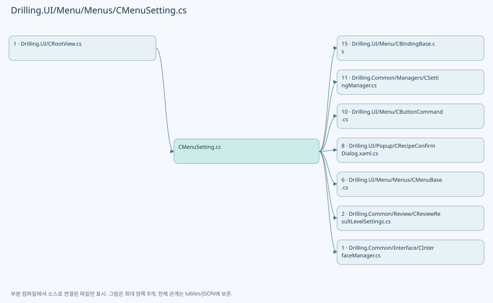

## 네임스페이스·타입·상속

| 타입 | 구분 | 원본 범위 | 선언/상속 |
| --- | --- | --- | --- |
| CMenuSetting | ClassDeclaration | 15–1081 | CMenuSetting: CMenuBase |
| ST_SETTING_TAB | RecordDeclaration | 1083–1086 | ST_SETTING_TAB |
| ST_SETTING_GROUP | RecordDeclaration | 1087–1087 | ST_SETTING_GROUP |
| ST_SETTING_HEAD_FILTER | RecordDeclaration | 1088–1088 | ST_SETTING_HEAD_FILTER |
| ST_SYSTEM_PARAMETER_ROW | ClassDeclaration | 1089–1318 | ST_SYSTEM_PARAMETER_ROW: CBindingBase |
| ST_SETTING_HISTORY_ROW | RecordDeclaration | 1320–1333 | ST_SETTING_HISTORY_ROW |
| ST_SETTING_SUMMARY_ROW | RecordDeclaration | 1335–1350 | ST_SETTING_SUMMARY_ROW |
| ST_SETTING_INTERFACE_ROW | ClassDeclaration | 1352–1657 | ST_SETTING_INTERFACE_ROW: CBindingBase |

## 멤버 빠른 목록

| 이름 | 종류 | 범위 | 서명 |
| --- | --- | --- | --- |
| _settingManager | FieldDeclaration | L17–17 | Drilling.Common.Managers.CSettingManager Drilling.UI.Menu.Menus.CMenuSetting._settingManager |
| _selectedTabProvider | FieldDeclaration | L18–18 | System.Func<string> Drilling.UI.Menu.Menus.CMenuSetting._selectedTabProvider |
| _selectedTabSetter | FieldDeclaration | L19–19 | System.Action<string> Drilling.UI.Menu.Menus.CMenuSetting._selectedTabSetter |
| _selectedGroupProvider | FieldDeclaration | L20–20 | System.Func<string> Drilling.UI.Menu.Menus.CMenuSetting._selectedGroupProvider |
| _selectedGroupSetter | FieldDeclaration | L21–21 | System.Action<string> Drilling.UI.Menu.Menus.CMenuSetting._selectedGroupSetter |
| _editScreenProvider | FieldDeclaration | L22–22 | System.Func<Drilling.UI.Menu.Menus.CMenuSetting?> Drilling.UI.Menu.Menus.CMenuSetting._editScreenProvider |
| _setStatusMessage | FieldDeclaration | L23–23 | System.Action<string> Drilling.UI.Menu.Menus.CMenuSetting._setStatusMessage |
| _showLoadingScreen | FieldDeclaration | L24–24 | System.Action<Drilling.UI.Menu.Menus.EN_MENU, string> Drilling.UI.Menu.Menus.CMenuSetting._showLoadingScreen |
| _refreshShellStatus | FieldDeclaration | L25–25 | System.Action Drilling.UI.Menu.Menus.CMenuSetting._refreshShellStatus |
| _refreshCurrentScreen | FieldDeclaration | L26–26 | System.Func<System.Threading.Tasks.Task> Drilling.UI.Menu.Menus.CMenuSetting._refreshCurrentScreen |
| _selectedInterfaceRow | FieldDeclaration | L27–27 | Drilling.UI.Menu.Menus.ST_SETTING_INTERFACE_ROW? Drilling.UI.Menu.Menus.CMenuSetting._selectedInterfaceRow |
| _selectedHeadFilter | FieldDeclaration | L28–28 | string Drilling.UI.Menu.Menus.CMenuSetting._selectedHeadFilter |
| Sections | FieldDeclaration | L29–29 | Drilling.Common.Managers.EN_SETTING_TAB[] Drilling.UI.Menu.Menus.CMenuSetting.Sections |
| .ctor | ConstructorDeclaration | L30–111 | Drilling.UI.Menu.Menus.CMenuSetting.CMenuSetting(Drilling.Common.Managers.CSettingManager, System.Func<string>, System.Action<string>, System.Func<string>, System.Action<string>, System.Func<Drilling.UI.Menu.Menus.CMenuSetting?>, System.Action<string>, System.Action<Drilling.UI.Menu.Menus.EN_MENU, string>, System.Action, System.Func<System.Threading.Tasks.Task>) |
| SelectTabCallback | LocalFunctionStatement | L53–56 | void SelectTabCallback(object?) |
| SelectGroupCallback | LocalFunctionStatement | L59–62 | void SelectGroupCallback(object?) |
| SelectHeadCallback | LocalFunctionStatement | L65–68 | void SelectHeadCallback(object?) |
| ConnectInterfaceCallback | LocalFunctionStatement | L71–74 | void ConnectInterfaceCallback(object?) |
| IsCanOperateSelectedInterface | LocalFunctionStatement | L76–79 | bool IsCanOperateSelectedInterface(object?) |
| DisconnectInterfaceCallback | LocalFunctionStatement | L82–85 | void DisconnectInterfaceCallback(object?) |
| IsCanOperateSelectedInterface2 | LocalFunctionStatement | L87–90 | bool IsCanOperateSelectedInterface2(object?) |
| SaveCallback | LocalFunctionStatement | L93–96 | void SaveCallback(object?) |
| CancelCallback | LocalFunctionStatement | L99–102 | void CancelCallback(object?) |
| ReloadCallback | LocalFunctionStatement | L105–108 | void ReloadCallback(object?) |
| Menu | PropertyDeclaration | L113–119 | Drilling.UI.Menu.Menus.EN_MENU Drilling.UI.Menu.Menus.CMenuSetting.Menu |
| get_Menu | GetAccessorDeclaration | L115–118 | Drilling.UI.Menu.Menus.EN_MENU Drilling.UI.Menu.Menus.CMenuSetting.Menu.get |
| Tabs | PropertyDeclaration | L121–121 | System.Collections.Generic.IReadOnlyList<Drilling.UI.Menu.Menus.ST_SCREEN_SECTION> Drilling.UI.Menu.Menus.CMenuSetting.Tabs |
| get_Tabs | GetAccessorDeclaration | L121–121 | System.Collections.Generic.IReadOnlyList<Drilling.UI.Menu.Menus.ST_SCREEN_SECTION> Drilling.UI.Menu.Menus.CMenuSetting.Tabs.get |
| set_Tabs | SetAccessorDeclaration | L121–121 | void Drilling.UI.Menu.Menus.CMenuSetting.Tabs.set |
| History | PropertyDeclaration | L122–122 | System.Collections.Generic.IReadOnlyList<Drilling.UI.Menu.Menus.ST_DISPLAY_ITEM> Drilling.UI.Menu.Menus.CMenuSetting.History |
| get_History | GetAccessorDeclaration | L122–122 | System.Collections.Generic.IReadOnlyList<Drilling.UI.Menu.Menus.ST_DISPLAY_ITEM> Drilling.UI.Menu.Menus.CMenuSetting.History.get |
| set_History | SetAccessorDeclaration | L122–122 | void Drilling.UI.Menu.Menus.CMenuSetting.History.set |
| SelectedTab | PropertyDeclaration | L123–123 | string Drilling.UI.Menu.Menus.CMenuSetting.SelectedTab |
| get_SelectedTab | GetAccessorDeclaration | L123–123 | string Drilling.UI.Menu.Menus.CMenuSetting.SelectedTab.get |
| set_SelectedTab | SetAccessorDeclaration | L123–123 | void Drilling.UI.Menu.Menus.CMenuSetting.SelectedTab.set |
| SelectedGroup | PropertyDeclaration | L124–124 | string Drilling.UI.Menu.Menus.CMenuSetting.SelectedGroup |
| get_SelectedGroup | GetAccessorDeclaration | L124–124 | string Drilling.UI.Menu.Menus.CMenuSetting.SelectedGroup.get |
| set_SelectedGroup | SetAccessorDeclaration | L124–124 | void Drilling.UI.Menu.Menus.CMenuSetting.SelectedGroup.set |
| SelectedHeadFilter | PropertyDeclaration | L125–125 | string Drilling.UI.Menu.Menus.CMenuSetting.SelectedHeadFilter |
| get_SelectedHeadFilter | GetAccessorDeclaration | L125–125 | string Drilling.UI.Menu.Menus.CMenuSetting.SelectedHeadFilter.get |
| set_SelectedHeadFilter | SetAccessorDeclaration | L125–125 | void Drilling.UI.Menu.Menus.CMenuSetting.SelectedHeadFilter.set |
| TabItems | PropertyDeclaration | L126–126 | System.Collections.Generic.IReadOnlyList<Drilling.UI.Menu.Menus.ST_SETTING_TAB> Drilling.UI.Menu.Menus.CMenuSetting.TabItems |
| get_TabItems | GetAccessorDeclaration | L126–126 | System.Collections.Generic.IReadOnlyList<Drilling.UI.Menu.Menus.ST_SETTING_TAB> Drilling.UI.Menu.Menus.CMenuSetting.TabItems.get |
| set_TabItems | SetAccessorDeclaration | L126–126 | void Drilling.UI.Menu.Menus.CMenuSetting.TabItems.set |
| GroupItems | PropertyDeclaration | L127–127 | System.Collections.Generic.IReadOnlyList<Drilling.UI.Menu.Menus.ST_SETTING_GROUP> Drilling.UI.Menu.Menus.CMenuSetting.GroupItems |
| get_GroupItems | GetAccessorDeclaration | L127–127 | System.Collections.Generic.IReadOnlyList<Drilling.UI.Menu.Menus.ST_SETTING_GROUP> Drilling.UI.Menu.Menus.CMenuSetting.GroupItems.get |
| set_GroupItems | SetAccessorDeclaration | L127–127 | void Drilling.UI.Menu.Menus.CMenuSetting.GroupItems.set |
| HeadFilterItems | PropertyDeclaration | L128–128 | System.Collections.Generic.IReadOnlyList<Drilling.UI.Menu.Menus.ST_SETTING_HEAD_FILTER> Drilling.UI.Menu.Menus.CMenuSetting.HeadFilterItems |
| get_HeadFilterItems | GetAccessorDeclaration | L128–128 | System.Collections.Generic.IReadOnlyList<Drilling.UI.Menu.Menus.ST_SETTING_HEAD_FILTER> Drilling.UI.Menu.Menus.CMenuSetting.HeadFilterItems.get |
| set_HeadFilterItems | SetAccessorDeclaration | L128–128 | void Drilling.UI.Menu.Menus.CMenuSetting.HeadFilterItems.set |
| AllParameterRows | PropertyDeclaration | L129–129 | System.Collections.Generic.IReadOnlyList<Drilling.UI.Menu.Menus.ST_SYSTEM_PARAMETER_ROW> Drilling.UI.Menu.Menus.CMenuSetting.AllParameterRows |
| get_AllParameterRows | GetAccessorDeclaration | L129–129 | System.Collections.Generic.IReadOnlyList<Drilling.UI.Menu.Menus.ST_SYSTEM_PARAMETER_ROW> Drilling.UI.Menu.Menus.CMenuSetting.AllParameterRows.get |
| set_AllParameterRows | SetAccessorDeclaration | L129–129 | void Drilling.UI.Menu.Menus.CMenuSetting.AllParameterRows.set |
| ParameterRows | PropertyDeclaration | L130–130 | System.Collections.Generic.IReadOnlyList<Drilling.UI.Menu.Menus.ST_SYSTEM_PARAMETER_ROW> Drilling.UI.Menu.Menus.CMenuSetting.ParameterRows |
| get_ParameterRows | GetAccessorDeclaration | L130–130 | System.Collections.Generic.IReadOnlyList<Drilling.UI.Menu.Menus.ST_SYSTEM_PARAMETER_ROW> Drilling.UI.Menu.Menus.CMenuSetting.ParameterRows.get |
| set_ParameterRows | SetAccessorDeclaration | L130–130 | void Drilling.UI.Menu.Menus.CMenuSetting.ParameterRows.set |
| AllInterfaceRows | PropertyDeclaration | L131–131 | System.Collections.Generic.IReadOnlyList<Drilling.UI.Menu.Menus.ST_SETTING_INTERFACE_ROW> Drilling.UI.Menu.Menus.CMenuSetting.AllInterfaceRows |
| get_AllInterfaceRows | GetAccessorDeclaration | L131–131 | System.Collections.Generic.IReadOnlyList<Drilling.UI.Menu.Menus.ST_SETTING_INTERFACE_ROW> Drilling.UI.Menu.Menus.CMenuSetting.AllInterfaceRows.get |
| set_AllInterfaceRows | SetAccessorDeclaration | L131–131 | void Drilling.UI.Menu.Menus.CMenuSetting.AllInterfaceRows.set |
| InterfaceRows | PropertyDeclaration | L132–132 | System.Collections.Generic.IReadOnlyList<Drilling.UI.Menu.Menus.ST_SETTING_INTERFACE_ROW> Drilling.UI.Menu.Menus.CMenuSetting.InterfaceRows |
| get_InterfaceRows | GetAccessorDeclaration | L132–132 | System.Collections.Generic.IReadOnlyList<Drilling.UI.Menu.Menus.ST_SETTING_INTERFACE_ROW> Drilling.UI.Menu.Menus.CMenuSetting.InterfaceRows.get |
| set_InterfaceRows | SetAccessorDeclaration | L132–132 | void Drilling.UI.Menu.Menus.CMenuSetting.InterfaceRows.set |
| ChangeHistory | PropertyDeclaration | L133–133 | System.Collections.Generic.IReadOnlyList<Drilling.UI.Menu.Menus.ST_SETTING_HISTORY_ROW> Drilling.UI.Menu.Menus.CMenuSetting.ChangeHistory |
| get_ChangeHistory | GetAccessorDeclaration | L133–133 | System.Collections.Generic.IReadOnlyList<Drilling.UI.Menu.Menus.ST_SETTING_HISTORY_ROW> Drilling.UI.Menu.Menus.CMenuSetting.ChangeHistory.get |
| set_ChangeHistory | SetAccessorDeclaration | L133–133 | void Drilling.UI.Menu.Menus.CMenuSetting.ChangeHistory.set |
| SummaryRows | PropertyDeclaration | L134–134 | System.Collections.Generic.IReadOnlyList<Drilling.UI.Menu.Menus.ST_SETTING_SUMMARY_ROW> Drilling.UI.Menu.Menus.CMenuSetting.SummaryRows |
| get_SummaryRows | GetAccessorDeclaration | L134–134 | System.Collections.Generic.IReadOnlyList<Drilling.UI.Menu.Menus.ST_SETTING_SUMMARY_ROW> Drilling.UI.Menu.Menus.CMenuSetting.SummaryRows.get |
| set_SummaryRows | SetAccessorDeclaration | L134–134 | void Drilling.UI.Menu.Menus.CMenuSetting.SummaryRows.set |
| SelectTabCommand | PropertyDeclaration | L135–135 | Drilling.UI.Menu.CButtonCommand Drilling.UI.Menu.Menus.CMenuSetting.SelectTabCommand |
| get_SelectTabCommand | GetAccessorDeclaration | L135–135 | Drilling.UI.Menu.CButtonCommand Drilling.UI.Menu.Menus.CMenuSetting.SelectTabCommand.get |
| SelectGroupCommand | PropertyDeclaration | L136–136 | Drilling.UI.Menu.CButtonCommand Drilling.UI.Menu.Menus.CMenuSetting.SelectGroupCommand |
| get_SelectGroupCommand | GetAccessorDeclaration | L136–136 | Drilling.UI.Menu.CButtonCommand Drilling.UI.Menu.Menus.CMenuSetting.SelectGroupCommand.get |
| SelectHeadCommand | PropertyDeclaration | L137–137 | Drilling.UI.Menu.CButtonCommand Drilling.UI.Menu.Menus.CMenuSetting.SelectHeadCommand |
| get_SelectHeadCommand | GetAccessorDeclaration | L137–137 | Drilling.UI.Menu.CButtonCommand Drilling.UI.Menu.Menus.CMenuSetting.SelectHeadCommand.get |
| ConnectInterfaceCommand | PropertyDeclaration | L138–138 | Drilling.UI.Menu.CButtonCommand Drilling.UI.Menu.Menus.CMenuSetting.ConnectInterfaceCommand |
| get_ConnectInterfaceCommand | GetAccessorDeclaration | L138–138 | Drilling.UI.Menu.CButtonCommand Drilling.UI.Menu.Menus.CMenuSetting.ConnectInterfaceCommand.get |
| DisconnectInterfaceCommand | PropertyDeclaration | L139–139 | Drilling.UI.Menu.CButtonCommand Drilling.UI.Menu.Menus.CMenuSetting.DisconnectInterfaceCommand |
| get_DisconnectInterfaceCommand | GetAccessorDeclaration | L139–139 | Drilling.UI.Menu.CButtonCommand Drilling.UI.Menu.Menus.CMenuSetting.DisconnectInterfaceCommand.get |
| SaveCommand | PropertyDeclaration | L140–140 | Drilling.UI.Menu.CButtonCommand Drilling.UI.Menu.Menus.CMenuSetting.SaveCommand |
| get_SaveCommand | GetAccessorDeclaration | L140–140 | Drilling.UI.Menu.CButtonCommand Drilling.UI.Menu.Menus.CMenuSetting.SaveCommand.get |
| CancelCommand | PropertyDeclaration | L141–141 | Drilling.UI.Menu.CButtonCommand Drilling.UI.Menu.Menus.CMenuSetting.CancelCommand |
| get_CancelCommand | GetAccessorDeclaration | L141–141 | Drilling.UI.Menu.CButtonCommand Drilling.UI.Menu.Menus.CMenuSetting.CancelCommand.get |
| ReloadCommand | PropertyDeclaration | L142–142 | Drilling.UI.Menu.CButtonCommand Drilling.UI.Menu.Menus.CMenuSetting.ReloadCommand |
| get_ReloadCommand | GetAccessorDeclaration | L142–142 | Drilling.UI.Menu.CButtonCommand Drilling.UI.Menu.Menus.CMenuSetting.ReloadCommand.get |
| IsInterfaceTab | PropertyDeclaration | L144–150 | bool Drilling.UI.Menu.Menus.CMenuSetting.IsInterfaceTab |
| get_IsInterfaceTab | GetAccessorDeclaration | L146–149 | bool Drilling.UI.Menu.Menus.CMenuSetting.IsInterfaceTab.get |
| IsParameterTab | PropertyDeclaration | L152–158 | bool Drilling.UI.Menu.Menus.CMenuSetting.IsParameterTab |
| get_IsParameterTab | GetAccessorDeclaration | L154–157 | bool Drilling.UI.Menu.Menus.CMenuSetting.IsParameterTab.get |
| IsHeadFilterVisible | PropertyDeclaration | L160–166 | bool Drilling.UI.Menu.Menus.CMenuSetting.IsHeadFilterVisible |
| get_IsHeadFilterVisible | GetAccessorDeclaration | L162–165 | bool Drilling.UI.Menu.Menus.CMenuSetting.IsHeadFilterVisible.get |
| SelectedInterfaceRow | PropertyDeclaration | L168–205 | Drilling.UI.Menu.Menus.ST_SETTING_INTERFACE_ROW? Drilling.UI.Menu.Menus.CMenuSetting.SelectedInterfaceRow |
| get_SelectedInterfaceRow | GetAccessorDeclaration | L170–173 | Drilling.UI.Menu.Menus.ST_SETTING_INTERFACE_ROW? Drilling.UI.Menu.Menus.CMenuSetting.SelectedInterfaceRow.get |
| set_SelectedInterfaceRow | SetAccessorDeclaration | L175–204 | void Drilling.UI.Menu.Menus.CMenuSetting.SelectedInterfaceRow.set |
| CanOperateSelectedInterface | PropertyDeclaration | L207–213 | bool Drilling.UI.Menu.Menus.CMenuSetting.CanOperateSelectedInterface |
| get_CanOperateSelectedInterface | GetAccessorDeclaration | L209–212 | bool Drilling.UI.Menu.Menus.CMenuSetting.CanOperateSelectedInterface.get |
| Build | MethodDeclaration | L215–286 | System.Threading.Tasks.Task<Drilling.UI.Menu.Menus.CScreenViewModel> Drilling.UI.Menu.Menus.CMenuSetting.Build(System.Threading.CancellationToken) |
| BuildDisplay | LocalFunctionStatement | L218–221 | Drilling.UI.Menu.Menus.ST_DISPLAY_ITEM BuildDisplay(Drilling.Common.Managers.ST_SYSTEM_PARAMETER) |
| ShouldIncludeItem | LocalFunctionStatement | L239–242 | bool ShouldIncludeItem(Drilling.UI.Menu.Menus.ST_SYSTEM_PARAMETER_ROW) |
| MatchesType | LocalFunctionStatement | L250–253 | bool MatchesType(Drilling.UI.Menu.Menus.ST_SETTING_INTERFACE_ROW) |
| BuildSetting | LocalFunctionStatement | L257–260 | Drilling.UI.Menu.Menus.ST_SETTING_GROUP BuildSetting(string) |
| SelectTab | MethodDeclaration | L288–302 | System.Threading.Tasks.Task Drilling.UI.Menu.Menus.CMenuSetting.SelectTab(object?) |
| SelectGroup | MethodDeclaration | L304–317 | System.Threading.Tasks.Task Drilling.UI.Menu.Menus.CMenuSetting.SelectGroup(object?) |
| ConnectInterface | MethodDeclaration | L319–359 | System.Threading.Tasks.Task Drilling.UI.Menu.Menus.CMenuSetting.ConnectInterface() |
| DisconnectInterface | MethodDeclaration | L361–401 | System.Threading.Tasks.Task Drilling.UI.Menu.Menus.CMenuSetting.DisconnectInterface() |
| Save | MethodDeclaration | L403–466 | System.Threading.Tasks.Task Drilling.UI.Menu.Menus.CMenuSetting.Save() |
| BuildSystem | LocalFunctionStatement | L437–440 | Drilling.Common.Managers.ST_SYSTEM_PARAMETER BuildSystem(Drilling.UI.Menu.Menus.ST_SYSTEM_PARAMETER_ROW) |
| Cancel | MethodDeclaration | L468–485 | System.Threading.Tasks.Task Drilling.UI.Menu.Menus.CMenuSetting.Cancel() |
| Reload | MethodDeclaration | L487–504 | System.Threading.Tasks.Task Drilling.UI.Menu.Menus.CMenuSetting.Reload() |
| TryReloadSelectedTabFromCsv | MethodDeclaration | L506–529 | bool Drilling.UI.Menu.Menus.CMenuSetting.TryReloadSelectedTabFromCsv() |
| SelectHeadFilter | MethodDeclaration | L531–542 | System.Threading.Tasks.Task Drilling.UI.Menu.Menus.CMenuSetting.SelectHeadFilter(object?) |
| Apply | MethodDeclaration | L544–576 | void Drilling.UI.Menu.Menus.CMenuSetting.Apply(System.Collections.Generic.IReadOnlyList<Drilling.UI.Menu.Menus.ST_SCREEN_SECTION>, System.Collections.Generic.IReadOnlyList<Drilling.UI.Menu.Menus.ST_DISPLAY_ITEM>, string, string, string, System.Collections.Generic.IReadOnlyList<Drilling.UI.Menu.Menus.ST_SETTING_TAB>, System.Collections.Generic.IReadOnlyList<Drilling.UI.Menu.Menus.ST_SETTING_GROUP>, System.Collections.Generic.IReadOnlyList<Drilling.UI.Menu.Menus.ST_SETTING_HEAD_FILTER>, System.Collections.Generic.IReadOnlyList<Drilling.UI.Menu.Menus.ST_SYSTEM_PARAMETER_ROW>, System.Collections.Generic.IReadOnlyList<Drilling.UI.Menu.Menus.ST_SYSTEM_PARAMETER_ROW>, System.Collections.Generic.IReadOnlyList<Drilling.UI.Menu.Menus.ST_SETTING_INTERFACE_ROW>, System.Collections.Generic.IReadOnlyList<Drilling.UI.Menu.Menus.ST_SETTING_INTERFACE_ROW>, System.Collections.Generic.IReadOnlyList<Drilling.UI.Menu.Menus.ST_SETTING_HISTORY_ROW>, System.Collections.Generic.IReadOnlyList<Drilling.UI.Menu.Menus.ST_SETTING_SUMMARY_ROW>) |
| GetEditRows | MethodDeclaration | L578–581 | System.Collections.Generic.IReadOnlyList<Drilling.UI.Menu.Menus.ST_SYSTEM_PARAMETER_ROW> Drilling.UI.Menu.Menus.CMenuSetting.GetEditRows(System.Collections.Generic.IReadOnlyList<Drilling.UI.Menu.Menus.ST_SYSTEM_PARAMETER_ROW>, Drilling.UI.Menu.Menus.CMenuSetting?, string) |
| GetEditInterfaceRows | MethodDeclaration | L583–586 | System.Collections.Generic.IReadOnlyList<Drilling.UI.Menu.Menus.ST_SETTING_INTERFACE_ROW> Drilling.UI.Menu.Menus.CMenuSetting.GetEditInterfaceRows(System.Collections.Generic.IReadOnlyList<Drilling.UI.Menu.Menus.ST_SETTING_INTERFACE_ROW>, Drilling.UI.Menu.Menus.CMenuSetting?, string) |
| GetSelectedInterfaceRow | MethodDeclaration | L588–611 | Drilling.UI.Menu.Menus.ST_SETTING_INTERFACE_ROW? Drilling.UI.Menu.Menus.CMenuSetting.GetSelectedInterfaceRow(System.Collections.Generic.IReadOnlyList<Drilling.UI.Menu.Menus.ST_SETTING_INTERFACE_ROW>, Drilling.UI.Menu.Menus.ST_SETTING_INTERFACE_ROW?) |
| MatchesItem | LocalFunctionStatement | L600–603 | bool MatchesItem(Drilling.UI.Menu.Menus.ST_SETTING_INTERFACE_ROW) |
| MatchesItem2 | LocalFunctionStatement | L605–608 | bool MatchesItem2(Drilling.UI.Menu.Menus.ST_SETTING_INTERFACE_ROW) |
| IsSameInterfaceKey | MethodDeclaration | L613–616 | bool Drilling.UI.Menu.Menus.CMenuSetting.IsSameInterfaceKey(Drilling.UI.Menu.Menus.ST_SETTING_INTERFACE_ROW, Drilling.UI.Menu.Menus.ST_SETTING_INTERFACE_ROW) |
| OnSelectedInterfaceRowStateChanged | MethodDeclaration | L618–621 | void Drilling.UI.Menu.Menus.CMenuSetting.OnSelectedInterfaceRowStateChanged(object?, System.EventArgs) |
| RefreshInterfaceCommandState | MethodDeclaration | L623–628 | void Drilling.UI.Menu.Menus.CMenuSetting.RefreshInterfaceCommandState() |
| BuildTabs | MethodDeclaration | L630–643 | System.Collections.Generic.IReadOnlyList<Drilling.UI.Menu.Menus.ST_SETTING_TAB> Drilling.UI.Menu.Menus.CMenuSetting.BuildTabs(string) |
| SelectItem | LocalFunctionStatement | L632–635 | string SelectItem(Drilling.Common.Managers.EN_SETTING_TAB) |
| BuildSetting | LocalFunctionStatement | L637–640 | Drilling.UI.Menu.Menus.ST_SETTING_TAB BuildSetting(string) |
| BuildParameterRows | MethodDeclaration | L645–671 | System.Collections.Generic.IReadOnlyList<Drilling.UI.Menu.Menus.ST_SYSTEM_PARAMETER_ROW> Drilling.UI.Menu.Menus.CMenuSetting.BuildParameterRows(System.Collections.Generic.IReadOnlyList<Drilling.Common.Managers.ST_SYSTEM_PARAMETER>) |
| ShouldIncludeItem | LocalFunctionStatement | L647–650 | bool ShouldIncludeItem(Drilling.Common.Managers.ST_SYSTEM_PARAMETER) |
| BuildSystem | LocalFunctionStatement | L652–668 | Drilling.UI.Menu.Menus.ST_SYSTEM_PARAMETER_ROW BuildSystem(Drilling.Common.Managers.ST_SYSTEM_PARAMETER) |
| BuildGroups | MethodDeclaration | L673–690 | System.Collections.Generic.IReadOnlyList<string> Drilling.UI.Menu.Menus.CMenuSetting.BuildGroups(System.Collections.Generic.IReadOnlyList<Drilling.UI.Menu.Menus.ST_SYSTEM_PARAMETER_ROW>) |
| SelectGroup | LocalFunctionStatement | L675–678 | string SelectGroup(Drilling.UI.Menu.Menus.ST_SYSTEM_PARAMETER_ROW) |
| ShouldIncludeItem | LocalFunctionStatement | L680–683 | bool ShouldIncludeItem(string) |
| BuildHeadFilters | MethodDeclaration | L692–726 | System.Collections.Generic.IReadOnlyList<Drilling.UI.Menu.Menus.ST_SETTING_HEAD_FILTER> Drilling.UI.Menu.Menus.CMenuSetting.BuildHeadFilters(System.Collections.Generic.IReadOnlyList<Drilling.UI.Menu.Menus.ST_SYSTEM_PARAMETER_ROW>) |
| HasHead | LocalFunctionStatement | L694–697 | bool HasHead(Drilling.UI.Menu.Menus.ST_SYSTEM_PARAMETER_ROW) |
| ReadHeadNo | LocalFunctionStatement | L699–702 | int ReadHeadNo(Drilling.UI.Menu.Menus.ST_SYSTEM_PARAMETER_ROW) |
| CreateHeadFilter | LocalFunctionStatement | L704–707 | Drilling.UI.Menu.Menus.ST_SETTING_HEAD_FILTER CreateHeadFilter(int) |
| SortHeadNo | LocalFunctionStatement | L709–712 | int SortHeadNo(int) |
| ApplyHeadFilter | MethodDeclaration | L728–741 | System.Collections.Generic.IReadOnlyList<Drilling.UI.Menu.Menus.ST_SYSTEM_PARAMETER_ROW> Drilling.UI.Menu.Menus.CMenuSetting.ApplyHeadFilter(System.Collections.Generic.IReadOnlyList<Drilling.UI.Menu.Menus.ST_SYSTEM_PARAMETER_ROW>, string) |
| MatchesHead | LocalFunctionStatement | L735–738 | bool MatchesHead(Drilling.UI.Menu.Menus.ST_SYSTEM_PARAMETER_ROW) |
| MarkSelectedHeadFilter | MethodDeclaration | L743–754 | System.Collections.Generic.IReadOnlyList<Drilling.UI.Menu.Menus.ST_SETTING_HEAD_FILTER> Drilling.UI.Menu.Menus.CMenuSetting.MarkSelectedHeadFilter(System.Collections.Generic.IReadOnlyList<Drilling.UI.Menu.Menus.ST_SETTING_HEAD_FILTER>, string) |
| MarkSelected | LocalFunctionStatement | L745–751 | Drilling.UI.Menu.Menus.ST_SETTING_HEAD_FILTER MarkSelected(Drilling.UI.Menu.Menus.ST_SETTING_HEAD_FILTER) |
| NormalizeHeadFilter | MethodDeclaration | L756–772 | string Drilling.UI.Menu.Menus.CMenuSetting.NormalizeHeadFilter(string, System.Collections.Generic.IReadOnlyList<Drilling.UI.Menu.Menus.ST_SETTING_HEAD_FILTER>) |
| BuildInterfaceGroups | MethodDeclaration | L774–791 | System.Collections.Generic.IReadOnlyList<string> Drilling.UI.Menu.Menus.CMenuSetting.BuildInterfaceGroups(System.Collections.Generic.IReadOnlyList<Drilling.UI.Menu.Menus.ST_SETTING_INTERFACE_ROW>) |
| SelectType | LocalFunctionStatement | L776–779 | string SelectType(Drilling.UI.Menu.Menus.ST_SETTING_INTERFACE_ROW) |
| ShouldIncludeItem | LocalFunctionStatement | L781–784 | bool ShouldIncludeItem(string) |
| BuildHistoryItems | MethodDeclaration | L793–801 | System.Collections.Generic.IReadOnlyList<Drilling.UI.Menu.Menus.ST_DISPLAY_ITEM> Drilling.UI.Menu.Menus.CMenuSetting.BuildHistoryItems(System.Collections.Generic.IReadOnlyList<Drilling.Common.Managers.ST_SETTING_HISTORY>) |
| BuildDisplay | LocalFunctionStatement | L795–798 | Drilling.UI.Menu.Menus.ST_DISPLAY_ITEM BuildDisplay(Drilling.Common.Managers.ST_SETTING_HISTORY) |
| BuildHistoryRows | MethodDeclaration | L803–816 | System.Collections.Generic.IReadOnlyList<Drilling.UI.Menu.Menus.ST_SETTING_HISTORY_ROW> Drilling.UI.Menu.Menus.CMenuSetting.BuildHistoryRows(System.Collections.Generic.IReadOnlyList<Drilling.Common.Managers.ST_SETTING_HISTORY>) |
| ShouldIncludeItem | LocalFunctionStatement | L805–808 | bool ShouldIncludeItem(Drilling.Common.Managers.ST_SETTING_HISTORY) |
| BuildSetting | LocalFunctionStatement | L810–813 | Drilling.UI.Menu.Menus.ST_SETTING_HISTORY_ROW BuildSetting(Drilling.Common.Managers.ST_SETTING_HISTORY) |
| BuildSummaryRows | MethodDeclaration | L818–843 | System.Collections.Generic.IReadOnlyList<Drilling.UI.Menu.Menus.ST_SETTING_SUMMARY_ROW> Drilling.UI.Menu.Menus.CMenuSetting.BuildSummaryRows(string, System.Collections.Generic.IReadOnlyList<Drilling.UI.Menu.Menus.ST_SYSTEM_PARAMETER_ROW>, System.Collections.Generic.IReadOnlyList<Drilling.UI.Menu.Menus.ST_SETTING_INTERFACE_ROW>, System.Collections.Generic.IReadOnlyList<Drilling.Common.Managers.ST_SETTING_HISTORY>) |
| IsIsModified | LocalFunctionStatement | L825–828 | bool IsIsModified(Drilling.UI.Menu.Menus.ST_SETTING_INTERFACE_ROW) |
| IsIsModified2 | LocalFunctionStatement | L830–833 | bool IsIsModified2(Drilling.UI.Menu.Menus.ST_SYSTEM_PARAMETER_ROW) |
| MatchesItem | LocalFunctionStatement | L836–839 | bool MatchesItem(Drilling.Common.Managers.ST_SETTING_HISTORY) |
| BuildInterfaceRows | MethodDeclaration | L845–884 | System.Collections.Generic.IReadOnlyList<Drilling.UI.Menu.Menus.ST_SETTING_INTERFACE_ROW> Drilling.UI.Menu.Menus.CMenuSetting.BuildInterfaceRows(System.Collections.Generic.IReadOnlyList<Drilling.Common.Interface.ST_INTERFACE_DATA>) |
| SelectDevice | LocalFunctionStatement | L847–850 | Drilling.Common.Interface.EN_EQP_MODULE SelectDevice(Drilling.Common.Interface.ST_INTERFACE_DATA) |
| SelectNumber | LocalFunctionStatement | L852–855 | int SelectNumber(Drilling.Common.Interface.ST_INTERFACE_DATA) |
| SelectNickName | LocalFunctionStatement | L857–860 | string SelectNickName(Drilling.Common.Interface.ST_INTERFACE_DATA) |
| BuildSetting | LocalFunctionStatement | L862–881 | Drilling.UI.Menu.Menus.ST_SETTING_INTERFACE_ROW BuildSetting(Drilling.Common.Interface.ST_INTERFACE_DATA, int) |
| ToInterfaceData | MethodDeclaration | L886–904 | System.Collections.Generic.IReadOnlyList<Drilling.Common.Interface.ST_INTERFACE_DATA> Drilling.UI.Menu.Menus.CMenuSetting.ToInterfaceData(System.Collections.Generic.IReadOnlyList<Drilling.UI.Menu.Menus.ST_SETTING_INTERFACE_ROW>) |
| BuildInterface | LocalFunctionStatement | L888–901 | Drilling.Common.Interface.ST_INTERFACE_DATA BuildInterface(Drilling.UI.Menu.Menus.ST_SETTING_INTERFACE_ROW) |
| ParseInterfaceType | MethodDeclaration | L906–924 | Drilling.Common.Interface.EN_INTERFACE_TYPE Drilling.UI.Menu.Menus.CMenuSetting.ParseInterfaceType(string) |
| ParseDevice | MethodDeclaration | L926–941 | Drilling.Common.Interface.EN_EQP_MODULE Drilling.UI.Menu.Menus.CMenuSetting.ParseDevice(string) |
| InterfaceTypeText | MethodDeclaration | L943–961 | string Drilling.UI.Menu.Menus.CMenuSetting.InterfaceTypeText(Drilling.Common.Interface.EN_INTERFACE_TYPE) |
| DeviceText | MethodDeclaration | L963–978 | string Drilling.UI.Menu.Menus.CMenuSetting.DeviceText(Drilling.Common.Interface.EN_EQP_MODULE) |
| InterfaceRowLabel | MethodDeclaration | L980–983 | string Drilling.UI.Menu.Menus.CMenuSetting.InterfaceRowLabel(Drilling.UI.Menu.Menus.ST_SETTING_INTERFACE_ROW) |
| RequireText | MethodDeclaration | L985–993 | string Drilling.UI.Menu.Menus.CMenuSetting.RequireText(string, string) |
| ReadBool | MethodDeclaration | L995–1002 | bool Drilling.UI.Menu.Menus.CMenuSetting.ReadBool(string, string, string) |
| ReadInt | MethodDeclaration | L1004–1012 | int Drilling.UI.Menu.Menus.CMenuSetting.ReadInt(string, string, string) |
| NormalizeTab | MethodDeclaration | L1014–1023 | string Drilling.UI.Menu.Menus.CMenuSetting.NormalizeTab(string) |
| NormalizeGroup | MethodDeclaration | L1025–1034 | string Drilling.UI.Menu.Menus.CMenuSetting.NormalizeGroup(string, System.Collections.Generic.IReadOnlyList<string>) |
| MatchesItem | LocalFunctionStatement | L1028–1031 | bool MatchesItem(string) |
| NormalizeSettingText | MethodDeclaration | L1036–1039 | string Drilling.UI.Menu.Menus.CMenuSetting.NormalizeSettingText(string, string) |
| NormalizeUnit | MethodDeclaration | L1041–1044 | string Drilling.UI.Menu.Menus.CMenuSetting.NormalizeUnit(string) |
| NormalizeSettingUnit | MethodDeclaration | L1046–1049 | string Drilling.UI.Menu.Menus.CMenuSetting.NormalizeSettingUnit(string) |
| GetValueState | MethodDeclaration | L1051–1055 | string Drilling.UI.Menu.Menus.CMenuSetting.GetValueState(string) |
| ToSection | MethodDeclaration | L1057–1067 | Drilling.Common.Managers.EN_SETTING_TAB Drilling.UI.Menu.Menus.CMenuSetting.ToSection(string) |
| ToTabText | MethodDeclaration | L1069–1075 | string Drilling.UI.Menu.Menus.CMenuSetting.ToTabText(Drilling.Common.Managers.EN_SETTING_TAB) |
| GetDefaultGroup | MethodDeclaration | L1077–1080 | string Drilling.UI.Menu.Menus.CMenuSetting.GetDefaultGroup() |
| DisplayName | PropertyDeclaration | L1085–1085 | string Drilling.UI.Menu.Menus.ST_SETTING_TAB.DisplayName |
| VisionFlipOptions | FieldDeclaration | L1091–1091 | System.Collections.Generic.IReadOnlyList<string> Drilling.UI.Menu.Menus.ST_SYSTEM_PARAMETER_ROW.VisionFlipOptions |
| SignOptions | FieldDeclaration | L1092–1092 | System.Collections.Generic.IReadOnlyList<string> Drilling.UI.Menu.Menus.ST_SYSTEM_PARAMETER_ROW.SignOptions |
| NumericBooleanOptions | FieldDeclaration | L1093–1093 | System.Collections.Generic.IReadOnlyList<string> Drilling.UI.Menu.Menus.ST_SYSTEM_PARAMETER_ROW.NumericBooleanOptions |
| _originalValue | FieldDeclaration | L1094–1094 | string Drilling.UI.Menu.Menus.ST_SYSTEM_PARAMETER_ROW._originalValue |
| _originalValueState | FieldDeclaration | L1095–1095 | string Drilling.UI.Menu.Menus.ST_SYSTEM_PARAMETER_ROW._originalValueState |
| _value | FieldDeclaration | L1096–1096 | string Drilling.UI.Menu.Menus.ST_SYSTEM_PARAMETER_ROW._value |
| _valueState | FieldDeclaration | L1097–1097 | string Drilling.UI.Menu.Menus.ST_SYSTEM_PARAMETER_ROW._valueState |
| .ctor | ConstructorDeclaration | L1098–1129 | Drilling.UI.Menu.Menus.ST_SYSTEM_PARAMETER_ROW.ST_SYSTEM_PARAMETER_ROW(string, string, string, string, string, bool, string, string, string, Drilling.Common.Managers.EN_RECIPE_DATA_TYPE, double, double) |
| Group | PropertyDeclaration | L1131–1131 | string Drilling.UI.Menu.Menus.ST_SYSTEM_PARAMETER_ROW.Group |
| get_Group | GetAccessorDeclaration | L1131–1131 | string Drilling.UI.Menu.Menus.ST_SYSTEM_PARAMETER_ROW.Group.get |
| Parameter | PropertyDeclaration | L1132–1132 | string Drilling.UI.Menu.Menus.ST_SYSTEM_PARAMETER_ROW.Parameter |
| get_Parameter | GetAccessorDeclaration | L1132–1132 | string Drilling.UI.Menu.Menus.ST_SYSTEM_PARAMETER_ROW.Parameter.get |
| Value | PropertyDeclaration | L1134–1154 | string Drilling.UI.Menu.Menus.ST_SYSTEM_PARAMETER_ROW.Value |
| get_Value | GetAccessorDeclaration | L1136–1139 | string Drilling.UI.Menu.Menus.ST_SYSTEM_PARAMETER_ROW.Value.get |
| set_Value | SetAccessorDeclaration | L1141–1153 | void Drilling.UI.Menu.Menus.ST_SYSTEM_PARAMETER_ROW.Value.set |
| Unit | PropertyDeclaration | L1156–1156 | string Drilling.UI.Menu.Menus.ST_SYSTEM_PARAMETER_ROW.Unit |
| get_Unit | GetAccessorDeclaration | L1156–1156 | string Drilling.UI.Menu.Menus.ST_SYSTEM_PARAMETER_ROW.Unit.get |
| Description | PropertyDeclaration | L1157–1157 | string Drilling.UI.Menu.Menus.ST_SYSTEM_PARAMETER_ROW.Description |
| get_Description | GetAccessorDeclaration | L1157–1157 | string Drilling.UI.Menu.Menus.ST_SYSTEM_PARAMETER_ROW.Description.get |
| Key | PropertyDeclaration | L1158–1158 | string Drilling.UI.Menu.Menus.ST_SYSTEM_PARAMETER_ROW.Key |
| get_Key | GetAccessorDeclaration | L1158–1158 | string Drilling.UI.Menu.Menus.ST_SYSTEM_PARAMETER_ROW.Key.get |
| HeadNo | PropertyDeclaration | L1159–1159 | int Drilling.UI.Menu.Menus.ST_SYSTEM_PARAMETER_ROW.HeadNo |
| get_HeadNo | GetAccessorDeclaration | L1159–1159 | int Drilling.UI.Menu.Menus.ST_SYSTEM_PARAMETER_ROW.HeadNo.get |
| HeadFilter | PropertyDeclaration | L1160–1160 | string Drilling.UI.Menu.Menus.ST_SYSTEM_PARAMETER_ROW.HeadFilter |
| get_HeadFilter | GetAccessorDeclaration | L1160–1160 | string Drilling.UI.Menu.Menus.ST_SYSTEM_PARAMETER_ROW.HeadFilter.get |
| DefaultValue | PropertyDeclaration | L1161–1161 | string Drilling.UI.Menu.Menus.ST_SYSTEM_PARAMETER_ROW.DefaultValue |
| get_DefaultValue | GetAccessorDeclaration | L1161–1161 | string Drilling.UI.Menu.Menus.ST_SYSTEM_PARAMETER_ROW.DefaultValue.get |
| DataType | PropertyDeclaration | L1162–1162 | Drilling.Common.Managers.EN_RECIPE_DATA_TYPE Drilling.UI.Menu.Menus.ST_SYSTEM_PARAMETER_ROW.DataType |
| get_DataType | GetAccessorDeclaration | L1162–1162 | Drilling.Common.Managers.EN_RECIPE_DATA_TYPE Drilling.UI.Menu.Menus.ST_SYSTEM_PARAMETER_ROW.DataType.get |
| IsVisionFlipOption | PropertyDeclaration | L1164–1170 | bool Drilling.UI.Menu.Menus.ST_SYSTEM_PARAMETER_ROW.IsVisionFlipOption |
| get_IsVisionFlipOption | GetAccessorDeclaration | L1166–1169 | bool Drilling.UI.Menu.Menus.ST_SYSTEM_PARAMETER_ROW.IsVisionFlipOption.get |
| IsBoolean | PropertyDeclaration | L1172–1178 | bool Drilling.UI.Menu.Menus.ST_SYSTEM_PARAMETER_ROW.IsBoolean |
| get_IsBoolean | GetAccessorDeclaration | L1174–1177 | bool Drilling.UI.Menu.Menus.ST_SYSTEM_PARAMETER_ROW.IsBoolean.get |
| IsColorSetting | PropertyDeclaration | L1180–1180 | bool Drilling.UI.Menu.Menus.ST_SYSTEM_PARAMETER_ROW.IsColorSetting |
| ColorBrush | PropertyDeclaration | L1182–1203 | Brush Drilling.UI.Menu.Menus.ST_SYSTEM_PARAMETER_ROW.ColorBrush |
| get_ColorBrush | GetAccessorDeclaration | L1184–1202 | Brush Drilling.UI.Menu.Menus.ST_SYSTEM_PARAMETER_ROW.ColorBrush.get |
| IsSign | PropertyDeclaration | L1205–1211 | bool Drilling.UI.Menu.Menus.ST_SYSTEM_PARAMETER_ROW.IsSign |
| get_IsSign | GetAccessorDeclaration | L1207–1210 | bool Drilling.UI.Menu.Menus.ST_SYSTEM_PARAMETER_ROW.IsSign.get |
| UsesSelectionEditor | PropertyDeclaration | L1213–1219 | bool Drilling.UI.Menu.Menus.ST_SYSTEM_PARAMETER_ROW.UsesSelectionEditor |
| get_UsesSelectionEditor | GetAccessorDeclaration | L1215–1218 | bool Drilling.UI.Menu.Menus.ST_SYSTEM_PARAMETER_ROW.UsesSelectionEditor.get |
| ValueOptions | PropertyDeclaration | L1221–1227 | System.Collections.Generic.IReadOnlyList<string> Drilling.UI.Menu.Menus.ST_SYSTEM_PARAMETER_ROW.ValueOptions |
| get_ValueOptions | GetAccessorDeclaration | L1223–1226 | System.Collections.Generic.IReadOnlyList<string> Drilling.UI.Menu.Menus.ST_SYSTEM_PARAMETER_ROW.ValueOptions.get |
| Min | PropertyDeclaration | L1229–1229 | double Drilling.UI.Menu.Menus.ST_SYSTEM_PARAMETER_ROW.Min |
| get_Min | GetAccessorDeclaration | L1229–1229 | double Drilling.UI.Menu.Menus.ST_SYSTEM_PARAMETER_ROW.Min.get |
| Max | PropertyDeclaration | L1230–1230 | double Drilling.UI.Menu.Menus.ST_SYSTEM_PARAMETER_ROW.Max |
| get_Max | GetAccessorDeclaration | L1230–1230 | double Drilling.UI.Menu.Menus.ST_SYSTEM_PARAMETER_ROW.Max.get |
| OriginalValue | PropertyDeclaration | L1232–1238 | string Drilling.UI.Menu.Menus.ST_SYSTEM_PARAMETER_ROW.OriginalValue |
| get_OriginalValue | GetAccessorDeclaration | L1234–1237 | string Drilling.UI.Menu.Menus.ST_SYSTEM_PARAMETER_ROW.OriginalValue.get |
| IsModified | PropertyDeclaration | L1240–1246 | bool Drilling.UI.Menu.Menus.ST_SYSTEM_PARAMETER_ROW.IsModified |
| get_IsModified | GetAccessorDeclaration | L1242–1245 | bool Drilling.UI.Menu.Menus.ST_SYSTEM_PARAMETER_ROW.IsModified.get |
| ModifiedText | PropertyDeclaration | L1248–1254 | string Drilling.UI.Menu.Menus.ST_SYSTEM_PARAMETER_ROW.ModifiedText |
| get_ModifiedText | GetAccessorDeclaration | L1250–1253 | string Drilling.UI.Menu.Menus.ST_SYSTEM_PARAMETER_ROW.ModifiedText.get |
| ValueState | PropertyDeclaration | L1256–1270 | string Drilling.UI.Menu.Menus.ST_SYSTEM_PARAMETER_ROW.ValueState |
| get_ValueState | GetAccessorDeclaration | L1258–1261 | string Drilling.UI.Menu.Menus.ST_SYSTEM_PARAMETER_ROW.ValueState.get |
| set_ValueState | SetAccessorDeclaration | L1263–1269 | void Drilling.UI.Menu.Menus.ST_SYSTEM_PARAMETER_ROW.ValueState.set |
| ValueBrush | PropertyDeclaration | L1272–1283 | Brush Drilling.UI.Menu.Menus.ST_SYSTEM_PARAMETER_ROW.ValueBrush |
| get_ValueBrush | GetAccessorDeclaration | L1274–1282 | Brush Drilling.UI.Menu.Menus.ST_SYSTEM_PARAMETER_ROW.ValueBrush.get |
| ModifiedBrush | PropertyDeclaration | L1285–1291 | Brush Drilling.UI.Menu.Menus.ST_SYSTEM_PARAMETER_ROW.ModifiedBrush |
| get_ModifiedBrush | GetAccessorDeclaration | L1287–1290 | Brush Drilling.UI.Menu.Menus.ST_SYSTEM_PARAMETER_ROW.ModifiedBrush.get |
| NormalizeValue | MethodDeclaration | L1293–1296 | string Drilling.UI.Menu.Menus.ST_SYSTEM_PARAMETER_ROW.NormalizeValue(string) |
| NormalizeVisionFlipDisplay | MethodDeclaration | L1298–1301 | string Drilling.UI.Menu.Menus.ST_SYSTEM_PARAMETER_ROW.NormalizeVisionFlipDisplay(string) |
| ParseHeadNo | MethodDeclaration | L1303–1317 | int Drilling.UI.Menu.Menus.ST_SYSTEM_PARAMETER_ROW.ParseHeadNo(string) |
| AfterBrush | PropertyDeclaration | L1322–1332 | Brush Drilling.UI.Menu.Menus.ST_SETTING_HISTORY_ROW.AfterBrush |
| get_AfterBrush | GetAccessorDeclaration | L1324–1331 | Brush Drilling.UI.Menu.Menus.ST_SETTING_HISTORY_ROW.AfterBrush.get |
| ValueBrush | PropertyDeclaration | L1337–1349 | Brush Drilling.UI.Menu.Menus.ST_SETTING_SUMMARY_ROW.ValueBrush |
| get_ValueBrush | GetAccessorDeclaration | L1339–1348 | Brush Drilling.UI.Menu.Menus.ST_SETTING_SUMMARY_ROW.ValueBrush.get |
| TypeOptions | PropertyDeclaration | L1354–1354 | System.Collections.Generic.IReadOnlyList<string> Drilling.UI.Menu.Menus.ST_SETTING_INTERFACE_ROW.TypeOptions |
| get_TypeOptions | GetAccessorDeclaration | L1354–1354 | System.Collections.Generic.IReadOnlyList<string> Drilling.UI.Menu.Menus.ST_SETTING_INTERFACE_ROW.TypeOptions.get |
| DeviceOptions | PropertyDeclaration | L1355–1355 | System.Collections.Generic.IReadOnlyList<string> Drilling.UI.Menu.Menus.ST_SETTING_INTERFACE_ROW.DeviceOptions |
| get_DeviceOptions | GetAccessorDeclaration | L1355–1355 | System.Collections.Generic.IReadOnlyList<string> Drilling.UI.Menu.Menus.ST_SETTING_INTERFACE_ROW.DeviceOptions.get |
| AutoConnectionOptions | PropertyDeclaration | L1356–1356 | System.Collections.Generic.IReadOnlyList<string> Drilling.UI.Menu.Menus.ST_SETTING_INTERFACE_ROW.AutoConnectionOptions |
| get_AutoConnectionOptions | GetAccessorDeclaration | L1356–1356 | System.Collections.Generic.IReadOnlyList<string> Drilling.UI.Menu.Menus.ST_SETTING_INTERFACE_ROW.AutoConnectionOptions.get |
| _originalType | FieldDeclaration | L1358–1358 | string Drilling.UI.Menu.Menus.ST_SETTING_INTERFACE_ROW._originalType |
| _originalDevice | FieldDeclaration | L1359–1359 | string Drilling.UI.Menu.Menus.ST_SETTING_INTERFACE_ROW._originalDevice |
| _originalNumber | FieldDeclaration | L1360–1360 | string Drilling.UI.Menu.Menus.ST_SETTING_INTERFACE_ROW._originalNumber |
| _originalNickName | FieldDeclaration | L1361–1361 | string Drilling.UI.Menu.Menus.ST_SETTING_INTERFACE_ROW._originalNickName |
| _originalSystemSection | FieldDeclaration | L1362–1362 | string Drilling.UI.Menu.Menus.ST_SETTING_INTERFACE_ROW._originalSystemSection |
| _originalAutoConnection | FieldDeclaration | L1363–1363 | string Drilling.UI.Menu.Menus.ST_SETTING_INTERFACE_ROW._originalAutoConnection |
| _originalSimul | FieldDeclaration | L1364–1364 | string Drilling.UI.Menu.Menus.ST_SETTING_INTERFACE_ROW._originalSimul |
| _originalArg1 | FieldDeclaration | L1365–1365 | string Drilling.UI.Menu.Menus.ST_SETTING_INTERFACE_ROW._originalArg1 |
| _originalArg2 | FieldDeclaration | L1366–1366 | string Drilling.UI.Menu.Menus.ST_SETTING_INTERFACE_ROW._originalArg2 |
| _originalArg3 | FieldDeclaration | L1367–1367 | string Drilling.UI.Menu.Menus.ST_SETTING_INTERFACE_ROW._originalArg3 |
| _originalArg4 | FieldDeclaration | L1368–1368 | string Drilling.UI.Menu.Menus.ST_SETTING_INTERFACE_ROW._originalArg4 |
| _originalArg5 | FieldDeclaration | L1369–1369 | string Drilling.UI.Menu.Menus.ST_SETTING_INTERFACE_ROW._originalArg5 |
| _type | FieldDeclaration | L1370–1370 | string Drilling.UI.Menu.Menus.ST_SETTING_INTERFACE_ROW._type |
| _device | FieldDeclaration | L1371–1371 | string Drilling.UI.Menu.Menus.ST_SETTING_INTERFACE_ROW._device |
| _number | FieldDeclaration | L1372–1372 | string Drilling.UI.Menu.Menus.ST_SETTING_INTERFACE_ROW._number |
| _nickName | FieldDeclaration | L1373–1373 | string Drilling.UI.Menu.Menus.ST_SETTING_INTERFACE_ROW._nickName |
| _systemSection | FieldDeclaration | L1374–1374 | string Drilling.UI.Menu.Menus.ST_SETTING_INTERFACE_ROW._systemSection |
| _autoConnection | FieldDeclaration | L1375–1375 | string Drilling.UI.Menu.Menus.ST_SETTING_INTERFACE_ROW._autoConnection |
| _simul | FieldDeclaration | L1376–1376 | string Drilling.UI.Menu.Menus.ST_SETTING_INTERFACE_ROW._simul |
| _arg1 | FieldDeclaration | L1377–1377 | string Drilling.UI.Menu.Menus.ST_SETTING_INTERFACE_ROW._arg1 |
| _arg2 | FieldDeclaration | L1378–1378 | string Drilling.UI.Menu.Menus.ST_SETTING_INTERFACE_ROW._arg2 |
| _arg3 | FieldDeclaration | L1379–1379 | string Drilling.UI.Menu.Menus.ST_SETTING_INTERFACE_ROW._arg3 |
| _arg4 | FieldDeclaration | L1380–1380 | string Drilling.UI.Menu.Menus.ST_SETTING_INTERFACE_ROW._arg4 |
| _arg5 | FieldDeclaration | L1381–1381 | string Drilling.UI.Menu.Menus.ST_SETTING_INTERFACE_ROW._arg5 |
| .ctor | ConstructorDeclaration | L1382–1425 | Drilling.UI.Menu.Menus.ST_SETTING_INTERFACE_ROW.ST_SETTING_INTERFACE_ROW(string, string, string, string, string, string, string, string, string, string, string, string, string, System.Collections.Generic.IReadOnlyDictionary<string, string>?) |
| No | PropertyDeclaration | L1427–1427 | string Drilling.UI.Menu.Menus.ST_SETTING_INTERFACE_ROW.No |
| get_No | GetAccessorDeclaration | L1427–1427 | string Drilling.UI.Menu.Menus.ST_SETTING_INTERFACE_ROW.No.get |
| Extra | PropertyDeclaration | L1428–1428 | System.Collections.Generic.IReadOnlyDictionary<string, string>? Drilling.UI.Menu.Menus.ST_SETTING_INTERFACE_ROW.Extra |
| get_Extra | GetAccessorDeclaration | L1428–1428 | System.Collections.Generic.IReadOnlyDictionary<string, string>? Drilling.UI.Menu.Menus.ST_SETTING_INTERFACE_ROW.Extra.get |
| Type | PropertyDeclaration | L1430–1441 | string Drilling.UI.Menu.Menus.ST_SETTING_INTERFACE_ROW.Type |
| get_Type | GetAccessorDeclaration | L1432–1435 | string Drilling.UI.Menu.Menus.ST_SETTING_INTERFACE_ROW.Type.get |
| set_Type | SetAccessorDeclaration | L1437–1440 | void Drilling.UI.Menu.Menus.ST_SETTING_INTERFACE_ROW.Type.set |
| Device | PropertyDeclaration | L1443–1454 | string Drilling.UI.Menu.Menus.ST_SETTING_INTERFACE_ROW.Device |
| get_Device | GetAccessorDeclaration | L1445–1448 | string Drilling.UI.Menu.Menus.ST_SETTING_INTERFACE_ROW.Device.get |
| set_Device | SetAccessorDeclaration | L1450–1453 | void Drilling.UI.Menu.Menus.ST_SETTING_INTERFACE_ROW.Device.set |
| Number | PropertyDeclaration | L1456–1467 | string Drilling.UI.Menu.Menus.ST_SETTING_INTERFACE_ROW.Number |
| get_Number | GetAccessorDeclaration | L1458–1461 | string Drilling.UI.Menu.Menus.ST_SETTING_INTERFACE_ROW.Number.get |
| set_Number | SetAccessorDeclaration | L1463–1466 | void Drilling.UI.Menu.Menus.ST_SETTING_INTERFACE_ROW.Number.set |
| NickName | PropertyDeclaration | L1469–1480 | string Drilling.UI.Menu.Menus.ST_SETTING_INTERFACE_ROW.NickName |
| get_NickName | GetAccessorDeclaration | L1471–1474 | string Drilling.UI.Menu.Menus.ST_SETTING_INTERFACE_ROW.NickName.get |
| set_NickName | SetAccessorDeclaration | L1476–1479 | void Drilling.UI.Menu.Menus.ST_SETTING_INTERFACE_ROW.NickName.set |
| SystemSection | PropertyDeclaration | L1482–1493 | string Drilling.UI.Menu.Menus.ST_SETTING_INTERFACE_ROW.SystemSection |
| get_SystemSection | GetAccessorDeclaration | L1484–1487 | string Drilling.UI.Menu.Menus.ST_SETTING_INTERFACE_ROW.SystemSection.get |
| set_SystemSection | SetAccessorDeclaration | L1489–1492 | void Drilling.UI.Menu.Menus.ST_SETTING_INTERFACE_ROW.SystemSection.set |
| AutoConnection | PropertyDeclaration | L1495–1506 | string Drilling.UI.Menu.Menus.ST_SETTING_INTERFACE_ROW.AutoConnection |
| get_AutoConnection | GetAccessorDeclaration | L1497–1500 | string Drilling.UI.Menu.Menus.ST_SETTING_INTERFACE_ROW.AutoConnection.get |
| set_AutoConnection | SetAccessorDeclaration | L1502–1505 | void Drilling.UI.Menu.Menus.ST_SETTING_INTERFACE_ROW.AutoConnection.set |
| Simul | PropertyDeclaration | L1508–1519 | string Drilling.UI.Menu.Menus.ST_SETTING_INTERFACE_ROW.Simul |
| get_Simul | GetAccessorDeclaration | L1510–1513 | string Drilling.UI.Menu.Menus.ST_SETTING_INTERFACE_ROW.Simul.get |
| set_Simul | SetAccessorDeclaration | L1515–1518 | void Drilling.UI.Menu.Menus.ST_SETTING_INTERFACE_ROW.Simul.set |
| Arg1 | PropertyDeclaration | L1521–1532 | string Drilling.UI.Menu.Menus.ST_SETTING_INTERFACE_ROW.Arg1 |
| get_Arg1 | GetAccessorDeclaration | L1523–1526 | string Drilling.UI.Menu.Menus.ST_SETTING_INTERFACE_ROW.Arg1.get |
| set_Arg1 | SetAccessorDeclaration | L1528–1531 | void Drilling.UI.Menu.Menus.ST_SETTING_INTERFACE_ROW.Arg1.set |
| Arg2 | PropertyDeclaration | L1534–1545 | string Drilling.UI.Menu.Menus.ST_SETTING_INTERFACE_ROW.Arg2 |
| get_Arg2 | GetAccessorDeclaration | L1536–1539 | string Drilling.UI.Menu.Menus.ST_SETTING_INTERFACE_ROW.Arg2.get |
| set_Arg2 | SetAccessorDeclaration | L1541–1544 | void Drilling.UI.Menu.Menus.ST_SETTING_INTERFACE_ROW.Arg2.set |
| Arg3 | PropertyDeclaration | L1547–1558 | string Drilling.UI.Menu.Menus.ST_SETTING_INTERFACE_ROW.Arg3 |
| get_Arg3 | GetAccessorDeclaration | L1549–1552 | string Drilling.UI.Menu.Menus.ST_SETTING_INTERFACE_ROW.Arg3.get |
| set_Arg3 | SetAccessorDeclaration | L1554–1557 | void Drilling.UI.Menu.Menus.ST_SETTING_INTERFACE_ROW.Arg3.set |
| Arg4 | PropertyDeclaration | L1560–1571 | string Drilling.UI.Menu.Menus.ST_SETTING_INTERFACE_ROW.Arg4 |
| get_Arg4 | GetAccessorDeclaration | L1562–1565 | string Drilling.UI.Menu.Menus.ST_SETTING_INTERFACE_ROW.Arg4.get |
| set_Arg4 | SetAccessorDeclaration | L1567–1570 | void Drilling.UI.Menu.Menus.ST_SETTING_INTERFACE_ROW.Arg4.set |
| Arg5 | PropertyDeclaration | L1573–1584 | string Drilling.UI.Menu.Menus.ST_SETTING_INTERFACE_ROW.Arg5 |
| get_Arg5 | GetAccessorDeclaration | L1575–1578 | string Drilling.UI.Menu.Menus.ST_SETTING_INTERFACE_ROW.Arg5.get |
| set_Arg5 | SetAccessorDeclaration | L1580–1583 | void Drilling.UI.Menu.Menus.ST_SETTING_INTERFACE_ROW.Arg5.set |
| IsModified | PropertyDeclaration | L1586–1592 | bool Drilling.UI.Menu.Menus.ST_SETTING_INTERFACE_ROW.IsModified |
| get_IsModified | GetAccessorDeclaration | L1588–1591 | bool Drilling.UI.Menu.Menus.ST_SETTING_INTERFACE_ROW.IsModified.get |
| IsSimulation | PropertyDeclaration | L1594–1604 | bool Drilling.UI.Menu.Menus.ST_SETTING_INTERFACE_ROW.IsSimulation |
| get_IsSimulation | GetAccessorDeclaration | L1596–1603 | bool Drilling.UI.Menu.Menus.ST_SETTING_INTERFACE_ROW.IsSimulation.get |
| ModifiedText | PropertyDeclaration | L1606–1612 | string Drilling.UI.Menu.Menus.ST_SETTING_INTERFACE_ROW.ModifiedText |
| get_ModifiedText | GetAccessorDeclaration | L1608–1611 | string Drilling.UI.Menu.Menus.ST_SETTING_INTERFACE_ROW.ModifiedText.get |
| ModifiedBrush | PropertyDeclaration | L1614–1620 | Brush Drilling.UI.Menu.Menus.ST_SETTING_INTERFACE_ROW.ModifiedBrush |
| get_ModifiedBrush | GetAccessorDeclaration | L1616–1619 | Brush Drilling.UI.Menu.Menus.ST_SETTING_INTERFACE_ROW.ModifiedBrush.get |
| SimulBrush | PropertyDeclaration | L1622–1632 | Brush Drilling.UI.Menu.Menus.ST_SETTING_INTERFACE_ROW.SimulBrush |
| get_SimulBrush | GetAccessorDeclaration | L1624–1631 | Brush Drilling.UI.Menu.Menus.ST_SETTING_INTERFACE_ROW.SimulBrush.get |
| SetEditable | MethodDeclaration | L1634–1646 | void Drilling.UI.Menu.Menus.ST_SETTING_INTERFACE_ROW.SetEditable(ref string, string) |
| IsChanged | MethodDeclaration | L1648–1651 | bool Drilling.UI.Menu.Menus.ST_SETTING_INTERFACE_ROW.IsChanged(string, string) |
| Normalize | MethodDeclaration | L1653–1656 | string Drilling.UI.Menu.Menus.ST_SETTING_INTERFACE_ROW.Normalize(string) |

## 멤버별 상세 계약·호출·처리 해설

### FieldDeclaration `_settingManager` · L17–17

[Drilling.UI/Menu/Menus/CMenuSetting.cs:17–17](https://github.com/kjuws10-rgb/A3Drilling/blob/28764c91d521777b8ee068dd7aaf2d3902ce9fe2/Drilling.UI/Menu/Menus/CMenuSetting.cs#L17-L17)

| 항목 | 실제 추출 값 |
| --- | --- |
| 서명 | Drilling.Common.Managers.CSettingManager Drilling.UI.Menu.Menus.CMenuSetting._settingManager |
| 접근/수식자 | Private / private, readonly |
| 반환/값 타입 | Drilling.Common.Managers.CSettingManager |
| 소속 타입 | NamedType:Drilling.UI.Menu.Menus.CMenuSetting |

현재 부분 분석에서 직접 연결된 호출자는 없습니다. XAML/이벤트/인터페이스·델리게이트·외부 진입을 추가 확인해야 하며, 미사용으로 판정한 것이 아닙니다.

변경 전 점검: 입력/반환 타입, 위 호출자, 예외/취소 경로, 공유 상태와 저장·전송 소비자를 함께 확인합니다. 값의 단위나 물리 방향을 이름만으로 확정하지 않습니다.

### FieldDeclaration `_selectedTabProvider` · L18–18

[Drilling.UI/Menu/Menus/CMenuSetting.cs:18–18](https://github.com/kjuws10-rgb/A3Drilling/blob/28764c91d521777b8ee068dd7aaf2d3902ce9fe2/Drilling.UI/Menu/Menus/CMenuSetting.cs#L18-L18)

| 항목 | 실제 추출 값 |
| --- | --- |
| 서명 | System.Func<string> Drilling.UI.Menu.Menus.CMenuSetting._selectedTabProvider |
| 접근/수식자 | Private / private, readonly |
| 반환/값 타입 | System.Func<string> |
| 소속 타입 | NamedType:Drilling.UI.Menu.Menus.CMenuSetting |

현재 부분 분석에서 직접 연결된 호출자는 없습니다. XAML/이벤트/인터페이스·델리게이트·외부 진입을 추가 확인해야 하며, 미사용으로 판정한 것이 아닙니다.

변경 전 점검: 입력/반환 타입, 위 호출자, 예외/취소 경로, 공유 상태와 저장·전송 소비자를 함께 확인합니다. 값의 단위나 물리 방향을 이름만으로 확정하지 않습니다.

### FieldDeclaration `_selectedTabSetter` · L19–19

[Drilling.UI/Menu/Menus/CMenuSetting.cs:19–19](https://github.com/kjuws10-rgb/A3Drilling/blob/28764c91d521777b8ee068dd7aaf2d3902ce9fe2/Drilling.UI/Menu/Menus/CMenuSetting.cs#L19-L19)

| 항목 | 실제 추출 값 |
| --- | --- |
| 서명 | System.Action<string> Drilling.UI.Menu.Menus.CMenuSetting._selectedTabSetter |
| 접근/수식자 | Private / private, readonly |
| 반환/값 타입 | System.Action<string> |
| 소속 타입 | NamedType:Drilling.UI.Menu.Menus.CMenuSetting |

현재 부분 분석에서 직접 연결된 호출자는 없습니다. XAML/이벤트/인터페이스·델리게이트·외부 진입을 추가 확인해야 하며, 미사용으로 판정한 것이 아닙니다.

변경 전 점검: 입력/반환 타입, 위 호출자, 예외/취소 경로, 공유 상태와 저장·전송 소비자를 함께 확인합니다. 값의 단위나 물리 방향을 이름만으로 확정하지 않습니다.

### FieldDeclaration `_selectedGroupProvider` · L20–20

[Drilling.UI/Menu/Menus/CMenuSetting.cs:20–20](https://github.com/kjuws10-rgb/A3Drilling/blob/28764c91d521777b8ee068dd7aaf2d3902ce9fe2/Drilling.UI/Menu/Menus/CMenuSetting.cs#L20-L20)

| 항목 | 실제 추출 값 |
| --- | --- |
| 서명 | System.Func<string> Drilling.UI.Menu.Menus.CMenuSetting._selectedGroupProvider |
| 접근/수식자 | Private / private, readonly |
| 반환/값 타입 | System.Func<string> |
| 소속 타입 | NamedType:Drilling.UI.Menu.Menus.CMenuSetting |

현재 부분 분석에서 직접 연결된 호출자는 없습니다. XAML/이벤트/인터페이스·델리게이트·외부 진입을 추가 확인해야 하며, 미사용으로 판정한 것이 아닙니다.

변경 전 점검: 입력/반환 타입, 위 호출자, 예외/취소 경로, 공유 상태와 저장·전송 소비자를 함께 확인합니다. 값의 단위나 물리 방향을 이름만으로 확정하지 않습니다.

### FieldDeclaration `_selectedGroupSetter` · L21–21

[Drilling.UI/Menu/Menus/CMenuSetting.cs:21–21](https://github.com/kjuws10-rgb/A3Drilling/blob/28764c91d521777b8ee068dd7aaf2d3902ce9fe2/Drilling.UI/Menu/Menus/CMenuSetting.cs#L21-L21)

| 항목 | 실제 추출 값 |
| --- | --- |
| 서명 | System.Action<string> Drilling.UI.Menu.Menus.CMenuSetting._selectedGroupSetter |
| 접근/수식자 | Private / private, readonly |
| 반환/값 타입 | System.Action<string> |
| 소속 타입 | NamedType:Drilling.UI.Menu.Menus.CMenuSetting |

현재 부분 분석에서 직접 연결된 호출자는 없습니다. XAML/이벤트/인터페이스·델리게이트·외부 진입을 추가 확인해야 하며, 미사용으로 판정한 것이 아닙니다.

변경 전 점검: 입력/반환 타입, 위 호출자, 예외/취소 경로, 공유 상태와 저장·전송 소비자를 함께 확인합니다. 값의 단위나 물리 방향을 이름만으로 확정하지 않습니다.

### FieldDeclaration `_editScreenProvider` · L22–22

[Drilling.UI/Menu/Menus/CMenuSetting.cs:22–22](https://github.com/kjuws10-rgb/A3Drilling/blob/28764c91d521777b8ee068dd7aaf2d3902ce9fe2/Drilling.UI/Menu/Menus/CMenuSetting.cs#L22-L22)

| 항목 | 실제 추출 값 |
| --- | --- |
| 서명 | System.Func<Drilling.UI.Menu.Menus.CMenuSetting?> Drilling.UI.Menu.Menus.CMenuSetting._editScreenProvider |
| 접근/수식자 | Private / private, readonly |
| 반환/값 타입 | System.Func<Drilling.UI.Menu.Menus.CMenuSetting?> |
| 소속 타입 | NamedType:Drilling.UI.Menu.Menus.CMenuSetting |

현재 부분 분석에서 직접 연결된 호출자는 없습니다. XAML/이벤트/인터페이스·델리게이트·외부 진입을 추가 확인해야 하며, 미사용으로 판정한 것이 아닙니다.

변경 전 점검: 입력/반환 타입, 위 호출자, 예외/취소 경로, 공유 상태와 저장·전송 소비자를 함께 확인합니다. 값의 단위나 물리 방향을 이름만으로 확정하지 않습니다.

### FieldDeclaration `_setStatusMessage` · L23–23

[Drilling.UI/Menu/Menus/CMenuSetting.cs:23–23](https://github.com/kjuws10-rgb/A3Drilling/blob/28764c91d521777b8ee068dd7aaf2d3902ce9fe2/Drilling.UI/Menu/Menus/CMenuSetting.cs#L23-L23)

| 항목 | 실제 추출 값 |
| --- | --- |
| 서명 | System.Action<string> Drilling.UI.Menu.Menus.CMenuSetting._setStatusMessage |
| 접근/수식자 | Private / private, readonly |
| 반환/값 타입 | System.Action<string> |
| 소속 타입 | NamedType:Drilling.UI.Menu.Menus.CMenuSetting |

현재 부분 분석에서 직접 연결된 호출자는 없습니다. XAML/이벤트/인터페이스·델리게이트·외부 진입을 추가 확인해야 하며, 미사용으로 판정한 것이 아닙니다.

변경 전 점검: 입력/반환 타입, 위 호출자, 예외/취소 경로, 공유 상태와 저장·전송 소비자를 함께 확인합니다. 값의 단위나 물리 방향을 이름만으로 확정하지 않습니다.

### FieldDeclaration `_showLoadingScreen` · L24–24

[Drilling.UI/Menu/Menus/CMenuSetting.cs:24–24](https://github.com/kjuws10-rgb/A3Drilling/blob/28764c91d521777b8ee068dd7aaf2d3902ce9fe2/Drilling.UI/Menu/Menus/CMenuSetting.cs#L24-L24)

| 항목 | 실제 추출 값 |
| --- | --- |
| 서명 | System.Action<Drilling.UI.Menu.Menus.EN_MENU, string> Drilling.UI.Menu.Menus.CMenuSetting._showLoadingScreen |
| 접근/수식자 | Private / private, readonly |
| 반환/값 타입 | System.Action<Drilling.UI.Menu.Menus.EN_MENU, string> |
| 소속 타입 | NamedType:Drilling.UI.Menu.Menus.CMenuSetting |

현재 부분 분석에서 직접 연결된 호출자는 없습니다. XAML/이벤트/인터페이스·델리게이트·외부 진입을 추가 확인해야 하며, 미사용으로 판정한 것이 아닙니다.

변경 전 점검: 입력/반환 타입, 위 호출자, 예외/취소 경로, 공유 상태와 저장·전송 소비자를 함께 확인합니다. 값의 단위나 물리 방향을 이름만으로 확정하지 않습니다.

### FieldDeclaration `_refreshShellStatus` · L25–25

[Drilling.UI/Menu/Menus/CMenuSetting.cs:25–25](https://github.com/kjuws10-rgb/A3Drilling/blob/28764c91d521777b8ee068dd7aaf2d3902ce9fe2/Drilling.UI/Menu/Menus/CMenuSetting.cs#L25-L25)

| 항목 | 실제 추출 값 |
| --- | --- |
| 서명 | System.Action Drilling.UI.Menu.Menus.CMenuSetting._refreshShellStatus |
| 접근/수식자 | Private / private, readonly |
| 반환/값 타입 | System.Action |
| 소속 타입 | NamedType:Drilling.UI.Menu.Menus.CMenuSetting |

현재 부분 분석에서 직접 연결된 호출자는 없습니다. XAML/이벤트/인터페이스·델리게이트·외부 진입을 추가 확인해야 하며, 미사용으로 판정한 것이 아닙니다.

변경 전 점검: 입력/반환 타입, 위 호출자, 예외/취소 경로, 공유 상태와 저장·전송 소비자를 함께 확인합니다. 값의 단위나 물리 방향을 이름만으로 확정하지 않습니다.

### FieldDeclaration `_refreshCurrentScreen` · L26–26

[Drilling.UI/Menu/Menus/CMenuSetting.cs:26–26](https://github.com/kjuws10-rgb/A3Drilling/blob/28764c91d521777b8ee068dd7aaf2d3902ce9fe2/Drilling.UI/Menu/Menus/CMenuSetting.cs#L26-L26)

| 항목 | 실제 추출 값 |
| --- | --- |
| 서명 | System.Func<System.Threading.Tasks.Task> Drilling.UI.Menu.Menus.CMenuSetting._refreshCurrentScreen |
| 접근/수식자 | Private / private, readonly |
| 반환/값 타입 | System.Func<System.Threading.Tasks.Task> |
| 소속 타입 | NamedType:Drilling.UI.Menu.Menus.CMenuSetting |

현재 부분 분석에서 직접 연결된 호출자는 없습니다. XAML/이벤트/인터페이스·델리게이트·외부 진입을 추가 확인해야 하며, 미사용으로 판정한 것이 아닙니다.

변경 전 점검: 입력/반환 타입, 위 호출자, 예외/취소 경로, 공유 상태와 저장·전송 소비자를 함께 확인합니다. 값의 단위나 물리 방향을 이름만으로 확정하지 않습니다.

### FieldDeclaration `_selectedInterfaceRow` · L27–27

[Drilling.UI/Menu/Menus/CMenuSetting.cs:27–27](https://github.com/kjuws10-rgb/A3Drilling/blob/28764c91d521777b8ee068dd7aaf2d3902ce9fe2/Drilling.UI/Menu/Menus/CMenuSetting.cs#L27-L27)

| 항목 | 실제 추출 값 |
| --- | --- |
| 서명 | Drilling.UI.Menu.Menus.ST_SETTING_INTERFACE_ROW? Drilling.UI.Menu.Menus.CMenuSetting._selectedInterfaceRow |
| 접근/수식자 | Private / private |
| 반환/값 타입 | Drilling.UI.Menu.Menus.ST_SETTING_INTERFACE_ROW? |
| 소속 타입 | NamedType:Drilling.UI.Menu.Menus.CMenuSetting |

현재 부분 분석에서 직접 연결된 호출자는 없습니다. XAML/이벤트/인터페이스·델리게이트·외부 진입을 추가 확인해야 하며, 미사용으로 판정한 것이 아닙니다.

변경 전 점검: 입력/반환 타입, 위 호출자, 예외/취소 경로, 공유 상태와 저장·전송 소비자를 함께 확인합니다. 값의 단위나 물리 방향을 이름만으로 확정하지 않습니다.

### FieldDeclaration `_selectedHeadFilter` · L28–28

[Drilling.UI/Menu/Menus/CMenuSetting.cs:28–28](https://github.com/kjuws10-rgb/A3Drilling/blob/28764c91d521777b8ee068dd7aaf2d3902ce9fe2/Drilling.UI/Menu/Menus/CMenuSetting.cs#L28-L28)

| 항목 | 실제 추출 값 |
| --- | --- |
| 서명 | string Drilling.UI.Menu.Menus.CMenuSetting._selectedHeadFilter |
| 접근/수식자 | Private / private |
| 반환/값 타입 | string |
| 소속 타입 | NamedType:Drilling.UI.Menu.Menus.CMenuSetting |

현재 부분 분석에서 직접 연결된 호출자는 없습니다. XAML/이벤트/인터페이스·델리게이트·외부 진입을 추가 확인해야 하며, 미사용으로 판정한 것이 아닙니다.

본문의 실제 연산·분기·예외·반환 순서(원문 위치 순):

| 원본 행 | 종류 | 주석 해설 |
| --- | --- | --- |
| 28 | variable-initializer | 변수의 초기값을 지정합니다: _selectedHeadFilter = "ALL" |

변경 전 점검: 입력/반환 타입, 위 호출자, 예외/취소 경로, 공유 상태와 저장·전송 소비자를 함께 확인합니다. 값의 단위나 물리 방향을 이름만으로 확정하지 않습니다.

### FieldDeclaration `Sections` · L29–29

[Drilling.UI/Menu/Menus/CMenuSetting.cs:29–29](https://github.com/kjuws10-rgb/A3Drilling/blob/28764c91d521777b8ee068dd7aaf2d3902ce9fe2/Drilling.UI/Menu/Menus/CMenuSetting.cs#L29-L29)

| 항목 | 실제 추출 값 |
| --- | --- |
| 서명 | Drilling.Common.Managers.EN_SETTING_TAB[] Drilling.UI.Menu.Menus.CMenuSetting.Sections |
| 접근/수식자 | Private / private, static, readonly |
| 반환/값 타입 | Drilling.Common.Managers.EN_SETTING_TAB[] |
| 소속 타입 | NamedType:Drilling.UI.Menu.Menus.CMenuSetting |

현재 부분 분석에서 직접 연결된 호출자는 없습니다. XAML/이벤트/인터페이스·델리게이트·외부 진입을 추가 확인해야 하며, 미사용으로 판정한 것이 아닙니다.

본문의 실제 연산·분기·예외·반환 순서(원문 위치 순):

| 원본 행 | 종류 | 주석 해설 |
| --- | --- | --- |
| 29 | variable-initializer | 변수의 초기값을 지정합니다: Sections = [EN_SETTING_TAB.Option, EN_SETTING_TAB.Interface, EN_SETTING_TAB.Io, EN_SETTING_TAB.Motor, EN_SETTING_TAB.Alarm] |

변경 전 점검: 입력/반환 타입, 위 호출자, 예외/취소 경로, 공유 상태와 저장·전송 소비자를 함께 확인합니다. 값의 단위나 물리 방향을 이름만으로 확정하지 않습니다.

### ConstructorDeclaration `.ctor` · L30–111

[Drilling.UI/Menu/Menus/CMenuSetting.cs:30–111](https://github.com/kjuws10-rgb/A3Drilling/blob/28764c91d521777b8ee068dd7aaf2d3902ce9fe2/Drilling.UI/Menu/Menus/CMenuSetting.cs#L30-L111)

| 항목 | 실제 추출 값 |
| --- | --- |
| 서명 | Drilling.UI.Menu.Menus.CMenuSetting.CMenuSetting(Drilling.Common.Managers.CSettingManager, System.Func<string>, System.Action<string>, System.Func<string>, System.Action<string>, System.Func<Drilling.UI.Menu.Menus.CMenuSetting?>, System.Action<string>, System.Action<Drilling.UI.Menu.Menus.EN_MENU, string>, System.Action, System.Func<System.Threading.Tasks.Task>) |
| 접근/수식자 | Public / public |
| 반환/값 타입 | void |
| 소속 타입 | NamedType:Drilling.UI.Menu.Menus.CMenuSetting |

입력 계약:

| 이름 | 타입 | 전달 | 선택/기본값 |
| --- | --- | --- | --- |
| settingManager | Drilling.Common.Managers.CSettingManager | None | False /  |
| selectedTabProvider | System.Func<string> | None | False /  |
| selectedTabSetter | System.Action<string> | None | False /  |
| selectedGroupProvider | System.Func<string> | None | False /  |
| selectedGroupSetter | System.Action<string> | None | False /  |
| editScreenProvider | System.Func<Drilling.UI.Menu.Menus.CMenuSetting?> | None | False /  |
| setStatusMessage | System.Action<string> | None | False /  |
| showLoadingScreen | System.Action<Drilling.UI.Menu.Menus.EN_MENU, string> | None | False /  |
| refreshShellStatus | System.Action | None | False /  |
| refreshCurrentScreen | System.Func<System.Threading.Tasks.Task> | None | False /  |

정적 호출자로 확인된 위치:

| 호출 파일/행 | 호출 표현식 | 런타임 분기 가능 |
| --- | --- | --- |
| [Drilling.UI/CRootView.cs:2605–2616](https://github.com/kjuws10-rgb/A3Drilling/blob/28764c91d521777b8ee068dd7aaf2d3902ce9fe2/Drilling.UI/CRootView.cs#L2605-L2616) | new CMenuSetting | False |

호출하는 대상과 해석 범위:

| 원본 행 | 표현식 | 분석 상태 | 대상/소스 위치 |
| --- | --- | --- | --- |
| 58 | new CButtonCommand | resolved | Drilling.UI.Menu.CButtonCommand.CButtonCommand(System.Action<object?>, System.Predicate<object?>?) · Drilling.UI/Menu/CButtonCommand.cs:9 |
| 64 | new CButtonCommand | resolved | Drilling.UI.Menu.CButtonCommand.CButtonCommand(System.Action<object?>, System.Predicate<object?>?) · Drilling.UI/Menu/CButtonCommand.cs:9 |
| 70 | new CButtonCommand | resolved | Drilling.UI.Menu.CButtonCommand.CButtonCommand(System.Action<object?>, System.Predicate<object?>?) · Drilling.UI/Menu/CButtonCommand.cs:9 |
| 81 | new CButtonCommand | resolved | Drilling.UI.Menu.CButtonCommand.CButtonCommand(System.Action<object?>, System.Predicate<object?>?) · Drilling.UI/Menu/CButtonCommand.cs:9 |
| 92 | new CButtonCommand | resolved | Drilling.UI.Menu.CButtonCommand.CButtonCommand(System.Action<object?>, System.Predicate<object?>?) · Drilling.UI/Menu/CButtonCommand.cs:9 |
| 98 | new CButtonCommand | resolved | Drilling.UI.Menu.CButtonCommand.CButtonCommand(System.Action<object?>, System.Predicate<object?>?) · Drilling.UI/Menu/CButtonCommand.cs:9 |
| 104 | new CButtonCommand | resolved | Drilling.UI.Menu.CButtonCommand.CButtonCommand(System.Action<object?>, System.Predicate<object?>?) · Drilling.UI/Menu/CButtonCommand.cs:9 |
| 110 | new CButtonCommand | resolved | Drilling.UI.Menu.CButtonCommand.CButtonCommand(System.Action<object?>, System.Predicate<object?>?) · Drilling.UI/Menu/CButtonCommand.cs:9 |

본문의 실제 연산·분기·예외·반환 순서(원문 위치 순):

| 원본 행 | 종류 | 주석 해설 |
| --- | --- | --- |
| 43 | assignment | 값을 대상에 대입합니다: _settingManager = settingManager |
| 44 | assignment | 값을 대상에 대입합니다: _selectedTabProvider = selectedTabProvider |
| 45 | assignment | 값을 대상에 대입합니다: _selectedTabSetter = selectedTabSetter |
| 46 | assignment | 값을 대상에 대입합니다: _selectedGroupProvider = selectedGroupProvider |
| 47 | assignment | 값을 대상에 대입합니다: _selectedGroupSetter = selectedGroupSetter |
| 48 | assignment | 값을 대상에 대입합니다: _editScreenProvider = editScreenProvider |
| 49 | assignment | 값을 대상에 대입합니다: _setStatusMessage = setStatusMessage |
| 50 | assignment | 값을 대상에 대입합니다: _showLoadingScreen = showLoadingScreen |
| 51 | assignment | 값을 대상에 대입합니다: _refreshShellStatus = refreshShellStatus |
| 52 | assignment | 값을 대상에 대입합니다: _refreshCurrentScreen = refreshCurrentScreen |
| 58 | assignment | 값을 대상에 대입합니다: SelectTabCommand = new CButtonCommand(SelectTabCallback) |
| 58 | call | 함수·델리게이트 또는 객체 생성자를 호출합니다: new CButtonCommand(SelectTabCallback) |
| 64 | assignment | 값을 대상에 대입합니다: SelectGroupCommand = new CButtonCommand(SelectGroupCallback) |
| 64 | call | 함수·델리게이트 또는 객체 생성자를 호출합니다: new CButtonCommand(SelectGroupCallback) |
| 70 | assignment | 값을 대상에 대입합니다: SelectHeadCommand = new CButtonCommand(SelectHeadCallback) |
| 70 | call | 함수·델리게이트 또는 객체 생성자를 호출합니다: new CButtonCommand(SelectHeadCallback) |
| 81 | assignment | 값을 대상에 대입합니다: ConnectInterfaceCommand = new CButtonCommand(ConnectInterfaceCallback, IsCanOperateSelectedInterface) |
| 81 | call | 함수·델리게이트 또는 객체 생성자를 호출합니다: new CButtonCommand(ConnectInterfaceCallback, IsCanOperateSelectedInterface) |
| 92 | assignment | 값을 대상에 대입합니다: DisconnectInterfaceCommand = new CButtonCommand(DisconnectInterfaceCallback, IsCanOperateSelectedInterface2) |
| 92 | call | 함수·델리게이트 또는 객체 생성자를 호출합니다: new CButtonCommand(DisconnectInterfaceCallback, IsCanOperateSelectedInterface2) |
| 98 | assignment | 값을 대상에 대입합니다: SaveCommand = new CButtonCommand(SaveCallback) |
| 98 | call | 함수·델리게이트 또는 객체 생성자를 호출합니다: new CButtonCommand(SaveCallback) |
| 104 | assignment | 값을 대상에 대입합니다: CancelCommand = new CButtonCommand(CancelCallback) |
| 104 | call | 함수·델리게이트 또는 객체 생성자를 호출합니다: new CButtonCommand(CancelCallback) |
| 110 | assignment | 값을 대상에 대입합니다: ReloadCommand = new CButtonCommand(ReloadCallback) |
| 110 | call | 함수·델리게이트 또는 객체 생성자를 호출합니다: new CButtonCommand(ReloadCallback) |

변경 전 점검: 입력/반환 타입, 위 호출자, 예외/취소 경로, 공유 상태와 저장·전송 소비자를 함께 확인합니다. 값의 단위나 물리 방향을 이름만으로 확정하지 않습니다.

### LocalFunctionStatement `SelectTabCallback` · L53–56

[Drilling.UI/Menu/Menus/CMenuSetting.cs:53–56](https://github.com/kjuws10-rgb/A3Drilling/blob/28764c91d521777b8ee068dd7aaf2d3902ce9fe2/Drilling.UI/Menu/Menus/CMenuSetting.cs#L53-L56)

| 항목 | 실제 추출 값 |
| --- | --- |
| 서명 | void SelectTabCallback(object?) |
| 접근/수식자 | Private / async |
| 반환/값 타입 | void |
| 소속 타입 | NamedType:Drilling.UI.Menu.Menus.CMenuSetting |

입력 계약:

| 이름 | 타입 | 전달 | 선택/기본값 |
| --- | --- | --- | --- |
| parameter | object? | None | False /  |

현재 부분 분석에서 직접 연결된 호출자는 없습니다. XAML/이벤트/인터페이스·델리게이트·외부 진입을 추가 확인해야 하며, 미사용으로 판정한 것이 아닙니다.

호출하는 대상과 해석 범위:

| 원본 행 | 표현식 | 분석 상태 | 대상/소스 위치 |
| --- | --- | --- | --- |
| 55 | SelectTab | resolved | System.Threading.Tasks.Task Drilling.UI.Menu.Menus.CMenuSetting.SelectTab(object?) · Drilling.UI/Menu/Menus/CMenuSetting.cs:288 |

본문의 실제 연산·분기·예외·반환 순서(원문 위치 순):

| 원본 행 | 종류 | 주석 해설 |
| --- | --- | --- |
| 55 | await | 비동기 완료를 기다립니다: await SelectTab(parameter) |
| 55 | call | 함수·델리게이트 또는 객체 생성자를 호출합니다: SelectTab(parameter) |

변경 전 점검: 입력/반환 타입, 위 호출자, 예외/취소 경로, 공유 상태와 저장·전송 소비자를 함께 확인합니다. 값의 단위나 물리 방향을 이름만으로 확정하지 않습니다.

### LocalFunctionStatement `SelectGroupCallback` · L59–62

[Drilling.UI/Menu/Menus/CMenuSetting.cs:59–62](https://github.com/kjuws10-rgb/A3Drilling/blob/28764c91d521777b8ee068dd7aaf2d3902ce9fe2/Drilling.UI/Menu/Menus/CMenuSetting.cs#L59-L62)

| 항목 | 실제 추출 값 |
| --- | --- |
| 서명 | void SelectGroupCallback(object?) |
| 접근/수식자 | Private / async |
| 반환/값 타입 | void |
| 소속 타입 | NamedType:Drilling.UI.Menu.Menus.CMenuSetting |

입력 계약:

| 이름 | 타입 | 전달 | 선택/기본값 |
| --- | --- | --- | --- |
| parameter | object? | None | False /  |

현재 부분 분석에서 직접 연결된 호출자는 없습니다. XAML/이벤트/인터페이스·델리게이트·외부 진입을 추가 확인해야 하며, 미사용으로 판정한 것이 아닙니다.

호출하는 대상과 해석 범위:

| 원본 행 | 표현식 | 분석 상태 | 대상/소스 위치 |
| --- | --- | --- | --- |
| 61 | SelectGroup | resolved | System.Threading.Tasks.Task Drilling.UI.Menu.Menus.CMenuSetting.SelectGroup(object?) · Drilling.UI/Menu/Menus/CMenuSetting.cs:304 |

본문의 실제 연산·분기·예외·반환 순서(원문 위치 순):

| 원본 행 | 종류 | 주석 해설 |
| --- | --- | --- |
| 61 | await | 비동기 완료를 기다립니다: await SelectGroup(parameter) |
| 61 | call | 함수·델리게이트 또는 객체 생성자를 호출합니다: SelectGroup(parameter) |

변경 전 점검: 입력/반환 타입, 위 호출자, 예외/취소 경로, 공유 상태와 저장·전송 소비자를 함께 확인합니다. 값의 단위나 물리 방향을 이름만으로 확정하지 않습니다.

### LocalFunctionStatement `SelectHeadCallback` · L65–68

[Drilling.UI/Menu/Menus/CMenuSetting.cs:65–68](https://github.com/kjuws10-rgb/A3Drilling/blob/28764c91d521777b8ee068dd7aaf2d3902ce9fe2/Drilling.UI/Menu/Menus/CMenuSetting.cs#L65-L68)

| 항목 | 실제 추출 값 |
| --- | --- |
| 서명 | void SelectHeadCallback(object?) |
| 접근/수식자 | Private / async |
| 반환/값 타입 | void |
| 소속 타입 | NamedType:Drilling.UI.Menu.Menus.CMenuSetting |

입력 계약:

| 이름 | 타입 | 전달 | 선택/기본값 |
| --- | --- | --- | --- |
| parameter | object? | None | False /  |

현재 부분 분석에서 직접 연결된 호출자는 없습니다. XAML/이벤트/인터페이스·델리게이트·외부 진입을 추가 확인해야 하며, 미사용으로 판정한 것이 아닙니다.

호출하는 대상과 해석 범위:

| 원본 행 | 표현식 | 분석 상태 | 대상/소스 위치 |
| --- | --- | --- | --- |
| 67 | SelectHeadFilter | resolved | System.Threading.Tasks.Task Drilling.UI.Menu.Menus.CMenuSetting.SelectHeadFilter(object?) · Drilling.UI/Menu/Menus/CMenuSetting.cs:531 |

본문의 실제 연산·분기·예외·반환 순서(원문 위치 순):

| 원본 행 | 종류 | 주석 해설 |
| --- | --- | --- |
| 67 | await | 비동기 완료를 기다립니다: await SelectHeadFilter(parameter) |
| 67 | call | 함수·델리게이트 또는 객체 생성자를 호출합니다: SelectHeadFilter(parameter) |

변경 전 점검: 입력/반환 타입, 위 호출자, 예외/취소 경로, 공유 상태와 저장·전송 소비자를 함께 확인합니다. 값의 단위나 물리 방향을 이름만으로 확정하지 않습니다.

### LocalFunctionStatement `ConnectInterfaceCallback` · L71–74

[Drilling.UI/Menu/Menus/CMenuSetting.cs:71–74](https://github.com/kjuws10-rgb/A3Drilling/blob/28764c91d521777b8ee068dd7aaf2d3902ce9fe2/Drilling.UI/Menu/Menus/CMenuSetting.cs#L71-L74)

| 항목 | 실제 추출 값 |
| --- | --- |
| 서명 | void ConnectInterfaceCallback(object?) |
| 접근/수식자 | Private / async |
| 반환/값 타입 | void |
| 소속 타입 | NamedType:Drilling.UI.Menu.Menus.CMenuSetting |

입력 계약:

| 이름 | 타입 | 전달 | 선택/기본값 |
| --- | --- | --- | --- |
| arg0 | object? | None | False /  |

현재 부분 분석에서 직접 연결된 호출자는 없습니다. XAML/이벤트/인터페이스·델리게이트·외부 진입을 추가 확인해야 하며, 미사용으로 판정한 것이 아닙니다.

호출하는 대상과 해석 범위:

| 원본 행 | 표현식 | 분석 상태 | 대상/소스 위치 |
| --- | --- | --- | --- |
| 73 | ConnectInterface | resolved | System.Threading.Tasks.Task Drilling.UI.Menu.Menus.CMenuSetting.ConnectInterface() · Drilling.UI/Menu/Menus/CMenuSetting.cs:319 |

본문의 실제 연산·분기·예외·반환 순서(원문 위치 순):

| 원본 행 | 종류 | 주석 해설 |
| --- | --- | --- |
| 73 | await | 비동기 완료를 기다립니다: await ConnectInterface() |
| 73 | call | 함수·델리게이트 또는 객체 생성자를 호출합니다: ConnectInterface() |

변경 전 점검: 입력/반환 타입, 위 호출자, 예외/취소 경로, 공유 상태와 저장·전송 소비자를 함께 확인합니다. 값의 단위나 물리 방향을 이름만으로 확정하지 않습니다.

### LocalFunctionStatement `IsCanOperateSelectedInterface` · L76–79

[Drilling.UI/Menu/Menus/CMenuSetting.cs:76–79](https://github.com/kjuws10-rgb/A3Drilling/blob/28764c91d521777b8ee068dd7aaf2d3902ce9fe2/Drilling.UI/Menu/Menus/CMenuSetting.cs#L76-L79)

| 항목 | 실제 추출 값 |
| --- | --- |
| 서명 | bool IsCanOperateSelectedInterface(object?) |
| 접근/수식자 | Private /  |
| 반환/값 타입 | bool |
| 소속 타입 | NamedType:Drilling.UI.Menu.Menus.CMenuSetting |

입력 계약:

| 이름 | 타입 | 전달 | 선택/기본값 |
| --- | --- | --- | --- |
| arg0 | object? | None | False /  |

현재 부분 분석에서 직접 연결된 호출자는 없습니다. XAML/이벤트/인터페이스·델리게이트·외부 진입을 추가 확인해야 하며, 미사용으로 판정한 것이 아닙니다.

본문의 실제 연산·분기·예외·반환 순서(원문 위치 순):

| 원본 행 | 종류 | 주석 해설 |
| --- | --- | --- |
| 78 | return | 호출자에게 값 또는 제어를 반환합니다: return CanOperateSelectedInterface; |

변경 전 점검: 입력/반환 타입, 위 호출자, 예외/취소 경로, 공유 상태와 저장·전송 소비자를 함께 확인합니다. 값의 단위나 물리 방향을 이름만으로 확정하지 않습니다.

### LocalFunctionStatement `DisconnectInterfaceCallback` · L82–85

[Drilling.UI/Menu/Menus/CMenuSetting.cs:82–85](https://github.com/kjuws10-rgb/A3Drilling/blob/28764c91d521777b8ee068dd7aaf2d3902ce9fe2/Drilling.UI/Menu/Menus/CMenuSetting.cs#L82-L85)

| 항목 | 실제 추출 값 |
| --- | --- |
| 서명 | void DisconnectInterfaceCallback(object?) |
| 접근/수식자 | Private / async |
| 반환/값 타입 | void |
| 소속 타입 | NamedType:Drilling.UI.Menu.Menus.CMenuSetting |

입력 계약:

| 이름 | 타입 | 전달 | 선택/기본값 |
| --- | --- | --- | --- |
| arg0 | object? | None | False /  |

현재 부분 분석에서 직접 연결된 호출자는 없습니다. XAML/이벤트/인터페이스·델리게이트·외부 진입을 추가 확인해야 하며, 미사용으로 판정한 것이 아닙니다.

호출하는 대상과 해석 범위:

| 원본 행 | 표현식 | 분석 상태 | 대상/소스 위치 |
| --- | --- | --- | --- |
| 84 | DisconnectInterface | resolved | System.Threading.Tasks.Task Drilling.UI.Menu.Menus.CMenuSetting.DisconnectInterface() · Drilling.UI/Menu/Menus/CMenuSetting.cs:361 |

본문의 실제 연산·분기·예외·반환 순서(원문 위치 순):

| 원본 행 | 종류 | 주석 해설 |
| --- | --- | --- |
| 84 | await | 비동기 완료를 기다립니다: await DisconnectInterface() |
| 84 | call | 함수·델리게이트 또는 객체 생성자를 호출합니다: DisconnectInterface() |

변경 전 점검: 입력/반환 타입, 위 호출자, 예외/취소 경로, 공유 상태와 저장·전송 소비자를 함께 확인합니다. 값의 단위나 물리 방향을 이름만으로 확정하지 않습니다.

### LocalFunctionStatement `IsCanOperateSelectedInterface2` · L87–90

[Drilling.UI/Menu/Menus/CMenuSetting.cs:87–90](https://github.com/kjuws10-rgb/A3Drilling/blob/28764c91d521777b8ee068dd7aaf2d3902ce9fe2/Drilling.UI/Menu/Menus/CMenuSetting.cs#L87-L90)

| 항목 | 실제 추출 값 |
| --- | --- |
| 서명 | bool IsCanOperateSelectedInterface2(object?) |
| 접근/수식자 | Private /  |
| 반환/값 타입 | bool |
| 소속 타입 | NamedType:Drilling.UI.Menu.Menus.CMenuSetting |

입력 계약:

| 이름 | 타입 | 전달 | 선택/기본값 |
| --- | --- | --- | --- |
| arg0 | object? | None | False /  |

현재 부분 분석에서 직접 연결된 호출자는 없습니다. XAML/이벤트/인터페이스·델리게이트·외부 진입을 추가 확인해야 하며, 미사용으로 판정한 것이 아닙니다.

본문의 실제 연산·분기·예외·반환 순서(원문 위치 순):

| 원본 행 | 종류 | 주석 해설 |
| --- | --- | --- |
| 89 | return | 호출자에게 값 또는 제어를 반환합니다: return CanOperateSelectedInterface; |

변경 전 점검: 입력/반환 타입, 위 호출자, 예외/취소 경로, 공유 상태와 저장·전송 소비자를 함께 확인합니다. 값의 단위나 물리 방향을 이름만으로 확정하지 않습니다.

### LocalFunctionStatement `SaveCallback` · L93–96

[Drilling.UI/Menu/Menus/CMenuSetting.cs:93–96](https://github.com/kjuws10-rgb/A3Drilling/blob/28764c91d521777b8ee068dd7aaf2d3902ce9fe2/Drilling.UI/Menu/Menus/CMenuSetting.cs#L93-L96)

| 항목 | 실제 추출 값 |
| --- | --- |
| 서명 | void SaveCallback(object?) |
| 접근/수식자 | Private / async |
| 반환/값 타입 | void |
| 소속 타입 | NamedType:Drilling.UI.Menu.Menus.CMenuSetting |

입력 계약:

| 이름 | 타입 | 전달 | 선택/기본값 |
| --- | --- | --- | --- |
| arg0 | object? | None | False /  |

현재 부분 분석에서 직접 연결된 호출자는 없습니다. XAML/이벤트/인터페이스·델리게이트·외부 진입을 추가 확인해야 하며, 미사용으로 판정한 것이 아닙니다.

호출하는 대상과 해석 범위:

| 원본 행 | 표현식 | 분석 상태 | 대상/소스 위치 |
| --- | --- | --- | --- |
| 95 | Save | resolved | System.Threading.Tasks.Task Drilling.UI.Menu.Menus.CMenuSetting.Save() · Drilling.UI/Menu/Menus/CMenuSetting.cs:403 |

본문의 실제 연산·분기·예외·반환 순서(원문 위치 순):

| 원본 행 | 종류 | 주석 해설 |
| --- | --- | --- |
| 95 | await | 비동기 완료를 기다립니다: await Save() |
| 95 | call | 함수·델리게이트 또는 객체 생성자를 호출합니다: Save() |

변경 전 점검: 입력/반환 타입, 위 호출자, 예외/취소 경로, 공유 상태와 저장·전송 소비자를 함께 확인합니다. 값의 단위나 물리 방향을 이름만으로 확정하지 않습니다.

### LocalFunctionStatement `CancelCallback` · L99–102

[Drilling.UI/Menu/Menus/CMenuSetting.cs:99–102](https://github.com/kjuws10-rgb/A3Drilling/blob/28764c91d521777b8ee068dd7aaf2d3902ce9fe2/Drilling.UI/Menu/Menus/CMenuSetting.cs#L99-L102)

| 항목 | 실제 추출 값 |
| --- | --- |
| 서명 | void CancelCallback(object?) |
| 접근/수식자 | Private / async |
| 반환/값 타입 | void |
| 소속 타입 | NamedType:Drilling.UI.Menu.Menus.CMenuSetting |

입력 계약:

| 이름 | 타입 | 전달 | 선택/기본값 |
| --- | --- | --- | --- |
| arg0 | object? | None | False /  |

현재 부분 분석에서 직접 연결된 호출자는 없습니다. XAML/이벤트/인터페이스·델리게이트·외부 진입을 추가 확인해야 하며, 미사용으로 판정한 것이 아닙니다.

호출하는 대상과 해석 범위:

| 원본 행 | 표현식 | 분석 상태 | 대상/소스 위치 |
| --- | --- | --- | --- |
| 101 | Cancel | resolved | System.Threading.Tasks.Task Drilling.UI.Menu.Menus.CMenuSetting.Cancel() · Drilling.UI/Menu/Menus/CMenuSetting.cs:468 |

본문의 실제 연산·분기·예외·반환 순서(원문 위치 순):

| 원본 행 | 종류 | 주석 해설 |
| --- | --- | --- |
| 101 | await | 비동기 완료를 기다립니다: await Cancel() |
| 101 | call | 함수·델리게이트 또는 객체 생성자를 호출합니다: Cancel() |

변경 전 점검: 입력/반환 타입, 위 호출자, 예외/취소 경로, 공유 상태와 저장·전송 소비자를 함께 확인합니다. 값의 단위나 물리 방향을 이름만으로 확정하지 않습니다.

### LocalFunctionStatement `ReloadCallback` · L105–108

[Drilling.UI/Menu/Menus/CMenuSetting.cs:105–108](https://github.com/kjuws10-rgb/A3Drilling/blob/28764c91d521777b8ee068dd7aaf2d3902ce9fe2/Drilling.UI/Menu/Menus/CMenuSetting.cs#L105-L108)

| 항목 | 실제 추출 값 |
| --- | --- |
| 서명 | void ReloadCallback(object?) |
| 접근/수식자 | Private / async |
| 반환/값 타입 | void |
| 소속 타입 | NamedType:Drilling.UI.Menu.Menus.CMenuSetting |

입력 계약:

| 이름 | 타입 | 전달 | 선택/기본값 |
| --- | --- | --- | --- |
| arg0 | object? | None | False /  |

현재 부분 분석에서 직접 연결된 호출자는 없습니다. XAML/이벤트/인터페이스·델리게이트·외부 진입을 추가 확인해야 하며, 미사용으로 판정한 것이 아닙니다.

호출하는 대상과 해석 범위:

| 원본 행 | 표현식 | 분석 상태 | 대상/소스 위치 |
| --- | --- | --- | --- |
| 107 | Reload | resolved | System.Threading.Tasks.Task Drilling.UI.Menu.Menus.CMenuSetting.Reload() · Drilling.UI/Menu/Menus/CMenuSetting.cs:487 |

본문의 실제 연산·분기·예외·반환 순서(원문 위치 순):

| 원본 행 | 종류 | 주석 해설 |
| --- | --- | --- |
| 107 | await | 비동기 완료를 기다립니다: await Reload() |
| 107 | call | 함수·델리게이트 또는 객체 생성자를 호출합니다: Reload() |

변경 전 점검: 입력/반환 타입, 위 호출자, 예외/취소 경로, 공유 상태와 저장·전송 소비자를 함께 확인합니다. 값의 단위나 물리 방향을 이름만으로 확정하지 않습니다.

### PropertyDeclaration `Menu` · L113–119

[Drilling.UI/Menu/Menus/CMenuSetting.cs:113–119](https://github.com/kjuws10-rgb/A3Drilling/blob/28764c91d521777b8ee068dd7aaf2d3902ce9fe2/Drilling.UI/Menu/Menus/CMenuSetting.cs#L113-L119)

| 항목 | 실제 추출 값 |
| --- | --- |
| 서명 | Drilling.UI.Menu.Menus.EN_MENU Drilling.UI.Menu.Menus.CMenuSetting.Menu |
| 접근/수식자 | Public / public, override |
| 반환/값 타입 | Drilling.UI.Menu.Menus.EN_MENU |
| 소속 타입 | NamedType:Drilling.UI.Menu.Menus.CMenuSetting |

현재 부분 분석에서 직접 연결된 호출자는 없습니다. XAML/이벤트/인터페이스·델리게이트·외부 진입을 추가 확인해야 하며, 미사용으로 판정한 것이 아닙니다.

변경 전 점검: 입력/반환 타입, 위 호출자, 예외/취소 경로, 공유 상태와 저장·전송 소비자를 함께 확인합니다. 값의 단위나 물리 방향을 이름만으로 확정하지 않습니다.

### GetAccessorDeclaration `get_Menu` · L115–118

[Drilling.UI/Menu/Menus/CMenuSetting.cs:115–118](https://github.com/kjuws10-rgb/A3Drilling/blob/28764c91d521777b8ee068dd7aaf2d3902ce9fe2/Drilling.UI/Menu/Menus/CMenuSetting.cs#L115-L118)

| 항목 | 실제 추출 값 |
| --- | --- |
| 서명 | Drilling.UI.Menu.Menus.EN_MENU Drilling.UI.Menu.Menus.CMenuSetting.Menu.get |
| 접근/수식자 | Public / get |
| 반환/값 타입 | Drilling.UI.Menu.Menus.EN_MENU |
| 소속 타입 | NamedType:Drilling.UI.Menu.Menus.CMenuSetting |

현재 부분 분석에서 직접 연결된 호출자는 없습니다. XAML/이벤트/인터페이스·델리게이트·외부 진입을 추가 확인해야 하며, 미사용으로 판정한 것이 아닙니다.

본문의 실제 연산·분기·예외·반환 순서(원문 위치 순):

| 원본 행 | 종류 | 주석 해설 |
| --- | --- | --- |
| 117 | return | 호출자에게 값 또는 제어를 반환합니다: return EN_MENU.Setting; |

변경 전 점검: 입력/반환 타입, 위 호출자, 예외/취소 경로, 공유 상태와 저장·전송 소비자를 함께 확인합니다. 값의 단위나 물리 방향을 이름만으로 확정하지 않습니다.

### PropertyDeclaration `Tabs` · L121–121

[Drilling.UI/Menu/Menus/CMenuSetting.cs:121–121](https://github.com/kjuws10-rgb/A3Drilling/blob/28764c91d521777b8ee068dd7aaf2d3902ce9fe2/Drilling.UI/Menu/Menus/CMenuSetting.cs#L121-L121)

| 항목 | 실제 추출 값 |
| --- | --- |
| 서명 | System.Collections.Generic.IReadOnlyList<Drilling.UI.Menu.Menus.ST_SCREEN_SECTION> Drilling.UI.Menu.Menus.CMenuSetting.Tabs |
| 접근/수식자 | Public / public |
| 반환/값 타입 | System.Collections.Generic.IReadOnlyList<Drilling.UI.Menu.Menus.ST_SCREEN_SECTION> |
| 소속 타입 | NamedType:Drilling.UI.Menu.Menus.CMenuSetting |

현재 부분 분석에서 직접 연결된 호출자는 없습니다. XAML/이벤트/인터페이스·델리게이트·외부 진입을 추가 확인해야 하며, 미사용으로 판정한 것이 아닙니다.

변경 전 점검: 입력/반환 타입, 위 호출자, 예외/취소 경로, 공유 상태와 저장·전송 소비자를 함께 확인합니다. 값의 단위나 물리 방향을 이름만으로 확정하지 않습니다.

### GetAccessorDeclaration `get_Tabs` · L121–121

[Drilling.UI/Menu/Menus/CMenuSetting.cs:121–121](https://github.com/kjuws10-rgb/A3Drilling/blob/28764c91d521777b8ee068dd7aaf2d3902ce9fe2/Drilling.UI/Menu/Menus/CMenuSetting.cs#L121-L121)

| 항목 | 실제 추출 값 |
| --- | --- |
| 서명 | System.Collections.Generic.IReadOnlyList<Drilling.UI.Menu.Menus.ST_SCREEN_SECTION> Drilling.UI.Menu.Menus.CMenuSetting.Tabs.get |
| 접근/수식자 | Public / get |
| 반환/값 타입 | System.Collections.Generic.IReadOnlyList<Drilling.UI.Menu.Menus.ST_SCREEN_SECTION> |
| 소속 타입 | NamedType:Drilling.UI.Menu.Menus.CMenuSetting |

현재 부분 분석에서 직접 연결된 호출자는 없습니다. XAML/이벤트/인터페이스·델리게이트·외부 진입을 추가 확인해야 하며, 미사용으로 판정한 것이 아닙니다.

변경 전 점검: 입력/반환 타입, 위 호출자, 예외/취소 경로, 공유 상태와 저장·전송 소비자를 함께 확인합니다. 값의 단위나 물리 방향을 이름만으로 확정하지 않습니다.

### SetAccessorDeclaration `set_Tabs` · L121–121

[Drilling.UI/Menu/Menus/CMenuSetting.cs:121–121](https://github.com/kjuws10-rgb/A3Drilling/blob/28764c91d521777b8ee068dd7aaf2d3902ce9fe2/Drilling.UI/Menu/Menus/CMenuSetting.cs#L121-L121)

| 항목 | 실제 추출 값 |
| --- | --- |
| 서명 | void Drilling.UI.Menu.Menus.CMenuSetting.Tabs.set |
| 접근/수식자 | Private / private, set |
| 반환/값 타입 | void |
| 소속 타입 | NamedType:Drilling.UI.Menu.Menus.CMenuSetting |

입력 계약:

| 이름 | 타입 | 전달 | 선택/기본값 |
| --- | --- | --- | --- |
| value | System.Collections.Generic.IReadOnlyList<Drilling.UI.Menu.Menus.ST_SCREEN_SECTION> | None | False /  |

현재 부분 분석에서 직접 연결된 호출자는 없습니다. XAML/이벤트/인터페이스·델리게이트·외부 진입을 추가 확인해야 하며, 미사용으로 판정한 것이 아닙니다.

변경 전 점검: 입력/반환 타입, 위 호출자, 예외/취소 경로, 공유 상태와 저장·전송 소비자를 함께 확인합니다. 값의 단위나 물리 방향을 이름만으로 확정하지 않습니다.

### PropertyDeclaration `History` · L122–122

[Drilling.UI/Menu/Menus/CMenuSetting.cs:122–122](https://github.com/kjuws10-rgb/A3Drilling/blob/28764c91d521777b8ee068dd7aaf2d3902ce9fe2/Drilling.UI/Menu/Menus/CMenuSetting.cs#L122-L122)

| 항목 | 실제 추출 값 |
| --- | --- |
| 서명 | System.Collections.Generic.IReadOnlyList<Drilling.UI.Menu.Menus.ST_DISPLAY_ITEM> Drilling.UI.Menu.Menus.CMenuSetting.History |
| 접근/수식자 | Public / public |
| 반환/값 타입 | System.Collections.Generic.IReadOnlyList<Drilling.UI.Menu.Menus.ST_DISPLAY_ITEM> |
| 소속 타입 | NamedType:Drilling.UI.Menu.Menus.CMenuSetting |

현재 부분 분석에서 직접 연결된 호출자는 없습니다. XAML/이벤트/인터페이스·델리게이트·외부 진입을 추가 확인해야 하며, 미사용으로 판정한 것이 아닙니다.

변경 전 점검: 입력/반환 타입, 위 호출자, 예외/취소 경로, 공유 상태와 저장·전송 소비자를 함께 확인합니다. 값의 단위나 물리 방향을 이름만으로 확정하지 않습니다.

### GetAccessorDeclaration `get_History` · L122–122

[Drilling.UI/Menu/Menus/CMenuSetting.cs:122–122](https://github.com/kjuws10-rgb/A3Drilling/blob/28764c91d521777b8ee068dd7aaf2d3902ce9fe2/Drilling.UI/Menu/Menus/CMenuSetting.cs#L122-L122)

| 항목 | 실제 추출 값 |
| --- | --- |
| 서명 | System.Collections.Generic.IReadOnlyList<Drilling.UI.Menu.Menus.ST_DISPLAY_ITEM> Drilling.UI.Menu.Menus.CMenuSetting.History.get |
| 접근/수식자 | Public / get |
| 반환/값 타입 | System.Collections.Generic.IReadOnlyList<Drilling.UI.Menu.Menus.ST_DISPLAY_ITEM> |
| 소속 타입 | NamedType:Drilling.UI.Menu.Menus.CMenuSetting |

현재 부분 분석에서 직접 연결된 호출자는 없습니다. XAML/이벤트/인터페이스·델리게이트·외부 진입을 추가 확인해야 하며, 미사용으로 판정한 것이 아닙니다.

변경 전 점검: 입력/반환 타입, 위 호출자, 예외/취소 경로, 공유 상태와 저장·전송 소비자를 함께 확인합니다. 값의 단위나 물리 방향을 이름만으로 확정하지 않습니다.

### SetAccessorDeclaration `set_History` · L122–122

[Drilling.UI/Menu/Menus/CMenuSetting.cs:122–122](https://github.com/kjuws10-rgb/A3Drilling/blob/28764c91d521777b8ee068dd7aaf2d3902ce9fe2/Drilling.UI/Menu/Menus/CMenuSetting.cs#L122-L122)

| 항목 | 실제 추출 값 |
| --- | --- |
| 서명 | void Drilling.UI.Menu.Menus.CMenuSetting.History.set |
| 접근/수식자 | Private / private, set |
| 반환/값 타입 | void |
| 소속 타입 | NamedType:Drilling.UI.Menu.Menus.CMenuSetting |

입력 계약:

| 이름 | 타입 | 전달 | 선택/기본값 |
| --- | --- | --- | --- |
| value | System.Collections.Generic.IReadOnlyList<Drilling.UI.Menu.Menus.ST_DISPLAY_ITEM> | None | False /  |

현재 부분 분석에서 직접 연결된 호출자는 없습니다. XAML/이벤트/인터페이스·델리게이트·외부 진입을 추가 확인해야 하며, 미사용으로 판정한 것이 아닙니다.

변경 전 점검: 입력/반환 타입, 위 호출자, 예외/취소 경로, 공유 상태와 저장·전송 소비자를 함께 확인합니다. 값의 단위나 물리 방향을 이름만으로 확정하지 않습니다.

### PropertyDeclaration `SelectedTab` · L123–123

[Drilling.UI/Menu/Menus/CMenuSetting.cs:123–123](https://github.com/kjuws10-rgb/A3Drilling/blob/28764c91d521777b8ee068dd7aaf2d3902ce9fe2/Drilling.UI/Menu/Menus/CMenuSetting.cs#L123-L123)

| 항목 | 실제 추출 값 |
| --- | --- |
| 서명 | string Drilling.UI.Menu.Menus.CMenuSetting.SelectedTab |
| 접근/수식자 | Public / public |
| 반환/값 타입 | string |
| 소속 타입 | NamedType:Drilling.UI.Menu.Menus.CMenuSetting |

현재 부분 분석에서 직접 연결된 호출자는 없습니다. XAML/이벤트/인터페이스·델리게이트·외부 진입을 추가 확인해야 하며, 미사용으로 판정한 것이 아닙니다.

변경 전 점검: 입력/반환 타입, 위 호출자, 예외/취소 경로, 공유 상태와 저장·전송 소비자를 함께 확인합니다. 값의 단위나 물리 방향을 이름만으로 확정하지 않습니다.

### GetAccessorDeclaration `get_SelectedTab` · L123–123

[Drilling.UI/Menu/Menus/CMenuSetting.cs:123–123](https://github.com/kjuws10-rgb/A3Drilling/blob/28764c91d521777b8ee068dd7aaf2d3902ce9fe2/Drilling.UI/Menu/Menus/CMenuSetting.cs#L123-L123)

| 항목 | 실제 추출 값 |
| --- | --- |
| 서명 | string Drilling.UI.Menu.Menus.CMenuSetting.SelectedTab.get |
| 접근/수식자 | Public / get |
| 반환/값 타입 | string |
| 소속 타입 | NamedType:Drilling.UI.Menu.Menus.CMenuSetting |

현재 부분 분석에서 직접 연결된 호출자는 없습니다. XAML/이벤트/인터페이스·델리게이트·외부 진입을 추가 확인해야 하며, 미사용으로 판정한 것이 아닙니다.

변경 전 점검: 입력/반환 타입, 위 호출자, 예외/취소 경로, 공유 상태와 저장·전송 소비자를 함께 확인합니다. 값의 단위나 물리 방향을 이름만으로 확정하지 않습니다.

### SetAccessorDeclaration `set_SelectedTab` · L123–123

[Drilling.UI/Menu/Menus/CMenuSetting.cs:123–123](https://github.com/kjuws10-rgb/A3Drilling/blob/28764c91d521777b8ee068dd7aaf2d3902ce9fe2/Drilling.UI/Menu/Menus/CMenuSetting.cs#L123-L123)

| 항목 | 실제 추출 값 |
| --- | --- |
| 서명 | void Drilling.UI.Menu.Menus.CMenuSetting.SelectedTab.set |
| 접근/수식자 | Private / private, set |
| 반환/값 타입 | void |
| 소속 타입 | NamedType:Drilling.UI.Menu.Menus.CMenuSetting |

입력 계약:

| 이름 | 타입 | 전달 | 선택/기본값 |
| --- | --- | --- | --- |
| value | string | None | False /  |

현재 부분 분석에서 직접 연결된 호출자는 없습니다. XAML/이벤트/인터페이스·델리게이트·외부 진입을 추가 확인해야 하며, 미사용으로 판정한 것이 아닙니다.

변경 전 점검: 입력/반환 타입, 위 호출자, 예외/취소 경로, 공유 상태와 저장·전송 소비자를 함께 확인합니다. 값의 단위나 물리 방향을 이름만으로 확정하지 않습니다.

### PropertyDeclaration `SelectedGroup` · L124–124

[Drilling.UI/Menu/Menus/CMenuSetting.cs:124–124](https://github.com/kjuws10-rgb/A3Drilling/blob/28764c91d521777b8ee068dd7aaf2d3902ce9fe2/Drilling.UI/Menu/Menus/CMenuSetting.cs#L124-L124)

| 항목 | 실제 추출 값 |
| --- | --- |
| 서명 | string Drilling.UI.Menu.Menus.CMenuSetting.SelectedGroup |
| 접근/수식자 | Public / public |
| 반환/값 타입 | string |
| 소속 타입 | NamedType:Drilling.UI.Menu.Menus.CMenuSetting |

현재 부분 분석에서 직접 연결된 호출자는 없습니다. XAML/이벤트/인터페이스·델리게이트·외부 진입을 추가 확인해야 하며, 미사용으로 판정한 것이 아닙니다.

변경 전 점검: 입력/반환 타입, 위 호출자, 예외/취소 경로, 공유 상태와 저장·전송 소비자를 함께 확인합니다. 값의 단위나 물리 방향을 이름만으로 확정하지 않습니다.

### GetAccessorDeclaration `get_SelectedGroup` · L124–124

[Drilling.UI/Menu/Menus/CMenuSetting.cs:124–124](https://github.com/kjuws10-rgb/A3Drilling/blob/28764c91d521777b8ee068dd7aaf2d3902ce9fe2/Drilling.UI/Menu/Menus/CMenuSetting.cs#L124-L124)

| 항목 | 실제 추출 값 |
| --- | --- |
| 서명 | string Drilling.UI.Menu.Menus.CMenuSetting.SelectedGroup.get |
| 접근/수식자 | Public / get |
| 반환/값 타입 | string |
| 소속 타입 | NamedType:Drilling.UI.Menu.Menus.CMenuSetting |

현재 부분 분석에서 직접 연결된 호출자는 없습니다. XAML/이벤트/인터페이스·델리게이트·외부 진입을 추가 확인해야 하며, 미사용으로 판정한 것이 아닙니다.

변경 전 점검: 입력/반환 타입, 위 호출자, 예외/취소 경로, 공유 상태와 저장·전송 소비자를 함께 확인합니다. 값의 단위나 물리 방향을 이름만으로 확정하지 않습니다.

### SetAccessorDeclaration `set_SelectedGroup` · L124–124

[Drilling.UI/Menu/Menus/CMenuSetting.cs:124–124](https://github.com/kjuws10-rgb/A3Drilling/blob/28764c91d521777b8ee068dd7aaf2d3902ce9fe2/Drilling.UI/Menu/Menus/CMenuSetting.cs#L124-L124)

| 항목 | 실제 추출 값 |
| --- | --- |
| 서명 | void Drilling.UI.Menu.Menus.CMenuSetting.SelectedGroup.set |
| 접근/수식자 | Private / private, set |
| 반환/값 타입 | void |
| 소속 타입 | NamedType:Drilling.UI.Menu.Menus.CMenuSetting |

입력 계약:

| 이름 | 타입 | 전달 | 선택/기본값 |
| --- | --- | --- | --- |
| value | string | None | False /  |

현재 부분 분석에서 직접 연결된 호출자는 없습니다. XAML/이벤트/인터페이스·델리게이트·외부 진입을 추가 확인해야 하며, 미사용으로 판정한 것이 아닙니다.

변경 전 점검: 입력/반환 타입, 위 호출자, 예외/취소 경로, 공유 상태와 저장·전송 소비자를 함께 확인합니다. 값의 단위나 물리 방향을 이름만으로 확정하지 않습니다.

### PropertyDeclaration `SelectedHeadFilter` · L125–125

[Drilling.UI/Menu/Menus/CMenuSetting.cs:125–125](https://github.com/kjuws10-rgb/A3Drilling/blob/28764c91d521777b8ee068dd7aaf2d3902ce9fe2/Drilling.UI/Menu/Menus/CMenuSetting.cs#L125-L125)

| 항목 | 실제 추출 값 |
| --- | --- |
| 서명 | string Drilling.UI.Menu.Menus.CMenuSetting.SelectedHeadFilter |
| 접근/수식자 | Public / public |
| 반환/값 타입 | string |
| 소속 타입 | NamedType:Drilling.UI.Menu.Menus.CMenuSetting |

현재 부분 분석에서 직접 연결된 호출자는 없습니다. XAML/이벤트/인터페이스·델리게이트·외부 진입을 추가 확인해야 하며, 미사용으로 판정한 것이 아닙니다.

변경 전 점검: 입력/반환 타입, 위 호출자, 예외/취소 경로, 공유 상태와 저장·전송 소비자를 함께 확인합니다. 값의 단위나 물리 방향을 이름만으로 확정하지 않습니다.

### GetAccessorDeclaration `get_SelectedHeadFilter` · L125–125

[Drilling.UI/Menu/Menus/CMenuSetting.cs:125–125](https://github.com/kjuws10-rgb/A3Drilling/blob/28764c91d521777b8ee068dd7aaf2d3902ce9fe2/Drilling.UI/Menu/Menus/CMenuSetting.cs#L125-L125)

| 항목 | 실제 추출 값 |
| --- | --- |
| 서명 | string Drilling.UI.Menu.Menus.CMenuSetting.SelectedHeadFilter.get |
| 접근/수식자 | Public / get |
| 반환/값 타입 | string |
| 소속 타입 | NamedType:Drilling.UI.Menu.Menus.CMenuSetting |

현재 부분 분석에서 직접 연결된 호출자는 없습니다. XAML/이벤트/인터페이스·델리게이트·외부 진입을 추가 확인해야 하며, 미사용으로 판정한 것이 아닙니다.

변경 전 점검: 입력/반환 타입, 위 호출자, 예외/취소 경로, 공유 상태와 저장·전송 소비자를 함께 확인합니다. 값의 단위나 물리 방향을 이름만으로 확정하지 않습니다.

### SetAccessorDeclaration `set_SelectedHeadFilter` · L125–125

[Drilling.UI/Menu/Menus/CMenuSetting.cs:125–125](https://github.com/kjuws10-rgb/A3Drilling/blob/28764c91d521777b8ee068dd7aaf2d3902ce9fe2/Drilling.UI/Menu/Menus/CMenuSetting.cs#L125-L125)

| 항목 | 실제 추출 값 |
| --- | --- |
| 서명 | void Drilling.UI.Menu.Menus.CMenuSetting.SelectedHeadFilter.set |
| 접근/수식자 | Private / private, set |
| 반환/값 타입 | void |
| 소속 타입 | NamedType:Drilling.UI.Menu.Menus.CMenuSetting |

입력 계약:

| 이름 | 타입 | 전달 | 선택/기본값 |
| --- | --- | --- | --- |
| value | string | None | False /  |

현재 부분 분석에서 직접 연결된 호출자는 없습니다. XAML/이벤트/인터페이스·델리게이트·외부 진입을 추가 확인해야 하며, 미사용으로 판정한 것이 아닙니다.

변경 전 점검: 입력/반환 타입, 위 호출자, 예외/취소 경로, 공유 상태와 저장·전송 소비자를 함께 확인합니다. 값의 단위나 물리 방향을 이름만으로 확정하지 않습니다.

### PropertyDeclaration `TabItems` · L126–126

[Drilling.UI/Menu/Menus/CMenuSetting.cs:126–126](https://github.com/kjuws10-rgb/A3Drilling/blob/28764c91d521777b8ee068dd7aaf2d3902ce9fe2/Drilling.UI/Menu/Menus/CMenuSetting.cs#L126-L126)

| 항목 | 실제 추출 값 |
| --- | --- |
| 서명 | System.Collections.Generic.IReadOnlyList<Drilling.UI.Menu.Menus.ST_SETTING_TAB> Drilling.UI.Menu.Menus.CMenuSetting.TabItems |
| 접근/수식자 | Public / public |
| 반환/값 타입 | System.Collections.Generic.IReadOnlyList<Drilling.UI.Menu.Menus.ST_SETTING_TAB> |
| 소속 타입 | NamedType:Drilling.UI.Menu.Menus.CMenuSetting |

현재 부분 분석에서 직접 연결된 호출자는 없습니다. XAML/이벤트/인터페이스·델리게이트·외부 진입을 추가 확인해야 하며, 미사용으로 판정한 것이 아닙니다.

변경 전 점검: 입력/반환 타입, 위 호출자, 예외/취소 경로, 공유 상태와 저장·전송 소비자를 함께 확인합니다. 값의 단위나 물리 방향을 이름만으로 확정하지 않습니다.

### GetAccessorDeclaration `get_TabItems` · L126–126

[Drilling.UI/Menu/Menus/CMenuSetting.cs:126–126](https://github.com/kjuws10-rgb/A3Drilling/blob/28764c91d521777b8ee068dd7aaf2d3902ce9fe2/Drilling.UI/Menu/Menus/CMenuSetting.cs#L126-L126)

| 항목 | 실제 추출 값 |
| --- | --- |
| 서명 | System.Collections.Generic.IReadOnlyList<Drilling.UI.Menu.Menus.ST_SETTING_TAB> Drilling.UI.Menu.Menus.CMenuSetting.TabItems.get |
| 접근/수식자 | Public / get |
| 반환/값 타입 | System.Collections.Generic.IReadOnlyList<Drilling.UI.Menu.Menus.ST_SETTING_TAB> |
| 소속 타입 | NamedType:Drilling.UI.Menu.Menus.CMenuSetting |

현재 부분 분석에서 직접 연결된 호출자는 없습니다. XAML/이벤트/인터페이스·델리게이트·외부 진입을 추가 확인해야 하며, 미사용으로 판정한 것이 아닙니다.

변경 전 점검: 입력/반환 타입, 위 호출자, 예외/취소 경로, 공유 상태와 저장·전송 소비자를 함께 확인합니다. 값의 단위나 물리 방향을 이름만으로 확정하지 않습니다.

### SetAccessorDeclaration `set_TabItems` · L126–126

[Drilling.UI/Menu/Menus/CMenuSetting.cs:126–126](https://github.com/kjuws10-rgb/A3Drilling/blob/28764c91d521777b8ee068dd7aaf2d3902ce9fe2/Drilling.UI/Menu/Menus/CMenuSetting.cs#L126-L126)

| 항목 | 실제 추출 값 |
| --- | --- |
| 서명 | void Drilling.UI.Menu.Menus.CMenuSetting.TabItems.set |
| 접근/수식자 | Private / private, set |
| 반환/값 타입 | void |
| 소속 타입 | NamedType:Drilling.UI.Menu.Menus.CMenuSetting |

입력 계약:

| 이름 | 타입 | 전달 | 선택/기본값 |
| --- | --- | --- | --- |
| value | System.Collections.Generic.IReadOnlyList<Drilling.UI.Menu.Menus.ST_SETTING_TAB> | None | False /  |

현재 부분 분석에서 직접 연결된 호출자는 없습니다. XAML/이벤트/인터페이스·델리게이트·외부 진입을 추가 확인해야 하며, 미사용으로 판정한 것이 아닙니다.

변경 전 점검: 입력/반환 타입, 위 호출자, 예외/취소 경로, 공유 상태와 저장·전송 소비자를 함께 확인합니다. 값의 단위나 물리 방향을 이름만으로 확정하지 않습니다.

### PropertyDeclaration `GroupItems` · L127–127

[Drilling.UI/Menu/Menus/CMenuSetting.cs:127–127](https://github.com/kjuws10-rgb/A3Drilling/blob/28764c91d521777b8ee068dd7aaf2d3902ce9fe2/Drilling.UI/Menu/Menus/CMenuSetting.cs#L127-L127)

| 항목 | 실제 추출 값 |
| --- | --- |
| 서명 | System.Collections.Generic.IReadOnlyList<Drilling.UI.Menu.Menus.ST_SETTING_GROUP> Drilling.UI.Menu.Menus.CMenuSetting.GroupItems |
| 접근/수식자 | Public / public |
| 반환/값 타입 | System.Collections.Generic.IReadOnlyList<Drilling.UI.Menu.Menus.ST_SETTING_GROUP> |
| 소속 타입 | NamedType:Drilling.UI.Menu.Menus.CMenuSetting |

현재 부분 분석에서 직접 연결된 호출자는 없습니다. XAML/이벤트/인터페이스·델리게이트·외부 진입을 추가 확인해야 하며, 미사용으로 판정한 것이 아닙니다.

변경 전 점검: 입력/반환 타입, 위 호출자, 예외/취소 경로, 공유 상태와 저장·전송 소비자를 함께 확인합니다. 값의 단위나 물리 방향을 이름만으로 확정하지 않습니다.

### GetAccessorDeclaration `get_GroupItems` · L127–127

[Drilling.UI/Menu/Menus/CMenuSetting.cs:127–127](https://github.com/kjuws10-rgb/A3Drilling/blob/28764c91d521777b8ee068dd7aaf2d3902ce9fe2/Drilling.UI/Menu/Menus/CMenuSetting.cs#L127-L127)

| 항목 | 실제 추출 값 |
| --- | --- |
| 서명 | System.Collections.Generic.IReadOnlyList<Drilling.UI.Menu.Menus.ST_SETTING_GROUP> Drilling.UI.Menu.Menus.CMenuSetting.GroupItems.get |
| 접근/수식자 | Public / get |
| 반환/값 타입 | System.Collections.Generic.IReadOnlyList<Drilling.UI.Menu.Menus.ST_SETTING_GROUP> |
| 소속 타입 | NamedType:Drilling.UI.Menu.Menus.CMenuSetting |

현재 부분 분석에서 직접 연결된 호출자는 없습니다. XAML/이벤트/인터페이스·델리게이트·외부 진입을 추가 확인해야 하며, 미사용으로 판정한 것이 아닙니다.

변경 전 점검: 입력/반환 타입, 위 호출자, 예외/취소 경로, 공유 상태와 저장·전송 소비자를 함께 확인합니다. 값의 단위나 물리 방향을 이름만으로 확정하지 않습니다.

### SetAccessorDeclaration `set_GroupItems` · L127–127

[Drilling.UI/Menu/Menus/CMenuSetting.cs:127–127](https://github.com/kjuws10-rgb/A3Drilling/blob/28764c91d521777b8ee068dd7aaf2d3902ce9fe2/Drilling.UI/Menu/Menus/CMenuSetting.cs#L127-L127)

| 항목 | 실제 추출 값 |
| --- | --- |
| 서명 | void Drilling.UI.Menu.Menus.CMenuSetting.GroupItems.set |
| 접근/수식자 | Private / private, set |
| 반환/값 타입 | void |
| 소속 타입 | NamedType:Drilling.UI.Menu.Menus.CMenuSetting |

입력 계약:

| 이름 | 타입 | 전달 | 선택/기본값 |
| --- | --- | --- | --- |
| value | System.Collections.Generic.IReadOnlyList<Drilling.UI.Menu.Menus.ST_SETTING_GROUP> | None | False /  |

현재 부분 분석에서 직접 연결된 호출자는 없습니다. XAML/이벤트/인터페이스·델리게이트·외부 진입을 추가 확인해야 하며, 미사용으로 판정한 것이 아닙니다.

변경 전 점검: 입력/반환 타입, 위 호출자, 예외/취소 경로, 공유 상태와 저장·전송 소비자를 함께 확인합니다. 값의 단위나 물리 방향을 이름만으로 확정하지 않습니다.

### PropertyDeclaration `HeadFilterItems` · L128–128

[Drilling.UI/Menu/Menus/CMenuSetting.cs:128–128](https://github.com/kjuws10-rgb/A3Drilling/blob/28764c91d521777b8ee068dd7aaf2d3902ce9fe2/Drilling.UI/Menu/Menus/CMenuSetting.cs#L128-L128)

| 항목 | 실제 추출 값 |
| --- | --- |
| 서명 | System.Collections.Generic.IReadOnlyList<Drilling.UI.Menu.Menus.ST_SETTING_HEAD_FILTER> Drilling.UI.Menu.Menus.CMenuSetting.HeadFilterItems |
| 접근/수식자 | Public / public |
| 반환/값 타입 | System.Collections.Generic.IReadOnlyList<Drilling.UI.Menu.Menus.ST_SETTING_HEAD_FILTER> |
| 소속 타입 | NamedType:Drilling.UI.Menu.Menus.CMenuSetting |

현재 부분 분석에서 직접 연결된 호출자는 없습니다. XAML/이벤트/인터페이스·델리게이트·외부 진입을 추가 확인해야 하며, 미사용으로 판정한 것이 아닙니다.

변경 전 점검: 입력/반환 타입, 위 호출자, 예외/취소 경로, 공유 상태와 저장·전송 소비자를 함께 확인합니다. 값의 단위나 물리 방향을 이름만으로 확정하지 않습니다.

### GetAccessorDeclaration `get_HeadFilterItems` · L128–128

[Drilling.UI/Menu/Menus/CMenuSetting.cs:128–128](https://github.com/kjuws10-rgb/A3Drilling/blob/28764c91d521777b8ee068dd7aaf2d3902ce9fe2/Drilling.UI/Menu/Menus/CMenuSetting.cs#L128-L128)

| 항목 | 실제 추출 값 |
| --- | --- |
| 서명 | System.Collections.Generic.IReadOnlyList<Drilling.UI.Menu.Menus.ST_SETTING_HEAD_FILTER> Drilling.UI.Menu.Menus.CMenuSetting.HeadFilterItems.get |
| 접근/수식자 | Public / get |
| 반환/값 타입 | System.Collections.Generic.IReadOnlyList<Drilling.UI.Menu.Menus.ST_SETTING_HEAD_FILTER> |
| 소속 타입 | NamedType:Drilling.UI.Menu.Menus.CMenuSetting |

현재 부분 분석에서 직접 연결된 호출자는 없습니다. XAML/이벤트/인터페이스·델리게이트·외부 진입을 추가 확인해야 하며, 미사용으로 판정한 것이 아닙니다.

변경 전 점검: 입력/반환 타입, 위 호출자, 예외/취소 경로, 공유 상태와 저장·전송 소비자를 함께 확인합니다. 값의 단위나 물리 방향을 이름만으로 확정하지 않습니다.

### SetAccessorDeclaration `set_HeadFilterItems` · L128–128

[Drilling.UI/Menu/Menus/CMenuSetting.cs:128–128](https://github.com/kjuws10-rgb/A3Drilling/blob/28764c91d521777b8ee068dd7aaf2d3902ce9fe2/Drilling.UI/Menu/Menus/CMenuSetting.cs#L128-L128)

| 항목 | 실제 추출 값 |
| --- | --- |
| 서명 | void Drilling.UI.Menu.Menus.CMenuSetting.HeadFilterItems.set |
| 접근/수식자 | Private / private, set |
| 반환/값 타입 | void |
| 소속 타입 | NamedType:Drilling.UI.Menu.Menus.CMenuSetting |

입력 계약:

| 이름 | 타입 | 전달 | 선택/기본값 |
| --- | --- | --- | --- |
| value | System.Collections.Generic.IReadOnlyList<Drilling.UI.Menu.Menus.ST_SETTING_HEAD_FILTER> | None | False /  |

현재 부분 분석에서 직접 연결된 호출자는 없습니다. XAML/이벤트/인터페이스·델리게이트·외부 진입을 추가 확인해야 하며, 미사용으로 판정한 것이 아닙니다.

변경 전 점검: 입력/반환 타입, 위 호출자, 예외/취소 경로, 공유 상태와 저장·전송 소비자를 함께 확인합니다. 값의 단위나 물리 방향을 이름만으로 확정하지 않습니다.

### PropertyDeclaration `AllParameterRows` · L129–129

[Drilling.UI/Menu/Menus/CMenuSetting.cs:129–129](https://github.com/kjuws10-rgb/A3Drilling/blob/28764c91d521777b8ee068dd7aaf2d3902ce9fe2/Drilling.UI/Menu/Menus/CMenuSetting.cs#L129-L129)

| 항목 | 실제 추출 값 |
| --- | --- |
| 서명 | System.Collections.Generic.IReadOnlyList<Drilling.UI.Menu.Menus.ST_SYSTEM_PARAMETER_ROW> Drilling.UI.Menu.Menus.CMenuSetting.AllParameterRows |
| 접근/수식자 | Public / public |
| 반환/값 타입 | System.Collections.Generic.IReadOnlyList<Drilling.UI.Menu.Menus.ST_SYSTEM_PARAMETER_ROW> |
| 소속 타입 | NamedType:Drilling.UI.Menu.Menus.CMenuSetting |

현재 부분 분석에서 직접 연결된 호출자는 없습니다. XAML/이벤트/인터페이스·델리게이트·외부 진입을 추가 확인해야 하며, 미사용으로 판정한 것이 아닙니다.

변경 전 점검: 입력/반환 타입, 위 호출자, 예외/취소 경로, 공유 상태와 저장·전송 소비자를 함께 확인합니다. 값의 단위나 물리 방향을 이름만으로 확정하지 않습니다.

### GetAccessorDeclaration `get_AllParameterRows` · L129–129

[Drilling.UI/Menu/Menus/CMenuSetting.cs:129–129](https://github.com/kjuws10-rgb/A3Drilling/blob/28764c91d521777b8ee068dd7aaf2d3902ce9fe2/Drilling.UI/Menu/Menus/CMenuSetting.cs#L129-L129)

| 항목 | 실제 추출 값 |
| --- | --- |
| 서명 | System.Collections.Generic.IReadOnlyList<Drilling.UI.Menu.Menus.ST_SYSTEM_PARAMETER_ROW> Drilling.UI.Menu.Menus.CMenuSetting.AllParameterRows.get |
| 접근/수식자 | Public / get |
| 반환/값 타입 | System.Collections.Generic.IReadOnlyList<Drilling.UI.Menu.Menus.ST_SYSTEM_PARAMETER_ROW> |
| 소속 타입 | NamedType:Drilling.UI.Menu.Menus.CMenuSetting |

현재 부분 분석에서 직접 연결된 호출자는 없습니다. XAML/이벤트/인터페이스·델리게이트·외부 진입을 추가 확인해야 하며, 미사용으로 판정한 것이 아닙니다.

변경 전 점검: 입력/반환 타입, 위 호출자, 예외/취소 경로, 공유 상태와 저장·전송 소비자를 함께 확인합니다. 값의 단위나 물리 방향을 이름만으로 확정하지 않습니다.

### SetAccessorDeclaration `set_AllParameterRows` · L129–129

[Drilling.UI/Menu/Menus/CMenuSetting.cs:129–129](https://github.com/kjuws10-rgb/A3Drilling/blob/28764c91d521777b8ee068dd7aaf2d3902ce9fe2/Drilling.UI/Menu/Menus/CMenuSetting.cs#L129-L129)

| 항목 | 실제 추출 값 |
| --- | --- |
| 서명 | void Drilling.UI.Menu.Menus.CMenuSetting.AllParameterRows.set |
| 접근/수식자 | Private / private, set |
| 반환/값 타입 | void |
| 소속 타입 | NamedType:Drilling.UI.Menu.Menus.CMenuSetting |

입력 계약:

| 이름 | 타입 | 전달 | 선택/기본값 |
| --- | --- | --- | --- |
| value | System.Collections.Generic.IReadOnlyList<Drilling.UI.Menu.Menus.ST_SYSTEM_PARAMETER_ROW> | None | False /  |

현재 부분 분석에서 직접 연결된 호출자는 없습니다. XAML/이벤트/인터페이스·델리게이트·외부 진입을 추가 확인해야 하며, 미사용으로 판정한 것이 아닙니다.

변경 전 점검: 입력/반환 타입, 위 호출자, 예외/취소 경로, 공유 상태와 저장·전송 소비자를 함께 확인합니다. 값의 단위나 물리 방향을 이름만으로 확정하지 않습니다.

### PropertyDeclaration `ParameterRows` · L130–130

[Drilling.UI/Menu/Menus/CMenuSetting.cs:130–130](https://github.com/kjuws10-rgb/A3Drilling/blob/28764c91d521777b8ee068dd7aaf2d3902ce9fe2/Drilling.UI/Menu/Menus/CMenuSetting.cs#L130-L130)

| 항목 | 실제 추출 값 |
| --- | --- |
| 서명 | System.Collections.Generic.IReadOnlyList<Drilling.UI.Menu.Menus.ST_SYSTEM_PARAMETER_ROW> Drilling.UI.Menu.Menus.CMenuSetting.ParameterRows |
| 접근/수식자 | Public / public |
| 반환/값 타입 | System.Collections.Generic.IReadOnlyList<Drilling.UI.Menu.Menus.ST_SYSTEM_PARAMETER_ROW> |
| 소속 타입 | NamedType:Drilling.UI.Menu.Menus.CMenuSetting |

현재 부분 분석에서 직접 연결된 호출자는 없습니다. XAML/이벤트/인터페이스·델리게이트·외부 진입을 추가 확인해야 하며, 미사용으로 판정한 것이 아닙니다.

변경 전 점검: 입력/반환 타입, 위 호출자, 예외/취소 경로, 공유 상태와 저장·전송 소비자를 함께 확인합니다. 값의 단위나 물리 방향을 이름만으로 확정하지 않습니다.

### GetAccessorDeclaration `get_ParameterRows` · L130–130

[Drilling.UI/Menu/Menus/CMenuSetting.cs:130–130](https://github.com/kjuws10-rgb/A3Drilling/blob/28764c91d521777b8ee068dd7aaf2d3902ce9fe2/Drilling.UI/Menu/Menus/CMenuSetting.cs#L130-L130)

| 항목 | 실제 추출 값 |
| --- | --- |
| 서명 | System.Collections.Generic.IReadOnlyList<Drilling.UI.Menu.Menus.ST_SYSTEM_PARAMETER_ROW> Drilling.UI.Menu.Menus.CMenuSetting.ParameterRows.get |
| 접근/수식자 | Public / get |
| 반환/값 타입 | System.Collections.Generic.IReadOnlyList<Drilling.UI.Menu.Menus.ST_SYSTEM_PARAMETER_ROW> |
| 소속 타입 | NamedType:Drilling.UI.Menu.Menus.CMenuSetting |

현재 부분 분석에서 직접 연결된 호출자는 없습니다. XAML/이벤트/인터페이스·델리게이트·외부 진입을 추가 확인해야 하며, 미사용으로 판정한 것이 아닙니다.

변경 전 점검: 입력/반환 타입, 위 호출자, 예외/취소 경로, 공유 상태와 저장·전송 소비자를 함께 확인합니다. 값의 단위나 물리 방향을 이름만으로 확정하지 않습니다.

### SetAccessorDeclaration `set_ParameterRows` · L130–130

[Drilling.UI/Menu/Menus/CMenuSetting.cs:130–130](https://github.com/kjuws10-rgb/A3Drilling/blob/28764c91d521777b8ee068dd7aaf2d3902ce9fe2/Drilling.UI/Menu/Menus/CMenuSetting.cs#L130-L130)

| 항목 | 실제 추출 값 |
| --- | --- |
| 서명 | void Drilling.UI.Menu.Menus.CMenuSetting.ParameterRows.set |
| 접근/수식자 | Private / private, set |
| 반환/값 타입 | void |
| 소속 타입 | NamedType:Drilling.UI.Menu.Menus.CMenuSetting |

입력 계약:

| 이름 | 타입 | 전달 | 선택/기본값 |
| --- | --- | --- | --- |
| value | System.Collections.Generic.IReadOnlyList<Drilling.UI.Menu.Menus.ST_SYSTEM_PARAMETER_ROW> | None | False /  |

현재 부분 분석에서 직접 연결된 호출자는 없습니다. XAML/이벤트/인터페이스·델리게이트·외부 진입을 추가 확인해야 하며, 미사용으로 판정한 것이 아닙니다.

변경 전 점검: 입력/반환 타입, 위 호출자, 예외/취소 경로, 공유 상태와 저장·전송 소비자를 함께 확인합니다. 값의 단위나 물리 방향을 이름만으로 확정하지 않습니다.

### PropertyDeclaration `AllInterfaceRows` · L131–131

[Drilling.UI/Menu/Menus/CMenuSetting.cs:131–131](https://github.com/kjuws10-rgb/A3Drilling/blob/28764c91d521777b8ee068dd7aaf2d3902ce9fe2/Drilling.UI/Menu/Menus/CMenuSetting.cs#L131-L131)

| 항목 | 실제 추출 값 |
| --- | --- |
| 서명 | System.Collections.Generic.IReadOnlyList<Drilling.UI.Menu.Menus.ST_SETTING_INTERFACE_ROW> Drilling.UI.Menu.Menus.CMenuSetting.AllInterfaceRows |
| 접근/수식자 | Public / public |
| 반환/값 타입 | System.Collections.Generic.IReadOnlyList<Drilling.UI.Menu.Menus.ST_SETTING_INTERFACE_ROW> |
| 소속 타입 | NamedType:Drilling.UI.Menu.Menus.CMenuSetting |

현재 부분 분석에서 직접 연결된 호출자는 없습니다. XAML/이벤트/인터페이스·델리게이트·외부 진입을 추가 확인해야 하며, 미사용으로 판정한 것이 아닙니다.

변경 전 점검: 입력/반환 타입, 위 호출자, 예외/취소 경로, 공유 상태와 저장·전송 소비자를 함께 확인합니다. 값의 단위나 물리 방향을 이름만으로 확정하지 않습니다.

### GetAccessorDeclaration `get_AllInterfaceRows` · L131–131

[Drilling.UI/Menu/Menus/CMenuSetting.cs:131–131](https://github.com/kjuws10-rgb/A3Drilling/blob/28764c91d521777b8ee068dd7aaf2d3902ce9fe2/Drilling.UI/Menu/Menus/CMenuSetting.cs#L131-L131)

| 항목 | 실제 추출 값 |
| --- | --- |
| 서명 | System.Collections.Generic.IReadOnlyList<Drilling.UI.Menu.Menus.ST_SETTING_INTERFACE_ROW> Drilling.UI.Menu.Menus.CMenuSetting.AllInterfaceRows.get |
| 접근/수식자 | Public / get |
| 반환/값 타입 | System.Collections.Generic.IReadOnlyList<Drilling.UI.Menu.Menus.ST_SETTING_INTERFACE_ROW> |
| 소속 타입 | NamedType:Drilling.UI.Menu.Menus.CMenuSetting |

현재 부분 분석에서 직접 연결된 호출자는 없습니다. XAML/이벤트/인터페이스·델리게이트·외부 진입을 추가 확인해야 하며, 미사용으로 판정한 것이 아닙니다.

변경 전 점검: 입력/반환 타입, 위 호출자, 예외/취소 경로, 공유 상태와 저장·전송 소비자를 함께 확인합니다. 값의 단위나 물리 방향을 이름만으로 확정하지 않습니다.

### SetAccessorDeclaration `set_AllInterfaceRows` · L131–131

[Drilling.UI/Menu/Menus/CMenuSetting.cs:131–131](https://github.com/kjuws10-rgb/A3Drilling/blob/28764c91d521777b8ee068dd7aaf2d3902ce9fe2/Drilling.UI/Menu/Menus/CMenuSetting.cs#L131-L131)

| 항목 | 실제 추출 값 |
| --- | --- |
| 서명 | void Drilling.UI.Menu.Menus.CMenuSetting.AllInterfaceRows.set |
| 접근/수식자 | Private / private, set |
| 반환/값 타입 | void |
| 소속 타입 | NamedType:Drilling.UI.Menu.Menus.CMenuSetting |

입력 계약:

| 이름 | 타입 | 전달 | 선택/기본값 |
| --- | --- | --- | --- |
| value | System.Collections.Generic.IReadOnlyList<Drilling.UI.Menu.Menus.ST_SETTING_INTERFACE_ROW> | None | False /  |

현재 부분 분석에서 직접 연결된 호출자는 없습니다. XAML/이벤트/인터페이스·델리게이트·외부 진입을 추가 확인해야 하며, 미사용으로 판정한 것이 아닙니다.

변경 전 점검: 입력/반환 타입, 위 호출자, 예외/취소 경로, 공유 상태와 저장·전송 소비자를 함께 확인합니다. 값의 단위나 물리 방향을 이름만으로 확정하지 않습니다.

### PropertyDeclaration `InterfaceRows` · L132–132

[Drilling.UI/Menu/Menus/CMenuSetting.cs:132–132](https://github.com/kjuws10-rgb/A3Drilling/blob/28764c91d521777b8ee068dd7aaf2d3902ce9fe2/Drilling.UI/Menu/Menus/CMenuSetting.cs#L132-L132)

| 항목 | 실제 추출 값 |
| --- | --- |
| 서명 | System.Collections.Generic.IReadOnlyList<Drilling.UI.Menu.Menus.ST_SETTING_INTERFACE_ROW> Drilling.UI.Menu.Menus.CMenuSetting.InterfaceRows |
| 접근/수식자 | Public / public |
| 반환/값 타입 | System.Collections.Generic.IReadOnlyList<Drilling.UI.Menu.Menus.ST_SETTING_INTERFACE_ROW> |
| 소속 타입 | NamedType:Drilling.UI.Menu.Menus.CMenuSetting |

현재 부분 분석에서 직접 연결된 호출자는 없습니다. XAML/이벤트/인터페이스·델리게이트·외부 진입을 추가 확인해야 하며, 미사용으로 판정한 것이 아닙니다.

변경 전 점검: 입력/반환 타입, 위 호출자, 예외/취소 경로, 공유 상태와 저장·전송 소비자를 함께 확인합니다. 값의 단위나 물리 방향을 이름만으로 확정하지 않습니다.

### GetAccessorDeclaration `get_InterfaceRows` · L132–132

[Drilling.UI/Menu/Menus/CMenuSetting.cs:132–132](https://github.com/kjuws10-rgb/A3Drilling/blob/28764c91d521777b8ee068dd7aaf2d3902ce9fe2/Drilling.UI/Menu/Menus/CMenuSetting.cs#L132-L132)

| 항목 | 실제 추출 값 |
| --- | --- |
| 서명 | System.Collections.Generic.IReadOnlyList<Drilling.UI.Menu.Menus.ST_SETTING_INTERFACE_ROW> Drilling.UI.Menu.Menus.CMenuSetting.InterfaceRows.get |
| 접근/수식자 | Public / get |
| 반환/값 타입 | System.Collections.Generic.IReadOnlyList<Drilling.UI.Menu.Menus.ST_SETTING_INTERFACE_ROW> |
| 소속 타입 | NamedType:Drilling.UI.Menu.Menus.CMenuSetting |

현재 부분 분석에서 직접 연결된 호출자는 없습니다. XAML/이벤트/인터페이스·델리게이트·외부 진입을 추가 확인해야 하며, 미사용으로 판정한 것이 아닙니다.

변경 전 점검: 입력/반환 타입, 위 호출자, 예외/취소 경로, 공유 상태와 저장·전송 소비자를 함께 확인합니다. 값의 단위나 물리 방향을 이름만으로 확정하지 않습니다.

### SetAccessorDeclaration `set_InterfaceRows` · L132–132

[Drilling.UI/Menu/Menus/CMenuSetting.cs:132–132](https://github.com/kjuws10-rgb/A3Drilling/blob/28764c91d521777b8ee068dd7aaf2d3902ce9fe2/Drilling.UI/Menu/Menus/CMenuSetting.cs#L132-L132)

| 항목 | 실제 추출 값 |
| --- | --- |
| 서명 | void Drilling.UI.Menu.Menus.CMenuSetting.InterfaceRows.set |
| 접근/수식자 | Private / private, set |
| 반환/값 타입 | void |
| 소속 타입 | NamedType:Drilling.UI.Menu.Menus.CMenuSetting |

입력 계약:

| 이름 | 타입 | 전달 | 선택/기본값 |
| --- | --- | --- | --- |
| value | System.Collections.Generic.IReadOnlyList<Drilling.UI.Menu.Menus.ST_SETTING_INTERFACE_ROW> | None | False /  |

현재 부분 분석에서 직접 연결된 호출자는 없습니다. XAML/이벤트/인터페이스·델리게이트·외부 진입을 추가 확인해야 하며, 미사용으로 판정한 것이 아닙니다.

변경 전 점검: 입력/반환 타입, 위 호출자, 예외/취소 경로, 공유 상태와 저장·전송 소비자를 함께 확인합니다. 값의 단위나 물리 방향을 이름만으로 확정하지 않습니다.

### PropertyDeclaration `ChangeHistory` · L133–133

[Drilling.UI/Menu/Menus/CMenuSetting.cs:133–133](https://github.com/kjuws10-rgb/A3Drilling/blob/28764c91d521777b8ee068dd7aaf2d3902ce9fe2/Drilling.UI/Menu/Menus/CMenuSetting.cs#L133-L133)

| 항목 | 실제 추출 값 |
| --- | --- |
| 서명 | System.Collections.Generic.IReadOnlyList<Drilling.UI.Menu.Menus.ST_SETTING_HISTORY_ROW> Drilling.UI.Menu.Menus.CMenuSetting.ChangeHistory |
| 접근/수식자 | Public / public |
| 반환/값 타입 | System.Collections.Generic.IReadOnlyList<Drilling.UI.Menu.Menus.ST_SETTING_HISTORY_ROW> |
| 소속 타입 | NamedType:Drilling.UI.Menu.Menus.CMenuSetting |

현재 부분 분석에서 직접 연결된 호출자는 없습니다. XAML/이벤트/인터페이스·델리게이트·외부 진입을 추가 확인해야 하며, 미사용으로 판정한 것이 아닙니다.

변경 전 점검: 입력/반환 타입, 위 호출자, 예외/취소 경로, 공유 상태와 저장·전송 소비자를 함께 확인합니다. 값의 단위나 물리 방향을 이름만으로 확정하지 않습니다.

### GetAccessorDeclaration `get_ChangeHistory` · L133–133

[Drilling.UI/Menu/Menus/CMenuSetting.cs:133–133](https://github.com/kjuws10-rgb/A3Drilling/blob/28764c91d521777b8ee068dd7aaf2d3902ce9fe2/Drilling.UI/Menu/Menus/CMenuSetting.cs#L133-L133)

| 항목 | 실제 추출 값 |
| --- | --- |
| 서명 | System.Collections.Generic.IReadOnlyList<Drilling.UI.Menu.Menus.ST_SETTING_HISTORY_ROW> Drilling.UI.Menu.Menus.CMenuSetting.ChangeHistory.get |
| 접근/수식자 | Public / get |
| 반환/값 타입 | System.Collections.Generic.IReadOnlyList<Drilling.UI.Menu.Menus.ST_SETTING_HISTORY_ROW> |
| 소속 타입 | NamedType:Drilling.UI.Menu.Menus.CMenuSetting |

현재 부분 분석에서 직접 연결된 호출자는 없습니다. XAML/이벤트/인터페이스·델리게이트·외부 진입을 추가 확인해야 하며, 미사용으로 판정한 것이 아닙니다.

변경 전 점검: 입력/반환 타입, 위 호출자, 예외/취소 경로, 공유 상태와 저장·전송 소비자를 함께 확인합니다. 값의 단위나 물리 방향을 이름만으로 확정하지 않습니다.

### SetAccessorDeclaration `set_ChangeHistory` · L133–133

[Drilling.UI/Menu/Menus/CMenuSetting.cs:133–133](https://github.com/kjuws10-rgb/A3Drilling/blob/28764c91d521777b8ee068dd7aaf2d3902ce9fe2/Drilling.UI/Menu/Menus/CMenuSetting.cs#L133-L133)

| 항목 | 실제 추출 값 |
| --- | --- |
| 서명 | void Drilling.UI.Menu.Menus.CMenuSetting.ChangeHistory.set |
| 접근/수식자 | Private / private, set |
| 반환/값 타입 | void |
| 소속 타입 | NamedType:Drilling.UI.Menu.Menus.CMenuSetting |

입력 계약:

| 이름 | 타입 | 전달 | 선택/기본값 |
| --- | --- | --- | --- |
| value | System.Collections.Generic.IReadOnlyList<Drilling.UI.Menu.Menus.ST_SETTING_HISTORY_ROW> | None | False /  |

현재 부분 분석에서 직접 연결된 호출자는 없습니다. XAML/이벤트/인터페이스·델리게이트·외부 진입을 추가 확인해야 하며, 미사용으로 판정한 것이 아닙니다.

변경 전 점검: 입력/반환 타입, 위 호출자, 예외/취소 경로, 공유 상태와 저장·전송 소비자를 함께 확인합니다. 값의 단위나 물리 방향을 이름만으로 확정하지 않습니다.

### PropertyDeclaration `SummaryRows` · L134–134

[Drilling.UI/Menu/Menus/CMenuSetting.cs:134–134](https://github.com/kjuws10-rgb/A3Drilling/blob/28764c91d521777b8ee068dd7aaf2d3902ce9fe2/Drilling.UI/Menu/Menus/CMenuSetting.cs#L134-L134)

| 항목 | 실제 추출 값 |
| --- | --- |
| 서명 | System.Collections.Generic.IReadOnlyList<Drilling.UI.Menu.Menus.ST_SETTING_SUMMARY_ROW> Drilling.UI.Menu.Menus.CMenuSetting.SummaryRows |
| 접근/수식자 | Public / public |
| 반환/값 타입 | System.Collections.Generic.IReadOnlyList<Drilling.UI.Menu.Menus.ST_SETTING_SUMMARY_ROW> |
| 소속 타입 | NamedType:Drilling.UI.Menu.Menus.CMenuSetting |

현재 부분 분석에서 직접 연결된 호출자는 없습니다. XAML/이벤트/인터페이스·델리게이트·외부 진입을 추가 확인해야 하며, 미사용으로 판정한 것이 아닙니다.

변경 전 점검: 입력/반환 타입, 위 호출자, 예외/취소 경로, 공유 상태와 저장·전송 소비자를 함께 확인합니다. 값의 단위나 물리 방향을 이름만으로 확정하지 않습니다.

### GetAccessorDeclaration `get_SummaryRows` · L134–134

[Drilling.UI/Menu/Menus/CMenuSetting.cs:134–134](https://github.com/kjuws10-rgb/A3Drilling/blob/28764c91d521777b8ee068dd7aaf2d3902ce9fe2/Drilling.UI/Menu/Menus/CMenuSetting.cs#L134-L134)

| 항목 | 실제 추출 값 |
| --- | --- |
| 서명 | System.Collections.Generic.IReadOnlyList<Drilling.UI.Menu.Menus.ST_SETTING_SUMMARY_ROW> Drilling.UI.Menu.Menus.CMenuSetting.SummaryRows.get |
| 접근/수식자 | Public / get |
| 반환/값 타입 | System.Collections.Generic.IReadOnlyList<Drilling.UI.Menu.Menus.ST_SETTING_SUMMARY_ROW> |
| 소속 타입 | NamedType:Drilling.UI.Menu.Menus.CMenuSetting |

현재 부분 분석에서 직접 연결된 호출자는 없습니다. XAML/이벤트/인터페이스·델리게이트·외부 진입을 추가 확인해야 하며, 미사용으로 판정한 것이 아닙니다.

변경 전 점검: 입력/반환 타입, 위 호출자, 예외/취소 경로, 공유 상태와 저장·전송 소비자를 함께 확인합니다. 값의 단위나 물리 방향을 이름만으로 확정하지 않습니다.

### SetAccessorDeclaration `set_SummaryRows` · L134–134

[Drilling.UI/Menu/Menus/CMenuSetting.cs:134–134](https://github.com/kjuws10-rgb/A3Drilling/blob/28764c91d521777b8ee068dd7aaf2d3902ce9fe2/Drilling.UI/Menu/Menus/CMenuSetting.cs#L134-L134)

| 항목 | 실제 추출 값 |
| --- | --- |
| 서명 | void Drilling.UI.Menu.Menus.CMenuSetting.SummaryRows.set |
| 접근/수식자 | Private / private, set |
| 반환/값 타입 | void |
| 소속 타입 | NamedType:Drilling.UI.Menu.Menus.CMenuSetting |

입력 계약:

| 이름 | 타입 | 전달 | 선택/기본값 |
| --- | --- | --- | --- |
| value | System.Collections.Generic.IReadOnlyList<Drilling.UI.Menu.Menus.ST_SETTING_SUMMARY_ROW> | None | False /  |

현재 부분 분석에서 직접 연결된 호출자는 없습니다. XAML/이벤트/인터페이스·델리게이트·외부 진입을 추가 확인해야 하며, 미사용으로 판정한 것이 아닙니다.

변경 전 점검: 입력/반환 타입, 위 호출자, 예외/취소 경로, 공유 상태와 저장·전송 소비자를 함께 확인합니다. 값의 단위나 물리 방향을 이름만으로 확정하지 않습니다.

### PropertyDeclaration `SelectTabCommand` · L135–135

[Drilling.UI/Menu/Menus/CMenuSetting.cs:135–135](https://github.com/kjuws10-rgb/A3Drilling/blob/28764c91d521777b8ee068dd7aaf2d3902ce9fe2/Drilling.UI/Menu/Menus/CMenuSetting.cs#L135-L135)

| 항목 | 실제 추출 값 |
| --- | --- |
| 서명 | Drilling.UI.Menu.CButtonCommand Drilling.UI.Menu.Menus.CMenuSetting.SelectTabCommand |
| 접근/수식자 | Public / public |
| 반환/값 타입 | Drilling.UI.Menu.CButtonCommand |
| 소속 타입 | NamedType:Drilling.UI.Menu.Menus.CMenuSetting |

현재 부분 분석에서 직접 연결된 호출자는 없습니다. XAML/이벤트/인터페이스·델리게이트·외부 진입을 추가 확인해야 하며, 미사용으로 판정한 것이 아닙니다.

변경 전 점검: 입력/반환 타입, 위 호출자, 예외/취소 경로, 공유 상태와 저장·전송 소비자를 함께 확인합니다. 값의 단위나 물리 방향을 이름만으로 확정하지 않습니다.

### GetAccessorDeclaration `get_SelectTabCommand` · L135–135

[Drilling.UI/Menu/Menus/CMenuSetting.cs:135–135](https://github.com/kjuws10-rgb/A3Drilling/blob/28764c91d521777b8ee068dd7aaf2d3902ce9fe2/Drilling.UI/Menu/Menus/CMenuSetting.cs#L135-L135)

| 항목 | 실제 추출 값 |
| --- | --- |
| 서명 | Drilling.UI.Menu.CButtonCommand Drilling.UI.Menu.Menus.CMenuSetting.SelectTabCommand.get |
| 접근/수식자 | Public / get |
| 반환/값 타입 | Drilling.UI.Menu.CButtonCommand |
| 소속 타입 | NamedType:Drilling.UI.Menu.Menus.CMenuSetting |

현재 부분 분석에서 직접 연결된 호출자는 없습니다. XAML/이벤트/인터페이스·델리게이트·외부 진입을 추가 확인해야 하며, 미사용으로 판정한 것이 아닙니다.

변경 전 점검: 입력/반환 타입, 위 호출자, 예외/취소 경로, 공유 상태와 저장·전송 소비자를 함께 확인합니다. 값의 단위나 물리 방향을 이름만으로 확정하지 않습니다.

### PropertyDeclaration `SelectGroupCommand` · L136–136

[Drilling.UI/Menu/Menus/CMenuSetting.cs:136–136](https://github.com/kjuws10-rgb/A3Drilling/blob/28764c91d521777b8ee068dd7aaf2d3902ce9fe2/Drilling.UI/Menu/Menus/CMenuSetting.cs#L136-L136)

| 항목 | 실제 추출 값 |
| --- | --- |
| 서명 | Drilling.UI.Menu.CButtonCommand Drilling.UI.Menu.Menus.CMenuSetting.SelectGroupCommand |
| 접근/수식자 | Public / public |
| 반환/값 타입 | Drilling.UI.Menu.CButtonCommand |
| 소속 타입 | NamedType:Drilling.UI.Menu.Menus.CMenuSetting |

현재 부분 분석에서 직접 연결된 호출자는 없습니다. XAML/이벤트/인터페이스·델리게이트·외부 진입을 추가 확인해야 하며, 미사용으로 판정한 것이 아닙니다.

변경 전 점검: 입력/반환 타입, 위 호출자, 예외/취소 경로, 공유 상태와 저장·전송 소비자를 함께 확인합니다. 값의 단위나 물리 방향을 이름만으로 확정하지 않습니다.

### GetAccessorDeclaration `get_SelectGroupCommand` · L136–136

[Drilling.UI/Menu/Menus/CMenuSetting.cs:136–136](https://github.com/kjuws10-rgb/A3Drilling/blob/28764c91d521777b8ee068dd7aaf2d3902ce9fe2/Drilling.UI/Menu/Menus/CMenuSetting.cs#L136-L136)

| 항목 | 실제 추출 값 |
| --- | --- |
| 서명 | Drilling.UI.Menu.CButtonCommand Drilling.UI.Menu.Menus.CMenuSetting.SelectGroupCommand.get |
| 접근/수식자 | Public / get |
| 반환/값 타입 | Drilling.UI.Menu.CButtonCommand |
| 소속 타입 | NamedType:Drilling.UI.Menu.Menus.CMenuSetting |

현재 부분 분석에서 직접 연결된 호출자는 없습니다. XAML/이벤트/인터페이스·델리게이트·외부 진입을 추가 확인해야 하며, 미사용으로 판정한 것이 아닙니다.

변경 전 점검: 입력/반환 타입, 위 호출자, 예외/취소 경로, 공유 상태와 저장·전송 소비자를 함께 확인합니다. 값의 단위나 물리 방향을 이름만으로 확정하지 않습니다.

### PropertyDeclaration `SelectHeadCommand` · L137–137

[Drilling.UI/Menu/Menus/CMenuSetting.cs:137–137](https://github.com/kjuws10-rgb/A3Drilling/blob/28764c91d521777b8ee068dd7aaf2d3902ce9fe2/Drilling.UI/Menu/Menus/CMenuSetting.cs#L137-L137)

| 항목 | 실제 추출 값 |
| --- | --- |
| 서명 | Drilling.UI.Menu.CButtonCommand Drilling.UI.Menu.Menus.CMenuSetting.SelectHeadCommand |
| 접근/수식자 | Public / public |
| 반환/값 타입 | Drilling.UI.Menu.CButtonCommand |
| 소속 타입 | NamedType:Drilling.UI.Menu.Menus.CMenuSetting |

현재 부분 분석에서 직접 연결된 호출자는 없습니다. XAML/이벤트/인터페이스·델리게이트·외부 진입을 추가 확인해야 하며, 미사용으로 판정한 것이 아닙니다.

변경 전 점검: 입력/반환 타입, 위 호출자, 예외/취소 경로, 공유 상태와 저장·전송 소비자를 함께 확인합니다. 값의 단위나 물리 방향을 이름만으로 확정하지 않습니다.

### GetAccessorDeclaration `get_SelectHeadCommand` · L137–137

[Drilling.UI/Menu/Menus/CMenuSetting.cs:137–137](https://github.com/kjuws10-rgb/A3Drilling/blob/28764c91d521777b8ee068dd7aaf2d3902ce9fe2/Drilling.UI/Menu/Menus/CMenuSetting.cs#L137-L137)

| 항목 | 실제 추출 값 |
| --- | --- |
| 서명 | Drilling.UI.Menu.CButtonCommand Drilling.UI.Menu.Menus.CMenuSetting.SelectHeadCommand.get |
| 접근/수식자 | Public / get |
| 반환/값 타입 | Drilling.UI.Menu.CButtonCommand |
| 소속 타입 | NamedType:Drilling.UI.Menu.Menus.CMenuSetting |

현재 부분 분석에서 직접 연결된 호출자는 없습니다. XAML/이벤트/인터페이스·델리게이트·외부 진입을 추가 확인해야 하며, 미사용으로 판정한 것이 아닙니다.

변경 전 점검: 입력/반환 타입, 위 호출자, 예외/취소 경로, 공유 상태와 저장·전송 소비자를 함께 확인합니다. 값의 단위나 물리 방향을 이름만으로 확정하지 않습니다.

### PropertyDeclaration `ConnectInterfaceCommand` · L138–138

[Drilling.UI/Menu/Menus/CMenuSetting.cs:138–138](https://github.com/kjuws10-rgb/A3Drilling/blob/28764c91d521777b8ee068dd7aaf2d3902ce9fe2/Drilling.UI/Menu/Menus/CMenuSetting.cs#L138-L138)

| 항목 | 실제 추출 값 |
| --- | --- |
| 서명 | Drilling.UI.Menu.CButtonCommand Drilling.UI.Menu.Menus.CMenuSetting.ConnectInterfaceCommand |
| 접근/수식자 | Public / public |
| 반환/값 타입 | Drilling.UI.Menu.CButtonCommand |
| 소속 타입 | NamedType:Drilling.UI.Menu.Menus.CMenuSetting |

현재 부분 분석에서 직접 연결된 호출자는 없습니다. XAML/이벤트/인터페이스·델리게이트·외부 진입을 추가 확인해야 하며, 미사용으로 판정한 것이 아닙니다.

변경 전 점검: 입력/반환 타입, 위 호출자, 예외/취소 경로, 공유 상태와 저장·전송 소비자를 함께 확인합니다. 값의 단위나 물리 방향을 이름만으로 확정하지 않습니다.

### GetAccessorDeclaration `get_ConnectInterfaceCommand` · L138–138

[Drilling.UI/Menu/Menus/CMenuSetting.cs:138–138](https://github.com/kjuws10-rgb/A3Drilling/blob/28764c91d521777b8ee068dd7aaf2d3902ce9fe2/Drilling.UI/Menu/Menus/CMenuSetting.cs#L138-L138)

| 항목 | 실제 추출 값 |
| --- | --- |
| 서명 | Drilling.UI.Menu.CButtonCommand Drilling.UI.Menu.Menus.CMenuSetting.ConnectInterfaceCommand.get |
| 접근/수식자 | Public / get |
| 반환/값 타입 | Drilling.UI.Menu.CButtonCommand |
| 소속 타입 | NamedType:Drilling.UI.Menu.Menus.CMenuSetting |

현재 부분 분석에서 직접 연결된 호출자는 없습니다. XAML/이벤트/인터페이스·델리게이트·외부 진입을 추가 확인해야 하며, 미사용으로 판정한 것이 아닙니다.

변경 전 점검: 입력/반환 타입, 위 호출자, 예외/취소 경로, 공유 상태와 저장·전송 소비자를 함께 확인합니다. 값의 단위나 물리 방향을 이름만으로 확정하지 않습니다.

### PropertyDeclaration `DisconnectInterfaceCommand` · L139–139

[Drilling.UI/Menu/Menus/CMenuSetting.cs:139–139](https://github.com/kjuws10-rgb/A3Drilling/blob/28764c91d521777b8ee068dd7aaf2d3902ce9fe2/Drilling.UI/Menu/Menus/CMenuSetting.cs#L139-L139)

| 항목 | 실제 추출 값 |
| --- | --- |
| 서명 | Drilling.UI.Menu.CButtonCommand Drilling.UI.Menu.Menus.CMenuSetting.DisconnectInterfaceCommand |
| 접근/수식자 | Public / public |
| 반환/값 타입 | Drilling.UI.Menu.CButtonCommand |
| 소속 타입 | NamedType:Drilling.UI.Menu.Menus.CMenuSetting |

현재 부분 분석에서 직접 연결된 호출자는 없습니다. XAML/이벤트/인터페이스·델리게이트·외부 진입을 추가 확인해야 하며, 미사용으로 판정한 것이 아닙니다.

변경 전 점검: 입력/반환 타입, 위 호출자, 예외/취소 경로, 공유 상태와 저장·전송 소비자를 함께 확인합니다. 값의 단위나 물리 방향을 이름만으로 확정하지 않습니다.

### GetAccessorDeclaration `get_DisconnectInterfaceCommand` · L139–139

[Drilling.UI/Menu/Menus/CMenuSetting.cs:139–139](https://github.com/kjuws10-rgb/A3Drilling/blob/28764c91d521777b8ee068dd7aaf2d3902ce9fe2/Drilling.UI/Menu/Menus/CMenuSetting.cs#L139-L139)

| 항목 | 실제 추출 값 |
| --- | --- |
| 서명 | Drilling.UI.Menu.CButtonCommand Drilling.UI.Menu.Menus.CMenuSetting.DisconnectInterfaceCommand.get |
| 접근/수식자 | Public / get |
| 반환/값 타입 | Drilling.UI.Menu.CButtonCommand |
| 소속 타입 | NamedType:Drilling.UI.Menu.Menus.CMenuSetting |

현재 부분 분석에서 직접 연결된 호출자는 없습니다. XAML/이벤트/인터페이스·델리게이트·외부 진입을 추가 확인해야 하며, 미사용으로 판정한 것이 아닙니다.

변경 전 점검: 입력/반환 타입, 위 호출자, 예외/취소 경로, 공유 상태와 저장·전송 소비자를 함께 확인합니다. 값의 단위나 물리 방향을 이름만으로 확정하지 않습니다.

### PropertyDeclaration `SaveCommand` · L140–140

[Drilling.UI/Menu/Menus/CMenuSetting.cs:140–140](https://github.com/kjuws10-rgb/A3Drilling/blob/28764c91d521777b8ee068dd7aaf2d3902ce9fe2/Drilling.UI/Menu/Menus/CMenuSetting.cs#L140-L140)

| 항목 | 실제 추출 값 |
| --- | --- |
| 서명 | Drilling.UI.Menu.CButtonCommand Drilling.UI.Menu.Menus.CMenuSetting.SaveCommand |
| 접근/수식자 | Public / public |
| 반환/값 타입 | Drilling.UI.Menu.CButtonCommand |
| 소속 타입 | NamedType:Drilling.UI.Menu.Menus.CMenuSetting |

현재 부분 분석에서 직접 연결된 호출자는 없습니다. XAML/이벤트/인터페이스·델리게이트·외부 진입을 추가 확인해야 하며, 미사용으로 판정한 것이 아닙니다.

변경 전 점검: 입력/반환 타입, 위 호출자, 예외/취소 경로, 공유 상태와 저장·전송 소비자를 함께 확인합니다. 값의 단위나 물리 방향을 이름만으로 확정하지 않습니다.

### GetAccessorDeclaration `get_SaveCommand` · L140–140

[Drilling.UI/Menu/Menus/CMenuSetting.cs:140–140](https://github.com/kjuws10-rgb/A3Drilling/blob/28764c91d521777b8ee068dd7aaf2d3902ce9fe2/Drilling.UI/Menu/Menus/CMenuSetting.cs#L140-L140)

| 항목 | 실제 추출 값 |
| --- | --- |
| 서명 | Drilling.UI.Menu.CButtonCommand Drilling.UI.Menu.Menus.CMenuSetting.SaveCommand.get |
| 접근/수식자 | Public / get |
| 반환/값 타입 | Drilling.UI.Menu.CButtonCommand |
| 소속 타입 | NamedType:Drilling.UI.Menu.Menus.CMenuSetting |

현재 부분 분석에서 직접 연결된 호출자는 없습니다. XAML/이벤트/인터페이스·델리게이트·외부 진입을 추가 확인해야 하며, 미사용으로 판정한 것이 아닙니다.

변경 전 점검: 입력/반환 타입, 위 호출자, 예외/취소 경로, 공유 상태와 저장·전송 소비자를 함께 확인합니다. 값의 단위나 물리 방향을 이름만으로 확정하지 않습니다.

### PropertyDeclaration `CancelCommand` · L141–141

[Drilling.UI/Menu/Menus/CMenuSetting.cs:141–141](https://github.com/kjuws10-rgb/A3Drilling/blob/28764c91d521777b8ee068dd7aaf2d3902ce9fe2/Drilling.UI/Menu/Menus/CMenuSetting.cs#L141-L141)

| 항목 | 실제 추출 값 |
| --- | --- |
| 서명 | Drilling.UI.Menu.CButtonCommand Drilling.UI.Menu.Menus.CMenuSetting.CancelCommand |
| 접근/수식자 | Public / public |
| 반환/값 타입 | Drilling.UI.Menu.CButtonCommand |
| 소속 타입 | NamedType:Drilling.UI.Menu.Menus.CMenuSetting |

현재 부분 분석에서 직접 연결된 호출자는 없습니다. XAML/이벤트/인터페이스·델리게이트·외부 진입을 추가 확인해야 하며, 미사용으로 판정한 것이 아닙니다.

변경 전 점검: 입력/반환 타입, 위 호출자, 예외/취소 경로, 공유 상태와 저장·전송 소비자를 함께 확인합니다. 값의 단위나 물리 방향을 이름만으로 확정하지 않습니다.

### GetAccessorDeclaration `get_CancelCommand` · L141–141

[Drilling.UI/Menu/Menus/CMenuSetting.cs:141–141](https://github.com/kjuws10-rgb/A3Drilling/blob/28764c91d521777b8ee068dd7aaf2d3902ce9fe2/Drilling.UI/Menu/Menus/CMenuSetting.cs#L141-L141)

| 항목 | 실제 추출 값 |
| --- | --- |
| 서명 | Drilling.UI.Menu.CButtonCommand Drilling.UI.Menu.Menus.CMenuSetting.CancelCommand.get |
| 접근/수식자 | Public / get |
| 반환/값 타입 | Drilling.UI.Menu.CButtonCommand |
| 소속 타입 | NamedType:Drilling.UI.Menu.Menus.CMenuSetting |

현재 부분 분석에서 직접 연결된 호출자는 없습니다. XAML/이벤트/인터페이스·델리게이트·외부 진입을 추가 확인해야 하며, 미사용으로 판정한 것이 아닙니다.

변경 전 점검: 입력/반환 타입, 위 호출자, 예외/취소 경로, 공유 상태와 저장·전송 소비자를 함께 확인합니다. 값의 단위나 물리 방향을 이름만으로 확정하지 않습니다.

### PropertyDeclaration `ReloadCommand` · L142–142

[Drilling.UI/Menu/Menus/CMenuSetting.cs:142–142](https://github.com/kjuws10-rgb/A3Drilling/blob/28764c91d521777b8ee068dd7aaf2d3902ce9fe2/Drilling.UI/Menu/Menus/CMenuSetting.cs#L142-L142)

| 항목 | 실제 추출 값 |
| --- | --- |
| 서명 | Drilling.UI.Menu.CButtonCommand Drilling.UI.Menu.Menus.CMenuSetting.ReloadCommand |
| 접근/수식자 | Public / public |
| 반환/값 타입 | Drilling.UI.Menu.CButtonCommand |
| 소속 타입 | NamedType:Drilling.UI.Menu.Menus.CMenuSetting |

현재 부분 분석에서 직접 연결된 호출자는 없습니다. XAML/이벤트/인터페이스·델리게이트·외부 진입을 추가 확인해야 하며, 미사용으로 판정한 것이 아닙니다.

변경 전 점검: 입력/반환 타입, 위 호출자, 예외/취소 경로, 공유 상태와 저장·전송 소비자를 함께 확인합니다. 값의 단위나 물리 방향을 이름만으로 확정하지 않습니다.

### GetAccessorDeclaration `get_ReloadCommand` · L142–142

[Drilling.UI/Menu/Menus/CMenuSetting.cs:142–142](https://github.com/kjuws10-rgb/A3Drilling/blob/28764c91d521777b8ee068dd7aaf2d3902ce9fe2/Drilling.UI/Menu/Menus/CMenuSetting.cs#L142-L142)

| 항목 | 실제 추출 값 |
| --- | --- |
| 서명 | Drilling.UI.Menu.CButtonCommand Drilling.UI.Menu.Menus.CMenuSetting.ReloadCommand.get |
| 접근/수식자 | Public / get |
| 반환/값 타입 | Drilling.UI.Menu.CButtonCommand |
| 소속 타입 | NamedType:Drilling.UI.Menu.Menus.CMenuSetting |

현재 부분 분석에서 직접 연결된 호출자는 없습니다. XAML/이벤트/인터페이스·델리게이트·외부 진입을 추가 확인해야 하며, 미사용으로 판정한 것이 아닙니다.

변경 전 점검: 입력/반환 타입, 위 호출자, 예외/취소 경로, 공유 상태와 저장·전송 소비자를 함께 확인합니다. 값의 단위나 물리 방향을 이름만으로 확정하지 않습니다.

### PropertyDeclaration `IsInterfaceTab` · L144–150

[Drilling.UI/Menu/Menus/CMenuSetting.cs:144–150](https://github.com/kjuws10-rgb/A3Drilling/blob/28764c91d521777b8ee068dd7aaf2d3902ce9fe2/Drilling.UI/Menu/Menus/CMenuSetting.cs#L144-L150)

| 항목 | 실제 추출 값 |
| --- | --- |
| 서명 | bool Drilling.UI.Menu.Menus.CMenuSetting.IsInterfaceTab |
| 접근/수식자 | Public / public |
| 반환/값 타입 | bool |
| 소속 타입 | NamedType:Drilling.UI.Menu.Menus.CMenuSetting |

현재 부분 분석에서 직접 연결된 호출자는 없습니다. XAML/이벤트/인터페이스·델리게이트·외부 진입을 추가 확인해야 하며, 미사용으로 판정한 것이 아닙니다.

변경 전 점검: 입력/반환 타입, 위 호출자, 예외/취소 경로, 공유 상태와 저장·전송 소비자를 함께 확인합니다. 값의 단위나 물리 방향을 이름만으로 확정하지 않습니다.

### GetAccessorDeclaration `get_IsInterfaceTab` · L146–149

[Drilling.UI/Menu/Menus/CMenuSetting.cs:146–149](https://github.com/kjuws10-rgb/A3Drilling/blob/28764c91d521777b8ee068dd7aaf2d3902ce9fe2/Drilling.UI/Menu/Menus/CMenuSetting.cs#L146-L149)

| 항목 | 실제 추출 값 |
| --- | --- |
| 서명 | bool Drilling.UI.Menu.Menus.CMenuSetting.IsInterfaceTab.get |
| 접근/수식자 | Public / get |
| 반환/값 타입 | bool |
| 소속 타입 | NamedType:Drilling.UI.Menu.Menus.CMenuSetting |

현재 부분 분석에서 직접 연결된 호출자는 없습니다. XAML/이벤트/인터페이스·델리게이트·외부 진입을 추가 확인해야 하며, 미사용으로 판정한 것이 아닙니다.

본문의 실제 연산·분기·예외·반환 순서(원문 위치 순):

| 원본 행 | 종류 | 주석 해설 |
| --- | --- | --- |
| 148 | return | 호출자에게 값 또는 제어를 반환합니다: return SelectedTab == "INTERFACE"; |

변경 전 점검: 입력/반환 타입, 위 호출자, 예외/취소 경로, 공유 상태와 저장·전송 소비자를 함께 확인합니다. 값의 단위나 물리 방향을 이름만으로 확정하지 않습니다.

### PropertyDeclaration `IsParameterTab` · L152–158

[Drilling.UI/Menu/Menus/CMenuSetting.cs:152–158](https://github.com/kjuws10-rgb/A3Drilling/blob/28764c91d521777b8ee068dd7aaf2d3902ce9fe2/Drilling.UI/Menu/Menus/CMenuSetting.cs#L152-L158)

| 항목 | 실제 추출 값 |
| --- | --- |
| 서명 | bool Drilling.UI.Menu.Menus.CMenuSetting.IsParameterTab |
| 접근/수식자 | Public / public |
| 반환/값 타입 | bool |
| 소속 타입 | NamedType:Drilling.UI.Menu.Menus.CMenuSetting |

현재 부분 분석에서 직접 연결된 호출자는 없습니다. XAML/이벤트/인터페이스·델리게이트·외부 진입을 추가 확인해야 하며, 미사용으로 판정한 것이 아닙니다.

변경 전 점검: 입력/반환 타입, 위 호출자, 예외/취소 경로, 공유 상태와 저장·전송 소비자를 함께 확인합니다. 값의 단위나 물리 방향을 이름만으로 확정하지 않습니다.

### GetAccessorDeclaration `get_IsParameterTab` · L154–157

[Drilling.UI/Menu/Menus/CMenuSetting.cs:154–157](https://github.com/kjuws10-rgb/A3Drilling/blob/28764c91d521777b8ee068dd7aaf2d3902ce9fe2/Drilling.UI/Menu/Menus/CMenuSetting.cs#L154-L157)

| 항목 | 실제 추출 값 |
| --- | --- |
| 서명 | bool Drilling.UI.Menu.Menus.CMenuSetting.IsParameterTab.get |
| 접근/수식자 | Public / get |
| 반환/값 타입 | bool |
| 소속 타입 | NamedType:Drilling.UI.Menu.Menus.CMenuSetting |

현재 부분 분석에서 직접 연결된 호출자는 없습니다. XAML/이벤트/인터페이스·델리게이트·외부 진입을 추가 확인해야 하며, 미사용으로 판정한 것이 아닙니다.

본문의 실제 연산·분기·예외·반환 순서(원문 위치 순):

| 원본 행 | 종류 | 주석 해설 |
| --- | --- | --- |
| 156 | return | 호출자에게 값 또는 제어를 반환합니다: return !IsInterfaceTab; |

변경 전 점검: 입력/반환 타입, 위 호출자, 예외/취소 경로, 공유 상태와 저장·전송 소비자를 함께 확인합니다. 값의 단위나 물리 방향을 이름만으로 확정하지 않습니다.

### PropertyDeclaration `IsHeadFilterVisible` · L160–166

[Drilling.UI/Menu/Menus/CMenuSetting.cs:160–166](https://github.com/kjuws10-rgb/A3Drilling/blob/28764c91d521777b8ee068dd7aaf2d3902ce9fe2/Drilling.UI/Menu/Menus/CMenuSetting.cs#L160-L166)

| 항목 | 실제 추출 값 |
| --- | --- |
| 서명 | bool Drilling.UI.Menu.Menus.CMenuSetting.IsHeadFilterVisible |
| 접근/수식자 | Public / public |
| 반환/값 타입 | bool |
| 소속 타입 | NamedType:Drilling.UI.Menu.Menus.CMenuSetting |

현재 부분 분석에서 직접 연결된 호출자는 없습니다. XAML/이벤트/인터페이스·델리게이트·외부 진입을 추가 확인해야 하며, 미사용으로 판정한 것이 아닙니다.

변경 전 점검: 입력/반환 타입, 위 호출자, 예외/취소 경로, 공유 상태와 저장·전송 소비자를 함께 확인합니다. 값의 단위나 물리 방향을 이름만으로 확정하지 않습니다.

### GetAccessorDeclaration `get_IsHeadFilterVisible` · L162–165

[Drilling.UI/Menu/Menus/CMenuSetting.cs:162–165](https://github.com/kjuws10-rgb/A3Drilling/blob/28764c91d521777b8ee068dd7aaf2d3902ce9fe2/Drilling.UI/Menu/Menus/CMenuSetting.cs#L162-L165)

| 항목 | 실제 추출 값 |
| --- | --- |
| 서명 | bool Drilling.UI.Menu.Menus.CMenuSetting.IsHeadFilterVisible.get |
| 접근/수식자 | Public / get |
| 반환/값 타입 | bool |
| 소속 타입 | NamedType:Drilling.UI.Menu.Menus.CMenuSetting |

현재 부분 분석에서 직접 연결된 호출자는 없습니다. XAML/이벤트/인터페이스·델리게이트·외부 진입을 추가 확인해야 하며, 미사용으로 판정한 것이 아닙니다.

본문의 실제 연산·분기·예외·반환 순서(원문 위치 순):

| 원본 행 | 종류 | 주석 해설 |
| --- | --- | --- |
| 164 | return | 호출자에게 값 또는 제어를 반환합니다: return IsParameterTab && HeadFilterItems.Count > 0; |

변경 전 점검: 입력/반환 타입, 위 호출자, 예외/취소 경로, 공유 상태와 저장·전송 소비자를 함께 확인합니다. 값의 단위나 물리 방향을 이름만으로 확정하지 않습니다.

### PropertyDeclaration `SelectedInterfaceRow` · L168–205

[Drilling.UI/Menu/Menus/CMenuSetting.cs:168–205](https://github.com/kjuws10-rgb/A3Drilling/blob/28764c91d521777b8ee068dd7aaf2d3902ce9fe2/Drilling.UI/Menu/Menus/CMenuSetting.cs#L168-L205)

| 항목 | 실제 추출 값 |
| --- | --- |
| 서명 | Drilling.UI.Menu.Menus.ST_SETTING_INTERFACE_ROW? Drilling.UI.Menu.Menus.CMenuSetting.SelectedInterfaceRow |
| 접근/수식자 | Public / public |
| 반환/값 타입 | Drilling.UI.Menu.Menus.ST_SETTING_INTERFACE_ROW? |
| 소속 타입 | NamedType:Drilling.UI.Menu.Menus.CMenuSetting |

현재 부분 분석에서 직접 연결된 호출자는 없습니다. XAML/이벤트/인터페이스·델리게이트·외부 진입을 추가 확인해야 하며, 미사용으로 판정한 것이 아닙니다.

변경 전 점검: 입력/반환 타입, 위 호출자, 예외/취소 경로, 공유 상태와 저장·전송 소비자를 함께 확인합니다. 값의 단위나 물리 방향을 이름만으로 확정하지 않습니다.

### GetAccessorDeclaration `get_SelectedInterfaceRow` · L170–173

[Drilling.UI/Menu/Menus/CMenuSetting.cs:170–173](https://github.com/kjuws10-rgb/A3Drilling/blob/28764c91d521777b8ee068dd7aaf2d3902ce9fe2/Drilling.UI/Menu/Menus/CMenuSetting.cs#L170-L173)

| 항목 | 실제 추출 값 |
| --- | --- |
| 서명 | Drilling.UI.Menu.Menus.ST_SETTING_INTERFACE_ROW? Drilling.UI.Menu.Menus.CMenuSetting.SelectedInterfaceRow.get |
| 접근/수식자 | Public / get |
| 반환/값 타입 | Drilling.UI.Menu.Menus.ST_SETTING_INTERFACE_ROW? |
| 소속 타입 | NamedType:Drilling.UI.Menu.Menus.CMenuSetting |

현재 부분 분석에서 직접 연결된 호출자는 없습니다. XAML/이벤트/인터페이스·델리게이트·외부 진입을 추가 확인해야 하며, 미사용으로 판정한 것이 아닙니다.

본문의 실제 연산·분기·예외·반환 순서(원문 위치 순):

| 원본 행 | 종류 | 주석 해설 |
| --- | --- | --- |
| 172 | return | 호출자에게 값 또는 제어를 반환합니다: return _selectedInterfaceRow; |

변경 전 점검: 입력/반환 타입, 위 호출자, 예외/취소 경로, 공유 상태와 저장·전송 소비자를 함께 확인합니다. 값의 단위나 물리 방향을 이름만으로 확정하지 않습니다.

### SetAccessorDeclaration `set_SelectedInterfaceRow` · L175–204

[Drilling.UI/Menu/Menus/CMenuSetting.cs:175–204](https://github.com/kjuws10-rgb/A3Drilling/blob/28764c91d521777b8ee068dd7aaf2d3902ce9fe2/Drilling.UI/Menu/Menus/CMenuSetting.cs#L175-L204)

| 항목 | 실제 추출 값 |
| --- | --- |
| 서명 | void Drilling.UI.Menu.Menus.CMenuSetting.SelectedInterfaceRow.set |
| 접근/수식자 | Public / set |
| 반환/값 타입 | void |
| 소속 타입 | NamedType:Drilling.UI.Menu.Menus.CMenuSetting |

입력 계약:

| 이름 | 타입 | 전달 | 선택/기본값 |
| --- | --- | --- | --- |
| value | Drilling.UI.Menu.Menus.ST_SETTING_INTERFACE_ROW? | None | False /  |

현재 부분 분석에서 직접 연결된 호출자는 없습니다. XAML/이벤트/인터페이스·델리게이트·외부 진입을 추가 확인해야 하며, 미사용으로 판정한 것이 아닙니다.

호출하는 대상과 해석 범위:

| 원본 행 | 표현식 | 분석 상태 | 대상/소스 위치 |
| --- | --- | --- | --- |
| 184 | SetProperty | resolved | bool Drilling.UI.Menu.CBindingBase.SetProperty<Drilling.UI.Menu.Menus.ST_SETTING_INTERFACE_ROW?>(ref Drilling.UI.Menu.Menus.ST_SETTING_INTERFACE_ROW?, Drilling.UI.Menu.Menus.ST_SETTING_INTERFACE_ROW?, string?) · Drilling.UI/Menu/CBindingBase.cs:766 |
| 203 | RefreshInterfaceCommandState | resolved | void Drilling.UI.Menu.Menus.CMenuSetting.RefreshInterfaceCommandState() · Drilling.UI/Menu/Menus/CMenuSetting.cs:623 |

본문의 실제 연산·분기·예외·반환 순서(원문 위치 순):

| 원본 행 | 종류 | 주석 해설 |
| --- | --- | --- |
| 177 | if | 조건에 따라 분기합니다: if (_selectedInterfaceRow is not null) |
| 179 | compound-assignment-or-event-subscription | 복합 대입 또는 이벤트 구독/해지 표현입니다: _selectedInterfaceRow.SimulChanged -= OnSelectedInterfaceRowStateChanged |
| 180 | compound-assignment-or-event-subscription | 복합 대입 또는 이벤트 구독/해지 표현입니다: _selectedInterfaceRow.IsSimulationChanged -= OnSelectedInterfaceRowStateChanged |
| 181 | compound-assignment-or-event-subscription | 복합 대입 또는 이벤트 구독/해지 표현입니다: _selectedInterfaceRow.IsModifiedChanged -= OnSelectedInterfaceRowStateChanged |
| 184 | call | 함수·델리게이트 또는 객체 생성자를 호출합니다: SetProperty(ref _selectedInterfaceRow, value) |
| 184 | if | 조건에 따라 분기합니다: if (!SetProperty(ref _selectedInterfaceRow, value)) |
| 186 | if | 조건에 따라 분기합니다: if (_selectedInterfaceRow is not null) |
| 188 | compound-assignment-or-event-subscription | 복합 대입 또는 이벤트 구독/해지 표현입니다: _selectedInterfaceRow.SimulChanged += OnSelectedInterfaceRowStateChanged |
| 189 | compound-assignment-or-event-subscription | 복합 대입 또는 이벤트 구독/해지 표현입니다: _selectedInterfaceRow.IsSimulationChanged += OnSelectedInterfaceRowStateChanged |
| 190 | compound-assignment-or-event-subscription | 복합 대입 또는 이벤트 구독/해지 표현입니다: _selectedInterfaceRow.IsModifiedChanged += OnSelectedInterfaceRowStateChanged |
| 193 | return | 호출자에게 값 또는 제어를 반환합니다: return; |
| 196 | if | 조건에 따라 분기합니다: if (_selectedInterfaceRow is not null) |
| 198 | compound-assignment-or-event-subscription | 복합 대입 또는 이벤트 구독/해지 표현입니다: _selectedInterfaceRow.SimulChanged += OnSelectedInterfaceRowStateChanged |
| 199 | compound-assignment-or-event-subscription | 복합 대입 또는 이벤트 구독/해지 표현입니다: _selectedInterfaceRow.IsSimulationChanged += OnSelectedInterfaceRowStateChanged |
| 200 | compound-assignment-or-event-subscription | 복합 대입 또는 이벤트 구독/해지 표현입니다: _selectedInterfaceRow.IsModifiedChanged += OnSelectedInterfaceRowStateChanged |
| 203 | call | 함수·델리게이트 또는 객체 생성자를 호출합니다: RefreshInterfaceCommandState() |

제어 구문의 포함 구조(실제 실행 순서/CFG가 아닌 구문 탐색 그림):

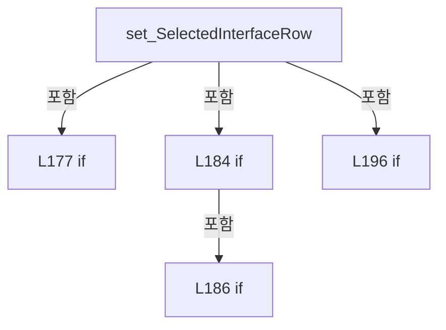

변경 전 점검: 입력/반환 타입, 위 호출자, 예외/취소 경로, 공유 상태와 저장·전송 소비자를 함께 확인합니다. 값의 단위나 물리 방향을 이름만으로 확정하지 않습니다.

### PropertyDeclaration `CanOperateSelectedInterface` · L207–213

[Drilling.UI/Menu/Menus/CMenuSetting.cs:207–213](https://github.com/kjuws10-rgb/A3Drilling/blob/28764c91d521777b8ee068dd7aaf2d3902ce9fe2/Drilling.UI/Menu/Menus/CMenuSetting.cs#L207-L213)

| 항목 | 실제 추출 값 |
| --- | --- |
| 서명 | bool Drilling.UI.Menu.Menus.CMenuSetting.CanOperateSelectedInterface |
| 접근/수식자 | Public / public |
| 반환/값 타입 | bool |
| 소속 타입 | NamedType:Drilling.UI.Menu.Menus.CMenuSetting |

현재 부분 분석에서 직접 연결된 호출자는 없습니다. XAML/이벤트/인터페이스·델리게이트·외부 진입을 추가 확인해야 하며, 미사용으로 판정한 것이 아닙니다.

변경 전 점검: 입력/반환 타입, 위 호출자, 예외/취소 경로, 공유 상태와 저장·전송 소비자를 함께 확인합니다. 값의 단위나 물리 방향을 이름만으로 확정하지 않습니다.

### GetAccessorDeclaration `get_CanOperateSelectedInterface` · L209–212

[Drilling.UI/Menu/Menus/CMenuSetting.cs:209–212](https://github.com/kjuws10-rgb/A3Drilling/blob/28764c91d521777b8ee068dd7aaf2d3902ce9fe2/Drilling.UI/Menu/Menus/CMenuSetting.cs#L209-L212)

| 항목 | 실제 추출 값 |
| --- | --- |
| 서명 | bool Drilling.UI.Menu.Menus.CMenuSetting.CanOperateSelectedInterface.get |
| 접근/수식자 | Public / get |
| 반환/값 타입 | bool |
| 소속 타입 | NamedType:Drilling.UI.Menu.Menus.CMenuSetting |

현재 부분 분석에서 직접 연결된 호출자는 없습니다. XAML/이벤트/인터페이스·델리게이트·외부 진입을 추가 확인해야 하며, 미사용으로 판정한 것이 아닙니다.

본문의 실제 연산·분기·예외·반환 순서(원문 위치 순):

| 원본 행 | 종류 | 주석 해설 |
| --- | --- | --- |
| 211 | return | 호출자에게 값 또는 제어를 반환합니다: return IsInterfaceTab && SelectedInterfaceRow is not null && !SelectedInterfaceRow.IsSimulation; |

변경 전 점검: 입력/반환 타입, 위 호출자, 예외/취소 경로, 공유 상태와 저장·전송 소비자를 함께 확인합니다. 값의 단위나 물리 방향을 이름만으로 확정하지 않습니다.

### MethodDeclaration `Build` · L215–286

[Drilling.UI/Menu/Menus/CMenuSetting.cs:215–286](https://github.com/kjuws10-rgb/A3Drilling/blob/28764c91d521777b8ee068dd7aaf2d3902ce9fe2/Drilling.UI/Menu/Menus/CMenuSetting.cs#L215-L286)

| 항목 | 실제 추출 값 |
| --- | --- |
| 서명 | System.Threading.Tasks.Task<Drilling.UI.Menu.Menus.CScreenViewModel> Drilling.UI.Menu.Menus.CMenuSetting.Build(System.Threading.CancellationToken) |
| 접근/수식자 | Public / public, override |
| 반환/값 타입 | System.Threading.Tasks.Task<Drilling.UI.Menu.Menus.CScreenViewModel> |
| 소속 타입 | NamedType:Drilling.UI.Menu.Menus.CMenuSetting |

입력 계약:

| 이름 | 타입 | 전달 | 선택/기본값 |
| --- | --- | --- | --- |
| cancellationToken | System.Threading.CancellationToken | None | True / null |

현재 부분 분석에서 직접 연결된 호출자는 없습니다. XAML/이벤트/인터페이스·델리게이트·외부 진입을 추가 확인해야 하며, 미사용으로 판정한 것이 아닙니다.

호출하는 대상과 해석 범위:

| 원본 행 | 표현식 | 분석 상태 | 대상/소스 위치 |
| --- | --- | --- | --- |
| 217 | new List<ST_SCREEN_SECTION> | resolved | System.Collections.Generic.List<Drilling.UI.Menu.Menus.ST_SCREEN_SECTION>.List() |
| 225 | _settingManager.LoadSection | resolved | System.Collections.Generic.IReadOnlyList<Drilling.Common.Managers.ST_SYSTEM_PARAMETER> Drilling.Common.Managers.CSettingManager.LoadSection(Drilling.Common.Managers.EN_SETTING_TAB, System.Threading.CancellationToken) · Drilling.Common/Managers/CSettingManager.cs:26 |
| 226 | displaySections.Add | resolved | void System.Collections.Generic.List<Drilling.UI.Menu.Menus.ST_SCREEN_SECTION>.Add(Drilling.UI.Menu.Menus.ST_SCREEN_SECTION) |
| 226 | new ST_SCREEN_SECTION | resolved | Drilling.UI.Menu.Menus.ST_SCREEN_SECTION.ST_SCREEN_SECTION(string, System.Collections.Generic.IReadOnlyList<Drilling.UI.Menu.Menus.ST_DISPLAY_ITEM>) · Drilling.UI/Menu/Menus/CMenuBase.cs:410 |
| 226 | ToTabText | resolved | string Drilling.UI.Menu.Menus.CMenuSetting.ToTabText(Drilling.Common.Managers.EN_SETTING_TAB) · Drilling.UI/Menu/Menus/CMenuSetting.cs:1069 |
| 226 | sectionParameters.Select(BuildDisplay).ToArray | resolved | Drilling.UI.Menu.Menus.ST_DISPLAY_ITEM[] System.Collections.Generic.IEnumerable<Drilling.UI.Menu.Menus.ST_DISPLAY_ITEM>.ToArray<Drilling.UI.Menu.Menus.ST_DISPLAY_ITEM>() |
| 226 | sectionParameters.Select | resolved | System.Collections.Generic.IEnumerable<Drilling.UI.Menu.Menus.ST_DISPLAY_ITEM> System.Collections.Generic.IEnumerable<Drilling.Common.Managers.ST_SYSTEM_PARAMETER>.Select<Drilling.Common.Managers.ST_SYSTEM_PARAMETER, Drilling.UI.Menu.Menus.ST_DISPLAY_ITEM>(System.Func<Drilling.Common.Managers.ST_SYSTEM_PARAMETER, Drilling.UI.Menu.Menus.ST_DISPLAY_ITEM>) |
| 229 | NormalizeTab | resolved | string Drilling.UI.Menu.Menus.CMenuSetting.NormalizeTab(string) · Drilling.UI/Menu/Menus/CMenuSetting.cs:1014 |
| 229 | _selectedTabProvider | resolved · 동적 구현 선택 가능 | string System.Func<string>.Invoke() |
| 230 | ToSection | resolved | Drilling.Common.Managers.EN_SETTING_TAB Drilling.UI.Menu.Menus.CMenuSetting.ToSection(string) · Drilling.UI/Menu/Menus/CMenuSetting.cs:1057 |
| 231 | _settingManager.LoadSection | resolved | System.Collections.Generic.IReadOnlyList<Drilling.Common.Managers.ST_SYSTEM_PARAMETER> Drilling.Common.Managers.CSettingManager.LoadSection(Drilling.Common.Managers.EN_SETTING_TAB, System.Threading.CancellationToken) · Drilling.Common/Managers/CSettingManager.cs:26 |
| 232 | BuildParameterRows | resolved | System.Collections.Generic.IReadOnlyList<Drilling.UI.Menu.Menus.ST_SYSTEM_PARAMETER_ROW> Drilling.UI.Menu.Menus.CMenuSetting.BuildParameterRows(System.Collections.Generic.IReadOnlyList<Drilling.Common.Managers.ST_SYSTEM_PARAMETER>) · Drilling.UI/Menu/Menus/CMenuSetting.cs:645 |
| 233 | BuildInterfaceRows | resolved | System.Collections.Generic.IReadOnlyList<Drilling.UI.Menu.Menus.ST_SETTING_INTERFACE_ROW> Drilling.UI.Menu.Menus.CMenuSetting.BuildInterfaceRows(System.Collections.Generic.IReadOnlyList<Drilling.Common.Interface.ST_INTERFACE_DATA>) · Drilling.UI/Menu/Menus/CMenuSetting.cs:845 |
| 233 | _settingManager.LoadInterfaceList | resolved | System.Collections.Generic.IReadOnlyList<Drilling.Common.Interface.ST_INTERFACE_DATA> Drilling.Common.Managers.CSettingManager.LoadInterfaceList(System.Threading.CancellationToken) · Drilling.Common/Managers/CSettingManager.cs:163 |
| 234 | _editScreenProvider | resolved · 동적 구현 선택 가능 | Drilling.UI.Menu.Menus.CMenuSetting? System.Func<Drilling.UI.Menu.Menus.CMenuSetting?>.Invoke() |
| 235 | GetEditRows | resolved | System.Collections.Generic.IReadOnlyList<Drilling.UI.Menu.Menus.ST_SYSTEM_PARAMETER_ROW> Drilling.UI.Menu.Menus.CMenuSetting.GetEditRows(System.Collections.Generic.IReadOnlyList<Drilling.UI.Menu.Menus.ST_SYSTEM_PARAMETER_ROW>, Drilling.UI.Menu.Menus.CMenuSetting?, string) · Drilling.UI/Menu/Menus/CMenuSetting.cs:578 |
| 236 | GetEditInterfaceRows | resolved | System.Collections.Generic.IReadOnlyList<Drilling.UI.Menu.Menus.ST_SETTING_INTERFACE_ROW> Drilling.UI.Menu.Menus.CMenuSetting.GetEditInterfaceRows(System.Collections.Generic.IReadOnlyList<Drilling.UI.Menu.Menus.ST_SETTING_INTERFACE_ROW>, Drilling.UI.Menu.Menus.CMenuSetting?, string) · Drilling.UI/Menu/Menus/CMenuSetting.cs:583 |
| 237 | BuildInterfaceGroups | resolved | System.Collections.Generic.IReadOnlyList<string> Drilling.UI.Menu.Menus.CMenuSetting.BuildInterfaceGroups(System.Collections.Generic.IReadOnlyList<Drilling.UI.Menu.Menus.ST_SETTING_INTERFACE_ROW>) · Drilling.UI/Menu/Menus/CMenuSetting.cs:774 |
| 237 | BuildGroups | resolved | System.Collections.Generic.IReadOnlyList<string> Drilling.UI.Menu.Menus.CMenuSetting.BuildGroups(System.Collections.Generic.IReadOnlyList<Drilling.UI.Menu.Menus.ST_SYSTEM_PARAMETER_ROW>) · Drilling.UI/Menu/Menus/CMenuSetting.cs:673 |
| 238 | NormalizeGroup | resolved | string Drilling.UI.Menu.Menus.CMenuSetting.NormalizeGroup(string, System.Collections.Generic.IReadOnlyList<string>) · Drilling.UI/Menu/Menus/CMenuSetting.cs:1025 |
| 238 | _selectedGroupProvider | resolved · 동적 구현 선택 가능 | string System.Func<string>.Invoke() |
| 244 | allRows.Where(ShouldIncludeItem).ToArray | resolved | Drilling.UI.Menu.Menus.ST_SYSTEM_PARAMETER_ROW[] System.Collections.Generic.IEnumerable<Drilling.UI.Menu.Menus.ST_SYSTEM_PARAMETER_ROW>.ToArray<Drilling.UI.Menu.Menus.ST_SYSTEM_PARAMETER_ROW>() |
| 244 | allRows.Where | resolved | System.Collections.Generic.IEnumerable<Drilling.UI.Menu.Menus.ST_SYSTEM_PARAMETER_ROW> System.Collections.Generic.IEnumerable<Drilling.UI.Menu.Menus.ST_SYSTEM_PARAMETER_ROW>.Where<Drilling.UI.Menu.Menus.ST_SYSTEM_PARAMETER_ROW>(System.Func<Drilling.UI.Menu.Menus.ST_SYSTEM_PARAMETER_ROW, bool>) |
| 245 | BuildHeadFilters | resolved | System.Collections.Generic.IReadOnlyList<Drilling.UI.Menu.Menus.ST_SETTING_HEAD_FILTER> Drilling.UI.Menu.Menus.CMenuSetting.BuildHeadFilters(System.Collections.Generic.IReadOnlyList<Drilling.UI.Menu.Menus.ST_SYSTEM_PARAMETER_ROW>) · Drilling.UI/Menu/Menus/CMenuSetting.cs:692 |
| 246 | NormalizeHeadFilter | resolved | string Drilling.UI.Menu.Menus.CMenuSetting.NormalizeHeadFilter(string, System.Collections.Generic.IReadOnlyList<Drilling.UI.Menu.Menus.ST_SETTING_HEAD_FILTER>) · Drilling.UI/Menu/Menus/CMenuSetting.cs:756 |
| 247 | MarkSelectedHeadFilter | resolved | System.Collections.Generic.IReadOnlyList<Drilling.UI.Menu.Menus.ST_SETTING_HEAD_FILTER> Drilling.UI.Menu.Menus.CMenuSetting.MarkSelectedHeadFilter(System.Collections.Generic.IReadOnlyList<Drilling.UI.Menu.Menus.ST_SETTING_HEAD_FILTER>, string) · Drilling.UI/Menu/Menus/CMenuSetting.cs:743 |
| 249 | ApplyHeadFilter | resolved | System.Collections.Generic.IReadOnlyList<Drilling.UI.Menu.Menus.ST_SYSTEM_PARAMETER_ROW> Drilling.UI.Menu.Menus.CMenuSetting.ApplyHeadFilter(System.Collections.Generic.IReadOnlyList<Drilling.UI.Menu.Menus.ST_SYSTEM_PARAMETER_ROW>, string) · Drilling.UI/Menu/Menus/CMenuSetting.cs:728 |
| 255 | allInterfaceRows.Where(MatchesType).ToArray | resolved | Drilling.UI.Menu.Menus.ST_SETTING_INTERFACE_ROW[] System.Collections.Generic.IEnumerable<Drilling.UI.Menu.Menus.ST_SETTING_INTERFACE_ROW>.ToArray<Drilling.UI.Menu.Menus.ST_SETTING_INTERFACE_ROW>() |
| 255 | allInterfaceRows.Where | resolved | System.Collections.Generic.IEnumerable<Drilling.UI.Menu.Menus.ST_SETTING_INTERFACE_ROW> System.Collections.Generic.IEnumerable<Drilling.UI.Menu.Menus.ST_SETTING_INTERFACE_ROW>.Where<Drilling.UI.Menu.Menus.ST_SETTING_INTERFACE_ROW>(System.Func<Drilling.UI.Menu.Menus.ST_SETTING_INTERFACE_ROW, bool>) |
| 256 | _settingManager.LoadHistory | resolved | System.Collections.Generic.IReadOnlyList<Drilling.Common.Managers.ST_SETTING_HISTORY> Drilling.Common.Managers.CSettingManager.LoadHistory(Drilling.Common.Managers.EN_SETTING_TAB, System.Threading.CancellationToken) · Drilling.Common/Managers/CSettingManager.cs:158 |
| 262 | Apply | resolved | void Drilling.UI.Menu.Menus.CMenuSetting.Apply(System.Collections.Generic.IReadOnlyList<Drilling.UI.Menu.Menus.ST_SCREEN_SECTION>, System.Collections.Generic.IReadOnlyList<Drilling.UI.Menu.Menus.ST_DISPLAY_ITEM>, string, string, string, System.Collections.Generic.IReadOnlyList<Drilling.UI.Menu.Menus.ST_SETTING_TAB>, System.Collections.Generic.IReadOnlyList<Drilling.UI.Menu.Menus.ST_SETTING_GROUP>, System.Collections.Generic.IReadOnlyList<Drilling.UI.Menu.Menus.ST_SETTING_HEAD_FILTER>, System.Collections.Generic.IReadOnlyList<Drilling.UI.Menu.Menus.ST_SYSTEM_PARAMETER_ROW>, System.Collections.Generic.IReadOnlyList<Drilling.UI.Menu.Menus.ST_SYSTEM_PARAMETER_ROW>, System.Collections.Generic.IReadOnlyList<Drilling.UI.Menu.Menus.ST_SETTING_INTERFACE_ROW>, System.Collections.Generic.IReadOnlyList<Drilling.UI.Menu.Menus.ST_SETTING_INTERFACE_ROW>, System.Collections.Generic.IReadOnlyList<Drilling.UI.Menu.Menus.ST_SETTING_HISTORY_ROW>, System.Collections.Generic.IReadOnlyList<Drilling.UI.Menu.Menus.ST_SETTING_SUMMARY_ROW>) · Drilling.UI/Menu/Menus/CMenuSetting.cs:544 |
| 264 | BuildHistoryItems | resolved | System.Collections.Generic.IReadOnlyList<Drilling.UI.Menu.Menus.ST_DISPLAY_ITEM> Drilling.UI.Menu.Menus.CMenuSetting.BuildHistoryItems(System.Collections.Generic.IReadOnlyList<Drilling.Common.Managers.ST_SETTING_HISTORY>) · Drilling.UI/Menu/Menus/CMenuSetting.cs:793 |
| 268 | BuildTabs | resolved | System.Collections.Generic.IReadOnlyList<Drilling.UI.Menu.Menus.ST_SETTING_TAB> Drilling.UI.Menu.Menus.CMenuSetting.BuildTabs(string) · Drilling.UI/Menu/Menus/CMenuSetting.cs:630 |
| 269 | groups.Select(BuildSetting).ToArray | resolved | Drilling.UI.Menu.Menus.ST_SETTING_GROUP[] System.Collections.Generic.IEnumerable<Drilling.UI.Menu.Menus.ST_SETTING_GROUP>.ToArray<Drilling.UI.Menu.Menus.ST_SETTING_GROUP>() |
| 269 | groups.Select | resolved | System.Collections.Generic.IEnumerable<Drilling.UI.Menu.Menus.ST_SETTING_GROUP> System.Collections.Generic.IEnumerable<string>.Select<string, Drilling.UI.Menu.Menus.ST_SETTING_GROUP>(System.Func<string, Drilling.UI.Menu.Menus.ST_SETTING_GROUP>) |
| 275 | BuildHistoryRows | resolved | System.Collections.Generic.IReadOnlyList<Drilling.UI.Menu.Menus.ST_SETTING_HISTORY_ROW> Drilling.UI.Menu.Menus.CMenuSetting.BuildHistoryRows(System.Collections.Generic.IReadOnlyList<Drilling.Common.Managers.ST_SETTING_HISTORY>) · Drilling.UI/Menu/Menus/CMenuSetting.cs:803 |
| 276 | BuildSummaryRows | resolved | System.Collections.Generic.IReadOnlyList<Drilling.UI.Menu.Menus.ST_SETTING_SUMMARY_ROW> Drilling.UI.Menu.Menus.CMenuSetting.BuildSummaryRows(string, System.Collections.Generic.IReadOnlyList<Drilling.UI.Menu.Menus.ST_SYSTEM_PARAMETER_ROW>, System.Collections.Generic.IReadOnlyList<Drilling.UI.Menu.Menus.ST_SETTING_INTERFACE_ROW>, System.Collections.Generic.IReadOnlyList<Drilling.Common.Managers.ST_SETTING_HISTORY>) · Drilling.UI/Menu/Menus/CMenuSetting.cs:818 |
| 278 | Task.FromResult | resolved | System.Threading.Tasks.Task<Drilling.UI.Menu.Menus.CScreenViewModel> System.Threading.Tasks.Task.FromResult<Drilling.UI.Menu.Menus.CScreenViewModel>(Drilling.UI.Menu.Menus.CScreenViewModel) |
| 278 | new CScreenViewModel | resolved | Drilling.UI.Menu.Menus.CScreenViewModel.CScreenViewModel(Drilling.UI.Menu.Menus.EN_MENU, string, string, System.Collections.Generic.IReadOnlyList<Drilling.UI.Menu.Menus.ST_DISPLAY_ITEM>, System.Collections.Generic.IReadOnlyList<Drilling.UI.Menu.Menus.ST_SCREEN_SECTION>, bool, Drilling.UI.Menu.Menus.CMenuMain?, Drilling.UI.Menu.Menus.CMenuManual?, Drilling.UI.Menu.Menus.CMenuRecipe?, Drilling.UI.Menu.Menus.CMenuSetting?, Drilling.UI.Menu.Menus.CMenuAlarm?, Drilling.UI.Menu.Menus.CMenuMonitor?, Drilling.UI.Menu.Menus.CMenuReview?, Drilling.UI.Menu.Menus.CMenuCorrection?, Drilling.UI.Menu.Menus.CMenuPm?) · Drilling.UI/Menu/Menus/CMenuBase.cs:411 |
| 282 | new | resolved | Drilling.UI.Menu.Menus.ST_DISPLAY_ITEM.ST_DISPLAY_ITEM(string, string, string) · Drilling.UI/Menu/Menus/CMenuBase.cs:43 |
| 282 | new | resolved | Drilling.UI.Menu.Menus.ST_DISPLAY_ITEM.ST_DISPLAY_ITEM(string, string, string) · Drilling.UI/Menu/Menus/CMenuBase.cs:43 |

본문의 실제 연산·분기·예외·반환 순서(원문 위치 순):

| 원본 행 | 종류 | 주석 해설 |
| --- | --- | --- |
| 217 | call | 함수·델리게이트 또는 객체 생성자를 호출합니다: new List<ST_SCREEN_SECTION>() |
| 217 | local-declaration | 지역 변수를 선언합니다: var displaySections = new List<ST_SCREEN_SECTION>(); |
| 217 | variable-initializer | 변수의 초기값을 지정합니다: displaySections = new List<ST_SCREEN_SECTION>() |
| 223 | foreach | 컬렉션 요소를 순회합니다: foreach (var section in Sections) |
| 225 | call | 함수·델리게이트 또는 객체 생성자를 호출합니다: _settingManager.LoadSection(section, cancellationToken) |
| 225 | local-declaration | 지역 변수를 선언합니다: var sectionParameters = _settingManager.LoadSection(section, cancellationToken); |
| 225 | variable-initializer | 변수의 초기값을 지정합니다: sectionParameters = _settingManager.LoadSection(section, cancellationToken) |
| 226 | call | 함수·델리게이트 또는 객체 생성자를 호출합니다: displaySections.Add(new ST_SCREEN_SECTION(ToTabText(section), sectionParameters.Select(BuildDisplay).ToArray())) |
| 226 | call | 함수·델리게이트 또는 객체 생성자를 호출합니다: new ST_SCREEN_SECTION(ToTabText(section), sectionParameters.Select(BuildDisplay).ToArray()) |
| 226 | call | 함수·델리게이트 또는 객체 생성자를 호출합니다: ToTabText(section) |
| 226 | call | 함수·델리게이트 또는 객체 생성자를 호출합니다: sectionParameters.Select(BuildDisplay).ToArray() |
| 226 | call | 함수·델리게이트 또는 객체 생성자를 호출합니다: sectionParameters.Select(BuildDisplay) |
| 229 | call | 함수·델리게이트 또는 객체 생성자를 호출합니다: NormalizeTab(_selectedTabProvider()) |
| 229 | call | 함수·델리게이트 또는 객체 생성자를 호출합니다: _selectedTabProvider() |
| 229 | local-declaration | 지역 변수를 선언합니다: var selectedTab = NormalizeTab(_selectedTabProvider()); |
| 229 | variable-initializer | 변수의 초기값을 지정합니다: selectedTab = NormalizeTab(_selectedTabProvider()) |
| 230 | call | 함수·델리게이트 또는 객체 생성자를 호출합니다: ToSection(selectedTab) |
| 230 | local-declaration | 지역 변수를 선언합니다: var selectedSection = ToSection(selectedTab); |
| 230 | variable-initializer | 변수의 초기값을 지정합니다: selectedSection = ToSection(selectedTab) |
| 231 | call | 함수·델리게이트 또는 객체 생성자를 호출합니다: _settingManager.LoadSection(selectedSection, cancellationToken) |
| 231 | conditional-expression | 조건에 따라 결과식을 선택합니다: selectedTab == "INTERFACE" ? [] : _settingManager.LoadSection(selectedSection, cancellationToken) |
| 231 | local-declaration | 지역 변수를 선언합니다: IReadOnlyList<ST_SYSTEM_PARAMETER> loadedParameters = selectedTab == "INTERFACE" ? [] : _settingManager.LoadSection(selectedSection, cancellationToken); |
| 231 | variable-initializer | 변수의 초기값을 지정합니다: loadedParameters = selectedTab == "INTERFACE" ? [] : _settingManager.LoadSection(selectedSection, cancellationToken) |
| 232 | call | 함수·델리게이트 또는 객체 생성자를 호출합니다: BuildParameterRows(loadedParameters) |
| 232 | local-declaration | 지역 변수를 선언합니다: var loadedRows = BuildParameterRows(loadedParameters); |
| 232 | variable-initializer | 변수의 초기값을 지정합니다: loadedRows = BuildParameterRows(loadedParameters) |
| 233 | call | 함수·델리게이트 또는 객체 생성자를 호출합니다: BuildInterfaceRows(_settingManager.LoadInterfaceList(cancellationToken)) |
| 233 | call | 함수·델리게이트 또는 객체 생성자를 호출합니다: _settingManager.LoadInterfaceList(cancellationToken) |
| 233 | conditional-expression | 조건에 따라 결과식을 선택합니다: selectedTab == "INTERFACE" ? BuildInterfaceRows(_settingManager.LoadInterfaceList(cancellationToken)) : [] |
| 233 | local-declaration | 지역 변수를 선언합니다: IReadOnlyList<ST_SETTING_INTERFACE_ROW> loadedInterfaceRows = selectedTab == "INTERFACE" ? BuildInterfaceRows(_settingManager.LoadInterfaceList(cancellationToken)) : []; |
| 233 | variable-initializer | 변수의 초기값을 지정합니다: loadedInterfaceRows = selectedTab == "INTERFACE" ? BuildInterfaceRows(_settingManager.LoadInterfaceList(cancellationToken)) : [] |
| 234 | call | 함수·델리게이트 또는 객체 생성자를 호출합니다: _editScreenProvider() |
| 234 | local-declaration | 지역 변수를 선언합니다: var editScreen = _editScreenProvider(); |
| 234 | variable-initializer | 변수의 초기값을 지정합니다: editScreen = _editScreenProvider() |
| 235 | call | 함수·델리게이트 또는 객체 생성자를 호출합니다: GetEditRows(loadedRows, editScreen, selectedTab) |
| 235 | local-declaration | 지역 변수를 선언합니다: var allRows = GetEditRows(loadedRows, editScreen, selectedTab); |
| 235 | variable-initializer | 변수의 초기값을 지정합니다: allRows = GetEditRows(loadedRows, editScreen, selectedTab) |
| 236 | call | 함수·델리게이트 또는 객체 생성자를 호출합니다: GetEditInterfaceRows(loadedInterfaceRows, editScreen, selectedTab) |
| 236 | local-declaration | 지역 변수를 선언합니다: var allInterfaceRows = GetEditInterfaceRows(loadedInterfaceRows, editScreen, selectedTab); |
| 236 | variable-initializer | 변수의 초기값을 지정합니다: allInterfaceRows = GetEditInterfaceRows(loadedInterfaceRows, editScreen, selectedTab) |
| 237 | call | 함수·델리게이트 또는 객체 생성자를 호출합니다: BuildInterfaceGroups(allInterfaceRows) |
| 237 | call | 함수·델리게이트 또는 객체 생성자를 호출합니다: BuildGroups(allRows) |
| 237 | conditional-expression | 조건에 따라 결과식을 선택합니다: selectedTab == "INTERFACE" ? BuildInterfaceGroups(allInterfaceRows) : BuildGroups(allRows) |
| 237 | local-declaration | 지역 변수를 선언합니다: var groups = selectedTab == "INTERFACE" ? BuildInterfaceGroups(allInterfaceRows) : BuildGroups(allRows); |
| 237 | variable-initializer | 변수의 초기값을 지정합니다: groups = selectedTab == "INTERFACE" ? BuildInterfaceGroups(allInterfaceRows) : BuildGroups(allRows) |
| 238 | call | 함수·델리게이트 또는 객체 생성자를 호출합니다: NormalizeGroup(_selectedGroupProvider(), groups) |
| 238 | call | 함수·델리게이트 또는 객체 생성자를 호출합니다: _selectedGroupProvider() |
| 238 | local-declaration | 지역 변수를 선언합니다: var selectedGroup = NormalizeGroup(_selectedGroupProvider(), groups); |
| 238 | variable-initializer | 변수의 초기값을 지정합니다: selectedGroup = NormalizeGroup(_selectedGroupProvider(), groups) |
| 244 | call | 함수·델리게이트 또는 객체 생성자를 호출합니다: allRows.Where(ShouldIncludeItem).ToArray() |
| 244 | call | 함수·델리게이트 또는 객체 생성자를 호출합니다: allRows.Where(ShouldIncludeItem) |
| 244 | conditional-expression | 조건에 따라 결과식을 선택합니다: selectedGroup == "ALL" ? allRows : allRows.Where(ShouldIncludeItem).ToArray() |
| 244 | local-declaration | 지역 변수를 선언합니다: var groupFilteredRows = selectedGroup == "ALL" ? allRows : allRows.Where(ShouldIncludeItem).ToArray(); |
| 244 | variable-initializer | 변수의 초기값을 지정합니다: groupFilteredRows = selectedGroup == "ALL" ? allRows : allRows.Where(ShouldIncludeItem).ToArray() |
| 245 | call | 함수·델리게이트 또는 객체 생성자를 호출합니다: BuildHeadFilters(groupFilteredRows) |
| 245 | local-declaration | 지역 변수를 선언합니다: var availableHeadFilters = BuildHeadFilters(groupFilteredRows); |
| 245 | variable-initializer | 변수의 초기값을 지정합니다: availableHeadFilters = BuildHeadFilters(groupFilteredRows) |
| 246 | call | 함수·델리게이트 또는 객체 생성자를 호출합니다: NormalizeHeadFilter(_selectedHeadFilter, availableHeadFilters) |
| 246 | local-declaration | 지역 변수를 선언합니다: var selectedHeadFilter = NormalizeHeadFilter(_selectedHeadFilter, availableHeadFilters); |
| 246 | variable-initializer | 변수의 초기값을 지정합니다: selectedHeadFilter = NormalizeHeadFilter(_selectedHeadFilter, availableHeadFilters) |
| 247 | call | 함수·델리게이트 또는 객체 생성자를 호출합니다: MarkSelectedHeadFilter(availableHeadFilters, selectedHeadFilter) |
| 247 | local-declaration | 지역 변수를 선언합니다: var headFilterItems = MarkSelectedHeadFilter(availableHeadFilters, selectedHeadFilter); |
| 247 | variable-initializer | 변수의 초기값을 지정합니다: headFilterItems = MarkSelectedHeadFilter(availableHeadFilters, selectedHeadFilter) |
| 248 | assignment | 값을 대상에 대입합니다: _selectedHeadFilter = selectedHeadFilter |
| 249 | call | 함수·델리게이트 또는 객체 생성자를 호출합니다: ApplyHeadFilter(groupFilteredRows, selectedHeadFilter) |
| 249 | local-declaration | 지역 변수를 선언합니다: var filteredRows = ApplyHeadFilter(groupFilteredRows, selectedHeadFilter); |
| 249 | variable-initializer | 변수의 초기값을 지정합니다: filteredRows = ApplyHeadFilter(groupFilteredRows, selectedHeadFilter) |
| 255 | call | 함수·델리게이트 또는 객체 생성자를 호출합니다: allInterfaceRows.Where(MatchesType).ToArray() |
| 255 | call | 함수·델리게이트 또는 객체 생성자를 호출합니다: allInterfaceRows.Where(MatchesType) |
| 255 | conditional-expression | 조건에 따라 결과식을 선택합니다: selectedGroup == "ALL" ? allInterfaceRows : allInterfaceRows.Where(MatchesType).ToArray() |
| 255 | local-declaration | 지역 변수를 선언합니다: var filteredInterfaceRows = selectedGroup == "ALL" ? allInterfaceRows : allInterfaceRows.Where(MatchesType).ToArray(); |
| 255 | variable-initializer | 변수의 초기값을 지정합니다: filteredInterfaceRows = selectedGroup == "ALL" ? allInterfaceRows : allInterfaceRows.Where(MatchesType).ToArray() |
| 256 | call | 함수·델리게이트 또는 객체 생성자를 호출합니다: _settingManager.LoadHistory(selectedSection, cancellationToken) |
| 256 | local-declaration | 지역 변수를 선언합니다: var history = _settingManager.LoadHistory(selectedSection, cancellationToken); |
| 256 | variable-initializer | 변수의 초기값을 지정합니다: history = _settingManager.LoadHistory(selectedSection, cancellationToken) |
| 262 | call | 함수·델리게이트 또는 객체 생성자를 호출합니다: Apply( displaySections, BuildHistoryItems(history), selectedTab, selectedGroup, selectedHeadFilter, BuildTabs(selectedTab), groups.Select(BuildSetting).ToArray(), headFilterItems, allRows, filteredRows, allInterfaceRows,… |
| 264 | call | 함수·델리게이트 또는 객체 생성자를 호출합니다: BuildHistoryItems(history) |
| 268 | call | 함수·델리게이트 또는 객체 생성자를 호출합니다: BuildTabs(selectedTab) |
| 269 | call | 함수·델리게이트 또는 객체 생성자를 호출합니다: groups.Select(BuildSetting).ToArray() |
| 269 | call | 함수·델리게이트 또는 객체 생성자를 호출합니다: groups.Select(BuildSetting) |
| 275 | call | 함수·델리게이트 또는 객체 생성자를 호출합니다: BuildHistoryRows(history) |
| 276 | call | 함수·델리게이트 또는 객체 생성자를 호출합니다: BuildSummaryRows(selectedTab, allRows, allInterfaceRows, history) |
| 278 | call | 함수·델리게이트 또는 객체 생성자를 호출합니다: Task.FromResult(new CScreenViewModel( EN_MENU.Setting, "SETTING / PARAMETER CONFIG", "Direct grid edit for option, interface, IO and motor parameters.", [new("Source", "CSV"), new("History", "Setting trace log")], displa… |
| 278 | call | 함수·델리게이트 또는 객체 생성자를 호출합니다: new CScreenViewModel( EN_MENU.Setting, "SETTING / PARAMETER CONFIG", "Direct grid edit for option, interface, IO and motor parameters.", [new("Source", "CSV"), new("History", "Setting trace log")], displaySections, setti… |
| 278 | return | 호출자에게 값 또는 제어를 반환합니다: return Task.FromResult(new CScreenViewModel( EN_MENU.Setting, "SETTING / PARAMETER CONFIG", "Direct grid edit for option, interface, IO and motor parameters.", [new("Source", "CSV"), new("History", "Setting trace log")], displaySe |
| 282 | call | 함수·델리게이트 또는 객체 생성자를 호출합니다: new("Source", "CSV") |
| 282 | call | 함수·델리게이트 또는 객체 생성자를 호출합니다: new("History", "Setting trace log") |

제어 구문의 포함 구조(실제 실행 순서/CFG가 아닌 구문 탐색 그림):

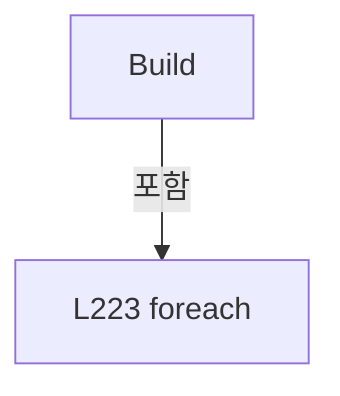

변경 전 점검: 입력/반환 타입, 위 호출자, 예외/취소 경로, 공유 상태와 저장·전송 소비자를 함께 확인합니다. 값의 단위나 물리 방향을 이름만으로 확정하지 않습니다.

### LocalFunctionStatement `BuildDisplay` · L218–221

[Drilling.UI/Menu/Menus/CMenuSetting.cs:218–221](https://github.com/kjuws10-rgb/A3Drilling/blob/28764c91d521777b8ee068dd7aaf2d3902ce9fe2/Drilling.UI/Menu/Menus/CMenuSetting.cs#L218-L221)

| 항목 | 실제 추출 값 |
| --- | --- |
| 서명 | Drilling.UI.Menu.Menus.ST_DISPLAY_ITEM BuildDisplay(Drilling.Common.Managers.ST_SYSTEM_PARAMETER) |
| 접근/수식자 | Private /  |
| 반환/값 타입 | Drilling.UI.Menu.Menus.ST_DISPLAY_ITEM |
| 소속 타입 | NamedType:Drilling.UI.Menu.Menus.CMenuSetting |

입력 계약:

| 이름 | 타입 | 전달 | 선택/기본값 |
| --- | --- | --- | --- |
| item | Drilling.Common.Managers.ST_SYSTEM_PARAMETER | None | False /  |

현재 부분 분석에서 직접 연결된 호출자는 없습니다. XAML/이벤트/인터페이스·델리게이트·외부 진입을 추가 확인해야 하며, 미사용으로 판정한 것이 아닙니다.

호출하는 대상과 해석 범위:

| 원본 행 | 표현식 | 분석 상태 | 대상/소스 위치 |
| --- | --- | --- | --- |
| 220 | new ST_DISPLAY_ITEM | resolved | Drilling.UI.Menu.Menus.ST_DISPLAY_ITEM.ST_DISPLAY_ITEM(string, string, string) · Drilling.UI/Menu/Menus/CMenuBase.cs:43 |
| 220 | $"{item.Value} {item.Unit}".Trim | resolved | string string.Trim() |

본문의 실제 연산·분기·예외·반환 순서(원문 위치 순):

| 원본 행 | 종류 | 주석 해설 |
| --- | --- | --- |
| 220 | call | 함수·델리게이트 또는 객체 생성자를 호출합니다: new ST_DISPLAY_ITEM(item.Name, $"{item.Value} {item.Unit}".Trim(), item.Description) |
| 220 | call | 함수·델리게이트 또는 객체 생성자를 호출합니다: $"{item.Value} {item.Unit}".Trim() |
| 220 | return | 호출자에게 값 또는 제어를 반환합니다: return new ST_DISPLAY_ITEM(item.Name, $"{item.Value} {item.Unit}".Trim(), item.Description); |

변경 전 점검: 입력/반환 타입, 위 호출자, 예외/취소 경로, 공유 상태와 저장·전송 소비자를 함께 확인합니다. 값의 단위나 물리 방향을 이름만으로 확정하지 않습니다.

### LocalFunctionStatement `ShouldIncludeItem` · L239–242

[Drilling.UI/Menu/Menus/CMenuSetting.cs:239–242](https://github.com/kjuws10-rgb/A3Drilling/blob/28764c91d521777b8ee068dd7aaf2d3902ce9fe2/Drilling.UI/Menu/Menus/CMenuSetting.cs#L239-L242)

| 항목 | 실제 추출 값 |
| --- | --- |
| 서명 | bool ShouldIncludeItem(Drilling.UI.Menu.Menus.ST_SYSTEM_PARAMETER_ROW) |
| 접근/수식자 | Private /  |
| 반환/값 타입 | bool |
| 소속 타입 | NamedType:Drilling.UI.Menu.Menus.CMenuSetting |

입력 계약:

| 이름 | 타입 | 전달 | 선택/기본값 |
| --- | --- | --- | --- |
| row | Drilling.UI.Menu.Menus.ST_SYSTEM_PARAMETER_ROW | None | False /  |

현재 부분 분석에서 직접 연결된 호출자는 없습니다. XAML/이벤트/인터페이스·델리게이트·외부 진입을 추가 확인해야 하며, 미사용으로 판정한 것이 아닙니다.

호출하는 대상과 해석 범위:

| 원본 행 | 표현식 | 분석 상태 | 대상/소스 위치 |
| --- | --- | --- | --- |
| 241 | row.Group.Equals | resolved | bool string.Equals(string?, System.StringComparison) |

본문의 실제 연산·분기·예외·반환 순서(원문 위치 순):

| 원본 행 | 종류 | 주석 해설 |
| --- | --- | --- |
| 241 | call | 함수·델리게이트 또는 객체 생성자를 호출합니다: row.Group.Equals(selectedGroup, StringComparison.OrdinalIgnoreCase) |
| 241 | return | 호출자에게 값 또는 제어를 반환합니다: return row.Group.Equals(selectedGroup, StringComparison.OrdinalIgnoreCase); |

변경 전 점검: 입력/반환 타입, 위 호출자, 예외/취소 경로, 공유 상태와 저장·전송 소비자를 함께 확인합니다. 값의 단위나 물리 방향을 이름만으로 확정하지 않습니다.

### LocalFunctionStatement `MatchesType` · L250–253

[Drilling.UI/Menu/Menus/CMenuSetting.cs:250–253](https://github.com/kjuws10-rgb/A3Drilling/blob/28764c91d521777b8ee068dd7aaf2d3902ce9fe2/Drilling.UI/Menu/Menus/CMenuSetting.cs#L250-L253)

| 항목 | 실제 추출 값 |
| --- | --- |
| 서명 | bool MatchesType(Drilling.UI.Menu.Menus.ST_SETTING_INTERFACE_ROW) |
| 접근/수식자 | Private /  |
| 반환/값 타입 | bool |
| 소속 타입 | NamedType:Drilling.UI.Menu.Menus.CMenuSetting |

입력 계약:

| 이름 | 타입 | 전달 | 선택/기본값 |
| --- | --- | --- | --- |
| row | Drilling.UI.Menu.Menus.ST_SETTING_INTERFACE_ROW | None | False /  |

현재 부분 분석에서 직접 연결된 호출자는 없습니다. XAML/이벤트/인터페이스·델리게이트·외부 진입을 추가 확인해야 하며, 미사용으로 판정한 것이 아닙니다.

호출하는 대상과 해석 범위:

| 원본 행 | 표현식 | 분석 상태 | 대상/소스 위치 |
| --- | --- | --- | --- |
| 252 | row.Type.Equals | resolved | bool string.Equals(string?, System.StringComparison) |

본문의 실제 연산·분기·예외·반환 순서(원문 위치 순):

| 원본 행 | 종류 | 주석 해설 |
| --- | --- | --- |
| 252 | call | 함수·델리게이트 또는 객체 생성자를 호출합니다: row.Type.Equals(selectedGroup, StringComparison.OrdinalIgnoreCase) |
| 252 | return | 호출자에게 값 또는 제어를 반환합니다: return row.Type.Equals(selectedGroup, StringComparison.OrdinalIgnoreCase); |

변경 전 점검: 입력/반환 타입, 위 호출자, 예외/취소 경로, 공유 상태와 저장·전송 소비자를 함께 확인합니다. 값의 단위나 물리 방향을 이름만으로 확정하지 않습니다.

### LocalFunctionStatement `BuildSetting` · L257–260

[Drilling.UI/Menu/Menus/CMenuSetting.cs:257–260](https://github.com/kjuws10-rgb/A3Drilling/blob/28764c91d521777b8ee068dd7aaf2d3902ce9fe2/Drilling.UI/Menu/Menus/CMenuSetting.cs#L257-L260)

| 항목 | 실제 추출 값 |
| --- | --- |
| 서명 | Drilling.UI.Menu.Menus.ST_SETTING_GROUP BuildSetting(string) |
| 접근/수식자 | Private /  |
| 반환/값 타입 | Drilling.UI.Menu.Menus.ST_SETTING_GROUP |
| 소속 타입 | NamedType:Drilling.UI.Menu.Menus.CMenuSetting |

입력 계약:

| 이름 | 타입 | 전달 | 선택/기본값 |
| --- | --- | --- | --- |
| group | string | None | False /  |

현재 부분 분석에서 직접 연결된 호출자는 없습니다. XAML/이벤트/인터페이스·델리게이트·외부 진입을 추가 확인해야 하며, 미사용으로 판정한 것이 아닙니다.

호출하는 대상과 해석 범위:

| 원본 행 | 표현식 | 분석 상태 | 대상/소스 위치 |
| --- | --- | --- | --- |
| 259 | new ST_SETTING_GROUP | resolved | Drilling.UI.Menu.Menus.ST_SETTING_GROUP.ST_SETTING_GROUP(string, bool) · Drilling.UI/Menu/Menus/CMenuSetting.cs:1087 |
| 259 | group.Equals | resolved | bool string.Equals(string?, System.StringComparison) |

본문의 실제 연산·분기·예외·반환 순서(원문 위치 순):

| 원본 행 | 종류 | 주석 해설 |
| --- | --- | --- |
| 259 | call | 함수·델리게이트 또는 객체 생성자를 호출합니다: new ST_SETTING_GROUP(group, group.Equals(selectedGroup, StringComparison.OrdinalIgnoreCase)) |
| 259 | call | 함수·델리게이트 또는 객체 생성자를 호출합니다: group.Equals(selectedGroup, StringComparison.OrdinalIgnoreCase) |
| 259 | return | 호출자에게 값 또는 제어를 반환합니다: return new ST_SETTING_GROUP(group, group.Equals(selectedGroup, StringComparison.OrdinalIgnoreCase)); |

변경 전 점검: 입력/반환 타입, 위 호출자, 예외/취소 경로, 공유 상태와 저장·전송 소비자를 함께 확인합니다. 값의 단위나 물리 방향을 이름만으로 확정하지 않습니다.

### MethodDeclaration `SelectTab` · L288–302

[Drilling.UI/Menu/Menus/CMenuSetting.cs:288–302](https://github.com/kjuws10-rgb/A3Drilling/blob/28764c91d521777b8ee068dd7aaf2d3902ce9fe2/Drilling.UI/Menu/Menus/CMenuSetting.cs#L288-L302)

| 항목 | 실제 추출 값 |
| --- | --- |
| 서명 | System.Threading.Tasks.Task Drilling.UI.Menu.Menus.CMenuSetting.SelectTab(object?) |
| 접근/수식자 | Private / private, async |
| 반환/값 타입 | System.Threading.Tasks.Task |
| 소속 타입 | NamedType:Drilling.UI.Menu.Menus.CMenuSetting |

입력 계약:

| 이름 | 타입 | 전달 | 선택/기본값 |
| --- | --- | --- | --- |
| parameter | object? | None | False /  |

정적 호출자로 확인된 위치:

| 호출 파일/행 | 호출 표현식 | 런타임 분기 가능 |
| --- | --- | --- |
| [Drilling.UI/Menu/Menus/CMenuSetting.cs:55–55](https://github.com/kjuws10-rgb/A3Drilling/blob/28764c91d521777b8ee068dd7aaf2d3902ce9fe2/Drilling.UI/Menu/Menus/CMenuSetting.cs#L55-L55) | SelectTab | False |

호출하는 대상과 해석 범위:

| 원본 행 | 표현식 | 분석 상태 | 대상/소스 위치 |
| --- | --- | --- | --- |
| 290 | string.IsNullOrWhiteSpace | resolved | bool string.IsNullOrWhiteSpace(string?) |
| 295 | NormalizeTab | resolved | string Drilling.UI.Menu.Menus.CMenuSetting.NormalizeTab(string) · Drilling.UI/Menu/Menus/CMenuSetting.cs:1014 |
| 296 | _selectedTabSetter | resolved · 동적 구현 선택 가능 | void System.Action<string>.Invoke(string) |
| 297 | _selectedGroupSetter | resolved · 동적 구현 선택 가능 | void System.Action<string>.Invoke(string) |
| 297 | GetDefaultGroup | resolved | string Drilling.UI.Menu.Menus.CMenuSetting.GetDefaultGroup() · Drilling.UI/Menu/Menus/CMenuSetting.cs:1077 |
| 299 | _setStatusMessage | resolved · 동적 구현 선택 가능 | void System.Action<string>.Invoke(string) |
| 300 | _refreshShellStatus | resolved · 동적 구현 선택 가능 | void System.Action.Invoke() |
| 301 | _refreshCurrentScreen | resolved · 동적 구현 선택 가능 | System.Threading.Tasks.Task System.Func<System.Threading.Tasks.Task>.Invoke() |

본문의 실제 연산·분기·예외·반환 순서(원문 위치 순):

| 원본 행 | 종류 | 주석 해설 |
| --- | --- | --- |
| 290 | call | 함수·델리게이트 또는 객체 생성자를 호출합니다: string.IsNullOrWhiteSpace(tab) |
| 290 | if | 조건에 따라 분기합니다: if (parameter is not string tab &#124;&#124; string.IsNullOrWhiteSpace(tab)) |
| 292 | return | 호출자에게 값 또는 제어를 반환합니다: return; |
| 295 | call | 함수·델리게이트 또는 객체 생성자를 호출합니다: NormalizeTab(tab) |
| 295 | local-declaration | 지역 변수를 선언합니다: var selectedTab = NormalizeTab(tab); |
| 295 | variable-initializer | 변수의 초기값을 지정합니다: selectedTab = NormalizeTab(tab) |
| 296 | call | 함수·델리게이트 또는 객체 생성자를 호출합니다: _selectedTabSetter(selectedTab) |
| 297 | call | 함수·델리게이트 또는 객체 생성자를 호출합니다: _selectedGroupSetter(GetDefaultGroup()) |
| 297 | call | 함수·델리게이트 또는 객체 생성자를 호출합니다: GetDefaultGroup() |
| 298 | assignment | 값을 대상에 대입합니다: _selectedHeadFilter = "ALL" |
| 299 | call | 함수·델리게이트 또는 객체 생성자를 호출합니다: _setStatusMessage($"Setting tab {selectedTab} selected.") |
| 300 | call | 함수·델리게이트 또는 객체 생성자를 호출합니다: _refreshShellStatus() |
| 301 | await | 비동기 완료를 기다립니다: await _refreshCurrentScreen() |
| 301 | call | 함수·델리게이트 또는 객체 생성자를 호출합니다: _refreshCurrentScreen() |

제어 구문의 포함 구조(실제 실행 순서/CFG가 아닌 구문 탐색 그림):

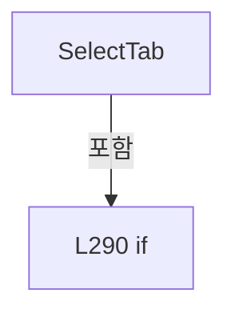

변경 전 점검: 입력/반환 타입, 위 호출자, 예외/취소 경로, 공유 상태와 저장·전송 소비자를 함께 확인합니다. 값의 단위나 물리 방향을 이름만으로 확정하지 않습니다.

### MethodDeclaration `SelectGroup` · L304–317

[Drilling.UI/Menu/Menus/CMenuSetting.cs:304–317](https://github.com/kjuws10-rgb/A3Drilling/blob/28764c91d521777b8ee068dd7aaf2d3902ce9fe2/Drilling.UI/Menu/Menus/CMenuSetting.cs#L304-L317)

| 항목 | 실제 추출 값 |
| --- | --- |
| 서명 | System.Threading.Tasks.Task Drilling.UI.Menu.Menus.CMenuSetting.SelectGroup(object?) |
| 접근/수식자 | Private / private, async |
| 반환/값 타입 | System.Threading.Tasks.Task |
| 소속 타입 | NamedType:Drilling.UI.Menu.Menus.CMenuSetting |

입력 계약:

| 이름 | 타입 | 전달 | 선택/기본값 |
| --- | --- | --- | --- |
| parameter | object? | None | False /  |

정적 호출자로 확인된 위치:

| 호출 파일/행 | 호출 표현식 | 런타임 분기 가능 |
| --- | --- | --- |
| [Drilling.UI/Menu/Menus/CMenuSetting.cs:61–61](https://github.com/kjuws10-rgb/A3Drilling/blob/28764c91d521777b8ee068dd7aaf2d3902ce9fe2/Drilling.UI/Menu/Menus/CMenuSetting.cs#L61-L61) | SelectGroup | False |

호출하는 대상과 해석 범위:

| 원본 행 | 표현식 | 분석 상태 | 대상/소스 위치 |
| --- | --- | --- | --- |
| 306 | string.IsNullOrWhiteSpace | resolved | bool string.IsNullOrWhiteSpace(string?) |
| 311 | group.Trim().ToUpperInvariant | resolved | string string.ToUpperInvariant() |
| 311 | group.Trim | resolved | string string.Trim() |
| 312 | _selectedGroupSetter | resolved · 동적 구현 선택 가능 | void System.Action<string>.Invoke(string) |
| 314 | _setStatusMessage | resolved · 동적 구현 선택 가능 | void System.Action<string>.Invoke(string) |
| 315 | _refreshShellStatus | resolved · 동적 구현 선택 가능 | void System.Action.Invoke() |
| 316 | _refreshCurrentScreen | resolved · 동적 구현 선택 가능 | System.Threading.Tasks.Task System.Func<System.Threading.Tasks.Task>.Invoke() |

본문의 실제 연산·분기·예외·반환 순서(원문 위치 순):

| 원본 행 | 종류 | 주석 해설 |
| --- | --- | --- |
| 306 | call | 함수·델리게이트 또는 객체 생성자를 호출합니다: string.IsNullOrWhiteSpace(group) |
| 306 | if | 조건에 따라 분기합니다: if (parameter is not string group &#124;&#124; string.IsNullOrWhiteSpace(group)) |
| 308 | return | 호출자에게 값 또는 제어를 반환합니다: return; |
| 311 | call | 함수·델리게이트 또는 객체 생성자를 호출합니다: group.Trim().ToUpperInvariant() |
| 311 | call | 함수·델리게이트 또는 객체 생성자를 호출합니다: group.Trim() |
| 311 | local-declaration | 지역 변수를 선언합니다: var selectedGroup = group.Trim().ToUpperInvariant(); |
| 311 | variable-initializer | 변수의 초기값을 지정합니다: selectedGroup = group.Trim().ToUpperInvariant() |
| 312 | call | 함수·델리게이트 또는 객체 생성자를 호출합니다: _selectedGroupSetter(selectedGroup) |
| 313 | assignment | 값을 대상에 대입합니다: _selectedHeadFilter = "ALL" |
| 314 | call | 함수·델리게이트 또는 객체 생성자를 호출합니다: _setStatusMessage($"Setting group {SelectedTab} / {selectedGroup} selected.") |
| 315 | call | 함수·델리게이트 또는 객체 생성자를 호출합니다: _refreshShellStatus() |
| 316 | await | 비동기 완료를 기다립니다: await _refreshCurrentScreen() |
| 316 | call | 함수·델리게이트 또는 객체 생성자를 호출합니다: _refreshCurrentScreen() |

제어 구문의 포함 구조(실제 실행 순서/CFG가 아닌 구문 탐색 그림):

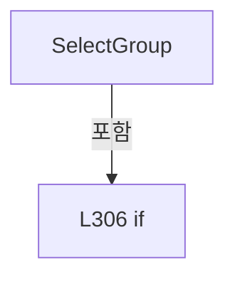

변경 전 점검: 입력/반환 타입, 위 호출자, 예외/취소 경로, 공유 상태와 저장·전송 소비자를 함께 확인합니다. 값의 단위나 물리 방향을 이름만으로 확정하지 않습니다.

### MethodDeclaration `ConnectInterface` · L319–359

[Drilling.UI/Menu/Menus/CMenuSetting.cs:319–359](https://github.com/kjuws10-rgb/A3Drilling/blob/28764c91d521777b8ee068dd7aaf2d3902ce9fe2/Drilling.UI/Menu/Menus/CMenuSetting.cs#L319-L359)

| 항목 | 실제 추출 값 |
| --- | --- |
| 서명 | System.Threading.Tasks.Task Drilling.UI.Menu.Menus.CMenuSetting.ConnectInterface() |
| 접근/수식자 | Private / private, async |
| 반환/값 타입 | System.Threading.Tasks.Task |
| 소속 타입 | NamedType:Drilling.UI.Menu.Menus.CMenuSetting |

정적 호출자로 확인된 위치:

| 호출 파일/행 | 호출 표현식 | 런타임 분기 가능 |
| --- | --- | --- |
| [Drilling.UI/Menu/Menus/CMenuSetting.cs:73–73](https://github.com/kjuws10-rgb/A3Drilling/blob/28764c91d521777b8ee068dd7aaf2d3902ce9fe2/Drilling.UI/Menu/Menus/CMenuSetting.cs#L73-L73) | ConnectInterface | False |

호출하는 대상과 해석 범위:

| 원본 행 | 표현식 | 분석 상태 | 대상/소스 위치 |
| --- | --- | --- | --- |
| 324 | _setStatusMessage | resolved · 동적 구현 선택 가능 | void System.Action<string>.Invoke(string) |
| 330 | _setStatusMessage | resolved · 동적 구현 선택 가능 | void System.Action<string>.Invoke(string) |
| 330 | InterfaceRowLabel | resolved | string Drilling.UI.Menu.Menus.CMenuSetting.InterfaceRowLabel(Drilling.UI.Menu.Menus.ST_SETTING_INTERFACE_ROW) · Drilling.UI/Menu/Menus/CMenuSetting.cs:980 |
| 336 | _setStatusMessage | resolved · 동적 구현 선택 가능 | void System.Action<string>.Invoke(string) |
| 340 | CRecipeConfirmDialog.ShowConfirmation | resolved | bool Drilling.UI.Popup.CRecipeConfirmDialog.ShowConfirmation(string, string, string, bool) · Drilling.UI/Popup/CRecipeConfirmDialog.xaml.cs:11 |
| 347 | _settingManager.ConnectInterface | resolved | System.Threading.Tasks.Task Drilling.Common.Managers.CSettingManager.ConnectInterface(Drilling.Common.Interface.EN_EQP_MODULE, int, System.Threading.CancellationToken) · Drilling.Common/Managers/CSettingManager.cs:174 |
| 348 | ParseDevice | resolved | Drilling.Common.Interface.EN_EQP_MODULE Drilling.UI.Menu.Menus.CMenuSetting.ParseDevice(string) · Drilling.UI/Menu/Menus/CMenuSetting.cs:926 |
| 349 | ReadInt | resolved | int Drilling.UI.Menu.Menus.CMenuSetting.ReadInt(string, string, string) · Drilling.UI/Menu/Menus/CMenuSetting.cs:1004 |
| 350 | _setStatusMessage | resolved · 동적 구현 선택 가능 | void System.Action<string>.Invoke(string) |
| 350 | InterfaceRowLabel | resolved | string Drilling.UI.Menu.Menus.CMenuSetting.InterfaceRowLabel(Drilling.UI.Menu.Menus.ST_SETTING_INTERFACE_ROW) · Drilling.UI/Menu/Menus/CMenuSetting.cs:980 |
| 354 | _setStatusMessage | resolved · 동적 구현 선택 가능 | void System.Action<string>.Invoke(string) |
| 358 | _refreshCurrentScreen | resolved · 동적 구현 선택 가능 | System.Threading.Tasks.Task System.Func<System.Threading.Tasks.Task>.Invoke() |

본문의 실제 연산·분기·예외·반환 순서(원문 위치 순):

| 원본 행 | 종류 | 주석 해설 |
| --- | --- | --- |
| 321 | local-declaration | 지역 변수를 선언합니다: var row = SelectedInterfaceRow; |
| 321 | variable-initializer | 변수의 초기값을 지정합니다: row = SelectedInterfaceRow |
| 322 | if | 조건에 따라 분기합니다: if (row is null) |
| 324 | call | 함수·델리게이트 또는 객체 생성자를 호출합니다: _setStatusMessage("Select an interface row before connect.") |
| 325 | return | 호출자에게 값 또는 제어를 반환합니다: return; |
| 328 | if | 조건에 따라 분기합니다: if (row.IsSimulation) |
| 330 | call | 함수·델리게이트 또는 객체 생성자를 호출합니다: _setStatusMessage($"{InterfaceRowLabel(row)} is SIMUL mode. Connect is disabled.") |
| 330 | call | 함수·델리게이트 또는 객체 생성자를 호출합니다: InterfaceRowLabel(row) |
| 331 | return | 호출자에게 값 또는 제어를 반환합니다: return; |
| 334 | if | 조건에 따라 분기합니다: if (row.IsModified) |
| 336 | call | 함수·델리게이트 또는 객체 생성자를 호출합니다: _setStatusMessage("Save JHMI_INTERFACE.csv before connect.") |
| 337 | return | 호출자에게 값 또는 제어를 반환합니다: return; |
| 340 | call | 함수·델리게이트 또는 객체 생성자를 호출합니다: CRecipeConfirmDialog.ShowConfirmation("인터페이스 연결", $"{row.NickName} 장비에 연결하시겠습니까?") |
| 340 | if | 조건에 따라 분기합니다: if (!CRecipeConfirmDialog.ShowConfirmation("인터페이스 연결", $"{row.NickName} 장비에 연결하시겠습니까?")) |
| 342 | return | 호출자에게 값 또는 제어를 반환합니다: return; |
| 345 | try | 예외 처리 범위입니다: try |
| 347 | await | 비동기 완료를 기다립니다: await _settingManager.ConnectInterface( ParseDevice(row.Device), ReadInt(row.Number, row.NickName, "NUMBER")) |
| 347 | call | 함수·델리게이트 또는 객체 생성자를 호출합니다: _settingManager.ConnectInterface( ParseDevice(row.Device), ReadInt(row.Number, row.NickName, "NUMBER")) |
| 348 | call | 함수·델리게이트 또는 객체 생성자를 호출합니다: ParseDevice(row.Device) |
| 349 | call | 함수·델리게이트 또는 객체 생성자를 호출합니다: ReadInt(row.Number, row.NickName, "NUMBER") |
| 350 | call | 함수·델리게이트 또는 객체 생성자를 호출합니다: _setStatusMessage($"{InterfaceRowLabel(row)} connect command sent.") |
| 350 | call | 함수·델리게이트 또는 객체 생성자를 호출합니다: InterfaceRowLabel(row) |
| 352 | catch | 지정 예외를 처리합니다: catch (Exception exception) when (exception is InvalidOperationException or InvalidDataException or KeyNotFoundException or IOException) |
| 354 | call | 함수·델리게이트 또는 객체 생성자를 호출합니다: _setStatusMessage($"Connect blocked. {exception.Message}") |
| 355 | return | 호출자에게 값 또는 제어를 반환합니다: return; |
| 358 | await | 비동기 완료를 기다립니다: await _refreshCurrentScreen() |
| 358 | call | 함수·델리게이트 또는 객체 생성자를 호출합니다: _refreshCurrentScreen() |

제어 구문의 포함 구조(실제 실행 순서/CFG가 아닌 구문 탐색 그림):

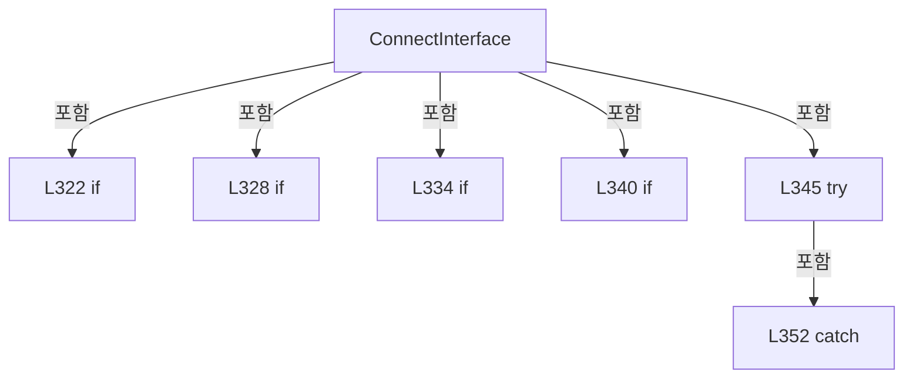

변경 전 점검: 입력/반환 타입, 위 호출자, 예외/취소 경로, 공유 상태와 저장·전송 소비자를 함께 확인합니다. 값의 단위나 물리 방향을 이름만으로 확정하지 않습니다.

### MethodDeclaration `DisconnectInterface` · L361–401

[Drilling.UI/Menu/Menus/CMenuSetting.cs:361–401](https://github.com/kjuws10-rgb/A3Drilling/blob/28764c91d521777b8ee068dd7aaf2d3902ce9fe2/Drilling.UI/Menu/Menus/CMenuSetting.cs#L361-L401)

| 항목 | 실제 추출 값 |
| --- | --- |
| 서명 | System.Threading.Tasks.Task Drilling.UI.Menu.Menus.CMenuSetting.DisconnectInterface() |
| 접근/수식자 | Private / private, async |
| 반환/값 타입 | System.Threading.Tasks.Task |
| 소속 타입 | NamedType:Drilling.UI.Menu.Menus.CMenuSetting |

정적 호출자로 확인된 위치:

| 호출 파일/행 | 호출 표현식 | 런타임 분기 가능 |
| --- | --- | --- |
| [Drilling.UI/Menu/Menus/CMenuSetting.cs:84–84](https://github.com/kjuws10-rgb/A3Drilling/blob/28764c91d521777b8ee068dd7aaf2d3902ce9fe2/Drilling.UI/Menu/Menus/CMenuSetting.cs#L84-L84) | DisconnectInterface | False |

호출하는 대상과 해석 범위:

| 원본 행 | 표현식 | 분석 상태 | 대상/소스 위치 |
| --- | --- | --- | --- |
| 366 | _setStatusMessage | resolved · 동적 구현 선택 가능 | void System.Action<string>.Invoke(string) |
| 372 | _setStatusMessage | resolved · 동적 구현 선택 가능 | void System.Action<string>.Invoke(string) |
| 372 | InterfaceRowLabel | resolved | string Drilling.UI.Menu.Menus.CMenuSetting.InterfaceRowLabel(Drilling.UI.Menu.Menus.ST_SETTING_INTERFACE_ROW) · Drilling.UI/Menu/Menus/CMenuSetting.cs:980 |
| 378 | _setStatusMessage | resolved · 동적 구현 선택 가능 | void System.Action<string>.Invoke(string) |
| 382 | CRecipeConfirmDialog.ShowConfirmation | resolved | bool Drilling.UI.Popup.CRecipeConfirmDialog.ShowConfirmation(string, string, string, bool) · Drilling.UI/Popup/CRecipeConfirmDialog.xaml.cs:11 |
| 389 | _settingManager.DisconnectInterface | resolved | System.Threading.Tasks.Task Drilling.Common.Managers.CSettingManager.DisconnectInterface(Drilling.Common.Interface.EN_EQP_MODULE, int, System.Threading.CancellationToken) · Drilling.Common/Managers/CSettingManager.cs:179 |
| 390 | ParseDevice | resolved | Drilling.Common.Interface.EN_EQP_MODULE Drilling.UI.Menu.Menus.CMenuSetting.ParseDevice(string) · Drilling.UI/Menu/Menus/CMenuSetting.cs:926 |
| 391 | ReadInt | resolved | int Drilling.UI.Menu.Menus.CMenuSetting.ReadInt(string, string, string) · Drilling.UI/Menu/Menus/CMenuSetting.cs:1004 |
| 392 | _setStatusMessage | resolved · 동적 구현 선택 가능 | void System.Action<string>.Invoke(string) |
| 392 | InterfaceRowLabel | resolved | string Drilling.UI.Menu.Menus.CMenuSetting.InterfaceRowLabel(Drilling.UI.Menu.Menus.ST_SETTING_INTERFACE_ROW) · Drilling.UI/Menu/Menus/CMenuSetting.cs:980 |
| 396 | _setStatusMessage | resolved · 동적 구현 선택 가능 | void System.Action<string>.Invoke(string) |
| 400 | _refreshCurrentScreen | resolved · 동적 구현 선택 가능 | System.Threading.Tasks.Task System.Func<System.Threading.Tasks.Task>.Invoke() |

본문의 실제 연산·분기·예외·반환 순서(원문 위치 순):

| 원본 행 | 종류 | 주석 해설 |
| --- | --- | --- |
| 363 | local-declaration | 지역 변수를 선언합니다: var row = SelectedInterfaceRow; |
| 363 | variable-initializer | 변수의 초기값을 지정합니다: row = SelectedInterfaceRow |
| 364 | if | 조건에 따라 분기합니다: if (row is null) |
| 366 | call | 함수·델리게이트 또는 객체 생성자를 호출합니다: _setStatusMessage("Select an interface row before disconnect.") |
| 367 | return | 호출자에게 값 또는 제어를 반환합니다: return; |
| 370 | if | 조건에 따라 분기합니다: if (row.IsSimulation) |
| 372 | call | 함수·델리게이트 또는 객체 생성자를 호출합니다: _setStatusMessage($"{InterfaceRowLabel(row)} is SIMUL mode. Disconnect is disabled.") |
| 372 | call | 함수·델리게이트 또는 객체 생성자를 호출합니다: InterfaceRowLabel(row) |
| 373 | return | 호출자에게 값 또는 제어를 반환합니다: return; |
| 376 | if | 조건에 따라 분기합니다: if (row.IsModified) |
| 378 | call | 함수·델리게이트 또는 객체 생성자를 호출합니다: _setStatusMessage("Save JHMI_INTERFACE.csv before disconnect.") |
| 379 | return | 호출자에게 값 또는 제어를 반환합니다: return; |
| 382 | call | 함수·델리게이트 또는 객체 생성자를 호출합니다: CRecipeConfirmDialog.ShowConfirmation("인터페이스 연결 해제", $"{row.NickName} 장비의 연결을 해제하시겠습니까?") |
| 382 | if | 조건에 따라 분기합니다: if (!CRecipeConfirmDialog.ShowConfirmation("인터페이스 연결 해제", $"{row.NickName} 장비의 연결을 해제하시겠습니까?")) |
| 384 | return | 호출자에게 값 또는 제어를 반환합니다: return; |
| 387 | try | 예외 처리 범위입니다: try |
| 389 | await | 비동기 완료를 기다립니다: await _settingManager.DisconnectInterface( ParseDevice(row.Device), ReadInt(row.Number, row.NickName, "NUMBER")) |
| 389 | call | 함수·델리게이트 또는 객체 생성자를 호출합니다: _settingManager.DisconnectInterface( ParseDevice(row.Device), ReadInt(row.Number, row.NickName, "NUMBER")) |
| 390 | call | 함수·델리게이트 또는 객체 생성자를 호출합니다: ParseDevice(row.Device) |
| 391 | call | 함수·델리게이트 또는 객체 생성자를 호출합니다: ReadInt(row.Number, row.NickName, "NUMBER") |
| 392 | call | 함수·델리게이트 또는 객체 생성자를 호출합니다: _setStatusMessage($"{InterfaceRowLabel(row)} disconnected.") |
| 392 | call | 함수·델리게이트 또는 객체 생성자를 호출합니다: InterfaceRowLabel(row) |
| 394 | catch | 지정 예외를 처리합니다: catch (Exception exception) when (exception is InvalidOperationException or InvalidDataException or KeyNotFoundException or IOException) |
| 396 | call | 함수·델리게이트 또는 객체 생성자를 호출합니다: _setStatusMessage($"Disconnect blocked. {exception.Message}") |
| 397 | return | 호출자에게 값 또는 제어를 반환합니다: return; |
| 400 | await | 비동기 완료를 기다립니다: await _refreshCurrentScreen() |
| 400 | call | 함수·델리게이트 또는 객체 생성자를 호출합니다: _refreshCurrentScreen() |

제어 구문의 포함 구조(실제 실행 순서/CFG가 아닌 구문 탐색 그림):

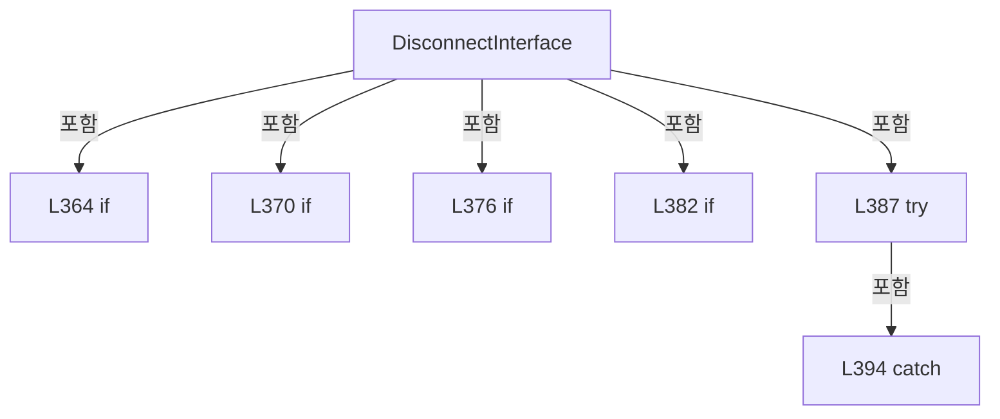

변경 전 점검: 입력/반환 타입, 위 호출자, 예외/취소 경로, 공유 상태와 저장·전송 소비자를 함께 확인합니다. 값의 단위나 물리 방향을 이름만으로 확정하지 않습니다.

### MethodDeclaration `Save` · L403–466

[Drilling.UI/Menu/Menus/CMenuSetting.cs:403–466](https://github.com/kjuws10-rgb/A3Drilling/blob/28764c91d521777b8ee068dd7aaf2d3902ce9fe2/Drilling.UI/Menu/Menus/CMenuSetting.cs#L403-L466)

| 항목 | 실제 추출 값 |
| --- | --- |
| 서명 | System.Threading.Tasks.Task Drilling.UI.Menu.Menus.CMenuSetting.Save() |
| 접근/수식자 | Private / private, async |
| 반환/값 타입 | System.Threading.Tasks.Task |
| 소속 타입 | NamedType:Drilling.UI.Menu.Menus.CMenuSetting |

정적 호출자로 확인된 위치:

| 호출 파일/행 | 호출 표현식 | 런타임 분기 가능 |
| --- | --- | --- |
| [Drilling.UI/Menu/Menus/CMenuSetting.cs:95–95](https://github.com/kjuws10-rgb/A3Drilling/blob/28764c91d521777b8ee068dd7aaf2d3902ce9fe2/Drilling.UI/Menu/Menus/CMenuSetting.cs#L95-L95) | Save | False |

호출하는 대상과 해석 범위:

| 원본 행 | 표현식 | 분석 상태 | 대상/소스 위치 |
| --- | --- | --- | --- |
| 406 | CRecipeConfirmDialog.ShowConfirmation | resolved | bool Drilling.UI.Popup.CRecipeConfirmDialog.ShowConfirmation(string, string, string, bool) · Drilling.UI/Popup/CRecipeConfirmDialog.xaml.cs:11 |
| 415 | _settingManager.SaveInterfaceList | resolved | System.Threading.Tasks.Task Drilling.Common.Managers.CSettingManager.SaveInterfaceList(System.Collections.Generic.IReadOnlyList<Drilling.Common.Interface.ST_INTERFACE_DATA>, System.Threading.CancellationToken) · Drilling.Common/Managers/CSettingManager.cs:168 |
| 415 | ToInterfaceData | resolved | System.Collections.Generic.IReadOnlyList<Drilling.Common.Interface.ST_INTERFACE_DATA> Drilling.UI.Menu.Menus.CMenuSetting.ToInterfaceData(System.Collections.Generic.IReadOnlyList<Drilling.UI.Menu.Menus.ST_SETTING_INTERFACE_ROW>) · Drilling.UI/Menu/Menus/CMenuSetting.cs:886 |
| 419 | _setStatusMessage | resolved · 동적 구현 선택 가능 | void System.Action<string>.Invoke(string) |
| 424 | _setStatusMessage | resolved · 동적 구현 선택 가능 | void System.Action<string>.Invoke(string) |
| 428 | _setStatusMessage | resolved · 동적 구현 선택 가능 | void System.Action<string>.Invoke(string) |
| 429 | _showLoadingScreen | resolved · 동적 구현 선택 가능 | void System.Action<Drilling.UI.Menu.Menus.EN_MENU, string>.Invoke(Drilling.UI.Menu.Menus.EN_MENU, string) |
| 430 | _refreshShellStatus | resolved · 동적 구현 선택 가능 | void System.Action.Invoke() |
| 431 | _refreshCurrentScreen | resolved · 동적 구현 선택 가능 | System.Threading.Tasks.Task System.Func<System.Threading.Tasks.Task>.Invoke() |
| 432 | CRecipeConfirmDialog.ShowCompletion | resolved | void Drilling.UI.Popup.CRecipeConfirmDialog.ShowCompletion(string, string, Window?) · Drilling.UI/Popup/CRecipeConfirmDialog.xaml.cs:81 |
| 436 | ToSection | resolved | Drilling.Common.Managers.EN_SETTING_TAB Drilling.UI.Menu.Menus.CMenuSetting.ToSection(string) · Drilling.UI/Menu/Menus/CMenuSetting.cs:1057 |
| 442 | AllParameterRows.Select(BuildSystem).ToArray | resolved | Drilling.Common.Managers.ST_SYSTEM_PARAMETER[] System.Collections.Generic.IEnumerable<Drilling.Common.Managers.ST_SYSTEM_PARAMETER>.ToArray<Drilling.Common.Managers.ST_SYSTEM_PARAMETER>() |
| 442 | AllParameterRows.Select | resolved | System.Collections.Generic.IEnumerable<Drilling.Common.Managers.ST_SYSTEM_PARAMETER> System.Collections.Generic.IEnumerable<Drilling.UI.Menu.Menus.ST_SYSTEM_PARAMETER_ROW>.Select<Drilling.UI.Menu.Menus.ST_SYSTEM_PARAMETER_ROW, Drilling.Common.Managers.ST_SYSTEM_PARAMETER>(System.Func<Drilling.UI.Menu.Menus.ST_SYSTEM_PARAMETER_ROW, Drilling.Common.Managers.ST_SYSTEM_PARAMETER>) |
| 445 | _settingManager.SaveSection | resolved | void Drilling.Common.Managers.CSettingManager.SaveSection(Drilling.Common.Managers.EN_SETTING_TAB, System.Collections.Generic.IReadOnlyList<Drilling.Common.Managers.ST_SYSTEM_PARAMETER>, System.Threading.CancellationToken) · Drilling.Common/Managers/CSettingManager.cs:126 |
| 449 | _setStatusMessage | resolved · 동적 구현 선택 가능 | void System.Action<string>.Invoke(string) |
| 450 | CRecipeConfirmDialog.ShowWarning | resolved | void Drilling.UI.Popup.CRecipeConfirmDialog.ShowWarning(string, string, Window?) · Drilling.UI/Popup/CRecipeConfirmDialog.xaml.cs:86 |
| 457 | _setStatusMessage | resolved · 동적 구현 선택 가능 | void System.Action<string>.Invoke(string) |
| 461 | _setStatusMessage | resolved · 동적 구현 선택 가능 | void System.Action<string>.Invoke(string) |
| 462 | _showLoadingScreen | resolved · 동적 구현 선택 가능 | void System.Action<Drilling.UI.Menu.Menus.EN_MENU, string>.Invoke(Drilling.UI.Menu.Menus.EN_MENU, string) |
| 463 | _refreshShellStatus | resolved · 동적 구현 선택 가능 | void System.Action.Invoke() |
| 464 | _refreshCurrentScreen | resolved · 동적 구현 선택 가능 | System.Threading.Tasks.Task System.Func<System.Threading.Tasks.Task>.Invoke() |
| 465 | CRecipeConfirmDialog.ShowCompletion | resolved | void Drilling.UI.Popup.CRecipeConfirmDialog.ShowCompletion(string, string, Window?) · Drilling.UI/Popup/CRecipeConfirmDialog.xaml.cs:81 |

본문의 실제 연산·분기·예외·반환 순서(원문 위치 순):

| 원본 행 | 종류 | 주석 해설 |
| --- | --- | --- |
| 405 | conditional-expression | 조건에 따라 결과식을 선택합니다: SelectedTab == "INTERFACE" ? "인터페이스 설정" : $"{SelectedTab} / {SelectedGroup} 설정" |
| 405 | local-declaration | 지역 변수를 선언합니다: var target = SelectedTab == "INTERFACE" ? "인터페이스 설정" : $"{SelectedTab} / {SelectedGroup} 설정"; |
| 405 | variable-initializer | 변수의 초기값을 지정합니다: target = SelectedTab == "INTERFACE" ? "인터페이스 설정" : $"{SelectedTab} / {SelectedGroup} 설정" |
| 406 | call | 함수·델리게이트 또는 객체 생성자를 호출합니다: CRecipeConfirmDialog.ShowConfirmation("설정 저장", $"{target}을 저장하시겠습니까?") |
| 406 | if | 조건에 따라 분기합니다: if (!CRecipeConfirmDialog.ShowConfirmation("설정 저장", $"{target}을 저장하시겠습니까?")) |
| 408 | return | 호출자에게 값 또는 제어를 반환합니다: return; |
| 411 | if | 조건에 따라 분기합니다: if (SelectedTab == "INTERFACE") |
| 413 | try | 예외 처리 범위입니다: try |
| 415 | await | 비동기 완료를 기다립니다: await _settingManager.SaveInterfaceList(ToInterfaceData(AllInterfaceRows)) |
| 415 | call | 함수·델리게이트 또는 객체 생성자를 호출합니다: _settingManager.SaveInterfaceList(ToInterfaceData(AllInterfaceRows)) |
| 415 | call | 함수·델리게이트 또는 객체 생성자를 호출합니다: ToInterfaceData(AllInterfaceRows) |
| 417 | catch | 지정 예외를 처리합니다: catch (InvalidDataException exception) |
| 419 | call | 함수·델리게이트 또는 객체 생성자를 호출합니다: _setStatusMessage(exception.Message) |
| 420 | return | 호출자에게 값 또는 제어를 반환합니다: return; |
| 422 | catch | 지정 예외를 처리합니다: catch (IOException exception) |
| 424 | call | 함수·델리게이트 또는 객체 생성자를 호출합니다: _setStatusMessage($"JHMI_INTERFACE save blocked. {exception.Message}") |
| 425 | return | 호출자에게 값 또는 제어를 반환합니다: return; |
| 428 | call | 함수·델리게이트 또는 객체 생성자를 호출합니다: _setStatusMessage("JHMI_INTERFACE.csv saved, verified, and reloaded to InterfaceManager.") |
| 429 | call | 함수·델리게이트 또는 객체 생성자를 호출합니다: _showLoadingScreen(EN_MENU.Setting, "SETTING") |
| 430 | call | 함수·델리게이트 또는 객체 생성자를 호출합니다: _refreshShellStatus() |
| 431 | await | 비동기 완료를 기다립니다: await _refreshCurrentScreen() |
| 431 | call | 함수·델리게이트 또는 객체 생성자를 호출합니다: _refreshCurrentScreen() |
| 432 | call | 함수·델리게이트 또는 객체 생성자를 호출합니다: CRecipeConfirmDialog.ShowCompletion("설정 저장 완료", "인터페이스 설정을 저장하였습니다.") |
| 433 | return | 호출자에게 값 또는 제어를 반환합니다: return; |
| 436 | call | 함수·델리게이트 또는 객체 생성자를 호출합니다: ToSection(SelectedTab) |
| 436 | local-declaration | 지역 변수를 선언합니다: var section = ToSection(SelectedTab); |
| 436 | variable-initializer | 변수의 초기값을 지정합니다: section = ToSection(SelectedTab) |
| 442 | call | 함수·델리게이트 또는 객체 생성자를 호출합니다: AllParameterRows.Select(BuildSystem).ToArray() |
| 442 | call | 함수·델리게이트 또는 객체 생성자를 호출합니다: AllParameterRows.Select(BuildSystem) |
| 442 | local-declaration | 지역 변수를 선언합니다: var parameters = AllParameterRows.Select(BuildSystem).ToArray(); |
| 442 | variable-initializer | 변수의 초기값을 지정합니다: parameters = AllParameterRows.Select(BuildSystem).ToArray() |
| 443 | try | 예외 처리 범위입니다: try |
| 445 | call | 함수·델리게이트 또는 객체 생성자를 호출합니다: _settingManager.SaveSection(section, parameters) |
| 447 | catch | 지정 예외를 처리합니다: catch (InvalidDataException exception) |
| 449 | call | 함수·델리게이트 또는 객체 생성자를 호출합니다: _setStatusMessage(exception.Message) |
| 450 | call | 함수·델리게이트 또는 객체 생성자를 호출합니다: CRecipeConfirmDialog.ShowWarning( "설정 저장 불가", $"입력값이 올바르지 않아 설정을 저장하지 않았습니다.\n\n{exception.Message}") |
| 453 | return | 호출자에게 값 또는 제어를 반환합니다: return; |
| 455 | catch | 지정 예외를 처리합니다: catch (IOException exception) |
| 457 | call | 함수·델리게이트 또는 객체 생성자를 호출합니다: _setStatusMessage($"Setting save blocked. {exception.Message}") |
| 458 | return | 호출자에게 값 또는 제어를 반환합니다: return; |
| 461 | call | 함수·델리게이트 또는 객체 생성자를 호출합니다: _setStatusMessage($"Setting.csv saved for {SelectedTab} and CSV verified.") |
| 462 | call | 함수·델리게이트 또는 객체 생성자를 호출합니다: _showLoadingScreen(EN_MENU.Setting, "SETTING") |
| 463 | call | 함수·델리게이트 또는 객체 생성자를 호출합니다: _refreshShellStatus() |
| 464 | await | 비동기 완료를 기다립니다: await _refreshCurrentScreen() |
| 464 | call | 함수·델리게이트 또는 객체 생성자를 호출합니다: _refreshCurrentScreen() |
| 465 | call | 함수·델리게이트 또는 객체 생성자를 호출합니다: CRecipeConfirmDialog.ShowCompletion("설정 저장 완료", $"{SelectedTab} 설정을 저장하였습니다.") |

제어 구문의 포함 구조(실제 실행 순서/CFG가 아닌 구문 탐색 그림):

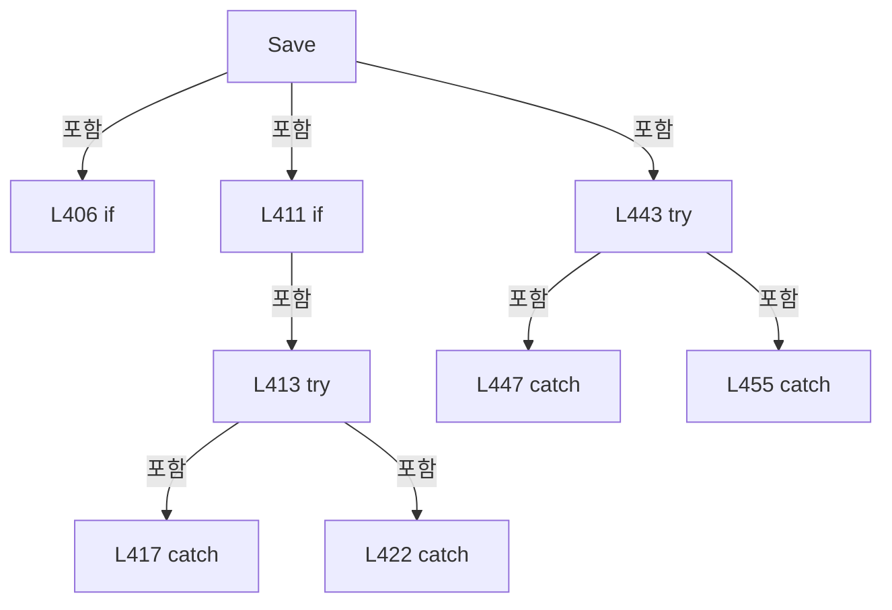

변경 전 점검: 입력/반환 타입, 위 호출자, 예외/취소 경로, 공유 상태와 저장·전송 소비자를 함께 확인합니다. 값의 단위나 물리 방향을 이름만으로 확정하지 않습니다.

### LocalFunctionStatement `BuildSystem` · L437–440

[Drilling.UI/Menu/Menus/CMenuSetting.cs:437–440](https://github.com/kjuws10-rgb/A3Drilling/blob/28764c91d521777b8ee068dd7aaf2d3902ce9fe2/Drilling.UI/Menu/Menus/CMenuSetting.cs#L437-L440)

| 항목 | 실제 추출 값 |
| --- | --- |
| 서명 | Drilling.Common.Managers.ST_SYSTEM_PARAMETER BuildSystem(Drilling.UI.Menu.Menus.ST_SYSTEM_PARAMETER_ROW) |
| 접근/수식자 | Private /  |
| 반환/값 타입 | Drilling.Common.Managers.ST_SYSTEM_PARAMETER |
| 소속 타입 | NamedType:Drilling.UI.Menu.Menus.CMenuSetting |

입력 계약:

| 이름 | 타입 | 전달 | 선택/기본값 |
| --- | --- | --- | --- |
| row | Drilling.UI.Menu.Menus.ST_SYSTEM_PARAMETER_ROW | None | False /  |

현재 부분 분석에서 직접 연결된 호출자는 없습니다. XAML/이벤트/인터페이스·델리게이트·외부 진입을 추가 확인해야 하며, 미사용으로 판정한 것이 아닙니다.

호출하는 대상과 해석 범위:

| 원본 행 | 표현식 | 분석 상태 | 대상/소스 위치 |
| --- | --- | --- | --- |
| 439 | new ST_SYSTEM_PARAMETER | resolved | Drilling.Common.Managers.ST_SYSTEM_PARAMETER.ST_SYSTEM_PARAMETER(Drilling.Common.Managers.EN_SETTING_TAB, string, string, string, string, string, string, string, Drilling.Common.Managers.EN_RECIPE_DATA_TYPE, double, double, bool, bool, int, System.Collections.Generic.IReadOnlyDictionary<string, string>?) · Drilling.Common/Managers/CSettingManager.cs:263 |
| 439 | NormalizeSettingUnit | resolved | string Drilling.UI.Menu.Menus.CMenuSetting.NormalizeSettingUnit(string) · Drilling.UI/Menu/Menus/CMenuSetting.cs:1046 |

본문의 실제 연산·분기·예외·반환 순서(원문 위치 순):

| 원본 행 | 종류 | 주석 해설 |
| --- | --- | --- |
| 439 | call | 함수·델리게이트 또는 객체 생성자를 호출합니다: new ST_SYSTEM_PARAMETER(section, row.Parameter, row.Value, NormalizeSettingUnit(row.Unit), row.Description, row.Group, row.Key, row.DefaultValue, row.DataType, row.Min, row.Max) |
| 439 | call | 함수·델리게이트 또는 객체 생성자를 호출합니다: NormalizeSettingUnit(row.Unit) |
| 439 | return | 호출자에게 값 또는 제어를 반환합니다: return new ST_SYSTEM_PARAMETER(section, row.Parameter, row.Value, NormalizeSettingUnit(row.Unit), row.Description, row.Group, row.Key, row.DefaultValue, row.DataType, row.Min, row.Max); |

변경 전 점검: 입력/반환 타입, 위 호출자, 예외/취소 경로, 공유 상태와 저장·전송 소비자를 함께 확인합니다. 값의 단위나 물리 방향을 이름만으로 확정하지 않습니다.

### MethodDeclaration `Cancel` · L468–485

[Drilling.UI/Menu/Menus/CMenuSetting.cs:468–485](https://github.com/kjuws10-rgb/A3Drilling/blob/28764c91d521777b8ee068dd7aaf2d3902ce9fe2/Drilling.UI/Menu/Menus/CMenuSetting.cs#L468-L485)

| 항목 | 실제 추출 값 |
| --- | --- |
| 서명 | System.Threading.Tasks.Task Drilling.UI.Menu.Menus.CMenuSetting.Cancel() |
| 접근/수식자 | Private / private, async |
| 반환/값 타입 | System.Threading.Tasks.Task |
| 소속 타입 | NamedType:Drilling.UI.Menu.Menus.CMenuSetting |

정적 호출자로 확인된 위치:

| 호출 파일/행 | 호출 표현식 | 런타임 분기 가능 |
| --- | --- | --- |
| [Drilling.UI/Menu/Menus/CMenuSetting.cs:101–101](https://github.com/kjuws10-rgb/A3Drilling/blob/28764c91d521777b8ee068dd7aaf2d3902ce9fe2/Drilling.UI/Menu/Menus/CMenuSetting.cs#L101-L101) | Cancel | False |

호출하는 대상과 해석 범위:

| 원본 행 | 표현식 | 분석 상태 | 대상/소스 위치 |
| --- | --- | --- | --- |
| 470 | CRecipeConfirmDialog.ShowConfirmation | resolved | bool Drilling.UI.Popup.CRecipeConfirmDialog.ShowConfirmation(string, string, string, bool) · Drilling.UI/Popup/CRecipeConfirmDialog.xaml.cs:11 |
| 475 | _showLoadingScreen | resolved · 동적 구현 선택 가능 | void System.Action<Drilling.UI.Menu.Menus.EN_MENU, string>.Invoke(Drilling.UI.Menu.Menus.EN_MENU, string) |
| 476 | TryReloadSelectedTabFromCsv | resolved | bool Drilling.UI.Menu.Menus.CMenuSetting.TryReloadSelectedTabFromCsv() · Drilling.UI/Menu/Menus/CMenuSetting.cs:506 |
| 478 | _refreshCurrentScreen | resolved · 동적 구현 선택 가능 | System.Threading.Tasks.Task System.Func<System.Threading.Tasks.Task>.Invoke() |
| 482 | _setStatusMessage | resolved · 동적 구현 선택 가능 | void System.Action<string>.Invoke(string) |
| 483 | _refreshShellStatus | resolved · 동적 구현 선택 가능 | void System.Action.Invoke() |
| 484 | _refreshCurrentScreen | resolved · 동적 구현 선택 가능 | System.Threading.Tasks.Task System.Func<System.Threading.Tasks.Task>.Invoke() |

본문의 실제 연산·분기·예외·반환 순서(원문 위치 순):

| 원본 행 | 종류 | 주석 해설 |
| --- | --- | --- |
| 470 | call | 함수·델리게이트 또는 객체 생성자를 호출합니다: CRecipeConfirmDialog.ShowConfirmation("인터페이스 변경 취소", "저장하지 않은 인터페이스 변경 내용을 취소하시겠습니까?") |
| 470 | if | 조건에 따라 분기합니다: if (IsInterfaceTab && !CRecipeConfirmDialog.ShowConfirmation("인터페이스 변경 취소", "저장하지 않은 인터페이스 변경 내용을 취소하시겠습니까?")) |
| 472 | return | 호출자에게 값 또는 제어를 반환합니다: return; |
| 475 | call | 함수·델리게이트 또는 객체 생성자를 호출합니다: _showLoadingScreen(EN_MENU.Setting, "SETTING") |
| 476 | call | 함수·델리게이트 또는 객체 생성자를 호출합니다: TryReloadSelectedTabFromCsv() |
| 476 | if | 조건에 따라 분기합니다: if (!TryReloadSelectedTabFromCsv()) |
| 478 | await | 비동기 완료를 기다립니다: await _refreshCurrentScreen() |
| 478 | call | 함수·델리게이트 또는 객체 생성자를 호출합니다: _refreshCurrentScreen() |
| 479 | return | 호출자에게 값 또는 제어를 반환합니다: return; |
| 482 | call | 함수·델리게이트 또는 객체 생성자를 호출합니다: _setStatusMessage($"Setting edits canceled. Reloaded {SelectedTab} / {SelectedGroup} from CSV.") |
| 483 | call | 함수·델리게이트 또는 객체 생성자를 호출합니다: _refreshShellStatus() |
| 484 | await | 비동기 완료를 기다립니다: await _refreshCurrentScreen() |
| 484 | call | 함수·델리게이트 또는 객체 생성자를 호출합니다: _refreshCurrentScreen() |

제어 구문의 포함 구조(실제 실행 순서/CFG가 아닌 구문 탐색 그림):

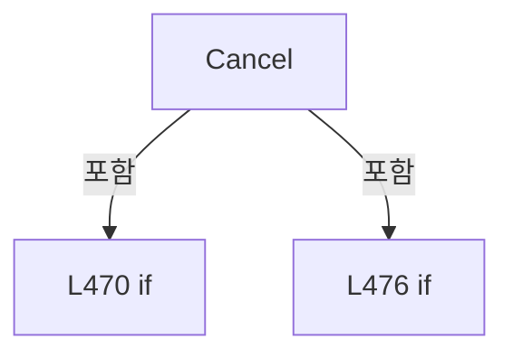

변경 전 점검: 입력/반환 타입, 위 호출자, 예외/취소 경로, 공유 상태와 저장·전송 소비자를 함께 확인합니다. 값의 단위나 물리 방향을 이름만으로 확정하지 않습니다.

### MethodDeclaration `Reload` · L487–504

[Drilling.UI/Menu/Menus/CMenuSetting.cs:487–504](https://github.com/kjuws10-rgb/A3Drilling/blob/28764c91d521777b8ee068dd7aaf2d3902ce9fe2/Drilling.UI/Menu/Menus/CMenuSetting.cs#L487-L504)

| 항목 | 실제 추출 값 |
| --- | --- |
| 서명 | System.Threading.Tasks.Task Drilling.UI.Menu.Menus.CMenuSetting.Reload() |
| 접근/수식자 | Private / private, async |
| 반환/값 타입 | System.Threading.Tasks.Task |
| 소속 타입 | NamedType:Drilling.UI.Menu.Menus.CMenuSetting |

정적 호출자로 확인된 위치:

| 호출 파일/행 | 호출 표현식 | 런타임 분기 가능 |
| --- | --- | --- |
| [Drilling.UI/Menu/Menus/CMenuSetting.cs:107–107](https://github.com/kjuws10-rgb/A3Drilling/blob/28764c91d521777b8ee068dd7aaf2d3902ce9fe2/Drilling.UI/Menu/Menus/CMenuSetting.cs#L107-L107) | Reload | False |

호출하는 대상과 해석 범위:

| 원본 행 | 표현식 | 분석 상태 | 대상/소스 위치 |
| --- | --- | --- | --- |
| 489 | CRecipeConfirmDialog.ShowConfirmation | resolved | bool Drilling.UI.Popup.CRecipeConfirmDialog.ShowConfirmation(string, string, string, bool) · Drilling.UI/Popup/CRecipeConfirmDialog.xaml.cs:11 |
| 494 | _showLoadingScreen | resolved · 동적 구현 선택 가능 | void System.Action<Drilling.UI.Menu.Menus.EN_MENU, string>.Invoke(Drilling.UI.Menu.Menus.EN_MENU, string) |
| 495 | TryReloadSelectedTabFromCsv | resolved | bool Drilling.UI.Menu.Menus.CMenuSetting.TryReloadSelectedTabFromCsv() · Drilling.UI/Menu/Menus/CMenuSetting.cs:506 |
| 497 | _refreshCurrentScreen | resolved · 동적 구현 선택 가능 | System.Threading.Tasks.Task System.Func<System.Threading.Tasks.Task>.Invoke() |
| 501 | _setStatusMessage | resolved · 동적 구현 선택 가능 | void System.Action<string>.Invoke(string) |
| 502 | _refreshShellStatus | resolved · 동적 구현 선택 가능 | void System.Action.Invoke() |
| 503 | _refreshCurrentScreen | resolved · 동적 구현 선택 가능 | System.Threading.Tasks.Task System.Func<System.Threading.Tasks.Task>.Invoke() |

본문의 실제 연산·분기·예외·반환 순서(원문 위치 순):

| 원본 행 | 종류 | 주석 해설 |
| --- | --- | --- |
| 489 | call | 함수·델리게이트 또는 객체 생성자를 호출합니다: CRecipeConfirmDialog.ShowConfirmation("설정 다시 불러오기", "저장하지 않은 변경 내용은 사라집니다. CSV 설정을 다시 불러오시겠습니까?") |
| 489 | if | 조건에 따라 분기합니다: if (!CRecipeConfirmDialog.ShowConfirmation("설정 다시 불러오기", "저장하지 않은 변경 내용은 사라집니다. CSV 설정을 다시 불러오시겠습니까?")) |
| 491 | return | 호출자에게 값 또는 제어를 반환합니다: return; |
| 494 | call | 함수·델리게이트 또는 객체 생성자를 호출합니다: _showLoadingScreen(EN_MENU.Setting, "SETTING") |
| 495 | call | 함수·델리게이트 또는 객체 생성자를 호출합니다: TryReloadSelectedTabFromCsv() |
| 495 | if | 조건에 따라 분기합니다: if (!TryReloadSelectedTabFromCsv()) |
| 497 | await | 비동기 완료를 기다립니다: await _refreshCurrentScreen() |
| 497 | call | 함수·델리게이트 또는 객체 생성자를 호출합니다: _refreshCurrentScreen() |
| 498 | return | 호출자에게 값 또는 제어를 반환합니다: return; |
| 501 | call | 함수·델리게이트 또는 객체 생성자를 호출합니다: _setStatusMessage($"Setting {SelectedTab} / {SelectedGroup} reloaded from CSV.") |
| 502 | call | 함수·델리게이트 또는 객체 생성자를 호출합니다: _refreshShellStatus() |
| 503 | await | 비동기 완료를 기다립니다: await _refreshCurrentScreen() |
| 503 | call | 함수·델리게이트 또는 객체 생성자를 호출합니다: _refreshCurrentScreen() |

제어 구문의 포함 구조(실제 실행 순서/CFG가 아닌 구문 탐색 그림):

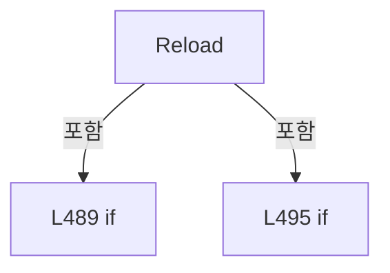

변경 전 점검: 입력/반환 타입, 위 호출자, 예외/취소 경로, 공유 상태와 저장·전송 소비자를 함께 확인합니다. 값의 단위나 물리 방향을 이름만으로 확정하지 않습니다.

### MethodDeclaration `TryReloadSelectedTabFromCsv` · L506–529

[Drilling.UI/Menu/Menus/CMenuSetting.cs:506–529](https://github.com/kjuws10-rgb/A3Drilling/blob/28764c91d521777b8ee068dd7aaf2d3902ce9fe2/Drilling.UI/Menu/Menus/CMenuSetting.cs#L506-L529)

| 항목 | 실제 추출 값 |
| --- | --- |
| 서명 | bool Drilling.UI.Menu.Menus.CMenuSetting.TryReloadSelectedTabFromCsv() |
| 접근/수식자 | Private / private |
| 반환/값 타입 | bool |
| 소속 타입 | NamedType:Drilling.UI.Menu.Menus.CMenuSetting |

정적 호출자로 확인된 위치:

| 호출 파일/행 | 호출 표현식 | 런타임 분기 가능 |
| --- | --- | --- |
| [Drilling.UI/Menu/Menus/CMenuSetting.cs:476–476](https://github.com/kjuws10-rgb/A3Drilling/blob/28764c91d521777b8ee068dd7aaf2d3902ce9fe2/Drilling.UI/Menu/Menus/CMenuSetting.cs#L476-L476) | TryReloadSelectedTabFromCsv | False |
| [Drilling.UI/Menu/Menus/CMenuSetting.cs:495–495](https://github.com/kjuws10-rgb/A3Drilling/blob/28764c91d521777b8ee068dd7aaf2d3902ce9fe2/Drilling.UI/Menu/Menus/CMenuSetting.cs#L495-L495) | TryReloadSelectedTabFromCsv | False |

호출하는 대상과 해석 범위:

| 원본 행 | 표현식 | 분석 상태 | 대상/소스 위치 |
| --- | --- | --- | --- |
| 508 | SelectedTab.Equals | resolved | bool string.Equals(string?, System.StringComparison) |
| 513 | ToSection | resolved | Drilling.Common.Managers.EN_SETTING_TAB Drilling.UI.Menu.Menus.CMenuSetting.ToSection(string) · Drilling.UI/Menu/Menus/CMenuSetting.cs:1057 |
| 516 | _settingManager.ReloadSection | resolved | System.Collections.Generic.IReadOnlyList<Drilling.Common.Managers.ST_SYSTEM_PARAMETER> Drilling.Common.Managers.CSettingManager.ReloadSection(Drilling.Common.Managers.EN_SETTING_TAB, System.Threading.CancellationToken) · Drilling.Common/Managers/CSettingManager.cs:40 |
| 521 | _setStatusMessage | resolved · 동적 구현 선택 가능 | void System.Action<string>.Invoke(string) |
| 526 | _setStatusMessage | resolved · 동적 구현 선택 가능 | void System.Action<string>.Invoke(string) |

본문의 실제 연산·분기·예외·반환 순서(원문 위치 순):

| 원본 행 | 종류 | 주석 해설 |
| --- | --- | --- |
| 508 | call | 함수·델리게이트 또는 객체 생성자를 호출합니다: SelectedTab.Equals("INTERFACE", StringComparison.OrdinalIgnoreCase) |
| 508 | if | 조건에 따라 분기합니다: if (SelectedTab.Equals("INTERFACE", StringComparison.OrdinalIgnoreCase)) |
| 510 | return | 호출자에게 값 또는 제어를 반환합니다: return true; |
| 513 | call | 함수·델리게이트 또는 객체 생성자를 호출합니다: ToSection(SelectedTab) |
| 513 | local-declaration | 지역 변수를 선언합니다: var section = ToSection(SelectedTab); |
| 513 | variable-initializer | 변수의 초기값을 지정합니다: section = ToSection(SelectedTab) |
| 514 | try | 예외 처리 범위입니다: try |
| 516 | call | 함수·델리게이트 또는 객체 생성자를 호출합니다: _settingManager.ReloadSection(section) |
| 517 | return | 호출자에게 값 또는 제어를 반환합니다: return true; |
| 519 | catch | 지정 예외를 처리합니다: catch (InvalidDataException exception) |
| 521 | call | 함수·델리게이트 또는 객체 생성자를 호출합니다: _setStatusMessage($"Setting reload blocked. {exception.Message}") |
| 522 | return | 호출자에게 값 또는 제어를 반환합니다: return false; |
| 524 | catch | 지정 예외를 처리합니다: catch (IOException exception) |
| 526 | call | 함수·델리게이트 또는 객체 생성자를 호출합니다: _setStatusMessage($"Setting reload blocked. {exception.Message}") |
| 527 | return | 호출자에게 값 또는 제어를 반환합니다: return false; |

제어 구문의 포함 구조(실제 실행 순서/CFG가 아닌 구문 탐색 그림):

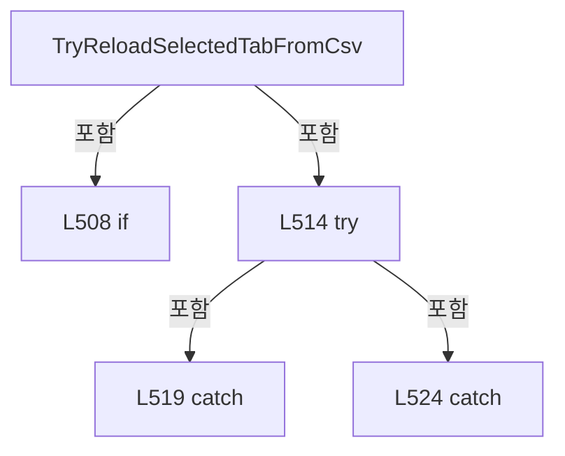

변경 전 점검: 입력/반환 타입, 위 호출자, 예외/취소 경로, 공유 상태와 저장·전송 소비자를 함께 확인합니다. 값의 단위나 물리 방향을 이름만으로 확정하지 않습니다.

### MethodDeclaration `SelectHeadFilter` · L531–542

[Drilling.UI/Menu/Menus/CMenuSetting.cs:531–542](https://github.com/kjuws10-rgb/A3Drilling/blob/28764c91d521777b8ee068dd7aaf2d3902ce9fe2/Drilling.UI/Menu/Menus/CMenuSetting.cs#L531-L542)

| 항목 | 실제 추출 값 |
| --- | --- |
| 서명 | System.Threading.Tasks.Task Drilling.UI.Menu.Menus.CMenuSetting.SelectHeadFilter(object?) |
| 접근/수식자 | Private / private, async |
| 반환/값 타입 | System.Threading.Tasks.Task |
| 소속 타입 | NamedType:Drilling.UI.Menu.Menus.CMenuSetting |

입력 계약:

| 이름 | 타입 | 전달 | 선택/기본값 |
| --- | --- | --- | --- |
| parameter | object? | None | False /  |

정적 호출자로 확인된 위치:

| 호출 파일/행 | 호출 표현식 | 런타임 분기 가능 |
| --- | --- | --- |
| [Drilling.UI/Menu/Menus/CMenuSetting.cs:67–67](https://github.com/kjuws10-rgb/A3Drilling/blob/28764c91d521777b8ee068dd7aaf2d3902ce9fe2/Drilling.UI/Menu/Menus/CMenuSetting.cs#L67-L67) | SelectHeadFilter | False |

호출하는 대상과 해석 범위:

| 원본 행 | 표현식 | 분석 상태 | 대상/소스 위치 |
| --- | --- | --- | --- |
| 533 | string.IsNullOrWhiteSpace | resolved | bool string.IsNullOrWhiteSpace(string?) |
| 538 | headFilter.Trim().ToUpperInvariant | resolved | string string.ToUpperInvariant() |
| 538 | headFilter.Trim | resolved | string string.Trim() |
| 539 | _setStatusMessage | resolved · 동적 구현 선택 가능 | void System.Action<string>.Invoke(string) |
| 540 | _refreshShellStatus | resolved · 동적 구현 선택 가능 | void System.Action.Invoke() |
| 541 | _refreshCurrentScreen | resolved · 동적 구현 선택 가능 | System.Threading.Tasks.Task System.Func<System.Threading.Tasks.Task>.Invoke() |

본문의 실제 연산·분기·예외·반환 순서(원문 위치 순):

| 원본 행 | 종류 | 주석 해설 |
| --- | --- | --- |
| 533 | call | 함수·델리게이트 또는 객체 생성자를 호출합니다: string.IsNullOrWhiteSpace(headFilter) |
| 533 | if | 조건에 따라 분기합니다: if (parameter is not string headFilter &#124;&#124; string.IsNullOrWhiteSpace(headFilter)) |
| 535 | return | 호출자에게 값 또는 제어를 반환합니다: return; |
| 538 | assignment | 값을 대상에 대입합니다: _selectedHeadFilter = headFilter.Trim().ToUpperInvariant() |
| 538 | call | 함수·델리게이트 또는 객체 생성자를 호출합니다: headFilter.Trim().ToUpperInvariant() |
| 538 | call | 함수·델리게이트 또는 객체 생성자를 호출합니다: headFilter.Trim() |
| 539 | call | 함수·델리게이트 또는 객체 생성자를 호출합니다: _setStatusMessage($"Setting head filter {SelectedTab} / {SelectedGroup} / {_selectedHeadFilter} selected.") |
| 540 | call | 함수·델리게이트 또는 객체 생성자를 호출합니다: _refreshShellStatus() |
| 541 | await | 비동기 완료를 기다립니다: await _refreshCurrentScreen() |
| 541 | call | 함수·델리게이트 또는 객체 생성자를 호출합니다: _refreshCurrentScreen() |

제어 구문의 포함 구조(실제 실행 순서/CFG가 아닌 구문 탐색 그림):

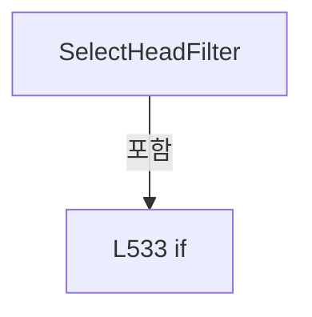

변경 전 점검: 입력/반환 타입, 위 호출자, 예외/취소 경로, 공유 상태와 저장·전송 소비자를 함께 확인합니다. 값의 단위나 물리 방향을 이름만으로 확정하지 않습니다.

### MethodDeclaration `Apply` · L544–576

[Drilling.UI/Menu/Menus/CMenuSetting.cs:544–576](https://github.com/kjuws10-rgb/A3Drilling/blob/28764c91d521777b8ee068dd7aaf2d3902ce9fe2/Drilling.UI/Menu/Menus/CMenuSetting.cs#L544-L576)

| 항목 | 실제 추출 값 |
| --- | --- |
| 서명 | void Drilling.UI.Menu.Menus.CMenuSetting.Apply(System.Collections.Generic.IReadOnlyList<Drilling.UI.Menu.Menus.ST_SCREEN_SECTION>, System.Collections.Generic.IReadOnlyList<Drilling.UI.Menu.Menus.ST_DISPLAY_ITEM>, string, string, string, System.Collections.Generic.IReadOnlyList<Drilling.UI.Menu.Menus.ST_SETTING_TAB>, System.Collections.Generic.IReadOnlyList<Drilling.UI.Menu.Menus.ST_SETTING_GROUP>, System.Collections.Generic.IReadOnlyList<Drilling.UI.Menu.Menus.ST_SETTING_HEAD_FILTER>, System.Collections.Generic.IReadOnlyList<Drilling.UI.Menu.Menus.ST_SYSTEM_PARAMETER_ROW>, System.Collections.Generic.IReadOnlyList<Drilling.UI.Menu.Menus.ST_SYSTEM_PARAMETER_ROW>, System.Collections.Generic.IReadOnlyList<Drilling.UI.Menu.Menus.ST_SETTING_INTERFACE_ROW>, System.Collections.Generic.IReadOnlyList<Drilling.UI.Menu.Menus.ST_SETTING_INTERFACE_ROW>, System.Collections.Generic.IReadOnlyList<Drilling.UI.Menu.Menus.ST_SETTING_HISTORY_ROW>, System.Collections.Generic.IReadOnlyList<Drilling.UI.Menu.Menus.ST_SETTING_SUMMARY_ROW>) |
| 접근/수식자 | Private / private |
| 반환/값 타입 | void |
| 소속 타입 | NamedType:Drilling.UI.Menu.Menus.CMenuSetting |

입력 계약:

| 이름 | 타입 | 전달 | 선택/기본값 |
| --- | --- | --- | --- |
| tabs | System.Collections.Generic.IReadOnlyList<Drilling.UI.Menu.Menus.ST_SCREEN_SECTION> | None | False /  |
| history | System.Collections.Generic.IReadOnlyList<Drilling.UI.Menu.Menus.ST_DISPLAY_ITEM> | None | False /  |
| selectedTab | string | None | False /  |
| selectedGroup | string | None | False /  |
| selectedHeadFilter | string | None | False /  |
| tabItems | System.Collections.Generic.IReadOnlyList<Drilling.UI.Menu.Menus.ST_SETTING_TAB> | None | False /  |
| groupItems | System.Collections.Generic.IReadOnlyList<Drilling.UI.Menu.Menus.ST_SETTING_GROUP> | None | False /  |
| headFilterItems | System.Collections.Generic.IReadOnlyList<Drilling.UI.Menu.Menus.ST_SETTING_HEAD_FILTER> | None | False /  |
| allParameterRows | System.Collections.Generic.IReadOnlyList<Drilling.UI.Menu.Menus.ST_SYSTEM_PARAMETER_ROW> | None | False /  |
| parameterRows | System.Collections.Generic.IReadOnlyList<Drilling.UI.Menu.Menus.ST_SYSTEM_PARAMETER_ROW> | None | False /  |
| allInterfaceRows | System.Collections.Generic.IReadOnlyList<Drilling.UI.Menu.Menus.ST_SETTING_INTERFACE_ROW> | None | False /  |
| interfaceRows | System.Collections.Generic.IReadOnlyList<Drilling.UI.Menu.Menus.ST_SETTING_INTERFACE_ROW> | None | False /  |
| changeHistory | System.Collections.Generic.IReadOnlyList<Drilling.UI.Menu.Menus.ST_SETTING_HISTORY_ROW> | None | False /  |
| summaryRows | System.Collections.Generic.IReadOnlyList<Drilling.UI.Menu.Menus.ST_SETTING_SUMMARY_ROW> | None | False /  |

정적 호출자로 확인된 위치:

| 호출 파일/행 | 호출 표현식 | 런타임 분기 가능 |
| --- | --- | --- |
| [Drilling.UI/Menu/Menus/CMenuSetting.cs:262–277](https://github.com/kjuws10-rgb/A3Drilling/blob/28764c91d521777b8ee068dd7aaf2d3902ce9fe2/Drilling.UI/Menu/Menus/CMenuSetting.cs#L262-L277) | Apply | False |

호출하는 대상과 해석 범위:

| 원본 행 | 표현식 | 분석 상태 | 대상/소스 위치 |
| --- | --- | --- | --- |
| 573 | GetSelectedInterfaceRow | resolved | Drilling.UI.Menu.Menus.ST_SETTING_INTERFACE_ROW? Drilling.UI.Menu.Menus.CMenuSetting.GetSelectedInterfaceRow(System.Collections.Generic.IReadOnlyList<Drilling.UI.Menu.Menus.ST_SETTING_INTERFACE_ROW>, Drilling.UI.Menu.Menus.ST_SETTING_INTERFACE_ROW?) · Drilling.UI/Menu/Menus/CMenuSetting.cs:588 |

본문의 실제 연산·분기·예외·반환 순서(원문 위치 순):

| 원본 행 | 종류 | 주석 해설 |
| --- | --- | --- |
| 561 | assignment | 값을 대상에 대입합니다: Tabs = tabs |
| 562 | assignment | 값을 대상에 대입합니다: History = history |
| 563 | assignment | 값을 대상에 대입합니다: SelectedTab = selectedTab |
| 564 | assignment | 값을 대상에 대입합니다: SelectedGroup = selectedGroup |
| 565 | assignment | 값을 대상에 대입합니다: SelectedHeadFilter = selectedHeadFilter |
| 566 | assignment | 값을 대상에 대입합니다: TabItems = tabItems |
| 567 | assignment | 값을 대상에 대입합니다: GroupItems = groupItems |
| 568 | assignment | 값을 대상에 대입합니다: HeadFilterItems = headFilterItems |
| 569 | assignment | 값을 대상에 대입합니다: AllParameterRows = allParameterRows |
| 570 | assignment | 값을 대상에 대입합니다: ParameterRows = parameterRows |
| 571 | assignment | 값을 대상에 대입합니다: AllInterfaceRows = allInterfaceRows |
| 572 | assignment | 값을 대상에 대입합니다: InterfaceRows = interfaceRows |
| 573 | assignment | 값을 대상에 대입합니다: SelectedInterfaceRow = GetSelectedInterfaceRow(interfaceRows, SelectedInterfaceRow) |
| 573 | call | 함수·델리게이트 또는 객체 생성자를 호출합니다: GetSelectedInterfaceRow(interfaceRows, SelectedInterfaceRow) |
| 574 | assignment | 값을 대상에 대입합니다: ChangeHistory = changeHistory |
| 575 | assignment | 값을 대상에 대입합니다: SummaryRows = summaryRows |

변경 전 점검: 입력/반환 타입, 위 호출자, 예외/취소 경로, 공유 상태와 저장·전송 소비자를 함께 확인합니다. 값의 단위나 물리 방향을 이름만으로 확정하지 않습니다.

### MethodDeclaration `GetEditRows` · L578–581

[Drilling.UI/Menu/Menus/CMenuSetting.cs:578–581](https://github.com/kjuws10-rgb/A3Drilling/blob/28764c91d521777b8ee068dd7aaf2d3902ce9fe2/Drilling.UI/Menu/Menus/CMenuSetting.cs#L578-L581)

| 항목 | 실제 추출 값 |
| --- | --- |
| 서명 | System.Collections.Generic.IReadOnlyList<Drilling.UI.Menu.Menus.ST_SYSTEM_PARAMETER_ROW> Drilling.UI.Menu.Menus.CMenuSetting.GetEditRows(System.Collections.Generic.IReadOnlyList<Drilling.UI.Menu.Menus.ST_SYSTEM_PARAMETER_ROW>, Drilling.UI.Menu.Menus.CMenuSetting?, string) |
| 접근/수식자 | Private / private, static |
| 반환/값 타입 | System.Collections.Generic.IReadOnlyList<Drilling.UI.Menu.Menus.ST_SYSTEM_PARAMETER_ROW> |
| 소속 타입 | NamedType:Drilling.UI.Menu.Menus.CMenuSetting |

입력 계약:

| 이름 | 타입 | 전달 | 선택/기본값 |
| --- | --- | --- | --- |
| loadedRows | System.Collections.Generic.IReadOnlyList<Drilling.UI.Menu.Menus.ST_SYSTEM_PARAMETER_ROW> | None | False /  |
| editScreen | Drilling.UI.Menu.Menus.CMenuSetting? | None | False /  |
| selectedTab | string | None | False /  |

정적 호출자로 확인된 위치:

| 호출 파일/행 | 호출 표현식 | 런타임 분기 가능 |
| --- | --- | --- |
| [Drilling.UI/Menu/Menus/CMenuSetting.cs:235–235](https://github.com/kjuws10-rgb/A3Drilling/blob/28764c91d521777b8ee068dd7aaf2d3902ce9fe2/Drilling.UI/Menu/Menus/CMenuSetting.cs#L235-L235) | GetEditRows | False |

호출하는 대상과 해석 범위:

| 원본 행 | 표현식 | 분석 상태 | 대상/소스 위치 |
| --- | --- | --- | --- |
| 580 | editScreen.SelectedTab.Equals | resolved | bool string.Equals(string?, System.StringComparison) |

본문의 실제 연산·분기·예외·반환 순서(원문 위치 순):

| 원본 행 | 종류 | 주석 해설 |
| --- | --- | --- |
| 580 | call | 함수·델리게이트 또는 객체 생성자를 호출합니다: editScreen.SelectedTab.Equals(selectedTab, StringComparison.OrdinalIgnoreCase) |
| 580 | conditional-expression | 조건에 따라 결과식을 선택합니다: editScreen is not null && editScreen.SelectedTab.Equals(selectedTab, StringComparison.OrdinalIgnoreCase) && editScreen.AllParameterRows.Count > 0 ? editScreen.AllParameterRows : loadedRows |
| 580 | return | 호출자에게 값 또는 제어를 반환합니다: return editScreen is not null && editScreen.SelectedTab.Equals(selectedTab, StringComparison.OrdinalIgnoreCase) && editScreen.AllParameterRows.Count > 0 ? editScreen.AllParameterRows : loadedRows; |

변경 전 점검: 입력/반환 타입, 위 호출자, 예외/취소 경로, 공유 상태와 저장·전송 소비자를 함께 확인합니다. 값의 단위나 물리 방향을 이름만으로 확정하지 않습니다.

### MethodDeclaration `GetEditInterfaceRows` · L583–586

[Drilling.UI/Menu/Menus/CMenuSetting.cs:583–586](https://github.com/kjuws10-rgb/A3Drilling/blob/28764c91d521777b8ee068dd7aaf2d3902ce9fe2/Drilling.UI/Menu/Menus/CMenuSetting.cs#L583-L586)

| 항목 | 실제 추출 값 |
| --- | --- |
| 서명 | System.Collections.Generic.IReadOnlyList<Drilling.UI.Menu.Menus.ST_SETTING_INTERFACE_ROW> Drilling.UI.Menu.Menus.CMenuSetting.GetEditInterfaceRows(System.Collections.Generic.IReadOnlyList<Drilling.UI.Menu.Menus.ST_SETTING_INTERFACE_ROW>, Drilling.UI.Menu.Menus.CMenuSetting?, string) |
| 접근/수식자 | Private / private, static |
| 반환/값 타입 | System.Collections.Generic.IReadOnlyList<Drilling.UI.Menu.Menus.ST_SETTING_INTERFACE_ROW> |
| 소속 타입 | NamedType:Drilling.UI.Menu.Menus.CMenuSetting |

입력 계약:

| 이름 | 타입 | 전달 | 선택/기본값 |
| --- | --- | --- | --- |
| loadedRows | System.Collections.Generic.IReadOnlyList<Drilling.UI.Menu.Menus.ST_SETTING_INTERFACE_ROW> | None | False /  |
| editScreen | Drilling.UI.Menu.Menus.CMenuSetting? | None | False /  |
| selectedTab | string | None | False /  |

정적 호출자로 확인된 위치:

| 호출 파일/행 | 호출 표현식 | 런타임 분기 가능 |
| --- | --- | --- |
| [Drilling.UI/Menu/Menus/CMenuSetting.cs:236–236](https://github.com/kjuws10-rgb/A3Drilling/blob/28764c91d521777b8ee068dd7aaf2d3902ce9fe2/Drilling.UI/Menu/Menus/CMenuSetting.cs#L236-L236) | GetEditInterfaceRows | False |

호출하는 대상과 해석 범위:

| 원본 행 | 표현식 | 분석 상태 | 대상/소스 위치 |
| --- | --- | --- | --- |
| 585 | editScreen.SelectedTab.Equals | resolved | bool string.Equals(string?, System.StringComparison) |

본문의 실제 연산·분기·예외·반환 순서(원문 위치 순):

| 원본 행 | 종류 | 주석 해설 |
| --- | --- | --- |
| 585 | call | 함수·델리게이트 또는 객체 생성자를 호출합니다: editScreen.SelectedTab.Equals(selectedTab, StringComparison.OrdinalIgnoreCase) |
| 585 | conditional-expression | 조건에 따라 결과식을 선택합니다: editScreen is not null && editScreen.SelectedTab.Equals(selectedTab, StringComparison.OrdinalIgnoreCase) && editScreen.AllInterfaceRows.Count > 0 ? editScreen.AllInterfaceRows : loadedRows |
| 585 | return | 호출자에게 값 또는 제어를 반환합니다: return editScreen is not null && editScreen.SelectedTab.Equals(selectedTab, StringComparison.OrdinalIgnoreCase) && editScreen.AllInterfaceRows.Count > 0 ? editScreen.AllInterfaceRows : loadedRows; |

변경 전 점검: 입력/반환 타입, 위 호출자, 예외/취소 경로, 공유 상태와 저장·전송 소비자를 함께 확인합니다. 값의 단위나 물리 방향을 이름만으로 확정하지 않습니다.

### MethodDeclaration `GetSelectedInterfaceRow` · L588–611

[Drilling.UI/Menu/Menus/CMenuSetting.cs:588–611](https://github.com/kjuws10-rgb/A3Drilling/blob/28764c91d521777b8ee068dd7aaf2d3902ce9fe2/Drilling.UI/Menu/Menus/CMenuSetting.cs#L588-L611)

| 항목 | 실제 추출 값 |
| --- | --- |
| 서명 | Drilling.UI.Menu.Menus.ST_SETTING_INTERFACE_ROW? Drilling.UI.Menu.Menus.CMenuSetting.GetSelectedInterfaceRow(System.Collections.Generic.IReadOnlyList<Drilling.UI.Menu.Menus.ST_SETTING_INTERFACE_ROW>, Drilling.UI.Menu.Menus.ST_SETTING_INTERFACE_ROW?) |
| 접근/수식자 | Private / private, static |
| 반환/값 타입 | Drilling.UI.Menu.Menus.ST_SETTING_INTERFACE_ROW? |
| 소속 타입 | NamedType:Drilling.UI.Menu.Menus.CMenuSetting |

입력 계약:

| 이름 | 타입 | 전달 | 선택/기본값 |
| --- | --- | --- | --- |
| rows | System.Collections.Generic.IReadOnlyList<Drilling.UI.Menu.Menus.ST_SETTING_INTERFACE_ROW> | None | False /  |
| current | Drilling.UI.Menu.Menus.ST_SETTING_INTERFACE_ROW? | None | False /  |

정적 호출자로 확인된 위치:

| 호출 파일/행 | 호출 표현식 | 런타임 분기 가능 |
| --- | --- | --- |
| [Drilling.UI/Menu/Menus/CMenuSetting.cs:573–573](https://github.com/kjuws10-rgb/A3Drilling/blob/28764c91d521777b8ee068dd7aaf2d3902ce9fe2/Drilling.UI/Menu/Menus/CMenuSetting.cs#L573-L573) | GetSelectedInterfaceRow | False |

호출하는 대상과 해석 범위:

| 원본 행 | 표현식 | 분석 상태 | 대상/소스 위치 |
| --- | --- | --- | --- |
| 610 | rows.FirstOrDefault | resolved | Drilling.UI.Menu.Menus.ST_SETTING_INTERFACE_ROW? System.Collections.Generic.IEnumerable<Drilling.UI.Menu.Menus.ST_SETTING_INTERFACE_ROW>.FirstOrDefault<Drilling.UI.Menu.Menus.ST_SETTING_INTERFACE_ROW>(System.Func<Drilling.UI.Menu.Menus.ST_SETTING_INTERFACE_ROW, bool>) |
| 610 | rows.FirstOrDefault | resolved | Drilling.UI.Menu.Menus.ST_SETTING_INTERFACE_ROW? System.Collections.Generic.IEnumerable<Drilling.UI.Menu.Menus.ST_SETTING_INTERFACE_ROW>.FirstOrDefault<Drilling.UI.Menu.Menus.ST_SETTING_INTERFACE_ROW>(System.Func<Drilling.UI.Menu.Menus.ST_SETTING_INTERFACE_ROW, bool>) |

본문의 실제 연산·분기·예외·반환 순서(원문 위치 순):

| 원본 행 | 종류 | 주석 해설 |
| --- | --- | --- |
| 590 | if | 조건에 따라 분기합니다: if (rows.Count == 0) |
| 592 | return | 호출자에게 값 또는 제어를 반환합니다: return null; |
| 595 | if | 조건에 따라 분기합니다: if (current is null) |
| 597 | return | 호출자에게 값 또는 제어를 반환합니다: return rows[0]; |
| 610 | call | 함수·델리게이트 또는 객체 생성자를 호출합니다: rows.FirstOrDefault(MatchesItem) |
| 610 | call | 함수·델리게이트 또는 객체 생성자를 호출합니다: rows.FirstOrDefault(MatchesItem2) |
| 610 | return | 호출자에게 값 또는 제어를 반환합니다: return rows.FirstOrDefault(MatchesItem) ?? rows.FirstOrDefault(MatchesItem2) ?? rows[0]; |

제어 구문의 포함 구조(실제 실행 순서/CFG가 아닌 구문 탐색 그림):

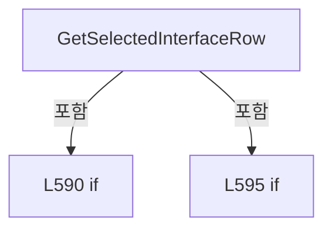

변경 전 점검: 입력/반환 타입, 위 호출자, 예외/취소 경로, 공유 상태와 저장·전송 소비자를 함께 확인합니다. 값의 단위나 물리 방향을 이름만으로 확정하지 않습니다.

### LocalFunctionStatement `MatchesItem` · L600–603

[Drilling.UI/Menu/Menus/CMenuSetting.cs:600–603](https://github.com/kjuws10-rgb/A3Drilling/blob/28764c91d521777b8ee068dd7aaf2d3902ce9fe2/Drilling.UI/Menu/Menus/CMenuSetting.cs#L600-L603)

| 항목 | 실제 추출 값 |
| --- | --- |
| 서명 | bool MatchesItem(Drilling.UI.Menu.Menus.ST_SETTING_INTERFACE_ROW) |
| 접근/수식자 | Private /  |
| 반환/값 타입 | bool |
| 소속 타입 | NamedType:Drilling.UI.Menu.Menus.CMenuSetting |

입력 계약:

| 이름 | 타입 | 전달 | 선택/기본값 |
| --- | --- | --- | --- |
| row | Drilling.UI.Menu.Menus.ST_SETTING_INTERFACE_ROW | None | False /  |

현재 부분 분석에서 직접 연결된 호출자는 없습니다. XAML/이벤트/인터페이스·델리게이트·외부 진입을 추가 확인해야 하며, 미사용으로 판정한 것이 아닙니다.

호출하는 대상과 해석 범위:

| 원본 행 | 표현식 | 분석 상태 | 대상/소스 위치 |
| --- | --- | --- | --- |
| 602 | IsSameInterfaceKey | resolved | bool Drilling.UI.Menu.Menus.CMenuSetting.IsSameInterfaceKey(Drilling.UI.Menu.Menus.ST_SETTING_INTERFACE_ROW, Drilling.UI.Menu.Menus.ST_SETTING_INTERFACE_ROW) · Drilling.UI/Menu/Menus/CMenuSetting.cs:613 |

본문의 실제 연산·분기·예외·반환 순서(원문 위치 순):

| 원본 행 | 종류 | 주석 해설 |
| --- | --- | --- |
| 602 | call | 함수·델리게이트 또는 객체 생성자를 호출합니다: IsSameInterfaceKey(row, current) |
| 602 | return | 호출자에게 값 또는 제어를 반환합니다: return IsSameInterfaceKey(row, current); |

변경 전 점검: 입력/반환 타입, 위 호출자, 예외/취소 경로, 공유 상태와 저장·전송 소비자를 함께 확인합니다. 값의 단위나 물리 방향을 이름만으로 확정하지 않습니다.

### LocalFunctionStatement `MatchesItem2` · L605–608

[Drilling.UI/Menu/Menus/CMenuSetting.cs:605–608](https://github.com/kjuws10-rgb/A3Drilling/blob/28764c91d521777b8ee068dd7aaf2d3902ce9fe2/Drilling.UI/Menu/Menus/CMenuSetting.cs#L605-L608)

| 항목 | 실제 추출 값 |
| --- | --- |
| 서명 | bool MatchesItem2(Drilling.UI.Menu.Menus.ST_SETTING_INTERFACE_ROW) |
| 접근/수식자 | Private /  |
| 반환/값 타입 | bool |
| 소속 타입 | NamedType:Drilling.UI.Menu.Menus.CMenuSetting |

입력 계약:

| 이름 | 타입 | 전달 | 선택/기본값 |
| --- | --- | --- | --- |
| row | Drilling.UI.Menu.Menus.ST_SETTING_INTERFACE_ROW | None | False /  |

현재 부분 분석에서 직접 연결된 호출자는 없습니다. XAML/이벤트/인터페이스·델리게이트·외부 진입을 추가 확인해야 하며, 미사용으로 판정한 것이 아닙니다.

호출하는 대상과 해석 범위:

| 원본 행 | 표현식 | 분석 상태 | 대상/소스 위치 |
| --- | --- | --- | --- |
| 607 | row.NickName.Equals | resolved | bool string.Equals(string?, System.StringComparison) |

본문의 실제 연산·분기·예외·반환 순서(원문 위치 순):

| 원본 행 | 종류 | 주석 해설 |
| --- | --- | --- |
| 607 | call | 함수·델리게이트 또는 객체 생성자를 호출합니다: row.NickName.Equals(current.NickName, StringComparison.OrdinalIgnoreCase) |
| 607 | return | 호출자에게 값 또는 제어를 반환합니다: return row.NickName.Equals(current.NickName, StringComparison.OrdinalIgnoreCase); |

변경 전 점검: 입력/반환 타입, 위 호출자, 예외/취소 경로, 공유 상태와 저장·전송 소비자를 함께 확인합니다. 값의 단위나 물리 방향을 이름만으로 확정하지 않습니다.

### MethodDeclaration `IsSameInterfaceKey` · L613–616

[Drilling.UI/Menu/Menus/CMenuSetting.cs:613–616](https://github.com/kjuws10-rgb/A3Drilling/blob/28764c91d521777b8ee068dd7aaf2d3902ce9fe2/Drilling.UI/Menu/Menus/CMenuSetting.cs#L613-L616)

| 항목 | 실제 추출 값 |
| --- | --- |
| 서명 | bool Drilling.UI.Menu.Menus.CMenuSetting.IsSameInterfaceKey(Drilling.UI.Menu.Menus.ST_SETTING_INTERFACE_ROW, Drilling.UI.Menu.Menus.ST_SETTING_INTERFACE_ROW) |
| 접근/수식자 | Private / private, static |
| 반환/값 타입 | bool |
| 소속 타입 | NamedType:Drilling.UI.Menu.Menus.CMenuSetting |

입력 계약:

| 이름 | 타입 | 전달 | 선택/기본값 |
| --- | --- | --- | --- |
| left | Drilling.UI.Menu.Menus.ST_SETTING_INTERFACE_ROW | None | False /  |
| right | Drilling.UI.Menu.Menus.ST_SETTING_INTERFACE_ROW | None | False /  |

정적 호출자로 확인된 위치:

| 호출 파일/행 | 호출 표현식 | 런타임 분기 가능 |
| --- | --- | --- |
| [Drilling.UI/Menu/Menus/CMenuSetting.cs:602–602](https://github.com/kjuws10-rgb/A3Drilling/blob/28764c91d521777b8ee068dd7aaf2d3902ce9fe2/Drilling.UI/Menu/Menus/CMenuSetting.cs#L602-L602) | IsSameInterfaceKey | False |

호출하는 대상과 해석 범위:

| 원본 행 | 표현식 | 분석 상태 | 대상/소스 위치 |
| --- | --- | --- | --- |
| 615 | NormalizeSettingText(left.Device, "").Equals | resolved | bool string.Equals(string?, System.StringComparison) |
| 615 | NormalizeSettingText | resolved | string Drilling.UI.Menu.Menus.CMenuSetting.NormalizeSettingText(string, string) · Drilling.UI/Menu/Menus/CMenuSetting.cs:1036 |
| 615 | NormalizeSettingText | resolved | string Drilling.UI.Menu.Menus.CMenuSetting.NormalizeSettingText(string, string) · Drilling.UI/Menu/Menus/CMenuSetting.cs:1036 |
| 615 | left.Number.Trim().Equals | resolved | bool string.Equals(string?, System.StringComparison) |
| 615 | left.Number.Trim | resolved | string string.Trim() |
| 615 | right.Number.Trim | resolved | string string.Trim() |

본문의 실제 연산·분기·예외·반환 순서(원문 위치 순):

| 원본 행 | 종류 | 주석 해설 |
| --- | --- | --- |
| 615 | call | 함수·델리게이트 또는 객체 생성자를 호출합니다: NormalizeSettingText(left.Device, "").Equals(NormalizeSettingText(right.Device, ""), StringComparison.OrdinalIgnoreCase) |
| 615 | call | 함수·델리게이트 또는 객체 생성자를 호출합니다: NormalizeSettingText(left.Device, "") |
| 615 | call | 함수·델리게이트 또는 객체 생성자를 호출합니다: NormalizeSettingText(right.Device, "") |
| 615 | call | 함수·델리게이트 또는 객체 생성자를 호출합니다: left.Number.Trim().Equals(right.Number.Trim(), StringComparison.OrdinalIgnoreCase) |
| 615 | call | 함수·델리게이트 또는 객체 생성자를 호출합니다: left.Number.Trim() |
| 615 | call | 함수·델리게이트 또는 객체 생성자를 호출합니다: right.Number.Trim() |
| 615 | return | 호출자에게 값 또는 제어를 반환합니다: return NormalizeSettingText(left.Device, "").Equals(NormalizeSettingText(right.Device, ""), StringComparison.OrdinalIgnoreCase) && left.Number.Trim().Equals(right.Number.Trim(), StringComparison.OrdinalIgnoreCase); |

변경 전 점검: 입력/반환 타입, 위 호출자, 예외/취소 경로, 공유 상태와 저장·전송 소비자를 함께 확인합니다. 값의 단위나 물리 방향을 이름만으로 확정하지 않습니다.

### MethodDeclaration `OnSelectedInterfaceRowStateChanged` · L618–621

[Drilling.UI/Menu/Menus/CMenuSetting.cs:618–621](https://github.com/kjuws10-rgb/A3Drilling/blob/28764c91d521777b8ee068dd7aaf2d3902ce9fe2/Drilling.UI/Menu/Menus/CMenuSetting.cs#L618-L621)

| 항목 | 실제 추출 값 |
| --- | --- |
| 서명 | void Drilling.UI.Menu.Menus.CMenuSetting.OnSelectedInterfaceRowStateChanged(object?, System.EventArgs) |
| 접근/수식자 | Private / private |
| 반환/값 타입 | void |
| 소속 타입 | NamedType:Drilling.UI.Menu.Menus.CMenuSetting |

입력 계약:

| 이름 | 타입 | 전달 | 선택/기본값 |
| --- | --- | --- | --- |
| sender | object? | None | False /  |
| e | System.EventArgs | None | False /  |

현재 부분 분석에서 직접 연결된 호출자는 없습니다. XAML/이벤트/인터페이스·델리게이트·외부 진입을 추가 확인해야 하며, 미사용으로 판정한 것이 아닙니다.

호출하는 대상과 해석 범위:

| 원본 행 | 표현식 | 분석 상태 | 대상/소스 위치 |
| --- | --- | --- | --- |
| 620 | RefreshInterfaceCommandState | resolved | void Drilling.UI.Menu.Menus.CMenuSetting.RefreshInterfaceCommandState() · Drilling.UI/Menu/Menus/CMenuSetting.cs:623 |

본문의 실제 연산·분기·예외·반환 순서(원문 위치 순):

| 원본 행 | 종류 | 주석 해설 |
| --- | --- | --- |
| 620 | call | 함수·델리게이트 또는 객체 생성자를 호출합니다: RefreshInterfaceCommandState() |

변경 전 점검: 입력/반환 타입, 위 호출자, 예외/취소 경로, 공유 상태와 저장·전송 소비자를 함께 확인합니다. 값의 단위나 물리 방향을 이름만으로 확정하지 않습니다.

### MethodDeclaration `RefreshInterfaceCommandState` · L623–628

[Drilling.UI/Menu/Menus/CMenuSetting.cs:623–628](https://github.com/kjuws10-rgb/A3Drilling/blob/28764c91d521777b8ee068dd7aaf2d3902ce9fe2/Drilling.UI/Menu/Menus/CMenuSetting.cs#L623-L628)

| 항목 | 실제 추출 값 |
| --- | --- |
| 서명 | void Drilling.UI.Menu.Menus.CMenuSetting.RefreshInterfaceCommandState() |
| 접근/수식자 | Private / private |
| 반환/값 타입 | void |
| 소속 타입 | NamedType:Drilling.UI.Menu.Menus.CMenuSetting |

정적 호출자로 확인된 위치:

| 호출 파일/행 | 호출 표현식 | 런타임 분기 가능 |
| --- | --- | --- |
| [Drilling.UI/Menu/Menus/CMenuSetting.cs:203–203](https://github.com/kjuws10-rgb/A3Drilling/blob/28764c91d521777b8ee068dd7aaf2d3902ce9fe2/Drilling.UI/Menu/Menus/CMenuSetting.cs#L203-L203) | RefreshInterfaceCommandState | False |
| [Drilling.UI/Menu/Menus/CMenuSetting.cs:620–620](https://github.com/kjuws10-rgb/A3Drilling/blob/28764c91d521777b8ee068dd7aaf2d3902ce9fe2/Drilling.UI/Menu/Menus/CMenuSetting.cs#L620-L620) | RefreshInterfaceCommandState | False |

호출하는 대상과 해석 범위:

| 원본 행 | 표현식 | 분석 상태 | 대상/소스 위치 |
| --- | --- | --- | --- |
| 625 | OnPropertyChanged | resolved | void Drilling.UI.Menu.CBindingBase.OnPropertyChanged(string?) · Drilling.UI/Menu/CBindingBase.cs:790 |
| 625 | nameof | unresolved | None |
| 626 | ConnectInterfaceCommand.NotifyCanExecuteChanged | resolved | void Drilling.UI.Menu.CButtonCommand.NotifyCanExecuteChanged() · Drilling.UI/Menu/CButtonCommand.cs:24 |
| 627 | DisconnectInterfaceCommand.NotifyCanExecuteChanged | resolved | void Drilling.UI.Menu.CButtonCommand.NotifyCanExecuteChanged() · Drilling.UI/Menu/CButtonCommand.cs:24 |

본문의 실제 연산·분기·예외·반환 순서(원문 위치 순):

| 원본 행 | 종류 | 주석 해설 |
| --- | --- | --- |
| 625 | call | 함수·델리게이트 또는 객체 생성자를 호출합니다: OnPropertyChanged(nameof(CanOperateSelectedInterface)) |
| 625 | call | 함수·델리게이트 또는 객체 생성자를 호출합니다: nameof(CanOperateSelectedInterface) |
| 626 | call | 함수·델리게이트 또는 객체 생성자를 호출합니다: ConnectInterfaceCommand.NotifyCanExecuteChanged() |
| 627 | call | 함수·델리게이트 또는 객체 생성자를 호출합니다: DisconnectInterfaceCommand.NotifyCanExecuteChanged() |

변경 전 점검: 입력/반환 타입, 위 호출자, 예외/취소 경로, 공유 상태와 저장·전송 소비자를 함께 확인합니다. 값의 단위나 물리 방향을 이름만으로 확정하지 않습니다.

### MethodDeclaration `BuildTabs` · L630–643

[Drilling.UI/Menu/Menus/CMenuSetting.cs:630–643](https://github.com/kjuws10-rgb/A3Drilling/blob/28764c91d521777b8ee068dd7aaf2d3902ce9fe2/Drilling.UI/Menu/Menus/CMenuSetting.cs#L630-L643)

| 항목 | 실제 추출 값 |
| --- | --- |
| 서명 | System.Collections.Generic.IReadOnlyList<Drilling.UI.Menu.Menus.ST_SETTING_TAB> Drilling.UI.Menu.Menus.CMenuSetting.BuildTabs(string) |
| 접근/수식자 | Private / private, static |
| 반환/값 타입 | System.Collections.Generic.IReadOnlyList<Drilling.UI.Menu.Menus.ST_SETTING_TAB> |
| 소속 타입 | NamedType:Drilling.UI.Menu.Menus.CMenuSetting |

입력 계약:

| 이름 | 타입 | 전달 | 선택/기본값 |
| --- | --- | --- | --- |
| selectedTab | string | None | False /  |

정적 호출자로 확인된 위치:

| 호출 파일/행 | 호출 표현식 | 런타임 분기 가능 |
| --- | --- | --- |
| [Drilling.UI/Menu/Menus/CMenuSetting.cs:268–268](https://github.com/kjuws10-rgb/A3Drilling/blob/28764c91d521777b8ee068dd7aaf2d3902ce9fe2/Drilling.UI/Menu/Menus/CMenuSetting.cs#L268-L268) | BuildTabs | False |

호출하는 대상과 해석 범위:

| 원본 행 | 표현식 | 분석 상태 | 대상/소스 위치 |
| --- | --- | --- | --- |
| 642 | Sections.Select(SelectItem).Select(BuildSetting).ToArray | resolved | Drilling.UI.Menu.Menus.ST_SETTING_TAB[] System.Collections.Generic.IEnumerable<Drilling.UI.Menu.Menus.ST_SETTING_TAB>.ToArray<Drilling.UI.Menu.Menus.ST_SETTING_TAB>() |
| 642 | Sections.Select(SelectItem).Select | resolved | System.Collections.Generic.IEnumerable<Drilling.UI.Menu.Menus.ST_SETTING_TAB> System.Collections.Generic.IEnumerable<string>.Select<string, Drilling.UI.Menu.Menus.ST_SETTING_TAB>(System.Func<string, Drilling.UI.Menu.Menus.ST_SETTING_TAB>) |
| 642 | Sections.Select | resolved | System.Collections.Generic.IEnumerable<string> System.Collections.Generic.IEnumerable<Drilling.Common.Managers.EN_SETTING_TAB>.Select<Drilling.Common.Managers.EN_SETTING_TAB, string>(System.Func<Drilling.Common.Managers.EN_SETTING_TAB, string>) |

본문의 실제 연산·분기·예외·반환 순서(원문 위치 순):

| 원본 행 | 종류 | 주석 해설 |
| --- | --- | --- |
| 642 | call | 함수·델리게이트 또는 객체 생성자를 호출합니다: Sections.Select(SelectItem).Select(BuildSetting).ToArray() |
| 642 | call | 함수·델리게이트 또는 객체 생성자를 호출합니다: Sections.Select(SelectItem).Select(BuildSetting) |
| 642 | call | 함수·델리게이트 또는 객체 생성자를 호출합니다: Sections.Select(SelectItem) |
| 642 | return | 호출자에게 값 또는 제어를 반환합니다: return Sections.Select(SelectItem).Select(BuildSetting).ToArray(); |

변경 전 점검: 입력/반환 타입, 위 호출자, 예외/취소 경로, 공유 상태와 저장·전송 소비자를 함께 확인합니다. 값의 단위나 물리 방향을 이름만으로 확정하지 않습니다.

### LocalFunctionStatement `SelectItem` · L632–635

[Drilling.UI/Menu/Menus/CMenuSetting.cs:632–635](https://github.com/kjuws10-rgb/A3Drilling/blob/28764c91d521777b8ee068dd7aaf2d3902ce9fe2/Drilling.UI/Menu/Menus/CMenuSetting.cs#L632-L635)

| 항목 | 실제 추출 값 |
| --- | --- |
| 서명 | string SelectItem(Drilling.Common.Managers.EN_SETTING_TAB) |
| 접근/수식자 | Private /  |
| 반환/값 타입 | string |
| 소속 타입 | NamedType:Drilling.UI.Menu.Menus.CMenuSetting |

입력 계약:

| 이름 | 타입 | 전달 | 선택/기본값 |
| --- | --- | --- | --- |
| section | Drilling.Common.Managers.EN_SETTING_TAB | None | False /  |

현재 부분 분석에서 직접 연결된 호출자는 없습니다. XAML/이벤트/인터페이스·델리게이트·외부 진입을 추가 확인해야 하며, 미사용으로 판정한 것이 아닙니다.

호출하는 대상과 해석 범위:

| 원본 행 | 표현식 | 분석 상태 | 대상/소스 위치 |
| --- | --- | --- | --- |
| 634 | ToTabText | resolved | string Drilling.UI.Menu.Menus.CMenuSetting.ToTabText(Drilling.Common.Managers.EN_SETTING_TAB) · Drilling.UI/Menu/Menus/CMenuSetting.cs:1069 |

본문의 실제 연산·분기·예외·반환 순서(원문 위치 순):

| 원본 행 | 종류 | 주석 해설 |
| --- | --- | --- |
| 634 | call | 함수·델리게이트 또는 객체 생성자를 호출합니다: ToTabText(section) |
| 634 | return | 호출자에게 값 또는 제어를 반환합니다: return ToTabText(section); |

변경 전 점검: 입력/반환 타입, 위 호출자, 예외/취소 경로, 공유 상태와 저장·전송 소비자를 함께 확인합니다. 값의 단위나 물리 방향을 이름만으로 확정하지 않습니다.

### LocalFunctionStatement `BuildSetting` · L637–640

[Drilling.UI/Menu/Menus/CMenuSetting.cs:637–640](https://github.com/kjuws10-rgb/A3Drilling/blob/28764c91d521777b8ee068dd7aaf2d3902ce9fe2/Drilling.UI/Menu/Menus/CMenuSetting.cs#L637-L640)

| 항목 | 실제 추출 값 |
| --- | --- |
| 서명 | Drilling.UI.Menu.Menus.ST_SETTING_TAB BuildSetting(string) |
| 접근/수식자 | Private /  |
| 반환/값 타입 | Drilling.UI.Menu.Menus.ST_SETTING_TAB |
| 소속 타입 | NamedType:Drilling.UI.Menu.Menus.CMenuSetting |

입력 계약:

| 이름 | 타입 | 전달 | 선택/기본값 |
| --- | --- | --- | --- |
| tab | string | None | False /  |

현재 부분 분석에서 직접 연결된 호출자는 없습니다. XAML/이벤트/인터페이스·델리게이트·외부 진입을 추가 확인해야 하며, 미사용으로 판정한 것이 아닙니다.

호출하는 대상과 해석 범위:

| 원본 행 | 표현식 | 분석 상태 | 대상/소스 위치 |
| --- | --- | --- | --- |
| 639 | new ST_SETTING_TAB | resolved | Drilling.UI.Menu.Menus.ST_SETTING_TAB.ST_SETTING_TAB(string, bool) · Drilling.UI/Menu/Menus/CMenuSetting.cs:1083 |
| 639 | tab.Equals | resolved | bool string.Equals(string?, System.StringComparison) |

본문의 실제 연산·분기·예외·반환 순서(원문 위치 순):

| 원본 행 | 종류 | 주석 해설 |
| --- | --- | --- |
| 639 | call | 함수·델리게이트 또는 객체 생성자를 호출합니다: new ST_SETTING_TAB(tab, tab.Equals(selectedTab, StringComparison.OrdinalIgnoreCase)) |
| 639 | call | 함수·델리게이트 또는 객체 생성자를 호출합니다: tab.Equals(selectedTab, StringComparison.OrdinalIgnoreCase) |
| 639 | return | 호출자에게 값 또는 제어를 반환합니다: return new ST_SETTING_TAB(tab, tab.Equals(selectedTab, StringComparison.OrdinalIgnoreCase)); |

변경 전 점검: 입력/반환 타입, 위 호출자, 예외/취소 경로, 공유 상태와 저장·전송 소비자를 함께 확인합니다. 값의 단위나 물리 방향을 이름만으로 확정하지 않습니다.

### MethodDeclaration `BuildParameterRows` · L645–671

[Drilling.UI/Menu/Menus/CMenuSetting.cs:645–671](https://github.com/kjuws10-rgb/A3Drilling/blob/28764c91d521777b8ee068dd7aaf2d3902ce9fe2/Drilling.UI/Menu/Menus/CMenuSetting.cs#L645-L671)

| 항목 | 실제 추출 값 |
| --- | --- |
| 서명 | System.Collections.Generic.IReadOnlyList<Drilling.UI.Menu.Menus.ST_SYSTEM_PARAMETER_ROW> Drilling.UI.Menu.Menus.CMenuSetting.BuildParameterRows(System.Collections.Generic.IReadOnlyList<Drilling.Common.Managers.ST_SYSTEM_PARAMETER>) |
| 접근/수식자 | Private / private, static |
| 반환/값 타입 | System.Collections.Generic.IReadOnlyList<Drilling.UI.Menu.Menus.ST_SYSTEM_PARAMETER_ROW> |
| 소속 타입 | NamedType:Drilling.UI.Menu.Menus.CMenuSetting |

입력 계약:

| 이름 | 타입 | 전달 | 선택/기본값 |
| --- | --- | --- | --- |
| parameters | System.Collections.Generic.IReadOnlyList<Drilling.Common.Managers.ST_SYSTEM_PARAMETER> | None | False /  |

정적 호출자로 확인된 위치:

| 호출 파일/행 | 호출 표현식 | 런타임 분기 가능 |
| --- | --- | --- |
| [Drilling.UI/Menu/Menus/CMenuSetting.cs:232–232](https://github.com/kjuws10-rgb/A3Drilling/blob/28764c91d521777b8ee068dd7aaf2d3902ce9fe2/Drilling.UI/Menu/Menus/CMenuSetting.cs#L232-L232) | BuildParameterRows | False |

호출하는 대상과 해석 범위:

| 원본 행 | 표현식 | 분석 상태 | 대상/소스 위치 |
| --- | --- | --- | --- |
| 670 | parameters.Where(ShouldIncludeItem).Select(BuildSystem).ToArray | resolved | Drilling.UI.Menu.Menus.ST_SYSTEM_PARAMETER_ROW[] System.Collections.Generic.IEnumerable<Drilling.UI.Menu.Menus.ST_SYSTEM_PARAMETER_ROW>.ToArray<Drilling.UI.Menu.Menus.ST_SYSTEM_PARAMETER_ROW>() |
| 670 | parameters.Where(ShouldIncludeItem).Select | resolved | System.Collections.Generic.IEnumerable<Drilling.UI.Menu.Menus.ST_SYSTEM_PARAMETER_ROW> System.Collections.Generic.IEnumerable<Drilling.Common.Managers.ST_SYSTEM_PARAMETER>.Select<Drilling.Common.Managers.ST_SYSTEM_PARAMETER, Drilling.UI.Menu.Menus.ST_SYSTEM_PARAMETER_ROW>(System.Func<Drilling.Common.Managers.ST_SYSTEM_PARAMETER, Drilling.UI.Menu.Menus.ST_SYSTEM_PARAMETER_ROW>) |
| 670 | parameters.Where | resolved | System.Collections.Generic.IEnumerable<Drilling.Common.Managers.ST_SYSTEM_PARAMETER> System.Collections.Generic.IEnumerable<Drilling.Common.Managers.ST_SYSTEM_PARAMETER>.Where<Drilling.Common.Managers.ST_SYSTEM_PARAMETER>(System.Func<Drilling.Common.Managers.ST_SYSTEM_PARAMETER, bool>) |

본문의 실제 연산·분기·예외·반환 순서(원문 위치 순):

| 원본 행 | 종류 | 주석 해설 |
| --- | --- | --- |
| 670 | call | 함수·델리게이트 또는 객체 생성자를 호출합니다: parameters.Where(ShouldIncludeItem).Select(BuildSystem).ToArray() |
| 670 | call | 함수·델리게이트 또는 객체 생성자를 호출합니다: parameters.Where(ShouldIncludeItem).Select(BuildSystem) |
| 670 | call | 함수·델리게이트 또는 객체 생성자를 호출합니다: parameters.Where(ShouldIncludeItem) |
| 670 | return | 호출자에게 값 또는 제어를 반환합니다: return parameters.Where(ShouldIncludeItem).Select(BuildSystem).ToArray(); |

변경 전 점검: 입력/반환 타입, 위 호출자, 예외/취소 경로, 공유 상태와 저장·전송 소비자를 함께 확인합니다. 값의 단위나 물리 방향을 이름만으로 확정하지 않습니다.

### LocalFunctionStatement `ShouldIncludeItem` · L647–650

[Drilling.UI/Menu/Menus/CMenuSetting.cs:647–650](https://github.com/kjuws10-rgb/A3Drilling/blob/28764c91d521777b8ee068dd7aaf2d3902ce9fe2/Drilling.UI/Menu/Menus/CMenuSetting.cs#L647-L650)

| 항목 | 실제 추출 값 |
| --- | --- |
| 서명 | bool ShouldIncludeItem(Drilling.Common.Managers.ST_SYSTEM_PARAMETER) |
| 접근/수식자 | Private /  |
| 반환/값 타입 | bool |
| 소속 타입 | NamedType:Drilling.UI.Menu.Menus.CMenuSetting |

입력 계약:

| 이름 | 타입 | 전달 | 선택/기본값 |
| --- | --- | --- | --- |
| parameter | Drilling.Common.Managers.ST_SYSTEM_PARAMETER | None | False /  |

현재 부분 분석에서 직접 연결된 호출자는 없습니다. XAML/이벤트/인터페이스·델리게이트·외부 진입을 추가 확인해야 하며, 미사용으로 판정한 것이 아닙니다.

본문의 실제 연산·분기·예외·반환 순서(원문 위치 순):

| 원본 행 | 종류 | 주석 해설 |
| --- | --- | --- |
| 649 | return | 호출자에게 값 또는 제어를 반환합니다: return parameter.Show && parameter.Use; |

변경 전 점검: 입력/반환 타입, 위 호출자, 예외/취소 경로, 공유 상태와 저장·전송 소비자를 함께 확인합니다. 값의 단위나 물리 방향을 이름만으로 확정하지 않습니다.

### LocalFunctionStatement `BuildSystem` · L652–668

[Drilling.UI/Menu/Menus/CMenuSetting.cs:652–668](https://github.com/kjuws10-rgb/A3Drilling/blob/28764c91d521777b8ee068dd7aaf2d3902ce9fe2/Drilling.UI/Menu/Menus/CMenuSetting.cs#L652-L668)

| 항목 | 실제 추출 값 |
| --- | --- |
| 서명 | Drilling.UI.Menu.Menus.ST_SYSTEM_PARAMETER_ROW BuildSystem(Drilling.Common.Managers.ST_SYSTEM_PARAMETER) |
| 접근/수식자 | Private /  |
| 반환/값 타입 | Drilling.UI.Menu.Menus.ST_SYSTEM_PARAMETER_ROW |
| 소속 타입 | NamedType:Drilling.UI.Menu.Menus.CMenuSetting |

입력 계약:

| 이름 | 타입 | 전달 | 선택/기본값 |
| --- | --- | --- | --- |
| parameter | Drilling.Common.Managers.ST_SYSTEM_PARAMETER | None | False /  |

현재 부분 분석에서 직접 연결된 호출자는 없습니다. XAML/이벤트/인터페이스·델리게이트·외부 진입을 추가 확인해야 하며, 미사용으로 판정한 것이 아닙니다.

호출하는 대상과 해석 범위:

| 원본 행 | 표현식 | 분석 상태 | 대상/소스 위치 |
| --- | --- | --- | --- |
| 654 | new ST_SYSTEM_PARAMETER_ROW | resolved | Drilling.UI.Menu.Menus.ST_SYSTEM_PARAMETER_ROW.ST_SYSTEM_PARAMETER_ROW(string, string, string, string, string, bool, string, string, string, Drilling.Common.Managers.EN_RECIPE_DATA_TYPE, double, double) · Drilling.UI/Menu/Menus/CMenuSetting.cs:1098 |
| 655 | NormalizeSettingText | resolved | string Drilling.UI.Menu.Menus.CMenuSetting.NormalizeSettingText(string, string) · Drilling.UI/Menu/Menus/CMenuSetting.cs:1036 |
| 658 | NormalizeUnit | resolved | string Drilling.UI.Menu.Menus.CMenuSetting.NormalizeUnit(string) · Drilling.UI/Menu/Menus/CMenuSetting.cs:1041 |
| 661 | GetValueState | resolved | string Drilling.UI.Menu.Menus.CMenuSetting.GetValueState(string) · Drilling.UI/Menu/Menus/CMenuSetting.cs:1051 |

본문의 실제 연산·분기·예외·반환 순서(원문 위치 순):

| 원본 행 | 종류 | 주석 해설 |
| --- | --- | --- |
| 654 | call | 함수·델리게이트 또는 객체 생성자를 호출합니다: new ST_SYSTEM_PARAMETER_ROW( NormalizeSettingText(parameter.Group, "COMMON"), parameter.Name, parameter.Value, NormalizeUnit(parameter.Unit), parameter.Description, false, GetValueState(parameter.Value), parameter.Key, p… |
| 654 | return | 호출자에게 값 또는 제어를 반환합니다: return new ST_SYSTEM_PARAMETER_ROW( NormalizeSettingText(parameter.Group, "COMMON"), parameter.Name, parameter.Value, NormalizeUnit(parameter.Unit), parameter.Description, false, GetValueState(parameter.Value), parameter.Key, para |
| 655 | call | 함수·델리게이트 또는 객체 생성자를 호출합니다: NormalizeSettingText(parameter.Group, "COMMON") |
| 658 | call | 함수·델리게이트 또는 객체 생성자를 호출합니다: NormalizeUnit(parameter.Unit) |
| 661 | call | 함수·델리게이트 또는 객체 생성자를 호출합니다: GetValueState(parameter.Value) |

변경 전 점검: 입력/반환 타입, 위 호출자, 예외/취소 경로, 공유 상태와 저장·전송 소비자를 함께 확인합니다. 값의 단위나 물리 방향을 이름만으로 확정하지 않습니다.

### MethodDeclaration `BuildGroups` · L673–690

[Drilling.UI/Menu/Menus/CMenuSetting.cs:673–690](https://github.com/kjuws10-rgb/A3Drilling/blob/28764c91d521777b8ee068dd7aaf2d3902ce9fe2/Drilling.UI/Menu/Menus/CMenuSetting.cs#L673-L690)

| 항목 | 실제 추출 값 |
| --- | --- |
| 서명 | System.Collections.Generic.IReadOnlyList<string> Drilling.UI.Menu.Menus.CMenuSetting.BuildGroups(System.Collections.Generic.IReadOnlyList<Drilling.UI.Menu.Menus.ST_SYSTEM_PARAMETER_ROW>) |
| 접근/수식자 | Private / private, static |
| 반환/값 타입 | System.Collections.Generic.IReadOnlyList<string> |
| 소속 타입 | NamedType:Drilling.UI.Menu.Menus.CMenuSetting |

입력 계약:

| 이름 | 타입 | 전달 | 선택/기본값 |
| --- | --- | --- | --- |
| rows | System.Collections.Generic.IReadOnlyList<Drilling.UI.Menu.Menus.ST_SYSTEM_PARAMETER_ROW> | None | False /  |

정적 호출자로 확인된 위치:

| 호출 파일/행 | 호출 표현식 | 런타임 분기 가능 |
| --- | --- | --- |
| [Drilling.UI/Menu/Menus/CMenuSetting.cs:237–237](https://github.com/kjuws10-rgb/A3Drilling/blob/28764c91d521777b8ee068dd7aaf2d3902ce9fe2/Drilling.UI/Menu/Menus/CMenuSetting.cs#L237-L237) | BuildGroups | False |

호출하는 대상과 해석 범위:

| 원본 행 | 표현식 | 분석 상태 | 대상/소스 위치 |
| --- | --- | --- | --- |
| 685 | rows.Select(SelectGroup).Where(ShouldIncludeItem).Distinct(StringComparer.OrdinalIgnoreCase).ToArray | resolved | string[] System.Collections.Generic.IEnumerable<string>.ToArray<string>() |
| 685 | rows.Select(SelectGroup).Where(ShouldIncludeItem).Distinct | resolved | System.Collections.Generic.IEnumerable<string> System.Collections.Generic.IEnumerable<string>.Distinct<string>(System.Collections.Generic.IEqualityComparer<string>?) |
| 685 | rows.Select(SelectGroup).Where | resolved | System.Collections.Generic.IEnumerable<string> System.Collections.Generic.IEnumerable<string>.Where<string>(System.Func<string, bool>) |
| 685 | rows.Select | resolved | System.Collections.Generic.IEnumerable<string> System.Collections.Generic.IEnumerable<Drilling.UI.Menu.Menus.ST_SYSTEM_PARAMETER_ROW>.Select<Drilling.UI.Menu.Menus.ST_SYSTEM_PARAMETER_ROW, string>(System.Func<Drilling.UI.Menu.Menus.ST_SYSTEM_PARAMETER_ROW, string>) |
| 686 | new[] { "ALL" }.Concat(groups).ToArray | resolved | string[] System.Collections.Generic.IEnumerable<string>.ToArray<string>() |
| 686 | new[] { "ALL" }.Concat | resolved | System.Collections.Generic.IEnumerable<string> System.Collections.Generic.IEnumerable<string>.Concat<string>(System.Collections.Generic.IEnumerable<string>) |

본문의 실제 연산·분기·예외·반환 순서(원문 위치 순):

| 원본 행 | 종류 | 주석 해설 |
| --- | --- | --- |
| 685 | call | 함수·델리게이트 또는 객체 생성자를 호출합니다: rows.Select(SelectGroup).Where(ShouldIncludeItem).Distinct(StringComparer.OrdinalIgnoreCase).ToArray() |
| 685 | call | 함수·델리게이트 또는 객체 생성자를 호출합니다: rows.Select(SelectGroup).Where(ShouldIncludeItem).Distinct(StringComparer.OrdinalIgnoreCase) |
| 685 | call | 함수·델리게이트 또는 객체 생성자를 호출합니다: rows.Select(SelectGroup).Where(ShouldIncludeItem) |
| 685 | call | 함수·델리게이트 또는 객체 생성자를 호출합니다: rows.Select(SelectGroup) |
| 685 | local-declaration | 지역 변수를 선언합니다: var groups = rows.Select(SelectGroup).Where(ShouldIncludeItem).Distinct(StringComparer.OrdinalIgnoreCase).ToArray(); |
| 685 | variable-initializer | 변수의 초기값을 지정합니다: groups = rows.Select(SelectGroup).Where(ShouldIncludeItem).Distinct(StringComparer.OrdinalIgnoreCase).ToArray() |
| 686 | call | 함수·델리게이트 또는 객체 생성자를 호출합니다: new[] { "ALL" }.Concat(groups).ToArray() |
| 686 | call | 함수·델리게이트 또는 객체 생성자를 호출합니다: new[] { "ALL" }.Concat(groups) |
| 686 | return | 호출자에게 값 또는 제어를 반환합니다: return new[] { "ALL" }.Concat(groups).ToArray(); |

변경 전 점검: 입력/반환 타입, 위 호출자, 예외/취소 경로, 공유 상태와 저장·전송 소비자를 함께 확인합니다. 값의 단위나 물리 방향을 이름만으로 확정하지 않습니다.

### LocalFunctionStatement `SelectGroup` · L675–678

[Drilling.UI/Menu/Menus/CMenuSetting.cs:675–678](https://github.com/kjuws10-rgb/A3Drilling/blob/28764c91d521777b8ee068dd7aaf2d3902ce9fe2/Drilling.UI/Menu/Menus/CMenuSetting.cs#L675-L678)

| 항목 | 실제 추출 값 |
| --- | --- |
| 서명 | string SelectGroup(Drilling.UI.Menu.Menus.ST_SYSTEM_PARAMETER_ROW) |
| 접근/수식자 | Private /  |
| 반환/값 타입 | string |
| 소속 타입 | NamedType:Drilling.UI.Menu.Menus.CMenuSetting |

입력 계약:

| 이름 | 타입 | 전달 | 선택/기본값 |
| --- | --- | --- | --- |
| row | Drilling.UI.Menu.Menus.ST_SYSTEM_PARAMETER_ROW | None | False /  |

현재 부분 분석에서 직접 연결된 호출자는 없습니다. XAML/이벤트/인터페이스·델리게이트·외부 진입을 추가 확인해야 하며, 미사용으로 판정한 것이 아닙니다.

본문의 실제 연산·분기·예외·반환 순서(원문 위치 순):

| 원본 행 | 종류 | 주석 해설 |
| --- | --- | --- |
| 677 | return | 호출자에게 값 또는 제어를 반환합니다: return row.Group; |

변경 전 점검: 입력/반환 타입, 위 호출자, 예외/취소 경로, 공유 상태와 저장·전송 소비자를 함께 확인합니다. 값의 단위나 물리 방향을 이름만으로 확정하지 않습니다.

### LocalFunctionStatement `ShouldIncludeItem` · L680–683

[Drilling.UI/Menu/Menus/CMenuSetting.cs:680–683](https://github.com/kjuws10-rgb/A3Drilling/blob/28764c91d521777b8ee068dd7aaf2d3902ce9fe2/Drilling.UI/Menu/Menus/CMenuSetting.cs#L680-L683)

| 항목 | 실제 추출 값 |
| --- | --- |
| 서명 | bool ShouldIncludeItem(string) |
| 접근/수식자 | Private /  |
| 반환/값 타입 | bool |
| 소속 타입 | NamedType:Drilling.UI.Menu.Menus.CMenuSetting |

입력 계약:

| 이름 | 타입 | 전달 | 선택/기본값 |
| --- | --- | --- | --- |
| group | string | None | False /  |

현재 부분 분석에서 직접 연결된 호출자는 없습니다. XAML/이벤트/인터페이스·델리게이트·외부 진입을 추가 확인해야 하며, 미사용으로 판정한 것이 아닙니다.

호출하는 대상과 해석 범위:

| 원본 행 | 표현식 | 분석 상태 | 대상/소스 위치 |
| --- | --- | --- | --- |
| 682 | string.IsNullOrWhiteSpace | resolved | bool string.IsNullOrWhiteSpace(string?) |

본문의 실제 연산·분기·예외·반환 순서(원문 위치 순):

| 원본 행 | 종류 | 주석 해설 |
| --- | --- | --- |
| 682 | call | 함수·델리게이트 또는 객체 생성자를 호출합니다: string.IsNullOrWhiteSpace(group) |
| 682 | return | 호출자에게 값 또는 제어를 반환합니다: return !string.IsNullOrWhiteSpace(group); |

변경 전 점검: 입력/반환 타입, 위 호출자, 예외/취소 경로, 공유 상태와 저장·전송 소비자를 함께 확인합니다. 값의 단위나 물리 방향을 이름만으로 확정하지 않습니다.

### MethodDeclaration `BuildHeadFilters` · L692–726

[Drilling.UI/Menu/Menus/CMenuSetting.cs:692–726](https://github.com/kjuws10-rgb/A3Drilling/blob/28764c91d521777b8ee068dd7aaf2d3902ce9fe2/Drilling.UI/Menu/Menus/CMenuSetting.cs#L692-L726)

| 항목 | 실제 추출 값 |
| --- | --- |
| 서명 | System.Collections.Generic.IReadOnlyList<Drilling.UI.Menu.Menus.ST_SETTING_HEAD_FILTER> Drilling.UI.Menu.Menus.CMenuSetting.BuildHeadFilters(System.Collections.Generic.IReadOnlyList<Drilling.UI.Menu.Menus.ST_SYSTEM_PARAMETER_ROW>) |
| 접근/수식자 | Private / private, static |
| 반환/값 타입 | System.Collections.Generic.IReadOnlyList<Drilling.UI.Menu.Menus.ST_SETTING_HEAD_FILTER> |
| 소속 타입 | NamedType:Drilling.UI.Menu.Menus.CMenuSetting |

입력 계약:

| 이름 | 타입 | 전달 | 선택/기본값 |
| --- | --- | --- | --- |
| rows | System.Collections.Generic.IReadOnlyList<Drilling.UI.Menu.Menus.ST_SYSTEM_PARAMETER_ROW> | None | False /  |

정적 호출자로 확인된 위치:

| 호출 파일/행 | 호출 표현식 | 런타임 분기 가능 |
| --- | --- | --- |
| [Drilling.UI/Menu/Menus/CMenuSetting.cs:245–245](https://github.com/kjuws10-rgb/A3Drilling/blob/28764c91d521777b8ee068dd7aaf2d3902ce9fe2/Drilling.UI/Menu/Menus/CMenuSetting.cs#L245-L245) | BuildHeadFilters | False |

호출하는 대상과 해석 범위:

| 원본 행 | 표현식 | 분석 상태 | 대상/소스 위치 |
| --- | --- | --- | --- |
| 714 | rows.Where(HasHead).Select(ReadHeadNo).Distinct().OrderBy(SortHeadNo).ToArray | resolved | int[] System.Collections.Generic.IEnumerable<int>.ToArray<int>() |
| 714 | rows.Where(HasHead).Select(ReadHeadNo).Distinct().OrderBy | resolved | System.Linq.IOrderedEnumerable<int> System.Collections.Generic.IEnumerable<int>.OrderBy<int, int>(System.Func<int, int>) |
| 714 | rows.Where(HasHead).Select(ReadHeadNo).Distinct | resolved | System.Collections.Generic.IEnumerable<int> System.Collections.Generic.IEnumerable<int>.Distinct<int>() |
| 714 | rows.Where(HasHead).Select | resolved | System.Collections.Generic.IEnumerable<int> System.Collections.Generic.IEnumerable<Drilling.UI.Menu.Menus.ST_SYSTEM_PARAMETER_ROW>.Select<Drilling.UI.Menu.Menus.ST_SYSTEM_PARAMETER_ROW, int>(System.Func<Drilling.UI.Menu.Menus.ST_SYSTEM_PARAMETER_ROW, int>) |
| 714 | rows.Where | resolved | System.Collections.Generic.IEnumerable<Drilling.UI.Menu.Menus.ST_SYSTEM_PARAMETER_ROW> System.Collections.Generic.IEnumerable<Drilling.UI.Menu.Menus.ST_SYSTEM_PARAMETER_ROW>.Where<Drilling.UI.Menu.Menus.ST_SYSTEM_PARAMETER_ROW>(System.Func<Drilling.UI.Menu.Menus.ST_SYSTEM_PARAMETER_ROW, bool>) |
| 720 | new List<ST_SETTING_HEAD_FILTER> | resolved | System.Collections.Generic.List<Drilling.UI.Menu.Menus.ST_SETTING_HEAD_FILTER>.List() |
| 722 | new | resolved | Drilling.UI.Menu.Menus.ST_SETTING_HEAD_FILTER.ST_SETTING_HEAD_FILTER(string, bool) · Drilling.UI/Menu/Menus/CMenuSetting.cs:1088 |
| 724 | filters.AddRange | resolved | void System.Collections.Generic.List<Drilling.UI.Menu.Menus.ST_SETTING_HEAD_FILTER>.AddRange(System.Collections.Generic.IEnumerable<Drilling.UI.Menu.Menus.ST_SETTING_HEAD_FILTER>) |
| 724 | headNos.Select | resolved | System.Collections.Generic.IEnumerable<Drilling.UI.Menu.Menus.ST_SETTING_HEAD_FILTER> System.Collections.Generic.IEnumerable<int>.Select<int, Drilling.UI.Menu.Menus.ST_SETTING_HEAD_FILTER>(System.Func<int, Drilling.UI.Menu.Menus.ST_SETTING_HEAD_FILTER>) |

본문의 실제 연산·분기·예외·반환 순서(원문 위치 순):

| 원본 행 | 종류 | 주석 해설 |
| --- | --- | --- |
| 714 | call | 함수·델리게이트 또는 객체 생성자를 호출합니다: rows.Where(HasHead).Select(ReadHeadNo).Distinct().OrderBy(SortHeadNo).ToArray() |
| 714 | call | 함수·델리게이트 또는 객체 생성자를 호출합니다: rows.Where(HasHead).Select(ReadHeadNo).Distinct().OrderBy(SortHeadNo) |
| 714 | call | 함수·델리게이트 또는 객체 생성자를 호출합니다: rows.Where(HasHead).Select(ReadHeadNo).Distinct() |
| 714 | call | 함수·델리게이트 또는 객체 생성자를 호출합니다: rows.Where(HasHead).Select(ReadHeadNo) |
| 714 | call | 함수·델리게이트 또는 객체 생성자를 호출합니다: rows.Where(HasHead) |
| 714 | local-declaration | 지역 변수를 선언합니다: var headNos = rows.Where(HasHead).Select(ReadHeadNo).Distinct().OrderBy(SortHeadNo).ToArray(); |
| 714 | variable-initializer | 변수의 초기값을 지정합니다: headNos = rows.Where(HasHead).Select(ReadHeadNo).Distinct().OrderBy(SortHeadNo).ToArray() |
| 715 | if | 조건에 따라 분기합니다: if (headNos.Length == 0) |
| 717 | return | 호출자에게 값 또는 제어를 반환합니다: return []; |
| 720 | call | 함수·델리게이트 또는 객체 생성자를 호출합니다: new List<ST_SETTING_HEAD_FILTER> { new("ALL", true) } |
| 720 | local-declaration | 지역 변수를 선언합니다: var filters = new List<ST_SETTING_HEAD_FILTER> { new("ALL", true) }; |
| 720 | variable-initializer | 변수의 초기값을 지정합니다: filters = new List<ST_SETTING_HEAD_FILTER> { new("ALL", true) } |
| 722 | call | 함수·델리게이트 또는 객체 생성자를 호출합니다: new("ALL", true) |
| 724 | call | 함수·델리게이트 또는 객체 생성자를 호출합니다: filters.AddRange(headNos.Select(CreateHeadFilter)) |
| 724 | call | 함수·델리게이트 또는 객체 생성자를 호출합니다: headNos.Select(CreateHeadFilter) |
| 725 | return | 호출자에게 값 또는 제어를 반환합니다: return filters; |

제어 구문의 포함 구조(실제 실행 순서/CFG가 아닌 구문 탐색 그림):


변경 전 점검: 입력/반환 타입, 위 호출자, 예외/취소 경로, 공유 상태와 저장·전송 소비자를 함께 확인합니다. 값의 단위나 물리 방향을 이름만으로 확정하지 않습니다.

### LocalFunctionStatement `HasHead` · L694–697

[Drilling.UI/Menu/Menus/CMenuSetting.cs:694–697](https://github.com/kjuws10-rgb/A3Drilling/blob/28764c91d521777b8ee068dd7aaf2d3902ce9fe2/Drilling.UI/Menu/Menus/CMenuSetting.cs#L694-L697)

| 항목 | 실제 추출 값 |
| --- | --- |
| 서명 | bool HasHead(Drilling.UI.Menu.Menus.ST_SYSTEM_PARAMETER_ROW) |
| 접근/수식자 | Private /  |
| 반환/값 타입 | bool |
| 소속 타입 | NamedType:Drilling.UI.Menu.Menus.CMenuSetting |

입력 계약:

| 이름 | 타입 | 전달 | 선택/기본값 |
| --- | --- | --- | --- |
| row | Drilling.UI.Menu.Menus.ST_SYSTEM_PARAMETER_ROW | None | False /  |

현재 부분 분석에서 직접 연결된 호출자는 없습니다. XAML/이벤트/인터페이스·델리게이트·외부 진입을 추가 확인해야 하며, 미사용으로 판정한 것이 아닙니다.

본문의 실제 연산·분기·예외·반환 순서(원문 위치 순):

| 원본 행 | 종류 | 주석 해설 |
| --- | --- | --- |
| 696 | return | 호출자에게 값 또는 제어를 반환합니다: return row.HeadNo > 0; |

변경 전 점검: 입력/반환 타입, 위 호출자, 예외/취소 경로, 공유 상태와 저장·전송 소비자를 함께 확인합니다. 값의 단위나 물리 방향을 이름만으로 확정하지 않습니다.

### LocalFunctionStatement `ReadHeadNo` · L699–702

[Drilling.UI/Menu/Menus/CMenuSetting.cs:699–702](https://github.com/kjuws10-rgb/A3Drilling/blob/28764c91d521777b8ee068dd7aaf2d3902ce9fe2/Drilling.UI/Menu/Menus/CMenuSetting.cs#L699-L702)

| 항목 | 실제 추출 값 |
| --- | --- |
| 서명 | int ReadHeadNo(Drilling.UI.Menu.Menus.ST_SYSTEM_PARAMETER_ROW) |
| 접근/수식자 | Private /  |
| 반환/값 타입 | int |
| 소속 타입 | NamedType:Drilling.UI.Menu.Menus.CMenuSetting |

입력 계약:

| 이름 | 타입 | 전달 | 선택/기본값 |
| --- | --- | --- | --- |
| row | Drilling.UI.Menu.Menus.ST_SYSTEM_PARAMETER_ROW | None | False /  |

현재 부분 분석에서 직접 연결된 호출자는 없습니다. XAML/이벤트/인터페이스·델리게이트·외부 진입을 추가 확인해야 하며, 미사용으로 판정한 것이 아닙니다.

본문의 실제 연산·분기·예외·반환 순서(원문 위치 순):

| 원본 행 | 종류 | 주석 해설 |
| --- | --- | --- |
| 701 | return | 호출자에게 값 또는 제어를 반환합니다: return row.HeadNo; |

변경 전 점검: 입력/반환 타입, 위 호출자, 예외/취소 경로, 공유 상태와 저장·전송 소비자를 함께 확인합니다. 값의 단위나 물리 방향을 이름만으로 확정하지 않습니다.

### LocalFunctionStatement `CreateHeadFilter` · L704–707

[Drilling.UI/Menu/Menus/CMenuSetting.cs:704–707](https://github.com/kjuws10-rgb/A3Drilling/blob/28764c91d521777b8ee068dd7aaf2d3902ce9fe2/Drilling.UI/Menu/Menus/CMenuSetting.cs#L704-L707)

| 항목 | 실제 추출 값 |
| --- | --- |
| 서명 | Drilling.UI.Menu.Menus.ST_SETTING_HEAD_FILTER CreateHeadFilter(int) |
| 접근/수식자 | Private /  |
| 반환/값 타입 | Drilling.UI.Menu.Menus.ST_SETTING_HEAD_FILTER |
| 소속 타입 | NamedType:Drilling.UI.Menu.Menus.CMenuSetting |

입력 계약:

| 이름 | 타입 | 전달 | 선택/기본값 |
| --- | --- | --- | --- |
| headNo | int | None | False /  |

현재 부분 분석에서 직접 연결된 호출자는 없습니다. XAML/이벤트/인터페이스·델리게이트·외부 진입을 추가 확인해야 하며, 미사용으로 판정한 것이 아닙니다.

호출하는 대상과 해석 범위:

| 원본 행 | 표현식 | 분석 상태 | 대상/소스 위치 |
| --- | --- | --- | --- |
| 706 | new ST_SETTING_HEAD_FILTER | resolved | Drilling.UI.Menu.Menus.ST_SETTING_HEAD_FILTER.ST_SETTING_HEAD_FILTER(string, bool) · Drilling.UI/Menu/Menus/CMenuSetting.cs:1088 |

본문의 실제 연산·분기·예외·반환 순서(원문 위치 순):

| 원본 행 | 종류 | 주석 해설 |
| --- | --- | --- |
| 706 | call | 함수·델리게이트 또는 객체 생성자를 호출합니다: new ST_SETTING_HEAD_FILTER($"H{headNo:00}", false) |
| 706 | return | 호출자에게 값 또는 제어를 반환합니다: return new ST_SETTING_HEAD_FILTER($"H{headNo:00}", false); |

변경 전 점검: 입력/반환 타입, 위 호출자, 예외/취소 경로, 공유 상태와 저장·전송 소비자를 함께 확인합니다. 값의 단위나 물리 방향을 이름만으로 확정하지 않습니다.

### LocalFunctionStatement `SortHeadNo` · L709–712

[Drilling.UI/Menu/Menus/CMenuSetting.cs:709–712](https://github.com/kjuws10-rgb/A3Drilling/blob/28764c91d521777b8ee068dd7aaf2d3902ce9fe2/Drilling.UI/Menu/Menus/CMenuSetting.cs#L709-L712)

| 항목 | 실제 추출 값 |
| --- | --- |
| 서명 | int SortHeadNo(int) |
| 접근/수식자 | Private /  |
| 반환/값 타입 | int |
| 소속 타입 | NamedType:Drilling.UI.Menu.Menus.CMenuSetting |

입력 계약:

| 이름 | 타입 | 전달 | 선택/기본값 |
| --- | --- | --- | --- |
| headNo | int | None | False /  |

현재 부분 분석에서 직접 연결된 호출자는 없습니다. XAML/이벤트/인터페이스·델리게이트·외부 진입을 추가 확인해야 하며, 미사용으로 판정한 것이 아닙니다.

본문의 실제 연산·분기·예외·반환 순서(원문 위치 순):

| 원본 행 | 종류 | 주석 해설 |
| --- | --- | --- |
| 711 | return | 호출자에게 값 또는 제어를 반환합니다: return headNo; |

변경 전 점검: 입력/반환 타입, 위 호출자, 예외/취소 경로, 공유 상태와 저장·전송 소비자를 함께 확인합니다. 값의 단위나 물리 방향을 이름만으로 확정하지 않습니다.

### MethodDeclaration `ApplyHeadFilter` · L728–741

[Drilling.UI/Menu/Menus/CMenuSetting.cs:728–741](https://github.com/kjuws10-rgb/A3Drilling/blob/28764c91d521777b8ee068dd7aaf2d3902ce9fe2/Drilling.UI/Menu/Menus/CMenuSetting.cs#L728-L741)

| 항목 | 실제 추출 값 |
| --- | --- |
| 서명 | System.Collections.Generic.IReadOnlyList<Drilling.UI.Menu.Menus.ST_SYSTEM_PARAMETER_ROW> Drilling.UI.Menu.Menus.CMenuSetting.ApplyHeadFilter(System.Collections.Generic.IReadOnlyList<Drilling.UI.Menu.Menus.ST_SYSTEM_PARAMETER_ROW>, string) |
| 접근/수식자 | Private / private, static |
| 반환/값 타입 | System.Collections.Generic.IReadOnlyList<Drilling.UI.Menu.Menus.ST_SYSTEM_PARAMETER_ROW> |
| 소속 타입 | NamedType:Drilling.UI.Menu.Menus.CMenuSetting |

입력 계약:

| 이름 | 타입 | 전달 | 선택/기본값 |
| --- | --- | --- | --- |
| rows | System.Collections.Generic.IReadOnlyList<Drilling.UI.Menu.Menus.ST_SYSTEM_PARAMETER_ROW> | None | False /  |
| selectedHeadFilter | string | None | False /  |

정적 호출자로 확인된 위치:

| 호출 파일/행 | 호출 표현식 | 런타임 분기 가능 |
| --- | --- | --- |
| [Drilling.UI/Menu/Menus/CMenuSetting.cs:249–249](https://github.com/kjuws10-rgb/A3Drilling/blob/28764c91d521777b8ee068dd7aaf2d3902ce9fe2/Drilling.UI/Menu/Menus/CMenuSetting.cs#L249-L249) | ApplyHeadFilter | False |

호출하는 대상과 해석 범위:

| 원본 행 | 표현식 | 분석 상태 | 대상/소스 위치 |
| --- | --- | --- | --- |
| 730 | selectedHeadFilter.Equals | resolved | bool string.Equals(string?, System.StringComparison) |
| 740 | rows.Where(MatchesHead).ToArray | resolved | Drilling.UI.Menu.Menus.ST_SYSTEM_PARAMETER_ROW[] System.Collections.Generic.IEnumerable<Drilling.UI.Menu.Menus.ST_SYSTEM_PARAMETER_ROW>.ToArray<Drilling.UI.Menu.Menus.ST_SYSTEM_PARAMETER_ROW>() |
| 740 | rows.Where | resolved | System.Collections.Generic.IEnumerable<Drilling.UI.Menu.Menus.ST_SYSTEM_PARAMETER_ROW> System.Collections.Generic.IEnumerable<Drilling.UI.Menu.Menus.ST_SYSTEM_PARAMETER_ROW>.Where<Drilling.UI.Menu.Menus.ST_SYSTEM_PARAMETER_ROW>(System.Func<Drilling.UI.Menu.Menus.ST_SYSTEM_PARAMETER_ROW, bool>) |

본문의 실제 연산·분기·예외·반환 순서(원문 위치 순):

| 원본 행 | 종류 | 주석 해설 |
| --- | --- | --- |
| 730 | call | 함수·델리게이트 또는 객체 생성자를 호출합니다: selectedHeadFilter.Equals("ALL", StringComparison.OrdinalIgnoreCase) |
| 730 | if | 조건에 따라 분기합니다: if (selectedHeadFilter.Equals("ALL", StringComparison.OrdinalIgnoreCase)) |
| 732 | return | 호출자에게 값 또는 제어를 반환합니다: return rows; |
| 740 | call | 함수·델리게이트 또는 객체 생성자를 호출합니다: rows.Where(MatchesHead).ToArray() |
| 740 | call | 함수·델리게이트 또는 객체 생성자를 호출합니다: rows.Where(MatchesHead) |
| 740 | return | 호출자에게 값 또는 제어를 반환합니다: return rows.Where(MatchesHead).ToArray(); |

제어 구문의 포함 구조(실제 실행 순서/CFG가 아닌 구문 탐색 그림):

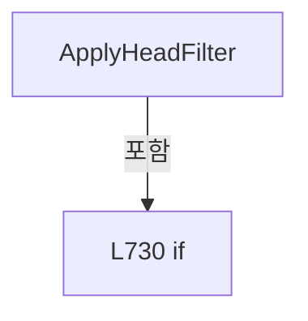

변경 전 점검: 입력/반환 타입, 위 호출자, 예외/취소 경로, 공유 상태와 저장·전송 소비자를 함께 확인합니다. 값의 단위나 물리 방향을 이름만으로 확정하지 않습니다.

### LocalFunctionStatement `MatchesHead` · L735–738

[Drilling.UI/Menu/Menus/CMenuSetting.cs:735–738](https://github.com/kjuws10-rgb/A3Drilling/blob/28764c91d521777b8ee068dd7aaf2d3902ce9fe2/Drilling.UI/Menu/Menus/CMenuSetting.cs#L735-L738)

| 항목 | 실제 추출 값 |
| --- | --- |
| 서명 | bool MatchesHead(Drilling.UI.Menu.Menus.ST_SYSTEM_PARAMETER_ROW) |
| 접근/수식자 | Private /  |
| 반환/값 타입 | bool |
| 소속 타입 | NamedType:Drilling.UI.Menu.Menus.CMenuSetting |

입력 계약:

| 이름 | 타입 | 전달 | 선택/기본값 |
| --- | --- | --- | --- |
| row | Drilling.UI.Menu.Menus.ST_SYSTEM_PARAMETER_ROW | None | False /  |

현재 부분 분석에서 직접 연결된 호출자는 없습니다. XAML/이벤트/인터페이스·델리게이트·외부 진입을 추가 확인해야 하며, 미사용으로 판정한 것이 아닙니다.

호출하는 대상과 해석 범위:

| 원본 행 | 표현식 | 분석 상태 | 대상/소스 위치 |
| --- | --- | --- | --- |
| 737 | row.HeadFilter.Equals | resolved | bool string.Equals(string?, System.StringComparison) |

본문의 실제 연산·분기·예외·반환 순서(원문 위치 순):

| 원본 행 | 종류 | 주석 해설 |
| --- | --- | --- |
| 737 | call | 함수·델리게이트 또는 객체 생성자를 호출합니다: row.HeadFilter.Equals(selectedHeadFilter, StringComparison.OrdinalIgnoreCase) |
| 737 | return | 호출자에게 값 또는 제어를 반환합니다: return row.HeadFilter.Equals(selectedHeadFilter, StringComparison.OrdinalIgnoreCase); |

변경 전 점검: 입력/반환 타입, 위 호출자, 예외/취소 경로, 공유 상태와 저장·전송 소비자를 함께 확인합니다. 값의 단위나 물리 방향을 이름만으로 확정하지 않습니다.

### MethodDeclaration `MarkSelectedHeadFilter` · L743–754

[Drilling.UI/Menu/Menus/CMenuSetting.cs:743–754](https://github.com/kjuws10-rgb/A3Drilling/blob/28764c91d521777b8ee068dd7aaf2d3902ce9fe2/Drilling.UI/Menu/Menus/CMenuSetting.cs#L743-L754)

| 항목 | 실제 추출 값 |
| --- | --- |
| 서명 | System.Collections.Generic.IReadOnlyList<Drilling.UI.Menu.Menus.ST_SETTING_HEAD_FILTER> Drilling.UI.Menu.Menus.CMenuSetting.MarkSelectedHeadFilter(System.Collections.Generic.IReadOnlyList<Drilling.UI.Menu.Menus.ST_SETTING_HEAD_FILTER>, string) |
| 접근/수식자 | Private / private, static |
| 반환/값 타입 | System.Collections.Generic.IReadOnlyList<Drilling.UI.Menu.Menus.ST_SETTING_HEAD_FILTER> |
| 소속 타입 | NamedType:Drilling.UI.Menu.Menus.CMenuSetting |

입력 계약:

| 이름 | 타입 | 전달 | 선택/기본값 |
| --- | --- | --- | --- |
| filters | System.Collections.Generic.IReadOnlyList<Drilling.UI.Menu.Menus.ST_SETTING_HEAD_FILTER> | None | False /  |
| selectedHeadFilter | string | None | False /  |

정적 호출자로 확인된 위치:

| 호출 파일/행 | 호출 표현식 | 런타임 분기 가능 |
| --- | --- | --- |
| [Drilling.UI/Menu/Menus/CMenuSetting.cs:247–247](https://github.com/kjuws10-rgb/A3Drilling/blob/28764c91d521777b8ee068dd7aaf2d3902ce9fe2/Drilling.UI/Menu/Menus/CMenuSetting.cs#L247-L247) | MarkSelectedHeadFilter | False |

호출하는 대상과 해석 범위:

| 원본 행 | 표현식 | 분석 상태 | 대상/소스 위치 |
| --- | --- | --- | --- |
| 753 | filters.Select(MarkSelected).ToArray | resolved | Drilling.UI.Menu.Menus.ST_SETTING_HEAD_FILTER[] System.Collections.Generic.IEnumerable<Drilling.UI.Menu.Menus.ST_SETTING_HEAD_FILTER>.ToArray<Drilling.UI.Menu.Menus.ST_SETTING_HEAD_FILTER>() |
| 753 | filters.Select | resolved | System.Collections.Generic.IEnumerable<Drilling.UI.Menu.Menus.ST_SETTING_HEAD_FILTER> System.Collections.Generic.IEnumerable<Drilling.UI.Menu.Menus.ST_SETTING_HEAD_FILTER>.Select<Drilling.UI.Menu.Menus.ST_SETTING_HEAD_FILTER, Drilling.UI.Menu.Menus.ST_SETTING_HEAD_FILTER>(System.Func<Drilling.UI.Menu.Menus.ST_SETTING_HEAD_FILTER, Drilling.UI.Menu.Menus.ST_SETTING_HEAD_FILTER>) |

본문의 실제 연산·분기·예외·반환 순서(원문 위치 순):

| 원본 행 | 종류 | 주석 해설 |
| --- | --- | --- |
| 753 | call | 함수·델리게이트 또는 객체 생성자를 호출합니다: filters.Select(MarkSelected).ToArray() |
| 753 | call | 함수·델리게이트 또는 객체 생성자를 호출합니다: filters.Select(MarkSelected) |
| 753 | return | 호출자에게 값 또는 제어를 반환합니다: return filters.Select(MarkSelected).ToArray(); |

변경 전 점검: 입력/반환 타입, 위 호출자, 예외/취소 경로, 공유 상태와 저장·전송 소비자를 함께 확인합니다. 값의 단위나 물리 방향을 이름만으로 확정하지 않습니다.

### LocalFunctionStatement `MarkSelected` · L745–751

[Drilling.UI/Menu/Menus/CMenuSetting.cs:745–751](https://github.com/kjuws10-rgb/A3Drilling/blob/28764c91d521777b8ee068dd7aaf2d3902ce9fe2/Drilling.UI/Menu/Menus/CMenuSetting.cs#L745-L751)

| 항목 | 실제 추출 값 |
| --- | --- |
| 서명 | Drilling.UI.Menu.Menus.ST_SETTING_HEAD_FILTER MarkSelected(Drilling.UI.Menu.Menus.ST_SETTING_HEAD_FILTER) |
| 접근/수식자 | Private /  |
| 반환/값 타입 | Drilling.UI.Menu.Menus.ST_SETTING_HEAD_FILTER |
| 소속 타입 | NamedType:Drilling.UI.Menu.Menus.CMenuSetting |

입력 계약:

| 이름 | 타입 | 전달 | 선택/기본값 |
| --- | --- | --- | --- |
| item | Drilling.UI.Menu.Menus.ST_SETTING_HEAD_FILTER | None | False /  |

현재 부분 분석에서 직접 연결된 호출자는 없습니다. XAML/이벤트/인터페이스·델리게이트·외부 진입을 추가 확인해야 하며, 미사용으로 판정한 것이 아닙니다.

호출하는 대상과 해석 범위:

| 원본 행 | 표현식 | 분석 상태 | 대상/소스 위치 |
| --- | --- | --- | --- |
| 749 | item.Name.Equals | resolved | bool string.Equals(string?, System.StringComparison) |

본문의 실제 연산·분기·예외·반환 순서(원문 위치 순):

| 원본 행 | 종류 | 주석 해설 |
| --- | --- | --- |
| 747 | return | 호출자에게 값 또는 제어를 반환합니다: return item with { IsSelected = item.Name.Equals(selectedHeadFilter, StringComparison.OrdinalIgnoreCase) }; |
| 749 | assignment | 값을 대상에 대입합니다: IsSelected = item.Name.Equals(selectedHeadFilter, StringComparison.OrdinalIgnoreCase) |
| 749 | call | 함수·델리게이트 또는 객체 생성자를 호출합니다: item.Name.Equals(selectedHeadFilter, StringComparison.OrdinalIgnoreCase) |

변경 전 점검: 입력/반환 타입, 위 호출자, 예외/취소 경로, 공유 상태와 저장·전송 소비자를 함께 확인합니다. 값의 단위나 물리 방향을 이름만으로 확정하지 않습니다.

### MethodDeclaration `NormalizeHeadFilter` · L756–772

[Drilling.UI/Menu/Menus/CMenuSetting.cs:756–772](https://github.com/kjuws10-rgb/A3Drilling/blob/28764c91d521777b8ee068dd7aaf2d3902ce9fe2/Drilling.UI/Menu/Menus/CMenuSetting.cs#L756-L772)

| 항목 | 실제 추출 값 |
| --- | --- |
| 서명 | string Drilling.UI.Menu.Menus.CMenuSetting.NormalizeHeadFilter(string, System.Collections.Generic.IReadOnlyList<Drilling.UI.Menu.Menus.ST_SETTING_HEAD_FILTER>) |
| 접근/수식자 | Private / private, static |
| 반환/값 타입 | string |
| 소속 타입 | NamedType:Drilling.UI.Menu.Menus.CMenuSetting |

입력 계약:

| 이름 | 타입 | 전달 | 선택/기본값 |
| --- | --- | --- | --- |
| selectedHeadFilter | string | None | False /  |
| filters | System.Collections.Generic.IReadOnlyList<Drilling.UI.Menu.Menus.ST_SETTING_HEAD_FILTER> | None | False /  |

정적 호출자로 확인된 위치:

| 호출 파일/행 | 호출 표현식 | 런타임 분기 가능 |
| --- | --- | --- |
| [Drilling.UI/Menu/Menus/CMenuSetting.cs:246–246](https://github.com/kjuws10-rgb/A3Drilling/blob/28764c91d521777b8ee068dd7aaf2d3902ce9fe2/Drilling.UI/Menu/Menus/CMenuSetting.cs#L246-L246) | NormalizeHeadFilter | False |

호출하는 대상과 해석 범위:

| 원본 행 | 표현식 | 분석 상태 | 대상/소스 위치 |
| --- | --- | --- | --- |
| 765 | filter.Name.Equals | resolved | bool string.Equals(string?, System.StringComparison) |

본문의 실제 연산·분기·예외·반환 순서(원문 위치 순):

| 원본 행 | 종류 | 주석 해설 |
| --- | --- | --- |
| 758 | if | 조건에 따라 분기합니다: if (filters.Count == 0) |
| 760 | return | 호출자에게 값 또는 제어를 반환합니다: return "ALL"; |
| 763 | foreach | 컬렉션 요소를 순회합니다: foreach (var filter in filters) |
| 765 | call | 함수·델리게이트 또는 객체 생성자를 호출합니다: filter.Name.Equals(selectedHeadFilter, StringComparison.OrdinalIgnoreCase) |
| 765 | if | 조건에 따라 분기합니다: if (filter.Name.Equals(selectedHeadFilter, StringComparison.OrdinalIgnoreCase)) |
| 767 | return | 호출자에게 값 또는 제어를 반환합니다: return filter.Name; |
| 771 | return | 호출자에게 값 또는 제어를 반환합니다: return "ALL"; |

제어 구문의 포함 구조(실제 실행 순서/CFG가 아닌 구문 탐색 그림):

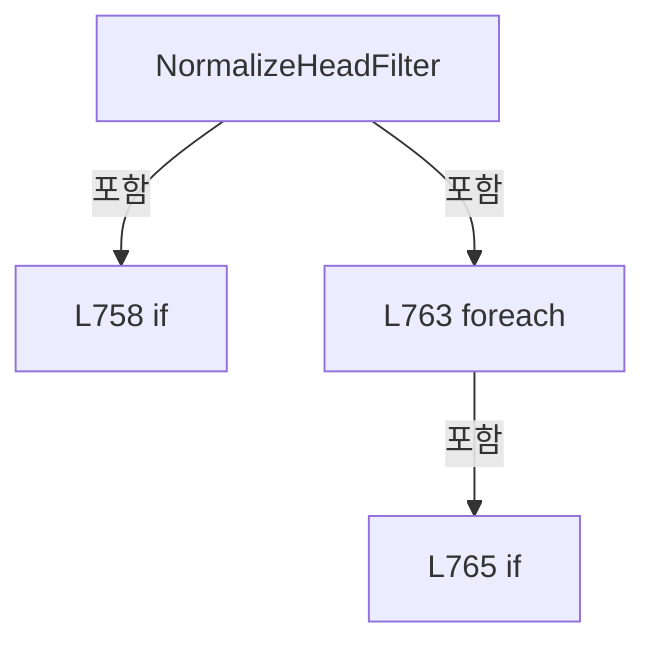

변경 전 점검: 입력/반환 타입, 위 호출자, 예외/취소 경로, 공유 상태와 저장·전송 소비자를 함께 확인합니다. 값의 단위나 물리 방향을 이름만으로 확정하지 않습니다.

### MethodDeclaration `BuildInterfaceGroups` · L774–791

[Drilling.UI/Menu/Menus/CMenuSetting.cs:774–791](https://github.com/kjuws10-rgb/A3Drilling/blob/28764c91d521777b8ee068dd7aaf2d3902ce9fe2/Drilling.UI/Menu/Menus/CMenuSetting.cs#L774-L791)

| 항목 | 실제 추출 값 |
| --- | --- |
| 서명 | System.Collections.Generic.IReadOnlyList<string> Drilling.UI.Menu.Menus.CMenuSetting.BuildInterfaceGroups(System.Collections.Generic.IReadOnlyList<Drilling.UI.Menu.Menus.ST_SETTING_INTERFACE_ROW>) |
| 접근/수식자 | Private / private, static |
| 반환/값 타입 | System.Collections.Generic.IReadOnlyList<string> |
| 소속 타입 | NamedType:Drilling.UI.Menu.Menus.CMenuSetting |

입력 계약:

| 이름 | 타입 | 전달 | 선택/기본값 |
| --- | --- | --- | --- |
| rows | System.Collections.Generic.IReadOnlyList<Drilling.UI.Menu.Menus.ST_SETTING_INTERFACE_ROW> | None | False /  |

정적 호출자로 확인된 위치:

| 호출 파일/행 | 호출 표현식 | 런타임 분기 가능 |
| --- | --- | --- |
| [Drilling.UI/Menu/Menus/CMenuSetting.cs:237–237](https://github.com/kjuws10-rgb/A3Drilling/blob/28764c91d521777b8ee068dd7aaf2d3902ce9fe2/Drilling.UI/Menu/Menus/CMenuSetting.cs#L237-L237) | BuildInterfaceGroups | False |

호출하는 대상과 해석 범위:

| 원본 행 | 표현식 | 분석 상태 | 대상/소스 위치 |
| --- | --- | --- | --- |
| 786 | rows.Select(SelectType).Where(ShouldIncludeItem).Distinct(StringComparer.OrdinalIgnoreCase).ToArray | resolved | string[] System.Collections.Generic.IEnumerable<string>.ToArray<string>() |
| 786 | rows.Select(SelectType).Where(ShouldIncludeItem).Distinct | resolved | System.Collections.Generic.IEnumerable<string> System.Collections.Generic.IEnumerable<string>.Distinct<string>(System.Collections.Generic.IEqualityComparer<string>?) |
| 786 | rows.Select(SelectType).Where | resolved | System.Collections.Generic.IEnumerable<string> System.Collections.Generic.IEnumerable<string>.Where<string>(System.Func<string, bool>) |
| 786 | rows.Select | resolved | System.Collections.Generic.IEnumerable<string> System.Collections.Generic.IEnumerable<Drilling.UI.Menu.Menus.ST_SETTING_INTERFACE_ROW>.Select<Drilling.UI.Menu.Menus.ST_SETTING_INTERFACE_ROW, string>(System.Func<Drilling.UI.Menu.Menus.ST_SETTING_INTERFACE_ROW, string>) |
| 787 | new[] { "ALL" }.Concat(groups).ToArray | resolved | string[] System.Collections.Generic.IEnumerable<string>.ToArray<string>() |
| 787 | new[] { "ALL" }.Concat | resolved | System.Collections.Generic.IEnumerable<string> System.Collections.Generic.IEnumerable<string>.Concat<string>(System.Collections.Generic.IEnumerable<string>) |

본문의 실제 연산·분기·예외·반환 순서(원문 위치 순):

| 원본 행 | 종류 | 주석 해설 |
| --- | --- | --- |
| 786 | call | 함수·델리게이트 또는 객체 생성자를 호출합니다: rows.Select(SelectType).Where(ShouldIncludeItem).Distinct(StringComparer.OrdinalIgnoreCase).ToArray() |
| 786 | call | 함수·델리게이트 또는 객체 생성자를 호출합니다: rows.Select(SelectType).Where(ShouldIncludeItem).Distinct(StringComparer.OrdinalIgnoreCase) |
| 786 | call | 함수·델리게이트 또는 객체 생성자를 호출합니다: rows.Select(SelectType).Where(ShouldIncludeItem) |
| 786 | call | 함수·델리게이트 또는 객체 생성자를 호출합니다: rows.Select(SelectType) |
| 786 | local-declaration | 지역 변수를 선언합니다: var groups = rows.Select(SelectType).Where(ShouldIncludeItem).Distinct(StringComparer.OrdinalIgnoreCase).ToArray(); |
| 786 | variable-initializer | 변수의 초기값을 지정합니다: groups = rows.Select(SelectType).Where(ShouldIncludeItem).Distinct(StringComparer.OrdinalIgnoreCase).ToArray() |
| 787 | call | 함수·델리게이트 또는 객체 생성자를 호출합니다: new[] { "ALL" }.Concat(groups).ToArray() |
| 787 | call | 함수·델리게이트 또는 객체 생성자를 호출합니다: new[] { "ALL" }.Concat(groups) |
| 787 | return | 호출자에게 값 또는 제어를 반환합니다: return new[] { "ALL" }.Concat(groups).ToArray(); |

변경 전 점검: 입력/반환 타입, 위 호출자, 예외/취소 경로, 공유 상태와 저장·전송 소비자를 함께 확인합니다. 값의 단위나 물리 방향을 이름만으로 확정하지 않습니다.

### LocalFunctionStatement `SelectType` · L776–779

[Drilling.UI/Menu/Menus/CMenuSetting.cs:776–779](https://github.com/kjuws10-rgb/A3Drilling/blob/28764c91d521777b8ee068dd7aaf2d3902ce9fe2/Drilling.UI/Menu/Menus/CMenuSetting.cs#L776-L779)

| 항목 | 실제 추출 값 |
| --- | --- |
| 서명 | string SelectType(Drilling.UI.Menu.Menus.ST_SETTING_INTERFACE_ROW) |
| 접근/수식자 | Private /  |
| 반환/값 타입 | string |
| 소속 타입 | NamedType:Drilling.UI.Menu.Menus.CMenuSetting |

입력 계약:

| 이름 | 타입 | 전달 | 선택/기본값 |
| --- | --- | --- | --- |
| row | Drilling.UI.Menu.Menus.ST_SETTING_INTERFACE_ROW | None | False /  |

현재 부분 분석에서 직접 연결된 호출자는 없습니다. XAML/이벤트/인터페이스·델리게이트·외부 진입을 추가 확인해야 하며, 미사용으로 판정한 것이 아닙니다.

본문의 실제 연산·분기·예외·반환 순서(원문 위치 순):

| 원본 행 | 종류 | 주석 해설 |
| --- | --- | --- |
| 778 | return | 호출자에게 값 또는 제어를 반환합니다: return row.Type; |

변경 전 점검: 입력/반환 타입, 위 호출자, 예외/취소 경로, 공유 상태와 저장·전송 소비자를 함께 확인합니다. 값의 단위나 물리 방향을 이름만으로 확정하지 않습니다.

### LocalFunctionStatement `ShouldIncludeItem` · L781–784

[Drilling.UI/Menu/Menus/CMenuSetting.cs:781–784](https://github.com/kjuws10-rgb/A3Drilling/blob/28764c91d521777b8ee068dd7aaf2d3902ce9fe2/Drilling.UI/Menu/Menus/CMenuSetting.cs#L781-L784)

| 항목 | 실제 추출 값 |
| --- | --- |
| 서명 | bool ShouldIncludeItem(string) |
| 접근/수식자 | Private /  |
| 반환/값 타입 | bool |
| 소속 타입 | NamedType:Drilling.UI.Menu.Menus.CMenuSetting |

입력 계약:

| 이름 | 타입 | 전달 | 선택/기본값 |
| --- | --- | --- | --- |
| group | string | None | False /  |

현재 부분 분석에서 직접 연결된 호출자는 없습니다. XAML/이벤트/인터페이스·델리게이트·외부 진입을 추가 확인해야 하며, 미사용으로 판정한 것이 아닙니다.

호출하는 대상과 해석 범위:

| 원본 행 | 표현식 | 분석 상태 | 대상/소스 위치 |
| --- | --- | --- | --- |
| 783 | string.IsNullOrWhiteSpace | resolved | bool string.IsNullOrWhiteSpace(string?) |

본문의 실제 연산·분기·예외·반환 순서(원문 위치 순):

| 원본 행 | 종류 | 주석 해설 |
| --- | --- | --- |
| 783 | call | 함수·델리게이트 또는 객체 생성자를 호출합니다: string.IsNullOrWhiteSpace(group) |
| 783 | return | 호출자에게 값 또는 제어를 반환합니다: return !string.IsNullOrWhiteSpace(group); |

변경 전 점검: 입력/반환 타입, 위 호출자, 예외/취소 경로, 공유 상태와 저장·전송 소비자를 함께 확인합니다. 값의 단위나 물리 방향을 이름만으로 확정하지 않습니다.

### MethodDeclaration `BuildHistoryItems` · L793–801

[Drilling.UI/Menu/Menus/CMenuSetting.cs:793–801](https://github.com/kjuws10-rgb/A3Drilling/blob/28764c91d521777b8ee068dd7aaf2d3902ce9fe2/Drilling.UI/Menu/Menus/CMenuSetting.cs#L793-L801)

| 항목 | 실제 추출 값 |
| --- | --- |
| 서명 | System.Collections.Generic.IReadOnlyList<Drilling.UI.Menu.Menus.ST_DISPLAY_ITEM> Drilling.UI.Menu.Menus.CMenuSetting.BuildHistoryItems(System.Collections.Generic.IReadOnlyList<Drilling.Common.Managers.ST_SETTING_HISTORY>) |
| 접근/수식자 | Private / private, static |
| 반환/값 타입 | System.Collections.Generic.IReadOnlyList<Drilling.UI.Menu.Menus.ST_DISPLAY_ITEM> |
| 소속 타입 | NamedType:Drilling.UI.Menu.Menus.CMenuSetting |

입력 계약:

| 이름 | 타입 | 전달 | 선택/기본값 |
| --- | --- | --- | --- |
| history | System.Collections.Generic.IReadOnlyList<Drilling.Common.Managers.ST_SETTING_HISTORY> | None | False /  |

정적 호출자로 확인된 위치:

| 호출 파일/행 | 호출 표현식 | 런타임 분기 가능 |
| --- | --- | --- |
| [Drilling.UI/Menu/Menus/CMenuSetting.cs:264–264](https://github.com/kjuws10-rgb/A3Drilling/blob/28764c91d521777b8ee068dd7aaf2d3902ce9fe2/Drilling.UI/Menu/Menus/CMenuSetting.cs#L264-L264) | BuildHistoryItems | False |

호출하는 대상과 해석 범위:

| 원본 행 | 표현식 | 분석 상태 | 대상/소스 위치 |
| --- | --- | --- | --- |
| 800 | history.Select(BuildDisplay).ToArray | resolved | Drilling.UI.Menu.Menus.ST_DISPLAY_ITEM[] System.Collections.Generic.IEnumerable<Drilling.UI.Menu.Menus.ST_DISPLAY_ITEM>.ToArray<Drilling.UI.Menu.Menus.ST_DISPLAY_ITEM>() |
| 800 | history.Select | resolved | System.Collections.Generic.IEnumerable<Drilling.UI.Menu.Menus.ST_DISPLAY_ITEM> System.Collections.Generic.IEnumerable<Drilling.Common.Managers.ST_SETTING_HISTORY>.Select<Drilling.Common.Managers.ST_SETTING_HISTORY, Drilling.UI.Menu.Menus.ST_DISPLAY_ITEM>(System.Func<Drilling.Common.Managers.ST_SETTING_HISTORY, Drilling.UI.Menu.Menus.ST_DISPLAY_ITEM>) |

본문의 실제 연산·분기·예외·반환 순서(원문 위치 순):

| 원본 행 | 종류 | 주석 해설 |
| --- | --- | --- |
| 800 | call | 함수·델리게이트 또는 객체 생성자를 호출합니다: history.Select(BuildDisplay).ToArray() |
| 800 | call | 함수·델리게이트 또는 객체 생성자를 호출합니다: history.Select(BuildDisplay) |
| 800 | return | 호출자에게 값 또는 제어를 반환합니다: return history.Select(BuildDisplay).ToArray(); |

변경 전 점검: 입력/반환 타입, 위 호출자, 예외/취소 경로, 공유 상태와 저장·전송 소비자를 함께 확인합니다. 값의 단위나 물리 방향을 이름만으로 확정하지 않습니다.

### LocalFunctionStatement `BuildDisplay` · L795–798

[Drilling.UI/Menu/Menus/CMenuSetting.cs:795–798](https://github.com/kjuws10-rgb/A3Drilling/blob/28764c91d521777b8ee068dd7aaf2d3902ce9fe2/Drilling.UI/Menu/Menus/CMenuSetting.cs#L795-L798)

| 항목 | 실제 추출 값 |
| --- | --- |
| 서명 | Drilling.UI.Menu.Menus.ST_DISPLAY_ITEM BuildDisplay(Drilling.Common.Managers.ST_SETTING_HISTORY) |
| 접근/수식자 | Private /  |
| 반환/값 타입 | Drilling.UI.Menu.Menus.ST_DISPLAY_ITEM |
| 소속 타입 | NamedType:Drilling.UI.Menu.Menus.CMenuSetting |

입력 계약:

| 이름 | 타입 | 전달 | 선택/기본값 |
| --- | --- | --- | --- |
| item | Drilling.Common.Managers.ST_SETTING_HISTORY | None | False /  |

현재 부분 분석에서 직접 연결된 호출자는 없습니다. XAML/이벤트/인터페이스·델리게이트·외부 진입을 추가 확인해야 하며, 미사용으로 판정한 것이 아닙니다.

호출하는 대상과 해석 범위:

| 원본 행 | 표현식 | 분석 상태 | 대상/소스 위치 |
| --- | --- | --- | --- |
| 797 | new ST_DISPLAY_ITEM | resolved | Drilling.UI.Menu.Menus.ST_DISPLAY_ITEM.ST_DISPLAY_ITEM(string, string, string) · Drilling.UI/Menu/Menus/CMenuBase.cs:43 |
| 797 | item.ChangedAt.ToString | resolved | string System.DateTimeOffset.ToString(string?) |

본문의 실제 연산·분기·예외·반환 순서(원문 위치 순):

| 원본 행 | 종류 | 주석 해설 |
| --- | --- | --- |
| 797 | call | 함수·델리게이트 또는 객체 생성자를 호출합니다: new ST_DISPLAY_ITEM(item.ChangedAt.ToString("HH:mm:ss"), $"{item.Action} / {item.ParameterName}", $"{item.OldValue} -> {item.NewValue}") |
| 797 | call | 함수·델리게이트 또는 객체 생성자를 호출합니다: item.ChangedAt.ToString("HH:mm:ss") |
| 797 | return | 호출자에게 값 또는 제어를 반환합니다: return new ST_DISPLAY_ITEM(item.ChangedAt.ToString("HH:mm:ss"), $"{item.Action} / {item.ParameterName}", $"{item.OldValue} -> {item.NewValue}"); |

변경 전 점검: 입력/반환 타입, 위 호출자, 예외/취소 경로, 공유 상태와 저장·전송 소비자를 함께 확인합니다. 값의 단위나 물리 방향을 이름만으로 확정하지 않습니다.

### MethodDeclaration `BuildHistoryRows` · L803–816

[Drilling.UI/Menu/Menus/CMenuSetting.cs:803–816](https://github.com/kjuws10-rgb/A3Drilling/blob/28764c91d521777b8ee068dd7aaf2d3902ce9fe2/Drilling.UI/Menu/Menus/CMenuSetting.cs#L803-L816)

| 항목 | 실제 추출 값 |
| --- | --- |
| 서명 | System.Collections.Generic.IReadOnlyList<Drilling.UI.Menu.Menus.ST_SETTING_HISTORY_ROW> Drilling.UI.Menu.Menus.CMenuSetting.BuildHistoryRows(System.Collections.Generic.IReadOnlyList<Drilling.Common.Managers.ST_SETTING_HISTORY>) |
| 접근/수식자 | Private / private, static |
| 반환/값 타입 | System.Collections.Generic.IReadOnlyList<Drilling.UI.Menu.Menus.ST_SETTING_HISTORY_ROW> |
| 소속 타입 | NamedType:Drilling.UI.Menu.Menus.CMenuSetting |

입력 계약:

| 이름 | 타입 | 전달 | 선택/기본값 |
| --- | --- | --- | --- |
| history | System.Collections.Generic.IReadOnlyList<Drilling.Common.Managers.ST_SETTING_HISTORY> | None | False /  |

정적 호출자로 확인된 위치:

| 호출 파일/행 | 호출 표현식 | 런타임 분기 가능 |
| --- | --- | --- |
| [Drilling.UI/Menu/Menus/CMenuSetting.cs:275–275](https://github.com/kjuws10-rgb/A3Drilling/blob/28764c91d521777b8ee068dd7aaf2d3902ce9fe2/Drilling.UI/Menu/Menus/CMenuSetting.cs#L275-L275) | BuildHistoryRows | False |

호출하는 대상과 해석 범위:

| 원본 행 | 표현식 | 분석 상태 | 대상/소스 위치 |
| --- | --- | --- | --- |
| 815 | history.Where(ShouldIncludeItem).Select(BuildSetting).ToArray | resolved | Drilling.UI.Menu.Menus.ST_SETTING_HISTORY_ROW[] System.Collections.Generic.IEnumerable<Drilling.UI.Menu.Menus.ST_SETTING_HISTORY_ROW>.ToArray<Drilling.UI.Menu.Menus.ST_SETTING_HISTORY_ROW>() |
| 815 | history.Where(ShouldIncludeItem).Select | resolved | System.Collections.Generic.IEnumerable<Drilling.UI.Menu.Menus.ST_SETTING_HISTORY_ROW> System.Collections.Generic.IEnumerable<Drilling.Common.Managers.ST_SETTING_HISTORY>.Select<Drilling.Common.Managers.ST_SETTING_HISTORY, Drilling.UI.Menu.Menus.ST_SETTING_HISTORY_ROW>(System.Func<Drilling.Common.Managers.ST_SETTING_HISTORY, Drilling.UI.Menu.Menus.ST_SETTING_HISTORY_ROW>) |
| 815 | history.Where | resolved | System.Collections.Generic.IEnumerable<Drilling.Common.Managers.ST_SETTING_HISTORY> System.Collections.Generic.IEnumerable<Drilling.Common.Managers.ST_SETTING_HISTORY>.Where<Drilling.Common.Managers.ST_SETTING_HISTORY>(System.Func<Drilling.Common.Managers.ST_SETTING_HISTORY, bool>) |

본문의 실제 연산·분기·예외·반환 순서(원문 위치 순):

| 원본 행 | 종류 | 주석 해설 |
| --- | --- | --- |
| 815 | call | 함수·델리게이트 또는 객체 생성자를 호출합니다: history.Where(ShouldIncludeItem).Select(BuildSetting).ToArray() |
| 815 | call | 함수·델리게이트 또는 객체 생성자를 호출합니다: history.Where(ShouldIncludeItem).Select(BuildSetting) |
| 815 | call | 함수·델리게이트 또는 객체 생성자를 호출합니다: history.Where(ShouldIncludeItem) |
| 815 | return | 호출자에게 값 또는 제어를 반환합니다: return history.Where(ShouldIncludeItem).Select(BuildSetting).ToArray(); |

변경 전 점검: 입력/반환 타입, 위 호출자, 예외/취소 경로, 공유 상태와 저장·전송 소비자를 함께 확인합니다. 값의 단위나 물리 방향을 이름만으로 확정하지 않습니다.

### LocalFunctionStatement `ShouldIncludeItem` · L805–808

[Drilling.UI/Menu/Menus/CMenuSetting.cs:805–808](https://github.com/kjuws10-rgb/A3Drilling/blob/28764c91d521777b8ee068dd7aaf2d3902ce9fe2/Drilling.UI/Menu/Menus/CMenuSetting.cs#L805-L808)

| 항목 | 실제 추출 값 |
| --- | --- |
| 서명 | bool ShouldIncludeItem(Drilling.Common.Managers.ST_SETTING_HISTORY) |
| 접근/수식자 | Private /  |
| 반환/값 타입 | bool |
| 소속 타입 | NamedType:Drilling.UI.Menu.Menus.CMenuSetting |

입력 계약:

| 이름 | 타입 | 전달 | 선택/기본값 |
| --- | --- | --- | --- |
| item | Drilling.Common.Managers.ST_SETTING_HISTORY | None | False /  |

현재 부분 분석에서 직접 연결된 호출자는 없습니다. XAML/이벤트/인터페이스·델리게이트·외부 진입을 추가 확인해야 하며, 미사용으로 판정한 것이 아닙니다.

호출하는 대상과 해석 범위:

| 원본 행 | 표현식 | 분석 상태 | 대상/소스 위치 |
| --- | --- | --- | --- |
| 807 | item.Action.Equals | resolved | bool string.Equals(string?, System.StringComparison) |

본문의 실제 연산·분기·예외·반환 순서(원문 위치 순):

| 원본 행 | 종류 | 주석 해설 |
| --- | --- | --- |
| 807 | call | 함수·델리게이트 또는 객체 생성자를 호출합니다: item.Action.Equals("SAVE", StringComparison.OrdinalIgnoreCase) |
| 807 | return | 호출자에게 값 또는 제어를 반환합니다: return !item.Action.Equals("SAVE", StringComparison.OrdinalIgnoreCase); |

변경 전 점검: 입력/반환 타입, 위 호출자, 예외/취소 경로, 공유 상태와 저장·전송 소비자를 함께 확인합니다. 값의 단위나 물리 방향을 이름만으로 확정하지 않습니다.

### LocalFunctionStatement `BuildSetting` · L810–813

[Drilling.UI/Menu/Menus/CMenuSetting.cs:810–813](https://github.com/kjuws10-rgb/A3Drilling/blob/28764c91d521777b8ee068dd7aaf2d3902ce9fe2/Drilling.UI/Menu/Menus/CMenuSetting.cs#L810-L813)

| 항목 | 실제 추출 값 |
| --- | --- |
| 서명 | Drilling.UI.Menu.Menus.ST_SETTING_HISTORY_ROW BuildSetting(Drilling.Common.Managers.ST_SETTING_HISTORY) |
| 접근/수식자 | Private /  |
| 반환/값 타입 | Drilling.UI.Menu.Menus.ST_SETTING_HISTORY_ROW |
| 소속 타입 | NamedType:Drilling.UI.Menu.Menus.CMenuSetting |

입력 계약:

| 이름 | 타입 | 전달 | 선택/기본값 |
| --- | --- | --- | --- |
| item | Drilling.Common.Managers.ST_SETTING_HISTORY | None | False /  |

현재 부분 분석에서 직접 연결된 호출자는 없습니다. XAML/이벤트/인터페이스·델리게이트·외부 진입을 추가 확인해야 하며, 미사용으로 판정한 것이 아닙니다.

호출하는 대상과 해석 범위:

| 원본 행 | 표현식 | 분석 상태 | 대상/소스 위치 |
| --- | --- | --- | --- |
| 812 | new ST_SETTING_HISTORY_ROW | resolved | Drilling.UI.Menu.Menus.ST_SETTING_HISTORY_ROW.ST_SETTING_HISTORY_ROW(string, string, string, string, string, string, string) · Drilling.UI/Menu/Menus/CMenuSetting.cs:1320 |
| 812 | item.ChangedAt.ToString | resolved | string System.DateTimeOffset.ToString(string?) |
| 812 | ToTabText | resolved | string Drilling.UI.Menu.Menus.CMenuSetting.ToTabText(Drilling.Common.Managers.EN_SETTING_TAB) · Drilling.UI/Menu/Menus/CMenuSetting.cs:1069 |

본문의 실제 연산·분기·예외·반환 순서(원문 위치 순):

| 원본 행 | 종류 | 주석 해설 |
| --- | --- | --- |
| 812 | call | 함수·델리게이트 또는 객체 생성자를 호출합니다: new ST_SETTING_HISTORY_ROW(item.ChangedAt.ToString("HH:mm:ss"), item.OperatorId, ToTabText(item.Section), item.ParameterName, item.OldValue, item.NewValue, "Warn") |
| 812 | call | 함수·델리게이트 또는 객체 생성자를 호출합니다: item.ChangedAt.ToString("HH:mm:ss") |
| 812 | call | 함수·델리게이트 또는 객체 생성자를 호출합니다: ToTabText(item.Section) |
| 812 | return | 호출자에게 값 또는 제어를 반환합니다: return new ST_SETTING_HISTORY_ROW(item.ChangedAt.ToString("HH:mm:ss"), item.OperatorId, ToTabText(item.Section), item.ParameterName, item.OldValue, item.NewValue, "Warn"); |

변경 전 점검: 입력/반환 타입, 위 호출자, 예외/취소 경로, 공유 상태와 저장·전송 소비자를 함께 확인합니다. 값의 단위나 물리 방향을 이름만으로 확정하지 않습니다.

### MethodDeclaration `BuildSummaryRows` · L818–843

[Drilling.UI/Menu/Menus/CMenuSetting.cs:818–843](https://github.com/kjuws10-rgb/A3Drilling/blob/28764c91d521777b8ee068dd7aaf2d3902ce9fe2/Drilling.UI/Menu/Menus/CMenuSetting.cs#L818-L843)

| 항목 | 실제 추출 값 |
| --- | --- |
| 서명 | System.Collections.Generic.IReadOnlyList<Drilling.UI.Menu.Menus.ST_SETTING_SUMMARY_ROW> Drilling.UI.Menu.Menus.CMenuSetting.BuildSummaryRows(string, System.Collections.Generic.IReadOnlyList<Drilling.UI.Menu.Menus.ST_SYSTEM_PARAMETER_ROW>, System.Collections.Generic.IReadOnlyList<Drilling.UI.Menu.Menus.ST_SETTING_INTERFACE_ROW>, System.Collections.Generic.IReadOnlyList<Drilling.Common.Managers.ST_SETTING_HISTORY>) |
| 접근/수식자 | Private / private, static |
| 반환/값 타입 | System.Collections.Generic.IReadOnlyList<Drilling.UI.Menu.Menus.ST_SETTING_SUMMARY_ROW> |
| 소속 타입 | NamedType:Drilling.UI.Menu.Menus.CMenuSetting |

입력 계약:

| 이름 | 타입 | 전달 | 선택/기본값 |
| --- | --- | --- | --- |
| selectedTab | string | None | False /  |
| rows | System.Collections.Generic.IReadOnlyList<Drilling.UI.Menu.Menus.ST_SYSTEM_PARAMETER_ROW> | None | False /  |
| interfaceRows | System.Collections.Generic.IReadOnlyList<Drilling.UI.Menu.Menus.ST_SETTING_INTERFACE_ROW> | None | False /  |
| history | System.Collections.Generic.IReadOnlyList<Drilling.Common.Managers.ST_SETTING_HISTORY> | None | False /  |

정적 호출자로 확인된 위치:

| 호출 파일/행 | 호출 표현식 | 런타임 분기 가능 |
| --- | --- | --- |
| [Drilling.UI/Menu/Menus/CMenuSetting.cs:276–276](https://github.com/kjuws10-rgb/A3Drilling/blob/28764c91d521777b8ee068dd7aaf2d3902ce9fe2/Drilling.UI/Menu/Menus/CMenuSetting.cs#L276-L276) | BuildSummaryRows | False |

호출하는 대상과 해석 범위:

| 원본 행 | 표현식 | 분석 상태 | 대상/소스 위치 |
| --- | --- | --- | --- |
| 835 | interfaceRows.Count | resolved | int System.Collections.Generic.IEnumerable<Drilling.UI.Menu.Menus.ST_SETTING_INTERFACE_ROW>.Count<Drilling.UI.Menu.Menus.ST_SETTING_INTERFACE_ROW>(System.Func<Drilling.UI.Menu.Menus.ST_SETTING_INTERFACE_ROW, bool>) |
| 835 | rows.Count | resolved | int System.Collections.Generic.IEnumerable<Drilling.UI.Menu.Menus.ST_SYSTEM_PARAMETER_ROW>.Count<Drilling.UI.Menu.Menus.ST_SYSTEM_PARAMETER_ROW>(System.Func<Drilling.UI.Menu.Menus.ST_SYSTEM_PARAMETER_ROW, bool>) |
| 841 | history.FirstOrDefault | resolved | Drilling.Common.Managers.ST_SETTING_HISTORY? System.Collections.Generic.IEnumerable<Drilling.Common.Managers.ST_SETTING_HISTORY>.FirstOrDefault<Drilling.Common.Managers.ST_SETTING_HISTORY>(System.Func<Drilling.Common.Managers.ST_SETTING_HISTORY, bool>) |
| 842 | new | resolved | Drilling.UI.Menu.Menus.ST_SETTING_SUMMARY_ROW.ST_SETTING_SUMMARY_ROW(string, string, string) · Drilling.UI/Menu/Menus/CMenuSetting.cs:1335 |
| 842 | modifiedCount.ToString | resolved · 동적 구현 선택 가능 | string int.ToString() |
| 842 | new | resolved | Drilling.UI.Menu.Menus.ST_SETTING_SUMMARY_ROW.ST_SETTING_SUMMARY_ROW(string, string, string) · Drilling.UI/Menu/Menus/CMenuSetting.cs:1335 |
| 842 | .ToString | resolved | string System.DateTimeOffset.ToString(string?) |

본문의 실제 연산·분기·예외·반환 순서(원문 위치 순):

| 원본 행 | 종류 | 주석 해설 |
| --- | --- | --- |
| 835 | call | 함수·델리게이트 또는 객체 생성자를 호출합니다: interfaceRows.Count(IsIsModified) |
| 835 | call | 함수·델리게이트 또는 객체 생성자를 호출합니다: rows.Count(IsIsModified2) |
| 835 | conditional-expression | 조건에 따라 결과식을 선택합니다: selectedTab == "INTERFACE" ? interfaceRows.Count(IsIsModified) : rows.Count(IsIsModified2) |
| 835 | local-declaration | 지역 변수를 선언합니다: var modifiedCount = selectedTab == "INTERFACE" ? interfaceRows.Count(IsIsModified) : rows.Count(IsIsModified2); |
| 835 | variable-initializer | 변수의 초기값을 지정합니다: modifiedCount = selectedTab == "INTERFACE" ? interfaceRows.Count(IsIsModified) : rows.Count(IsIsModified2) |
| 841 | call | 함수·델리게이트 또는 객체 생성자를 호출합니다: history.FirstOrDefault(MatchesItem) |
| 841 | local-declaration | 지역 변수를 선언합니다: var lastSavedTime = history.FirstOrDefault(MatchesItem)?.ChangedAt; |
| 841 | variable-initializer | 변수의 초기값을 지정합니다: lastSavedTime = history.FirstOrDefault(MatchesItem)?.ChangedAt |
| 842 | call | 함수·델리게이트 또는 객체 생성자를 호출합니다: new("Modified Items", modifiedCount.ToString(), modifiedCount > 0 ? "Warn" : "Ok") |
| 842 | call | 함수·델리게이트 또는 객체 생성자를 호출합니다: modifiedCount.ToString() |
| 842 | call | 함수·델리게이트 또는 객체 생성자를 호출합니다: new("Last Saved Time", lastSavedTime?.ToString("yyyy-MM-dd HH:mm:ss") ?? "-") |
| 842 | call | 함수·델리게이트 또는 객체 생성자를 호출합니다: .ToString("yyyy-MM-dd HH:mm:ss") |
| 842 | conditional-expression | 조건에 따라 결과식을 선택합니다: modifiedCount > 0 ? "Warn" : "Ok" |
| 842 | return | 호출자에게 값 또는 제어를 반환합니다: return[new("Modified Items", modifiedCount.ToString(), modifiedCount > 0 ? "Warn" : "Ok"), new("Last Saved Time", lastSavedTime?.ToString("yyyy-MM-dd HH:mm:ss") ?? "-")]; |

변경 전 점검: 입력/반환 타입, 위 호출자, 예외/취소 경로, 공유 상태와 저장·전송 소비자를 함께 확인합니다. 값의 단위나 물리 방향을 이름만으로 확정하지 않습니다.

### LocalFunctionStatement `IsIsModified` · L825–828

[Drilling.UI/Menu/Menus/CMenuSetting.cs:825–828](https://github.com/kjuws10-rgb/A3Drilling/blob/28764c91d521777b8ee068dd7aaf2d3902ce9fe2/Drilling.UI/Menu/Menus/CMenuSetting.cs#L825-L828)

| 항목 | 실제 추출 값 |
| --- | --- |
| 서명 | bool IsIsModified(Drilling.UI.Menu.Menus.ST_SETTING_INTERFACE_ROW) |
| 접근/수식자 | Private /  |
| 반환/값 타입 | bool |
| 소속 타입 | NamedType:Drilling.UI.Menu.Menus.CMenuSetting |

입력 계약:

| 이름 | 타입 | 전달 | 선택/기본값 |
| --- | --- | --- | --- |
| row | Drilling.UI.Menu.Menus.ST_SETTING_INTERFACE_ROW | None | False /  |

현재 부분 분석에서 직접 연결된 호출자는 없습니다. XAML/이벤트/인터페이스·델리게이트·외부 진입을 추가 확인해야 하며, 미사용으로 판정한 것이 아닙니다.

본문의 실제 연산·분기·예외·반환 순서(원문 위치 순):

| 원본 행 | 종류 | 주석 해설 |
| --- | --- | --- |
| 827 | return | 호출자에게 값 또는 제어를 반환합니다: return row.IsModified; |

변경 전 점검: 입력/반환 타입, 위 호출자, 예외/취소 경로, 공유 상태와 저장·전송 소비자를 함께 확인합니다. 값의 단위나 물리 방향을 이름만으로 확정하지 않습니다.

### LocalFunctionStatement `IsIsModified2` · L830–833

[Drilling.UI/Menu/Menus/CMenuSetting.cs:830–833](https://github.com/kjuws10-rgb/A3Drilling/blob/28764c91d521777b8ee068dd7aaf2d3902ce9fe2/Drilling.UI/Menu/Menus/CMenuSetting.cs#L830-L833)

| 항목 | 실제 추출 값 |
| --- | --- |
| 서명 | bool IsIsModified2(Drilling.UI.Menu.Menus.ST_SYSTEM_PARAMETER_ROW) |
| 접근/수식자 | Private /  |
| 반환/값 타입 | bool |
| 소속 타입 | NamedType:Drilling.UI.Menu.Menus.CMenuSetting |

입력 계약:

| 이름 | 타입 | 전달 | 선택/기본값 |
| --- | --- | --- | --- |
| row | Drilling.UI.Menu.Menus.ST_SYSTEM_PARAMETER_ROW | None | False /  |

현재 부분 분석에서 직접 연결된 호출자는 없습니다. XAML/이벤트/인터페이스·델리게이트·외부 진입을 추가 확인해야 하며, 미사용으로 판정한 것이 아닙니다.

본문의 실제 연산·분기·예외·반환 순서(원문 위치 순):

| 원본 행 | 종류 | 주석 해설 |
| --- | --- | --- |
| 832 | return | 호출자에게 값 또는 제어를 반환합니다: return row.IsModified; |

변경 전 점검: 입력/반환 타입, 위 호출자, 예외/취소 경로, 공유 상태와 저장·전송 소비자를 함께 확인합니다. 값의 단위나 물리 방향을 이름만으로 확정하지 않습니다.

### LocalFunctionStatement `MatchesItem` · L836–839

[Drilling.UI/Menu/Menus/CMenuSetting.cs:836–839](https://github.com/kjuws10-rgb/A3Drilling/blob/28764c91d521777b8ee068dd7aaf2d3902ce9fe2/Drilling.UI/Menu/Menus/CMenuSetting.cs#L836-L839)

| 항목 | 실제 추출 값 |
| --- | --- |
| 서명 | bool MatchesItem(Drilling.Common.Managers.ST_SETTING_HISTORY) |
| 접근/수식자 | Private /  |
| 반환/값 타입 | bool |
| 소속 타입 | NamedType:Drilling.UI.Menu.Menus.CMenuSetting |

입력 계약:

| 이름 | 타입 | 전달 | 선택/기본값 |
| --- | --- | --- | --- |
| item | Drilling.Common.Managers.ST_SETTING_HISTORY | None | False /  |

현재 부분 분석에서 직접 연결된 호출자는 없습니다. XAML/이벤트/인터페이스·델리게이트·외부 진입을 추가 확인해야 하며, 미사용으로 판정한 것이 아닙니다.

호출하는 대상과 해석 범위:

| 원본 행 | 표현식 | 분석 상태 | 대상/소스 위치 |
| --- | --- | --- | --- |
| 838 | item.Action.Equals | resolved | bool string.Equals(string?, System.StringComparison) |

본문의 실제 연산·분기·예외·반환 순서(원문 위치 순):

| 원본 행 | 종류 | 주석 해설 |
| --- | --- | --- |
| 838 | call | 함수·델리게이트 또는 객체 생성자를 호출합니다: item.Action.Equals("SAVE", StringComparison.OrdinalIgnoreCase) |
| 838 | return | 호출자에게 값 또는 제어를 반환합니다: return item.Action.Equals("SAVE", StringComparison.OrdinalIgnoreCase); |

변경 전 점검: 입력/반환 타입, 위 호출자, 예외/취소 경로, 공유 상태와 저장·전송 소비자를 함께 확인합니다. 값의 단위나 물리 방향을 이름만으로 확정하지 않습니다.

### MethodDeclaration `BuildInterfaceRows` · L845–884

[Drilling.UI/Menu/Menus/CMenuSetting.cs:845–884](https://github.com/kjuws10-rgb/A3Drilling/blob/28764c91d521777b8ee068dd7aaf2d3902ce9fe2/Drilling.UI/Menu/Menus/CMenuSetting.cs#L845-L884)

| 항목 | 실제 추출 값 |
| --- | --- |
| 서명 | System.Collections.Generic.IReadOnlyList<Drilling.UI.Menu.Menus.ST_SETTING_INTERFACE_ROW> Drilling.UI.Menu.Menus.CMenuSetting.BuildInterfaceRows(System.Collections.Generic.IReadOnlyList<Drilling.Common.Interface.ST_INTERFACE_DATA>) |
| 접근/수식자 | Private / private, static |
| 반환/값 타입 | System.Collections.Generic.IReadOnlyList<Drilling.UI.Menu.Menus.ST_SETTING_INTERFACE_ROW> |
| 소속 타입 | NamedType:Drilling.UI.Menu.Menus.CMenuSetting |

입력 계약:

| 이름 | 타입 | 전달 | 선택/기본값 |
| --- | --- | --- | --- |
| interfaces | System.Collections.Generic.IReadOnlyList<Drilling.Common.Interface.ST_INTERFACE_DATA> | None | False /  |

정적 호출자로 확인된 위치:

| 호출 파일/행 | 호출 표현식 | 런타임 분기 가능 |
| --- | --- | --- |
| [Drilling.UI/Menu/Menus/CMenuSetting.cs:233–233](https://github.com/kjuws10-rgb/A3Drilling/blob/28764c91d521777b8ee068dd7aaf2d3902ce9fe2/Drilling.UI/Menu/Menus/CMenuSetting.cs#L233-L233) | BuildInterfaceRows | False |

호출하는 대상과 해석 범위:

| 원본 행 | 표현식 | 분석 상태 | 대상/소스 위치 |
| --- | --- | --- | --- |
| 883 | interfaces.OrderBy(SelectDevice).ThenBy(SelectNumber).ThenBy(SelectNickName, StringComparer.OrdinalIgnoreCase).Select(BuildSetting).ToArray | resolved | Drilling.UI.Menu.Menus.ST_SETTING_INTERFACE_ROW[] System.Collections.Generic.IEnumerable<Drilling.UI.Menu.Menus.ST_SETTING_INTERFACE_ROW>.ToArray<Drilling.UI.Menu.Menus.ST_SETTING_INTERFACE_ROW>() |
| 883 | interfaces.OrderBy(SelectDevice).ThenBy(SelectNumber).ThenBy(SelectNickName, StringComparer.OrdinalIgnoreCase).Select | resolved | System.Collections.Generic.IEnumerable<Drilling.UI.Menu.Menus.ST_SETTING_INTERFACE_ROW> System.Collections.Generic.IEnumerable<Drilling.Common.Interface.ST_INTERFACE_DATA>.Select<Drilling.Common.Interface.ST_INTERFACE_DATA, Drilling.UI.Menu.Menus.ST_SETTING_INTERFACE_ROW>(System.Func<Drilling.Common.Interface.ST_INTERFACE_DATA, int, Drilling.UI.Menu.Menus.ST_SETTING_INTERFACE_ROW>) |
| 883 | interfaces.OrderBy(SelectDevice).ThenBy(SelectNumber).ThenBy | resolved | System.Linq.IOrderedEnumerable<Drilling.Common.Interface.ST_INTERFACE_DATA> System.Linq.IOrderedEnumerable<Drilling.Common.Interface.ST_INTERFACE_DATA>.ThenBy<Drilling.Common.Interface.ST_INTERFACE_DATA, string>(System.Func<Drilling.Common.Interface.ST_INTERFACE_DATA, string>, System.Collections.Generic.IComparer<string>?) |
| 883 | interfaces.OrderBy(SelectDevice).ThenBy | resolved | System.Linq.IOrderedEnumerable<Drilling.Common.Interface.ST_INTERFACE_DATA> System.Linq.IOrderedEnumerable<Drilling.Common.Interface.ST_INTERFACE_DATA>.ThenBy<Drilling.Common.Interface.ST_INTERFACE_DATA, int>(System.Func<Drilling.Common.Interface.ST_INTERFACE_DATA, int>) |
| 883 | interfaces.OrderBy | resolved | System.Linq.IOrderedEnumerable<Drilling.Common.Interface.ST_INTERFACE_DATA> System.Collections.Generic.IEnumerable<Drilling.Common.Interface.ST_INTERFACE_DATA>.OrderBy<Drilling.Common.Interface.ST_INTERFACE_DATA, Drilling.Common.Interface.EN_EQP_MODULE>(System.Func<Drilling.Common.Interface.ST_INTERFACE_DATA, Drilling.Common.Interface.EN_EQP_MODULE>) |

본문의 실제 연산·분기·예외·반환 순서(원문 위치 순):

| 원본 행 | 종류 | 주석 해설 |
| --- | --- | --- |
| 883 | call | 함수·델리게이트 또는 객체 생성자를 호출합니다: interfaces.OrderBy(SelectDevice).ThenBy(SelectNumber).ThenBy(SelectNickName, StringComparer.OrdinalIgnoreCase).Select(BuildSetting).ToArray() |
| 883 | call | 함수·델리게이트 또는 객체 생성자를 호출합니다: interfaces.OrderBy(SelectDevice).ThenBy(SelectNumber).ThenBy(SelectNickName, StringComparer.OrdinalIgnoreCase).Select(BuildSetting) |
| 883 | call | 함수·델리게이트 또는 객체 생성자를 호출합니다: interfaces.OrderBy(SelectDevice).ThenBy(SelectNumber).ThenBy(SelectNickName, StringComparer.OrdinalIgnoreCase) |
| 883 | call | 함수·델리게이트 또는 객체 생성자를 호출합니다: interfaces.OrderBy(SelectDevice).ThenBy(SelectNumber) |
| 883 | call | 함수·델리게이트 또는 객체 생성자를 호출합니다: interfaces.OrderBy(SelectDevice) |
| 883 | return | 호출자에게 값 또는 제어를 반환합니다: return interfaces.OrderBy(SelectDevice).ThenBy(SelectNumber).ThenBy(SelectNickName, StringComparer.OrdinalIgnoreCase).Select(BuildSetting).ToArray(); |

변경 전 점검: 입력/반환 타입, 위 호출자, 예외/취소 경로, 공유 상태와 저장·전송 소비자를 함께 확인합니다. 값의 단위나 물리 방향을 이름만으로 확정하지 않습니다.

### LocalFunctionStatement `SelectDevice` · L847–850

[Drilling.UI/Menu/Menus/CMenuSetting.cs:847–850](https://github.com/kjuws10-rgb/A3Drilling/blob/28764c91d521777b8ee068dd7aaf2d3902ce9fe2/Drilling.UI/Menu/Menus/CMenuSetting.cs#L847-L850)

| 항목 | 실제 추출 값 |
| --- | --- |
| 서명 | Drilling.Common.Interface.EN_EQP_MODULE SelectDevice(Drilling.Common.Interface.ST_INTERFACE_DATA) |
| 접근/수식자 | Private /  |
| 반환/값 타입 | Drilling.Common.Interface.EN_EQP_MODULE |
| 소속 타입 | NamedType:Drilling.UI.Menu.Menus.CMenuSetting |

입력 계약:

| 이름 | 타입 | 전달 | 선택/기본값 |
| --- | --- | --- | --- |
| item | Drilling.Common.Interface.ST_INTERFACE_DATA | None | False /  |

현재 부분 분석에서 직접 연결된 호출자는 없습니다. XAML/이벤트/인터페이스·델리게이트·외부 진입을 추가 확인해야 하며, 미사용으로 판정한 것이 아닙니다.

본문의 실제 연산·분기·예외·반환 순서(원문 위치 순):

| 원본 행 | 종류 | 주석 해설 |
| --- | --- | --- |
| 849 | return | 호출자에게 값 또는 제어를 반환합니다: return item.Device; |

변경 전 점검: 입력/반환 타입, 위 호출자, 예외/취소 경로, 공유 상태와 저장·전송 소비자를 함께 확인합니다. 값의 단위나 물리 방향을 이름만으로 확정하지 않습니다.

### LocalFunctionStatement `SelectNumber` · L852–855

[Drilling.UI/Menu/Menus/CMenuSetting.cs:852–855](https://github.com/kjuws10-rgb/A3Drilling/blob/28764c91d521777b8ee068dd7aaf2d3902ce9fe2/Drilling.UI/Menu/Menus/CMenuSetting.cs#L852-L855)

| 항목 | 실제 추출 값 |
| --- | --- |
| 서명 | int SelectNumber(Drilling.Common.Interface.ST_INTERFACE_DATA) |
| 접근/수식자 | Private /  |
| 반환/값 타입 | int |
| 소속 타입 | NamedType:Drilling.UI.Menu.Menus.CMenuSetting |

입력 계약:

| 이름 | 타입 | 전달 | 선택/기본값 |
| --- | --- | --- | --- |
| item | Drilling.Common.Interface.ST_INTERFACE_DATA | None | False /  |

현재 부분 분석에서 직접 연결된 호출자는 없습니다. XAML/이벤트/인터페이스·델리게이트·외부 진입을 추가 확인해야 하며, 미사용으로 판정한 것이 아닙니다.

본문의 실제 연산·분기·예외·반환 순서(원문 위치 순):

| 원본 행 | 종류 | 주석 해설 |
| --- | --- | --- |
| 854 | return | 호출자에게 값 또는 제어를 반환합니다: return item.Number; |

변경 전 점검: 입력/반환 타입, 위 호출자, 예외/취소 경로, 공유 상태와 저장·전송 소비자를 함께 확인합니다. 값의 단위나 물리 방향을 이름만으로 확정하지 않습니다.

### LocalFunctionStatement `SelectNickName` · L857–860

[Drilling.UI/Menu/Menus/CMenuSetting.cs:857–860](https://github.com/kjuws10-rgb/A3Drilling/blob/28764c91d521777b8ee068dd7aaf2d3902ce9fe2/Drilling.UI/Menu/Menus/CMenuSetting.cs#L857-L860)

| 항목 | 실제 추출 값 |
| --- | --- |
| 서명 | string SelectNickName(Drilling.Common.Interface.ST_INTERFACE_DATA) |
| 접근/수식자 | Private /  |
| 반환/값 타입 | string |
| 소속 타입 | NamedType:Drilling.UI.Menu.Menus.CMenuSetting |

입력 계약:

| 이름 | 타입 | 전달 | 선택/기본값 |
| --- | --- | --- | --- |
| item | Drilling.Common.Interface.ST_INTERFACE_DATA | None | False /  |

현재 부분 분석에서 직접 연결된 호출자는 없습니다. XAML/이벤트/인터페이스·델리게이트·외부 진입을 추가 확인해야 하며, 미사용으로 판정한 것이 아닙니다.

본문의 실제 연산·분기·예외·반환 순서(원문 위치 순):

| 원본 행 | 종류 | 주석 해설 |
| --- | --- | --- |
| 859 | return | 호출자에게 값 또는 제어를 반환합니다: return item.NickName; |

변경 전 점검: 입력/반환 타입, 위 호출자, 예외/취소 경로, 공유 상태와 저장·전송 소비자를 함께 확인합니다. 값의 단위나 물리 방향을 이름만으로 확정하지 않습니다.

### LocalFunctionStatement `BuildSetting` · L862–881

[Drilling.UI/Menu/Menus/CMenuSetting.cs:862–881](https://github.com/kjuws10-rgb/A3Drilling/blob/28764c91d521777b8ee068dd7aaf2d3902ce9fe2/Drilling.UI/Menu/Menus/CMenuSetting.cs#L862-L881)

| 항목 | 실제 추출 값 |
| --- | --- |
| 서명 | Drilling.UI.Menu.Menus.ST_SETTING_INTERFACE_ROW BuildSetting(Drilling.Common.Interface.ST_INTERFACE_DATA, int) |
| 접근/수식자 | Private /  |
| 반환/값 타입 | Drilling.UI.Menu.Menus.ST_SETTING_INTERFACE_ROW |
| 소속 타입 | NamedType:Drilling.UI.Menu.Menus.CMenuSetting |

입력 계약:

| 이름 | 타입 | 전달 | 선택/기본값 |
| --- | --- | --- | --- |
| item | Drilling.Common.Interface.ST_INTERFACE_DATA | None | False /  |
| index | int | None | False /  |

현재 부분 분석에서 직접 연결된 호출자는 없습니다. XAML/이벤트/인터페이스·델리게이트·외부 진입을 추가 확인해야 하며, 미사용으로 판정한 것이 아닙니다.

호출하는 대상과 해석 범위:

| 원본 행 | 표현식 | 분석 상태 | 대상/소스 위치 |
| --- | --- | --- | --- |
| 864 | item.Arguments.Concat(Enumerable.Repeat("", 5)).Take(5).ToArray | resolved | string[] System.Collections.Generic.IEnumerable<string>.ToArray<string>() |
| 864 | item.Arguments.Concat(Enumerable.Repeat("", 5)).Take | resolved | System.Collections.Generic.IEnumerable<string> System.Collections.Generic.IEnumerable<string>.Take<string>(int) |
| 864 | item.Arguments.Concat | resolved | System.Collections.Generic.IEnumerable<string> System.Collections.Generic.IEnumerable<string>.Concat<string>(System.Collections.Generic.IEnumerable<string>) |
| 864 | Enumerable.Repeat | resolved | System.Collections.Generic.IEnumerable<string> System.Linq.Enumerable.Repeat<string>(string, int) |
| 865 | new ST_SETTING_INTERFACE_ROW | resolved | Drilling.UI.Menu.Menus.ST_SETTING_INTERFACE_ROW.ST_SETTING_INTERFACE_ROW(string, string, string, string, string, string, string, string, string, string, string, string, string, System.Collections.Generic.IReadOnlyDictionary<string, string>?) · Drilling.UI/Menu/Menus/CMenuSetting.cs:1382 |
| 866 | (index + 1).ToString | resolved | string int.ToString(string?, System.IFormatProvider?) |
| 867 | InterfaceTypeText | resolved | string Drilling.UI.Menu.Menus.CMenuSetting.InterfaceTypeText(Drilling.Common.Interface.EN_INTERFACE_TYPE) · Drilling.UI/Menu/Menus/CMenuSetting.cs:943 |
| 868 | DeviceText | resolved | string Drilling.UI.Menu.Menus.CMenuSetting.DeviceText(Drilling.Common.Interface.EN_EQP_MODULE) · Drilling.UI/Menu/Menus/CMenuSetting.cs:963 |
| 869 | item.Number.ToString | resolved | string int.ToString(System.IFormatProvider?) |

본문의 실제 연산·분기·예외·반환 순서(원문 위치 순):

| 원본 행 | 종류 | 주석 해설 |
| --- | --- | --- |
| 864 | call | 함수·델리게이트 또는 객체 생성자를 호출합니다: item.Arguments.Concat(Enumerable.Repeat("", 5)).Take(5).ToArray() |
| 864 | call | 함수·델리게이트 또는 객체 생성자를 호출합니다: item.Arguments.Concat(Enumerable.Repeat("", 5)).Take(5) |
| 864 | call | 함수·델리게이트 또는 객체 생성자를 호출합니다: item.Arguments.Concat(Enumerable.Repeat("", 5)) |
| 864 | call | 함수·델리게이트 또는 객체 생성자를 호출합니다: Enumerable.Repeat("", 5) |
| 864 | local-declaration | 지역 변수를 선언합니다: var arguments = item.Arguments.Concat(Enumerable.Repeat("", 5)).Take(5).ToArray(); |
| 864 | variable-initializer | 변수의 초기값을 지정합니다: arguments = item.Arguments.Concat(Enumerable.Repeat("", 5)).Take(5).ToArray() |
| 865 | call | 함수·델리게이트 또는 객체 생성자를 호출합니다: new ST_SETTING_INTERFACE_ROW( (index + 1).ToString("D2", CultureInfo.InvariantCulture), InterfaceTypeText(item.InterfaceType), DeviceText(item.Device), item.Number.ToString(CultureInfo.InvariantCulture), item.NickName, i… |
| 865 | return | 호출자에게 값 또는 제어를 반환합니다: return new ST_SETTING_INTERFACE_ROW( (index + 1).ToString("D2", CultureInfo.InvariantCulture), InterfaceTypeText(item.InterfaceType), DeviceText(item.Device), item.Number.ToString(CultureInfo.InvariantCulture), item.NickName, item |
| 866 | call | 함수·델리게이트 또는 객체 생성자를 호출합니다: (index + 1).ToString("D2", CultureInfo.InvariantCulture) |
| 867 | call | 함수·델리게이트 또는 객체 생성자를 호출합니다: InterfaceTypeText(item.InterfaceType) |
| 868 | call | 함수·델리게이트 또는 객체 생성자를 호출합니다: DeviceText(item.Device) |
| 869 | call | 함수·델리게이트 또는 객체 생성자를 호출합니다: item.Number.ToString(CultureInfo.InvariantCulture) |
| 872 | conditional-expression | 조건에 따라 결과식을 선택합니다: item.AutoConnection ? "ON" : "OFF" |
| 873 | conditional-expression | 조건에 따라 결과식을 선택합니다: item.IsSimulation ? "ON" : "OFF" |

변경 전 점검: 입력/반환 타입, 위 호출자, 예외/취소 경로, 공유 상태와 저장·전송 소비자를 함께 확인합니다. 값의 단위나 물리 방향을 이름만으로 확정하지 않습니다.

### MethodDeclaration `ToInterfaceData` · L886–904

[Drilling.UI/Menu/Menus/CMenuSetting.cs:886–904](https://github.com/kjuws10-rgb/A3Drilling/blob/28764c91d521777b8ee068dd7aaf2d3902ce9fe2/Drilling.UI/Menu/Menus/CMenuSetting.cs#L886-L904)

| 항목 | 실제 추출 값 |
| --- | --- |
| 서명 | System.Collections.Generic.IReadOnlyList<Drilling.Common.Interface.ST_INTERFACE_DATA> Drilling.UI.Menu.Menus.CMenuSetting.ToInterfaceData(System.Collections.Generic.IReadOnlyList<Drilling.UI.Menu.Menus.ST_SETTING_INTERFACE_ROW>) |
| 접근/수식자 | Private / private, static |
| 반환/값 타입 | System.Collections.Generic.IReadOnlyList<Drilling.Common.Interface.ST_INTERFACE_DATA> |
| 소속 타입 | NamedType:Drilling.UI.Menu.Menus.CMenuSetting |

입력 계약:

| 이름 | 타입 | 전달 | 선택/기본값 |
| --- | --- | --- | --- |
| rows | System.Collections.Generic.IReadOnlyList<Drilling.UI.Menu.Menus.ST_SETTING_INTERFACE_ROW> | None | False /  |

정적 호출자로 확인된 위치:

| 호출 파일/행 | 호출 표현식 | 런타임 분기 가능 |
| --- | --- | --- |
| [Drilling.UI/Menu/Menus/CMenuSetting.cs:415–415](https://github.com/kjuws10-rgb/A3Drilling/blob/28764c91d521777b8ee068dd7aaf2d3902ce9fe2/Drilling.UI/Menu/Menus/CMenuSetting.cs#L415-L415) | ToInterfaceData | False |

호출하는 대상과 해석 범위:

| 원본 행 | 표현식 | 분석 상태 | 대상/소스 위치 |
| --- | --- | --- | --- |
| 903 | rows.Select(BuildInterface).ToArray | resolved | Drilling.Common.Interface.ST_INTERFACE_DATA[] System.Collections.Generic.IEnumerable<Drilling.Common.Interface.ST_INTERFACE_DATA>.ToArray<Drilling.Common.Interface.ST_INTERFACE_DATA>() |
| 903 | rows.Select | resolved | System.Collections.Generic.IEnumerable<Drilling.Common.Interface.ST_INTERFACE_DATA> System.Collections.Generic.IEnumerable<Drilling.UI.Menu.Menus.ST_SETTING_INTERFACE_ROW>.Select<Drilling.UI.Menu.Menus.ST_SETTING_INTERFACE_ROW, Drilling.Common.Interface.ST_INTERFACE_DATA>(System.Func<Drilling.UI.Menu.Menus.ST_SETTING_INTERFACE_ROW, Drilling.Common.Interface.ST_INTERFACE_DATA>) |

본문의 실제 연산·분기·예외·반환 순서(원문 위치 순):

| 원본 행 | 종류 | 주석 해설 |
| --- | --- | --- |
| 903 | call | 함수·델리게이트 또는 객체 생성자를 호출합니다: rows.Select(BuildInterface).ToArray() |
| 903 | call | 함수·델리게이트 또는 객체 생성자를 호출합니다: rows.Select(BuildInterface) |
| 903 | return | 호출자에게 값 또는 제어를 반환합니다: return rows.Select(BuildInterface).ToArray(); |

변경 전 점검: 입력/반환 타입, 위 호출자, 예외/취소 경로, 공유 상태와 저장·전송 소비자를 함께 확인합니다. 값의 단위나 물리 방향을 이름만으로 확정하지 않습니다.

### LocalFunctionStatement `BuildInterface` · L888–901

[Drilling.UI/Menu/Menus/CMenuSetting.cs:888–901](https://github.com/kjuws10-rgb/A3Drilling/blob/28764c91d521777b8ee068dd7aaf2d3902ce9fe2/Drilling.UI/Menu/Menus/CMenuSetting.cs#L888-L901)

| 항목 | 실제 추출 값 |
| --- | --- |
| 서명 | Drilling.Common.Interface.ST_INTERFACE_DATA BuildInterface(Drilling.UI.Menu.Menus.ST_SETTING_INTERFACE_ROW) |
| 접근/수식자 | Private /  |
| 반환/값 타입 | Drilling.Common.Interface.ST_INTERFACE_DATA |
| 소속 타입 | NamedType:Drilling.UI.Menu.Menus.CMenuSetting |

입력 계약:

| 이름 | 타입 | 전달 | 선택/기본값 |
| --- | --- | --- | --- |
| row | Drilling.UI.Menu.Menus.ST_SETTING_INTERFACE_ROW | None | False /  |

현재 부분 분석에서 직접 연결된 호출자는 없습니다. XAML/이벤트/인터페이스·델리게이트·외부 진입을 추가 확인해야 하며, 미사용으로 판정한 것이 아닙니다.

호출하는 대상과 해석 범위:

| 원본 행 | 표현식 | 분석 상태 | 대상/소스 위치 |
| --- | --- | --- | --- |
| 890 | new ST_INTERFACE_DATA | resolved | Drilling.Common.Interface.ST_INTERFACE_DATA.ST_INTERFACE_DATA(Drilling.Common.Interface.EN_INTERFACE_TYPE, Drilling.Common.Interface.EN_EQP_MODULE, int, string, string, bool, bool, System.Collections.Generic.IReadOnlyList<string>, System.Collections.Generic.IReadOnlyDictionary<string, string>?) · Drilling.Common/Interface/CInterfaceManager.cs:2943 |
| 891 | ParseInterfaceType | resolved | Drilling.Common.Interface.EN_INTERFACE_TYPE Drilling.UI.Menu.Menus.CMenuSetting.ParseInterfaceType(string) · Drilling.UI/Menu/Menus/CMenuSetting.cs:906 |
| 892 | ParseDevice | resolved | Drilling.Common.Interface.EN_EQP_MODULE Drilling.UI.Menu.Menus.CMenuSetting.ParseDevice(string) · Drilling.UI/Menu/Menus/CMenuSetting.cs:926 |
| 893 | ReadInt | resolved | int Drilling.UI.Menu.Menus.CMenuSetting.ReadInt(string, string, string) · Drilling.UI/Menu/Menus/CMenuSetting.cs:1004 |
| 894 | RequireText | resolved | string Drilling.UI.Menu.Menus.CMenuSetting.RequireText(string, string) · Drilling.UI/Menu/Menus/CMenuSetting.cs:985 |
| 895 | RequireText | resolved | string Drilling.UI.Menu.Menus.CMenuSetting.RequireText(string, string) · Drilling.UI/Menu/Menus/CMenuSetting.cs:985 |
| 896 | ReadBool | resolved | bool Drilling.UI.Menu.Menus.CMenuSetting.ReadBool(string, string, string) · Drilling.UI/Menu/Menus/CMenuSetting.cs:995 |
| 897 | ReadBool | resolved | bool Drilling.UI.Menu.Menus.CMenuSetting.ReadBool(string, string, string) · Drilling.UI/Menu/Menus/CMenuSetting.cs:995 |
| 898 | row.Arg1.Trim | resolved | string string.Trim() |
| 898 | row.Arg2.Trim | resolved | string string.Trim() |
| 898 | row.Arg3.Trim | resolved | string string.Trim() |
| 898 | row.Arg4.Trim | resolved | string string.Trim() |
| 898 | row.Arg5.Trim | resolved | string string.Trim() |

본문의 실제 연산·분기·예외·반환 순서(원문 위치 순):

| 원본 행 | 종류 | 주석 해설 |
| --- | --- | --- |
| 890 | call | 함수·델리게이트 또는 객체 생성자를 호출합니다: new ST_INTERFACE_DATA( ParseInterfaceType(row.Type), ParseDevice(row.Device), ReadInt(row.Number, row.NickName, "NUMBER"), RequireText(row.NickName, "NICKNAME"), RequireText(row.SystemSection, "SYSTEM_SECTION"), ReadBool… |
| 890 | return | 호출자에게 값 또는 제어를 반환합니다: return new ST_INTERFACE_DATA( ParseInterfaceType(row.Type), ParseDevice(row.Device), ReadInt(row.Number, row.NickName, "NUMBER"), RequireText(row.NickName, "NICKNAME"), RequireText(row.SystemSection, "SYSTEM_SECTION"), ReadBool(ro |
| 891 | call | 함수·델리게이트 또는 객체 생성자를 호출합니다: ParseInterfaceType(row.Type) |
| 892 | call | 함수·델리게이트 또는 객체 생성자를 호출합니다: ParseDevice(row.Device) |
| 893 | call | 함수·델리게이트 또는 객체 생성자를 호출합니다: ReadInt(row.Number, row.NickName, "NUMBER") |
| 894 | call | 함수·델리게이트 또는 객체 생성자를 호출합니다: RequireText(row.NickName, "NICKNAME") |
| 895 | call | 함수·델리게이트 또는 객체 생성자를 호출합니다: RequireText(row.SystemSection, "SYSTEM_SECTION") |
| 896 | call | 함수·델리게이트 또는 객체 생성자를 호출합니다: ReadBool(row.AutoConnection, row.NickName, "AUTOCONNECTION") |
| 897 | call | 함수·델리게이트 또는 객체 생성자를 호출합니다: ReadBool(row.Simul, row.NickName, "SIMUL") |
| 898 | call | 함수·델리게이트 또는 객체 생성자를 호출합니다: row.Arg1.Trim() |
| 898 | call | 함수·델리게이트 또는 객체 생성자를 호출합니다: row.Arg2.Trim() |
| 898 | call | 함수·델리게이트 또는 객체 생성자를 호출합니다: row.Arg3.Trim() |
| 898 | call | 함수·델리게이트 또는 객체 생성자를 호출합니다: row.Arg4.Trim() |
| 898 | call | 함수·델리게이트 또는 객체 생성자를 호출합니다: row.Arg5.Trim() |

변경 전 점검: 입력/반환 타입, 위 호출자, 예외/취소 경로, 공유 상태와 저장·전송 소비자를 함께 확인합니다. 값의 단위나 물리 방향을 이름만으로 확정하지 않습니다.

### MethodDeclaration `ParseInterfaceType` · L906–924

[Drilling.UI/Menu/Menus/CMenuSetting.cs:906–924](https://github.com/kjuws10-rgb/A3Drilling/blob/28764c91d521777b8ee068dd7aaf2d3902ce9fe2/Drilling.UI/Menu/Menus/CMenuSetting.cs#L906-L924)

| 항목 | 실제 추출 값 |
| --- | --- |
| 서명 | Drilling.Common.Interface.EN_INTERFACE_TYPE Drilling.UI.Menu.Menus.CMenuSetting.ParseInterfaceType(string) |
| 접근/수식자 | Private / private, static |
| 반환/값 타입 | Drilling.Common.Interface.EN_INTERFACE_TYPE |
| 소속 타입 | NamedType:Drilling.UI.Menu.Menus.CMenuSetting |

입력 계약:

| 이름 | 타입 | 전달 | 선택/기본값 |
| --- | --- | --- | --- |
| value | string | None | False /  |

정적 호출자로 확인된 위치:

| 호출 파일/행 | 호출 표현식 | 런타임 분기 가능 |
| --- | --- | --- |
| [Drilling.UI/Menu/Menus/CMenuSetting.cs:891–891](https://github.com/kjuws10-rgb/A3Drilling/blob/28764c91d521777b8ee068dd7aaf2d3902ce9fe2/Drilling.UI/Menu/Menus/CMenuSetting.cs#L891-L891) | ParseInterfaceType | False |

호출하는 대상과 해석 범위:

| 원본 행 | 표현식 | 분석 상태 | 대상/소스 위치 |
| --- | --- | --- | --- |
| 908 | value.Trim().ToUpperInvariant | resolved | string string.ToUpperInvariant() |
| 908 | value.Trim | resolved | string string.Trim() |
| 923 | new InvalidDataException | resolved | System.IO.InvalidDataException.InvalidDataException(string?) |

본문의 실제 연산·분기·예외·반환 순서(원문 위치 순):

| 원본 행 | 종류 | 주석 해설 |
| --- | --- | --- |
| 908 | call | 함수·델리게이트 또는 객체 생성자를 호출합니다: value.Trim().ToUpperInvariant() |
| 908 | call | 함수·델리게이트 또는 객체 생성자를 호출합니다: value.Trim() |
| 908 | return | 호출자에게 값 또는 제어를 반환합니다: return value.Trim().ToUpperInvariant() switch { "OPCUA" => EN_INTERFACE_TYPE.OpcUa, "MODBUS_SERIAL" => EN_INTERFACE_TYPE.ModbusSerial, "MODBUS_TCP" => EN_INTERFACE_TYPE.ModbusTcp, "SERIAL" => EN_INTERFACE_TYPE.Serial, "SOCKET_C" = |
| 908 | switch-expression | 값별 결과식을 선택합니다: value.Trim().ToUpperInvariant() switch { "OPCUA" => EN_INTERFACE_TYPE.OpcUa, "MODBUS_SERIAL" => EN_INTERFACE_TYPE.ModbusSerial, "MODBUS_TCP" => EN_INTERFACE_TYPE.ModbusTcp, "SERIAL" => EN_INTERFACE_TYPE.Serial, "SOCKET_C" => EN_IN |
| 923 | call | 함수·델리게이트 또는 객체 생성자를 호출합니다: new InvalidDataException($"JHMI_INTERFACE save blocked. Unknown TYPE: {value}") |
| 923 | throw | 예외를 발생/전달합니다: throw new InvalidDataException($"JHMI_INTERFACE save blocked. Unknown TYPE: {value}") |

제어 구문의 포함 구조(실제 실행 순서/CFG가 아닌 구문 탐색 그림):

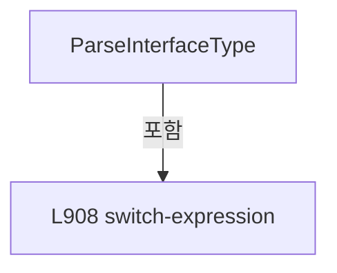

변경 전 점검: 입력/반환 타입, 위 호출자, 예외/취소 경로, 공유 상태와 저장·전송 소비자를 함께 확인합니다. 값의 단위나 물리 방향을 이름만으로 확정하지 않습니다.

### MethodDeclaration `ParseDevice` · L926–941

[Drilling.UI/Menu/Menus/CMenuSetting.cs:926–941](https://github.com/kjuws10-rgb/A3Drilling/blob/28764c91d521777b8ee068dd7aaf2d3902ce9fe2/Drilling.UI/Menu/Menus/CMenuSetting.cs#L926-L941)

| 항목 | 실제 추출 값 |
| --- | --- |
| 서명 | Drilling.Common.Interface.EN_EQP_MODULE Drilling.UI.Menu.Menus.CMenuSetting.ParseDevice(string) |
| 접근/수식자 | Private / private, static |
| 반환/값 타입 | Drilling.Common.Interface.EN_EQP_MODULE |
| 소속 타입 | NamedType:Drilling.UI.Menu.Menus.CMenuSetting |

입력 계약:

| 이름 | 타입 | 전달 | 선택/기본값 |
| --- | --- | --- | --- |
| value | string | None | False /  |

정적 호출자로 확인된 위치:

| 호출 파일/행 | 호출 표현식 | 런타임 분기 가능 |
| --- | --- | --- |
| [Drilling.UI/Menu/Menus/CMenuSetting.cs:348–348](https://github.com/kjuws10-rgb/A3Drilling/blob/28764c91d521777b8ee068dd7aaf2d3902ce9fe2/Drilling.UI/Menu/Menus/CMenuSetting.cs#L348-L348) | ParseDevice | False |
| [Drilling.UI/Menu/Menus/CMenuSetting.cs:390–390](https://github.com/kjuws10-rgb/A3Drilling/blob/28764c91d521777b8ee068dd7aaf2d3902ce9fe2/Drilling.UI/Menu/Menus/CMenuSetting.cs#L390-L390) | ParseDevice | False |
| [Drilling.UI/Menu/Menus/CMenuSetting.cs:892–892](https://github.com/kjuws10-rgb/A3Drilling/blob/28764c91d521777b8ee068dd7aaf2d3902ce9fe2/Drilling.UI/Menu/Menus/CMenuSetting.cs#L892-L892) | ParseDevice | False |

호출하는 대상과 해석 범위:

| 원본 행 | 표현식 | 분석 상태 | 대상/소스 위치 |
| --- | --- | --- | --- |
| 928 | value.Trim().ToUpperInvariant | resolved | string string.ToUpperInvariant() |
| 928 | value.Trim | resolved | string string.Trim() |
| 940 | new InvalidDataException | resolved | System.IO.InvalidDataException.InvalidDataException(string?) |

본문의 실제 연산·분기·예외·반환 순서(원문 위치 순):

| 원본 행 | 종류 | 주석 해설 |
| --- | --- | --- |
| 928 | call | 함수·델리게이트 또는 객체 생성자를 호출합니다: value.Trim().ToUpperInvariant() |
| 928 | call | 함수·델리게이트 또는 객체 생성자를 호출합니다: value.Trim() |
| 928 | return | 호출자에게 값 또는 제어를 반환합니다: return value.Trim().ToUpperInvariant() switch { "WONIK_CONTROL" or "WONIK_CTRL" or "CONTROL" => EN_EQP_MODULE.WonikCtrl, "WONIK_VISION" or "VISION" => EN_EQP_MODULE.Vision, "AUTOMATION1" or "AUTOMATION_ONE" or "A1" => EN_EQP_MODUL |
| 928 | switch-expression | 값별 결과식을 선택합니다: value.Trim().ToUpperInvariant() switch { "WONIK_CONTROL" or "WONIK_CTRL" or "CONTROL" => EN_EQP_MODULE.WonikCtrl, "WONIK_VISION" or "VISION" => EN_EQP_MODULE.Vision, "AUTOMATION1" or "AUTOMATION_ONE" or "A1" => EN_EQP_MODULE.Autom |
| 940 | call | 함수·델리게이트 또는 객체 생성자를 호출합니다: new InvalidDataException($"JHMI_INTERFACE save blocked. Unknown DEVICE: {value}") |
| 940 | throw | 예외를 발생/전달합니다: throw new InvalidDataException($"JHMI_INTERFACE save blocked. Unknown DEVICE: {value}") |

제어 구문의 포함 구조(실제 실행 순서/CFG가 아닌 구문 탐색 그림):

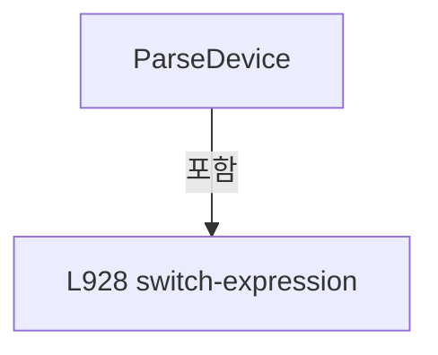

변경 전 점검: 입력/반환 타입, 위 호출자, 예외/취소 경로, 공유 상태와 저장·전송 소비자를 함께 확인합니다. 값의 단위나 물리 방향을 이름만으로 확정하지 않습니다.

### MethodDeclaration `InterfaceTypeText` · L943–961

[Drilling.UI/Menu/Menus/CMenuSetting.cs:943–961](https://github.com/kjuws10-rgb/A3Drilling/blob/28764c91d521777b8ee068dd7aaf2d3902ce9fe2/Drilling.UI/Menu/Menus/CMenuSetting.cs#L943-L961)

| 항목 | 실제 추출 값 |
| --- | --- |
| 서명 | string Drilling.UI.Menu.Menus.CMenuSetting.InterfaceTypeText(Drilling.Common.Interface.EN_INTERFACE_TYPE) |
| 접근/수식자 | Private / private, static |
| 반환/값 타입 | string |
| 소속 타입 | NamedType:Drilling.UI.Menu.Menus.CMenuSetting |

입력 계약:

| 이름 | 타입 | 전달 | 선택/기본값 |
| --- | --- | --- | --- |
| type | Drilling.Common.Interface.EN_INTERFACE_TYPE | None | False /  |

정적 호출자로 확인된 위치:

| 호출 파일/행 | 호출 표현식 | 런타임 분기 가능 |
| --- | --- | --- |
| [Drilling.UI/Menu/Menus/CMenuSetting.cs:867–867](https://github.com/kjuws10-rgb/A3Drilling/blob/28764c91d521777b8ee068dd7aaf2d3902ce9fe2/Drilling.UI/Menu/Menus/CMenuSetting.cs#L867-L867) | InterfaceTypeText | False |

호출하는 대상과 해석 범위:

| 원본 행 | 표현식 | 분석 상태 | 대상/소스 위치 |
| --- | --- | --- | --- |
| 960 | type.ToString().ToUpperInvariant | resolved | string string.ToUpperInvariant() |
| 960 | type.ToString | resolved · 동적 구현 선택 가능 | string System.Enum.ToString() |

본문의 실제 연산·분기·예외·반환 순서(원문 위치 순):

| 원본 행 | 종류 | 주석 해설 |
| --- | --- | --- |
| 945 | return | 호출자에게 값 또는 제어를 반환합니다: return type switch { EN_INTERFACE_TYPE.SocketClient => "SOCKET_C", EN_INTERFACE_TYPE.SocketServer => "SOCKET_S", EN_INTERFACE_TYPE.SocketClientUdp => "SOCKET_C_UDP", EN_INTERFACE_TYPE.SocketServerUdp => "SOCKET_S_UDP", EN_INTERFAC |
| 945 | switch-expression | 값별 결과식을 선택합니다: type switch { EN_INTERFACE_TYPE.SocketClient => "SOCKET_C", EN_INTERFACE_TYPE.SocketServer => "SOCKET_S", EN_INTERFACE_TYPE.SocketClientUdp => "SOCKET_C_UDP", EN_INTERFACE_TYPE.SocketServerUdp => "SOCKET_S_UDP", EN_INTERFACE_TYPE. |
| 960 | call | 함수·델리게이트 또는 객체 생성자를 호출합니다: type.ToString().ToUpperInvariant() |
| 960 | call | 함수·델리게이트 또는 객체 생성자를 호출합니다: type.ToString() |

제어 구문의 포함 구조(실제 실행 순서/CFG가 아닌 구문 탐색 그림):

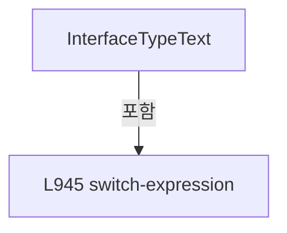

변경 전 점검: 입력/반환 타입, 위 호출자, 예외/취소 경로, 공유 상태와 저장·전송 소비자를 함께 확인합니다. 값의 단위나 물리 방향을 이름만으로 확정하지 않습니다.

### MethodDeclaration `DeviceText` · L963–978

[Drilling.UI/Menu/Menus/CMenuSetting.cs:963–978](https://github.com/kjuws10-rgb/A3Drilling/blob/28764c91d521777b8ee068dd7aaf2d3902ce9fe2/Drilling.UI/Menu/Menus/CMenuSetting.cs#L963-L978)

| 항목 | 실제 추출 값 |
| --- | --- |
| 서명 | string Drilling.UI.Menu.Menus.CMenuSetting.DeviceText(Drilling.Common.Interface.EN_EQP_MODULE) |
| 접근/수식자 | Private / private, static |
| 반환/값 타입 | string |
| 소속 타입 | NamedType:Drilling.UI.Menu.Menus.CMenuSetting |

입력 계약:

| 이름 | 타입 | 전달 | 선택/기본값 |
| --- | --- | --- | --- |
| module | Drilling.Common.Interface.EN_EQP_MODULE | None | False /  |

정적 호출자로 확인된 위치:

| 호출 파일/행 | 호출 표현식 | 런타임 분기 가능 |
| --- | --- | --- |
| [Drilling.UI/Menu/Menus/CMenuSetting.cs:868–868](https://github.com/kjuws10-rgb/A3Drilling/blob/28764c91d521777b8ee068dd7aaf2d3902ce9fe2/Drilling.UI/Menu/Menus/CMenuSetting.cs#L868-L868) | DeviceText | False |

호출하는 대상과 해석 범위:

| 원본 행 | 표현식 | 분석 상태 | 대상/소스 위치 |
| --- | --- | --- | --- |
| 977 | module.ToString().ToUpperInvariant | resolved | string string.ToUpperInvariant() |
| 977 | module.ToString | resolved · 동적 구현 선택 가능 | string System.Enum.ToString() |

본문의 실제 연산·분기·예외·반환 순서(원문 위치 순):

| 원본 행 | 종류 | 주석 해설 |
| --- | --- | --- |
| 965 | return | 호출자에게 값 또는 제어를 반환합니다: return module switch { EN_EQP_MODULE.WonikCtrl => "WONIK_CONTROL", EN_EQP_MODULE.Vision => "WONIK_VISION", EN_EQP_MODULE.Automation1 => "AUTOMATION1", EN_EQP_MODULE.Motion => "MOTION", EN_EQP_MODULE.TalonLaser => "TALON", EN_EQP_M |
| 965 | switch-expression | 값별 결과식을 선택합니다: module switch { EN_EQP_MODULE.WonikCtrl => "WONIK_CONTROL", EN_EQP_MODULE.Vision => "WONIK_VISION", EN_EQP_MODULE.Automation1 => "AUTOMATION1", EN_EQP_MODULE.Motion => "MOTION", EN_EQP_MODULE.TalonLaser => "TALON", EN_EQP_MODULE.A |
| 977 | call | 함수·델리게이트 또는 객체 생성자를 호출합니다: module.ToString().ToUpperInvariant() |
| 977 | call | 함수·델리게이트 또는 객체 생성자를 호출합니다: module.ToString() |

제어 구문의 포함 구조(실제 실행 순서/CFG가 아닌 구문 탐색 그림):

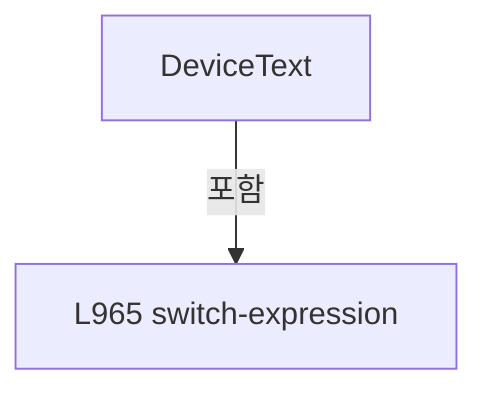

변경 전 점검: 입력/반환 타입, 위 호출자, 예외/취소 경로, 공유 상태와 저장·전송 소비자를 함께 확인합니다. 값의 단위나 물리 방향을 이름만으로 확정하지 않습니다.

### MethodDeclaration `InterfaceRowLabel` · L980–983

[Drilling.UI/Menu/Menus/CMenuSetting.cs:980–983](https://github.com/kjuws10-rgb/A3Drilling/blob/28764c91d521777b8ee068dd7aaf2d3902ce9fe2/Drilling.UI/Menu/Menus/CMenuSetting.cs#L980-L983)

| 항목 | 실제 추출 값 |
| --- | --- |
| 서명 | string Drilling.UI.Menu.Menus.CMenuSetting.InterfaceRowLabel(Drilling.UI.Menu.Menus.ST_SETTING_INTERFACE_ROW) |
| 접근/수식자 | Private / private, static |
| 반환/값 타입 | string |
| 소속 타입 | NamedType:Drilling.UI.Menu.Menus.CMenuSetting |

입력 계약:

| 이름 | 타입 | 전달 | 선택/기본값 |
| --- | --- | --- | --- |
| row | Drilling.UI.Menu.Menus.ST_SETTING_INTERFACE_ROW | None | False /  |

정적 호출자로 확인된 위치:

| 호출 파일/행 | 호출 표현식 | 런타임 분기 가능 |
| --- | --- | --- |
| [Drilling.UI/Menu/Menus/CMenuSetting.cs:330–330](https://github.com/kjuws10-rgb/A3Drilling/blob/28764c91d521777b8ee068dd7aaf2d3902ce9fe2/Drilling.UI/Menu/Menus/CMenuSetting.cs#L330-L330) | InterfaceRowLabel | False |
| [Drilling.UI/Menu/Menus/CMenuSetting.cs:350–350](https://github.com/kjuws10-rgb/A3Drilling/blob/28764c91d521777b8ee068dd7aaf2d3902ce9fe2/Drilling.UI/Menu/Menus/CMenuSetting.cs#L350-L350) | InterfaceRowLabel | False |
| [Drilling.UI/Menu/Menus/CMenuSetting.cs:372–372](https://github.com/kjuws10-rgb/A3Drilling/blob/28764c91d521777b8ee068dd7aaf2d3902ce9fe2/Drilling.UI/Menu/Menus/CMenuSetting.cs#L372-L372) | InterfaceRowLabel | False |
| [Drilling.UI/Menu/Menus/CMenuSetting.cs:392–392](https://github.com/kjuws10-rgb/A3Drilling/blob/28764c91d521777b8ee068dd7aaf2d3902ce9fe2/Drilling.UI/Menu/Menus/CMenuSetting.cs#L392-L392) | InterfaceRowLabel | False |

호출하는 대상과 해석 범위:

| 원본 행 | 표현식 | 분석 상태 | 대상/소스 위치 |
| --- | --- | --- | --- |
| 982 | row.Device.Trim | resolved | string string.Trim() |
| 982 | row.Number.Trim | resolved | string string.Trim() |
| 982 | row.NickName.Trim | resolved | string string.Trim() |

본문의 실제 연산·분기·예외·반환 순서(원문 위치 순):

| 원본 행 | 종류 | 주석 해설 |
| --- | --- | --- |
| 982 | call | 함수·델리게이트 또는 객체 생성자를 호출합니다: row.Device.Trim() |
| 982 | call | 함수·델리게이트 또는 객체 생성자를 호출합니다: row.Number.Trim() |
| 982 | call | 함수·델리게이트 또는 객체 생성자를 호출합니다: row.NickName.Trim() |
| 982 | return | 호출자에게 값 또는 제어를 반환합니다: return $"{row.Device.Trim()}[{row.Number.Trim()}]/{row.NickName.Trim()}"; |

변경 전 점검: 입력/반환 타입, 위 호출자, 예외/취소 경로, 공유 상태와 저장·전송 소비자를 함께 확인합니다. 값의 단위나 물리 방향을 이름만으로 확정하지 않습니다.

### MethodDeclaration `RequireText` · L985–993

[Drilling.UI/Menu/Menus/CMenuSetting.cs:985–993](https://github.com/kjuws10-rgb/A3Drilling/blob/28764c91d521777b8ee068dd7aaf2d3902ce9fe2/Drilling.UI/Menu/Menus/CMenuSetting.cs#L985-L993)

| 항목 | 실제 추출 값 |
| --- | --- |
| 서명 | string Drilling.UI.Menu.Menus.CMenuSetting.RequireText(string, string) |
| 접근/수식자 | Private / private, static |
| 반환/값 타입 | string |
| 소속 타입 | NamedType:Drilling.UI.Menu.Menus.CMenuSetting |

입력 계약:

| 이름 | 타입 | 전달 | 선택/기본값 |
| --- | --- | --- | --- |
| value | string | None | False /  |
| fieldName | string | None | False /  |

정적 호출자로 확인된 위치:

| 호출 파일/행 | 호출 표현식 | 런타임 분기 가능 |
| --- | --- | --- |
| [Drilling.UI/Menu/Menus/CMenuSetting.cs:894–894](https://github.com/kjuws10-rgb/A3Drilling/blob/28764c91d521777b8ee068dd7aaf2d3902ce9fe2/Drilling.UI/Menu/Menus/CMenuSetting.cs#L894-L894) | RequireText | False |
| [Drilling.UI/Menu/Menus/CMenuSetting.cs:895–895](https://github.com/kjuws10-rgb/A3Drilling/blob/28764c91d521777b8ee068dd7aaf2d3902ce9fe2/Drilling.UI/Menu/Menus/CMenuSetting.cs#L895-L895) | RequireText | False |

호출하는 대상과 해석 범위:

| 원본 행 | 표현식 | 분석 상태 | 대상/소스 위치 |
| --- | --- | --- | --- |
| 987 | string.IsNullOrWhiteSpace | resolved | bool string.IsNullOrWhiteSpace(string?) |
| 989 | new InvalidDataException | resolved | System.IO.InvalidDataException.InvalidDataException(string?) |
| 992 | value.Trim | resolved | string string.Trim() |

본문의 실제 연산·분기·예외·반환 순서(원문 위치 순):

| 원본 행 | 종류 | 주석 해설 |
| --- | --- | --- |
| 987 | call | 함수·델리게이트 또는 객체 생성자를 호출합니다: string.IsNullOrWhiteSpace(value) |
| 987 | if | 조건에 따라 분기합니다: if (string.IsNullOrWhiteSpace(value)) |
| 989 | call | 함수·델리게이트 또는 객체 생성자를 호출합니다: new InvalidDataException($"JHMI_INTERFACE save blocked. {fieldName} cannot be empty.") |
| 989 | throw | 예외를 발생/전달합니다: throw new InvalidDataException($"JHMI_INTERFACE save blocked. {fieldName} cannot be empty."); |
| 992 | call | 함수·델리게이트 또는 객체 생성자를 호출합니다: value.Trim() |
| 992 | return | 호출자에게 값 또는 제어를 반환합니다: return value.Trim(); |

제어 구문의 포함 구조(실제 실행 순서/CFG가 아닌 구문 탐색 그림):

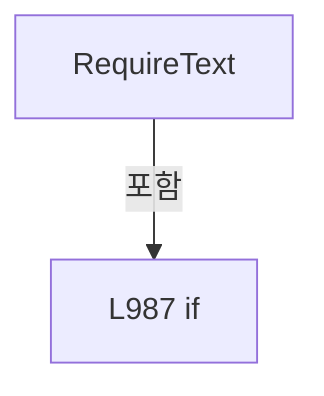

변경 전 점검: 입력/반환 타입, 위 호출자, 예외/취소 경로, 공유 상태와 저장·전송 소비자를 함께 확인합니다. 값의 단위나 물리 방향을 이름만으로 확정하지 않습니다.

### MethodDeclaration `ReadBool` · L995–1002

[Drilling.UI/Menu/Menus/CMenuSetting.cs:995–1002](https://github.com/kjuws10-rgb/A3Drilling/blob/28764c91d521777b8ee068dd7aaf2d3902ce9fe2/Drilling.UI/Menu/Menus/CMenuSetting.cs#L995-L1002)

| 항목 | 실제 추출 값 |
| --- | --- |
| 서명 | bool Drilling.UI.Menu.Menus.CMenuSetting.ReadBool(string, string, string) |
| 접근/수식자 | Private / private, static |
| 반환/값 타입 | bool |
| 소속 타입 | NamedType:Drilling.UI.Menu.Menus.CMenuSetting |

입력 계약:

| 이름 | 타입 | 전달 | 선택/기본값 |
| --- | --- | --- | --- |
| value | string | None | False /  |
| nickName | string | None | False /  |
| fieldName | string | None | False /  |

정적 호출자로 확인된 위치:

| 호출 파일/행 | 호출 표현식 | 런타임 분기 가능 |
| --- | --- | --- |
| [Drilling.UI/Menu/Menus/CMenuSetting.cs:896–896](https://github.com/kjuws10-rgb/A3Drilling/blob/28764c91d521777b8ee068dd7aaf2d3902ce9fe2/Drilling.UI/Menu/Menus/CMenuSetting.cs#L896-L896) | ReadBool | False |
| [Drilling.UI/Menu/Menus/CMenuSetting.cs:897–897](https://github.com/kjuws10-rgb/A3Drilling/blob/28764c91d521777b8ee068dd7aaf2d3902ce9fe2/Drilling.UI/Menu/Menus/CMenuSetting.cs#L897-L897) | ReadBool | False |

호출하는 대상과 해석 범위:

| 원본 행 | 표현식 | 분석 상태 | 대상/소스 위치 |
| --- | --- | --- | --- |
| 997 | value.Trim().ToUpperInvariant | resolved | string string.ToUpperInvariant() |
| 997 | value.Trim | resolved | string string.Trim() |
| 1001 | new InvalidDataException | resolved | System.IO.InvalidDataException.InvalidDataException(string?) |

본문의 실제 연산·분기·예외·반환 순서(원문 위치 순):

| 원본 행 | 종류 | 주석 해설 |
| --- | --- | --- |
| 997 | call | 함수·델리게이트 또는 객체 생성자를 호출합니다: value.Trim().ToUpperInvariant() |
| 997 | call | 함수·델리게이트 또는 객체 생성자를 호출합니다: value.Trim() |
| 997 | return | 호출자에게 값 또는 제어를 반환합니다: return value.Trim().ToUpperInvariant() switch { "1" or "TRUE" or "ON" or "YES" or "USE" or "SIMUL" or "SIMULATION" or "SIM" => true, "0" or "FALSE" or "OFF" or "NO" or "ONLINE" or "LIVE" or "REAL" => false, _ => throw new InvalidD |
| 997 | switch-expression | 값별 결과식을 선택합니다: value.Trim().ToUpperInvariant() switch { "1" or "TRUE" or "ON" or "YES" or "USE" or "SIMUL" or "SIMULATION" or "SIM" => true, "0" or "FALSE" or "OFF" or "NO" or "ONLINE" or "LIVE" or "REAL" => false, _ => throw new InvalidDataExce |
| 1001 | call | 함수·델리게이트 또는 객체 생성자를 호출합니다: new InvalidDataException($"JHMI_INTERFACE save blocked. {nickName}/{fieldName} must be 1/0 or ON/OFF.") |
| 1001 | throw | 예외를 발생/전달합니다: throw new InvalidDataException($"JHMI_INTERFACE save blocked. {nickName}/{fieldName} must be 1/0 or ON/OFF.") |

제어 구문의 포함 구조(실제 실행 순서/CFG가 아닌 구문 탐색 그림):

```mermaid
flowchart TD
 M["ReadBool"]
 N0["L997 switch-expression"]
 M -->|포함| N0
```

변경 전 점검: 입력/반환 타입, 위 호출자, 예외/취소 경로, 공유 상태와 저장·전송 소비자를 함께 확인합니다. 값의 단위나 물리 방향을 이름만으로 확정하지 않습니다.

### MethodDeclaration `ReadInt` · L1004–1012

[Drilling.UI/Menu/Menus/CMenuSetting.cs:1004–1012](https://github.com/kjuws10-rgb/A3Drilling/blob/28764c91d521777b8ee068dd7aaf2d3902ce9fe2/Drilling.UI/Menu/Menus/CMenuSetting.cs#L1004-L1012)

| 항목 | 실제 추출 값 |
| --- | --- |
| 서명 | int Drilling.UI.Menu.Menus.CMenuSetting.ReadInt(string, string, string) |
| 접근/수식자 | Private / private, static |
| 반환/값 타입 | int |
| 소속 타입 | NamedType:Drilling.UI.Menu.Menus.CMenuSetting |

입력 계약:

| 이름 | 타입 | 전달 | 선택/기본값 |
| --- | --- | --- | --- |
| value | string | None | False /  |
| nickName | string | None | False /  |
| fieldName | string | None | False /  |

정적 호출자로 확인된 위치:

| 호출 파일/행 | 호출 표현식 | 런타임 분기 가능 |
| --- | --- | --- |
| [Drilling.UI/Menu/Menus/CMenuSetting.cs:349–349](https://github.com/kjuws10-rgb/A3Drilling/blob/28764c91d521777b8ee068dd7aaf2d3902ce9fe2/Drilling.UI/Menu/Menus/CMenuSetting.cs#L349-L349) | ReadInt | False |
| [Drilling.UI/Menu/Menus/CMenuSetting.cs:391–391](https://github.com/kjuws10-rgb/A3Drilling/blob/28764c91d521777b8ee068dd7aaf2d3902ce9fe2/Drilling.UI/Menu/Menus/CMenuSetting.cs#L391-L391) | ReadInt | False |
| [Drilling.UI/Menu/Menus/CMenuSetting.cs:893–893](https://github.com/kjuws10-rgb/A3Drilling/blob/28764c91d521777b8ee068dd7aaf2d3902ce9fe2/Drilling.UI/Menu/Menus/CMenuSetting.cs#L893-L893) | ReadInt | False |

호출하는 대상과 해석 범위:

| 원본 행 | 표현식 | 분석 상태 | 대상/소스 위치 |
| --- | --- | --- | --- |
| 1006 | int.TryParse | resolved | bool int.TryParse(string?, System.Globalization.NumberStyles, System.IFormatProvider?, out int) |
| 1006 | value.Trim | resolved | string string.Trim() |
| 1008 | new InvalidDataException | resolved | System.IO.InvalidDataException.InvalidDataException(string?) |

본문의 실제 연산·분기·예외·반환 순서(원문 위치 순):

| 원본 행 | 종류 | 주석 해설 |
| --- | --- | --- |
| 1006 | call | 함수·델리게이트 또는 객체 생성자를 호출합니다: int.TryParse(value.Trim(), NumberStyles.Integer, CultureInfo.InvariantCulture, out var result) |
| 1006 | call | 함수·델리게이트 또는 객체 생성자를 호출합니다: value.Trim() |
| 1006 | if | 조건에 따라 분기합니다: if (!int.TryParse(value.Trim(), NumberStyles.Integer, CultureInfo.InvariantCulture, out var result) &#124;&#124; result < 0) |
| 1008 | call | 함수·델리게이트 또는 객체 생성자를 호출합니다: new InvalidDataException($"JHMI_INTERFACE save blocked. {nickName}/{fieldName} must be a non-negative integer.") |
| 1008 | throw | 예외를 발생/전달합니다: throw new InvalidDataException($"JHMI_INTERFACE save blocked. {nickName}/{fieldName} must be a non-negative integer."); |
| 1011 | return | 호출자에게 값 또는 제어를 반환합니다: return result; |

제어 구문의 포함 구조(실제 실행 순서/CFG가 아닌 구문 탐색 그림):

```mermaid
flowchart TD
 M["ReadInt"]
 N0["L1006 if"]
 M -->|포함| N0
```

변경 전 점검: 입력/반환 타입, 위 호출자, 예외/취소 경로, 공유 상태와 저장·전송 소비자를 함께 확인합니다. 값의 단위나 물리 방향을 이름만으로 확정하지 않습니다.

### MethodDeclaration `NormalizeTab` · L1014–1023

[Drilling.UI/Menu/Menus/CMenuSetting.cs:1014–1023](https://github.com/kjuws10-rgb/A3Drilling/blob/28764c91d521777b8ee068dd7aaf2d3902ce9fe2/Drilling.UI/Menu/Menus/CMenuSetting.cs#L1014-L1023)

| 항목 | 실제 추출 값 |
| --- | --- |
| 서명 | string Drilling.UI.Menu.Menus.CMenuSetting.NormalizeTab(string) |
| 접근/수식자 | Private / private, static |
| 반환/값 타입 | string |
| 소속 타입 | NamedType:Drilling.UI.Menu.Menus.CMenuSetting |

입력 계약:

| 이름 | 타입 | 전달 | 선택/기본값 |
| --- | --- | --- | --- |
| tab | string | None | False /  |

정적 호출자로 확인된 위치:

| 호출 파일/행 | 호출 표현식 | 런타임 분기 가능 |
| --- | --- | --- |
| [Drilling.UI/Menu/Menus/CMenuSetting.cs:229–229](https://github.com/kjuws10-rgb/A3Drilling/blob/28764c91d521777b8ee068dd7aaf2d3902ce9fe2/Drilling.UI/Menu/Menus/CMenuSetting.cs#L229-L229) | NormalizeTab | False |
| [Drilling.UI/Menu/Menus/CMenuSetting.cs:295–295](https://github.com/kjuws10-rgb/A3Drilling/blob/28764c91d521777b8ee068dd7aaf2d3902ce9fe2/Drilling.UI/Menu/Menus/CMenuSetting.cs#L295-L295) | NormalizeTab | False |

호출하는 대상과 해석 범위:

| 원본 행 | 표현식 | 분석 상태 | 대상/소스 위치 |
| --- | --- | --- | --- |
| 1016 | tab.Trim().ToUpperInvariant | resolved | string string.ToUpperInvariant() |
| 1016 | tab.Trim | resolved | string string.Trim() |

본문의 실제 연산·분기·예외·반환 순서(원문 위치 순):

| 원본 행 | 종류 | 주석 해설 |
| --- | --- | --- |
| 1016 | call | 함수·델리게이트 또는 객체 생성자를 호출합니다: tab.Trim().ToUpperInvariant() |
| 1016 | call | 함수·델리게이트 또는 객체 생성자를 호출합니다: tab.Trim() |
| 1016 | local-declaration | 지역 변수를 선언합니다: var normalized = tab.Trim().ToUpperInvariant(); |
| 1016 | variable-initializer | 변수의 초기값을 지정합니다: normalized = tab.Trim().ToUpperInvariant() |
| 1017 | if | 조건에 따라 분기합니다: if (normalized == "POSITION") |
| 1019 | return | 호출자에게 값 또는 제어를 반환합니다: return "OPTION"; |
| 1022 | conditional-expression | 조건에 따라 결과식을 선택합니다: normalized is "OPTION" or "INTERFACE" or "IO" or "MOTOR" or "ALARM" ? normalized : "OPTION" |
| 1022 | return | 호출자에게 값 또는 제어를 반환합니다: return normalized is "OPTION" or "INTERFACE" or "IO" or "MOTOR" or "ALARM" ? normalized : "OPTION"; |

제어 구문의 포함 구조(실제 실행 순서/CFG가 아닌 구문 탐색 그림):

```mermaid
flowchart TD
 M["NormalizeTab"]
 N0["L1017 if"]
 M -->|포함| N0
```

변경 전 점검: 입력/반환 타입, 위 호출자, 예외/취소 경로, 공유 상태와 저장·전송 소비자를 함께 확인합니다. 값의 단위나 물리 방향을 이름만으로 확정하지 않습니다.

### MethodDeclaration `NormalizeGroup` · L1025–1034

[Drilling.UI/Menu/Menus/CMenuSetting.cs:1025–1034](https://github.com/kjuws10-rgb/A3Drilling/blob/28764c91d521777b8ee068dd7aaf2d3902ce9fe2/Drilling.UI/Menu/Menus/CMenuSetting.cs#L1025-L1034)

| 항목 | 실제 추출 값 |
| --- | --- |
| 서명 | string Drilling.UI.Menu.Menus.CMenuSetting.NormalizeGroup(string, System.Collections.Generic.IReadOnlyList<string>) |
| 접근/수식자 | Private / private, static |
| 반환/값 타입 | string |
| 소속 타입 | NamedType:Drilling.UI.Menu.Menus.CMenuSetting |

입력 계약:

| 이름 | 타입 | 전달 | 선택/기본값 |
| --- | --- | --- | --- |
| group | string | None | False /  |
| groups | System.Collections.Generic.IReadOnlyList<string> | None | False /  |

정적 호출자로 확인된 위치:

| 호출 파일/행 | 호출 표현식 | 런타임 분기 가능 |
| --- | --- | --- |
| [Drilling.UI/Menu/Menus/CMenuSetting.cs:238–238](https://github.com/kjuws10-rgb/A3Drilling/blob/28764c91d521777b8ee068dd7aaf2d3902ce9fe2/Drilling.UI/Menu/Menus/CMenuSetting.cs#L238-L238) | NormalizeGroup | False |

호출하는 대상과 해석 범위:

| 원본 행 | 표현식 | 분석 상태 | 대상/소스 위치 |
| --- | --- | --- | --- |
| 1027 | NormalizeSettingText | resolved | string Drilling.UI.Menu.Menus.CMenuSetting.NormalizeSettingText(string, string) · Drilling.UI/Menu/Menus/CMenuSetting.cs:1036 |
| 1033 | groups.Any | resolved | bool System.Collections.Generic.IEnumerable<string>.Any<string>(System.Func<string, bool>) |

본문의 실제 연산·분기·예외·반환 순서(원문 위치 순):

| 원본 행 | 종류 | 주석 해설 |
| --- | --- | --- |
| 1027 | call | 함수·델리게이트 또는 객체 생성자를 호출합니다: NormalizeSettingText(group, "ALL") |
| 1027 | local-declaration | 지역 변수를 선언합니다: var normalized = NormalizeSettingText(group, "ALL"); |
| 1027 | variable-initializer | 변수의 초기값을 지정합니다: normalized = NormalizeSettingText(group, "ALL") |
| 1033 | call | 함수·델리게이트 또는 객체 생성자를 호출합니다: groups.Any(MatchesItem) |
| 1033 | conditional-expression | 조건에 따라 결과식을 선택합니다: groups.Any(MatchesItem) ? normalized : "ALL" |
| 1033 | return | 호출자에게 값 또는 제어를 반환합니다: return groups.Any(MatchesItem) ? normalized : "ALL"; |

변경 전 점검: 입력/반환 타입, 위 호출자, 예외/취소 경로, 공유 상태와 저장·전송 소비자를 함께 확인합니다. 값의 단위나 물리 방향을 이름만으로 확정하지 않습니다.

### LocalFunctionStatement `MatchesItem` · L1028–1031

[Drilling.UI/Menu/Menus/CMenuSetting.cs:1028–1031](https://github.com/kjuws10-rgb/A3Drilling/blob/28764c91d521777b8ee068dd7aaf2d3902ce9fe2/Drilling.UI/Menu/Menus/CMenuSetting.cs#L1028-L1031)

| 항목 | 실제 추출 값 |
| --- | --- |
| 서명 | bool MatchesItem(string) |
| 접근/수식자 | Private /  |
| 반환/값 타입 | bool |
| 소속 타입 | NamedType:Drilling.UI.Menu.Menus.CMenuSetting |

입력 계약:

| 이름 | 타입 | 전달 | 선택/기본값 |
| --- | --- | --- | --- |
| item | string | None | False /  |

현재 부분 분석에서 직접 연결된 호출자는 없습니다. XAML/이벤트/인터페이스·델리게이트·외부 진입을 추가 확인해야 하며, 미사용으로 판정한 것이 아닙니다.

호출하는 대상과 해석 범위:

| 원본 행 | 표현식 | 분석 상태 | 대상/소스 위치 |
| --- | --- | --- | --- |
| 1030 | item.Equals | resolved | bool string.Equals(string?, System.StringComparison) |

본문의 실제 연산·분기·예외·반환 순서(원문 위치 순):

| 원본 행 | 종류 | 주석 해설 |
| --- | --- | --- |
| 1030 | call | 함수·델리게이트 또는 객체 생성자를 호출합니다: item.Equals(normalized, StringComparison.OrdinalIgnoreCase) |
| 1030 | return | 호출자에게 값 또는 제어를 반환합니다: return item.Equals(normalized, StringComparison.OrdinalIgnoreCase); |

변경 전 점검: 입력/반환 타입, 위 호출자, 예외/취소 경로, 공유 상태와 저장·전송 소비자를 함께 확인합니다. 값의 단위나 물리 방향을 이름만으로 확정하지 않습니다.

### MethodDeclaration `NormalizeSettingText` · L1036–1039

[Drilling.UI/Menu/Menus/CMenuSetting.cs:1036–1039](https://github.com/kjuws10-rgb/A3Drilling/blob/28764c91d521777b8ee068dd7aaf2d3902ce9fe2/Drilling.UI/Menu/Menus/CMenuSetting.cs#L1036-L1039)

| 항목 | 실제 추출 값 |
| --- | --- |
| 서명 | string Drilling.UI.Menu.Menus.CMenuSetting.NormalizeSettingText(string, string) |
| 접근/수식자 | Private / private, static |
| 반환/값 타입 | string |
| 소속 타입 | NamedType:Drilling.UI.Menu.Menus.CMenuSetting |

입력 계약:

| 이름 | 타입 | 전달 | 선택/기본값 |
| --- | --- | --- | --- |
| value | string | None | False /  |
| defaultValue | string | None | False /  |

정적 호출자로 확인된 위치:

| 호출 파일/행 | 호출 표현식 | 런타임 분기 가능 |
| --- | --- | --- |
| [Drilling.UI/Menu/Menus/CMenuSetting.cs:615–615](https://github.com/kjuws10-rgb/A3Drilling/blob/28764c91d521777b8ee068dd7aaf2d3902ce9fe2/Drilling.UI/Menu/Menus/CMenuSetting.cs#L615-L615) | NormalizeSettingText | False |
| [Drilling.UI/Menu/Menus/CMenuSetting.cs:615–615](https://github.com/kjuws10-rgb/A3Drilling/blob/28764c91d521777b8ee068dd7aaf2d3902ce9fe2/Drilling.UI/Menu/Menus/CMenuSetting.cs#L615-L615) | NormalizeSettingText | False |
| [Drilling.UI/Menu/Menus/CMenuSetting.cs:655–655](https://github.com/kjuws10-rgb/A3Drilling/blob/28764c91d521777b8ee068dd7aaf2d3902ce9fe2/Drilling.UI/Menu/Menus/CMenuSetting.cs#L655-L655) | NormalizeSettingText | False |
| [Drilling.UI/Menu/Menus/CMenuSetting.cs:1027–1027](https://github.com/kjuws10-rgb/A3Drilling/blob/28764c91d521777b8ee068dd7aaf2d3902ce9fe2/Drilling.UI/Menu/Menus/CMenuSetting.cs#L1027-L1027) | NormalizeSettingText | False |

호출하는 대상과 해석 범위:

| 원본 행 | 표현식 | 분석 상태 | 대상/소스 위치 |
| --- | --- | --- | --- |
| 1038 | string.IsNullOrWhiteSpace | resolved | bool string.IsNullOrWhiteSpace(string?) |
| 1038 | value.Trim().ToUpperInvariant | resolved | string string.ToUpperInvariant() |
| 1038 | value.Trim | resolved | string string.Trim() |

본문의 실제 연산·분기·예외·반환 순서(원문 위치 순):

| 원본 행 | 종류 | 주석 해설 |
| --- | --- | --- |
| 1038 | call | 함수·델리게이트 또는 객체 생성자를 호출합니다: string.IsNullOrWhiteSpace(value) |
| 1038 | call | 함수·델리게이트 또는 객체 생성자를 호출합니다: value.Trim().ToUpperInvariant() |
| 1038 | call | 함수·델리게이트 또는 객체 생성자를 호출합니다: value.Trim() |
| 1038 | conditional-expression | 조건에 따라 결과식을 선택합니다: string.IsNullOrWhiteSpace(value) ? defaultValue : value.Trim().ToUpperInvariant() |
| 1038 | return | 호출자에게 값 또는 제어를 반환합니다: return string.IsNullOrWhiteSpace(value) ? defaultValue : value.Trim().ToUpperInvariant(); |

변경 전 점검: 입력/반환 타입, 위 호출자, 예외/취소 경로, 공유 상태와 저장·전송 소비자를 함께 확인합니다. 값의 단위나 물리 방향을 이름만으로 확정하지 않습니다.

### MethodDeclaration `NormalizeUnit` · L1041–1044

[Drilling.UI/Menu/Menus/CMenuSetting.cs:1041–1044](https://github.com/kjuws10-rgb/A3Drilling/blob/28764c91d521777b8ee068dd7aaf2d3902ce9fe2/Drilling.UI/Menu/Menus/CMenuSetting.cs#L1041-L1044)

| 항목 | 실제 추출 값 |
| --- | --- |
| 서명 | string Drilling.UI.Menu.Menus.CMenuSetting.NormalizeUnit(string) |
| 접근/수식자 | Private / private, static |
| 반환/값 타입 | string |
| 소속 타입 | NamedType:Drilling.UI.Menu.Menus.CMenuSetting |

입력 계약:

| 이름 | 타입 | 전달 | 선택/기본값 |
| --- | --- | --- | --- |
| unit | string | None | False /  |

정적 호출자로 확인된 위치:

| 호출 파일/행 | 호출 표현식 | 런타임 분기 가능 |
| --- | --- | --- |
| [Drilling.UI/Menu/Menus/CMenuSetting.cs:658–658](https://github.com/kjuws10-rgb/A3Drilling/blob/28764c91d521777b8ee068dd7aaf2d3902ce9fe2/Drilling.UI/Menu/Menus/CMenuSetting.cs#L658-L658) | NormalizeUnit | False |

호출하는 대상과 해석 범위:

| 원본 행 | 표현식 | 분석 상태 | 대상/소스 위치 |
| --- | --- | --- | --- |
| 1043 | string.IsNullOrWhiteSpace | resolved | bool string.IsNullOrWhiteSpace(string?) |

본문의 실제 연산·분기·예외·반환 순서(원문 위치 순):

| 원본 행 | 종류 | 주석 해설 |
| --- | --- | --- |
| 1043 | call | 함수·델리게이트 또는 객체 생성자를 호출합니다: string.IsNullOrWhiteSpace(unit) |
| 1043 | conditional-expression | 조건에 따라 결과식을 선택합니다: string.IsNullOrWhiteSpace(unit) ? "-" : unit |
| 1043 | return | 호출자에게 값 또는 제어를 반환합니다: return string.IsNullOrWhiteSpace(unit) ? "-" : unit; |

변경 전 점검: 입력/반환 타입, 위 호출자, 예외/취소 경로, 공유 상태와 저장·전송 소비자를 함께 확인합니다. 값의 단위나 물리 방향을 이름만으로 확정하지 않습니다.

### MethodDeclaration `NormalizeSettingUnit` · L1046–1049

[Drilling.UI/Menu/Menus/CMenuSetting.cs:1046–1049](https://github.com/kjuws10-rgb/A3Drilling/blob/28764c91d521777b8ee068dd7aaf2d3902ce9fe2/Drilling.UI/Menu/Menus/CMenuSetting.cs#L1046-L1049)

| 항목 | 실제 추출 값 |
| --- | --- |
| 서명 | string Drilling.UI.Menu.Menus.CMenuSetting.NormalizeSettingUnit(string) |
| 접근/수식자 | Private / private, static |
| 반환/값 타입 | string |
| 소속 타입 | NamedType:Drilling.UI.Menu.Menus.CMenuSetting |

입력 계약:

| 이름 | 타입 | 전달 | 선택/기본값 |
| --- | --- | --- | --- |
| unit | string | None | False /  |

정적 호출자로 확인된 위치:

| 호출 파일/행 | 호출 표현식 | 런타임 분기 가능 |
| --- | --- | --- |
| [Drilling.UI/Menu/Menus/CMenuSetting.cs:439–439](https://github.com/kjuws10-rgb/A3Drilling/blob/28764c91d521777b8ee068dd7aaf2d3902ce9fe2/Drilling.UI/Menu/Menus/CMenuSetting.cs#L439-L439) | NormalizeSettingUnit | False |

본문의 실제 연산·분기·예외·반환 순서(원문 위치 순):

| 원본 행 | 종류 | 주석 해설 |
| --- | --- | --- |
| 1048 | conditional-expression | 조건에 따라 결과식을 선택합니다: unit == "-" ? "" : unit |
| 1048 | return | 호출자에게 값 또는 제어를 반환합니다: return unit == "-" ? "" : unit; |

변경 전 점검: 입력/반환 타입, 위 호출자, 예외/취소 경로, 공유 상태와 저장·전송 소비자를 함께 확인합니다. 값의 단위나 물리 방향을 이름만으로 확정하지 않습니다.

### MethodDeclaration `GetValueState` · L1051–1055

[Drilling.UI/Menu/Menus/CMenuSetting.cs:1051–1055](https://github.com/kjuws10-rgb/A3Drilling/blob/28764c91d521777b8ee068dd7aaf2d3902ce9fe2/Drilling.UI/Menu/Menus/CMenuSetting.cs#L1051-L1055)

| 항목 | 실제 추출 값 |
| --- | --- |
| 서명 | string Drilling.UI.Menu.Menus.CMenuSetting.GetValueState(string) |
| 접근/수식자 | Private / private, static |
| 반환/값 타입 | string |
| 소속 타입 | NamedType:Drilling.UI.Menu.Menus.CMenuSetting |

입력 계약:

| 이름 | 타입 | 전달 | 선택/기본값 |
| --- | --- | --- | --- |
| value | string | None | False /  |

정적 호출자로 확인된 위치:

| 호출 파일/행 | 호출 표현식 | 런타임 분기 가능 |
| --- | --- | --- |
| [Drilling.UI/Menu/Menus/CMenuSetting.cs:661–661](https://github.com/kjuws10-rgb/A3Drilling/blob/28764c91d521777b8ee068dd7aaf2d3902ce9fe2/Drilling.UI/Menu/Menus/CMenuSetting.cs#L661-L661) | GetValueState | False |

호출하는 대상과 해석 범위:

| 원본 행 | 표현식 | 분석 상태 | 대상/소스 위치 |
| --- | --- | --- | --- |
| 1053 | value.Trim().ToUpperInvariant | resolved | string string.ToUpperInvariant() |
| 1053 | value.Trim | resolved | string string.Trim() |

본문의 실제 연산·분기·예외·반환 순서(원문 위치 순):

| 원본 행 | 종류 | 주석 해설 |
| --- | --- | --- |
| 1053 | call | 함수·델리게이트 또는 객체 생성자를 호출합니다: value.Trim().ToUpperInvariant() |
| 1053 | call | 함수·델리게이트 또는 객체 생성자를 호출합니다: value.Trim() |
| 1053 | local-declaration | 지역 변수를 선언합니다: var normalized = value.Trim().ToUpperInvariant(); |
| 1053 | variable-initializer | 변수의 초기값을 지정합니다: normalized = value.Trim().ToUpperInvariant() |
| 1054 | conditional-expression | 조건에 따라 결과식을 선택합니다: normalized is "ON" or "OFF" or "TRUE" or "FALSE" ? "Accent" : "Normal" |
| 1054 | return | 호출자에게 값 또는 제어를 반환합니다: return normalized is "ON" or "OFF" or "TRUE" or "FALSE" ? "Accent" : "Normal"; |

변경 전 점검: 입력/반환 타입, 위 호출자, 예외/취소 경로, 공유 상태와 저장·전송 소비자를 함께 확인합니다. 값의 단위나 물리 방향을 이름만으로 확정하지 않습니다.

### MethodDeclaration `ToSection` · L1057–1067

[Drilling.UI/Menu/Menus/CMenuSetting.cs:1057–1067](https://github.com/kjuws10-rgb/A3Drilling/blob/28764c91d521777b8ee068dd7aaf2d3902ce9fe2/Drilling.UI/Menu/Menus/CMenuSetting.cs#L1057-L1067)

| 항목 | 실제 추출 값 |
| --- | --- |
| 서명 | Drilling.Common.Managers.EN_SETTING_TAB Drilling.UI.Menu.Menus.CMenuSetting.ToSection(string) |
| 접근/수식자 | Private / private, static |
| 반환/값 타입 | Drilling.Common.Managers.EN_SETTING_TAB |
| 소속 타입 | NamedType:Drilling.UI.Menu.Menus.CMenuSetting |

입력 계약:

| 이름 | 타입 | 전달 | 선택/기본값 |
| --- | --- | --- | --- |
| tab | string | None | False /  |

정적 호출자로 확인된 위치:

| 호출 파일/행 | 호출 표현식 | 런타임 분기 가능 |
| --- | --- | --- |
| [Drilling.UI/Menu/Menus/CMenuSetting.cs:230–230](https://github.com/kjuws10-rgb/A3Drilling/blob/28764c91d521777b8ee068dd7aaf2d3902ce9fe2/Drilling.UI/Menu/Menus/CMenuSetting.cs#L230-L230) | ToSection | False |
| [Drilling.UI/Menu/Menus/CMenuSetting.cs:436–436](https://github.com/kjuws10-rgb/A3Drilling/blob/28764c91d521777b8ee068dd7aaf2d3902ce9fe2/Drilling.UI/Menu/Menus/CMenuSetting.cs#L436-L436) | ToSection | False |
| [Drilling.UI/Menu/Menus/CMenuSetting.cs:513–513](https://github.com/kjuws10-rgb/A3Drilling/blob/28764c91d521777b8ee068dd7aaf2d3902ce9fe2/Drilling.UI/Menu/Menus/CMenuSetting.cs#L513-L513) | ToSection | False |

호출하는 대상과 해석 범위:

| 원본 행 | 표현식 | 분석 상태 | 대상/소스 위치 |
| --- | --- | --- | --- |
| 1059 | tab.Trim().ToUpperInvariant | resolved | string string.ToUpperInvariant() |
| 1059 | tab.Trim | resolved | string string.Trim() |

본문의 실제 연산·분기·예외·반환 순서(원문 위치 순):

| 원본 행 | 종류 | 주석 해설 |
| --- | --- | --- |
| 1059 | call | 함수·델리게이트 또는 객체 생성자를 호출합니다: tab.Trim().ToUpperInvariant() |
| 1059 | call | 함수·델리게이트 또는 객체 생성자를 호출합니다: tab.Trim() |
| 1059 | return | 호출자에게 값 또는 제어를 반환합니다: return tab.Trim().ToUpperInvariant() switch { "INTERFACE" => EN_SETTING_TAB.Interface, "IO" => EN_SETTING_TAB.Io, "MOTOR" => EN_SETTING_TAB.Motor, "ALARM" => EN_SETTING_TAB.Alarm, _ => EN_SETTING_TAB.Option }; |
| 1059 | switch-expression | 값별 결과식을 선택합니다: tab.Trim().ToUpperInvariant() switch { "INTERFACE" => EN_SETTING_TAB.Interface, "IO" => EN_SETTING_TAB.Io, "MOTOR" => EN_SETTING_TAB.Motor, "ALARM" => EN_SETTING_TAB.Alarm, _ => EN_SETTING_TAB.Option } |

제어 구문의 포함 구조(실제 실행 순서/CFG가 아닌 구문 탐색 그림):

```mermaid
flowchart TD
 M["ToSection"]
 N0["L1059 switch-expression"]
 M -->|포함| N0
```

변경 전 점검: 입력/반환 타입, 위 호출자, 예외/취소 경로, 공유 상태와 저장·전송 소비자를 함께 확인합니다. 값의 단위나 물리 방향을 이름만으로 확정하지 않습니다.

### MethodDeclaration `ToTabText` · L1069–1075

[Drilling.UI/Menu/Menus/CMenuSetting.cs:1069–1075](https://github.com/kjuws10-rgb/A3Drilling/blob/28764c91d521777b8ee068dd7aaf2d3902ce9fe2/Drilling.UI/Menu/Menus/CMenuSetting.cs#L1069-L1075)

| 항목 | 실제 추출 값 |
| --- | --- |
| 서명 | string Drilling.UI.Menu.Menus.CMenuSetting.ToTabText(Drilling.Common.Managers.EN_SETTING_TAB) |
| 접근/수식자 | Private / private, static |
| 반환/값 타입 | string |
| 소속 타입 | NamedType:Drilling.UI.Menu.Menus.CMenuSetting |

입력 계약:

| 이름 | 타입 | 전달 | 선택/기본값 |
| --- | --- | --- | --- |
| section | Drilling.Common.Managers.EN_SETTING_TAB | None | False /  |

정적 호출자로 확인된 위치:

| 호출 파일/행 | 호출 표현식 | 런타임 분기 가능 |
| --- | --- | --- |
| [Drilling.UI/Menu/Menus/CMenuSetting.cs:226–226](https://github.com/kjuws10-rgb/A3Drilling/blob/28764c91d521777b8ee068dd7aaf2d3902ce9fe2/Drilling.UI/Menu/Menus/CMenuSetting.cs#L226-L226) | ToTabText | False |
| [Drilling.UI/Menu/Menus/CMenuSetting.cs:634–634](https://github.com/kjuws10-rgb/A3Drilling/blob/28764c91d521777b8ee068dd7aaf2d3902ce9fe2/Drilling.UI/Menu/Menus/CMenuSetting.cs#L634-L634) | ToTabText | False |
| [Drilling.UI/Menu/Menus/CMenuSetting.cs:812–812](https://github.com/kjuws10-rgb/A3Drilling/blob/28764c91d521777b8ee068dd7aaf2d3902ce9fe2/Drilling.UI/Menu/Menus/CMenuSetting.cs#L812-L812) | ToTabText | False |

호출하는 대상과 해석 범위:

| 원본 행 | 표현식 | 분석 상태 | 대상/소스 위치 |
| --- | --- | --- | --- |
| 1074 | section.ToString().ToUpperInvariant | resolved | string string.ToUpperInvariant() |
| 1074 | section.ToString | resolved · 동적 구현 선택 가능 | string System.Enum.ToString() |

본문의 실제 연산·분기·예외·반환 순서(원문 위치 순):

| 원본 행 | 종류 | 주석 해설 |
| --- | --- | --- |
| 1071 | return | 호출자에게 값 또는 제어를 반환합니다: return section switch { EN_SETTING_TAB.Io => "IO", _ => section.ToString().ToUpperInvariant()}; |
| 1071 | switch-expression | 값별 결과식을 선택합니다: section switch { EN_SETTING_TAB.Io => "IO", _ => section.ToString().ToUpperInvariant()} |
| 1074 | call | 함수·델리게이트 또는 객체 생성자를 호출합니다: section.ToString().ToUpperInvariant() |
| 1074 | call | 함수·델리게이트 또는 객체 생성자를 호출합니다: section.ToString() |

제어 구문의 포함 구조(실제 실행 순서/CFG가 아닌 구문 탐색 그림):

```mermaid
flowchart TD
 M["ToTabText"]
 N0["L1071 switch-expression"]
 M -->|포함| N0
```

변경 전 점검: 입력/반환 타입, 위 호출자, 예외/취소 경로, 공유 상태와 저장·전송 소비자를 함께 확인합니다. 값의 단위나 물리 방향을 이름만으로 확정하지 않습니다.

### MethodDeclaration `GetDefaultGroup` · L1077–1080

[Drilling.UI/Menu/Menus/CMenuSetting.cs:1077–1080](https://github.com/kjuws10-rgb/A3Drilling/blob/28764c91d521777b8ee068dd7aaf2d3902ce9fe2/Drilling.UI/Menu/Menus/CMenuSetting.cs#L1077-L1080)

| 항목 | 실제 추출 값 |
| --- | --- |
| 서명 | string Drilling.UI.Menu.Menus.CMenuSetting.GetDefaultGroup() |
| 접근/수식자 | Private / private, static |
| 반환/값 타입 | string |
| 소속 타입 | NamedType:Drilling.UI.Menu.Menus.CMenuSetting |

정적 호출자로 확인된 위치:

| 호출 파일/행 | 호출 표현식 | 런타임 분기 가능 |
| --- | --- | --- |
| [Drilling.UI/Menu/Menus/CMenuSetting.cs:297–297](https://github.com/kjuws10-rgb/A3Drilling/blob/28764c91d521777b8ee068dd7aaf2d3902ce9fe2/Drilling.UI/Menu/Menus/CMenuSetting.cs#L297-L297) | GetDefaultGroup | False |

본문의 실제 연산·분기·예외·반환 순서(원문 위치 순):

| 원본 행 | 종류 | 주석 해설 |
| --- | --- | --- |
| 1079 | return | 호출자에게 값 또는 제어를 반환합니다: return "ALL"; |

변경 전 점검: 입력/반환 타입, 위 호출자, 예외/취소 경로, 공유 상태와 저장·전송 소비자를 함께 확인합니다. 값의 단위나 물리 방향을 이름만으로 확정하지 않습니다.

### PropertyDeclaration `DisplayName` · L1085–1085

[Drilling.UI/Menu/Menus/CMenuSetting.cs:1085–1085](https://github.com/kjuws10-rgb/A3Drilling/blob/28764c91d521777b8ee068dd7aaf2d3902ce9fe2/Drilling.UI/Menu/Menus/CMenuSetting.cs#L1085-L1085)

| 항목 | 실제 추출 값 |
| --- | --- |
| 서명 | string Drilling.UI.Menu.Menus.ST_SETTING_TAB.DisplayName |
| 접근/수식자 | Public / public |
| 반환/값 타입 | string |
| 소속 타입 | NamedType:Drilling.UI.Menu.Menus.ST_SETTING_TAB |

현재 부분 분석에서 직접 연결된 호출자는 없습니다. XAML/이벤트/인터페이스·델리게이트·외부 진입을 추가 확인해야 하며, 미사용으로 판정한 것이 아닙니다.

본문의 실제 연산·분기·예외·반환 순서(원문 위치 순):

| 원본 행 | 종류 | 주석 해설 |
| --- | --- | --- |
| 1085 | conditional-expression | 조건에 따라 결과식을 선택합니다: Name == "OPTION" ? "COMMON" : Name |

변경 전 점검: 입력/반환 타입, 위 호출자, 예외/취소 경로, 공유 상태와 저장·전송 소비자를 함께 확인합니다. 값의 단위나 물리 방향을 이름만으로 확정하지 않습니다.

### FieldDeclaration `VisionFlipOptions` · L1091–1091

[Drilling.UI/Menu/Menus/CMenuSetting.cs:1091–1091](https://github.com/kjuws10-rgb/A3Drilling/blob/28764c91d521777b8ee068dd7aaf2d3902ce9fe2/Drilling.UI/Menu/Menus/CMenuSetting.cs#L1091-L1091)

| 항목 | 실제 추출 값 |
| --- | --- |
| 서명 | System.Collections.Generic.IReadOnlyList<string> Drilling.UI.Menu.Menus.ST_SYSTEM_PARAMETER_ROW.VisionFlipOptions |
| 접근/수식자 | Private / private, static, readonly |
| 반환/값 타입 | System.Collections.Generic.IReadOnlyList<string> |
| 소속 타입 | NamedType:Drilling.UI.Menu.Menus.ST_SYSTEM_PARAMETER_ROW |

현재 부분 분석에서 직접 연결된 호출자는 없습니다. XAML/이벤트/인터페이스·델리게이트·외부 진입을 추가 확인해야 하며, 미사용으로 판정한 것이 아닙니다.

본문의 실제 연산·분기·예외·반환 순서(원문 위치 순):

| 원본 행 | 종류 | 주석 해설 |
| --- | --- | --- |
| 1091 | variable-initializer | 변수의 초기값을 지정합니다: VisionFlipOptions = ["OFF", "ON"] |

변경 전 점검: 입력/반환 타입, 위 호출자, 예외/취소 경로, 공유 상태와 저장·전송 소비자를 함께 확인합니다. 값의 단위나 물리 방향을 이름만으로 확정하지 않습니다.

### FieldDeclaration `SignOptions` · L1092–1092

[Drilling.UI/Menu/Menus/CMenuSetting.cs:1092–1092](https://github.com/kjuws10-rgb/A3Drilling/blob/28764c91d521777b8ee068dd7aaf2d3902ce9fe2/Drilling.UI/Menu/Menus/CMenuSetting.cs#L1092-L1092)

| 항목 | 실제 추출 값 |
| --- | --- |
| 서명 | System.Collections.Generic.IReadOnlyList<string> Drilling.UI.Menu.Menus.ST_SYSTEM_PARAMETER_ROW.SignOptions |
| 접근/수식자 | Private / private, static, readonly |
| 반환/값 타입 | System.Collections.Generic.IReadOnlyList<string> |
| 소속 타입 | NamedType:Drilling.UI.Menu.Menus.ST_SYSTEM_PARAMETER_ROW |

현재 부분 분석에서 직접 연결된 호출자는 없습니다. XAML/이벤트/인터페이스·델리게이트·외부 진입을 추가 확인해야 하며, 미사용으로 판정한 것이 아닙니다.

본문의 실제 연산·분기·예외·반환 순서(원문 위치 순):

| 원본 행 | 종류 | 주석 해설 |
| --- | --- | --- |
| 1092 | variable-initializer | 변수의 초기값을 지정합니다: SignOptions = ["-1", "1"] |

변경 전 점검: 입력/반환 타입, 위 호출자, 예외/취소 경로, 공유 상태와 저장·전송 소비자를 함께 확인합니다. 값의 단위나 물리 방향을 이름만으로 확정하지 않습니다.

### FieldDeclaration `NumericBooleanOptions` · L1093–1093

[Drilling.UI/Menu/Menus/CMenuSetting.cs:1093–1093](https://github.com/kjuws10-rgb/A3Drilling/blob/28764c91d521777b8ee068dd7aaf2d3902ce9fe2/Drilling.UI/Menu/Menus/CMenuSetting.cs#L1093-L1093)

| 항목 | 실제 추출 값 |
| --- | --- |
| 서명 | System.Collections.Generic.IReadOnlyList<string> Drilling.UI.Menu.Menus.ST_SYSTEM_PARAMETER_ROW.NumericBooleanOptions |
| 접근/수식자 | Private / private, static, readonly |
| 반환/값 타입 | System.Collections.Generic.IReadOnlyList<string> |
| 소속 타입 | NamedType:Drilling.UI.Menu.Menus.ST_SYSTEM_PARAMETER_ROW |

현재 부분 분석에서 직접 연결된 호출자는 없습니다. XAML/이벤트/인터페이스·델리게이트·외부 진입을 추가 확인해야 하며, 미사용으로 판정한 것이 아닙니다.

본문의 실제 연산·분기·예외·반환 순서(원문 위치 순):

| 원본 행 | 종류 | 주석 해설 |
| --- | --- | --- |
| 1093 | variable-initializer | 변수의 초기값을 지정합니다: NumericBooleanOptions = ["0", "1"] |

변경 전 점검: 입력/반환 타입, 위 호출자, 예외/취소 경로, 공유 상태와 저장·전송 소비자를 함께 확인합니다. 값의 단위나 물리 방향을 이름만으로 확정하지 않습니다.

### FieldDeclaration `_originalValue` · L1094–1094

[Drilling.UI/Menu/Menus/CMenuSetting.cs:1094–1094](https://github.com/kjuws10-rgb/A3Drilling/blob/28764c91d521777b8ee068dd7aaf2d3902ce9fe2/Drilling.UI/Menu/Menus/CMenuSetting.cs#L1094-L1094)

| 항목 | 실제 추출 값 |
| --- | --- |
| 서명 | string Drilling.UI.Menu.Menus.ST_SYSTEM_PARAMETER_ROW._originalValue |
| 접근/수식자 | Private / private, readonly |
| 반환/값 타입 | string |
| 소속 타입 | NamedType:Drilling.UI.Menu.Menus.ST_SYSTEM_PARAMETER_ROW |

현재 부분 분석에서 직접 연결된 호출자는 없습니다. XAML/이벤트/인터페이스·델리게이트·외부 진입을 추가 확인해야 하며, 미사용으로 판정한 것이 아닙니다.

변경 전 점검: 입력/반환 타입, 위 호출자, 예외/취소 경로, 공유 상태와 저장·전송 소비자를 함께 확인합니다. 값의 단위나 물리 방향을 이름만으로 확정하지 않습니다.

### FieldDeclaration `_originalValueState` · L1095–1095

[Drilling.UI/Menu/Menus/CMenuSetting.cs:1095–1095](https://github.com/kjuws10-rgb/A3Drilling/blob/28764c91d521777b8ee068dd7aaf2d3902ce9fe2/Drilling.UI/Menu/Menus/CMenuSetting.cs#L1095-L1095)

| 항목 | 실제 추출 값 |
| --- | --- |
| 서명 | string Drilling.UI.Menu.Menus.ST_SYSTEM_PARAMETER_ROW._originalValueState |
| 접근/수식자 | Private / private, readonly |
| 반환/값 타입 | string |
| 소속 타입 | NamedType:Drilling.UI.Menu.Menus.ST_SYSTEM_PARAMETER_ROW |

현재 부분 분석에서 직접 연결된 호출자는 없습니다. XAML/이벤트/인터페이스·델리게이트·외부 진입을 추가 확인해야 하며, 미사용으로 판정한 것이 아닙니다.

변경 전 점검: 입력/반환 타입, 위 호출자, 예외/취소 경로, 공유 상태와 저장·전송 소비자를 함께 확인합니다. 값의 단위나 물리 방향을 이름만으로 확정하지 않습니다.

### FieldDeclaration `_value` · L1096–1096

[Drilling.UI/Menu/Menus/CMenuSetting.cs:1096–1096](https://github.com/kjuws10-rgb/A3Drilling/blob/28764c91d521777b8ee068dd7aaf2d3902ce9fe2/Drilling.UI/Menu/Menus/CMenuSetting.cs#L1096-L1096)

| 항목 | 실제 추출 값 |
| --- | --- |
| 서명 | string Drilling.UI.Menu.Menus.ST_SYSTEM_PARAMETER_ROW._value |
| 접근/수식자 | Private / private |
| 반환/값 타입 | string |
| 소속 타입 | NamedType:Drilling.UI.Menu.Menus.ST_SYSTEM_PARAMETER_ROW |

현재 부분 분석에서 직접 연결된 호출자는 없습니다. XAML/이벤트/인터페이스·델리게이트·외부 진입을 추가 확인해야 하며, 미사용으로 판정한 것이 아닙니다.

변경 전 점검: 입력/반환 타입, 위 호출자, 예외/취소 경로, 공유 상태와 저장·전송 소비자를 함께 확인합니다. 값의 단위나 물리 방향을 이름만으로 확정하지 않습니다.

### FieldDeclaration `_valueState` · L1097–1097

[Drilling.UI/Menu/Menus/CMenuSetting.cs:1097–1097](https://github.com/kjuws10-rgb/A3Drilling/blob/28764c91d521777b8ee068dd7aaf2d3902ce9fe2/Drilling.UI/Menu/Menus/CMenuSetting.cs#L1097-L1097)

| 항목 | 실제 추출 값 |
| --- | --- |
| 서명 | string Drilling.UI.Menu.Menus.ST_SYSTEM_PARAMETER_ROW._valueState |
| 접근/수식자 | Private / private |
| 반환/값 타입 | string |
| 소속 타입 | NamedType:Drilling.UI.Menu.Menus.ST_SYSTEM_PARAMETER_ROW |

현재 부분 분석에서 직접 연결된 호출자는 없습니다. XAML/이벤트/인터페이스·델리게이트·외부 진입을 추가 확인해야 하며, 미사용으로 판정한 것이 아닙니다.

변경 전 점검: 입력/반환 타입, 위 호출자, 예외/취소 경로, 공유 상태와 저장·전송 소비자를 함께 확인합니다. 값의 단위나 물리 방향을 이름만으로 확정하지 않습니다.

### ConstructorDeclaration `.ctor` · L1098–1129

[Drilling.UI/Menu/Menus/CMenuSetting.cs:1098–1129](https://github.com/kjuws10-rgb/A3Drilling/blob/28764c91d521777b8ee068dd7aaf2d3902ce9fe2/Drilling.UI/Menu/Menus/CMenuSetting.cs#L1098-L1129)

| 항목 | 실제 추출 값 |
| --- | --- |
| 서명 | Drilling.UI.Menu.Menus.ST_SYSTEM_PARAMETER_ROW.ST_SYSTEM_PARAMETER_ROW(string, string, string, string, string, bool, string, string, string, Drilling.Common.Managers.EN_RECIPE_DATA_TYPE, double, double) |
| 접근/수식자 | Public / public |
| 반환/값 타입 | void |
| 소속 타입 | NamedType:Drilling.UI.Menu.Menus.ST_SYSTEM_PARAMETER_ROW |

입력 계약:

| 이름 | 타입 | 전달 | 선택/기본값 |
| --- | --- | --- | --- |
| group | string | None | False /  |
| parameter | string | None | False /  |
| value | string | None | False /  |
| unit | string | None | False /  |
| description | string | None | False /  |
| isModified | bool | None | True / false |
| valueState | string | None | True / "Normal" |
| key | string | None | True / "" |
| defaultValue | string | None | True / "" |
| dataType | Drilling.Common.Managers.EN_RECIPE_DATA_TYPE | None | True / 0 |
| min | double | None | True / 0 |
| max | double | None | True / 0 |

정적 호출자로 확인된 위치:

| 호출 파일/행 | 호출 표현식 | 런타임 분기 가능 |
| --- | --- | --- |
| [Drilling.UI/Menu/Menus/CMenuSetting.cs:654–667](https://github.com/kjuws10-rgb/A3Drilling/blob/28764c91d521777b8ee068dd7aaf2d3902ce9fe2/Drilling.UI/Menu/Menus/CMenuSetting.cs#L654-L667) | new ST_SYSTEM_PARAMETER_ROW | False |

호출하는 대상과 해석 범위:

| 원본 행 | 표현식 | 분석 상태 | 대상/소스 위치 |
| --- | --- | --- | --- |
| 1118 | ParseHeadNo | resolved | int Drilling.UI.Menu.Menus.ST_SYSTEM_PARAMETER_ROW.ParseHeadNo(string) · Drilling.UI/Menu/Menus/CMenuSetting.cs:1303 |
| 1124 | NormalizeVisionFlipDisplay | resolved | string Drilling.UI.Menu.Menus.ST_SYSTEM_PARAMETER_ROW.NormalizeVisionFlipDisplay(string) · Drilling.UI/Menu/Menus/CMenuSetting.cs:1298 |

본문의 실제 연산·분기·예외·반환 순서(원문 위치 순):

| 원본 행 | 종류 | 주석 해설 |
| --- | --- | --- |
| 1113 | assignment | 값을 대상에 대입합니다: Group = group |
| 1114 | assignment | 값을 대상에 대입합니다: Parameter = parameter |
| 1115 | assignment | 값을 대상에 대입합니다: Unit = unit |
| 1116 | assignment | 값을 대상에 대입합니다: Description = description |
| 1117 | assignment | 값을 대상에 대입합니다: Key = key |
| 1118 | assignment | 값을 대상에 대입합니다: HeadNo = ParseHeadNo(key) |
| 1118 | call | 함수·델리게이트 또는 객체 생성자를 호출합니다: ParseHeadNo(key) |
| 1119 | assignment | 값을 대상에 대입합니다: HeadFilter = HeadNo > 0 ? $"H{HeadNo:00}" : "" |
| 1119 | conditional-expression | 조건에 따라 결과식을 선택합니다: HeadNo > 0 ? $"H{HeadNo:00}" : "" |
| 1120 | assignment | 값을 대상에 대입합니다: DefaultValue = defaultValue |
| 1121 | assignment | 값을 대상에 대입합니다: DataType = dataType |
| 1122 | assignment | 값을 대상에 대입합니다: Min = min |
| 1123 | assignment | 값을 대상에 대입합니다: Max = max |
| 1124 | call | 함수·델리게이트 또는 객체 생성자를 호출합니다: NormalizeVisionFlipDisplay(value) |
| 1124 | conditional-expression | 조건에 따라 결과식을 선택합니다: IsVisionFlipOption ? NormalizeVisionFlipDisplay(value) : value |
| 1124 | local-declaration | 지역 변수를 선언합니다: var displayValue = IsVisionFlipOption ? NormalizeVisionFlipDisplay(value) : value; |
| 1124 | variable-initializer | 변수의 초기값을 지정합니다: displayValue = IsVisionFlipOption ? NormalizeVisionFlipDisplay(value) : value |
| 1125 | assignment | 값을 대상에 대입합니다: _value = displayValue |
| 1126 | assignment | 값을 대상에 대입합니다: _originalValue = displayValue |
| 1127 | assignment | 값을 대상에 대입합니다: _valueState = isModified ? "Warn" : valueState |
| 1127 | conditional-expression | 조건에 따라 결과식을 선택합니다: isModified ? "Warn" : valueState |
| 1128 | assignment | 값을 대상에 대입합니다: _originalValueState = valueState |

변경 전 점검: 입력/반환 타입, 위 호출자, 예외/취소 경로, 공유 상태와 저장·전송 소비자를 함께 확인합니다. 값의 단위나 물리 방향을 이름만으로 확정하지 않습니다.

### PropertyDeclaration `Group` · L1131–1131

[Drilling.UI/Menu/Menus/CMenuSetting.cs:1131–1131](https://github.com/kjuws10-rgb/A3Drilling/blob/28764c91d521777b8ee068dd7aaf2d3902ce9fe2/Drilling.UI/Menu/Menus/CMenuSetting.cs#L1131-L1131)

| 항목 | 실제 추출 값 |
| --- | --- |
| 서명 | string Drilling.UI.Menu.Menus.ST_SYSTEM_PARAMETER_ROW.Group |
| 접근/수식자 | Public / public |
| 반환/값 타입 | string |
| 소속 타입 | NamedType:Drilling.UI.Menu.Menus.ST_SYSTEM_PARAMETER_ROW |

현재 부분 분석에서 직접 연결된 호출자는 없습니다. XAML/이벤트/인터페이스·델리게이트·외부 진입을 추가 확인해야 하며, 미사용으로 판정한 것이 아닙니다.

변경 전 점검: 입력/반환 타입, 위 호출자, 예외/취소 경로, 공유 상태와 저장·전송 소비자를 함께 확인합니다. 값의 단위나 물리 방향을 이름만으로 확정하지 않습니다.

### GetAccessorDeclaration `get_Group` · L1131–1131

[Drilling.UI/Menu/Menus/CMenuSetting.cs:1131–1131](https://github.com/kjuws10-rgb/A3Drilling/blob/28764c91d521777b8ee068dd7aaf2d3902ce9fe2/Drilling.UI/Menu/Menus/CMenuSetting.cs#L1131-L1131)

| 항목 | 실제 추출 값 |
| --- | --- |
| 서명 | string Drilling.UI.Menu.Menus.ST_SYSTEM_PARAMETER_ROW.Group.get |
| 접근/수식자 | Public / get |
| 반환/값 타입 | string |
| 소속 타입 | NamedType:Drilling.UI.Menu.Menus.ST_SYSTEM_PARAMETER_ROW |

현재 부분 분석에서 직접 연결된 호출자는 없습니다. XAML/이벤트/인터페이스·델리게이트·외부 진입을 추가 확인해야 하며, 미사용으로 판정한 것이 아닙니다.

변경 전 점검: 입력/반환 타입, 위 호출자, 예외/취소 경로, 공유 상태와 저장·전송 소비자를 함께 확인합니다. 값의 단위나 물리 방향을 이름만으로 확정하지 않습니다.

### PropertyDeclaration `Parameter` · L1132–1132

[Drilling.UI/Menu/Menus/CMenuSetting.cs:1132–1132](https://github.com/kjuws10-rgb/A3Drilling/blob/28764c91d521777b8ee068dd7aaf2d3902ce9fe2/Drilling.UI/Menu/Menus/CMenuSetting.cs#L1132-L1132)

| 항목 | 실제 추출 값 |
| --- | --- |
| 서명 | string Drilling.UI.Menu.Menus.ST_SYSTEM_PARAMETER_ROW.Parameter |
| 접근/수식자 | Public / public |
| 반환/값 타입 | string |
| 소속 타입 | NamedType:Drilling.UI.Menu.Menus.ST_SYSTEM_PARAMETER_ROW |

현재 부분 분석에서 직접 연결된 호출자는 없습니다. XAML/이벤트/인터페이스·델리게이트·외부 진입을 추가 확인해야 하며, 미사용으로 판정한 것이 아닙니다.

변경 전 점검: 입력/반환 타입, 위 호출자, 예외/취소 경로, 공유 상태와 저장·전송 소비자를 함께 확인합니다. 값의 단위나 물리 방향을 이름만으로 확정하지 않습니다.

### GetAccessorDeclaration `get_Parameter` · L1132–1132

[Drilling.UI/Menu/Menus/CMenuSetting.cs:1132–1132](https://github.com/kjuws10-rgb/A3Drilling/blob/28764c91d521777b8ee068dd7aaf2d3902ce9fe2/Drilling.UI/Menu/Menus/CMenuSetting.cs#L1132-L1132)

| 항목 | 실제 추출 값 |
| --- | --- |
| 서명 | string Drilling.UI.Menu.Menus.ST_SYSTEM_PARAMETER_ROW.Parameter.get |
| 접근/수식자 | Public / get |
| 반환/값 타입 | string |
| 소속 타입 | NamedType:Drilling.UI.Menu.Menus.ST_SYSTEM_PARAMETER_ROW |

현재 부분 분석에서 직접 연결된 호출자는 없습니다. XAML/이벤트/인터페이스·델리게이트·외부 진입을 추가 확인해야 하며, 미사용으로 판정한 것이 아닙니다.

변경 전 점검: 입력/반환 타입, 위 호출자, 예외/취소 경로, 공유 상태와 저장·전송 소비자를 함께 확인합니다. 값의 단위나 물리 방향을 이름만으로 확정하지 않습니다.

### PropertyDeclaration `Value` · L1134–1154

[Drilling.UI/Menu/Menus/CMenuSetting.cs:1134–1154](https://github.com/kjuws10-rgb/A3Drilling/blob/28764c91d521777b8ee068dd7aaf2d3902ce9fe2/Drilling.UI/Menu/Menus/CMenuSetting.cs#L1134-L1154)

| 항목 | 실제 추출 값 |
| --- | --- |
| 서명 | string Drilling.UI.Menu.Menus.ST_SYSTEM_PARAMETER_ROW.Value |
| 접근/수식자 | Public / public |
| 반환/값 타입 | string |
| 소속 타입 | NamedType:Drilling.UI.Menu.Menus.ST_SYSTEM_PARAMETER_ROW |

현재 부분 분석에서 직접 연결된 호출자는 없습니다. XAML/이벤트/인터페이스·델리게이트·외부 진입을 추가 확인해야 하며, 미사용으로 판정한 것이 아닙니다.

변경 전 점검: 입력/반환 타입, 위 호출자, 예외/취소 경로, 공유 상태와 저장·전송 소비자를 함께 확인합니다. 값의 단위나 물리 방향을 이름만으로 확정하지 않습니다.

### GetAccessorDeclaration `get_Value` · L1136–1139

[Drilling.UI/Menu/Menus/CMenuSetting.cs:1136–1139](https://github.com/kjuws10-rgb/A3Drilling/blob/28764c91d521777b8ee068dd7aaf2d3902ce9fe2/Drilling.UI/Menu/Menus/CMenuSetting.cs#L1136-L1139)

| 항목 | 실제 추출 값 |
| --- | --- |
| 서명 | string Drilling.UI.Menu.Menus.ST_SYSTEM_PARAMETER_ROW.Value.get |
| 접근/수식자 | Public / get |
| 반환/값 타입 | string |
| 소속 타입 | NamedType:Drilling.UI.Menu.Menus.ST_SYSTEM_PARAMETER_ROW |

현재 부분 분석에서 직접 연결된 호출자는 없습니다. XAML/이벤트/인터페이스·델리게이트·외부 진입을 추가 확인해야 하며, 미사용으로 판정한 것이 아닙니다.

본문의 실제 연산·분기·예외·반환 순서(원문 위치 순):

| 원본 행 | 종류 | 주석 해설 |
| --- | --- | --- |
| 1138 | return | 호출자에게 값 또는 제어를 반환합니다: return _value; |

변경 전 점검: 입력/반환 타입, 위 호출자, 예외/취소 경로, 공유 상태와 저장·전송 소비자를 함께 확인합니다. 값의 단위나 물리 방향을 이름만으로 확정하지 않습니다.

### SetAccessorDeclaration `set_Value` · L1141–1153

[Drilling.UI/Menu/Menus/CMenuSetting.cs:1141–1153](https://github.com/kjuws10-rgb/A3Drilling/blob/28764c91d521777b8ee068dd7aaf2d3902ce9fe2/Drilling.UI/Menu/Menus/CMenuSetting.cs#L1141-L1153)

| 항목 | 실제 추출 값 |
| --- | --- |
| 서명 | void Drilling.UI.Menu.Menus.ST_SYSTEM_PARAMETER_ROW.Value.set |
| 접근/수식자 | Public / set |
| 반환/값 타입 | void |
| 소속 타입 | NamedType:Drilling.UI.Menu.Menus.ST_SYSTEM_PARAMETER_ROW |

입력 계약:

| 이름 | 타입 | 전달 | 선택/기본값 |
| --- | --- | --- | --- |
| value | string | None | False /  |

현재 부분 분석에서 직접 연결된 호출자는 없습니다. XAML/이벤트/인터페이스·델리게이트·외부 진입을 추가 확인해야 하며, 미사용으로 판정한 것이 아닙니다.

호출하는 대상과 해석 범위:

| 원본 행 | 표현식 | 분석 상태 | 대상/소스 위치 |
| --- | --- | --- | --- |
| 1143 | SetProperty | resolved | bool Drilling.UI.Menu.CBindingBase.SetProperty<string>(ref string, string, string?) · Drilling.UI/Menu/CBindingBase.cs:766 |
| 1149 | OnPropertyChanged | resolved | void Drilling.UI.Menu.CBindingBase.OnPropertyChanged(string?) · Drilling.UI/Menu/CBindingBase.cs:790 |
| 1149 | nameof | unresolved | None |
| 1150 | OnPropertyChanged | resolved | void Drilling.UI.Menu.CBindingBase.OnPropertyChanged(string?) · Drilling.UI/Menu/CBindingBase.cs:790 |
| 1150 | nameof | unresolved | None |
| 1151 | OnPropertyChanged | resolved | void Drilling.UI.Menu.CBindingBase.OnPropertyChanged(string?) · Drilling.UI/Menu/CBindingBase.cs:790 |
| 1151 | nameof | unresolved | None |
| 1152 | OnPropertyChanged | resolved | void Drilling.UI.Menu.CBindingBase.OnPropertyChanged(string?) · Drilling.UI/Menu/CBindingBase.cs:790 |
| 1152 | nameof | unresolved | None |

본문의 실제 연산·분기·예외·반환 순서(원문 위치 순):

| 원본 행 | 종류 | 주석 해설 |
| --- | --- | --- |
| 1143 | call | 함수·델리게이트 또는 객체 생성자를 호출합니다: SetProperty(ref _value, value) |
| 1143 | if | 조건에 따라 분기합니다: if (!SetProperty(ref _value, value)) |
| 1145 | return | 호출자에게 값 또는 제어를 반환합니다: return; |
| 1148 | assignment | 값을 대상에 대입합니다: ValueState = IsModified ? "Warn" : _originalValueState |
| 1148 | conditional-expression | 조건에 따라 결과식을 선택합니다: IsModified ? "Warn" : _originalValueState |
| 1149 | call | 함수·델리게이트 또는 객체 생성자를 호출합니다: OnPropertyChanged(nameof(IsModified)) |
| 1149 | call | 함수·델리게이트 또는 객체 생성자를 호출합니다: nameof(IsModified) |
| 1150 | call | 함수·델리게이트 또는 객체 생성자를 호출합니다: OnPropertyChanged(nameof(ModifiedText)) |
| 1150 | call | 함수·델리게이트 또는 객체 생성자를 호출합니다: nameof(ModifiedText) |
| 1151 | call | 함수·델리게이트 또는 객체 생성자를 호출합니다: OnPropertyChanged(nameof(ModifiedBrush)) |
| 1151 | call | 함수·델리게이트 또는 객체 생성자를 호출합니다: nameof(ModifiedBrush) |
| 1152 | call | 함수·델리게이트 또는 객체 생성자를 호출합니다: OnPropertyChanged(nameof(ColorBrush)) |
| 1152 | call | 함수·델리게이트 또는 객체 생성자를 호출합니다: nameof(ColorBrush) |

제어 구문의 포함 구조(실제 실행 순서/CFG가 아닌 구문 탐색 그림):

```mermaid
flowchart TD
 M["set_Value"]
 N0["L1143 if"]
 M -->|포함| N0
```

변경 전 점검: 입력/반환 타입, 위 호출자, 예외/취소 경로, 공유 상태와 저장·전송 소비자를 함께 확인합니다. 값의 단위나 물리 방향을 이름만으로 확정하지 않습니다.

### PropertyDeclaration `Unit` · L1156–1156

[Drilling.UI/Menu/Menus/CMenuSetting.cs:1156–1156](https://github.com/kjuws10-rgb/A3Drilling/blob/28764c91d521777b8ee068dd7aaf2d3902ce9fe2/Drilling.UI/Menu/Menus/CMenuSetting.cs#L1156-L1156)

| 항목 | 실제 추출 값 |
| --- | --- |
| 서명 | string Drilling.UI.Menu.Menus.ST_SYSTEM_PARAMETER_ROW.Unit |
| 접근/수식자 | Public / public |
| 반환/값 타입 | string |
| 소속 타입 | NamedType:Drilling.UI.Menu.Menus.ST_SYSTEM_PARAMETER_ROW |

현재 부분 분석에서 직접 연결된 호출자는 없습니다. XAML/이벤트/인터페이스·델리게이트·외부 진입을 추가 확인해야 하며, 미사용으로 판정한 것이 아닙니다.

변경 전 점검: 입력/반환 타입, 위 호출자, 예외/취소 경로, 공유 상태와 저장·전송 소비자를 함께 확인합니다. 값의 단위나 물리 방향을 이름만으로 확정하지 않습니다.

### GetAccessorDeclaration `get_Unit` · L1156–1156

[Drilling.UI/Menu/Menus/CMenuSetting.cs:1156–1156](https://github.com/kjuws10-rgb/A3Drilling/blob/28764c91d521777b8ee068dd7aaf2d3902ce9fe2/Drilling.UI/Menu/Menus/CMenuSetting.cs#L1156-L1156)

| 항목 | 실제 추출 값 |
| --- | --- |
| 서명 | string Drilling.UI.Menu.Menus.ST_SYSTEM_PARAMETER_ROW.Unit.get |
| 접근/수식자 | Public / get |
| 반환/값 타입 | string |
| 소속 타입 | NamedType:Drilling.UI.Menu.Menus.ST_SYSTEM_PARAMETER_ROW |

현재 부분 분석에서 직접 연결된 호출자는 없습니다. XAML/이벤트/인터페이스·델리게이트·외부 진입을 추가 확인해야 하며, 미사용으로 판정한 것이 아닙니다.

변경 전 점검: 입력/반환 타입, 위 호출자, 예외/취소 경로, 공유 상태와 저장·전송 소비자를 함께 확인합니다. 값의 단위나 물리 방향을 이름만으로 확정하지 않습니다.

### PropertyDeclaration `Description` · L1157–1157

[Drilling.UI/Menu/Menus/CMenuSetting.cs:1157–1157](https://github.com/kjuws10-rgb/A3Drilling/blob/28764c91d521777b8ee068dd7aaf2d3902ce9fe2/Drilling.UI/Menu/Menus/CMenuSetting.cs#L1157-L1157)

| 항목 | 실제 추출 값 |
| --- | --- |
| 서명 | string Drilling.UI.Menu.Menus.ST_SYSTEM_PARAMETER_ROW.Description |
| 접근/수식자 | Public / public |
| 반환/값 타입 | string |
| 소속 타입 | NamedType:Drilling.UI.Menu.Menus.ST_SYSTEM_PARAMETER_ROW |

현재 부분 분석에서 직접 연결된 호출자는 없습니다. XAML/이벤트/인터페이스·델리게이트·외부 진입을 추가 확인해야 하며, 미사용으로 판정한 것이 아닙니다.

변경 전 점검: 입력/반환 타입, 위 호출자, 예외/취소 경로, 공유 상태와 저장·전송 소비자를 함께 확인합니다. 값의 단위나 물리 방향을 이름만으로 확정하지 않습니다.

### GetAccessorDeclaration `get_Description` · L1157–1157

[Drilling.UI/Menu/Menus/CMenuSetting.cs:1157–1157](https://github.com/kjuws10-rgb/A3Drilling/blob/28764c91d521777b8ee068dd7aaf2d3902ce9fe2/Drilling.UI/Menu/Menus/CMenuSetting.cs#L1157-L1157)

| 항목 | 실제 추출 값 |
| --- | --- |
| 서명 | string Drilling.UI.Menu.Menus.ST_SYSTEM_PARAMETER_ROW.Description.get |
| 접근/수식자 | Public / get |
| 반환/값 타입 | string |
| 소속 타입 | NamedType:Drilling.UI.Menu.Menus.ST_SYSTEM_PARAMETER_ROW |

현재 부분 분석에서 직접 연결된 호출자는 없습니다. XAML/이벤트/인터페이스·델리게이트·외부 진입을 추가 확인해야 하며, 미사용으로 판정한 것이 아닙니다.

변경 전 점검: 입력/반환 타입, 위 호출자, 예외/취소 경로, 공유 상태와 저장·전송 소비자를 함께 확인합니다. 값의 단위나 물리 방향을 이름만으로 확정하지 않습니다.

### PropertyDeclaration `Key` · L1158–1158

[Drilling.UI/Menu/Menus/CMenuSetting.cs:1158–1158](https://github.com/kjuws10-rgb/A3Drilling/blob/28764c91d521777b8ee068dd7aaf2d3902ce9fe2/Drilling.UI/Menu/Menus/CMenuSetting.cs#L1158-L1158)

| 항목 | 실제 추출 값 |
| --- | --- |
| 서명 | string Drilling.UI.Menu.Menus.ST_SYSTEM_PARAMETER_ROW.Key |
| 접근/수식자 | Public / public |
| 반환/값 타입 | string |
| 소속 타입 | NamedType:Drilling.UI.Menu.Menus.ST_SYSTEM_PARAMETER_ROW |

현재 부분 분석에서 직접 연결된 호출자는 없습니다. XAML/이벤트/인터페이스·델리게이트·외부 진입을 추가 확인해야 하며, 미사용으로 판정한 것이 아닙니다.

변경 전 점검: 입력/반환 타입, 위 호출자, 예외/취소 경로, 공유 상태와 저장·전송 소비자를 함께 확인합니다. 값의 단위나 물리 방향을 이름만으로 확정하지 않습니다.

### GetAccessorDeclaration `get_Key` · L1158–1158

[Drilling.UI/Menu/Menus/CMenuSetting.cs:1158–1158](https://github.com/kjuws10-rgb/A3Drilling/blob/28764c91d521777b8ee068dd7aaf2d3902ce9fe2/Drilling.UI/Menu/Menus/CMenuSetting.cs#L1158-L1158)

| 항목 | 실제 추출 값 |
| --- | --- |
| 서명 | string Drilling.UI.Menu.Menus.ST_SYSTEM_PARAMETER_ROW.Key.get |
| 접근/수식자 | Public / get |
| 반환/값 타입 | string |
| 소속 타입 | NamedType:Drilling.UI.Menu.Menus.ST_SYSTEM_PARAMETER_ROW |

현재 부분 분석에서 직접 연결된 호출자는 없습니다. XAML/이벤트/인터페이스·델리게이트·외부 진입을 추가 확인해야 하며, 미사용으로 판정한 것이 아닙니다.

변경 전 점검: 입력/반환 타입, 위 호출자, 예외/취소 경로, 공유 상태와 저장·전송 소비자를 함께 확인합니다. 값의 단위나 물리 방향을 이름만으로 확정하지 않습니다.

### PropertyDeclaration `HeadNo` · L1159–1159

[Drilling.UI/Menu/Menus/CMenuSetting.cs:1159–1159](https://github.com/kjuws10-rgb/A3Drilling/blob/28764c91d521777b8ee068dd7aaf2d3902ce9fe2/Drilling.UI/Menu/Menus/CMenuSetting.cs#L1159-L1159)

| 항목 | 실제 추출 값 |
| --- | --- |
| 서명 | int Drilling.UI.Menu.Menus.ST_SYSTEM_PARAMETER_ROW.HeadNo |
| 접근/수식자 | Public / public |
| 반환/값 타입 | int |
| 소속 타입 | NamedType:Drilling.UI.Menu.Menus.ST_SYSTEM_PARAMETER_ROW |

현재 부분 분석에서 직접 연결된 호출자는 없습니다. XAML/이벤트/인터페이스·델리게이트·외부 진입을 추가 확인해야 하며, 미사용으로 판정한 것이 아닙니다.

변경 전 점검: 입력/반환 타입, 위 호출자, 예외/취소 경로, 공유 상태와 저장·전송 소비자를 함께 확인합니다. 값의 단위나 물리 방향을 이름만으로 확정하지 않습니다.

### GetAccessorDeclaration `get_HeadNo` · L1159–1159

[Drilling.UI/Menu/Menus/CMenuSetting.cs:1159–1159](https://github.com/kjuws10-rgb/A3Drilling/blob/28764c91d521777b8ee068dd7aaf2d3902ce9fe2/Drilling.UI/Menu/Menus/CMenuSetting.cs#L1159-L1159)

| 항목 | 실제 추출 값 |
| --- | --- |
| 서명 | int Drilling.UI.Menu.Menus.ST_SYSTEM_PARAMETER_ROW.HeadNo.get |
| 접근/수식자 | Public / get |
| 반환/값 타입 | int |
| 소속 타입 | NamedType:Drilling.UI.Menu.Menus.ST_SYSTEM_PARAMETER_ROW |

현재 부분 분석에서 직접 연결된 호출자는 없습니다. XAML/이벤트/인터페이스·델리게이트·외부 진입을 추가 확인해야 하며, 미사용으로 판정한 것이 아닙니다.

변경 전 점검: 입력/반환 타입, 위 호출자, 예외/취소 경로, 공유 상태와 저장·전송 소비자를 함께 확인합니다. 값의 단위나 물리 방향을 이름만으로 확정하지 않습니다.

### PropertyDeclaration `HeadFilter` · L1160–1160

[Drilling.UI/Menu/Menus/CMenuSetting.cs:1160–1160](https://github.com/kjuws10-rgb/A3Drilling/blob/28764c91d521777b8ee068dd7aaf2d3902ce9fe2/Drilling.UI/Menu/Menus/CMenuSetting.cs#L1160-L1160)

| 항목 | 실제 추출 값 |
| --- | --- |
| 서명 | string Drilling.UI.Menu.Menus.ST_SYSTEM_PARAMETER_ROW.HeadFilter |
| 접근/수식자 | Public / public |
| 반환/값 타입 | string |
| 소속 타입 | NamedType:Drilling.UI.Menu.Menus.ST_SYSTEM_PARAMETER_ROW |

현재 부분 분석에서 직접 연결된 호출자는 없습니다. XAML/이벤트/인터페이스·델리게이트·외부 진입을 추가 확인해야 하며, 미사용으로 판정한 것이 아닙니다.

변경 전 점검: 입력/반환 타입, 위 호출자, 예외/취소 경로, 공유 상태와 저장·전송 소비자를 함께 확인합니다. 값의 단위나 물리 방향을 이름만으로 확정하지 않습니다.

### GetAccessorDeclaration `get_HeadFilter` · L1160–1160

[Drilling.UI/Menu/Menus/CMenuSetting.cs:1160–1160](https://github.com/kjuws10-rgb/A3Drilling/blob/28764c91d521777b8ee068dd7aaf2d3902ce9fe2/Drilling.UI/Menu/Menus/CMenuSetting.cs#L1160-L1160)

| 항목 | 실제 추출 값 |
| --- | --- |
| 서명 | string Drilling.UI.Menu.Menus.ST_SYSTEM_PARAMETER_ROW.HeadFilter.get |
| 접근/수식자 | Public / get |
| 반환/값 타입 | string |
| 소속 타입 | NamedType:Drilling.UI.Menu.Menus.ST_SYSTEM_PARAMETER_ROW |

현재 부분 분석에서 직접 연결된 호출자는 없습니다. XAML/이벤트/인터페이스·델리게이트·외부 진입을 추가 확인해야 하며, 미사용으로 판정한 것이 아닙니다.

변경 전 점검: 입력/반환 타입, 위 호출자, 예외/취소 경로, 공유 상태와 저장·전송 소비자를 함께 확인합니다. 값의 단위나 물리 방향을 이름만으로 확정하지 않습니다.

### PropertyDeclaration `DefaultValue` · L1161–1161

[Drilling.UI/Menu/Menus/CMenuSetting.cs:1161–1161](https://github.com/kjuws10-rgb/A3Drilling/blob/28764c91d521777b8ee068dd7aaf2d3902ce9fe2/Drilling.UI/Menu/Menus/CMenuSetting.cs#L1161-L1161)

| 항목 | 실제 추출 값 |
| --- | --- |
| 서명 | string Drilling.UI.Menu.Menus.ST_SYSTEM_PARAMETER_ROW.DefaultValue |
| 접근/수식자 | Public / public |
| 반환/값 타입 | string |
| 소속 타입 | NamedType:Drilling.UI.Menu.Menus.ST_SYSTEM_PARAMETER_ROW |

현재 부분 분석에서 직접 연결된 호출자는 없습니다. XAML/이벤트/인터페이스·델리게이트·외부 진입을 추가 확인해야 하며, 미사용으로 판정한 것이 아닙니다.

변경 전 점검: 입력/반환 타입, 위 호출자, 예외/취소 경로, 공유 상태와 저장·전송 소비자를 함께 확인합니다. 값의 단위나 물리 방향을 이름만으로 확정하지 않습니다.

### GetAccessorDeclaration `get_DefaultValue` · L1161–1161

[Drilling.UI/Menu/Menus/CMenuSetting.cs:1161–1161](https://github.com/kjuws10-rgb/A3Drilling/blob/28764c91d521777b8ee068dd7aaf2d3902ce9fe2/Drilling.UI/Menu/Menus/CMenuSetting.cs#L1161-L1161)

| 항목 | 실제 추출 값 |
| --- | --- |
| 서명 | string Drilling.UI.Menu.Menus.ST_SYSTEM_PARAMETER_ROW.DefaultValue.get |
| 접근/수식자 | Public / get |
| 반환/값 타입 | string |
| 소속 타입 | NamedType:Drilling.UI.Menu.Menus.ST_SYSTEM_PARAMETER_ROW |

현재 부분 분석에서 직접 연결된 호출자는 없습니다. XAML/이벤트/인터페이스·델리게이트·외부 진입을 추가 확인해야 하며, 미사용으로 판정한 것이 아닙니다.

변경 전 점검: 입력/반환 타입, 위 호출자, 예외/취소 경로, 공유 상태와 저장·전송 소비자를 함께 확인합니다. 값의 단위나 물리 방향을 이름만으로 확정하지 않습니다.

### PropertyDeclaration `DataType` · L1162–1162

[Drilling.UI/Menu/Menus/CMenuSetting.cs:1162–1162](https://github.com/kjuws10-rgb/A3Drilling/blob/28764c91d521777b8ee068dd7aaf2d3902ce9fe2/Drilling.UI/Menu/Menus/CMenuSetting.cs#L1162-L1162)

| 항목 | 실제 추출 값 |
| --- | --- |
| 서명 | Drilling.Common.Managers.EN_RECIPE_DATA_TYPE Drilling.UI.Menu.Menus.ST_SYSTEM_PARAMETER_ROW.DataType |
| 접근/수식자 | Public / public |
| 반환/값 타입 | Drilling.Common.Managers.EN_RECIPE_DATA_TYPE |
| 소속 타입 | NamedType:Drilling.UI.Menu.Menus.ST_SYSTEM_PARAMETER_ROW |

현재 부분 분석에서 직접 연결된 호출자는 없습니다. XAML/이벤트/인터페이스·델리게이트·외부 진입을 추가 확인해야 하며, 미사용으로 판정한 것이 아닙니다.

변경 전 점검: 입력/반환 타입, 위 호출자, 예외/취소 경로, 공유 상태와 저장·전송 소비자를 함께 확인합니다. 값의 단위나 물리 방향을 이름만으로 확정하지 않습니다.

### GetAccessorDeclaration `get_DataType` · L1162–1162

[Drilling.UI/Menu/Menus/CMenuSetting.cs:1162–1162](https://github.com/kjuws10-rgb/A3Drilling/blob/28764c91d521777b8ee068dd7aaf2d3902ce9fe2/Drilling.UI/Menu/Menus/CMenuSetting.cs#L1162-L1162)

| 항목 | 실제 추출 값 |
| --- | --- |
| 서명 | Drilling.Common.Managers.EN_RECIPE_DATA_TYPE Drilling.UI.Menu.Menus.ST_SYSTEM_PARAMETER_ROW.DataType.get |
| 접근/수식자 | Public / get |
| 반환/값 타입 | Drilling.Common.Managers.EN_RECIPE_DATA_TYPE |
| 소속 타입 | NamedType:Drilling.UI.Menu.Menus.ST_SYSTEM_PARAMETER_ROW |

현재 부분 분석에서 직접 연결된 호출자는 없습니다. XAML/이벤트/인터페이스·델리게이트·외부 진입을 추가 확인해야 하며, 미사용으로 판정한 것이 아닙니다.

변경 전 점검: 입력/반환 타입, 위 호출자, 예외/취소 경로, 공유 상태와 저장·전송 소비자를 함께 확인합니다. 값의 단위나 물리 방향을 이름만으로 확정하지 않습니다.

### PropertyDeclaration `IsVisionFlipOption` · L1164–1170

[Drilling.UI/Menu/Menus/CMenuSetting.cs:1164–1170](https://github.com/kjuws10-rgb/A3Drilling/blob/28764c91d521777b8ee068dd7aaf2d3902ce9fe2/Drilling.UI/Menu/Menus/CMenuSetting.cs#L1164-L1170)

| 항목 | 실제 추출 값 |
| --- | --- |
| 서명 | bool Drilling.UI.Menu.Menus.ST_SYSTEM_PARAMETER_ROW.IsVisionFlipOption |
| 접근/수식자 | Public / public |
| 반환/값 타입 | bool |
| 소속 타입 | NamedType:Drilling.UI.Menu.Menus.ST_SYSTEM_PARAMETER_ROW |

현재 부분 분석에서 직접 연결된 호출자는 없습니다. XAML/이벤트/인터페이스·델리게이트·외부 진입을 추가 확인해야 하며, 미사용으로 판정한 것이 아닙니다.

변경 전 점검: 입력/반환 타입, 위 호출자, 예외/취소 경로, 공유 상태와 저장·전송 소비자를 함께 확인합니다. 값의 단위나 물리 방향을 이름만으로 확정하지 않습니다.

### GetAccessorDeclaration `get_IsVisionFlipOption` · L1166–1169

[Drilling.UI/Menu/Menus/CMenuSetting.cs:1166–1169](https://github.com/kjuws10-rgb/A3Drilling/blob/28764c91d521777b8ee068dd7aaf2d3902ce9fe2/Drilling.UI/Menu/Menus/CMenuSetting.cs#L1166-L1169)

| 항목 | 실제 추출 값 |
| --- | --- |
| 서명 | bool Drilling.UI.Menu.Menus.ST_SYSTEM_PARAMETER_ROW.IsVisionFlipOption.get |
| 접근/수식자 | Public / get |
| 반환/값 타입 | bool |
| 소속 타입 | NamedType:Drilling.UI.Menu.Menus.ST_SYSTEM_PARAMETER_ROW |

현재 부분 분석에서 직접 연결된 호출자는 없습니다. XAML/이벤트/인터페이스·델리게이트·외부 진입을 추가 확인해야 하며, 미사용으로 판정한 것이 아닙니다.

호출하는 대상과 해석 범위:

| 원본 행 | 표현식 | 분석 상태 | 대상/소스 위치 |
| --- | --- | --- | --- |
| 1168 | Key.Equals | resolved | bool string.Equals(string?, System.StringComparison) |
| 1168 | Key.Equals | resolved | bool string.Equals(string?, System.StringComparison) |
| 1168 | Key.Equals | resolved | bool string.Equals(string?, System.StringComparison) |

본문의 실제 연산·분기·예외·반환 순서(원문 위치 순):

| 원본 행 | 종류 | 주석 해설 |
| --- | --- | --- |
| 1168 | call | 함수·델리게이트 또는 객체 생성자를 호출합니다: Key.Equals("VisionXFlip", StringComparison.OrdinalIgnoreCase) |
| 1168 | call | 함수·델리게이트 또는 객체 생성자를 호출합니다: Key.Equals("VisionYFlip", StringComparison.OrdinalIgnoreCase) |
| 1168 | call | 함수·델리게이트 또는 객체 생성자를 호출합니다: Key.Equals("VisionXyFlip", StringComparison.OrdinalIgnoreCase) |
| 1168 | return | 호출자에게 값 또는 제어를 반환합니다: return Key.Equals("VisionXFlip", StringComparison.OrdinalIgnoreCase) &#124;&#124; Key.Equals("VisionYFlip", StringComparison.OrdinalIgnoreCase) &#124;&#124; Key.Equals("VisionXyFlip", StringComparison.OrdinalIgnoreCase); |

변경 전 점검: 입력/반환 타입, 위 호출자, 예외/취소 경로, 공유 상태와 저장·전송 소비자를 함께 확인합니다. 값의 단위나 물리 방향을 이름만으로 확정하지 않습니다.

### PropertyDeclaration `IsBoolean` · L1172–1178

[Drilling.UI/Menu/Menus/CMenuSetting.cs:1172–1178](https://github.com/kjuws10-rgb/A3Drilling/blob/28764c91d521777b8ee068dd7aaf2d3902ce9fe2/Drilling.UI/Menu/Menus/CMenuSetting.cs#L1172-L1178)

| 항목 | 실제 추출 값 |
| --- | --- |
| 서명 | bool Drilling.UI.Menu.Menus.ST_SYSTEM_PARAMETER_ROW.IsBoolean |
| 접근/수식자 | Public / public |
| 반환/값 타입 | bool |
| 소속 타입 | NamedType:Drilling.UI.Menu.Menus.ST_SYSTEM_PARAMETER_ROW |

현재 부분 분석에서 직접 연결된 호출자는 없습니다. XAML/이벤트/인터페이스·델리게이트·외부 진입을 추가 확인해야 하며, 미사용으로 판정한 것이 아닙니다.

변경 전 점검: 입력/반환 타입, 위 호출자, 예외/취소 경로, 공유 상태와 저장·전송 소비자를 함께 확인합니다. 값의 단위나 물리 방향을 이름만으로 확정하지 않습니다.

### GetAccessorDeclaration `get_IsBoolean` · L1174–1177

[Drilling.UI/Menu/Menus/CMenuSetting.cs:1174–1177](https://github.com/kjuws10-rgb/A3Drilling/blob/28764c91d521777b8ee068dd7aaf2d3902ce9fe2/Drilling.UI/Menu/Menus/CMenuSetting.cs#L1174-L1177)

| 항목 | 실제 추출 값 |
| --- | --- |
| 서명 | bool Drilling.UI.Menu.Menus.ST_SYSTEM_PARAMETER_ROW.IsBoolean.get |
| 접근/수식자 | Public / get |
| 반환/값 타입 | bool |
| 소속 타입 | NamedType:Drilling.UI.Menu.Menus.ST_SYSTEM_PARAMETER_ROW |

현재 부분 분석에서 직접 연결된 호출자는 없습니다. XAML/이벤트/인터페이스·델리게이트·외부 진입을 추가 확인해야 하며, 미사용으로 판정한 것이 아닙니다.

본문의 실제 연산·분기·예외·반환 순서(원문 위치 순):

| 원본 행 | 종류 | 주석 해설 |
| --- | --- | --- |
| 1176 | return | 호출자에게 값 또는 제어를 반환합니다: return DataType == EN_RECIPE_DATA_TYPE.Bool; |

변경 전 점검: 입력/반환 타입, 위 호출자, 예외/취소 경로, 공유 상태와 저장·전송 소비자를 함께 확인합니다. 값의 단위나 물리 방향을 이름만으로 확정하지 않습니다.

### PropertyDeclaration `IsColorSetting` · L1180–1180

[Drilling.UI/Menu/Menus/CMenuSetting.cs:1180–1180](https://github.com/kjuws10-rgb/A3Drilling/blob/28764c91d521777b8ee068dd7aaf2d3902ce9fe2/Drilling.UI/Menu/Menus/CMenuSetting.cs#L1180-L1180)

| 항목 | 실제 추출 값 |
| --- | --- |
| 서명 | bool Drilling.UI.Menu.Menus.ST_SYSTEM_PARAMETER_ROW.IsColorSetting |
| 접근/수식자 | Public / public |
| 반환/값 타입 | bool |
| 소속 타입 | NamedType:Drilling.UI.Menu.Menus.ST_SYSTEM_PARAMETER_ROW |

현재 부분 분석에서 직접 연결된 호출자는 없습니다. XAML/이벤트/인터페이스·델리게이트·외부 진입을 추가 확인해야 하며, 미사용으로 판정한 것이 아닙니다.

호출하는 대상과 해석 범위:

| 원본 행 | 표현식 | 분석 상태 | 대상/소스 위치 |
| --- | --- | --- | --- |
| 1180 | CReviewResultLevelSettings.IsColorKey | resolved | bool Drilling.Common.Review.CReviewResultLevelSettings.IsColorKey(string?) · Drilling.Common/Review/CReviewResultLevelSettings.cs:89 |

본문의 실제 연산·분기·예외·반환 순서(원문 위치 순):

| 원본 행 | 종류 | 주석 해설 |
| --- | --- | --- |
| 1180 | call | 함수·델리게이트 또는 객체 생성자를 호출합니다: CReviewResultLevelSettings.IsColorKey(Key) |

변경 전 점검: 입력/반환 타입, 위 호출자, 예외/취소 경로, 공유 상태와 저장·전송 소비자를 함께 확인합니다. 값의 단위나 물리 방향을 이름만으로 확정하지 않습니다.

### PropertyDeclaration `ColorBrush` · L1182–1203

[Drilling.UI/Menu/Menus/CMenuSetting.cs:1182–1203](https://github.com/kjuws10-rgb/A3Drilling/blob/28764c91d521777b8ee068dd7aaf2d3902ce9fe2/Drilling.UI/Menu/Menus/CMenuSetting.cs#L1182-L1203)

| 항목 | 실제 추출 값 |
| --- | --- |
| 서명 | Brush Drilling.UI.Menu.Menus.ST_SYSTEM_PARAMETER_ROW.ColorBrush |
| 접근/수식자 | Public / public |
| 반환/값 타입 | Brush |
| 소속 타입 | NamedType:Drilling.UI.Menu.Menus.ST_SYSTEM_PARAMETER_ROW |

현재 부분 분석에서 직접 연결된 호출자는 없습니다. XAML/이벤트/인터페이스·델리게이트·외부 진입을 추가 확인해야 하며, 미사용으로 판정한 것이 아닙니다.

변경 전 점검: 입력/반환 타입, 위 호출자, 예외/취소 경로, 공유 상태와 저장·전송 소비자를 함께 확인합니다. 값의 단위나 물리 방향을 이름만으로 확정하지 않습니다.

### GetAccessorDeclaration `get_ColorBrush` · L1184–1202

[Drilling.UI/Menu/Menus/CMenuSetting.cs:1184–1202](https://github.com/kjuws10-rgb/A3Drilling/blob/28764c91d521777b8ee068dd7aaf2d3902ce9fe2/Drilling.UI/Menu/Menus/CMenuSetting.cs#L1184-L1202)

| 항목 | 실제 추출 값 |
| --- | --- |
| 서명 | Brush Drilling.UI.Menu.Menus.ST_SYSTEM_PARAMETER_ROW.ColorBrush.get |
| 접근/수식자 | Public / get |
| 반환/값 타입 | Brush |
| 소속 타입 | NamedType:Drilling.UI.Menu.Menus.ST_SYSTEM_PARAMETER_ROW |

현재 부분 분석에서 직접 연결된 호출자는 없습니다. XAML/이벤트/인터페이스·델리게이트·외부 진입을 추가 확인해야 하며, 미사용으로 판정한 것이 아닙니다.

호출하는 대상과 해석 범위:

| 원본 행 | 표현식 | 분석 상태 | 대상/소스 위치 |
| --- | --- | --- | --- |
| 1193 | ColorConverter.ConvertFromString | unresolved | None |
| 1193 | CReviewResultLevelSettings.NormalizeColor | resolved | string Drilling.Common.Review.CReviewResultLevelSettings.NormalizeColor(string) · Drilling.Common/Review/CReviewResultLevelSettings.cs:136 |
| 1194 | new SolidColorBrush | unresolved | None |
| 1195 | brush.Freeze | unresolved | None |

본문의 실제 연산·분기·예외·반환 순서(원문 위치 순):

| 원본 행 | 종류 | 주석 해설 |
| --- | --- | --- |
| 1186 | if | 조건에 따라 분기합니다: if (!IsColorSetting) |
| 1188 | return | 호출자에게 값 또는 제어를 반환합니다: return Brushes.Transparent; |
| 1191 | try | 예외 처리 범위입니다: try |
| 1193 | call | 함수·델리게이트 또는 객체 생성자를 호출합니다: ColorConverter.ConvertFromString(CReviewResultLevelSettings.NormalizeColor(Value)) |
| 1193 | call | 함수·델리게이트 또는 객체 생성자를 호출합니다: CReviewResultLevelSettings.NormalizeColor(Value) |
| 1193 | local-declaration | 지역 변수를 선언합니다: var color = (Color)ColorConverter.ConvertFromString(CReviewResultLevelSettings.NormalizeColor(Value)); |
| 1193 | variable-initializer | 변수의 초기값을 지정합니다: color = (Color)ColorConverter.ConvertFromString(CReviewResultLevelSettings.NormalizeColor(Value)) |
| 1194 | call | 함수·델리게이트 또는 객체 생성자를 호출합니다: new SolidColorBrush(color) |
| 1194 | local-declaration | 지역 변수를 선언합니다: var brush = new SolidColorBrush(color); |
| 1194 | variable-initializer | 변수의 초기값을 지정합니다: brush = new SolidColorBrush(color) |
| 1195 | call | 함수·델리게이트 또는 객체 생성자를 호출합니다: brush.Freeze() |
| 1196 | return | 호출자에게 값 또는 제어를 반환합니다: return brush; |
| 1198 | catch | 지정 예외를 처리합니다: catch (Exception) |
| 1200 | return | 호출자에게 값 또는 제어를 반환합니다: return Brushes.Transparent; |

제어 구문의 포함 구조(실제 실행 순서/CFG가 아닌 구문 탐색 그림):

```mermaid
flowchart TD
 M["get_ColorBrush"]
 N0["L1186 if"]
 M -->|포함| N0
 N1["L1191 try"]
 M -->|포함| N1
 N2["L1198 catch"]
 N1 -->|포함| N2
```

변경 전 점검: 입력/반환 타입, 위 호출자, 예외/취소 경로, 공유 상태와 저장·전송 소비자를 함께 확인합니다. 값의 단위나 물리 방향을 이름만으로 확정하지 않습니다.

### PropertyDeclaration `IsSign` · L1205–1211

[Drilling.UI/Menu/Menus/CMenuSetting.cs:1205–1211](https://github.com/kjuws10-rgb/A3Drilling/blob/28764c91d521777b8ee068dd7aaf2d3902ce9fe2/Drilling.UI/Menu/Menus/CMenuSetting.cs#L1205-L1211)

| 항목 | 실제 추출 값 |
| --- | --- |
| 서명 | bool Drilling.UI.Menu.Menus.ST_SYSTEM_PARAMETER_ROW.IsSign |
| 접근/수식자 | Public / public |
| 반환/값 타입 | bool |
| 소속 타입 | NamedType:Drilling.UI.Menu.Menus.ST_SYSTEM_PARAMETER_ROW |

현재 부분 분석에서 직접 연결된 호출자는 없습니다. XAML/이벤트/인터페이스·델리게이트·외부 진입을 추가 확인해야 하며, 미사용으로 판정한 것이 아닙니다.

변경 전 점검: 입력/반환 타입, 위 호출자, 예외/취소 경로, 공유 상태와 저장·전송 소비자를 함께 확인합니다. 값의 단위나 물리 방향을 이름만으로 확정하지 않습니다.

### GetAccessorDeclaration `get_IsSign` · L1207–1210

[Drilling.UI/Menu/Menus/CMenuSetting.cs:1207–1210](https://github.com/kjuws10-rgb/A3Drilling/blob/28764c91d521777b8ee068dd7aaf2d3902ce9fe2/Drilling.UI/Menu/Menus/CMenuSetting.cs#L1207-L1210)

| 항목 | 실제 추출 값 |
| --- | --- |
| 서명 | bool Drilling.UI.Menu.Menus.ST_SYSTEM_PARAMETER_ROW.IsSign.get |
| 접근/수식자 | Public / get |
| 반환/값 타입 | bool |
| 소속 타입 | NamedType:Drilling.UI.Menu.Menus.ST_SYSTEM_PARAMETER_ROW |

현재 부분 분석에서 직접 연결된 호출자는 없습니다. XAML/이벤트/인터페이스·델리게이트·외부 진입을 추가 확인해야 하며, 미사용으로 판정한 것이 아닙니다.

호출하는 대상과 해석 범위:

| 원본 행 | 표현식 | 분석 상태 | 대상/소스 위치 |
| --- | --- | --- | --- |
| 1209 | Unit.Equals | resolved | bool string.Equals(string?, System.StringComparison) |

본문의 실제 연산·분기·예외·반환 순서(원문 위치 순):

| 원본 행 | 종류 | 주석 해설 |
| --- | --- | --- |
| 1209 | call | 함수·델리게이트 또는 객체 생성자를 호출합니다: Unit.Equals("sign", StringComparison.OrdinalIgnoreCase) |
| 1209 | return | 호출자에게 값 또는 제어를 반환합니다: return Unit.Equals("sign", StringComparison.OrdinalIgnoreCase); |

변경 전 점검: 입력/반환 타입, 위 호출자, 예외/취소 경로, 공유 상태와 저장·전송 소비자를 함께 확인합니다. 값의 단위나 물리 방향을 이름만으로 확정하지 않습니다.

### PropertyDeclaration `UsesSelectionEditor` · L1213–1219

[Drilling.UI/Menu/Menus/CMenuSetting.cs:1213–1219](https://github.com/kjuws10-rgb/A3Drilling/blob/28764c91d521777b8ee068dd7aaf2d3902ce9fe2/Drilling.UI/Menu/Menus/CMenuSetting.cs#L1213-L1219)

| 항목 | 실제 추출 값 |
| --- | --- |
| 서명 | bool Drilling.UI.Menu.Menus.ST_SYSTEM_PARAMETER_ROW.UsesSelectionEditor |
| 접근/수식자 | Public / public |
| 반환/값 타입 | bool |
| 소속 타입 | NamedType:Drilling.UI.Menu.Menus.ST_SYSTEM_PARAMETER_ROW |

현재 부분 분석에서 직접 연결된 호출자는 없습니다. XAML/이벤트/인터페이스·델리게이트·외부 진입을 추가 확인해야 하며, 미사용으로 판정한 것이 아닙니다.

변경 전 점검: 입력/반환 타입, 위 호출자, 예외/취소 경로, 공유 상태와 저장·전송 소비자를 함께 확인합니다. 값의 단위나 물리 방향을 이름만으로 확정하지 않습니다.

### GetAccessorDeclaration `get_UsesSelectionEditor` · L1215–1218

[Drilling.UI/Menu/Menus/CMenuSetting.cs:1215–1218](https://github.com/kjuws10-rgb/A3Drilling/blob/28764c91d521777b8ee068dd7aaf2d3902ce9fe2/Drilling.UI/Menu/Menus/CMenuSetting.cs#L1215-L1218)

| 항목 | 실제 추출 값 |
| --- | --- |
| 서명 | bool Drilling.UI.Menu.Menus.ST_SYSTEM_PARAMETER_ROW.UsesSelectionEditor.get |
| 접근/수식자 | Public / get |
| 반환/값 타입 | bool |
| 소속 타입 | NamedType:Drilling.UI.Menu.Menus.ST_SYSTEM_PARAMETER_ROW |

현재 부분 분석에서 직접 연결된 호출자는 없습니다. XAML/이벤트/인터페이스·델리게이트·외부 진입을 추가 확인해야 하며, 미사용으로 판정한 것이 아닙니다.

본문의 실제 연산·분기·예외·반환 순서(원문 위치 순):

| 원본 행 | 종류 | 주석 해설 |
| --- | --- | --- |
| 1217 | return | 호출자에게 값 또는 제어를 반환합니다: return IsVisionFlipOption &#124;&#124; IsBoolean &#124;&#124; IsSign; |

변경 전 점검: 입력/반환 타입, 위 호출자, 예외/취소 경로, 공유 상태와 저장·전송 소비자를 함께 확인합니다. 값의 단위나 물리 방향을 이름만으로 확정하지 않습니다.

### PropertyDeclaration `ValueOptions` · L1221–1227

[Drilling.UI/Menu/Menus/CMenuSetting.cs:1221–1227](https://github.com/kjuws10-rgb/A3Drilling/blob/28764c91d521777b8ee068dd7aaf2d3902ce9fe2/Drilling.UI/Menu/Menus/CMenuSetting.cs#L1221-L1227)

| 항목 | 실제 추출 값 |
| --- | --- |
| 서명 | System.Collections.Generic.IReadOnlyList<string> Drilling.UI.Menu.Menus.ST_SYSTEM_PARAMETER_ROW.ValueOptions |
| 접근/수식자 | Public / public |
| 반환/값 타입 | System.Collections.Generic.IReadOnlyList<string> |
| 소속 타입 | NamedType:Drilling.UI.Menu.Menus.ST_SYSTEM_PARAMETER_ROW |

현재 부분 분석에서 직접 연결된 호출자는 없습니다. XAML/이벤트/인터페이스·델리게이트·외부 진입을 추가 확인해야 하며, 미사용으로 판정한 것이 아닙니다.

변경 전 점검: 입력/반환 타입, 위 호출자, 예외/취소 경로, 공유 상태와 저장·전송 소비자를 함께 확인합니다. 값의 단위나 물리 방향을 이름만으로 확정하지 않습니다.

### GetAccessorDeclaration `get_ValueOptions` · L1223–1226

[Drilling.UI/Menu/Menus/CMenuSetting.cs:1223–1226](https://github.com/kjuws10-rgb/A3Drilling/blob/28764c91d521777b8ee068dd7aaf2d3902ce9fe2/Drilling.UI/Menu/Menus/CMenuSetting.cs#L1223-L1226)

| 항목 | 실제 추출 값 |
| --- | --- |
| 서명 | System.Collections.Generic.IReadOnlyList<string> Drilling.UI.Menu.Menus.ST_SYSTEM_PARAMETER_ROW.ValueOptions.get |
| 접근/수식자 | Public / get |
| 반환/값 타입 | System.Collections.Generic.IReadOnlyList<string> |
| 소속 타입 | NamedType:Drilling.UI.Menu.Menus.ST_SYSTEM_PARAMETER_ROW |

현재 부분 분석에서 직접 연결된 호출자는 없습니다. XAML/이벤트/인터페이스·델리게이트·외부 진입을 추가 확인해야 하며, 미사용으로 판정한 것이 아닙니다.

호출하는 대상과 해석 범위:

| 원본 행 | 표현식 | 분석 상태 | 대상/소스 위치 |
| --- | --- | --- | --- |
| 1225 | CRunOptionSettings.IsKey | resolved | bool Drilling.Common.Managers.CRunOptionSettings.IsKey(string) · Drilling.Common/Managers/CSettingManager.cs:204 |

본문의 실제 연산·분기·예외·반환 순서(원문 위치 순):

| 원본 행 | 종류 | 주석 해설 |
| --- | --- | --- |
| 1225 | call | 함수·델리게이트 또는 객체 생성자를 호출합니다: CRunOptionSettings.IsKey(Key) |
| 1225 | conditional-expression | 조건에 따라 결과식을 선택합니다: IsSign ? SignOptions : IsBoolean && CRunOptionSettings.IsKey(Key) ? NumericBooleanOptions : UsesSelectionEditor ? VisionFlipOptions : [] |
| 1225 | conditional-expression | 조건에 따라 결과식을 선택합니다: IsBoolean && CRunOptionSettings.IsKey(Key) ? NumericBooleanOptions : UsesSelectionEditor ? VisionFlipOptions : [] |
| 1225 | conditional-expression | 조건에 따라 결과식을 선택합니다: UsesSelectionEditor ? VisionFlipOptions : [] |
| 1225 | return | 호출자에게 값 또는 제어를 반환합니다: return IsSign ? SignOptions : IsBoolean && CRunOptionSettings.IsKey(Key) ? NumericBooleanOptions : UsesSelectionEditor ? VisionFlipOptions : []; |

변경 전 점검: 입력/반환 타입, 위 호출자, 예외/취소 경로, 공유 상태와 저장·전송 소비자를 함께 확인합니다. 값의 단위나 물리 방향을 이름만으로 확정하지 않습니다.

### PropertyDeclaration `Min` · L1229–1229

[Drilling.UI/Menu/Menus/CMenuSetting.cs:1229–1229](https://github.com/kjuws10-rgb/A3Drilling/blob/28764c91d521777b8ee068dd7aaf2d3902ce9fe2/Drilling.UI/Menu/Menus/CMenuSetting.cs#L1229-L1229)

| 항목 | 실제 추출 값 |
| --- | --- |
| 서명 | double Drilling.UI.Menu.Menus.ST_SYSTEM_PARAMETER_ROW.Min |
| 접근/수식자 | Public / public |
| 반환/값 타입 | double |
| 소속 타입 | NamedType:Drilling.UI.Menu.Menus.ST_SYSTEM_PARAMETER_ROW |

현재 부분 분석에서 직접 연결된 호출자는 없습니다. XAML/이벤트/인터페이스·델리게이트·외부 진입을 추가 확인해야 하며, 미사용으로 판정한 것이 아닙니다.

변경 전 점검: 입력/반환 타입, 위 호출자, 예외/취소 경로, 공유 상태와 저장·전송 소비자를 함께 확인합니다. 값의 단위나 물리 방향을 이름만으로 확정하지 않습니다.

### GetAccessorDeclaration `get_Min` · L1229–1229

[Drilling.UI/Menu/Menus/CMenuSetting.cs:1229–1229](https://github.com/kjuws10-rgb/A3Drilling/blob/28764c91d521777b8ee068dd7aaf2d3902ce9fe2/Drilling.UI/Menu/Menus/CMenuSetting.cs#L1229-L1229)

| 항목 | 실제 추출 값 |
| --- | --- |
| 서명 | double Drilling.UI.Menu.Menus.ST_SYSTEM_PARAMETER_ROW.Min.get |
| 접근/수식자 | Public / get |
| 반환/값 타입 | double |
| 소속 타입 | NamedType:Drilling.UI.Menu.Menus.ST_SYSTEM_PARAMETER_ROW |

현재 부분 분석에서 직접 연결된 호출자는 없습니다. XAML/이벤트/인터페이스·델리게이트·외부 진입을 추가 확인해야 하며, 미사용으로 판정한 것이 아닙니다.

변경 전 점검: 입력/반환 타입, 위 호출자, 예외/취소 경로, 공유 상태와 저장·전송 소비자를 함께 확인합니다. 값의 단위나 물리 방향을 이름만으로 확정하지 않습니다.

### PropertyDeclaration `Max` · L1230–1230

[Drilling.UI/Menu/Menus/CMenuSetting.cs:1230–1230](https://github.com/kjuws10-rgb/A3Drilling/blob/28764c91d521777b8ee068dd7aaf2d3902ce9fe2/Drilling.UI/Menu/Menus/CMenuSetting.cs#L1230-L1230)

| 항목 | 실제 추출 값 |
| --- | --- |
| 서명 | double Drilling.UI.Menu.Menus.ST_SYSTEM_PARAMETER_ROW.Max |
| 접근/수식자 | Public / public |
| 반환/값 타입 | double |
| 소속 타입 | NamedType:Drilling.UI.Menu.Menus.ST_SYSTEM_PARAMETER_ROW |

현재 부분 분석에서 직접 연결된 호출자는 없습니다. XAML/이벤트/인터페이스·델리게이트·외부 진입을 추가 확인해야 하며, 미사용으로 판정한 것이 아닙니다.

변경 전 점검: 입력/반환 타입, 위 호출자, 예외/취소 경로, 공유 상태와 저장·전송 소비자를 함께 확인합니다. 값의 단위나 물리 방향을 이름만으로 확정하지 않습니다.

### GetAccessorDeclaration `get_Max` · L1230–1230

[Drilling.UI/Menu/Menus/CMenuSetting.cs:1230–1230](https://github.com/kjuws10-rgb/A3Drilling/blob/28764c91d521777b8ee068dd7aaf2d3902ce9fe2/Drilling.UI/Menu/Menus/CMenuSetting.cs#L1230-L1230)

| 항목 | 실제 추출 값 |
| --- | --- |
| 서명 | double Drilling.UI.Menu.Menus.ST_SYSTEM_PARAMETER_ROW.Max.get |
| 접근/수식자 | Public / get |
| 반환/값 타입 | double |
| 소속 타입 | NamedType:Drilling.UI.Menu.Menus.ST_SYSTEM_PARAMETER_ROW |

현재 부분 분석에서 직접 연결된 호출자는 없습니다. XAML/이벤트/인터페이스·델리게이트·외부 진입을 추가 확인해야 하며, 미사용으로 판정한 것이 아닙니다.

변경 전 점검: 입력/반환 타입, 위 호출자, 예외/취소 경로, 공유 상태와 저장·전송 소비자를 함께 확인합니다. 값의 단위나 물리 방향을 이름만으로 확정하지 않습니다.

### PropertyDeclaration `OriginalValue` · L1232–1238

[Drilling.UI/Menu/Menus/CMenuSetting.cs:1232–1238](https://github.com/kjuws10-rgb/A3Drilling/blob/28764c91d521777b8ee068dd7aaf2d3902ce9fe2/Drilling.UI/Menu/Menus/CMenuSetting.cs#L1232-L1238)

| 항목 | 실제 추출 값 |
| --- | --- |
| 서명 | string Drilling.UI.Menu.Menus.ST_SYSTEM_PARAMETER_ROW.OriginalValue |
| 접근/수식자 | Public / public |
| 반환/값 타입 | string |
| 소속 타입 | NamedType:Drilling.UI.Menu.Menus.ST_SYSTEM_PARAMETER_ROW |

현재 부분 분석에서 직접 연결된 호출자는 없습니다. XAML/이벤트/인터페이스·델리게이트·외부 진입을 추가 확인해야 하며, 미사용으로 판정한 것이 아닙니다.

변경 전 점검: 입력/반환 타입, 위 호출자, 예외/취소 경로, 공유 상태와 저장·전송 소비자를 함께 확인합니다. 값의 단위나 물리 방향을 이름만으로 확정하지 않습니다.

### GetAccessorDeclaration `get_OriginalValue` · L1234–1237

[Drilling.UI/Menu/Menus/CMenuSetting.cs:1234–1237](https://github.com/kjuws10-rgb/A3Drilling/blob/28764c91d521777b8ee068dd7aaf2d3902ce9fe2/Drilling.UI/Menu/Menus/CMenuSetting.cs#L1234-L1237)

| 항목 | 실제 추출 값 |
| --- | --- |
| 서명 | string Drilling.UI.Menu.Menus.ST_SYSTEM_PARAMETER_ROW.OriginalValue.get |
| 접근/수식자 | Public / get |
| 반환/값 타입 | string |
| 소속 타입 | NamedType:Drilling.UI.Menu.Menus.ST_SYSTEM_PARAMETER_ROW |

현재 부분 분석에서 직접 연결된 호출자는 없습니다. XAML/이벤트/인터페이스·델리게이트·외부 진입을 추가 확인해야 하며, 미사용으로 판정한 것이 아닙니다.

본문의 실제 연산·분기·예외·반환 순서(원문 위치 순):

| 원본 행 | 종류 | 주석 해설 |
| --- | --- | --- |
| 1236 | return | 호출자에게 값 또는 제어를 반환합니다: return _originalValue; |

변경 전 점검: 입력/반환 타입, 위 호출자, 예외/취소 경로, 공유 상태와 저장·전송 소비자를 함께 확인합니다. 값의 단위나 물리 방향을 이름만으로 확정하지 않습니다.

### PropertyDeclaration `IsModified` · L1240–1246

[Drilling.UI/Menu/Menus/CMenuSetting.cs:1240–1246](https://github.com/kjuws10-rgb/A3Drilling/blob/28764c91d521777b8ee068dd7aaf2d3902ce9fe2/Drilling.UI/Menu/Menus/CMenuSetting.cs#L1240-L1246)

| 항목 | 실제 추출 값 |
| --- | --- |
| 서명 | bool Drilling.UI.Menu.Menus.ST_SYSTEM_PARAMETER_ROW.IsModified |
| 접근/수식자 | Public / public |
| 반환/값 타입 | bool |
| 소속 타입 | NamedType:Drilling.UI.Menu.Menus.ST_SYSTEM_PARAMETER_ROW |

현재 부분 분석에서 직접 연결된 호출자는 없습니다. XAML/이벤트/인터페이스·델리게이트·외부 진입을 추가 확인해야 하며, 미사용으로 판정한 것이 아닙니다.

변경 전 점검: 입력/반환 타입, 위 호출자, 예외/취소 경로, 공유 상태와 저장·전송 소비자를 함께 확인합니다. 값의 단위나 물리 방향을 이름만으로 확정하지 않습니다.

### GetAccessorDeclaration `get_IsModified` · L1242–1245

[Drilling.UI/Menu/Menus/CMenuSetting.cs:1242–1245](https://github.com/kjuws10-rgb/A3Drilling/blob/28764c91d521777b8ee068dd7aaf2d3902ce9fe2/Drilling.UI/Menu/Menus/CMenuSetting.cs#L1242-L1245)

| 항목 | 실제 추출 값 |
| --- | --- |
| 서명 | bool Drilling.UI.Menu.Menus.ST_SYSTEM_PARAMETER_ROW.IsModified.get |
| 접근/수식자 | Public / get |
| 반환/값 타입 | bool |
| 소속 타입 | NamedType:Drilling.UI.Menu.Menus.ST_SYSTEM_PARAMETER_ROW |

현재 부분 분석에서 직접 연결된 호출자는 없습니다. XAML/이벤트/인터페이스·델리게이트·외부 진입을 추가 확인해야 하며, 미사용으로 판정한 것이 아닙니다.

호출하는 대상과 해석 범위:

| 원본 행 | 표현식 | 분석 상태 | 대상/소스 위치 |
| --- | --- | --- | --- |
| 1244 | NormalizeValue(Value).Equals | resolved | bool string.Equals(string?, System.StringComparison) |
| 1244 | NormalizeValue | resolved | string Drilling.UI.Menu.Menus.ST_SYSTEM_PARAMETER_ROW.NormalizeValue(string) · Drilling.UI/Menu/Menus/CMenuSetting.cs:1293 |
| 1244 | NormalizeValue | resolved | string Drilling.UI.Menu.Menus.ST_SYSTEM_PARAMETER_ROW.NormalizeValue(string) · Drilling.UI/Menu/Menus/CMenuSetting.cs:1293 |

본문의 실제 연산·분기·예외·반환 순서(원문 위치 순):

| 원본 행 | 종류 | 주석 해설 |
| --- | --- | --- |
| 1244 | call | 함수·델리게이트 또는 객체 생성자를 호출합니다: NormalizeValue(Value).Equals(NormalizeValue(_originalValue), StringComparison.OrdinalIgnoreCase) |
| 1244 | call | 함수·델리게이트 또는 객체 생성자를 호출합니다: NormalizeValue(Value) |
| 1244 | call | 함수·델리게이트 또는 객체 생성자를 호출합니다: NormalizeValue(_originalValue) |
| 1244 | return | 호출자에게 값 또는 제어를 반환합니다: return !NormalizeValue(Value).Equals(NormalizeValue(_originalValue), StringComparison.OrdinalIgnoreCase); |

변경 전 점검: 입력/반환 타입, 위 호출자, 예외/취소 경로, 공유 상태와 저장·전송 소비자를 함께 확인합니다. 값의 단위나 물리 방향을 이름만으로 확정하지 않습니다.

### PropertyDeclaration `ModifiedText` · L1248–1254

[Drilling.UI/Menu/Menus/CMenuSetting.cs:1248–1254](https://github.com/kjuws10-rgb/A3Drilling/blob/28764c91d521777b8ee068dd7aaf2d3902ce9fe2/Drilling.UI/Menu/Menus/CMenuSetting.cs#L1248-L1254)

| 항목 | 실제 추출 값 |
| --- | --- |
| 서명 | string Drilling.UI.Menu.Menus.ST_SYSTEM_PARAMETER_ROW.ModifiedText |
| 접근/수식자 | Public / public |
| 반환/값 타입 | string |
| 소속 타입 | NamedType:Drilling.UI.Menu.Menus.ST_SYSTEM_PARAMETER_ROW |

현재 부분 분석에서 직접 연결된 호출자는 없습니다. XAML/이벤트/인터페이스·델리게이트·외부 진입을 추가 확인해야 하며, 미사용으로 판정한 것이 아닙니다.

변경 전 점검: 입력/반환 타입, 위 호출자, 예외/취소 경로, 공유 상태와 저장·전송 소비자를 함께 확인합니다. 값의 단위나 물리 방향을 이름만으로 확정하지 않습니다.

### GetAccessorDeclaration `get_ModifiedText` · L1250–1253

[Drilling.UI/Menu/Menus/CMenuSetting.cs:1250–1253](https://github.com/kjuws10-rgb/A3Drilling/blob/28764c91d521777b8ee068dd7aaf2d3902ce9fe2/Drilling.UI/Menu/Menus/CMenuSetting.cs#L1250-L1253)

| 항목 | 실제 추출 값 |
| --- | --- |
| 서명 | string Drilling.UI.Menu.Menus.ST_SYSTEM_PARAMETER_ROW.ModifiedText.get |
| 접근/수식자 | Public / get |
| 반환/값 타입 | string |
| 소속 타입 | NamedType:Drilling.UI.Menu.Menus.ST_SYSTEM_PARAMETER_ROW |

현재 부분 분석에서 직접 연결된 호출자는 없습니다. XAML/이벤트/인터페이스·델리게이트·외부 진입을 추가 확인해야 하며, 미사용으로 판정한 것이 아닙니다.

본문의 실제 연산·분기·예외·반환 순서(원문 위치 순):

| 원본 행 | 종류 | 주석 해설 |
| --- | --- | --- |
| 1252 | conditional-expression | 조건에 따라 결과식을 선택합니다: IsModified ? "Yes" : "No" |
| 1252 | return | 호출자에게 값 또는 제어를 반환합니다: return IsModified ? "Yes" : "No"; |

변경 전 점검: 입력/반환 타입, 위 호출자, 예외/취소 경로, 공유 상태와 저장·전송 소비자를 함께 확인합니다. 값의 단위나 물리 방향을 이름만으로 확정하지 않습니다.

### PropertyDeclaration `ValueState` · L1256–1270

[Drilling.UI/Menu/Menus/CMenuSetting.cs:1256–1270](https://github.com/kjuws10-rgb/A3Drilling/blob/28764c91d521777b8ee068dd7aaf2d3902ce9fe2/Drilling.UI/Menu/Menus/CMenuSetting.cs#L1256-L1270)

| 항목 | 실제 추출 값 |
| --- | --- |
| 서명 | string Drilling.UI.Menu.Menus.ST_SYSTEM_PARAMETER_ROW.ValueState |
| 접근/수식자 | Public / public |
| 반환/값 타입 | string |
| 소속 타입 | NamedType:Drilling.UI.Menu.Menus.ST_SYSTEM_PARAMETER_ROW |

현재 부분 분석에서 직접 연결된 호출자는 없습니다. XAML/이벤트/인터페이스·델리게이트·외부 진입을 추가 확인해야 하며, 미사용으로 판정한 것이 아닙니다.

변경 전 점검: 입력/반환 타입, 위 호출자, 예외/취소 경로, 공유 상태와 저장·전송 소비자를 함께 확인합니다. 값의 단위나 물리 방향을 이름만으로 확정하지 않습니다.

### GetAccessorDeclaration `get_ValueState` · L1258–1261

[Drilling.UI/Menu/Menus/CMenuSetting.cs:1258–1261](https://github.com/kjuws10-rgb/A3Drilling/blob/28764c91d521777b8ee068dd7aaf2d3902ce9fe2/Drilling.UI/Menu/Menus/CMenuSetting.cs#L1258-L1261)

| 항목 | 실제 추출 값 |
| --- | --- |
| 서명 | string Drilling.UI.Menu.Menus.ST_SYSTEM_PARAMETER_ROW.ValueState.get |
| 접근/수식자 | Public / get |
| 반환/값 타입 | string |
| 소속 타입 | NamedType:Drilling.UI.Menu.Menus.ST_SYSTEM_PARAMETER_ROW |

현재 부분 분석에서 직접 연결된 호출자는 없습니다. XAML/이벤트/인터페이스·델리게이트·외부 진입을 추가 확인해야 하며, 미사용으로 판정한 것이 아닙니다.

본문의 실제 연산·분기·예외·반환 순서(원문 위치 순):

| 원본 행 | 종류 | 주석 해설 |
| --- | --- | --- |
| 1260 | return | 호출자에게 값 또는 제어를 반환합니다: return _valueState; |

변경 전 점검: 입력/반환 타입, 위 호출자, 예외/취소 경로, 공유 상태와 저장·전송 소비자를 함께 확인합니다. 값의 단위나 물리 방향을 이름만으로 확정하지 않습니다.

### SetAccessorDeclaration `set_ValueState` · L1263–1269

[Drilling.UI/Menu/Menus/CMenuSetting.cs:1263–1269](https://github.com/kjuws10-rgb/A3Drilling/blob/28764c91d521777b8ee068dd7aaf2d3902ce9fe2/Drilling.UI/Menu/Menus/CMenuSetting.cs#L1263-L1269)

| 항목 | 실제 추출 값 |
| --- | --- |
| 서명 | void Drilling.UI.Menu.Menus.ST_SYSTEM_PARAMETER_ROW.ValueState.set |
| 접근/수식자 | Private / private, set |
| 반환/값 타입 | void |
| 소속 타입 | NamedType:Drilling.UI.Menu.Menus.ST_SYSTEM_PARAMETER_ROW |

입력 계약:

| 이름 | 타입 | 전달 | 선택/기본값 |
| --- | --- | --- | --- |
| value | string | None | False /  |

현재 부분 분석에서 직접 연결된 호출자는 없습니다. XAML/이벤트/인터페이스·델리게이트·외부 진입을 추가 확인해야 하며, 미사용으로 판정한 것이 아닙니다.

호출하는 대상과 해석 범위:

| 원본 행 | 표현식 | 분석 상태 | 대상/소스 위치 |
| --- | --- | --- | --- |
| 1265 | SetProperty | resolved | bool Drilling.UI.Menu.CBindingBase.SetProperty<string>(ref string, string, string?) · Drilling.UI/Menu/CBindingBase.cs:766 |
| 1267 | OnPropertyChanged | resolved | void Drilling.UI.Menu.CBindingBase.OnPropertyChanged(string?) · Drilling.UI/Menu/CBindingBase.cs:790 |
| 1267 | nameof | unresolved | None |

본문의 실제 연산·분기·예외·반환 순서(원문 위치 순):

| 원본 행 | 종류 | 주석 해설 |
| --- | --- | --- |
| 1265 | call | 함수·델리게이트 또는 객체 생성자를 호출합니다: SetProperty(ref _valueState, value) |
| 1265 | if | 조건에 따라 분기합니다: if (SetProperty(ref _valueState, value)) |
| 1267 | call | 함수·델리게이트 또는 객체 생성자를 호출합니다: OnPropertyChanged(nameof(ValueBrush)) |
| 1267 | call | 함수·델리게이트 또는 객체 생성자를 호출합니다: nameof(ValueBrush) |

제어 구문의 포함 구조(실제 실행 순서/CFG가 아닌 구문 탐색 그림):

```mermaid
flowchart TD
 M["set_ValueState"]
 N0["L1265 if"]
 M -->|포함| N0
```

변경 전 점검: 입력/반환 타입, 위 호출자, 예외/취소 경로, 공유 상태와 저장·전송 소비자를 함께 확인합니다. 값의 단위나 물리 방향을 이름만으로 확정하지 않습니다.

### PropertyDeclaration `ValueBrush` · L1272–1283

[Drilling.UI/Menu/Menus/CMenuSetting.cs:1272–1283](https://github.com/kjuws10-rgb/A3Drilling/blob/28764c91d521777b8ee068dd7aaf2d3902ce9fe2/Drilling.UI/Menu/Menus/CMenuSetting.cs#L1272-L1283)

| 항목 | 실제 추출 값 |
| --- | --- |
| 서명 | Brush Drilling.UI.Menu.Menus.ST_SYSTEM_PARAMETER_ROW.ValueBrush |
| 접근/수식자 | Public / public |
| 반환/값 타입 | Brush |
| 소속 타입 | NamedType:Drilling.UI.Menu.Menus.ST_SYSTEM_PARAMETER_ROW |

현재 부분 분석에서 직접 연결된 호출자는 없습니다. XAML/이벤트/인터페이스·델리게이트·외부 진입을 추가 확인해야 하며, 미사용으로 판정한 것이 아닙니다.

변경 전 점검: 입력/반환 타입, 위 호출자, 예외/취소 경로, 공유 상태와 저장·전송 소비자를 함께 확인합니다. 값의 단위나 물리 방향을 이름만으로 확정하지 않습니다.

### GetAccessorDeclaration `get_ValueBrush` · L1274–1282

[Drilling.UI/Menu/Menus/CMenuSetting.cs:1274–1282](https://github.com/kjuws10-rgb/A3Drilling/blob/28764c91d521777b8ee068dd7aaf2d3902ce9fe2/Drilling.UI/Menu/Menus/CMenuSetting.cs#L1274-L1282)

| 항목 | 실제 추출 값 |
| --- | --- |
| 서명 | Brush Drilling.UI.Menu.Menus.ST_SYSTEM_PARAMETER_ROW.ValueBrush.get |
| 접근/수식자 | Public / get |
| 반환/값 타입 | Brush |
| 소속 타입 | NamedType:Drilling.UI.Menu.Menus.ST_SYSTEM_PARAMETER_ROW |

현재 부분 분석에서 직접 연결된 호출자는 없습니다. XAML/이벤트/인터페이스·델리게이트·외부 진입을 추가 확인해야 하며, 미사용으로 판정한 것이 아닙니다.

본문의 실제 연산·분기·예외·반환 순서(원문 위치 순):

| 원본 행 | 종류 | 주석 해설 |
| --- | --- | --- |
| 1276 | return | 호출자에게 값 또는 제어를 반환합니다: return ValueState switch { "Accent" => CStatusBrush.Simul, "Warn" => CStatusBrush.Wait, _ => CStatusBrush.PrimaryText }; |
| 1276 | switch-expression | 값별 결과식을 선택합니다: ValueState switch { "Accent" => CStatusBrush.Simul, "Warn" => CStatusBrush.Wait, _ => CStatusBrush.PrimaryText } |

제어 구문의 포함 구조(실제 실행 순서/CFG가 아닌 구문 탐색 그림):

```mermaid
flowchart TD
 M["get_ValueBrush"]
 N0["L1276 switch-expression"]
 M -->|포함| N0
```

변경 전 점검: 입력/반환 타입, 위 호출자, 예외/취소 경로, 공유 상태와 저장·전송 소비자를 함께 확인합니다. 값의 단위나 물리 방향을 이름만으로 확정하지 않습니다.

### PropertyDeclaration `ModifiedBrush` · L1285–1291

[Drilling.UI/Menu/Menus/CMenuSetting.cs:1285–1291](https://github.com/kjuws10-rgb/A3Drilling/blob/28764c91d521777b8ee068dd7aaf2d3902ce9fe2/Drilling.UI/Menu/Menus/CMenuSetting.cs#L1285-L1291)

| 항목 | 실제 추출 값 |
| --- | --- |
| 서명 | Brush Drilling.UI.Menu.Menus.ST_SYSTEM_PARAMETER_ROW.ModifiedBrush |
| 접근/수식자 | Public / public |
| 반환/값 타입 | Brush |
| 소속 타입 | NamedType:Drilling.UI.Menu.Menus.ST_SYSTEM_PARAMETER_ROW |

현재 부분 분석에서 직접 연결된 호출자는 없습니다. XAML/이벤트/인터페이스·델리게이트·외부 진입을 추가 확인해야 하며, 미사용으로 판정한 것이 아닙니다.

변경 전 점검: 입력/반환 타입, 위 호출자, 예외/취소 경로, 공유 상태와 저장·전송 소비자를 함께 확인합니다. 값의 단위나 물리 방향을 이름만으로 확정하지 않습니다.

### GetAccessorDeclaration `get_ModifiedBrush` · L1287–1290

[Drilling.UI/Menu/Menus/CMenuSetting.cs:1287–1290](https://github.com/kjuws10-rgb/A3Drilling/blob/28764c91d521777b8ee068dd7aaf2d3902ce9fe2/Drilling.UI/Menu/Menus/CMenuSetting.cs#L1287-L1290)

| 항목 | 실제 추출 값 |
| --- | --- |
| 서명 | Brush Drilling.UI.Menu.Menus.ST_SYSTEM_PARAMETER_ROW.ModifiedBrush.get |
| 접근/수식자 | Public / get |
| 반환/값 타입 | Brush |
| 소속 타입 | NamedType:Drilling.UI.Menu.Menus.ST_SYSTEM_PARAMETER_ROW |

현재 부분 분석에서 직접 연결된 호출자는 없습니다. XAML/이벤트/인터페이스·델리게이트·외부 진입을 추가 확인해야 하며, 미사용으로 판정한 것이 아닙니다.

본문의 실제 연산·분기·예외·반환 순서(원문 위치 순):

| 원본 행 | 종류 | 주석 해설 |
| --- | --- | --- |
| 1289 | conditional-expression | 조건에 따라 결과식을 선택합니다: IsModified ? CStatusBrush.Wait : CStatusBrush.PrimaryText |
| 1289 | return | 호출자에게 값 또는 제어를 반환합니다: return IsModified ? CStatusBrush.Wait : CStatusBrush.PrimaryText; |

변경 전 점검: 입력/반환 타입, 위 호출자, 예외/취소 경로, 공유 상태와 저장·전송 소비자를 함께 확인합니다. 값의 단위나 물리 방향을 이름만으로 확정하지 않습니다.

### MethodDeclaration `NormalizeValue` · L1293–1296

[Drilling.UI/Menu/Menus/CMenuSetting.cs:1293–1296](https://github.com/kjuws10-rgb/A3Drilling/blob/28764c91d521777b8ee068dd7aaf2d3902ce9fe2/Drilling.UI/Menu/Menus/CMenuSetting.cs#L1293-L1296)

| 항목 | 실제 추출 값 |
| --- | --- |
| 서명 | string Drilling.UI.Menu.Menus.ST_SYSTEM_PARAMETER_ROW.NormalizeValue(string) |
| 접근/수식자 | Private / private, static |
| 반환/값 타입 | string |
| 소속 타입 | NamedType:Drilling.UI.Menu.Menus.ST_SYSTEM_PARAMETER_ROW |

입력 계약:

| 이름 | 타입 | 전달 | 선택/기본값 |
| --- | --- | --- | --- |
| value | string | None | False /  |

정적 호출자로 확인된 위치:

| 호출 파일/행 | 호출 표현식 | 런타임 분기 가능 |
| --- | --- | --- |
| [Drilling.UI/Menu/Menus/CMenuSetting.cs:1244–1244](https://github.com/kjuws10-rgb/A3Drilling/blob/28764c91d521777b8ee068dd7aaf2d3902ce9fe2/Drilling.UI/Menu/Menus/CMenuSetting.cs#L1244-L1244) | NormalizeValue | False |
| [Drilling.UI/Menu/Menus/CMenuSetting.cs:1244–1244](https://github.com/kjuws10-rgb/A3Drilling/blob/28764c91d521777b8ee068dd7aaf2d3902ce9fe2/Drilling.UI/Menu/Menus/CMenuSetting.cs#L1244-L1244) | NormalizeValue | False |

호출하는 대상과 해석 범위:

| 원본 행 | 표현식 | 분석 상태 | 대상/소스 위치 |
| --- | --- | --- | --- |
| 1295 | value.Trim | resolved | string string.Trim() |

본문의 실제 연산·분기·예외·반환 순서(원문 위치 순):

| 원본 행 | 종류 | 주석 해설 |
| --- | --- | --- |
| 1295 | call | 함수·델리게이트 또는 객체 생성자를 호출합니다: value.Trim() |
| 1295 | return | 호출자에게 값 또는 제어를 반환합니다: return value.Trim(); |

변경 전 점검: 입력/반환 타입, 위 호출자, 예외/취소 경로, 공유 상태와 저장·전송 소비자를 함께 확인합니다. 값의 단위나 물리 방향을 이름만으로 확정하지 않습니다.

### MethodDeclaration `NormalizeVisionFlipDisplay` · L1298–1301

[Drilling.UI/Menu/Menus/CMenuSetting.cs:1298–1301](https://github.com/kjuws10-rgb/A3Drilling/blob/28764c91d521777b8ee068dd7aaf2d3902ce9fe2/Drilling.UI/Menu/Menus/CMenuSetting.cs#L1298-L1301)

| 항목 | 실제 추출 값 |
| --- | --- |
| 서명 | string Drilling.UI.Menu.Menus.ST_SYSTEM_PARAMETER_ROW.NormalizeVisionFlipDisplay(string) |
| 접근/수식자 | Private / private, static |
| 반환/값 타입 | string |
| 소속 타입 | NamedType:Drilling.UI.Menu.Menus.ST_SYSTEM_PARAMETER_ROW |

입력 계약:

| 이름 | 타입 | 전달 | 선택/기본값 |
| --- | --- | --- | --- |
| value | string | None | False /  |

정적 호출자로 확인된 위치:

| 호출 파일/행 | 호출 표현식 | 런타임 분기 가능 |
| --- | --- | --- |
| [Drilling.UI/Menu/Menus/CMenuSetting.cs:1124–1124](https://github.com/kjuws10-rgb/A3Drilling/blob/28764c91d521777b8ee068dd7aaf2d3902ce9fe2/Drilling.UI/Menu/Menus/CMenuSetting.cs#L1124-L1124) | NormalizeVisionFlipDisplay | False |

호출하는 대상과 해석 범위:

| 원본 행 | 표현식 | 분석 상태 | 대상/소스 위치 |
| --- | --- | --- | --- |
| 1300 | value.Trim().ToUpperInvariant | resolved | string string.ToUpperInvariant() |
| 1300 | value.Trim | resolved | string string.Trim() |

본문의 실제 연산·분기·예외·반환 순서(원문 위치 순):

| 원본 행 | 종류 | 주석 해설 |
| --- | --- | --- |
| 1300 | call | 함수·델리게이트 또는 객체 생성자를 호출합니다: value.Trim().ToUpperInvariant() |
| 1300 | call | 함수·델리게이트 또는 객체 생성자를 호출합니다: value.Trim() |
| 1300 | conditional-expression | 조건에 따라 결과식을 선택합니다: value.Trim().ToUpperInvariant()is "ON" or "TRUE" or "1" or "YES" ? "ON" : "OFF" |
| 1300 | return | 호출자에게 값 또는 제어를 반환합니다: return value.Trim().ToUpperInvariant()is "ON" or "TRUE" or "1" or "YES" ? "ON" : "OFF"; |

변경 전 점검: 입력/반환 타입, 위 호출자, 예외/취소 경로, 공유 상태와 저장·전송 소비자를 함께 확인합니다. 값의 단위나 물리 방향을 이름만으로 확정하지 않습니다.

### MethodDeclaration `ParseHeadNo` · L1303–1317

[Drilling.UI/Menu/Menus/CMenuSetting.cs:1303–1317](https://github.com/kjuws10-rgb/A3Drilling/blob/28764c91d521777b8ee068dd7aaf2d3902ce9fe2/Drilling.UI/Menu/Menus/CMenuSetting.cs#L1303-L1317)

| 항목 | 실제 추출 값 |
| --- | --- |
| 서명 | int Drilling.UI.Menu.Menus.ST_SYSTEM_PARAMETER_ROW.ParseHeadNo(string) |
| 접근/수식자 | Private / private, static |
| 반환/값 타입 | int |
| 소속 타입 | NamedType:Drilling.UI.Menu.Menus.ST_SYSTEM_PARAMETER_ROW |

입력 계약:

| 이름 | 타입 | 전달 | 선택/기본값 |
| --- | --- | --- | --- |
| key | string | None | False /  |

정적 호출자로 확인된 위치:

| 호출 파일/행 | 호출 표현식 | 런타임 분기 가능 |
| --- | --- | --- |
| [Drilling.UI/Menu/Menus/CMenuSetting.cs:1118–1118](https://github.com/kjuws10-rgb/A3Drilling/blob/28764c91d521777b8ee068dd7aaf2d3902ce9fe2/Drilling.UI/Menu/Menus/CMenuSetting.cs#L1118-L1118) | ParseHeadNo | False |

호출하는 대상과 해석 범위:

| 원본 행 | 표현식 | 분석 상태 | 대상/소스 위치 |
| --- | --- | --- | --- |
| 1305 | string.IsNullOrWhiteSpace | resolved | bool string.IsNullOrWhiteSpace(string?) |
| 1310 | char.ToUpperInvariant | resolved | char char.ToUpperInvariant(char) |
| 1310 | char.IsDigit | resolved | bool char.IsDigit(char) |
| 1310 | char.IsDigit | resolved | bool char.IsDigit(char) |

본문의 실제 연산·분기·예외·반환 순서(원문 위치 순):

| 원본 행 | 종류 | 주석 해설 |
| --- | --- | --- |
| 1305 | call | 함수·델리게이트 또는 객체 생성자를 호출합니다: string.IsNullOrWhiteSpace(key) |
| 1305 | if | 조건에 따라 분기합니다: if (string.IsNullOrWhiteSpace(key) &#124;&#124; key.Length < 4) |
| 1307 | return | 호출자에게 값 또는 제어를 반환합니다: return 0; |
| 1310 | call | 함수·델리게이트 또는 객체 생성자를 호출합니다: char.ToUpperInvariant(key[0]) |
| 1310 | call | 함수·델리게이트 또는 객체 생성자를 호출합니다: char.IsDigit(key[1]) |
| 1310 | call | 함수·델리게이트 또는 객체 생성자를 호출합니다: char.IsDigit(key[2]) |
| 1310 | if | 조건에 따라 분기합니다: if (char.ToUpperInvariant(key[0]) != 'H' &#124;&#124; !char.IsDigit(key[1]) &#124;&#124; !char.IsDigit(key[2]) &#124;&#124; key[3] != '_') |
| 1312 | return | 호출자에게 값 또는 제어를 반환합니다: return 0; |
| 1315 | local-declaration | 지역 변수를 선언합니다: var headNo = ((key[1] - '0') * 10) + (key[2] - '0'); |
| 1315 | variable-initializer | 변수의 초기값을 지정합니다: headNo = ((key[1] - '0') * 10) + (key[2] - '0') |
| 1316 | conditional-expression | 조건에 따라 결과식을 선택합니다: headNo is >= 1 and <= 99 ? headNo : 0 |
| 1316 | return | 호출자에게 값 또는 제어를 반환합니다: return headNo is >= 1 and <= 99 ? headNo : 0; |

제어 구문의 포함 구조(실제 실행 순서/CFG가 아닌 구문 탐색 그림):

```mermaid
flowchart TD
 M["ParseHeadNo"]
 N0["L1305 if"]
 M -->|포함| N0
 N1["L1310 if"]
 M -->|포함| N1
```

변경 전 점검: 입력/반환 타입, 위 호출자, 예외/취소 경로, 공유 상태와 저장·전송 소비자를 함께 확인합니다. 값의 단위나 물리 방향을 이름만으로 확정하지 않습니다.

### PropertyDeclaration `AfterBrush` · L1322–1332

[Drilling.UI/Menu/Menus/CMenuSetting.cs:1322–1332](https://github.com/kjuws10-rgb/A3Drilling/blob/28764c91d521777b8ee068dd7aaf2d3902ce9fe2/Drilling.UI/Menu/Menus/CMenuSetting.cs#L1322-L1332)

| 항목 | 실제 추출 값 |
| --- | --- |
| 서명 | Brush Drilling.UI.Menu.Menus.ST_SETTING_HISTORY_ROW.AfterBrush |
| 접근/수식자 | Public / public |
| 반환/값 타입 | Brush |
| 소속 타입 | NamedType:Drilling.UI.Menu.Menus.ST_SETTING_HISTORY_ROW |

현재 부분 분석에서 직접 연결된 호출자는 없습니다. XAML/이벤트/인터페이스·델리게이트·외부 진입을 추가 확인해야 하며, 미사용으로 판정한 것이 아닙니다.

변경 전 점검: 입력/반환 타입, 위 호출자, 예외/취소 경로, 공유 상태와 저장·전송 소비자를 함께 확인합니다. 값의 단위나 물리 방향을 이름만으로 확정하지 않습니다.

### GetAccessorDeclaration `get_AfterBrush` · L1324–1331

[Drilling.UI/Menu/Menus/CMenuSetting.cs:1324–1331](https://github.com/kjuws10-rgb/A3Drilling/blob/28764c91d521777b8ee068dd7aaf2d3902ce9fe2/Drilling.UI/Menu/Menus/CMenuSetting.cs#L1324-L1331)

| 항목 | 실제 추출 값 |
| --- | --- |
| 서명 | Brush Drilling.UI.Menu.Menus.ST_SETTING_HISTORY_ROW.AfterBrush.get |
| 접근/수식자 | Public / get |
| 반환/값 타입 | Brush |
| 소속 타입 | NamedType:Drilling.UI.Menu.Menus.ST_SETTING_HISTORY_ROW |

현재 부분 분석에서 직접 연결된 호출자는 없습니다. XAML/이벤트/인터페이스·델리게이트·외부 진입을 추가 확인해야 하며, 미사용으로 판정한 것이 아닙니다.

본문의 실제 연산·분기·예외·반환 순서(원문 위치 순):

| 원본 행 | 종류 | 주석 해설 |
| --- | --- | --- |
| 1326 | return | 호출자에게 값 또는 제어를 반환합니다: return AfterState switch { "Accent" => CStatusBrush.Simul, _ => CStatusBrush.Wait }; |
| 1326 | switch-expression | 값별 결과식을 선택합니다: AfterState switch { "Accent" => CStatusBrush.Simul, _ => CStatusBrush.Wait } |

제어 구문의 포함 구조(실제 실행 순서/CFG가 아닌 구문 탐색 그림):

```mermaid
flowchart TD
 M["get_AfterBrush"]
 N0["L1326 switch-expression"]
 M -->|포함| N0
```

변경 전 점검: 입력/반환 타입, 위 호출자, 예외/취소 경로, 공유 상태와 저장·전송 소비자를 함께 확인합니다. 값의 단위나 물리 방향을 이름만으로 확정하지 않습니다.

### PropertyDeclaration `ValueBrush` · L1337–1349

[Drilling.UI/Menu/Menus/CMenuSetting.cs:1337–1349](https://github.com/kjuws10-rgb/A3Drilling/blob/28764c91d521777b8ee068dd7aaf2d3902ce9fe2/Drilling.UI/Menu/Menus/CMenuSetting.cs#L1337-L1349)

| 항목 | 실제 추출 값 |
| --- | --- |
| 서명 | Brush Drilling.UI.Menu.Menus.ST_SETTING_SUMMARY_ROW.ValueBrush |
| 접근/수식자 | Public / public |
| 반환/값 타입 | Brush |
| 소속 타입 | NamedType:Drilling.UI.Menu.Menus.ST_SETTING_SUMMARY_ROW |

현재 부분 분석에서 직접 연결된 호출자는 없습니다. XAML/이벤트/인터페이스·델리게이트·외부 진입을 추가 확인해야 하며, 미사용으로 판정한 것이 아닙니다.

변경 전 점검: 입력/반환 타입, 위 호출자, 예외/취소 경로, 공유 상태와 저장·전송 소비자를 함께 확인합니다. 값의 단위나 물리 방향을 이름만으로 확정하지 않습니다.

### GetAccessorDeclaration `get_ValueBrush` · L1339–1348

[Drilling.UI/Menu/Menus/CMenuSetting.cs:1339–1348](https://github.com/kjuws10-rgb/A3Drilling/blob/28764c91d521777b8ee068dd7aaf2d3902ce9fe2/Drilling.UI/Menu/Menus/CMenuSetting.cs#L1339-L1348)

| 항목 | 실제 추출 값 |
| --- | --- |
| 서명 | Brush Drilling.UI.Menu.Menus.ST_SETTING_SUMMARY_ROW.ValueBrush.get |
| 접근/수식자 | Public / get |
| 반환/값 타입 | Brush |
| 소속 타입 | NamedType:Drilling.UI.Menu.Menus.ST_SETTING_SUMMARY_ROW |

현재 부분 분석에서 직접 연결된 호출자는 없습니다. XAML/이벤트/인터페이스·델리게이트·외부 진입을 추가 확인해야 하며, 미사용으로 판정한 것이 아닙니다.

본문의 실제 연산·분기·예외·반환 순서(원문 위치 순):

| 원본 행 | 종류 | 주석 해설 |
| --- | --- | --- |
| 1341 | return | 호출자에게 값 또는 제어를 반환합니다: return State switch { "Accent" => CStatusBrush.Simul, "Warn" => CStatusBrush.Wait, "Ok" => CStatusBrush.Online, _ => CStatusBrush.PrimaryText }; |
| 1341 | switch-expression | 값별 결과식을 선택합니다: State switch { "Accent" => CStatusBrush.Simul, "Warn" => CStatusBrush.Wait, "Ok" => CStatusBrush.Online, _ => CStatusBrush.PrimaryText } |

제어 구문의 포함 구조(실제 실행 순서/CFG가 아닌 구문 탐색 그림):

```mermaid
flowchart TD
 M["get_ValueBrush"]
 N0["L1341 switch-expression"]
 M -->|포함| N0
```

변경 전 점검: 입력/반환 타입, 위 호출자, 예외/취소 경로, 공유 상태와 저장·전송 소비자를 함께 확인합니다. 값의 단위나 물리 방향을 이름만으로 확정하지 않습니다.

### PropertyDeclaration `TypeOptions` · L1354–1354

[Drilling.UI/Menu/Menus/CMenuSetting.cs:1354–1354](https://github.com/kjuws10-rgb/A3Drilling/blob/28764c91d521777b8ee068dd7aaf2d3902ce9fe2/Drilling.UI/Menu/Menus/CMenuSetting.cs#L1354-L1354)

| 항목 | 실제 추출 값 |
| --- | --- |
| 서명 | System.Collections.Generic.IReadOnlyList<string> Drilling.UI.Menu.Menus.ST_SETTING_INTERFACE_ROW.TypeOptions |
| 접근/수식자 | Public / public |
| 반환/값 타입 | System.Collections.Generic.IReadOnlyList<string> |
| 소속 타입 | NamedType:Drilling.UI.Menu.Menus.ST_SETTING_INTERFACE_ROW |

현재 부분 분석에서 직접 연결된 호출자는 없습니다. XAML/이벤트/인터페이스·델리게이트·외부 진입을 추가 확인해야 하며, 미사용으로 판정한 것이 아닙니다.

변경 전 점검: 입력/반환 타입, 위 호출자, 예외/취소 경로, 공유 상태와 저장·전송 소비자를 함께 확인합니다. 값의 단위나 물리 방향을 이름만으로 확정하지 않습니다.

### GetAccessorDeclaration `get_TypeOptions` · L1354–1354

[Drilling.UI/Menu/Menus/CMenuSetting.cs:1354–1354](https://github.com/kjuws10-rgb/A3Drilling/blob/28764c91d521777b8ee068dd7aaf2d3902ce9fe2/Drilling.UI/Menu/Menus/CMenuSetting.cs#L1354-L1354)

| 항목 | 실제 추출 값 |
| --- | --- |
| 서명 | System.Collections.Generic.IReadOnlyList<string> Drilling.UI.Menu.Menus.ST_SETTING_INTERFACE_ROW.TypeOptions.get |
| 접근/수식자 | Public / get |
| 반환/값 타입 | System.Collections.Generic.IReadOnlyList<string> |
| 소속 타입 | NamedType:Drilling.UI.Menu.Menus.ST_SETTING_INTERFACE_ROW |

현재 부분 분석에서 직접 연결된 호출자는 없습니다. XAML/이벤트/인터페이스·델리게이트·외부 진입을 추가 확인해야 하며, 미사용으로 판정한 것이 아닙니다.

변경 전 점검: 입력/반환 타입, 위 호출자, 예외/취소 경로, 공유 상태와 저장·전송 소비자를 함께 확인합니다. 값의 단위나 물리 방향을 이름만으로 확정하지 않습니다.

### PropertyDeclaration `DeviceOptions` · L1355–1355

[Drilling.UI/Menu/Menus/CMenuSetting.cs:1355–1355](https://github.com/kjuws10-rgb/A3Drilling/blob/28764c91d521777b8ee068dd7aaf2d3902ce9fe2/Drilling.UI/Menu/Menus/CMenuSetting.cs#L1355-L1355)

| 항목 | 실제 추출 값 |
| --- | --- |
| 서명 | System.Collections.Generic.IReadOnlyList<string> Drilling.UI.Menu.Menus.ST_SETTING_INTERFACE_ROW.DeviceOptions |
| 접근/수식자 | Public / public |
| 반환/값 타입 | System.Collections.Generic.IReadOnlyList<string> |
| 소속 타입 | NamedType:Drilling.UI.Menu.Menus.ST_SETTING_INTERFACE_ROW |

현재 부분 분석에서 직접 연결된 호출자는 없습니다. XAML/이벤트/인터페이스·델리게이트·외부 진입을 추가 확인해야 하며, 미사용으로 판정한 것이 아닙니다.

변경 전 점검: 입력/반환 타입, 위 호출자, 예외/취소 경로, 공유 상태와 저장·전송 소비자를 함께 확인합니다. 값의 단위나 물리 방향을 이름만으로 확정하지 않습니다.

### GetAccessorDeclaration `get_DeviceOptions` · L1355–1355

[Drilling.UI/Menu/Menus/CMenuSetting.cs:1355–1355](https://github.com/kjuws10-rgb/A3Drilling/blob/28764c91d521777b8ee068dd7aaf2d3902ce9fe2/Drilling.UI/Menu/Menus/CMenuSetting.cs#L1355-L1355)

| 항목 | 실제 추출 값 |
| --- | --- |
| 서명 | System.Collections.Generic.IReadOnlyList<string> Drilling.UI.Menu.Menus.ST_SETTING_INTERFACE_ROW.DeviceOptions.get |
| 접근/수식자 | Public / get |
| 반환/값 타입 | System.Collections.Generic.IReadOnlyList<string> |
| 소속 타입 | NamedType:Drilling.UI.Menu.Menus.ST_SETTING_INTERFACE_ROW |

현재 부분 분석에서 직접 연결된 호출자는 없습니다. XAML/이벤트/인터페이스·델리게이트·외부 진입을 추가 확인해야 하며, 미사용으로 판정한 것이 아닙니다.

변경 전 점검: 입력/반환 타입, 위 호출자, 예외/취소 경로, 공유 상태와 저장·전송 소비자를 함께 확인합니다. 값의 단위나 물리 방향을 이름만으로 확정하지 않습니다.

### PropertyDeclaration `AutoConnectionOptions` · L1356–1356

[Drilling.UI/Menu/Menus/CMenuSetting.cs:1356–1356](https://github.com/kjuws10-rgb/A3Drilling/blob/28764c91d521777b8ee068dd7aaf2d3902ce9fe2/Drilling.UI/Menu/Menus/CMenuSetting.cs#L1356-L1356)

| 항목 | 실제 추출 값 |
| --- | --- |
| 서명 | System.Collections.Generic.IReadOnlyList<string> Drilling.UI.Menu.Menus.ST_SETTING_INTERFACE_ROW.AutoConnectionOptions |
| 접근/수식자 | Public / public |
| 반환/값 타입 | System.Collections.Generic.IReadOnlyList<string> |
| 소속 타입 | NamedType:Drilling.UI.Menu.Menus.ST_SETTING_INTERFACE_ROW |

현재 부분 분석에서 직접 연결된 호출자는 없습니다. XAML/이벤트/인터페이스·델리게이트·외부 진입을 추가 확인해야 하며, 미사용으로 판정한 것이 아닙니다.

변경 전 점검: 입력/반환 타입, 위 호출자, 예외/취소 경로, 공유 상태와 저장·전송 소비자를 함께 확인합니다. 값의 단위나 물리 방향을 이름만으로 확정하지 않습니다.

### GetAccessorDeclaration `get_AutoConnectionOptions` · L1356–1356

[Drilling.UI/Menu/Menus/CMenuSetting.cs:1356–1356](https://github.com/kjuws10-rgb/A3Drilling/blob/28764c91d521777b8ee068dd7aaf2d3902ce9fe2/Drilling.UI/Menu/Menus/CMenuSetting.cs#L1356-L1356)

| 항목 | 실제 추출 값 |
| --- | --- |
| 서명 | System.Collections.Generic.IReadOnlyList<string> Drilling.UI.Menu.Menus.ST_SETTING_INTERFACE_ROW.AutoConnectionOptions.get |
| 접근/수식자 | Public / get |
| 반환/값 타입 | System.Collections.Generic.IReadOnlyList<string> |
| 소속 타입 | NamedType:Drilling.UI.Menu.Menus.ST_SETTING_INTERFACE_ROW |

현재 부분 분석에서 직접 연결된 호출자는 없습니다. XAML/이벤트/인터페이스·델리게이트·외부 진입을 추가 확인해야 하며, 미사용으로 판정한 것이 아닙니다.

변경 전 점검: 입력/반환 타입, 위 호출자, 예외/취소 경로, 공유 상태와 저장·전송 소비자를 함께 확인합니다. 값의 단위나 물리 방향을 이름만으로 확정하지 않습니다.

### FieldDeclaration `_originalType` · L1358–1358

[Drilling.UI/Menu/Menus/CMenuSetting.cs:1358–1358](https://github.com/kjuws10-rgb/A3Drilling/blob/28764c91d521777b8ee068dd7aaf2d3902ce9fe2/Drilling.UI/Menu/Menus/CMenuSetting.cs#L1358-L1358)

| 항목 | 실제 추출 값 |
| --- | --- |
| 서명 | string Drilling.UI.Menu.Menus.ST_SETTING_INTERFACE_ROW._originalType |
| 접근/수식자 | Private / private, readonly |
| 반환/값 타입 | string |
| 소속 타입 | NamedType:Drilling.UI.Menu.Menus.ST_SETTING_INTERFACE_ROW |

현재 부분 분석에서 직접 연결된 호출자는 없습니다. XAML/이벤트/인터페이스·델리게이트·외부 진입을 추가 확인해야 하며, 미사용으로 판정한 것이 아닙니다.

변경 전 점검: 입력/반환 타입, 위 호출자, 예외/취소 경로, 공유 상태와 저장·전송 소비자를 함께 확인합니다. 값의 단위나 물리 방향을 이름만으로 확정하지 않습니다.

### FieldDeclaration `_originalDevice` · L1359–1359

[Drilling.UI/Menu/Menus/CMenuSetting.cs:1359–1359](https://github.com/kjuws10-rgb/A3Drilling/blob/28764c91d521777b8ee068dd7aaf2d3902ce9fe2/Drilling.UI/Menu/Menus/CMenuSetting.cs#L1359-L1359)

| 항목 | 실제 추출 값 |
| --- | --- |
| 서명 | string Drilling.UI.Menu.Menus.ST_SETTING_INTERFACE_ROW._originalDevice |
| 접근/수식자 | Private / private, readonly |
| 반환/값 타입 | string |
| 소속 타입 | NamedType:Drilling.UI.Menu.Menus.ST_SETTING_INTERFACE_ROW |

현재 부분 분석에서 직접 연결된 호출자는 없습니다. XAML/이벤트/인터페이스·델리게이트·외부 진입을 추가 확인해야 하며, 미사용으로 판정한 것이 아닙니다.

변경 전 점검: 입력/반환 타입, 위 호출자, 예외/취소 경로, 공유 상태와 저장·전송 소비자를 함께 확인합니다. 값의 단위나 물리 방향을 이름만으로 확정하지 않습니다.

### FieldDeclaration `_originalNumber` · L1360–1360

[Drilling.UI/Menu/Menus/CMenuSetting.cs:1360–1360](https://github.com/kjuws10-rgb/A3Drilling/blob/28764c91d521777b8ee068dd7aaf2d3902ce9fe2/Drilling.UI/Menu/Menus/CMenuSetting.cs#L1360-L1360)

| 항목 | 실제 추출 값 |
| --- | --- |
| 서명 | string Drilling.UI.Menu.Menus.ST_SETTING_INTERFACE_ROW._originalNumber |
| 접근/수식자 | Private / private, readonly |
| 반환/값 타입 | string |
| 소속 타입 | NamedType:Drilling.UI.Menu.Menus.ST_SETTING_INTERFACE_ROW |

현재 부분 분석에서 직접 연결된 호출자는 없습니다. XAML/이벤트/인터페이스·델리게이트·외부 진입을 추가 확인해야 하며, 미사용으로 판정한 것이 아닙니다.

변경 전 점검: 입력/반환 타입, 위 호출자, 예외/취소 경로, 공유 상태와 저장·전송 소비자를 함께 확인합니다. 값의 단위나 물리 방향을 이름만으로 확정하지 않습니다.

### FieldDeclaration `_originalNickName` · L1361–1361

[Drilling.UI/Menu/Menus/CMenuSetting.cs:1361–1361](https://github.com/kjuws10-rgb/A3Drilling/blob/28764c91d521777b8ee068dd7aaf2d3902ce9fe2/Drilling.UI/Menu/Menus/CMenuSetting.cs#L1361-L1361)

| 항목 | 실제 추출 값 |
| --- | --- |
| 서명 | string Drilling.UI.Menu.Menus.ST_SETTING_INTERFACE_ROW._originalNickName |
| 접근/수식자 | Private / private, readonly |
| 반환/값 타입 | string |
| 소속 타입 | NamedType:Drilling.UI.Menu.Menus.ST_SETTING_INTERFACE_ROW |

현재 부분 분석에서 직접 연결된 호출자는 없습니다. XAML/이벤트/인터페이스·델리게이트·외부 진입을 추가 확인해야 하며, 미사용으로 판정한 것이 아닙니다.

변경 전 점검: 입력/반환 타입, 위 호출자, 예외/취소 경로, 공유 상태와 저장·전송 소비자를 함께 확인합니다. 값의 단위나 물리 방향을 이름만으로 확정하지 않습니다.

### FieldDeclaration `_originalSystemSection` · L1362–1362

[Drilling.UI/Menu/Menus/CMenuSetting.cs:1362–1362](https://github.com/kjuws10-rgb/A3Drilling/blob/28764c91d521777b8ee068dd7aaf2d3902ce9fe2/Drilling.UI/Menu/Menus/CMenuSetting.cs#L1362-L1362)

| 항목 | 실제 추출 값 |
| --- | --- |
| 서명 | string Drilling.UI.Menu.Menus.ST_SETTING_INTERFACE_ROW._originalSystemSection |
| 접근/수식자 | Private / private, readonly |
| 반환/값 타입 | string |
| 소속 타입 | NamedType:Drilling.UI.Menu.Menus.ST_SETTING_INTERFACE_ROW |

현재 부분 분석에서 직접 연결된 호출자는 없습니다. XAML/이벤트/인터페이스·델리게이트·외부 진입을 추가 확인해야 하며, 미사용으로 판정한 것이 아닙니다.

변경 전 점검: 입력/반환 타입, 위 호출자, 예외/취소 경로, 공유 상태와 저장·전송 소비자를 함께 확인합니다. 값의 단위나 물리 방향을 이름만으로 확정하지 않습니다.

### FieldDeclaration `_originalAutoConnection` · L1363–1363

[Drilling.UI/Menu/Menus/CMenuSetting.cs:1363–1363](https://github.com/kjuws10-rgb/A3Drilling/blob/28764c91d521777b8ee068dd7aaf2d3902ce9fe2/Drilling.UI/Menu/Menus/CMenuSetting.cs#L1363-L1363)

| 항목 | 실제 추출 값 |
| --- | --- |
| 서명 | string Drilling.UI.Menu.Menus.ST_SETTING_INTERFACE_ROW._originalAutoConnection |
| 접근/수식자 | Private / private, readonly |
| 반환/값 타입 | string |
| 소속 타입 | NamedType:Drilling.UI.Menu.Menus.ST_SETTING_INTERFACE_ROW |

현재 부분 분석에서 직접 연결된 호출자는 없습니다. XAML/이벤트/인터페이스·델리게이트·외부 진입을 추가 확인해야 하며, 미사용으로 판정한 것이 아닙니다.

변경 전 점검: 입력/반환 타입, 위 호출자, 예외/취소 경로, 공유 상태와 저장·전송 소비자를 함께 확인합니다. 값의 단위나 물리 방향을 이름만으로 확정하지 않습니다.

### FieldDeclaration `_originalSimul` · L1364–1364

[Drilling.UI/Menu/Menus/CMenuSetting.cs:1364–1364](https://github.com/kjuws10-rgb/A3Drilling/blob/28764c91d521777b8ee068dd7aaf2d3902ce9fe2/Drilling.UI/Menu/Menus/CMenuSetting.cs#L1364-L1364)

| 항목 | 실제 추출 값 |
| --- | --- |
| 서명 | string Drilling.UI.Menu.Menus.ST_SETTING_INTERFACE_ROW._originalSimul |
| 접근/수식자 | Private / private, readonly |
| 반환/값 타입 | string |
| 소속 타입 | NamedType:Drilling.UI.Menu.Menus.ST_SETTING_INTERFACE_ROW |

현재 부분 분석에서 직접 연결된 호출자는 없습니다. XAML/이벤트/인터페이스·델리게이트·외부 진입을 추가 확인해야 하며, 미사용으로 판정한 것이 아닙니다.

변경 전 점검: 입력/반환 타입, 위 호출자, 예외/취소 경로, 공유 상태와 저장·전송 소비자를 함께 확인합니다. 값의 단위나 물리 방향을 이름만으로 확정하지 않습니다.

### FieldDeclaration `_originalArg1` · L1365–1365

[Drilling.UI/Menu/Menus/CMenuSetting.cs:1365–1365](https://github.com/kjuws10-rgb/A3Drilling/blob/28764c91d521777b8ee068dd7aaf2d3902ce9fe2/Drilling.UI/Menu/Menus/CMenuSetting.cs#L1365-L1365)

| 항목 | 실제 추출 값 |
| --- | --- |
| 서명 | string Drilling.UI.Menu.Menus.ST_SETTING_INTERFACE_ROW._originalArg1 |
| 접근/수식자 | Private / private, readonly |
| 반환/값 타입 | string |
| 소속 타입 | NamedType:Drilling.UI.Menu.Menus.ST_SETTING_INTERFACE_ROW |

현재 부분 분석에서 직접 연결된 호출자는 없습니다. XAML/이벤트/인터페이스·델리게이트·외부 진입을 추가 확인해야 하며, 미사용으로 판정한 것이 아닙니다.

변경 전 점검: 입력/반환 타입, 위 호출자, 예외/취소 경로, 공유 상태와 저장·전송 소비자를 함께 확인합니다. 값의 단위나 물리 방향을 이름만으로 확정하지 않습니다.

### FieldDeclaration `_originalArg2` · L1366–1366

[Drilling.UI/Menu/Menus/CMenuSetting.cs:1366–1366](https://github.com/kjuws10-rgb/A3Drilling/blob/28764c91d521777b8ee068dd7aaf2d3902ce9fe2/Drilling.UI/Menu/Menus/CMenuSetting.cs#L1366-L1366)

| 항목 | 실제 추출 값 |
| --- | --- |
| 서명 | string Drilling.UI.Menu.Menus.ST_SETTING_INTERFACE_ROW._originalArg2 |
| 접근/수식자 | Private / private, readonly |
| 반환/값 타입 | string |
| 소속 타입 | NamedType:Drilling.UI.Menu.Menus.ST_SETTING_INTERFACE_ROW |

현재 부분 분석에서 직접 연결된 호출자는 없습니다. XAML/이벤트/인터페이스·델리게이트·외부 진입을 추가 확인해야 하며, 미사용으로 판정한 것이 아닙니다.

변경 전 점검: 입력/반환 타입, 위 호출자, 예외/취소 경로, 공유 상태와 저장·전송 소비자를 함께 확인합니다. 값의 단위나 물리 방향을 이름만으로 확정하지 않습니다.

### FieldDeclaration `_originalArg3` · L1367–1367

[Drilling.UI/Menu/Menus/CMenuSetting.cs:1367–1367](https://github.com/kjuws10-rgb/A3Drilling/blob/28764c91d521777b8ee068dd7aaf2d3902ce9fe2/Drilling.UI/Menu/Menus/CMenuSetting.cs#L1367-L1367)

| 항목 | 실제 추출 값 |
| --- | --- |
| 서명 | string Drilling.UI.Menu.Menus.ST_SETTING_INTERFACE_ROW._originalArg3 |
| 접근/수식자 | Private / private, readonly |
| 반환/값 타입 | string |
| 소속 타입 | NamedType:Drilling.UI.Menu.Menus.ST_SETTING_INTERFACE_ROW |

현재 부분 분석에서 직접 연결된 호출자는 없습니다. XAML/이벤트/인터페이스·델리게이트·외부 진입을 추가 확인해야 하며, 미사용으로 판정한 것이 아닙니다.

변경 전 점검: 입력/반환 타입, 위 호출자, 예외/취소 경로, 공유 상태와 저장·전송 소비자를 함께 확인합니다. 값의 단위나 물리 방향을 이름만으로 확정하지 않습니다.

### FieldDeclaration `_originalArg4` · L1368–1368

[Drilling.UI/Menu/Menus/CMenuSetting.cs:1368–1368](https://github.com/kjuws10-rgb/A3Drilling/blob/28764c91d521777b8ee068dd7aaf2d3902ce9fe2/Drilling.UI/Menu/Menus/CMenuSetting.cs#L1368-L1368)

| 항목 | 실제 추출 값 |
| --- | --- |
| 서명 | string Drilling.UI.Menu.Menus.ST_SETTING_INTERFACE_ROW._originalArg4 |
| 접근/수식자 | Private / private, readonly |
| 반환/값 타입 | string |
| 소속 타입 | NamedType:Drilling.UI.Menu.Menus.ST_SETTING_INTERFACE_ROW |

현재 부분 분석에서 직접 연결된 호출자는 없습니다. XAML/이벤트/인터페이스·델리게이트·외부 진입을 추가 확인해야 하며, 미사용으로 판정한 것이 아닙니다.

변경 전 점검: 입력/반환 타입, 위 호출자, 예외/취소 경로, 공유 상태와 저장·전송 소비자를 함께 확인합니다. 값의 단위나 물리 방향을 이름만으로 확정하지 않습니다.

### FieldDeclaration `_originalArg5` · L1369–1369

[Drilling.UI/Menu/Menus/CMenuSetting.cs:1369–1369](https://github.com/kjuws10-rgb/A3Drilling/blob/28764c91d521777b8ee068dd7aaf2d3902ce9fe2/Drilling.UI/Menu/Menus/CMenuSetting.cs#L1369-L1369)

| 항목 | 실제 추출 값 |
| --- | --- |
| 서명 | string Drilling.UI.Menu.Menus.ST_SETTING_INTERFACE_ROW._originalArg5 |
| 접근/수식자 | Private / private, readonly |
| 반환/값 타입 | string |
| 소속 타입 | NamedType:Drilling.UI.Menu.Menus.ST_SETTING_INTERFACE_ROW |

현재 부분 분석에서 직접 연결된 호출자는 없습니다. XAML/이벤트/인터페이스·델리게이트·외부 진입을 추가 확인해야 하며, 미사용으로 판정한 것이 아닙니다.

변경 전 점검: 입력/반환 타입, 위 호출자, 예외/취소 경로, 공유 상태와 저장·전송 소비자를 함께 확인합니다. 값의 단위나 물리 방향을 이름만으로 확정하지 않습니다.

### FieldDeclaration `_type` · L1370–1370

[Drilling.UI/Menu/Menus/CMenuSetting.cs:1370–1370](https://github.com/kjuws10-rgb/A3Drilling/blob/28764c91d521777b8ee068dd7aaf2d3902ce9fe2/Drilling.UI/Menu/Menus/CMenuSetting.cs#L1370-L1370)

| 항목 | 실제 추출 값 |
| --- | --- |
| 서명 | string Drilling.UI.Menu.Menus.ST_SETTING_INTERFACE_ROW._type |
| 접근/수식자 | Private / private |
| 반환/값 타입 | string |
| 소속 타입 | NamedType:Drilling.UI.Menu.Menus.ST_SETTING_INTERFACE_ROW |

현재 부분 분석에서 직접 연결된 호출자는 없습니다. XAML/이벤트/인터페이스·델리게이트·외부 진입을 추가 확인해야 하며, 미사용으로 판정한 것이 아닙니다.

변경 전 점검: 입력/반환 타입, 위 호출자, 예외/취소 경로, 공유 상태와 저장·전송 소비자를 함께 확인합니다. 값의 단위나 물리 방향을 이름만으로 확정하지 않습니다.

### FieldDeclaration `_device` · L1371–1371

[Drilling.UI/Menu/Menus/CMenuSetting.cs:1371–1371](https://github.com/kjuws10-rgb/A3Drilling/blob/28764c91d521777b8ee068dd7aaf2d3902ce9fe2/Drilling.UI/Menu/Menus/CMenuSetting.cs#L1371-L1371)

| 항목 | 실제 추출 값 |
| --- | --- |
| 서명 | string Drilling.UI.Menu.Menus.ST_SETTING_INTERFACE_ROW._device |
| 접근/수식자 | Private / private |
| 반환/값 타입 | string |
| 소속 타입 | NamedType:Drilling.UI.Menu.Menus.ST_SETTING_INTERFACE_ROW |

현재 부분 분석에서 직접 연결된 호출자는 없습니다. XAML/이벤트/인터페이스·델리게이트·외부 진입을 추가 확인해야 하며, 미사용으로 판정한 것이 아닙니다.

변경 전 점검: 입력/반환 타입, 위 호출자, 예외/취소 경로, 공유 상태와 저장·전송 소비자를 함께 확인합니다. 값의 단위나 물리 방향을 이름만으로 확정하지 않습니다.

### FieldDeclaration `_number` · L1372–1372

[Drilling.UI/Menu/Menus/CMenuSetting.cs:1372–1372](https://github.com/kjuws10-rgb/A3Drilling/blob/28764c91d521777b8ee068dd7aaf2d3902ce9fe2/Drilling.UI/Menu/Menus/CMenuSetting.cs#L1372-L1372)

| 항목 | 실제 추출 값 |
| --- | --- |
| 서명 | string Drilling.UI.Menu.Menus.ST_SETTING_INTERFACE_ROW._number |
| 접근/수식자 | Private / private |
| 반환/값 타입 | string |
| 소속 타입 | NamedType:Drilling.UI.Menu.Menus.ST_SETTING_INTERFACE_ROW |

현재 부분 분석에서 직접 연결된 호출자는 없습니다. XAML/이벤트/인터페이스·델리게이트·외부 진입을 추가 확인해야 하며, 미사용으로 판정한 것이 아닙니다.

변경 전 점검: 입력/반환 타입, 위 호출자, 예외/취소 경로, 공유 상태와 저장·전송 소비자를 함께 확인합니다. 값의 단위나 물리 방향을 이름만으로 확정하지 않습니다.

### FieldDeclaration `_nickName` · L1373–1373

[Drilling.UI/Menu/Menus/CMenuSetting.cs:1373–1373](https://github.com/kjuws10-rgb/A3Drilling/blob/28764c91d521777b8ee068dd7aaf2d3902ce9fe2/Drilling.UI/Menu/Menus/CMenuSetting.cs#L1373-L1373)

| 항목 | 실제 추출 값 |
| --- | --- |
| 서명 | string Drilling.UI.Menu.Menus.ST_SETTING_INTERFACE_ROW._nickName |
| 접근/수식자 | Private / private |
| 반환/값 타입 | string |
| 소속 타입 | NamedType:Drilling.UI.Menu.Menus.ST_SETTING_INTERFACE_ROW |

현재 부분 분석에서 직접 연결된 호출자는 없습니다. XAML/이벤트/인터페이스·델리게이트·외부 진입을 추가 확인해야 하며, 미사용으로 판정한 것이 아닙니다.

변경 전 점검: 입력/반환 타입, 위 호출자, 예외/취소 경로, 공유 상태와 저장·전송 소비자를 함께 확인합니다. 값의 단위나 물리 방향을 이름만으로 확정하지 않습니다.

### FieldDeclaration `_systemSection` · L1374–1374

[Drilling.UI/Menu/Menus/CMenuSetting.cs:1374–1374](https://github.com/kjuws10-rgb/A3Drilling/blob/28764c91d521777b8ee068dd7aaf2d3902ce9fe2/Drilling.UI/Menu/Menus/CMenuSetting.cs#L1374-L1374)

| 항목 | 실제 추출 값 |
| --- | --- |
| 서명 | string Drilling.UI.Menu.Menus.ST_SETTING_INTERFACE_ROW._systemSection |
| 접근/수식자 | Private / private |
| 반환/값 타입 | string |
| 소속 타입 | NamedType:Drilling.UI.Menu.Menus.ST_SETTING_INTERFACE_ROW |

현재 부분 분석에서 직접 연결된 호출자는 없습니다. XAML/이벤트/인터페이스·델리게이트·외부 진입을 추가 확인해야 하며, 미사용으로 판정한 것이 아닙니다.

변경 전 점검: 입력/반환 타입, 위 호출자, 예외/취소 경로, 공유 상태와 저장·전송 소비자를 함께 확인합니다. 값의 단위나 물리 방향을 이름만으로 확정하지 않습니다.

### FieldDeclaration `_autoConnection` · L1375–1375

[Drilling.UI/Menu/Menus/CMenuSetting.cs:1375–1375](https://github.com/kjuws10-rgb/A3Drilling/blob/28764c91d521777b8ee068dd7aaf2d3902ce9fe2/Drilling.UI/Menu/Menus/CMenuSetting.cs#L1375-L1375)

| 항목 | 실제 추출 값 |
| --- | --- |
| 서명 | string Drilling.UI.Menu.Menus.ST_SETTING_INTERFACE_ROW._autoConnection |
| 접근/수식자 | Private / private |
| 반환/값 타입 | string |
| 소속 타입 | NamedType:Drilling.UI.Menu.Menus.ST_SETTING_INTERFACE_ROW |

현재 부분 분석에서 직접 연결된 호출자는 없습니다. XAML/이벤트/인터페이스·델리게이트·외부 진입을 추가 확인해야 하며, 미사용으로 판정한 것이 아닙니다.

변경 전 점검: 입력/반환 타입, 위 호출자, 예외/취소 경로, 공유 상태와 저장·전송 소비자를 함께 확인합니다. 값의 단위나 물리 방향을 이름만으로 확정하지 않습니다.

### FieldDeclaration `_simul` · L1376–1376

[Drilling.UI/Menu/Menus/CMenuSetting.cs:1376–1376](https://github.com/kjuws10-rgb/A3Drilling/blob/28764c91d521777b8ee068dd7aaf2d3902ce9fe2/Drilling.UI/Menu/Menus/CMenuSetting.cs#L1376-L1376)

| 항목 | 실제 추출 값 |
| --- | --- |
| 서명 | string Drilling.UI.Menu.Menus.ST_SETTING_INTERFACE_ROW._simul |
| 접근/수식자 | Private / private |
| 반환/값 타입 | string |
| 소속 타입 | NamedType:Drilling.UI.Menu.Menus.ST_SETTING_INTERFACE_ROW |

현재 부분 분석에서 직접 연결된 호출자는 없습니다. XAML/이벤트/인터페이스·델리게이트·외부 진입을 추가 확인해야 하며, 미사용으로 판정한 것이 아닙니다.

변경 전 점검: 입력/반환 타입, 위 호출자, 예외/취소 경로, 공유 상태와 저장·전송 소비자를 함께 확인합니다. 값의 단위나 물리 방향을 이름만으로 확정하지 않습니다.

### FieldDeclaration `_arg1` · L1377–1377

[Drilling.UI/Menu/Menus/CMenuSetting.cs:1377–1377](https://github.com/kjuws10-rgb/A3Drilling/blob/28764c91d521777b8ee068dd7aaf2d3902ce9fe2/Drilling.UI/Menu/Menus/CMenuSetting.cs#L1377-L1377)

| 항목 | 실제 추출 값 |
| --- | --- |
| 서명 | string Drilling.UI.Menu.Menus.ST_SETTING_INTERFACE_ROW._arg1 |
| 접근/수식자 | Private / private |
| 반환/값 타입 | string |
| 소속 타입 | NamedType:Drilling.UI.Menu.Menus.ST_SETTING_INTERFACE_ROW |

현재 부분 분석에서 직접 연결된 호출자는 없습니다. XAML/이벤트/인터페이스·델리게이트·외부 진입을 추가 확인해야 하며, 미사용으로 판정한 것이 아닙니다.

변경 전 점검: 입력/반환 타입, 위 호출자, 예외/취소 경로, 공유 상태와 저장·전송 소비자를 함께 확인합니다. 값의 단위나 물리 방향을 이름만으로 확정하지 않습니다.

### FieldDeclaration `_arg2` · L1378–1378

[Drilling.UI/Menu/Menus/CMenuSetting.cs:1378–1378](https://github.com/kjuws10-rgb/A3Drilling/blob/28764c91d521777b8ee068dd7aaf2d3902ce9fe2/Drilling.UI/Menu/Menus/CMenuSetting.cs#L1378-L1378)

| 항목 | 실제 추출 값 |
| --- | --- |
| 서명 | string Drilling.UI.Menu.Menus.ST_SETTING_INTERFACE_ROW._arg2 |
| 접근/수식자 | Private / private |
| 반환/값 타입 | string |
| 소속 타입 | NamedType:Drilling.UI.Menu.Menus.ST_SETTING_INTERFACE_ROW |

현재 부분 분석에서 직접 연결된 호출자는 없습니다. XAML/이벤트/인터페이스·델리게이트·외부 진입을 추가 확인해야 하며, 미사용으로 판정한 것이 아닙니다.

변경 전 점검: 입력/반환 타입, 위 호출자, 예외/취소 경로, 공유 상태와 저장·전송 소비자를 함께 확인합니다. 값의 단위나 물리 방향을 이름만으로 확정하지 않습니다.

### FieldDeclaration `_arg3` · L1379–1379

[Drilling.UI/Menu/Menus/CMenuSetting.cs:1379–1379](https://github.com/kjuws10-rgb/A3Drilling/blob/28764c91d521777b8ee068dd7aaf2d3902ce9fe2/Drilling.UI/Menu/Menus/CMenuSetting.cs#L1379-L1379)

| 항목 | 실제 추출 값 |
| --- | --- |
| 서명 | string Drilling.UI.Menu.Menus.ST_SETTING_INTERFACE_ROW._arg3 |
| 접근/수식자 | Private / private |
| 반환/값 타입 | string |
| 소속 타입 | NamedType:Drilling.UI.Menu.Menus.ST_SETTING_INTERFACE_ROW |

현재 부분 분석에서 직접 연결된 호출자는 없습니다. XAML/이벤트/인터페이스·델리게이트·외부 진입을 추가 확인해야 하며, 미사용으로 판정한 것이 아닙니다.

변경 전 점검: 입력/반환 타입, 위 호출자, 예외/취소 경로, 공유 상태와 저장·전송 소비자를 함께 확인합니다. 값의 단위나 물리 방향을 이름만으로 확정하지 않습니다.

### FieldDeclaration `_arg4` · L1380–1380

[Drilling.UI/Menu/Menus/CMenuSetting.cs:1380–1380](https://github.com/kjuws10-rgb/A3Drilling/blob/28764c91d521777b8ee068dd7aaf2d3902ce9fe2/Drilling.UI/Menu/Menus/CMenuSetting.cs#L1380-L1380)

| 항목 | 실제 추출 값 |
| --- | --- |
| 서명 | string Drilling.UI.Menu.Menus.ST_SETTING_INTERFACE_ROW._arg4 |
| 접근/수식자 | Private / private |
| 반환/값 타입 | string |
| 소속 타입 | NamedType:Drilling.UI.Menu.Menus.ST_SETTING_INTERFACE_ROW |

현재 부분 분석에서 직접 연결된 호출자는 없습니다. XAML/이벤트/인터페이스·델리게이트·외부 진입을 추가 확인해야 하며, 미사용으로 판정한 것이 아닙니다.

변경 전 점검: 입력/반환 타입, 위 호출자, 예외/취소 경로, 공유 상태와 저장·전송 소비자를 함께 확인합니다. 값의 단위나 물리 방향을 이름만으로 확정하지 않습니다.

### FieldDeclaration `_arg5` · L1381–1381

[Drilling.UI/Menu/Menus/CMenuSetting.cs:1381–1381](https://github.com/kjuws10-rgb/A3Drilling/blob/28764c91d521777b8ee068dd7aaf2d3902ce9fe2/Drilling.UI/Menu/Menus/CMenuSetting.cs#L1381-L1381)

| 항목 | 실제 추출 값 |
| --- | --- |
| 서명 | string Drilling.UI.Menu.Menus.ST_SETTING_INTERFACE_ROW._arg5 |
| 접근/수식자 | Private / private |
| 반환/값 타입 | string |
| 소속 타입 | NamedType:Drilling.UI.Menu.Menus.ST_SETTING_INTERFACE_ROW |

현재 부분 분석에서 직접 연결된 호출자는 없습니다. XAML/이벤트/인터페이스·델리게이트·외부 진입을 추가 확인해야 하며, 미사용으로 판정한 것이 아닙니다.

변경 전 점검: 입력/반환 타입, 위 호출자, 예외/취소 경로, 공유 상태와 저장·전송 소비자를 함께 확인합니다. 값의 단위나 물리 방향을 이름만으로 확정하지 않습니다.

### ConstructorDeclaration `.ctor` · L1382–1425

[Drilling.UI/Menu/Menus/CMenuSetting.cs:1382–1425](https://github.com/kjuws10-rgb/A3Drilling/blob/28764c91d521777b8ee068dd7aaf2d3902ce9fe2/Drilling.UI/Menu/Menus/CMenuSetting.cs#L1382-L1425)

| 항목 | 실제 추출 값 |
| --- | --- |
| 서명 | Drilling.UI.Menu.Menus.ST_SETTING_INTERFACE_ROW.ST_SETTING_INTERFACE_ROW(string, string, string, string, string, string, string, string, string, string, string, string, string, System.Collections.Generic.IReadOnlyDictionary<string, string>?) |
| 접근/수식자 | Public / public |
| 반환/값 타입 | void |
| 소속 타입 | NamedType:Drilling.UI.Menu.Menus.ST_SETTING_INTERFACE_ROW |

입력 계약:

| 이름 | 타입 | 전달 | 선택/기본값 |
| --- | --- | --- | --- |
| no | string | None | False /  |
| type | string | None | False /  |
| device | string | None | False /  |
| number | string | None | False /  |
| nickName | string | None | False /  |
| systemSection | string | None | False /  |
| autoConnection | string | None | False /  |
| simul | string | None | False /  |
| arg1 | string | None | False /  |
| arg2 | string | None | False /  |
| arg3 | string | None | False /  |
| arg4 | string | None | False /  |
| arg5 | string | None | False /  |
| extra | System.Collections.Generic.IReadOnlyDictionary<string, string>? | None | True / null |

정적 호출자로 확인된 위치:

| 호출 파일/행 | 호출 표현식 | 런타임 분기 가능 |
| --- | --- | --- |
| [Drilling.UI/Menu/Menus/CMenuSetting.cs:865–880](https://github.com/kjuws10-rgb/A3Drilling/blob/28764c91d521777b8ee068dd7aaf2d3902ce9fe2/Drilling.UI/Menu/Menus/CMenuSetting.cs#L865-L880) | new ST_SETTING_INTERFACE_ROW | False |

본문의 실제 연산·분기·예외·반환 순서(원문 위치 순):

| 원본 행 | 종류 | 주석 해설 |
| --- | --- | --- |
| 1399 | assignment | 값을 대상에 대입합니다: No = no |
| 1400 | assignment | 값을 대상에 대입합니다: Extra = extra |
| 1401 | assignment | 값을 대상에 대입합니다: _type = type |
| 1402 | assignment | 값을 대상에 대입합니다: _device = device |
| 1403 | assignment | 값을 대상에 대입합니다: _number = number |
| 1404 | assignment | 값을 대상에 대입합니다: _nickName = nickName |
| 1405 | assignment | 값을 대상에 대입합니다: _systemSection = systemSection |
| 1406 | assignment | 값을 대상에 대입합니다: _autoConnection = autoConnection |
| 1407 | assignment | 값을 대상에 대입합니다: _simul = simul |
| 1408 | assignment | 값을 대상에 대입합니다: _arg1 = arg1 |
| 1409 | assignment | 값을 대상에 대입합니다: _arg2 = arg2 |
| 1410 | assignment | 값을 대상에 대입합니다: _arg3 = arg3 |
| 1411 | assignment | 값을 대상에 대입합니다: _arg4 = arg4 |
| 1412 | assignment | 값을 대상에 대입합니다: _arg5 = arg5 |
| 1413 | assignment | 값을 대상에 대입합니다: _originalType = type |
| 1414 | assignment | 값을 대상에 대입합니다: _originalDevice = device |
| 1415 | assignment | 값을 대상에 대입합니다: _originalNumber = number |
| 1416 | assignment | 값을 대상에 대입합니다: _originalNickName = nickName |
| 1417 | assignment | 값을 대상에 대입합니다: _originalSystemSection = systemSection |
| 1418 | assignment | 값을 대상에 대입합니다: _originalAutoConnection = autoConnection |
| 1419 | assignment | 값을 대상에 대입합니다: _originalSimul = simul |
| 1420 | assignment | 값을 대상에 대입합니다: _originalArg1 = arg1 |
| 1421 | assignment | 값을 대상에 대입합니다: _originalArg2 = arg2 |
| 1422 | assignment | 값을 대상에 대입합니다: _originalArg3 = arg3 |
| 1423 | assignment | 값을 대상에 대입합니다: _originalArg4 = arg4 |
| 1424 | assignment | 값을 대상에 대입합니다: _originalArg5 = arg5 |

변경 전 점검: 입력/반환 타입, 위 호출자, 예외/취소 경로, 공유 상태와 저장·전송 소비자를 함께 확인합니다. 값의 단위나 물리 방향을 이름만으로 확정하지 않습니다.

### PropertyDeclaration `No` · L1427–1427

[Drilling.UI/Menu/Menus/CMenuSetting.cs:1427–1427](https://github.com/kjuws10-rgb/A3Drilling/blob/28764c91d521777b8ee068dd7aaf2d3902ce9fe2/Drilling.UI/Menu/Menus/CMenuSetting.cs#L1427-L1427)

| 항목 | 실제 추출 값 |
| --- | --- |
| 서명 | string Drilling.UI.Menu.Menus.ST_SETTING_INTERFACE_ROW.No |
| 접근/수식자 | Public / public |
| 반환/값 타입 | string |
| 소속 타입 | NamedType:Drilling.UI.Menu.Menus.ST_SETTING_INTERFACE_ROW |

현재 부분 분석에서 직접 연결된 호출자는 없습니다. XAML/이벤트/인터페이스·델리게이트·외부 진입을 추가 확인해야 하며, 미사용으로 판정한 것이 아닙니다.

변경 전 점검: 입력/반환 타입, 위 호출자, 예외/취소 경로, 공유 상태와 저장·전송 소비자를 함께 확인합니다. 값의 단위나 물리 방향을 이름만으로 확정하지 않습니다.

### GetAccessorDeclaration `get_No` · L1427–1427

[Drilling.UI/Menu/Menus/CMenuSetting.cs:1427–1427](https://github.com/kjuws10-rgb/A3Drilling/blob/28764c91d521777b8ee068dd7aaf2d3902ce9fe2/Drilling.UI/Menu/Menus/CMenuSetting.cs#L1427-L1427)

| 항목 | 실제 추출 값 |
| --- | --- |
| 서명 | string Drilling.UI.Menu.Menus.ST_SETTING_INTERFACE_ROW.No.get |
| 접근/수식자 | Public / get |
| 반환/값 타입 | string |
| 소속 타입 | NamedType:Drilling.UI.Menu.Menus.ST_SETTING_INTERFACE_ROW |

현재 부분 분석에서 직접 연결된 호출자는 없습니다. XAML/이벤트/인터페이스·델리게이트·외부 진입을 추가 확인해야 하며, 미사용으로 판정한 것이 아닙니다.

변경 전 점검: 입력/반환 타입, 위 호출자, 예외/취소 경로, 공유 상태와 저장·전송 소비자를 함께 확인합니다. 값의 단위나 물리 방향을 이름만으로 확정하지 않습니다.

### PropertyDeclaration `Extra` · L1428–1428

[Drilling.UI/Menu/Menus/CMenuSetting.cs:1428–1428](https://github.com/kjuws10-rgb/A3Drilling/blob/28764c91d521777b8ee068dd7aaf2d3902ce9fe2/Drilling.UI/Menu/Menus/CMenuSetting.cs#L1428-L1428)

| 항목 | 실제 추출 값 |
| --- | --- |
| 서명 | System.Collections.Generic.IReadOnlyDictionary<string, string>? Drilling.UI.Menu.Menus.ST_SETTING_INTERFACE_ROW.Extra |
| 접근/수식자 | Public / public |
| 반환/값 타입 | System.Collections.Generic.IReadOnlyDictionary<string, string>? |
| 소속 타입 | NamedType:Drilling.UI.Menu.Menus.ST_SETTING_INTERFACE_ROW |

현재 부분 분석에서 직접 연결된 호출자는 없습니다. XAML/이벤트/인터페이스·델리게이트·외부 진입을 추가 확인해야 하며, 미사용으로 판정한 것이 아닙니다.

변경 전 점검: 입력/반환 타입, 위 호출자, 예외/취소 경로, 공유 상태와 저장·전송 소비자를 함께 확인합니다. 값의 단위나 물리 방향을 이름만으로 확정하지 않습니다.

### GetAccessorDeclaration `get_Extra` · L1428–1428

[Drilling.UI/Menu/Menus/CMenuSetting.cs:1428–1428](https://github.com/kjuws10-rgb/A3Drilling/blob/28764c91d521777b8ee068dd7aaf2d3902ce9fe2/Drilling.UI/Menu/Menus/CMenuSetting.cs#L1428-L1428)

| 항목 | 실제 추출 값 |
| --- | --- |
| 서명 | System.Collections.Generic.IReadOnlyDictionary<string, string>? Drilling.UI.Menu.Menus.ST_SETTING_INTERFACE_ROW.Extra.get |
| 접근/수식자 | Public / get |
| 반환/값 타입 | System.Collections.Generic.IReadOnlyDictionary<string, string>? |
| 소속 타입 | NamedType:Drilling.UI.Menu.Menus.ST_SETTING_INTERFACE_ROW |

현재 부분 분석에서 직접 연결된 호출자는 없습니다. XAML/이벤트/인터페이스·델리게이트·외부 진입을 추가 확인해야 하며, 미사용으로 판정한 것이 아닙니다.

변경 전 점검: 입력/반환 타입, 위 호출자, 예외/취소 경로, 공유 상태와 저장·전송 소비자를 함께 확인합니다. 값의 단위나 물리 방향을 이름만으로 확정하지 않습니다.

### PropertyDeclaration `Type` · L1430–1441

[Drilling.UI/Menu/Menus/CMenuSetting.cs:1430–1441](https://github.com/kjuws10-rgb/A3Drilling/blob/28764c91d521777b8ee068dd7aaf2d3902ce9fe2/Drilling.UI/Menu/Menus/CMenuSetting.cs#L1430-L1441)

| 항목 | 실제 추출 값 |
| --- | --- |
| 서명 | string Drilling.UI.Menu.Menus.ST_SETTING_INTERFACE_ROW.Type |
| 접근/수식자 | Public / public |
| 반환/값 타입 | string |
| 소속 타입 | NamedType:Drilling.UI.Menu.Menus.ST_SETTING_INTERFACE_ROW |

현재 부분 분석에서 직접 연결된 호출자는 없습니다. XAML/이벤트/인터페이스·델리게이트·외부 진입을 추가 확인해야 하며, 미사용으로 판정한 것이 아닙니다.

변경 전 점검: 입력/반환 타입, 위 호출자, 예외/취소 경로, 공유 상태와 저장·전송 소비자를 함께 확인합니다. 값의 단위나 물리 방향을 이름만으로 확정하지 않습니다.

### GetAccessorDeclaration `get_Type` · L1432–1435

[Drilling.UI/Menu/Menus/CMenuSetting.cs:1432–1435](https://github.com/kjuws10-rgb/A3Drilling/blob/28764c91d521777b8ee068dd7aaf2d3902ce9fe2/Drilling.UI/Menu/Menus/CMenuSetting.cs#L1432-L1435)

| 항목 | 실제 추출 값 |
| --- | --- |
| 서명 | string Drilling.UI.Menu.Menus.ST_SETTING_INTERFACE_ROW.Type.get |
| 접근/수식자 | Public / get |
| 반환/값 타입 | string |
| 소속 타입 | NamedType:Drilling.UI.Menu.Menus.ST_SETTING_INTERFACE_ROW |

현재 부분 분석에서 직접 연결된 호출자는 없습니다. XAML/이벤트/인터페이스·델리게이트·외부 진입을 추가 확인해야 하며, 미사용으로 판정한 것이 아닙니다.

본문의 실제 연산·분기·예외·반환 순서(원문 위치 순):

| 원본 행 | 종류 | 주석 해설 |
| --- | --- | --- |
| 1434 | return | 호출자에게 값 또는 제어를 반환합니다: return _type; |

변경 전 점검: 입력/반환 타입, 위 호출자, 예외/취소 경로, 공유 상태와 저장·전송 소비자를 함께 확인합니다. 값의 단위나 물리 방향을 이름만으로 확정하지 않습니다.

### SetAccessorDeclaration `set_Type` · L1437–1440

[Drilling.UI/Menu/Menus/CMenuSetting.cs:1437–1440](https://github.com/kjuws10-rgb/A3Drilling/blob/28764c91d521777b8ee068dd7aaf2d3902ce9fe2/Drilling.UI/Menu/Menus/CMenuSetting.cs#L1437-L1440)

| 항목 | 실제 추출 값 |
| --- | --- |
| 서명 | void Drilling.UI.Menu.Menus.ST_SETTING_INTERFACE_ROW.Type.set |
| 접근/수식자 | Public / set |
| 반환/값 타입 | void |
| 소속 타입 | NamedType:Drilling.UI.Menu.Menus.ST_SETTING_INTERFACE_ROW |

입력 계약:

| 이름 | 타입 | 전달 | 선택/기본값 |
| --- | --- | --- | --- |
| value | string | None | False /  |

현재 부분 분석에서 직접 연결된 호출자는 없습니다. XAML/이벤트/인터페이스·델리게이트·외부 진입을 추가 확인해야 하며, 미사용으로 판정한 것이 아닙니다.

호출하는 대상과 해석 범위:

| 원본 행 | 표현식 | 분석 상태 | 대상/소스 위치 |
| --- | --- | --- | --- |
| 1439 | SetEditable | resolved | void Drilling.UI.Menu.Menus.ST_SETTING_INTERFACE_ROW.SetEditable(ref string, string) · Drilling.UI/Menu/Menus/CMenuSetting.cs:1634 |

본문의 실제 연산·분기·예외·반환 순서(원문 위치 순):

| 원본 행 | 종류 | 주석 해설 |
| --- | --- | --- |
| 1439 | call | 함수·델리게이트 또는 객체 생성자를 호출합니다: SetEditable(ref _type, value) |

변경 전 점검: 입력/반환 타입, 위 호출자, 예외/취소 경로, 공유 상태와 저장·전송 소비자를 함께 확인합니다. 값의 단위나 물리 방향을 이름만으로 확정하지 않습니다.

### PropertyDeclaration `Device` · L1443–1454

[Drilling.UI/Menu/Menus/CMenuSetting.cs:1443–1454](https://github.com/kjuws10-rgb/A3Drilling/blob/28764c91d521777b8ee068dd7aaf2d3902ce9fe2/Drilling.UI/Menu/Menus/CMenuSetting.cs#L1443-L1454)

| 항목 | 실제 추출 값 |
| --- | --- |
| 서명 | string Drilling.UI.Menu.Menus.ST_SETTING_INTERFACE_ROW.Device |
| 접근/수식자 | Public / public |
| 반환/값 타입 | string |
| 소속 타입 | NamedType:Drilling.UI.Menu.Menus.ST_SETTING_INTERFACE_ROW |

현재 부분 분석에서 직접 연결된 호출자는 없습니다. XAML/이벤트/인터페이스·델리게이트·외부 진입을 추가 확인해야 하며, 미사용으로 판정한 것이 아닙니다.

변경 전 점검: 입력/반환 타입, 위 호출자, 예외/취소 경로, 공유 상태와 저장·전송 소비자를 함께 확인합니다. 값의 단위나 물리 방향을 이름만으로 확정하지 않습니다.

### GetAccessorDeclaration `get_Device` · L1445–1448

[Drilling.UI/Menu/Menus/CMenuSetting.cs:1445–1448](https://github.com/kjuws10-rgb/A3Drilling/blob/28764c91d521777b8ee068dd7aaf2d3902ce9fe2/Drilling.UI/Menu/Menus/CMenuSetting.cs#L1445-L1448)

| 항목 | 실제 추출 값 |
| --- | --- |
| 서명 | string Drilling.UI.Menu.Menus.ST_SETTING_INTERFACE_ROW.Device.get |
| 접근/수식자 | Public / get |
| 반환/값 타입 | string |
| 소속 타입 | NamedType:Drilling.UI.Menu.Menus.ST_SETTING_INTERFACE_ROW |

현재 부분 분석에서 직접 연결된 호출자는 없습니다. XAML/이벤트/인터페이스·델리게이트·외부 진입을 추가 확인해야 하며, 미사용으로 판정한 것이 아닙니다.

본문의 실제 연산·분기·예외·반환 순서(원문 위치 순):

| 원본 행 | 종류 | 주석 해설 |
| --- | --- | --- |
| 1447 | return | 호출자에게 값 또는 제어를 반환합니다: return _device; |

변경 전 점검: 입력/반환 타입, 위 호출자, 예외/취소 경로, 공유 상태와 저장·전송 소비자를 함께 확인합니다. 값의 단위나 물리 방향을 이름만으로 확정하지 않습니다.

### SetAccessorDeclaration `set_Device` · L1450–1453

[Drilling.UI/Menu/Menus/CMenuSetting.cs:1450–1453](https://github.com/kjuws10-rgb/A3Drilling/blob/28764c91d521777b8ee068dd7aaf2d3902ce9fe2/Drilling.UI/Menu/Menus/CMenuSetting.cs#L1450-L1453)

| 항목 | 실제 추출 값 |
| --- | --- |
| 서명 | void Drilling.UI.Menu.Menus.ST_SETTING_INTERFACE_ROW.Device.set |
| 접근/수식자 | Public / set |
| 반환/값 타입 | void |
| 소속 타입 | NamedType:Drilling.UI.Menu.Menus.ST_SETTING_INTERFACE_ROW |

입력 계약:

| 이름 | 타입 | 전달 | 선택/기본값 |
| --- | --- | --- | --- |
| value | string | None | False /  |

현재 부분 분석에서 직접 연결된 호출자는 없습니다. XAML/이벤트/인터페이스·델리게이트·외부 진입을 추가 확인해야 하며, 미사용으로 판정한 것이 아닙니다.

호출하는 대상과 해석 범위:

| 원본 행 | 표현식 | 분석 상태 | 대상/소스 위치 |
| --- | --- | --- | --- |
| 1452 | SetEditable | resolved | void Drilling.UI.Menu.Menus.ST_SETTING_INTERFACE_ROW.SetEditable(ref string, string) · Drilling.UI/Menu/Menus/CMenuSetting.cs:1634 |

본문의 실제 연산·분기·예외·반환 순서(원문 위치 순):

| 원본 행 | 종류 | 주석 해설 |
| --- | --- | --- |
| 1452 | call | 함수·델리게이트 또는 객체 생성자를 호출합니다: SetEditable(ref _device, value) |

변경 전 점검: 입력/반환 타입, 위 호출자, 예외/취소 경로, 공유 상태와 저장·전송 소비자를 함께 확인합니다. 값의 단위나 물리 방향을 이름만으로 확정하지 않습니다.

### PropertyDeclaration `Number` · L1456–1467

[Drilling.UI/Menu/Menus/CMenuSetting.cs:1456–1467](https://github.com/kjuws10-rgb/A3Drilling/blob/28764c91d521777b8ee068dd7aaf2d3902ce9fe2/Drilling.UI/Menu/Menus/CMenuSetting.cs#L1456-L1467)

| 항목 | 실제 추출 값 |
| --- | --- |
| 서명 | string Drilling.UI.Menu.Menus.ST_SETTING_INTERFACE_ROW.Number |
| 접근/수식자 | Public / public |
| 반환/값 타입 | string |
| 소속 타입 | NamedType:Drilling.UI.Menu.Menus.ST_SETTING_INTERFACE_ROW |

현재 부분 분석에서 직접 연결된 호출자는 없습니다. XAML/이벤트/인터페이스·델리게이트·외부 진입을 추가 확인해야 하며, 미사용으로 판정한 것이 아닙니다.

변경 전 점검: 입력/반환 타입, 위 호출자, 예외/취소 경로, 공유 상태와 저장·전송 소비자를 함께 확인합니다. 값의 단위나 물리 방향을 이름만으로 확정하지 않습니다.

### GetAccessorDeclaration `get_Number` · L1458–1461

[Drilling.UI/Menu/Menus/CMenuSetting.cs:1458–1461](https://github.com/kjuws10-rgb/A3Drilling/blob/28764c91d521777b8ee068dd7aaf2d3902ce9fe2/Drilling.UI/Menu/Menus/CMenuSetting.cs#L1458-L1461)

| 항목 | 실제 추출 값 |
| --- | --- |
| 서명 | string Drilling.UI.Menu.Menus.ST_SETTING_INTERFACE_ROW.Number.get |
| 접근/수식자 | Public / get |
| 반환/값 타입 | string |
| 소속 타입 | NamedType:Drilling.UI.Menu.Menus.ST_SETTING_INTERFACE_ROW |

현재 부분 분석에서 직접 연결된 호출자는 없습니다. XAML/이벤트/인터페이스·델리게이트·외부 진입을 추가 확인해야 하며, 미사용으로 판정한 것이 아닙니다.

본문의 실제 연산·분기·예외·반환 순서(원문 위치 순):

| 원본 행 | 종류 | 주석 해설 |
| --- | --- | --- |
| 1460 | return | 호출자에게 값 또는 제어를 반환합니다: return _number; |

변경 전 점검: 입력/반환 타입, 위 호출자, 예외/취소 경로, 공유 상태와 저장·전송 소비자를 함께 확인합니다. 값의 단위나 물리 방향을 이름만으로 확정하지 않습니다.

### SetAccessorDeclaration `set_Number` · L1463–1466

[Drilling.UI/Menu/Menus/CMenuSetting.cs:1463–1466](https://github.com/kjuws10-rgb/A3Drilling/blob/28764c91d521777b8ee068dd7aaf2d3902ce9fe2/Drilling.UI/Menu/Menus/CMenuSetting.cs#L1463-L1466)

| 항목 | 실제 추출 값 |
| --- | --- |
| 서명 | void Drilling.UI.Menu.Menus.ST_SETTING_INTERFACE_ROW.Number.set |
| 접근/수식자 | Public / set |
| 반환/값 타입 | void |
| 소속 타입 | NamedType:Drilling.UI.Menu.Menus.ST_SETTING_INTERFACE_ROW |

입력 계약:

| 이름 | 타입 | 전달 | 선택/기본값 |
| --- | --- | --- | --- |
| value | string | None | False /  |

현재 부분 분석에서 직접 연결된 호출자는 없습니다. XAML/이벤트/인터페이스·델리게이트·외부 진입을 추가 확인해야 하며, 미사용으로 판정한 것이 아닙니다.

호출하는 대상과 해석 범위:

| 원본 행 | 표현식 | 분석 상태 | 대상/소스 위치 |
| --- | --- | --- | --- |
| 1465 | SetEditable | resolved | void Drilling.UI.Menu.Menus.ST_SETTING_INTERFACE_ROW.SetEditable(ref string, string) · Drilling.UI/Menu/Menus/CMenuSetting.cs:1634 |

본문의 실제 연산·분기·예외·반환 순서(원문 위치 순):

| 원본 행 | 종류 | 주석 해설 |
| --- | --- | --- |
| 1465 | call | 함수·델리게이트 또는 객체 생성자를 호출합니다: SetEditable(ref _number, value) |

변경 전 점검: 입력/반환 타입, 위 호출자, 예외/취소 경로, 공유 상태와 저장·전송 소비자를 함께 확인합니다. 값의 단위나 물리 방향을 이름만으로 확정하지 않습니다.

### PropertyDeclaration `NickName` · L1469–1480

[Drilling.UI/Menu/Menus/CMenuSetting.cs:1469–1480](https://github.com/kjuws10-rgb/A3Drilling/blob/28764c91d521777b8ee068dd7aaf2d3902ce9fe2/Drilling.UI/Menu/Menus/CMenuSetting.cs#L1469-L1480)

| 항목 | 실제 추출 값 |
| --- | --- |
| 서명 | string Drilling.UI.Menu.Menus.ST_SETTING_INTERFACE_ROW.NickName |
| 접근/수식자 | Public / public |
| 반환/값 타입 | string |
| 소속 타입 | NamedType:Drilling.UI.Menu.Menus.ST_SETTING_INTERFACE_ROW |

현재 부분 분석에서 직접 연결된 호출자는 없습니다. XAML/이벤트/인터페이스·델리게이트·외부 진입을 추가 확인해야 하며, 미사용으로 판정한 것이 아닙니다.

변경 전 점검: 입력/반환 타입, 위 호출자, 예외/취소 경로, 공유 상태와 저장·전송 소비자를 함께 확인합니다. 값의 단위나 물리 방향을 이름만으로 확정하지 않습니다.

### GetAccessorDeclaration `get_NickName` · L1471–1474

[Drilling.UI/Menu/Menus/CMenuSetting.cs:1471–1474](https://github.com/kjuws10-rgb/A3Drilling/blob/28764c91d521777b8ee068dd7aaf2d3902ce9fe2/Drilling.UI/Menu/Menus/CMenuSetting.cs#L1471-L1474)

| 항목 | 실제 추출 값 |
| --- | --- |
| 서명 | string Drilling.UI.Menu.Menus.ST_SETTING_INTERFACE_ROW.NickName.get |
| 접근/수식자 | Public / get |
| 반환/값 타입 | string |
| 소속 타입 | NamedType:Drilling.UI.Menu.Menus.ST_SETTING_INTERFACE_ROW |

현재 부분 분석에서 직접 연결된 호출자는 없습니다. XAML/이벤트/인터페이스·델리게이트·외부 진입을 추가 확인해야 하며, 미사용으로 판정한 것이 아닙니다.

본문의 실제 연산·분기·예외·반환 순서(원문 위치 순):

| 원본 행 | 종류 | 주석 해설 |
| --- | --- | --- |
| 1473 | return | 호출자에게 값 또는 제어를 반환합니다: return _nickName; |

변경 전 점검: 입력/반환 타입, 위 호출자, 예외/취소 경로, 공유 상태와 저장·전송 소비자를 함께 확인합니다. 값의 단위나 물리 방향을 이름만으로 확정하지 않습니다.

### SetAccessorDeclaration `set_NickName` · L1476–1479

[Drilling.UI/Menu/Menus/CMenuSetting.cs:1476–1479](https://github.com/kjuws10-rgb/A3Drilling/blob/28764c91d521777b8ee068dd7aaf2d3902ce9fe2/Drilling.UI/Menu/Menus/CMenuSetting.cs#L1476-L1479)

| 항목 | 실제 추출 값 |
| --- | --- |
| 서명 | void Drilling.UI.Menu.Menus.ST_SETTING_INTERFACE_ROW.NickName.set |
| 접근/수식자 | Public / set |
| 반환/값 타입 | void |
| 소속 타입 | NamedType:Drilling.UI.Menu.Menus.ST_SETTING_INTERFACE_ROW |

입력 계약:

| 이름 | 타입 | 전달 | 선택/기본값 |
| --- | --- | --- | --- |
| value | string | None | False /  |

현재 부분 분석에서 직접 연결된 호출자는 없습니다. XAML/이벤트/인터페이스·델리게이트·외부 진입을 추가 확인해야 하며, 미사용으로 판정한 것이 아닙니다.

호출하는 대상과 해석 범위:

| 원본 행 | 표현식 | 분석 상태 | 대상/소스 위치 |
| --- | --- | --- | --- |
| 1478 | SetEditable | resolved | void Drilling.UI.Menu.Menus.ST_SETTING_INTERFACE_ROW.SetEditable(ref string, string) · Drilling.UI/Menu/Menus/CMenuSetting.cs:1634 |

본문의 실제 연산·분기·예외·반환 순서(원문 위치 순):

| 원본 행 | 종류 | 주석 해설 |
| --- | --- | --- |
| 1478 | call | 함수·델리게이트 또는 객체 생성자를 호출합니다: SetEditable(ref _nickName, value) |

변경 전 점검: 입력/반환 타입, 위 호출자, 예외/취소 경로, 공유 상태와 저장·전송 소비자를 함께 확인합니다. 값의 단위나 물리 방향을 이름만으로 확정하지 않습니다.

### PropertyDeclaration `SystemSection` · L1482–1493

[Drilling.UI/Menu/Menus/CMenuSetting.cs:1482–1493](https://github.com/kjuws10-rgb/A3Drilling/blob/28764c91d521777b8ee068dd7aaf2d3902ce9fe2/Drilling.UI/Menu/Menus/CMenuSetting.cs#L1482-L1493)

| 항목 | 실제 추출 값 |
| --- | --- |
| 서명 | string Drilling.UI.Menu.Menus.ST_SETTING_INTERFACE_ROW.SystemSection |
| 접근/수식자 | Public / public |
| 반환/값 타입 | string |
| 소속 타입 | NamedType:Drilling.UI.Menu.Menus.ST_SETTING_INTERFACE_ROW |

현재 부분 분석에서 직접 연결된 호출자는 없습니다. XAML/이벤트/인터페이스·델리게이트·외부 진입을 추가 확인해야 하며, 미사용으로 판정한 것이 아닙니다.

변경 전 점검: 입력/반환 타입, 위 호출자, 예외/취소 경로, 공유 상태와 저장·전송 소비자를 함께 확인합니다. 값의 단위나 물리 방향을 이름만으로 확정하지 않습니다.

### GetAccessorDeclaration `get_SystemSection` · L1484–1487

[Drilling.UI/Menu/Menus/CMenuSetting.cs:1484–1487](https://github.com/kjuws10-rgb/A3Drilling/blob/28764c91d521777b8ee068dd7aaf2d3902ce9fe2/Drilling.UI/Menu/Menus/CMenuSetting.cs#L1484-L1487)

| 항목 | 실제 추출 값 |
| --- | --- |
| 서명 | string Drilling.UI.Menu.Menus.ST_SETTING_INTERFACE_ROW.SystemSection.get |
| 접근/수식자 | Public / get |
| 반환/값 타입 | string |
| 소속 타입 | NamedType:Drilling.UI.Menu.Menus.ST_SETTING_INTERFACE_ROW |

현재 부분 분석에서 직접 연결된 호출자는 없습니다. XAML/이벤트/인터페이스·델리게이트·외부 진입을 추가 확인해야 하며, 미사용으로 판정한 것이 아닙니다.

본문의 실제 연산·분기·예외·반환 순서(원문 위치 순):

| 원본 행 | 종류 | 주석 해설 |
| --- | --- | --- |
| 1486 | return | 호출자에게 값 또는 제어를 반환합니다: return _systemSection; |

변경 전 점검: 입력/반환 타입, 위 호출자, 예외/취소 경로, 공유 상태와 저장·전송 소비자를 함께 확인합니다. 값의 단위나 물리 방향을 이름만으로 확정하지 않습니다.

### SetAccessorDeclaration `set_SystemSection` · L1489–1492

[Drilling.UI/Menu/Menus/CMenuSetting.cs:1489–1492](https://github.com/kjuws10-rgb/A3Drilling/blob/28764c91d521777b8ee068dd7aaf2d3902ce9fe2/Drilling.UI/Menu/Menus/CMenuSetting.cs#L1489-L1492)

| 항목 | 실제 추출 값 |
| --- | --- |
| 서명 | void Drilling.UI.Menu.Menus.ST_SETTING_INTERFACE_ROW.SystemSection.set |
| 접근/수식자 | Public / set |
| 반환/값 타입 | void |
| 소속 타입 | NamedType:Drilling.UI.Menu.Menus.ST_SETTING_INTERFACE_ROW |

입력 계약:

| 이름 | 타입 | 전달 | 선택/기본값 |
| --- | --- | --- | --- |
| value | string | None | False /  |

현재 부분 분석에서 직접 연결된 호출자는 없습니다. XAML/이벤트/인터페이스·델리게이트·외부 진입을 추가 확인해야 하며, 미사용으로 판정한 것이 아닙니다.

호출하는 대상과 해석 범위:

| 원본 행 | 표현식 | 분석 상태 | 대상/소스 위치 |
| --- | --- | --- | --- |
| 1491 | SetEditable | resolved | void Drilling.UI.Menu.Menus.ST_SETTING_INTERFACE_ROW.SetEditable(ref string, string) · Drilling.UI/Menu/Menus/CMenuSetting.cs:1634 |

본문의 실제 연산·분기·예외·반환 순서(원문 위치 순):

| 원본 행 | 종류 | 주석 해설 |
| --- | --- | --- |
| 1491 | call | 함수·델리게이트 또는 객체 생성자를 호출합니다: SetEditable(ref _systemSection, value) |

변경 전 점검: 입력/반환 타입, 위 호출자, 예외/취소 경로, 공유 상태와 저장·전송 소비자를 함께 확인합니다. 값의 단위나 물리 방향을 이름만으로 확정하지 않습니다.

### PropertyDeclaration `AutoConnection` · L1495–1506

[Drilling.UI/Menu/Menus/CMenuSetting.cs:1495–1506](https://github.com/kjuws10-rgb/A3Drilling/blob/28764c91d521777b8ee068dd7aaf2d3902ce9fe2/Drilling.UI/Menu/Menus/CMenuSetting.cs#L1495-L1506)

| 항목 | 실제 추출 값 |
| --- | --- |
| 서명 | string Drilling.UI.Menu.Menus.ST_SETTING_INTERFACE_ROW.AutoConnection |
| 접근/수식자 | Public / public |
| 반환/값 타입 | string |
| 소속 타입 | NamedType:Drilling.UI.Menu.Menus.ST_SETTING_INTERFACE_ROW |

현재 부분 분석에서 직접 연결된 호출자는 없습니다. XAML/이벤트/인터페이스·델리게이트·외부 진입을 추가 확인해야 하며, 미사용으로 판정한 것이 아닙니다.

변경 전 점검: 입력/반환 타입, 위 호출자, 예외/취소 경로, 공유 상태와 저장·전송 소비자를 함께 확인합니다. 값의 단위나 물리 방향을 이름만으로 확정하지 않습니다.

### GetAccessorDeclaration `get_AutoConnection` · L1497–1500

[Drilling.UI/Menu/Menus/CMenuSetting.cs:1497–1500](https://github.com/kjuws10-rgb/A3Drilling/blob/28764c91d521777b8ee068dd7aaf2d3902ce9fe2/Drilling.UI/Menu/Menus/CMenuSetting.cs#L1497-L1500)

| 항목 | 실제 추출 값 |
| --- | --- |
| 서명 | string Drilling.UI.Menu.Menus.ST_SETTING_INTERFACE_ROW.AutoConnection.get |
| 접근/수식자 | Public / get |
| 반환/값 타입 | string |
| 소속 타입 | NamedType:Drilling.UI.Menu.Menus.ST_SETTING_INTERFACE_ROW |

현재 부분 분석에서 직접 연결된 호출자는 없습니다. XAML/이벤트/인터페이스·델리게이트·외부 진입을 추가 확인해야 하며, 미사용으로 판정한 것이 아닙니다.

본문의 실제 연산·분기·예외·반환 순서(원문 위치 순):

| 원본 행 | 종류 | 주석 해설 |
| --- | --- | --- |
| 1499 | return | 호출자에게 값 또는 제어를 반환합니다: return _autoConnection; |

변경 전 점검: 입력/반환 타입, 위 호출자, 예외/취소 경로, 공유 상태와 저장·전송 소비자를 함께 확인합니다. 값의 단위나 물리 방향을 이름만으로 확정하지 않습니다.

### SetAccessorDeclaration `set_AutoConnection` · L1502–1505

[Drilling.UI/Menu/Menus/CMenuSetting.cs:1502–1505](https://github.com/kjuws10-rgb/A3Drilling/blob/28764c91d521777b8ee068dd7aaf2d3902ce9fe2/Drilling.UI/Menu/Menus/CMenuSetting.cs#L1502-L1505)

| 항목 | 실제 추출 값 |
| --- | --- |
| 서명 | void Drilling.UI.Menu.Menus.ST_SETTING_INTERFACE_ROW.AutoConnection.set |
| 접근/수식자 | Public / set |
| 반환/값 타입 | void |
| 소속 타입 | NamedType:Drilling.UI.Menu.Menus.ST_SETTING_INTERFACE_ROW |

입력 계약:

| 이름 | 타입 | 전달 | 선택/기본값 |
| --- | --- | --- | --- |
| value | string | None | False /  |

현재 부분 분석에서 직접 연결된 호출자는 없습니다. XAML/이벤트/인터페이스·델리게이트·외부 진입을 추가 확인해야 하며, 미사용으로 판정한 것이 아닙니다.

호출하는 대상과 해석 범위:

| 원본 행 | 표현식 | 분석 상태 | 대상/소스 위치 |
| --- | --- | --- | --- |
| 1504 | SetEditable | resolved | void Drilling.UI.Menu.Menus.ST_SETTING_INTERFACE_ROW.SetEditable(ref string, string) · Drilling.UI/Menu/Menus/CMenuSetting.cs:1634 |

본문의 실제 연산·분기·예외·반환 순서(원문 위치 순):

| 원본 행 | 종류 | 주석 해설 |
| --- | --- | --- |
| 1504 | call | 함수·델리게이트 또는 객체 생성자를 호출합니다: SetEditable(ref _autoConnection, value) |

변경 전 점검: 입력/반환 타입, 위 호출자, 예외/취소 경로, 공유 상태와 저장·전송 소비자를 함께 확인합니다. 값의 단위나 물리 방향을 이름만으로 확정하지 않습니다.

### PropertyDeclaration `Simul` · L1508–1519

[Drilling.UI/Menu/Menus/CMenuSetting.cs:1508–1519](https://github.com/kjuws10-rgb/A3Drilling/blob/28764c91d521777b8ee068dd7aaf2d3902ce9fe2/Drilling.UI/Menu/Menus/CMenuSetting.cs#L1508-L1519)

| 항목 | 실제 추출 값 |
| --- | --- |
| 서명 | string Drilling.UI.Menu.Menus.ST_SETTING_INTERFACE_ROW.Simul |
| 접근/수식자 | Public / public |
| 반환/값 타입 | string |
| 소속 타입 | NamedType:Drilling.UI.Menu.Menus.ST_SETTING_INTERFACE_ROW |

현재 부분 분석에서 직접 연결된 호출자는 없습니다. XAML/이벤트/인터페이스·델리게이트·외부 진입을 추가 확인해야 하며, 미사용으로 판정한 것이 아닙니다.

변경 전 점검: 입력/반환 타입, 위 호출자, 예외/취소 경로, 공유 상태와 저장·전송 소비자를 함께 확인합니다. 값의 단위나 물리 방향을 이름만으로 확정하지 않습니다.

### GetAccessorDeclaration `get_Simul` · L1510–1513

[Drilling.UI/Menu/Menus/CMenuSetting.cs:1510–1513](https://github.com/kjuws10-rgb/A3Drilling/blob/28764c91d521777b8ee068dd7aaf2d3902ce9fe2/Drilling.UI/Menu/Menus/CMenuSetting.cs#L1510-L1513)

| 항목 | 실제 추출 값 |
| --- | --- |
| 서명 | string Drilling.UI.Menu.Menus.ST_SETTING_INTERFACE_ROW.Simul.get |
| 접근/수식자 | Public / get |
| 반환/값 타입 | string |
| 소속 타입 | NamedType:Drilling.UI.Menu.Menus.ST_SETTING_INTERFACE_ROW |

현재 부분 분석에서 직접 연결된 호출자는 없습니다. XAML/이벤트/인터페이스·델리게이트·외부 진입을 추가 확인해야 하며, 미사용으로 판정한 것이 아닙니다.

본문의 실제 연산·분기·예외·반환 순서(원문 위치 순):

| 원본 행 | 종류 | 주석 해설 |
| --- | --- | --- |
| 1512 | return | 호출자에게 값 또는 제어를 반환합니다: return _simul; |

변경 전 점검: 입력/반환 타입, 위 호출자, 예외/취소 경로, 공유 상태와 저장·전송 소비자를 함께 확인합니다. 값의 단위나 물리 방향을 이름만으로 확정하지 않습니다.

### SetAccessorDeclaration `set_Simul` · L1515–1518

[Drilling.UI/Menu/Menus/CMenuSetting.cs:1515–1518](https://github.com/kjuws10-rgb/A3Drilling/blob/28764c91d521777b8ee068dd7aaf2d3902ce9fe2/Drilling.UI/Menu/Menus/CMenuSetting.cs#L1515-L1518)

| 항목 | 실제 추출 값 |
| --- | --- |
| 서명 | void Drilling.UI.Menu.Menus.ST_SETTING_INTERFACE_ROW.Simul.set |
| 접근/수식자 | Public / set |
| 반환/값 타입 | void |
| 소속 타입 | NamedType:Drilling.UI.Menu.Menus.ST_SETTING_INTERFACE_ROW |

입력 계약:

| 이름 | 타입 | 전달 | 선택/기본값 |
| --- | --- | --- | --- |
| value | string | None | False /  |

현재 부분 분석에서 직접 연결된 호출자는 없습니다. XAML/이벤트/인터페이스·델리게이트·외부 진입을 추가 확인해야 하며, 미사용으로 판정한 것이 아닙니다.

호출하는 대상과 해석 범위:

| 원본 행 | 표현식 | 분석 상태 | 대상/소스 위치 |
| --- | --- | --- | --- |
| 1517 | SetEditable | resolved | void Drilling.UI.Menu.Menus.ST_SETTING_INTERFACE_ROW.SetEditable(ref string, string) · Drilling.UI/Menu/Menus/CMenuSetting.cs:1634 |

본문의 실제 연산·분기·예외·반환 순서(원문 위치 순):

| 원본 행 | 종류 | 주석 해설 |
| --- | --- | --- |
| 1517 | call | 함수·델리게이트 또는 객체 생성자를 호출합니다: SetEditable(ref _simul, value) |

변경 전 점검: 입력/반환 타입, 위 호출자, 예외/취소 경로, 공유 상태와 저장·전송 소비자를 함께 확인합니다. 값의 단위나 물리 방향을 이름만으로 확정하지 않습니다.

### PropertyDeclaration `Arg1` · L1521–1532

[Drilling.UI/Menu/Menus/CMenuSetting.cs:1521–1532](https://github.com/kjuws10-rgb/A3Drilling/blob/28764c91d521777b8ee068dd7aaf2d3902ce9fe2/Drilling.UI/Menu/Menus/CMenuSetting.cs#L1521-L1532)

| 항목 | 실제 추출 값 |
| --- | --- |
| 서명 | string Drilling.UI.Menu.Menus.ST_SETTING_INTERFACE_ROW.Arg1 |
| 접근/수식자 | Public / public |
| 반환/값 타입 | string |
| 소속 타입 | NamedType:Drilling.UI.Menu.Menus.ST_SETTING_INTERFACE_ROW |

현재 부분 분석에서 직접 연결된 호출자는 없습니다. XAML/이벤트/인터페이스·델리게이트·외부 진입을 추가 확인해야 하며, 미사용으로 판정한 것이 아닙니다.

변경 전 점검: 입력/반환 타입, 위 호출자, 예외/취소 경로, 공유 상태와 저장·전송 소비자를 함께 확인합니다. 값의 단위나 물리 방향을 이름만으로 확정하지 않습니다.

### GetAccessorDeclaration `get_Arg1` · L1523–1526

[Drilling.UI/Menu/Menus/CMenuSetting.cs:1523–1526](https://github.com/kjuws10-rgb/A3Drilling/blob/28764c91d521777b8ee068dd7aaf2d3902ce9fe2/Drilling.UI/Menu/Menus/CMenuSetting.cs#L1523-L1526)

| 항목 | 실제 추출 값 |
| --- | --- |
| 서명 | string Drilling.UI.Menu.Menus.ST_SETTING_INTERFACE_ROW.Arg1.get |
| 접근/수식자 | Public / get |
| 반환/값 타입 | string |
| 소속 타입 | NamedType:Drilling.UI.Menu.Menus.ST_SETTING_INTERFACE_ROW |

현재 부분 분석에서 직접 연결된 호출자는 없습니다. XAML/이벤트/인터페이스·델리게이트·외부 진입을 추가 확인해야 하며, 미사용으로 판정한 것이 아닙니다.

본문의 실제 연산·분기·예외·반환 순서(원문 위치 순):

| 원본 행 | 종류 | 주석 해설 |
| --- | --- | --- |
| 1525 | return | 호출자에게 값 또는 제어를 반환합니다: return _arg1; |

변경 전 점검: 입력/반환 타입, 위 호출자, 예외/취소 경로, 공유 상태와 저장·전송 소비자를 함께 확인합니다. 값의 단위나 물리 방향을 이름만으로 확정하지 않습니다.

### SetAccessorDeclaration `set_Arg1` · L1528–1531

[Drilling.UI/Menu/Menus/CMenuSetting.cs:1528–1531](https://github.com/kjuws10-rgb/A3Drilling/blob/28764c91d521777b8ee068dd7aaf2d3902ce9fe2/Drilling.UI/Menu/Menus/CMenuSetting.cs#L1528-L1531)

| 항목 | 실제 추출 값 |
| --- | --- |
| 서명 | void Drilling.UI.Menu.Menus.ST_SETTING_INTERFACE_ROW.Arg1.set |
| 접근/수식자 | Public / set |
| 반환/값 타입 | void |
| 소속 타입 | NamedType:Drilling.UI.Menu.Menus.ST_SETTING_INTERFACE_ROW |

입력 계약:

| 이름 | 타입 | 전달 | 선택/기본값 |
| --- | --- | --- | --- |
| value | string | None | False /  |

현재 부분 분석에서 직접 연결된 호출자는 없습니다. XAML/이벤트/인터페이스·델리게이트·외부 진입을 추가 확인해야 하며, 미사용으로 판정한 것이 아닙니다.

호출하는 대상과 해석 범위:

| 원본 행 | 표현식 | 분석 상태 | 대상/소스 위치 |
| --- | --- | --- | --- |
| 1530 | SetEditable | resolved | void Drilling.UI.Menu.Menus.ST_SETTING_INTERFACE_ROW.SetEditable(ref string, string) · Drilling.UI/Menu/Menus/CMenuSetting.cs:1634 |

본문의 실제 연산·분기·예외·반환 순서(원문 위치 순):

| 원본 행 | 종류 | 주석 해설 |
| --- | --- | --- |
| 1530 | call | 함수·델리게이트 또는 객체 생성자를 호출합니다: SetEditable(ref _arg1, value) |

변경 전 점검: 입력/반환 타입, 위 호출자, 예외/취소 경로, 공유 상태와 저장·전송 소비자를 함께 확인합니다. 값의 단위나 물리 방향을 이름만으로 확정하지 않습니다.

### PropertyDeclaration `Arg2` · L1534–1545

[Drilling.UI/Menu/Menus/CMenuSetting.cs:1534–1545](https://github.com/kjuws10-rgb/A3Drilling/blob/28764c91d521777b8ee068dd7aaf2d3902ce9fe2/Drilling.UI/Menu/Menus/CMenuSetting.cs#L1534-L1545)

| 항목 | 실제 추출 값 |
| --- | --- |
| 서명 | string Drilling.UI.Menu.Menus.ST_SETTING_INTERFACE_ROW.Arg2 |
| 접근/수식자 | Public / public |
| 반환/값 타입 | string |
| 소속 타입 | NamedType:Drilling.UI.Menu.Menus.ST_SETTING_INTERFACE_ROW |

현재 부분 분석에서 직접 연결된 호출자는 없습니다. XAML/이벤트/인터페이스·델리게이트·외부 진입을 추가 확인해야 하며, 미사용으로 판정한 것이 아닙니다.

변경 전 점검: 입력/반환 타입, 위 호출자, 예외/취소 경로, 공유 상태와 저장·전송 소비자를 함께 확인합니다. 값의 단위나 물리 방향을 이름만으로 확정하지 않습니다.

### GetAccessorDeclaration `get_Arg2` · L1536–1539

[Drilling.UI/Menu/Menus/CMenuSetting.cs:1536–1539](https://github.com/kjuws10-rgb/A3Drilling/blob/28764c91d521777b8ee068dd7aaf2d3902ce9fe2/Drilling.UI/Menu/Menus/CMenuSetting.cs#L1536-L1539)

| 항목 | 실제 추출 값 |
| --- | --- |
| 서명 | string Drilling.UI.Menu.Menus.ST_SETTING_INTERFACE_ROW.Arg2.get |
| 접근/수식자 | Public / get |
| 반환/값 타입 | string |
| 소속 타입 | NamedType:Drilling.UI.Menu.Menus.ST_SETTING_INTERFACE_ROW |

현재 부분 분석에서 직접 연결된 호출자는 없습니다. XAML/이벤트/인터페이스·델리게이트·외부 진입을 추가 확인해야 하며, 미사용으로 판정한 것이 아닙니다.

본문의 실제 연산·분기·예외·반환 순서(원문 위치 순):

| 원본 행 | 종류 | 주석 해설 |
| --- | --- | --- |
| 1538 | return | 호출자에게 값 또는 제어를 반환합니다: return _arg2; |

변경 전 점검: 입력/반환 타입, 위 호출자, 예외/취소 경로, 공유 상태와 저장·전송 소비자를 함께 확인합니다. 값의 단위나 물리 방향을 이름만으로 확정하지 않습니다.

### SetAccessorDeclaration `set_Arg2` · L1541–1544

[Drilling.UI/Menu/Menus/CMenuSetting.cs:1541–1544](https://github.com/kjuws10-rgb/A3Drilling/blob/28764c91d521777b8ee068dd7aaf2d3902ce9fe2/Drilling.UI/Menu/Menus/CMenuSetting.cs#L1541-L1544)

| 항목 | 실제 추출 값 |
| --- | --- |
| 서명 | void Drilling.UI.Menu.Menus.ST_SETTING_INTERFACE_ROW.Arg2.set |
| 접근/수식자 | Public / set |
| 반환/값 타입 | void |
| 소속 타입 | NamedType:Drilling.UI.Menu.Menus.ST_SETTING_INTERFACE_ROW |

입력 계약:

| 이름 | 타입 | 전달 | 선택/기본값 |
| --- | --- | --- | --- |
| value | string | None | False /  |

현재 부분 분석에서 직접 연결된 호출자는 없습니다. XAML/이벤트/인터페이스·델리게이트·외부 진입을 추가 확인해야 하며, 미사용으로 판정한 것이 아닙니다.

호출하는 대상과 해석 범위:

| 원본 행 | 표현식 | 분석 상태 | 대상/소스 위치 |
| --- | --- | --- | --- |
| 1543 | SetEditable | resolved | void Drilling.UI.Menu.Menus.ST_SETTING_INTERFACE_ROW.SetEditable(ref string, string) · Drilling.UI/Menu/Menus/CMenuSetting.cs:1634 |

본문의 실제 연산·분기·예외·반환 순서(원문 위치 순):

| 원본 행 | 종류 | 주석 해설 |
| --- | --- | --- |
| 1543 | call | 함수·델리게이트 또는 객체 생성자를 호출합니다: SetEditable(ref _arg2, value) |

변경 전 점검: 입력/반환 타입, 위 호출자, 예외/취소 경로, 공유 상태와 저장·전송 소비자를 함께 확인합니다. 값의 단위나 물리 방향을 이름만으로 확정하지 않습니다.

### PropertyDeclaration `Arg3` · L1547–1558

[Drilling.UI/Menu/Menus/CMenuSetting.cs:1547–1558](https://github.com/kjuws10-rgb/A3Drilling/blob/28764c91d521777b8ee068dd7aaf2d3902ce9fe2/Drilling.UI/Menu/Menus/CMenuSetting.cs#L1547-L1558)

| 항목 | 실제 추출 값 |
| --- | --- |
| 서명 | string Drilling.UI.Menu.Menus.ST_SETTING_INTERFACE_ROW.Arg3 |
| 접근/수식자 | Public / public |
| 반환/값 타입 | string |
| 소속 타입 | NamedType:Drilling.UI.Menu.Menus.ST_SETTING_INTERFACE_ROW |

현재 부분 분석에서 직접 연결된 호출자는 없습니다. XAML/이벤트/인터페이스·델리게이트·외부 진입을 추가 확인해야 하며, 미사용으로 판정한 것이 아닙니다.

변경 전 점검: 입력/반환 타입, 위 호출자, 예외/취소 경로, 공유 상태와 저장·전송 소비자를 함께 확인합니다. 값의 단위나 물리 방향을 이름만으로 확정하지 않습니다.

### GetAccessorDeclaration `get_Arg3` · L1549–1552

[Drilling.UI/Menu/Menus/CMenuSetting.cs:1549–1552](https://github.com/kjuws10-rgb/A3Drilling/blob/28764c91d521777b8ee068dd7aaf2d3902ce9fe2/Drilling.UI/Menu/Menus/CMenuSetting.cs#L1549-L1552)

| 항목 | 실제 추출 값 |
| --- | --- |
| 서명 | string Drilling.UI.Menu.Menus.ST_SETTING_INTERFACE_ROW.Arg3.get |
| 접근/수식자 | Public / get |
| 반환/값 타입 | string |
| 소속 타입 | NamedType:Drilling.UI.Menu.Menus.ST_SETTING_INTERFACE_ROW |

현재 부분 분석에서 직접 연결된 호출자는 없습니다. XAML/이벤트/인터페이스·델리게이트·외부 진입을 추가 확인해야 하며, 미사용으로 판정한 것이 아닙니다.

본문의 실제 연산·분기·예외·반환 순서(원문 위치 순):

| 원본 행 | 종류 | 주석 해설 |
| --- | --- | --- |
| 1551 | return | 호출자에게 값 또는 제어를 반환합니다: return _arg3; |

변경 전 점검: 입력/반환 타입, 위 호출자, 예외/취소 경로, 공유 상태와 저장·전송 소비자를 함께 확인합니다. 값의 단위나 물리 방향을 이름만으로 확정하지 않습니다.

### SetAccessorDeclaration `set_Arg3` · L1554–1557

[Drilling.UI/Menu/Menus/CMenuSetting.cs:1554–1557](https://github.com/kjuws10-rgb/A3Drilling/blob/28764c91d521777b8ee068dd7aaf2d3902ce9fe2/Drilling.UI/Menu/Menus/CMenuSetting.cs#L1554-L1557)

| 항목 | 실제 추출 값 |
| --- | --- |
| 서명 | void Drilling.UI.Menu.Menus.ST_SETTING_INTERFACE_ROW.Arg3.set |
| 접근/수식자 | Public / set |
| 반환/값 타입 | void |
| 소속 타입 | NamedType:Drilling.UI.Menu.Menus.ST_SETTING_INTERFACE_ROW |

입력 계약:

| 이름 | 타입 | 전달 | 선택/기본값 |
| --- | --- | --- | --- |
| value | string | None | False /  |

현재 부분 분석에서 직접 연결된 호출자는 없습니다. XAML/이벤트/인터페이스·델리게이트·외부 진입을 추가 확인해야 하며, 미사용으로 판정한 것이 아닙니다.

호출하는 대상과 해석 범위:

| 원본 행 | 표현식 | 분석 상태 | 대상/소스 위치 |
| --- | --- | --- | --- |
| 1556 | SetEditable | resolved | void Drilling.UI.Menu.Menus.ST_SETTING_INTERFACE_ROW.SetEditable(ref string, string) · Drilling.UI/Menu/Menus/CMenuSetting.cs:1634 |

본문의 실제 연산·분기·예외·반환 순서(원문 위치 순):

| 원본 행 | 종류 | 주석 해설 |
| --- | --- | --- |
| 1556 | call | 함수·델리게이트 또는 객체 생성자를 호출합니다: SetEditable(ref _arg3, value) |

변경 전 점검: 입력/반환 타입, 위 호출자, 예외/취소 경로, 공유 상태와 저장·전송 소비자를 함께 확인합니다. 값의 단위나 물리 방향을 이름만으로 확정하지 않습니다.

### PropertyDeclaration `Arg4` · L1560–1571

[Drilling.UI/Menu/Menus/CMenuSetting.cs:1560–1571](https://github.com/kjuws10-rgb/A3Drilling/blob/28764c91d521777b8ee068dd7aaf2d3902ce9fe2/Drilling.UI/Menu/Menus/CMenuSetting.cs#L1560-L1571)

| 항목 | 실제 추출 값 |
| --- | --- |
| 서명 | string Drilling.UI.Menu.Menus.ST_SETTING_INTERFACE_ROW.Arg4 |
| 접근/수식자 | Public / public |
| 반환/값 타입 | string |
| 소속 타입 | NamedType:Drilling.UI.Menu.Menus.ST_SETTING_INTERFACE_ROW |

현재 부분 분석에서 직접 연결된 호출자는 없습니다. XAML/이벤트/인터페이스·델리게이트·외부 진입을 추가 확인해야 하며, 미사용으로 판정한 것이 아닙니다.

변경 전 점검: 입력/반환 타입, 위 호출자, 예외/취소 경로, 공유 상태와 저장·전송 소비자를 함께 확인합니다. 값의 단위나 물리 방향을 이름만으로 확정하지 않습니다.

### GetAccessorDeclaration `get_Arg4` · L1562–1565

[Drilling.UI/Menu/Menus/CMenuSetting.cs:1562–1565](https://github.com/kjuws10-rgb/A3Drilling/blob/28764c91d521777b8ee068dd7aaf2d3902ce9fe2/Drilling.UI/Menu/Menus/CMenuSetting.cs#L1562-L1565)

| 항목 | 실제 추출 값 |
| --- | --- |
| 서명 | string Drilling.UI.Menu.Menus.ST_SETTING_INTERFACE_ROW.Arg4.get |
| 접근/수식자 | Public / get |
| 반환/값 타입 | string |
| 소속 타입 | NamedType:Drilling.UI.Menu.Menus.ST_SETTING_INTERFACE_ROW |

현재 부분 분석에서 직접 연결된 호출자는 없습니다. XAML/이벤트/인터페이스·델리게이트·외부 진입을 추가 확인해야 하며, 미사용으로 판정한 것이 아닙니다.

본문의 실제 연산·분기·예외·반환 순서(원문 위치 순):

| 원본 행 | 종류 | 주석 해설 |
| --- | --- | --- |
| 1564 | return | 호출자에게 값 또는 제어를 반환합니다: return _arg4; |

변경 전 점검: 입력/반환 타입, 위 호출자, 예외/취소 경로, 공유 상태와 저장·전송 소비자를 함께 확인합니다. 값의 단위나 물리 방향을 이름만으로 확정하지 않습니다.

### SetAccessorDeclaration `set_Arg4` · L1567–1570

[Drilling.UI/Menu/Menus/CMenuSetting.cs:1567–1570](https://github.com/kjuws10-rgb/A3Drilling/blob/28764c91d521777b8ee068dd7aaf2d3902ce9fe2/Drilling.UI/Menu/Menus/CMenuSetting.cs#L1567-L1570)

| 항목 | 실제 추출 값 |
| --- | --- |
| 서명 | void Drilling.UI.Menu.Menus.ST_SETTING_INTERFACE_ROW.Arg4.set |
| 접근/수식자 | Public / set |
| 반환/값 타입 | void |
| 소속 타입 | NamedType:Drilling.UI.Menu.Menus.ST_SETTING_INTERFACE_ROW |

입력 계약:

| 이름 | 타입 | 전달 | 선택/기본값 |
| --- | --- | --- | --- |
| value | string | None | False /  |

현재 부분 분석에서 직접 연결된 호출자는 없습니다. XAML/이벤트/인터페이스·델리게이트·외부 진입을 추가 확인해야 하며, 미사용으로 판정한 것이 아닙니다.

호출하는 대상과 해석 범위:

| 원본 행 | 표현식 | 분석 상태 | 대상/소스 위치 |
| --- | --- | --- | --- |
| 1569 | SetEditable | resolved | void Drilling.UI.Menu.Menus.ST_SETTING_INTERFACE_ROW.SetEditable(ref string, string) · Drilling.UI/Menu/Menus/CMenuSetting.cs:1634 |

본문의 실제 연산·분기·예외·반환 순서(원문 위치 순):

| 원본 행 | 종류 | 주석 해설 |
| --- | --- | --- |
| 1569 | call | 함수·델리게이트 또는 객체 생성자를 호출합니다: SetEditable(ref _arg4, value) |

변경 전 점검: 입력/반환 타입, 위 호출자, 예외/취소 경로, 공유 상태와 저장·전송 소비자를 함께 확인합니다. 값의 단위나 물리 방향을 이름만으로 확정하지 않습니다.

### PropertyDeclaration `Arg5` · L1573–1584

[Drilling.UI/Menu/Menus/CMenuSetting.cs:1573–1584](https://github.com/kjuws10-rgb/A3Drilling/blob/28764c91d521777b8ee068dd7aaf2d3902ce9fe2/Drilling.UI/Menu/Menus/CMenuSetting.cs#L1573-L1584)

| 항목 | 실제 추출 값 |
| --- | --- |
| 서명 | string Drilling.UI.Menu.Menus.ST_SETTING_INTERFACE_ROW.Arg5 |
| 접근/수식자 | Public / public |
| 반환/값 타입 | string |
| 소속 타입 | NamedType:Drilling.UI.Menu.Menus.ST_SETTING_INTERFACE_ROW |

현재 부분 분석에서 직접 연결된 호출자는 없습니다. XAML/이벤트/인터페이스·델리게이트·외부 진입을 추가 확인해야 하며, 미사용으로 판정한 것이 아닙니다.

변경 전 점검: 입력/반환 타입, 위 호출자, 예외/취소 경로, 공유 상태와 저장·전송 소비자를 함께 확인합니다. 값의 단위나 물리 방향을 이름만으로 확정하지 않습니다.

### GetAccessorDeclaration `get_Arg5` · L1575–1578

[Drilling.UI/Menu/Menus/CMenuSetting.cs:1575–1578](https://github.com/kjuws10-rgb/A3Drilling/blob/28764c91d521777b8ee068dd7aaf2d3902ce9fe2/Drilling.UI/Menu/Menus/CMenuSetting.cs#L1575-L1578)

| 항목 | 실제 추출 값 |
| --- | --- |
| 서명 | string Drilling.UI.Menu.Menus.ST_SETTING_INTERFACE_ROW.Arg5.get |
| 접근/수식자 | Public / get |
| 반환/값 타입 | string |
| 소속 타입 | NamedType:Drilling.UI.Menu.Menus.ST_SETTING_INTERFACE_ROW |

현재 부분 분석에서 직접 연결된 호출자는 없습니다. XAML/이벤트/인터페이스·델리게이트·외부 진입을 추가 확인해야 하며, 미사용으로 판정한 것이 아닙니다.

본문의 실제 연산·분기·예외·반환 순서(원문 위치 순):

| 원본 행 | 종류 | 주석 해설 |
| --- | --- | --- |
| 1577 | return | 호출자에게 값 또는 제어를 반환합니다: return _arg5; |

변경 전 점검: 입력/반환 타입, 위 호출자, 예외/취소 경로, 공유 상태와 저장·전송 소비자를 함께 확인합니다. 값의 단위나 물리 방향을 이름만으로 확정하지 않습니다.

### SetAccessorDeclaration `set_Arg5` · L1580–1583

[Drilling.UI/Menu/Menus/CMenuSetting.cs:1580–1583](https://github.com/kjuws10-rgb/A3Drilling/blob/28764c91d521777b8ee068dd7aaf2d3902ce9fe2/Drilling.UI/Menu/Menus/CMenuSetting.cs#L1580-L1583)

| 항목 | 실제 추출 값 |
| --- | --- |
| 서명 | void Drilling.UI.Menu.Menus.ST_SETTING_INTERFACE_ROW.Arg5.set |
| 접근/수식자 | Public / set |
| 반환/값 타입 | void |
| 소속 타입 | NamedType:Drilling.UI.Menu.Menus.ST_SETTING_INTERFACE_ROW |

입력 계약:

| 이름 | 타입 | 전달 | 선택/기본값 |
| --- | --- | --- | --- |
| value | string | None | False /  |

현재 부분 분석에서 직접 연결된 호출자는 없습니다. XAML/이벤트/인터페이스·델리게이트·외부 진입을 추가 확인해야 하며, 미사용으로 판정한 것이 아닙니다.

호출하는 대상과 해석 범위:

| 원본 행 | 표현식 | 분석 상태 | 대상/소스 위치 |
| --- | --- | --- | --- |
| 1582 | SetEditable | resolved | void Drilling.UI.Menu.Menus.ST_SETTING_INTERFACE_ROW.SetEditable(ref string, string) · Drilling.UI/Menu/Menus/CMenuSetting.cs:1634 |

본문의 실제 연산·분기·예외·반환 순서(원문 위치 순):

| 원본 행 | 종류 | 주석 해설 |
| --- | --- | --- |
| 1582 | call | 함수·델리게이트 또는 객체 생성자를 호출합니다: SetEditable(ref _arg5, value) |

변경 전 점검: 입력/반환 타입, 위 호출자, 예외/취소 경로, 공유 상태와 저장·전송 소비자를 함께 확인합니다. 값의 단위나 물리 방향을 이름만으로 확정하지 않습니다.

### PropertyDeclaration `IsModified` · L1586–1592

[Drilling.UI/Menu/Menus/CMenuSetting.cs:1586–1592](https://github.com/kjuws10-rgb/A3Drilling/blob/28764c91d521777b8ee068dd7aaf2d3902ce9fe2/Drilling.UI/Menu/Menus/CMenuSetting.cs#L1586-L1592)

| 항목 | 실제 추출 값 |
| --- | --- |
| 서명 | bool Drilling.UI.Menu.Menus.ST_SETTING_INTERFACE_ROW.IsModified |
| 접근/수식자 | Public / public |
| 반환/값 타입 | bool |
| 소속 타입 | NamedType:Drilling.UI.Menu.Menus.ST_SETTING_INTERFACE_ROW |

현재 부분 분석에서 직접 연결된 호출자는 없습니다. XAML/이벤트/인터페이스·델리게이트·외부 진입을 추가 확인해야 하며, 미사용으로 판정한 것이 아닙니다.

변경 전 점검: 입력/반환 타입, 위 호출자, 예외/취소 경로, 공유 상태와 저장·전송 소비자를 함께 확인합니다. 값의 단위나 물리 방향을 이름만으로 확정하지 않습니다.

### GetAccessorDeclaration `get_IsModified` · L1588–1591

[Drilling.UI/Menu/Menus/CMenuSetting.cs:1588–1591](https://github.com/kjuws10-rgb/A3Drilling/blob/28764c91d521777b8ee068dd7aaf2d3902ce9fe2/Drilling.UI/Menu/Menus/CMenuSetting.cs#L1588-L1591)

| 항목 | 실제 추출 값 |
| --- | --- |
| 서명 | bool Drilling.UI.Menu.Menus.ST_SETTING_INTERFACE_ROW.IsModified.get |
| 접근/수식자 | Public / get |
| 반환/값 타입 | bool |
| 소속 타입 | NamedType:Drilling.UI.Menu.Menus.ST_SETTING_INTERFACE_ROW |

현재 부분 분석에서 직접 연결된 호출자는 없습니다. XAML/이벤트/인터페이스·델리게이트·외부 진입을 추가 확인해야 하며, 미사용으로 판정한 것이 아닙니다.

호출하는 대상과 해석 범위:

| 원본 행 | 표현식 | 분석 상태 | 대상/소스 위치 |
| --- | --- | --- | --- |
| 1590 | IsChanged | resolved | bool Drilling.UI.Menu.Menus.ST_SETTING_INTERFACE_ROW.IsChanged(string, string) · Drilling.UI/Menu/Menus/CMenuSetting.cs:1648 |
| 1590 | IsChanged | resolved | bool Drilling.UI.Menu.Menus.ST_SETTING_INTERFACE_ROW.IsChanged(string, string) · Drilling.UI/Menu/Menus/CMenuSetting.cs:1648 |
| 1590 | IsChanged | resolved | bool Drilling.UI.Menu.Menus.ST_SETTING_INTERFACE_ROW.IsChanged(string, string) · Drilling.UI/Menu/Menus/CMenuSetting.cs:1648 |
| 1590 | IsChanged | resolved | bool Drilling.UI.Menu.Menus.ST_SETTING_INTERFACE_ROW.IsChanged(string, string) · Drilling.UI/Menu/Menus/CMenuSetting.cs:1648 |
| 1590 | IsChanged | resolved | bool Drilling.UI.Menu.Menus.ST_SETTING_INTERFACE_ROW.IsChanged(string, string) · Drilling.UI/Menu/Menus/CMenuSetting.cs:1648 |
| 1590 | IsChanged | resolved | bool Drilling.UI.Menu.Menus.ST_SETTING_INTERFACE_ROW.IsChanged(string, string) · Drilling.UI/Menu/Menus/CMenuSetting.cs:1648 |
| 1590 | IsChanged | resolved | bool Drilling.UI.Menu.Menus.ST_SETTING_INTERFACE_ROW.IsChanged(string, string) · Drilling.UI/Menu/Menus/CMenuSetting.cs:1648 |
| 1590 | IsChanged | resolved | bool Drilling.UI.Menu.Menus.ST_SETTING_INTERFACE_ROW.IsChanged(string, string) · Drilling.UI/Menu/Menus/CMenuSetting.cs:1648 |
| 1590 | IsChanged | resolved | bool Drilling.UI.Menu.Menus.ST_SETTING_INTERFACE_ROW.IsChanged(string, string) · Drilling.UI/Menu/Menus/CMenuSetting.cs:1648 |
| 1590 | IsChanged | resolved | bool Drilling.UI.Menu.Menus.ST_SETTING_INTERFACE_ROW.IsChanged(string, string) · Drilling.UI/Menu/Menus/CMenuSetting.cs:1648 |
| 1590 | IsChanged | resolved | bool Drilling.UI.Menu.Menus.ST_SETTING_INTERFACE_ROW.IsChanged(string, string) · Drilling.UI/Menu/Menus/CMenuSetting.cs:1648 |
| 1590 | IsChanged | resolved | bool Drilling.UI.Menu.Menus.ST_SETTING_INTERFACE_ROW.IsChanged(string, string) · Drilling.UI/Menu/Menus/CMenuSetting.cs:1648 |

본문의 실제 연산·분기·예외·반환 순서(원문 위치 순):

| 원본 행 | 종류 | 주석 해설 |
| --- | --- | --- |
| 1590 | call | 함수·델리게이트 또는 객체 생성자를 호출합니다: IsChanged(Type, _originalType) |
| 1590 | call | 함수·델리게이트 또는 객체 생성자를 호출합니다: IsChanged(Device, _originalDevice) |
| 1590 | call | 함수·델리게이트 또는 객체 생성자를 호출합니다: IsChanged(Number, _originalNumber) |
| 1590 | call | 함수·델리게이트 또는 객체 생성자를 호출합니다: IsChanged(NickName, _originalNickName) |
| 1590 | call | 함수·델리게이트 또는 객체 생성자를 호출합니다: IsChanged(SystemSection, _originalSystemSection) |
| 1590 | call | 함수·델리게이트 또는 객체 생성자를 호출합니다: IsChanged(AutoConnection, _originalAutoConnection) |
| 1590 | call | 함수·델리게이트 또는 객체 생성자를 호출합니다: IsChanged(Simul, _originalSimul) |
| 1590 | call | 함수·델리게이트 또는 객체 생성자를 호출합니다: IsChanged(Arg1, _originalArg1) |
| 1590 | call | 함수·델리게이트 또는 객체 생성자를 호출합니다: IsChanged(Arg2, _originalArg2) |
| 1590 | call | 함수·델리게이트 또는 객체 생성자를 호출합니다: IsChanged(Arg3, _originalArg3) |
| 1590 | call | 함수·델리게이트 또는 객체 생성자를 호출합니다: IsChanged(Arg4, _originalArg4) |
| 1590 | call | 함수·델리게이트 또는 객체 생성자를 호출합니다: IsChanged(Arg5, _originalArg5) |
| 1590 | return | 호출자에게 값 또는 제어를 반환합니다: return IsChanged(Type, _originalType) &#124;&#124; IsChanged(Device, _originalDevice) &#124;&#124; IsChanged(Number, _originalNumber) &#124;&#124; IsChanged(NickName, _originalNickName) &#124;&#124; IsChanged(SystemSection, _originalSystemSection) &#124;&#124; IsChanged(AutoConne |

변경 전 점검: 입력/반환 타입, 위 호출자, 예외/취소 경로, 공유 상태와 저장·전송 소비자를 함께 확인합니다. 값의 단위나 물리 방향을 이름만으로 확정하지 않습니다.

### PropertyDeclaration `IsSimulation` · L1594–1604

[Drilling.UI/Menu/Menus/CMenuSetting.cs:1594–1604](https://github.com/kjuws10-rgb/A3Drilling/blob/28764c91d521777b8ee068dd7aaf2d3902ce9fe2/Drilling.UI/Menu/Menus/CMenuSetting.cs#L1594-L1604)

| 항목 | 실제 추출 값 |
| --- | --- |
| 서명 | bool Drilling.UI.Menu.Menus.ST_SETTING_INTERFACE_ROW.IsSimulation |
| 접근/수식자 | Public / public |
| 반환/값 타입 | bool |
| 소속 타입 | NamedType:Drilling.UI.Menu.Menus.ST_SETTING_INTERFACE_ROW |

현재 부분 분석에서 직접 연결된 호출자는 없습니다. XAML/이벤트/인터페이스·델리게이트·외부 진입을 추가 확인해야 하며, 미사용으로 판정한 것이 아닙니다.

변경 전 점검: 입력/반환 타입, 위 호출자, 예외/취소 경로, 공유 상태와 저장·전송 소비자를 함께 확인합니다. 값의 단위나 물리 방향을 이름만으로 확정하지 않습니다.

### GetAccessorDeclaration `get_IsSimulation` · L1596–1603

[Drilling.UI/Menu/Menus/CMenuSetting.cs:1596–1603](https://github.com/kjuws10-rgb/A3Drilling/blob/28764c91d521777b8ee068dd7aaf2d3902ce9fe2/Drilling.UI/Menu/Menus/CMenuSetting.cs#L1596-L1603)

| 항목 | 실제 추출 값 |
| --- | --- |
| 서명 | bool Drilling.UI.Menu.Menus.ST_SETTING_INTERFACE_ROW.IsSimulation.get |
| 접근/수식자 | Public / get |
| 반환/값 타입 | bool |
| 소속 타입 | NamedType:Drilling.UI.Menu.Menus.ST_SETTING_INTERFACE_ROW |

현재 부분 분석에서 직접 연결된 호출자는 없습니다. XAML/이벤트/인터페이스·델리게이트·외부 진입을 추가 확인해야 하며, 미사용으로 판정한 것이 아닙니다.

호출하는 대상과 해석 범위:

| 원본 행 | 표현식 | 분석 상태 | 대상/소스 위치 |
| --- | --- | --- | --- |
| 1598 | Simul.Trim().ToUpperInvariant | resolved | string string.ToUpperInvariant() |
| 1598 | Simul.Trim | resolved | string string.Trim() |

본문의 실제 연산·분기·예외·반환 순서(원문 위치 순):

| 원본 행 | 종류 | 주석 해설 |
| --- | --- | --- |
| 1598 | call | 함수·델리게이트 또는 객체 생성자를 호출합니다: Simul.Trim().ToUpperInvariant() |
| 1598 | call | 함수·델리게이트 또는 객체 생성자를 호출합니다: Simul.Trim() |
| 1598 | return | 호출자에게 값 또는 제어를 반환합니다: return Simul.Trim().ToUpperInvariant() switch { "0" or "FALSE" or "OFF" or "NO" or "ONLINE" or "LIVE" or "REAL" => false, _ => true }; |
| 1598 | switch-expression | 값별 결과식을 선택합니다: Simul.Trim().ToUpperInvariant() switch { "0" or "FALSE" or "OFF" or "NO" or "ONLINE" or "LIVE" or "REAL" => false, _ => true } |

제어 구문의 포함 구조(실제 실행 순서/CFG가 아닌 구문 탐색 그림):

```mermaid
flowchart TD
 M["get_IsSimulation"]
 N0["L1598 switch-expression"]
 M -->|포함| N0
```

변경 전 점검: 입력/반환 타입, 위 호출자, 예외/취소 경로, 공유 상태와 저장·전송 소비자를 함께 확인합니다. 값의 단위나 물리 방향을 이름만으로 확정하지 않습니다.

### PropertyDeclaration `ModifiedText` · L1606–1612

[Drilling.UI/Menu/Menus/CMenuSetting.cs:1606–1612](https://github.com/kjuws10-rgb/A3Drilling/blob/28764c91d521777b8ee068dd7aaf2d3902ce9fe2/Drilling.UI/Menu/Menus/CMenuSetting.cs#L1606-L1612)

| 항목 | 실제 추출 값 |
| --- | --- |
| 서명 | string Drilling.UI.Menu.Menus.ST_SETTING_INTERFACE_ROW.ModifiedText |
| 접근/수식자 | Public / public |
| 반환/값 타입 | string |
| 소속 타입 | NamedType:Drilling.UI.Menu.Menus.ST_SETTING_INTERFACE_ROW |

현재 부분 분석에서 직접 연결된 호출자는 없습니다. XAML/이벤트/인터페이스·델리게이트·외부 진입을 추가 확인해야 하며, 미사용으로 판정한 것이 아닙니다.

변경 전 점검: 입력/반환 타입, 위 호출자, 예외/취소 경로, 공유 상태와 저장·전송 소비자를 함께 확인합니다. 값의 단위나 물리 방향을 이름만으로 확정하지 않습니다.

### GetAccessorDeclaration `get_ModifiedText` · L1608–1611

[Drilling.UI/Menu/Menus/CMenuSetting.cs:1608–1611](https://github.com/kjuws10-rgb/A3Drilling/blob/28764c91d521777b8ee068dd7aaf2d3902ce9fe2/Drilling.UI/Menu/Menus/CMenuSetting.cs#L1608-L1611)

| 항목 | 실제 추출 값 |
| --- | --- |
| 서명 | string Drilling.UI.Menu.Menus.ST_SETTING_INTERFACE_ROW.ModifiedText.get |
| 접근/수식자 | Public / get |
| 반환/값 타입 | string |
| 소속 타입 | NamedType:Drilling.UI.Menu.Menus.ST_SETTING_INTERFACE_ROW |

현재 부분 분석에서 직접 연결된 호출자는 없습니다. XAML/이벤트/인터페이스·델리게이트·외부 진입을 추가 확인해야 하며, 미사용으로 판정한 것이 아닙니다.

본문의 실제 연산·분기·예외·반환 순서(원문 위치 순):

| 원본 행 | 종류 | 주석 해설 |
| --- | --- | --- |
| 1610 | conditional-expression | 조건에 따라 결과식을 선택합니다: IsModified ? "Yes" : "No" |
| 1610 | return | 호출자에게 값 또는 제어를 반환합니다: return IsModified ? "Yes" : "No"; |

변경 전 점검: 입력/반환 타입, 위 호출자, 예외/취소 경로, 공유 상태와 저장·전송 소비자를 함께 확인합니다. 값의 단위나 물리 방향을 이름만으로 확정하지 않습니다.

### PropertyDeclaration `ModifiedBrush` · L1614–1620

[Drilling.UI/Menu/Menus/CMenuSetting.cs:1614–1620](https://github.com/kjuws10-rgb/A3Drilling/blob/28764c91d521777b8ee068dd7aaf2d3902ce9fe2/Drilling.UI/Menu/Menus/CMenuSetting.cs#L1614-L1620)

| 항목 | 실제 추출 값 |
| --- | --- |
| 서명 | Brush Drilling.UI.Menu.Menus.ST_SETTING_INTERFACE_ROW.ModifiedBrush |
| 접근/수식자 | Public / public |
| 반환/값 타입 | Brush |
| 소속 타입 | NamedType:Drilling.UI.Menu.Menus.ST_SETTING_INTERFACE_ROW |

현재 부분 분석에서 직접 연결된 호출자는 없습니다. XAML/이벤트/인터페이스·델리게이트·외부 진입을 추가 확인해야 하며, 미사용으로 판정한 것이 아닙니다.

변경 전 점검: 입력/반환 타입, 위 호출자, 예외/취소 경로, 공유 상태와 저장·전송 소비자를 함께 확인합니다. 값의 단위나 물리 방향을 이름만으로 확정하지 않습니다.

### GetAccessorDeclaration `get_ModifiedBrush` · L1616–1619

[Drilling.UI/Menu/Menus/CMenuSetting.cs:1616–1619](https://github.com/kjuws10-rgb/A3Drilling/blob/28764c91d521777b8ee068dd7aaf2d3902ce9fe2/Drilling.UI/Menu/Menus/CMenuSetting.cs#L1616-L1619)

| 항목 | 실제 추출 값 |
| --- | --- |
| 서명 | Brush Drilling.UI.Menu.Menus.ST_SETTING_INTERFACE_ROW.ModifiedBrush.get |
| 접근/수식자 | Public / get |
| 반환/값 타입 | Brush |
| 소속 타입 | NamedType:Drilling.UI.Menu.Menus.ST_SETTING_INTERFACE_ROW |

현재 부분 분석에서 직접 연결된 호출자는 없습니다. XAML/이벤트/인터페이스·델리게이트·외부 진입을 추가 확인해야 하며, 미사용으로 판정한 것이 아닙니다.

본문의 실제 연산·분기·예외·반환 순서(원문 위치 순):

| 원본 행 | 종류 | 주석 해설 |
| --- | --- | --- |
| 1618 | conditional-expression | 조건에 따라 결과식을 선택합니다: IsModified ? CStatusBrush.Wait : CStatusBrush.Muted |
| 1618 | return | 호출자에게 값 또는 제어를 반환합니다: return IsModified ? CStatusBrush.Wait : CStatusBrush.Muted; |

변경 전 점검: 입력/반환 타입, 위 호출자, 예외/취소 경로, 공유 상태와 저장·전송 소비자를 함께 확인합니다. 값의 단위나 물리 방향을 이름만으로 확정하지 않습니다.

### PropertyDeclaration `SimulBrush` · L1622–1632

[Drilling.UI/Menu/Menus/CMenuSetting.cs:1622–1632](https://github.com/kjuws10-rgb/A3Drilling/blob/28764c91d521777b8ee068dd7aaf2d3902ce9fe2/Drilling.UI/Menu/Menus/CMenuSetting.cs#L1622-L1632)

| 항목 | 실제 추출 값 |
| --- | --- |
| 서명 | Brush Drilling.UI.Menu.Menus.ST_SETTING_INTERFACE_ROW.SimulBrush |
| 접근/수식자 | Public / public |
| 반환/값 타입 | Brush |
| 소속 타입 | NamedType:Drilling.UI.Menu.Menus.ST_SETTING_INTERFACE_ROW |

현재 부분 분석에서 직접 연결된 호출자는 없습니다. XAML/이벤트/인터페이스·델리게이트·외부 진입을 추가 확인해야 하며, 미사용으로 판정한 것이 아닙니다.

변경 전 점검: 입력/반환 타입, 위 호출자, 예외/취소 경로, 공유 상태와 저장·전송 소비자를 함께 확인합니다. 값의 단위나 물리 방향을 이름만으로 확정하지 않습니다.

### GetAccessorDeclaration `get_SimulBrush` · L1624–1631

[Drilling.UI/Menu/Menus/CMenuSetting.cs:1624–1631](https://github.com/kjuws10-rgb/A3Drilling/blob/28764c91d521777b8ee068dd7aaf2d3902ce9fe2/Drilling.UI/Menu/Menus/CMenuSetting.cs#L1624-L1631)

| 항목 | 실제 추출 값 |
| --- | --- |
| 서명 | Brush Drilling.UI.Menu.Menus.ST_SETTING_INTERFACE_ROW.SimulBrush.get |
| 접근/수식자 | Public / get |
| 반환/값 타입 | Brush |
| 소속 타입 | NamedType:Drilling.UI.Menu.Menus.ST_SETTING_INTERFACE_ROW |

현재 부분 분석에서 직접 연결된 호출자는 없습니다. XAML/이벤트/인터페이스·델리게이트·외부 진입을 추가 확인해야 하며, 미사용으로 판정한 것이 아닙니다.

호출하는 대상과 해석 범위:

| 원본 행 | 표현식 | 분석 상태 | 대상/소스 위치 |
| --- | --- | --- | --- |
| 1626 | Simul.Trim().ToUpperInvariant | resolved | string string.ToUpperInvariant() |
| 1626 | Simul.Trim | resolved | string string.Trim() |

본문의 실제 연산·분기·예외·반환 순서(원문 위치 순):

| 원본 행 | 종류 | 주석 해설 |
| --- | --- | --- |
| 1626 | call | 함수·델리게이트 또는 객체 생성자를 호출합니다: Simul.Trim().ToUpperInvariant() |
| 1626 | call | 함수·델리게이트 또는 객체 생성자를 호출합니다: Simul.Trim() |
| 1626 | return | 호출자에게 값 또는 제어를 반환합니다: return Simul.Trim().ToUpperInvariant() switch { "SIMULATION" or "SIMUL" or "SIM" or "1" => CStatusBrush.Simul, _ => CStatusBrush.Online }; |
| 1626 | switch-expression | 값별 결과식을 선택합니다: Simul.Trim().ToUpperInvariant() switch { "SIMULATION" or "SIMUL" or "SIM" or "1" => CStatusBrush.Simul, _ => CStatusBrush.Online } |

제어 구문의 포함 구조(실제 실행 순서/CFG가 아닌 구문 탐색 그림):

```mermaid
flowchart TD
 M["get_SimulBrush"]
 N0["L1626 switch-expression"]
 M -->|포함| N0
```

변경 전 점검: 입력/반환 타입, 위 호출자, 예외/취소 경로, 공유 상태와 저장·전송 소비자를 함께 확인합니다. 값의 단위나 물리 방향을 이름만으로 확정하지 않습니다.

### MethodDeclaration `SetEditable` · L1634–1646

[Drilling.UI/Menu/Menus/CMenuSetting.cs:1634–1646](https://github.com/kjuws10-rgb/A3Drilling/blob/28764c91d521777b8ee068dd7aaf2d3902ce9fe2/Drilling.UI/Menu/Menus/CMenuSetting.cs#L1634-L1646)

| 항목 | 실제 추출 값 |
| --- | --- |
| 서명 | void Drilling.UI.Menu.Menus.ST_SETTING_INTERFACE_ROW.SetEditable(ref string, string) |
| 접근/수식자 | Private / private |
| 반환/값 타입 | void |
| 소속 타입 | NamedType:Drilling.UI.Menu.Menus.ST_SETTING_INTERFACE_ROW |

입력 계약:

| 이름 | 타입 | 전달 | 선택/기본값 |
| --- | --- | --- | --- |
| field | string | Ref | False /  |
| value | string | None | False /  |

정적 호출자로 확인된 위치:

| 호출 파일/행 | 호출 표현식 | 런타임 분기 가능 |
| --- | --- | --- |
| [Drilling.UI/Menu/Menus/CMenuSetting.cs:1439–1439](https://github.com/kjuws10-rgb/A3Drilling/blob/28764c91d521777b8ee068dd7aaf2d3902ce9fe2/Drilling.UI/Menu/Menus/CMenuSetting.cs#L1439-L1439) | SetEditable | False |
| [Drilling.UI/Menu/Menus/CMenuSetting.cs:1452–1452](https://github.com/kjuws10-rgb/A3Drilling/blob/28764c91d521777b8ee068dd7aaf2d3902ce9fe2/Drilling.UI/Menu/Menus/CMenuSetting.cs#L1452-L1452) | SetEditable | False |
| [Drilling.UI/Menu/Menus/CMenuSetting.cs:1465–1465](https://github.com/kjuws10-rgb/A3Drilling/blob/28764c91d521777b8ee068dd7aaf2d3902ce9fe2/Drilling.UI/Menu/Menus/CMenuSetting.cs#L1465-L1465) | SetEditable | False |
| [Drilling.UI/Menu/Menus/CMenuSetting.cs:1478–1478](https://github.com/kjuws10-rgb/A3Drilling/blob/28764c91d521777b8ee068dd7aaf2d3902ce9fe2/Drilling.UI/Menu/Menus/CMenuSetting.cs#L1478-L1478) | SetEditable | False |
| [Drilling.UI/Menu/Menus/CMenuSetting.cs:1491–1491](https://github.com/kjuws10-rgb/A3Drilling/blob/28764c91d521777b8ee068dd7aaf2d3902ce9fe2/Drilling.UI/Menu/Menus/CMenuSetting.cs#L1491-L1491) | SetEditable | False |
| [Drilling.UI/Menu/Menus/CMenuSetting.cs:1504–1504](https://github.com/kjuws10-rgb/A3Drilling/blob/28764c91d521777b8ee068dd7aaf2d3902ce9fe2/Drilling.UI/Menu/Menus/CMenuSetting.cs#L1504-L1504) | SetEditable | False |
| [Drilling.UI/Menu/Menus/CMenuSetting.cs:1517–1517](https://github.com/kjuws10-rgb/A3Drilling/blob/28764c91d521777b8ee068dd7aaf2d3902ce9fe2/Drilling.UI/Menu/Menus/CMenuSetting.cs#L1517-L1517) | SetEditable | False |
| [Drilling.UI/Menu/Menus/CMenuSetting.cs:1530–1530](https://github.com/kjuws10-rgb/A3Drilling/blob/28764c91d521777b8ee068dd7aaf2d3902ce9fe2/Drilling.UI/Menu/Menus/CMenuSetting.cs#L1530-L1530) | SetEditable | False |
| [Drilling.UI/Menu/Menus/CMenuSetting.cs:1543–1543](https://github.com/kjuws10-rgb/A3Drilling/blob/28764c91d521777b8ee068dd7aaf2d3902ce9fe2/Drilling.UI/Menu/Menus/CMenuSetting.cs#L1543-L1543) | SetEditable | False |
| [Drilling.UI/Menu/Menus/CMenuSetting.cs:1556–1556](https://github.com/kjuws10-rgb/A3Drilling/blob/28764c91d521777b8ee068dd7aaf2d3902ce9fe2/Drilling.UI/Menu/Menus/CMenuSetting.cs#L1556-L1556) | SetEditable | False |
| [Drilling.UI/Menu/Menus/CMenuSetting.cs:1569–1569](https://github.com/kjuws10-rgb/A3Drilling/blob/28764c91d521777b8ee068dd7aaf2d3902ce9fe2/Drilling.UI/Menu/Menus/CMenuSetting.cs#L1569-L1569) | SetEditable | False |
| [Drilling.UI/Menu/Menus/CMenuSetting.cs:1582–1582](https://github.com/kjuws10-rgb/A3Drilling/blob/28764c91d521777b8ee068dd7aaf2d3902ce9fe2/Drilling.UI/Menu/Menus/CMenuSetting.cs#L1582-L1582) | SetEditable | False |

호출하는 대상과 해석 범위:

| 원본 행 | 표현식 | 분석 상태 | 대상/소스 위치 |
| --- | --- | --- | --- |
| 1636 | SetProperty | resolved | bool Drilling.UI.Menu.CBindingBase.SetProperty<string>(ref string, string, string?) · Drilling.UI/Menu/CBindingBase.cs:766 |
| 1641 | OnPropertyChanged | resolved | void Drilling.UI.Menu.CBindingBase.OnPropertyChanged(string?) · Drilling.UI/Menu/CBindingBase.cs:790 |
| 1641 | nameof | unresolved | None |
| 1642 | OnPropertyChanged | resolved | void Drilling.UI.Menu.CBindingBase.OnPropertyChanged(string?) · Drilling.UI/Menu/CBindingBase.cs:790 |
| 1642 | nameof | unresolved | None |
| 1643 | OnPropertyChanged | resolved | void Drilling.UI.Menu.CBindingBase.OnPropertyChanged(string?) · Drilling.UI/Menu/CBindingBase.cs:790 |
| 1643 | nameof | unresolved | None |
| 1644 | OnPropertyChanged | resolved | void Drilling.UI.Menu.CBindingBase.OnPropertyChanged(string?) · Drilling.UI/Menu/CBindingBase.cs:790 |
| 1644 | nameof | unresolved | None |
| 1645 | OnPropertyChanged | resolved | void Drilling.UI.Menu.CBindingBase.OnPropertyChanged(string?) · Drilling.UI/Menu/CBindingBase.cs:790 |
| 1645 | nameof | unresolved | None |

본문의 실제 연산·분기·예외·반환 순서(원문 위치 순):

| 원본 행 | 종류 | 주석 해설 |
| --- | --- | --- |
| 1636 | call | 함수·델리게이트 또는 객체 생성자를 호출합니다: SetProperty(ref field, value) |
| 1636 | if | 조건에 따라 분기합니다: if (!SetProperty(ref field, value)) |
| 1638 | return | 호출자에게 값 또는 제어를 반환합니다: return; |
| 1641 | call | 함수·델리게이트 또는 객체 생성자를 호출합니다: OnPropertyChanged(nameof(IsModified)) |
| 1641 | call | 함수·델리게이트 또는 객체 생성자를 호출합니다: nameof(IsModified) |
| 1642 | call | 함수·델리게이트 또는 객체 생성자를 호출합니다: OnPropertyChanged(nameof(ModifiedText)) |
| 1642 | call | 함수·델리게이트 또는 객체 생성자를 호출합니다: nameof(ModifiedText) |
| 1643 | call | 함수·델리게이트 또는 객체 생성자를 호출합니다: OnPropertyChanged(nameof(ModifiedBrush)) |
| 1643 | call | 함수·델리게이트 또는 객체 생성자를 호출합니다: nameof(ModifiedBrush) |
| 1644 | call | 함수·델리게이트 또는 객체 생성자를 호출합니다: OnPropertyChanged(nameof(SimulBrush)) |
| 1644 | call | 함수·델리게이트 또는 객체 생성자를 호출합니다: nameof(SimulBrush) |
| 1645 | call | 함수·델리게이트 또는 객체 생성자를 호출합니다: OnPropertyChanged(nameof(IsSimulation)) |
| 1645 | call | 함수·델리게이트 또는 객체 생성자를 호출합니다: nameof(IsSimulation) |

제어 구문의 포함 구조(실제 실행 순서/CFG가 아닌 구문 탐색 그림):

```mermaid
flowchart TD
 M["SetEditable"]
 N0["L1636 if"]
 M -->|포함| N0
```

변경 전 점검: 입력/반환 타입, 위 호출자, 예외/취소 경로, 공유 상태와 저장·전송 소비자를 함께 확인합니다. 값의 단위나 물리 방향을 이름만으로 확정하지 않습니다.

### MethodDeclaration `IsChanged` · L1648–1651

[Drilling.UI/Menu/Menus/CMenuSetting.cs:1648–1651](https://github.com/kjuws10-rgb/A3Drilling/blob/28764c91d521777b8ee068dd7aaf2d3902ce9fe2/Drilling.UI/Menu/Menus/CMenuSetting.cs#L1648-L1651)

| 항목 | 실제 추출 값 |
| --- | --- |
| 서명 | bool Drilling.UI.Menu.Menus.ST_SETTING_INTERFACE_ROW.IsChanged(string, string) |
| 접근/수식자 | Private / private, static |
| 반환/값 타입 | bool |
| 소속 타입 | NamedType:Drilling.UI.Menu.Menus.ST_SETTING_INTERFACE_ROW |

입력 계약:

| 이름 | 타입 | 전달 | 선택/기본값 |
| --- | --- | --- | --- |
| current | string | None | False /  |
| original | string | None | False /  |

정적 호출자로 확인된 위치:

| 호출 파일/행 | 호출 표현식 | 런타임 분기 가능 |
| --- | --- | --- |
| [Drilling.UI/Menu/Menus/CMenuSetting.cs:1590–1590](https://github.com/kjuws10-rgb/A3Drilling/blob/28764c91d521777b8ee068dd7aaf2d3902ce9fe2/Drilling.UI/Menu/Menus/CMenuSetting.cs#L1590-L1590) | IsChanged | False |
| [Drilling.UI/Menu/Menus/CMenuSetting.cs:1590–1590](https://github.com/kjuws10-rgb/A3Drilling/blob/28764c91d521777b8ee068dd7aaf2d3902ce9fe2/Drilling.UI/Menu/Menus/CMenuSetting.cs#L1590-L1590) | IsChanged | False |
| [Drilling.UI/Menu/Menus/CMenuSetting.cs:1590–1590](https://github.com/kjuws10-rgb/A3Drilling/blob/28764c91d521777b8ee068dd7aaf2d3902ce9fe2/Drilling.UI/Menu/Menus/CMenuSetting.cs#L1590-L1590) | IsChanged | False |
| [Drilling.UI/Menu/Menus/CMenuSetting.cs:1590–1590](https://github.com/kjuws10-rgb/A3Drilling/blob/28764c91d521777b8ee068dd7aaf2d3902ce9fe2/Drilling.UI/Menu/Menus/CMenuSetting.cs#L1590-L1590) | IsChanged | False |
| [Drilling.UI/Menu/Menus/CMenuSetting.cs:1590–1590](https://github.com/kjuws10-rgb/A3Drilling/blob/28764c91d521777b8ee068dd7aaf2d3902ce9fe2/Drilling.UI/Menu/Menus/CMenuSetting.cs#L1590-L1590) | IsChanged | False |
| [Drilling.UI/Menu/Menus/CMenuSetting.cs:1590–1590](https://github.com/kjuws10-rgb/A3Drilling/blob/28764c91d521777b8ee068dd7aaf2d3902ce9fe2/Drilling.UI/Menu/Menus/CMenuSetting.cs#L1590-L1590) | IsChanged | False |
| [Drilling.UI/Menu/Menus/CMenuSetting.cs:1590–1590](https://github.com/kjuws10-rgb/A3Drilling/blob/28764c91d521777b8ee068dd7aaf2d3902ce9fe2/Drilling.UI/Menu/Menus/CMenuSetting.cs#L1590-L1590) | IsChanged | False |
| [Drilling.UI/Menu/Menus/CMenuSetting.cs:1590–1590](https://github.com/kjuws10-rgb/A3Drilling/blob/28764c91d521777b8ee068dd7aaf2d3902ce9fe2/Drilling.UI/Menu/Menus/CMenuSetting.cs#L1590-L1590) | IsChanged | False |
| [Drilling.UI/Menu/Menus/CMenuSetting.cs:1590–1590](https://github.com/kjuws10-rgb/A3Drilling/blob/28764c91d521777b8ee068dd7aaf2d3902ce9fe2/Drilling.UI/Menu/Menus/CMenuSetting.cs#L1590-L1590) | IsChanged | False |
| [Drilling.UI/Menu/Menus/CMenuSetting.cs:1590–1590](https://github.com/kjuws10-rgb/A3Drilling/blob/28764c91d521777b8ee068dd7aaf2d3902ce9fe2/Drilling.UI/Menu/Menus/CMenuSetting.cs#L1590-L1590) | IsChanged | False |
| [Drilling.UI/Menu/Menus/CMenuSetting.cs:1590–1590](https://github.com/kjuws10-rgb/A3Drilling/blob/28764c91d521777b8ee068dd7aaf2d3902ce9fe2/Drilling.UI/Menu/Menus/CMenuSetting.cs#L1590-L1590) | IsChanged | False |
| [Drilling.UI/Menu/Menus/CMenuSetting.cs:1590–1590](https://github.com/kjuws10-rgb/A3Drilling/blob/28764c91d521777b8ee068dd7aaf2d3902ce9fe2/Drilling.UI/Menu/Menus/CMenuSetting.cs#L1590-L1590) | IsChanged | False |

호출하는 대상과 해석 범위:

| 원본 행 | 표현식 | 분석 상태 | 대상/소스 위치 |
| --- | --- | --- | --- |
| 1650 | Normalize(current).Equals | resolved | bool string.Equals(string?, System.StringComparison) |
| 1650 | Normalize | resolved | string Drilling.UI.Menu.Menus.ST_SETTING_INTERFACE_ROW.Normalize(string) · Drilling.UI/Menu/Menus/CMenuSetting.cs:1653 |
| 1650 | Normalize | resolved | string Drilling.UI.Menu.Menus.ST_SETTING_INTERFACE_ROW.Normalize(string) · Drilling.UI/Menu/Menus/CMenuSetting.cs:1653 |

본문의 실제 연산·분기·예외·반환 순서(원문 위치 순):

| 원본 행 | 종류 | 주석 해설 |
| --- | --- | --- |
| 1650 | call | 함수·델리게이트 또는 객체 생성자를 호출합니다: Normalize(current).Equals(Normalize(original), StringComparison.OrdinalIgnoreCase) |
| 1650 | call | 함수·델리게이트 또는 객체 생성자를 호출합니다: Normalize(current) |
| 1650 | call | 함수·델리게이트 또는 객체 생성자를 호출합니다: Normalize(original) |
| 1650 | return | 호출자에게 값 또는 제어를 반환합니다: return !Normalize(current).Equals(Normalize(original), StringComparison.OrdinalIgnoreCase); |

변경 전 점검: 입력/반환 타입, 위 호출자, 예외/취소 경로, 공유 상태와 저장·전송 소비자를 함께 확인합니다. 값의 단위나 물리 방향을 이름만으로 확정하지 않습니다.

### MethodDeclaration `Normalize` · L1653–1656

[Drilling.UI/Menu/Menus/CMenuSetting.cs:1653–1656](https://github.com/kjuws10-rgb/A3Drilling/blob/28764c91d521777b8ee068dd7aaf2d3902ce9fe2/Drilling.UI/Menu/Menus/CMenuSetting.cs#L1653-L1656)

| 항목 | 실제 추출 값 |
| --- | --- |
| 서명 | string Drilling.UI.Menu.Menus.ST_SETTING_INTERFACE_ROW.Normalize(string) |
| 접근/수식자 | Private / private, static |
| 반환/값 타입 | string |
| 소속 타입 | NamedType:Drilling.UI.Menu.Menus.ST_SETTING_INTERFACE_ROW |

입력 계약:

| 이름 | 타입 | 전달 | 선택/기본값 |
| --- | --- | --- | --- |
| value | string | None | False /  |

정적 호출자로 확인된 위치:

| 호출 파일/행 | 호출 표현식 | 런타임 분기 가능 |
| --- | --- | --- |
| [Drilling.UI/Menu/Menus/CMenuSetting.cs:1650–1650](https://github.com/kjuws10-rgb/A3Drilling/blob/28764c91d521777b8ee068dd7aaf2d3902ce9fe2/Drilling.UI/Menu/Menus/CMenuSetting.cs#L1650-L1650) | Normalize | False |
| [Drilling.UI/Menu/Menus/CMenuSetting.cs:1650–1650](https://github.com/kjuws10-rgb/A3Drilling/blob/28764c91d521777b8ee068dd7aaf2d3902ce9fe2/Drilling.UI/Menu/Menus/CMenuSetting.cs#L1650-L1650) | Normalize | False |

호출하는 대상과 해석 범위:

| 원본 행 | 표현식 | 분석 상태 | 대상/소스 위치 |
| --- | --- | --- | --- |
| 1655 | value.Trim | resolved | string string.Trim() |

본문의 실제 연산·분기·예외·반환 순서(원문 위치 순):

| 원본 행 | 종류 | 주석 해설 |
| --- | --- | --- |
| 1655 | call | 함수·델리게이트 또는 객체 생성자를 호출합니다: value.Trim() |
| 1655 | return | 호출자에게 값 또는 제어를 반환합니다: return value.Trim(); |

변경 전 점검: 입력/반환 타입, 위 호출자, 예외/취소 경로, 공유 상태와 저장·전송 소비자를 함께 확인합니다. 값의 단위나 물리 방향을 이름만으로 확정하지 않습니다.

## 구문·바인딩 한계

전체 WPF/벤더 SDK/프로젝트별 빌드 조건을 로드한 정식 빌드가 아닙니다. `resolved`는 이 부분 컴파일에서의 심볼 연결이며 virtual/interface/delegate/이벤트/Reflection/XAML의 실제 런타임 구현을 확정하지 않습니다. `candidate`와 `unresolved`는 후속 확인 대상으로 남깁니다.

## 원문 전체 주석 해설본

[원본 모든 행과 행별 해설 보기](../../../../annotated/Drilling.UI/Menu/Menus/CMenuSetting.cs.annotated.txt)

원본을 빠뜨리거나 임의로 줄이지 않았습니다. `L000001 |` 표시는 원본 행 번호, `// 해설`은 별도 설명입니다. 실행용 소스가 아닌 문서입니다.

## 수정·재검증 체크

- 원본 Commit과 현재 작업 파일 SHA가 같은지 먼저 확인합니다. 다르면 이 문서를 과거 버전 자료로 취급합니다.
- 선언·직접 호출·이벤트/인터페이스 경계·설정 소비를 함께 확인합니다. 정적 연결의 빈 곳을 정상 경로로 추정하지 않습니다.
- 저장 형식/단위/식별자·재시도·취소·예외·롤백에 영향을 주는 변경은 상세 해설장과 호출자를 다시 검토합니다.
- 도구의 구문 추출과 별도 정적 추적 해설, 실제 빌드·시뮬레이션·실장비 검증 결과를 분리합니다.
