# Drilling.UI/Menu/Menus/CMenuSetting.cs

| 항목 | 내용 |
| --- | --- |
| 원본 저장소 | https://github.com/kjuws10-rgb/A3Drilling.git |
| 원본 Commit | 5aee8e58439c9b455cae7c9593c9be986c3e682e |
| 원본 SHA256 | a51678b7c5fd0856f02ea45167f98426ebb40b48a7bf1f5e8bbe38348239f40c |
| 파일 분류 | code |
| 원본 크기/행 | 55,678 bytes / 1,627 physical lines |
| 인코딩 | utf-8-sig |
| 검토 범위 | 구문/부분 의미 분석에서 추출한 사실. 동작·물리 단위·실장비 합격을 보증하지 않습니다. |
| 원본 링크 | [고정 Commit 원본](https://github.com/kjuws10-rgb/A3Drilling/blob/5aee8e58439c9b455cae7c9593c9be986c3e682e/Drilling.UI/Menu/Menus/CMenuSetting.cs) |

## 파일의 역할과 읽는 순서

WPF 화면·사용자 명령·표시 상태를 구성합니다. XAML 이벤트와 코드 비하인드, RootView의 조립 경로를 함께 추적합니다.

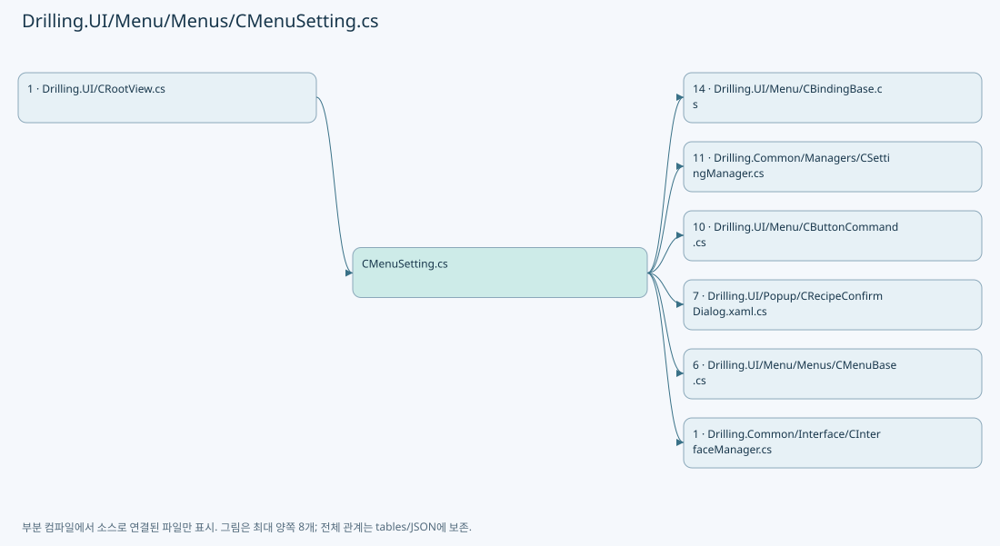

## 네임스페이스·타입·상속

| 타입 | 구분 | 원본 범위 | 선언/상속 |
| --- | --- | --- | --- |
| CMenuSetting | ClassDeclaration | 14–1077 | CMenuSetting: CMenuBase |
| ST_SETTING_TAB | RecordDeclaration | 1079–1082 | ST_SETTING_TAB |
| ST_SETTING_GROUP | RecordDeclaration | 1083–1083 | ST_SETTING_GROUP |
| ST_SETTING_HEAD_FILTER | RecordDeclaration | 1084–1084 | ST_SETTING_HEAD_FILTER |
| ST_SYSTEM_PARAMETER_ROW | ClassDeclaration | 1085–1288 | ST_SYSTEM_PARAMETER_ROW: CBindingBase |
| ST_SETTING_HISTORY_ROW | RecordDeclaration | 1290–1303 | ST_SETTING_HISTORY_ROW |
| ST_SETTING_SUMMARY_ROW | RecordDeclaration | 1305–1320 | ST_SETTING_SUMMARY_ROW |
| ST_SETTING_INTERFACE_ROW | ClassDeclaration | 1322–1627 | ST_SETTING_INTERFACE_ROW: CBindingBase |

## 멤버 빠른 목록

| 이름 | 종류 | 범위 | 서명 |
| --- | --- | --- | --- |
| _settingManager | FieldDeclaration | L16–16 | Drilling.Common.Managers.CSettingManager Drilling.UI.Menu.Menus.CMenuSetting._settingManager |
| _selectedTabProvider | FieldDeclaration | L17–17 | System.Func<string> Drilling.UI.Menu.Menus.CMenuSetting._selectedTabProvider |
| _selectedTabSetter | FieldDeclaration | L18–18 | System.Action<string> Drilling.UI.Menu.Menus.CMenuSetting._selectedTabSetter |
| _selectedGroupProvider | FieldDeclaration | L19–19 | System.Func<string> Drilling.UI.Menu.Menus.CMenuSetting._selectedGroupProvider |
| _selectedGroupSetter | FieldDeclaration | L20–20 | System.Action<string> Drilling.UI.Menu.Menus.CMenuSetting._selectedGroupSetter |
| _editScreenProvider | FieldDeclaration | L21–21 | System.Func<Drilling.UI.Menu.Menus.CMenuSetting?> Drilling.UI.Menu.Menus.CMenuSetting._editScreenProvider |
| _setStatusMessage | FieldDeclaration | L22–22 | System.Action<string> Drilling.UI.Menu.Menus.CMenuSetting._setStatusMessage |
| _showLoadingScreen | FieldDeclaration | L23–23 | System.Action<Drilling.UI.Menu.Menus.EN_MENU, string> Drilling.UI.Menu.Menus.CMenuSetting._showLoadingScreen |
| _refreshShellStatus | FieldDeclaration | L24–24 | System.Action Drilling.UI.Menu.Menus.CMenuSetting._refreshShellStatus |
| _refreshCurrentScreen | FieldDeclaration | L25–25 | System.Func<System.Threading.Tasks.Task> Drilling.UI.Menu.Menus.CMenuSetting._refreshCurrentScreen |
| _selectedInterfaceRow | FieldDeclaration | L26–26 | Drilling.UI.Menu.Menus.ST_SETTING_INTERFACE_ROW? Drilling.UI.Menu.Menus.CMenuSetting._selectedInterfaceRow |
| _selectedHeadFilter | FieldDeclaration | L27–27 | string Drilling.UI.Menu.Menus.CMenuSetting._selectedHeadFilter |
| Sections | FieldDeclaration | L28–28 | Drilling.Common.Managers.EN_SETTING_TAB[] Drilling.UI.Menu.Menus.CMenuSetting.Sections |
| .ctor | ConstructorDeclaration | L29–110 | Drilling.UI.Menu.Menus.CMenuSetting.CMenuSetting(Drilling.Common.Managers.CSettingManager, System.Func<string>, System.Action<string>, System.Func<string>, System.Action<string>, System.Func<Drilling.UI.Menu.Menus.CMenuSetting?>, System.Action<string>, System.Action<Drilling.UI.Menu.Menus.EN_MENU, string>, System.Action, System.Func<System.Threading.Tasks.Task>) |
| SelectTabCallback | LocalFunctionStatement | L52–55 | void SelectTabCallback(object?) |
| SelectGroupCallback | LocalFunctionStatement | L58–61 | void SelectGroupCallback(object?) |
| SelectHeadCallback | LocalFunctionStatement | L64–67 | void SelectHeadCallback(object?) |
| ConnectInterfaceCallback | LocalFunctionStatement | L70–73 | void ConnectInterfaceCallback(object?) |
| IsCanOperateSelectedInterface | LocalFunctionStatement | L75–78 | bool IsCanOperateSelectedInterface(object?) |
| DisconnectInterfaceCallback | LocalFunctionStatement | L81–84 | void DisconnectInterfaceCallback(object?) |
| IsCanOperateSelectedInterface2 | LocalFunctionStatement | L86–89 | bool IsCanOperateSelectedInterface2(object?) |
| SaveCallback | LocalFunctionStatement | L92–95 | void SaveCallback(object?) |
| CancelCallback | LocalFunctionStatement | L98–101 | void CancelCallback(object?) |
| ReloadCallback | LocalFunctionStatement | L104–107 | void ReloadCallback(object?) |
| Menu | PropertyDeclaration | L112–118 | Drilling.UI.Menu.Menus.EN_MENU Drilling.UI.Menu.Menus.CMenuSetting.Menu |
| get_Menu | GetAccessorDeclaration | L114–117 | Drilling.UI.Menu.Menus.EN_MENU Drilling.UI.Menu.Menus.CMenuSetting.Menu.get |
| Tabs | PropertyDeclaration | L120–120 | System.Collections.Generic.IReadOnlyList<Drilling.UI.Menu.Menus.ST_SCREEN_SECTION> Drilling.UI.Menu.Menus.CMenuSetting.Tabs |
| get_Tabs | GetAccessorDeclaration | L120–120 | System.Collections.Generic.IReadOnlyList<Drilling.UI.Menu.Menus.ST_SCREEN_SECTION> Drilling.UI.Menu.Menus.CMenuSetting.Tabs.get |
| set_Tabs | SetAccessorDeclaration | L120–120 | void Drilling.UI.Menu.Menus.CMenuSetting.Tabs.set |
| History | PropertyDeclaration | L121–121 | System.Collections.Generic.IReadOnlyList<Drilling.UI.Menu.Menus.ST_DISPLAY_ITEM> Drilling.UI.Menu.Menus.CMenuSetting.History |
| get_History | GetAccessorDeclaration | L121–121 | System.Collections.Generic.IReadOnlyList<Drilling.UI.Menu.Menus.ST_DISPLAY_ITEM> Drilling.UI.Menu.Menus.CMenuSetting.History.get |
| set_History | SetAccessorDeclaration | L121–121 | void Drilling.UI.Menu.Menus.CMenuSetting.History.set |
| SelectedTab | PropertyDeclaration | L122–122 | string Drilling.UI.Menu.Menus.CMenuSetting.SelectedTab |
| get_SelectedTab | GetAccessorDeclaration | L122–122 | string Drilling.UI.Menu.Menus.CMenuSetting.SelectedTab.get |
| set_SelectedTab | SetAccessorDeclaration | L122–122 | void Drilling.UI.Menu.Menus.CMenuSetting.SelectedTab.set |
| SelectedGroup | PropertyDeclaration | L123–123 | string Drilling.UI.Menu.Menus.CMenuSetting.SelectedGroup |
| get_SelectedGroup | GetAccessorDeclaration | L123–123 | string Drilling.UI.Menu.Menus.CMenuSetting.SelectedGroup.get |
| set_SelectedGroup | SetAccessorDeclaration | L123–123 | void Drilling.UI.Menu.Menus.CMenuSetting.SelectedGroup.set |
| SelectedHeadFilter | PropertyDeclaration | L124–124 | string Drilling.UI.Menu.Menus.CMenuSetting.SelectedHeadFilter |
| get_SelectedHeadFilter | GetAccessorDeclaration | L124–124 | string Drilling.UI.Menu.Menus.CMenuSetting.SelectedHeadFilter.get |
| set_SelectedHeadFilter | SetAccessorDeclaration | L124–124 | void Drilling.UI.Menu.Menus.CMenuSetting.SelectedHeadFilter.set |
| TabItems | PropertyDeclaration | L125–125 | System.Collections.Generic.IReadOnlyList<Drilling.UI.Menu.Menus.ST_SETTING_TAB> Drilling.UI.Menu.Menus.CMenuSetting.TabItems |
| get_TabItems | GetAccessorDeclaration | L125–125 | System.Collections.Generic.IReadOnlyList<Drilling.UI.Menu.Menus.ST_SETTING_TAB> Drilling.UI.Menu.Menus.CMenuSetting.TabItems.get |
| set_TabItems | SetAccessorDeclaration | L125–125 | void Drilling.UI.Menu.Menus.CMenuSetting.TabItems.set |
| GroupItems | PropertyDeclaration | L126–126 | System.Collections.Generic.IReadOnlyList<Drilling.UI.Menu.Menus.ST_SETTING_GROUP> Drilling.UI.Menu.Menus.CMenuSetting.GroupItems |
| get_GroupItems | GetAccessorDeclaration | L126–126 | System.Collections.Generic.IReadOnlyList<Drilling.UI.Menu.Menus.ST_SETTING_GROUP> Drilling.UI.Menu.Menus.CMenuSetting.GroupItems.get |
| set_GroupItems | SetAccessorDeclaration | L126–126 | void Drilling.UI.Menu.Menus.CMenuSetting.GroupItems.set |
| HeadFilterItems | PropertyDeclaration | L127–127 | System.Collections.Generic.IReadOnlyList<Drilling.UI.Menu.Menus.ST_SETTING_HEAD_FILTER> Drilling.UI.Menu.Menus.CMenuSetting.HeadFilterItems |
| get_HeadFilterItems | GetAccessorDeclaration | L127–127 | System.Collections.Generic.IReadOnlyList<Drilling.UI.Menu.Menus.ST_SETTING_HEAD_FILTER> Drilling.UI.Menu.Menus.CMenuSetting.HeadFilterItems.get |
| set_HeadFilterItems | SetAccessorDeclaration | L127–127 | void Drilling.UI.Menu.Menus.CMenuSetting.HeadFilterItems.set |
| AllParameterRows | PropertyDeclaration | L128–128 | System.Collections.Generic.IReadOnlyList<Drilling.UI.Menu.Menus.ST_SYSTEM_PARAMETER_ROW> Drilling.UI.Menu.Menus.CMenuSetting.AllParameterRows |
| get_AllParameterRows | GetAccessorDeclaration | L128–128 | System.Collections.Generic.IReadOnlyList<Drilling.UI.Menu.Menus.ST_SYSTEM_PARAMETER_ROW> Drilling.UI.Menu.Menus.CMenuSetting.AllParameterRows.get |
| set_AllParameterRows | SetAccessorDeclaration | L128–128 | void Drilling.UI.Menu.Menus.CMenuSetting.AllParameterRows.set |
| ParameterRows | PropertyDeclaration | L129–129 | System.Collections.Generic.IReadOnlyList<Drilling.UI.Menu.Menus.ST_SYSTEM_PARAMETER_ROW> Drilling.UI.Menu.Menus.CMenuSetting.ParameterRows |
| get_ParameterRows | GetAccessorDeclaration | L129–129 | System.Collections.Generic.IReadOnlyList<Drilling.UI.Menu.Menus.ST_SYSTEM_PARAMETER_ROW> Drilling.UI.Menu.Menus.CMenuSetting.ParameterRows.get |
| set_ParameterRows | SetAccessorDeclaration | L129–129 | void Drilling.UI.Menu.Menus.CMenuSetting.ParameterRows.set |
| AllInterfaceRows | PropertyDeclaration | L130–130 | System.Collections.Generic.IReadOnlyList<Drilling.UI.Menu.Menus.ST_SETTING_INTERFACE_ROW> Drilling.UI.Menu.Menus.CMenuSetting.AllInterfaceRows |
| get_AllInterfaceRows | GetAccessorDeclaration | L130–130 | System.Collections.Generic.IReadOnlyList<Drilling.UI.Menu.Menus.ST_SETTING_INTERFACE_ROW> Drilling.UI.Menu.Menus.CMenuSetting.AllInterfaceRows.get |
| set_AllInterfaceRows | SetAccessorDeclaration | L130–130 | void Drilling.UI.Menu.Menus.CMenuSetting.AllInterfaceRows.set |
| InterfaceRows | PropertyDeclaration | L131–131 | System.Collections.Generic.IReadOnlyList<Drilling.UI.Menu.Menus.ST_SETTING_INTERFACE_ROW> Drilling.UI.Menu.Menus.CMenuSetting.InterfaceRows |
| get_InterfaceRows | GetAccessorDeclaration | L131–131 | System.Collections.Generic.IReadOnlyList<Drilling.UI.Menu.Menus.ST_SETTING_INTERFACE_ROW> Drilling.UI.Menu.Menus.CMenuSetting.InterfaceRows.get |
| set_InterfaceRows | SetAccessorDeclaration | L131–131 | void Drilling.UI.Menu.Menus.CMenuSetting.InterfaceRows.set |
| ChangeHistory | PropertyDeclaration | L132–132 | System.Collections.Generic.IReadOnlyList<Drilling.UI.Menu.Menus.ST_SETTING_HISTORY_ROW> Drilling.UI.Menu.Menus.CMenuSetting.ChangeHistory |
| get_ChangeHistory | GetAccessorDeclaration | L132–132 | System.Collections.Generic.IReadOnlyList<Drilling.UI.Menu.Menus.ST_SETTING_HISTORY_ROW> Drilling.UI.Menu.Menus.CMenuSetting.ChangeHistory.get |
| set_ChangeHistory | SetAccessorDeclaration | L132–132 | void Drilling.UI.Menu.Menus.CMenuSetting.ChangeHistory.set |
| SummaryRows | PropertyDeclaration | L133–133 | System.Collections.Generic.IReadOnlyList<Drilling.UI.Menu.Menus.ST_SETTING_SUMMARY_ROW> Drilling.UI.Menu.Menus.CMenuSetting.SummaryRows |
| get_SummaryRows | GetAccessorDeclaration | L133–133 | System.Collections.Generic.IReadOnlyList<Drilling.UI.Menu.Menus.ST_SETTING_SUMMARY_ROW> Drilling.UI.Menu.Menus.CMenuSetting.SummaryRows.get |
| set_SummaryRows | SetAccessorDeclaration | L133–133 | void Drilling.UI.Menu.Menus.CMenuSetting.SummaryRows.set |
| SelectTabCommand | PropertyDeclaration | L134–134 | Drilling.UI.Menu.CButtonCommand Drilling.UI.Menu.Menus.CMenuSetting.SelectTabCommand |
| get_SelectTabCommand | GetAccessorDeclaration | L134–134 | Drilling.UI.Menu.CButtonCommand Drilling.UI.Menu.Menus.CMenuSetting.SelectTabCommand.get |
| SelectGroupCommand | PropertyDeclaration | L135–135 | Drilling.UI.Menu.CButtonCommand Drilling.UI.Menu.Menus.CMenuSetting.SelectGroupCommand |
| get_SelectGroupCommand | GetAccessorDeclaration | L135–135 | Drilling.UI.Menu.CButtonCommand Drilling.UI.Menu.Menus.CMenuSetting.SelectGroupCommand.get |
| SelectHeadCommand | PropertyDeclaration | L136–136 | Drilling.UI.Menu.CButtonCommand Drilling.UI.Menu.Menus.CMenuSetting.SelectHeadCommand |
| get_SelectHeadCommand | GetAccessorDeclaration | L136–136 | Drilling.UI.Menu.CButtonCommand Drilling.UI.Menu.Menus.CMenuSetting.SelectHeadCommand.get |
| ConnectInterfaceCommand | PropertyDeclaration | L137–137 | Drilling.UI.Menu.CButtonCommand Drilling.UI.Menu.Menus.CMenuSetting.ConnectInterfaceCommand |
| get_ConnectInterfaceCommand | GetAccessorDeclaration | L137–137 | Drilling.UI.Menu.CButtonCommand Drilling.UI.Menu.Menus.CMenuSetting.ConnectInterfaceCommand.get |
| DisconnectInterfaceCommand | PropertyDeclaration | L138–138 | Drilling.UI.Menu.CButtonCommand Drilling.UI.Menu.Menus.CMenuSetting.DisconnectInterfaceCommand |
| get_DisconnectInterfaceCommand | GetAccessorDeclaration | L138–138 | Drilling.UI.Menu.CButtonCommand Drilling.UI.Menu.Menus.CMenuSetting.DisconnectInterfaceCommand.get |
| SaveCommand | PropertyDeclaration | L139–139 | Drilling.UI.Menu.CButtonCommand Drilling.UI.Menu.Menus.CMenuSetting.SaveCommand |
| get_SaveCommand | GetAccessorDeclaration | L139–139 | Drilling.UI.Menu.CButtonCommand Drilling.UI.Menu.Menus.CMenuSetting.SaveCommand.get |
| CancelCommand | PropertyDeclaration | L140–140 | Drilling.UI.Menu.CButtonCommand Drilling.UI.Menu.Menus.CMenuSetting.CancelCommand |
| get_CancelCommand | GetAccessorDeclaration | L140–140 | Drilling.UI.Menu.CButtonCommand Drilling.UI.Menu.Menus.CMenuSetting.CancelCommand.get |
| ReloadCommand | PropertyDeclaration | L141–141 | Drilling.UI.Menu.CButtonCommand Drilling.UI.Menu.Menus.CMenuSetting.ReloadCommand |
| get_ReloadCommand | GetAccessorDeclaration | L141–141 | Drilling.UI.Menu.CButtonCommand Drilling.UI.Menu.Menus.CMenuSetting.ReloadCommand.get |
| IsInterfaceTab | PropertyDeclaration | L143–149 | bool Drilling.UI.Menu.Menus.CMenuSetting.IsInterfaceTab |
| get_IsInterfaceTab | GetAccessorDeclaration | L145–148 | bool Drilling.UI.Menu.Menus.CMenuSetting.IsInterfaceTab.get |
| IsParameterTab | PropertyDeclaration | L151–157 | bool Drilling.UI.Menu.Menus.CMenuSetting.IsParameterTab |
| get_IsParameterTab | GetAccessorDeclaration | L153–156 | bool Drilling.UI.Menu.Menus.CMenuSetting.IsParameterTab.get |
| IsHeadFilterVisible | PropertyDeclaration | L159–165 | bool Drilling.UI.Menu.Menus.CMenuSetting.IsHeadFilterVisible |
| get_IsHeadFilterVisible | GetAccessorDeclaration | L161–164 | bool Drilling.UI.Menu.Menus.CMenuSetting.IsHeadFilterVisible.get |
| SelectedInterfaceRow | PropertyDeclaration | L167–204 | Drilling.UI.Menu.Menus.ST_SETTING_INTERFACE_ROW? Drilling.UI.Menu.Menus.CMenuSetting.SelectedInterfaceRow |
| get_SelectedInterfaceRow | GetAccessorDeclaration | L169–172 | Drilling.UI.Menu.Menus.ST_SETTING_INTERFACE_ROW? Drilling.UI.Menu.Menus.CMenuSetting.SelectedInterfaceRow.get |
| set_SelectedInterfaceRow | SetAccessorDeclaration | L174–203 | void Drilling.UI.Menu.Menus.CMenuSetting.SelectedInterfaceRow.set |
| CanOperateSelectedInterface | PropertyDeclaration | L206–212 | bool Drilling.UI.Menu.Menus.CMenuSetting.CanOperateSelectedInterface |
| get_CanOperateSelectedInterface | GetAccessorDeclaration | L208–211 | bool Drilling.UI.Menu.Menus.CMenuSetting.CanOperateSelectedInterface.get |
| Build | MethodDeclaration | L214–285 | System.Threading.Tasks.Task<Drilling.UI.Menu.Menus.CScreenViewModel> Drilling.UI.Menu.Menus.CMenuSetting.Build(System.Threading.CancellationToken) |
| BuildDisplay | LocalFunctionStatement | L217–220 | Drilling.UI.Menu.Menus.ST_DISPLAY_ITEM BuildDisplay(Drilling.Common.Managers.ST_SYSTEM_PARAMETER) |
| ShouldIncludeItem | LocalFunctionStatement | L238–241 | bool ShouldIncludeItem(Drilling.UI.Menu.Menus.ST_SYSTEM_PARAMETER_ROW) |
| MatchesType | LocalFunctionStatement | L249–252 | bool MatchesType(Drilling.UI.Menu.Menus.ST_SETTING_INTERFACE_ROW) |
| BuildSetting | LocalFunctionStatement | L256–259 | Drilling.UI.Menu.Menus.ST_SETTING_GROUP BuildSetting(string) |
| SelectTab | MethodDeclaration | L287–301 | System.Threading.Tasks.Task Drilling.UI.Menu.Menus.CMenuSetting.SelectTab(object?) |
| SelectGroup | MethodDeclaration | L303–316 | System.Threading.Tasks.Task Drilling.UI.Menu.Menus.CMenuSetting.SelectGroup(object?) |
| ConnectInterface | MethodDeclaration | L318–358 | System.Threading.Tasks.Task Drilling.UI.Menu.Menus.CMenuSetting.ConnectInterface() |
| DisconnectInterface | MethodDeclaration | L360–400 | System.Threading.Tasks.Task Drilling.UI.Menu.Menus.CMenuSetting.DisconnectInterface() |
| Save | MethodDeclaration | L402–462 | System.Threading.Tasks.Task Drilling.UI.Menu.Menus.CMenuSetting.Save() |
| BuildSystem | LocalFunctionStatement | L436–439 | Drilling.Common.Managers.ST_SYSTEM_PARAMETER BuildSystem(Drilling.UI.Menu.Menus.ST_SYSTEM_PARAMETER_ROW) |
| Cancel | MethodDeclaration | L464–481 | System.Threading.Tasks.Task Drilling.UI.Menu.Menus.CMenuSetting.Cancel() |
| Reload | MethodDeclaration | L483–500 | System.Threading.Tasks.Task Drilling.UI.Menu.Menus.CMenuSetting.Reload() |
| TryReloadSelectedTabFromCsv | MethodDeclaration | L502–525 | bool Drilling.UI.Menu.Menus.CMenuSetting.TryReloadSelectedTabFromCsv() |
| SelectHeadFilter | MethodDeclaration | L527–538 | System.Threading.Tasks.Task Drilling.UI.Menu.Menus.CMenuSetting.SelectHeadFilter(object?) |
| Apply | MethodDeclaration | L540–572 | void Drilling.UI.Menu.Menus.CMenuSetting.Apply(System.Collections.Generic.IReadOnlyList<Drilling.UI.Menu.Menus.ST_SCREEN_SECTION>, System.Collections.Generic.IReadOnlyList<Drilling.UI.Menu.Menus.ST_DISPLAY_ITEM>, string, string, string, System.Collections.Generic.IReadOnlyList<Drilling.UI.Menu.Menus.ST_SETTING_TAB>, System.Collections.Generic.IReadOnlyList<Drilling.UI.Menu.Menus.ST_SETTING_GROUP>, System.Collections.Generic.IReadOnlyList<Drilling.UI.Menu.Menus.ST_SETTING_HEAD_FILTER>, System.Collections.Generic.IReadOnlyList<Drilling.UI.Menu.Menus.ST_SYSTEM_PARAMETER_ROW>, System.Collections.Generic.IReadOnlyList<Drilling.UI.Menu.Menus.ST_SYSTEM_PARAMETER_ROW>, System.Collections.Generic.IReadOnlyList<Drilling.UI.Menu.Menus.ST_SETTING_INTERFACE_ROW>, System.Collections.Generic.IReadOnlyList<Drilling.UI.Menu.Menus.ST_SETTING_INTERFACE_ROW>, System.Collections.Generic.IReadOnlyList<Drilling.UI.Menu.Menus.ST_SETTING_HISTORY_ROW>, System.Collections.Generic.IReadOnlyList<Drilling.UI.Menu.Menus.ST_SETTING_SUMMARY_ROW>) |
| GetEditRows | MethodDeclaration | L574–577 | System.Collections.Generic.IReadOnlyList<Drilling.UI.Menu.Menus.ST_SYSTEM_PARAMETER_ROW> Drilling.UI.Menu.Menus.CMenuSetting.GetEditRows(System.Collections.Generic.IReadOnlyList<Drilling.UI.Menu.Menus.ST_SYSTEM_PARAMETER_ROW>, Drilling.UI.Menu.Menus.CMenuSetting?, string) |
| GetEditInterfaceRows | MethodDeclaration | L579–582 | System.Collections.Generic.IReadOnlyList<Drilling.UI.Menu.Menus.ST_SETTING_INTERFACE_ROW> Drilling.UI.Menu.Menus.CMenuSetting.GetEditInterfaceRows(System.Collections.Generic.IReadOnlyList<Drilling.UI.Menu.Menus.ST_SETTING_INTERFACE_ROW>, Drilling.UI.Menu.Menus.CMenuSetting?, string) |
| GetSelectedInterfaceRow | MethodDeclaration | L584–607 | Drilling.UI.Menu.Menus.ST_SETTING_INTERFACE_ROW? Drilling.UI.Menu.Menus.CMenuSetting.GetSelectedInterfaceRow(System.Collections.Generic.IReadOnlyList<Drilling.UI.Menu.Menus.ST_SETTING_INTERFACE_ROW>, Drilling.UI.Menu.Menus.ST_SETTING_INTERFACE_ROW?) |
| MatchesItem | LocalFunctionStatement | L596–599 | bool MatchesItem(Drilling.UI.Menu.Menus.ST_SETTING_INTERFACE_ROW) |
| MatchesItem2 | LocalFunctionStatement | L601–604 | bool MatchesItem2(Drilling.UI.Menu.Menus.ST_SETTING_INTERFACE_ROW) |
| IsSameInterfaceKey | MethodDeclaration | L609–612 | bool Drilling.UI.Menu.Menus.CMenuSetting.IsSameInterfaceKey(Drilling.UI.Menu.Menus.ST_SETTING_INTERFACE_ROW, Drilling.UI.Menu.Menus.ST_SETTING_INTERFACE_ROW) |
| OnSelectedInterfaceRowStateChanged | MethodDeclaration | L614–617 | void Drilling.UI.Menu.Menus.CMenuSetting.OnSelectedInterfaceRowStateChanged(object?, System.EventArgs) |
| RefreshInterfaceCommandState | MethodDeclaration | L619–624 | void Drilling.UI.Menu.Menus.CMenuSetting.RefreshInterfaceCommandState() |
| BuildTabs | MethodDeclaration | L626–639 | System.Collections.Generic.IReadOnlyList<Drilling.UI.Menu.Menus.ST_SETTING_TAB> Drilling.UI.Menu.Menus.CMenuSetting.BuildTabs(string) |
| SelectItem | LocalFunctionStatement | L628–631 | string SelectItem(Drilling.Common.Managers.EN_SETTING_TAB) |
| BuildSetting | LocalFunctionStatement | L633–636 | Drilling.UI.Menu.Menus.ST_SETTING_TAB BuildSetting(string) |
| BuildParameterRows | MethodDeclaration | L641–667 | System.Collections.Generic.IReadOnlyList<Drilling.UI.Menu.Menus.ST_SYSTEM_PARAMETER_ROW> Drilling.UI.Menu.Menus.CMenuSetting.BuildParameterRows(System.Collections.Generic.IReadOnlyList<Drilling.Common.Managers.ST_SYSTEM_PARAMETER>) |
| ShouldIncludeItem | LocalFunctionStatement | L643–646 | bool ShouldIncludeItem(Drilling.Common.Managers.ST_SYSTEM_PARAMETER) |
| BuildSystem | LocalFunctionStatement | L648–664 | Drilling.UI.Menu.Menus.ST_SYSTEM_PARAMETER_ROW BuildSystem(Drilling.Common.Managers.ST_SYSTEM_PARAMETER) |
| BuildGroups | MethodDeclaration | L669–686 | System.Collections.Generic.IReadOnlyList<string> Drilling.UI.Menu.Menus.CMenuSetting.BuildGroups(System.Collections.Generic.IReadOnlyList<Drilling.UI.Menu.Menus.ST_SYSTEM_PARAMETER_ROW>) |
| SelectGroup | LocalFunctionStatement | L671–674 | string SelectGroup(Drilling.UI.Menu.Menus.ST_SYSTEM_PARAMETER_ROW) |
| ShouldIncludeItem | LocalFunctionStatement | L676–679 | bool ShouldIncludeItem(string) |
| BuildHeadFilters | MethodDeclaration | L688–722 | System.Collections.Generic.IReadOnlyList<Drilling.UI.Menu.Menus.ST_SETTING_HEAD_FILTER> Drilling.UI.Menu.Menus.CMenuSetting.BuildHeadFilters(System.Collections.Generic.IReadOnlyList<Drilling.UI.Menu.Menus.ST_SYSTEM_PARAMETER_ROW>) |
| HasHead | LocalFunctionStatement | L690–693 | bool HasHead(Drilling.UI.Menu.Menus.ST_SYSTEM_PARAMETER_ROW) |
| ReadHeadNo | LocalFunctionStatement | L695–698 | int ReadHeadNo(Drilling.UI.Menu.Menus.ST_SYSTEM_PARAMETER_ROW) |
| CreateHeadFilter | LocalFunctionStatement | L700–703 | Drilling.UI.Menu.Menus.ST_SETTING_HEAD_FILTER CreateHeadFilter(int) |
| SortHeadNo | LocalFunctionStatement | L705–708 | int SortHeadNo(int) |
| ApplyHeadFilter | MethodDeclaration | L724–737 | System.Collections.Generic.IReadOnlyList<Drilling.UI.Menu.Menus.ST_SYSTEM_PARAMETER_ROW> Drilling.UI.Menu.Menus.CMenuSetting.ApplyHeadFilter(System.Collections.Generic.IReadOnlyList<Drilling.UI.Menu.Menus.ST_SYSTEM_PARAMETER_ROW>, string) |
| MatchesHead | LocalFunctionStatement | L731–734 | bool MatchesHead(Drilling.UI.Menu.Menus.ST_SYSTEM_PARAMETER_ROW) |
| MarkSelectedHeadFilter | MethodDeclaration | L739–750 | System.Collections.Generic.IReadOnlyList<Drilling.UI.Menu.Menus.ST_SETTING_HEAD_FILTER> Drilling.UI.Menu.Menus.CMenuSetting.MarkSelectedHeadFilter(System.Collections.Generic.IReadOnlyList<Drilling.UI.Menu.Menus.ST_SETTING_HEAD_FILTER>, string) |
| MarkSelected | LocalFunctionStatement | L741–747 | Drilling.UI.Menu.Menus.ST_SETTING_HEAD_FILTER MarkSelected(Drilling.UI.Menu.Menus.ST_SETTING_HEAD_FILTER) |
| NormalizeHeadFilter | MethodDeclaration | L752–768 | string Drilling.UI.Menu.Menus.CMenuSetting.NormalizeHeadFilter(string, System.Collections.Generic.IReadOnlyList<Drilling.UI.Menu.Menus.ST_SETTING_HEAD_FILTER>) |
| BuildInterfaceGroups | MethodDeclaration | L770–787 | System.Collections.Generic.IReadOnlyList<string> Drilling.UI.Menu.Menus.CMenuSetting.BuildInterfaceGroups(System.Collections.Generic.IReadOnlyList<Drilling.UI.Menu.Menus.ST_SETTING_INTERFACE_ROW>) |
| SelectType | LocalFunctionStatement | L772–775 | string SelectType(Drilling.UI.Menu.Menus.ST_SETTING_INTERFACE_ROW) |
| ShouldIncludeItem | LocalFunctionStatement | L777–780 | bool ShouldIncludeItem(string) |
| BuildHistoryItems | MethodDeclaration | L789–797 | System.Collections.Generic.IReadOnlyList<Drilling.UI.Menu.Menus.ST_DISPLAY_ITEM> Drilling.UI.Menu.Menus.CMenuSetting.BuildHistoryItems(System.Collections.Generic.IReadOnlyList<Drilling.Common.Managers.ST_SETTING_HISTORY>) |
| BuildDisplay | LocalFunctionStatement | L791–794 | Drilling.UI.Menu.Menus.ST_DISPLAY_ITEM BuildDisplay(Drilling.Common.Managers.ST_SETTING_HISTORY) |
| BuildHistoryRows | MethodDeclaration | L799–812 | System.Collections.Generic.IReadOnlyList<Drilling.UI.Menu.Menus.ST_SETTING_HISTORY_ROW> Drilling.UI.Menu.Menus.CMenuSetting.BuildHistoryRows(System.Collections.Generic.IReadOnlyList<Drilling.Common.Managers.ST_SETTING_HISTORY>) |
| ShouldIncludeItem | LocalFunctionStatement | L801–804 | bool ShouldIncludeItem(Drilling.Common.Managers.ST_SETTING_HISTORY) |
| BuildSetting | LocalFunctionStatement | L806–809 | Drilling.UI.Menu.Menus.ST_SETTING_HISTORY_ROW BuildSetting(Drilling.Common.Managers.ST_SETTING_HISTORY) |
| BuildSummaryRows | MethodDeclaration | L814–839 | System.Collections.Generic.IReadOnlyList<Drilling.UI.Menu.Menus.ST_SETTING_SUMMARY_ROW> Drilling.UI.Menu.Menus.CMenuSetting.BuildSummaryRows(string, System.Collections.Generic.IReadOnlyList<Drilling.UI.Menu.Menus.ST_SYSTEM_PARAMETER_ROW>, System.Collections.Generic.IReadOnlyList<Drilling.UI.Menu.Menus.ST_SETTING_INTERFACE_ROW>, System.Collections.Generic.IReadOnlyList<Drilling.Common.Managers.ST_SETTING_HISTORY>) |
| IsIsModified | LocalFunctionStatement | L821–824 | bool IsIsModified(Drilling.UI.Menu.Menus.ST_SETTING_INTERFACE_ROW) |
| IsIsModified2 | LocalFunctionStatement | L826–829 | bool IsIsModified2(Drilling.UI.Menu.Menus.ST_SYSTEM_PARAMETER_ROW) |
| MatchesItem | LocalFunctionStatement | L832–835 | bool MatchesItem(Drilling.Common.Managers.ST_SETTING_HISTORY) |
| BuildInterfaceRows | MethodDeclaration | L841–880 | System.Collections.Generic.IReadOnlyList<Drilling.UI.Menu.Menus.ST_SETTING_INTERFACE_ROW> Drilling.UI.Menu.Menus.CMenuSetting.BuildInterfaceRows(System.Collections.Generic.IReadOnlyList<Drilling.Common.Interface.ST_INTERFACE_DATA>) |
| SelectDevice | LocalFunctionStatement | L843–846 | Drilling.Common.Interface.EN_EQP_MODULE SelectDevice(Drilling.Common.Interface.ST_INTERFACE_DATA) |
| SelectNumber | LocalFunctionStatement | L848–851 | int SelectNumber(Drilling.Common.Interface.ST_INTERFACE_DATA) |
| SelectNickName | LocalFunctionStatement | L853–856 | string SelectNickName(Drilling.Common.Interface.ST_INTERFACE_DATA) |
| BuildSetting | LocalFunctionStatement | L858–877 | Drilling.UI.Menu.Menus.ST_SETTING_INTERFACE_ROW BuildSetting(Drilling.Common.Interface.ST_INTERFACE_DATA, int) |
| ToInterfaceData | MethodDeclaration | L882–900 | System.Collections.Generic.IReadOnlyList<Drilling.Common.Interface.ST_INTERFACE_DATA> Drilling.UI.Menu.Menus.CMenuSetting.ToInterfaceData(System.Collections.Generic.IReadOnlyList<Drilling.UI.Menu.Menus.ST_SETTING_INTERFACE_ROW>) |
| BuildInterface | LocalFunctionStatement | L884–897 | Drilling.Common.Interface.ST_INTERFACE_DATA BuildInterface(Drilling.UI.Menu.Menus.ST_SETTING_INTERFACE_ROW) |
| ParseInterfaceType | MethodDeclaration | L902–920 | Drilling.Common.Interface.EN_INTERFACE_TYPE Drilling.UI.Menu.Menus.CMenuSetting.ParseInterfaceType(string) |
| ParseDevice | MethodDeclaration | L922–937 | Drilling.Common.Interface.EN_EQP_MODULE Drilling.UI.Menu.Menus.CMenuSetting.ParseDevice(string) |
| InterfaceTypeText | MethodDeclaration | L939–957 | string Drilling.UI.Menu.Menus.CMenuSetting.InterfaceTypeText(Drilling.Common.Interface.EN_INTERFACE_TYPE) |
| DeviceText | MethodDeclaration | L959–974 | string Drilling.UI.Menu.Menus.CMenuSetting.DeviceText(Drilling.Common.Interface.EN_EQP_MODULE) |
| InterfaceRowLabel | MethodDeclaration | L976–979 | string Drilling.UI.Menu.Menus.CMenuSetting.InterfaceRowLabel(Drilling.UI.Menu.Menus.ST_SETTING_INTERFACE_ROW) |
| RequireText | MethodDeclaration | L981–989 | string Drilling.UI.Menu.Menus.CMenuSetting.RequireText(string, string) |
| ReadBool | MethodDeclaration | L991–998 | bool Drilling.UI.Menu.Menus.CMenuSetting.ReadBool(string, string, string) |
| ReadInt | MethodDeclaration | L1000–1008 | int Drilling.UI.Menu.Menus.CMenuSetting.ReadInt(string, string, string) |
| NormalizeTab | MethodDeclaration | L1010–1019 | string Drilling.UI.Menu.Menus.CMenuSetting.NormalizeTab(string) |
| NormalizeGroup | MethodDeclaration | L1021–1030 | string Drilling.UI.Menu.Menus.CMenuSetting.NormalizeGroup(string, System.Collections.Generic.IReadOnlyList<string>) |
| MatchesItem | LocalFunctionStatement | L1024–1027 | bool MatchesItem(string) |
| NormalizeSettingText | MethodDeclaration | L1032–1035 | string Drilling.UI.Menu.Menus.CMenuSetting.NormalizeSettingText(string, string) |
| NormalizeUnit | MethodDeclaration | L1037–1040 | string Drilling.UI.Menu.Menus.CMenuSetting.NormalizeUnit(string) |
| NormalizeSettingUnit | MethodDeclaration | L1042–1045 | string Drilling.UI.Menu.Menus.CMenuSetting.NormalizeSettingUnit(string) |
| GetValueState | MethodDeclaration | L1047–1051 | string Drilling.UI.Menu.Menus.CMenuSetting.GetValueState(string) |
| ToSection | MethodDeclaration | L1053–1063 | Drilling.Common.Managers.EN_SETTING_TAB Drilling.UI.Menu.Menus.CMenuSetting.ToSection(string) |
| ToTabText | MethodDeclaration | L1065–1071 | string Drilling.UI.Menu.Menus.CMenuSetting.ToTabText(Drilling.Common.Managers.EN_SETTING_TAB) |
| GetDefaultGroup | MethodDeclaration | L1073–1076 | string Drilling.UI.Menu.Menus.CMenuSetting.GetDefaultGroup() |
| DisplayName | PropertyDeclaration | L1081–1081 | string Drilling.UI.Menu.Menus.ST_SETTING_TAB.DisplayName |
| VisionFlipOptions | FieldDeclaration | L1087–1087 | System.Collections.Generic.IReadOnlyList<string> Drilling.UI.Menu.Menus.ST_SYSTEM_PARAMETER_ROW.VisionFlipOptions |
| SignOptions | FieldDeclaration | L1088–1088 | System.Collections.Generic.IReadOnlyList<string> Drilling.UI.Menu.Menus.ST_SYSTEM_PARAMETER_ROW.SignOptions |
| NumericBooleanOptions | FieldDeclaration | L1089–1089 | System.Collections.Generic.IReadOnlyList<string> Drilling.UI.Menu.Menus.ST_SYSTEM_PARAMETER_ROW.NumericBooleanOptions |
| _originalValue | FieldDeclaration | L1090–1090 | string Drilling.UI.Menu.Menus.ST_SYSTEM_PARAMETER_ROW._originalValue |
| _originalValueState | FieldDeclaration | L1091–1091 | string Drilling.UI.Menu.Menus.ST_SYSTEM_PARAMETER_ROW._originalValueState |
| _value | FieldDeclaration | L1092–1092 | string Drilling.UI.Menu.Menus.ST_SYSTEM_PARAMETER_ROW._value |
| _valueState | FieldDeclaration | L1093–1093 | string Drilling.UI.Menu.Menus.ST_SYSTEM_PARAMETER_ROW._valueState |
| .ctor | ConstructorDeclaration | L1094–1125 | Drilling.UI.Menu.Menus.ST_SYSTEM_PARAMETER_ROW.ST_SYSTEM_PARAMETER_ROW(string, string, string, string, string, bool, string, string, string, Drilling.Common.Managers.EN_RECIPE_DATA_TYPE, double, double) |
| Group | PropertyDeclaration | L1127–1127 | string Drilling.UI.Menu.Menus.ST_SYSTEM_PARAMETER_ROW.Group |
| get_Group | GetAccessorDeclaration | L1127–1127 | string Drilling.UI.Menu.Menus.ST_SYSTEM_PARAMETER_ROW.Group.get |
| Parameter | PropertyDeclaration | L1128–1128 | string Drilling.UI.Menu.Menus.ST_SYSTEM_PARAMETER_ROW.Parameter |
| get_Parameter | GetAccessorDeclaration | L1128–1128 | string Drilling.UI.Menu.Menus.ST_SYSTEM_PARAMETER_ROW.Parameter.get |
| Value | PropertyDeclaration | L1130–1149 | string Drilling.UI.Menu.Menus.ST_SYSTEM_PARAMETER_ROW.Value |
| get_Value | GetAccessorDeclaration | L1132–1135 | string Drilling.UI.Menu.Menus.ST_SYSTEM_PARAMETER_ROW.Value.get |
| set_Value | SetAccessorDeclaration | L1137–1148 | void Drilling.UI.Menu.Menus.ST_SYSTEM_PARAMETER_ROW.Value.set |
| Unit | PropertyDeclaration | L1151–1151 | string Drilling.UI.Menu.Menus.ST_SYSTEM_PARAMETER_ROW.Unit |
| get_Unit | GetAccessorDeclaration | L1151–1151 | string Drilling.UI.Menu.Menus.ST_SYSTEM_PARAMETER_ROW.Unit.get |
| Description | PropertyDeclaration | L1152–1152 | string Drilling.UI.Menu.Menus.ST_SYSTEM_PARAMETER_ROW.Description |
| get_Description | GetAccessorDeclaration | L1152–1152 | string Drilling.UI.Menu.Menus.ST_SYSTEM_PARAMETER_ROW.Description.get |
| Key | PropertyDeclaration | L1153–1153 | string Drilling.UI.Menu.Menus.ST_SYSTEM_PARAMETER_ROW.Key |
| get_Key | GetAccessorDeclaration | L1153–1153 | string Drilling.UI.Menu.Menus.ST_SYSTEM_PARAMETER_ROW.Key.get |
| HeadNo | PropertyDeclaration | L1154–1154 | int Drilling.UI.Menu.Menus.ST_SYSTEM_PARAMETER_ROW.HeadNo |
| get_HeadNo | GetAccessorDeclaration | L1154–1154 | int Drilling.UI.Menu.Menus.ST_SYSTEM_PARAMETER_ROW.HeadNo.get |
| HeadFilter | PropertyDeclaration | L1155–1155 | string Drilling.UI.Menu.Menus.ST_SYSTEM_PARAMETER_ROW.HeadFilter |
| get_HeadFilter | GetAccessorDeclaration | L1155–1155 | string Drilling.UI.Menu.Menus.ST_SYSTEM_PARAMETER_ROW.HeadFilter.get |
| DefaultValue | PropertyDeclaration | L1156–1156 | string Drilling.UI.Menu.Menus.ST_SYSTEM_PARAMETER_ROW.DefaultValue |
| get_DefaultValue | GetAccessorDeclaration | L1156–1156 | string Drilling.UI.Menu.Menus.ST_SYSTEM_PARAMETER_ROW.DefaultValue.get |
| DataType | PropertyDeclaration | L1157–1157 | Drilling.Common.Managers.EN_RECIPE_DATA_TYPE Drilling.UI.Menu.Menus.ST_SYSTEM_PARAMETER_ROW.DataType |
| get_DataType | GetAccessorDeclaration | L1157–1157 | Drilling.Common.Managers.EN_RECIPE_DATA_TYPE Drilling.UI.Menu.Menus.ST_SYSTEM_PARAMETER_ROW.DataType.get |
| IsVisionFlipOption | PropertyDeclaration | L1159–1165 | bool Drilling.UI.Menu.Menus.ST_SYSTEM_PARAMETER_ROW.IsVisionFlipOption |
| get_IsVisionFlipOption | GetAccessorDeclaration | L1161–1164 | bool Drilling.UI.Menu.Menus.ST_SYSTEM_PARAMETER_ROW.IsVisionFlipOption.get |
| IsBoolean | PropertyDeclaration | L1167–1173 | bool Drilling.UI.Menu.Menus.ST_SYSTEM_PARAMETER_ROW.IsBoolean |
| get_IsBoolean | GetAccessorDeclaration | L1169–1172 | bool Drilling.UI.Menu.Menus.ST_SYSTEM_PARAMETER_ROW.IsBoolean.get |
| IsSign | PropertyDeclaration | L1175–1181 | bool Drilling.UI.Menu.Menus.ST_SYSTEM_PARAMETER_ROW.IsSign |
| get_IsSign | GetAccessorDeclaration | L1177–1180 | bool Drilling.UI.Menu.Menus.ST_SYSTEM_PARAMETER_ROW.IsSign.get |
| UsesSelectionEditor | PropertyDeclaration | L1183–1189 | bool Drilling.UI.Menu.Menus.ST_SYSTEM_PARAMETER_ROW.UsesSelectionEditor |
| get_UsesSelectionEditor | GetAccessorDeclaration | L1185–1188 | bool Drilling.UI.Menu.Menus.ST_SYSTEM_PARAMETER_ROW.UsesSelectionEditor.get |
| ValueOptions | PropertyDeclaration | L1191–1197 | System.Collections.Generic.IReadOnlyList<string> Drilling.UI.Menu.Menus.ST_SYSTEM_PARAMETER_ROW.ValueOptions |
| get_ValueOptions | GetAccessorDeclaration | L1193–1196 | System.Collections.Generic.IReadOnlyList<string> Drilling.UI.Menu.Menus.ST_SYSTEM_PARAMETER_ROW.ValueOptions.get |
| Min | PropertyDeclaration | L1199–1199 | double Drilling.UI.Menu.Menus.ST_SYSTEM_PARAMETER_ROW.Min |
| get_Min | GetAccessorDeclaration | L1199–1199 | double Drilling.UI.Menu.Menus.ST_SYSTEM_PARAMETER_ROW.Min.get |
| Max | PropertyDeclaration | L1200–1200 | double Drilling.UI.Menu.Menus.ST_SYSTEM_PARAMETER_ROW.Max |
| get_Max | GetAccessorDeclaration | L1200–1200 | double Drilling.UI.Menu.Menus.ST_SYSTEM_PARAMETER_ROW.Max.get |
| OriginalValue | PropertyDeclaration | L1202–1208 | string Drilling.UI.Menu.Menus.ST_SYSTEM_PARAMETER_ROW.OriginalValue |
| get_OriginalValue | GetAccessorDeclaration | L1204–1207 | string Drilling.UI.Menu.Menus.ST_SYSTEM_PARAMETER_ROW.OriginalValue.get |
| IsModified | PropertyDeclaration | L1210–1216 | bool Drilling.UI.Menu.Menus.ST_SYSTEM_PARAMETER_ROW.IsModified |
| get_IsModified | GetAccessorDeclaration | L1212–1215 | bool Drilling.UI.Menu.Menus.ST_SYSTEM_PARAMETER_ROW.IsModified.get |
| ModifiedText | PropertyDeclaration | L1218–1224 | string Drilling.UI.Menu.Menus.ST_SYSTEM_PARAMETER_ROW.ModifiedText |
| get_ModifiedText | GetAccessorDeclaration | L1220–1223 | string Drilling.UI.Menu.Menus.ST_SYSTEM_PARAMETER_ROW.ModifiedText.get |
| ValueState | PropertyDeclaration | L1226–1240 | string Drilling.UI.Menu.Menus.ST_SYSTEM_PARAMETER_ROW.ValueState |
| get_ValueState | GetAccessorDeclaration | L1228–1231 | string Drilling.UI.Menu.Menus.ST_SYSTEM_PARAMETER_ROW.ValueState.get |
| set_ValueState | SetAccessorDeclaration | L1233–1239 | void Drilling.UI.Menu.Menus.ST_SYSTEM_PARAMETER_ROW.ValueState.set |
| ValueBrush | PropertyDeclaration | L1242–1253 | Brush Drilling.UI.Menu.Menus.ST_SYSTEM_PARAMETER_ROW.ValueBrush |
| get_ValueBrush | GetAccessorDeclaration | L1244–1252 | Brush Drilling.UI.Menu.Menus.ST_SYSTEM_PARAMETER_ROW.ValueBrush.get |
| ModifiedBrush | PropertyDeclaration | L1255–1261 | Brush Drilling.UI.Menu.Menus.ST_SYSTEM_PARAMETER_ROW.ModifiedBrush |
| get_ModifiedBrush | GetAccessorDeclaration | L1257–1260 | Brush Drilling.UI.Menu.Menus.ST_SYSTEM_PARAMETER_ROW.ModifiedBrush.get |
| NormalizeValue | MethodDeclaration | L1263–1266 | string Drilling.UI.Menu.Menus.ST_SYSTEM_PARAMETER_ROW.NormalizeValue(string) |
| NormalizeVisionFlipDisplay | MethodDeclaration | L1268–1271 | string Drilling.UI.Menu.Menus.ST_SYSTEM_PARAMETER_ROW.NormalizeVisionFlipDisplay(string) |
| ParseHeadNo | MethodDeclaration | L1273–1287 | int Drilling.UI.Menu.Menus.ST_SYSTEM_PARAMETER_ROW.ParseHeadNo(string) |
| AfterBrush | PropertyDeclaration | L1292–1302 | Brush Drilling.UI.Menu.Menus.ST_SETTING_HISTORY_ROW.AfterBrush |
| get_AfterBrush | GetAccessorDeclaration | L1294–1301 | Brush Drilling.UI.Menu.Menus.ST_SETTING_HISTORY_ROW.AfterBrush.get |
| ValueBrush | PropertyDeclaration | L1307–1319 | Brush Drilling.UI.Menu.Menus.ST_SETTING_SUMMARY_ROW.ValueBrush |
| get_ValueBrush | GetAccessorDeclaration | L1309–1318 | Brush Drilling.UI.Menu.Menus.ST_SETTING_SUMMARY_ROW.ValueBrush.get |
| TypeOptions | PropertyDeclaration | L1324–1324 | System.Collections.Generic.IReadOnlyList<string> Drilling.UI.Menu.Menus.ST_SETTING_INTERFACE_ROW.TypeOptions |
| get_TypeOptions | GetAccessorDeclaration | L1324–1324 | System.Collections.Generic.IReadOnlyList<string> Drilling.UI.Menu.Menus.ST_SETTING_INTERFACE_ROW.TypeOptions.get |
| DeviceOptions | PropertyDeclaration | L1325–1325 | System.Collections.Generic.IReadOnlyList<string> Drilling.UI.Menu.Menus.ST_SETTING_INTERFACE_ROW.DeviceOptions |
| get_DeviceOptions | GetAccessorDeclaration | L1325–1325 | System.Collections.Generic.IReadOnlyList<string> Drilling.UI.Menu.Menus.ST_SETTING_INTERFACE_ROW.DeviceOptions.get |
| AutoConnectionOptions | PropertyDeclaration | L1326–1326 | System.Collections.Generic.IReadOnlyList<string> Drilling.UI.Menu.Menus.ST_SETTING_INTERFACE_ROW.AutoConnectionOptions |
| get_AutoConnectionOptions | GetAccessorDeclaration | L1326–1326 | System.Collections.Generic.IReadOnlyList<string> Drilling.UI.Menu.Menus.ST_SETTING_INTERFACE_ROW.AutoConnectionOptions.get |
| _originalType | FieldDeclaration | L1328–1328 | string Drilling.UI.Menu.Menus.ST_SETTING_INTERFACE_ROW._originalType |
| _originalDevice | FieldDeclaration | L1329–1329 | string Drilling.UI.Menu.Menus.ST_SETTING_INTERFACE_ROW._originalDevice |
| _originalNumber | FieldDeclaration | L1330–1330 | string Drilling.UI.Menu.Menus.ST_SETTING_INTERFACE_ROW._originalNumber |
| _originalNickName | FieldDeclaration | L1331–1331 | string Drilling.UI.Menu.Menus.ST_SETTING_INTERFACE_ROW._originalNickName |
| _originalSystemSection | FieldDeclaration | L1332–1332 | string Drilling.UI.Menu.Menus.ST_SETTING_INTERFACE_ROW._originalSystemSection |
| _originalAutoConnection | FieldDeclaration | L1333–1333 | string Drilling.UI.Menu.Menus.ST_SETTING_INTERFACE_ROW._originalAutoConnection |
| _originalSimul | FieldDeclaration | L1334–1334 | string Drilling.UI.Menu.Menus.ST_SETTING_INTERFACE_ROW._originalSimul |
| _originalArg1 | FieldDeclaration | L1335–1335 | string Drilling.UI.Menu.Menus.ST_SETTING_INTERFACE_ROW._originalArg1 |
| _originalArg2 | FieldDeclaration | L1336–1336 | string Drilling.UI.Menu.Menus.ST_SETTING_INTERFACE_ROW._originalArg2 |
| _originalArg3 | FieldDeclaration | L1337–1337 | string Drilling.UI.Menu.Menus.ST_SETTING_INTERFACE_ROW._originalArg3 |
| _originalArg4 | FieldDeclaration | L1338–1338 | string Drilling.UI.Menu.Menus.ST_SETTING_INTERFACE_ROW._originalArg4 |
| _originalArg5 | FieldDeclaration | L1339–1339 | string Drilling.UI.Menu.Menus.ST_SETTING_INTERFACE_ROW._originalArg5 |
| _type | FieldDeclaration | L1340–1340 | string Drilling.UI.Menu.Menus.ST_SETTING_INTERFACE_ROW._type |
| _device | FieldDeclaration | L1341–1341 | string Drilling.UI.Menu.Menus.ST_SETTING_INTERFACE_ROW._device |
| _number | FieldDeclaration | L1342–1342 | string Drilling.UI.Menu.Menus.ST_SETTING_INTERFACE_ROW._number |
| _nickName | FieldDeclaration | L1343–1343 | string Drilling.UI.Menu.Menus.ST_SETTING_INTERFACE_ROW._nickName |
| _systemSection | FieldDeclaration | L1344–1344 | string Drilling.UI.Menu.Menus.ST_SETTING_INTERFACE_ROW._systemSection |
| _autoConnection | FieldDeclaration | L1345–1345 | string Drilling.UI.Menu.Menus.ST_SETTING_INTERFACE_ROW._autoConnection |
| _simul | FieldDeclaration | L1346–1346 | string Drilling.UI.Menu.Menus.ST_SETTING_INTERFACE_ROW._simul |
| _arg1 | FieldDeclaration | L1347–1347 | string Drilling.UI.Menu.Menus.ST_SETTING_INTERFACE_ROW._arg1 |
| _arg2 | FieldDeclaration | L1348–1348 | string Drilling.UI.Menu.Menus.ST_SETTING_INTERFACE_ROW._arg2 |
| _arg3 | FieldDeclaration | L1349–1349 | string Drilling.UI.Menu.Menus.ST_SETTING_INTERFACE_ROW._arg3 |
| _arg4 | FieldDeclaration | L1350–1350 | string Drilling.UI.Menu.Menus.ST_SETTING_INTERFACE_ROW._arg4 |
| _arg5 | FieldDeclaration | L1351–1351 | string Drilling.UI.Menu.Menus.ST_SETTING_INTERFACE_ROW._arg5 |
| .ctor | ConstructorDeclaration | L1352–1395 | Drilling.UI.Menu.Menus.ST_SETTING_INTERFACE_ROW.ST_SETTING_INTERFACE_ROW(string, string, string, string, string, string, string, string, string, string, string, string, string, System.Collections.Generic.IReadOnlyDictionary<string, string>?) |
| No | PropertyDeclaration | L1397–1397 | string Drilling.UI.Menu.Menus.ST_SETTING_INTERFACE_ROW.No |
| get_No | GetAccessorDeclaration | L1397–1397 | string Drilling.UI.Menu.Menus.ST_SETTING_INTERFACE_ROW.No.get |
| Extra | PropertyDeclaration | L1398–1398 | System.Collections.Generic.IReadOnlyDictionary<string, string>? Drilling.UI.Menu.Menus.ST_SETTING_INTERFACE_ROW.Extra |
| get_Extra | GetAccessorDeclaration | L1398–1398 | System.Collections.Generic.IReadOnlyDictionary<string, string>? Drilling.UI.Menu.Menus.ST_SETTING_INTERFACE_ROW.Extra.get |
| Type | PropertyDeclaration | L1400–1411 | string Drilling.UI.Menu.Menus.ST_SETTING_INTERFACE_ROW.Type |
| get_Type | GetAccessorDeclaration | L1402–1405 | string Drilling.UI.Menu.Menus.ST_SETTING_INTERFACE_ROW.Type.get |
| set_Type | SetAccessorDeclaration | L1407–1410 | void Drilling.UI.Menu.Menus.ST_SETTING_INTERFACE_ROW.Type.set |
| Device | PropertyDeclaration | L1413–1424 | string Drilling.UI.Menu.Menus.ST_SETTING_INTERFACE_ROW.Device |
| get_Device | GetAccessorDeclaration | L1415–1418 | string Drilling.UI.Menu.Menus.ST_SETTING_INTERFACE_ROW.Device.get |
| set_Device | SetAccessorDeclaration | L1420–1423 | void Drilling.UI.Menu.Menus.ST_SETTING_INTERFACE_ROW.Device.set |
| Number | PropertyDeclaration | L1426–1437 | string Drilling.UI.Menu.Menus.ST_SETTING_INTERFACE_ROW.Number |
| get_Number | GetAccessorDeclaration | L1428–1431 | string Drilling.UI.Menu.Menus.ST_SETTING_INTERFACE_ROW.Number.get |
| set_Number | SetAccessorDeclaration | L1433–1436 | void Drilling.UI.Menu.Menus.ST_SETTING_INTERFACE_ROW.Number.set |
| NickName | PropertyDeclaration | L1439–1450 | string Drilling.UI.Menu.Menus.ST_SETTING_INTERFACE_ROW.NickName |
| get_NickName | GetAccessorDeclaration | L1441–1444 | string Drilling.UI.Menu.Menus.ST_SETTING_INTERFACE_ROW.NickName.get |
| set_NickName | SetAccessorDeclaration | L1446–1449 | void Drilling.UI.Menu.Menus.ST_SETTING_INTERFACE_ROW.NickName.set |
| SystemSection | PropertyDeclaration | L1452–1463 | string Drilling.UI.Menu.Menus.ST_SETTING_INTERFACE_ROW.SystemSection |
| get_SystemSection | GetAccessorDeclaration | L1454–1457 | string Drilling.UI.Menu.Menus.ST_SETTING_INTERFACE_ROW.SystemSection.get |
| set_SystemSection | SetAccessorDeclaration | L1459–1462 | void Drilling.UI.Menu.Menus.ST_SETTING_INTERFACE_ROW.SystemSection.set |
| AutoConnection | PropertyDeclaration | L1465–1476 | string Drilling.UI.Menu.Menus.ST_SETTING_INTERFACE_ROW.AutoConnection |
| get_AutoConnection | GetAccessorDeclaration | L1467–1470 | string Drilling.UI.Menu.Menus.ST_SETTING_INTERFACE_ROW.AutoConnection.get |
| set_AutoConnection | SetAccessorDeclaration | L1472–1475 | void Drilling.UI.Menu.Menus.ST_SETTING_INTERFACE_ROW.AutoConnection.set |
| Simul | PropertyDeclaration | L1478–1489 | string Drilling.UI.Menu.Menus.ST_SETTING_INTERFACE_ROW.Simul |
| get_Simul | GetAccessorDeclaration | L1480–1483 | string Drilling.UI.Menu.Menus.ST_SETTING_INTERFACE_ROW.Simul.get |
| set_Simul | SetAccessorDeclaration | L1485–1488 | void Drilling.UI.Menu.Menus.ST_SETTING_INTERFACE_ROW.Simul.set |
| Arg1 | PropertyDeclaration | L1491–1502 | string Drilling.UI.Menu.Menus.ST_SETTING_INTERFACE_ROW.Arg1 |
| get_Arg1 | GetAccessorDeclaration | L1493–1496 | string Drilling.UI.Menu.Menus.ST_SETTING_INTERFACE_ROW.Arg1.get |
| set_Arg1 | SetAccessorDeclaration | L1498–1501 | void Drilling.UI.Menu.Menus.ST_SETTING_INTERFACE_ROW.Arg1.set |
| Arg2 | PropertyDeclaration | L1504–1515 | string Drilling.UI.Menu.Menus.ST_SETTING_INTERFACE_ROW.Arg2 |
| get_Arg2 | GetAccessorDeclaration | L1506–1509 | string Drilling.UI.Menu.Menus.ST_SETTING_INTERFACE_ROW.Arg2.get |
| set_Arg2 | SetAccessorDeclaration | L1511–1514 | void Drilling.UI.Menu.Menus.ST_SETTING_INTERFACE_ROW.Arg2.set |
| Arg3 | PropertyDeclaration | L1517–1528 | string Drilling.UI.Menu.Menus.ST_SETTING_INTERFACE_ROW.Arg3 |
| get_Arg3 | GetAccessorDeclaration | L1519–1522 | string Drilling.UI.Menu.Menus.ST_SETTING_INTERFACE_ROW.Arg3.get |
| set_Arg3 | SetAccessorDeclaration | L1524–1527 | void Drilling.UI.Menu.Menus.ST_SETTING_INTERFACE_ROW.Arg3.set |
| Arg4 | PropertyDeclaration | L1530–1541 | string Drilling.UI.Menu.Menus.ST_SETTING_INTERFACE_ROW.Arg4 |
| get_Arg4 | GetAccessorDeclaration | L1532–1535 | string Drilling.UI.Menu.Menus.ST_SETTING_INTERFACE_ROW.Arg4.get |
| set_Arg4 | SetAccessorDeclaration | L1537–1540 | void Drilling.UI.Menu.Menus.ST_SETTING_INTERFACE_ROW.Arg4.set |
| Arg5 | PropertyDeclaration | L1543–1554 | string Drilling.UI.Menu.Menus.ST_SETTING_INTERFACE_ROW.Arg5 |
| get_Arg5 | GetAccessorDeclaration | L1545–1548 | string Drilling.UI.Menu.Menus.ST_SETTING_INTERFACE_ROW.Arg5.get |
| set_Arg5 | SetAccessorDeclaration | L1550–1553 | void Drilling.UI.Menu.Menus.ST_SETTING_INTERFACE_ROW.Arg5.set |
| IsModified | PropertyDeclaration | L1556–1562 | bool Drilling.UI.Menu.Menus.ST_SETTING_INTERFACE_ROW.IsModified |
| get_IsModified | GetAccessorDeclaration | L1558–1561 | bool Drilling.UI.Menu.Menus.ST_SETTING_INTERFACE_ROW.IsModified.get |
| IsSimulation | PropertyDeclaration | L1564–1574 | bool Drilling.UI.Menu.Menus.ST_SETTING_INTERFACE_ROW.IsSimulation |
| get_IsSimulation | GetAccessorDeclaration | L1566–1573 | bool Drilling.UI.Menu.Menus.ST_SETTING_INTERFACE_ROW.IsSimulation.get |
| ModifiedText | PropertyDeclaration | L1576–1582 | string Drilling.UI.Menu.Menus.ST_SETTING_INTERFACE_ROW.ModifiedText |
| get_ModifiedText | GetAccessorDeclaration | L1578–1581 | string Drilling.UI.Menu.Menus.ST_SETTING_INTERFACE_ROW.ModifiedText.get |
| ModifiedBrush | PropertyDeclaration | L1584–1590 | Brush Drilling.UI.Menu.Menus.ST_SETTING_INTERFACE_ROW.ModifiedBrush |
| get_ModifiedBrush | GetAccessorDeclaration | L1586–1589 | Brush Drilling.UI.Menu.Menus.ST_SETTING_INTERFACE_ROW.ModifiedBrush.get |
| SimulBrush | PropertyDeclaration | L1592–1602 | Brush Drilling.UI.Menu.Menus.ST_SETTING_INTERFACE_ROW.SimulBrush |
| get_SimulBrush | GetAccessorDeclaration | L1594–1601 | Brush Drilling.UI.Menu.Menus.ST_SETTING_INTERFACE_ROW.SimulBrush.get |
| SetEditable | MethodDeclaration | L1604–1616 | void Drilling.UI.Menu.Menus.ST_SETTING_INTERFACE_ROW.SetEditable(ref string, string) |
| IsChanged | MethodDeclaration | L1618–1621 | bool Drilling.UI.Menu.Menus.ST_SETTING_INTERFACE_ROW.IsChanged(string, string) |
| Normalize | MethodDeclaration | L1623–1626 | string Drilling.UI.Menu.Menus.ST_SETTING_INTERFACE_ROW.Normalize(string) |

## 멤버별 상세 계약·호출·처리 해설

### FieldDeclaration `_settingManager` · L16–16

[Drilling.UI/Menu/Menus/CMenuSetting.cs:16–16](https://github.com/kjuws10-rgb/A3Drilling/blob/5aee8e58439c9b455cae7c9593c9be986c3e682e/Drilling.UI/Menu/Menus/CMenuSetting.cs#L16-L16)

| 항목 | 실제 추출 값 |
| --- | --- |
| 서명 | Drilling.Common.Managers.CSettingManager Drilling.UI.Menu.Menus.CMenuSetting._settingManager |
| 접근/수식자 | Private / private, readonly |
| 반환/값 타입 | Drilling.Common.Managers.CSettingManager |
| 소속 타입 | NamedType:Drilling.UI.Menu.Menus.CMenuSetting |

현재 부분 분석에서 직접 연결된 호출자는 없습니다. XAML/이벤트/인터페이스·델리게이트·외부 진입을 추가 확인해야 하며, 미사용으로 판정한 것이 아닙니다.

변경 전 점검: 입력/반환 타입, 위 호출자, 예외/취소 경로, 공유 상태와 저장·전송 소비자를 함께 확인합니다. 값의 단위나 물리 방향을 이름만으로 확정하지 않습니다.

### FieldDeclaration `_selectedTabProvider` · L17–17

[Drilling.UI/Menu/Menus/CMenuSetting.cs:17–17](https://github.com/kjuws10-rgb/A3Drilling/blob/5aee8e58439c9b455cae7c9593c9be986c3e682e/Drilling.UI/Menu/Menus/CMenuSetting.cs#L17-L17)

| 항목 | 실제 추출 값 |
| --- | --- |
| 서명 | System.Func<string> Drilling.UI.Menu.Menus.CMenuSetting._selectedTabProvider |
| 접근/수식자 | Private / private, readonly |
| 반환/값 타입 | System.Func<string> |
| 소속 타입 | NamedType:Drilling.UI.Menu.Menus.CMenuSetting |

현재 부분 분석에서 직접 연결된 호출자는 없습니다. XAML/이벤트/인터페이스·델리게이트·외부 진입을 추가 확인해야 하며, 미사용으로 판정한 것이 아닙니다.

변경 전 점검: 입력/반환 타입, 위 호출자, 예외/취소 경로, 공유 상태와 저장·전송 소비자를 함께 확인합니다. 값의 단위나 물리 방향을 이름만으로 확정하지 않습니다.

### FieldDeclaration `_selectedTabSetter` · L18–18

[Drilling.UI/Menu/Menus/CMenuSetting.cs:18–18](https://github.com/kjuws10-rgb/A3Drilling/blob/5aee8e58439c9b455cae7c9593c9be986c3e682e/Drilling.UI/Menu/Menus/CMenuSetting.cs#L18-L18)

| 항목 | 실제 추출 값 |
| --- | --- |
| 서명 | System.Action<string> Drilling.UI.Menu.Menus.CMenuSetting._selectedTabSetter |
| 접근/수식자 | Private / private, readonly |
| 반환/값 타입 | System.Action<string> |
| 소속 타입 | NamedType:Drilling.UI.Menu.Menus.CMenuSetting |

현재 부분 분석에서 직접 연결된 호출자는 없습니다. XAML/이벤트/인터페이스·델리게이트·외부 진입을 추가 확인해야 하며, 미사용으로 판정한 것이 아닙니다.

변경 전 점검: 입력/반환 타입, 위 호출자, 예외/취소 경로, 공유 상태와 저장·전송 소비자를 함께 확인합니다. 값의 단위나 물리 방향을 이름만으로 확정하지 않습니다.

### FieldDeclaration `_selectedGroupProvider` · L19–19

[Drilling.UI/Menu/Menus/CMenuSetting.cs:19–19](https://github.com/kjuws10-rgb/A3Drilling/blob/5aee8e58439c9b455cae7c9593c9be986c3e682e/Drilling.UI/Menu/Menus/CMenuSetting.cs#L19-L19)

| 항목 | 실제 추출 값 |
| --- | --- |
| 서명 | System.Func<string> Drilling.UI.Menu.Menus.CMenuSetting._selectedGroupProvider |
| 접근/수식자 | Private / private, readonly |
| 반환/값 타입 | System.Func<string> |
| 소속 타입 | NamedType:Drilling.UI.Menu.Menus.CMenuSetting |

현재 부분 분석에서 직접 연결된 호출자는 없습니다. XAML/이벤트/인터페이스·델리게이트·외부 진입을 추가 확인해야 하며, 미사용으로 판정한 것이 아닙니다.

변경 전 점검: 입력/반환 타입, 위 호출자, 예외/취소 경로, 공유 상태와 저장·전송 소비자를 함께 확인합니다. 값의 단위나 물리 방향을 이름만으로 확정하지 않습니다.

### FieldDeclaration `_selectedGroupSetter` · L20–20

[Drilling.UI/Menu/Menus/CMenuSetting.cs:20–20](https://github.com/kjuws10-rgb/A3Drilling/blob/5aee8e58439c9b455cae7c9593c9be986c3e682e/Drilling.UI/Menu/Menus/CMenuSetting.cs#L20-L20)

| 항목 | 실제 추출 값 |
| --- | --- |
| 서명 | System.Action<string> Drilling.UI.Menu.Menus.CMenuSetting._selectedGroupSetter |
| 접근/수식자 | Private / private, readonly |
| 반환/값 타입 | System.Action<string> |
| 소속 타입 | NamedType:Drilling.UI.Menu.Menus.CMenuSetting |

현재 부분 분석에서 직접 연결된 호출자는 없습니다. XAML/이벤트/인터페이스·델리게이트·외부 진입을 추가 확인해야 하며, 미사용으로 판정한 것이 아닙니다.

변경 전 점검: 입력/반환 타입, 위 호출자, 예외/취소 경로, 공유 상태와 저장·전송 소비자를 함께 확인합니다. 값의 단위나 물리 방향을 이름만으로 확정하지 않습니다.

### FieldDeclaration `_editScreenProvider` · L21–21

[Drilling.UI/Menu/Menus/CMenuSetting.cs:21–21](https://github.com/kjuws10-rgb/A3Drilling/blob/5aee8e58439c9b455cae7c9593c9be986c3e682e/Drilling.UI/Menu/Menus/CMenuSetting.cs#L21-L21)

| 항목 | 실제 추출 값 |
| --- | --- |
| 서명 | System.Func<Drilling.UI.Menu.Menus.CMenuSetting?> Drilling.UI.Menu.Menus.CMenuSetting._editScreenProvider |
| 접근/수식자 | Private / private, readonly |
| 반환/값 타입 | System.Func<Drilling.UI.Menu.Menus.CMenuSetting?> |
| 소속 타입 | NamedType:Drilling.UI.Menu.Menus.CMenuSetting |

현재 부분 분석에서 직접 연결된 호출자는 없습니다. XAML/이벤트/인터페이스·델리게이트·외부 진입을 추가 확인해야 하며, 미사용으로 판정한 것이 아닙니다.

변경 전 점검: 입력/반환 타입, 위 호출자, 예외/취소 경로, 공유 상태와 저장·전송 소비자를 함께 확인합니다. 값의 단위나 물리 방향을 이름만으로 확정하지 않습니다.

### FieldDeclaration `_setStatusMessage` · L22–22

[Drilling.UI/Menu/Menus/CMenuSetting.cs:22–22](https://github.com/kjuws10-rgb/A3Drilling/blob/5aee8e58439c9b455cae7c9593c9be986c3e682e/Drilling.UI/Menu/Menus/CMenuSetting.cs#L22-L22)

| 항목 | 실제 추출 값 |
| --- | --- |
| 서명 | System.Action<string> Drilling.UI.Menu.Menus.CMenuSetting._setStatusMessage |
| 접근/수식자 | Private / private, readonly |
| 반환/값 타입 | System.Action<string> |
| 소속 타입 | NamedType:Drilling.UI.Menu.Menus.CMenuSetting |

현재 부분 분석에서 직접 연결된 호출자는 없습니다. XAML/이벤트/인터페이스·델리게이트·외부 진입을 추가 확인해야 하며, 미사용으로 판정한 것이 아닙니다.

변경 전 점검: 입력/반환 타입, 위 호출자, 예외/취소 경로, 공유 상태와 저장·전송 소비자를 함께 확인합니다. 값의 단위나 물리 방향을 이름만으로 확정하지 않습니다.

### FieldDeclaration `_showLoadingScreen` · L23–23

[Drilling.UI/Menu/Menus/CMenuSetting.cs:23–23](https://github.com/kjuws10-rgb/A3Drilling/blob/5aee8e58439c9b455cae7c9593c9be986c3e682e/Drilling.UI/Menu/Menus/CMenuSetting.cs#L23-L23)

| 항목 | 실제 추출 값 |
| --- | --- |
| 서명 | System.Action<Drilling.UI.Menu.Menus.EN_MENU, string> Drilling.UI.Menu.Menus.CMenuSetting._showLoadingScreen |
| 접근/수식자 | Private / private, readonly |
| 반환/값 타입 | System.Action<Drilling.UI.Menu.Menus.EN_MENU, string> |
| 소속 타입 | NamedType:Drilling.UI.Menu.Menus.CMenuSetting |

현재 부분 분석에서 직접 연결된 호출자는 없습니다. XAML/이벤트/인터페이스·델리게이트·외부 진입을 추가 확인해야 하며, 미사용으로 판정한 것이 아닙니다.

변경 전 점검: 입력/반환 타입, 위 호출자, 예외/취소 경로, 공유 상태와 저장·전송 소비자를 함께 확인합니다. 값의 단위나 물리 방향을 이름만으로 확정하지 않습니다.

### FieldDeclaration `_refreshShellStatus` · L24–24

[Drilling.UI/Menu/Menus/CMenuSetting.cs:24–24](https://github.com/kjuws10-rgb/A3Drilling/blob/5aee8e58439c9b455cae7c9593c9be986c3e682e/Drilling.UI/Menu/Menus/CMenuSetting.cs#L24-L24)

| 항목 | 실제 추출 값 |
| --- | --- |
| 서명 | System.Action Drilling.UI.Menu.Menus.CMenuSetting._refreshShellStatus |
| 접근/수식자 | Private / private, readonly |
| 반환/값 타입 | System.Action |
| 소속 타입 | NamedType:Drilling.UI.Menu.Menus.CMenuSetting |

현재 부분 분석에서 직접 연결된 호출자는 없습니다. XAML/이벤트/인터페이스·델리게이트·외부 진입을 추가 확인해야 하며, 미사용으로 판정한 것이 아닙니다.

변경 전 점검: 입력/반환 타입, 위 호출자, 예외/취소 경로, 공유 상태와 저장·전송 소비자를 함께 확인합니다. 값의 단위나 물리 방향을 이름만으로 확정하지 않습니다.

### FieldDeclaration `_refreshCurrentScreen` · L25–25

[Drilling.UI/Menu/Menus/CMenuSetting.cs:25–25](https://github.com/kjuws10-rgb/A3Drilling/blob/5aee8e58439c9b455cae7c9593c9be986c3e682e/Drilling.UI/Menu/Menus/CMenuSetting.cs#L25-L25)

| 항목 | 실제 추출 값 |
| --- | --- |
| 서명 | System.Func<System.Threading.Tasks.Task> Drilling.UI.Menu.Menus.CMenuSetting._refreshCurrentScreen |
| 접근/수식자 | Private / private, readonly |
| 반환/값 타입 | System.Func<System.Threading.Tasks.Task> |
| 소속 타입 | NamedType:Drilling.UI.Menu.Menus.CMenuSetting |

현재 부분 분석에서 직접 연결된 호출자는 없습니다. XAML/이벤트/인터페이스·델리게이트·외부 진입을 추가 확인해야 하며, 미사용으로 판정한 것이 아닙니다.

변경 전 점검: 입력/반환 타입, 위 호출자, 예외/취소 경로, 공유 상태와 저장·전송 소비자를 함께 확인합니다. 값의 단위나 물리 방향을 이름만으로 확정하지 않습니다.

### FieldDeclaration `_selectedInterfaceRow` · L26–26

[Drilling.UI/Menu/Menus/CMenuSetting.cs:26–26](https://github.com/kjuws10-rgb/A3Drilling/blob/5aee8e58439c9b455cae7c9593c9be986c3e682e/Drilling.UI/Menu/Menus/CMenuSetting.cs#L26-L26)

| 항목 | 실제 추출 값 |
| --- | --- |
| 서명 | Drilling.UI.Menu.Menus.ST_SETTING_INTERFACE_ROW? Drilling.UI.Menu.Menus.CMenuSetting._selectedInterfaceRow |
| 접근/수식자 | Private / private |
| 반환/값 타입 | Drilling.UI.Menu.Menus.ST_SETTING_INTERFACE_ROW? |
| 소속 타입 | NamedType:Drilling.UI.Menu.Menus.CMenuSetting |

현재 부분 분석에서 직접 연결된 호출자는 없습니다. XAML/이벤트/인터페이스·델리게이트·외부 진입을 추가 확인해야 하며, 미사용으로 판정한 것이 아닙니다.

변경 전 점검: 입력/반환 타입, 위 호출자, 예외/취소 경로, 공유 상태와 저장·전송 소비자를 함께 확인합니다. 값의 단위나 물리 방향을 이름만으로 확정하지 않습니다.

### FieldDeclaration `_selectedHeadFilter` · L27–27

[Drilling.UI/Menu/Menus/CMenuSetting.cs:27–27](https://github.com/kjuws10-rgb/A3Drilling/blob/5aee8e58439c9b455cae7c9593c9be986c3e682e/Drilling.UI/Menu/Menus/CMenuSetting.cs#L27-L27)

| 항목 | 실제 추출 값 |
| --- | --- |
| 서명 | string Drilling.UI.Menu.Menus.CMenuSetting._selectedHeadFilter |
| 접근/수식자 | Private / private |
| 반환/값 타입 | string |
| 소속 타입 | NamedType:Drilling.UI.Menu.Menus.CMenuSetting |

현재 부분 분석에서 직접 연결된 호출자는 없습니다. XAML/이벤트/인터페이스·델리게이트·외부 진입을 추가 확인해야 하며, 미사용으로 판정한 것이 아닙니다.

본문의 실제 연산·분기·예외·반환 순서(원문 위치 순):

| 원본 행 | 종류 | 주석 해설 |
| --- | --- | --- |
| 27 | variable-initializer | 변수의 초기값을 지정합니다: _selectedHeadFilter = "ALL" |

변경 전 점검: 입력/반환 타입, 위 호출자, 예외/취소 경로, 공유 상태와 저장·전송 소비자를 함께 확인합니다. 값의 단위나 물리 방향을 이름만으로 확정하지 않습니다.

### FieldDeclaration `Sections` · L28–28

[Drilling.UI/Menu/Menus/CMenuSetting.cs:28–28](https://github.com/kjuws10-rgb/A3Drilling/blob/5aee8e58439c9b455cae7c9593c9be986c3e682e/Drilling.UI/Menu/Menus/CMenuSetting.cs#L28-L28)

| 항목 | 실제 추출 값 |
| --- | --- |
| 서명 | Drilling.Common.Managers.EN_SETTING_TAB[] Drilling.UI.Menu.Menus.CMenuSetting.Sections |
| 접근/수식자 | Private / private, static, readonly |
| 반환/값 타입 | Drilling.Common.Managers.EN_SETTING_TAB[] |
| 소속 타입 | NamedType:Drilling.UI.Menu.Menus.CMenuSetting |

현재 부분 분석에서 직접 연결된 호출자는 없습니다. XAML/이벤트/인터페이스·델리게이트·외부 진입을 추가 확인해야 하며, 미사용으로 판정한 것이 아닙니다.

본문의 실제 연산·분기·예외·반환 순서(원문 위치 순):

| 원본 행 | 종류 | 주석 해설 |
| --- | --- | --- |
| 28 | variable-initializer | 변수의 초기값을 지정합니다: Sections = [EN_SETTING_TAB.Option, EN_SETTING_TAB.Interface, EN_SETTING_TAB.Io, EN_SETTING_TAB.Motor, EN_SETTING_TAB.Alarm] |

변경 전 점검: 입력/반환 타입, 위 호출자, 예외/취소 경로, 공유 상태와 저장·전송 소비자를 함께 확인합니다. 값의 단위나 물리 방향을 이름만으로 확정하지 않습니다.

### ConstructorDeclaration `.ctor` · L29–110

[Drilling.UI/Menu/Menus/CMenuSetting.cs:29–110](https://github.com/kjuws10-rgb/A3Drilling/blob/5aee8e58439c9b455cae7c9593c9be986c3e682e/Drilling.UI/Menu/Menus/CMenuSetting.cs#L29-L110)

| 항목 | 실제 추출 값 |
| --- | --- |
| 서명 | Drilling.UI.Menu.Menus.CMenuSetting.CMenuSetting(Drilling.Common.Managers.CSettingManager, System.Func<string>, System.Action<string>, System.Func<string>, System.Action<string>, System.Func<Drilling.UI.Menu.Menus.CMenuSetting?>, System.Action<string>, System.Action<Drilling.UI.Menu.Menus.EN_MENU, string>, System.Action, System.Func<System.Threading.Tasks.Task>) |
| 접근/수식자 | Public / public |
| 반환/값 타입 | void |
| 소속 타입 | NamedType:Drilling.UI.Menu.Menus.CMenuSetting |

입력 계약:

| 이름 | 타입 | 전달 | 선택/기본값 |
| --- | --- | --- | --- |
| settingManager | Drilling.Common.Managers.CSettingManager | None | False /  |
| selectedTabProvider | System.Func<string> | None | False /  |
| selectedTabSetter | System.Action<string> | None | False /  |
| selectedGroupProvider | System.Func<string> | None | False /  |
| selectedGroupSetter | System.Action<string> | None | False /  |
| editScreenProvider | System.Func<Drilling.UI.Menu.Menus.CMenuSetting?> | None | False /  |
| setStatusMessage | System.Action<string> | None | False /  |
| showLoadingScreen | System.Action<Drilling.UI.Menu.Menus.EN_MENU, string> | None | False /  |
| refreshShellStatus | System.Action | None | False /  |
| refreshCurrentScreen | System.Func<System.Threading.Tasks.Task> | None | False /  |

정적 호출자로 확인된 위치:

| 호출 파일/행 | 호출 표현식 | 런타임 분기 가능 |
| --- | --- | --- |
| [Drilling.UI/CRootView.cs:2225–2236](https://github.com/kjuws10-rgb/A3Drilling/blob/5aee8e58439c9b455cae7c9593c9be986c3e682e/Drilling.UI/CRootView.cs#L2225-L2236) | new CMenuSetting | False |

호출하는 대상과 해석 범위:

| 원본 행 | 표현식 | 분석 상태 | 대상/소스 위치 |
| --- | --- | --- | --- |
| 57 | new CButtonCommand | resolved | Drilling.UI.Menu.CButtonCommand.CButtonCommand(System.Action<object?>, System.Predicate<object?>?) · Drilling.UI/Menu/CButtonCommand.cs:9 |
| 63 | new CButtonCommand | resolved | Drilling.UI.Menu.CButtonCommand.CButtonCommand(System.Action<object?>, System.Predicate<object?>?) · Drilling.UI/Menu/CButtonCommand.cs:9 |
| 69 | new CButtonCommand | resolved | Drilling.UI.Menu.CButtonCommand.CButtonCommand(System.Action<object?>, System.Predicate<object?>?) · Drilling.UI/Menu/CButtonCommand.cs:9 |
| 80 | new CButtonCommand | resolved | Drilling.UI.Menu.CButtonCommand.CButtonCommand(System.Action<object?>, System.Predicate<object?>?) · Drilling.UI/Menu/CButtonCommand.cs:9 |
| 91 | new CButtonCommand | resolved | Drilling.UI.Menu.CButtonCommand.CButtonCommand(System.Action<object?>, System.Predicate<object?>?) · Drilling.UI/Menu/CButtonCommand.cs:9 |
| 97 | new CButtonCommand | resolved | Drilling.UI.Menu.CButtonCommand.CButtonCommand(System.Action<object?>, System.Predicate<object?>?) · Drilling.UI/Menu/CButtonCommand.cs:9 |
| 103 | new CButtonCommand | resolved | Drilling.UI.Menu.CButtonCommand.CButtonCommand(System.Action<object?>, System.Predicate<object?>?) · Drilling.UI/Menu/CButtonCommand.cs:9 |
| 109 | new CButtonCommand | resolved | Drilling.UI.Menu.CButtonCommand.CButtonCommand(System.Action<object?>, System.Predicate<object?>?) · Drilling.UI/Menu/CButtonCommand.cs:9 |

본문의 실제 연산·분기·예외·반환 순서(원문 위치 순):

| 원본 행 | 종류 | 주석 해설 |
| --- | --- | --- |
| 42 | assignment | 값을 대상에 대입합니다: _settingManager = settingManager |
| 43 | assignment | 값을 대상에 대입합니다: _selectedTabProvider = selectedTabProvider |
| 44 | assignment | 값을 대상에 대입합니다: _selectedTabSetter = selectedTabSetter |
| 45 | assignment | 값을 대상에 대입합니다: _selectedGroupProvider = selectedGroupProvider |
| 46 | assignment | 값을 대상에 대입합니다: _selectedGroupSetter = selectedGroupSetter |
| 47 | assignment | 값을 대상에 대입합니다: _editScreenProvider = editScreenProvider |
| 48 | assignment | 값을 대상에 대입합니다: _setStatusMessage = setStatusMessage |
| 49 | assignment | 값을 대상에 대입합니다: _showLoadingScreen = showLoadingScreen |
| 50 | assignment | 값을 대상에 대입합니다: _refreshShellStatus = refreshShellStatus |
| 51 | assignment | 값을 대상에 대입합니다: _refreshCurrentScreen = refreshCurrentScreen |
| 57 | assignment | 값을 대상에 대입합니다: SelectTabCommand = new CButtonCommand(SelectTabCallback) |
| 57 | call | 함수·델리게이트 또는 객체 생성자를 호출합니다: new CButtonCommand(SelectTabCallback) |
| 63 | assignment | 값을 대상에 대입합니다: SelectGroupCommand = new CButtonCommand(SelectGroupCallback) |
| 63 | call | 함수·델리게이트 또는 객체 생성자를 호출합니다: new CButtonCommand(SelectGroupCallback) |
| 69 | assignment | 값을 대상에 대입합니다: SelectHeadCommand = new CButtonCommand(SelectHeadCallback) |
| 69 | call | 함수·델리게이트 또는 객체 생성자를 호출합니다: new CButtonCommand(SelectHeadCallback) |
| 80 | assignment | 값을 대상에 대입합니다: ConnectInterfaceCommand = new CButtonCommand(ConnectInterfaceCallback, IsCanOperateSelectedInterface) |
| 80 | call | 함수·델리게이트 또는 객체 생성자를 호출합니다: new CButtonCommand(ConnectInterfaceCallback, IsCanOperateSelectedInterface) |
| 91 | assignment | 값을 대상에 대입합니다: DisconnectInterfaceCommand = new CButtonCommand(DisconnectInterfaceCallback, IsCanOperateSelectedInterface2) |
| 91 | call | 함수·델리게이트 또는 객체 생성자를 호출합니다: new CButtonCommand(DisconnectInterfaceCallback, IsCanOperateSelectedInterface2) |
| 97 | assignment | 값을 대상에 대입합니다: SaveCommand = new CButtonCommand(SaveCallback) |
| 97 | call | 함수·델리게이트 또는 객체 생성자를 호출합니다: new CButtonCommand(SaveCallback) |
| 103 | assignment | 값을 대상에 대입합니다: CancelCommand = new CButtonCommand(CancelCallback) |
| 103 | call | 함수·델리게이트 또는 객체 생성자를 호출합니다: new CButtonCommand(CancelCallback) |
| 109 | assignment | 값을 대상에 대입합니다: ReloadCommand = new CButtonCommand(ReloadCallback) |
| 109 | call | 함수·델리게이트 또는 객체 생성자를 호출합니다: new CButtonCommand(ReloadCallback) |

변경 전 점검: 입력/반환 타입, 위 호출자, 예외/취소 경로, 공유 상태와 저장·전송 소비자를 함께 확인합니다. 값의 단위나 물리 방향을 이름만으로 확정하지 않습니다.

### LocalFunctionStatement `SelectTabCallback` · L52–55

[Drilling.UI/Menu/Menus/CMenuSetting.cs:52–55](https://github.com/kjuws10-rgb/A3Drilling/blob/5aee8e58439c9b455cae7c9593c9be986c3e682e/Drilling.UI/Menu/Menus/CMenuSetting.cs#L52-L55)

| 항목 | 실제 추출 값 |
| --- | --- |
| 서명 | void SelectTabCallback(object?) |
| 접근/수식자 | Private / async |
| 반환/값 타입 | void |
| 소속 타입 | NamedType:Drilling.UI.Menu.Menus.CMenuSetting |

입력 계약:

| 이름 | 타입 | 전달 | 선택/기본값 |
| --- | --- | --- | --- |
| parameter | object? | None | False /  |

현재 부분 분석에서 직접 연결된 호출자는 없습니다. XAML/이벤트/인터페이스·델리게이트·외부 진입을 추가 확인해야 하며, 미사용으로 판정한 것이 아닙니다.

호출하는 대상과 해석 범위:

| 원본 행 | 표현식 | 분석 상태 | 대상/소스 위치 |
| --- | --- | --- | --- |
| 54 | SelectTab | resolved | System.Threading.Tasks.Task Drilling.UI.Menu.Menus.CMenuSetting.SelectTab(object?) · Drilling.UI/Menu/Menus/CMenuSetting.cs:287 |

본문의 실제 연산·분기·예외·반환 순서(원문 위치 순):

| 원본 행 | 종류 | 주석 해설 |
| --- | --- | --- |
| 54 | await | 비동기 완료를 기다립니다: await SelectTab(parameter) |
| 54 | call | 함수·델리게이트 또는 객체 생성자를 호출합니다: SelectTab(parameter) |

변경 전 점검: 입력/반환 타입, 위 호출자, 예외/취소 경로, 공유 상태와 저장·전송 소비자를 함께 확인합니다. 값의 단위나 물리 방향을 이름만으로 확정하지 않습니다.

### LocalFunctionStatement `SelectGroupCallback` · L58–61

[Drilling.UI/Menu/Menus/CMenuSetting.cs:58–61](https://github.com/kjuws10-rgb/A3Drilling/blob/5aee8e58439c9b455cae7c9593c9be986c3e682e/Drilling.UI/Menu/Menus/CMenuSetting.cs#L58-L61)

| 항목 | 실제 추출 값 |
| --- | --- |
| 서명 | void SelectGroupCallback(object?) |
| 접근/수식자 | Private / async |
| 반환/값 타입 | void |
| 소속 타입 | NamedType:Drilling.UI.Menu.Menus.CMenuSetting |

입력 계약:

| 이름 | 타입 | 전달 | 선택/기본값 |
| --- | --- | --- | --- |
| parameter | object? | None | False /  |

현재 부분 분석에서 직접 연결된 호출자는 없습니다. XAML/이벤트/인터페이스·델리게이트·외부 진입을 추가 확인해야 하며, 미사용으로 판정한 것이 아닙니다.

호출하는 대상과 해석 범위:

| 원본 행 | 표현식 | 분석 상태 | 대상/소스 위치 |
| --- | --- | --- | --- |
| 60 | SelectGroup | resolved | System.Threading.Tasks.Task Drilling.UI.Menu.Menus.CMenuSetting.SelectGroup(object?) · Drilling.UI/Menu/Menus/CMenuSetting.cs:303 |

본문의 실제 연산·분기·예외·반환 순서(원문 위치 순):

| 원본 행 | 종류 | 주석 해설 |
| --- | --- | --- |
| 60 | await | 비동기 완료를 기다립니다: await SelectGroup(parameter) |
| 60 | call | 함수·델리게이트 또는 객체 생성자를 호출합니다: SelectGroup(parameter) |

변경 전 점검: 입력/반환 타입, 위 호출자, 예외/취소 경로, 공유 상태와 저장·전송 소비자를 함께 확인합니다. 값의 단위나 물리 방향을 이름만으로 확정하지 않습니다.

### LocalFunctionStatement `SelectHeadCallback` · L64–67

[Drilling.UI/Menu/Menus/CMenuSetting.cs:64–67](https://github.com/kjuws10-rgb/A3Drilling/blob/5aee8e58439c9b455cae7c9593c9be986c3e682e/Drilling.UI/Menu/Menus/CMenuSetting.cs#L64-L67)

| 항목 | 실제 추출 값 |
| --- | --- |
| 서명 | void SelectHeadCallback(object?) |
| 접근/수식자 | Private / async |
| 반환/값 타입 | void |
| 소속 타입 | NamedType:Drilling.UI.Menu.Menus.CMenuSetting |

입력 계약:

| 이름 | 타입 | 전달 | 선택/기본값 |
| --- | --- | --- | --- |
| parameter | object? | None | False /  |

현재 부분 분석에서 직접 연결된 호출자는 없습니다. XAML/이벤트/인터페이스·델리게이트·외부 진입을 추가 확인해야 하며, 미사용으로 판정한 것이 아닙니다.

호출하는 대상과 해석 범위:

| 원본 행 | 표현식 | 분석 상태 | 대상/소스 위치 |
| --- | --- | --- | --- |
| 66 | SelectHeadFilter | resolved | System.Threading.Tasks.Task Drilling.UI.Menu.Menus.CMenuSetting.SelectHeadFilter(object?) · Drilling.UI/Menu/Menus/CMenuSetting.cs:527 |

본문의 실제 연산·분기·예외·반환 순서(원문 위치 순):

| 원본 행 | 종류 | 주석 해설 |
| --- | --- | --- |
| 66 | await | 비동기 완료를 기다립니다: await SelectHeadFilter(parameter) |
| 66 | call | 함수·델리게이트 또는 객체 생성자를 호출합니다: SelectHeadFilter(parameter) |

변경 전 점검: 입력/반환 타입, 위 호출자, 예외/취소 경로, 공유 상태와 저장·전송 소비자를 함께 확인합니다. 값의 단위나 물리 방향을 이름만으로 확정하지 않습니다.

### LocalFunctionStatement `ConnectInterfaceCallback` · L70–73

[Drilling.UI/Menu/Menus/CMenuSetting.cs:70–73](https://github.com/kjuws10-rgb/A3Drilling/blob/5aee8e58439c9b455cae7c9593c9be986c3e682e/Drilling.UI/Menu/Menus/CMenuSetting.cs#L70-L73)

| 항목 | 실제 추출 값 |
| --- | --- |
| 서명 | void ConnectInterfaceCallback(object?) |
| 접근/수식자 | Private / async |
| 반환/값 타입 | void |
| 소속 타입 | NamedType:Drilling.UI.Menu.Menus.CMenuSetting |

입력 계약:

| 이름 | 타입 | 전달 | 선택/기본값 |
| --- | --- | --- | --- |
| arg0 | object? | None | False /  |

현재 부분 분석에서 직접 연결된 호출자는 없습니다. XAML/이벤트/인터페이스·델리게이트·외부 진입을 추가 확인해야 하며, 미사용으로 판정한 것이 아닙니다.

호출하는 대상과 해석 범위:

| 원본 행 | 표현식 | 분석 상태 | 대상/소스 위치 |
| --- | --- | --- | --- |
| 72 | ConnectInterface | resolved | System.Threading.Tasks.Task Drilling.UI.Menu.Menus.CMenuSetting.ConnectInterface() · Drilling.UI/Menu/Menus/CMenuSetting.cs:318 |

본문의 실제 연산·분기·예외·반환 순서(원문 위치 순):

| 원본 행 | 종류 | 주석 해설 |
| --- | --- | --- |
| 72 | await | 비동기 완료를 기다립니다: await ConnectInterface() |
| 72 | call | 함수·델리게이트 또는 객체 생성자를 호출합니다: ConnectInterface() |

변경 전 점검: 입력/반환 타입, 위 호출자, 예외/취소 경로, 공유 상태와 저장·전송 소비자를 함께 확인합니다. 값의 단위나 물리 방향을 이름만으로 확정하지 않습니다.

### LocalFunctionStatement `IsCanOperateSelectedInterface` · L75–78

[Drilling.UI/Menu/Menus/CMenuSetting.cs:75–78](https://github.com/kjuws10-rgb/A3Drilling/blob/5aee8e58439c9b455cae7c9593c9be986c3e682e/Drilling.UI/Menu/Menus/CMenuSetting.cs#L75-L78)

| 항목 | 실제 추출 값 |
| --- | --- |
| 서명 | bool IsCanOperateSelectedInterface(object?) |
| 접근/수식자 | Private /  |
| 반환/값 타입 | bool |
| 소속 타입 | NamedType:Drilling.UI.Menu.Menus.CMenuSetting |

입력 계약:

| 이름 | 타입 | 전달 | 선택/기본값 |
| --- | --- | --- | --- |
| arg0 | object? | None | False /  |

현재 부분 분석에서 직접 연결된 호출자는 없습니다. XAML/이벤트/인터페이스·델리게이트·외부 진입을 추가 확인해야 하며, 미사용으로 판정한 것이 아닙니다.

본문의 실제 연산·분기·예외·반환 순서(원문 위치 순):

| 원본 행 | 종류 | 주석 해설 |
| --- | --- | --- |
| 77 | return | 호출자에게 값 또는 제어를 반환합니다: return CanOperateSelectedInterface; |

변경 전 점검: 입력/반환 타입, 위 호출자, 예외/취소 경로, 공유 상태와 저장·전송 소비자를 함께 확인합니다. 값의 단위나 물리 방향을 이름만으로 확정하지 않습니다.

### LocalFunctionStatement `DisconnectInterfaceCallback` · L81–84

[Drilling.UI/Menu/Menus/CMenuSetting.cs:81–84](https://github.com/kjuws10-rgb/A3Drilling/blob/5aee8e58439c9b455cae7c9593c9be986c3e682e/Drilling.UI/Menu/Menus/CMenuSetting.cs#L81-L84)

| 항목 | 실제 추출 값 |
| --- | --- |
| 서명 | void DisconnectInterfaceCallback(object?) |
| 접근/수식자 | Private / async |
| 반환/값 타입 | void |
| 소속 타입 | NamedType:Drilling.UI.Menu.Menus.CMenuSetting |

입력 계약:

| 이름 | 타입 | 전달 | 선택/기본값 |
| --- | --- | --- | --- |
| arg0 | object? | None | False /  |

현재 부분 분석에서 직접 연결된 호출자는 없습니다. XAML/이벤트/인터페이스·델리게이트·외부 진입을 추가 확인해야 하며, 미사용으로 판정한 것이 아닙니다.

호출하는 대상과 해석 범위:

| 원본 행 | 표현식 | 분석 상태 | 대상/소스 위치 |
| --- | --- | --- | --- |
| 83 | DisconnectInterface | resolved | System.Threading.Tasks.Task Drilling.UI.Menu.Menus.CMenuSetting.DisconnectInterface() · Drilling.UI/Menu/Menus/CMenuSetting.cs:360 |

본문의 실제 연산·분기·예외·반환 순서(원문 위치 순):

| 원본 행 | 종류 | 주석 해설 |
| --- | --- | --- |
| 83 | await | 비동기 완료를 기다립니다: await DisconnectInterface() |
| 83 | call | 함수·델리게이트 또는 객체 생성자를 호출합니다: DisconnectInterface() |

변경 전 점검: 입력/반환 타입, 위 호출자, 예외/취소 경로, 공유 상태와 저장·전송 소비자를 함께 확인합니다. 값의 단위나 물리 방향을 이름만으로 확정하지 않습니다.

### LocalFunctionStatement `IsCanOperateSelectedInterface2` · L86–89

[Drilling.UI/Menu/Menus/CMenuSetting.cs:86–89](https://github.com/kjuws10-rgb/A3Drilling/blob/5aee8e58439c9b455cae7c9593c9be986c3e682e/Drilling.UI/Menu/Menus/CMenuSetting.cs#L86-L89)

| 항목 | 실제 추출 값 |
| --- | --- |
| 서명 | bool IsCanOperateSelectedInterface2(object?) |
| 접근/수식자 | Private /  |
| 반환/값 타입 | bool |
| 소속 타입 | NamedType:Drilling.UI.Menu.Menus.CMenuSetting |

입력 계약:

| 이름 | 타입 | 전달 | 선택/기본값 |
| --- | --- | --- | --- |
| arg0 | object? | None | False /  |

현재 부분 분석에서 직접 연결된 호출자는 없습니다. XAML/이벤트/인터페이스·델리게이트·외부 진입을 추가 확인해야 하며, 미사용으로 판정한 것이 아닙니다.

본문의 실제 연산·분기·예외·반환 순서(원문 위치 순):

| 원본 행 | 종류 | 주석 해설 |
| --- | --- | --- |
| 88 | return | 호출자에게 값 또는 제어를 반환합니다: return CanOperateSelectedInterface; |

변경 전 점검: 입력/반환 타입, 위 호출자, 예외/취소 경로, 공유 상태와 저장·전송 소비자를 함께 확인합니다. 값의 단위나 물리 방향을 이름만으로 확정하지 않습니다.

### LocalFunctionStatement `SaveCallback` · L92–95

[Drilling.UI/Menu/Menus/CMenuSetting.cs:92–95](https://github.com/kjuws10-rgb/A3Drilling/blob/5aee8e58439c9b455cae7c9593c9be986c3e682e/Drilling.UI/Menu/Menus/CMenuSetting.cs#L92-L95)

| 항목 | 실제 추출 값 |
| --- | --- |
| 서명 | void SaveCallback(object?) |
| 접근/수식자 | Private / async |
| 반환/값 타입 | void |
| 소속 타입 | NamedType:Drilling.UI.Menu.Menus.CMenuSetting |

입력 계약:

| 이름 | 타입 | 전달 | 선택/기본값 |
| --- | --- | --- | --- |
| arg0 | object? | None | False /  |

현재 부분 분석에서 직접 연결된 호출자는 없습니다. XAML/이벤트/인터페이스·델리게이트·외부 진입을 추가 확인해야 하며, 미사용으로 판정한 것이 아닙니다.

호출하는 대상과 해석 범위:

| 원본 행 | 표현식 | 분석 상태 | 대상/소스 위치 |
| --- | --- | --- | --- |
| 94 | Save | resolved | System.Threading.Tasks.Task Drilling.UI.Menu.Menus.CMenuSetting.Save() · Drilling.UI/Menu/Menus/CMenuSetting.cs:402 |

본문의 실제 연산·분기·예외·반환 순서(원문 위치 순):

| 원본 행 | 종류 | 주석 해설 |
| --- | --- | --- |
| 94 | await | 비동기 완료를 기다립니다: await Save() |
| 94 | call | 함수·델리게이트 또는 객체 생성자를 호출합니다: Save() |

변경 전 점검: 입력/반환 타입, 위 호출자, 예외/취소 경로, 공유 상태와 저장·전송 소비자를 함께 확인합니다. 값의 단위나 물리 방향을 이름만으로 확정하지 않습니다.

### LocalFunctionStatement `CancelCallback` · L98–101

[Drilling.UI/Menu/Menus/CMenuSetting.cs:98–101](https://github.com/kjuws10-rgb/A3Drilling/blob/5aee8e58439c9b455cae7c9593c9be986c3e682e/Drilling.UI/Menu/Menus/CMenuSetting.cs#L98-L101)

| 항목 | 실제 추출 값 |
| --- | --- |
| 서명 | void CancelCallback(object?) |
| 접근/수식자 | Private / async |
| 반환/값 타입 | void |
| 소속 타입 | NamedType:Drilling.UI.Menu.Menus.CMenuSetting |

입력 계약:

| 이름 | 타입 | 전달 | 선택/기본값 |
| --- | --- | --- | --- |
| arg0 | object? | None | False /  |

현재 부분 분석에서 직접 연결된 호출자는 없습니다. XAML/이벤트/인터페이스·델리게이트·외부 진입을 추가 확인해야 하며, 미사용으로 판정한 것이 아닙니다.

호출하는 대상과 해석 범위:

| 원본 행 | 표현식 | 분석 상태 | 대상/소스 위치 |
| --- | --- | --- | --- |
| 100 | Cancel | resolved | System.Threading.Tasks.Task Drilling.UI.Menu.Menus.CMenuSetting.Cancel() · Drilling.UI/Menu/Menus/CMenuSetting.cs:464 |

본문의 실제 연산·분기·예외·반환 순서(원문 위치 순):

| 원본 행 | 종류 | 주석 해설 |
| --- | --- | --- |
| 100 | await | 비동기 완료를 기다립니다: await Cancel() |
| 100 | call | 함수·델리게이트 또는 객체 생성자를 호출합니다: Cancel() |

변경 전 점검: 입력/반환 타입, 위 호출자, 예외/취소 경로, 공유 상태와 저장·전송 소비자를 함께 확인합니다. 값의 단위나 물리 방향을 이름만으로 확정하지 않습니다.

### LocalFunctionStatement `ReloadCallback` · L104–107

[Drilling.UI/Menu/Menus/CMenuSetting.cs:104–107](https://github.com/kjuws10-rgb/A3Drilling/blob/5aee8e58439c9b455cae7c9593c9be986c3e682e/Drilling.UI/Menu/Menus/CMenuSetting.cs#L104-L107)

| 항목 | 실제 추출 값 |
| --- | --- |
| 서명 | void ReloadCallback(object?) |
| 접근/수식자 | Private / async |
| 반환/값 타입 | void |
| 소속 타입 | NamedType:Drilling.UI.Menu.Menus.CMenuSetting |

입력 계약:

| 이름 | 타입 | 전달 | 선택/기본값 |
| --- | --- | --- | --- |
| arg0 | object? | None | False /  |

현재 부분 분석에서 직접 연결된 호출자는 없습니다. XAML/이벤트/인터페이스·델리게이트·외부 진입을 추가 확인해야 하며, 미사용으로 판정한 것이 아닙니다.

호출하는 대상과 해석 범위:

| 원본 행 | 표현식 | 분석 상태 | 대상/소스 위치 |
| --- | --- | --- | --- |
| 106 | Reload | resolved | System.Threading.Tasks.Task Drilling.UI.Menu.Menus.CMenuSetting.Reload() · Drilling.UI/Menu/Menus/CMenuSetting.cs:483 |

본문의 실제 연산·분기·예외·반환 순서(원문 위치 순):

| 원본 행 | 종류 | 주석 해설 |
| --- | --- | --- |
| 106 | await | 비동기 완료를 기다립니다: await Reload() |
| 106 | call | 함수·델리게이트 또는 객체 생성자를 호출합니다: Reload() |

변경 전 점검: 입력/반환 타입, 위 호출자, 예외/취소 경로, 공유 상태와 저장·전송 소비자를 함께 확인합니다. 값의 단위나 물리 방향을 이름만으로 확정하지 않습니다.

### PropertyDeclaration `Menu` · L112–118

[Drilling.UI/Menu/Menus/CMenuSetting.cs:112–118](https://github.com/kjuws10-rgb/A3Drilling/blob/5aee8e58439c9b455cae7c9593c9be986c3e682e/Drilling.UI/Menu/Menus/CMenuSetting.cs#L112-L118)

| 항목 | 실제 추출 값 |
| --- | --- |
| 서명 | Drilling.UI.Menu.Menus.EN_MENU Drilling.UI.Menu.Menus.CMenuSetting.Menu |
| 접근/수식자 | Public / public, override |
| 반환/값 타입 | Drilling.UI.Menu.Menus.EN_MENU |
| 소속 타입 | NamedType:Drilling.UI.Menu.Menus.CMenuSetting |

현재 부분 분석에서 직접 연결된 호출자는 없습니다. XAML/이벤트/인터페이스·델리게이트·외부 진입을 추가 확인해야 하며, 미사용으로 판정한 것이 아닙니다.

변경 전 점검: 입력/반환 타입, 위 호출자, 예외/취소 경로, 공유 상태와 저장·전송 소비자를 함께 확인합니다. 값의 단위나 물리 방향을 이름만으로 확정하지 않습니다.

### GetAccessorDeclaration `get_Menu` · L114–117

[Drilling.UI/Menu/Menus/CMenuSetting.cs:114–117](https://github.com/kjuws10-rgb/A3Drilling/blob/5aee8e58439c9b455cae7c9593c9be986c3e682e/Drilling.UI/Menu/Menus/CMenuSetting.cs#L114-L117)

| 항목 | 실제 추출 값 |
| --- | --- |
| 서명 | Drilling.UI.Menu.Menus.EN_MENU Drilling.UI.Menu.Menus.CMenuSetting.Menu.get |
| 접근/수식자 | Public / get |
| 반환/값 타입 | Drilling.UI.Menu.Menus.EN_MENU |
| 소속 타입 | NamedType:Drilling.UI.Menu.Menus.CMenuSetting |

현재 부분 분석에서 직접 연결된 호출자는 없습니다. XAML/이벤트/인터페이스·델리게이트·외부 진입을 추가 확인해야 하며, 미사용으로 판정한 것이 아닙니다.

본문의 실제 연산·분기·예외·반환 순서(원문 위치 순):

| 원본 행 | 종류 | 주석 해설 |
| --- | --- | --- |
| 116 | return | 호출자에게 값 또는 제어를 반환합니다: return EN_MENU.Setting; |

변경 전 점검: 입력/반환 타입, 위 호출자, 예외/취소 경로, 공유 상태와 저장·전송 소비자를 함께 확인합니다. 값의 단위나 물리 방향을 이름만으로 확정하지 않습니다.

### PropertyDeclaration `Tabs` · L120–120

[Drilling.UI/Menu/Menus/CMenuSetting.cs:120–120](https://github.com/kjuws10-rgb/A3Drilling/blob/5aee8e58439c9b455cae7c9593c9be986c3e682e/Drilling.UI/Menu/Menus/CMenuSetting.cs#L120-L120)

| 항목 | 실제 추출 값 |
| --- | --- |
| 서명 | System.Collections.Generic.IReadOnlyList<Drilling.UI.Menu.Menus.ST_SCREEN_SECTION> Drilling.UI.Menu.Menus.CMenuSetting.Tabs |
| 접근/수식자 | Public / public |
| 반환/값 타입 | System.Collections.Generic.IReadOnlyList<Drilling.UI.Menu.Menus.ST_SCREEN_SECTION> |
| 소속 타입 | NamedType:Drilling.UI.Menu.Menus.CMenuSetting |

현재 부분 분석에서 직접 연결된 호출자는 없습니다. XAML/이벤트/인터페이스·델리게이트·외부 진입을 추가 확인해야 하며, 미사용으로 판정한 것이 아닙니다.

변경 전 점검: 입력/반환 타입, 위 호출자, 예외/취소 경로, 공유 상태와 저장·전송 소비자를 함께 확인합니다. 값의 단위나 물리 방향을 이름만으로 확정하지 않습니다.

### GetAccessorDeclaration `get_Tabs` · L120–120

[Drilling.UI/Menu/Menus/CMenuSetting.cs:120–120](https://github.com/kjuws10-rgb/A3Drilling/blob/5aee8e58439c9b455cae7c9593c9be986c3e682e/Drilling.UI/Menu/Menus/CMenuSetting.cs#L120-L120)

| 항목 | 실제 추출 값 |
| --- | --- |
| 서명 | System.Collections.Generic.IReadOnlyList<Drilling.UI.Menu.Menus.ST_SCREEN_SECTION> Drilling.UI.Menu.Menus.CMenuSetting.Tabs.get |
| 접근/수식자 | Public / get |
| 반환/값 타입 | System.Collections.Generic.IReadOnlyList<Drilling.UI.Menu.Menus.ST_SCREEN_SECTION> |
| 소속 타입 | NamedType:Drilling.UI.Menu.Menus.CMenuSetting |

현재 부분 분석에서 직접 연결된 호출자는 없습니다. XAML/이벤트/인터페이스·델리게이트·외부 진입을 추가 확인해야 하며, 미사용으로 판정한 것이 아닙니다.

변경 전 점검: 입력/반환 타입, 위 호출자, 예외/취소 경로, 공유 상태와 저장·전송 소비자를 함께 확인합니다. 값의 단위나 물리 방향을 이름만으로 확정하지 않습니다.

### SetAccessorDeclaration `set_Tabs` · L120–120

[Drilling.UI/Menu/Menus/CMenuSetting.cs:120–120](https://github.com/kjuws10-rgb/A3Drilling/blob/5aee8e58439c9b455cae7c9593c9be986c3e682e/Drilling.UI/Menu/Menus/CMenuSetting.cs#L120-L120)

| 항목 | 실제 추출 값 |
| --- | --- |
| 서명 | void Drilling.UI.Menu.Menus.CMenuSetting.Tabs.set |
| 접근/수식자 | Private / private, set |
| 반환/값 타입 | void |
| 소속 타입 | NamedType:Drilling.UI.Menu.Menus.CMenuSetting |

입력 계약:

| 이름 | 타입 | 전달 | 선택/기본값 |
| --- | --- | --- | --- |
| value | System.Collections.Generic.IReadOnlyList<Drilling.UI.Menu.Menus.ST_SCREEN_SECTION> | None | False /  |

현재 부분 분석에서 직접 연결된 호출자는 없습니다. XAML/이벤트/인터페이스·델리게이트·외부 진입을 추가 확인해야 하며, 미사용으로 판정한 것이 아닙니다.

변경 전 점검: 입력/반환 타입, 위 호출자, 예외/취소 경로, 공유 상태와 저장·전송 소비자를 함께 확인합니다. 값의 단위나 물리 방향을 이름만으로 확정하지 않습니다.

### PropertyDeclaration `History` · L121–121

[Drilling.UI/Menu/Menus/CMenuSetting.cs:121–121](https://github.com/kjuws10-rgb/A3Drilling/blob/5aee8e58439c9b455cae7c9593c9be986c3e682e/Drilling.UI/Menu/Menus/CMenuSetting.cs#L121-L121)

| 항목 | 실제 추출 값 |
| --- | --- |
| 서명 | System.Collections.Generic.IReadOnlyList<Drilling.UI.Menu.Menus.ST_DISPLAY_ITEM> Drilling.UI.Menu.Menus.CMenuSetting.History |
| 접근/수식자 | Public / public |
| 반환/값 타입 | System.Collections.Generic.IReadOnlyList<Drilling.UI.Menu.Menus.ST_DISPLAY_ITEM> |
| 소속 타입 | NamedType:Drilling.UI.Menu.Menus.CMenuSetting |

현재 부분 분석에서 직접 연결된 호출자는 없습니다. XAML/이벤트/인터페이스·델리게이트·외부 진입을 추가 확인해야 하며, 미사용으로 판정한 것이 아닙니다.

변경 전 점검: 입력/반환 타입, 위 호출자, 예외/취소 경로, 공유 상태와 저장·전송 소비자를 함께 확인합니다. 값의 단위나 물리 방향을 이름만으로 확정하지 않습니다.

### GetAccessorDeclaration `get_History` · L121–121

[Drilling.UI/Menu/Menus/CMenuSetting.cs:121–121](https://github.com/kjuws10-rgb/A3Drilling/blob/5aee8e58439c9b455cae7c9593c9be986c3e682e/Drilling.UI/Menu/Menus/CMenuSetting.cs#L121-L121)

| 항목 | 실제 추출 값 |
| --- | --- |
| 서명 | System.Collections.Generic.IReadOnlyList<Drilling.UI.Menu.Menus.ST_DISPLAY_ITEM> Drilling.UI.Menu.Menus.CMenuSetting.History.get |
| 접근/수식자 | Public / get |
| 반환/값 타입 | System.Collections.Generic.IReadOnlyList<Drilling.UI.Menu.Menus.ST_DISPLAY_ITEM> |
| 소속 타입 | NamedType:Drilling.UI.Menu.Menus.CMenuSetting |

현재 부분 분석에서 직접 연결된 호출자는 없습니다. XAML/이벤트/인터페이스·델리게이트·외부 진입을 추가 확인해야 하며, 미사용으로 판정한 것이 아닙니다.

변경 전 점검: 입력/반환 타입, 위 호출자, 예외/취소 경로, 공유 상태와 저장·전송 소비자를 함께 확인합니다. 값의 단위나 물리 방향을 이름만으로 확정하지 않습니다.

### SetAccessorDeclaration `set_History` · L121–121

[Drilling.UI/Menu/Menus/CMenuSetting.cs:121–121](https://github.com/kjuws10-rgb/A3Drilling/blob/5aee8e58439c9b455cae7c9593c9be986c3e682e/Drilling.UI/Menu/Menus/CMenuSetting.cs#L121-L121)

| 항목 | 실제 추출 값 |
| --- | --- |
| 서명 | void Drilling.UI.Menu.Menus.CMenuSetting.History.set |
| 접근/수식자 | Private / private, set |
| 반환/값 타입 | void |
| 소속 타입 | NamedType:Drilling.UI.Menu.Menus.CMenuSetting |

입력 계약:

| 이름 | 타입 | 전달 | 선택/기본값 |
| --- | --- | --- | --- |
| value | System.Collections.Generic.IReadOnlyList<Drilling.UI.Menu.Menus.ST_DISPLAY_ITEM> | None | False /  |

현재 부분 분석에서 직접 연결된 호출자는 없습니다. XAML/이벤트/인터페이스·델리게이트·외부 진입을 추가 확인해야 하며, 미사용으로 판정한 것이 아닙니다.

변경 전 점검: 입력/반환 타입, 위 호출자, 예외/취소 경로, 공유 상태와 저장·전송 소비자를 함께 확인합니다. 값의 단위나 물리 방향을 이름만으로 확정하지 않습니다.

### PropertyDeclaration `SelectedTab` · L122–122

[Drilling.UI/Menu/Menus/CMenuSetting.cs:122–122](https://github.com/kjuws10-rgb/A3Drilling/blob/5aee8e58439c9b455cae7c9593c9be986c3e682e/Drilling.UI/Menu/Menus/CMenuSetting.cs#L122-L122)

| 항목 | 실제 추출 값 |
| --- | --- |
| 서명 | string Drilling.UI.Menu.Menus.CMenuSetting.SelectedTab |
| 접근/수식자 | Public / public |
| 반환/값 타입 | string |
| 소속 타입 | NamedType:Drilling.UI.Menu.Menus.CMenuSetting |

현재 부분 분석에서 직접 연결된 호출자는 없습니다. XAML/이벤트/인터페이스·델리게이트·외부 진입을 추가 확인해야 하며, 미사용으로 판정한 것이 아닙니다.

변경 전 점검: 입력/반환 타입, 위 호출자, 예외/취소 경로, 공유 상태와 저장·전송 소비자를 함께 확인합니다. 값의 단위나 물리 방향을 이름만으로 확정하지 않습니다.

### GetAccessorDeclaration `get_SelectedTab` · L122–122

[Drilling.UI/Menu/Menus/CMenuSetting.cs:122–122](https://github.com/kjuws10-rgb/A3Drilling/blob/5aee8e58439c9b455cae7c9593c9be986c3e682e/Drilling.UI/Menu/Menus/CMenuSetting.cs#L122-L122)

| 항목 | 실제 추출 값 |
| --- | --- |
| 서명 | string Drilling.UI.Menu.Menus.CMenuSetting.SelectedTab.get |
| 접근/수식자 | Public / get |
| 반환/값 타입 | string |
| 소속 타입 | NamedType:Drilling.UI.Menu.Menus.CMenuSetting |

현재 부분 분석에서 직접 연결된 호출자는 없습니다. XAML/이벤트/인터페이스·델리게이트·외부 진입을 추가 확인해야 하며, 미사용으로 판정한 것이 아닙니다.

변경 전 점검: 입력/반환 타입, 위 호출자, 예외/취소 경로, 공유 상태와 저장·전송 소비자를 함께 확인합니다. 값의 단위나 물리 방향을 이름만으로 확정하지 않습니다.

### SetAccessorDeclaration `set_SelectedTab` · L122–122

[Drilling.UI/Menu/Menus/CMenuSetting.cs:122–122](https://github.com/kjuws10-rgb/A3Drilling/blob/5aee8e58439c9b455cae7c9593c9be986c3e682e/Drilling.UI/Menu/Menus/CMenuSetting.cs#L122-L122)

| 항목 | 실제 추출 값 |
| --- | --- |
| 서명 | void Drilling.UI.Menu.Menus.CMenuSetting.SelectedTab.set |
| 접근/수식자 | Private / private, set |
| 반환/값 타입 | void |
| 소속 타입 | NamedType:Drilling.UI.Menu.Menus.CMenuSetting |

입력 계약:

| 이름 | 타입 | 전달 | 선택/기본값 |
| --- | --- | --- | --- |
| value | string | None | False /  |

현재 부분 분석에서 직접 연결된 호출자는 없습니다. XAML/이벤트/인터페이스·델리게이트·외부 진입을 추가 확인해야 하며, 미사용으로 판정한 것이 아닙니다.

변경 전 점검: 입력/반환 타입, 위 호출자, 예외/취소 경로, 공유 상태와 저장·전송 소비자를 함께 확인합니다. 값의 단위나 물리 방향을 이름만으로 확정하지 않습니다.

### PropertyDeclaration `SelectedGroup` · L123–123

[Drilling.UI/Menu/Menus/CMenuSetting.cs:123–123](https://github.com/kjuws10-rgb/A3Drilling/blob/5aee8e58439c9b455cae7c9593c9be986c3e682e/Drilling.UI/Menu/Menus/CMenuSetting.cs#L123-L123)

| 항목 | 실제 추출 값 |
| --- | --- |
| 서명 | string Drilling.UI.Menu.Menus.CMenuSetting.SelectedGroup |
| 접근/수식자 | Public / public |
| 반환/값 타입 | string |
| 소속 타입 | NamedType:Drilling.UI.Menu.Menus.CMenuSetting |

현재 부분 분석에서 직접 연결된 호출자는 없습니다. XAML/이벤트/인터페이스·델리게이트·외부 진입을 추가 확인해야 하며, 미사용으로 판정한 것이 아닙니다.

변경 전 점검: 입력/반환 타입, 위 호출자, 예외/취소 경로, 공유 상태와 저장·전송 소비자를 함께 확인합니다. 값의 단위나 물리 방향을 이름만으로 확정하지 않습니다.

### GetAccessorDeclaration `get_SelectedGroup` · L123–123

[Drilling.UI/Menu/Menus/CMenuSetting.cs:123–123](https://github.com/kjuws10-rgb/A3Drilling/blob/5aee8e58439c9b455cae7c9593c9be986c3e682e/Drilling.UI/Menu/Menus/CMenuSetting.cs#L123-L123)

| 항목 | 실제 추출 값 |
| --- | --- |
| 서명 | string Drilling.UI.Menu.Menus.CMenuSetting.SelectedGroup.get |
| 접근/수식자 | Public / get |
| 반환/값 타입 | string |
| 소속 타입 | NamedType:Drilling.UI.Menu.Menus.CMenuSetting |

현재 부분 분석에서 직접 연결된 호출자는 없습니다. XAML/이벤트/인터페이스·델리게이트·외부 진입을 추가 확인해야 하며, 미사용으로 판정한 것이 아닙니다.

변경 전 점검: 입력/반환 타입, 위 호출자, 예외/취소 경로, 공유 상태와 저장·전송 소비자를 함께 확인합니다. 값의 단위나 물리 방향을 이름만으로 확정하지 않습니다.

### SetAccessorDeclaration `set_SelectedGroup` · L123–123

[Drilling.UI/Menu/Menus/CMenuSetting.cs:123–123](https://github.com/kjuws10-rgb/A3Drilling/blob/5aee8e58439c9b455cae7c9593c9be986c3e682e/Drilling.UI/Menu/Menus/CMenuSetting.cs#L123-L123)

| 항목 | 실제 추출 값 |
| --- | --- |
| 서명 | void Drilling.UI.Menu.Menus.CMenuSetting.SelectedGroup.set |
| 접근/수식자 | Private / private, set |
| 반환/값 타입 | void |
| 소속 타입 | NamedType:Drilling.UI.Menu.Menus.CMenuSetting |

입력 계약:

| 이름 | 타입 | 전달 | 선택/기본값 |
| --- | --- | --- | --- |
| value | string | None | False /  |

현재 부분 분석에서 직접 연결된 호출자는 없습니다. XAML/이벤트/인터페이스·델리게이트·외부 진입을 추가 확인해야 하며, 미사용으로 판정한 것이 아닙니다.

변경 전 점검: 입력/반환 타입, 위 호출자, 예외/취소 경로, 공유 상태와 저장·전송 소비자를 함께 확인합니다. 값의 단위나 물리 방향을 이름만으로 확정하지 않습니다.

### PropertyDeclaration `SelectedHeadFilter` · L124–124

[Drilling.UI/Menu/Menus/CMenuSetting.cs:124–124](https://github.com/kjuws10-rgb/A3Drilling/blob/5aee8e58439c9b455cae7c9593c9be986c3e682e/Drilling.UI/Menu/Menus/CMenuSetting.cs#L124-L124)

| 항목 | 실제 추출 값 |
| --- | --- |
| 서명 | string Drilling.UI.Menu.Menus.CMenuSetting.SelectedHeadFilter |
| 접근/수식자 | Public / public |
| 반환/값 타입 | string |
| 소속 타입 | NamedType:Drilling.UI.Menu.Menus.CMenuSetting |

현재 부분 분석에서 직접 연결된 호출자는 없습니다. XAML/이벤트/인터페이스·델리게이트·외부 진입을 추가 확인해야 하며, 미사용으로 판정한 것이 아닙니다.

변경 전 점검: 입력/반환 타입, 위 호출자, 예외/취소 경로, 공유 상태와 저장·전송 소비자를 함께 확인합니다. 값의 단위나 물리 방향을 이름만으로 확정하지 않습니다.

### GetAccessorDeclaration `get_SelectedHeadFilter` · L124–124

[Drilling.UI/Menu/Menus/CMenuSetting.cs:124–124](https://github.com/kjuws10-rgb/A3Drilling/blob/5aee8e58439c9b455cae7c9593c9be986c3e682e/Drilling.UI/Menu/Menus/CMenuSetting.cs#L124-L124)

| 항목 | 실제 추출 값 |
| --- | --- |
| 서명 | string Drilling.UI.Menu.Menus.CMenuSetting.SelectedHeadFilter.get |
| 접근/수식자 | Public / get |
| 반환/값 타입 | string |
| 소속 타입 | NamedType:Drilling.UI.Menu.Menus.CMenuSetting |

현재 부분 분석에서 직접 연결된 호출자는 없습니다. XAML/이벤트/인터페이스·델리게이트·외부 진입을 추가 확인해야 하며, 미사용으로 판정한 것이 아닙니다.

변경 전 점검: 입력/반환 타입, 위 호출자, 예외/취소 경로, 공유 상태와 저장·전송 소비자를 함께 확인합니다. 값의 단위나 물리 방향을 이름만으로 확정하지 않습니다.

### SetAccessorDeclaration `set_SelectedHeadFilter` · L124–124

[Drilling.UI/Menu/Menus/CMenuSetting.cs:124–124](https://github.com/kjuws10-rgb/A3Drilling/blob/5aee8e58439c9b455cae7c9593c9be986c3e682e/Drilling.UI/Menu/Menus/CMenuSetting.cs#L124-L124)

| 항목 | 실제 추출 값 |
| --- | --- |
| 서명 | void Drilling.UI.Menu.Menus.CMenuSetting.SelectedHeadFilter.set |
| 접근/수식자 | Private / private, set |
| 반환/값 타입 | void |
| 소속 타입 | NamedType:Drilling.UI.Menu.Menus.CMenuSetting |

입력 계약:

| 이름 | 타입 | 전달 | 선택/기본값 |
| --- | --- | --- | --- |
| value | string | None | False /  |

현재 부분 분석에서 직접 연결된 호출자는 없습니다. XAML/이벤트/인터페이스·델리게이트·외부 진입을 추가 확인해야 하며, 미사용으로 판정한 것이 아닙니다.

변경 전 점검: 입력/반환 타입, 위 호출자, 예외/취소 경로, 공유 상태와 저장·전송 소비자를 함께 확인합니다. 값의 단위나 물리 방향을 이름만으로 확정하지 않습니다.

### PropertyDeclaration `TabItems` · L125–125

[Drilling.UI/Menu/Menus/CMenuSetting.cs:125–125](https://github.com/kjuws10-rgb/A3Drilling/blob/5aee8e58439c9b455cae7c9593c9be986c3e682e/Drilling.UI/Menu/Menus/CMenuSetting.cs#L125-L125)

| 항목 | 실제 추출 값 |
| --- | --- |
| 서명 | System.Collections.Generic.IReadOnlyList<Drilling.UI.Menu.Menus.ST_SETTING_TAB> Drilling.UI.Menu.Menus.CMenuSetting.TabItems |
| 접근/수식자 | Public / public |
| 반환/값 타입 | System.Collections.Generic.IReadOnlyList<Drilling.UI.Menu.Menus.ST_SETTING_TAB> |
| 소속 타입 | NamedType:Drilling.UI.Menu.Menus.CMenuSetting |

현재 부분 분석에서 직접 연결된 호출자는 없습니다. XAML/이벤트/인터페이스·델리게이트·외부 진입을 추가 확인해야 하며, 미사용으로 판정한 것이 아닙니다.

변경 전 점검: 입력/반환 타입, 위 호출자, 예외/취소 경로, 공유 상태와 저장·전송 소비자를 함께 확인합니다. 값의 단위나 물리 방향을 이름만으로 확정하지 않습니다.

### GetAccessorDeclaration `get_TabItems` · L125–125

[Drilling.UI/Menu/Menus/CMenuSetting.cs:125–125](https://github.com/kjuws10-rgb/A3Drilling/blob/5aee8e58439c9b455cae7c9593c9be986c3e682e/Drilling.UI/Menu/Menus/CMenuSetting.cs#L125-L125)

| 항목 | 실제 추출 값 |
| --- | --- |
| 서명 | System.Collections.Generic.IReadOnlyList<Drilling.UI.Menu.Menus.ST_SETTING_TAB> Drilling.UI.Menu.Menus.CMenuSetting.TabItems.get |
| 접근/수식자 | Public / get |
| 반환/값 타입 | System.Collections.Generic.IReadOnlyList<Drilling.UI.Menu.Menus.ST_SETTING_TAB> |
| 소속 타입 | NamedType:Drilling.UI.Menu.Menus.CMenuSetting |

현재 부분 분석에서 직접 연결된 호출자는 없습니다. XAML/이벤트/인터페이스·델리게이트·외부 진입을 추가 확인해야 하며, 미사용으로 판정한 것이 아닙니다.

변경 전 점검: 입력/반환 타입, 위 호출자, 예외/취소 경로, 공유 상태와 저장·전송 소비자를 함께 확인합니다. 값의 단위나 물리 방향을 이름만으로 확정하지 않습니다.

### SetAccessorDeclaration `set_TabItems` · L125–125

[Drilling.UI/Menu/Menus/CMenuSetting.cs:125–125](https://github.com/kjuws10-rgb/A3Drilling/blob/5aee8e58439c9b455cae7c9593c9be986c3e682e/Drilling.UI/Menu/Menus/CMenuSetting.cs#L125-L125)

| 항목 | 실제 추출 값 |
| --- | --- |
| 서명 | void Drilling.UI.Menu.Menus.CMenuSetting.TabItems.set |
| 접근/수식자 | Private / private, set |
| 반환/값 타입 | void |
| 소속 타입 | NamedType:Drilling.UI.Menu.Menus.CMenuSetting |

입력 계약:

| 이름 | 타입 | 전달 | 선택/기본값 |
| --- | --- | --- | --- |
| value | System.Collections.Generic.IReadOnlyList<Drilling.UI.Menu.Menus.ST_SETTING_TAB> | None | False /  |

현재 부분 분석에서 직접 연결된 호출자는 없습니다. XAML/이벤트/인터페이스·델리게이트·외부 진입을 추가 확인해야 하며, 미사용으로 판정한 것이 아닙니다.

변경 전 점검: 입력/반환 타입, 위 호출자, 예외/취소 경로, 공유 상태와 저장·전송 소비자를 함께 확인합니다. 값의 단위나 물리 방향을 이름만으로 확정하지 않습니다.

### PropertyDeclaration `GroupItems` · L126–126

[Drilling.UI/Menu/Menus/CMenuSetting.cs:126–126](https://github.com/kjuws10-rgb/A3Drilling/blob/5aee8e58439c9b455cae7c9593c9be986c3e682e/Drilling.UI/Menu/Menus/CMenuSetting.cs#L126-L126)

| 항목 | 실제 추출 값 |
| --- | --- |
| 서명 | System.Collections.Generic.IReadOnlyList<Drilling.UI.Menu.Menus.ST_SETTING_GROUP> Drilling.UI.Menu.Menus.CMenuSetting.GroupItems |
| 접근/수식자 | Public / public |
| 반환/값 타입 | System.Collections.Generic.IReadOnlyList<Drilling.UI.Menu.Menus.ST_SETTING_GROUP> |
| 소속 타입 | NamedType:Drilling.UI.Menu.Menus.CMenuSetting |

현재 부분 분석에서 직접 연결된 호출자는 없습니다. XAML/이벤트/인터페이스·델리게이트·외부 진입을 추가 확인해야 하며, 미사용으로 판정한 것이 아닙니다.

변경 전 점검: 입력/반환 타입, 위 호출자, 예외/취소 경로, 공유 상태와 저장·전송 소비자를 함께 확인합니다. 값의 단위나 물리 방향을 이름만으로 확정하지 않습니다.

### GetAccessorDeclaration `get_GroupItems` · L126–126

[Drilling.UI/Menu/Menus/CMenuSetting.cs:126–126](https://github.com/kjuws10-rgb/A3Drilling/blob/5aee8e58439c9b455cae7c9593c9be986c3e682e/Drilling.UI/Menu/Menus/CMenuSetting.cs#L126-L126)

| 항목 | 실제 추출 값 |
| --- | --- |
| 서명 | System.Collections.Generic.IReadOnlyList<Drilling.UI.Menu.Menus.ST_SETTING_GROUP> Drilling.UI.Menu.Menus.CMenuSetting.GroupItems.get |
| 접근/수식자 | Public / get |
| 반환/값 타입 | System.Collections.Generic.IReadOnlyList<Drilling.UI.Menu.Menus.ST_SETTING_GROUP> |
| 소속 타입 | NamedType:Drilling.UI.Menu.Menus.CMenuSetting |

현재 부분 분석에서 직접 연결된 호출자는 없습니다. XAML/이벤트/인터페이스·델리게이트·외부 진입을 추가 확인해야 하며, 미사용으로 판정한 것이 아닙니다.

변경 전 점검: 입력/반환 타입, 위 호출자, 예외/취소 경로, 공유 상태와 저장·전송 소비자를 함께 확인합니다. 값의 단위나 물리 방향을 이름만으로 확정하지 않습니다.

### SetAccessorDeclaration `set_GroupItems` · L126–126

[Drilling.UI/Menu/Menus/CMenuSetting.cs:126–126](https://github.com/kjuws10-rgb/A3Drilling/blob/5aee8e58439c9b455cae7c9593c9be986c3e682e/Drilling.UI/Menu/Menus/CMenuSetting.cs#L126-L126)

| 항목 | 실제 추출 값 |
| --- | --- |
| 서명 | void Drilling.UI.Menu.Menus.CMenuSetting.GroupItems.set |
| 접근/수식자 | Private / private, set |
| 반환/값 타입 | void |
| 소속 타입 | NamedType:Drilling.UI.Menu.Menus.CMenuSetting |

입력 계약:

| 이름 | 타입 | 전달 | 선택/기본값 |
| --- | --- | --- | --- |
| value | System.Collections.Generic.IReadOnlyList<Drilling.UI.Menu.Menus.ST_SETTING_GROUP> | None | False /  |

현재 부분 분석에서 직접 연결된 호출자는 없습니다. XAML/이벤트/인터페이스·델리게이트·외부 진입을 추가 확인해야 하며, 미사용으로 판정한 것이 아닙니다.

변경 전 점검: 입력/반환 타입, 위 호출자, 예외/취소 경로, 공유 상태와 저장·전송 소비자를 함께 확인합니다. 값의 단위나 물리 방향을 이름만으로 확정하지 않습니다.

### PropertyDeclaration `HeadFilterItems` · L127–127

[Drilling.UI/Menu/Menus/CMenuSetting.cs:127–127](https://github.com/kjuws10-rgb/A3Drilling/blob/5aee8e58439c9b455cae7c9593c9be986c3e682e/Drilling.UI/Menu/Menus/CMenuSetting.cs#L127-L127)

| 항목 | 실제 추출 값 |
| --- | --- |
| 서명 | System.Collections.Generic.IReadOnlyList<Drilling.UI.Menu.Menus.ST_SETTING_HEAD_FILTER> Drilling.UI.Menu.Menus.CMenuSetting.HeadFilterItems |
| 접근/수식자 | Public / public |
| 반환/값 타입 | System.Collections.Generic.IReadOnlyList<Drilling.UI.Menu.Menus.ST_SETTING_HEAD_FILTER> |
| 소속 타입 | NamedType:Drilling.UI.Menu.Menus.CMenuSetting |

현재 부분 분석에서 직접 연결된 호출자는 없습니다. XAML/이벤트/인터페이스·델리게이트·외부 진입을 추가 확인해야 하며, 미사용으로 판정한 것이 아닙니다.

변경 전 점검: 입력/반환 타입, 위 호출자, 예외/취소 경로, 공유 상태와 저장·전송 소비자를 함께 확인합니다. 값의 단위나 물리 방향을 이름만으로 확정하지 않습니다.

### GetAccessorDeclaration `get_HeadFilterItems` · L127–127

[Drilling.UI/Menu/Menus/CMenuSetting.cs:127–127](https://github.com/kjuws10-rgb/A3Drilling/blob/5aee8e58439c9b455cae7c9593c9be986c3e682e/Drilling.UI/Menu/Menus/CMenuSetting.cs#L127-L127)

| 항목 | 실제 추출 값 |
| --- | --- |
| 서명 | System.Collections.Generic.IReadOnlyList<Drilling.UI.Menu.Menus.ST_SETTING_HEAD_FILTER> Drilling.UI.Menu.Menus.CMenuSetting.HeadFilterItems.get |
| 접근/수식자 | Public / get |
| 반환/값 타입 | System.Collections.Generic.IReadOnlyList<Drilling.UI.Menu.Menus.ST_SETTING_HEAD_FILTER> |
| 소속 타입 | NamedType:Drilling.UI.Menu.Menus.CMenuSetting |

현재 부분 분석에서 직접 연결된 호출자는 없습니다. XAML/이벤트/인터페이스·델리게이트·외부 진입을 추가 확인해야 하며, 미사용으로 판정한 것이 아닙니다.

변경 전 점검: 입력/반환 타입, 위 호출자, 예외/취소 경로, 공유 상태와 저장·전송 소비자를 함께 확인합니다. 값의 단위나 물리 방향을 이름만으로 확정하지 않습니다.

### SetAccessorDeclaration `set_HeadFilterItems` · L127–127

[Drilling.UI/Menu/Menus/CMenuSetting.cs:127–127](https://github.com/kjuws10-rgb/A3Drilling/blob/5aee8e58439c9b455cae7c9593c9be986c3e682e/Drilling.UI/Menu/Menus/CMenuSetting.cs#L127-L127)

| 항목 | 실제 추출 값 |
| --- | --- |
| 서명 | void Drilling.UI.Menu.Menus.CMenuSetting.HeadFilterItems.set |
| 접근/수식자 | Private / private, set |
| 반환/값 타입 | void |
| 소속 타입 | NamedType:Drilling.UI.Menu.Menus.CMenuSetting |

입력 계약:

| 이름 | 타입 | 전달 | 선택/기본값 |
| --- | --- | --- | --- |
| value | System.Collections.Generic.IReadOnlyList<Drilling.UI.Menu.Menus.ST_SETTING_HEAD_FILTER> | None | False /  |

현재 부분 분석에서 직접 연결된 호출자는 없습니다. XAML/이벤트/인터페이스·델리게이트·외부 진입을 추가 확인해야 하며, 미사용으로 판정한 것이 아닙니다.

변경 전 점검: 입력/반환 타입, 위 호출자, 예외/취소 경로, 공유 상태와 저장·전송 소비자를 함께 확인합니다. 값의 단위나 물리 방향을 이름만으로 확정하지 않습니다.

### PropertyDeclaration `AllParameterRows` · L128–128

[Drilling.UI/Menu/Menus/CMenuSetting.cs:128–128](https://github.com/kjuws10-rgb/A3Drilling/blob/5aee8e58439c9b455cae7c9593c9be986c3e682e/Drilling.UI/Menu/Menus/CMenuSetting.cs#L128-L128)

| 항목 | 실제 추출 값 |
| --- | --- |
| 서명 | System.Collections.Generic.IReadOnlyList<Drilling.UI.Menu.Menus.ST_SYSTEM_PARAMETER_ROW> Drilling.UI.Menu.Menus.CMenuSetting.AllParameterRows |
| 접근/수식자 | Public / public |
| 반환/값 타입 | System.Collections.Generic.IReadOnlyList<Drilling.UI.Menu.Menus.ST_SYSTEM_PARAMETER_ROW> |
| 소속 타입 | NamedType:Drilling.UI.Menu.Menus.CMenuSetting |

현재 부분 분석에서 직접 연결된 호출자는 없습니다. XAML/이벤트/인터페이스·델리게이트·외부 진입을 추가 확인해야 하며, 미사용으로 판정한 것이 아닙니다.

변경 전 점검: 입력/반환 타입, 위 호출자, 예외/취소 경로, 공유 상태와 저장·전송 소비자를 함께 확인합니다. 값의 단위나 물리 방향을 이름만으로 확정하지 않습니다.

### GetAccessorDeclaration `get_AllParameterRows` · L128–128

[Drilling.UI/Menu/Menus/CMenuSetting.cs:128–128](https://github.com/kjuws10-rgb/A3Drilling/blob/5aee8e58439c9b455cae7c9593c9be986c3e682e/Drilling.UI/Menu/Menus/CMenuSetting.cs#L128-L128)

| 항목 | 실제 추출 값 |
| --- | --- |
| 서명 | System.Collections.Generic.IReadOnlyList<Drilling.UI.Menu.Menus.ST_SYSTEM_PARAMETER_ROW> Drilling.UI.Menu.Menus.CMenuSetting.AllParameterRows.get |
| 접근/수식자 | Public / get |
| 반환/값 타입 | System.Collections.Generic.IReadOnlyList<Drilling.UI.Menu.Menus.ST_SYSTEM_PARAMETER_ROW> |
| 소속 타입 | NamedType:Drilling.UI.Menu.Menus.CMenuSetting |

현재 부분 분석에서 직접 연결된 호출자는 없습니다. XAML/이벤트/인터페이스·델리게이트·외부 진입을 추가 확인해야 하며, 미사용으로 판정한 것이 아닙니다.

변경 전 점검: 입력/반환 타입, 위 호출자, 예외/취소 경로, 공유 상태와 저장·전송 소비자를 함께 확인합니다. 값의 단위나 물리 방향을 이름만으로 확정하지 않습니다.

### SetAccessorDeclaration `set_AllParameterRows` · L128–128

[Drilling.UI/Menu/Menus/CMenuSetting.cs:128–128](https://github.com/kjuws10-rgb/A3Drilling/blob/5aee8e58439c9b455cae7c9593c9be986c3e682e/Drilling.UI/Menu/Menus/CMenuSetting.cs#L128-L128)

| 항목 | 실제 추출 값 |
| --- | --- |
| 서명 | void Drilling.UI.Menu.Menus.CMenuSetting.AllParameterRows.set |
| 접근/수식자 | Private / private, set |
| 반환/값 타입 | void |
| 소속 타입 | NamedType:Drilling.UI.Menu.Menus.CMenuSetting |

입력 계약:

| 이름 | 타입 | 전달 | 선택/기본값 |
| --- | --- | --- | --- |
| value | System.Collections.Generic.IReadOnlyList<Drilling.UI.Menu.Menus.ST_SYSTEM_PARAMETER_ROW> | None | False /  |

현재 부분 분석에서 직접 연결된 호출자는 없습니다. XAML/이벤트/인터페이스·델리게이트·외부 진입을 추가 확인해야 하며, 미사용으로 판정한 것이 아닙니다.

변경 전 점검: 입력/반환 타입, 위 호출자, 예외/취소 경로, 공유 상태와 저장·전송 소비자를 함께 확인합니다. 값의 단위나 물리 방향을 이름만으로 확정하지 않습니다.

### PropertyDeclaration `ParameterRows` · L129–129

[Drilling.UI/Menu/Menus/CMenuSetting.cs:129–129](https://github.com/kjuws10-rgb/A3Drilling/blob/5aee8e58439c9b455cae7c9593c9be986c3e682e/Drilling.UI/Menu/Menus/CMenuSetting.cs#L129-L129)

| 항목 | 실제 추출 값 |
| --- | --- |
| 서명 | System.Collections.Generic.IReadOnlyList<Drilling.UI.Menu.Menus.ST_SYSTEM_PARAMETER_ROW> Drilling.UI.Menu.Menus.CMenuSetting.ParameterRows |
| 접근/수식자 | Public / public |
| 반환/값 타입 | System.Collections.Generic.IReadOnlyList<Drilling.UI.Menu.Menus.ST_SYSTEM_PARAMETER_ROW> |
| 소속 타입 | NamedType:Drilling.UI.Menu.Menus.CMenuSetting |

현재 부분 분석에서 직접 연결된 호출자는 없습니다. XAML/이벤트/인터페이스·델리게이트·외부 진입을 추가 확인해야 하며, 미사용으로 판정한 것이 아닙니다.

변경 전 점검: 입력/반환 타입, 위 호출자, 예외/취소 경로, 공유 상태와 저장·전송 소비자를 함께 확인합니다. 값의 단위나 물리 방향을 이름만으로 확정하지 않습니다.

### GetAccessorDeclaration `get_ParameterRows` · L129–129

[Drilling.UI/Menu/Menus/CMenuSetting.cs:129–129](https://github.com/kjuws10-rgb/A3Drilling/blob/5aee8e58439c9b455cae7c9593c9be986c3e682e/Drilling.UI/Menu/Menus/CMenuSetting.cs#L129-L129)

| 항목 | 실제 추출 값 |
| --- | --- |
| 서명 | System.Collections.Generic.IReadOnlyList<Drilling.UI.Menu.Menus.ST_SYSTEM_PARAMETER_ROW> Drilling.UI.Menu.Menus.CMenuSetting.ParameterRows.get |
| 접근/수식자 | Public / get |
| 반환/값 타입 | System.Collections.Generic.IReadOnlyList<Drilling.UI.Menu.Menus.ST_SYSTEM_PARAMETER_ROW> |
| 소속 타입 | NamedType:Drilling.UI.Menu.Menus.CMenuSetting |

현재 부분 분석에서 직접 연결된 호출자는 없습니다. XAML/이벤트/인터페이스·델리게이트·외부 진입을 추가 확인해야 하며, 미사용으로 판정한 것이 아닙니다.

변경 전 점검: 입력/반환 타입, 위 호출자, 예외/취소 경로, 공유 상태와 저장·전송 소비자를 함께 확인합니다. 값의 단위나 물리 방향을 이름만으로 확정하지 않습니다.

### SetAccessorDeclaration `set_ParameterRows` · L129–129

[Drilling.UI/Menu/Menus/CMenuSetting.cs:129–129](https://github.com/kjuws10-rgb/A3Drilling/blob/5aee8e58439c9b455cae7c9593c9be986c3e682e/Drilling.UI/Menu/Menus/CMenuSetting.cs#L129-L129)

| 항목 | 실제 추출 값 |
| --- | --- |
| 서명 | void Drilling.UI.Menu.Menus.CMenuSetting.ParameterRows.set |
| 접근/수식자 | Private / private, set |
| 반환/값 타입 | void |
| 소속 타입 | NamedType:Drilling.UI.Menu.Menus.CMenuSetting |

입력 계약:

| 이름 | 타입 | 전달 | 선택/기본값 |
| --- | --- | --- | --- |
| value | System.Collections.Generic.IReadOnlyList<Drilling.UI.Menu.Menus.ST_SYSTEM_PARAMETER_ROW> | None | False /  |

현재 부분 분석에서 직접 연결된 호출자는 없습니다. XAML/이벤트/인터페이스·델리게이트·외부 진입을 추가 확인해야 하며, 미사용으로 판정한 것이 아닙니다.

변경 전 점검: 입력/반환 타입, 위 호출자, 예외/취소 경로, 공유 상태와 저장·전송 소비자를 함께 확인합니다. 값의 단위나 물리 방향을 이름만으로 확정하지 않습니다.

### PropertyDeclaration `AllInterfaceRows` · L130–130

[Drilling.UI/Menu/Menus/CMenuSetting.cs:130–130](https://github.com/kjuws10-rgb/A3Drilling/blob/5aee8e58439c9b455cae7c9593c9be986c3e682e/Drilling.UI/Menu/Menus/CMenuSetting.cs#L130-L130)

| 항목 | 실제 추출 값 |
| --- | --- |
| 서명 | System.Collections.Generic.IReadOnlyList<Drilling.UI.Menu.Menus.ST_SETTING_INTERFACE_ROW> Drilling.UI.Menu.Menus.CMenuSetting.AllInterfaceRows |
| 접근/수식자 | Public / public |
| 반환/값 타입 | System.Collections.Generic.IReadOnlyList<Drilling.UI.Menu.Menus.ST_SETTING_INTERFACE_ROW> |
| 소속 타입 | NamedType:Drilling.UI.Menu.Menus.CMenuSetting |

현재 부분 분석에서 직접 연결된 호출자는 없습니다. XAML/이벤트/인터페이스·델리게이트·외부 진입을 추가 확인해야 하며, 미사용으로 판정한 것이 아닙니다.

변경 전 점검: 입력/반환 타입, 위 호출자, 예외/취소 경로, 공유 상태와 저장·전송 소비자를 함께 확인합니다. 값의 단위나 물리 방향을 이름만으로 확정하지 않습니다.

### GetAccessorDeclaration `get_AllInterfaceRows` · L130–130

[Drilling.UI/Menu/Menus/CMenuSetting.cs:130–130](https://github.com/kjuws10-rgb/A3Drilling/blob/5aee8e58439c9b455cae7c9593c9be986c3e682e/Drilling.UI/Menu/Menus/CMenuSetting.cs#L130-L130)

| 항목 | 실제 추출 값 |
| --- | --- |
| 서명 | System.Collections.Generic.IReadOnlyList<Drilling.UI.Menu.Menus.ST_SETTING_INTERFACE_ROW> Drilling.UI.Menu.Menus.CMenuSetting.AllInterfaceRows.get |
| 접근/수식자 | Public / get |
| 반환/값 타입 | System.Collections.Generic.IReadOnlyList<Drilling.UI.Menu.Menus.ST_SETTING_INTERFACE_ROW> |
| 소속 타입 | NamedType:Drilling.UI.Menu.Menus.CMenuSetting |

현재 부분 분석에서 직접 연결된 호출자는 없습니다. XAML/이벤트/인터페이스·델리게이트·외부 진입을 추가 확인해야 하며, 미사용으로 판정한 것이 아닙니다.

변경 전 점검: 입력/반환 타입, 위 호출자, 예외/취소 경로, 공유 상태와 저장·전송 소비자를 함께 확인합니다. 값의 단위나 물리 방향을 이름만으로 확정하지 않습니다.

### SetAccessorDeclaration `set_AllInterfaceRows` · L130–130

[Drilling.UI/Menu/Menus/CMenuSetting.cs:130–130](https://github.com/kjuws10-rgb/A3Drilling/blob/5aee8e58439c9b455cae7c9593c9be986c3e682e/Drilling.UI/Menu/Menus/CMenuSetting.cs#L130-L130)

| 항목 | 실제 추출 값 |
| --- | --- |
| 서명 | void Drilling.UI.Menu.Menus.CMenuSetting.AllInterfaceRows.set |
| 접근/수식자 | Private / private, set |
| 반환/값 타입 | void |
| 소속 타입 | NamedType:Drilling.UI.Menu.Menus.CMenuSetting |

입력 계약:

| 이름 | 타입 | 전달 | 선택/기본값 |
| --- | --- | --- | --- |
| value | System.Collections.Generic.IReadOnlyList<Drilling.UI.Menu.Menus.ST_SETTING_INTERFACE_ROW> | None | False /  |

현재 부분 분석에서 직접 연결된 호출자는 없습니다. XAML/이벤트/인터페이스·델리게이트·외부 진입을 추가 확인해야 하며, 미사용으로 판정한 것이 아닙니다.

변경 전 점검: 입력/반환 타입, 위 호출자, 예외/취소 경로, 공유 상태와 저장·전송 소비자를 함께 확인합니다. 값의 단위나 물리 방향을 이름만으로 확정하지 않습니다.

### PropertyDeclaration `InterfaceRows` · L131–131

[Drilling.UI/Menu/Menus/CMenuSetting.cs:131–131](https://github.com/kjuws10-rgb/A3Drilling/blob/5aee8e58439c9b455cae7c9593c9be986c3e682e/Drilling.UI/Menu/Menus/CMenuSetting.cs#L131-L131)

| 항목 | 실제 추출 값 |
| --- | --- |
| 서명 | System.Collections.Generic.IReadOnlyList<Drilling.UI.Menu.Menus.ST_SETTING_INTERFACE_ROW> Drilling.UI.Menu.Menus.CMenuSetting.InterfaceRows |
| 접근/수식자 | Public / public |
| 반환/값 타입 | System.Collections.Generic.IReadOnlyList<Drilling.UI.Menu.Menus.ST_SETTING_INTERFACE_ROW> |
| 소속 타입 | NamedType:Drilling.UI.Menu.Menus.CMenuSetting |

현재 부분 분석에서 직접 연결된 호출자는 없습니다. XAML/이벤트/인터페이스·델리게이트·외부 진입을 추가 확인해야 하며, 미사용으로 판정한 것이 아닙니다.

변경 전 점검: 입력/반환 타입, 위 호출자, 예외/취소 경로, 공유 상태와 저장·전송 소비자를 함께 확인합니다. 값의 단위나 물리 방향을 이름만으로 확정하지 않습니다.

### GetAccessorDeclaration `get_InterfaceRows` · L131–131

[Drilling.UI/Menu/Menus/CMenuSetting.cs:131–131](https://github.com/kjuws10-rgb/A3Drilling/blob/5aee8e58439c9b455cae7c9593c9be986c3e682e/Drilling.UI/Menu/Menus/CMenuSetting.cs#L131-L131)

| 항목 | 실제 추출 값 |
| --- | --- |
| 서명 | System.Collections.Generic.IReadOnlyList<Drilling.UI.Menu.Menus.ST_SETTING_INTERFACE_ROW> Drilling.UI.Menu.Menus.CMenuSetting.InterfaceRows.get |
| 접근/수식자 | Public / get |
| 반환/값 타입 | System.Collections.Generic.IReadOnlyList<Drilling.UI.Menu.Menus.ST_SETTING_INTERFACE_ROW> |
| 소속 타입 | NamedType:Drilling.UI.Menu.Menus.CMenuSetting |

현재 부분 분석에서 직접 연결된 호출자는 없습니다. XAML/이벤트/인터페이스·델리게이트·외부 진입을 추가 확인해야 하며, 미사용으로 판정한 것이 아닙니다.

변경 전 점검: 입력/반환 타입, 위 호출자, 예외/취소 경로, 공유 상태와 저장·전송 소비자를 함께 확인합니다. 값의 단위나 물리 방향을 이름만으로 확정하지 않습니다.

### SetAccessorDeclaration `set_InterfaceRows` · L131–131

[Drilling.UI/Menu/Menus/CMenuSetting.cs:131–131](https://github.com/kjuws10-rgb/A3Drilling/blob/5aee8e58439c9b455cae7c9593c9be986c3e682e/Drilling.UI/Menu/Menus/CMenuSetting.cs#L131-L131)

| 항목 | 실제 추출 값 |
| --- | --- |
| 서명 | void Drilling.UI.Menu.Menus.CMenuSetting.InterfaceRows.set |
| 접근/수식자 | Private / private, set |
| 반환/값 타입 | void |
| 소속 타입 | NamedType:Drilling.UI.Menu.Menus.CMenuSetting |

입력 계약:

| 이름 | 타입 | 전달 | 선택/기본값 |
| --- | --- | --- | --- |
| value | System.Collections.Generic.IReadOnlyList<Drilling.UI.Menu.Menus.ST_SETTING_INTERFACE_ROW> | None | False /  |

현재 부분 분석에서 직접 연결된 호출자는 없습니다. XAML/이벤트/인터페이스·델리게이트·외부 진입을 추가 확인해야 하며, 미사용으로 판정한 것이 아닙니다.

변경 전 점검: 입력/반환 타입, 위 호출자, 예외/취소 경로, 공유 상태와 저장·전송 소비자를 함께 확인합니다. 값의 단위나 물리 방향을 이름만으로 확정하지 않습니다.

### PropertyDeclaration `ChangeHistory` · L132–132

[Drilling.UI/Menu/Menus/CMenuSetting.cs:132–132](https://github.com/kjuws10-rgb/A3Drilling/blob/5aee8e58439c9b455cae7c9593c9be986c3e682e/Drilling.UI/Menu/Menus/CMenuSetting.cs#L132-L132)

| 항목 | 실제 추출 값 |
| --- | --- |
| 서명 | System.Collections.Generic.IReadOnlyList<Drilling.UI.Menu.Menus.ST_SETTING_HISTORY_ROW> Drilling.UI.Menu.Menus.CMenuSetting.ChangeHistory |
| 접근/수식자 | Public / public |
| 반환/값 타입 | System.Collections.Generic.IReadOnlyList<Drilling.UI.Menu.Menus.ST_SETTING_HISTORY_ROW> |
| 소속 타입 | NamedType:Drilling.UI.Menu.Menus.CMenuSetting |

현재 부분 분석에서 직접 연결된 호출자는 없습니다. XAML/이벤트/인터페이스·델리게이트·외부 진입을 추가 확인해야 하며, 미사용으로 판정한 것이 아닙니다.

변경 전 점검: 입력/반환 타입, 위 호출자, 예외/취소 경로, 공유 상태와 저장·전송 소비자를 함께 확인합니다. 값의 단위나 물리 방향을 이름만으로 확정하지 않습니다.

### GetAccessorDeclaration `get_ChangeHistory` · L132–132

[Drilling.UI/Menu/Menus/CMenuSetting.cs:132–132](https://github.com/kjuws10-rgb/A3Drilling/blob/5aee8e58439c9b455cae7c9593c9be986c3e682e/Drilling.UI/Menu/Menus/CMenuSetting.cs#L132-L132)

| 항목 | 실제 추출 값 |
| --- | --- |
| 서명 | System.Collections.Generic.IReadOnlyList<Drilling.UI.Menu.Menus.ST_SETTING_HISTORY_ROW> Drilling.UI.Menu.Menus.CMenuSetting.ChangeHistory.get |
| 접근/수식자 | Public / get |
| 반환/값 타입 | System.Collections.Generic.IReadOnlyList<Drilling.UI.Menu.Menus.ST_SETTING_HISTORY_ROW> |
| 소속 타입 | NamedType:Drilling.UI.Menu.Menus.CMenuSetting |

현재 부분 분석에서 직접 연결된 호출자는 없습니다. XAML/이벤트/인터페이스·델리게이트·외부 진입을 추가 확인해야 하며, 미사용으로 판정한 것이 아닙니다.

변경 전 점검: 입력/반환 타입, 위 호출자, 예외/취소 경로, 공유 상태와 저장·전송 소비자를 함께 확인합니다. 값의 단위나 물리 방향을 이름만으로 확정하지 않습니다.

### SetAccessorDeclaration `set_ChangeHistory` · L132–132

[Drilling.UI/Menu/Menus/CMenuSetting.cs:132–132](https://github.com/kjuws10-rgb/A3Drilling/blob/5aee8e58439c9b455cae7c9593c9be986c3e682e/Drilling.UI/Menu/Menus/CMenuSetting.cs#L132-L132)

| 항목 | 실제 추출 값 |
| --- | --- |
| 서명 | void Drilling.UI.Menu.Menus.CMenuSetting.ChangeHistory.set |
| 접근/수식자 | Private / private, set |
| 반환/값 타입 | void |
| 소속 타입 | NamedType:Drilling.UI.Menu.Menus.CMenuSetting |

입력 계약:

| 이름 | 타입 | 전달 | 선택/기본값 |
| --- | --- | --- | --- |
| value | System.Collections.Generic.IReadOnlyList<Drilling.UI.Menu.Menus.ST_SETTING_HISTORY_ROW> | None | False /  |

현재 부분 분석에서 직접 연결된 호출자는 없습니다. XAML/이벤트/인터페이스·델리게이트·외부 진입을 추가 확인해야 하며, 미사용으로 판정한 것이 아닙니다.

변경 전 점검: 입력/반환 타입, 위 호출자, 예외/취소 경로, 공유 상태와 저장·전송 소비자를 함께 확인합니다. 값의 단위나 물리 방향을 이름만으로 확정하지 않습니다.

### PropertyDeclaration `SummaryRows` · L133–133

[Drilling.UI/Menu/Menus/CMenuSetting.cs:133–133](https://github.com/kjuws10-rgb/A3Drilling/blob/5aee8e58439c9b455cae7c9593c9be986c3e682e/Drilling.UI/Menu/Menus/CMenuSetting.cs#L133-L133)

| 항목 | 실제 추출 값 |
| --- | --- |
| 서명 | System.Collections.Generic.IReadOnlyList<Drilling.UI.Menu.Menus.ST_SETTING_SUMMARY_ROW> Drilling.UI.Menu.Menus.CMenuSetting.SummaryRows |
| 접근/수식자 | Public / public |
| 반환/값 타입 | System.Collections.Generic.IReadOnlyList<Drilling.UI.Menu.Menus.ST_SETTING_SUMMARY_ROW> |
| 소속 타입 | NamedType:Drilling.UI.Menu.Menus.CMenuSetting |

현재 부분 분석에서 직접 연결된 호출자는 없습니다. XAML/이벤트/인터페이스·델리게이트·외부 진입을 추가 확인해야 하며, 미사용으로 판정한 것이 아닙니다.

변경 전 점검: 입력/반환 타입, 위 호출자, 예외/취소 경로, 공유 상태와 저장·전송 소비자를 함께 확인합니다. 값의 단위나 물리 방향을 이름만으로 확정하지 않습니다.

### GetAccessorDeclaration `get_SummaryRows` · L133–133

[Drilling.UI/Menu/Menus/CMenuSetting.cs:133–133](https://github.com/kjuws10-rgb/A3Drilling/blob/5aee8e58439c9b455cae7c9593c9be986c3e682e/Drilling.UI/Menu/Menus/CMenuSetting.cs#L133-L133)

| 항목 | 실제 추출 값 |
| --- | --- |
| 서명 | System.Collections.Generic.IReadOnlyList<Drilling.UI.Menu.Menus.ST_SETTING_SUMMARY_ROW> Drilling.UI.Menu.Menus.CMenuSetting.SummaryRows.get |
| 접근/수식자 | Public / get |
| 반환/값 타입 | System.Collections.Generic.IReadOnlyList<Drilling.UI.Menu.Menus.ST_SETTING_SUMMARY_ROW> |
| 소속 타입 | NamedType:Drilling.UI.Menu.Menus.CMenuSetting |

현재 부분 분석에서 직접 연결된 호출자는 없습니다. XAML/이벤트/인터페이스·델리게이트·외부 진입을 추가 확인해야 하며, 미사용으로 판정한 것이 아닙니다.

변경 전 점검: 입력/반환 타입, 위 호출자, 예외/취소 경로, 공유 상태와 저장·전송 소비자를 함께 확인합니다. 값의 단위나 물리 방향을 이름만으로 확정하지 않습니다.

### SetAccessorDeclaration `set_SummaryRows` · L133–133

[Drilling.UI/Menu/Menus/CMenuSetting.cs:133–133](https://github.com/kjuws10-rgb/A3Drilling/blob/5aee8e58439c9b455cae7c9593c9be986c3e682e/Drilling.UI/Menu/Menus/CMenuSetting.cs#L133-L133)

| 항목 | 실제 추출 값 |
| --- | --- |
| 서명 | void Drilling.UI.Menu.Menus.CMenuSetting.SummaryRows.set |
| 접근/수식자 | Private / private, set |
| 반환/값 타입 | void |
| 소속 타입 | NamedType:Drilling.UI.Menu.Menus.CMenuSetting |

입력 계약:

| 이름 | 타입 | 전달 | 선택/기본값 |
| --- | --- | --- | --- |
| value | System.Collections.Generic.IReadOnlyList<Drilling.UI.Menu.Menus.ST_SETTING_SUMMARY_ROW> | None | False /  |

현재 부분 분석에서 직접 연결된 호출자는 없습니다. XAML/이벤트/인터페이스·델리게이트·외부 진입을 추가 확인해야 하며, 미사용으로 판정한 것이 아닙니다.

변경 전 점검: 입력/반환 타입, 위 호출자, 예외/취소 경로, 공유 상태와 저장·전송 소비자를 함께 확인합니다. 값의 단위나 물리 방향을 이름만으로 확정하지 않습니다.

### PropertyDeclaration `SelectTabCommand` · L134–134

[Drilling.UI/Menu/Menus/CMenuSetting.cs:134–134](https://github.com/kjuws10-rgb/A3Drilling/blob/5aee8e58439c9b455cae7c9593c9be986c3e682e/Drilling.UI/Menu/Menus/CMenuSetting.cs#L134-L134)

| 항목 | 실제 추출 값 |
| --- | --- |
| 서명 | Drilling.UI.Menu.CButtonCommand Drilling.UI.Menu.Menus.CMenuSetting.SelectTabCommand |
| 접근/수식자 | Public / public |
| 반환/값 타입 | Drilling.UI.Menu.CButtonCommand |
| 소속 타입 | NamedType:Drilling.UI.Menu.Menus.CMenuSetting |

현재 부분 분석에서 직접 연결된 호출자는 없습니다. XAML/이벤트/인터페이스·델리게이트·외부 진입을 추가 확인해야 하며, 미사용으로 판정한 것이 아닙니다.

변경 전 점검: 입력/반환 타입, 위 호출자, 예외/취소 경로, 공유 상태와 저장·전송 소비자를 함께 확인합니다. 값의 단위나 물리 방향을 이름만으로 확정하지 않습니다.

### GetAccessorDeclaration `get_SelectTabCommand` · L134–134

[Drilling.UI/Menu/Menus/CMenuSetting.cs:134–134](https://github.com/kjuws10-rgb/A3Drilling/blob/5aee8e58439c9b455cae7c9593c9be986c3e682e/Drilling.UI/Menu/Menus/CMenuSetting.cs#L134-L134)

| 항목 | 실제 추출 값 |
| --- | --- |
| 서명 | Drilling.UI.Menu.CButtonCommand Drilling.UI.Menu.Menus.CMenuSetting.SelectTabCommand.get |
| 접근/수식자 | Public / get |
| 반환/값 타입 | Drilling.UI.Menu.CButtonCommand |
| 소속 타입 | NamedType:Drilling.UI.Menu.Menus.CMenuSetting |

현재 부분 분석에서 직접 연결된 호출자는 없습니다. XAML/이벤트/인터페이스·델리게이트·외부 진입을 추가 확인해야 하며, 미사용으로 판정한 것이 아닙니다.

변경 전 점검: 입력/반환 타입, 위 호출자, 예외/취소 경로, 공유 상태와 저장·전송 소비자를 함께 확인합니다. 값의 단위나 물리 방향을 이름만으로 확정하지 않습니다.

### PropertyDeclaration `SelectGroupCommand` · L135–135

[Drilling.UI/Menu/Menus/CMenuSetting.cs:135–135](https://github.com/kjuws10-rgb/A3Drilling/blob/5aee8e58439c9b455cae7c9593c9be986c3e682e/Drilling.UI/Menu/Menus/CMenuSetting.cs#L135-L135)

| 항목 | 실제 추출 값 |
| --- | --- |
| 서명 | Drilling.UI.Menu.CButtonCommand Drilling.UI.Menu.Menus.CMenuSetting.SelectGroupCommand |
| 접근/수식자 | Public / public |
| 반환/값 타입 | Drilling.UI.Menu.CButtonCommand |
| 소속 타입 | NamedType:Drilling.UI.Menu.Menus.CMenuSetting |

현재 부분 분석에서 직접 연결된 호출자는 없습니다. XAML/이벤트/인터페이스·델리게이트·외부 진입을 추가 확인해야 하며, 미사용으로 판정한 것이 아닙니다.

변경 전 점검: 입력/반환 타입, 위 호출자, 예외/취소 경로, 공유 상태와 저장·전송 소비자를 함께 확인합니다. 값의 단위나 물리 방향을 이름만으로 확정하지 않습니다.

### GetAccessorDeclaration `get_SelectGroupCommand` · L135–135

[Drilling.UI/Menu/Menus/CMenuSetting.cs:135–135](https://github.com/kjuws10-rgb/A3Drilling/blob/5aee8e58439c9b455cae7c9593c9be986c3e682e/Drilling.UI/Menu/Menus/CMenuSetting.cs#L135-L135)

| 항목 | 실제 추출 값 |
| --- | --- |
| 서명 | Drilling.UI.Menu.CButtonCommand Drilling.UI.Menu.Menus.CMenuSetting.SelectGroupCommand.get |
| 접근/수식자 | Public / get |
| 반환/값 타입 | Drilling.UI.Menu.CButtonCommand |
| 소속 타입 | NamedType:Drilling.UI.Menu.Menus.CMenuSetting |

현재 부분 분석에서 직접 연결된 호출자는 없습니다. XAML/이벤트/인터페이스·델리게이트·외부 진입을 추가 확인해야 하며, 미사용으로 판정한 것이 아닙니다.

변경 전 점검: 입력/반환 타입, 위 호출자, 예외/취소 경로, 공유 상태와 저장·전송 소비자를 함께 확인합니다. 값의 단위나 물리 방향을 이름만으로 확정하지 않습니다.

### PropertyDeclaration `SelectHeadCommand` · L136–136

[Drilling.UI/Menu/Menus/CMenuSetting.cs:136–136](https://github.com/kjuws10-rgb/A3Drilling/blob/5aee8e58439c9b455cae7c9593c9be986c3e682e/Drilling.UI/Menu/Menus/CMenuSetting.cs#L136-L136)

| 항목 | 실제 추출 값 |
| --- | --- |
| 서명 | Drilling.UI.Menu.CButtonCommand Drilling.UI.Menu.Menus.CMenuSetting.SelectHeadCommand |
| 접근/수식자 | Public / public |
| 반환/값 타입 | Drilling.UI.Menu.CButtonCommand |
| 소속 타입 | NamedType:Drilling.UI.Menu.Menus.CMenuSetting |

현재 부분 분석에서 직접 연결된 호출자는 없습니다. XAML/이벤트/인터페이스·델리게이트·외부 진입을 추가 확인해야 하며, 미사용으로 판정한 것이 아닙니다.

변경 전 점검: 입력/반환 타입, 위 호출자, 예외/취소 경로, 공유 상태와 저장·전송 소비자를 함께 확인합니다. 값의 단위나 물리 방향을 이름만으로 확정하지 않습니다.

### GetAccessorDeclaration `get_SelectHeadCommand` · L136–136

[Drilling.UI/Menu/Menus/CMenuSetting.cs:136–136](https://github.com/kjuws10-rgb/A3Drilling/blob/5aee8e58439c9b455cae7c9593c9be986c3e682e/Drilling.UI/Menu/Menus/CMenuSetting.cs#L136-L136)

| 항목 | 실제 추출 값 |
| --- | --- |
| 서명 | Drilling.UI.Menu.CButtonCommand Drilling.UI.Menu.Menus.CMenuSetting.SelectHeadCommand.get |
| 접근/수식자 | Public / get |
| 반환/값 타입 | Drilling.UI.Menu.CButtonCommand |
| 소속 타입 | NamedType:Drilling.UI.Menu.Menus.CMenuSetting |

현재 부분 분석에서 직접 연결된 호출자는 없습니다. XAML/이벤트/인터페이스·델리게이트·외부 진입을 추가 확인해야 하며, 미사용으로 판정한 것이 아닙니다.

변경 전 점검: 입력/반환 타입, 위 호출자, 예외/취소 경로, 공유 상태와 저장·전송 소비자를 함께 확인합니다. 값의 단위나 물리 방향을 이름만으로 확정하지 않습니다.

### PropertyDeclaration `ConnectInterfaceCommand` · L137–137

[Drilling.UI/Menu/Menus/CMenuSetting.cs:137–137](https://github.com/kjuws10-rgb/A3Drilling/blob/5aee8e58439c9b455cae7c9593c9be986c3e682e/Drilling.UI/Menu/Menus/CMenuSetting.cs#L137-L137)

| 항목 | 실제 추출 값 |
| --- | --- |
| 서명 | Drilling.UI.Menu.CButtonCommand Drilling.UI.Menu.Menus.CMenuSetting.ConnectInterfaceCommand |
| 접근/수식자 | Public / public |
| 반환/값 타입 | Drilling.UI.Menu.CButtonCommand |
| 소속 타입 | NamedType:Drilling.UI.Menu.Menus.CMenuSetting |

현재 부분 분석에서 직접 연결된 호출자는 없습니다. XAML/이벤트/인터페이스·델리게이트·외부 진입을 추가 확인해야 하며, 미사용으로 판정한 것이 아닙니다.

변경 전 점검: 입력/반환 타입, 위 호출자, 예외/취소 경로, 공유 상태와 저장·전송 소비자를 함께 확인합니다. 값의 단위나 물리 방향을 이름만으로 확정하지 않습니다.

### GetAccessorDeclaration `get_ConnectInterfaceCommand` · L137–137

[Drilling.UI/Menu/Menus/CMenuSetting.cs:137–137](https://github.com/kjuws10-rgb/A3Drilling/blob/5aee8e58439c9b455cae7c9593c9be986c3e682e/Drilling.UI/Menu/Menus/CMenuSetting.cs#L137-L137)

| 항목 | 실제 추출 값 |
| --- | --- |
| 서명 | Drilling.UI.Menu.CButtonCommand Drilling.UI.Menu.Menus.CMenuSetting.ConnectInterfaceCommand.get |
| 접근/수식자 | Public / get |
| 반환/값 타입 | Drilling.UI.Menu.CButtonCommand |
| 소속 타입 | NamedType:Drilling.UI.Menu.Menus.CMenuSetting |

현재 부분 분석에서 직접 연결된 호출자는 없습니다. XAML/이벤트/인터페이스·델리게이트·외부 진입을 추가 확인해야 하며, 미사용으로 판정한 것이 아닙니다.

변경 전 점검: 입력/반환 타입, 위 호출자, 예외/취소 경로, 공유 상태와 저장·전송 소비자를 함께 확인합니다. 값의 단위나 물리 방향을 이름만으로 확정하지 않습니다.

### PropertyDeclaration `DisconnectInterfaceCommand` · L138–138

[Drilling.UI/Menu/Menus/CMenuSetting.cs:138–138](https://github.com/kjuws10-rgb/A3Drilling/blob/5aee8e58439c9b455cae7c9593c9be986c3e682e/Drilling.UI/Menu/Menus/CMenuSetting.cs#L138-L138)

| 항목 | 실제 추출 값 |
| --- | --- |
| 서명 | Drilling.UI.Menu.CButtonCommand Drilling.UI.Menu.Menus.CMenuSetting.DisconnectInterfaceCommand |
| 접근/수식자 | Public / public |
| 반환/값 타입 | Drilling.UI.Menu.CButtonCommand |
| 소속 타입 | NamedType:Drilling.UI.Menu.Menus.CMenuSetting |

현재 부분 분석에서 직접 연결된 호출자는 없습니다. XAML/이벤트/인터페이스·델리게이트·외부 진입을 추가 확인해야 하며, 미사용으로 판정한 것이 아닙니다.

변경 전 점검: 입력/반환 타입, 위 호출자, 예외/취소 경로, 공유 상태와 저장·전송 소비자를 함께 확인합니다. 값의 단위나 물리 방향을 이름만으로 확정하지 않습니다.

### GetAccessorDeclaration `get_DisconnectInterfaceCommand` · L138–138

[Drilling.UI/Menu/Menus/CMenuSetting.cs:138–138](https://github.com/kjuws10-rgb/A3Drilling/blob/5aee8e58439c9b455cae7c9593c9be986c3e682e/Drilling.UI/Menu/Menus/CMenuSetting.cs#L138-L138)

| 항목 | 실제 추출 값 |
| --- | --- |
| 서명 | Drilling.UI.Menu.CButtonCommand Drilling.UI.Menu.Menus.CMenuSetting.DisconnectInterfaceCommand.get |
| 접근/수식자 | Public / get |
| 반환/값 타입 | Drilling.UI.Menu.CButtonCommand |
| 소속 타입 | NamedType:Drilling.UI.Menu.Menus.CMenuSetting |

현재 부분 분석에서 직접 연결된 호출자는 없습니다. XAML/이벤트/인터페이스·델리게이트·외부 진입을 추가 확인해야 하며, 미사용으로 판정한 것이 아닙니다.

변경 전 점검: 입력/반환 타입, 위 호출자, 예외/취소 경로, 공유 상태와 저장·전송 소비자를 함께 확인합니다. 값의 단위나 물리 방향을 이름만으로 확정하지 않습니다.

### PropertyDeclaration `SaveCommand` · L139–139

[Drilling.UI/Menu/Menus/CMenuSetting.cs:139–139](https://github.com/kjuws10-rgb/A3Drilling/blob/5aee8e58439c9b455cae7c9593c9be986c3e682e/Drilling.UI/Menu/Menus/CMenuSetting.cs#L139-L139)

| 항목 | 실제 추출 값 |
| --- | --- |
| 서명 | Drilling.UI.Menu.CButtonCommand Drilling.UI.Menu.Menus.CMenuSetting.SaveCommand |
| 접근/수식자 | Public / public |
| 반환/값 타입 | Drilling.UI.Menu.CButtonCommand |
| 소속 타입 | NamedType:Drilling.UI.Menu.Menus.CMenuSetting |

현재 부분 분석에서 직접 연결된 호출자는 없습니다. XAML/이벤트/인터페이스·델리게이트·외부 진입을 추가 확인해야 하며, 미사용으로 판정한 것이 아닙니다.

변경 전 점검: 입력/반환 타입, 위 호출자, 예외/취소 경로, 공유 상태와 저장·전송 소비자를 함께 확인합니다. 값의 단위나 물리 방향을 이름만으로 확정하지 않습니다.

### GetAccessorDeclaration `get_SaveCommand` · L139–139

[Drilling.UI/Menu/Menus/CMenuSetting.cs:139–139](https://github.com/kjuws10-rgb/A3Drilling/blob/5aee8e58439c9b455cae7c9593c9be986c3e682e/Drilling.UI/Menu/Menus/CMenuSetting.cs#L139-L139)

| 항목 | 실제 추출 값 |
| --- | --- |
| 서명 | Drilling.UI.Menu.CButtonCommand Drilling.UI.Menu.Menus.CMenuSetting.SaveCommand.get |
| 접근/수식자 | Public / get |
| 반환/값 타입 | Drilling.UI.Menu.CButtonCommand |
| 소속 타입 | NamedType:Drilling.UI.Menu.Menus.CMenuSetting |

현재 부분 분석에서 직접 연결된 호출자는 없습니다. XAML/이벤트/인터페이스·델리게이트·외부 진입을 추가 확인해야 하며, 미사용으로 판정한 것이 아닙니다.

변경 전 점검: 입력/반환 타입, 위 호출자, 예외/취소 경로, 공유 상태와 저장·전송 소비자를 함께 확인합니다. 값의 단위나 물리 방향을 이름만으로 확정하지 않습니다.

### PropertyDeclaration `CancelCommand` · L140–140

[Drilling.UI/Menu/Menus/CMenuSetting.cs:140–140](https://github.com/kjuws10-rgb/A3Drilling/blob/5aee8e58439c9b455cae7c9593c9be986c3e682e/Drilling.UI/Menu/Menus/CMenuSetting.cs#L140-L140)

| 항목 | 실제 추출 값 |
| --- | --- |
| 서명 | Drilling.UI.Menu.CButtonCommand Drilling.UI.Menu.Menus.CMenuSetting.CancelCommand |
| 접근/수식자 | Public / public |
| 반환/값 타입 | Drilling.UI.Menu.CButtonCommand |
| 소속 타입 | NamedType:Drilling.UI.Menu.Menus.CMenuSetting |

현재 부분 분석에서 직접 연결된 호출자는 없습니다. XAML/이벤트/인터페이스·델리게이트·외부 진입을 추가 확인해야 하며, 미사용으로 판정한 것이 아닙니다.

변경 전 점검: 입력/반환 타입, 위 호출자, 예외/취소 경로, 공유 상태와 저장·전송 소비자를 함께 확인합니다. 값의 단위나 물리 방향을 이름만으로 확정하지 않습니다.

### GetAccessorDeclaration `get_CancelCommand` · L140–140

[Drilling.UI/Menu/Menus/CMenuSetting.cs:140–140](https://github.com/kjuws10-rgb/A3Drilling/blob/5aee8e58439c9b455cae7c9593c9be986c3e682e/Drilling.UI/Menu/Menus/CMenuSetting.cs#L140-L140)

| 항목 | 실제 추출 값 |
| --- | --- |
| 서명 | Drilling.UI.Menu.CButtonCommand Drilling.UI.Menu.Menus.CMenuSetting.CancelCommand.get |
| 접근/수식자 | Public / get |
| 반환/값 타입 | Drilling.UI.Menu.CButtonCommand |
| 소속 타입 | NamedType:Drilling.UI.Menu.Menus.CMenuSetting |

현재 부분 분석에서 직접 연결된 호출자는 없습니다. XAML/이벤트/인터페이스·델리게이트·외부 진입을 추가 확인해야 하며, 미사용으로 판정한 것이 아닙니다.

변경 전 점검: 입력/반환 타입, 위 호출자, 예외/취소 경로, 공유 상태와 저장·전송 소비자를 함께 확인합니다. 값의 단위나 물리 방향을 이름만으로 확정하지 않습니다.

### PropertyDeclaration `ReloadCommand` · L141–141

[Drilling.UI/Menu/Menus/CMenuSetting.cs:141–141](https://github.com/kjuws10-rgb/A3Drilling/blob/5aee8e58439c9b455cae7c9593c9be986c3e682e/Drilling.UI/Menu/Menus/CMenuSetting.cs#L141-L141)

| 항목 | 실제 추출 값 |
| --- | --- |
| 서명 | Drilling.UI.Menu.CButtonCommand Drilling.UI.Menu.Menus.CMenuSetting.ReloadCommand |
| 접근/수식자 | Public / public |
| 반환/값 타입 | Drilling.UI.Menu.CButtonCommand |
| 소속 타입 | NamedType:Drilling.UI.Menu.Menus.CMenuSetting |

현재 부분 분석에서 직접 연결된 호출자는 없습니다. XAML/이벤트/인터페이스·델리게이트·외부 진입을 추가 확인해야 하며, 미사용으로 판정한 것이 아닙니다.

변경 전 점검: 입력/반환 타입, 위 호출자, 예외/취소 경로, 공유 상태와 저장·전송 소비자를 함께 확인합니다. 값의 단위나 물리 방향을 이름만으로 확정하지 않습니다.

### GetAccessorDeclaration `get_ReloadCommand` · L141–141

[Drilling.UI/Menu/Menus/CMenuSetting.cs:141–141](https://github.com/kjuws10-rgb/A3Drilling/blob/5aee8e58439c9b455cae7c9593c9be986c3e682e/Drilling.UI/Menu/Menus/CMenuSetting.cs#L141-L141)

| 항목 | 실제 추출 값 |
| --- | --- |
| 서명 | Drilling.UI.Menu.CButtonCommand Drilling.UI.Menu.Menus.CMenuSetting.ReloadCommand.get |
| 접근/수식자 | Public / get |
| 반환/값 타입 | Drilling.UI.Menu.CButtonCommand |
| 소속 타입 | NamedType:Drilling.UI.Menu.Menus.CMenuSetting |

현재 부분 분석에서 직접 연결된 호출자는 없습니다. XAML/이벤트/인터페이스·델리게이트·외부 진입을 추가 확인해야 하며, 미사용으로 판정한 것이 아닙니다.

변경 전 점검: 입력/반환 타입, 위 호출자, 예외/취소 경로, 공유 상태와 저장·전송 소비자를 함께 확인합니다. 값의 단위나 물리 방향을 이름만으로 확정하지 않습니다.

### PropertyDeclaration `IsInterfaceTab` · L143–149

[Drilling.UI/Menu/Menus/CMenuSetting.cs:143–149](https://github.com/kjuws10-rgb/A3Drilling/blob/5aee8e58439c9b455cae7c9593c9be986c3e682e/Drilling.UI/Menu/Menus/CMenuSetting.cs#L143-L149)

| 항목 | 실제 추출 값 |
| --- | --- |
| 서명 | bool Drilling.UI.Menu.Menus.CMenuSetting.IsInterfaceTab |
| 접근/수식자 | Public / public |
| 반환/값 타입 | bool |
| 소속 타입 | NamedType:Drilling.UI.Menu.Menus.CMenuSetting |

현재 부분 분석에서 직접 연결된 호출자는 없습니다. XAML/이벤트/인터페이스·델리게이트·외부 진입을 추가 확인해야 하며, 미사용으로 판정한 것이 아닙니다.

변경 전 점검: 입력/반환 타입, 위 호출자, 예외/취소 경로, 공유 상태와 저장·전송 소비자를 함께 확인합니다. 값의 단위나 물리 방향을 이름만으로 확정하지 않습니다.

### GetAccessorDeclaration `get_IsInterfaceTab` · L145–148

[Drilling.UI/Menu/Menus/CMenuSetting.cs:145–148](https://github.com/kjuws10-rgb/A3Drilling/blob/5aee8e58439c9b455cae7c9593c9be986c3e682e/Drilling.UI/Menu/Menus/CMenuSetting.cs#L145-L148)

| 항목 | 실제 추출 값 |
| --- | --- |
| 서명 | bool Drilling.UI.Menu.Menus.CMenuSetting.IsInterfaceTab.get |
| 접근/수식자 | Public / get |
| 반환/값 타입 | bool |
| 소속 타입 | NamedType:Drilling.UI.Menu.Menus.CMenuSetting |

현재 부분 분석에서 직접 연결된 호출자는 없습니다. XAML/이벤트/인터페이스·델리게이트·외부 진입을 추가 확인해야 하며, 미사용으로 판정한 것이 아닙니다.

본문의 실제 연산·분기·예외·반환 순서(원문 위치 순):

| 원본 행 | 종류 | 주석 해설 |
| --- | --- | --- |
| 147 | return | 호출자에게 값 또는 제어를 반환합니다: return SelectedTab == "INTERFACE"; |

변경 전 점검: 입력/반환 타입, 위 호출자, 예외/취소 경로, 공유 상태와 저장·전송 소비자를 함께 확인합니다. 값의 단위나 물리 방향을 이름만으로 확정하지 않습니다.

### PropertyDeclaration `IsParameterTab` · L151–157

[Drilling.UI/Menu/Menus/CMenuSetting.cs:151–157](https://github.com/kjuws10-rgb/A3Drilling/blob/5aee8e58439c9b455cae7c9593c9be986c3e682e/Drilling.UI/Menu/Menus/CMenuSetting.cs#L151-L157)

| 항목 | 실제 추출 값 |
| --- | --- |
| 서명 | bool Drilling.UI.Menu.Menus.CMenuSetting.IsParameterTab |
| 접근/수식자 | Public / public |
| 반환/값 타입 | bool |
| 소속 타입 | NamedType:Drilling.UI.Menu.Menus.CMenuSetting |

현재 부분 분석에서 직접 연결된 호출자는 없습니다. XAML/이벤트/인터페이스·델리게이트·외부 진입을 추가 확인해야 하며, 미사용으로 판정한 것이 아닙니다.

변경 전 점검: 입력/반환 타입, 위 호출자, 예외/취소 경로, 공유 상태와 저장·전송 소비자를 함께 확인합니다. 값의 단위나 물리 방향을 이름만으로 확정하지 않습니다.

### GetAccessorDeclaration `get_IsParameterTab` · L153–156

[Drilling.UI/Menu/Menus/CMenuSetting.cs:153–156](https://github.com/kjuws10-rgb/A3Drilling/blob/5aee8e58439c9b455cae7c9593c9be986c3e682e/Drilling.UI/Menu/Menus/CMenuSetting.cs#L153-L156)

| 항목 | 실제 추출 값 |
| --- | --- |
| 서명 | bool Drilling.UI.Menu.Menus.CMenuSetting.IsParameterTab.get |
| 접근/수식자 | Public / get |
| 반환/값 타입 | bool |
| 소속 타입 | NamedType:Drilling.UI.Menu.Menus.CMenuSetting |

현재 부분 분석에서 직접 연결된 호출자는 없습니다. XAML/이벤트/인터페이스·델리게이트·외부 진입을 추가 확인해야 하며, 미사용으로 판정한 것이 아닙니다.

본문의 실제 연산·분기·예외·반환 순서(원문 위치 순):

| 원본 행 | 종류 | 주석 해설 |
| --- | --- | --- |
| 155 | return | 호출자에게 값 또는 제어를 반환합니다: return !IsInterfaceTab; |

변경 전 점검: 입력/반환 타입, 위 호출자, 예외/취소 경로, 공유 상태와 저장·전송 소비자를 함께 확인합니다. 값의 단위나 물리 방향을 이름만으로 확정하지 않습니다.

### PropertyDeclaration `IsHeadFilterVisible` · L159–165

[Drilling.UI/Menu/Menus/CMenuSetting.cs:159–165](https://github.com/kjuws10-rgb/A3Drilling/blob/5aee8e58439c9b455cae7c9593c9be986c3e682e/Drilling.UI/Menu/Menus/CMenuSetting.cs#L159-L165)

| 항목 | 실제 추출 값 |
| --- | --- |
| 서명 | bool Drilling.UI.Menu.Menus.CMenuSetting.IsHeadFilterVisible |
| 접근/수식자 | Public / public |
| 반환/값 타입 | bool |
| 소속 타입 | NamedType:Drilling.UI.Menu.Menus.CMenuSetting |

현재 부분 분석에서 직접 연결된 호출자는 없습니다. XAML/이벤트/인터페이스·델리게이트·외부 진입을 추가 확인해야 하며, 미사용으로 판정한 것이 아닙니다.

변경 전 점검: 입력/반환 타입, 위 호출자, 예외/취소 경로, 공유 상태와 저장·전송 소비자를 함께 확인합니다. 값의 단위나 물리 방향을 이름만으로 확정하지 않습니다.

### GetAccessorDeclaration `get_IsHeadFilterVisible` · L161–164

[Drilling.UI/Menu/Menus/CMenuSetting.cs:161–164](https://github.com/kjuws10-rgb/A3Drilling/blob/5aee8e58439c9b455cae7c9593c9be986c3e682e/Drilling.UI/Menu/Menus/CMenuSetting.cs#L161-L164)

| 항목 | 실제 추출 값 |
| --- | --- |
| 서명 | bool Drilling.UI.Menu.Menus.CMenuSetting.IsHeadFilterVisible.get |
| 접근/수식자 | Public / get |
| 반환/값 타입 | bool |
| 소속 타입 | NamedType:Drilling.UI.Menu.Menus.CMenuSetting |

현재 부분 분석에서 직접 연결된 호출자는 없습니다. XAML/이벤트/인터페이스·델리게이트·외부 진입을 추가 확인해야 하며, 미사용으로 판정한 것이 아닙니다.

본문의 실제 연산·분기·예외·반환 순서(원문 위치 순):

| 원본 행 | 종류 | 주석 해설 |
| --- | --- | --- |
| 163 | return | 호출자에게 값 또는 제어를 반환합니다: return IsParameterTab && HeadFilterItems.Count > 0; |

변경 전 점검: 입력/반환 타입, 위 호출자, 예외/취소 경로, 공유 상태와 저장·전송 소비자를 함께 확인합니다. 값의 단위나 물리 방향을 이름만으로 확정하지 않습니다.

### PropertyDeclaration `SelectedInterfaceRow` · L167–204

[Drilling.UI/Menu/Menus/CMenuSetting.cs:167–204](https://github.com/kjuws10-rgb/A3Drilling/blob/5aee8e58439c9b455cae7c9593c9be986c3e682e/Drilling.UI/Menu/Menus/CMenuSetting.cs#L167-L204)

| 항목 | 실제 추출 값 |
| --- | --- |
| 서명 | Drilling.UI.Menu.Menus.ST_SETTING_INTERFACE_ROW? Drilling.UI.Menu.Menus.CMenuSetting.SelectedInterfaceRow |
| 접근/수식자 | Public / public |
| 반환/값 타입 | Drilling.UI.Menu.Menus.ST_SETTING_INTERFACE_ROW? |
| 소속 타입 | NamedType:Drilling.UI.Menu.Menus.CMenuSetting |

현재 부분 분석에서 직접 연결된 호출자는 없습니다. XAML/이벤트/인터페이스·델리게이트·외부 진입을 추가 확인해야 하며, 미사용으로 판정한 것이 아닙니다.

변경 전 점검: 입력/반환 타입, 위 호출자, 예외/취소 경로, 공유 상태와 저장·전송 소비자를 함께 확인합니다. 값의 단위나 물리 방향을 이름만으로 확정하지 않습니다.

### GetAccessorDeclaration `get_SelectedInterfaceRow` · L169–172

[Drilling.UI/Menu/Menus/CMenuSetting.cs:169–172](https://github.com/kjuws10-rgb/A3Drilling/blob/5aee8e58439c9b455cae7c9593c9be986c3e682e/Drilling.UI/Menu/Menus/CMenuSetting.cs#L169-L172)

| 항목 | 실제 추출 값 |
| --- | --- |
| 서명 | Drilling.UI.Menu.Menus.ST_SETTING_INTERFACE_ROW? Drilling.UI.Menu.Menus.CMenuSetting.SelectedInterfaceRow.get |
| 접근/수식자 | Public / get |
| 반환/값 타입 | Drilling.UI.Menu.Menus.ST_SETTING_INTERFACE_ROW? |
| 소속 타입 | NamedType:Drilling.UI.Menu.Menus.CMenuSetting |

현재 부분 분석에서 직접 연결된 호출자는 없습니다. XAML/이벤트/인터페이스·델리게이트·외부 진입을 추가 확인해야 하며, 미사용으로 판정한 것이 아닙니다.

본문의 실제 연산·분기·예외·반환 순서(원문 위치 순):

| 원본 행 | 종류 | 주석 해설 |
| --- | --- | --- |
| 171 | return | 호출자에게 값 또는 제어를 반환합니다: return _selectedInterfaceRow; |

변경 전 점검: 입력/반환 타입, 위 호출자, 예외/취소 경로, 공유 상태와 저장·전송 소비자를 함께 확인합니다. 값의 단위나 물리 방향을 이름만으로 확정하지 않습니다.

### SetAccessorDeclaration `set_SelectedInterfaceRow` · L174–203

[Drilling.UI/Menu/Menus/CMenuSetting.cs:174–203](https://github.com/kjuws10-rgb/A3Drilling/blob/5aee8e58439c9b455cae7c9593c9be986c3e682e/Drilling.UI/Menu/Menus/CMenuSetting.cs#L174-L203)

| 항목 | 실제 추출 값 |
| --- | --- |
| 서명 | void Drilling.UI.Menu.Menus.CMenuSetting.SelectedInterfaceRow.set |
| 접근/수식자 | Public / set |
| 반환/값 타입 | void |
| 소속 타입 | NamedType:Drilling.UI.Menu.Menus.CMenuSetting |

입력 계약:

| 이름 | 타입 | 전달 | 선택/기본값 |
| --- | --- | --- | --- |
| value | Drilling.UI.Menu.Menus.ST_SETTING_INTERFACE_ROW? | None | False /  |

현재 부분 분석에서 직접 연결된 호출자는 없습니다. XAML/이벤트/인터페이스·델리게이트·외부 진입을 추가 확인해야 하며, 미사용으로 판정한 것이 아닙니다.

호출하는 대상과 해석 범위:

| 원본 행 | 표현식 | 분석 상태 | 대상/소스 위치 |
| --- | --- | --- | --- |
| 183 | SetProperty | resolved | bool Drilling.UI.Menu.CBindingBase.SetProperty<Drilling.UI.Menu.Menus.ST_SETTING_INTERFACE_ROW?>(ref Drilling.UI.Menu.Menus.ST_SETTING_INTERFACE_ROW?, Drilling.UI.Menu.Menus.ST_SETTING_INTERFACE_ROW?, string?) · Drilling.UI/Menu/CBindingBase.cs:735 |
| 202 | RefreshInterfaceCommandState | resolved | void Drilling.UI.Menu.Menus.CMenuSetting.RefreshInterfaceCommandState() · Drilling.UI/Menu/Menus/CMenuSetting.cs:619 |

본문의 실제 연산·분기·예외·반환 순서(원문 위치 순):

| 원본 행 | 종류 | 주석 해설 |
| --- | --- | --- |
| 176 | if | 조건에 따라 분기합니다: if (_selectedInterfaceRow is not null) |
| 178 | compound-assignment-or-event-subscription | 복합 대입 또는 이벤트 구독/해지 표현입니다: _selectedInterfaceRow.SimulChanged -= OnSelectedInterfaceRowStateChanged |
| 179 | compound-assignment-or-event-subscription | 복합 대입 또는 이벤트 구독/해지 표현입니다: _selectedInterfaceRow.IsSimulationChanged -= OnSelectedInterfaceRowStateChanged |
| 180 | compound-assignment-or-event-subscription | 복합 대입 또는 이벤트 구독/해지 표현입니다: _selectedInterfaceRow.IsModifiedChanged -= OnSelectedInterfaceRowStateChanged |
| 183 | call | 함수·델리게이트 또는 객체 생성자를 호출합니다: SetProperty(ref _selectedInterfaceRow, value) |
| 183 | if | 조건에 따라 분기합니다: if (!SetProperty(ref _selectedInterfaceRow, value)) |
| 185 | if | 조건에 따라 분기합니다: if (_selectedInterfaceRow is not null) |
| 187 | compound-assignment-or-event-subscription | 복합 대입 또는 이벤트 구독/해지 표현입니다: _selectedInterfaceRow.SimulChanged += OnSelectedInterfaceRowStateChanged |
| 188 | compound-assignment-or-event-subscription | 복합 대입 또는 이벤트 구독/해지 표현입니다: _selectedInterfaceRow.IsSimulationChanged += OnSelectedInterfaceRowStateChanged |
| 189 | compound-assignment-or-event-subscription | 복합 대입 또는 이벤트 구독/해지 표현입니다: _selectedInterfaceRow.IsModifiedChanged += OnSelectedInterfaceRowStateChanged |
| 192 | return | 호출자에게 값 또는 제어를 반환합니다: return; |
| 195 | if | 조건에 따라 분기합니다: if (_selectedInterfaceRow is not null) |
| 197 | compound-assignment-or-event-subscription | 복합 대입 또는 이벤트 구독/해지 표현입니다: _selectedInterfaceRow.SimulChanged += OnSelectedInterfaceRowStateChanged |
| 198 | compound-assignment-or-event-subscription | 복합 대입 또는 이벤트 구독/해지 표현입니다: _selectedInterfaceRow.IsSimulationChanged += OnSelectedInterfaceRowStateChanged |
| 199 | compound-assignment-or-event-subscription | 복합 대입 또는 이벤트 구독/해지 표현입니다: _selectedInterfaceRow.IsModifiedChanged += OnSelectedInterfaceRowStateChanged |
| 202 | call | 함수·델리게이트 또는 객체 생성자를 호출합니다: RefreshInterfaceCommandState() |

제어 구문의 포함 구조(실제 실행 순서/CFG가 아닌 구문 탐색 그림):

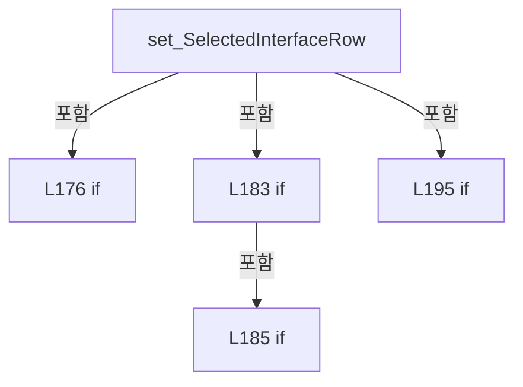

변경 전 점검: 입력/반환 타입, 위 호출자, 예외/취소 경로, 공유 상태와 저장·전송 소비자를 함께 확인합니다. 값의 단위나 물리 방향을 이름만으로 확정하지 않습니다.

### PropertyDeclaration `CanOperateSelectedInterface` · L206–212

[Drilling.UI/Menu/Menus/CMenuSetting.cs:206–212](https://github.com/kjuws10-rgb/A3Drilling/blob/5aee8e58439c9b455cae7c9593c9be986c3e682e/Drilling.UI/Menu/Menus/CMenuSetting.cs#L206-L212)

| 항목 | 실제 추출 값 |
| --- | --- |
| 서명 | bool Drilling.UI.Menu.Menus.CMenuSetting.CanOperateSelectedInterface |
| 접근/수식자 | Public / public |
| 반환/값 타입 | bool |
| 소속 타입 | NamedType:Drilling.UI.Menu.Menus.CMenuSetting |

현재 부분 분석에서 직접 연결된 호출자는 없습니다. XAML/이벤트/인터페이스·델리게이트·외부 진입을 추가 확인해야 하며, 미사용으로 판정한 것이 아닙니다.

변경 전 점검: 입력/반환 타입, 위 호출자, 예외/취소 경로, 공유 상태와 저장·전송 소비자를 함께 확인합니다. 값의 단위나 물리 방향을 이름만으로 확정하지 않습니다.

### GetAccessorDeclaration `get_CanOperateSelectedInterface` · L208–211

[Drilling.UI/Menu/Menus/CMenuSetting.cs:208–211](https://github.com/kjuws10-rgb/A3Drilling/blob/5aee8e58439c9b455cae7c9593c9be986c3e682e/Drilling.UI/Menu/Menus/CMenuSetting.cs#L208-L211)

| 항목 | 실제 추출 값 |
| --- | --- |
| 서명 | bool Drilling.UI.Menu.Menus.CMenuSetting.CanOperateSelectedInterface.get |
| 접근/수식자 | Public / get |
| 반환/값 타입 | bool |
| 소속 타입 | NamedType:Drilling.UI.Menu.Menus.CMenuSetting |

현재 부분 분석에서 직접 연결된 호출자는 없습니다. XAML/이벤트/인터페이스·델리게이트·외부 진입을 추가 확인해야 하며, 미사용으로 판정한 것이 아닙니다.

본문의 실제 연산·분기·예외·반환 순서(원문 위치 순):

| 원본 행 | 종류 | 주석 해설 |
| --- | --- | --- |
| 210 | return | 호출자에게 값 또는 제어를 반환합니다: return IsInterfaceTab && SelectedInterfaceRow is not null && !SelectedInterfaceRow.IsSimulation; |

변경 전 점검: 입력/반환 타입, 위 호출자, 예외/취소 경로, 공유 상태와 저장·전송 소비자를 함께 확인합니다. 값의 단위나 물리 방향을 이름만으로 확정하지 않습니다.

### MethodDeclaration `Build` · L214–285

[Drilling.UI/Menu/Menus/CMenuSetting.cs:214–285](https://github.com/kjuws10-rgb/A3Drilling/blob/5aee8e58439c9b455cae7c9593c9be986c3e682e/Drilling.UI/Menu/Menus/CMenuSetting.cs#L214-L285)

| 항목 | 실제 추출 값 |
| --- | --- |
| 서명 | System.Threading.Tasks.Task<Drilling.UI.Menu.Menus.CScreenViewModel> Drilling.UI.Menu.Menus.CMenuSetting.Build(System.Threading.CancellationToken) |
| 접근/수식자 | Public / public, override |
| 반환/값 타입 | System.Threading.Tasks.Task<Drilling.UI.Menu.Menus.CScreenViewModel> |
| 소속 타입 | NamedType:Drilling.UI.Menu.Menus.CMenuSetting |

입력 계약:

| 이름 | 타입 | 전달 | 선택/기본값 |
| --- | --- | --- | --- |
| cancellationToken | System.Threading.CancellationToken | None | True / null |

현재 부분 분석에서 직접 연결된 호출자는 없습니다. XAML/이벤트/인터페이스·델리게이트·외부 진입을 추가 확인해야 하며, 미사용으로 판정한 것이 아닙니다.

호출하는 대상과 해석 범위:

| 원본 행 | 표현식 | 분석 상태 | 대상/소스 위치 |
| --- | --- | --- | --- |
| 216 | new List<ST_SCREEN_SECTION> | resolved | System.Collections.Generic.List<Drilling.UI.Menu.Menus.ST_SCREEN_SECTION>.List() |
| 224 | _settingManager.LoadSection | resolved | System.Collections.Generic.IReadOnlyList<Drilling.Common.Managers.ST_SYSTEM_PARAMETER> Drilling.Common.Managers.CSettingManager.LoadSection(Drilling.Common.Managers.EN_SETTING_TAB, System.Threading.CancellationToken) · Drilling.Common/Managers/CSettingManager.cs:26 |
| 225 | displaySections.Add | resolved | void System.Collections.Generic.List<Drilling.UI.Menu.Menus.ST_SCREEN_SECTION>.Add(Drilling.UI.Menu.Menus.ST_SCREEN_SECTION) |
| 225 | new ST_SCREEN_SECTION | resolved | Drilling.UI.Menu.Menus.ST_SCREEN_SECTION.ST_SCREEN_SECTION(string, System.Collections.Generic.IReadOnlyList<Drilling.UI.Menu.Menus.ST_DISPLAY_ITEM>) · Drilling.UI/Menu/Menus/CMenuBase.cs:410 |
| 225 | ToTabText | resolved | string Drilling.UI.Menu.Menus.CMenuSetting.ToTabText(Drilling.Common.Managers.EN_SETTING_TAB) · Drilling.UI/Menu/Menus/CMenuSetting.cs:1065 |
| 225 | sectionParameters.Select(BuildDisplay).ToArray | resolved | Drilling.UI.Menu.Menus.ST_DISPLAY_ITEM[] System.Collections.Generic.IEnumerable<Drilling.UI.Menu.Menus.ST_DISPLAY_ITEM>.ToArray<Drilling.UI.Menu.Menus.ST_DISPLAY_ITEM>() |
| 225 | sectionParameters.Select | resolved | System.Collections.Generic.IEnumerable<Drilling.UI.Menu.Menus.ST_DISPLAY_ITEM> System.Collections.Generic.IEnumerable<Drilling.Common.Managers.ST_SYSTEM_PARAMETER>.Select<Drilling.Common.Managers.ST_SYSTEM_PARAMETER, Drilling.UI.Menu.Menus.ST_DISPLAY_ITEM>(System.Func<Drilling.Common.Managers.ST_SYSTEM_PARAMETER, Drilling.UI.Menu.Menus.ST_DISPLAY_ITEM>) |
| 228 | NormalizeTab | resolved | string Drilling.UI.Menu.Menus.CMenuSetting.NormalizeTab(string) · Drilling.UI/Menu/Menus/CMenuSetting.cs:1010 |
| 228 | _selectedTabProvider | resolved · 동적 구현 선택 가능 | string System.Func<string>.Invoke() |
| 229 | ToSection | resolved | Drilling.Common.Managers.EN_SETTING_TAB Drilling.UI.Menu.Menus.CMenuSetting.ToSection(string) · Drilling.UI/Menu/Menus/CMenuSetting.cs:1053 |
| 230 | _settingManager.LoadSection | resolved | System.Collections.Generic.IReadOnlyList<Drilling.Common.Managers.ST_SYSTEM_PARAMETER> Drilling.Common.Managers.CSettingManager.LoadSection(Drilling.Common.Managers.EN_SETTING_TAB, System.Threading.CancellationToken) · Drilling.Common/Managers/CSettingManager.cs:26 |
| 231 | BuildParameterRows | resolved | System.Collections.Generic.IReadOnlyList<Drilling.UI.Menu.Menus.ST_SYSTEM_PARAMETER_ROW> Drilling.UI.Menu.Menus.CMenuSetting.BuildParameterRows(System.Collections.Generic.IReadOnlyList<Drilling.Common.Managers.ST_SYSTEM_PARAMETER>) · Drilling.UI/Menu/Menus/CMenuSetting.cs:641 |
| 232 | BuildInterfaceRows | resolved | System.Collections.Generic.IReadOnlyList<Drilling.UI.Menu.Menus.ST_SETTING_INTERFACE_ROW> Drilling.UI.Menu.Menus.CMenuSetting.BuildInterfaceRows(System.Collections.Generic.IReadOnlyList<Drilling.Common.Interface.ST_INTERFACE_DATA>) · Drilling.UI/Menu/Menus/CMenuSetting.cs:841 |
| 232 | _settingManager.LoadInterfaceList | resolved | System.Collections.Generic.IReadOnlyList<Drilling.Common.Interface.ST_INTERFACE_DATA> Drilling.Common.Managers.CSettingManager.LoadInterfaceList(System.Threading.CancellationToken) · Drilling.Common/Managers/CSettingManager.cs:155 |
| 233 | _editScreenProvider | resolved · 동적 구현 선택 가능 | Drilling.UI.Menu.Menus.CMenuSetting? System.Func<Drilling.UI.Menu.Menus.CMenuSetting?>.Invoke() |
| 234 | GetEditRows | resolved | System.Collections.Generic.IReadOnlyList<Drilling.UI.Menu.Menus.ST_SYSTEM_PARAMETER_ROW> Drilling.UI.Menu.Menus.CMenuSetting.GetEditRows(System.Collections.Generic.IReadOnlyList<Drilling.UI.Menu.Menus.ST_SYSTEM_PARAMETER_ROW>, Drilling.UI.Menu.Menus.CMenuSetting?, string) · Drilling.UI/Menu/Menus/CMenuSetting.cs:574 |
| 235 | GetEditInterfaceRows | resolved | System.Collections.Generic.IReadOnlyList<Drilling.UI.Menu.Menus.ST_SETTING_INTERFACE_ROW> Drilling.UI.Menu.Menus.CMenuSetting.GetEditInterfaceRows(System.Collections.Generic.IReadOnlyList<Drilling.UI.Menu.Menus.ST_SETTING_INTERFACE_ROW>, Drilling.UI.Menu.Menus.CMenuSetting?, string) · Drilling.UI/Menu/Menus/CMenuSetting.cs:579 |
| 236 | BuildInterfaceGroups | resolved | System.Collections.Generic.IReadOnlyList<string> Drilling.UI.Menu.Menus.CMenuSetting.BuildInterfaceGroups(System.Collections.Generic.IReadOnlyList<Drilling.UI.Menu.Menus.ST_SETTING_INTERFACE_ROW>) · Drilling.UI/Menu/Menus/CMenuSetting.cs:770 |
| 236 | BuildGroups | resolved | System.Collections.Generic.IReadOnlyList<string> Drilling.UI.Menu.Menus.CMenuSetting.BuildGroups(System.Collections.Generic.IReadOnlyList<Drilling.UI.Menu.Menus.ST_SYSTEM_PARAMETER_ROW>) · Drilling.UI/Menu/Menus/CMenuSetting.cs:669 |
| 237 | NormalizeGroup | resolved | string Drilling.UI.Menu.Menus.CMenuSetting.NormalizeGroup(string, System.Collections.Generic.IReadOnlyList<string>) · Drilling.UI/Menu/Menus/CMenuSetting.cs:1021 |
| 237 | _selectedGroupProvider | resolved · 동적 구현 선택 가능 | string System.Func<string>.Invoke() |
| 243 | allRows.Where(ShouldIncludeItem).ToArray | resolved | Drilling.UI.Menu.Menus.ST_SYSTEM_PARAMETER_ROW[] System.Collections.Generic.IEnumerable<Drilling.UI.Menu.Menus.ST_SYSTEM_PARAMETER_ROW>.ToArray<Drilling.UI.Menu.Menus.ST_SYSTEM_PARAMETER_ROW>() |
| 243 | allRows.Where | resolved | System.Collections.Generic.IEnumerable<Drilling.UI.Menu.Menus.ST_SYSTEM_PARAMETER_ROW> System.Collections.Generic.IEnumerable<Drilling.UI.Menu.Menus.ST_SYSTEM_PARAMETER_ROW>.Where<Drilling.UI.Menu.Menus.ST_SYSTEM_PARAMETER_ROW>(System.Func<Drilling.UI.Menu.Menus.ST_SYSTEM_PARAMETER_ROW, bool>) |
| 244 | BuildHeadFilters | resolved | System.Collections.Generic.IReadOnlyList<Drilling.UI.Menu.Menus.ST_SETTING_HEAD_FILTER> Drilling.UI.Menu.Menus.CMenuSetting.BuildHeadFilters(System.Collections.Generic.IReadOnlyList<Drilling.UI.Menu.Menus.ST_SYSTEM_PARAMETER_ROW>) · Drilling.UI/Menu/Menus/CMenuSetting.cs:688 |
| 245 | NormalizeHeadFilter | resolved | string Drilling.UI.Menu.Menus.CMenuSetting.NormalizeHeadFilter(string, System.Collections.Generic.IReadOnlyList<Drilling.UI.Menu.Menus.ST_SETTING_HEAD_FILTER>) · Drilling.UI/Menu/Menus/CMenuSetting.cs:752 |
| 246 | MarkSelectedHeadFilter | resolved | System.Collections.Generic.IReadOnlyList<Drilling.UI.Menu.Menus.ST_SETTING_HEAD_FILTER> Drilling.UI.Menu.Menus.CMenuSetting.MarkSelectedHeadFilter(System.Collections.Generic.IReadOnlyList<Drilling.UI.Menu.Menus.ST_SETTING_HEAD_FILTER>, string) · Drilling.UI/Menu/Menus/CMenuSetting.cs:739 |
| 248 | ApplyHeadFilter | resolved | System.Collections.Generic.IReadOnlyList<Drilling.UI.Menu.Menus.ST_SYSTEM_PARAMETER_ROW> Drilling.UI.Menu.Menus.CMenuSetting.ApplyHeadFilter(System.Collections.Generic.IReadOnlyList<Drilling.UI.Menu.Menus.ST_SYSTEM_PARAMETER_ROW>, string) · Drilling.UI/Menu/Menus/CMenuSetting.cs:724 |
| 254 | allInterfaceRows.Where(MatchesType).ToArray | resolved | Drilling.UI.Menu.Menus.ST_SETTING_INTERFACE_ROW[] System.Collections.Generic.IEnumerable<Drilling.UI.Menu.Menus.ST_SETTING_INTERFACE_ROW>.ToArray<Drilling.UI.Menu.Menus.ST_SETTING_INTERFACE_ROW>() |
| 254 | allInterfaceRows.Where | resolved | System.Collections.Generic.IEnumerable<Drilling.UI.Menu.Menus.ST_SETTING_INTERFACE_ROW> System.Collections.Generic.IEnumerable<Drilling.UI.Menu.Menus.ST_SETTING_INTERFACE_ROW>.Where<Drilling.UI.Menu.Menus.ST_SETTING_INTERFACE_ROW>(System.Func<Drilling.UI.Menu.Menus.ST_SETTING_INTERFACE_ROW, bool>) |
| 255 | _settingManager.LoadHistory | resolved | System.Collections.Generic.IReadOnlyList<Drilling.Common.Managers.ST_SETTING_HISTORY> Drilling.Common.Managers.CSettingManager.LoadHistory(Drilling.Common.Managers.EN_SETTING_TAB, System.Threading.CancellationToken) · Drilling.Common/Managers/CSettingManager.cs:150 |
| 261 | Apply | resolved | void Drilling.UI.Menu.Menus.CMenuSetting.Apply(System.Collections.Generic.IReadOnlyList<Drilling.UI.Menu.Menus.ST_SCREEN_SECTION>, System.Collections.Generic.IReadOnlyList<Drilling.UI.Menu.Menus.ST_DISPLAY_ITEM>, string, string, string, System.Collections.Generic.IReadOnlyList<Drilling.UI.Menu.Menus.ST_SETTING_TAB>, System.Collections.Generic.IReadOnlyList<Drilling.UI.Menu.Menus.ST_SETTING_GROUP>, System.Collections.Generic.IReadOnlyList<Drilling.UI.Menu.Menus.ST_SETTING_HEAD_FILTER>, System.Collections.Generic.IReadOnlyList<Drilling.UI.Menu.Menus.ST_SYSTEM_PARAMETER_ROW>, System.Collections.Generic.IReadOnlyList<Drilling.UI.Menu.Menus.ST_SYSTEM_PARAMETER_ROW>, System.Collections.Generic.IReadOnlyList<Drilling.UI.Menu.Menus.ST_SETTING_INTERFACE_ROW>, System.Collections.Generic.IReadOnlyList<Drilling.UI.Menu.Menus.ST_SETTING_INTERFACE_ROW>, System.Collections.Generic.IReadOnlyList<Drilling.UI.Menu.Menus.ST_SETTING_HISTORY_ROW>, System.Collections.Generic.IReadOnlyList<Drilling.UI.Menu.Menus.ST_SETTING_SUMMARY_ROW>) · Drilling.UI/Menu/Menus/CMenuSetting.cs:540 |
| 263 | BuildHistoryItems | resolved | System.Collections.Generic.IReadOnlyList<Drilling.UI.Menu.Menus.ST_DISPLAY_ITEM> Drilling.UI.Menu.Menus.CMenuSetting.BuildHistoryItems(System.Collections.Generic.IReadOnlyList<Drilling.Common.Managers.ST_SETTING_HISTORY>) · Drilling.UI/Menu/Menus/CMenuSetting.cs:789 |
| 267 | BuildTabs | resolved | System.Collections.Generic.IReadOnlyList<Drilling.UI.Menu.Menus.ST_SETTING_TAB> Drilling.UI.Menu.Menus.CMenuSetting.BuildTabs(string) · Drilling.UI/Menu/Menus/CMenuSetting.cs:626 |
| 268 | groups.Select(BuildSetting).ToArray | resolved | Drilling.UI.Menu.Menus.ST_SETTING_GROUP[] System.Collections.Generic.IEnumerable<Drilling.UI.Menu.Menus.ST_SETTING_GROUP>.ToArray<Drilling.UI.Menu.Menus.ST_SETTING_GROUP>() |
| 268 | groups.Select | resolved | System.Collections.Generic.IEnumerable<Drilling.UI.Menu.Menus.ST_SETTING_GROUP> System.Collections.Generic.IEnumerable<string>.Select<string, Drilling.UI.Menu.Menus.ST_SETTING_GROUP>(System.Func<string, Drilling.UI.Menu.Menus.ST_SETTING_GROUP>) |
| 274 | BuildHistoryRows | resolved | System.Collections.Generic.IReadOnlyList<Drilling.UI.Menu.Menus.ST_SETTING_HISTORY_ROW> Drilling.UI.Menu.Menus.CMenuSetting.BuildHistoryRows(System.Collections.Generic.IReadOnlyList<Drilling.Common.Managers.ST_SETTING_HISTORY>) · Drilling.UI/Menu/Menus/CMenuSetting.cs:799 |
| 275 | BuildSummaryRows | resolved | System.Collections.Generic.IReadOnlyList<Drilling.UI.Menu.Menus.ST_SETTING_SUMMARY_ROW> Drilling.UI.Menu.Menus.CMenuSetting.BuildSummaryRows(string, System.Collections.Generic.IReadOnlyList<Drilling.UI.Menu.Menus.ST_SYSTEM_PARAMETER_ROW>, System.Collections.Generic.IReadOnlyList<Drilling.UI.Menu.Menus.ST_SETTING_INTERFACE_ROW>, System.Collections.Generic.IReadOnlyList<Drilling.Common.Managers.ST_SETTING_HISTORY>) · Drilling.UI/Menu/Menus/CMenuSetting.cs:814 |
| 277 | Task.FromResult | resolved | System.Threading.Tasks.Task<Drilling.UI.Menu.Menus.CScreenViewModel> System.Threading.Tasks.Task.FromResult<Drilling.UI.Menu.Menus.CScreenViewModel>(Drilling.UI.Menu.Menus.CScreenViewModel) |
| 277 | new CScreenViewModel | resolved | Drilling.UI.Menu.Menus.CScreenViewModel.CScreenViewModel(Drilling.UI.Menu.Menus.EN_MENU, string, string, System.Collections.Generic.IReadOnlyList<Drilling.UI.Menu.Menus.ST_DISPLAY_ITEM>, System.Collections.Generic.IReadOnlyList<Drilling.UI.Menu.Menus.ST_SCREEN_SECTION>, bool, Drilling.UI.Menu.Menus.CMenuMain?, Drilling.UI.Menu.Menus.CMenuManual?, Drilling.UI.Menu.Menus.CMenuRecipe?, Drilling.UI.Menu.Menus.CMenuSetting?, Drilling.UI.Menu.Menus.CMenuAlarm?, Drilling.UI.Menu.Menus.CMenuMonitor?, Drilling.UI.Menu.Menus.CMenuReview?, Drilling.UI.Menu.Menus.CMenuCorrection?, Drilling.UI.Menu.Menus.CMenuPm?) · Drilling.UI/Menu/Menus/CMenuBase.cs:411 |
| 281 | new | resolved | Drilling.UI.Menu.Menus.ST_DISPLAY_ITEM.ST_DISPLAY_ITEM(string, string, string) · Drilling.UI/Menu/Menus/CMenuBase.cs:43 |
| 281 | new | resolved | Drilling.UI.Menu.Menus.ST_DISPLAY_ITEM.ST_DISPLAY_ITEM(string, string, string) · Drilling.UI/Menu/Menus/CMenuBase.cs:43 |

본문의 실제 연산·분기·예외·반환 순서(원문 위치 순):

| 원본 행 | 종류 | 주석 해설 |
| --- | --- | --- |
| 216 | call | 함수·델리게이트 또는 객체 생성자를 호출합니다: new List<ST_SCREEN_SECTION>() |
| 216 | local-declaration | 지역 변수를 선언합니다: var displaySections = new List<ST_SCREEN_SECTION>(); |
| 216 | variable-initializer | 변수의 초기값을 지정합니다: displaySections = new List<ST_SCREEN_SECTION>() |
| 222 | foreach | 컬렉션 요소를 순회합니다: foreach (var section in Sections) |
| 224 | call | 함수·델리게이트 또는 객체 생성자를 호출합니다: _settingManager.LoadSection(section, cancellationToken) |
| 224 | local-declaration | 지역 변수를 선언합니다: var sectionParameters = _settingManager.LoadSection(section, cancellationToken); |
| 224 | variable-initializer | 변수의 초기값을 지정합니다: sectionParameters = _settingManager.LoadSection(section, cancellationToken) |
| 225 | call | 함수·델리게이트 또는 객체 생성자를 호출합니다: displaySections.Add(new ST_SCREEN_SECTION(ToTabText(section), sectionParameters.Select(BuildDisplay).ToArray())) |
| 225 | call | 함수·델리게이트 또는 객체 생성자를 호출합니다: new ST_SCREEN_SECTION(ToTabText(section), sectionParameters.Select(BuildDisplay).ToArray()) |
| 225 | call | 함수·델리게이트 또는 객체 생성자를 호출합니다: ToTabText(section) |
| 225 | call | 함수·델리게이트 또는 객체 생성자를 호출합니다: sectionParameters.Select(BuildDisplay).ToArray() |
| 225 | call | 함수·델리게이트 또는 객체 생성자를 호출합니다: sectionParameters.Select(BuildDisplay) |
| 228 | call | 함수·델리게이트 또는 객체 생성자를 호출합니다: NormalizeTab(_selectedTabProvider()) |
| 228 | call | 함수·델리게이트 또는 객체 생성자를 호출합니다: _selectedTabProvider() |
| 228 | local-declaration | 지역 변수를 선언합니다: var selectedTab = NormalizeTab(_selectedTabProvider()); |
| 228 | variable-initializer | 변수의 초기값을 지정합니다: selectedTab = NormalizeTab(_selectedTabProvider()) |
| 229 | call | 함수·델리게이트 또는 객체 생성자를 호출합니다: ToSection(selectedTab) |
| 229 | local-declaration | 지역 변수를 선언합니다: var selectedSection = ToSection(selectedTab); |
| 229 | variable-initializer | 변수의 초기값을 지정합니다: selectedSection = ToSection(selectedTab) |
| 230 | call | 함수·델리게이트 또는 객체 생성자를 호출합니다: _settingManager.LoadSection(selectedSection, cancellationToken) |
| 230 | conditional-expression | 조건에 따라 결과식을 선택합니다: selectedTab == "INTERFACE" ? [] : _settingManager.LoadSection(selectedSection, cancellationToken) |
| 230 | local-declaration | 지역 변수를 선언합니다: IReadOnlyList<ST_SYSTEM_PARAMETER> loadedParameters = selectedTab == "INTERFACE" ? [] : _settingManager.LoadSection(selectedSection, cancellationToken); |
| 230 | variable-initializer | 변수의 초기값을 지정합니다: loadedParameters = selectedTab == "INTERFACE" ? [] : _settingManager.LoadSection(selectedSection, cancellationToken) |
| 231 | call | 함수·델리게이트 또는 객체 생성자를 호출합니다: BuildParameterRows(loadedParameters) |
| 231 | local-declaration | 지역 변수를 선언합니다: var loadedRows = BuildParameterRows(loadedParameters); |
| 231 | variable-initializer | 변수의 초기값을 지정합니다: loadedRows = BuildParameterRows(loadedParameters) |
| 232 | call | 함수·델리게이트 또는 객체 생성자를 호출합니다: BuildInterfaceRows(_settingManager.LoadInterfaceList(cancellationToken)) |
| 232 | call | 함수·델리게이트 또는 객체 생성자를 호출합니다: _settingManager.LoadInterfaceList(cancellationToken) |
| 232 | conditional-expression | 조건에 따라 결과식을 선택합니다: selectedTab == "INTERFACE" ? BuildInterfaceRows(_settingManager.LoadInterfaceList(cancellationToken)) : [] |
| 232 | local-declaration | 지역 변수를 선언합니다: IReadOnlyList<ST_SETTING_INTERFACE_ROW> loadedInterfaceRows = selectedTab == "INTERFACE" ? BuildInterfaceRows(_settingManager.LoadInterfaceList(cancellationToken)) : []; |
| 232 | variable-initializer | 변수의 초기값을 지정합니다: loadedInterfaceRows = selectedTab == "INTERFACE" ? BuildInterfaceRows(_settingManager.LoadInterfaceList(cancellationToken)) : [] |
| 233 | call | 함수·델리게이트 또는 객체 생성자를 호출합니다: _editScreenProvider() |
| 233 | local-declaration | 지역 변수를 선언합니다: var editScreen = _editScreenProvider(); |
| 233 | variable-initializer | 변수의 초기값을 지정합니다: editScreen = _editScreenProvider() |
| 234 | call | 함수·델리게이트 또는 객체 생성자를 호출합니다: GetEditRows(loadedRows, editScreen, selectedTab) |
| 234 | local-declaration | 지역 변수를 선언합니다: var allRows = GetEditRows(loadedRows, editScreen, selectedTab); |
| 234 | variable-initializer | 변수의 초기값을 지정합니다: allRows = GetEditRows(loadedRows, editScreen, selectedTab) |
| 235 | call | 함수·델리게이트 또는 객체 생성자를 호출합니다: GetEditInterfaceRows(loadedInterfaceRows, editScreen, selectedTab) |
| 235 | local-declaration | 지역 변수를 선언합니다: var allInterfaceRows = GetEditInterfaceRows(loadedInterfaceRows, editScreen, selectedTab); |
| 235 | variable-initializer | 변수의 초기값을 지정합니다: allInterfaceRows = GetEditInterfaceRows(loadedInterfaceRows, editScreen, selectedTab) |
| 236 | call | 함수·델리게이트 또는 객체 생성자를 호출합니다: BuildInterfaceGroups(allInterfaceRows) |
| 236 | call | 함수·델리게이트 또는 객체 생성자를 호출합니다: BuildGroups(allRows) |
| 236 | conditional-expression | 조건에 따라 결과식을 선택합니다: selectedTab == "INTERFACE" ? BuildInterfaceGroups(allInterfaceRows) : BuildGroups(allRows) |
| 236 | local-declaration | 지역 변수를 선언합니다: var groups = selectedTab == "INTERFACE" ? BuildInterfaceGroups(allInterfaceRows) : BuildGroups(allRows); |
| 236 | variable-initializer | 변수의 초기값을 지정합니다: groups = selectedTab == "INTERFACE" ? BuildInterfaceGroups(allInterfaceRows) : BuildGroups(allRows) |
| 237 | call | 함수·델리게이트 또는 객체 생성자를 호출합니다: NormalizeGroup(_selectedGroupProvider(), groups) |
| 237 | call | 함수·델리게이트 또는 객체 생성자를 호출합니다: _selectedGroupProvider() |
| 237 | local-declaration | 지역 변수를 선언합니다: var selectedGroup = NormalizeGroup(_selectedGroupProvider(), groups); |
| 237 | variable-initializer | 변수의 초기값을 지정합니다: selectedGroup = NormalizeGroup(_selectedGroupProvider(), groups) |
| 243 | call | 함수·델리게이트 또는 객체 생성자를 호출합니다: allRows.Where(ShouldIncludeItem).ToArray() |
| 243 | call | 함수·델리게이트 또는 객체 생성자를 호출합니다: allRows.Where(ShouldIncludeItem) |
| 243 | conditional-expression | 조건에 따라 결과식을 선택합니다: selectedGroup == "ALL" ? allRows : allRows.Where(ShouldIncludeItem).ToArray() |
| 243 | local-declaration | 지역 변수를 선언합니다: var groupFilteredRows = selectedGroup == "ALL" ? allRows : allRows.Where(ShouldIncludeItem).ToArray(); |
| 243 | variable-initializer | 변수의 초기값을 지정합니다: groupFilteredRows = selectedGroup == "ALL" ? allRows : allRows.Where(ShouldIncludeItem).ToArray() |
| 244 | call | 함수·델리게이트 또는 객체 생성자를 호출합니다: BuildHeadFilters(groupFilteredRows) |
| 244 | local-declaration | 지역 변수를 선언합니다: var availableHeadFilters = BuildHeadFilters(groupFilteredRows); |
| 244 | variable-initializer | 변수의 초기값을 지정합니다: availableHeadFilters = BuildHeadFilters(groupFilteredRows) |
| 245 | call | 함수·델리게이트 또는 객체 생성자를 호출합니다: NormalizeHeadFilter(_selectedHeadFilter, availableHeadFilters) |
| 245 | local-declaration | 지역 변수를 선언합니다: var selectedHeadFilter = NormalizeHeadFilter(_selectedHeadFilter, availableHeadFilters); |
| 245 | variable-initializer | 변수의 초기값을 지정합니다: selectedHeadFilter = NormalizeHeadFilter(_selectedHeadFilter, availableHeadFilters) |
| 246 | call | 함수·델리게이트 또는 객체 생성자를 호출합니다: MarkSelectedHeadFilter(availableHeadFilters, selectedHeadFilter) |
| 246 | local-declaration | 지역 변수를 선언합니다: var headFilterItems = MarkSelectedHeadFilter(availableHeadFilters, selectedHeadFilter); |
| 246 | variable-initializer | 변수의 초기값을 지정합니다: headFilterItems = MarkSelectedHeadFilter(availableHeadFilters, selectedHeadFilter) |
| 247 | assignment | 값을 대상에 대입합니다: _selectedHeadFilter = selectedHeadFilter |
| 248 | call | 함수·델리게이트 또는 객체 생성자를 호출합니다: ApplyHeadFilter(groupFilteredRows, selectedHeadFilter) |
| 248 | local-declaration | 지역 변수를 선언합니다: var filteredRows = ApplyHeadFilter(groupFilteredRows, selectedHeadFilter); |
| 248 | variable-initializer | 변수의 초기값을 지정합니다: filteredRows = ApplyHeadFilter(groupFilteredRows, selectedHeadFilter) |
| 254 | call | 함수·델리게이트 또는 객체 생성자를 호출합니다: allInterfaceRows.Where(MatchesType).ToArray() |
| 254 | call | 함수·델리게이트 또는 객체 생성자를 호출합니다: allInterfaceRows.Where(MatchesType) |
| 254 | conditional-expression | 조건에 따라 결과식을 선택합니다: selectedGroup == "ALL" ? allInterfaceRows : allInterfaceRows.Where(MatchesType).ToArray() |
| 254 | local-declaration | 지역 변수를 선언합니다: var filteredInterfaceRows = selectedGroup == "ALL" ? allInterfaceRows : allInterfaceRows.Where(MatchesType).ToArray(); |
| 254 | variable-initializer | 변수의 초기값을 지정합니다: filteredInterfaceRows = selectedGroup == "ALL" ? allInterfaceRows : allInterfaceRows.Where(MatchesType).ToArray() |
| 255 | call | 함수·델리게이트 또는 객체 생성자를 호출합니다: _settingManager.LoadHistory(selectedSection, cancellationToken) |
| 255 | local-declaration | 지역 변수를 선언합니다: var history = _settingManager.LoadHistory(selectedSection, cancellationToken); |
| 255 | variable-initializer | 변수의 초기값을 지정합니다: history = _settingManager.LoadHistory(selectedSection, cancellationToken) |
| 261 | call | 함수·델리게이트 또는 객체 생성자를 호출합니다: Apply( displaySections, BuildHistoryItems(history), selectedTab, selectedGroup, selectedHeadFilter, BuildTabs(selectedTab), groups.Select(BuildSetting).ToArray(), headFilterItems, allRows, filteredRows, allInterfaceRows,… |
| 263 | call | 함수·델리게이트 또는 객체 생성자를 호출합니다: BuildHistoryItems(history) |
| 267 | call | 함수·델리게이트 또는 객체 생성자를 호출합니다: BuildTabs(selectedTab) |
| 268 | call | 함수·델리게이트 또는 객체 생성자를 호출합니다: groups.Select(BuildSetting).ToArray() |
| 268 | call | 함수·델리게이트 또는 객체 생성자를 호출합니다: groups.Select(BuildSetting) |
| 274 | call | 함수·델리게이트 또는 객체 생성자를 호출합니다: BuildHistoryRows(history) |
| 275 | call | 함수·델리게이트 또는 객체 생성자를 호출합니다: BuildSummaryRows(selectedTab, allRows, allInterfaceRows, history) |
| 277 | call | 함수·델리게이트 또는 객체 생성자를 호출합니다: Task.FromResult(new CScreenViewModel( EN_MENU.Setting, "SETTING / PARAMETER CONFIG", "Direct grid edit for option, interface, IO and motor parameters.", [new("Source", "CSV"), new("History", "Setting trace log")], displa… |
| 277 | call | 함수·델리게이트 또는 객체 생성자를 호출합니다: new CScreenViewModel( EN_MENU.Setting, "SETTING / PARAMETER CONFIG", "Direct grid edit for option, interface, IO and motor parameters.", [new("Source", "CSV"), new("History", "Setting trace log")], displaySections, setti… |
| 277 | return | 호출자에게 값 또는 제어를 반환합니다: return Task.FromResult(new CScreenViewModel( EN_MENU.Setting, "SETTING / PARAMETER CONFIG", "Direct grid edit for option, interface, IO and motor parameters.", [new("Source", "CSV"), new("History", "Setting trace log")], displaySe |
| 281 | call | 함수·델리게이트 또는 객체 생성자를 호출합니다: new("Source", "CSV") |
| 281 | call | 함수·델리게이트 또는 객체 생성자를 호출합니다: new("History", "Setting trace log") |

제어 구문의 포함 구조(실제 실행 순서/CFG가 아닌 구문 탐색 그림):

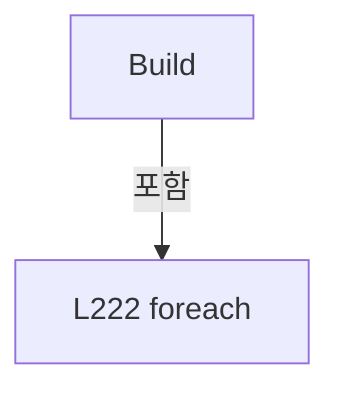

변경 전 점검: 입력/반환 타입, 위 호출자, 예외/취소 경로, 공유 상태와 저장·전송 소비자를 함께 확인합니다. 값의 단위나 물리 방향을 이름만으로 확정하지 않습니다.

### LocalFunctionStatement `BuildDisplay` · L217–220

[Drilling.UI/Menu/Menus/CMenuSetting.cs:217–220](https://github.com/kjuws10-rgb/A3Drilling/blob/5aee8e58439c9b455cae7c9593c9be986c3e682e/Drilling.UI/Menu/Menus/CMenuSetting.cs#L217-L220)

| 항목 | 실제 추출 값 |
| --- | --- |
| 서명 | Drilling.UI.Menu.Menus.ST_DISPLAY_ITEM BuildDisplay(Drilling.Common.Managers.ST_SYSTEM_PARAMETER) |
| 접근/수식자 | Private /  |
| 반환/값 타입 | Drilling.UI.Menu.Menus.ST_DISPLAY_ITEM |
| 소속 타입 | NamedType:Drilling.UI.Menu.Menus.CMenuSetting |

입력 계약:

| 이름 | 타입 | 전달 | 선택/기본값 |
| --- | --- | --- | --- |
| item | Drilling.Common.Managers.ST_SYSTEM_PARAMETER | None | False /  |

현재 부분 분석에서 직접 연결된 호출자는 없습니다. XAML/이벤트/인터페이스·델리게이트·외부 진입을 추가 확인해야 하며, 미사용으로 판정한 것이 아닙니다.

호출하는 대상과 해석 범위:

| 원본 행 | 표현식 | 분석 상태 | 대상/소스 위치 |
| --- | --- | --- | --- |
| 219 | new ST_DISPLAY_ITEM | resolved | Drilling.UI.Menu.Menus.ST_DISPLAY_ITEM.ST_DISPLAY_ITEM(string, string, string) · Drilling.UI/Menu/Menus/CMenuBase.cs:43 |
| 219 | $"{item.Value} {item.Unit}".Trim | resolved | string string.Trim() |

본문의 실제 연산·분기·예외·반환 순서(원문 위치 순):

| 원본 행 | 종류 | 주석 해설 |
| --- | --- | --- |
| 219 | call | 함수·델리게이트 또는 객체 생성자를 호출합니다: new ST_DISPLAY_ITEM(item.Name, $"{item.Value} {item.Unit}".Trim(), item.Description) |
| 219 | call | 함수·델리게이트 또는 객체 생성자를 호출합니다: $"{item.Value} {item.Unit}".Trim() |
| 219 | return | 호출자에게 값 또는 제어를 반환합니다: return new ST_DISPLAY_ITEM(item.Name, $"{item.Value} {item.Unit}".Trim(), item.Description); |

변경 전 점검: 입력/반환 타입, 위 호출자, 예외/취소 경로, 공유 상태와 저장·전송 소비자를 함께 확인합니다. 값의 단위나 물리 방향을 이름만으로 확정하지 않습니다.

### LocalFunctionStatement `ShouldIncludeItem` · L238–241

[Drilling.UI/Menu/Menus/CMenuSetting.cs:238–241](https://github.com/kjuws10-rgb/A3Drilling/blob/5aee8e58439c9b455cae7c9593c9be986c3e682e/Drilling.UI/Menu/Menus/CMenuSetting.cs#L238-L241)

| 항목 | 실제 추출 값 |
| --- | --- |
| 서명 | bool ShouldIncludeItem(Drilling.UI.Menu.Menus.ST_SYSTEM_PARAMETER_ROW) |
| 접근/수식자 | Private /  |
| 반환/값 타입 | bool |
| 소속 타입 | NamedType:Drilling.UI.Menu.Menus.CMenuSetting |

입력 계약:

| 이름 | 타입 | 전달 | 선택/기본값 |
| --- | --- | --- | --- |
| row | Drilling.UI.Menu.Menus.ST_SYSTEM_PARAMETER_ROW | None | False /  |

현재 부분 분석에서 직접 연결된 호출자는 없습니다. XAML/이벤트/인터페이스·델리게이트·외부 진입을 추가 확인해야 하며, 미사용으로 판정한 것이 아닙니다.

호출하는 대상과 해석 범위:

| 원본 행 | 표현식 | 분석 상태 | 대상/소스 위치 |
| --- | --- | --- | --- |
| 240 | row.Group.Equals | resolved | bool string.Equals(string?, System.StringComparison) |

본문의 실제 연산·분기·예외·반환 순서(원문 위치 순):

| 원본 행 | 종류 | 주석 해설 |
| --- | --- | --- |
| 240 | call | 함수·델리게이트 또는 객체 생성자를 호출합니다: row.Group.Equals(selectedGroup, StringComparison.OrdinalIgnoreCase) |
| 240 | return | 호출자에게 값 또는 제어를 반환합니다: return row.Group.Equals(selectedGroup, StringComparison.OrdinalIgnoreCase); |

변경 전 점검: 입력/반환 타입, 위 호출자, 예외/취소 경로, 공유 상태와 저장·전송 소비자를 함께 확인합니다. 값의 단위나 물리 방향을 이름만으로 확정하지 않습니다.

### LocalFunctionStatement `MatchesType` · L249–252

[Drilling.UI/Menu/Menus/CMenuSetting.cs:249–252](https://github.com/kjuws10-rgb/A3Drilling/blob/5aee8e58439c9b455cae7c9593c9be986c3e682e/Drilling.UI/Menu/Menus/CMenuSetting.cs#L249-L252)

| 항목 | 실제 추출 값 |
| --- | --- |
| 서명 | bool MatchesType(Drilling.UI.Menu.Menus.ST_SETTING_INTERFACE_ROW) |
| 접근/수식자 | Private /  |
| 반환/값 타입 | bool |
| 소속 타입 | NamedType:Drilling.UI.Menu.Menus.CMenuSetting |

입력 계약:

| 이름 | 타입 | 전달 | 선택/기본값 |
| --- | --- | --- | --- |
| row | Drilling.UI.Menu.Menus.ST_SETTING_INTERFACE_ROW | None | False /  |

현재 부분 분석에서 직접 연결된 호출자는 없습니다. XAML/이벤트/인터페이스·델리게이트·외부 진입을 추가 확인해야 하며, 미사용으로 판정한 것이 아닙니다.

호출하는 대상과 해석 범위:

| 원본 행 | 표현식 | 분석 상태 | 대상/소스 위치 |
| --- | --- | --- | --- |
| 251 | row.Type.Equals | resolved | bool string.Equals(string?, System.StringComparison) |

본문의 실제 연산·분기·예외·반환 순서(원문 위치 순):

| 원본 행 | 종류 | 주석 해설 |
| --- | --- | --- |
| 251 | call | 함수·델리게이트 또는 객체 생성자를 호출합니다: row.Type.Equals(selectedGroup, StringComparison.OrdinalIgnoreCase) |
| 251 | return | 호출자에게 값 또는 제어를 반환합니다: return row.Type.Equals(selectedGroup, StringComparison.OrdinalIgnoreCase); |

변경 전 점검: 입력/반환 타입, 위 호출자, 예외/취소 경로, 공유 상태와 저장·전송 소비자를 함께 확인합니다. 값의 단위나 물리 방향을 이름만으로 확정하지 않습니다.

### LocalFunctionStatement `BuildSetting` · L256–259

[Drilling.UI/Menu/Menus/CMenuSetting.cs:256–259](https://github.com/kjuws10-rgb/A3Drilling/blob/5aee8e58439c9b455cae7c9593c9be986c3e682e/Drilling.UI/Menu/Menus/CMenuSetting.cs#L256-L259)

| 항목 | 실제 추출 값 |
| --- | --- |
| 서명 | Drilling.UI.Menu.Menus.ST_SETTING_GROUP BuildSetting(string) |
| 접근/수식자 | Private /  |
| 반환/값 타입 | Drilling.UI.Menu.Menus.ST_SETTING_GROUP |
| 소속 타입 | NamedType:Drilling.UI.Menu.Menus.CMenuSetting |

입력 계약:

| 이름 | 타입 | 전달 | 선택/기본값 |
| --- | --- | --- | --- |
| group | string | None | False /  |

현재 부분 분석에서 직접 연결된 호출자는 없습니다. XAML/이벤트/인터페이스·델리게이트·외부 진입을 추가 확인해야 하며, 미사용으로 판정한 것이 아닙니다.

호출하는 대상과 해석 범위:

| 원본 행 | 표현식 | 분석 상태 | 대상/소스 위치 |
| --- | --- | --- | --- |
| 258 | new ST_SETTING_GROUP | resolved | Drilling.UI.Menu.Menus.ST_SETTING_GROUP.ST_SETTING_GROUP(string, bool) · Drilling.UI/Menu/Menus/CMenuSetting.cs:1083 |
| 258 | group.Equals | resolved | bool string.Equals(string?, System.StringComparison) |

본문의 실제 연산·분기·예외·반환 순서(원문 위치 순):

| 원본 행 | 종류 | 주석 해설 |
| --- | --- | --- |
| 258 | call | 함수·델리게이트 또는 객체 생성자를 호출합니다: new ST_SETTING_GROUP(group, group.Equals(selectedGroup, StringComparison.OrdinalIgnoreCase)) |
| 258 | call | 함수·델리게이트 또는 객체 생성자를 호출합니다: group.Equals(selectedGroup, StringComparison.OrdinalIgnoreCase) |
| 258 | return | 호출자에게 값 또는 제어를 반환합니다: return new ST_SETTING_GROUP(group, group.Equals(selectedGroup, StringComparison.OrdinalIgnoreCase)); |

변경 전 점검: 입력/반환 타입, 위 호출자, 예외/취소 경로, 공유 상태와 저장·전송 소비자를 함께 확인합니다. 값의 단위나 물리 방향을 이름만으로 확정하지 않습니다.

### MethodDeclaration `SelectTab` · L287–301

[Drilling.UI/Menu/Menus/CMenuSetting.cs:287–301](https://github.com/kjuws10-rgb/A3Drilling/blob/5aee8e58439c9b455cae7c9593c9be986c3e682e/Drilling.UI/Menu/Menus/CMenuSetting.cs#L287-L301)

| 항목 | 실제 추출 값 |
| --- | --- |
| 서명 | System.Threading.Tasks.Task Drilling.UI.Menu.Menus.CMenuSetting.SelectTab(object?) |
| 접근/수식자 | Private / private, async |
| 반환/값 타입 | System.Threading.Tasks.Task |
| 소속 타입 | NamedType:Drilling.UI.Menu.Menus.CMenuSetting |

입력 계약:

| 이름 | 타입 | 전달 | 선택/기본값 |
| --- | --- | --- | --- |
| parameter | object? | None | False /  |

정적 호출자로 확인된 위치:

| 호출 파일/행 | 호출 표현식 | 런타임 분기 가능 |
| --- | --- | --- |
| [Drilling.UI/Menu/Menus/CMenuSetting.cs:54–54](https://github.com/kjuws10-rgb/A3Drilling/blob/5aee8e58439c9b455cae7c9593c9be986c3e682e/Drilling.UI/Menu/Menus/CMenuSetting.cs#L54-L54) | SelectTab | False |

호출하는 대상과 해석 범위:

| 원본 행 | 표현식 | 분석 상태 | 대상/소스 위치 |
| --- | --- | --- | --- |
| 289 | string.IsNullOrWhiteSpace | resolved | bool string.IsNullOrWhiteSpace(string?) |
| 294 | NormalizeTab | resolved | string Drilling.UI.Menu.Menus.CMenuSetting.NormalizeTab(string) · Drilling.UI/Menu/Menus/CMenuSetting.cs:1010 |
| 295 | _selectedTabSetter | resolved · 동적 구현 선택 가능 | void System.Action<string>.Invoke(string) |
| 296 | _selectedGroupSetter | resolved · 동적 구현 선택 가능 | void System.Action<string>.Invoke(string) |
| 296 | GetDefaultGroup | resolved | string Drilling.UI.Menu.Menus.CMenuSetting.GetDefaultGroup() · Drilling.UI/Menu/Menus/CMenuSetting.cs:1073 |
| 298 | _setStatusMessage | resolved · 동적 구현 선택 가능 | void System.Action<string>.Invoke(string) |
| 299 | _refreshShellStatus | resolved · 동적 구현 선택 가능 | void System.Action.Invoke() |
| 300 | _refreshCurrentScreen | resolved · 동적 구현 선택 가능 | System.Threading.Tasks.Task System.Func<System.Threading.Tasks.Task>.Invoke() |

본문의 실제 연산·분기·예외·반환 순서(원문 위치 순):

| 원본 행 | 종류 | 주석 해설 |
| --- | --- | --- |
| 289 | call | 함수·델리게이트 또는 객체 생성자를 호출합니다: string.IsNullOrWhiteSpace(tab) |
| 289 | if | 조건에 따라 분기합니다: if (parameter is not string tab &#124;&#124; string.IsNullOrWhiteSpace(tab)) |
| 291 | return | 호출자에게 값 또는 제어를 반환합니다: return; |
| 294 | call | 함수·델리게이트 또는 객체 생성자를 호출합니다: NormalizeTab(tab) |
| 294 | local-declaration | 지역 변수를 선언합니다: var selectedTab = NormalizeTab(tab); |
| 294 | variable-initializer | 변수의 초기값을 지정합니다: selectedTab = NormalizeTab(tab) |
| 295 | call | 함수·델리게이트 또는 객체 생성자를 호출합니다: _selectedTabSetter(selectedTab) |
| 296 | call | 함수·델리게이트 또는 객체 생성자를 호출합니다: _selectedGroupSetter(GetDefaultGroup()) |
| 296 | call | 함수·델리게이트 또는 객체 생성자를 호출합니다: GetDefaultGroup() |
| 297 | assignment | 값을 대상에 대입합니다: _selectedHeadFilter = "ALL" |
| 298 | call | 함수·델리게이트 또는 객체 생성자를 호출합니다: _setStatusMessage($"Setting tab {selectedTab} selected.") |
| 299 | call | 함수·델리게이트 또는 객체 생성자를 호출합니다: _refreshShellStatus() |
| 300 | await | 비동기 완료를 기다립니다: await _refreshCurrentScreen() |
| 300 | call | 함수·델리게이트 또는 객체 생성자를 호출합니다: _refreshCurrentScreen() |

제어 구문의 포함 구조(실제 실행 순서/CFG가 아닌 구문 탐색 그림):

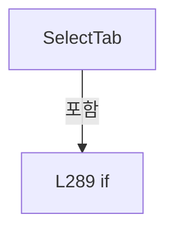

변경 전 점검: 입력/반환 타입, 위 호출자, 예외/취소 경로, 공유 상태와 저장·전송 소비자를 함께 확인합니다. 값의 단위나 물리 방향을 이름만으로 확정하지 않습니다.

### MethodDeclaration `SelectGroup` · L303–316

[Drilling.UI/Menu/Menus/CMenuSetting.cs:303–316](https://github.com/kjuws10-rgb/A3Drilling/blob/5aee8e58439c9b455cae7c9593c9be986c3e682e/Drilling.UI/Menu/Menus/CMenuSetting.cs#L303-L316)

| 항목 | 실제 추출 값 |
| --- | --- |
| 서명 | System.Threading.Tasks.Task Drilling.UI.Menu.Menus.CMenuSetting.SelectGroup(object?) |
| 접근/수식자 | Private / private, async |
| 반환/값 타입 | System.Threading.Tasks.Task |
| 소속 타입 | NamedType:Drilling.UI.Menu.Menus.CMenuSetting |

입력 계약:

| 이름 | 타입 | 전달 | 선택/기본값 |
| --- | --- | --- | --- |
| parameter | object? | None | False /  |

정적 호출자로 확인된 위치:

| 호출 파일/행 | 호출 표현식 | 런타임 분기 가능 |
| --- | --- | --- |
| [Drilling.UI/Menu/Menus/CMenuSetting.cs:60–60](https://github.com/kjuws10-rgb/A3Drilling/blob/5aee8e58439c9b455cae7c9593c9be986c3e682e/Drilling.UI/Menu/Menus/CMenuSetting.cs#L60-L60) | SelectGroup | False |

호출하는 대상과 해석 범위:

| 원본 행 | 표현식 | 분석 상태 | 대상/소스 위치 |
| --- | --- | --- | --- |
| 305 | string.IsNullOrWhiteSpace | resolved | bool string.IsNullOrWhiteSpace(string?) |
| 310 | group.Trim().ToUpperInvariant | resolved | string string.ToUpperInvariant() |
| 310 | group.Trim | resolved | string string.Trim() |
| 311 | _selectedGroupSetter | resolved · 동적 구현 선택 가능 | void System.Action<string>.Invoke(string) |
| 313 | _setStatusMessage | resolved · 동적 구현 선택 가능 | void System.Action<string>.Invoke(string) |
| 314 | _refreshShellStatus | resolved · 동적 구현 선택 가능 | void System.Action.Invoke() |
| 315 | _refreshCurrentScreen | resolved · 동적 구현 선택 가능 | System.Threading.Tasks.Task System.Func<System.Threading.Tasks.Task>.Invoke() |

본문의 실제 연산·분기·예외·반환 순서(원문 위치 순):

| 원본 행 | 종류 | 주석 해설 |
| --- | --- | --- |
| 305 | call | 함수·델리게이트 또는 객체 생성자를 호출합니다: string.IsNullOrWhiteSpace(group) |
| 305 | if | 조건에 따라 분기합니다: if (parameter is not string group &#124;&#124; string.IsNullOrWhiteSpace(group)) |
| 307 | return | 호출자에게 값 또는 제어를 반환합니다: return; |
| 310 | call | 함수·델리게이트 또는 객체 생성자를 호출합니다: group.Trim().ToUpperInvariant() |
| 310 | call | 함수·델리게이트 또는 객체 생성자를 호출합니다: group.Trim() |
| 310 | local-declaration | 지역 변수를 선언합니다: var selectedGroup = group.Trim().ToUpperInvariant(); |
| 310 | variable-initializer | 변수의 초기값을 지정합니다: selectedGroup = group.Trim().ToUpperInvariant() |
| 311 | call | 함수·델리게이트 또는 객체 생성자를 호출합니다: _selectedGroupSetter(selectedGroup) |
| 312 | assignment | 값을 대상에 대입합니다: _selectedHeadFilter = "ALL" |
| 313 | call | 함수·델리게이트 또는 객체 생성자를 호출합니다: _setStatusMessage($"Setting group {SelectedTab} / {selectedGroup} selected.") |
| 314 | call | 함수·델리게이트 또는 객체 생성자를 호출합니다: _refreshShellStatus() |
| 315 | await | 비동기 완료를 기다립니다: await _refreshCurrentScreen() |
| 315 | call | 함수·델리게이트 또는 객체 생성자를 호출합니다: _refreshCurrentScreen() |

제어 구문의 포함 구조(실제 실행 순서/CFG가 아닌 구문 탐색 그림):

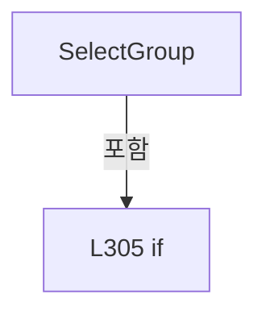

변경 전 점검: 입력/반환 타입, 위 호출자, 예외/취소 경로, 공유 상태와 저장·전송 소비자를 함께 확인합니다. 값의 단위나 물리 방향을 이름만으로 확정하지 않습니다.

### MethodDeclaration `ConnectInterface` · L318–358

[Drilling.UI/Menu/Menus/CMenuSetting.cs:318–358](https://github.com/kjuws10-rgb/A3Drilling/blob/5aee8e58439c9b455cae7c9593c9be986c3e682e/Drilling.UI/Menu/Menus/CMenuSetting.cs#L318-L358)

| 항목 | 실제 추출 값 |
| --- | --- |
| 서명 | System.Threading.Tasks.Task Drilling.UI.Menu.Menus.CMenuSetting.ConnectInterface() |
| 접근/수식자 | Private / private, async |
| 반환/값 타입 | System.Threading.Tasks.Task |
| 소속 타입 | NamedType:Drilling.UI.Menu.Menus.CMenuSetting |

정적 호출자로 확인된 위치:

| 호출 파일/행 | 호출 표현식 | 런타임 분기 가능 |
| --- | --- | --- |
| [Drilling.UI/Menu/Menus/CMenuSetting.cs:72–72](https://github.com/kjuws10-rgb/A3Drilling/blob/5aee8e58439c9b455cae7c9593c9be986c3e682e/Drilling.UI/Menu/Menus/CMenuSetting.cs#L72-L72) | ConnectInterface | False |

호출하는 대상과 해석 범위:

| 원본 행 | 표현식 | 분석 상태 | 대상/소스 위치 |
| --- | --- | --- | --- |
| 323 | _setStatusMessage | resolved · 동적 구현 선택 가능 | void System.Action<string>.Invoke(string) |
| 329 | _setStatusMessage | resolved · 동적 구현 선택 가능 | void System.Action<string>.Invoke(string) |
| 329 | InterfaceRowLabel | resolved | string Drilling.UI.Menu.Menus.CMenuSetting.InterfaceRowLabel(Drilling.UI.Menu.Menus.ST_SETTING_INTERFACE_ROW) · Drilling.UI/Menu/Menus/CMenuSetting.cs:976 |
| 335 | _setStatusMessage | resolved · 동적 구현 선택 가능 | void System.Action<string>.Invoke(string) |
| 339 | CRecipeConfirmDialog.ShowConfirmation | resolved | bool Drilling.UI.Popup.CRecipeConfirmDialog.ShowConfirmation(string, string, string, bool) · Drilling.UI/Popup/CRecipeConfirmDialog.xaml.cs:11 |
| 346 | _settingManager.ConnectInterface | resolved | System.Threading.Tasks.Task Drilling.Common.Managers.CSettingManager.ConnectInterface(Drilling.Common.Interface.EN_EQP_MODULE, int, System.Threading.CancellationToken) · Drilling.Common/Managers/CSettingManager.cs:166 |
| 347 | ParseDevice | resolved | Drilling.Common.Interface.EN_EQP_MODULE Drilling.UI.Menu.Menus.CMenuSetting.ParseDevice(string) · Drilling.UI/Menu/Menus/CMenuSetting.cs:922 |
| 348 | ReadInt | resolved | int Drilling.UI.Menu.Menus.CMenuSetting.ReadInt(string, string, string) · Drilling.UI/Menu/Menus/CMenuSetting.cs:1000 |
| 349 | _setStatusMessage | resolved · 동적 구현 선택 가능 | void System.Action<string>.Invoke(string) |
| 349 | InterfaceRowLabel | resolved | string Drilling.UI.Menu.Menus.CMenuSetting.InterfaceRowLabel(Drilling.UI.Menu.Menus.ST_SETTING_INTERFACE_ROW) · Drilling.UI/Menu/Menus/CMenuSetting.cs:976 |
| 353 | _setStatusMessage | resolved · 동적 구현 선택 가능 | void System.Action<string>.Invoke(string) |
| 357 | _refreshCurrentScreen | resolved · 동적 구현 선택 가능 | System.Threading.Tasks.Task System.Func<System.Threading.Tasks.Task>.Invoke() |

본문의 실제 연산·분기·예외·반환 순서(원문 위치 순):

| 원본 행 | 종류 | 주석 해설 |
| --- | --- | --- |
| 320 | local-declaration | 지역 변수를 선언합니다: var row = SelectedInterfaceRow; |
| 320 | variable-initializer | 변수의 초기값을 지정합니다: row = SelectedInterfaceRow |
| 321 | if | 조건에 따라 분기합니다: if (row is null) |
| 323 | call | 함수·델리게이트 또는 객체 생성자를 호출합니다: _setStatusMessage("Select an interface row before connect.") |
| 324 | return | 호출자에게 값 또는 제어를 반환합니다: return; |
| 327 | if | 조건에 따라 분기합니다: if (row.IsSimulation) |
| 329 | call | 함수·델리게이트 또는 객체 생성자를 호출합니다: _setStatusMessage($"{InterfaceRowLabel(row)} is SIMUL mode. Connect is disabled.") |
| 329 | call | 함수·델리게이트 또는 객체 생성자를 호출합니다: InterfaceRowLabel(row) |
| 330 | return | 호출자에게 값 또는 제어를 반환합니다: return; |
| 333 | if | 조건에 따라 분기합니다: if (row.IsModified) |
| 335 | call | 함수·델리게이트 또는 객체 생성자를 호출합니다: _setStatusMessage("Save JHMI_INTERFACE.csv before connect.") |
| 336 | return | 호출자에게 값 또는 제어를 반환합니다: return; |
| 339 | call | 함수·델리게이트 또는 객체 생성자를 호출합니다: CRecipeConfirmDialog.ShowConfirmation("인터페이스 연결", $"{row.NickName} 장비에 연결하시겠습니까?") |
| 339 | if | 조건에 따라 분기합니다: if (!CRecipeConfirmDialog.ShowConfirmation("인터페이스 연결", $"{row.NickName} 장비에 연결하시겠습니까?")) |
| 341 | return | 호출자에게 값 또는 제어를 반환합니다: return; |
| 344 | try | 예외 처리 범위입니다: try |
| 346 | await | 비동기 완료를 기다립니다: await _settingManager.ConnectInterface( ParseDevice(row.Device), ReadInt(row.Number, row.NickName, "NUMBER")) |
| 346 | call | 함수·델리게이트 또는 객체 생성자를 호출합니다: _settingManager.ConnectInterface( ParseDevice(row.Device), ReadInt(row.Number, row.NickName, "NUMBER")) |
| 347 | call | 함수·델리게이트 또는 객체 생성자를 호출합니다: ParseDevice(row.Device) |
| 348 | call | 함수·델리게이트 또는 객체 생성자를 호출합니다: ReadInt(row.Number, row.NickName, "NUMBER") |
| 349 | call | 함수·델리게이트 또는 객체 생성자를 호출합니다: _setStatusMessage($"{InterfaceRowLabel(row)} connect command sent.") |
| 349 | call | 함수·델리게이트 또는 객체 생성자를 호출합니다: InterfaceRowLabel(row) |
| 351 | catch | 지정 예외를 처리합니다: catch (Exception exception) when (exception is InvalidOperationException or InvalidDataException or KeyNotFoundException or IOException) |
| 353 | call | 함수·델리게이트 또는 객체 생성자를 호출합니다: _setStatusMessage($"Connect blocked. {exception.Message}") |
| 354 | return | 호출자에게 값 또는 제어를 반환합니다: return; |
| 357 | await | 비동기 완료를 기다립니다: await _refreshCurrentScreen() |
| 357 | call | 함수·델리게이트 또는 객체 생성자를 호출합니다: _refreshCurrentScreen() |

제어 구문의 포함 구조(실제 실행 순서/CFG가 아닌 구문 탐색 그림):

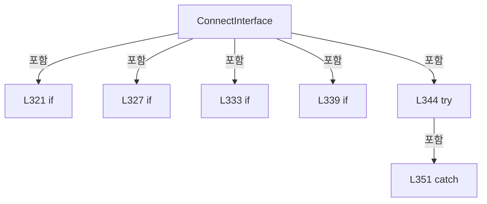

변경 전 점검: 입력/반환 타입, 위 호출자, 예외/취소 경로, 공유 상태와 저장·전송 소비자를 함께 확인합니다. 값의 단위나 물리 방향을 이름만으로 확정하지 않습니다.

### MethodDeclaration `DisconnectInterface` · L360–400

[Drilling.UI/Menu/Menus/CMenuSetting.cs:360–400](https://github.com/kjuws10-rgb/A3Drilling/blob/5aee8e58439c9b455cae7c9593c9be986c3e682e/Drilling.UI/Menu/Menus/CMenuSetting.cs#L360-L400)

| 항목 | 실제 추출 값 |
| --- | --- |
| 서명 | System.Threading.Tasks.Task Drilling.UI.Menu.Menus.CMenuSetting.DisconnectInterface() |
| 접근/수식자 | Private / private, async |
| 반환/값 타입 | System.Threading.Tasks.Task |
| 소속 타입 | NamedType:Drilling.UI.Menu.Menus.CMenuSetting |

정적 호출자로 확인된 위치:

| 호출 파일/행 | 호출 표현식 | 런타임 분기 가능 |
| --- | --- | --- |
| [Drilling.UI/Menu/Menus/CMenuSetting.cs:83–83](https://github.com/kjuws10-rgb/A3Drilling/blob/5aee8e58439c9b455cae7c9593c9be986c3e682e/Drilling.UI/Menu/Menus/CMenuSetting.cs#L83-L83) | DisconnectInterface | False |

호출하는 대상과 해석 범위:

| 원본 행 | 표현식 | 분석 상태 | 대상/소스 위치 |
| --- | --- | --- | --- |
| 365 | _setStatusMessage | resolved · 동적 구현 선택 가능 | void System.Action<string>.Invoke(string) |
| 371 | _setStatusMessage | resolved · 동적 구현 선택 가능 | void System.Action<string>.Invoke(string) |
| 371 | InterfaceRowLabel | resolved | string Drilling.UI.Menu.Menus.CMenuSetting.InterfaceRowLabel(Drilling.UI.Menu.Menus.ST_SETTING_INTERFACE_ROW) · Drilling.UI/Menu/Menus/CMenuSetting.cs:976 |
| 377 | _setStatusMessage | resolved · 동적 구현 선택 가능 | void System.Action<string>.Invoke(string) |
| 381 | CRecipeConfirmDialog.ShowConfirmation | resolved | bool Drilling.UI.Popup.CRecipeConfirmDialog.ShowConfirmation(string, string, string, bool) · Drilling.UI/Popup/CRecipeConfirmDialog.xaml.cs:11 |
| 388 | _settingManager.DisconnectInterface | resolved | System.Threading.Tasks.Task Drilling.Common.Managers.CSettingManager.DisconnectInterface(Drilling.Common.Interface.EN_EQP_MODULE, int, System.Threading.CancellationToken) · Drilling.Common/Managers/CSettingManager.cs:171 |
| 389 | ParseDevice | resolved | Drilling.Common.Interface.EN_EQP_MODULE Drilling.UI.Menu.Menus.CMenuSetting.ParseDevice(string) · Drilling.UI/Menu/Menus/CMenuSetting.cs:922 |
| 390 | ReadInt | resolved | int Drilling.UI.Menu.Menus.CMenuSetting.ReadInt(string, string, string) · Drilling.UI/Menu/Menus/CMenuSetting.cs:1000 |
| 391 | _setStatusMessage | resolved · 동적 구현 선택 가능 | void System.Action<string>.Invoke(string) |
| 391 | InterfaceRowLabel | resolved | string Drilling.UI.Menu.Menus.CMenuSetting.InterfaceRowLabel(Drilling.UI.Menu.Menus.ST_SETTING_INTERFACE_ROW) · Drilling.UI/Menu/Menus/CMenuSetting.cs:976 |
| 395 | _setStatusMessage | resolved · 동적 구현 선택 가능 | void System.Action<string>.Invoke(string) |
| 399 | _refreshCurrentScreen | resolved · 동적 구현 선택 가능 | System.Threading.Tasks.Task System.Func<System.Threading.Tasks.Task>.Invoke() |

본문의 실제 연산·분기·예외·반환 순서(원문 위치 순):

| 원본 행 | 종류 | 주석 해설 |
| --- | --- | --- |
| 362 | local-declaration | 지역 변수를 선언합니다: var row = SelectedInterfaceRow; |
| 362 | variable-initializer | 변수의 초기값을 지정합니다: row = SelectedInterfaceRow |
| 363 | if | 조건에 따라 분기합니다: if (row is null) |
| 365 | call | 함수·델리게이트 또는 객체 생성자를 호출합니다: _setStatusMessage("Select an interface row before disconnect.") |
| 366 | return | 호출자에게 값 또는 제어를 반환합니다: return; |
| 369 | if | 조건에 따라 분기합니다: if (row.IsSimulation) |
| 371 | call | 함수·델리게이트 또는 객체 생성자를 호출합니다: _setStatusMessage($"{InterfaceRowLabel(row)} is SIMUL mode. Disconnect is disabled.") |
| 371 | call | 함수·델리게이트 또는 객체 생성자를 호출합니다: InterfaceRowLabel(row) |
| 372 | return | 호출자에게 값 또는 제어를 반환합니다: return; |
| 375 | if | 조건에 따라 분기합니다: if (row.IsModified) |
| 377 | call | 함수·델리게이트 또는 객체 생성자를 호출합니다: _setStatusMessage("Save JHMI_INTERFACE.csv before disconnect.") |
| 378 | return | 호출자에게 값 또는 제어를 반환합니다: return; |
| 381 | call | 함수·델리게이트 또는 객체 생성자를 호출합니다: CRecipeConfirmDialog.ShowConfirmation("인터페이스 연결 해제", $"{row.NickName} 장비의 연결을 해제하시겠습니까?") |
| 381 | if | 조건에 따라 분기합니다: if (!CRecipeConfirmDialog.ShowConfirmation("인터페이스 연결 해제", $"{row.NickName} 장비의 연결을 해제하시겠습니까?")) |
| 383 | return | 호출자에게 값 또는 제어를 반환합니다: return; |
| 386 | try | 예외 처리 범위입니다: try |
| 388 | await | 비동기 완료를 기다립니다: await _settingManager.DisconnectInterface( ParseDevice(row.Device), ReadInt(row.Number, row.NickName, "NUMBER")) |
| 388 | call | 함수·델리게이트 또는 객체 생성자를 호출합니다: _settingManager.DisconnectInterface( ParseDevice(row.Device), ReadInt(row.Number, row.NickName, "NUMBER")) |
| 389 | call | 함수·델리게이트 또는 객체 생성자를 호출합니다: ParseDevice(row.Device) |
| 390 | call | 함수·델리게이트 또는 객체 생성자를 호출합니다: ReadInt(row.Number, row.NickName, "NUMBER") |
| 391 | call | 함수·델리게이트 또는 객체 생성자를 호출합니다: _setStatusMessage($"{InterfaceRowLabel(row)} disconnected.") |
| 391 | call | 함수·델리게이트 또는 객체 생성자를 호출합니다: InterfaceRowLabel(row) |
| 393 | catch | 지정 예외를 처리합니다: catch (Exception exception) when (exception is InvalidOperationException or InvalidDataException or KeyNotFoundException or IOException) |
| 395 | call | 함수·델리게이트 또는 객체 생성자를 호출합니다: _setStatusMessage($"Disconnect blocked. {exception.Message}") |
| 396 | return | 호출자에게 값 또는 제어를 반환합니다: return; |
| 399 | await | 비동기 완료를 기다립니다: await _refreshCurrentScreen() |
| 399 | call | 함수·델리게이트 또는 객체 생성자를 호출합니다: _refreshCurrentScreen() |

제어 구문의 포함 구조(실제 실행 순서/CFG가 아닌 구문 탐색 그림):

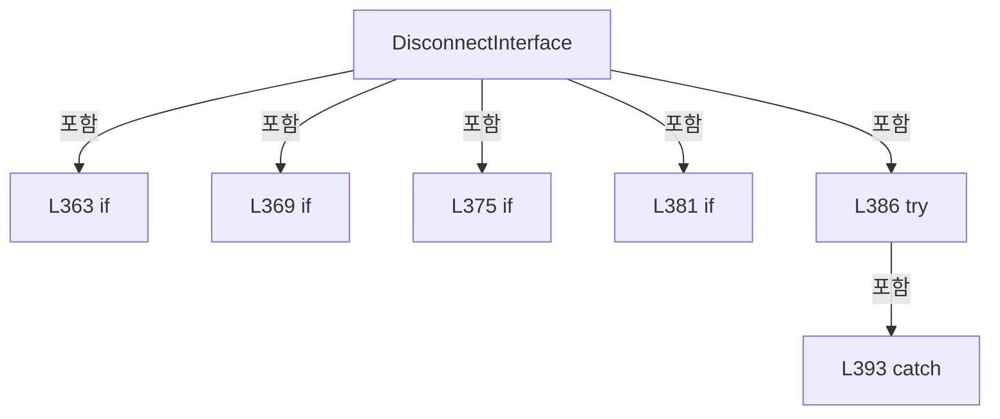

변경 전 점검: 입력/반환 타입, 위 호출자, 예외/취소 경로, 공유 상태와 저장·전송 소비자를 함께 확인합니다. 값의 단위나 물리 방향을 이름만으로 확정하지 않습니다.

### MethodDeclaration `Save` · L402–462

[Drilling.UI/Menu/Menus/CMenuSetting.cs:402–462](https://github.com/kjuws10-rgb/A3Drilling/blob/5aee8e58439c9b455cae7c9593c9be986c3e682e/Drilling.UI/Menu/Menus/CMenuSetting.cs#L402-L462)

| 항목 | 실제 추출 값 |
| --- | --- |
| 서명 | System.Threading.Tasks.Task Drilling.UI.Menu.Menus.CMenuSetting.Save() |
| 접근/수식자 | Private / private, async |
| 반환/값 타입 | System.Threading.Tasks.Task |
| 소속 타입 | NamedType:Drilling.UI.Menu.Menus.CMenuSetting |

정적 호출자로 확인된 위치:

| 호출 파일/행 | 호출 표현식 | 런타임 분기 가능 |
| --- | --- | --- |
| [Drilling.UI/Menu/Menus/CMenuSetting.cs:94–94](https://github.com/kjuws10-rgb/A3Drilling/blob/5aee8e58439c9b455cae7c9593c9be986c3e682e/Drilling.UI/Menu/Menus/CMenuSetting.cs#L94-L94) | Save | False |

호출하는 대상과 해석 범위:

| 원본 행 | 표현식 | 분석 상태 | 대상/소스 위치 |
| --- | --- | --- | --- |
| 405 | CRecipeConfirmDialog.ShowConfirmation | resolved | bool Drilling.UI.Popup.CRecipeConfirmDialog.ShowConfirmation(string, string, string, bool) · Drilling.UI/Popup/CRecipeConfirmDialog.xaml.cs:11 |
| 414 | _settingManager.SaveInterfaceList | resolved | System.Threading.Tasks.Task Drilling.Common.Managers.CSettingManager.SaveInterfaceList(System.Collections.Generic.IReadOnlyList<Drilling.Common.Interface.ST_INTERFACE_DATA>, System.Threading.CancellationToken) · Drilling.Common/Managers/CSettingManager.cs:160 |
| 414 | ToInterfaceData | resolved | System.Collections.Generic.IReadOnlyList<Drilling.Common.Interface.ST_INTERFACE_DATA> Drilling.UI.Menu.Menus.CMenuSetting.ToInterfaceData(System.Collections.Generic.IReadOnlyList<Drilling.UI.Menu.Menus.ST_SETTING_INTERFACE_ROW>) · Drilling.UI/Menu/Menus/CMenuSetting.cs:882 |
| 418 | _setStatusMessage | resolved · 동적 구현 선택 가능 | void System.Action<string>.Invoke(string) |
| 423 | _setStatusMessage | resolved · 동적 구현 선택 가능 | void System.Action<string>.Invoke(string) |
| 427 | _setStatusMessage | resolved · 동적 구현 선택 가능 | void System.Action<string>.Invoke(string) |
| 428 | _showLoadingScreen | resolved · 동적 구현 선택 가능 | void System.Action<Drilling.UI.Menu.Menus.EN_MENU, string>.Invoke(Drilling.UI.Menu.Menus.EN_MENU, string) |
| 429 | _refreshShellStatus | resolved · 동적 구현 선택 가능 | void System.Action.Invoke() |
| 430 | _refreshCurrentScreen | resolved · 동적 구현 선택 가능 | System.Threading.Tasks.Task System.Func<System.Threading.Tasks.Task>.Invoke() |
| 431 | CRecipeConfirmDialog.ShowCompletion | resolved | void Drilling.UI.Popup.CRecipeConfirmDialog.ShowCompletion(string, string, Window?) · Drilling.UI/Popup/CRecipeConfirmDialog.xaml.cs:81 |
| 435 | ToSection | resolved | Drilling.Common.Managers.EN_SETTING_TAB Drilling.UI.Menu.Menus.CMenuSetting.ToSection(string) · Drilling.UI/Menu/Menus/CMenuSetting.cs:1053 |
| 441 | AllParameterRows.Select(BuildSystem).ToArray | resolved | Drilling.Common.Managers.ST_SYSTEM_PARAMETER[] System.Collections.Generic.IEnumerable<Drilling.Common.Managers.ST_SYSTEM_PARAMETER>.ToArray<Drilling.Common.Managers.ST_SYSTEM_PARAMETER>() |
| 441 | AllParameterRows.Select | resolved | System.Collections.Generic.IEnumerable<Drilling.Common.Managers.ST_SYSTEM_PARAMETER> System.Collections.Generic.IEnumerable<Drilling.UI.Menu.Menus.ST_SYSTEM_PARAMETER_ROW>.Select<Drilling.UI.Menu.Menus.ST_SYSTEM_PARAMETER_ROW, Drilling.Common.Managers.ST_SYSTEM_PARAMETER>(System.Func<Drilling.UI.Menu.Menus.ST_SYSTEM_PARAMETER_ROW, Drilling.Common.Managers.ST_SYSTEM_PARAMETER>) |
| 444 | _settingManager.SaveSection | resolved | void Drilling.Common.Managers.CSettingManager.SaveSection(Drilling.Common.Managers.EN_SETTING_TAB, System.Collections.Generic.IReadOnlyList<Drilling.Common.Managers.ST_SYSTEM_PARAMETER>, System.Threading.CancellationToken) · Drilling.Common/Managers/CSettingManager.cs:122 |
| 448 | _setStatusMessage | resolved · 동적 구현 선택 가능 | void System.Action<string>.Invoke(string) |
| 453 | _setStatusMessage | resolved · 동적 구현 선택 가능 | void System.Action<string>.Invoke(string) |
| 457 | _setStatusMessage | resolved · 동적 구현 선택 가능 | void System.Action<string>.Invoke(string) |
| 458 | _showLoadingScreen | resolved · 동적 구현 선택 가능 | void System.Action<Drilling.UI.Menu.Menus.EN_MENU, string>.Invoke(Drilling.UI.Menu.Menus.EN_MENU, string) |
| 459 | _refreshShellStatus | resolved · 동적 구현 선택 가능 | void System.Action.Invoke() |
| 460 | _refreshCurrentScreen | resolved · 동적 구현 선택 가능 | System.Threading.Tasks.Task System.Func<System.Threading.Tasks.Task>.Invoke() |
| 461 | CRecipeConfirmDialog.ShowCompletion | resolved | void Drilling.UI.Popup.CRecipeConfirmDialog.ShowCompletion(string, string, Window?) · Drilling.UI/Popup/CRecipeConfirmDialog.xaml.cs:81 |

본문의 실제 연산·분기·예외·반환 순서(원문 위치 순):

| 원본 행 | 종류 | 주석 해설 |
| --- | --- | --- |
| 404 | conditional-expression | 조건에 따라 결과식을 선택합니다: SelectedTab == "INTERFACE" ? "인터페이스 설정" : $"{SelectedTab} / {SelectedGroup} 설정" |
| 404 | local-declaration | 지역 변수를 선언합니다: var target = SelectedTab == "INTERFACE" ? "인터페이스 설정" : $"{SelectedTab} / {SelectedGroup} 설정"; |
| 404 | variable-initializer | 변수의 초기값을 지정합니다: target = SelectedTab == "INTERFACE" ? "인터페이스 설정" : $"{SelectedTab} / {SelectedGroup} 설정" |
| 405 | call | 함수·델리게이트 또는 객체 생성자를 호출합니다: CRecipeConfirmDialog.ShowConfirmation("설정 저장", $"{target}을 저장하시겠습니까?") |
| 405 | if | 조건에 따라 분기합니다: if (!CRecipeConfirmDialog.ShowConfirmation("설정 저장", $"{target}을 저장하시겠습니까?")) |
| 407 | return | 호출자에게 값 또는 제어를 반환합니다: return; |
| 410 | if | 조건에 따라 분기합니다: if (SelectedTab == "INTERFACE") |
| 412 | try | 예외 처리 범위입니다: try |
| 414 | await | 비동기 완료를 기다립니다: await _settingManager.SaveInterfaceList(ToInterfaceData(AllInterfaceRows)) |
| 414 | call | 함수·델리게이트 또는 객체 생성자를 호출합니다: _settingManager.SaveInterfaceList(ToInterfaceData(AllInterfaceRows)) |
| 414 | call | 함수·델리게이트 또는 객체 생성자를 호출합니다: ToInterfaceData(AllInterfaceRows) |
| 416 | catch | 지정 예외를 처리합니다: catch (InvalidDataException exception) |
| 418 | call | 함수·델리게이트 또는 객체 생성자를 호출합니다: _setStatusMessage(exception.Message) |
| 419 | return | 호출자에게 값 또는 제어를 반환합니다: return; |
| 421 | catch | 지정 예외를 처리합니다: catch (IOException exception) |
| 423 | call | 함수·델리게이트 또는 객체 생성자를 호출합니다: _setStatusMessage($"JHMI_INTERFACE save blocked. {exception.Message}") |
| 424 | return | 호출자에게 값 또는 제어를 반환합니다: return; |
| 427 | call | 함수·델리게이트 또는 객체 생성자를 호출합니다: _setStatusMessage("JHMI_INTERFACE.csv saved, verified, and reloaded to InterfaceManager.") |
| 428 | call | 함수·델리게이트 또는 객체 생성자를 호출합니다: _showLoadingScreen(EN_MENU.Setting, "SETTING") |
| 429 | call | 함수·델리게이트 또는 객체 생성자를 호출합니다: _refreshShellStatus() |
| 430 | await | 비동기 완료를 기다립니다: await _refreshCurrentScreen() |
| 430 | call | 함수·델리게이트 또는 객체 생성자를 호출합니다: _refreshCurrentScreen() |
| 431 | call | 함수·델리게이트 또는 객체 생성자를 호출합니다: CRecipeConfirmDialog.ShowCompletion("설정 저장 완료", "인터페이스 설정을 저장하였습니다.") |
| 432 | return | 호출자에게 값 또는 제어를 반환합니다: return; |
| 435 | call | 함수·델리게이트 또는 객체 생성자를 호출합니다: ToSection(SelectedTab) |
| 435 | local-declaration | 지역 변수를 선언합니다: var section = ToSection(SelectedTab); |
| 435 | variable-initializer | 변수의 초기값을 지정합니다: section = ToSection(SelectedTab) |
| 441 | call | 함수·델리게이트 또는 객체 생성자를 호출합니다: AllParameterRows.Select(BuildSystem).ToArray() |
| 441 | call | 함수·델리게이트 또는 객체 생성자를 호출합니다: AllParameterRows.Select(BuildSystem) |
| 441 | local-declaration | 지역 변수를 선언합니다: var parameters = AllParameterRows.Select(BuildSystem).ToArray(); |
| 441 | variable-initializer | 변수의 초기값을 지정합니다: parameters = AllParameterRows.Select(BuildSystem).ToArray() |
| 442 | try | 예외 처리 범위입니다: try |
| 444 | call | 함수·델리게이트 또는 객체 생성자를 호출합니다: _settingManager.SaveSection(section, parameters) |
| 446 | catch | 지정 예외를 처리합니다: catch (InvalidDataException exception) |
| 448 | call | 함수·델리게이트 또는 객체 생성자를 호출합니다: _setStatusMessage(exception.Message) |
| 449 | return | 호출자에게 값 또는 제어를 반환합니다: return; |
| 451 | catch | 지정 예외를 처리합니다: catch (IOException exception) |
| 453 | call | 함수·델리게이트 또는 객체 생성자를 호출합니다: _setStatusMessage($"Setting save blocked. {exception.Message}") |
| 454 | return | 호출자에게 값 또는 제어를 반환합니다: return; |
| 457 | call | 함수·델리게이트 또는 객체 생성자를 호출합니다: _setStatusMessage($"Setting.csv saved for {SelectedTab} and CSV verified.") |
| 458 | call | 함수·델리게이트 또는 객체 생성자를 호출합니다: _showLoadingScreen(EN_MENU.Setting, "SETTING") |
| 459 | call | 함수·델리게이트 또는 객체 생성자를 호출합니다: _refreshShellStatus() |
| 460 | await | 비동기 완료를 기다립니다: await _refreshCurrentScreen() |
| 460 | call | 함수·델리게이트 또는 객체 생성자를 호출합니다: _refreshCurrentScreen() |
| 461 | call | 함수·델리게이트 또는 객체 생성자를 호출합니다: CRecipeConfirmDialog.ShowCompletion("설정 저장 완료", $"{SelectedTab} 설정을 저장하였습니다.") |

제어 구문의 포함 구조(실제 실행 순서/CFG가 아닌 구문 탐색 그림):

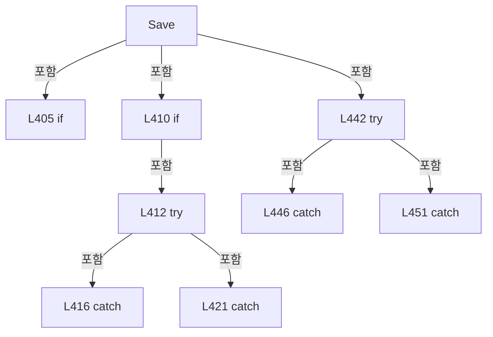

변경 전 점검: 입력/반환 타입, 위 호출자, 예외/취소 경로, 공유 상태와 저장·전송 소비자를 함께 확인합니다. 값의 단위나 물리 방향을 이름만으로 확정하지 않습니다.

### LocalFunctionStatement `BuildSystem` · L436–439

[Drilling.UI/Menu/Menus/CMenuSetting.cs:436–439](https://github.com/kjuws10-rgb/A3Drilling/blob/5aee8e58439c9b455cae7c9593c9be986c3e682e/Drilling.UI/Menu/Menus/CMenuSetting.cs#L436-L439)

| 항목 | 실제 추출 값 |
| --- | --- |
| 서명 | Drilling.Common.Managers.ST_SYSTEM_PARAMETER BuildSystem(Drilling.UI.Menu.Menus.ST_SYSTEM_PARAMETER_ROW) |
| 접근/수식자 | Private /  |
| 반환/값 타입 | Drilling.Common.Managers.ST_SYSTEM_PARAMETER |
| 소속 타입 | NamedType:Drilling.UI.Menu.Menus.CMenuSetting |

입력 계약:

| 이름 | 타입 | 전달 | 선택/기본값 |
| --- | --- | --- | --- |
| row | Drilling.UI.Menu.Menus.ST_SYSTEM_PARAMETER_ROW | None | False /  |

현재 부분 분석에서 직접 연결된 호출자는 없습니다. XAML/이벤트/인터페이스·델리게이트·외부 진입을 추가 확인해야 하며, 미사용으로 판정한 것이 아닙니다.

호출하는 대상과 해석 범위:

| 원본 행 | 표현식 | 분석 상태 | 대상/소스 위치 |
| --- | --- | --- | --- |
| 438 | new ST_SYSTEM_PARAMETER | resolved | Drilling.Common.Managers.ST_SYSTEM_PARAMETER.ST_SYSTEM_PARAMETER(Drilling.Common.Managers.EN_SETTING_TAB, string, string, string, string, string, string, string, Drilling.Common.Managers.EN_RECIPE_DATA_TYPE, double, double, bool, bool, int, System.Collections.Generic.IReadOnlyDictionary<string, string>?) · Drilling.Common/Managers/CSettingManager.cs:255 |
| 438 | NormalizeSettingUnit | resolved | string Drilling.UI.Menu.Menus.CMenuSetting.NormalizeSettingUnit(string) · Drilling.UI/Menu/Menus/CMenuSetting.cs:1042 |

본문의 실제 연산·분기·예외·반환 순서(원문 위치 순):

| 원본 행 | 종류 | 주석 해설 |
| --- | --- | --- |
| 438 | call | 함수·델리게이트 또는 객체 생성자를 호출합니다: new ST_SYSTEM_PARAMETER(section, row.Parameter, row.Value, NormalizeSettingUnit(row.Unit), row.Description, row.Group, row.Key, row.DefaultValue, row.DataType, row.Min, row.Max) |
| 438 | call | 함수·델리게이트 또는 객체 생성자를 호출합니다: NormalizeSettingUnit(row.Unit) |
| 438 | return | 호출자에게 값 또는 제어를 반환합니다: return new ST_SYSTEM_PARAMETER(section, row.Parameter, row.Value, NormalizeSettingUnit(row.Unit), row.Description, row.Group, row.Key, row.DefaultValue, row.DataType, row.Min, row.Max); |

변경 전 점검: 입력/반환 타입, 위 호출자, 예외/취소 경로, 공유 상태와 저장·전송 소비자를 함께 확인합니다. 값의 단위나 물리 방향을 이름만으로 확정하지 않습니다.

### MethodDeclaration `Cancel` · L464–481

[Drilling.UI/Menu/Menus/CMenuSetting.cs:464–481](https://github.com/kjuws10-rgb/A3Drilling/blob/5aee8e58439c9b455cae7c9593c9be986c3e682e/Drilling.UI/Menu/Menus/CMenuSetting.cs#L464-L481)

| 항목 | 실제 추출 값 |
| --- | --- |
| 서명 | System.Threading.Tasks.Task Drilling.UI.Menu.Menus.CMenuSetting.Cancel() |
| 접근/수식자 | Private / private, async |
| 반환/값 타입 | System.Threading.Tasks.Task |
| 소속 타입 | NamedType:Drilling.UI.Menu.Menus.CMenuSetting |

정적 호출자로 확인된 위치:

| 호출 파일/행 | 호출 표현식 | 런타임 분기 가능 |
| --- | --- | --- |
| [Drilling.UI/Menu/Menus/CMenuSetting.cs:100–100](https://github.com/kjuws10-rgb/A3Drilling/blob/5aee8e58439c9b455cae7c9593c9be986c3e682e/Drilling.UI/Menu/Menus/CMenuSetting.cs#L100-L100) | Cancel | False |

호출하는 대상과 해석 범위:

| 원본 행 | 표현식 | 분석 상태 | 대상/소스 위치 |
| --- | --- | --- | --- |
| 466 | CRecipeConfirmDialog.ShowConfirmation | resolved | bool Drilling.UI.Popup.CRecipeConfirmDialog.ShowConfirmation(string, string, string, bool) · Drilling.UI/Popup/CRecipeConfirmDialog.xaml.cs:11 |
| 471 | _showLoadingScreen | resolved · 동적 구현 선택 가능 | void System.Action<Drilling.UI.Menu.Menus.EN_MENU, string>.Invoke(Drilling.UI.Menu.Menus.EN_MENU, string) |
| 472 | TryReloadSelectedTabFromCsv | resolved | bool Drilling.UI.Menu.Menus.CMenuSetting.TryReloadSelectedTabFromCsv() · Drilling.UI/Menu/Menus/CMenuSetting.cs:502 |
| 474 | _refreshCurrentScreen | resolved · 동적 구현 선택 가능 | System.Threading.Tasks.Task System.Func<System.Threading.Tasks.Task>.Invoke() |
| 478 | _setStatusMessage | resolved · 동적 구현 선택 가능 | void System.Action<string>.Invoke(string) |
| 479 | _refreshShellStatus | resolved · 동적 구현 선택 가능 | void System.Action.Invoke() |
| 480 | _refreshCurrentScreen | resolved · 동적 구현 선택 가능 | System.Threading.Tasks.Task System.Func<System.Threading.Tasks.Task>.Invoke() |

본문의 실제 연산·분기·예외·반환 순서(원문 위치 순):

| 원본 행 | 종류 | 주석 해설 |
| --- | --- | --- |
| 466 | call | 함수·델리게이트 또는 객체 생성자를 호출합니다: CRecipeConfirmDialog.ShowConfirmation("인터페이스 변경 취소", "저장하지 않은 인터페이스 변경 내용을 취소하시겠습니까?") |
| 466 | if | 조건에 따라 분기합니다: if (IsInterfaceTab && !CRecipeConfirmDialog.ShowConfirmation("인터페이스 변경 취소", "저장하지 않은 인터페이스 변경 내용을 취소하시겠습니까?")) |
| 468 | return | 호출자에게 값 또는 제어를 반환합니다: return; |
| 471 | call | 함수·델리게이트 또는 객체 생성자를 호출합니다: _showLoadingScreen(EN_MENU.Setting, "SETTING") |
| 472 | call | 함수·델리게이트 또는 객체 생성자를 호출합니다: TryReloadSelectedTabFromCsv() |
| 472 | if | 조건에 따라 분기합니다: if (!TryReloadSelectedTabFromCsv()) |
| 474 | await | 비동기 완료를 기다립니다: await _refreshCurrentScreen() |
| 474 | call | 함수·델리게이트 또는 객체 생성자를 호출합니다: _refreshCurrentScreen() |
| 475 | return | 호출자에게 값 또는 제어를 반환합니다: return; |
| 478 | call | 함수·델리게이트 또는 객체 생성자를 호출합니다: _setStatusMessage($"Setting edits canceled. Reloaded {SelectedTab} / {SelectedGroup} from CSV.") |
| 479 | call | 함수·델리게이트 또는 객체 생성자를 호출합니다: _refreshShellStatus() |
| 480 | await | 비동기 완료를 기다립니다: await _refreshCurrentScreen() |
| 480 | call | 함수·델리게이트 또는 객체 생성자를 호출합니다: _refreshCurrentScreen() |

제어 구문의 포함 구조(실제 실행 순서/CFG가 아닌 구문 탐색 그림):

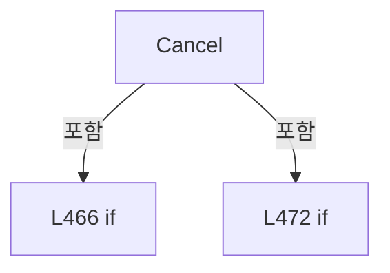

변경 전 점검: 입력/반환 타입, 위 호출자, 예외/취소 경로, 공유 상태와 저장·전송 소비자를 함께 확인합니다. 값의 단위나 물리 방향을 이름만으로 확정하지 않습니다.

### MethodDeclaration `Reload` · L483–500

[Drilling.UI/Menu/Menus/CMenuSetting.cs:483–500](https://github.com/kjuws10-rgb/A3Drilling/blob/5aee8e58439c9b455cae7c9593c9be986c3e682e/Drilling.UI/Menu/Menus/CMenuSetting.cs#L483-L500)

| 항목 | 실제 추출 값 |
| --- | --- |
| 서명 | System.Threading.Tasks.Task Drilling.UI.Menu.Menus.CMenuSetting.Reload() |
| 접근/수식자 | Private / private, async |
| 반환/값 타입 | System.Threading.Tasks.Task |
| 소속 타입 | NamedType:Drilling.UI.Menu.Menus.CMenuSetting |

정적 호출자로 확인된 위치:

| 호출 파일/행 | 호출 표현식 | 런타임 분기 가능 |
| --- | --- | --- |
| [Drilling.UI/Menu/Menus/CMenuSetting.cs:106–106](https://github.com/kjuws10-rgb/A3Drilling/blob/5aee8e58439c9b455cae7c9593c9be986c3e682e/Drilling.UI/Menu/Menus/CMenuSetting.cs#L106-L106) | Reload | False |

호출하는 대상과 해석 범위:

| 원본 행 | 표현식 | 분석 상태 | 대상/소스 위치 |
| --- | --- | --- | --- |
| 485 | CRecipeConfirmDialog.ShowConfirmation | resolved | bool Drilling.UI.Popup.CRecipeConfirmDialog.ShowConfirmation(string, string, string, bool) · Drilling.UI/Popup/CRecipeConfirmDialog.xaml.cs:11 |
| 490 | _showLoadingScreen | resolved · 동적 구현 선택 가능 | void System.Action<Drilling.UI.Menu.Menus.EN_MENU, string>.Invoke(Drilling.UI.Menu.Menus.EN_MENU, string) |
| 491 | TryReloadSelectedTabFromCsv | resolved | bool Drilling.UI.Menu.Menus.CMenuSetting.TryReloadSelectedTabFromCsv() · Drilling.UI/Menu/Menus/CMenuSetting.cs:502 |
| 493 | _refreshCurrentScreen | resolved · 동적 구현 선택 가능 | System.Threading.Tasks.Task System.Func<System.Threading.Tasks.Task>.Invoke() |
| 497 | _setStatusMessage | resolved · 동적 구현 선택 가능 | void System.Action<string>.Invoke(string) |
| 498 | _refreshShellStatus | resolved · 동적 구현 선택 가능 | void System.Action.Invoke() |
| 499 | _refreshCurrentScreen | resolved · 동적 구현 선택 가능 | System.Threading.Tasks.Task System.Func<System.Threading.Tasks.Task>.Invoke() |

본문의 실제 연산·분기·예외·반환 순서(원문 위치 순):

| 원본 행 | 종류 | 주석 해설 |
| --- | --- | --- |
| 485 | call | 함수·델리게이트 또는 객체 생성자를 호출합니다: CRecipeConfirmDialog.ShowConfirmation("설정 다시 불러오기", "저장하지 않은 변경 내용은 사라집니다. CSV 설정을 다시 불러오시겠습니까?") |
| 485 | if | 조건에 따라 분기합니다: if (!CRecipeConfirmDialog.ShowConfirmation("설정 다시 불러오기", "저장하지 않은 변경 내용은 사라집니다. CSV 설정을 다시 불러오시겠습니까?")) |
| 487 | return | 호출자에게 값 또는 제어를 반환합니다: return; |
| 490 | call | 함수·델리게이트 또는 객체 생성자를 호출합니다: _showLoadingScreen(EN_MENU.Setting, "SETTING") |
| 491 | call | 함수·델리게이트 또는 객체 생성자를 호출합니다: TryReloadSelectedTabFromCsv() |
| 491 | if | 조건에 따라 분기합니다: if (!TryReloadSelectedTabFromCsv()) |
| 493 | await | 비동기 완료를 기다립니다: await _refreshCurrentScreen() |
| 493 | call | 함수·델리게이트 또는 객체 생성자를 호출합니다: _refreshCurrentScreen() |
| 494 | return | 호출자에게 값 또는 제어를 반환합니다: return; |
| 497 | call | 함수·델리게이트 또는 객체 생성자를 호출합니다: _setStatusMessage($"Setting {SelectedTab} / {SelectedGroup} reloaded from CSV.") |
| 498 | call | 함수·델리게이트 또는 객체 생성자를 호출합니다: _refreshShellStatus() |
| 499 | await | 비동기 완료를 기다립니다: await _refreshCurrentScreen() |
| 499 | call | 함수·델리게이트 또는 객체 생성자를 호출합니다: _refreshCurrentScreen() |

제어 구문의 포함 구조(실제 실행 순서/CFG가 아닌 구문 탐색 그림):

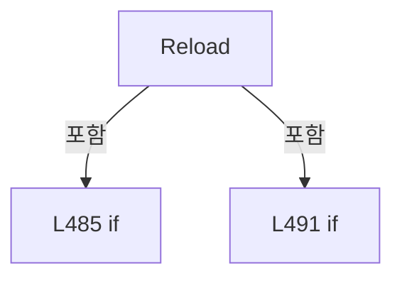

변경 전 점검: 입력/반환 타입, 위 호출자, 예외/취소 경로, 공유 상태와 저장·전송 소비자를 함께 확인합니다. 값의 단위나 물리 방향을 이름만으로 확정하지 않습니다.

### MethodDeclaration `TryReloadSelectedTabFromCsv` · L502–525

[Drilling.UI/Menu/Menus/CMenuSetting.cs:502–525](https://github.com/kjuws10-rgb/A3Drilling/blob/5aee8e58439c9b455cae7c9593c9be986c3e682e/Drilling.UI/Menu/Menus/CMenuSetting.cs#L502-L525)

| 항목 | 실제 추출 값 |
| --- | --- |
| 서명 | bool Drilling.UI.Menu.Menus.CMenuSetting.TryReloadSelectedTabFromCsv() |
| 접근/수식자 | Private / private |
| 반환/값 타입 | bool |
| 소속 타입 | NamedType:Drilling.UI.Menu.Menus.CMenuSetting |

정적 호출자로 확인된 위치:

| 호출 파일/행 | 호출 표현식 | 런타임 분기 가능 |
| --- | --- | --- |
| [Drilling.UI/Menu/Menus/CMenuSetting.cs:472–472](https://github.com/kjuws10-rgb/A3Drilling/blob/5aee8e58439c9b455cae7c9593c9be986c3e682e/Drilling.UI/Menu/Menus/CMenuSetting.cs#L472-L472) | TryReloadSelectedTabFromCsv | False |
| [Drilling.UI/Menu/Menus/CMenuSetting.cs:491–491](https://github.com/kjuws10-rgb/A3Drilling/blob/5aee8e58439c9b455cae7c9593c9be986c3e682e/Drilling.UI/Menu/Menus/CMenuSetting.cs#L491-L491) | TryReloadSelectedTabFromCsv | False |

호출하는 대상과 해석 범위:

| 원본 행 | 표현식 | 분석 상태 | 대상/소스 위치 |
| --- | --- | --- | --- |
| 504 | SelectedTab.Equals | resolved | bool string.Equals(string?, System.StringComparison) |
| 509 | ToSection | resolved | Drilling.Common.Managers.EN_SETTING_TAB Drilling.UI.Menu.Menus.CMenuSetting.ToSection(string) · Drilling.UI/Menu/Menus/CMenuSetting.cs:1053 |
| 512 | _settingManager.ReloadSection | resolved | System.Collections.Generic.IReadOnlyList<Drilling.Common.Managers.ST_SYSTEM_PARAMETER> Drilling.Common.Managers.CSettingManager.ReloadSection(Drilling.Common.Managers.EN_SETTING_TAB, System.Threading.CancellationToken) · Drilling.Common/Managers/CSettingManager.cs:40 |
| 517 | _setStatusMessage | resolved · 동적 구현 선택 가능 | void System.Action<string>.Invoke(string) |
| 522 | _setStatusMessage | resolved · 동적 구현 선택 가능 | void System.Action<string>.Invoke(string) |

본문의 실제 연산·분기·예외·반환 순서(원문 위치 순):

| 원본 행 | 종류 | 주석 해설 |
| --- | --- | --- |
| 504 | call | 함수·델리게이트 또는 객체 생성자를 호출합니다: SelectedTab.Equals("INTERFACE", StringComparison.OrdinalIgnoreCase) |
| 504 | if | 조건에 따라 분기합니다: if (SelectedTab.Equals("INTERFACE", StringComparison.OrdinalIgnoreCase)) |
| 506 | return | 호출자에게 값 또는 제어를 반환합니다: return true; |
| 509 | call | 함수·델리게이트 또는 객체 생성자를 호출합니다: ToSection(SelectedTab) |
| 509 | local-declaration | 지역 변수를 선언합니다: var section = ToSection(SelectedTab); |
| 509 | variable-initializer | 변수의 초기값을 지정합니다: section = ToSection(SelectedTab) |
| 510 | try | 예외 처리 범위입니다: try |
| 512 | call | 함수·델리게이트 또는 객체 생성자를 호출합니다: _settingManager.ReloadSection(section) |
| 513 | return | 호출자에게 값 또는 제어를 반환합니다: return true; |
| 515 | catch | 지정 예외를 처리합니다: catch (InvalidDataException exception) |
| 517 | call | 함수·델리게이트 또는 객체 생성자를 호출합니다: _setStatusMessage($"Setting reload blocked. {exception.Message}") |
| 518 | return | 호출자에게 값 또는 제어를 반환합니다: return false; |
| 520 | catch | 지정 예외를 처리합니다: catch (IOException exception) |
| 522 | call | 함수·델리게이트 또는 객체 생성자를 호출합니다: _setStatusMessage($"Setting reload blocked. {exception.Message}") |
| 523 | return | 호출자에게 값 또는 제어를 반환합니다: return false; |

제어 구문의 포함 구조(실제 실행 순서/CFG가 아닌 구문 탐색 그림):

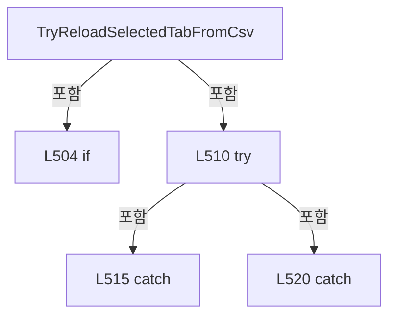

변경 전 점검: 입력/반환 타입, 위 호출자, 예외/취소 경로, 공유 상태와 저장·전송 소비자를 함께 확인합니다. 값의 단위나 물리 방향을 이름만으로 확정하지 않습니다.

### MethodDeclaration `SelectHeadFilter` · L527–538

[Drilling.UI/Menu/Menus/CMenuSetting.cs:527–538](https://github.com/kjuws10-rgb/A3Drilling/blob/5aee8e58439c9b455cae7c9593c9be986c3e682e/Drilling.UI/Menu/Menus/CMenuSetting.cs#L527-L538)

| 항목 | 실제 추출 값 |
| --- | --- |
| 서명 | System.Threading.Tasks.Task Drilling.UI.Menu.Menus.CMenuSetting.SelectHeadFilter(object?) |
| 접근/수식자 | Private / private, async |
| 반환/값 타입 | System.Threading.Tasks.Task |
| 소속 타입 | NamedType:Drilling.UI.Menu.Menus.CMenuSetting |

입력 계약:

| 이름 | 타입 | 전달 | 선택/기본값 |
| --- | --- | --- | --- |
| parameter | object? | None | False /  |

정적 호출자로 확인된 위치:

| 호출 파일/행 | 호출 표현식 | 런타임 분기 가능 |
| --- | --- | --- |
| [Drilling.UI/Menu/Menus/CMenuSetting.cs:66–66](https://github.com/kjuws10-rgb/A3Drilling/blob/5aee8e58439c9b455cae7c9593c9be986c3e682e/Drilling.UI/Menu/Menus/CMenuSetting.cs#L66-L66) | SelectHeadFilter | False |

호출하는 대상과 해석 범위:

| 원본 행 | 표현식 | 분석 상태 | 대상/소스 위치 |
| --- | --- | --- | --- |
| 529 | string.IsNullOrWhiteSpace | resolved | bool string.IsNullOrWhiteSpace(string?) |
| 534 | headFilter.Trim().ToUpperInvariant | resolved | string string.ToUpperInvariant() |
| 534 | headFilter.Trim | resolved | string string.Trim() |
| 535 | _setStatusMessage | resolved · 동적 구현 선택 가능 | void System.Action<string>.Invoke(string) |
| 536 | _refreshShellStatus | resolved · 동적 구현 선택 가능 | void System.Action.Invoke() |
| 537 | _refreshCurrentScreen | resolved · 동적 구현 선택 가능 | System.Threading.Tasks.Task System.Func<System.Threading.Tasks.Task>.Invoke() |

본문의 실제 연산·분기·예외·반환 순서(원문 위치 순):

| 원본 행 | 종류 | 주석 해설 |
| --- | --- | --- |
| 529 | call | 함수·델리게이트 또는 객체 생성자를 호출합니다: string.IsNullOrWhiteSpace(headFilter) |
| 529 | if | 조건에 따라 분기합니다: if (parameter is not string headFilter &#124;&#124; string.IsNullOrWhiteSpace(headFilter)) |
| 531 | return | 호출자에게 값 또는 제어를 반환합니다: return; |
| 534 | assignment | 값을 대상에 대입합니다: _selectedHeadFilter = headFilter.Trim().ToUpperInvariant() |
| 534 | call | 함수·델리게이트 또는 객체 생성자를 호출합니다: headFilter.Trim().ToUpperInvariant() |
| 534 | call | 함수·델리게이트 또는 객체 생성자를 호출합니다: headFilter.Trim() |
| 535 | call | 함수·델리게이트 또는 객체 생성자를 호출합니다: _setStatusMessage($"Setting head filter {SelectedTab} / {SelectedGroup} / {_selectedHeadFilter} selected.") |
| 536 | call | 함수·델리게이트 또는 객체 생성자를 호출합니다: _refreshShellStatus() |
| 537 | await | 비동기 완료를 기다립니다: await _refreshCurrentScreen() |
| 537 | call | 함수·델리게이트 또는 객체 생성자를 호출합니다: _refreshCurrentScreen() |

제어 구문의 포함 구조(실제 실행 순서/CFG가 아닌 구문 탐색 그림):

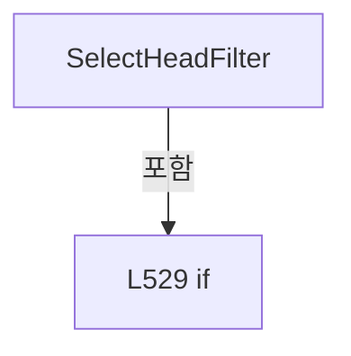

변경 전 점검: 입력/반환 타입, 위 호출자, 예외/취소 경로, 공유 상태와 저장·전송 소비자를 함께 확인합니다. 값의 단위나 물리 방향을 이름만으로 확정하지 않습니다.

### MethodDeclaration `Apply` · L540–572

[Drilling.UI/Menu/Menus/CMenuSetting.cs:540–572](https://github.com/kjuws10-rgb/A3Drilling/blob/5aee8e58439c9b455cae7c9593c9be986c3e682e/Drilling.UI/Menu/Menus/CMenuSetting.cs#L540-L572)

| 항목 | 실제 추출 값 |
| --- | --- |
| 서명 | void Drilling.UI.Menu.Menus.CMenuSetting.Apply(System.Collections.Generic.IReadOnlyList<Drilling.UI.Menu.Menus.ST_SCREEN_SECTION>, System.Collections.Generic.IReadOnlyList<Drilling.UI.Menu.Menus.ST_DISPLAY_ITEM>, string, string, string, System.Collections.Generic.IReadOnlyList<Drilling.UI.Menu.Menus.ST_SETTING_TAB>, System.Collections.Generic.IReadOnlyList<Drilling.UI.Menu.Menus.ST_SETTING_GROUP>, System.Collections.Generic.IReadOnlyList<Drilling.UI.Menu.Menus.ST_SETTING_HEAD_FILTER>, System.Collections.Generic.IReadOnlyList<Drilling.UI.Menu.Menus.ST_SYSTEM_PARAMETER_ROW>, System.Collections.Generic.IReadOnlyList<Drilling.UI.Menu.Menus.ST_SYSTEM_PARAMETER_ROW>, System.Collections.Generic.IReadOnlyList<Drilling.UI.Menu.Menus.ST_SETTING_INTERFACE_ROW>, System.Collections.Generic.IReadOnlyList<Drilling.UI.Menu.Menus.ST_SETTING_INTERFACE_ROW>, System.Collections.Generic.IReadOnlyList<Drilling.UI.Menu.Menus.ST_SETTING_HISTORY_ROW>, System.Collections.Generic.IReadOnlyList<Drilling.UI.Menu.Menus.ST_SETTING_SUMMARY_ROW>) |
| 접근/수식자 | Private / private |
| 반환/값 타입 | void |
| 소속 타입 | NamedType:Drilling.UI.Menu.Menus.CMenuSetting |

입력 계약:

| 이름 | 타입 | 전달 | 선택/기본값 |
| --- | --- | --- | --- |
| tabs | System.Collections.Generic.IReadOnlyList<Drilling.UI.Menu.Menus.ST_SCREEN_SECTION> | None | False /  |
| history | System.Collections.Generic.IReadOnlyList<Drilling.UI.Menu.Menus.ST_DISPLAY_ITEM> | None | False /  |
| selectedTab | string | None | False /  |
| selectedGroup | string | None | False /  |
| selectedHeadFilter | string | None | False /  |
| tabItems | System.Collections.Generic.IReadOnlyList<Drilling.UI.Menu.Menus.ST_SETTING_TAB> | None | False /  |
| groupItems | System.Collections.Generic.IReadOnlyList<Drilling.UI.Menu.Menus.ST_SETTING_GROUP> | None | False /  |
| headFilterItems | System.Collections.Generic.IReadOnlyList<Drilling.UI.Menu.Menus.ST_SETTING_HEAD_FILTER> | None | False /  |
| allParameterRows | System.Collections.Generic.IReadOnlyList<Drilling.UI.Menu.Menus.ST_SYSTEM_PARAMETER_ROW> | None | False /  |
| parameterRows | System.Collections.Generic.IReadOnlyList<Drilling.UI.Menu.Menus.ST_SYSTEM_PARAMETER_ROW> | None | False /  |
| allInterfaceRows | System.Collections.Generic.IReadOnlyList<Drilling.UI.Menu.Menus.ST_SETTING_INTERFACE_ROW> | None | False /  |
| interfaceRows | System.Collections.Generic.IReadOnlyList<Drilling.UI.Menu.Menus.ST_SETTING_INTERFACE_ROW> | None | False /  |
| changeHistory | System.Collections.Generic.IReadOnlyList<Drilling.UI.Menu.Menus.ST_SETTING_HISTORY_ROW> | None | False /  |
| summaryRows | System.Collections.Generic.IReadOnlyList<Drilling.UI.Menu.Menus.ST_SETTING_SUMMARY_ROW> | None | False /  |

정적 호출자로 확인된 위치:

| 호출 파일/행 | 호출 표현식 | 런타임 분기 가능 |
| --- | --- | --- |
| [Drilling.UI/Menu/Menus/CMenuSetting.cs:261–276](https://github.com/kjuws10-rgb/A3Drilling/blob/5aee8e58439c9b455cae7c9593c9be986c3e682e/Drilling.UI/Menu/Menus/CMenuSetting.cs#L261-L276) | Apply | False |

호출하는 대상과 해석 범위:

| 원본 행 | 표현식 | 분석 상태 | 대상/소스 위치 |
| --- | --- | --- | --- |
| 569 | GetSelectedInterfaceRow | resolved | Drilling.UI.Menu.Menus.ST_SETTING_INTERFACE_ROW? Drilling.UI.Menu.Menus.CMenuSetting.GetSelectedInterfaceRow(System.Collections.Generic.IReadOnlyList<Drilling.UI.Menu.Menus.ST_SETTING_INTERFACE_ROW>, Drilling.UI.Menu.Menus.ST_SETTING_INTERFACE_ROW?) · Drilling.UI/Menu/Menus/CMenuSetting.cs:584 |

본문의 실제 연산·분기·예외·반환 순서(원문 위치 순):

| 원본 행 | 종류 | 주석 해설 |
| --- | --- | --- |
| 557 | assignment | 값을 대상에 대입합니다: Tabs = tabs |
| 558 | assignment | 값을 대상에 대입합니다: History = history |
| 559 | assignment | 값을 대상에 대입합니다: SelectedTab = selectedTab |
| 560 | assignment | 값을 대상에 대입합니다: SelectedGroup = selectedGroup |
| 561 | assignment | 값을 대상에 대입합니다: SelectedHeadFilter = selectedHeadFilter |
| 562 | assignment | 값을 대상에 대입합니다: TabItems = tabItems |
| 563 | assignment | 값을 대상에 대입합니다: GroupItems = groupItems |
| 564 | assignment | 값을 대상에 대입합니다: HeadFilterItems = headFilterItems |
| 565 | assignment | 값을 대상에 대입합니다: AllParameterRows = allParameterRows |
| 566 | assignment | 값을 대상에 대입합니다: ParameterRows = parameterRows |
| 567 | assignment | 값을 대상에 대입합니다: AllInterfaceRows = allInterfaceRows |
| 568 | assignment | 값을 대상에 대입합니다: InterfaceRows = interfaceRows |
| 569 | assignment | 값을 대상에 대입합니다: SelectedInterfaceRow = GetSelectedInterfaceRow(interfaceRows, SelectedInterfaceRow) |
| 569 | call | 함수·델리게이트 또는 객체 생성자를 호출합니다: GetSelectedInterfaceRow(interfaceRows, SelectedInterfaceRow) |
| 570 | assignment | 값을 대상에 대입합니다: ChangeHistory = changeHistory |
| 571 | assignment | 값을 대상에 대입합니다: SummaryRows = summaryRows |

변경 전 점검: 입력/반환 타입, 위 호출자, 예외/취소 경로, 공유 상태와 저장·전송 소비자를 함께 확인합니다. 값의 단위나 물리 방향을 이름만으로 확정하지 않습니다.

### MethodDeclaration `GetEditRows` · L574–577

[Drilling.UI/Menu/Menus/CMenuSetting.cs:574–577](https://github.com/kjuws10-rgb/A3Drilling/blob/5aee8e58439c9b455cae7c9593c9be986c3e682e/Drilling.UI/Menu/Menus/CMenuSetting.cs#L574-L577)

| 항목 | 실제 추출 값 |
| --- | --- |
| 서명 | System.Collections.Generic.IReadOnlyList<Drilling.UI.Menu.Menus.ST_SYSTEM_PARAMETER_ROW> Drilling.UI.Menu.Menus.CMenuSetting.GetEditRows(System.Collections.Generic.IReadOnlyList<Drilling.UI.Menu.Menus.ST_SYSTEM_PARAMETER_ROW>, Drilling.UI.Menu.Menus.CMenuSetting?, string) |
| 접근/수식자 | Private / private, static |
| 반환/값 타입 | System.Collections.Generic.IReadOnlyList<Drilling.UI.Menu.Menus.ST_SYSTEM_PARAMETER_ROW> |
| 소속 타입 | NamedType:Drilling.UI.Menu.Menus.CMenuSetting |

입력 계약:

| 이름 | 타입 | 전달 | 선택/기본값 |
| --- | --- | --- | --- |
| loadedRows | System.Collections.Generic.IReadOnlyList<Drilling.UI.Menu.Menus.ST_SYSTEM_PARAMETER_ROW> | None | False /  |
| editScreen | Drilling.UI.Menu.Menus.CMenuSetting? | None | False /  |
| selectedTab | string | None | False /  |

정적 호출자로 확인된 위치:

| 호출 파일/행 | 호출 표현식 | 런타임 분기 가능 |
| --- | --- | --- |
| [Drilling.UI/Menu/Menus/CMenuSetting.cs:234–234](https://github.com/kjuws10-rgb/A3Drilling/blob/5aee8e58439c9b455cae7c9593c9be986c3e682e/Drilling.UI/Menu/Menus/CMenuSetting.cs#L234-L234) | GetEditRows | False |

호출하는 대상과 해석 범위:

| 원본 행 | 표현식 | 분석 상태 | 대상/소스 위치 |
| --- | --- | --- | --- |
| 576 | editScreen.SelectedTab.Equals | resolved | bool string.Equals(string?, System.StringComparison) |

본문의 실제 연산·분기·예외·반환 순서(원문 위치 순):

| 원본 행 | 종류 | 주석 해설 |
| --- | --- | --- |
| 576 | call | 함수·델리게이트 또는 객체 생성자를 호출합니다: editScreen.SelectedTab.Equals(selectedTab, StringComparison.OrdinalIgnoreCase) |
| 576 | conditional-expression | 조건에 따라 결과식을 선택합니다: editScreen is not null && editScreen.SelectedTab.Equals(selectedTab, StringComparison.OrdinalIgnoreCase) && editScreen.AllParameterRows.Count > 0 ? editScreen.AllParameterRows : loadedRows |
| 576 | return | 호출자에게 값 또는 제어를 반환합니다: return editScreen is not null && editScreen.SelectedTab.Equals(selectedTab, StringComparison.OrdinalIgnoreCase) && editScreen.AllParameterRows.Count > 0 ? editScreen.AllParameterRows : loadedRows; |

변경 전 점검: 입력/반환 타입, 위 호출자, 예외/취소 경로, 공유 상태와 저장·전송 소비자를 함께 확인합니다. 값의 단위나 물리 방향을 이름만으로 확정하지 않습니다.

### MethodDeclaration `GetEditInterfaceRows` · L579–582

[Drilling.UI/Menu/Menus/CMenuSetting.cs:579–582](https://github.com/kjuws10-rgb/A3Drilling/blob/5aee8e58439c9b455cae7c9593c9be986c3e682e/Drilling.UI/Menu/Menus/CMenuSetting.cs#L579-L582)

| 항목 | 실제 추출 값 |
| --- | --- |
| 서명 | System.Collections.Generic.IReadOnlyList<Drilling.UI.Menu.Menus.ST_SETTING_INTERFACE_ROW> Drilling.UI.Menu.Menus.CMenuSetting.GetEditInterfaceRows(System.Collections.Generic.IReadOnlyList<Drilling.UI.Menu.Menus.ST_SETTING_INTERFACE_ROW>, Drilling.UI.Menu.Menus.CMenuSetting?, string) |
| 접근/수식자 | Private / private, static |
| 반환/값 타입 | System.Collections.Generic.IReadOnlyList<Drilling.UI.Menu.Menus.ST_SETTING_INTERFACE_ROW> |
| 소속 타입 | NamedType:Drilling.UI.Menu.Menus.CMenuSetting |

입력 계약:

| 이름 | 타입 | 전달 | 선택/기본값 |
| --- | --- | --- | --- |
| loadedRows | System.Collections.Generic.IReadOnlyList<Drilling.UI.Menu.Menus.ST_SETTING_INTERFACE_ROW> | None | False /  |
| editScreen | Drilling.UI.Menu.Menus.CMenuSetting? | None | False /  |
| selectedTab | string | None | False /  |

정적 호출자로 확인된 위치:

| 호출 파일/행 | 호출 표현식 | 런타임 분기 가능 |
| --- | --- | --- |
| [Drilling.UI/Menu/Menus/CMenuSetting.cs:235–235](https://github.com/kjuws10-rgb/A3Drilling/blob/5aee8e58439c9b455cae7c9593c9be986c3e682e/Drilling.UI/Menu/Menus/CMenuSetting.cs#L235-L235) | GetEditInterfaceRows | False |

호출하는 대상과 해석 범위:

| 원본 행 | 표현식 | 분석 상태 | 대상/소스 위치 |
| --- | --- | --- | --- |
| 581 | editScreen.SelectedTab.Equals | resolved | bool string.Equals(string?, System.StringComparison) |

본문의 실제 연산·분기·예외·반환 순서(원문 위치 순):

| 원본 행 | 종류 | 주석 해설 |
| --- | --- | --- |
| 581 | call | 함수·델리게이트 또는 객체 생성자를 호출합니다: editScreen.SelectedTab.Equals(selectedTab, StringComparison.OrdinalIgnoreCase) |
| 581 | conditional-expression | 조건에 따라 결과식을 선택합니다: editScreen is not null && editScreen.SelectedTab.Equals(selectedTab, StringComparison.OrdinalIgnoreCase) && editScreen.AllInterfaceRows.Count > 0 ? editScreen.AllInterfaceRows : loadedRows |
| 581 | return | 호출자에게 값 또는 제어를 반환합니다: return editScreen is not null && editScreen.SelectedTab.Equals(selectedTab, StringComparison.OrdinalIgnoreCase) && editScreen.AllInterfaceRows.Count > 0 ? editScreen.AllInterfaceRows : loadedRows; |

변경 전 점검: 입력/반환 타입, 위 호출자, 예외/취소 경로, 공유 상태와 저장·전송 소비자를 함께 확인합니다. 값의 단위나 물리 방향을 이름만으로 확정하지 않습니다.

### MethodDeclaration `GetSelectedInterfaceRow` · L584–607

[Drilling.UI/Menu/Menus/CMenuSetting.cs:584–607](https://github.com/kjuws10-rgb/A3Drilling/blob/5aee8e58439c9b455cae7c9593c9be986c3e682e/Drilling.UI/Menu/Menus/CMenuSetting.cs#L584-L607)

| 항목 | 실제 추출 값 |
| --- | --- |
| 서명 | Drilling.UI.Menu.Menus.ST_SETTING_INTERFACE_ROW? Drilling.UI.Menu.Menus.CMenuSetting.GetSelectedInterfaceRow(System.Collections.Generic.IReadOnlyList<Drilling.UI.Menu.Menus.ST_SETTING_INTERFACE_ROW>, Drilling.UI.Menu.Menus.ST_SETTING_INTERFACE_ROW?) |
| 접근/수식자 | Private / private, static |
| 반환/값 타입 | Drilling.UI.Menu.Menus.ST_SETTING_INTERFACE_ROW? |
| 소속 타입 | NamedType:Drilling.UI.Menu.Menus.CMenuSetting |

입력 계약:

| 이름 | 타입 | 전달 | 선택/기본값 |
| --- | --- | --- | --- |
| rows | System.Collections.Generic.IReadOnlyList<Drilling.UI.Menu.Menus.ST_SETTING_INTERFACE_ROW> | None | False /  |
| current | Drilling.UI.Menu.Menus.ST_SETTING_INTERFACE_ROW? | None | False /  |

정적 호출자로 확인된 위치:

| 호출 파일/행 | 호출 표현식 | 런타임 분기 가능 |
| --- | --- | --- |
| [Drilling.UI/Menu/Menus/CMenuSetting.cs:569–569](https://github.com/kjuws10-rgb/A3Drilling/blob/5aee8e58439c9b455cae7c9593c9be986c3e682e/Drilling.UI/Menu/Menus/CMenuSetting.cs#L569-L569) | GetSelectedInterfaceRow | False |

호출하는 대상과 해석 범위:

| 원본 행 | 표현식 | 분석 상태 | 대상/소스 위치 |
| --- | --- | --- | --- |
| 606 | rows.FirstOrDefault | resolved | Drilling.UI.Menu.Menus.ST_SETTING_INTERFACE_ROW? System.Collections.Generic.IEnumerable<Drilling.UI.Menu.Menus.ST_SETTING_INTERFACE_ROW>.FirstOrDefault<Drilling.UI.Menu.Menus.ST_SETTING_INTERFACE_ROW>(System.Func<Drilling.UI.Menu.Menus.ST_SETTING_INTERFACE_ROW, bool>) |
| 606 | rows.FirstOrDefault | resolved | Drilling.UI.Menu.Menus.ST_SETTING_INTERFACE_ROW? System.Collections.Generic.IEnumerable<Drilling.UI.Menu.Menus.ST_SETTING_INTERFACE_ROW>.FirstOrDefault<Drilling.UI.Menu.Menus.ST_SETTING_INTERFACE_ROW>(System.Func<Drilling.UI.Menu.Menus.ST_SETTING_INTERFACE_ROW, bool>) |

본문의 실제 연산·분기·예외·반환 순서(원문 위치 순):

| 원본 행 | 종류 | 주석 해설 |
| --- | --- | --- |
| 586 | if | 조건에 따라 분기합니다: if (rows.Count == 0) |
| 588 | return | 호출자에게 값 또는 제어를 반환합니다: return null; |
| 591 | if | 조건에 따라 분기합니다: if (current is null) |
| 593 | return | 호출자에게 값 또는 제어를 반환합니다: return rows[0]; |
| 606 | call | 함수·델리게이트 또는 객체 생성자를 호출합니다: rows.FirstOrDefault(MatchesItem) |
| 606 | call | 함수·델리게이트 또는 객체 생성자를 호출합니다: rows.FirstOrDefault(MatchesItem2) |
| 606 | return | 호출자에게 값 또는 제어를 반환합니다: return rows.FirstOrDefault(MatchesItem) ?? rows.FirstOrDefault(MatchesItem2) ?? rows[0]; |

제어 구문의 포함 구조(실제 실행 순서/CFG가 아닌 구문 탐색 그림):

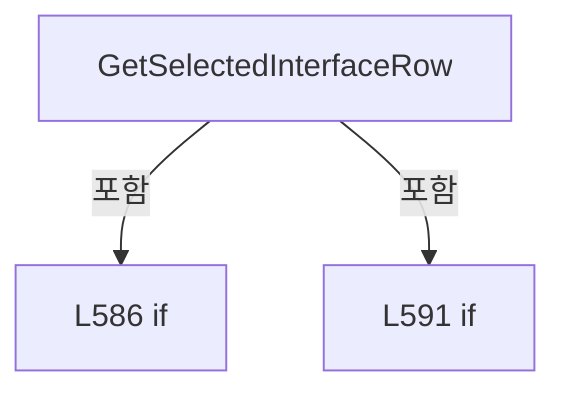

변경 전 점검: 입력/반환 타입, 위 호출자, 예외/취소 경로, 공유 상태와 저장·전송 소비자를 함께 확인합니다. 값의 단위나 물리 방향을 이름만으로 확정하지 않습니다.

### LocalFunctionStatement `MatchesItem` · L596–599

[Drilling.UI/Menu/Menus/CMenuSetting.cs:596–599](https://github.com/kjuws10-rgb/A3Drilling/blob/5aee8e58439c9b455cae7c9593c9be986c3e682e/Drilling.UI/Menu/Menus/CMenuSetting.cs#L596-L599)

| 항목 | 실제 추출 값 |
| --- | --- |
| 서명 | bool MatchesItem(Drilling.UI.Menu.Menus.ST_SETTING_INTERFACE_ROW) |
| 접근/수식자 | Private /  |
| 반환/값 타입 | bool |
| 소속 타입 | NamedType:Drilling.UI.Menu.Menus.CMenuSetting |

입력 계약:

| 이름 | 타입 | 전달 | 선택/기본값 |
| --- | --- | --- | --- |
| row | Drilling.UI.Menu.Menus.ST_SETTING_INTERFACE_ROW | None | False /  |

현재 부분 분석에서 직접 연결된 호출자는 없습니다. XAML/이벤트/인터페이스·델리게이트·외부 진입을 추가 확인해야 하며, 미사용으로 판정한 것이 아닙니다.

호출하는 대상과 해석 범위:

| 원본 행 | 표현식 | 분석 상태 | 대상/소스 위치 |
| --- | --- | --- | --- |
| 598 | IsSameInterfaceKey | resolved | bool Drilling.UI.Menu.Menus.CMenuSetting.IsSameInterfaceKey(Drilling.UI.Menu.Menus.ST_SETTING_INTERFACE_ROW, Drilling.UI.Menu.Menus.ST_SETTING_INTERFACE_ROW) · Drilling.UI/Menu/Menus/CMenuSetting.cs:609 |

본문의 실제 연산·분기·예외·반환 순서(원문 위치 순):

| 원본 행 | 종류 | 주석 해설 |
| --- | --- | --- |
| 598 | call | 함수·델리게이트 또는 객체 생성자를 호출합니다: IsSameInterfaceKey(row, current) |
| 598 | return | 호출자에게 값 또는 제어를 반환합니다: return IsSameInterfaceKey(row, current); |

변경 전 점검: 입력/반환 타입, 위 호출자, 예외/취소 경로, 공유 상태와 저장·전송 소비자를 함께 확인합니다. 값의 단위나 물리 방향을 이름만으로 확정하지 않습니다.

### LocalFunctionStatement `MatchesItem2` · L601–604

[Drilling.UI/Menu/Menus/CMenuSetting.cs:601–604](https://github.com/kjuws10-rgb/A3Drilling/blob/5aee8e58439c9b455cae7c9593c9be986c3e682e/Drilling.UI/Menu/Menus/CMenuSetting.cs#L601-L604)

| 항목 | 실제 추출 값 |
| --- | --- |
| 서명 | bool MatchesItem2(Drilling.UI.Menu.Menus.ST_SETTING_INTERFACE_ROW) |
| 접근/수식자 | Private /  |
| 반환/값 타입 | bool |
| 소속 타입 | NamedType:Drilling.UI.Menu.Menus.CMenuSetting |

입력 계약:

| 이름 | 타입 | 전달 | 선택/기본값 |
| --- | --- | --- | --- |
| row | Drilling.UI.Menu.Menus.ST_SETTING_INTERFACE_ROW | None | False /  |

현재 부분 분석에서 직접 연결된 호출자는 없습니다. XAML/이벤트/인터페이스·델리게이트·외부 진입을 추가 확인해야 하며, 미사용으로 판정한 것이 아닙니다.

호출하는 대상과 해석 범위:

| 원본 행 | 표현식 | 분석 상태 | 대상/소스 위치 |
| --- | --- | --- | --- |
| 603 | row.NickName.Equals | resolved | bool string.Equals(string?, System.StringComparison) |

본문의 실제 연산·분기·예외·반환 순서(원문 위치 순):

| 원본 행 | 종류 | 주석 해설 |
| --- | --- | --- |
| 603 | call | 함수·델리게이트 또는 객체 생성자를 호출합니다: row.NickName.Equals(current.NickName, StringComparison.OrdinalIgnoreCase) |
| 603 | return | 호출자에게 값 또는 제어를 반환합니다: return row.NickName.Equals(current.NickName, StringComparison.OrdinalIgnoreCase); |

변경 전 점검: 입력/반환 타입, 위 호출자, 예외/취소 경로, 공유 상태와 저장·전송 소비자를 함께 확인합니다. 값의 단위나 물리 방향을 이름만으로 확정하지 않습니다.

### MethodDeclaration `IsSameInterfaceKey` · L609–612

[Drilling.UI/Menu/Menus/CMenuSetting.cs:609–612](https://github.com/kjuws10-rgb/A3Drilling/blob/5aee8e58439c9b455cae7c9593c9be986c3e682e/Drilling.UI/Menu/Menus/CMenuSetting.cs#L609-L612)

| 항목 | 실제 추출 값 |
| --- | --- |
| 서명 | bool Drilling.UI.Menu.Menus.CMenuSetting.IsSameInterfaceKey(Drilling.UI.Menu.Menus.ST_SETTING_INTERFACE_ROW, Drilling.UI.Menu.Menus.ST_SETTING_INTERFACE_ROW) |
| 접근/수식자 | Private / private, static |
| 반환/값 타입 | bool |
| 소속 타입 | NamedType:Drilling.UI.Menu.Menus.CMenuSetting |

입력 계약:

| 이름 | 타입 | 전달 | 선택/기본값 |
| --- | --- | --- | --- |
| left | Drilling.UI.Menu.Menus.ST_SETTING_INTERFACE_ROW | None | False /  |
| right | Drilling.UI.Menu.Menus.ST_SETTING_INTERFACE_ROW | None | False /  |

정적 호출자로 확인된 위치:

| 호출 파일/행 | 호출 표현식 | 런타임 분기 가능 |
| --- | --- | --- |
| [Drilling.UI/Menu/Menus/CMenuSetting.cs:598–598](https://github.com/kjuws10-rgb/A3Drilling/blob/5aee8e58439c9b455cae7c9593c9be986c3e682e/Drilling.UI/Menu/Menus/CMenuSetting.cs#L598-L598) | IsSameInterfaceKey | False |

호출하는 대상과 해석 범위:

| 원본 행 | 표현식 | 분석 상태 | 대상/소스 위치 |
| --- | --- | --- | --- |
| 611 | NormalizeSettingText(left.Device, "").Equals | resolved | bool string.Equals(string?, System.StringComparison) |
| 611 | NormalizeSettingText | resolved | string Drilling.UI.Menu.Menus.CMenuSetting.NormalizeSettingText(string, string) · Drilling.UI/Menu/Menus/CMenuSetting.cs:1032 |
| 611 | NormalizeSettingText | resolved | string Drilling.UI.Menu.Menus.CMenuSetting.NormalizeSettingText(string, string) · Drilling.UI/Menu/Menus/CMenuSetting.cs:1032 |
| 611 | left.Number.Trim().Equals | resolved | bool string.Equals(string?, System.StringComparison) |
| 611 | left.Number.Trim | resolved | string string.Trim() |
| 611 | right.Number.Trim | resolved | string string.Trim() |

본문의 실제 연산·분기·예외·반환 순서(원문 위치 순):

| 원본 행 | 종류 | 주석 해설 |
| --- | --- | --- |
| 611 | call | 함수·델리게이트 또는 객체 생성자를 호출합니다: NormalizeSettingText(left.Device, "").Equals(NormalizeSettingText(right.Device, ""), StringComparison.OrdinalIgnoreCase) |
| 611 | call | 함수·델리게이트 또는 객체 생성자를 호출합니다: NormalizeSettingText(left.Device, "") |
| 611 | call | 함수·델리게이트 또는 객체 생성자를 호출합니다: NormalizeSettingText(right.Device, "") |
| 611 | call | 함수·델리게이트 또는 객체 생성자를 호출합니다: left.Number.Trim().Equals(right.Number.Trim(), StringComparison.OrdinalIgnoreCase) |
| 611 | call | 함수·델리게이트 또는 객체 생성자를 호출합니다: left.Number.Trim() |
| 611 | call | 함수·델리게이트 또는 객체 생성자를 호출합니다: right.Number.Trim() |
| 611 | return | 호출자에게 값 또는 제어를 반환합니다: return NormalizeSettingText(left.Device, "").Equals(NormalizeSettingText(right.Device, ""), StringComparison.OrdinalIgnoreCase) && left.Number.Trim().Equals(right.Number.Trim(), StringComparison.OrdinalIgnoreCase); |

변경 전 점검: 입력/반환 타입, 위 호출자, 예외/취소 경로, 공유 상태와 저장·전송 소비자를 함께 확인합니다. 값의 단위나 물리 방향을 이름만으로 확정하지 않습니다.

### MethodDeclaration `OnSelectedInterfaceRowStateChanged` · L614–617

[Drilling.UI/Menu/Menus/CMenuSetting.cs:614–617](https://github.com/kjuws10-rgb/A3Drilling/blob/5aee8e58439c9b455cae7c9593c9be986c3e682e/Drilling.UI/Menu/Menus/CMenuSetting.cs#L614-L617)

| 항목 | 실제 추출 값 |
| --- | --- |
| 서명 | void Drilling.UI.Menu.Menus.CMenuSetting.OnSelectedInterfaceRowStateChanged(object?, System.EventArgs) |
| 접근/수식자 | Private / private |
| 반환/값 타입 | void |
| 소속 타입 | NamedType:Drilling.UI.Menu.Menus.CMenuSetting |

입력 계약:

| 이름 | 타입 | 전달 | 선택/기본값 |
| --- | --- | --- | --- |
| sender | object? | None | False /  |
| e | System.EventArgs | None | False /  |

현재 부분 분석에서 직접 연결된 호출자는 없습니다. XAML/이벤트/인터페이스·델리게이트·외부 진입을 추가 확인해야 하며, 미사용으로 판정한 것이 아닙니다.

호출하는 대상과 해석 범위:

| 원본 행 | 표현식 | 분석 상태 | 대상/소스 위치 |
| --- | --- | --- | --- |
| 616 | RefreshInterfaceCommandState | resolved | void Drilling.UI.Menu.Menus.CMenuSetting.RefreshInterfaceCommandState() · Drilling.UI/Menu/Menus/CMenuSetting.cs:619 |

본문의 실제 연산·분기·예외·반환 순서(원문 위치 순):

| 원본 행 | 종류 | 주석 해설 |
| --- | --- | --- |
| 616 | call | 함수·델리게이트 또는 객체 생성자를 호출합니다: RefreshInterfaceCommandState() |

변경 전 점검: 입력/반환 타입, 위 호출자, 예외/취소 경로, 공유 상태와 저장·전송 소비자를 함께 확인합니다. 값의 단위나 물리 방향을 이름만으로 확정하지 않습니다.

### MethodDeclaration `RefreshInterfaceCommandState` · L619–624

[Drilling.UI/Menu/Menus/CMenuSetting.cs:619–624](https://github.com/kjuws10-rgb/A3Drilling/blob/5aee8e58439c9b455cae7c9593c9be986c3e682e/Drilling.UI/Menu/Menus/CMenuSetting.cs#L619-L624)

| 항목 | 실제 추출 값 |
| --- | --- |
| 서명 | void Drilling.UI.Menu.Menus.CMenuSetting.RefreshInterfaceCommandState() |
| 접근/수식자 | Private / private |
| 반환/값 타입 | void |
| 소속 타입 | NamedType:Drilling.UI.Menu.Menus.CMenuSetting |

정적 호출자로 확인된 위치:

| 호출 파일/행 | 호출 표현식 | 런타임 분기 가능 |
| --- | --- | --- |
| [Drilling.UI/Menu/Menus/CMenuSetting.cs:202–202](https://github.com/kjuws10-rgb/A3Drilling/blob/5aee8e58439c9b455cae7c9593c9be986c3e682e/Drilling.UI/Menu/Menus/CMenuSetting.cs#L202-L202) | RefreshInterfaceCommandState | False |
| [Drilling.UI/Menu/Menus/CMenuSetting.cs:616–616](https://github.com/kjuws10-rgb/A3Drilling/blob/5aee8e58439c9b455cae7c9593c9be986c3e682e/Drilling.UI/Menu/Menus/CMenuSetting.cs#L616-L616) | RefreshInterfaceCommandState | False |

호출하는 대상과 해석 범위:

| 원본 행 | 표현식 | 분석 상태 | 대상/소스 위치 |
| --- | --- | --- | --- |
| 621 | OnPropertyChanged | resolved | void Drilling.UI.Menu.CBindingBase.OnPropertyChanged(string?) · Drilling.UI/Menu/CBindingBase.cs:759 |
| 621 | nameof | unresolved | None |
| 622 | ConnectInterfaceCommand.NotifyCanExecuteChanged | resolved | void Drilling.UI.Menu.CButtonCommand.NotifyCanExecuteChanged() · Drilling.UI/Menu/CButtonCommand.cs:24 |
| 623 | DisconnectInterfaceCommand.NotifyCanExecuteChanged | resolved | void Drilling.UI.Menu.CButtonCommand.NotifyCanExecuteChanged() · Drilling.UI/Menu/CButtonCommand.cs:24 |

본문의 실제 연산·분기·예외·반환 순서(원문 위치 순):

| 원본 행 | 종류 | 주석 해설 |
| --- | --- | --- |
| 621 | call | 함수·델리게이트 또는 객체 생성자를 호출합니다: OnPropertyChanged(nameof(CanOperateSelectedInterface)) |
| 621 | call | 함수·델리게이트 또는 객체 생성자를 호출합니다: nameof(CanOperateSelectedInterface) |
| 622 | call | 함수·델리게이트 또는 객체 생성자를 호출합니다: ConnectInterfaceCommand.NotifyCanExecuteChanged() |
| 623 | call | 함수·델리게이트 또는 객체 생성자를 호출합니다: DisconnectInterfaceCommand.NotifyCanExecuteChanged() |

변경 전 점검: 입력/반환 타입, 위 호출자, 예외/취소 경로, 공유 상태와 저장·전송 소비자를 함께 확인합니다. 값의 단위나 물리 방향을 이름만으로 확정하지 않습니다.

### MethodDeclaration `BuildTabs` · L626–639

[Drilling.UI/Menu/Menus/CMenuSetting.cs:626–639](https://github.com/kjuws10-rgb/A3Drilling/blob/5aee8e58439c9b455cae7c9593c9be986c3e682e/Drilling.UI/Menu/Menus/CMenuSetting.cs#L626-L639)

| 항목 | 실제 추출 값 |
| --- | --- |
| 서명 | System.Collections.Generic.IReadOnlyList<Drilling.UI.Menu.Menus.ST_SETTING_TAB> Drilling.UI.Menu.Menus.CMenuSetting.BuildTabs(string) |
| 접근/수식자 | Private / private, static |
| 반환/값 타입 | System.Collections.Generic.IReadOnlyList<Drilling.UI.Menu.Menus.ST_SETTING_TAB> |
| 소속 타입 | NamedType:Drilling.UI.Menu.Menus.CMenuSetting |

입력 계약:

| 이름 | 타입 | 전달 | 선택/기본값 |
| --- | --- | --- | --- |
| selectedTab | string | None | False /  |

정적 호출자로 확인된 위치:

| 호출 파일/행 | 호출 표현식 | 런타임 분기 가능 |
| --- | --- | --- |
| [Drilling.UI/Menu/Menus/CMenuSetting.cs:267–267](https://github.com/kjuws10-rgb/A3Drilling/blob/5aee8e58439c9b455cae7c9593c9be986c3e682e/Drilling.UI/Menu/Menus/CMenuSetting.cs#L267-L267) | BuildTabs | False |

호출하는 대상과 해석 범위:

| 원본 행 | 표현식 | 분석 상태 | 대상/소스 위치 |
| --- | --- | --- | --- |
| 638 | Sections.Select(SelectItem).Select(BuildSetting).ToArray | resolved | Drilling.UI.Menu.Menus.ST_SETTING_TAB[] System.Collections.Generic.IEnumerable<Drilling.UI.Menu.Menus.ST_SETTING_TAB>.ToArray<Drilling.UI.Menu.Menus.ST_SETTING_TAB>() |
| 638 | Sections.Select(SelectItem).Select | resolved | System.Collections.Generic.IEnumerable<Drilling.UI.Menu.Menus.ST_SETTING_TAB> System.Collections.Generic.IEnumerable<string>.Select<string, Drilling.UI.Menu.Menus.ST_SETTING_TAB>(System.Func<string, Drilling.UI.Menu.Menus.ST_SETTING_TAB>) |
| 638 | Sections.Select | resolved | System.Collections.Generic.IEnumerable<string> System.Collections.Generic.IEnumerable<Drilling.Common.Managers.EN_SETTING_TAB>.Select<Drilling.Common.Managers.EN_SETTING_TAB, string>(System.Func<Drilling.Common.Managers.EN_SETTING_TAB, string>) |

본문의 실제 연산·분기·예외·반환 순서(원문 위치 순):

| 원본 행 | 종류 | 주석 해설 |
| --- | --- | --- |
| 638 | call | 함수·델리게이트 또는 객체 생성자를 호출합니다: Sections.Select(SelectItem).Select(BuildSetting).ToArray() |
| 638 | call | 함수·델리게이트 또는 객체 생성자를 호출합니다: Sections.Select(SelectItem).Select(BuildSetting) |
| 638 | call | 함수·델리게이트 또는 객체 생성자를 호출합니다: Sections.Select(SelectItem) |
| 638 | return | 호출자에게 값 또는 제어를 반환합니다: return Sections.Select(SelectItem).Select(BuildSetting).ToArray(); |

변경 전 점검: 입력/반환 타입, 위 호출자, 예외/취소 경로, 공유 상태와 저장·전송 소비자를 함께 확인합니다. 값의 단위나 물리 방향을 이름만으로 확정하지 않습니다.

### LocalFunctionStatement `SelectItem` · L628–631

[Drilling.UI/Menu/Menus/CMenuSetting.cs:628–631](https://github.com/kjuws10-rgb/A3Drilling/blob/5aee8e58439c9b455cae7c9593c9be986c3e682e/Drilling.UI/Menu/Menus/CMenuSetting.cs#L628-L631)

| 항목 | 실제 추출 값 |
| --- | --- |
| 서명 | string SelectItem(Drilling.Common.Managers.EN_SETTING_TAB) |
| 접근/수식자 | Private /  |
| 반환/값 타입 | string |
| 소속 타입 | NamedType:Drilling.UI.Menu.Menus.CMenuSetting |

입력 계약:

| 이름 | 타입 | 전달 | 선택/기본값 |
| --- | --- | --- | --- |
| section | Drilling.Common.Managers.EN_SETTING_TAB | None | False /  |

현재 부분 분석에서 직접 연결된 호출자는 없습니다. XAML/이벤트/인터페이스·델리게이트·외부 진입을 추가 확인해야 하며, 미사용으로 판정한 것이 아닙니다.

호출하는 대상과 해석 범위:

| 원본 행 | 표현식 | 분석 상태 | 대상/소스 위치 |
| --- | --- | --- | --- |
| 630 | ToTabText | resolved | string Drilling.UI.Menu.Menus.CMenuSetting.ToTabText(Drilling.Common.Managers.EN_SETTING_TAB) · Drilling.UI/Menu/Menus/CMenuSetting.cs:1065 |

본문의 실제 연산·분기·예외·반환 순서(원문 위치 순):

| 원본 행 | 종류 | 주석 해설 |
| --- | --- | --- |
| 630 | call | 함수·델리게이트 또는 객체 생성자를 호출합니다: ToTabText(section) |
| 630 | return | 호출자에게 값 또는 제어를 반환합니다: return ToTabText(section); |

변경 전 점검: 입력/반환 타입, 위 호출자, 예외/취소 경로, 공유 상태와 저장·전송 소비자를 함께 확인합니다. 값의 단위나 물리 방향을 이름만으로 확정하지 않습니다.

### LocalFunctionStatement `BuildSetting` · L633–636

[Drilling.UI/Menu/Menus/CMenuSetting.cs:633–636](https://github.com/kjuws10-rgb/A3Drilling/blob/5aee8e58439c9b455cae7c9593c9be986c3e682e/Drilling.UI/Menu/Menus/CMenuSetting.cs#L633-L636)

| 항목 | 실제 추출 값 |
| --- | --- |
| 서명 | Drilling.UI.Menu.Menus.ST_SETTING_TAB BuildSetting(string) |
| 접근/수식자 | Private /  |
| 반환/값 타입 | Drilling.UI.Menu.Menus.ST_SETTING_TAB |
| 소속 타입 | NamedType:Drilling.UI.Menu.Menus.CMenuSetting |

입력 계약:

| 이름 | 타입 | 전달 | 선택/기본값 |
| --- | --- | --- | --- |
| tab | string | None | False /  |

현재 부분 분석에서 직접 연결된 호출자는 없습니다. XAML/이벤트/인터페이스·델리게이트·외부 진입을 추가 확인해야 하며, 미사용으로 판정한 것이 아닙니다.

호출하는 대상과 해석 범위:

| 원본 행 | 표현식 | 분석 상태 | 대상/소스 위치 |
| --- | --- | --- | --- |
| 635 | new ST_SETTING_TAB | resolved | Drilling.UI.Menu.Menus.ST_SETTING_TAB.ST_SETTING_TAB(string, bool) · Drilling.UI/Menu/Menus/CMenuSetting.cs:1079 |
| 635 | tab.Equals | resolved | bool string.Equals(string?, System.StringComparison) |

본문의 실제 연산·분기·예외·반환 순서(원문 위치 순):

| 원본 행 | 종류 | 주석 해설 |
| --- | --- | --- |
| 635 | call | 함수·델리게이트 또는 객체 생성자를 호출합니다: new ST_SETTING_TAB(tab, tab.Equals(selectedTab, StringComparison.OrdinalIgnoreCase)) |
| 635 | call | 함수·델리게이트 또는 객체 생성자를 호출합니다: tab.Equals(selectedTab, StringComparison.OrdinalIgnoreCase) |
| 635 | return | 호출자에게 값 또는 제어를 반환합니다: return new ST_SETTING_TAB(tab, tab.Equals(selectedTab, StringComparison.OrdinalIgnoreCase)); |

변경 전 점검: 입력/반환 타입, 위 호출자, 예외/취소 경로, 공유 상태와 저장·전송 소비자를 함께 확인합니다. 값의 단위나 물리 방향을 이름만으로 확정하지 않습니다.

### MethodDeclaration `BuildParameterRows` · L641–667

[Drilling.UI/Menu/Menus/CMenuSetting.cs:641–667](https://github.com/kjuws10-rgb/A3Drilling/blob/5aee8e58439c9b455cae7c9593c9be986c3e682e/Drilling.UI/Menu/Menus/CMenuSetting.cs#L641-L667)

| 항목 | 실제 추출 값 |
| --- | --- |
| 서명 | System.Collections.Generic.IReadOnlyList<Drilling.UI.Menu.Menus.ST_SYSTEM_PARAMETER_ROW> Drilling.UI.Menu.Menus.CMenuSetting.BuildParameterRows(System.Collections.Generic.IReadOnlyList<Drilling.Common.Managers.ST_SYSTEM_PARAMETER>) |
| 접근/수식자 | Private / private, static |
| 반환/값 타입 | System.Collections.Generic.IReadOnlyList<Drilling.UI.Menu.Menus.ST_SYSTEM_PARAMETER_ROW> |
| 소속 타입 | NamedType:Drilling.UI.Menu.Menus.CMenuSetting |

입력 계약:

| 이름 | 타입 | 전달 | 선택/기본값 |
| --- | --- | --- | --- |
| parameters | System.Collections.Generic.IReadOnlyList<Drilling.Common.Managers.ST_SYSTEM_PARAMETER> | None | False /  |

정적 호출자로 확인된 위치:

| 호출 파일/행 | 호출 표현식 | 런타임 분기 가능 |
| --- | --- | --- |
| [Drilling.UI/Menu/Menus/CMenuSetting.cs:231–231](https://github.com/kjuws10-rgb/A3Drilling/blob/5aee8e58439c9b455cae7c9593c9be986c3e682e/Drilling.UI/Menu/Menus/CMenuSetting.cs#L231-L231) | BuildParameterRows | False |

호출하는 대상과 해석 범위:

| 원본 행 | 표현식 | 분석 상태 | 대상/소스 위치 |
| --- | --- | --- | --- |
| 666 | parameters.Where(ShouldIncludeItem).Select(BuildSystem).ToArray | resolved | Drilling.UI.Menu.Menus.ST_SYSTEM_PARAMETER_ROW[] System.Collections.Generic.IEnumerable<Drilling.UI.Menu.Menus.ST_SYSTEM_PARAMETER_ROW>.ToArray<Drilling.UI.Menu.Menus.ST_SYSTEM_PARAMETER_ROW>() |
| 666 | parameters.Where(ShouldIncludeItem).Select | resolved | System.Collections.Generic.IEnumerable<Drilling.UI.Menu.Menus.ST_SYSTEM_PARAMETER_ROW> System.Collections.Generic.IEnumerable<Drilling.Common.Managers.ST_SYSTEM_PARAMETER>.Select<Drilling.Common.Managers.ST_SYSTEM_PARAMETER, Drilling.UI.Menu.Menus.ST_SYSTEM_PARAMETER_ROW>(System.Func<Drilling.Common.Managers.ST_SYSTEM_PARAMETER, Drilling.UI.Menu.Menus.ST_SYSTEM_PARAMETER_ROW>) |
| 666 | parameters.Where | resolved | System.Collections.Generic.IEnumerable<Drilling.Common.Managers.ST_SYSTEM_PARAMETER> System.Collections.Generic.IEnumerable<Drilling.Common.Managers.ST_SYSTEM_PARAMETER>.Where<Drilling.Common.Managers.ST_SYSTEM_PARAMETER>(System.Func<Drilling.Common.Managers.ST_SYSTEM_PARAMETER, bool>) |

본문의 실제 연산·분기·예외·반환 순서(원문 위치 순):

| 원본 행 | 종류 | 주석 해설 |
| --- | --- | --- |
| 666 | call | 함수·델리게이트 또는 객체 생성자를 호출합니다: parameters.Where(ShouldIncludeItem).Select(BuildSystem).ToArray() |
| 666 | call | 함수·델리게이트 또는 객체 생성자를 호출합니다: parameters.Where(ShouldIncludeItem).Select(BuildSystem) |
| 666 | call | 함수·델리게이트 또는 객체 생성자를 호출합니다: parameters.Where(ShouldIncludeItem) |
| 666 | return | 호출자에게 값 또는 제어를 반환합니다: return parameters.Where(ShouldIncludeItem).Select(BuildSystem).ToArray(); |

변경 전 점검: 입력/반환 타입, 위 호출자, 예외/취소 경로, 공유 상태와 저장·전송 소비자를 함께 확인합니다. 값의 단위나 물리 방향을 이름만으로 확정하지 않습니다.

### LocalFunctionStatement `ShouldIncludeItem` · L643–646

[Drilling.UI/Menu/Menus/CMenuSetting.cs:643–646](https://github.com/kjuws10-rgb/A3Drilling/blob/5aee8e58439c9b455cae7c9593c9be986c3e682e/Drilling.UI/Menu/Menus/CMenuSetting.cs#L643-L646)

| 항목 | 실제 추출 값 |
| --- | --- |
| 서명 | bool ShouldIncludeItem(Drilling.Common.Managers.ST_SYSTEM_PARAMETER) |
| 접근/수식자 | Private /  |
| 반환/값 타입 | bool |
| 소속 타입 | NamedType:Drilling.UI.Menu.Menus.CMenuSetting |

입력 계약:

| 이름 | 타입 | 전달 | 선택/기본값 |
| --- | --- | --- | --- |
| parameter | Drilling.Common.Managers.ST_SYSTEM_PARAMETER | None | False /  |

현재 부분 분석에서 직접 연결된 호출자는 없습니다. XAML/이벤트/인터페이스·델리게이트·외부 진입을 추가 확인해야 하며, 미사용으로 판정한 것이 아닙니다.

본문의 실제 연산·분기·예외·반환 순서(원문 위치 순):

| 원본 행 | 종류 | 주석 해설 |
| --- | --- | --- |
| 645 | return | 호출자에게 값 또는 제어를 반환합니다: return parameter.Show && parameter.Use; |

변경 전 점검: 입력/반환 타입, 위 호출자, 예외/취소 경로, 공유 상태와 저장·전송 소비자를 함께 확인합니다. 값의 단위나 물리 방향을 이름만으로 확정하지 않습니다.

### LocalFunctionStatement `BuildSystem` · L648–664

[Drilling.UI/Menu/Menus/CMenuSetting.cs:648–664](https://github.com/kjuws10-rgb/A3Drilling/blob/5aee8e58439c9b455cae7c9593c9be986c3e682e/Drilling.UI/Menu/Menus/CMenuSetting.cs#L648-L664)

| 항목 | 실제 추출 값 |
| --- | --- |
| 서명 | Drilling.UI.Menu.Menus.ST_SYSTEM_PARAMETER_ROW BuildSystem(Drilling.Common.Managers.ST_SYSTEM_PARAMETER) |
| 접근/수식자 | Private /  |
| 반환/값 타입 | Drilling.UI.Menu.Menus.ST_SYSTEM_PARAMETER_ROW |
| 소속 타입 | NamedType:Drilling.UI.Menu.Menus.CMenuSetting |

입력 계약:

| 이름 | 타입 | 전달 | 선택/기본값 |
| --- | --- | --- | --- |
| parameter | Drilling.Common.Managers.ST_SYSTEM_PARAMETER | None | False /  |

현재 부분 분석에서 직접 연결된 호출자는 없습니다. XAML/이벤트/인터페이스·델리게이트·외부 진입을 추가 확인해야 하며, 미사용으로 판정한 것이 아닙니다.

호출하는 대상과 해석 범위:

| 원본 행 | 표현식 | 분석 상태 | 대상/소스 위치 |
| --- | --- | --- | --- |
| 650 | new ST_SYSTEM_PARAMETER_ROW | resolved | Drilling.UI.Menu.Menus.ST_SYSTEM_PARAMETER_ROW.ST_SYSTEM_PARAMETER_ROW(string, string, string, string, string, bool, string, string, string, Drilling.Common.Managers.EN_RECIPE_DATA_TYPE, double, double) · Drilling.UI/Menu/Menus/CMenuSetting.cs:1094 |
| 651 | NormalizeSettingText | resolved | string Drilling.UI.Menu.Menus.CMenuSetting.NormalizeSettingText(string, string) · Drilling.UI/Menu/Menus/CMenuSetting.cs:1032 |
| 654 | NormalizeUnit | resolved | string Drilling.UI.Menu.Menus.CMenuSetting.NormalizeUnit(string) · Drilling.UI/Menu/Menus/CMenuSetting.cs:1037 |
| 657 | GetValueState | resolved | string Drilling.UI.Menu.Menus.CMenuSetting.GetValueState(string) · Drilling.UI/Menu/Menus/CMenuSetting.cs:1047 |

본문의 실제 연산·분기·예외·반환 순서(원문 위치 순):

| 원본 행 | 종류 | 주석 해설 |
| --- | --- | --- |
| 650 | call | 함수·델리게이트 또는 객체 생성자를 호출합니다: new ST_SYSTEM_PARAMETER_ROW( NormalizeSettingText(parameter.Group, "COMMON"), parameter.Name, parameter.Value, NormalizeUnit(parameter.Unit), parameter.Description, false, GetValueState(parameter.Value), parameter.Key, p… |
| 650 | return | 호출자에게 값 또는 제어를 반환합니다: return new ST_SYSTEM_PARAMETER_ROW( NormalizeSettingText(parameter.Group, "COMMON"), parameter.Name, parameter.Value, NormalizeUnit(parameter.Unit), parameter.Description, false, GetValueState(parameter.Value), parameter.Key, para |
| 651 | call | 함수·델리게이트 또는 객체 생성자를 호출합니다: NormalizeSettingText(parameter.Group, "COMMON") |
| 654 | call | 함수·델리게이트 또는 객체 생성자를 호출합니다: NormalizeUnit(parameter.Unit) |
| 657 | call | 함수·델리게이트 또는 객체 생성자를 호출합니다: GetValueState(parameter.Value) |

변경 전 점검: 입력/반환 타입, 위 호출자, 예외/취소 경로, 공유 상태와 저장·전송 소비자를 함께 확인합니다. 값의 단위나 물리 방향을 이름만으로 확정하지 않습니다.

### MethodDeclaration `BuildGroups` · L669–686

[Drilling.UI/Menu/Menus/CMenuSetting.cs:669–686](https://github.com/kjuws10-rgb/A3Drilling/blob/5aee8e58439c9b455cae7c9593c9be986c3e682e/Drilling.UI/Menu/Menus/CMenuSetting.cs#L669-L686)

| 항목 | 실제 추출 값 |
| --- | --- |
| 서명 | System.Collections.Generic.IReadOnlyList<string> Drilling.UI.Menu.Menus.CMenuSetting.BuildGroups(System.Collections.Generic.IReadOnlyList<Drilling.UI.Menu.Menus.ST_SYSTEM_PARAMETER_ROW>) |
| 접근/수식자 | Private / private, static |
| 반환/값 타입 | System.Collections.Generic.IReadOnlyList<string> |
| 소속 타입 | NamedType:Drilling.UI.Menu.Menus.CMenuSetting |

입력 계약:

| 이름 | 타입 | 전달 | 선택/기본값 |
| --- | --- | --- | --- |
| rows | System.Collections.Generic.IReadOnlyList<Drilling.UI.Menu.Menus.ST_SYSTEM_PARAMETER_ROW> | None | False /  |

정적 호출자로 확인된 위치:

| 호출 파일/행 | 호출 표현식 | 런타임 분기 가능 |
| --- | --- | --- |
| [Drilling.UI/Menu/Menus/CMenuSetting.cs:236–236](https://github.com/kjuws10-rgb/A3Drilling/blob/5aee8e58439c9b455cae7c9593c9be986c3e682e/Drilling.UI/Menu/Menus/CMenuSetting.cs#L236-L236) | BuildGroups | False |

호출하는 대상과 해석 범위:

| 원본 행 | 표현식 | 분석 상태 | 대상/소스 위치 |
| --- | --- | --- | --- |
| 681 | rows.Select(SelectGroup).Where(ShouldIncludeItem).Distinct(StringComparer.OrdinalIgnoreCase).ToArray | resolved | string[] System.Collections.Generic.IEnumerable<string>.ToArray<string>() |
| 681 | rows.Select(SelectGroup).Where(ShouldIncludeItem).Distinct | resolved | System.Collections.Generic.IEnumerable<string> System.Collections.Generic.IEnumerable<string>.Distinct<string>(System.Collections.Generic.IEqualityComparer<string>?) |
| 681 | rows.Select(SelectGroup).Where | resolved | System.Collections.Generic.IEnumerable<string> System.Collections.Generic.IEnumerable<string>.Where<string>(System.Func<string, bool>) |
| 681 | rows.Select | resolved | System.Collections.Generic.IEnumerable<string> System.Collections.Generic.IEnumerable<Drilling.UI.Menu.Menus.ST_SYSTEM_PARAMETER_ROW>.Select<Drilling.UI.Menu.Menus.ST_SYSTEM_PARAMETER_ROW, string>(System.Func<Drilling.UI.Menu.Menus.ST_SYSTEM_PARAMETER_ROW, string>) |
| 682 | new[] { "ALL" }.Concat(groups).ToArray | resolved | string[] System.Collections.Generic.IEnumerable<string>.ToArray<string>() |
| 682 | new[] { "ALL" }.Concat | resolved | System.Collections.Generic.IEnumerable<string> System.Collections.Generic.IEnumerable<string>.Concat<string>(System.Collections.Generic.IEnumerable<string>) |

본문의 실제 연산·분기·예외·반환 순서(원문 위치 순):

| 원본 행 | 종류 | 주석 해설 |
| --- | --- | --- |
| 681 | call | 함수·델리게이트 또는 객체 생성자를 호출합니다: rows.Select(SelectGroup).Where(ShouldIncludeItem).Distinct(StringComparer.OrdinalIgnoreCase).ToArray() |
| 681 | call | 함수·델리게이트 또는 객체 생성자를 호출합니다: rows.Select(SelectGroup).Where(ShouldIncludeItem).Distinct(StringComparer.OrdinalIgnoreCase) |
| 681 | call | 함수·델리게이트 또는 객체 생성자를 호출합니다: rows.Select(SelectGroup).Where(ShouldIncludeItem) |
| 681 | call | 함수·델리게이트 또는 객체 생성자를 호출합니다: rows.Select(SelectGroup) |
| 681 | local-declaration | 지역 변수를 선언합니다: var groups = rows.Select(SelectGroup).Where(ShouldIncludeItem).Distinct(StringComparer.OrdinalIgnoreCase).ToArray(); |
| 681 | variable-initializer | 변수의 초기값을 지정합니다: groups = rows.Select(SelectGroup).Where(ShouldIncludeItem).Distinct(StringComparer.OrdinalIgnoreCase).ToArray() |
| 682 | call | 함수·델리게이트 또는 객체 생성자를 호출합니다: new[] { "ALL" }.Concat(groups).ToArray() |
| 682 | call | 함수·델리게이트 또는 객체 생성자를 호출합니다: new[] { "ALL" }.Concat(groups) |
| 682 | return | 호출자에게 값 또는 제어를 반환합니다: return new[] { "ALL" }.Concat(groups).ToArray(); |

변경 전 점검: 입력/반환 타입, 위 호출자, 예외/취소 경로, 공유 상태와 저장·전송 소비자를 함께 확인합니다. 값의 단위나 물리 방향을 이름만으로 확정하지 않습니다.

### LocalFunctionStatement `SelectGroup` · L671–674

[Drilling.UI/Menu/Menus/CMenuSetting.cs:671–674](https://github.com/kjuws10-rgb/A3Drilling/blob/5aee8e58439c9b455cae7c9593c9be986c3e682e/Drilling.UI/Menu/Menus/CMenuSetting.cs#L671-L674)

| 항목 | 실제 추출 값 |
| --- | --- |
| 서명 | string SelectGroup(Drilling.UI.Menu.Menus.ST_SYSTEM_PARAMETER_ROW) |
| 접근/수식자 | Private /  |
| 반환/값 타입 | string |
| 소속 타입 | NamedType:Drilling.UI.Menu.Menus.CMenuSetting |

입력 계약:

| 이름 | 타입 | 전달 | 선택/기본값 |
| --- | --- | --- | --- |
| row | Drilling.UI.Menu.Menus.ST_SYSTEM_PARAMETER_ROW | None | False /  |

현재 부분 분석에서 직접 연결된 호출자는 없습니다. XAML/이벤트/인터페이스·델리게이트·외부 진입을 추가 확인해야 하며, 미사용으로 판정한 것이 아닙니다.

본문의 실제 연산·분기·예외·반환 순서(원문 위치 순):

| 원본 행 | 종류 | 주석 해설 |
| --- | --- | --- |
| 673 | return | 호출자에게 값 또는 제어를 반환합니다: return row.Group; |

변경 전 점검: 입력/반환 타입, 위 호출자, 예외/취소 경로, 공유 상태와 저장·전송 소비자를 함께 확인합니다. 값의 단위나 물리 방향을 이름만으로 확정하지 않습니다.

### LocalFunctionStatement `ShouldIncludeItem` · L676–679

[Drilling.UI/Menu/Menus/CMenuSetting.cs:676–679](https://github.com/kjuws10-rgb/A3Drilling/blob/5aee8e58439c9b455cae7c9593c9be986c3e682e/Drilling.UI/Menu/Menus/CMenuSetting.cs#L676-L679)

| 항목 | 실제 추출 값 |
| --- | --- |
| 서명 | bool ShouldIncludeItem(string) |
| 접근/수식자 | Private /  |
| 반환/값 타입 | bool |
| 소속 타입 | NamedType:Drilling.UI.Menu.Menus.CMenuSetting |

입력 계약:

| 이름 | 타입 | 전달 | 선택/기본값 |
| --- | --- | --- | --- |
| group | string | None | False /  |

현재 부분 분석에서 직접 연결된 호출자는 없습니다. XAML/이벤트/인터페이스·델리게이트·외부 진입을 추가 확인해야 하며, 미사용으로 판정한 것이 아닙니다.

호출하는 대상과 해석 범위:

| 원본 행 | 표현식 | 분석 상태 | 대상/소스 위치 |
| --- | --- | --- | --- |
| 678 | string.IsNullOrWhiteSpace | resolved | bool string.IsNullOrWhiteSpace(string?) |

본문의 실제 연산·분기·예외·반환 순서(원문 위치 순):

| 원본 행 | 종류 | 주석 해설 |
| --- | --- | --- |
| 678 | call | 함수·델리게이트 또는 객체 생성자를 호출합니다: string.IsNullOrWhiteSpace(group) |
| 678 | return | 호출자에게 값 또는 제어를 반환합니다: return !string.IsNullOrWhiteSpace(group); |

변경 전 점검: 입력/반환 타입, 위 호출자, 예외/취소 경로, 공유 상태와 저장·전송 소비자를 함께 확인합니다. 값의 단위나 물리 방향을 이름만으로 확정하지 않습니다.

### MethodDeclaration `BuildHeadFilters` · L688–722

[Drilling.UI/Menu/Menus/CMenuSetting.cs:688–722](https://github.com/kjuws10-rgb/A3Drilling/blob/5aee8e58439c9b455cae7c9593c9be986c3e682e/Drilling.UI/Menu/Menus/CMenuSetting.cs#L688-L722)

| 항목 | 실제 추출 값 |
| --- | --- |
| 서명 | System.Collections.Generic.IReadOnlyList<Drilling.UI.Menu.Menus.ST_SETTING_HEAD_FILTER> Drilling.UI.Menu.Menus.CMenuSetting.BuildHeadFilters(System.Collections.Generic.IReadOnlyList<Drilling.UI.Menu.Menus.ST_SYSTEM_PARAMETER_ROW>) |
| 접근/수식자 | Private / private, static |
| 반환/값 타입 | System.Collections.Generic.IReadOnlyList<Drilling.UI.Menu.Menus.ST_SETTING_HEAD_FILTER> |
| 소속 타입 | NamedType:Drilling.UI.Menu.Menus.CMenuSetting |

입력 계약:

| 이름 | 타입 | 전달 | 선택/기본값 |
| --- | --- | --- | --- |
| rows | System.Collections.Generic.IReadOnlyList<Drilling.UI.Menu.Menus.ST_SYSTEM_PARAMETER_ROW> | None | False /  |

정적 호출자로 확인된 위치:

| 호출 파일/행 | 호출 표현식 | 런타임 분기 가능 |
| --- | --- | --- |
| [Drilling.UI/Menu/Menus/CMenuSetting.cs:244–244](https://github.com/kjuws10-rgb/A3Drilling/blob/5aee8e58439c9b455cae7c9593c9be986c3e682e/Drilling.UI/Menu/Menus/CMenuSetting.cs#L244-L244) | BuildHeadFilters | False |

호출하는 대상과 해석 범위:

| 원본 행 | 표현식 | 분석 상태 | 대상/소스 위치 |
| --- | --- | --- | --- |
| 710 | rows.Where(HasHead).Select(ReadHeadNo).Distinct().OrderBy(SortHeadNo).ToArray | resolved | int[] System.Collections.Generic.IEnumerable<int>.ToArray<int>() |
| 710 | rows.Where(HasHead).Select(ReadHeadNo).Distinct().OrderBy | resolved | System.Linq.IOrderedEnumerable<int> System.Collections.Generic.IEnumerable<int>.OrderBy<int, int>(System.Func<int, int>) |
| 710 | rows.Where(HasHead).Select(ReadHeadNo).Distinct | resolved | System.Collections.Generic.IEnumerable<int> System.Collections.Generic.IEnumerable<int>.Distinct<int>() |
| 710 | rows.Where(HasHead).Select | resolved | System.Collections.Generic.IEnumerable<int> System.Collections.Generic.IEnumerable<Drilling.UI.Menu.Menus.ST_SYSTEM_PARAMETER_ROW>.Select<Drilling.UI.Menu.Menus.ST_SYSTEM_PARAMETER_ROW, int>(System.Func<Drilling.UI.Menu.Menus.ST_SYSTEM_PARAMETER_ROW, int>) |
| 710 | rows.Where | resolved | System.Collections.Generic.IEnumerable<Drilling.UI.Menu.Menus.ST_SYSTEM_PARAMETER_ROW> System.Collections.Generic.IEnumerable<Drilling.UI.Menu.Menus.ST_SYSTEM_PARAMETER_ROW>.Where<Drilling.UI.Menu.Menus.ST_SYSTEM_PARAMETER_ROW>(System.Func<Drilling.UI.Menu.Menus.ST_SYSTEM_PARAMETER_ROW, bool>) |
| 716 | new List<ST_SETTING_HEAD_FILTER> | resolved | System.Collections.Generic.List<Drilling.UI.Menu.Menus.ST_SETTING_HEAD_FILTER>.List() |
| 718 | new | resolved | Drilling.UI.Menu.Menus.ST_SETTING_HEAD_FILTER.ST_SETTING_HEAD_FILTER(string, bool) · Drilling.UI/Menu/Menus/CMenuSetting.cs:1084 |
| 720 | filters.AddRange | resolved | void System.Collections.Generic.List<Drilling.UI.Menu.Menus.ST_SETTING_HEAD_FILTER>.AddRange(System.Collections.Generic.IEnumerable<Drilling.UI.Menu.Menus.ST_SETTING_HEAD_FILTER>) |
| 720 | headNos.Select | resolved | System.Collections.Generic.IEnumerable<Drilling.UI.Menu.Menus.ST_SETTING_HEAD_FILTER> System.Collections.Generic.IEnumerable<int>.Select<int, Drilling.UI.Menu.Menus.ST_SETTING_HEAD_FILTER>(System.Func<int, Drilling.UI.Menu.Menus.ST_SETTING_HEAD_FILTER>) |

본문의 실제 연산·분기·예외·반환 순서(원문 위치 순):

| 원본 행 | 종류 | 주석 해설 |
| --- | --- | --- |
| 710 | call | 함수·델리게이트 또는 객체 생성자를 호출합니다: rows.Where(HasHead).Select(ReadHeadNo).Distinct().OrderBy(SortHeadNo).ToArray() |
| 710 | call | 함수·델리게이트 또는 객체 생성자를 호출합니다: rows.Where(HasHead).Select(ReadHeadNo).Distinct().OrderBy(SortHeadNo) |
| 710 | call | 함수·델리게이트 또는 객체 생성자를 호출합니다: rows.Where(HasHead).Select(ReadHeadNo).Distinct() |
| 710 | call | 함수·델리게이트 또는 객체 생성자를 호출합니다: rows.Where(HasHead).Select(ReadHeadNo) |
| 710 | call | 함수·델리게이트 또는 객체 생성자를 호출합니다: rows.Where(HasHead) |
| 710 | local-declaration | 지역 변수를 선언합니다: var headNos = rows.Where(HasHead).Select(ReadHeadNo).Distinct().OrderBy(SortHeadNo).ToArray(); |
| 710 | variable-initializer | 변수의 초기값을 지정합니다: headNos = rows.Where(HasHead).Select(ReadHeadNo).Distinct().OrderBy(SortHeadNo).ToArray() |
| 711 | if | 조건에 따라 분기합니다: if (headNos.Length == 0) |
| 713 | return | 호출자에게 값 또는 제어를 반환합니다: return []; |
| 716 | call | 함수·델리게이트 또는 객체 생성자를 호출합니다: new List<ST_SETTING_HEAD_FILTER> { new("ALL", true) } |
| 716 | local-declaration | 지역 변수를 선언합니다: var filters = new List<ST_SETTING_HEAD_FILTER> { new("ALL", true) }; |
| 716 | variable-initializer | 변수의 초기값을 지정합니다: filters = new List<ST_SETTING_HEAD_FILTER> { new("ALL", true) } |
| 718 | call | 함수·델리게이트 또는 객체 생성자를 호출합니다: new("ALL", true) |
| 720 | call | 함수·델리게이트 또는 객체 생성자를 호출합니다: filters.AddRange(headNos.Select(CreateHeadFilter)) |
| 720 | call | 함수·델리게이트 또는 객체 생성자를 호출합니다: headNos.Select(CreateHeadFilter) |
| 721 | return | 호출자에게 값 또는 제어를 반환합니다: return filters; |

제어 구문의 포함 구조(실제 실행 순서/CFG가 아닌 구문 탐색 그림):


변경 전 점검: 입력/반환 타입, 위 호출자, 예외/취소 경로, 공유 상태와 저장·전송 소비자를 함께 확인합니다. 값의 단위나 물리 방향을 이름만으로 확정하지 않습니다.

### LocalFunctionStatement `HasHead` · L690–693

[Drilling.UI/Menu/Menus/CMenuSetting.cs:690–693](https://github.com/kjuws10-rgb/A3Drilling/blob/5aee8e58439c9b455cae7c9593c9be986c3e682e/Drilling.UI/Menu/Menus/CMenuSetting.cs#L690-L693)

| 항목 | 실제 추출 값 |
| --- | --- |
| 서명 | bool HasHead(Drilling.UI.Menu.Menus.ST_SYSTEM_PARAMETER_ROW) |
| 접근/수식자 | Private /  |
| 반환/값 타입 | bool |
| 소속 타입 | NamedType:Drilling.UI.Menu.Menus.CMenuSetting |

입력 계약:

| 이름 | 타입 | 전달 | 선택/기본값 |
| --- | --- | --- | --- |
| row | Drilling.UI.Menu.Menus.ST_SYSTEM_PARAMETER_ROW | None | False /  |

현재 부분 분석에서 직접 연결된 호출자는 없습니다. XAML/이벤트/인터페이스·델리게이트·외부 진입을 추가 확인해야 하며, 미사용으로 판정한 것이 아닙니다.

본문의 실제 연산·분기·예외·반환 순서(원문 위치 순):

| 원본 행 | 종류 | 주석 해설 |
| --- | --- | --- |
| 692 | return | 호출자에게 값 또는 제어를 반환합니다: return row.HeadNo > 0; |

변경 전 점검: 입력/반환 타입, 위 호출자, 예외/취소 경로, 공유 상태와 저장·전송 소비자를 함께 확인합니다. 값의 단위나 물리 방향을 이름만으로 확정하지 않습니다.

### LocalFunctionStatement `ReadHeadNo` · L695–698

[Drilling.UI/Menu/Menus/CMenuSetting.cs:695–698](https://github.com/kjuws10-rgb/A3Drilling/blob/5aee8e58439c9b455cae7c9593c9be986c3e682e/Drilling.UI/Menu/Menus/CMenuSetting.cs#L695-L698)

| 항목 | 실제 추출 값 |
| --- | --- |
| 서명 | int ReadHeadNo(Drilling.UI.Menu.Menus.ST_SYSTEM_PARAMETER_ROW) |
| 접근/수식자 | Private /  |
| 반환/값 타입 | int |
| 소속 타입 | NamedType:Drilling.UI.Menu.Menus.CMenuSetting |

입력 계약:

| 이름 | 타입 | 전달 | 선택/기본값 |
| --- | --- | --- | --- |
| row | Drilling.UI.Menu.Menus.ST_SYSTEM_PARAMETER_ROW | None | False /  |

현재 부분 분석에서 직접 연결된 호출자는 없습니다. XAML/이벤트/인터페이스·델리게이트·외부 진입을 추가 확인해야 하며, 미사용으로 판정한 것이 아닙니다.

본문의 실제 연산·분기·예외·반환 순서(원문 위치 순):

| 원본 행 | 종류 | 주석 해설 |
| --- | --- | --- |
| 697 | return | 호출자에게 값 또는 제어를 반환합니다: return row.HeadNo; |

변경 전 점검: 입력/반환 타입, 위 호출자, 예외/취소 경로, 공유 상태와 저장·전송 소비자를 함께 확인합니다. 값의 단위나 물리 방향을 이름만으로 확정하지 않습니다.

### LocalFunctionStatement `CreateHeadFilter` · L700–703

[Drilling.UI/Menu/Menus/CMenuSetting.cs:700–703](https://github.com/kjuws10-rgb/A3Drilling/blob/5aee8e58439c9b455cae7c9593c9be986c3e682e/Drilling.UI/Menu/Menus/CMenuSetting.cs#L700-L703)

| 항목 | 실제 추출 값 |
| --- | --- |
| 서명 | Drilling.UI.Menu.Menus.ST_SETTING_HEAD_FILTER CreateHeadFilter(int) |
| 접근/수식자 | Private /  |
| 반환/값 타입 | Drilling.UI.Menu.Menus.ST_SETTING_HEAD_FILTER |
| 소속 타입 | NamedType:Drilling.UI.Menu.Menus.CMenuSetting |

입력 계약:

| 이름 | 타입 | 전달 | 선택/기본값 |
| --- | --- | --- | --- |
| headNo | int | None | False /  |

현재 부분 분석에서 직접 연결된 호출자는 없습니다. XAML/이벤트/인터페이스·델리게이트·외부 진입을 추가 확인해야 하며, 미사용으로 판정한 것이 아닙니다.

호출하는 대상과 해석 범위:

| 원본 행 | 표현식 | 분석 상태 | 대상/소스 위치 |
| --- | --- | --- | --- |
| 702 | new ST_SETTING_HEAD_FILTER | resolved | Drilling.UI.Menu.Menus.ST_SETTING_HEAD_FILTER.ST_SETTING_HEAD_FILTER(string, bool) · Drilling.UI/Menu/Menus/CMenuSetting.cs:1084 |

본문의 실제 연산·분기·예외·반환 순서(원문 위치 순):

| 원본 행 | 종류 | 주석 해설 |
| --- | --- | --- |
| 702 | call | 함수·델리게이트 또는 객체 생성자를 호출합니다: new ST_SETTING_HEAD_FILTER($"H{headNo:00}", false) |
| 702 | return | 호출자에게 값 또는 제어를 반환합니다: return new ST_SETTING_HEAD_FILTER($"H{headNo:00}", false); |

변경 전 점검: 입력/반환 타입, 위 호출자, 예외/취소 경로, 공유 상태와 저장·전송 소비자를 함께 확인합니다. 값의 단위나 물리 방향을 이름만으로 확정하지 않습니다.

### LocalFunctionStatement `SortHeadNo` · L705–708

[Drilling.UI/Menu/Menus/CMenuSetting.cs:705–708](https://github.com/kjuws10-rgb/A3Drilling/blob/5aee8e58439c9b455cae7c9593c9be986c3e682e/Drilling.UI/Menu/Menus/CMenuSetting.cs#L705-L708)

| 항목 | 실제 추출 값 |
| --- | --- |
| 서명 | int SortHeadNo(int) |
| 접근/수식자 | Private /  |
| 반환/값 타입 | int |
| 소속 타입 | NamedType:Drilling.UI.Menu.Menus.CMenuSetting |

입력 계약:

| 이름 | 타입 | 전달 | 선택/기본값 |
| --- | --- | --- | --- |
| headNo | int | None | False /  |

현재 부분 분석에서 직접 연결된 호출자는 없습니다. XAML/이벤트/인터페이스·델리게이트·외부 진입을 추가 확인해야 하며, 미사용으로 판정한 것이 아닙니다.

본문의 실제 연산·분기·예외·반환 순서(원문 위치 순):

| 원본 행 | 종류 | 주석 해설 |
| --- | --- | --- |
| 707 | return | 호출자에게 값 또는 제어를 반환합니다: return headNo; |

변경 전 점검: 입력/반환 타입, 위 호출자, 예외/취소 경로, 공유 상태와 저장·전송 소비자를 함께 확인합니다. 값의 단위나 물리 방향을 이름만으로 확정하지 않습니다.

### MethodDeclaration `ApplyHeadFilter` · L724–737

[Drilling.UI/Menu/Menus/CMenuSetting.cs:724–737](https://github.com/kjuws10-rgb/A3Drilling/blob/5aee8e58439c9b455cae7c9593c9be986c3e682e/Drilling.UI/Menu/Menus/CMenuSetting.cs#L724-L737)

| 항목 | 실제 추출 값 |
| --- | --- |
| 서명 | System.Collections.Generic.IReadOnlyList<Drilling.UI.Menu.Menus.ST_SYSTEM_PARAMETER_ROW> Drilling.UI.Menu.Menus.CMenuSetting.ApplyHeadFilter(System.Collections.Generic.IReadOnlyList<Drilling.UI.Menu.Menus.ST_SYSTEM_PARAMETER_ROW>, string) |
| 접근/수식자 | Private / private, static |
| 반환/값 타입 | System.Collections.Generic.IReadOnlyList<Drilling.UI.Menu.Menus.ST_SYSTEM_PARAMETER_ROW> |
| 소속 타입 | NamedType:Drilling.UI.Menu.Menus.CMenuSetting |

입력 계약:

| 이름 | 타입 | 전달 | 선택/기본값 |
| --- | --- | --- | --- |
| rows | System.Collections.Generic.IReadOnlyList<Drilling.UI.Menu.Menus.ST_SYSTEM_PARAMETER_ROW> | None | False /  |
| selectedHeadFilter | string | None | False /  |

정적 호출자로 확인된 위치:

| 호출 파일/행 | 호출 표현식 | 런타임 분기 가능 |
| --- | --- | --- |
| [Drilling.UI/Menu/Menus/CMenuSetting.cs:248–248](https://github.com/kjuws10-rgb/A3Drilling/blob/5aee8e58439c9b455cae7c9593c9be986c3e682e/Drilling.UI/Menu/Menus/CMenuSetting.cs#L248-L248) | ApplyHeadFilter | False |

호출하는 대상과 해석 범위:

| 원본 행 | 표현식 | 분석 상태 | 대상/소스 위치 |
| --- | --- | --- | --- |
| 726 | selectedHeadFilter.Equals | resolved | bool string.Equals(string?, System.StringComparison) |
| 736 | rows.Where(MatchesHead).ToArray | resolved | Drilling.UI.Menu.Menus.ST_SYSTEM_PARAMETER_ROW[] System.Collections.Generic.IEnumerable<Drilling.UI.Menu.Menus.ST_SYSTEM_PARAMETER_ROW>.ToArray<Drilling.UI.Menu.Menus.ST_SYSTEM_PARAMETER_ROW>() |
| 736 | rows.Where | resolved | System.Collections.Generic.IEnumerable<Drilling.UI.Menu.Menus.ST_SYSTEM_PARAMETER_ROW> System.Collections.Generic.IEnumerable<Drilling.UI.Menu.Menus.ST_SYSTEM_PARAMETER_ROW>.Where<Drilling.UI.Menu.Menus.ST_SYSTEM_PARAMETER_ROW>(System.Func<Drilling.UI.Menu.Menus.ST_SYSTEM_PARAMETER_ROW, bool>) |

본문의 실제 연산·분기·예외·반환 순서(원문 위치 순):

| 원본 행 | 종류 | 주석 해설 |
| --- | --- | --- |
| 726 | call | 함수·델리게이트 또는 객체 생성자를 호출합니다: selectedHeadFilter.Equals("ALL", StringComparison.OrdinalIgnoreCase) |
| 726 | if | 조건에 따라 분기합니다: if (selectedHeadFilter.Equals("ALL", StringComparison.OrdinalIgnoreCase)) |
| 728 | return | 호출자에게 값 또는 제어를 반환합니다: return rows; |
| 736 | call | 함수·델리게이트 또는 객체 생성자를 호출합니다: rows.Where(MatchesHead).ToArray() |
| 736 | call | 함수·델리게이트 또는 객체 생성자를 호출합니다: rows.Where(MatchesHead) |
| 736 | return | 호출자에게 값 또는 제어를 반환합니다: return rows.Where(MatchesHead).ToArray(); |

제어 구문의 포함 구조(실제 실행 순서/CFG가 아닌 구문 탐색 그림):

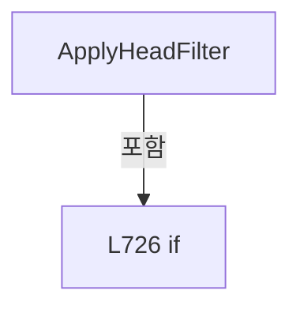

변경 전 점검: 입력/반환 타입, 위 호출자, 예외/취소 경로, 공유 상태와 저장·전송 소비자를 함께 확인합니다. 값의 단위나 물리 방향을 이름만으로 확정하지 않습니다.

### LocalFunctionStatement `MatchesHead` · L731–734

[Drilling.UI/Menu/Menus/CMenuSetting.cs:731–734](https://github.com/kjuws10-rgb/A3Drilling/blob/5aee8e58439c9b455cae7c9593c9be986c3e682e/Drilling.UI/Menu/Menus/CMenuSetting.cs#L731-L734)

| 항목 | 실제 추출 값 |
| --- | --- |
| 서명 | bool MatchesHead(Drilling.UI.Menu.Menus.ST_SYSTEM_PARAMETER_ROW) |
| 접근/수식자 | Private /  |
| 반환/값 타입 | bool |
| 소속 타입 | NamedType:Drilling.UI.Menu.Menus.CMenuSetting |

입력 계약:

| 이름 | 타입 | 전달 | 선택/기본값 |
| --- | --- | --- | --- |
| row | Drilling.UI.Menu.Menus.ST_SYSTEM_PARAMETER_ROW | None | False /  |

현재 부분 분석에서 직접 연결된 호출자는 없습니다. XAML/이벤트/인터페이스·델리게이트·외부 진입을 추가 확인해야 하며, 미사용으로 판정한 것이 아닙니다.

호출하는 대상과 해석 범위:

| 원본 행 | 표현식 | 분석 상태 | 대상/소스 위치 |
| --- | --- | --- | --- |
| 733 | row.HeadFilter.Equals | resolved | bool string.Equals(string?, System.StringComparison) |

본문의 실제 연산·분기·예외·반환 순서(원문 위치 순):

| 원본 행 | 종류 | 주석 해설 |
| --- | --- | --- |
| 733 | call | 함수·델리게이트 또는 객체 생성자를 호출합니다: row.HeadFilter.Equals(selectedHeadFilter, StringComparison.OrdinalIgnoreCase) |
| 733 | return | 호출자에게 값 또는 제어를 반환합니다: return row.HeadFilter.Equals(selectedHeadFilter, StringComparison.OrdinalIgnoreCase); |

변경 전 점검: 입력/반환 타입, 위 호출자, 예외/취소 경로, 공유 상태와 저장·전송 소비자를 함께 확인합니다. 값의 단위나 물리 방향을 이름만으로 확정하지 않습니다.

### MethodDeclaration `MarkSelectedHeadFilter` · L739–750

[Drilling.UI/Menu/Menus/CMenuSetting.cs:739–750](https://github.com/kjuws10-rgb/A3Drilling/blob/5aee8e58439c9b455cae7c9593c9be986c3e682e/Drilling.UI/Menu/Menus/CMenuSetting.cs#L739-L750)

| 항목 | 실제 추출 값 |
| --- | --- |
| 서명 | System.Collections.Generic.IReadOnlyList<Drilling.UI.Menu.Menus.ST_SETTING_HEAD_FILTER> Drilling.UI.Menu.Menus.CMenuSetting.MarkSelectedHeadFilter(System.Collections.Generic.IReadOnlyList<Drilling.UI.Menu.Menus.ST_SETTING_HEAD_FILTER>, string) |
| 접근/수식자 | Private / private, static |
| 반환/값 타입 | System.Collections.Generic.IReadOnlyList<Drilling.UI.Menu.Menus.ST_SETTING_HEAD_FILTER> |
| 소속 타입 | NamedType:Drilling.UI.Menu.Menus.CMenuSetting |

입력 계약:

| 이름 | 타입 | 전달 | 선택/기본값 |
| --- | --- | --- | --- |
| filters | System.Collections.Generic.IReadOnlyList<Drilling.UI.Menu.Menus.ST_SETTING_HEAD_FILTER> | None | False /  |
| selectedHeadFilter | string | None | False /  |

정적 호출자로 확인된 위치:

| 호출 파일/행 | 호출 표현식 | 런타임 분기 가능 |
| --- | --- | --- |
| [Drilling.UI/Menu/Menus/CMenuSetting.cs:246–246](https://github.com/kjuws10-rgb/A3Drilling/blob/5aee8e58439c9b455cae7c9593c9be986c3e682e/Drilling.UI/Menu/Menus/CMenuSetting.cs#L246-L246) | MarkSelectedHeadFilter | False |

호출하는 대상과 해석 범위:

| 원본 행 | 표현식 | 분석 상태 | 대상/소스 위치 |
| --- | --- | --- | --- |
| 749 | filters.Select(MarkSelected).ToArray | resolved | Drilling.UI.Menu.Menus.ST_SETTING_HEAD_FILTER[] System.Collections.Generic.IEnumerable<Drilling.UI.Menu.Menus.ST_SETTING_HEAD_FILTER>.ToArray<Drilling.UI.Menu.Menus.ST_SETTING_HEAD_FILTER>() |
| 749 | filters.Select | resolved | System.Collections.Generic.IEnumerable<Drilling.UI.Menu.Menus.ST_SETTING_HEAD_FILTER> System.Collections.Generic.IEnumerable<Drilling.UI.Menu.Menus.ST_SETTING_HEAD_FILTER>.Select<Drilling.UI.Menu.Menus.ST_SETTING_HEAD_FILTER, Drilling.UI.Menu.Menus.ST_SETTING_HEAD_FILTER>(System.Func<Drilling.UI.Menu.Menus.ST_SETTING_HEAD_FILTER, Drilling.UI.Menu.Menus.ST_SETTING_HEAD_FILTER>) |

본문의 실제 연산·분기·예외·반환 순서(원문 위치 순):

| 원본 행 | 종류 | 주석 해설 |
| --- | --- | --- |
| 749 | call | 함수·델리게이트 또는 객체 생성자를 호출합니다: filters.Select(MarkSelected).ToArray() |
| 749 | call | 함수·델리게이트 또는 객체 생성자를 호출합니다: filters.Select(MarkSelected) |
| 749 | return | 호출자에게 값 또는 제어를 반환합니다: return filters.Select(MarkSelected).ToArray(); |

변경 전 점검: 입력/반환 타입, 위 호출자, 예외/취소 경로, 공유 상태와 저장·전송 소비자를 함께 확인합니다. 값의 단위나 물리 방향을 이름만으로 확정하지 않습니다.

### LocalFunctionStatement `MarkSelected` · L741–747

[Drilling.UI/Menu/Menus/CMenuSetting.cs:741–747](https://github.com/kjuws10-rgb/A3Drilling/blob/5aee8e58439c9b455cae7c9593c9be986c3e682e/Drilling.UI/Menu/Menus/CMenuSetting.cs#L741-L747)

| 항목 | 실제 추출 값 |
| --- | --- |
| 서명 | Drilling.UI.Menu.Menus.ST_SETTING_HEAD_FILTER MarkSelected(Drilling.UI.Menu.Menus.ST_SETTING_HEAD_FILTER) |
| 접근/수식자 | Private /  |
| 반환/값 타입 | Drilling.UI.Menu.Menus.ST_SETTING_HEAD_FILTER |
| 소속 타입 | NamedType:Drilling.UI.Menu.Menus.CMenuSetting |

입력 계약:

| 이름 | 타입 | 전달 | 선택/기본값 |
| --- | --- | --- | --- |
| item | Drilling.UI.Menu.Menus.ST_SETTING_HEAD_FILTER | None | False /  |

현재 부분 분석에서 직접 연결된 호출자는 없습니다. XAML/이벤트/인터페이스·델리게이트·외부 진입을 추가 확인해야 하며, 미사용으로 판정한 것이 아닙니다.

호출하는 대상과 해석 범위:

| 원본 행 | 표현식 | 분석 상태 | 대상/소스 위치 |
| --- | --- | --- | --- |
| 745 | item.Name.Equals | resolved | bool string.Equals(string?, System.StringComparison) |

본문의 실제 연산·분기·예외·반환 순서(원문 위치 순):

| 원본 행 | 종류 | 주석 해설 |
| --- | --- | --- |
| 743 | return | 호출자에게 값 또는 제어를 반환합니다: return item with { IsSelected = item.Name.Equals(selectedHeadFilter, StringComparison.OrdinalIgnoreCase) }; |
| 745 | assignment | 값을 대상에 대입합니다: IsSelected = item.Name.Equals(selectedHeadFilter, StringComparison.OrdinalIgnoreCase) |
| 745 | call | 함수·델리게이트 또는 객체 생성자를 호출합니다: item.Name.Equals(selectedHeadFilter, StringComparison.OrdinalIgnoreCase) |

변경 전 점검: 입력/반환 타입, 위 호출자, 예외/취소 경로, 공유 상태와 저장·전송 소비자를 함께 확인합니다. 값의 단위나 물리 방향을 이름만으로 확정하지 않습니다.

### MethodDeclaration `NormalizeHeadFilter` · L752–768

[Drilling.UI/Menu/Menus/CMenuSetting.cs:752–768](https://github.com/kjuws10-rgb/A3Drilling/blob/5aee8e58439c9b455cae7c9593c9be986c3e682e/Drilling.UI/Menu/Menus/CMenuSetting.cs#L752-L768)

| 항목 | 실제 추출 값 |
| --- | --- |
| 서명 | string Drilling.UI.Menu.Menus.CMenuSetting.NormalizeHeadFilter(string, System.Collections.Generic.IReadOnlyList<Drilling.UI.Menu.Menus.ST_SETTING_HEAD_FILTER>) |
| 접근/수식자 | Private / private, static |
| 반환/값 타입 | string |
| 소속 타입 | NamedType:Drilling.UI.Menu.Menus.CMenuSetting |

입력 계약:

| 이름 | 타입 | 전달 | 선택/기본값 |
| --- | --- | --- | --- |
| selectedHeadFilter | string | None | False /  |
| filters | System.Collections.Generic.IReadOnlyList<Drilling.UI.Menu.Menus.ST_SETTING_HEAD_FILTER> | None | False /  |

정적 호출자로 확인된 위치:

| 호출 파일/행 | 호출 표현식 | 런타임 분기 가능 |
| --- | --- | --- |
| [Drilling.UI/Menu/Menus/CMenuSetting.cs:245–245](https://github.com/kjuws10-rgb/A3Drilling/blob/5aee8e58439c9b455cae7c9593c9be986c3e682e/Drilling.UI/Menu/Menus/CMenuSetting.cs#L245-L245) | NormalizeHeadFilter | False |

호출하는 대상과 해석 범위:

| 원본 행 | 표현식 | 분석 상태 | 대상/소스 위치 |
| --- | --- | --- | --- |
| 761 | filter.Name.Equals | resolved | bool string.Equals(string?, System.StringComparison) |

본문의 실제 연산·분기·예외·반환 순서(원문 위치 순):

| 원본 행 | 종류 | 주석 해설 |
| --- | --- | --- |
| 754 | if | 조건에 따라 분기합니다: if (filters.Count == 0) |
| 756 | return | 호출자에게 값 또는 제어를 반환합니다: return "ALL"; |
| 759 | foreach | 컬렉션 요소를 순회합니다: foreach (var filter in filters) |
| 761 | call | 함수·델리게이트 또는 객체 생성자를 호출합니다: filter.Name.Equals(selectedHeadFilter, StringComparison.OrdinalIgnoreCase) |
| 761 | if | 조건에 따라 분기합니다: if (filter.Name.Equals(selectedHeadFilter, StringComparison.OrdinalIgnoreCase)) |
| 763 | return | 호출자에게 값 또는 제어를 반환합니다: return filter.Name; |
| 767 | return | 호출자에게 값 또는 제어를 반환합니다: return "ALL"; |

제어 구문의 포함 구조(실제 실행 순서/CFG가 아닌 구문 탐색 그림):

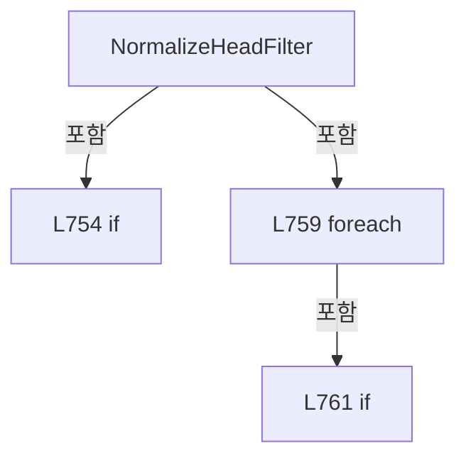

변경 전 점검: 입력/반환 타입, 위 호출자, 예외/취소 경로, 공유 상태와 저장·전송 소비자를 함께 확인합니다. 값의 단위나 물리 방향을 이름만으로 확정하지 않습니다.

### MethodDeclaration `BuildInterfaceGroups` · L770–787

[Drilling.UI/Menu/Menus/CMenuSetting.cs:770–787](https://github.com/kjuws10-rgb/A3Drilling/blob/5aee8e58439c9b455cae7c9593c9be986c3e682e/Drilling.UI/Menu/Menus/CMenuSetting.cs#L770-L787)

| 항목 | 실제 추출 값 |
| --- | --- |
| 서명 | System.Collections.Generic.IReadOnlyList<string> Drilling.UI.Menu.Menus.CMenuSetting.BuildInterfaceGroups(System.Collections.Generic.IReadOnlyList<Drilling.UI.Menu.Menus.ST_SETTING_INTERFACE_ROW>) |
| 접근/수식자 | Private / private, static |
| 반환/값 타입 | System.Collections.Generic.IReadOnlyList<string> |
| 소속 타입 | NamedType:Drilling.UI.Menu.Menus.CMenuSetting |

입력 계약:

| 이름 | 타입 | 전달 | 선택/기본값 |
| --- | --- | --- | --- |
| rows | System.Collections.Generic.IReadOnlyList<Drilling.UI.Menu.Menus.ST_SETTING_INTERFACE_ROW> | None | False /  |

정적 호출자로 확인된 위치:

| 호출 파일/행 | 호출 표현식 | 런타임 분기 가능 |
| --- | --- | --- |
| [Drilling.UI/Menu/Menus/CMenuSetting.cs:236–236](https://github.com/kjuws10-rgb/A3Drilling/blob/5aee8e58439c9b455cae7c9593c9be986c3e682e/Drilling.UI/Menu/Menus/CMenuSetting.cs#L236-L236) | BuildInterfaceGroups | False |

호출하는 대상과 해석 범위:

| 원본 행 | 표현식 | 분석 상태 | 대상/소스 위치 |
| --- | --- | --- | --- |
| 782 | rows.Select(SelectType).Where(ShouldIncludeItem).Distinct(StringComparer.OrdinalIgnoreCase).ToArray | resolved | string[] System.Collections.Generic.IEnumerable<string>.ToArray<string>() |
| 782 | rows.Select(SelectType).Where(ShouldIncludeItem).Distinct | resolved | System.Collections.Generic.IEnumerable<string> System.Collections.Generic.IEnumerable<string>.Distinct<string>(System.Collections.Generic.IEqualityComparer<string>?) |
| 782 | rows.Select(SelectType).Where | resolved | System.Collections.Generic.IEnumerable<string> System.Collections.Generic.IEnumerable<string>.Where<string>(System.Func<string, bool>) |
| 782 | rows.Select | resolved | System.Collections.Generic.IEnumerable<string> System.Collections.Generic.IEnumerable<Drilling.UI.Menu.Menus.ST_SETTING_INTERFACE_ROW>.Select<Drilling.UI.Menu.Menus.ST_SETTING_INTERFACE_ROW, string>(System.Func<Drilling.UI.Menu.Menus.ST_SETTING_INTERFACE_ROW, string>) |
| 783 | new[] { "ALL" }.Concat(groups).ToArray | resolved | string[] System.Collections.Generic.IEnumerable<string>.ToArray<string>() |
| 783 | new[] { "ALL" }.Concat | resolved | System.Collections.Generic.IEnumerable<string> System.Collections.Generic.IEnumerable<string>.Concat<string>(System.Collections.Generic.IEnumerable<string>) |

본문의 실제 연산·분기·예외·반환 순서(원문 위치 순):

| 원본 행 | 종류 | 주석 해설 |
| --- | --- | --- |
| 782 | call | 함수·델리게이트 또는 객체 생성자를 호출합니다: rows.Select(SelectType).Where(ShouldIncludeItem).Distinct(StringComparer.OrdinalIgnoreCase).ToArray() |
| 782 | call | 함수·델리게이트 또는 객체 생성자를 호출합니다: rows.Select(SelectType).Where(ShouldIncludeItem).Distinct(StringComparer.OrdinalIgnoreCase) |
| 782 | call | 함수·델리게이트 또는 객체 생성자를 호출합니다: rows.Select(SelectType).Where(ShouldIncludeItem) |
| 782 | call | 함수·델리게이트 또는 객체 생성자를 호출합니다: rows.Select(SelectType) |
| 782 | local-declaration | 지역 변수를 선언합니다: var groups = rows.Select(SelectType).Where(ShouldIncludeItem).Distinct(StringComparer.OrdinalIgnoreCase).ToArray(); |
| 782 | variable-initializer | 변수의 초기값을 지정합니다: groups = rows.Select(SelectType).Where(ShouldIncludeItem).Distinct(StringComparer.OrdinalIgnoreCase).ToArray() |
| 783 | call | 함수·델리게이트 또는 객체 생성자를 호출합니다: new[] { "ALL" }.Concat(groups).ToArray() |
| 783 | call | 함수·델리게이트 또는 객체 생성자를 호출합니다: new[] { "ALL" }.Concat(groups) |
| 783 | return | 호출자에게 값 또는 제어를 반환합니다: return new[] { "ALL" }.Concat(groups).ToArray(); |

변경 전 점검: 입력/반환 타입, 위 호출자, 예외/취소 경로, 공유 상태와 저장·전송 소비자를 함께 확인합니다. 값의 단위나 물리 방향을 이름만으로 확정하지 않습니다.

### LocalFunctionStatement `SelectType` · L772–775

[Drilling.UI/Menu/Menus/CMenuSetting.cs:772–775](https://github.com/kjuws10-rgb/A3Drilling/blob/5aee8e58439c9b455cae7c9593c9be986c3e682e/Drilling.UI/Menu/Menus/CMenuSetting.cs#L772-L775)

| 항목 | 실제 추출 값 |
| --- | --- |
| 서명 | string SelectType(Drilling.UI.Menu.Menus.ST_SETTING_INTERFACE_ROW) |
| 접근/수식자 | Private /  |
| 반환/값 타입 | string |
| 소속 타입 | NamedType:Drilling.UI.Menu.Menus.CMenuSetting |

입력 계약:

| 이름 | 타입 | 전달 | 선택/기본값 |
| --- | --- | --- | --- |
| row | Drilling.UI.Menu.Menus.ST_SETTING_INTERFACE_ROW | None | False /  |

현재 부분 분석에서 직접 연결된 호출자는 없습니다. XAML/이벤트/인터페이스·델리게이트·외부 진입을 추가 확인해야 하며, 미사용으로 판정한 것이 아닙니다.

본문의 실제 연산·분기·예외·반환 순서(원문 위치 순):

| 원본 행 | 종류 | 주석 해설 |
| --- | --- | --- |
| 774 | return | 호출자에게 값 또는 제어를 반환합니다: return row.Type; |

변경 전 점검: 입력/반환 타입, 위 호출자, 예외/취소 경로, 공유 상태와 저장·전송 소비자를 함께 확인합니다. 값의 단위나 물리 방향을 이름만으로 확정하지 않습니다.

### LocalFunctionStatement `ShouldIncludeItem` · L777–780

[Drilling.UI/Menu/Menus/CMenuSetting.cs:777–780](https://github.com/kjuws10-rgb/A3Drilling/blob/5aee8e58439c9b455cae7c9593c9be986c3e682e/Drilling.UI/Menu/Menus/CMenuSetting.cs#L777-L780)

| 항목 | 실제 추출 값 |
| --- | --- |
| 서명 | bool ShouldIncludeItem(string) |
| 접근/수식자 | Private /  |
| 반환/값 타입 | bool |
| 소속 타입 | NamedType:Drilling.UI.Menu.Menus.CMenuSetting |

입력 계약:

| 이름 | 타입 | 전달 | 선택/기본값 |
| --- | --- | --- | --- |
| group | string | None | False /  |

현재 부분 분석에서 직접 연결된 호출자는 없습니다. XAML/이벤트/인터페이스·델리게이트·외부 진입을 추가 확인해야 하며, 미사용으로 판정한 것이 아닙니다.

호출하는 대상과 해석 범위:

| 원본 행 | 표현식 | 분석 상태 | 대상/소스 위치 |
| --- | --- | --- | --- |
| 779 | string.IsNullOrWhiteSpace | resolved | bool string.IsNullOrWhiteSpace(string?) |

본문의 실제 연산·분기·예외·반환 순서(원문 위치 순):

| 원본 행 | 종류 | 주석 해설 |
| --- | --- | --- |
| 779 | call | 함수·델리게이트 또는 객체 생성자를 호출합니다: string.IsNullOrWhiteSpace(group) |
| 779 | return | 호출자에게 값 또는 제어를 반환합니다: return !string.IsNullOrWhiteSpace(group); |

변경 전 점검: 입력/반환 타입, 위 호출자, 예외/취소 경로, 공유 상태와 저장·전송 소비자를 함께 확인합니다. 값의 단위나 물리 방향을 이름만으로 확정하지 않습니다.

### MethodDeclaration `BuildHistoryItems` · L789–797

[Drilling.UI/Menu/Menus/CMenuSetting.cs:789–797](https://github.com/kjuws10-rgb/A3Drilling/blob/5aee8e58439c9b455cae7c9593c9be986c3e682e/Drilling.UI/Menu/Menus/CMenuSetting.cs#L789-L797)

| 항목 | 실제 추출 값 |
| --- | --- |
| 서명 | System.Collections.Generic.IReadOnlyList<Drilling.UI.Menu.Menus.ST_DISPLAY_ITEM> Drilling.UI.Menu.Menus.CMenuSetting.BuildHistoryItems(System.Collections.Generic.IReadOnlyList<Drilling.Common.Managers.ST_SETTING_HISTORY>) |
| 접근/수식자 | Private / private, static |
| 반환/값 타입 | System.Collections.Generic.IReadOnlyList<Drilling.UI.Menu.Menus.ST_DISPLAY_ITEM> |
| 소속 타입 | NamedType:Drilling.UI.Menu.Menus.CMenuSetting |

입력 계약:

| 이름 | 타입 | 전달 | 선택/기본값 |
| --- | --- | --- | --- |
| history | System.Collections.Generic.IReadOnlyList<Drilling.Common.Managers.ST_SETTING_HISTORY> | None | False /  |

정적 호출자로 확인된 위치:

| 호출 파일/행 | 호출 표현식 | 런타임 분기 가능 |
| --- | --- | --- |
| [Drilling.UI/Menu/Menus/CMenuSetting.cs:263–263](https://github.com/kjuws10-rgb/A3Drilling/blob/5aee8e58439c9b455cae7c9593c9be986c3e682e/Drilling.UI/Menu/Menus/CMenuSetting.cs#L263-L263) | BuildHistoryItems | False |

호출하는 대상과 해석 범위:

| 원본 행 | 표현식 | 분석 상태 | 대상/소스 위치 |
| --- | --- | --- | --- |
| 796 | history.Select(BuildDisplay).ToArray | resolved | Drilling.UI.Menu.Menus.ST_DISPLAY_ITEM[] System.Collections.Generic.IEnumerable<Drilling.UI.Menu.Menus.ST_DISPLAY_ITEM>.ToArray<Drilling.UI.Menu.Menus.ST_DISPLAY_ITEM>() |
| 796 | history.Select | resolved | System.Collections.Generic.IEnumerable<Drilling.UI.Menu.Menus.ST_DISPLAY_ITEM> System.Collections.Generic.IEnumerable<Drilling.Common.Managers.ST_SETTING_HISTORY>.Select<Drilling.Common.Managers.ST_SETTING_HISTORY, Drilling.UI.Menu.Menus.ST_DISPLAY_ITEM>(System.Func<Drilling.Common.Managers.ST_SETTING_HISTORY, Drilling.UI.Menu.Menus.ST_DISPLAY_ITEM>) |

본문의 실제 연산·분기·예외·반환 순서(원문 위치 순):

| 원본 행 | 종류 | 주석 해설 |
| --- | --- | --- |
| 796 | call | 함수·델리게이트 또는 객체 생성자를 호출합니다: history.Select(BuildDisplay).ToArray() |
| 796 | call | 함수·델리게이트 또는 객체 생성자를 호출합니다: history.Select(BuildDisplay) |
| 796 | return | 호출자에게 값 또는 제어를 반환합니다: return history.Select(BuildDisplay).ToArray(); |

변경 전 점검: 입력/반환 타입, 위 호출자, 예외/취소 경로, 공유 상태와 저장·전송 소비자를 함께 확인합니다. 값의 단위나 물리 방향을 이름만으로 확정하지 않습니다.

### LocalFunctionStatement `BuildDisplay` · L791–794

[Drilling.UI/Menu/Menus/CMenuSetting.cs:791–794](https://github.com/kjuws10-rgb/A3Drilling/blob/5aee8e58439c9b455cae7c9593c9be986c3e682e/Drilling.UI/Menu/Menus/CMenuSetting.cs#L791-L794)

| 항목 | 실제 추출 값 |
| --- | --- |
| 서명 | Drilling.UI.Menu.Menus.ST_DISPLAY_ITEM BuildDisplay(Drilling.Common.Managers.ST_SETTING_HISTORY) |
| 접근/수식자 | Private /  |
| 반환/값 타입 | Drilling.UI.Menu.Menus.ST_DISPLAY_ITEM |
| 소속 타입 | NamedType:Drilling.UI.Menu.Menus.CMenuSetting |

입력 계약:

| 이름 | 타입 | 전달 | 선택/기본값 |
| --- | --- | --- | --- |
| item | Drilling.Common.Managers.ST_SETTING_HISTORY | None | False /  |

현재 부분 분석에서 직접 연결된 호출자는 없습니다. XAML/이벤트/인터페이스·델리게이트·외부 진입을 추가 확인해야 하며, 미사용으로 판정한 것이 아닙니다.

호출하는 대상과 해석 범위:

| 원본 행 | 표현식 | 분석 상태 | 대상/소스 위치 |
| --- | --- | --- | --- |
| 793 | new ST_DISPLAY_ITEM | resolved | Drilling.UI.Menu.Menus.ST_DISPLAY_ITEM.ST_DISPLAY_ITEM(string, string, string) · Drilling.UI/Menu/Menus/CMenuBase.cs:43 |
| 793 | item.ChangedAt.ToString | resolved | string System.DateTimeOffset.ToString(string?) |

본문의 실제 연산·분기·예외·반환 순서(원문 위치 순):

| 원본 행 | 종류 | 주석 해설 |
| --- | --- | --- |
| 793 | call | 함수·델리게이트 또는 객체 생성자를 호출합니다: new ST_DISPLAY_ITEM(item.ChangedAt.ToString("HH:mm:ss"), $"{item.Action} / {item.ParameterName}", $"{item.OldValue} -> {item.NewValue}") |
| 793 | call | 함수·델리게이트 또는 객체 생성자를 호출합니다: item.ChangedAt.ToString("HH:mm:ss") |
| 793 | return | 호출자에게 값 또는 제어를 반환합니다: return new ST_DISPLAY_ITEM(item.ChangedAt.ToString("HH:mm:ss"), $"{item.Action} / {item.ParameterName}", $"{item.OldValue} -> {item.NewValue}"); |

변경 전 점검: 입력/반환 타입, 위 호출자, 예외/취소 경로, 공유 상태와 저장·전송 소비자를 함께 확인합니다. 값의 단위나 물리 방향을 이름만으로 확정하지 않습니다.

### MethodDeclaration `BuildHistoryRows` · L799–812

[Drilling.UI/Menu/Menus/CMenuSetting.cs:799–812](https://github.com/kjuws10-rgb/A3Drilling/blob/5aee8e58439c9b455cae7c9593c9be986c3e682e/Drilling.UI/Menu/Menus/CMenuSetting.cs#L799-L812)

| 항목 | 실제 추출 값 |
| --- | --- |
| 서명 | System.Collections.Generic.IReadOnlyList<Drilling.UI.Menu.Menus.ST_SETTING_HISTORY_ROW> Drilling.UI.Menu.Menus.CMenuSetting.BuildHistoryRows(System.Collections.Generic.IReadOnlyList<Drilling.Common.Managers.ST_SETTING_HISTORY>) |
| 접근/수식자 | Private / private, static |
| 반환/값 타입 | System.Collections.Generic.IReadOnlyList<Drilling.UI.Menu.Menus.ST_SETTING_HISTORY_ROW> |
| 소속 타입 | NamedType:Drilling.UI.Menu.Menus.CMenuSetting |

입력 계약:

| 이름 | 타입 | 전달 | 선택/기본값 |
| --- | --- | --- | --- |
| history | System.Collections.Generic.IReadOnlyList<Drilling.Common.Managers.ST_SETTING_HISTORY> | None | False /  |

정적 호출자로 확인된 위치:

| 호출 파일/행 | 호출 표현식 | 런타임 분기 가능 |
| --- | --- | --- |
| [Drilling.UI/Menu/Menus/CMenuSetting.cs:274–274](https://github.com/kjuws10-rgb/A3Drilling/blob/5aee8e58439c9b455cae7c9593c9be986c3e682e/Drilling.UI/Menu/Menus/CMenuSetting.cs#L274-L274) | BuildHistoryRows | False |

호출하는 대상과 해석 범위:

| 원본 행 | 표현식 | 분석 상태 | 대상/소스 위치 |
| --- | --- | --- | --- |
| 811 | history.Where(ShouldIncludeItem).Select(BuildSetting).ToArray | resolved | Drilling.UI.Menu.Menus.ST_SETTING_HISTORY_ROW[] System.Collections.Generic.IEnumerable<Drilling.UI.Menu.Menus.ST_SETTING_HISTORY_ROW>.ToArray<Drilling.UI.Menu.Menus.ST_SETTING_HISTORY_ROW>() |
| 811 | history.Where(ShouldIncludeItem).Select | resolved | System.Collections.Generic.IEnumerable<Drilling.UI.Menu.Menus.ST_SETTING_HISTORY_ROW> System.Collections.Generic.IEnumerable<Drilling.Common.Managers.ST_SETTING_HISTORY>.Select<Drilling.Common.Managers.ST_SETTING_HISTORY, Drilling.UI.Menu.Menus.ST_SETTING_HISTORY_ROW>(System.Func<Drilling.Common.Managers.ST_SETTING_HISTORY, Drilling.UI.Menu.Menus.ST_SETTING_HISTORY_ROW>) |
| 811 | history.Where | resolved | System.Collections.Generic.IEnumerable<Drilling.Common.Managers.ST_SETTING_HISTORY> System.Collections.Generic.IEnumerable<Drilling.Common.Managers.ST_SETTING_HISTORY>.Where<Drilling.Common.Managers.ST_SETTING_HISTORY>(System.Func<Drilling.Common.Managers.ST_SETTING_HISTORY, bool>) |

본문의 실제 연산·분기·예외·반환 순서(원문 위치 순):

| 원본 행 | 종류 | 주석 해설 |
| --- | --- | --- |
| 811 | call | 함수·델리게이트 또는 객체 생성자를 호출합니다: history.Where(ShouldIncludeItem).Select(BuildSetting).ToArray() |
| 811 | call | 함수·델리게이트 또는 객체 생성자를 호출합니다: history.Where(ShouldIncludeItem).Select(BuildSetting) |
| 811 | call | 함수·델리게이트 또는 객체 생성자를 호출합니다: history.Where(ShouldIncludeItem) |
| 811 | return | 호출자에게 값 또는 제어를 반환합니다: return history.Where(ShouldIncludeItem).Select(BuildSetting).ToArray(); |

변경 전 점검: 입력/반환 타입, 위 호출자, 예외/취소 경로, 공유 상태와 저장·전송 소비자를 함께 확인합니다. 값의 단위나 물리 방향을 이름만으로 확정하지 않습니다.

### LocalFunctionStatement `ShouldIncludeItem` · L801–804

[Drilling.UI/Menu/Menus/CMenuSetting.cs:801–804](https://github.com/kjuws10-rgb/A3Drilling/blob/5aee8e58439c9b455cae7c9593c9be986c3e682e/Drilling.UI/Menu/Menus/CMenuSetting.cs#L801-L804)

| 항목 | 실제 추출 값 |
| --- | --- |
| 서명 | bool ShouldIncludeItem(Drilling.Common.Managers.ST_SETTING_HISTORY) |
| 접근/수식자 | Private /  |
| 반환/값 타입 | bool |
| 소속 타입 | NamedType:Drilling.UI.Menu.Menus.CMenuSetting |

입력 계약:

| 이름 | 타입 | 전달 | 선택/기본값 |
| --- | --- | --- | --- |
| item | Drilling.Common.Managers.ST_SETTING_HISTORY | None | False /  |

현재 부분 분석에서 직접 연결된 호출자는 없습니다. XAML/이벤트/인터페이스·델리게이트·외부 진입을 추가 확인해야 하며, 미사용으로 판정한 것이 아닙니다.

호출하는 대상과 해석 범위:

| 원본 행 | 표현식 | 분석 상태 | 대상/소스 위치 |
| --- | --- | --- | --- |
| 803 | item.Action.Equals | resolved | bool string.Equals(string?, System.StringComparison) |

본문의 실제 연산·분기·예외·반환 순서(원문 위치 순):

| 원본 행 | 종류 | 주석 해설 |
| --- | --- | --- |
| 803 | call | 함수·델리게이트 또는 객체 생성자를 호출합니다: item.Action.Equals("SAVE", StringComparison.OrdinalIgnoreCase) |
| 803 | return | 호출자에게 값 또는 제어를 반환합니다: return !item.Action.Equals("SAVE", StringComparison.OrdinalIgnoreCase); |

변경 전 점검: 입력/반환 타입, 위 호출자, 예외/취소 경로, 공유 상태와 저장·전송 소비자를 함께 확인합니다. 값의 단위나 물리 방향을 이름만으로 확정하지 않습니다.

### LocalFunctionStatement `BuildSetting` · L806–809

[Drilling.UI/Menu/Menus/CMenuSetting.cs:806–809](https://github.com/kjuws10-rgb/A3Drilling/blob/5aee8e58439c9b455cae7c9593c9be986c3e682e/Drilling.UI/Menu/Menus/CMenuSetting.cs#L806-L809)

| 항목 | 실제 추출 값 |
| --- | --- |
| 서명 | Drilling.UI.Menu.Menus.ST_SETTING_HISTORY_ROW BuildSetting(Drilling.Common.Managers.ST_SETTING_HISTORY) |
| 접근/수식자 | Private /  |
| 반환/값 타입 | Drilling.UI.Menu.Menus.ST_SETTING_HISTORY_ROW |
| 소속 타입 | NamedType:Drilling.UI.Menu.Menus.CMenuSetting |

입력 계약:

| 이름 | 타입 | 전달 | 선택/기본값 |
| --- | --- | --- | --- |
| item | Drilling.Common.Managers.ST_SETTING_HISTORY | None | False /  |

현재 부분 분석에서 직접 연결된 호출자는 없습니다. XAML/이벤트/인터페이스·델리게이트·외부 진입을 추가 확인해야 하며, 미사용으로 판정한 것이 아닙니다.

호출하는 대상과 해석 범위:

| 원본 행 | 표현식 | 분석 상태 | 대상/소스 위치 |
| --- | --- | --- | --- |
| 808 | new ST_SETTING_HISTORY_ROW | resolved | Drilling.UI.Menu.Menus.ST_SETTING_HISTORY_ROW.ST_SETTING_HISTORY_ROW(string, string, string, string, string, string, string) · Drilling.UI/Menu/Menus/CMenuSetting.cs:1290 |
| 808 | item.ChangedAt.ToString | resolved | string System.DateTimeOffset.ToString(string?) |
| 808 | ToTabText | resolved | string Drilling.UI.Menu.Menus.CMenuSetting.ToTabText(Drilling.Common.Managers.EN_SETTING_TAB) · Drilling.UI/Menu/Menus/CMenuSetting.cs:1065 |

본문의 실제 연산·분기·예외·반환 순서(원문 위치 순):

| 원본 행 | 종류 | 주석 해설 |
| --- | --- | --- |
| 808 | call | 함수·델리게이트 또는 객체 생성자를 호출합니다: new ST_SETTING_HISTORY_ROW(item.ChangedAt.ToString("HH:mm:ss"), item.OperatorId, ToTabText(item.Section), item.ParameterName, item.OldValue, item.NewValue, "Warn") |
| 808 | call | 함수·델리게이트 또는 객체 생성자를 호출합니다: item.ChangedAt.ToString("HH:mm:ss") |
| 808 | call | 함수·델리게이트 또는 객체 생성자를 호출합니다: ToTabText(item.Section) |
| 808 | return | 호출자에게 값 또는 제어를 반환합니다: return new ST_SETTING_HISTORY_ROW(item.ChangedAt.ToString("HH:mm:ss"), item.OperatorId, ToTabText(item.Section), item.ParameterName, item.OldValue, item.NewValue, "Warn"); |

변경 전 점검: 입력/반환 타입, 위 호출자, 예외/취소 경로, 공유 상태와 저장·전송 소비자를 함께 확인합니다. 값의 단위나 물리 방향을 이름만으로 확정하지 않습니다.

### MethodDeclaration `BuildSummaryRows` · L814–839

[Drilling.UI/Menu/Menus/CMenuSetting.cs:814–839](https://github.com/kjuws10-rgb/A3Drilling/blob/5aee8e58439c9b455cae7c9593c9be986c3e682e/Drilling.UI/Menu/Menus/CMenuSetting.cs#L814-L839)

| 항목 | 실제 추출 값 |
| --- | --- |
| 서명 | System.Collections.Generic.IReadOnlyList<Drilling.UI.Menu.Menus.ST_SETTING_SUMMARY_ROW> Drilling.UI.Menu.Menus.CMenuSetting.BuildSummaryRows(string, System.Collections.Generic.IReadOnlyList<Drilling.UI.Menu.Menus.ST_SYSTEM_PARAMETER_ROW>, System.Collections.Generic.IReadOnlyList<Drilling.UI.Menu.Menus.ST_SETTING_INTERFACE_ROW>, System.Collections.Generic.IReadOnlyList<Drilling.Common.Managers.ST_SETTING_HISTORY>) |
| 접근/수식자 | Private / private, static |
| 반환/값 타입 | System.Collections.Generic.IReadOnlyList<Drilling.UI.Menu.Menus.ST_SETTING_SUMMARY_ROW> |
| 소속 타입 | NamedType:Drilling.UI.Menu.Menus.CMenuSetting |

입력 계약:

| 이름 | 타입 | 전달 | 선택/기본값 |
| --- | --- | --- | --- |
| selectedTab | string | None | False /  |
| rows | System.Collections.Generic.IReadOnlyList<Drilling.UI.Menu.Menus.ST_SYSTEM_PARAMETER_ROW> | None | False /  |
| interfaceRows | System.Collections.Generic.IReadOnlyList<Drilling.UI.Menu.Menus.ST_SETTING_INTERFACE_ROW> | None | False /  |
| history | System.Collections.Generic.IReadOnlyList<Drilling.Common.Managers.ST_SETTING_HISTORY> | None | False /  |

정적 호출자로 확인된 위치:

| 호출 파일/행 | 호출 표현식 | 런타임 분기 가능 |
| --- | --- | --- |
| [Drilling.UI/Menu/Menus/CMenuSetting.cs:275–275](https://github.com/kjuws10-rgb/A3Drilling/blob/5aee8e58439c9b455cae7c9593c9be986c3e682e/Drilling.UI/Menu/Menus/CMenuSetting.cs#L275-L275) | BuildSummaryRows | False |

호출하는 대상과 해석 범위:

| 원본 행 | 표현식 | 분석 상태 | 대상/소스 위치 |
| --- | --- | --- | --- |
| 831 | interfaceRows.Count | resolved | int System.Collections.Generic.IEnumerable<Drilling.UI.Menu.Menus.ST_SETTING_INTERFACE_ROW>.Count<Drilling.UI.Menu.Menus.ST_SETTING_INTERFACE_ROW>(System.Func<Drilling.UI.Menu.Menus.ST_SETTING_INTERFACE_ROW, bool>) |
| 831 | rows.Count | resolved | int System.Collections.Generic.IEnumerable<Drilling.UI.Menu.Menus.ST_SYSTEM_PARAMETER_ROW>.Count<Drilling.UI.Menu.Menus.ST_SYSTEM_PARAMETER_ROW>(System.Func<Drilling.UI.Menu.Menus.ST_SYSTEM_PARAMETER_ROW, bool>) |
| 837 | history.FirstOrDefault | resolved | Drilling.Common.Managers.ST_SETTING_HISTORY? System.Collections.Generic.IEnumerable<Drilling.Common.Managers.ST_SETTING_HISTORY>.FirstOrDefault<Drilling.Common.Managers.ST_SETTING_HISTORY>(System.Func<Drilling.Common.Managers.ST_SETTING_HISTORY, bool>) |
| 838 | new | resolved | Drilling.UI.Menu.Menus.ST_SETTING_SUMMARY_ROW.ST_SETTING_SUMMARY_ROW(string, string, string) · Drilling.UI/Menu/Menus/CMenuSetting.cs:1305 |
| 838 | modifiedCount.ToString | resolved · 동적 구현 선택 가능 | string int.ToString() |
| 838 | new | resolved | Drilling.UI.Menu.Menus.ST_SETTING_SUMMARY_ROW.ST_SETTING_SUMMARY_ROW(string, string, string) · Drilling.UI/Menu/Menus/CMenuSetting.cs:1305 |
| 838 | .ToString | resolved | string System.DateTimeOffset.ToString(string?) |

본문의 실제 연산·분기·예외·반환 순서(원문 위치 순):

| 원본 행 | 종류 | 주석 해설 |
| --- | --- | --- |
| 831 | call | 함수·델리게이트 또는 객체 생성자를 호출합니다: interfaceRows.Count(IsIsModified) |
| 831 | call | 함수·델리게이트 또는 객체 생성자를 호출합니다: rows.Count(IsIsModified2) |
| 831 | conditional-expression | 조건에 따라 결과식을 선택합니다: selectedTab == "INTERFACE" ? interfaceRows.Count(IsIsModified) : rows.Count(IsIsModified2) |
| 831 | local-declaration | 지역 변수를 선언합니다: var modifiedCount = selectedTab == "INTERFACE" ? interfaceRows.Count(IsIsModified) : rows.Count(IsIsModified2); |
| 831 | variable-initializer | 변수의 초기값을 지정합니다: modifiedCount = selectedTab == "INTERFACE" ? interfaceRows.Count(IsIsModified) : rows.Count(IsIsModified2) |
| 837 | call | 함수·델리게이트 또는 객체 생성자를 호출합니다: history.FirstOrDefault(MatchesItem) |
| 837 | local-declaration | 지역 변수를 선언합니다: var lastSavedTime = history.FirstOrDefault(MatchesItem)?.ChangedAt; |
| 837 | variable-initializer | 변수의 초기값을 지정합니다: lastSavedTime = history.FirstOrDefault(MatchesItem)?.ChangedAt |
| 838 | call | 함수·델리게이트 또는 객체 생성자를 호출합니다: new("Modified Items", modifiedCount.ToString(), modifiedCount > 0 ? "Warn" : "Ok") |
| 838 | call | 함수·델리게이트 또는 객체 생성자를 호출합니다: modifiedCount.ToString() |
| 838 | call | 함수·델리게이트 또는 객체 생성자를 호출합니다: new("Last Saved Time", lastSavedTime?.ToString("yyyy-MM-dd HH:mm:ss") ?? "-") |
| 838 | call | 함수·델리게이트 또는 객체 생성자를 호출합니다: .ToString("yyyy-MM-dd HH:mm:ss") |
| 838 | conditional-expression | 조건에 따라 결과식을 선택합니다: modifiedCount > 0 ? "Warn" : "Ok" |
| 838 | return | 호출자에게 값 또는 제어를 반환합니다: return[new("Modified Items", modifiedCount.ToString(), modifiedCount > 0 ? "Warn" : "Ok"), new("Last Saved Time", lastSavedTime?.ToString("yyyy-MM-dd HH:mm:ss") ?? "-")]; |

변경 전 점검: 입력/반환 타입, 위 호출자, 예외/취소 경로, 공유 상태와 저장·전송 소비자를 함께 확인합니다. 값의 단위나 물리 방향을 이름만으로 확정하지 않습니다.

### LocalFunctionStatement `IsIsModified` · L821–824

[Drilling.UI/Menu/Menus/CMenuSetting.cs:821–824](https://github.com/kjuws10-rgb/A3Drilling/blob/5aee8e58439c9b455cae7c9593c9be986c3e682e/Drilling.UI/Menu/Menus/CMenuSetting.cs#L821-L824)

| 항목 | 실제 추출 값 |
| --- | --- |
| 서명 | bool IsIsModified(Drilling.UI.Menu.Menus.ST_SETTING_INTERFACE_ROW) |
| 접근/수식자 | Private /  |
| 반환/값 타입 | bool |
| 소속 타입 | NamedType:Drilling.UI.Menu.Menus.CMenuSetting |

입력 계약:

| 이름 | 타입 | 전달 | 선택/기본값 |
| --- | --- | --- | --- |
| row | Drilling.UI.Menu.Menus.ST_SETTING_INTERFACE_ROW | None | False /  |

현재 부분 분석에서 직접 연결된 호출자는 없습니다. XAML/이벤트/인터페이스·델리게이트·외부 진입을 추가 확인해야 하며, 미사용으로 판정한 것이 아닙니다.

본문의 실제 연산·분기·예외·반환 순서(원문 위치 순):

| 원본 행 | 종류 | 주석 해설 |
| --- | --- | --- |
| 823 | return | 호출자에게 값 또는 제어를 반환합니다: return row.IsModified; |

변경 전 점검: 입력/반환 타입, 위 호출자, 예외/취소 경로, 공유 상태와 저장·전송 소비자를 함께 확인합니다. 값의 단위나 물리 방향을 이름만으로 확정하지 않습니다.

### LocalFunctionStatement `IsIsModified2` · L826–829

[Drilling.UI/Menu/Menus/CMenuSetting.cs:826–829](https://github.com/kjuws10-rgb/A3Drilling/blob/5aee8e58439c9b455cae7c9593c9be986c3e682e/Drilling.UI/Menu/Menus/CMenuSetting.cs#L826-L829)

| 항목 | 실제 추출 값 |
| --- | --- |
| 서명 | bool IsIsModified2(Drilling.UI.Menu.Menus.ST_SYSTEM_PARAMETER_ROW) |
| 접근/수식자 | Private /  |
| 반환/값 타입 | bool |
| 소속 타입 | NamedType:Drilling.UI.Menu.Menus.CMenuSetting |

입력 계약:

| 이름 | 타입 | 전달 | 선택/기본값 |
| --- | --- | --- | --- |
| row | Drilling.UI.Menu.Menus.ST_SYSTEM_PARAMETER_ROW | None | False /  |

현재 부분 분석에서 직접 연결된 호출자는 없습니다. XAML/이벤트/인터페이스·델리게이트·외부 진입을 추가 확인해야 하며, 미사용으로 판정한 것이 아닙니다.

본문의 실제 연산·분기·예외·반환 순서(원문 위치 순):

| 원본 행 | 종류 | 주석 해설 |
| --- | --- | --- |
| 828 | return | 호출자에게 값 또는 제어를 반환합니다: return row.IsModified; |

변경 전 점검: 입력/반환 타입, 위 호출자, 예외/취소 경로, 공유 상태와 저장·전송 소비자를 함께 확인합니다. 값의 단위나 물리 방향을 이름만으로 확정하지 않습니다.

### LocalFunctionStatement `MatchesItem` · L832–835

[Drilling.UI/Menu/Menus/CMenuSetting.cs:832–835](https://github.com/kjuws10-rgb/A3Drilling/blob/5aee8e58439c9b455cae7c9593c9be986c3e682e/Drilling.UI/Menu/Menus/CMenuSetting.cs#L832-L835)

| 항목 | 실제 추출 값 |
| --- | --- |
| 서명 | bool MatchesItem(Drilling.Common.Managers.ST_SETTING_HISTORY) |
| 접근/수식자 | Private /  |
| 반환/값 타입 | bool |
| 소속 타입 | NamedType:Drilling.UI.Menu.Menus.CMenuSetting |

입력 계약:

| 이름 | 타입 | 전달 | 선택/기본값 |
| --- | --- | --- | --- |
| item | Drilling.Common.Managers.ST_SETTING_HISTORY | None | False /  |

현재 부분 분석에서 직접 연결된 호출자는 없습니다. XAML/이벤트/인터페이스·델리게이트·외부 진입을 추가 확인해야 하며, 미사용으로 판정한 것이 아닙니다.

호출하는 대상과 해석 범위:

| 원본 행 | 표현식 | 분석 상태 | 대상/소스 위치 |
| --- | --- | --- | --- |
| 834 | item.Action.Equals | resolved | bool string.Equals(string?, System.StringComparison) |

본문의 실제 연산·분기·예외·반환 순서(원문 위치 순):

| 원본 행 | 종류 | 주석 해설 |
| --- | --- | --- |
| 834 | call | 함수·델리게이트 또는 객체 생성자를 호출합니다: item.Action.Equals("SAVE", StringComparison.OrdinalIgnoreCase) |
| 834 | return | 호출자에게 값 또는 제어를 반환합니다: return item.Action.Equals("SAVE", StringComparison.OrdinalIgnoreCase); |

변경 전 점검: 입력/반환 타입, 위 호출자, 예외/취소 경로, 공유 상태와 저장·전송 소비자를 함께 확인합니다. 값의 단위나 물리 방향을 이름만으로 확정하지 않습니다.

### MethodDeclaration `BuildInterfaceRows` · L841–880

[Drilling.UI/Menu/Menus/CMenuSetting.cs:841–880](https://github.com/kjuws10-rgb/A3Drilling/blob/5aee8e58439c9b455cae7c9593c9be986c3e682e/Drilling.UI/Menu/Menus/CMenuSetting.cs#L841-L880)

| 항목 | 실제 추출 값 |
| --- | --- |
| 서명 | System.Collections.Generic.IReadOnlyList<Drilling.UI.Menu.Menus.ST_SETTING_INTERFACE_ROW> Drilling.UI.Menu.Menus.CMenuSetting.BuildInterfaceRows(System.Collections.Generic.IReadOnlyList<Drilling.Common.Interface.ST_INTERFACE_DATA>) |
| 접근/수식자 | Private / private, static |
| 반환/값 타입 | System.Collections.Generic.IReadOnlyList<Drilling.UI.Menu.Menus.ST_SETTING_INTERFACE_ROW> |
| 소속 타입 | NamedType:Drilling.UI.Menu.Menus.CMenuSetting |

입력 계약:

| 이름 | 타입 | 전달 | 선택/기본값 |
| --- | --- | --- | --- |
| interfaces | System.Collections.Generic.IReadOnlyList<Drilling.Common.Interface.ST_INTERFACE_DATA> | None | False /  |

정적 호출자로 확인된 위치:

| 호출 파일/행 | 호출 표현식 | 런타임 분기 가능 |
| --- | --- | --- |
| [Drilling.UI/Menu/Menus/CMenuSetting.cs:232–232](https://github.com/kjuws10-rgb/A3Drilling/blob/5aee8e58439c9b455cae7c9593c9be986c3e682e/Drilling.UI/Menu/Menus/CMenuSetting.cs#L232-L232) | BuildInterfaceRows | False |

호출하는 대상과 해석 범위:

| 원본 행 | 표현식 | 분석 상태 | 대상/소스 위치 |
| --- | --- | --- | --- |
| 879 | interfaces.OrderBy(SelectDevice).ThenBy(SelectNumber).ThenBy(SelectNickName, StringComparer.OrdinalIgnoreCase).Select(BuildSetting).ToArray | resolved | Drilling.UI.Menu.Menus.ST_SETTING_INTERFACE_ROW[] System.Collections.Generic.IEnumerable<Drilling.UI.Menu.Menus.ST_SETTING_INTERFACE_ROW>.ToArray<Drilling.UI.Menu.Menus.ST_SETTING_INTERFACE_ROW>() |
| 879 | interfaces.OrderBy(SelectDevice).ThenBy(SelectNumber).ThenBy(SelectNickName, StringComparer.OrdinalIgnoreCase).Select | resolved | System.Collections.Generic.IEnumerable<Drilling.UI.Menu.Menus.ST_SETTING_INTERFACE_ROW> System.Collections.Generic.IEnumerable<Drilling.Common.Interface.ST_INTERFACE_DATA>.Select<Drilling.Common.Interface.ST_INTERFACE_DATA, Drilling.UI.Menu.Menus.ST_SETTING_INTERFACE_ROW>(System.Func<Drilling.Common.Interface.ST_INTERFACE_DATA, int, Drilling.UI.Menu.Menus.ST_SETTING_INTERFACE_ROW>) |
| 879 | interfaces.OrderBy(SelectDevice).ThenBy(SelectNumber).ThenBy | resolved | System.Linq.IOrderedEnumerable<Drilling.Common.Interface.ST_INTERFACE_DATA> System.Linq.IOrderedEnumerable<Drilling.Common.Interface.ST_INTERFACE_DATA>.ThenBy<Drilling.Common.Interface.ST_INTERFACE_DATA, string>(System.Func<Drilling.Common.Interface.ST_INTERFACE_DATA, string>, System.Collections.Generic.IComparer<string>?) |
| 879 | interfaces.OrderBy(SelectDevice).ThenBy | resolved | System.Linq.IOrderedEnumerable<Drilling.Common.Interface.ST_INTERFACE_DATA> System.Linq.IOrderedEnumerable<Drilling.Common.Interface.ST_INTERFACE_DATA>.ThenBy<Drilling.Common.Interface.ST_INTERFACE_DATA, int>(System.Func<Drilling.Common.Interface.ST_INTERFACE_DATA, int>) |
| 879 | interfaces.OrderBy | resolved | System.Linq.IOrderedEnumerable<Drilling.Common.Interface.ST_INTERFACE_DATA> System.Collections.Generic.IEnumerable<Drilling.Common.Interface.ST_INTERFACE_DATA>.OrderBy<Drilling.Common.Interface.ST_INTERFACE_DATA, Drilling.Common.Interface.EN_EQP_MODULE>(System.Func<Drilling.Common.Interface.ST_INTERFACE_DATA, Drilling.Common.Interface.EN_EQP_MODULE>) |

본문의 실제 연산·분기·예외·반환 순서(원문 위치 순):

| 원본 행 | 종류 | 주석 해설 |
| --- | --- | --- |
| 879 | call | 함수·델리게이트 또는 객체 생성자를 호출합니다: interfaces.OrderBy(SelectDevice).ThenBy(SelectNumber).ThenBy(SelectNickName, StringComparer.OrdinalIgnoreCase).Select(BuildSetting).ToArray() |
| 879 | call | 함수·델리게이트 또는 객체 생성자를 호출합니다: interfaces.OrderBy(SelectDevice).ThenBy(SelectNumber).ThenBy(SelectNickName, StringComparer.OrdinalIgnoreCase).Select(BuildSetting) |
| 879 | call | 함수·델리게이트 또는 객체 생성자를 호출합니다: interfaces.OrderBy(SelectDevice).ThenBy(SelectNumber).ThenBy(SelectNickName, StringComparer.OrdinalIgnoreCase) |
| 879 | call | 함수·델리게이트 또는 객체 생성자를 호출합니다: interfaces.OrderBy(SelectDevice).ThenBy(SelectNumber) |
| 879 | call | 함수·델리게이트 또는 객체 생성자를 호출합니다: interfaces.OrderBy(SelectDevice) |
| 879 | return | 호출자에게 값 또는 제어를 반환합니다: return interfaces.OrderBy(SelectDevice).ThenBy(SelectNumber).ThenBy(SelectNickName, StringComparer.OrdinalIgnoreCase).Select(BuildSetting).ToArray(); |

변경 전 점검: 입력/반환 타입, 위 호출자, 예외/취소 경로, 공유 상태와 저장·전송 소비자를 함께 확인합니다. 값의 단위나 물리 방향을 이름만으로 확정하지 않습니다.

### LocalFunctionStatement `SelectDevice` · L843–846

[Drilling.UI/Menu/Menus/CMenuSetting.cs:843–846](https://github.com/kjuws10-rgb/A3Drilling/blob/5aee8e58439c9b455cae7c9593c9be986c3e682e/Drilling.UI/Menu/Menus/CMenuSetting.cs#L843-L846)

| 항목 | 실제 추출 값 |
| --- | --- |
| 서명 | Drilling.Common.Interface.EN_EQP_MODULE SelectDevice(Drilling.Common.Interface.ST_INTERFACE_DATA) |
| 접근/수식자 | Private /  |
| 반환/값 타입 | Drilling.Common.Interface.EN_EQP_MODULE |
| 소속 타입 | NamedType:Drilling.UI.Menu.Menus.CMenuSetting |

입력 계약:

| 이름 | 타입 | 전달 | 선택/기본값 |
| --- | --- | --- | --- |
| item | Drilling.Common.Interface.ST_INTERFACE_DATA | None | False /  |

현재 부분 분석에서 직접 연결된 호출자는 없습니다. XAML/이벤트/인터페이스·델리게이트·외부 진입을 추가 확인해야 하며, 미사용으로 판정한 것이 아닙니다.

본문의 실제 연산·분기·예외·반환 순서(원문 위치 순):

| 원본 행 | 종류 | 주석 해설 |
| --- | --- | --- |
| 845 | return | 호출자에게 값 또는 제어를 반환합니다: return item.Device; |

변경 전 점검: 입력/반환 타입, 위 호출자, 예외/취소 경로, 공유 상태와 저장·전송 소비자를 함께 확인합니다. 값의 단위나 물리 방향을 이름만으로 확정하지 않습니다.

### LocalFunctionStatement `SelectNumber` · L848–851

[Drilling.UI/Menu/Menus/CMenuSetting.cs:848–851](https://github.com/kjuws10-rgb/A3Drilling/blob/5aee8e58439c9b455cae7c9593c9be986c3e682e/Drilling.UI/Menu/Menus/CMenuSetting.cs#L848-L851)

| 항목 | 실제 추출 값 |
| --- | --- |
| 서명 | int SelectNumber(Drilling.Common.Interface.ST_INTERFACE_DATA) |
| 접근/수식자 | Private /  |
| 반환/값 타입 | int |
| 소속 타입 | NamedType:Drilling.UI.Menu.Menus.CMenuSetting |

입력 계약:

| 이름 | 타입 | 전달 | 선택/기본값 |
| --- | --- | --- | --- |
| item | Drilling.Common.Interface.ST_INTERFACE_DATA | None | False /  |

현재 부분 분석에서 직접 연결된 호출자는 없습니다. XAML/이벤트/인터페이스·델리게이트·외부 진입을 추가 확인해야 하며, 미사용으로 판정한 것이 아닙니다.

본문의 실제 연산·분기·예외·반환 순서(원문 위치 순):

| 원본 행 | 종류 | 주석 해설 |
| --- | --- | --- |
| 850 | return | 호출자에게 값 또는 제어를 반환합니다: return item.Number; |

변경 전 점검: 입력/반환 타입, 위 호출자, 예외/취소 경로, 공유 상태와 저장·전송 소비자를 함께 확인합니다. 값의 단위나 물리 방향을 이름만으로 확정하지 않습니다.

### LocalFunctionStatement `SelectNickName` · L853–856

[Drilling.UI/Menu/Menus/CMenuSetting.cs:853–856](https://github.com/kjuws10-rgb/A3Drilling/blob/5aee8e58439c9b455cae7c9593c9be986c3e682e/Drilling.UI/Menu/Menus/CMenuSetting.cs#L853-L856)

| 항목 | 실제 추출 값 |
| --- | --- |
| 서명 | string SelectNickName(Drilling.Common.Interface.ST_INTERFACE_DATA) |
| 접근/수식자 | Private /  |
| 반환/값 타입 | string |
| 소속 타입 | NamedType:Drilling.UI.Menu.Menus.CMenuSetting |

입력 계약:

| 이름 | 타입 | 전달 | 선택/기본값 |
| --- | --- | --- | --- |
| item | Drilling.Common.Interface.ST_INTERFACE_DATA | None | False /  |

현재 부분 분석에서 직접 연결된 호출자는 없습니다. XAML/이벤트/인터페이스·델리게이트·외부 진입을 추가 확인해야 하며, 미사용으로 판정한 것이 아닙니다.

본문의 실제 연산·분기·예외·반환 순서(원문 위치 순):

| 원본 행 | 종류 | 주석 해설 |
| --- | --- | --- |
| 855 | return | 호출자에게 값 또는 제어를 반환합니다: return item.NickName; |

변경 전 점검: 입력/반환 타입, 위 호출자, 예외/취소 경로, 공유 상태와 저장·전송 소비자를 함께 확인합니다. 값의 단위나 물리 방향을 이름만으로 확정하지 않습니다.

### LocalFunctionStatement `BuildSetting` · L858–877

[Drilling.UI/Menu/Menus/CMenuSetting.cs:858–877](https://github.com/kjuws10-rgb/A3Drilling/blob/5aee8e58439c9b455cae7c9593c9be986c3e682e/Drilling.UI/Menu/Menus/CMenuSetting.cs#L858-L877)

| 항목 | 실제 추출 값 |
| --- | --- |
| 서명 | Drilling.UI.Menu.Menus.ST_SETTING_INTERFACE_ROW BuildSetting(Drilling.Common.Interface.ST_INTERFACE_DATA, int) |
| 접근/수식자 | Private /  |
| 반환/값 타입 | Drilling.UI.Menu.Menus.ST_SETTING_INTERFACE_ROW |
| 소속 타입 | NamedType:Drilling.UI.Menu.Menus.CMenuSetting |

입력 계약:

| 이름 | 타입 | 전달 | 선택/기본값 |
| --- | --- | --- | --- |
| item | Drilling.Common.Interface.ST_INTERFACE_DATA | None | False /  |
| index | int | None | False /  |

현재 부분 분석에서 직접 연결된 호출자는 없습니다. XAML/이벤트/인터페이스·델리게이트·외부 진입을 추가 확인해야 하며, 미사용으로 판정한 것이 아닙니다.

호출하는 대상과 해석 범위:

| 원본 행 | 표현식 | 분석 상태 | 대상/소스 위치 |
| --- | --- | --- | --- |
| 860 | item.Arguments.Concat(Enumerable.Repeat("", 5)).Take(5).ToArray | resolved | string[] System.Collections.Generic.IEnumerable<string>.ToArray<string>() |
| 860 | item.Arguments.Concat(Enumerable.Repeat("", 5)).Take | resolved | System.Collections.Generic.IEnumerable<string> System.Collections.Generic.IEnumerable<string>.Take<string>(int) |
| 860 | item.Arguments.Concat | resolved | System.Collections.Generic.IEnumerable<string> System.Collections.Generic.IEnumerable<string>.Concat<string>(System.Collections.Generic.IEnumerable<string>) |
| 860 | Enumerable.Repeat | resolved | System.Collections.Generic.IEnumerable<string> System.Linq.Enumerable.Repeat<string>(string, int) |
| 861 | new ST_SETTING_INTERFACE_ROW | resolved | Drilling.UI.Menu.Menus.ST_SETTING_INTERFACE_ROW.ST_SETTING_INTERFACE_ROW(string, string, string, string, string, string, string, string, string, string, string, string, string, System.Collections.Generic.IReadOnlyDictionary<string, string>?) · Drilling.UI/Menu/Menus/CMenuSetting.cs:1352 |
| 862 | (index + 1).ToString | resolved | string int.ToString(string?, System.IFormatProvider?) |
| 863 | InterfaceTypeText | resolved | string Drilling.UI.Menu.Menus.CMenuSetting.InterfaceTypeText(Drilling.Common.Interface.EN_INTERFACE_TYPE) · Drilling.UI/Menu/Menus/CMenuSetting.cs:939 |
| 864 | DeviceText | resolved | string Drilling.UI.Menu.Menus.CMenuSetting.DeviceText(Drilling.Common.Interface.EN_EQP_MODULE) · Drilling.UI/Menu/Menus/CMenuSetting.cs:959 |
| 865 | item.Number.ToString | resolved | string int.ToString(System.IFormatProvider?) |

본문의 실제 연산·분기·예외·반환 순서(원문 위치 순):

| 원본 행 | 종류 | 주석 해설 |
| --- | --- | --- |
| 860 | call | 함수·델리게이트 또는 객체 생성자를 호출합니다: item.Arguments.Concat(Enumerable.Repeat("", 5)).Take(5).ToArray() |
| 860 | call | 함수·델리게이트 또는 객체 생성자를 호출합니다: item.Arguments.Concat(Enumerable.Repeat("", 5)).Take(5) |
| 860 | call | 함수·델리게이트 또는 객체 생성자를 호출합니다: item.Arguments.Concat(Enumerable.Repeat("", 5)) |
| 860 | call | 함수·델리게이트 또는 객체 생성자를 호출합니다: Enumerable.Repeat("", 5) |
| 860 | local-declaration | 지역 변수를 선언합니다: var arguments = item.Arguments.Concat(Enumerable.Repeat("", 5)).Take(5).ToArray(); |
| 860 | variable-initializer | 변수의 초기값을 지정합니다: arguments = item.Arguments.Concat(Enumerable.Repeat("", 5)).Take(5).ToArray() |
| 861 | call | 함수·델리게이트 또는 객체 생성자를 호출합니다: new ST_SETTING_INTERFACE_ROW( (index + 1).ToString("D2", CultureInfo.InvariantCulture), InterfaceTypeText(item.InterfaceType), DeviceText(item.Device), item.Number.ToString(CultureInfo.InvariantCulture), item.NickName, i… |
| 861 | return | 호출자에게 값 또는 제어를 반환합니다: return new ST_SETTING_INTERFACE_ROW( (index + 1).ToString("D2", CultureInfo.InvariantCulture), InterfaceTypeText(item.InterfaceType), DeviceText(item.Device), item.Number.ToString(CultureInfo.InvariantCulture), item.NickName, item |
| 862 | call | 함수·델리게이트 또는 객체 생성자를 호출합니다: (index + 1).ToString("D2", CultureInfo.InvariantCulture) |
| 863 | call | 함수·델리게이트 또는 객체 생성자를 호출합니다: InterfaceTypeText(item.InterfaceType) |
| 864 | call | 함수·델리게이트 또는 객체 생성자를 호출합니다: DeviceText(item.Device) |
| 865 | call | 함수·델리게이트 또는 객체 생성자를 호출합니다: item.Number.ToString(CultureInfo.InvariantCulture) |
| 868 | conditional-expression | 조건에 따라 결과식을 선택합니다: item.AutoConnection ? "ON" : "OFF" |
| 869 | conditional-expression | 조건에 따라 결과식을 선택합니다: item.IsSimulation ? "ON" : "OFF" |

변경 전 점검: 입력/반환 타입, 위 호출자, 예외/취소 경로, 공유 상태와 저장·전송 소비자를 함께 확인합니다. 값의 단위나 물리 방향을 이름만으로 확정하지 않습니다.

### MethodDeclaration `ToInterfaceData` · L882–900

[Drilling.UI/Menu/Menus/CMenuSetting.cs:882–900](https://github.com/kjuws10-rgb/A3Drilling/blob/5aee8e58439c9b455cae7c9593c9be986c3e682e/Drilling.UI/Menu/Menus/CMenuSetting.cs#L882-L900)

| 항목 | 실제 추출 값 |
| --- | --- |
| 서명 | System.Collections.Generic.IReadOnlyList<Drilling.Common.Interface.ST_INTERFACE_DATA> Drilling.UI.Menu.Menus.CMenuSetting.ToInterfaceData(System.Collections.Generic.IReadOnlyList<Drilling.UI.Menu.Menus.ST_SETTING_INTERFACE_ROW>) |
| 접근/수식자 | Private / private, static |
| 반환/값 타입 | System.Collections.Generic.IReadOnlyList<Drilling.Common.Interface.ST_INTERFACE_DATA> |
| 소속 타입 | NamedType:Drilling.UI.Menu.Menus.CMenuSetting |

입력 계약:

| 이름 | 타입 | 전달 | 선택/기본값 |
| --- | --- | --- | --- |
| rows | System.Collections.Generic.IReadOnlyList<Drilling.UI.Menu.Menus.ST_SETTING_INTERFACE_ROW> | None | False /  |

정적 호출자로 확인된 위치:

| 호출 파일/행 | 호출 표현식 | 런타임 분기 가능 |
| --- | --- | --- |
| [Drilling.UI/Menu/Menus/CMenuSetting.cs:414–414](https://github.com/kjuws10-rgb/A3Drilling/blob/5aee8e58439c9b455cae7c9593c9be986c3e682e/Drilling.UI/Menu/Menus/CMenuSetting.cs#L414-L414) | ToInterfaceData | False |

호출하는 대상과 해석 범위:

| 원본 행 | 표현식 | 분석 상태 | 대상/소스 위치 |
| --- | --- | --- | --- |
| 899 | rows.Select(BuildInterface).ToArray | resolved | Drilling.Common.Interface.ST_INTERFACE_DATA[] System.Collections.Generic.IEnumerable<Drilling.Common.Interface.ST_INTERFACE_DATA>.ToArray<Drilling.Common.Interface.ST_INTERFACE_DATA>() |
| 899 | rows.Select | resolved | System.Collections.Generic.IEnumerable<Drilling.Common.Interface.ST_INTERFACE_DATA> System.Collections.Generic.IEnumerable<Drilling.UI.Menu.Menus.ST_SETTING_INTERFACE_ROW>.Select<Drilling.UI.Menu.Menus.ST_SETTING_INTERFACE_ROW, Drilling.Common.Interface.ST_INTERFACE_DATA>(System.Func<Drilling.UI.Menu.Menus.ST_SETTING_INTERFACE_ROW, Drilling.Common.Interface.ST_INTERFACE_DATA>) |

본문의 실제 연산·분기·예외·반환 순서(원문 위치 순):

| 원본 행 | 종류 | 주석 해설 |
| --- | --- | --- |
| 899 | call | 함수·델리게이트 또는 객체 생성자를 호출합니다: rows.Select(BuildInterface).ToArray() |
| 899 | call | 함수·델리게이트 또는 객체 생성자를 호출합니다: rows.Select(BuildInterface) |
| 899 | return | 호출자에게 값 또는 제어를 반환합니다: return rows.Select(BuildInterface).ToArray(); |

변경 전 점검: 입력/반환 타입, 위 호출자, 예외/취소 경로, 공유 상태와 저장·전송 소비자를 함께 확인합니다. 값의 단위나 물리 방향을 이름만으로 확정하지 않습니다.

### LocalFunctionStatement `BuildInterface` · L884–897

[Drilling.UI/Menu/Menus/CMenuSetting.cs:884–897](https://github.com/kjuws10-rgb/A3Drilling/blob/5aee8e58439c9b455cae7c9593c9be986c3e682e/Drilling.UI/Menu/Menus/CMenuSetting.cs#L884-L897)

| 항목 | 실제 추출 값 |
| --- | --- |
| 서명 | Drilling.Common.Interface.ST_INTERFACE_DATA BuildInterface(Drilling.UI.Menu.Menus.ST_SETTING_INTERFACE_ROW) |
| 접근/수식자 | Private /  |
| 반환/값 타입 | Drilling.Common.Interface.ST_INTERFACE_DATA |
| 소속 타입 | NamedType:Drilling.UI.Menu.Menus.CMenuSetting |

입력 계약:

| 이름 | 타입 | 전달 | 선택/기본값 |
| --- | --- | --- | --- |
| row | Drilling.UI.Menu.Menus.ST_SETTING_INTERFACE_ROW | None | False /  |

현재 부분 분석에서 직접 연결된 호출자는 없습니다. XAML/이벤트/인터페이스·델리게이트·외부 진입을 추가 확인해야 하며, 미사용으로 판정한 것이 아닙니다.

호출하는 대상과 해석 범위:

| 원본 행 | 표현식 | 분석 상태 | 대상/소스 위치 |
| --- | --- | --- | --- |
| 886 | new ST_INTERFACE_DATA | resolved | Drilling.Common.Interface.ST_INTERFACE_DATA.ST_INTERFACE_DATA(Drilling.Common.Interface.EN_INTERFACE_TYPE, Drilling.Common.Interface.EN_EQP_MODULE, int, string, string, bool, bool, System.Collections.Generic.IReadOnlyList<string>, System.Collections.Generic.IReadOnlyDictionary<string, string>?) · Drilling.Common/Interface/CInterfaceManager.cs:2940 |
| 887 | ParseInterfaceType | resolved | Drilling.Common.Interface.EN_INTERFACE_TYPE Drilling.UI.Menu.Menus.CMenuSetting.ParseInterfaceType(string) · Drilling.UI/Menu/Menus/CMenuSetting.cs:902 |
| 888 | ParseDevice | resolved | Drilling.Common.Interface.EN_EQP_MODULE Drilling.UI.Menu.Menus.CMenuSetting.ParseDevice(string) · Drilling.UI/Menu/Menus/CMenuSetting.cs:922 |
| 889 | ReadInt | resolved | int Drilling.UI.Menu.Menus.CMenuSetting.ReadInt(string, string, string) · Drilling.UI/Menu/Menus/CMenuSetting.cs:1000 |
| 890 | RequireText | resolved | string Drilling.UI.Menu.Menus.CMenuSetting.RequireText(string, string) · Drilling.UI/Menu/Menus/CMenuSetting.cs:981 |
| 891 | RequireText | resolved | string Drilling.UI.Menu.Menus.CMenuSetting.RequireText(string, string) · Drilling.UI/Menu/Menus/CMenuSetting.cs:981 |
| 892 | ReadBool | resolved | bool Drilling.UI.Menu.Menus.CMenuSetting.ReadBool(string, string, string) · Drilling.UI/Menu/Menus/CMenuSetting.cs:991 |
| 893 | ReadBool | resolved | bool Drilling.UI.Menu.Menus.CMenuSetting.ReadBool(string, string, string) · Drilling.UI/Menu/Menus/CMenuSetting.cs:991 |
| 894 | row.Arg1.Trim | resolved | string string.Trim() |
| 894 | row.Arg2.Trim | resolved | string string.Trim() |
| 894 | row.Arg3.Trim | resolved | string string.Trim() |
| 894 | row.Arg4.Trim | resolved | string string.Trim() |
| 894 | row.Arg5.Trim | resolved | string string.Trim() |

본문의 실제 연산·분기·예외·반환 순서(원문 위치 순):

| 원본 행 | 종류 | 주석 해설 |
| --- | --- | --- |
| 886 | call | 함수·델리게이트 또는 객체 생성자를 호출합니다: new ST_INTERFACE_DATA( ParseInterfaceType(row.Type), ParseDevice(row.Device), ReadInt(row.Number, row.NickName, "NUMBER"), RequireText(row.NickName, "NICKNAME"), RequireText(row.SystemSection, "SYSTEM_SECTION"), ReadBool… |
| 886 | return | 호출자에게 값 또는 제어를 반환합니다: return new ST_INTERFACE_DATA( ParseInterfaceType(row.Type), ParseDevice(row.Device), ReadInt(row.Number, row.NickName, "NUMBER"), RequireText(row.NickName, "NICKNAME"), RequireText(row.SystemSection, "SYSTEM_SECTION"), ReadBool(ro |
| 887 | call | 함수·델리게이트 또는 객체 생성자를 호출합니다: ParseInterfaceType(row.Type) |
| 888 | call | 함수·델리게이트 또는 객체 생성자를 호출합니다: ParseDevice(row.Device) |
| 889 | call | 함수·델리게이트 또는 객체 생성자를 호출합니다: ReadInt(row.Number, row.NickName, "NUMBER") |
| 890 | call | 함수·델리게이트 또는 객체 생성자를 호출합니다: RequireText(row.NickName, "NICKNAME") |
| 891 | call | 함수·델리게이트 또는 객체 생성자를 호출합니다: RequireText(row.SystemSection, "SYSTEM_SECTION") |
| 892 | call | 함수·델리게이트 또는 객체 생성자를 호출합니다: ReadBool(row.AutoConnection, row.NickName, "AUTOCONNECTION") |
| 893 | call | 함수·델리게이트 또는 객체 생성자를 호출합니다: ReadBool(row.Simul, row.NickName, "SIMUL") |
| 894 | call | 함수·델리게이트 또는 객체 생성자를 호출합니다: row.Arg1.Trim() |
| 894 | call | 함수·델리게이트 또는 객체 생성자를 호출합니다: row.Arg2.Trim() |
| 894 | call | 함수·델리게이트 또는 객체 생성자를 호출합니다: row.Arg3.Trim() |
| 894 | call | 함수·델리게이트 또는 객체 생성자를 호출합니다: row.Arg4.Trim() |
| 894 | call | 함수·델리게이트 또는 객체 생성자를 호출합니다: row.Arg5.Trim() |

변경 전 점검: 입력/반환 타입, 위 호출자, 예외/취소 경로, 공유 상태와 저장·전송 소비자를 함께 확인합니다. 값의 단위나 물리 방향을 이름만으로 확정하지 않습니다.

### MethodDeclaration `ParseInterfaceType` · L902–920

[Drilling.UI/Menu/Menus/CMenuSetting.cs:902–920](https://github.com/kjuws10-rgb/A3Drilling/blob/5aee8e58439c9b455cae7c9593c9be986c3e682e/Drilling.UI/Menu/Menus/CMenuSetting.cs#L902-L920)

| 항목 | 실제 추출 값 |
| --- | --- |
| 서명 | Drilling.Common.Interface.EN_INTERFACE_TYPE Drilling.UI.Menu.Menus.CMenuSetting.ParseInterfaceType(string) |
| 접근/수식자 | Private / private, static |
| 반환/값 타입 | Drilling.Common.Interface.EN_INTERFACE_TYPE |
| 소속 타입 | NamedType:Drilling.UI.Menu.Menus.CMenuSetting |

입력 계약:

| 이름 | 타입 | 전달 | 선택/기본값 |
| --- | --- | --- | --- |
| value | string | None | False /  |

정적 호출자로 확인된 위치:

| 호출 파일/행 | 호출 표현식 | 런타임 분기 가능 |
| --- | --- | --- |
| [Drilling.UI/Menu/Menus/CMenuSetting.cs:887–887](https://github.com/kjuws10-rgb/A3Drilling/blob/5aee8e58439c9b455cae7c9593c9be986c3e682e/Drilling.UI/Menu/Menus/CMenuSetting.cs#L887-L887) | ParseInterfaceType | False |

호출하는 대상과 해석 범위:

| 원본 행 | 표현식 | 분석 상태 | 대상/소스 위치 |
| --- | --- | --- | --- |
| 904 | value.Trim().ToUpperInvariant | resolved | string string.ToUpperInvariant() |
| 904 | value.Trim | resolved | string string.Trim() |
| 919 | new InvalidDataException | resolved | System.IO.InvalidDataException.InvalidDataException(string?) |

본문의 실제 연산·분기·예외·반환 순서(원문 위치 순):

| 원본 행 | 종류 | 주석 해설 |
| --- | --- | --- |
| 904 | call | 함수·델리게이트 또는 객체 생성자를 호출합니다: value.Trim().ToUpperInvariant() |
| 904 | call | 함수·델리게이트 또는 객체 생성자를 호출합니다: value.Trim() |
| 904 | return | 호출자에게 값 또는 제어를 반환합니다: return value.Trim().ToUpperInvariant() switch { "OPCUA" => EN_INTERFACE_TYPE.OpcUa, "MODBUS_SERIAL" => EN_INTERFACE_TYPE.ModbusSerial, "MODBUS_TCP" => EN_INTERFACE_TYPE.ModbusTcp, "SERIAL" => EN_INTERFACE_TYPE.Serial, "SOCKET_C" = |
| 904 | switch-expression | 값별 결과식을 선택합니다: value.Trim().ToUpperInvariant() switch { "OPCUA" => EN_INTERFACE_TYPE.OpcUa, "MODBUS_SERIAL" => EN_INTERFACE_TYPE.ModbusSerial, "MODBUS_TCP" => EN_INTERFACE_TYPE.ModbusTcp, "SERIAL" => EN_INTERFACE_TYPE.Serial, "SOCKET_C" => EN_IN |
| 919 | call | 함수·델리게이트 또는 객체 생성자를 호출합니다: new InvalidDataException($"JHMI_INTERFACE save blocked. Unknown TYPE: {value}") |
| 919 | throw | 예외를 발생/전달합니다: throw new InvalidDataException($"JHMI_INTERFACE save blocked. Unknown TYPE: {value}") |

제어 구문의 포함 구조(실제 실행 순서/CFG가 아닌 구문 탐색 그림):

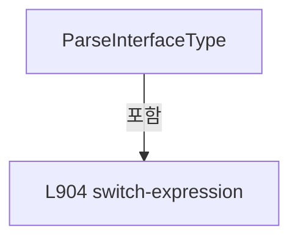

변경 전 점검: 입력/반환 타입, 위 호출자, 예외/취소 경로, 공유 상태와 저장·전송 소비자를 함께 확인합니다. 값의 단위나 물리 방향을 이름만으로 확정하지 않습니다.

### MethodDeclaration `ParseDevice` · L922–937

[Drilling.UI/Menu/Menus/CMenuSetting.cs:922–937](https://github.com/kjuws10-rgb/A3Drilling/blob/5aee8e58439c9b455cae7c9593c9be986c3e682e/Drilling.UI/Menu/Menus/CMenuSetting.cs#L922-L937)

| 항목 | 실제 추출 값 |
| --- | --- |
| 서명 | Drilling.Common.Interface.EN_EQP_MODULE Drilling.UI.Menu.Menus.CMenuSetting.ParseDevice(string) |
| 접근/수식자 | Private / private, static |
| 반환/값 타입 | Drilling.Common.Interface.EN_EQP_MODULE |
| 소속 타입 | NamedType:Drilling.UI.Menu.Menus.CMenuSetting |

입력 계약:

| 이름 | 타입 | 전달 | 선택/기본값 |
| --- | --- | --- | --- |
| value | string | None | False /  |

정적 호출자로 확인된 위치:

| 호출 파일/행 | 호출 표현식 | 런타임 분기 가능 |
| --- | --- | --- |
| [Drilling.UI/Menu/Menus/CMenuSetting.cs:347–347](https://github.com/kjuws10-rgb/A3Drilling/blob/5aee8e58439c9b455cae7c9593c9be986c3e682e/Drilling.UI/Menu/Menus/CMenuSetting.cs#L347-L347) | ParseDevice | False |
| [Drilling.UI/Menu/Menus/CMenuSetting.cs:389–389](https://github.com/kjuws10-rgb/A3Drilling/blob/5aee8e58439c9b455cae7c9593c9be986c3e682e/Drilling.UI/Menu/Menus/CMenuSetting.cs#L389-L389) | ParseDevice | False |
| [Drilling.UI/Menu/Menus/CMenuSetting.cs:888–888](https://github.com/kjuws10-rgb/A3Drilling/blob/5aee8e58439c9b455cae7c9593c9be986c3e682e/Drilling.UI/Menu/Menus/CMenuSetting.cs#L888-L888) | ParseDevice | False |

호출하는 대상과 해석 범위:

| 원본 행 | 표현식 | 분석 상태 | 대상/소스 위치 |
| --- | --- | --- | --- |
| 924 | value.Trim().ToUpperInvariant | resolved | string string.ToUpperInvariant() |
| 924 | value.Trim | resolved | string string.Trim() |
| 936 | new InvalidDataException | resolved | System.IO.InvalidDataException.InvalidDataException(string?) |

본문의 실제 연산·분기·예외·반환 순서(원문 위치 순):

| 원본 행 | 종류 | 주석 해설 |
| --- | --- | --- |
| 924 | call | 함수·델리게이트 또는 객체 생성자를 호출합니다: value.Trim().ToUpperInvariant() |
| 924 | call | 함수·델리게이트 또는 객체 생성자를 호출합니다: value.Trim() |
| 924 | return | 호출자에게 값 또는 제어를 반환합니다: return value.Trim().ToUpperInvariant() switch { "WONIK_CONTROL" or "WONIK_CTRL" or "CONTROL" => EN_EQP_MODULE.WonikCtrl, "WONIK_VISION" or "VISION" => EN_EQP_MODULE.Vision, "AUTOMATION1" or "AUTOMATION_ONE" or "A1" => EN_EQP_MODUL |
| 924 | switch-expression | 값별 결과식을 선택합니다: value.Trim().ToUpperInvariant() switch { "WONIK_CONTROL" or "WONIK_CTRL" or "CONTROL" => EN_EQP_MODULE.WonikCtrl, "WONIK_VISION" or "VISION" => EN_EQP_MODULE.Vision, "AUTOMATION1" or "AUTOMATION_ONE" or "A1" => EN_EQP_MODULE.Autom |
| 936 | call | 함수·델리게이트 또는 객체 생성자를 호출합니다: new InvalidDataException($"JHMI_INTERFACE save blocked. Unknown DEVICE: {value}") |
| 936 | throw | 예외를 발생/전달합니다: throw new InvalidDataException($"JHMI_INTERFACE save blocked. Unknown DEVICE: {value}") |

제어 구문의 포함 구조(실제 실행 순서/CFG가 아닌 구문 탐색 그림):

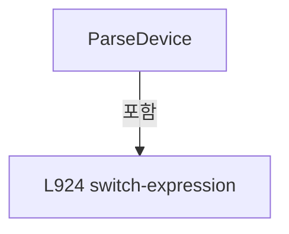

변경 전 점검: 입력/반환 타입, 위 호출자, 예외/취소 경로, 공유 상태와 저장·전송 소비자를 함께 확인합니다. 값의 단위나 물리 방향을 이름만으로 확정하지 않습니다.

### MethodDeclaration `InterfaceTypeText` · L939–957

[Drilling.UI/Menu/Menus/CMenuSetting.cs:939–957](https://github.com/kjuws10-rgb/A3Drilling/blob/5aee8e58439c9b455cae7c9593c9be986c3e682e/Drilling.UI/Menu/Menus/CMenuSetting.cs#L939-L957)

| 항목 | 실제 추출 값 |
| --- | --- |
| 서명 | string Drilling.UI.Menu.Menus.CMenuSetting.InterfaceTypeText(Drilling.Common.Interface.EN_INTERFACE_TYPE) |
| 접근/수식자 | Private / private, static |
| 반환/값 타입 | string |
| 소속 타입 | NamedType:Drilling.UI.Menu.Menus.CMenuSetting |

입력 계약:

| 이름 | 타입 | 전달 | 선택/기본값 |
| --- | --- | --- | --- |
| type | Drilling.Common.Interface.EN_INTERFACE_TYPE | None | False /  |

정적 호출자로 확인된 위치:

| 호출 파일/행 | 호출 표현식 | 런타임 분기 가능 |
| --- | --- | --- |
| [Drilling.UI/Menu/Menus/CMenuSetting.cs:863–863](https://github.com/kjuws10-rgb/A3Drilling/blob/5aee8e58439c9b455cae7c9593c9be986c3e682e/Drilling.UI/Menu/Menus/CMenuSetting.cs#L863-L863) | InterfaceTypeText | False |

호출하는 대상과 해석 범위:

| 원본 행 | 표현식 | 분석 상태 | 대상/소스 위치 |
| --- | --- | --- | --- |
| 956 | type.ToString().ToUpperInvariant | resolved | string string.ToUpperInvariant() |
| 956 | type.ToString | resolved · 동적 구현 선택 가능 | string System.Enum.ToString() |

본문의 실제 연산·분기·예외·반환 순서(원문 위치 순):

| 원본 행 | 종류 | 주석 해설 |
| --- | --- | --- |
| 941 | return | 호출자에게 값 또는 제어를 반환합니다: return type switch { EN_INTERFACE_TYPE.SocketClient => "SOCKET_C", EN_INTERFACE_TYPE.SocketServer => "SOCKET_S", EN_INTERFACE_TYPE.SocketClientUdp => "SOCKET_C_UDP", EN_INTERFACE_TYPE.SocketServerUdp => "SOCKET_S_UDP", EN_INTERFAC |
| 941 | switch-expression | 값별 결과식을 선택합니다: type switch { EN_INTERFACE_TYPE.SocketClient => "SOCKET_C", EN_INTERFACE_TYPE.SocketServer => "SOCKET_S", EN_INTERFACE_TYPE.SocketClientUdp => "SOCKET_C_UDP", EN_INTERFACE_TYPE.SocketServerUdp => "SOCKET_S_UDP", EN_INTERFACE_TYPE. |
| 956 | call | 함수·델리게이트 또는 객체 생성자를 호출합니다: type.ToString().ToUpperInvariant() |
| 956 | call | 함수·델리게이트 또는 객체 생성자를 호출합니다: type.ToString() |

제어 구문의 포함 구조(실제 실행 순서/CFG가 아닌 구문 탐색 그림):

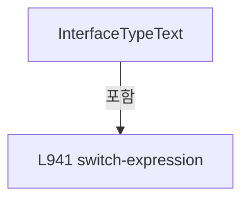

변경 전 점검: 입력/반환 타입, 위 호출자, 예외/취소 경로, 공유 상태와 저장·전송 소비자를 함께 확인합니다. 값의 단위나 물리 방향을 이름만으로 확정하지 않습니다.

### MethodDeclaration `DeviceText` · L959–974

[Drilling.UI/Menu/Menus/CMenuSetting.cs:959–974](https://github.com/kjuws10-rgb/A3Drilling/blob/5aee8e58439c9b455cae7c9593c9be986c3e682e/Drilling.UI/Menu/Menus/CMenuSetting.cs#L959-L974)

| 항목 | 실제 추출 값 |
| --- | --- |
| 서명 | string Drilling.UI.Menu.Menus.CMenuSetting.DeviceText(Drilling.Common.Interface.EN_EQP_MODULE) |
| 접근/수식자 | Private / private, static |
| 반환/값 타입 | string |
| 소속 타입 | NamedType:Drilling.UI.Menu.Menus.CMenuSetting |

입력 계약:

| 이름 | 타입 | 전달 | 선택/기본값 |
| --- | --- | --- | --- |
| module | Drilling.Common.Interface.EN_EQP_MODULE | None | False /  |

정적 호출자로 확인된 위치:

| 호출 파일/행 | 호출 표현식 | 런타임 분기 가능 |
| --- | --- | --- |
| [Drilling.UI/Menu/Menus/CMenuSetting.cs:864–864](https://github.com/kjuws10-rgb/A3Drilling/blob/5aee8e58439c9b455cae7c9593c9be986c3e682e/Drilling.UI/Menu/Menus/CMenuSetting.cs#L864-L864) | DeviceText | False |

호출하는 대상과 해석 범위:

| 원본 행 | 표현식 | 분석 상태 | 대상/소스 위치 |
| --- | --- | --- | --- |
| 973 | module.ToString().ToUpperInvariant | resolved | string string.ToUpperInvariant() |
| 973 | module.ToString | resolved · 동적 구현 선택 가능 | string System.Enum.ToString() |

본문의 실제 연산·분기·예외·반환 순서(원문 위치 순):

| 원본 행 | 종류 | 주석 해설 |
| --- | --- | --- |
| 961 | return | 호출자에게 값 또는 제어를 반환합니다: return module switch { EN_EQP_MODULE.WonikCtrl => "WONIK_CONTROL", EN_EQP_MODULE.Vision => "WONIK_VISION", EN_EQP_MODULE.Automation1 => "AUTOMATION1", EN_EQP_MODULE.Motion => "MOTION", EN_EQP_MODULE.TalonLaser => "TALON", EN_EQP_M |
| 961 | switch-expression | 값별 결과식을 선택합니다: module switch { EN_EQP_MODULE.WonikCtrl => "WONIK_CONTROL", EN_EQP_MODULE.Vision => "WONIK_VISION", EN_EQP_MODULE.Automation1 => "AUTOMATION1", EN_EQP_MODULE.Motion => "MOTION", EN_EQP_MODULE.TalonLaser => "TALON", EN_EQP_MODULE.A |
| 973 | call | 함수·델리게이트 또는 객체 생성자를 호출합니다: module.ToString().ToUpperInvariant() |
| 973 | call | 함수·델리게이트 또는 객체 생성자를 호출합니다: module.ToString() |

제어 구문의 포함 구조(실제 실행 순서/CFG가 아닌 구문 탐색 그림):

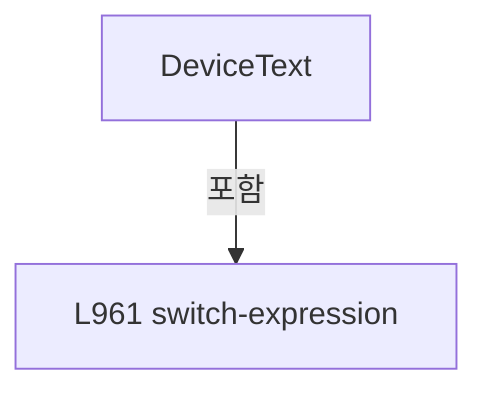

변경 전 점검: 입력/반환 타입, 위 호출자, 예외/취소 경로, 공유 상태와 저장·전송 소비자를 함께 확인합니다. 값의 단위나 물리 방향을 이름만으로 확정하지 않습니다.

### MethodDeclaration `InterfaceRowLabel` · L976–979

[Drilling.UI/Menu/Menus/CMenuSetting.cs:976–979](https://github.com/kjuws10-rgb/A3Drilling/blob/5aee8e58439c9b455cae7c9593c9be986c3e682e/Drilling.UI/Menu/Menus/CMenuSetting.cs#L976-L979)

| 항목 | 실제 추출 값 |
| --- | --- |
| 서명 | string Drilling.UI.Menu.Menus.CMenuSetting.InterfaceRowLabel(Drilling.UI.Menu.Menus.ST_SETTING_INTERFACE_ROW) |
| 접근/수식자 | Private / private, static |
| 반환/값 타입 | string |
| 소속 타입 | NamedType:Drilling.UI.Menu.Menus.CMenuSetting |

입력 계약:

| 이름 | 타입 | 전달 | 선택/기본값 |
| --- | --- | --- | --- |
| row | Drilling.UI.Menu.Menus.ST_SETTING_INTERFACE_ROW | None | False /  |

정적 호출자로 확인된 위치:

| 호출 파일/행 | 호출 표현식 | 런타임 분기 가능 |
| --- | --- | --- |
| [Drilling.UI/Menu/Menus/CMenuSetting.cs:329–329](https://github.com/kjuws10-rgb/A3Drilling/blob/5aee8e58439c9b455cae7c9593c9be986c3e682e/Drilling.UI/Menu/Menus/CMenuSetting.cs#L329-L329) | InterfaceRowLabel | False |
| [Drilling.UI/Menu/Menus/CMenuSetting.cs:349–349](https://github.com/kjuws10-rgb/A3Drilling/blob/5aee8e58439c9b455cae7c9593c9be986c3e682e/Drilling.UI/Menu/Menus/CMenuSetting.cs#L349-L349) | InterfaceRowLabel | False |
| [Drilling.UI/Menu/Menus/CMenuSetting.cs:371–371](https://github.com/kjuws10-rgb/A3Drilling/blob/5aee8e58439c9b455cae7c9593c9be986c3e682e/Drilling.UI/Menu/Menus/CMenuSetting.cs#L371-L371) | InterfaceRowLabel | False |
| [Drilling.UI/Menu/Menus/CMenuSetting.cs:391–391](https://github.com/kjuws10-rgb/A3Drilling/blob/5aee8e58439c9b455cae7c9593c9be986c3e682e/Drilling.UI/Menu/Menus/CMenuSetting.cs#L391-L391) | InterfaceRowLabel | False |

호출하는 대상과 해석 범위:

| 원본 행 | 표현식 | 분석 상태 | 대상/소스 위치 |
| --- | --- | --- | --- |
| 978 | row.Device.Trim | resolved | string string.Trim() |
| 978 | row.Number.Trim | resolved | string string.Trim() |
| 978 | row.NickName.Trim | resolved | string string.Trim() |

본문의 실제 연산·분기·예외·반환 순서(원문 위치 순):

| 원본 행 | 종류 | 주석 해설 |
| --- | --- | --- |
| 978 | call | 함수·델리게이트 또는 객체 생성자를 호출합니다: row.Device.Trim() |
| 978 | call | 함수·델리게이트 또는 객체 생성자를 호출합니다: row.Number.Trim() |
| 978 | call | 함수·델리게이트 또는 객체 생성자를 호출합니다: row.NickName.Trim() |
| 978 | return | 호출자에게 값 또는 제어를 반환합니다: return $"{row.Device.Trim()}[{row.Number.Trim()}]/{row.NickName.Trim()}"; |

변경 전 점검: 입력/반환 타입, 위 호출자, 예외/취소 경로, 공유 상태와 저장·전송 소비자를 함께 확인합니다. 값의 단위나 물리 방향을 이름만으로 확정하지 않습니다.

### MethodDeclaration `RequireText` · L981–989

[Drilling.UI/Menu/Menus/CMenuSetting.cs:981–989](https://github.com/kjuws10-rgb/A3Drilling/blob/5aee8e58439c9b455cae7c9593c9be986c3e682e/Drilling.UI/Menu/Menus/CMenuSetting.cs#L981-L989)

| 항목 | 실제 추출 값 |
| --- | --- |
| 서명 | string Drilling.UI.Menu.Menus.CMenuSetting.RequireText(string, string) |
| 접근/수식자 | Private / private, static |
| 반환/값 타입 | string |
| 소속 타입 | NamedType:Drilling.UI.Menu.Menus.CMenuSetting |

입력 계약:

| 이름 | 타입 | 전달 | 선택/기본값 |
| --- | --- | --- | --- |
| value | string | None | False /  |
| fieldName | string | None | False /  |

정적 호출자로 확인된 위치:

| 호출 파일/행 | 호출 표현식 | 런타임 분기 가능 |
| --- | --- | --- |
| [Drilling.UI/Menu/Menus/CMenuSetting.cs:890–890](https://github.com/kjuws10-rgb/A3Drilling/blob/5aee8e58439c9b455cae7c9593c9be986c3e682e/Drilling.UI/Menu/Menus/CMenuSetting.cs#L890-L890) | RequireText | False |
| [Drilling.UI/Menu/Menus/CMenuSetting.cs:891–891](https://github.com/kjuws10-rgb/A3Drilling/blob/5aee8e58439c9b455cae7c9593c9be986c3e682e/Drilling.UI/Menu/Menus/CMenuSetting.cs#L891-L891) | RequireText | False |

호출하는 대상과 해석 범위:

| 원본 행 | 표현식 | 분석 상태 | 대상/소스 위치 |
| --- | --- | --- | --- |
| 983 | string.IsNullOrWhiteSpace | resolved | bool string.IsNullOrWhiteSpace(string?) |
| 985 | new InvalidDataException | resolved | System.IO.InvalidDataException.InvalidDataException(string?) |
| 988 | value.Trim | resolved | string string.Trim() |

본문의 실제 연산·분기·예외·반환 순서(원문 위치 순):

| 원본 행 | 종류 | 주석 해설 |
| --- | --- | --- |
| 983 | call | 함수·델리게이트 또는 객체 생성자를 호출합니다: string.IsNullOrWhiteSpace(value) |
| 983 | if | 조건에 따라 분기합니다: if (string.IsNullOrWhiteSpace(value)) |
| 985 | call | 함수·델리게이트 또는 객체 생성자를 호출합니다: new InvalidDataException($"JHMI_INTERFACE save blocked. {fieldName} cannot be empty.") |
| 985 | throw | 예외를 발생/전달합니다: throw new InvalidDataException($"JHMI_INTERFACE save blocked. {fieldName} cannot be empty."); |
| 988 | call | 함수·델리게이트 또는 객체 생성자를 호출합니다: value.Trim() |
| 988 | return | 호출자에게 값 또는 제어를 반환합니다: return value.Trim(); |

제어 구문의 포함 구조(실제 실행 순서/CFG가 아닌 구문 탐색 그림):

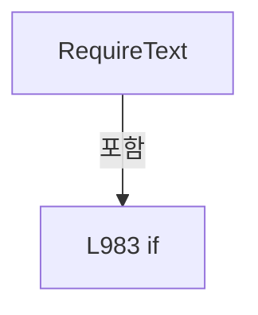

변경 전 점검: 입력/반환 타입, 위 호출자, 예외/취소 경로, 공유 상태와 저장·전송 소비자를 함께 확인합니다. 값의 단위나 물리 방향을 이름만으로 확정하지 않습니다.

### MethodDeclaration `ReadBool` · L991–998

[Drilling.UI/Menu/Menus/CMenuSetting.cs:991–998](https://github.com/kjuws10-rgb/A3Drilling/blob/5aee8e58439c9b455cae7c9593c9be986c3e682e/Drilling.UI/Menu/Menus/CMenuSetting.cs#L991-L998)

| 항목 | 실제 추출 값 |
| --- | --- |
| 서명 | bool Drilling.UI.Menu.Menus.CMenuSetting.ReadBool(string, string, string) |
| 접근/수식자 | Private / private, static |
| 반환/값 타입 | bool |
| 소속 타입 | NamedType:Drilling.UI.Menu.Menus.CMenuSetting |

입력 계약:

| 이름 | 타입 | 전달 | 선택/기본값 |
| --- | --- | --- | --- |
| value | string | None | False /  |
| nickName | string | None | False /  |
| fieldName | string | None | False /  |

정적 호출자로 확인된 위치:

| 호출 파일/행 | 호출 표현식 | 런타임 분기 가능 |
| --- | --- | --- |
| [Drilling.UI/Menu/Menus/CMenuSetting.cs:892–892](https://github.com/kjuws10-rgb/A3Drilling/blob/5aee8e58439c9b455cae7c9593c9be986c3e682e/Drilling.UI/Menu/Menus/CMenuSetting.cs#L892-L892) | ReadBool | False |
| [Drilling.UI/Menu/Menus/CMenuSetting.cs:893–893](https://github.com/kjuws10-rgb/A3Drilling/blob/5aee8e58439c9b455cae7c9593c9be986c3e682e/Drilling.UI/Menu/Menus/CMenuSetting.cs#L893-L893) | ReadBool | False |

호출하는 대상과 해석 범위:

| 원본 행 | 표현식 | 분석 상태 | 대상/소스 위치 |
| --- | --- | --- | --- |
| 993 | value.Trim().ToUpperInvariant | resolved | string string.ToUpperInvariant() |
| 993 | value.Trim | resolved | string string.Trim() |
| 997 | new InvalidDataException | resolved | System.IO.InvalidDataException.InvalidDataException(string?) |

본문의 실제 연산·분기·예외·반환 순서(원문 위치 순):

| 원본 행 | 종류 | 주석 해설 |
| --- | --- | --- |
| 993 | call | 함수·델리게이트 또는 객체 생성자를 호출합니다: value.Trim().ToUpperInvariant() |
| 993 | call | 함수·델리게이트 또는 객체 생성자를 호출합니다: value.Trim() |
| 993 | return | 호출자에게 값 또는 제어를 반환합니다: return value.Trim().ToUpperInvariant() switch { "1" or "TRUE" or "ON" or "YES" or "USE" or "SIMUL" or "SIMULATION" or "SIM" => true, "0" or "FALSE" or "OFF" or "NO" or "ONLINE" or "LIVE" or "REAL" => false, _ => throw new InvalidD |
| 993 | switch-expression | 값별 결과식을 선택합니다: value.Trim().ToUpperInvariant() switch { "1" or "TRUE" or "ON" or "YES" or "USE" or "SIMUL" or "SIMULATION" or "SIM" => true, "0" or "FALSE" or "OFF" or "NO" or "ONLINE" or "LIVE" or "REAL" => false, _ => throw new InvalidDataExce |
| 997 | call | 함수·델리게이트 또는 객체 생성자를 호출합니다: new InvalidDataException($"JHMI_INTERFACE save blocked. {nickName}/{fieldName} must be 1/0 or ON/OFF.") |
| 997 | throw | 예외를 발생/전달합니다: throw new InvalidDataException($"JHMI_INTERFACE save blocked. {nickName}/{fieldName} must be 1/0 or ON/OFF.") |

제어 구문의 포함 구조(실제 실행 순서/CFG가 아닌 구문 탐색 그림):

```mermaid
flowchart TD
 M["ReadBool"]
 N0["L993 switch-expression"]
 M -->|포함| N0
```

변경 전 점검: 입력/반환 타입, 위 호출자, 예외/취소 경로, 공유 상태와 저장·전송 소비자를 함께 확인합니다. 값의 단위나 물리 방향을 이름만으로 확정하지 않습니다.

### MethodDeclaration `ReadInt` · L1000–1008

[Drilling.UI/Menu/Menus/CMenuSetting.cs:1000–1008](https://github.com/kjuws10-rgb/A3Drilling/blob/5aee8e58439c9b455cae7c9593c9be986c3e682e/Drilling.UI/Menu/Menus/CMenuSetting.cs#L1000-L1008)

| 항목 | 실제 추출 값 |
| --- | --- |
| 서명 | int Drilling.UI.Menu.Menus.CMenuSetting.ReadInt(string, string, string) |
| 접근/수식자 | Private / private, static |
| 반환/값 타입 | int |
| 소속 타입 | NamedType:Drilling.UI.Menu.Menus.CMenuSetting |

입력 계약:

| 이름 | 타입 | 전달 | 선택/기본값 |
| --- | --- | --- | --- |
| value | string | None | False /  |
| nickName | string | None | False /  |
| fieldName | string | None | False /  |

정적 호출자로 확인된 위치:

| 호출 파일/행 | 호출 표현식 | 런타임 분기 가능 |
| --- | --- | --- |
| [Drilling.UI/Menu/Menus/CMenuSetting.cs:348–348](https://github.com/kjuws10-rgb/A3Drilling/blob/5aee8e58439c9b455cae7c9593c9be986c3e682e/Drilling.UI/Menu/Menus/CMenuSetting.cs#L348-L348) | ReadInt | False |
| [Drilling.UI/Menu/Menus/CMenuSetting.cs:390–390](https://github.com/kjuws10-rgb/A3Drilling/blob/5aee8e58439c9b455cae7c9593c9be986c3e682e/Drilling.UI/Menu/Menus/CMenuSetting.cs#L390-L390) | ReadInt | False |
| [Drilling.UI/Menu/Menus/CMenuSetting.cs:889–889](https://github.com/kjuws10-rgb/A3Drilling/blob/5aee8e58439c9b455cae7c9593c9be986c3e682e/Drilling.UI/Menu/Menus/CMenuSetting.cs#L889-L889) | ReadInt | False |

호출하는 대상과 해석 범위:

| 원본 행 | 표현식 | 분석 상태 | 대상/소스 위치 |
| --- | --- | --- | --- |
| 1002 | int.TryParse | resolved | bool int.TryParse(string?, System.Globalization.NumberStyles, System.IFormatProvider?, out int) |
| 1002 | value.Trim | resolved | string string.Trim() |
| 1004 | new InvalidDataException | resolved | System.IO.InvalidDataException.InvalidDataException(string?) |

본문의 실제 연산·분기·예외·반환 순서(원문 위치 순):

| 원본 행 | 종류 | 주석 해설 |
| --- | --- | --- |
| 1002 | call | 함수·델리게이트 또는 객체 생성자를 호출합니다: int.TryParse(value.Trim(), NumberStyles.Integer, CultureInfo.InvariantCulture, out var result) |
| 1002 | call | 함수·델리게이트 또는 객체 생성자를 호출합니다: value.Trim() |
| 1002 | if | 조건에 따라 분기합니다: if (!int.TryParse(value.Trim(), NumberStyles.Integer, CultureInfo.InvariantCulture, out var result) &#124;&#124; result < 0) |
| 1004 | call | 함수·델리게이트 또는 객체 생성자를 호출합니다: new InvalidDataException($"JHMI_INTERFACE save blocked. {nickName}/{fieldName} must be a non-negative integer.") |
| 1004 | throw | 예외를 발생/전달합니다: throw new InvalidDataException($"JHMI_INTERFACE save blocked. {nickName}/{fieldName} must be a non-negative integer."); |
| 1007 | return | 호출자에게 값 또는 제어를 반환합니다: return result; |

제어 구문의 포함 구조(실제 실행 순서/CFG가 아닌 구문 탐색 그림):

```mermaid
flowchart TD
 M["ReadInt"]
 N0["L1002 if"]
 M -->|포함| N0
```

변경 전 점검: 입력/반환 타입, 위 호출자, 예외/취소 경로, 공유 상태와 저장·전송 소비자를 함께 확인합니다. 값의 단위나 물리 방향을 이름만으로 확정하지 않습니다.

### MethodDeclaration `NormalizeTab` · L1010–1019

[Drilling.UI/Menu/Menus/CMenuSetting.cs:1010–1019](https://github.com/kjuws10-rgb/A3Drilling/blob/5aee8e58439c9b455cae7c9593c9be986c3e682e/Drilling.UI/Menu/Menus/CMenuSetting.cs#L1010-L1019)

| 항목 | 실제 추출 값 |
| --- | --- |
| 서명 | string Drilling.UI.Menu.Menus.CMenuSetting.NormalizeTab(string) |
| 접근/수식자 | Private / private, static |
| 반환/값 타입 | string |
| 소속 타입 | NamedType:Drilling.UI.Menu.Menus.CMenuSetting |

입력 계약:

| 이름 | 타입 | 전달 | 선택/기본값 |
| --- | --- | --- | --- |
| tab | string | None | False /  |

정적 호출자로 확인된 위치:

| 호출 파일/행 | 호출 표현식 | 런타임 분기 가능 |
| --- | --- | --- |
| [Drilling.UI/Menu/Menus/CMenuSetting.cs:228–228](https://github.com/kjuws10-rgb/A3Drilling/blob/5aee8e58439c9b455cae7c9593c9be986c3e682e/Drilling.UI/Menu/Menus/CMenuSetting.cs#L228-L228) | NormalizeTab | False |
| [Drilling.UI/Menu/Menus/CMenuSetting.cs:294–294](https://github.com/kjuws10-rgb/A3Drilling/blob/5aee8e58439c9b455cae7c9593c9be986c3e682e/Drilling.UI/Menu/Menus/CMenuSetting.cs#L294-L294) | NormalizeTab | False |

호출하는 대상과 해석 범위:

| 원본 행 | 표현식 | 분석 상태 | 대상/소스 위치 |
| --- | --- | --- | --- |
| 1012 | tab.Trim().ToUpperInvariant | resolved | string string.ToUpperInvariant() |
| 1012 | tab.Trim | resolved | string string.Trim() |

본문의 실제 연산·분기·예외·반환 순서(원문 위치 순):

| 원본 행 | 종류 | 주석 해설 |
| --- | --- | --- |
| 1012 | call | 함수·델리게이트 또는 객체 생성자를 호출합니다: tab.Trim().ToUpperInvariant() |
| 1012 | call | 함수·델리게이트 또는 객체 생성자를 호출합니다: tab.Trim() |
| 1012 | local-declaration | 지역 변수를 선언합니다: var normalized = tab.Trim().ToUpperInvariant(); |
| 1012 | variable-initializer | 변수의 초기값을 지정합니다: normalized = tab.Trim().ToUpperInvariant() |
| 1013 | if | 조건에 따라 분기합니다: if (normalized == "POSITION") |
| 1015 | return | 호출자에게 값 또는 제어를 반환합니다: return "OPTION"; |
| 1018 | conditional-expression | 조건에 따라 결과식을 선택합니다: normalized is "OPTION" or "INTERFACE" or "IO" or "MOTOR" or "ALARM" ? normalized : "OPTION" |
| 1018 | return | 호출자에게 값 또는 제어를 반환합니다: return normalized is "OPTION" or "INTERFACE" or "IO" or "MOTOR" or "ALARM" ? normalized : "OPTION"; |

제어 구문의 포함 구조(실제 실행 순서/CFG가 아닌 구문 탐색 그림):

```mermaid
flowchart TD
 M["NormalizeTab"]
 N0["L1013 if"]
 M -->|포함| N0
```

변경 전 점검: 입력/반환 타입, 위 호출자, 예외/취소 경로, 공유 상태와 저장·전송 소비자를 함께 확인합니다. 값의 단위나 물리 방향을 이름만으로 확정하지 않습니다.

### MethodDeclaration `NormalizeGroup` · L1021–1030

[Drilling.UI/Menu/Menus/CMenuSetting.cs:1021–1030](https://github.com/kjuws10-rgb/A3Drilling/blob/5aee8e58439c9b455cae7c9593c9be986c3e682e/Drilling.UI/Menu/Menus/CMenuSetting.cs#L1021-L1030)

| 항목 | 실제 추출 값 |
| --- | --- |
| 서명 | string Drilling.UI.Menu.Menus.CMenuSetting.NormalizeGroup(string, System.Collections.Generic.IReadOnlyList<string>) |
| 접근/수식자 | Private / private, static |
| 반환/값 타입 | string |
| 소속 타입 | NamedType:Drilling.UI.Menu.Menus.CMenuSetting |

입력 계약:

| 이름 | 타입 | 전달 | 선택/기본값 |
| --- | --- | --- | --- |
| group | string | None | False /  |
| groups | System.Collections.Generic.IReadOnlyList<string> | None | False /  |

정적 호출자로 확인된 위치:

| 호출 파일/행 | 호출 표현식 | 런타임 분기 가능 |
| --- | --- | --- |
| [Drilling.UI/Menu/Menus/CMenuSetting.cs:237–237](https://github.com/kjuws10-rgb/A3Drilling/blob/5aee8e58439c9b455cae7c9593c9be986c3e682e/Drilling.UI/Menu/Menus/CMenuSetting.cs#L237-L237) | NormalizeGroup | False |

호출하는 대상과 해석 범위:

| 원본 행 | 표현식 | 분석 상태 | 대상/소스 위치 |
| --- | --- | --- | --- |
| 1023 | NormalizeSettingText | resolved | string Drilling.UI.Menu.Menus.CMenuSetting.NormalizeSettingText(string, string) · Drilling.UI/Menu/Menus/CMenuSetting.cs:1032 |
| 1029 | groups.Any | resolved | bool System.Collections.Generic.IEnumerable<string>.Any<string>(System.Func<string, bool>) |

본문의 실제 연산·분기·예외·반환 순서(원문 위치 순):

| 원본 행 | 종류 | 주석 해설 |
| --- | --- | --- |
| 1023 | call | 함수·델리게이트 또는 객체 생성자를 호출합니다: NormalizeSettingText(group, "ALL") |
| 1023 | local-declaration | 지역 변수를 선언합니다: var normalized = NormalizeSettingText(group, "ALL"); |
| 1023 | variable-initializer | 변수의 초기값을 지정합니다: normalized = NormalizeSettingText(group, "ALL") |
| 1029 | call | 함수·델리게이트 또는 객체 생성자를 호출합니다: groups.Any(MatchesItem) |
| 1029 | conditional-expression | 조건에 따라 결과식을 선택합니다: groups.Any(MatchesItem) ? normalized : "ALL" |
| 1029 | return | 호출자에게 값 또는 제어를 반환합니다: return groups.Any(MatchesItem) ? normalized : "ALL"; |

변경 전 점검: 입력/반환 타입, 위 호출자, 예외/취소 경로, 공유 상태와 저장·전송 소비자를 함께 확인합니다. 값의 단위나 물리 방향을 이름만으로 확정하지 않습니다.

### LocalFunctionStatement `MatchesItem` · L1024–1027

[Drilling.UI/Menu/Menus/CMenuSetting.cs:1024–1027](https://github.com/kjuws10-rgb/A3Drilling/blob/5aee8e58439c9b455cae7c9593c9be986c3e682e/Drilling.UI/Menu/Menus/CMenuSetting.cs#L1024-L1027)

| 항목 | 실제 추출 값 |
| --- | --- |
| 서명 | bool MatchesItem(string) |
| 접근/수식자 | Private /  |
| 반환/값 타입 | bool |
| 소속 타입 | NamedType:Drilling.UI.Menu.Menus.CMenuSetting |

입력 계약:

| 이름 | 타입 | 전달 | 선택/기본값 |
| --- | --- | --- | --- |
| item | string | None | False /  |

현재 부분 분석에서 직접 연결된 호출자는 없습니다. XAML/이벤트/인터페이스·델리게이트·외부 진입을 추가 확인해야 하며, 미사용으로 판정한 것이 아닙니다.

호출하는 대상과 해석 범위:

| 원본 행 | 표현식 | 분석 상태 | 대상/소스 위치 |
| --- | --- | --- | --- |
| 1026 | item.Equals | resolved | bool string.Equals(string?, System.StringComparison) |

본문의 실제 연산·분기·예외·반환 순서(원문 위치 순):

| 원본 행 | 종류 | 주석 해설 |
| --- | --- | --- |
| 1026 | call | 함수·델리게이트 또는 객체 생성자를 호출합니다: item.Equals(normalized, StringComparison.OrdinalIgnoreCase) |
| 1026 | return | 호출자에게 값 또는 제어를 반환합니다: return item.Equals(normalized, StringComparison.OrdinalIgnoreCase); |

변경 전 점검: 입력/반환 타입, 위 호출자, 예외/취소 경로, 공유 상태와 저장·전송 소비자를 함께 확인합니다. 값의 단위나 물리 방향을 이름만으로 확정하지 않습니다.

### MethodDeclaration `NormalizeSettingText` · L1032–1035

[Drilling.UI/Menu/Menus/CMenuSetting.cs:1032–1035](https://github.com/kjuws10-rgb/A3Drilling/blob/5aee8e58439c9b455cae7c9593c9be986c3e682e/Drilling.UI/Menu/Menus/CMenuSetting.cs#L1032-L1035)

| 항목 | 실제 추출 값 |
| --- | --- |
| 서명 | string Drilling.UI.Menu.Menus.CMenuSetting.NormalizeSettingText(string, string) |
| 접근/수식자 | Private / private, static |
| 반환/값 타입 | string |
| 소속 타입 | NamedType:Drilling.UI.Menu.Menus.CMenuSetting |

입력 계약:

| 이름 | 타입 | 전달 | 선택/기본값 |
| --- | --- | --- | --- |
| value | string | None | False /  |
| defaultValue | string | None | False /  |

정적 호출자로 확인된 위치:

| 호출 파일/행 | 호출 표현식 | 런타임 분기 가능 |
| --- | --- | --- |
| [Drilling.UI/Menu/Menus/CMenuSetting.cs:611–611](https://github.com/kjuws10-rgb/A3Drilling/blob/5aee8e58439c9b455cae7c9593c9be986c3e682e/Drilling.UI/Menu/Menus/CMenuSetting.cs#L611-L611) | NormalizeSettingText | False |
| [Drilling.UI/Menu/Menus/CMenuSetting.cs:611–611](https://github.com/kjuws10-rgb/A3Drilling/blob/5aee8e58439c9b455cae7c9593c9be986c3e682e/Drilling.UI/Menu/Menus/CMenuSetting.cs#L611-L611) | NormalizeSettingText | False |
| [Drilling.UI/Menu/Menus/CMenuSetting.cs:651–651](https://github.com/kjuws10-rgb/A3Drilling/blob/5aee8e58439c9b455cae7c9593c9be986c3e682e/Drilling.UI/Menu/Menus/CMenuSetting.cs#L651-L651) | NormalizeSettingText | False |
| [Drilling.UI/Menu/Menus/CMenuSetting.cs:1023–1023](https://github.com/kjuws10-rgb/A3Drilling/blob/5aee8e58439c9b455cae7c9593c9be986c3e682e/Drilling.UI/Menu/Menus/CMenuSetting.cs#L1023-L1023) | NormalizeSettingText | False |

호출하는 대상과 해석 범위:

| 원본 행 | 표현식 | 분석 상태 | 대상/소스 위치 |
| --- | --- | --- | --- |
| 1034 | string.IsNullOrWhiteSpace | resolved | bool string.IsNullOrWhiteSpace(string?) |
| 1034 | value.Trim().ToUpperInvariant | resolved | string string.ToUpperInvariant() |
| 1034 | value.Trim | resolved | string string.Trim() |

본문의 실제 연산·분기·예외·반환 순서(원문 위치 순):

| 원본 행 | 종류 | 주석 해설 |
| --- | --- | --- |
| 1034 | call | 함수·델리게이트 또는 객체 생성자를 호출합니다: string.IsNullOrWhiteSpace(value) |
| 1034 | call | 함수·델리게이트 또는 객체 생성자를 호출합니다: value.Trim().ToUpperInvariant() |
| 1034 | call | 함수·델리게이트 또는 객체 생성자를 호출합니다: value.Trim() |
| 1034 | conditional-expression | 조건에 따라 결과식을 선택합니다: string.IsNullOrWhiteSpace(value) ? defaultValue : value.Trim().ToUpperInvariant() |
| 1034 | return | 호출자에게 값 또는 제어를 반환합니다: return string.IsNullOrWhiteSpace(value) ? defaultValue : value.Trim().ToUpperInvariant(); |

변경 전 점검: 입력/반환 타입, 위 호출자, 예외/취소 경로, 공유 상태와 저장·전송 소비자를 함께 확인합니다. 값의 단위나 물리 방향을 이름만으로 확정하지 않습니다.

### MethodDeclaration `NormalizeUnit` · L1037–1040

[Drilling.UI/Menu/Menus/CMenuSetting.cs:1037–1040](https://github.com/kjuws10-rgb/A3Drilling/blob/5aee8e58439c9b455cae7c9593c9be986c3e682e/Drilling.UI/Menu/Menus/CMenuSetting.cs#L1037-L1040)

| 항목 | 실제 추출 값 |
| --- | --- |
| 서명 | string Drilling.UI.Menu.Menus.CMenuSetting.NormalizeUnit(string) |
| 접근/수식자 | Private / private, static |
| 반환/값 타입 | string |
| 소속 타입 | NamedType:Drilling.UI.Menu.Menus.CMenuSetting |

입력 계약:

| 이름 | 타입 | 전달 | 선택/기본값 |
| --- | --- | --- | --- |
| unit | string | None | False /  |

정적 호출자로 확인된 위치:

| 호출 파일/행 | 호출 표현식 | 런타임 분기 가능 |
| --- | --- | --- |
| [Drilling.UI/Menu/Menus/CMenuSetting.cs:654–654](https://github.com/kjuws10-rgb/A3Drilling/blob/5aee8e58439c9b455cae7c9593c9be986c3e682e/Drilling.UI/Menu/Menus/CMenuSetting.cs#L654-L654) | NormalizeUnit | False |

호출하는 대상과 해석 범위:

| 원본 행 | 표현식 | 분석 상태 | 대상/소스 위치 |
| --- | --- | --- | --- |
| 1039 | string.IsNullOrWhiteSpace | resolved | bool string.IsNullOrWhiteSpace(string?) |

본문의 실제 연산·분기·예외·반환 순서(원문 위치 순):

| 원본 행 | 종류 | 주석 해설 |
| --- | --- | --- |
| 1039 | call | 함수·델리게이트 또는 객체 생성자를 호출합니다: string.IsNullOrWhiteSpace(unit) |
| 1039 | conditional-expression | 조건에 따라 결과식을 선택합니다: string.IsNullOrWhiteSpace(unit) ? "-" : unit |
| 1039 | return | 호출자에게 값 또는 제어를 반환합니다: return string.IsNullOrWhiteSpace(unit) ? "-" : unit; |

변경 전 점검: 입력/반환 타입, 위 호출자, 예외/취소 경로, 공유 상태와 저장·전송 소비자를 함께 확인합니다. 값의 단위나 물리 방향을 이름만으로 확정하지 않습니다.

### MethodDeclaration `NormalizeSettingUnit` · L1042–1045

[Drilling.UI/Menu/Menus/CMenuSetting.cs:1042–1045](https://github.com/kjuws10-rgb/A3Drilling/blob/5aee8e58439c9b455cae7c9593c9be986c3e682e/Drilling.UI/Menu/Menus/CMenuSetting.cs#L1042-L1045)

| 항목 | 실제 추출 값 |
| --- | --- |
| 서명 | string Drilling.UI.Menu.Menus.CMenuSetting.NormalizeSettingUnit(string) |
| 접근/수식자 | Private / private, static |
| 반환/값 타입 | string |
| 소속 타입 | NamedType:Drilling.UI.Menu.Menus.CMenuSetting |

입력 계약:

| 이름 | 타입 | 전달 | 선택/기본값 |
| --- | --- | --- | --- |
| unit | string | None | False /  |

정적 호출자로 확인된 위치:

| 호출 파일/행 | 호출 표현식 | 런타임 분기 가능 |
| --- | --- | --- |
| [Drilling.UI/Menu/Menus/CMenuSetting.cs:438–438](https://github.com/kjuws10-rgb/A3Drilling/blob/5aee8e58439c9b455cae7c9593c9be986c3e682e/Drilling.UI/Menu/Menus/CMenuSetting.cs#L438-L438) | NormalizeSettingUnit | False |

본문의 실제 연산·분기·예외·반환 순서(원문 위치 순):

| 원본 행 | 종류 | 주석 해설 |
| --- | --- | --- |
| 1044 | conditional-expression | 조건에 따라 결과식을 선택합니다: unit == "-" ? "" : unit |
| 1044 | return | 호출자에게 값 또는 제어를 반환합니다: return unit == "-" ? "" : unit; |

변경 전 점검: 입력/반환 타입, 위 호출자, 예외/취소 경로, 공유 상태와 저장·전송 소비자를 함께 확인합니다. 값의 단위나 물리 방향을 이름만으로 확정하지 않습니다.

### MethodDeclaration `GetValueState` · L1047–1051

[Drilling.UI/Menu/Menus/CMenuSetting.cs:1047–1051](https://github.com/kjuws10-rgb/A3Drilling/blob/5aee8e58439c9b455cae7c9593c9be986c3e682e/Drilling.UI/Menu/Menus/CMenuSetting.cs#L1047-L1051)

| 항목 | 실제 추출 값 |
| --- | --- |
| 서명 | string Drilling.UI.Menu.Menus.CMenuSetting.GetValueState(string) |
| 접근/수식자 | Private / private, static |
| 반환/값 타입 | string |
| 소속 타입 | NamedType:Drilling.UI.Menu.Menus.CMenuSetting |

입력 계약:

| 이름 | 타입 | 전달 | 선택/기본값 |
| --- | --- | --- | --- |
| value | string | None | False /  |

정적 호출자로 확인된 위치:

| 호출 파일/행 | 호출 표현식 | 런타임 분기 가능 |
| --- | --- | --- |
| [Drilling.UI/Menu/Menus/CMenuSetting.cs:657–657](https://github.com/kjuws10-rgb/A3Drilling/blob/5aee8e58439c9b455cae7c9593c9be986c3e682e/Drilling.UI/Menu/Menus/CMenuSetting.cs#L657-L657) | GetValueState | False |

호출하는 대상과 해석 범위:

| 원본 행 | 표현식 | 분석 상태 | 대상/소스 위치 |
| --- | --- | --- | --- |
| 1049 | value.Trim().ToUpperInvariant | resolved | string string.ToUpperInvariant() |
| 1049 | value.Trim | resolved | string string.Trim() |

본문의 실제 연산·분기·예외·반환 순서(원문 위치 순):

| 원본 행 | 종류 | 주석 해설 |
| --- | --- | --- |
| 1049 | call | 함수·델리게이트 또는 객체 생성자를 호출합니다: value.Trim().ToUpperInvariant() |
| 1049 | call | 함수·델리게이트 또는 객체 생성자를 호출합니다: value.Trim() |
| 1049 | local-declaration | 지역 변수를 선언합니다: var normalized = value.Trim().ToUpperInvariant(); |
| 1049 | variable-initializer | 변수의 초기값을 지정합니다: normalized = value.Trim().ToUpperInvariant() |
| 1050 | conditional-expression | 조건에 따라 결과식을 선택합니다: normalized is "ON" or "OFF" or "TRUE" or "FALSE" ? "Accent" : "Normal" |
| 1050 | return | 호출자에게 값 또는 제어를 반환합니다: return normalized is "ON" or "OFF" or "TRUE" or "FALSE" ? "Accent" : "Normal"; |

변경 전 점검: 입력/반환 타입, 위 호출자, 예외/취소 경로, 공유 상태와 저장·전송 소비자를 함께 확인합니다. 값의 단위나 물리 방향을 이름만으로 확정하지 않습니다.

### MethodDeclaration `ToSection` · L1053–1063

[Drilling.UI/Menu/Menus/CMenuSetting.cs:1053–1063](https://github.com/kjuws10-rgb/A3Drilling/blob/5aee8e58439c9b455cae7c9593c9be986c3e682e/Drilling.UI/Menu/Menus/CMenuSetting.cs#L1053-L1063)

| 항목 | 실제 추출 값 |
| --- | --- |
| 서명 | Drilling.Common.Managers.EN_SETTING_TAB Drilling.UI.Menu.Menus.CMenuSetting.ToSection(string) |
| 접근/수식자 | Private / private, static |
| 반환/값 타입 | Drilling.Common.Managers.EN_SETTING_TAB |
| 소속 타입 | NamedType:Drilling.UI.Menu.Menus.CMenuSetting |

입력 계약:

| 이름 | 타입 | 전달 | 선택/기본값 |
| --- | --- | --- | --- |
| tab | string | None | False /  |

정적 호출자로 확인된 위치:

| 호출 파일/행 | 호출 표현식 | 런타임 분기 가능 |
| --- | --- | --- |
| [Drilling.UI/Menu/Menus/CMenuSetting.cs:229–229](https://github.com/kjuws10-rgb/A3Drilling/blob/5aee8e58439c9b455cae7c9593c9be986c3e682e/Drilling.UI/Menu/Menus/CMenuSetting.cs#L229-L229) | ToSection | False |
| [Drilling.UI/Menu/Menus/CMenuSetting.cs:435–435](https://github.com/kjuws10-rgb/A3Drilling/blob/5aee8e58439c9b455cae7c9593c9be986c3e682e/Drilling.UI/Menu/Menus/CMenuSetting.cs#L435-L435) | ToSection | False |
| [Drilling.UI/Menu/Menus/CMenuSetting.cs:509–509](https://github.com/kjuws10-rgb/A3Drilling/blob/5aee8e58439c9b455cae7c9593c9be986c3e682e/Drilling.UI/Menu/Menus/CMenuSetting.cs#L509-L509) | ToSection | False |

호출하는 대상과 해석 범위:

| 원본 행 | 표현식 | 분석 상태 | 대상/소스 위치 |
| --- | --- | --- | --- |
| 1055 | tab.Trim().ToUpperInvariant | resolved | string string.ToUpperInvariant() |
| 1055 | tab.Trim | resolved | string string.Trim() |

본문의 실제 연산·분기·예외·반환 순서(원문 위치 순):

| 원본 행 | 종류 | 주석 해설 |
| --- | --- | --- |
| 1055 | call | 함수·델리게이트 또는 객체 생성자를 호출합니다: tab.Trim().ToUpperInvariant() |
| 1055 | call | 함수·델리게이트 또는 객체 생성자를 호출합니다: tab.Trim() |
| 1055 | return | 호출자에게 값 또는 제어를 반환합니다: return tab.Trim().ToUpperInvariant() switch { "INTERFACE" => EN_SETTING_TAB.Interface, "IO" => EN_SETTING_TAB.Io, "MOTOR" => EN_SETTING_TAB.Motor, "ALARM" => EN_SETTING_TAB.Alarm, _ => EN_SETTING_TAB.Option }; |
| 1055 | switch-expression | 값별 결과식을 선택합니다: tab.Trim().ToUpperInvariant() switch { "INTERFACE" => EN_SETTING_TAB.Interface, "IO" => EN_SETTING_TAB.Io, "MOTOR" => EN_SETTING_TAB.Motor, "ALARM" => EN_SETTING_TAB.Alarm, _ => EN_SETTING_TAB.Option } |

제어 구문의 포함 구조(실제 실행 순서/CFG가 아닌 구문 탐색 그림):

```mermaid
flowchart TD
 M["ToSection"]
 N0["L1055 switch-expression"]
 M -->|포함| N0
```

변경 전 점검: 입력/반환 타입, 위 호출자, 예외/취소 경로, 공유 상태와 저장·전송 소비자를 함께 확인합니다. 값의 단위나 물리 방향을 이름만으로 확정하지 않습니다.

### MethodDeclaration `ToTabText` · L1065–1071

[Drilling.UI/Menu/Menus/CMenuSetting.cs:1065–1071](https://github.com/kjuws10-rgb/A3Drilling/blob/5aee8e58439c9b455cae7c9593c9be986c3e682e/Drilling.UI/Menu/Menus/CMenuSetting.cs#L1065-L1071)

| 항목 | 실제 추출 값 |
| --- | --- |
| 서명 | string Drilling.UI.Menu.Menus.CMenuSetting.ToTabText(Drilling.Common.Managers.EN_SETTING_TAB) |
| 접근/수식자 | Private / private, static |
| 반환/값 타입 | string |
| 소속 타입 | NamedType:Drilling.UI.Menu.Menus.CMenuSetting |

입력 계약:

| 이름 | 타입 | 전달 | 선택/기본값 |
| --- | --- | --- | --- |
| section | Drilling.Common.Managers.EN_SETTING_TAB | None | False /  |

정적 호출자로 확인된 위치:

| 호출 파일/행 | 호출 표현식 | 런타임 분기 가능 |
| --- | --- | --- |
| [Drilling.UI/Menu/Menus/CMenuSetting.cs:225–225](https://github.com/kjuws10-rgb/A3Drilling/blob/5aee8e58439c9b455cae7c9593c9be986c3e682e/Drilling.UI/Menu/Menus/CMenuSetting.cs#L225-L225) | ToTabText | False |
| [Drilling.UI/Menu/Menus/CMenuSetting.cs:630–630](https://github.com/kjuws10-rgb/A3Drilling/blob/5aee8e58439c9b455cae7c9593c9be986c3e682e/Drilling.UI/Menu/Menus/CMenuSetting.cs#L630-L630) | ToTabText | False |
| [Drilling.UI/Menu/Menus/CMenuSetting.cs:808–808](https://github.com/kjuws10-rgb/A3Drilling/blob/5aee8e58439c9b455cae7c9593c9be986c3e682e/Drilling.UI/Menu/Menus/CMenuSetting.cs#L808-L808) | ToTabText | False |

호출하는 대상과 해석 범위:

| 원본 행 | 표현식 | 분석 상태 | 대상/소스 위치 |
| --- | --- | --- | --- |
| 1070 | section.ToString().ToUpperInvariant | resolved | string string.ToUpperInvariant() |
| 1070 | section.ToString | resolved · 동적 구현 선택 가능 | string System.Enum.ToString() |

본문의 실제 연산·분기·예외·반환 순서(원문 위치 순):

| 원본 행 | 종류 | 주석 해설 |
| --- | --- | --- |
| 1067 | return | 호출자에게 값 또는 제어를 반환합니다: return section switch { EN_SETTING_TAB.Io => "IO", _ => section.ToString().ToUpperInvariant()}; |
| 1067 | switch-expression | 값별 결과식을 선택합니다: section switch { EN_SETTING_TAB.Io => "IO", _ => section.ToString().ToUpperInvariant()} |
| 1070 | call | 함수·델리게이트 또는 객체 생성자를 호출합니다: section.ToString().ToUpperInvariant() |
| 1070 | call | 함수·델리게이트 또는 객체 생성자를 호출합니다: section.ToString() |

제어 구문의 포함 구조(실제 실행 순서/CFG가 아닌 구문 탐색 그림):

```mermaid
flowchart TD
 M["ToTabText"]
 N0["L1067 switch-expression"]
 M -->|포함| N0
```

변경 전 점검: 입력/반환 타입, 위 호출자, 예외/취소 경로, 공유 상태와 저장·전송 소비자를 함께 확인합니다. 값의 단위나 물리 방향을 이름만으로 확정하지 않습니다.

### MethodDeclaration `GetDefaultGroup` · L1073–1076

[Drilling.UI/Menu/Menus/CMenuSetting.cs:1073–1076](https://github.com/kjuws10-rgb/A3Drilling/blob/5aee8e58439c9b455cae7c9593c9be986c3e682e/Drilling.UI/Menu/Menus/CMenuSetting.cs#L1073-L1076)

| 항목 | 실제 추출 값 |
| --- | --- |
| 서명 | string Drilling.UI.Menu.Menus.CMenuSetting.GetDefaultGroup() |
| 접근/수식자 | Private / private, static |
| 반환/값 타입 | string |
| 소속 타입 | NamedType:Drilling.UI.Menu.Menus.CMenuSetting |

정적 호출자로 확인된 위치:

| 호출 파일/행 | 호출 표현식 | 런타임 분기 가능 |
| --- | --- | --- |
| [Drilling.UI/Menu/Menus/CMenuSetting.cs:296–296](https://github.com/kjuws10-rgb/A3Drilling/blob/5aee8e58439c9b455cae7c9593c9be986c3e682e/Drilling.UI/Menu/Menus/CMenuSetting.cs#L296-L296) | GetDefaultGroup | False |

본문의 실제 연산·분기·예외·반환 순서(원문 위치 순):

| 원본 행 | 종류 | 주석 해설 |
| --- | --- | --- |
| 1075 | return | 호출자에게 값 또는 제어를 반환합니다: return "ALL"; |

변경 전 점검: 입력/반환 타입, 위 호출자, 예외/취소 경로, 공유 상태와 저장·전송 소비자를 함께 확인합니다. 값의 단위나 물리 방향을 이름만으로 확정하지 않습니다.

### PropertyDeclaration `DisplayName` · L1081–1081

[Drilling.UI/Menu/Menus/CMenuSetting.cs:1081–1081](https://github.com/kjuws10-rgb/A3Drilling/blob/5aee8e58439c9b455cae7c9593c9be986c3e682e/Drilling.UI/Menu/Menus/CMenuSetting.cs#L1081-L1081)

| 항목 | 실제 추출 값 |
| --- | --- |
| 서명 | string Drilling.UI.Menu.Menus.ST_SETTING_TAB.DisplayName |
| 접근/수식자 | Public / public |
| 반환/값 타입 | string |
| 소속 타입 | NamedType:Drilling.UI.Menu.Menus.ST_SETTING_TAB |

현재 부분 분석에서 직접 연결된 호출자는 없습니다. XAML/이벤트/인터페이스·델리게이트·외부 진입을 추가 확인해야 하며, 미사용으로 판정한 것이 아닙니다.

본문의 실제 연산·분기·예외·반환 순서(원문 위치 순):

| 원본 행 | 종류 | 주석 해설 |
| --- | --- | --- |
| 1081 | conditional-expression | 조건에 따라 결과식을 선택합니다: Name == "OPTION" ? "COMMON" : Name |

변경 전 점검: 입력/반환 타입, 위 호출자, 예외/취소 경로, 공유 상태와 저장·전송 소비자를 함께 확인합니다. 값의 단위나 물리 방향을 이름만으로 확정하지 않습니다.

### FieldDeclaration `VisionFlipOptions` · L1087–1087

[Drilling.UI/Menu/Menus/CMenuSetting.cs:1087–1087](https://github.com/kjuws10-rgb/A3Drilling/blob/5aee8e58439c9b455cae7c9593c9be986c3e682e/Drilling.UI/Menu/Menus/CMenuSetting.cs#L1087-L1087)

| 항목 | 실제 추출 값 |
| --- | --- |
| 서명 | System.Collections.Generic.IReadOnlyList<string> Drilling.UI.Menu.Menus.ST_SYSTEM_PARAMETER_ROW.VisionFlipOptions |
| 접근/수식자 | Private / private, static, readonly |
| 반환/값 타입 | System.Collections.Generic.IReadOnlyList<string> |
| 소속 타입 | NamedType:Drilling.UI.Menu.Menus.ST_SYSTEM_PARAMETER_ROW |

현재 부분 분석에서 직접 연결된 호출자는 없습니다. XAML/이벤트/인터페이스·델리게이트·외부 진입을 추가 확인해야 하며, 미사용으로 판정한 것이 아닙니다.

본문의 실제 연산·분기·예외·반환 순서(원문 위치 순):

| 원본 행 | 종류 | 주석 해설 |
| --- | --- | --- |
| 1087 | variable-initializer | 변수의 초기값을 지정합니다: VisionFlipOptions = ["OFF", "ON"] |

변경 전 점검: 입력/반환 타입, 위 호출자, 예외/취소 경로, 공유 상태와 저장·전송 소비자를 함께 확인합니다. 값의 단위나 물리 방향을 이름만으로 확정하지 않습니다.

### FieldDeclaration `SignOptions` · L1088–1088

[Drilling.UI/Menu/Menus/CMenuSetting.cs:1088–1088](https://github.com/kjuws10-rgb/A3Drilling/blob/5aee8e58439c9b455cae7c9593c9be986c3e682e/Drilling.UI/Menu/Menus/CMenuSetting.cs#L1088-L1088)

| 항목 | 실제 추출 값 |
| --- | --- |
| 서명 | System.Collections.Generic.IReadOnlyList<string> Drilling.UI.Menu.Menus.ST_SYSTEM_PARAMETER_ROW.SignOptions |
| 접근/수식자 | Private / private, static, readonly |
| 반환/값 타입 | System.Collections.Generic.IReadOnlyList<string> |
| 소속 타입 | NamedType:Drilling.UI.Menu.Menus.ST_SYSTEM_PARAMETER_ROW |

현재 부분 분석에서 직접 연결된 호출자는 없습니다. XAML/이벤트/인터페이스·델리게이트·외부 진입을 추가 확인해야 하며, 미사용으로 판정한 것이 아닙니다.

본문의 실제 연산·분기·예외·반환 순서(원문 위치 순):

| 원본 행 | 종류 | 주석 해설 |
| --- | --- | --- |
| 1088 | variable-initializer | 변수의 초기값을 지정합니다: SignOptions = ["-1", "1"] |

변경 전 점검: 입력/반환 타입, 위 호출자, 예외/취소 경로, 공유 상태와 저장·전송 소비자를 함께 확인합니다. 값의 단위나 물리 방향을 이름만으로 확정하지 않습니다.

### FieldDeclaration `NumericBooleanOptions` · L1089–1089

[Drilling.UI/Menu/Menus/CMenuSetting.cs:1089–1089](https://github.com/kjuws10-rgb/A3Drilling/blob/5aee8e58439c9b455cae7c9593c9be986c3e682e/Drilling.UI/Menu/Menus/CMenuSetting.cs#L1089-L1089)

| 항목 | 실제 추출 값 |
| --- | --- |
| 서명 | System.Collections.Generic.IReadOnlyList<string> Drilling.UI.Menu.Menus.ST_SYSTEM_PARAMETER_ROW.NumericBooleanOptions |
| 접근/수식자 | Private / private, static, readonly |
| 반환/값 타입 | System.Collections.Generic.IReadOnlyList<string> |
| 소속 타입 | NamedType:Drilling.UI.Menu.Menus.ST_SYSTEM_PARAMETER_ROW |

현재 부분 분석에서 직접 연결된 호출자는 없습니다. XAML/이벤트/인터페이스·델리게이트·외부 진입을 추가 확인해야 하며, 미사용으로 판정한 것이 아닙니다.

본문의 실제 연산·분기·예외·반환 순서(원문 위치 순):

| 원본 행 | 종류 | 주석 해설 |
| --- | --- | --- |
| 1089 | variable-initializer | 변수의 초기값을 지정합니다: NumericBooleanOptions = ["0", "1"] |

변경 전 점검: 입력/반환 타입, 위 호출자, 예외/취소 경로, 공유 상태와 저장·전송 소비자를 함께 확인합니다. 값의 단위나 물리 방향을 이름만으로 확정하지 않습니다.

### FieldDeclaration `_originalValue` · L1090–1090

[Drilling.UI/Menu/Menus/CMenuSetting.cs:1090–1090](https://github.com/kjuws10-rgb/A3Drilling/blob/5aee8e58439c9b455cae7c9593c9be986c3e682e/Drilling.UI/Menu/Menus/CMenuSetting.cs#L1090-L1090)

| 항목 | 실제 추출 값 |
| --- | --- |
| 서명 | string Drilling.UI.Menu.Menus.ST_SYSTEM_PARAMETER_ROW._originalValue |
| 접근/수식자 | Private / private, readonly |
| 반환/값 타입 | string |
| 소속 타입 | NamedType:Drilling.UI.Menu.Menus.ST_SYSTEM_PARAMETER_ROW |

현재 부분 분석에서 직접 연결된 호출자는 없습니다. XAML/이벤트/인터페이스·델리게이트·외부 진입을 추가 확인해야 하며, 미사용으로 판정한 것이 아닙니다.

변경 전 점검: 입력/반환 타입, 위 호출자, 예외/취소 경로, 공유 상태와 저장·전송 소비자를 함께 확인합니다. 값의 단위나 물리 방향을 이름만으로 확정하지 않습니다.

### FieldDeclaration `_originalValueState` · L1091–1091

[Drilling.UI/Menu/Menus/CMenuSetting.cs:1091–1091](https://github.com/kjuws10-rgb/A3Drilling/blob/5aee8e58439c9b455cae7c9593c9be986c3e682e/Drilling.UI/Menu/Menus/CMenuSetting.cs#L1091-L1091)

| 항목 | 실제 추출 값 |
| --- | --- |
| 서명 | string Drilling.UI.Menu.Menus.ST_SYSTEM_PARAMETER_ROW._originalValueState |
| 접근/수식자 | Private / private, readonly |
| 반환/값 타입 | string |
| 소속 타입 | NamedType:Drilling.UI.Menu.Menus.ST_SYSTEM_PARAMETER_ROW |

현재 부분 분석에서 직접 연결된 호출자는 없습니다. XAML/이벤트/인터페이스·델리게이트·외부 진입을 추가 확인해야 하며, 미사용으로 판정한 것이 아닙니다.

변경 전 점검: 입력/반환 타입, 위 호출자, 예외/취소 경로, 공유 상태와 저장·전송 소비자를 함께 확인합니다. 값의 단위나 물리 방향을 이름만으로 확정하지 않습니다.

### FieldDeclaration `_value` · L1092–1092

[Drilling.UI/Menu/Menus/CMenuSetting.cs:1092–1092](https://github.com/kjuws10-rgb/A3Drilling/blob/5aee8e58439c9b455cae7c9593c9be986c3e682e/Drilling.UI/Menu/Menus/CMenuSetting.cs#L1092-L1092)

| 항목 | 실제 추출 값 |
| --- | --- |
| 서명 | string Drilling.UI.Menu.Menus.ST_SYSTEM_PARAMETER_ROW._value |
| 접근/수식자 | Private / private |
| 반환/값 타입 | string |
| 소속 타입 | NamedType:Drilling.UI.Menu.Menus.ST_SYSTEM_PARAMETER_ROW |

현재 부분 분석에서 직접 연결된 호출자는 없습니다. XAML/이벤트/인터페이스·델리게이트·외부 진입을 추가 확인해야 하며, 미사용으로 판정한 것이 아닙니다.

변경 전 점검: 입력/반환 타입, 위 호출자, 예외/취소 경로, 공유 상태와 저장·전송 소비자를 함께 확인합니다. 값의 단위나 물리 방향을 이름만으로 확정하지 않습니다.

### FieldDeclaration `_valueState` · L1093–1093

[Drilling.UI/Menu/Menus/CMenuSetting.cs:1093–1093](https://github.com/kjuws10-rgb/A3Drilling/blob/5aee8e58439c9b455cae7c9593c9be986c3e682e/Drilling.UI/Menu/Menus/CMenuSetting.cs#L1093-L1093)

| 항목 | 실제 추출 값 |
| --- | --- |
| 서명 | string Drilling.UI.Menu.Menus.ST_SYSTEM_PARAMETER_ROW._valueState |
| 접근/수식자 | Private / private |
| 반환/값 타입 | string |
| 소속 타입 | NamedType:Drilling.UI.Menu.Menus.ST_SYSTEM_PARAMETER_ROW |

현재 부분 분석에서 직접 연결된 호출자는 없습니다. XAML/이벤트/인터페이스·델리게이트·외부 진입을 추가 확인해야 하며, 미사용으로 판정한 것이 아닙니다.

변경 전 점검: 입력/반환 타입, 위 호출자, 예외/취소 경로, 공유 상태와 저장·전송 소비자를 함께 확인합니다. 값의 단위나 물리 방향을 이름만으로 확정하지 않습니다.

### ConstructorDeclaration `.ctor` · L1094–1125

[Drilling.UI/Menu/Menus/CMenuSetting.cs:1094–1125](https://github.com/kjuws10-rgb/A3Drilling/blob/5aee8e58439c9b455cae7c9593c9be986c3e682e/Drilling.UI/Menu/Menus/CMenuSetting.cs#L1094-L1125)

| 항목 | 실제 추출 값 |
| --- | --- |
| 서명 | Drilling.UI.Menu.Menus.ST_SYSTEM_PARAMETER_ROW.ST_SYSTEM_PARAMETER_ROW(string, string, string, string, string, bool, string, string, string, Drilling.Common.Managers.EN_RECIPE_DATA_TYPE, double, double) |
| 접근/수식자 | Public / public |
| 반환/값 타입 | void |
| 소속 타입 | NamedType:Drilling.UI.Menu.Menus.ST_SYSTEM_PARAMETER_ROW |

입력 계약:

| 이름 | 타입 | 전달 | 선택/기본값 |
| --- | --- | --- | --- |
| group | string | None | False /  |
| parameter | string | None | False /  |
| value | string | None | False /  |
| unit | string | None | False /  |
| description | string | None | False /  |
| isModified | bool | None | True / false |
| valueState | string | None | True / "Normal" |
| key | string | None | True / "" |
| defaultValue | string | None | True / "" |
| dataType | Drilling.Common.Managers.EN_RECIPE_DATA_TYPE | None | True / 0 |
| min | double | None | True / 0 |
| max | double | None | True / 0 |

정적 호출자로 확인된 위치:

| 호출 파일/행 | 호출 표현식 | 런타임 분기 가능 |
| --- | --- | --- |
| [Drilling.UI/Menu/Menus/CMenuSetting.cs:650–663](https://github.com/kjuws10-rgb/A3Drilling/blob/5aee8e58439c9b455cae7c9593c9be986c3e682e/Drilling.UI/Menu/Menus/CMenuSetting.cs#L650-L663) | new ST_SYSTEM_PARAMETER_ROW | False |

호출하는 대상과 해석 범위:

| 원본 행 | 표현식 | 분석 상태 | 대상/소스 위치 |
| --- | --- | --- | --- |
| 1114 | ParseHeadNo | resolved | int Drilling.UI.Menu.Menus.ST_SYSTEM_PARAMETER_ROW.ParseHeadNo(string) · Drilling.UI/Menu/Menus/CMenuSetting.cs:1273 |
| 1120 | NormalizeVisionFlipDisplay | resolved | string Drilling.UI.Menu.Menus.ST_SYSTEM_PARAMETER_ROW.NormalizeVisionFlipDisplay(string) · Drilling.UI/Menu/Menus/CMenuSetting.cs:1268 |

본문의 실제 연산·분기·예외·반환 순서(원문 위치 순):

| 원본 행 | 종류 | 주석 해설 |
| --- | --- | --- |
| 1109 | assignment | 값을 대상에 대입합니다: Group = group |
| 1110 | assignment | 값을 대상에 대입합니다: Parameter = parameter |
| 1111 | assignment | 값을 대상에 대입합니다: Unit = unit |
| 1112 | assignment | 값을 대상에 대입합니다: Description = description |
| 1113 | assignment | 값을 대상에 대입합니다: Key = key |
| 1114 | assignment | 값을 대상에 대입합니다: HeadNo = ParseHeadNo(key) |
| 1114 | call | 함수·델리게이트 또는 객체 생성자를 호출합니다: ParseHeadNo(key) |
| 1115 | assignment | 값을 대상에 대입합니다: HeadFilter = HeadNo > 0 ? $"H{HeadNo:00}" : "" |
| 1115 | conditional-expression | 조건에 따라 결과식을 선택합니다: HeadNo > 0 ? $"H{HeadNo:00}" : "" |
| 1116 | assignment | 값을 대상에 대입합니다: DefaultValue = defaultValue |
| 1117 | assignment | 값을 대상에 대입합니다: DataType = dataType |
| 1118 | assignment | 값을 대상에 대입합니다: Min = min |
| 1119 | assignment | 값을 대상에 대입합니다: Max = max |
| 1120 | call | 함수·델리게이트 또는 객체 생성자를 호출합니다: NormalizeVisionFlipDisplay(value) |
| 1120 | conditional-expression | 조건에 따라 결과식을 선택합니다: IsVisionFlipOption ? NormalizeVisionFlipDisplay(value) : value |
| 1120 | local-declaration | 지역 변수를 선언합니다: var displayValue = IsVisionFlipOption ? NormalizeVisionFlipDisplay(value) : value; |
| 1120 | variable-initializer | 변수의 초기값을 지정합니다: displayValue = IsVisionFlipOption ? NormalizeVisionFlipDisplay(value) : value |
| 1121 | assignment | 값을 대상에 대입합니다: _value = displayValue |
| 1122 | assignment | 값을 대상에 대입합니다: _originalValue = displayValue |
| 1123 | assignment | 값을 대상에 대입합니다: _valueState = isModified ? "Warn" : valueState |
| 1123 | conditional-expression | 조건에 따라 결과식을 선택합니다: isModified ? "Warn" : valueState |
| 1124 | assignment | 값을 대상에 대입합니다: _originalValueState = valueState |

변경 전 점검: 입력/반환 타입, 위 호출자, 예외/취소 경로, 공유 상태와 저장·전송 소비자를 함께 확인합니다. 값의 단위나 물리 방향을 이름만으로 확정하지 않습니다.

### PropertyDeclaration `Group` · L1127–1127

[Drilling.UI/Menu/Menus/CMenuSetting.cs:1127–1127](https://github.com/kjuws10-rgb/A3Drilling/blob/5aee8e58439c9b455cae7c9593c9be986c3e682e/Drilling.UI/Menu/Menus/CMenuSetting.cs#L1127-L1127)

| 항목 | 실제 추출 값 |
| --- | --- |
| 서명 | string Drilling.UI.Menu.Menus.ST_SYSTEM_PARAMETER_ROW.Group |
| 접근/수식자 | Public / public |
| 반환/값 타입 | string |
| 소속 타입 | NamedType:Drilling.UI.Menu.Menus.ST_SYSTEM_PARAMETER_ROW |

현재 부분 분석에서 직접 연결된 호출자는 없습니다. XAML/이벤트/인터페이스·델리게이트·외부 진입을 추가 확인해야 하며, 미사용으로 판정한 것이 아닙니다.

변경 전 점검: 입력/반환 타입, 위 호출자, 예외/취소 경로, 공유 상태와 저장·전송 소비자를 함께 확인합니다. 값의 단위나 물리 방향을 이름만으로 확정하지 않습니다.

### GetAccessorDeclaration `get_Group` · L1127–1127

[Drilling.UI/Menu/Menus/CMenuSetting.cs:1127–1127](https://github.com/kjuws10-rgb/A3Drilling/blob/5aee8e58439c9b455cae7c9593c9be986c3e682e/Drilling.UI/Menu/Menus/CMenuSetting.cs#L1127-L1127)

| 항목 | 실제 추출 값 |
| --- | --- |
| 서명 | string Drilling.UI.Menu.Menus.ST_SYSTEM_PARAMETER_ROW.Group.get |
| 접근/수식자 | Public / get |
| 반환/값 타입 | string |
| 소속 타입 | NamedType:Drilling.UI.Menu.Menus.ST_SYSTEM_PARAMETER_ROW |

현재 부분 분석에서 직접 연결된 호출자는 없습니다. XAML/이벤트/인터페이스·델리게이트·외부 진입을 추가 확인해야 하며, 미사용으로 판정한 것이 아닙니다.

변경 전 점검: 입력/반환 타입, 위 호출자, 예외/취소 경로, 공유 상태와 저장·전송 소비자를 함께 확인합니다. 값의 단위나 물리 방향을 이름만으로 확정하지 않습니다.

### PropertyDeclaration `Parameter` · L1128–1128

[Drilling.UI/Menu/Menus/CMenuSetting.cs:1128–1128](https://github.com/kjuws10-rgb/A3Drilling/blob/5aee8e58439c9b455cae7c9593c9be986c3e682e/Drilling.UI/Menu/Menus/CMenuSetting.cs#L1128-L1128)

| 항목 | 실제 추출 값 |
| --- | --- |
| 서명 | string Drilling.UI.Menu.Menus.ST_SYSTEM_PARAMETER_ROW.Parameter |
| 접근/수식자 | Public / public |
| 반환/값 타입 | string |
| 소속 타입 | NamedType:Drilling.UI.Menu.Menus.ST_SYSTEM_PARAMETER_ROW |

현재 부분 분석에서 직접 연결된 호출자는 없습니다. XAML/이벤트/인터페이스·델리게이트·외부 진입을 추가 확인해야 하며, 미사용으로 판정한 것이 아닙니다.

변경 전 점검: 입력/반환 타입, 위 호출자, 예외/취소 경로, 공유 상태와 저장·전송 소비자를 함께 확인합니다. 값의 단위나 물리 방향을 이름만으로 확정하지 않습니다.

### GetAccessorDeclaration `get_Parameter` · L1128–1128

[Drilling.UI/Menu/Menus/CMenuSetting.cs:1128–1128](https://github.com/kjuws10-rgb/A3Drilling/blob/5aee8e58439c9b455cae7c9593c9be986c3e682e/Drilling.UI/Menu/Menus/CMenuSetting.cs#L1128-L1128)

| 항목 | 실제 추출 값 |
| --- | --- |
| 서명 | string Drilling.UI.Menu.Menus.ST_SYSTEM_PARAMETER_ROW.Parameter.get |
| 접근/수식자 | Public / get |
| 반환/값 타입 | string |
| 소속 타입 | NamedType:Drilling.UI.Menu.Menus.ST_SYSTEM_PARAMETER_ROW |

현재 부분 분석에서 직접 연결된 호출자는 없습니다. XAML/이벤트/인터페이스·델리게이트·외부 진입을 추가 확인해야 하며, 미사용으로 판정한 것이 아닙니다.

변경 전 점검: 입력/반환 타입, 위 호출자, 예외/취소 경로, 공유 상태와 저장·전송 소비자를 함께 확인합니다. 값의 단위나 물리 방향을 이름만으로 확정하지 않습니다.

### PropertyDeclaration `Value` · L1130–1149

[Drilling.UI/Menu/Menus/CMenuSetting.cs:1130–1149](https://github.com/kjuws10-rgb/A3Drilling/blob/5aee8e58439c9b455cae7c9593c9be986c3e682e/Drilling.UI/Menu/Menus/CMenuSetting.cs#L1130-L1149)

| 항목 | 실제 추출 값 |
| --- | --- |
| 서명 | string Drilling.UI.Menu.Menus.ST_SYSTEM_PARAMETER_ROW.Value |
| 접근/수식자 | Public / public |
| 반환/값 타입 | string |
| 소속 타입 | NamedType:Drilling.UI.Menu.Menus.ST_SYSTEM_PARAMETER_ROW |

현재 부분 분석에서 직접 연결된 호출자는 없습니다. XAML/이벤트/인터페이스·델리게이트·외부 진입을 추가 확인해야 하며, 미사용으로 판정한 것이 아닙니다.

변경 전 점검: 입력/반환 타입, 위 호출자, 예외/취소 경로, 공유 상태와 저장·전송 소비자를 함께 확인합니다. 값의 단위나 물리 방향을 이름만으로 확정하지 않습니다.

### GetAccessorDeclaration `get_Value` · L1132–1135

[Drilling.UI/Menu/Menus/CMenuSetting.cs:1132–1135](https://github.com/kjuws10-rgb/A3Drilling/blob/5aee8e58439c9b455cae7c9593c9be986c3e682e/Drilling.UI/Menu/Menus/CMenuSetting.cs#L1132-L1135)

| 항목 | 실제 추출 값 |
| --- | --- |
| 서명 | string Drilling.UI.Menu.Menus.ST_SYSTEM_PARAMETER_ROW.Value.get |
| 접근/수식자 | Public / get |
| 반환/값 타입 | string |
| 소속 타입 | NamedType:Drilling.UI.Menu.Menus.ST_SYSTEM_PARAMETER_ROW |

현재 부분 분석에서 직접 연결된 호출자는 없습니다. XAML/이벤트/인터페이스·델리게이트·외부 진입을 추가 확인해야 하며, 미사용으로 판정한 것이 아닙니다.

본문의 실제 연산·분기·예외·반환 순서(원문 위치 순):

| 원본 행 | 종류 | 주석 해설 |
| --- | --- | --- |
| 1134 | return | 호출자에게 값 또는 제어를 반환합니다: return _value; |

변경 전 점검: 입력/반환 타입, 위 호출자, 예외/취소 경로, 공유 상태와 저장·전송 소비자를 함께 확인합니다. 값의 단위나 물리 방향을 이름만으로 확정하지 않습니다.

### SetAccessorDeclaration `set_Value` · L1137–1148

[Drilling.UI/Menu/Menus/CMenuSetting.cs:1137–1148](https://github.com/kjuws10-rgb/A3Drilling/blob/5aee8e58439c9b455cae7c9593c9be986c3e682e/Drilling.UI/Menu/Menus/CMenuSetting.cs#L1137-L1148)

| 항목 | 실제 추출 값 |
| --- | --- |
| 서명 | void Drilling.UI.Menu.Menus.ST_SYSTEM_PARAMETER_ROW.Value.set |
| 접근/수식자 | Public / set |
| 반환/값 타입 | void |
| 소속 타입 | NamedType:Drilling.UI.Menu.Menus.ST_SYSTEM_PARAMETER_ROW |

입력 계약:

| 이름 | 타입 | 전달 | 선택/기본값 |
| --- | --- | --- | --- |
| value | string | None | False /  |

현재 부분 분석에서 직접 연결된 호출자는 없습니다. XAML/이벤트/인터페이스·델리게이트·외부 진입을 추가 확인해야 하며, 미사용으로 판정한 것이 아닙니다.

호출하는 대상과 해석 범위:

| 원본 행 | 표현식 | 분석 상태 | 대상/소스 위치 |
| --- | --- | --- | --- |
| 1139 | SetProperty | resolved | bool Drilling.UI.Menu.CBindingBase.SetProperty<string>(ref string, string, string?) · Drilling.UI/Menu/CBindingBase.cs:735 |
| 1145 | OnPropertyChanged | resolved | void Drilling.UI.Menu.CBindingBase.OnPropertyChanged(string?) · Drilling.UI/Menu/CBindingBase.cs:759 |
| 1145 | nameof | unresolved | None |
| 1146 | OnPropertyChanged | resolved | void Drilling.UI.Menu.CBindingBase.OnPropertyChanged(string?) · Drilling.UI/Menu/CBindingBase.cs:759 |
| 1146 | nameof | unresolved | None |
| 1147 | OnPropertyChanged | resolved | void Drilling.UI.Menu.CBindingBase.OnPropertyChanged(string?) · Drilling.UI/Menu/CBindingBase.cs:759 |
| 1147 | nameof | unresolved | None |

본문의 실제 연산·분기·예외·반환 순서(원문 위치 순):

| 원본 행 | 종류 | 주석 해설 |
| --- | --- | --- |
| 1139 | call | 함수·델리게이트 또는 객체 생성자를 호출합니다: SetProperty(ref _value, value) |
| 1139 | if | 조건에 따라 분기합니다: if (!SetProperty(ref _value, value)) |
| 1141 | return | 호출자에게 값 또는 제어를 반환합니다: return; |
| 1144 | assignment | 값을 대상에 대입합니다: ValueState = IsModified ? "Warn" : _originalValueState |
| 1144 | conditional-expression | 조건에 따라 결과식을 선택합니다: IsModified ? "Warn" : _originalValueState |
| 1145 | call | 함수·델리게이트 또는 객체 생성자를 호출합니다: OnPropertyChanged(nameof(IsModified)) |
| 1145 | call | 함수·델리게이트 또는 객체 생성자를 호출합니다: nameof(IsModified) |
| 1146 | call | 함수·델리게이트 또는 객체 생성자를 호출합니다: OnPropertyChanged(nameof(ModifiedText)) |
| 1146 | call | 함수·델리게이트 또는 객체 생성자를 호출합니다: nameof(ModifiedText) |
| 1147 | call | 함수·델리게이트 또는 객체 생성자를 호출합니다: OnPropertyChanged(nameof(ModifiedBrush)) |
| 1147 | call | 함수·델리게이트 또는 객체 생성자를 호출합니다: nameof(ModifiedBrush) |

제어 구문의 포함 구조(실제 실행 순서/CFG가 아닌 구문 탐색 그림):

```mermaid
flowchart TD
 M["set_Value"]
 N0["L1139 if"]
 M -->|포함| N0
```

변경 전 점검: 입력/반환 타입, 위 호출자, 예외/취소 경로, 공유 상태와 저장·전송 소비자를 함께 확인합니다. 값의 단위나 물리 방향을 이름만으로 확정하지 않습니다.

### PropertyDeclaration `Unit` · L1151–1151

[Drilling.UI/Menu/Menus/CMenuSetting.cs:1151–1151](https://github.com/kjuws10-rgb/A3Drilling/blob/5aee8e58439c9b455cae7c9593c9be986c3e682e/Drilling.UI/Menu/Menus/CMenuSetting.cs#L1151-L1151)

| 항목 | 실제 추출 값 |
| --- | --- |
| 서명 | string Drilling.UI.Menu.Menus.ST_SYSTEM_PARAMETER_ROW.Unit |
| 접근/수식자 | Public / public |
| 반환/값 타입 | string |
| 소속 타입 | NamedType:Drilling.UI.Menu.Menus.ST_SYSTEM_PARAMETER_ROW |

현재 부분 분석에서 직접 연결된 호출자는 없습니다. XAML/이벤트/인터페이스·델리게이트·외부 진입을 추가 확인해야 하며, 미사용으로 판정한 것이 아닙니다.

변경 전 점검: 입력/반환 타입, 위 호출자, 예외/취소 경로, 공유 상태와 저장·전송 소비자를 함께 확인합니다. 값의 단위나 물리 방향을 이름만으로 확정하지 않습니다.

### GetAccessorDeclaration `get_Unit` · L1151–1151

[Drilling.UI/Menu/Menus/CMenuSetting.cs:1151–1151](https://github.com/kjuws10-rgb/A3Drilling/blob/5aee8e58439c9b455cae7c9593c9be986c3e682e/Drilling.UI/Menu/Menus/CMenuSetting.cs#L1151-L1151)

| 항목 | 실제 추출 값 |
| --- | --- |
| 서명 | string Drilling.UI.Menu.Menus.ST_SYSTEM_PARAMETER_ROW.Unit.get |
| 접근/수식자 | Public / get |
| 반환/값 타입 | string |
| 소속 타입 | NamedType:Drilling.UI.Menu.Menus.ST_SYSTEM_PARAMETER_ROW |

현재 부분 분석에서 직접 연결된 호출자는 없습니다. XAML/이벤트/인터페이스·델리게이트·외부 진입을 추가 확인해야 하며, 미사용으로 판정한 것이 아닙니다.

변경 전 점검: 입력/반환 타입, 위 호출자, 예외/취소 경로, 공유 상태와 저장·전송 소비자를 함께 확인합니다. 값의 단위나 물리 방향을 이름만으로 확정하지 않습니다.

### PropertyDeclaration `Description` · L1152–1152

[Drilling.UI/Menu/Menus/CMenuSetting.cs:1152–1152](https://github.com/kjuws10-rgb/A3Drilling/blob/5aee8e58439c9b455cae7c9593c9be986c3e682e/Drilling.UI/Menu/Menus/CMenuSetting.cs#L1152-L1152)

| 항목 | 실제 추출 값 |
| --- | --- |
| 서명 | string Drilling.UI.Menu.Menus.ST_SYSTEM_PARAMETER_ROW.Description |
| 접근/수식자 | Public / public |
| 반환/값 타입 | string |
| 소속 타입 | NamedType:Drilling.UI.Menu.Menus.ST_SYSTEM_PARAMETER_ROW |

현재 부분 분석에서 직접 연결된 호출자는 없습니다. XAML/이벤트/인터페이스·델리게이트·외부 진입을 추가 확인해야 하며, 미사용으로 판정한 것이 아닙니다.

변경 전 점검: 입력/반환 타입, 위 호출자, 예외/취소 경로, 공유 상태와 저장·전송 소비자를 함께 확인합니다. 값의 단위나 물리 방향을 이름만으로 확정하지 않습니다.

### GetAccessorDeclaration `get_Description` · L1152–1152

[Drilling.UI/Menu/Menus/CMenuSetting.cs:1152–1152](https://github.com/kjuws10-rgb/A3Drilling/blob/5aee8e58439c9b455cae7c9593c9be986c3e682e/Drilling.UI/Menu/Menus/CMenuSetting.cs#L1152-L1152)

| 항목 | 실제 추출 값 |
| --- | --- |
| 서명 | string Drilling.UI.Menu.Menus.ST_SYSTEM_PARAMETER_ROW.Description.get |
| 접근/수식자 | Public / get |
| 반환/값 타입 | string |
| 소속 타입 | NamedType:Drilling.UI.Menu.Menus.ST_SYSTEM_PARAMETER_ROW |

현재 부분 분석에서 직접 연결된 호출자는 없습니다. XAML/이벤트/인터페이스·델리게이트·외부 진입을 추가 확인해야 하며, 미사용으로 판정한 것이 아닙니다.

변경 전 점검: 입력/반환 타입, 위 호출자, 예외/취소 경로, 공유 상태와 저장·전송 소비자를 함께 확인합니다. 값의 단위나 물리 방향을 이름만으로 확정하지 않습니다.

### PropertyDeclaration `Key` · L1153–1153

[Drilling.UI/Menu/Menus/CMenuSetting.cs:1153–1153](https://github.com/kjuws10-rgb/A3Drilling/blob/5aee8e58439c9b455cae7c9593c9be986c3e682e/Drilling.UI/Menu/Menus/CMenuSetting.cs#L1153-L1153)

| 항목 | 실제 추출 값 |
| --- | --- |
| 서명 | string Drilling.UI.Menu.Menus.ST_SYSTEM_PARAMETER_ROW.Key |
| 접근/수식자 | Public / public |
| 반환/값 타입 | string |
| 소속 타입 | NamedType:Drilling.UI.Menu.Menus.ST_SYSTEM_PARAMETER_ROW |

현재 부분 분석에서 직접 연결된 호출자는 없습니다. XAML/이벤트/인터페이스·델리게이트·외부 진입을 추가 확인해야 하며, 미사용으로 판정한 것이 아닙니다.

변경 전 점검: 입력/반환 타입, 위 호출자, 예외/취소 경로, 공유 상태와 저장·전송 소비자를 함께 확인합니다. 값의 단위나 물리 방향을 이름만으로 확정하지 않습니다.

### GetAccessorDeclaration `get_Key` · L1153–1153

[Drilling.UI/Menu/Menus/CMenuSetting.cs:1153–1153](https://github.com/kjuws10-rgb/A3Drilling/blob/5aee8e58439c9b455cae7c9593c9be986c3e682e/Drilling.UI/Menu/Menus/CMenuSetting.cs#L1153-L1153)

| 항목 | 실제 추출 값 |
| --- | --- |
| 서명 | string Drilling.UI.Menu.Menus.ST_SYSTEM_PARAMETER_ROW.Key.get |
| 접근/수식자 | Public / get |
| 반환/값 타입 | string |
| 소속 타입 | NamedType:Drilling.UI.Menu.Menus.ST_SYSTEM_PARAMETER_ROW |

현재 부분 분석에서 직접 연결된 호출자는 없습니다. XAML/이벤트/인터페이스·델리게이트·외부 진입을 추가 확인해야 하며, 미사용으로 판정한 것이 아닙니다.

변경 전 점검: 입력/반환 타입, 위 호출자, 예외/취소 경로, 공유 상태와 저장·전송 소비자를 함께 확인합니다. 값의 단위나 물리 방향을 이름만으로 확정하지 않습니다.

### PropertyDeclaration `HeadNo` · L1154–1154

[Drilling.UI/Menu/Menus/CMenuSetting.cs:1154–1154](https://github.com/kjuws10-rgb/A3Drilling/blob/5aee8e58439c9b455cae7c9593c9be986c3e682e/Drilling.UI/Menu/Menus/CMenuSetting.cs#L1154-L1154)

| 항목 | 실제 추출 값 |
| --- | --- |
| 서명 | int Drilling.UI.Menu.Menus.ST_SYSTEM_PARAMETER_ROW.HeadNo |
| 접근/수식자 | Public / public |
| 반환/값 타입 | int |
| 소속 타입 | NamedType:Drilling.UI.Menu.Menus.ST_SYSTEM_PARAMETER_ROW |

현재 부분 분석에서 직접 연결된 호출자는 없습니다. XAML/이벤트/인터페이스·델리게이트·외부 진입을 추가 확인해야 하며, 미사용으로 판정한 것이 아닙니다.

변경 전 점검: 입력/반환 타입, 위 호출자, 예외/취소 경로, 공유 상태와 저장·전송 소비자를 함께 확인합니다. 값의 단위나 물리 방향을 이름만으로 확정하지 않습니다.

### GetAccessorDeclaration `get_HeadNo` · L1154–1154

[Drilling.UI/Menu/Menus/CMenuSetting.cs:1154–1154](https://github.com/kjuws10-rgb/A3Drilling/blob/5aee8e58439c9b455cae7c9593c9be986c3e682e/Drilling.UI/Menu/Menus/CMenuSetting.cs#L1154-L1154)

| 항목 | 실제 추출 값 |
| --- | --- |
| 서명 | int Drilling.UI.Menu.Menus.ST_SYSTEM_PARAMETER_ROW.HeadNo.get |
| 접근/수식자 | Public / get |
| 반환/값 타입 | int |
| 소속 타입 | NamedType:Drilling.UI.Menu.Menus.ST_SYSTEM_PARAMETER_ROW |

현재 부분 분석에서 직접 연결된 호출자는 없습니다. XAML/이벤트/인터페이스·델리게이트·외부 진입을 추가 확인해야 하며, 미사용으로 판정한 것이 아닙니다.

변경 전 점검: 입력/반환 타입, 위 호출자, 예외/취소 경로, 공유 상태와 저장·전송 소비자를 함께 확인합니다. 값의 단위나 물리 방향을 이름만으로 확정하지 않습니다.

### PropertyDeclaration `HeadFilter` · L1155–1155

[Drilling.UI/Menu/Menus/CMenuSetting.cs:1155–1155](https://github.com/kjuws10-rgb/A3Drilling/blob/5aee8e58439c9b455cae7c9593c9be986c3e682e/Drilling.UI/Menu/Menus/CMenuSetting.cs#L1155-L1155)

| 항목 | 실제 추출 값 |
| --- | --- |
| 서명 | string Drilling.UI.Menu.Menus.ST_SYSTEM_PARAMETER_ROW.HeadFilter |
| 접근/수식자 | Public / public |
| 반환/값 타입 | string |
| 소속 타입 | NamedType:Drilling.UI.Menu.Menus.ST_SYSTEM_PARAMETER_ROW |

현재 부분 분석에서 직접 연결된 호출자는 없습니다. XAML/이벤트/인터페이스·델리게이트·외부 진입을 추가 확인해야 하며, 미사용으로 판정한 것이 아닙니다.

변경 전 점검: 입력/반환 타입, 위 호출자, 예외/취소 경로, 공유 상태와 저장·전송 소비자를 함께 확인합니다. 값의 단위나 물리 방향을 이름만으로 확정하지 않습니다.

### GetAccessorDeclaration `get_HeadFilter` · L1155–1155

[Drilling.UI/Menu/Menus/CMenuSetting.cs:1155–1155](https://github.com/kjuws10-rgb/A3Drilling/blob/5aee8e58439c9b455cae7c9593c9be986c3e682e/Drilling.UI/Menu/Menus/CMenuSetting.cs#L1155-L1155)

| 항목 | 실제 추출 값 |
| --- | --- |
| 서명 | string Drilling.UI.Menu.Menus.ST_SYSTEM_PARAMETER_ROW.HeadFilter.get |
| 접근/수식자 | Public / get |
| 반환/값 타입 | string |
| 소속 타입 | NamedType:Drilling.UI.Menu.Menus.ST_SYSTEM_PARAMETER_ROW |

현재 부분 분석에서 직접 연결된 호출자는 없습니다. XAML/이벤트/인터페이스·델리게이트·외부 진입을 추가 확인해야 하며, 미사용으로 판정한 것이 아닙니다.

변경 전 점검: 입력/반환 타입, 위 호출자, 예외/취소 경로, 공유 상태와 저장·전송 소비자를 함께 확인합니다. 값의 단위나 물리 방향을 이름만으로 확정하지 않습니다.

### PropertyDeclaration `DefaultValue` · L1156–1156

[Drilling.UI/Menu/Menus/CMenuSetting.cs:1156–1156](https://github.com/kjuws10-rgb/A3Drilling/blob/5aee8e58439c9b455cae7c9593c9be986c3e682e/Drilling.UI/Menu/Menus/CMenuSetting.cs#L1156-L1156)

| 항목 | 실제 추출 값 |
| --- | --- |
| 서명 | string Drilling.UI.Menu.Menus.ST_SYSTEM_PARAMETER_ROW.DefaultValue |
| 접근/수식자 | Public / public |
| 반환/값 타입 | string |
| 소속 타입 | NamedType:Drilling.UI.Menu.Menus.ST_SYSTEM_PARAMETER_ROW |

현재 부분 분석에서 직접 연결된 호출자는 없습니다. XAML/이벤트/인터페이스·델리게이트·외부 진입을 추가 확인해야 하며, 미사용으로 판정한 것이 아닙니다.

변경 전 점검: 입력/반환 타입, 위 호출자, 예외/취소 경로, 공유 상태와 저장·전송 소비자를 함께 확인합니다. 값의 단위나 물리 방향을 이름만으로 확정하지 않습니다.

### GetAccessorDeclaration `get_DefaultValue` · L1156–1156

[Drilling.UI/Menu/Menus/CMenuSetting.cs:1156–1156](https://github.com/kjuws10-rgb/A3Drilling/blob/5aee8e58439c9b455cae7c9593c9be986c3e682e/Drilling.UI/Menu/Menus/CMenuSetting.cs#L1156-L1156)

| 항목 | 실제 추출 값 |
| --- | --- |
| 서명 | string Drilling.UI.Menu.Menus.ST_SYSTEM_PARAMETER_ROW.DefaultValue.get |
| 접근/수식자 | Public / get |
| 반환/값 타입 | string |
| 소속 타입 | NamedType:Drilling.UI.Menu.Menus.ST_SYSTEM_PARAMETER_ROW |

현재 부분 분석에서 직접 연결된 호출자는 없습니다. XAML/이벤트/인터페이스·델리게이트·외부 진입을 추가 확인해야 하며, 미사용으로 판정한 것이 아닙니다.

변경 전 점검: 입력/반환 타입, 위 호출자, 예외/취소 경로, 공유 상태와 저장·전송 소비자를 함께 확인합니다. 값의 단위나 물리 방향을 이름만으로 확정하지 않습니다.

### PropertyDeclaration `DataType` · L1157–1157

[Drilling.UI/Menu/Menus/CMenuSetting.cs:1157–1157](https://github.com/kjuws10-rgb/A3Drilling/blob/5aee8e58439c9b455cae7c9593c9be986c3e682e/Drilling.UI/Menu/Menus/CMenuSetting.cs#L1157-L1157)

| 항목 | 실제 추출 값 |
| --- | --- |
| 서명 | Drilling.Common.Managers.EN_RECIPE_DATA_TYPE Drilling.UI.Menu.Menus.ST_SYSTEM_PARAMETER_ROW.DataType |
| 접근/수식자 | Public / public |
| 반환/값 타입 | Drilling.Common.Managers.EN_RECIPE_DATA_TYPE |
| 소속 타입 | NamedType:Drilling.UI.Menu.Menus.ST_SYSTEM_PARAMETER_ROW |

현재 부분 분석에서 직접 연결된 호출자는 없습니다. XAML/이벤트/인터페이스·델리게이트·외부 진입을 추가 확인해야 하며, 미사용으로 판정한 것이 아닙니다.

변경 전 점검: 입력/반환 타입, 위 호출자, 예외/취소 경로, 공유 상태와 저장·전송 소비자를 함께 확인합니다. 값의 단위나 물리 방향을 이름만으로 확정하지 않습니다.

### GetAccessorDeclaration `get_DataType` · L1157–1157

[Drilling.UI/Menu/Menus/CMenuSetting.cs:1157–1157](https://github.com/kjuws10-rgb/A3Drilling/blob/5aee8e58439c9b455cae7c9593c9be986c3e682e/Drilling.UI/Menu/Menus/CMenuSetting.cs#L1157-L1157)

| 항목 | 실제 추출 값 |
| --- | --- |
| 서명 | Drilling.Common.Managers.EN_RECIPE_DATA_TYPE Drilling.UI.Menu.Menus.ST_SYSTEM_PARAMETER_ROW.DataType.get |
| 접근/수식자 | Public / get |
| 반환/값 타입 | Drilling.Common.Managers.EN_RECIPE_DATA_TYPE |
| 소속 타입 | NamedType:Drilling.UI.Menu.Menus.ST_SYSTEM_PARAMETER_ROW |

현재 부분 분석에서 직접 연결된 호출자는 없습니다. XAML/이벤트/인터페이스·델리게이트·외부 진입을 추가 확인해야 하며, 미사용으로 판정한 것이 아닙니다.

변경 전 점검: 입력/반환 타입, 위 호출자, 예외/취소 경로, 공유 상태와 저장·전송 소비자를 함께 확인합니다. 값의 단위나 물리 방향을 이름만으로 확정하지 않습니다.

### PropertyDeclaration `IsVisionFlipOption` · L1159–1165

[Drilling.UI/Menu/Menus/CMenuSetting.cs:1159–1165](https://github.com/kjuws10-rgb/A3Drilling/blob/5aee8e58439c9b455cae7c9593c9be986c3e682e/Drilling.UI/Menu/Menus/CMenuSetting.cs#L1159-L1165)

| 항목 | 실제 추출 값 |
| --- | --- |
| 서명 | bool Drilling.UI.Menu.Menus.ST_SYSTEM_PARAMETER_ROW.IsVisionFlipOption |
| 접근/수식자 | Public / public |
| 반환/값 타입 | bool |
| 소속 타입 | NamedType:Drilling.UI.Menu.Menus.ST_SYSTEM_PARAMETER_ROW |

현재 부분 분석에서 직접 연결된 호출자는 없습니다. XAML/이벤트/인터페이스·델리게이트·외부 진입을 추가 확인해야 하며, 미사용으로 판정한 것이 아닙니다.

변경 전 점검: 입력/반환 타입, 위 호출자, 예외/취소 경로, 공유 상태와 저장·전송 소비자를 함께 확인합니다. 값의 단위나 물리 방향을 이름만으로 확정하지 않습니다.

### GetAccessorDeclaration `get_IsVisionFlipOption` · L1161–1164

[Drilling.UI/Menu/Menus/CMenuSetting.cs:1161–1164](https://github.com/kjuws10-rgb/A3Drilling/blob/5aee8e58439c9b455cae7c9593c9be986c3e682e/Drilling.UI/Menu/Menus/CMenuSetting.cs#L1161-L1164)

| 항목 | 실제 추출 값 |
| --- | --- |
| 서명 | bool Drilling.UI.Menu.Menus.ST_SYSTEM_PARAMETER_ROW.IsVisionFlipOption.get |
| 접근/수식자 | Public / get |
| 반환/값 타입 | bool |
| 소속 타입 | NamedType:Drilling.UI.Menu.Menus.ST_SYSTEM_PARAMETER_ROW |

현재 부분 분석에서 직접 연결된 호출자는 없습니다. XAML/이벤트/인터페이스·델리게이트·외부 진입을 추가 확인해야 하며, 미사용으로 판정한 것이 아닙니다.

호출하는 대상과 해석 범위:

| 원본 행 | 표현식 | 분석 상태 | 대상/소스 위치 |
| --- | --- | --- | --- |
| 1163 | Key.Equals | resolved | bool string.Equals(string?, System.StringComparison) |
| 1163 | Key.Equals | resolved | bool string.Equals(string?, System.StringComparison) |
| 1163 | Key.Equals | resolved | bool string.Equals(string?, System.StringComparison) |

본문의 실제 연산·분기·예외·반환 순서(원문 위치 순):

| 원본 행 | 종류 | 주석 해설 |
| --- | --- | --- |
| 1163 | call | 함수·델리게이트 또는 객체 생성자를 호출합니다: Key.Equals("VisionXFlip", StringComparison.OrdinalIgnoreCase) |
| 1163 | call | 함수·델리게이트 또는 객체 생성자를 호출합니다: Key.Equals("VisionYFlip", StringComparison.OrdinalIgnoreCase) |
| 1163 | call | 함수·델리게이트 또는 객체 생성자를 호출합니다: Key.Equals("VisionXyFlip", StringComparison.OrdinalIgnoreCase) |
| 1163 | return | 호출자에게 값 또는 제어를 반환합니다: return Key.Equals("VisionXFlip", StringComparison.OrdinalIgnoreCase) &#124;&#124; Key.Equals("VisionYFlip", StringComparison.OrdinalIgnoreCase) &#124;&#124; Key.Equals("VisionXyFlip", StringComparison.OrdinalIgnoreCase); |

변경 전 점검: 입력/반환 타입, 위 호출자, 예외/취소 경로, 공유 상태와 저장·전송 소비자를 함께 확인합니다. 값의 단위나 물리 방향을 이름만으로 확정하지 않습니다.

### PropertyDeclaration `IsBoolean` · L1167–1173

[Drilling.UI/Menu/Menus/CMenuSetting.cs:1167–1173](https://github.com/kjuws10-rgb/A3Drilling/blob/5aee8e58439c9b455cae7c9593c9be986c3e682e/Drilling.UI/Menu/Menus/CMenuSetting.cs#L1167-L1173)

| 항목 | 실제 추출 값 |
| --- | --- |
| 서명 | bool Drilling.UI.Menu.Menus.ST_SYSTEM_PARAMETER_ROW.IsBoolean |
| 접근/수식자 | Public / public |
| 반환/값 타입 | bool |
| 소속 타입 | NamedType:Drilling.UI.Menu.Menus.ST_SYSTEM_PARAMETER_ROW |

현재 부분 분석에서 직접 연결된 호출자는 없습니다. XAML/이벤트/인터페이스·델리게이트·외부 진입을 추가 확인해야 하며, 미사용으로 판정한 것이 아닙니다.

변경 전 점검: 입력/반환 타입, 위 호출자, 예외/취소 경로, 공유 상태와 저장·전송 소비자를 함께 확인합니다. 값의 단위나 물리 방향을 이름만으로 확정하지 않습니다.

### GetAccessorDeclaration `get_IsBoolean` · L1169–1172

[Drilling.UI/Menu/Menus/CMenuSetting.cs:1169–1172](https://github.com/kjuws10-rgb/A3Drilling/blob/5aee8e58439c9b455cae7c9593c9be986c3e682e/Drilling.UI/Menu/Menus/CMenuSetting.cs#L1169-L1172)

| 항목 | 실제 추출 값 |
| --- | --- |
| 서명 | bool Drilling.UI.Menu.Menus.ST_SYSTEM_PARAMETER_ROW.IsBoolean.get |
| 접근/수식자 | Public / get |
| 반환/값 타입 | bool |
| 소속 타입 | NamedType:Drilling.UI.Menu.Menus.ST_SYSTEM_PARAMETER_ROW |

현재 부분 분석에서 직접 연결된 호출자는 없습니다. XAML/이벤트/인터페이스·델리게이트·외부 진입을 추가 확인해야 하며, 미사용으로 판정한 것이 아닙니다.

본문의 실제 연산·분기·예외·반환 순서(원문 위치 순):

| 원본 행 | 종류 | 주석 해설 |
| --- | --- | --- |
| 1171 | return | 호출자에게 값 또는 제어를 반환합니다: return DataType == EN_RECIPE_DATA_TYPE.Bool; |

변경 전 점검: 입력/반환 타입, 위 호출자, 예외/취소 경로, 공유 상태와 저장·전송 소비자를 함께 확인합니다. 값의 단위나 물리 방향을 이름만으로 확정하지 않습니다.

### PropertyDeclaration `IsSign` · L1175–1181

[Drilling.UI/Menu/Menus/CMenuSetting.cs:1175–1181](https://github.com/kjuws10-rgb/A3Drilling/blob/5aee8e58439c9b455cae7c9593c9be986c3e682e/Drilling.UI/Menu/Menus/CMenuSetting.cs#L1175-L1181)

| 항목 | 실제 추출 값 |
| --- | --- |
| 서명 | bool Drilling.UI.Menu.Menus.ST_SYSTEM_PARAMETER_ROW.IsSign |
| 접근/수식자 | Public / public |
| 반환/값 타입 | bool |
| 소속 타입 | NamedType:Drilling.UI.Menu.Menus.ST_SYSTEM_PARAMETER_ROW |

현재 부분 분석에서 직접 연결된 호출자는 없습니다. XAML/이벤트/인터페이스·델리게이트·외부 진입을 추가 확인해야 하며, 미사용으로 판정한 것이 아닙니다.

변경 전 점검: 입력/반환 타입, 위 호출자, 예외/취소 경로, 공유 상태와 저장·전송 소비자를 함께 확인합니다. 값의 단위나 물리 방향을 이름만으로 확정하지 않습니다.

### GetAccessorDeclaration `get_IsSign` · L1177–1180

[Drilling.UI/Menu/Menus/CMenuSetting.cs:1177–1180](https://github.com/kjuws10-rgb/A3Drilling/blob/5aee8e58439c9b455cae7c9593c9be986c3e682e/Drilling.UI/Menu/Menus/CMenuSetting.cs#L1177-L1180)

| 항목 | 실제 추출 값 |
| --- | --- |
| 서명 | bool Drilling.UI.Menu.Menus.ST_SYSTEM_PARAMETER_ROW.IsSign.get |
| 접근/수식자 | Public / get |
| 반환/값 타입 | bool |
| 소속 타입 | NamedType:Drilling.UI.Menu.Menus.ST_SYSTEM_PARAMETER_ROW |

현재 부분 분석에서 직접 연결된 호출자는 없습니다. XAML/이벤트/인터페이스·델리게이트·외부 진입을 추가 확인해야 하며, 미사용으로 판정한 것이 아닙니다.

호출하는 대상과 해석 범위:

| 원본 행 | 표현식 | 분석 상태 | 대상/소스 위치 |
| --- | --- | --- | --- |
| 1179 | Unit.Equals | resolved | bool string.Equals(string?, System.StringComparison) |

본문의 실제 연산·분기·예외·반환 순서(원문 위치 순):

| 원본 행 | 종류 | 주석 해설 |
| --- | --- | --- |
| 1179 | call | 함수·델리게이트 또는 객체 생성자를 호출합니다: Unit.Equals("sign", StringComparison.OrdinalIgnoreCase) |
| 1179 | return | 호출자에게 값 또는 제어를 반환합니다: return Unit.Equals("sign", StringComparison.OrdinalIgnoreCase); |

변경 전 점검: 입력/반환 타입, 위 호출자, 예외/취소 경로, 공유 상태와 저장·전송 소비자를 함께 확인합니다. 값의 단위나 물리 방향을 이름만으로 확정하지 않습니다.

### PropertyDeclaration `UsesSelectionEditor` · L1183–1189

[Drilling.UI/Menu/Menus/CMenuSetting.cs:1183–1189](https://github.com/kjuws10-rgb/A3Drilling/blob/5aee8e58439c9b455cae7c9593c9be986c3e682e/Drilling.UI/Menu/Menus/CMenuSetting.cs#L1183-L1189)

| 항목 | 실제 추출 값 |
| --- | --- |
| 서명 | bool Drilling.UI.Menu.Menus.ST_SYSTEM_PARAMETER_ROW.UsesSelectionEditor |
| 접근/수식자 | Public / public |
| 반환/값 타입 | bool |
| 소속 타입 | NamedType:Drilling.UI.Menu.Menus.ST_SYSTEM_PARAMETER_ROW |

현재 부분 분석에서 직접 연결된 호출자는 없습니다. XAML/이벤트/인터페이스·델리게이트·외부 진입을 추가 확인해야 하며, 미사용으로 판정한 것이 아닙니다.

변경 전 점검: 입력/반환 타입, 위 호출자, 예외/취소 경로, 공유 상태와 저장·전송 소비자를 함께 확인합니다. 값의 단위나 물리 방향을 이름만으로 확정하지 않습니다.

### GetAccessorDeclaration `get_UsesSelectionEditor` · L1185–1188

[Drilling.UI/Menu/Menus/CMenuSetting.cs:1185–1188](https://github.com/kjuws10-rgb/A3Drilling/blob/5aee8e58439c9b455cae7c9593c9be986c3e682e/Drilling.UI/Menu/Menus/CMenuSetting.cs#L1185-L1188)

| 항목 | 실제 추출 값 |
| --- | --- |
| 서명 | bool Drilling.UI.Menu.Menus.ST_SYSTEM_PARAMETER_ROW.UsesSelectionEditor.get |
| 접근/수식자 | Public / get |
| 반환/값 타입 | bool |
| 소속 타입 | NamedType:Drilling.UI.Menu.Menus.ST_SYSTEM_PARAMETER_ROW |

현재 부분 분석에서 직접 연결된 호출자는 없습니다. XAML/이벤트/인터페이스·델리게이트·외부 진입을 추가 확인해야 하며, 미사용으로 판정한 것이 아닙니다.

본문의 실제 연산·분기·예외·반환 순서(원문 위치 순):

| 원본 행 | 종류 | 주석 해설 |
| --- | --- | --- |
| 1187 | return | 호출자에게 값 또는 제어를 반환합니다: return IsVisionFlipOption &#124;&#124; IsBoolean &#124;&#124; IsSign; |

변경 전 점검: 입력/반환 타입, 위 호출자, 예외/취소 경로, 공유 상태와 저장·전송 소비자를 함께 확인합니다. 값의 단위나 물리 방향을 이름만으로 확정하지 않습니다.

### PropertyDeclaration `ValueOptions` · L1191–1197

[Drilling.UI/Menu/Menus/CMenuSetting.cs:1191–1197](https://github.com/kjuws10-rgb/A3Drilling/blob/5aee8e58439c9b455cae7c9593c9be986c3e682e/Drilling.UI/Menu/Menus/CMenuSetting.cs#L1191-L1197)

| 항목 | 실제 추출 값 |
| --- | --- |
| 서명 | System.Collections.Generic.IReadOnlyList<string> Drilling.UI.Menu.Menus.ST_SYSTEM_PARAMETER_ROW.ValueOptions |
| 접근/수식자 | Public / public |
| 반환/값 타입 | System.Collections.Generic.IReadOnlyList<string> |
| 소속 타입 | NamedType:Drilling.UI.Menu.Menus.ST_SYSTEM_PARAMETER_ROW |

현재 부분 분석에서 직접 연결된 호출자는 없습니다. XAML/이벤트/인터페이스·델리게이트·외부 진입을 추가 확인해야 하며, 미사용으로 판정한 것이 아닙니다.

변경 전 점검: 입력/반환 타입, 위 호출자, 예외/취소 경로, 공유 상태와 저장·전송 소비자를 함께 확인합니다. 값의 단위나 물리 방향을 이름만으로 확정하지 않습니다.

### GetAccessorDeclaration `get_ValueOptions` · L1193–1196

[Drilling.UI/Menu/Menus/CMenuSetting.cs:1193–1196](https://github.com/kjuws10-rgb/A3Drilling/blob/5aee8e58439c9b455cae7c9593c9be986c3e682e/Drilling.UI/Menu/Menus/CMenuSetting.cs#L1193-L1196)

| 항목 | 실제 추출 값 |
| --- | --- |
| 서명 | System.Collections.Generic.IReadOnlyList<string> Drilling.UI.Menu.Menus.ST_SYSTEM_PARAMETER_ROW.ValueOptions.get |
| 접근/수식자 | Public / get |
| 반환/값 타입 | System.Collections.Generic.IReadOnlyList<string> |
| 소속 타입 | NamedType:Drilling.UI.Menu.Menus.ST_SYSTEM_PARAMETER_ROW |

현재 부분 분석에서 직접 연결된 호출자는 없습니다. XAML/이벤트/인터페이스·델리게이트·외부 진입을 추가 확인해야 하며, 미사용으로 판정한 것이 아닙니다.

호출하는 대상과 해석 범위:

| 원본 행 | 표현식 | 분석 상태 | 대상/소스 위치 |
| --- | --- | --- | --- |
| 1195 | CRunOptionSettings.IsKey | resolved | bool Drilling.Common.Managers.CRunOptionSettings.IsKey(string) · Drilling.Common/Managers/CSettingManager.cs:196 |

본문의 실제 연산·분기·예외·반환 순서(원문 위치 순):

| 원본 행 | 종류 | 주석 해설 |
| --- | --- | --- |
| 1195 | call | 함수·델리게이트 또는 객체 생성자를 호출합니다: CRunOptionSettings.IsKey(Key) |
| 1195 | conditional-expression | 조건에 따라 결과식을 선택합니다: IsSign ? SignOptions : IsBoolean && CRunOptionSettings.IsKey(Key) ? NumericBooleanOptions : UsesSelectionEditor ? VisionFlipOptions : [] |
| 1195 | conditional-expression | 조건에 따라 결과식을 선택합니다: IsBoolean && CRunOptionSettings.IsKey(Key) ? NumericBooleanOptions : UsesSelectionEditor ? VisionFlipOptions : [] |
| 1195 | conditional-expression | 조건에 따라 결과식을 선택합니다: UsesSelectionEditor ? VisionFlipOptions : [] |
| 1195 | return | 호출자에게 값 또는 제어를 반환합니다: return IsSign ? SignOptions : IsBoolean && CRunOptionSettings.IsKey(Key) ? NumericBooleanOptions : UsesSelectionEditor ? VisionFlipOptions : []; |

변경 전 점검: 입력/반환 타입, 위 호출자, 예외/취소 경로, 공유 상태와 저장·전송 소비자를 함께 확인합니다. 값의 단위나 물리 방향을 이름만으로 확정하지 않습니다.

### PropertyDeclaration `Min` · L1199–1199

[Drilling.UI/Menu/Menus/CMenuSetting.cs:1199–1199](https://github.com/kjuws10-rgb/A3Drilling/blob/5aee8e58439c9b455cae7c9593c9be986c3e682e/Drilling.UI/Menu/Menus/CMenuSetting.cs#L1199-L1199)

| 항목 | 실제 추출 값 |
| --- | --- |
| 서명 | double Drilling.UI.Menu.Menus.ST_SYSTEM_PARAMETER_ROW.Min |
| 접근/수식자 | Public / public |
| 반환/값 타입 | double |
| 소속 타입 | NamedType:Drilling.UI.Menu.Menus.ST_SYSTEM_PARAMETER_ROW |

현재 부분 분석에서 직접 연결된 호출자는 없습니다. XAML/이벤트/인터페이스·델리게이트·외부 진입을 추가 확인해야 하며, 미사용으로 판정한 것이 아닙니다.

변경 전 점검: 입력/반환 타입, 위 호출자, 예외/취소 경로, 공유 상태와 저장·전송 소비자를 함께 확인합니다. 값의 단위나 물리 방향을 이름만으로 확정하지 않습니다.

### GetAccessorDeclaration `get_Min` · L1199–1199

[Drilling.UI/Menu/Menus/CMenuSetting.cs:1199–1199](https://github.com/kjuws10-rgb/A3Drilling/blob/5aee8e58439c9b455cae7c9593c9be986c3e682e/Drilling.UI/Menu/Menus/CMenuSetting.cs#L1199-L1199)

| 항목 | 실제 추출 값 |
| --- | --- |
| 서명 | double Drilling.UI.Menu.Menus.ST_SYSTEM_PARAMETER_ROW.Min.get |
| 접근/수식자 | Public / get |
| 반환/값 타입 | double |
| 소속 타입 | NamedType:Drilling.UI.Menu.Menus.ST_SYSTEM_PARAMETER_ROW |

현재 부분 분석에서 직접 연결된 호출자는 없습니다. XAML/이벤트/인터페이스·델리게이트·외부 진입을 추가 확인해야 하며, 미사용으로 판정한 것이 아닙니다.

변경 전 점검: 입력/반환 타입, 위 호출자, 예외/취소 경로, 공유 상태와 저장·전송 소비자를 함께 확인합니다. 값의 단위나 물리 방향을 이름만으로 확정하지 않습니다.

### PropertyDeclaration `Max` · L1200–1200

[Drilling.UI/Menu/Menus/CMenuSetting.cs:1200–1200](https://github.com/kjuws10-rgb/A3Drilling/blob/5aee8e58439c9b455cae7c9593c9be986c3e682e/Drilling.UI/Menu/Menus/CMenuSetting.cs#L1200-L1200)

| 항목 | 실제 추출 값 |
| --- | --- |
| 서명 | double Drilling.UI.Menu.Menus.ST_SYSTEM_PARAMETER_ROW.Max |
| 접근/수식자 | Public / public |
| 반환/값 타입 | double |
| 소속 타입 | NamedType:Drilling.UI.Menu.Menus.ST_SYSTEM_PARAMETER_ROW |

현재 부분 분석에서 직접 연결된 호출자는 없습니다. XAML/이벤트/인터페이스·델리게이트·외부 진입을 추가 확인해야 하며, 미사용으로 판정한 것이 아닙니다.

변경 전 점검: 입력/반환 타입, 위 호출자, 예외/취소 경로, 공유 상태와 저장·전송 소비자를 함께 확인합니다. 값의 단위나 물리 방향을 이름만으로 확정하지 않습니다.

### GetAccessorDeclaration `get_Max` · L1200–1200

[Drilling.UI/Menu/Menus/CMenuSetting.cs:1200–1200](https://github.com/kjuws10-rgb/A3Drilling/blob/5aee8e58439c9b455cae7c9593c9be986c3e682e/Drilling.UI/Menu/Menus/CMenuSetting.cs#L1200-L1200)

| 항목 | 실제 추출 값 |
| --- | --- |
| 서명 | double Drilling.UI.Menu.Menus.ST_SYSTEM_PARAMETER_ROW.Max.get |
| 접근/수식자 | Public / get |
| 반환/값 타입 | double |
| 소속 타입 | NamedType:Drilling.UI.Menu.Menus.ST_SYSTEM_PARAMETER_ROW |

현재 부분 분석에서 직접 연결된 호출자는 없습니다. XAML/이벤트/인터페이스·델리게이트·외부 진입을 추가 확인해야 하며, 미사용으로 판정한 것이 아닙니다.

변경 전 점검: 입력/반환 타입, 위 호출자, 예외/취소 경로, 공유 상태와 저장·전송 소비자를 함께 확인합니다. 값의 단위나 물리 방향을 이름만으로 확정하지 않습니다.

### PropertyDeclaration `OriginalValue` · L1202–1208

[Drilling.UI/Menu/Menus/CMenuSetting.cs:1202–1208](https://github.com/kjuws10-rgb/A3Drilling/blob/5aee8e58439c9b455cae7c9593c9be986c3e682e/Drilling.UI/Menu/Menus/CMenuSetting.cs#L1202-L1208)

| 항목 | 실제 추출 값 |
| --- | --- |
| 서명 | string Drilling.UI.Menu.Menus.ST_SYSTEM_PARAMETER_ROW.OriginalValue |
| 접근/수식자 | Public / public |
| 반환/값 타입 | string |
| 소속 타입 | NamedType:Drilling.UI.Menu.Menus.ST_SYSTEM_PARAMETER_ROW |

현재 부분 분석에서 직접 연결된 호출자는 없습니다. XAML/이벤트/인터페이스·델리게이트·외부 진입을 추가 확인해야 하며, 미사용으로 판정한 것이 아닙니다.

변경 전 점검: 입력/반환 타입, 위 호출자, 예외/취소 경로, 공유 상태와 저장·전송 소비자를 함께 확인합니다. 값의 단위나 물리 방향을 이름만으로 확정하지 않습니다.

### GetAccessorDeclaration `get_OriginalValue` · L1204–1207

[Drilling.UI/Menu/Menus/CMenuSetting.cs:1204–1207](https://github.com/kjuws10-rgb/A3Drilling/blob/5aee8e58439c9b455cae7c9593c9be986c3e682e/Drilling.UI/Menu/Menus/CMenuSetting.cs#L1204-L1207)

| 항목 | 실제 추출 값 |
| --- | --- |
| 서명 | string Drilling.UI.Menu.Menus.ST_SYSTEM_PARAMETER_ROW.OriginalValue.get |
| 접근/수식자 | Public / get |
| 반환/값 타입 | string |
| 소속 타입 | NamedType:Drilling.UI.Menu.Menus.ST_SYSTEM_PARAMETER_ROW |

현재 부분 분석에서 직접 연결된 호출자는 없습니다. XAML/이벤트/인터페이스·델리게이트·외부 진입을 추가 확인해야 하며, 미사용으로 판정한 것이 아닙니다.

본문의 실제 연산·분기·예외·반환 순서(원문 위치 순):

| 원본 행 | 종류 | 주석 해설 |
| --- | --- | --- |
| 1206 | return | 호출자에게 값 또는 제어를 반환합니다: return _originalValue; |

변경 전 점검: 입력/반환 타입, 위 호출자, 예외/취소 경로, 공유 상태와 저장·전송 소비자를 함께 확인합니다. 값의 단위나 물리 방향을 이름만으로 확정하지 않습니다.

### PropertyDeclaration `IsModified` · L1210–1216

[Drilling.UI/Menu/Menus/CMenuSetting.cs:1210–1216](https://github.com/kjuws10-rgb/A3Drilling/blob/5aee8e58439c9b455cae7c9593c9be986c3e682e/Drilling.UI/Menu/Menus/CMenuSetting.cs#L1210-L1216)

| 항목 | 실제 추출 값 |
| --- | --- |
| 서명 | bool Drilling.UI.Menu.Menus.ST_SYSTEM_PARAMETER_ROW.IsModified |
| 접근/수식자 | Public / public |
| 반환/값 타입 | bool |
| 소속 타입 | NamedType:Drilling.UI.Menu.Menus.ST_SYSTEM_PARAMETER_ROW |

현재 부분 분석에서 직접 연결된 호출자는 없습니다. XAML/이벤트/인터페이스·델리게이트·외부 진입을 추가 확인해야 하며, 미사용으로 판정한 것이 아닙니다.

변경 전 점검: 입력/반환 타입, 위 호출자, 예외/취소 경로, 공유 상태와 저장·전송 소비자를 함께 확인합니다. 값의 단위나 물리 방향을 이름만으로 확정하지 않습니다.

### GetAccessorDeclaration `get_IsModified` · L1212–1215

[Drilling.UI/Menu/Menus/CMenuSetting.cs:1212–1215](https://github.com/kjuws10-rgb/A3Drilling/blob/5aee8e58439c9b455cae7c9593c9be986c3e682e/Drilling.UI/Menu/Menus/CMenuSetting.cs#L1212-L1215)

| 항목 | 실제 추출 값 |
| --- | --- |
| 서명 | bool Drilling.UI.Menu.Menus.ST_SYSTEM_PARAMETER_ROW.IsModified.get |
| 접근/수식자 | Public / get |
| 반환/값 타입 | bool |
| 소속 타입 | NamedType:Drilling.UI.Menu.Menus.ST_SYSTEM_PARAMETER_ROW |

현재 부분 분석에서 직접 연결된 호출자는 없습니다. XAML/이벤트/인터페이스·델리게이트·외부 진입을 추가 확인해야 하며, 미사용으로 판정한 것이 아닙니다.

호출하는 대상과 해석 범위:

| 원본 행 | 표현식 | 분석 상태 | 대상/소스 위치 |
| --- | --- | --- | --- |
| 1214 | NormalizeValue(Value).Equals | resolved | bool string.Equals(string?, System.StringComparison) |
| 1214 | NormalizeValue | resolved | string Drilling.UI.Menu.Menus.ST_SYSTEM_PARAMETER_ROW.NormalizeValue(string) · Drilling.UI/Menu/Menus/CMenuSetting.cs:1263 |
| 1214 | NormalizeValue | resolved | string Drilling.UI.Menu.Menus.ST_SYSTEM_PARAMETER_ROW.NormalizeValue(string) · Drilling.UI/Menu/Menus/CMenuSetting.cs:1263 |

본문의 실제 연산·분기·예외·반환 순서(원문 위치 순):

| 원본 행 | 종류 | 주석 해설 |
| --- | --- | --- |
| 1214 | call | 함수·델리게이트 또는 객체 생성자를 호출합니다: NormalizeValue(Value).Equals(NormalizeValue(_originalValue), StringComparison.OrdinalIgnoreCase) |
| 1214 | call | 함수·델리게이트 또는 객체 생성자를 호출합니다: NormalizeValue(Value) |
| 1214 | call | 함수·델리게이트 또는 객체 생성자를 호출합니다: NormalizeValue(_originalValue) |
| 1214 | return | 호출자에게 값 또는 제어를 반환합니다: return !NormalizeValue(Value).Equals(NormalizeValue(_originalValue), StringComparison.OrdinalIgnoreCase); |

변경 전 점검: 입력/반환 타입, 위 호출자, 예외/취소 경로, 공유 상태와 저장·전송 소비자를 함께 확인합니다. 값의 단위나 물리 방향을 이름만으로 확정하지 않습니다.

### PropertyDeclaration `ModifiedText` · L1218–1224

[Drilling.UI/Menu/Menus/CMenuSetting.cs:1218–1224](https://github.com/kjuws10-rgb/A3Drilling/blob/5aee8e58439c9b455cae7c9593c9be986c3e682e/Drilling.UI/Menu/Menus/CMenuSetting.cs#L1218-L1224)

| 항목 | 실제 추출 값 |
| --- | --- |
| 서명 | string Drilling.UI.Menu.Menus.ST_SYSTEM_PARAMETER_ROW.ModifiedText |
| 접근/수식자 | Public / public |
| 반환/값 타입 | string |
| 소속 타입 | NamedType:Drilling.UI.Menu.Menus.ST_SYSTEM_PARAMETER_ROW |

현재 부분 분석에서 직접 연결된 호출자는 없습니다. XAML/이벤트/인터페이스·델리게이트·외부 진입을 추가 확인해야 하며, 미사용으로 판정한 것이 아닙니다.

변경 전 점검: 입력/반환 타입, 위 호출자, 예외/취소 경로, 공유 상태와 저장·전송 소비자를 함께 확인합니다. 값의 단위나 물리 방향을 이름만으로 확정하지 않습니다.

### GetAccessorDeclaration `get_ModifiedText` · L1220–1223

[Drilling.UI/Menu/Menus/CMenuSetting.cs:1220–1223](https://github.com/kjuws10-rgb/A3Drilling/blob/5aee8e58439c9b455cae7c9593c9be986c3e682e/Drilling.UI/Menu/Menus/CMenuSetting.cs#L1220-L1223)

| 항목 | 실제 추출 값 |
| --- | --- |
| 서명 | string Drilling.UI.Menu.Menus.ST_SYSTEM_PARAMETER_ROW.ModifiedText.get |
| 접근/수식자 | Public / get |
| 반환/값 타입 | string |
| 소속 타입 | NamedType:Drilling.UI.Menu.Menus.ST_SYSTEM_PARAMETER_ROW |

현재 부분 분석에서 직접 연결된 호출자는 없습니다. XAML/이벤트/인터페이스·델리게이트·외부 진입을 추가 확인해야 하며, 미사용으로 판정한 것이 아닙니다.

본문의 실제 연산·분기·예외·반환 순서(원문 위치 순):

| 원본 행 | 종류 | 주석 해설 |
| --- | --- | --- |
| 1222 | conditional-expression | 조건에 따라 결과식을 선택합니다: IsModified ? "Yes" : "No" |
| 1222 | return | 호출자에게 값 또는 제어를 반환합니다: return IsModified ? "Yes" : "No"; |

변경 전 점검: 입력/반환 타입, 위 호출자, 예외/취소 경로, 공유 상태와 저장·전송 소비자를 함께 확인합니다. 값의 단위나 물리 방향을 이름만으로 확정하지 않습니다.

### PropertyDeclaration `ValueState` · L1226–1240

[Drilling.UI/Menu/Menus/CMenuSetting.cs:1226–1240](https://github.com/kjuws10-rgb/A3Drilling/blob/5aee8e58439c9b455cae7c9593c9be986c3e682e/Drilling.UI/Menu/Menus/CMenuSetting.cs#L1226-L1240)

| 항목 | 실제 추출 값 |
| --- | --- |
| 서명 | string Drilling.UI.Menu.Menus.ST_SYSTEM_PARAMETER_ROW.ValueState |
| 접근/수식자 | Public / public |
| 반환/값 타입 | string |
| 소속 타입 | NamedType:Drilling.UI.Menu.Menus.ST_SYSTEM_PARAMETER_ROW |

현재 부분 분석에서 직접 연결된 호출자는 없습니다. XAML/이벤트/인터페이스·델리게이트·외부 진입을 추가 확인해야 하며, 미사용으로 판정한 것이 아닙니다.

변경 전 점검: 입력/반환 타입, 위 호출자, 예외/취소 경로, 공유 상태와 저장·전송 소비자를 함께 확인합니다. 값의 단위나 물리 방향을 이름만으로 확정하지 않습니다.

### GetAccessorDeclaration `get_ValueState` · L1228–1231

[Drilling.UI/Menu/Menus/CMenuSetting.cs:1228–1231](https://github.com/kjuws10-rgb/A3Drilling/blob/5aee8e58439c9b455cae7c9593c9be986c3e682e/Drilling.UI/Menu/Menus/CMenuSetting.cs#L1228-L1231)

| 항목 | 실제 추출 값 |
| --- | --- |
| 서명 | string Drilling.UI.Menu.Menus.ST_SYSTEM_PARAMETER_ROW.ValueState.get |
| 접근/수식자 | Public / get |
| 반환/값 타입 | string |
| 소속 타입 | NamedType:Drilling.UI.Menu.Menus.ST_SYSTEM_PARAMETER_ROW |

현재 부분 분석에서 직접 연결된 호출자는 없습니다. XAML/이벤트/인터페이스·델리게이트·외부 진입을 추가 확인해야 하며, 미사용으로 판정한 것이 아닙니다.

본문의 실제 연산·분기·예외·반환 순서(원문 위치 순):

| 원본 행 | 종류 | 주석 해설 |
| --- | --- | --- |
| 1230 | return | 호출자에게 값 또는 제어를 반환합니다: return _valueState; |

변경 전 점검: 입력/반환 타입, 위 호출자, 예외/취소 경로, 공유 상태와 저장·전송 소비자를 함께 확인합니다. 값의 단위나 물리 방향을 이름만으로 확정하지 않습니다.

### SetAccessorDeclaration `set_ValueState` · L1233–1239

[Drilling.UI/Menu/Menus/CMenuSetting.cs:1233–1239](https://github.com/kjuws10-rgb/A3Drilling/blob/5aee8e58439c9b455cae7c9593c9be986c3e682e/Drilling.UI/Menu/Menus/CMenuSetting.cs#L1233-L1239)

| 항목 | 실제 추출 값 |
| --- | --- |
| 서명 | void Drilling.UI.Menu.Menus.ST_SYSTEM_PARAMETER_ROW.ValueState.set |
| 접근/수식자 | Private / private, set |
| 반환/값 타입 | void |
| 소속 타입 | NamedType:Drilling.UI.Menu.Menus.ST_SYSTEM_PARAMETER_ROW |

입력 계약:

| 이름 | 타입 | 전달 | 선택/기본값 |
| --- | --- | --- | --- |
| value | string | None | False /  |

현재 부분 분석에서 직접 연결된 호출자는 없습니다. XAML/이벤트/인터페이스·델리게이트·외부 진입을 추가 확인해야 하며, 미사용으로 판정한 것이 아닙니다.

호출하는 대상과 해석 범위:

| 원본 행 | 표현식 | 분석 상태 | 대상/소스 위치 |
| --- | --- | --- | --- |
| 1235 | SetProperty | resolved | bool Drilling.UI.Menu.CBindingBase.SetProperty<string>(ref string, string, string?) · Drilling.UI/Menu/CBindingBase.cs:735 |
| 1237 | OnPropertyChanged | resolved | void Drilling.UI.Menu.CBindingBase.OnPropertyChanged(string?) · Drilling.UI/Menu/CBindingBase.cs:759 |
| 1237 | nameof | unresolved | None |

본문의 실제 연산·분기·예외·반환 순서(원문 위치 순):

| 원본 행 | 종류 | 주석 해설 |
| --- | --- | --- |
| 1235 | call | 함수·델리게이트 또는 객체 생성자를 호출합니다: SetProperty(ref _valueState, value) |
| 1235 | if | 조건에 따라 분기합니다: if (SetProperty(ref _valueState, value)) |
| 1237 | call | 함수·델리게이트 또는 객체 생성자를 호출합니다: OnPropertyChanged(nameof(ValueBrush)) |
| 1237 | call | 함수·델리게이트 또는 객체 생성자를 호출합니다: nameof(ValueBrush) |

제어 구문의 포함 구조(실제 실행 순서/CFG가 아닌 구문 탐색 그림):

```mermaid
flowchart TD
 M["set_ValueState"]
 N0["L1235 if"]
 M -->|포함| N0
```

변경 전 점검: 입력/반환 타입, 위 호출자, 예외/취소 경로, 공유 상태와 저장·전송 소비자를 함께 확인합니다. 값의 단위나 물리 방향을 이름만으로 확정하지 않습니다.

### PropertyDeclaration `ValueBrush` · L1242–1253

[Drilling.UI/Menu/Menus/CMenuSetting.cs:1242–1253](https://github.com/kjuws10-rgb/A3Drilling/blob/5aee8e58439c9b455cae7c9593c9be986c3e682e/Drilling.UI/Menu/Menus/CMenuSetting.cs#L1242-L1253)

| 항목 | 실제 추출 값 |
| --- | --- |
| 서명 | Brush Drilling.UI.Menu.Menus.ST_SYSTEM_PARAMETER_ROW.ValueBrush |
| 접근/수식자 | Public / public |
| 반환/값 타입 | Brush |
| 소속 타입 | NamedType:Drilling.UI.Menu.Menus.ST_SYSTEM_PARAMETER_ROW |

현재 부분 분석에서 직접 연결된 호출자는 없습니다. XAML/이벤트/인터페이스·델리게이트·외부 진입을 추가 확인해야 하며, 미사용으로 판정한 것이 아닙니다.

변경 전 점검: 입력/반환 타입, 위 호출자, 예외/취소 경로, 공유 상태와 저장·전송 소비자를 함께 확인합니다. 값의 단위나 물리 방향을 이름만으로 확정하지 않습니다.

### GetAccessorDeclaration `get_ValueBrush` · L1244–1252

[Drilling.UI/Menu/Menus/CMenuSetting.cs:1244–1252](https://github.com/kjuws10-rgb/A3Drilling/blob/5aee8e58439c9b455cae7c9593c9be986c3e682e/Drilling.UI/Menu/Menus/CMenuSetting.cs#L1244-L1252)

| 항목 | 실제 추출 값 |
| --- | --- |
| 서명 | Brush Drilling.UI.Menu.Menus.ST_SYSTEM_PARAMETER_ROW.ValueBrush.get |
| 접근/수식자 | Public / get |
| 반환/값 타입 | Brush |
| 소속 타입 | NamedType:Drilling.UI.Menu.Menus.ST_SYSTEM_PARAMETER_ROW |

현재 부분 분석에서 직접 연결된 호출자는 없습니다. XAML/이벤트/인터페이스·델리게이트·외부 진입을 추가 확인해야 하며, 미사용으로 판정한 것이 아닙니다.

본문의 실제 연산·분기·예외·반환 순서(원문 위치 순):

| 원본 행 | 종류 | 주석 해설 |
| --- | --- | --- |
| 1246 | return | 호출자에게 값 또는 제어를 반환합니다: return ValueState switch { "Accent" => CStatusBrush.Simul, "Warn" => CStatusBrush.Wait, _ => CStatusBrush.PrimaryText }; |
| 1246 | switch-expression | 값별 결과식을 선택합니다: ValueState switch { "Accent" => CStatusBrush.Simul, "Warn" => CStatusBrush.Wait, _ => CStatusBrush.PrimaryText } |

제어 구문의 포함 구조(실제 실행 순서/CFG가 아닌 구문 탐색 그림):

```mermaid
flowchart TD
 M["get_ValueBrush"]
 N0["L1246 switch-expression"]
 M -->|포함| N0
```

변경 전 점검: 입력/반환 타입, 위 호출자, 예외/취소 경로, 공유 상태와 저장·전송 소비자를 함께 확인합니다. 값의 단위나 물리 방향을 이름만으로 확정하지 않습니다.

### PropertyDeclaration `ModifiedBrush` · L1255–1261

[Drilling.UI/Menu/Menus/CMenuSetting.cs:1255–1261](https://github.com/kjuws10-rgb/A3Drilling/blob/5aee8e58439c9b455cae7c9593c9be986c3e682e/Drilling.UI/Menu/Menus/CMenuSetting.cs#L1255-L1261)

| 항목 | 실제 추출 값 |
| --- | --- |
| 서명 | Brush Drilling.UI.Menu.Menus.ST_SYSTEM_PARAMETER_ROW.ModifiedBrush |
| 접근/수식자 | Public / public |
| 반환/값 타입 | Brush |
| 소속 타입 | NamedType:Drilling.UI.Menu.Menus.ST_SYSTEM_PARAMETER_ROW |

현재 부분 분석에서 직접 연결된 호출자는 없습니다. XAML/이벤트/인터페이스·델리게이트·외부 진입을 추가 확인해야 하며, 미사용으로 판정한 것이 아닙니다.

변경 전 점검: 입력/반환 타입, 위 호출자, 예외/취소 경로, 공유 상태와 저장·전송 소비자를 함께 확인합니다. 값의 단위나 물리 방향을 이름만으로 확정하지 않습니다.

### GetAccessorDeclaration `get_ModifiedBrush` · L1257–1260

[Drilling.UI/Menu/Menus/CMenuSetting.cs:1257–1260](https://github.com/kjuws10-rgb/A3Drilling/blob/5aee8e58439c9b455cae7c9593c9be986c3e682e/Drilling.UI/Menu/Menus/CMenuSetting.cs#L1257-L1260)

| 항목 | 실제 추출 값 |
| --- | --- |
| 서명 | Brush Drilling.UI.Menu.Menus.ST_SYSTEM_PARAMETER_ROW.ModifiedBrush.get |
| 접근/수식자 | Public / get |
| 반환/값 타입 | Brush |
| 소속 타입 | NamedType:Drilling.UI.Menu.Menus.ST_SYSTEM_PARAMETER_ROW |

현재 부분 분석에서 직접 연결된 호출자는 없습니다. XAML/이벤트/인터페이스·델리게이트·외부 진입을 추가 확인해야 하며, 미사용으로 판정한 것이 아닙니다.

본문의 실제 연산·분기·예외·반환 순서(원문 위치 순):

| 원본 행 | 종류 | 주석 해설 |
| --- | --- | --- |
| 1259 | conditional-expression | 조건에 따라 결과식을 선택합니다: IsModified ? CStatusBrush.Wait : CStatusBrush.PrimaryText |
| 1259 | return | 호출자에게 값 또는 제어를 반환합니다: return IsModified ? CStatusBrush.Wait : CStatusBrush.PrimaryText; |

변경 전 점검: 입력/반환 타입, 위 호출자, 예외/취소 경로, 공유 상태와 저장·전송 소비자를 함께 확인합니다. 값의 단위나 물리 방향을 이름만으로 확정하지 않습니다.

### MethodDeclaration `NormalizeValue` · L1263–1266

[Drilling.UI/Menu/Menus/CMenuSetting.cs:1263–1266](https://github.com/kjuws10-rgb/A3Drilling/blob/5aee8e58439c9b455cae7c9593c9be986c3e682e/Drilling.UI/Menu/Menus/CMenuSetting.cs#L1263-L1266)

| 항목 | 실제 추출 값 |
| --- | --- |
| 서명 | string Drilling.UI.Menu.Menus.ST_SYSTEM_PARAMETER_ROW.NormalizeValue(string) |
| 접근/수식자 | Private / private, static |
| 반환/값 타입 | string |
| 소속 타입 | NamedType:Drilling.UI.Menu.Menus.ST_SYSTEM_PARAMETER_ROW |

입력 계약:

| 이름 | 타입 | 전달 | 선택/기본값 |
| --- | --- | --- | --- |
| value | string | None | False /  |

정적 호출자로 확인된 위치:

| 호출 파일/행 | 호출 표현식 | 런타임 분기 가능 |
| --- | --- | --- |
| [Drilling.UI/Menu/Menus/CMenuSetting.cs:1214–1214](https://github.com/kjuws10-rgb/A3Drilling/blob/5aee8e58439c9b455cae7c9593c9be986c3e682e/Drilling.UI/Menu/Menus/CMenuSetting.cs#L1214-L1214) | NormalizeValue | False |
| [Drilling.UI/Menu/Menus/CMenuSetting.cs:1214–1214](https://github.com/kjuws10-rgb/A3Drilling/blob/5aee8e58439c9b455cae7c9593c9be986c3e682e/Drilling.UI/Menu/Menus/CMenuSetting.cs#L1214-L1214) | NormalizeValue | False |

호출하는 대상과 해석 범위:

| 원본 행 | 표현식 | 분석 상태 | 대상/소스 위치 |
| --- | --- | --- | --- |
| 1265 | value.Trim | resolved | string string.Trim() |

본문의 실제 연산·분기·예외·반환 순서(원문 위치 순):

| 원본 행 | 종류 | 주석 해설 |
| --- | --- | --- |
| 1265 | call | 함수·델리게이트 또는 객체 생성자를 호출합니다: value.Trim() |
| 1265 | return | 호출자에게 값 또는 제어를 반환합니다: return value.Trim(); |

변경 전 점검: 입력/반환 타입, 위 호출자, 예외/취소 경로, 공유 상태와 저장·전송 소비자를 함께 확인합니다. 값의 단위나 물리 방향을 이름만으로 확정하지 않습니다.

### MethodDeclaration `NormalizeVisionFlipDisplay` · L1268–1271

[Drilling.UI/Menu/Menus/CMenuSetting.cs:1268–1271](https://github.com/kjuws10-rgb/A3Drilling/blob/5aee8e58439c9b455cae7c9593c9be986c3e682e/Drilling.UI/Menu/Menus/CMenuSetting.cs#L1268-L1271)

| 항목 | 실제 추출 값 |
| --- | --- |
| 서명 | string Drilling.UI.Menu.Menus.ST_SYSTEM_PARAMETER_ROW.NormalizeVisionFlipDisplay(string) |
| 접근/수식자 | Private / private, static |
| 반환/값 타입 | string |
| 소속 타입 | NamedType:Drilling.UI.Menu.Menus.ST_SYSTEM_PARAMETER_ROW |

입력 계약:

| 이름 | 타입 | 전달 | 선택/기본값 |
| --- | --- | --- | --- |
| value | string | None | False /  |

정적 호출자로 확인된 위치:

| 호출 파일/행 | 호출 표현식 | 런타임 분기 가능 |
| --- | --- | --- |
| [Drilling.UI/Menu/Menus/CMenuSetting.cs:1120–1120](https://github.com/kjuws10-rgb/A3Drilling/blob/5aee8e58439c9b455cae7c9593c9be986c3e682e/Drilling.UI/Menu/Menus/CMenuSetting.cs#L1120-L1120) | NormalizeVisionFlipDisplay | False |

호출하는 대상과 해석 범위:

| 원본 행 | 표현식 | 분석 상태 | 대상/소스 위치 |
| --- | --- | --- | --- |
| 1270 | value.Trim().ToUpperInvariant | resolved | string string.ToUpperInvariant() |
| 1270 | value.Trim | resolved | string string.Trim() |

본문의 실제 연산·분기·예외·반환 순서(원문 위치 순):

| 원본 행 | 종류 | 주석 해설 |
| --- | --- | --- |
| 1270 | call | 함수·델리게이트 또는 객체 생성자를 호출합니다: value.Trim().ToUpperInvariant() |
| 1270 | call | 함수·델리게이트 또는 객체 생성자를 호출합니다: value.Trim() |
| 1270 | conditional-expression | 조건에 따라 결과식을 선택합니다: value.Trim().ToUpperInvariant()is "ON" or "TRUE" or "1" or "YES" ? "ON" : "OFF" |
| 1270 | return | 호출자에게 값 또는 제어를 반환합니다: return value.Trim().ToUpperInvariant()is "ON" or "TRUE" or "1" or "YES" ? "ON" : "OFF"; |

변경 전 점검: 입력/반환 타입, 위 호출자, 예외/취소 경로, 공유 상태와 저장·전송 소비자를 함께 확인합니다. 값의 단위나 물리 방향을 이름만으로 확정하지 않습니다.

### MethodDeclaration `ParseHeadNo` · L1273–1287

[Drilling.UI/Menu/Menus/CMenuSetting.cs:1273–1287](https://github.com/kjuws10-rgb/A3Drilling/blob/5aee8e58439c9b455cae7c9593c9be986c3e682e/Drilling.UI/Menu/Menus/CMenuSetting.cs#L1273-L1287)

| 항목 | 실제 추출 값 |
| --- | --- |
| 서명 | int Drilling.UI.Menu.Menus.ST_SYSTEM_PARAMETER_ROW.ParseHeadNo(string) |
| 접근/수식자 | Private / private, static |
| 반환/값 타입 | int |
| 소속 타입 | NamedType:Drilling.UI.Menu.Menus.ST_SYSTEM_PARAMETER_ROW |

입력 계약:

| 이름 | 타입 | 전달 | 선택/기본값 |
| --- | --- | --- | --- |
| key | string | None | False /  |

정적 호출자로 확인된 위치:

| 호출 파일/행 | 호출 표현식 | 런타임 분기 가능 |
| --- | --- | --- |
| [Drilling.UI/Menu/Menus/CMenuSetting.cs:1114–1114](https://github.com/kjuws10-rgb/A3Drilling/blob/5aee8e58439c9b455cae7c9593c9be986c3e682e/Drilling.UI/Menu/Menus/CMenuSetting.cs#L1114-L1114) | ParseHeadNo | False |

호출하는 대상과 해석 범위:

| 원본 행 | 표현식 | 분석 상태 | 대상/소스 위치 |
| --- | --- | --- | --- |
| 1275 | string.IsNullOrWhiteSpace | resolved | bool string.IsNullOrWhiteSpace(string?) |
| 1280 | char.ToUpperInvariant | resolved | char char.ToUpperInvariant(char) |
| 1280 | char.IsDigit | resolved | bool char.IsDigit(char) |
| 1280 | char.IsDigit | resolved | bool char.IsDigit(char) |

본문의 실제 연산·분기·예외·반환 순서(원문 위치 순):

| 원본 행 | 종류 | 주석 해설 |
| --- | --- | --- |
| 1275 | call | 함수·델리게이트 또는 객체 생성자를 호출합니다: string.IsNullOrWhiteSpace(key) |
| 1275 | if | 조건에 따라 분기합니다: if (string.IsNullOrWhiteSpace(key) &#124;&#124; key.Length < 4) |
| 1277 | return | 호출자에게 값 또는 제어를 반환합니다: return 0; |
| 1280 | call | 함수·델리게이트 또는 객체 생성자를 호출합니다: char.ToUpperInvariant(key[0]) |
| 1280 | call | 함수·델리게이트 또는 객체 생성자를 호출합니다: char.IsDigit(key[1]) |
| 1280 | call | 함수·델리게이트 또는 객체 생성자를 호출합니다: char.IsDigit(key[2]) |
| 1280 | if | 조건에 따라 분기합니다: if (char.ToUpperInvariant(key[0]) != 'H' &#124;&#124; !char.IsDigit(key[1]) &#124;&#124; !char.IsDigit(key[2]) &#124;&#124; key[3] != '_') |
| 1282 | return | 호출자에게 값 또는 제어를 반환합니다: return 0; |
| 1285 | local-declaration | 지역 변수를 선언합니다: var headNo = ((key[1] - '0') * 10) + (key[2] - '0'); |
| 1285 | variable-initializer | 변수의 초기값을 지정합니다: headNo = ((key[1] - '0') * 10) + (key[2] - '0') |
| 1286 | conditional-expression | 조건에 따라 결과식을 선택합니다: headNo is >= 1 and <= 99 ? headNo : 0 |
| 1286 | return | 호출자에게 값 또는 제어를 반환합니다: return headNo is >= 1 and <= 99 ? headNo : 0; |

제어 구문의 포함 구조(실제 실행 순서/CFG가 아닌 구문 탐색 그림):

```mermaid
flowchart TD
 M["ParseHeadNo"]
 N0["L1275 if"]
 M -->|포함| N0
 N1["L1280 if"]
 M -->|포함| N1
```

변경 전 점검: 입력/반환 타입, 위 호출자, 예외/취소 경로, 공유 상태와 저장·전송 소비자를 함께 확인합니다. 값의 단위나 물리 방향을 이름만으로 확정하지 않습니다.

### PropertyDeclaration `AfterBrush` · L1292–1302

[Drilling.UI/Menu/Menus/CMenuSetting.cs:1292–1302](https://github.com/kjuws10-rgb/A3Drilling/blob/5aee8e58439c9b455cae7c9593c9be986c3e682e/Drilling.UI/Menu/Menus/CMenuSetting.cs#L1292-L1302)

| 항목 | 실제 추출 값 |
| --- | --- |
| 서명 | Brush Drilling.UI.Menu.Menus.ST_SETTING_HISTORY_ROW.AfterBrush |
| 접근/수식자 | Public / public |
| 반환/값 타입 | Brush |
| 소속 타입 | NamedType:Drilling.UI.Menu.Menus.ST_SETTING_HISTORY_ROW |

현재 부분 분석에서 직접 연결된 호출자는 없습니다. XAML/이벤트/인터페이스·델리게이트·외부 진입을 추가 확인해야 하며, 미사용으로 판정한 것이 아닙니다.

변경 전 점검: 입력/반환 타입, 위 호출자, 예외/취소 경로, 공유 상태와 저장·전송 소비자를 함께 확인합니다. 값의 단위나 물리 방향을 이름만으로 확정하지 않습니다.

### GetAccessorDeclaration `get_AfterBrush` · L1294–1301

[Drilling.UI/Menu/Menus/CMenuSetting.cs:1294–1301](https://github.com/kjuws10-rgb/A3Drilling/blob/5aee8e58439c9b455cae7c9593c9be986c3e682e/Drilling.UI/Menu/Menus/CMenuSetting.cs#L1294-L1301)

| 항목 | 실제 추출 값 |
| --- | --- |
| 서명 | Brush Drilling.UI.Menu.Menus.ST_SETTING_HISTORY_ROW.AfterBrush.get |
| 접근/수식자 | Public / get |
| 반환/값 타입 | Brush |
| 소속 타입 | NamedType:Drilling.UI.Menu.Menus.ST_SETTING_HISTORY_ROW |

현재 부분 분석에서 직접 연결된 호출자는 없습니다. XAML/이벤트/인터페이스·델리게이트·외부 진입을 추가 확인해야 하며, 미사용으로 판정한 것이 아닙니다.

본문의 실제 연산·분기·예외·반환 순서(원문 위치 순):

| 원본 행 | 종류 | 주석 해설 |
| --- | --- | --- |
| 1296 | return | 호출자에게 값 또는 제어를 반환합니다: return AfterState switch { "Accent" => CStatusBrush.Simul, _ => CStatusBrush.Wait }; |
| 1296 | switch-expression | 값별 결과식을 선택합니다: AfterState switch { "Accent" => CStatusBrush.Simul, _ => CStatusBrush.Wait } |

제어 구문의 포함 구조(실제 실행 순서/CFG가 아닌 구문 탐색 그림):

```mermaid
flowchart TD
 M["get_AfterBrush"]
 N0["L1296 switch-expression"]
 M -->|포함| N0
```

변경 전 점검: 입력/반환 타입, 위 호출자, 예외/취소 경로, 공유 상태와 저장·전송 소비자를 함께 확인합니다. 값의 단위나 물리 방향을 이름만으로 확정하지 않습니다.

### PropertyDeclaration `ValueBrush` · L1307–1319

[Drilling.UI/Menu/Menus/CMenuSetting.cs:1307–1319](https://github.com/kjuws10-rgb/A3Drilling/blob/5aee8e58439c9b455cae7c9593c9be986c3e682e/Drilling.UI/Menu/Menus/CMenuSetting.cs#L1307-L1319)

| 항목 | 실제 추출 값 |
| --- | --- |
| 서명 | Brush Drilling.UI.Menu.Menus.ST_SETTING_SUMMARY_ROW.ValueBrush |
| 접근/수식자 | Public / public |
| 반환/값 타입 | Brush |
| 소속 타입 | NamedType:Drilling.UI.Menu.Menus.ST_SETTING_SUMMARY_ROW |

현재 부분 분석에서 직접 연결된 호출자는 없습니다. XAML/이벤트/인터페이스·델리게이트·외부 진입을 추가 확인해야 하며, 미사용으로 판정한 것이 아닙니다.

변경 전 점검: 입력/반환 타입, 위 호출자, 예외/취소 경로, 공유 상태와 저장·전송 소비자를 함께 확인합니다. 값의 단위나 물리 방향을 이름만으로 확정하지 않습니다.

### GetAccessorDeclaration `get_ValueBrush` · L1309–1318

[Drilling.UI/Menu/Menus/CMenuSetting.cs:1309–1318](https://github.com/kjuws10-rgb/A3Drilling/blob/5aee8e58439c9b455cae7c9593c9be986c3e682e/Drilling.UI/Menu/Menus/CMenuSetting.cs#L1309-L1318)

| 항목 | 실제 추출 값 |
| --- | --- |
| 서명 | Brush Drilling.UI.Menu.Menus.ST_SETTING_SUMMARY_ROW.ValueBrush.get |
| 접근/수식자 | Public / get |
| 반환/값 타입 | Brush |
| 소속 타입 | NamedType:Drilling.UI.Menu.Menus.ST_SETTING_SUMMARY_ROW |

현재 부분 분석에서 직접 연결된 호출자는 없습니다. XAML/이벤트/인터페이스·델리게이트·외부 진입을 추가 확인해야 하며, 미사용으로 판정한 것이 아닙니다.

본문의 실제 연산·분기·예외·반환 순서(원문 위치 순):

| 원본 행 | 종류 | 주석 해설 |
| --- | --- | --- |
| 1311 | return | 호출자에게 값 또는 제어를 반환합니다: return State switch { "Accent" => CStatusBrush.Simul, "Warn" => CStatusBrush.Wait, "Ok" => CStatusBrush.Online, _ => CStatusBrush.PrimaryText }; |
| 1311 | switch-expression | 값별 결과식을 선택합니다: State switch { "Accent" => CStatusBrush.Simul, "Warn" => CStatusBrush.Wait, "Ok" => CStatusBrush.Online, _ => CStatusBrush.PrimaryText } |

제어 구문의 포함 구조(실제 실행 순서/CFG가 아닌 구문 탐색 그림):

```mermaid
flowchart TD
 M["get_ValueBrush"]
 N0["L1311 switch-expression"]
 M -->|포함| N0
```

변경 전 점검: 입력/반환 타입, 위 호출자, 예외/취소 경로, 공유 상태와 저장·전송 소비자를 함께 확인합니다. 값의 단위나 물리 방향을 이름만으로 확정하지 않습니다.

### PropertyDeclaration `TypeOptions` · L1324–1324

[Drilling.UI/Menu/Menus/CMenuSetting.cs:1324–1324](https://github.com/kjuws10-rgb/A3Drilling/blob/5aee8e58439c9b455cae7c9593c9be986c3e682e/Drilling.UI/Menu/Menus/CMenuSetting.cs#L1324-L1324)

| 항목 | 실제 추출 값 |
| --- | --- |
| 서명 | System.Collections.Generic.IReadOnlyList<string> Drilling.UI.Menu.Menus.ST_SETTING_INTERFACE_ROW.TypeOptions |
| 접근/수식자 | Public / public |
| 반환/값 타입 | System.Collections.Generic.IReadOnlyList<string> |
| 소속 타입 | NamedType:Drilling.UI.Menu.Menus.ST_SETTING_INTERFACE_ROW |

현재 부분 분석에서 직접 연결된 호출자는 없습니다. XAML/이벤트/인터페이스·델리게이트·외부 진입을 추가 확인해야 하며, 미사용으로 판정한 것이 아닙니다.

변경 전 점검: 입력/반환 타입, 위 호출자, 예외/취소 경로, 공유 상태와 저장·전송 소비자를 함께 확인합니다. 값의 단위나 물리 방향을 이름만으로 확정하지 않습니다.

### GetAccessorDeclaration `get_TypeOptions` · L1324–1324

[Drilling.UI/Menu/Menus/CMenuSetting.cs:1324–1324](https://github.com/kjuws10-rgb/A3Drilling/blob/5aee8e58439c9b455cae7c9593c9be986c3e682e/Drilling.UI/Menu/Menus/CMenuSetting.cs#L1324-L1324)

| 항목 | 실제 추출 값 |
| --- | --- |
| 서명 | System.Collections.Generic.IReadOnlyList<string> Drilling.UI.Menu.Menus.ST_SETTING_INTERFACE_ROW.TypeOptions.get |
| 접근/수식자 | Public / get |
| 반환/값 타입 | System.Collections.Generic.IReadOnlyList<string> |
| 소속 타입 | NamedType:Drilling.UI.Menu.Menus.ST_SETTING_INTERFACE_ROW |

현재 부분 분석에서 직접 연결된 호출자는 없습니다. XAML/이벤트/인터페이스·델리게이트·외부 진입을 추가 확인해야 하며, 미사용으로 판정한 것이 아닙니다.

변경 전 점검: 입력/반환 타입, 위 호출자, 예외/취소 경로, 공유 상태와 저장·전송 소비자를 함께 확인합니다. 값의 단위나 물리 방향을 이름만으로 확정하지 않습니다.

### PropertyDeclaration `DeviceOptions` · L1325–1325

[Drilling.UI/Menu/Menus/CMenuSetting.cs:1325–1325](https://github.com/kjuws10-rgb/A3Drilling/blob/5aee8e58439c9b455cae7c9593c9be986c3e682e/Drilling.UI/Menu/Menus/CMenuSetting.cs#L1325-L1325)

| 항목 | 실제 추출 값 |
| --- | --- |
| 서명 | System.Collections.Generic.IReadOnlyList<string> Drilling.UI.Menu.Menus.ST_SETTING_INTERFACE_ROW.DeviceOptions |
| 접근/수식자 | Public / public |
| 반환/값 타입 | System.Collections.Generic.IReadOnlyList<string> |
| 소속 타입 | NamedType:Drilling.UI.Menu.Menus.ST_SETTING_INTERFACE_ROW |

현재 부분 분석에서 직접 연결된 호출자는 없습니다. XAML/이벤트/인터페이스·델리게이트·외부 진입을 추가 확인해야 하며, 미사용으로 판정한 것이 아닙니다.

변경 전 점검: 입력/반환 타입, 위 호출자, 예외/취소 경로, 공유 상태와 저장·전송 소비자를 함께 확인합니다. 값의 단위나 물리 방향을 이름만으로 확정하지 않습니다.

### GetAccessorDeclaration `get_DeviceOptions` · L1325–1325

[Drilling.UI/Menu/Menus/CMenuSetting.cs:1325–1325](https://github.com/kjuws10-rgb/A3Drilling/blob/5aee8e58439c9b455cae7c9593c9be986c3e682e/Drilling.UI/Menu/Menus/CMenuSetting.cs#L1325-L1325)

| 항목 | 실제 추출 값 |
| --- | --- |
| 서명 | System.Collections.Generic.IReadOnlyList<string> Drilling.UI.Menu.Menus.ST_SETTING_INTERFACE_ROW.DeviceOptions.get |
| 접근/수식자 | Public / get |
| 반환/값 타입 | System.Collections.Generic.IReadOnlyList<string> |
| 소속 타입 | NamedType:Drilling.UI.Menu.Menus.ST_SETTING_INTERFACE_ROW |

현재 부분 분석에서 직접 연결된 호출자는 없습니다. XAML/이벤트/인터페이스·델리게이트·외부 진입을 추가 확인해야 하며, 미사용으로 판정한 것이 아닙니다.

변경 전 점검: 입력/반환 타입, 위 호출자, 예외/취소 경로, 공유 상태와 저장·전송 소비자를 함께 확인합니다. 값의 단위나 물리 방향을 이름만으로 확정하지 않습니다.

### PropertyDeclaration `AutoConnectionOptions` · L1326–1326

[Drilling.UI/Menu/Menus/CMenuSetting.cs:1326–1326](https://github.com/kjuws10-rgb/A3Drilling/blob/5aee8e58439c9b455cae7c9593c9be986c3e682e/Drilling.UI/Menu/Menus/CMenuSetting.cs#L1326-L1326)

| 항목 | 실제 추출 값 |
| --- | --- |
| 서명 | System.Collections.Generic.IReadOnlyList<string> Drilling.UI.Menu.Menus.ST_SETTING_INTERFACE_ROW.AutoConnectionOptions |
| 접근/수식자 | Public / public |
| 반환/값 타입 | System.Collections.Generic.IReadOnlyList<string> |
| 소속 타입 | NamedType:Drilling.UI.Menu.Menus.ST_SETTING_INTERFACE_ROW |

현재 부분 분석에서 직접 연결된 호출자는 없습니다. XAML/이벤트/인터페이스·델리게이트·외부 진입을 추가 확인해야 하며, 미사용으로 판정한 것이 아닙니다.

변경 전 점검: 입력/반환 타입, 위 호출자, 예외/취소 경로, 공유 상태와 저장·전송 소비자를 함께 확인합니다. 값의 단위나 물리 방향을 이름만으로 확정하지 않습니다.

### GetAccessorDeclaration `get_AutoConnectionOptions` · L1326–1326

[Drilling.UI/Menu/Menus/CMenuSetting.cs:1326–1326](https://github.com/kjuws10-rgb/A3Drilling/blob/5aee8e58439c9b455cae7c9593c9be986c3e682e/Drilling.UI/Menu/Menus/CMenuSetting.cs#L1326-L1326)

| 항목 | 실제 추출 값 |
| --- | --- |
| 서명 | System.Collections.Generic.IReadOnlyList<string> Drilling.UI.Menu.Menus.ST_SETTING_INTERFACE_ROW.AutoConnectionOptions.get |
| 접근/수식자 | Public / get |
| 반환/값 타입 | System.Collections.Generic.IReadOnlyList<string> |
| 소속 타입 | NamedType:Drilling.UI.Menu.Menus.ST_SETTING_INTERFACE_ROW |

현재 부분 분석에서 직접 연결된 호출자는 없습니다. XAML/이벤트/인터페이스·델리게이트·외부 진입을 추가 확인해야 하며, 미사용으로 판정한 것이 아닙니다.

변경 전 점검: 입력/반환 타입, 위 호출자, 예외/취소 경로, 공유 상태와 저장·전송 소비자를 함께 확인합니다. 값의 단위나 물리 방향을 이름만으로 확정하지 않습니다.

### FieldDeclaration `_originalType` · L1328–1328

[Drilling.UI/Menu/Menus/CMenuSetting.cs:1328–1328](https://github.com/kjuws10-rgb/A3Drilling/blob/5aee8e58439c9b455cae7c9593c9be986c3e682e/Drilling.UI/Menu/Menus/CMenuSetting.cs#L1328-L1328)

| 항목 | 실제 추출 값 |
| --- | --- |
| 서명 | string Drilling.UI.Menu.Menus.ST_SETTING_INTERFACE_ROW._originalType |
| 접근/수식자 | Private / private, readonly |
| 반환/값 타입 | string |
| 소속 타입 | NamedType:Drilling.UI.Menu.Menus.ST_SETTING_INTERFACE_ROW |

현재 부분 분석에서 직접 연결된 호출자는 없습니다. XAML/이벤트/인터페이스·델리게이트·외부 진입을 추가 확인해야 하며, 미사용으로 판정한 것이 아닙니다.

변경 전 점검: 입력/반환 타입, 위 호출자, 예외/취소 경로, 공유 상태와 저장·전송 소비자를 함께 확인합니다. 값의 단위나 물리 방향을 이름만으로 확정하지 않습니다.

### FieldDeclaration `_originalDevice` · L1329–1329

[Drilling.UI/Menu/Menus/CMenuSetting.cs:1329–1329](https://github.com/kjuws10-rgb/A3Drilling/blob/5aee8e58439c9b455cae7c9593c9be986c3e682e/Drilling.UI/Menu/Menus/CMenuSetting.cs#L1329-L1329)

| 항목 | 실제 추출 값 |
| --- | --- |
| 서명 | string Drilling.UI.Menu.Menus.ST_SETTING_INTERFACE_ROW._originalDevice |
| 접근/수식자 | Private / private, readonly |
| 반환/값 타입 | string |
| 소속 타입 | NamedType:Drilling.UI.Menu.Menus.ST_SETTING_INTERFACE_ROW |

현재 부분 분석에서 직접 연결된 호출자는 없습니다. XAML/이벤트/인터페이스·델리게이트·외부 진입을 추가 확인해야 하며, 미사용으로 판정한 것이 아닙니다.

변경 전 점검: 입력/반환 타입, 위 호출자, 예외/취소 경로, 공유 상태와 저장·전송 소비자를 함께 확인합니다. 값의 단위나 물리 방향을 이름만으로 확정하지 않습니다.

### FieldDeclaration `_originalNumber` · L1330–1330

[Drilling.UI/Menu/Menus/CMenuSetting.cs:1330–1330](https://github.com/kjuws10-rgb/A3Drilling/blob/5aee8e58439c9b455cae7c9593c9be986c3e682e/Drilling.UI/Menu/Menus/CMenuSetting.cs#L1330-L1330)

| 항목 | 실제 추출 값 |
| --- | --- |
| 서명 | string Drilling.UI.Menu.Menus.ST_SETTING_INTERFACE_ROW._originalNumber |
| 접근/수식자 | Private / private, readonly |
| 반환/값 타입 | string |
| 소속 타입 | NamedType:Drilling.UI.Menu.Menus.ST_SETTING_INTERFACE_ROW |

현재 부분 분석에서 직접 연결된 호출자는 없습니다. XAML/이벤트/인터페이스·델리게이트·외부 진입을 추가 확인해야 하며, 미사용으로 판정한 것이 아닙니다.

변경 전 점검: 입력/반환 타입, 위 호출자, 예외/취소 경로, 공유 상태와 저장·전송 소비자를 함께 확인합니다. 값의 단위나 물리 방향을 이름만으로 확정하지 않습니다.

### FieldDeclaration `_originalNickName` · L1331–1331

[Drilling.UI/Menu/Menus/CMenuSetting.cs:1331–1331](https://github.com/kjuws10-rgb/A3Drilling/blob/5aee8e58439c9b455cae7c9593c9be986c3e682e/Drilling.UI/Menu/Menus/CMenuSetting.cs#L1331-L1331)

| 항목 | 실제 추출 값 |
| --- | --- |
| 서명 | string Drilling.UI.Menu.Menus.ST_SETTING_INTERFACE_ROW._originalNickName |
| 접근/수식자 | Private / private, readonly |
| 반환/값 타입 | string |
| 소속 타입 | NamedType:Drilling.UI.Menu.Menus.ST_SETTING_INTERFACE_ROW |

현재 부분 분석에서 직접 연결된 호출자는 없습니다. XAML/이벤트/인터페이스·델리게이트·외부 진입을 추가 확인해야 하며, 미사용으로 판정한 것이 아닙니다.

변경 전 점검: 입력/반환 타입, 위 호출자, 예외/취소 경로, 공유 상태와 저장·전송 소비자를 함께 확인합니다. 값의 단위나 물리 방향을 이름만으로 확정하지 않습니다.

### FieldDeclaration `_originalSystemSection` · L1332–1332

[Drilling.UI/Menu/Menus/CMenuSetting.cs:1332–1332](https://github.com/kjuws10-rgb/A3Drilling/blob/5aee8e58439c9b455cae7c9593c9be986c3e682e/Drilling.UI/Menu/Menus/CMenuSetting.cs#L1332-L1332)

| 항목 | 실제 추출 값 |
| --- | --- |
| 서명 | string Drilling.UI.Menu.Menus.ST_SETTING_INTERFACE_ROW._originalSystemSection |
| 접근/수식자 | Private / private, readonly |
| 반환/값 타입 | string |
| 소속 타입 | NamedType:Drilling.UI.Menu.Menus.ST_SETTING_INTERFACE_ROW |

현재 부분 분석에서 직접 연결된 호출자는 없습니다. XAML/이벤트/인터페이스·델리게이트·외부 진입을 추가 확인해야 하며, 미사용으로 판정한 것이 아닙니다.

변경 전 점검: 입력/반환 타입, 위 호출자, 예외/취소 경로, 공유 상태와 저장·전송 소비자를 함께 확인합니다. 값의 단위나 물리 방향을 이름만으로 확정하지 않습니다.

### FieldDeclaration `_originalAutoConnection` · L1333–1333

[Drilling.UI/Menu/Menus/CMenuSetting.cs:1333–1333](https://github.com/kjuws10-rgb/A3Drilling/blob/5aee8e58439c9b455cae7c9593c9be986c3e682e/Drilling.UI/Menu/Menus/CMenuSetting.cs#L1333-L1333)

| 항목 | 실제 추출 값 |
| --- | --- |
| 서명 | string Drilling.UI.Menu.Menus.ST_SETTING_INTERFACE_ROW._originalAutoConnection |
| 접근/수식자 | Private / private, readonly |
| 반환/값 타입 | string |
| 소속 타입 | NamedType:Drilling.UI.Menu.Menus.ST_SETTING_INTERFACE_ROW |

현재 부분 분석에서 직접 연결된 호출자는 없습니다. XAML/이벤트/인터페이스·델리게이트·외부 진입을 추가 확인해야 하며, 미사용으로 판정한 것이 아닙니다.

변경 전 점검: 입력/반환 타입, 위 호출자, 예외/취소 경로, 공유 상태와 저장·전송 소비자를 함께 확인합니다. 값의 단위나 물리 방향을 이름만으로 확정하지 않습니다.

### FieldDeclaration `_originalSimul` · L1334–1334

[Drilling.UI/Menu/Menus/CMenuSetting.cs:1334–1334](https://github.com/kjuws10-rgb/A3Drilling/blob/5aee8e58439c9b455cae7c9593c9be986c3e682e/Drilling.UI/Menu/Menus/CMenuSetting.cs#L1334-L1334)

| 항목 | 실제 추출 값 |
| --- | --- |
| 서명 | string Drilling.UI.Menu.Menus.ST_SETTING_INTERFACE_ROW._originalSimul |
| 접근/수식자 | Private / private, readonly |
| 반환/값 타입 | string |
| 소속 타입 | NamedType:Drilling.UI.Menu.Menus.ST_SETTING_INTERFACE_ROW |

현재 부분 분석에서 직접 연결된 호출자는 없습니다. XAML/이벤트/인터페이스·델리게이트·외부 진입을 추가 확인해야 하며, 미사용으로 판정한 것이 아닙니다.

변경 전 점검: 입력/반환 타입, 위 호출자, 예외/취소 경로, 공유 상태와 저장·전송 소비자를 함께 확인합니다. 값의 단위나 물리 방향을 이름만으로 확정하지 않습니다.

### FieldDeclaration `_originalArg1` · L1335–1335

[Drilling.UI/Menu/Menus/CMenuSetting.cs:1335–1335](https://github.com/kjuws10-rgb/A3Drilling/blob/5aee8e58439c9b455cae7c9593c9be986c3e682e/Drilling.UI/Menu/Menus/CMenuSetting.cs#L1335-L1335)

| 항목 | 실제 추출 값 |
| --- | --- |
| 서명 | string Drilling.UI.Menu.Menus.ST_SETTING_INTERFACE_ROW._originalArg1 |
| 접근/수식자 | Private / private, readonly |
| 반환/값 타입 | string |
| 소속 타입 | NamedType:Drilling.UI.Menu.Menus.ST_SETTING_INTERFACE_ROW |

현재 부분 분석에서 직접 연결된 호출자는 없습니다. XAML/이벤트/인터페이스·델리게이트·외부 진입을 추가 확인해야 하며, 미사용으로 판정한 것이 아닙니다.

변경 전 점검: 입력/반환 타입, 위 호출자, 예외/취소 경로, 공유 상태와 저장·전송 소비자를 함께 확인합니다. 값의 단위나 물리 방향을 이름만으로 확정하지 않습니다.

### FieldDeclaration `_originalArg2` · L1336–1336

[Drilling.UI/Menu/Menus/CMenuSetting.cs:1336–1336](https://github.com/kjuws10-rgb/A3Drilling/blob/5aee8e58439c9b455cae7c9593c9be986c3e682e/Drilling.UI/Menu/Menus/CMenuSetting.cs#L1336-L1336)

| 항목 | 실제 추출 값 |
| --- | --- |
| 서명 | string Drilling.UI.Menu.Menus.ST_SETTING_INTERFACE_ROW._originalArg2 |
| 접근/수식자 | Private / private, readonly |
| 반환/값 타입 | string |
| 소속 타입 | NamedType:Drilling.UI.Menu.Menus.ST_SETTING_INTERFACE_ROW |

현재 부분 분석에서 직접 연결된 호출자는 없습니다. XAML/이벤트/인터페이스·델리게이트·외부 진입을 추가 확인해야 하며, 미사용으로 판정한 것이 아닙니다.

변경 전 점검: 입력/반환 타입, 위 호출자, 예외/취소 경로, 공유 상태와 저장·전송 소비자를 함께 확인합니다. 값의 단위나 물리 방향을 이름만으로 확정하지 않습니다.

### FieldDeclaration `_originalArg3` · L1337–1337

[Drilling.UI/Menu/Menus/CMenuSetting.cs:1337–1337](https://github.com/kjuws10-rgb/A3Drilling/blob/5aee8e58439c9b455cae7c9593c9be986c3e682e/Drilling.UI/Menu/Menus/CMenuSetting.cs#L1337-L1337)

| 항목 | 실제 추출 값 |
| --- | --- |
| 서명 | string Drilling.UI.Menu.Menus.ST_SETTING_INTERFACE_ROW._originalArg3 |
| 접근/수식자 | Private / private, readonly |
| 반환/값 타입 | string |
| 소속 타입 | NamedType:Drilling.UI.Menu.Menus.ST_SETTING_INTERFACE_ROW |

현재 부분 분석에서 직접 연결된 호출자는 없습니다. XAML/이벤트/인터페이스·델리게이트·외부 진입을 추가 확인해야 하며, 미사용으로 판정한 것이 아닙니다.

변경 전 점검: 입력/반환 타입, 위 호출자, 예외/취소 경로, 공유 상태와 저장·전송 소비자를 함께 확인합니다. 값의 단위나 물리 방향을 이름만으로 확정하지 않습니다.

### FieldDeclaration `_originalArg4` · L1338–1338

[Drilling.UI/Menu/Menus/CMenuSetting.cs:1338–1338](https://github.com/kjuws10-rgb/A3Drilling/blob/5aee8e58439c9b455cae7c9593c9be986c3e682e/Drilling.UI/Menu/Menus/CMenuSetting.cs#L1338-L1338)

| 항목 | 실제 추출 값 |
| --- | --- |
| 서명 | string Drilling.UI.Menu.Menus.ST_SETTING_INTERFACE_ROW._originalArg4 |
| 접근/수식자 | Private / private, readonly |
| 반환/값 타입 | string |
| 소속 타입 | NamedType:Drilling.UI.Menu.Menus.ST_SETTING_INTERFACE_ROW |

현재 부분 분석에서 직접 연결된 호출자는 없습니다. XAML/이벤트/인터페이스·델리게이트·외부 진입을 추가 확인해야 하며, 미사용으로 판정한 것이 아닙니다.

변경 전 점검: 입력/반환 타입, 위 호출자, 예외/취소 경로, 공유 상태와 저장·전송 소비자를 함께 확인합니다. 값의 단위나 물리 방향을 이름만으로 확정하지 않습니다.

### FieldDeclaration `_originalArg5` · L1339–1339

[Drilling.UI/Menu/Menus/CMenuSetting.cs:1339–1339](https://github.com/kjuws10-rgb/A3Drilling/blob/5aee8e58439c9b455cae7c9593c9be986c3e682e/Drilling.UI/Menu/Menus/CMenuSetting.cs#L1339-L1339)

| 항목 | 실제 추출 값 |
| --- | --- |
| 서명 | string Drilling.UI.Menu.Menus.ST_SETTING_INTERFACE_ROW._originalArg5 |
| 접근/수식자 | Private / private, readonly |
| 반환/값 타입 | string |
| 소속 타입 | NamedType:Drilling.UI.Menu.Menus.ST_SETTING_INTERFACE_ROW |

현재 부분 분석에서 직접 연결된 호출자는 없습니다. XAML/이벤트/인터페이스·델리게이트·외부 진입을 추가 확인해야 하며, 미사용으로 판정한 것이 아닙니다.

변경 전 점검: 입력/반환 타입, 위 호출자, 예외/취소 경로, 공유 상태와 저장·전송 소비자를 함께 확인합니다. 값의 단위나 물리 방향을 이름만으로 확정하지 않습니다.

### FieldDeclaration `_type` · L1340–1340

[Drilling.UI/Menu/Menus/CMenuSetting.cs:1340–1340](https://github.com/kjuws10-rgb/A3Drilling/blob/5aee8e58439c9b455cae7c9593c9be986c3e682e/Drilling.UI/Menu/Menus/CMenuSetting.cs#L1340-L1340)

| 항목 | 실제 추출 값 |
| --- | --- |
| 서명 | string Drilling.UI.Menu.Menus.ST_SETTING_INTERFACE_ROW._type |
| 접근/수식자 | Private / private |
| 반환/값 타입 | string |
| 소속 타입 | NamedType:Drilling.UI.Menu.Menus.ST_SETTING_INTERFACE_ROW |

현재 부분 분석에서 직접 연결된 호출자는 없습니다. XAML/이벤트/인터페이스·델리게이트·외부 진입을 추가 확인해야 하며, 미사용으로 판정한 것이 아닙니다.

변경 전 점검: 입력/반환 타입, 위 호출자, 예외/취소 경로, 공유 상태와 저장·전송 소비자를 함께 확인합니다. 값의 단위나 물리 방향을 이름만으로 확정하지 않습니다.

### FieldDeclaration `_device` · L1341–1341

[Drilling.UI/Menu/Menus/CMenuSetting.cs:1341–1341](https://github.com/kjuws10-rgb/A3Drilling/blob/5aee8e58439c9b455cae7c9593c9be986c3e682e/Drilling.UI/Menu/Menus/CMenuSetting.cs#L1341-L1341)

| 항목 | 실제 추출 값 |
| --- | --- |
| 서명 | string Drilling.UI.Menu.Menus.ST_SETTING_INTERFACE_ROW._device |
| 접근/수식자 | Private / private |
| 반환/값 타입 | string |
| 소속 타입 | NamedType:Drilling.UI.Menu.Menus.ST_SETTING_INTERFACE_ROW |

현재 부분 분석에서 직접 연결된 호출자는 없습니다. XAML/이벤트/인터페이스·델리게이트·외부 진입을 추가 확인해야 하며, 미사용으로 판정한 것이 아닙니다.

변경 전 점검: 입력/반환 타입, 위 호출자, 예외/취소 경로, 공유 상태와 저장·전송 소비자를 함께 확인합니다. 값의 단위나 물리 방향을 이름만으로 확정하지 않습니다.

### FieldDeclaration `_number` · L1342–1342

[Drilling.UI/Menu/Menus/CMenuSetting.cs:1342–1342](https://github.com/kjuws10-rgb/A3Drilling/blob/5aee8e58439c9b455cae7c9593c9be986c3e682e/Drilling.UI/Menu/Menus/CMenuSetting.cs#L1342-L1342)

| 항목 | 실제 추출 값 |
| --- | --- |
| 서명 | string Drilling.UI.Menu.Menus.ST_SETTING_INTERFACE_ROW._number |
| 접근/수식자 | Private / private |
| 반환/값 타입 | string |
| 소속 타입 | NamedType:Drilling.UI.Menu.Menus.ST_SETTING_INTERFACE_ROW |

현재 부분 분석에서 직접 연결된 호출자는 없습니다. XAML/이벤트/인터페이스·델리게이트·외부 진입을 추가 확인해야 하며, 미사용으로 판정한 것이 아닙니다.

변경 전 점검: 입력/반환 타입, 위 호출자, 예외/취소 경로, 공유 상태와 저장·전송 소비자를 함께 확인합니다. 값의 단위나 물리 방향을 이름만으로 확정하지 않습니다.

### FieldDeclaration `_nickName` · L1343–1343

[Drilling.UI/Menu/Menus/CMenuSetting.cs:1343–1343](https://github.com/kjuws10-rgb/A3Drilling/blob/5aee8e58439c9b455cae7c9593c9be986c3e682e/Drilling.UI/Menu/Menus/CMenuSetting.cs#L1343-L1343)

| 항목 | 실제 추출 값 |
| --- | --- |
| 서명 | string Drilling.UI.Menu.Menus.ST_SETTING_INTERFACE_ROW._nickName |
| 접근/수식자 | Private / private |
| 반환/값 타입 | string |
| 소속 타입 | NamedType:Drilling.UI.Menu.Menus.ST_SETTING_INTERFACE_ROW |

현재 부분 분석에서 직접 연결된 호출자는 없습니다. XAML/이벤트/인터페이스·델리게이트·외부 진입을 추가 확인해야 하며, 미사용으로 판정한 것이 아닙니다.

변경 전 점검: 입력/반환 타입, 위 호출자, 예외/취소 경로, 공유 상태와 저장·전송 소비자를 함께 확인합니다. 값의 단위나 물리 방향을 이름만으로 확정하지 않습니다.

### FieldDeclaration `_systemSection` · L1344–1344

[Drilling.UI/Menu/Menus/CMenuSetting.cs:1344–1344](https://github.com/kjuws10-rgb/A3Drilling/blob/5aee8e58439c9b455cae7c9593c9be986c3e682e/Drilling.UI/Menu/Menus/CMenuSetting.cs#L1344-L1344)

| 항목 | 실제 추출 값 |
| --- | --- |
| 서명 | string Drilling.UI.Menu.Menus.ST_SETTING_INTERFACE_ROW._systemSection |
| 접근/수식자 | Private / private |
| 반환/값 타입 | string |
| 소속 타입 | NamedType:Drilling.UI.Menu.Menus.ST_SETTING_INTERFACE_ROW |

현재 부분 분석에서 직접 연결된 호출자는 없습니다. XAML/이벤트/인터페이스·델리게이트·외부 진입을 추가 확인해야 하며, 미사용으로 판정한 것이 아닙니다.

변경 전 점검: 입력/반환 타입, 위 호출자, 예외/취소 경로, 공유 상태와 저장·전송 소비자를 함께 확인합니다. 값의 단위나 물리 방향을 이름만으로 확정하지 않습니다.

### FieldDeclaration `_autoConnection` · L1345–1345

[Drilling.UI/Menu/Menus/CMenuSetting.cs:1345–1345](https://github.com/kjuws10-rgb/A3Drilling/blob/5aee8e58439c9b455cae7c9593c9be986c3e682e/Drilling.UI/Menu/Menus/CMenuSetting.cs#L1345-L1345)

| 항목 | 실제 추출 값 |
| --- | --- |
| 서명 | string Drilling.UI.Menu.Menus.ST_SETTING_INTERFACE_ROW._autoConnection |
| 접근/수식자 | Private / private |
| 반환/값 타입 | string |
| 소속 타입 | NamedType:Drilling.UI.Menu.Menus.ST_SETTING_INTERFACE_ROW |

현재 부분 분석에서 직접 연결된 호출자는 없습니다. XAML/이벤트/인터페이스·델리게이트·외부 진입을 추가 확인해야 하며, 미사용으로 판정한 것이 아닙니다.

변경 전 점검: 입력/반환 타입, 위 호출자, 예외/취소 경로, 공유 상태와 저장·전송 소비자를 함께 확인합니다. 값의 단위나 물리 방향을 이름만으로 확정하지 않습니다.

### FieldDeclaration `_simul` · L1346–1346

[Drilling.UI/Menu/Menus/CMenuSetting.cs:1346–1346](https://github.com/kjuws10-rgb/A3Drilling/blob/5aee8e58439c9b455cae7c9593c9be986c3e682e/Drilling.UI/Menu/Menus/CMenuSetting.cs#L1346-L1346)

| 항목 | 실제 추출 값 |
| --- | --- |
| 서명 | string Drilling.UI.Menu.Menus.ST_SETTING_INTERFACE_ROW._simul |
| 접근/수식자 | Private / private |
| 반환/값 타입 | string |
| 소속 타입 | NamedType:Drilling.UI.Menu.Menus.ST_SETTING_INTERFACE_ROW |

현재 부분 분석에서 직접 연결된 호출자는 없습니다. XAML/이벤트/인터페이스·델리게이트·외부 진입을 추가 확인해야 하며, 미사용으로 판정한 것이 아닙니다.

변경 전 점검: 입력/반환 타입, 위 호출자, 예외/취소 경로, 공유 상태와 저장·전송 소비자를 함께 확인합니다. 값의 단위나 물리 방향을 이름만으로 확정하지 않습니다.

### FieldDeclaration `_arg1` · L1347–1347

[Drilling.UI/Menu/Menus/CMenuSetting.cs:1347–1347](https://github.com/kjuws10-rgb/A3Drilling/blob/5aee8e58439c9b455cae7c9593c9be986c3e682e/Drilling.UI/Menu/Menus/CMenuSetting.cs#L1347-L1347)

| 항목 | 실제 추출 값 |
| --- | --- |
| 서명 | string Drilling.UI.Menu.Menus.ST_SETTING_INTERFACE_ROW._arg1 |
| 접근/수식자 | Private / private |
| 반환/값 타입 | string |
| 소속 타입 | NamedType:Drilling.UI.Menu.Menus.ST_SETTING_INTERFACE_ROW |

현재 부분 분석에서 직접 연결된 호출자는 없습니다. XAML/이벤트/인터페이스·델리게이트·외부 진입을 추가 확인해야 하며, 미사용으로 판정한 것이 아닙니다.

변경 전 점검: 입력/반환 타입, 위 호출자, 예외/취소 경로, 공유 상태와 저장·전송 소비자를 함께 확인합니다. 값의 단위나 물리 방향을 이름만으로 확정하지 않습니다.

### FieldDeclaration `_arg2` · L1348–1348

[Drilling.UI/Menu/Menus/CMenuSetting.cs:1348–1348](https://github.com/kjuws10-rgb/A3Drilling/blob/5aee8e58439c9b455cae7c9593c9be986c3e682e/Drilling.UI/Menu/Menus/CMenuSetting.cs#L1348-L1348)

| 항목 | 실제 추출 값 |
| --- | --- |
| 서명 | string Drilling.UI.Menu.Menus.ST_SETTING_INTERFACE_ROW._arg2 |
| 접근/수식자 | Private / private |
| 반환/값 타입 | string |
| 소속 타입 | NamedType:Drilling.UI.Menu.Menus.ST_SETTING_INTERFACE_ROW |

현재 부분 분석에서 직접 연결된 호출자는 없습니다. XAML/이벤트/인터페이스·델리게이트·외부 진입을 추가 확인해야 하며, 미사용으로 판정한 것이 아닙니다.

변경 전 점검: 입력/반환 타입, 위 호출자, 예외/취소 경로, 공유 상태와 저장·전송 소비자를 함께 확인합니다. 값의 단위나 물리 방향을 이름만으로 확정하지 않습니다.

### FieldDeclaration `_arg3` · L1349–1349

[Drilling.UI/Menu/Menus/CMenuSetting.cs:1349–1349](https://github.com/kjuws10-rgb/A3Drilling/blob/5aee8e58439c9b455cae7c9593c9be986c3e682e/Drilling.UI/Menu/Menus/CMenuSetting.cs#L1349-L1349)

| 항목 | 실제 추출 값 |
| --- | --- |
| 서명 | string Drilling.UI.Menu.Menus.ST_SETTING_INTERFACE_ROW._arg3 |
| 접근/수식자 | Private / private |
| 반환/값 타입 | string |
| 소속 타입 | NamedType:Drilling.UI.Menu.Menus.ST_SETTING_INTERFACE_ROW |

현재 부분 분석에서 직접 연결된 호출자는 없습니다. XAML/이벤트/인터페이스·델리게이트·외부 진입을 추가 확인해야 하며, 미사용으로 판정한 것이 아닙니다.

변경 전 점검: 입력/반환 타입, 위 호출자, 예외/취소 경로, 공유 상태와 저장·전송 소비자를 함께 확인합니다. 값의 단위나 물리 방향을 이름만으로 확정하지 않습니다.

### FieldDeclaration `_arg4` · L1350–1350

[Drilling.UI/Menu/Menus/CMenuSetting.cs:1350–1350](https://github.com/kjuws10-rgb/A3Drilling/blob/5aee8e58439c9b455cae7c9593c9be986c3e682e/Drilling.UI/Menu/Menus/CMenuSetting.cs#L1350-L1350)

| 항목 | 실제 추출 값 |
| --- | --- |
| 서명 | string Drilling.UI.Menu.Menus.ST_SETTING_INTERFACE_ROW._arg4 |
| 접근/수식자 | Private / private |
| 반환/값 타입 | string |
| 소속 타입 | NamedType:Drilling.UI.Menu.Menus.ST_SETTING_INTERFACE_ROW |

현재 부분 분석에서 직접 연결된 호출자는 없습니다. XAML/이벤트/인터페이스·델리게이트·외부 진입을 추가 확인해야 하며, 미사용으로 판정한 것이 아닙니다.

변경 전 점검: 입력/반환 타입, 위 호출자, 예외/취소 경로, 공유 상태와 저장·전송 소비자를 함께 확인합니다. 값의 단위나 물리 방향을 이름만으로 확정하지 않습니다.

### FieldDeclaration `_arg5` · L1351–1351

[Drilling.UI/Menu/Menus/CMenuSetting.cs:1351–1351](https://github.com/kjuws10-rgb/A3Drilling/blob/5aee8e58439c9b455cae7c9593c9be986c3e682e/Drilling.UI/Menu/Menus/CMenuSetting.cs#L1351-L1351)

| 항목 | 실제 추출 값 |
| --- | --- |
| 서명 | string Drilling.UI.Menu.Menus.ST_SETTING_INTERFACE_ROW._arg5 |
| 접근/수식자 | Private / private |
| 반환/값 타입 | string |
| 소속 타입 | NamedType:Drilling.UI.Menu.Menus.ST_SETTING_INTERFACE_ROW |

현재 부분 분석에서 직접 연결된 호출자는 없습니다. XAML/이벤트/인터페이스·델리게이트·외부 진입을 추가 확인해야 하며, 미사용으로 판정한 것이 아닙니다.

변경 전 점검: 입력/반환 타입, 위 호출자, 예외/취소 경로, 공유 상태와 저장·전송 소비자를 함께 확인합니다. 값의 단위나 물리 방향을 이름만으로 확정하지 않습니다.

### ConstructorDeclaration `.ctor` · L1352–1395

[Drilling.UI/Menu/Menus/CMenuSetting.cs:1352–1395](https://github.com/kjuws10-rgb/A3Drilling/blob/5aee8e58439c9b455cae7c9593c9be986c3e682e/Drilling.UI/Menu/Menus/CMenuSetting.cs#L1352-L1395)

| 항목 | 실제 추출 값 |
| --- | --- |
| 서명 | Drilling.UI.Menu.Menus.ST_SETTING_INTERFACE_ROW.ST_SETTING_INTERFACE_ROW(string, string, string, string, string, string, string, string, string, string, string, string, string, System.Collections.Generic.IReadOnlyDictionary<string, string>?) |
| 접근/수식자 | Public / public |
| 반환/값 타입 | void |
| 소속 타입 | NamedType:Drilling.UI.Menu.Menus.ST_SETTING_INTERFACE_ROW |

입력 계약:

| 이름 | 타입 | 전달 | 선택/기본값 |
| --- | --- | --- | --- |
| no | string | None | False /  |
| type | string | None | False /  |
| device | string | None | False /  |
| number | string | None | False /  |
| nickName | string | None | False /  |
| systemSection | string | None | False /  |
| autoConnection | string | None | False /  |
| simul | string | None | False /  |
| arg1 | string | None | False /  |
| arg2 | string | None | False /  |
| arg3 | string | None | False /  |
| arg4 | string | None | False /  |
| arg5 | string | None | False /  |
| extra | System.Collections.Generic.IReadOnlyDictionary<string, string>? | None | True / null |

정적 호출자로 확인된 위치:

| 호출 파일/행 | 호출 표현식 | 런타임 분기 가능 |
| --- | --- | --- |
| [Drilling.UI/Menu/Menus/CMenuSetting.cs:861–876](https://github.com/kjuws10-rgb/A3Drilling/blob/5aee8e58439c9b455cae7c9593c9be986c3e682e/Drilling.UI/Menu/Menus/CMenuSetting.cs#L861-L876) | new ST_SETTING_INTERFACE_ROW | False |

본문의 실제 연산·분기·예외·반환 순서(원문 위치 순):

| 원본 행 | 종류 | 주석 해설 |
| --- | --- | --- |
| 1369 | assignment | 값을 대상에 대입합니다: No = no |
| 1370 | assignment | 값을 대상에 대입합니다: Extra = extra |
| 1371 | assignment | 값을 대상에 대입합니다: _type = type |
| 1372 | assignment | 값을 대상에 대입합니다: _device = device |
| 1373 | assignment | 값을 대상에 대입합니다: _number = number |
| 1374 | assignment | 값을 대상에 대입합니다: _nickName = nickName |
| 1375 | assignment | 값을 대상에 대입합니다: _systemSection = systemSection |
| 1376 | assignment | 값을 대상에 대입합니다: _autoConnection = autoConnection |
| 1377 | assignment | 값을 대상에 대입합니다: _simul = simul |
| 1378 | assignment | 값을 대상에 대입합니다: _arg1 = arg1 |
| 1379 | assignment | 값을 대상에 대입합니다: _arg2 = arg2 |
| 1380 | assignment | 값을 대상에 대입합니다: _arg3 = arg3 |
| 1381 | assignment | 값을 대상에 대입합니다: _arg4 = arg4 |
| 1382 | assignment | 값을 대상에 대입합니다: _arg5 = arg5 |
| 1383 | assignment | 값을 대상에 대입합니다: _originalType = type |
| 1384 | assignment | 값을 대상에 대입합니다: _originalDevice = device |
| 1385 | assignment | 값을 대상에 대입합니다: _originalNumber = number |
| 1386 | assignment | 값을 대상에 대입합니다: _originalNickName = nickName |
| 1387 | assignment | 값을 대상에 대입합니다: _originalSystemSection = systemSection |
| 1388 | assignment | 값을 대상에 대입합니다: _originalAutoConnection = autoConnection |
| 1389 | assignment | 값을 대상에 대입합니다: _originalSimul = simul |
| 1390 | assignment | 값을 대상에 대입합니다: _originalArg1 = arg1 |
| 1391 | assignment | 값을 대상에 대입합니다: _originalArg2 = arg2 |
| 1392 | assignment | 값을 대상에 대입합니다: _originalArg3 = arg3 |
| 1393 | assignment | 값을 대상에 대입합니다: _originalArg4 = arg4 |
| 1394 | assignment | 값을 대상에 대입합니다: _originalArg5 = arg5 |

변경 전 점검: 입력/반환 타입, 위 호출자, 예외/취소 경로, 공유 상태와 저장·전송 소비자를 함께 확인합니다. 값의 단위나 물리 방향을 이름만으로 확정하지 않습니다.

### PropertyDeclaration `No` · L1397–1397

[Drilling.UI/Menu/Menus/CMenuSetting.cs:1397–1397](https://github.com/kjuws10-rgb/A3Drilling/blob/5aee8e58439c9b455cae7c9593c9be986c3e682e/Drilling.UI/Menu/Menus/CMenuSetting.cs#L1397-L1397)

| 항목 | 실제 추출 값 |
| --- | --- |
| 서명 | string Drilling.UI.Menu.Menus.ST_SETTING_INTERFACE_ROW.No |
| 접근/수식자 | Public / public |
| 반환/값 타입 | string |
| 소속 타입 | NamedType:Drilling.UI.Menu.Menus.ST_SETTING_INTERFACE_ROW |

현재 부분 분석에서 직접 연결된 호출자는 없습니다. XAML/이벤트/인터페이스·델리게이트·외부 진입을 추가 확인해야 하며, 미사용으로 판정한 것이 아닙니다.

변경 전 점검: 입력/반환 타입, 위 호출자, 예외/취소 경로, 공유 상태와 저장·전송 소비자를 함께 확인합니다. 값의 단위나 물리 방향을 이름만으로 확정하지 않습니다.

### GetAccessorDeclaration `get_No` · L1397–1397

[Drilling.UI/Menu/Menus/CMenuSetting.cs:1397–1397](https://github.com/kjuws10-rgb/A3Drilling/blob/5aee8e58439c9b455cae7c9593c9be986c3e682e/Drilling.UI/Menu/Menus/CMenuSetting.cs#L1397-L1397)

| 항목 | 실제 추출 값 |
| --- | --- |
| 서명 | string Drilling.UI.Menu.Menus.ST_SETTING_INTERFACE_ROW.No.get |
| 접근/수식자 | Public / get |
| 반환/값 타입 | string |
| 소속 타입 | NamedType:Drilling.UI.Menu.Menus.ST_SETTING_INTERFACE_ROW |

현재 부분 분석에서 직접 연결된 호출자는 없습니다. XAML/이벤트/인터페이스·델리게이트·외부 진입을 추가 확인해야 하며, 미사용으로 판정한 것이 아닙니다.

변경 전 점검: 입력/반환 타입, 위 호출자, 예외/취소 경로, 공유 상태와 저장·전송 소비자를 함께 확인합니다. 값의 단위나 물리 방향을 이름만으로 확정하지 않습니다.

### PropertyDeclaration `Extra` · L1398–1398

[Drilling.UI/Menu/Menus/CMenuSetting.cs:1398–1398](https://github.com/kjuws10-rgb/A3Drilling/blob/5aee8e58439c9b455cae7c9593c9be986c3e682e/Drilling.UI/Menu/Menus/CMenuSetting.cs#L1398-L1398)

| 항목 | 실제 추출 값 |
| --- | --- |
| 서명 | System.Collections.Generic.IReadOnlyDictionary<string, string>? Drilling.UI.Menu.Menus.ST_SETTING_INTERFACE_ROW.Extra |
| 접근/수식자 | Public / public |
| 반환/값 타입 | System.Collections.Generic.IReadOnlyDictionary<string, string>? |
| 소속 타입 | NamedType:Drilling.UI.Menu.Menus.ST_SETTING_INTERFACE_ROW |

현재 부분 분석에서 직접 연결된 호출자는 없습니다. XAML/이벤트/인터페이스·델리게이트·외부 진입을 추가 확인해야 하며, 미사용으로 판정한 것이 아닙니다.

변경 전 점검: 입력/반환 타입, 위 호출자, 예외/취소 경로, 공유 상태와 저장·전송 소비자를 함께 확인합니다. 값의 단위나 물리 방향을 이름만으로 확정하지 않습니다.

### GetAccessorDeclaration `get_Extra` · L1398–1398

[Drilling.UI/Menu/Menus/CMenuSetting.cs:1398–1398](https://github.com/kjuws10-rgb/A3Drilling/blob/5aee8e58439c9b455cae7c9593c9be986c3e682e/Drilling.UI/Menu/Menus/CMenuSetting.cs#L1398-L1398)

| 항목 | 실제 추출 값 |
| --- | --- |
| 서명 | System.Collections.Generic.IReadOnlyDictionary<string, string>? Drilling.UI.Menu.Menus.ST_SETTING_INTERFACE_ROW.Extra.get |
| 접근/수식자 | Public / get |
| 반환/값 타입 | System.Collections.Generic.IReadOnlyDictionary<string, string>? |
| 소속 타입 | NamedType:Drilling.UI.Menu.Menus.ST_SETTING_INTERFACE_ROW |

현재 부분 분석에서 직접 연결된 호출자는 없습니다. XAML/이벤트/인터페이스·델리게이트·외부 진입을 추가 확인해야 하며, 미사용으로 판정한 것이 아닙니다.

변경 전 점검: 입력/반환 타입, 위 호출자, 예외/취소 경로, 공유 상태와 저장·전송 소비자를 함께 확인합니다. 값의 단위나 물리 방향을 이름만으로 확정하지 않습니다.

### PropertyDeclaration `Type` · L1400–1411

[Drilling.UI/Menu/Menus/CMenuSetting.cs:1400–1411](https://github.com/kjuws10-rgb/A3Drilling/blob/5aee8e58439c9b455cae7c9593c9be986c3e682e/Drilling.UI/Menu/Menus/CMenuSetting.cs#L1400-L1411)

| 항목 | 실제 추출 값 |
| --- | --- |
| 서명 | string Drilling.UI.Menu.Menus.ST_SETTING_INTERFACE_ROW.Type |
| 접근/수식자 | Public / public |
| 반환/값 타입 | string |
| 소속 타입 | NamedType:Drilling.UI.Menu.Menus.ST_SETTING_INTERFACE_ROW |

현재 부분 분석에서 직접 연결된 호출자는 없습니다. XAML/이벤트/인터페이스·델리게이트·외부 진입을 추가 확인해야 하며, 미사용으로 판정한 것이 아닙니다.

변경 전 점검: 입력/반환 타입, 위 호출자, 예외/취소 경로, 공유 상태와 저장·전송 소비자를 함께 확인합니다. 값의 단위나 물리 방향을 이름만으로 확정하지 않습니다.

### GetAccessorDeclaration `get_Type` · L1402–1405

[Drilling.UI/Menu/Menus/CMenuSetting.cs:1402–1405](https://github.com/kjuws10-rgb/A3Drilling/blob/5aee8e58439c9b455cae7c9593c9be986c3e682e/Drilling.UI/Menu/Menus/CMenuSetting.cs#L1402-L1405)

| 항목 | 실제 추출 값 |
| --- | --- |
| 서명 | string Drilling.UI.Menu.Menus.ST_SETTING_INTERFACE_ROW.Type.get |
| 접근/수식자 | Public / get |
| 반환/값 타입 | string |
| 소속 타입 | NamedType:Drilling.UI.Menu.Menus.ST_SETTING_INTERFACE_ROW |

현재 부분 분석에서 직접 연결된 호출자는 없습니다. XAML/이벤트/인터페이스·델리게이트·외부 진입을 추가 확인해야 하며, 미사용으로 판정한 것이 아닙니다.

본문의 실제 연산·분기·예외·반환 순서(원문 위치 순):

| 원본 행 | 종류 | 주석 해설 |
| --- | --- | --- |
| 1404 | return | 호출자에게 값 또는 제어를 반환합니다: return _type; |

변경 전 점검: 입력/반환 타입, 위 호출자, 예외/취소 경로, 공유 상태와 저장·전송 소비자를 함께 확인합니다. 값의 단위나 물리 방향을 이름만으로 확정하지 않습니다.

### SetAccessorDeclaration `set_Type` · L1407–1410

[Drilling.UI/Menu/Menus/CMenuSetting.cs:1407–1410](https://github.com/kjuws10-rgb/A3Drilling/blob/5aee8e58439c9b455cae7c9593c9be986c3e682e/Drilling.UI/Menu/Menus/CMenuSetting.cs#L1407-L1410)

| 항목 | 실제 추출 값 |
| --- | --- |
| 서명 | void Drilling.UI.Menu.Menus.ST_SETTING_INTERFACE_ROW.Type.set |
| 접근/수식자 | Public / set |
| 반환/값 타입 | void |
| 소속 타입 | NamedType:Drilling.UI.Menu.Menus.ST_SETTING_INTERFACE_ROW |

입력 계약:

| 이름 | 타입 | 전달 | 선택/기본값 |
| --- | --- | --- | --- |
| value | string | None | False /  |

현재 부분 분석에서 직접 연결된 호출자는 없습니다. XAML/이벤트/인터페이스·델리게이트·외부 진입을 추가 확인해야 하며, 미사용으로 판정한 것이 아닙니다.

호출하는 대상과 해석 범위:

| 원본 행 | 표현식 | 분석 상태 | 대상/소스 위치 |
| --- | --- | --- | --- |
| 1409 | SetEditable | resolved | void Drilling.UI.Menu.Menus.ST_SETTING_INTERFACE_ROW.SetEditable(ref string, string) · Drilling.UI/Menu/Menus/CMenuSetting.cs:1604 |

본문의 실제 연산·분기·예외·반환 순서(원문 위치 순):

| 원본 행 | 종류 | 주석 해설 |
| --- | --- | --- |
| 1409 | call | 함수·델리게이트 또는 객체 생성자를 호출합니다: SetEditable(ref _type, value) |

변경 전 점검: 입력/반환 타입, 위 호출자, 예외/취소 경로, 공유 상태와 저장·전송 소비자를 함께 확인합니다. 값의 단위나 물리 방향을 이름만으로 확정하지 않습니다.

### PropertyDeclaration `Device` · L1413–1424

[Drilling.UI/Menu/Menus/CMenuSetting.cs:1413–1424](https://github.com/kjuws10-rgb/A3Drilling/blob/5aee8e58439c9b455cae7c9593c9be986c3e682e/Drilling.UI/Menu/Menus/CMenuSetting.cs#L1413-L1424)

| 항목 | 실제 추출 값 |
| --- | --- |
| 서명 | string Drilling.UI.Menu.Menus.ST_SETTING_INTERFACE_ROW.Device |
| 접근/수식자 | Public / public |
| 반환/값 타입 | string |
| 소속 타입 | NamedType:Drilling.UI.Menu.Menus.ST_SETTING_INTERFACE_ROW |

현재 부분 분석에서 직접 연결된 호출자는 없습니다. XAML/이벤트/인터페이스·델리게이트·외부 진입을 추가 확인해야 하며, 미사용으로 판정한 것이 아닙니다.

변경 전 점검: 입력/반환 타입, 위 호출자, 예외/취소 경로, 공유 상태와 저장·전송 소비자를 함께 확인합니다. 값의 단위나 물리 방향을 이름만으로 확정하지 않습니다.

### GetAccessorDeclaration `get_Device` · L1415–1418

[Drilling.UI/Menu/Menus/CMenuSetting.cs:1415–1418](https://github.com/kjuws10-rgb/A3Drilling/blob/5aee8e58439c9b455cae7c9593c9be986c3e682e/Drilling.UI/Menu/Menus/CMenuSetting.cs#L1415-L1418)

| 항목 | 실제 추출 값 |
| --- | --- |
| 서명 | string Drilling.UI.Menu.Menus.ST_SETTING_INTERFACE_ROW.Device.get |
| 접근/수식자 | Public / get |
| 반환/값 타입 | string |
| 소속 타입 | NamedType:Drilling.UI.Menu.Menus.ST_SETTING_INTERFACE_ROW |

현재 부분 분석에서 직접 연결된 호출자는 없습니다. XAML/이벤트/인터페이스·델리게이트·외부 진입을 추가 확인해야 하며, 미사용으로 판정한 것이 아닙니다.

본문의 실제 연산·분기·예외·반환 순서(원문 위치 순):

| 원본 행 | 종류 | 주석 해설 |
| --- | --- | --- |
| 1417 | return | 호출자에게 값 또는 제어를 반환합니다: return _device; |

변경 전 점검: 입력/반환 타입, 위 호출자, 예외/취소 경로, 공유 상태와 저장·전송 소비자를 함께 확인합니다. 값의 단위나 물리 방향을 이름만으로 확정하지 않습니다.

### SetAccessorDeclaration `set_Device` · L1420–1423

[Drilling.UI/Menu/Menus/CMenuSetting.cs:1420–1423](https://github.com/kjuws10-rgb/A3Drilling/blob/5aee8e58439c9b455cae7c9593c9be986c3e682e/Drilling.UI/Menu/Menus/CMenuSetting.cs#L1420-L1423)

| 항목 | 실제 추출 값 |
| --- | --- |
| 서명 | void Drilling.UI.Menu.Menus.ST_SETTING_INTERFACE_ROW.Device.set |
| 접근/수식자 | Public / set |
| 반환/값 타입 | void |
| 소속 타입 | NamedType:Drilling.UI.Menu.Menus.ST_SETTING_INTERFACE_ROW |

입력 계약:

| 이름 | 타입 | 전달 | 선택/기본값 |
| --- | --- | --- | --- |
| value | string | None | False /  |

현재 부분 분석에서 직접 연결된 호출자는 없습니다. XAML/이벤트/인터페이스·델리게이트·외부 진입을 추가 확인해야 하며, 미사용으로 판정한 것이 아닙니다.

호출하는 대상과 해석 범위:

| 원본 행 | 표현식 | 분석 상태 | 대상/소스 위치 |
| --- | --- | --- | --- |
| 1422 | SetEditable | resolved | void Drilling.UI.Menu.Menus.ST_SETTING_INTERFACE_ROW.SetEditable(ref string, string) · Drilling.UI/Menu/Menus/CMenuSetting.cs:1604 |

본문의 실제 연산·분기·예외·반환 순서(원문 위치 순):

| 원본 행 | 종류 | 주석 해설 |
| --- | --- | --- |
| 1422 | call | 함수·델리게이트 또는 객체 생성자를 호출합니다: SetEditable(ref _device, value) |

변경 전 점검: 입력/반환 타입, 위 호출자, 예외/취소 경로, 공유 상태와 저장·전송 소비자를 함께 확인합니다. 값의 단위나 물리 방향을 이름만으로 확정하지 않습니다.

### PropertyDeclaration `Number` · L1426–1437

[Drilling.UI/Menu/Menus/CMenuSetting.cs:1426–1437](https://github.com/kjuws10-rgb/A3Drilling/blob/5aee8e58439c9b455cae7c9593c9be986c3e682e/Drilling.UI/Menu/Menus/CMenuSetting.cs#L1426-L1437)

| 항목 | 실제 추출 값 |
| --- | --- |
| 서명 | string Drilling.UI.Menu.Menus.ST_SETTING_INTERFACE_ROW.Number |
| 접근/수식자 | Public / public |
| 반환/값 타입 | string |
| 소속 타입 | NamedType:Drilling.UI.Menu.Menus.ST_SETTING_INTERFACE_ROW |

현재 부분 분석에서 직접 연결된 호출자는 없습니다. XAML/이벤트/인터페이스·델리게이트·외부 진입을 추가 확인해야 하며, 미사용으로 판정한 것이 아닙니다.

변경 전 점검: 입력/반환 타입, 위 호출자, 예외/취소 경로, 공유 상태와 저장·전송 소비자를 함께 확인합니다. 값의 단위나 물리 방향을 이름만으로 확정하지 않습니다.

### GetAccessorDeclaration `get_Number` · L1428–1431

[Drilling.UI/Menu/Menus/CMenuSetting.cs:1428–1431](https://github.com/kjuws10-rgb/A3Drilling/blob/5aee8e58439c9b455cae7c9593c9be986c3e682e/Drilling.UI/Menu/Menus/CMenuSetting.cs#L1428-L1431)

| 항목 | 실제 추출 값 |
| --- | --- |
| 서명 | string Drilling.UI.Menu.Menus.ST_SETTING_INTERFACE_ROW.Number.get |
| 접근/수식자 | Public / get |
| 반환/값 타입 | string |
| 소속 타입 | NamedType:Drilling.UI.Menu.Menus.ST_SETTING_INTERFACE_ROW |

현재 부분 분석에서 직접 연결된 호출자는 없습니다. XAML/이벤트/인터페이스·델리게이트·외부 진입을 추가 확인해야 하며, 미사용으로 판정한 것이 아닙니다.

본문의 실제 연산·분기·예외·반환 순서(원문 위치 순):

| 원본 행 | 종류 | 주석 해설 |
| --- | --- | --- |
| 1430 | return | 호출자에게 값 또는 제어를 반환합니다: return _number; |

변경 전 점검: 입력/반환 타입, 위 호출자, 예외/취소 경로, 공유 상태와 저장·전송 소비자를 함께 확인합니다. 값의 단위나 물리 방향을 이름만으로 확정하지 않습니다.

### SetAccessorDeclaration `set_Number` · L1433–1436

[Drilling.UI/Menu/Menus/CMenuSetting.cs:1433–1436](https://github.com/kjuws10-rgb/A3Drilling/blob/5aee8e58439c9b455cae7c9593c9be986c3e682e/Drilling.UI/Menu/Menus/CMenuSetting.cs#L1433-L1436)

| 항목 | 실제 추출 값 |
| --- | --- |
| 서명 | void Drilling.UI.Menu.Menus.ST_SETTING_INTERFACE_ROW.Number.set |
| 접근/수식자 | Public / set |
| 반환/값 타입 | void |
| 소속 타입 | NamedType:Drilling.UI.Menu.Menus.ST_SETTING_INTERFACE_ROW |

입력 계약:

| 이름 | 타입 | 전달 | 선택/기본값 |
| --- | --- | --- | --- |
| value | string | None | False /  |

현재 부분 분석에서 직접 연결된 호출자는 없습니다. XAML/이벤트/인터페이스·델리게이트·외부 진입을 추가 확인해야 하며, 미사용으로 판정한 것이 아닙니다.

호출하는 대상과 해석 범위:

| 원본 행 | 표현식 | 분석 상태 | 대상/소스 위치 |
| --- | --- | --- | --- |
| 1435 | SetEditable | resolved | void Drilling.UI.Menu.Menus.ST_SETTING_INTERFACE_ROW.SetEditable(ref string, string) · Drilling.UI/Menu/Menus/CMenuSetting.cs:1604 |

본문의 실제 연산·분기·예외·반환 순서(원문 위치 순):

| 원본 행 | 종류 | 주석 해설 |
| --- | --- | --- |
| 1435 | call | 함수·델리게이트 또는 객체 생성자를 호출합니다: SetEditable(ref _number, value) |

변경 전 점검: 입력/반환 타입, 위 호출자, 예외/취소 경로, 공유 상태와 저장·전송 소비자를 함께 확인합니다. 값의 단위나 물리 방향을 이름만으로 확정하지 않습니다.

### PropertyDeclaration `NickName` · L1439–1450

[Drilling.UI/Menu/Menus/CMenuSetting.cs:1439–1450](https://github.com/kjuws10-rgb/A3Drilling/blob/5aee8e58439c9b455cae7c9593c9be986c3e682e/Drilling.UI/Menu/Menus/CMenuSetting.cs#L1439-L1450)

| 항목 | 실제 추출 값 |
| --- | --- |
| 서명 | string Drilling.UI.Menu.Menus.ST_SETTING_INTERFACE_ROW.NickName |
| 접근/수식자 | Public / public |
| 반환/값 타입 | string |
| 소속 타입 | NamedType:Drilling.UI.Menu.Menus.ST_SETTING_INTERFACE_ROW |

현재 부분 분석에서 직접 연결된 호출자는 없습니다. XAML/이벤트/인터페이스·델리게이트·외부 진입을 추가 확인해야 하며, 미사용으로 판정한 것이 아닙니다.

변경 전 점검: 입력/반환 타입, 위 호출자, 예외/취소 경로, 공유 상태와 저장·전송 소비자를 함께 확인합니다. 값의 단위나 물리 방향을 이름만으로 확정하지 않습니다.

### GetAccessorDeclaration `get_NickName` · L1441–1444

[Drilling.UI/Menu/Menus/CMenuSetting.cs:1441–1444](https://github.com/kjuws10-rgb/A3Drilling/blob/5aee8e58439c9b455cae7c9593c9be986c3e682e/Drilling.UI/Menu/Menus/CMenuSetting.cs#L1441-L1444)

| 항목 | 실제 추출 값 |
| --- | --- |
| 서명 | string Drilling.UI.Menu.Menus.ST_SETTING_INTERFACE_ROW.NickName.get |
| 접근/수식자 | Public / get |
| 반환/값 타입 | string |
| 소속 타입 | NamedType:Drilling.UI.Menu.Menus.ST_SETTING_INTERFACE_ROW |

현재 부분 분석에서 직접 연결된 호출자는 없습니다. XAML/이벤트/인터페이스·델리게이트·외부 진입을 추가 확인해야 하며, 미사용으로 판정한 것이 아닙니다.

본문의 실제 연산·분기·예외·반환 순서(원문 위치 순):

| 원본 행 | 종류 | 주석 해설 |
| --- | --- | --- |
| 1443 | return | 호출자에게 값 또는 제어를 반환합니다: return _nickName; |

변경 전 점검: 입력/반환 타입, 위 호출자, 예외/취소 경로, 공유 상태와 저장·전송 소비자를 함께 확인합니다. 값의 단위나 물리 방향을 이름만으로 확정하지 않습니다.

### SetAccessorDeclaration `set_NickName` · L1446–1449

[Drilling.UI/Menu/Menus/CMenuSetting.cs:1446–1449](https://github.com/kjuws10-rgb/A3Drilling/blob/5aee8e58439c9b455cae7c9593c9be986c3e682e/Drilling.UI/Menu/Menus/CMenuSetting.cs#L1446-L1449)

| 항목 | 실제 추출 값 |
| --- | --- |
| 서명 | void Drilling.UI.Menu.Menus.ST_SETTING_INTERFACE_ROW.NickName.set |
| 접근/수식자 | Public / set |
| 반환/값 타입 | void |
| 소속 타입 | NamedType:Drilling.UI.Menu.Menus.ST_SETTING_INTERFACE_ROW |

입력 계약:

| 이름 | 타입 | 전달 | 선택/기본값 |
| --- | --- | --- | --- |
| value | string | None | False /  |

현재 부분 분석에서 직접 연결된 호출자는 없습니다. XAML/이벤트/인터페이스·델리게이트·외부 진입을 추가 확인해야 하며, 미사용으로 판정한 것이 아닙니다.

호출하는 대상과 해석 범위:

| 원본 행 | 표현식 | 분석 상태 | 대상/소스 위치 |
| --- | --- | --- | --- |
| 1448 | SetEditable | resolved | void Drilling.UI.Menu.Menus.ST_SETTING_INTERFACE_ROW.SetEditable(ref string, string) · Drilling.UI/Menu/Menus/CMenuSetting.cs:1604 |

본문의 실제 연산·분기·예외·반환 순서(원문 위치 순):

| 원본 행 | 종류 | 주석 해설 |
| --- | --- | --- |
| 1448 | call | 함수·델리게이트 또는 객체 생성자를 호출합니다: SetEditable(ref _nickName, value) |

변경 전 점검: 입력/반환 타입, 위 호출자, 예외/취소 경로, 공유 상태와 저장·전송 소비자를 함께 확인합니다. 값의 단위나 물리 방향을 이름만으로 확정하지 않습니다.

### PropertyDeclaration `SystemSection` · L1452–1463

[Drilling.UI/Menu/Menus/CMenuSetting.cs:1452–1463](https://github.com/kjuws10-rgb/A3Drilling/blob/5aee8e58439c9b455cae7c9593c9be986c3e682e/Drilling.UI/Menu/Menus/CMenuSetting.cs#L1452-L1463)

| 항목 | 실제 추출 값 |
| --- | --- |
| 서명 | string Drilling.UI.Menu.Menus.ST_SETTING_INTERFACE_ROW.SystemSection |
| 접근/수식자 | Public / public |
| 반환/값 타입 | string |
| 소속 타입 | NamedType:Drilling.UI.Menu.Menus.ST_SETTING_INTERFACE_ROW |

현재 부분 분석에서 직접 연결된 호출자는 없습니다. XAML/이벤트/인터페이스·델리게이트·외부 진입을 추가 확인해야 하며, 미사용으로 판정한 것이 아닙니다.

변경 전 점검: 입력/반환 타입, 위 호출자, 예외/취소 경로, 공유 상태와 저장·전송 소비자를 함께 확인합니다. 값의 단위나 물리 방향을 이름만으로 확정하지 않습니다.

### GetAccessorDeclaration `get_SystemSection` · L1454–1457

[Drilling.UI/Menu/Menus/CMenuSetting.cs:1454–1457](https://github.com/kjuws10-rgb/A3Drilling/blob/5aee8e58439c9b455cae7c9593c9be986c3e682e/Drilling.UI/Menu/Menus/CMenuSetting.cs#L1454-L1457)

| 항목 | 실제 추출 값 |
| --- | --- |
| 서명 | string Drilling.UI.Menu.Menus.ST_SETTING_INTERFACE_ROW.SystemSection.get |
| 접근/수식자 | Public / get |
| 반환/값 타입 | string |
| 소속 타입 | NamedType:Drilling.UI.Menu.Menus.ST_SETTING_INTERFACE_ROW |

현재 부분 분석에서 직접 연결된 호출자는 없습니다. XAML/이벤트/인터페이스·델리게이트·외부 진입을 추가 확인해야 하며, 미사용으로 판정한 것이 아닙니다.

본문의 실제 연산·분기·예외·반환 순서(원문 위치 순):

| 원본 행 | 종류 | 주석 해설 |
| --- | --- | --- |
| 1456 | return | 호출자에게 값 또는 제어를 반환합니다: return _systemSection; |

변경 전 점검: 입력/반환 타입, 위 호출자, 예외/취소 경로, 공유 상태와 저장·전송 소비자를 함께 확인합니다. 값의 단위나 물리 방향을 이름만으로 확정하지 않습니다.

### SetAccessorDeclaration `set_SystemSection` · L1459–1462

[Drilling.UI/Menu/Menus/CMenuSetting.cs:1459–1462](https://github.com/kjuws10-rgb/A3Drilling/blob/5aee8e58439c9b455cae7c9593c9be986c3e682e/Drilling.UI/Menu/Menus/CMenuSetting.cs#L1459-L1462)

| 항목 | 실제 추출 값 |
| --- | --- |
| 서명 | void Drilling.UI.Menu.Menus.ST_SETTING_INTERFACE_ROW.SystemSection.set |
| 접근/수식자 | Public / set |
| 반환/값 타입 | void |
| 소속 타입 | NamedType:Drilling.UI.Menu.Menus.ST_SETTING_INTERFACE_ROW |

입력 계약:

| 이름 | 타입 | 전달 | 선택/기본값 |
| --- | --- | --- | --- |
| value | string | None | False /  |

현재 부분 분석에서 직접 연결된 호출자는 없습니다. XAML/이벤트/인터페이스·델리게이트·외부 진입을 추가 확인해야 하며, 미사용으로 판정한 것이 아닙니다.

호출하는 대상과 해석 범위:

| 원본 행 | 표현식 | 분석 상태 | 대상/소스 위치 |
| --- | --- | --- | --- |
| 1461 | SetEditable | resolved | void Drilling.UI.Menu.Menus.ST_SETTING_INTERFACE_ROW.SetEditable(ref string, string) · Drilling.UI/Menu/Menus/CMenuSetting.cs:1604 |

본문의 실제 연산·분기·예외·반환 순서(원문 위치 순):

| 원본 행 | 종류 | 주석 해설 |
| --- | --- | --- |
| 1461 | call | 함수·델리게이트 또는 객체 생성자를 호출합니다: SetEditable(ref _systemSection, value) |

변경 전 점검: 입력/반환 타입, 위 호출자, 예외/취소 경로, 공유 상태와 저장·전송 소비자를 함께 확인합니다. 값의 단위나 물리 방향을 이름만으로 확정하지 않습니다.

### PropertyDeclaration `AutoConnection` · L1465–1476

[Drilling.UI/Menu/Menus/CMenuSetting.cs:1465–1476](https://github.com/kjuws10-rgb/A3Drilling/blob/5aee8e58439c9b455cae7c9593c9be986c3e682e/Drilling.UI/Menu/Menus/CMenuSetting.cs#L1465-L1476)

| 항목 | 실제 추출 값 |
| --- | --- |
| 서명 | string Drilling.UI.Menu.Menus.ST_SETTING_INTERFACE_ROW.AutoConnection |
| 접근/수식자 | Public / public |
| 반환/값 타입 | string |
| 소속 타입 | NamedType:Drilling.UI.Menu.Menus.ST_SETTING_INTERFACE_ROW |

현재 부분 분석에서 직접 연결된 호출자는 없습니다. XAML/이벤트/인터페이스·델리게이트·외부 진입을 추가 확인해야 하며, 미사용으로 판정한 것이 아닙니다.

변경 전 점검: 입력/반환 타입, 위 호출자, 예외/취소 경로, 공유 상태와 저장·전송 소비자를 함께 확인합니다. 값의 단위나 물리 방향을 이름만으로 확정하지 않습니다.

### GetAccessorDeclaration `get_AutoConnection` · L1467–1470

[Drilling.UI/Menu/Menus/CMenuSetting.cs:1467–1470](https://github.com/kjuws10-rgb/A3Drilling/blob/5aee8e58439c9b455cae7c9593c9be986c3e682e/Drilling.UI/Menu/Menus/CMenuSetting.cs#L1467-L1470)

| 항목 | 실제 추출 값 |
| --- | --- |
| 서명 | string Drilling.UI.Menu.Menus.ST_SETTING_INTERFACE_ROW.AutoConnection.get |
| 접근/수식자 | Public / get |
| 반환/값 타입 | string |
| 소속 타입 | NamedType:Drilling.UI.Menu.Menus.ST_SETTING_INTERFACE_ROW |

현재 부분 분석에서 직접 연결된 호출자는 없습니다. XAML/이벤트/인터페이스·델리게이트·외부 진입을 추가 확인해야 하며, 미사용으로 판정한 것이 아닙니다.

본문의 실제 연산·분기·예외·반환 순서(원문 위치 순):

| 원본 행 | 종류 | 주석 해설 |
| --- | --- | --- |
| 1469 | return | 호출자에게 값 또는 제어를 반환합니다: return _autoConnection; |

변경 전 점검: 입력/반환 타입, 위 호출자, 예외/취소 경로, 공유 상태와 저장·전송 소비자를 함께 확인합니다. 값의 단위나 물리 방향을 이름만으로 확정하지 않습니다.

### SetAccessorDeclaration `set_AutoConnection` · L1472–1475

[Drilling.UI/Menu/Menus/CMenuSetting.cs:1472–1475](https://github.com/kjuws10-rgb/A3Drilling/blob/5aee8e58439c9b455cae7c9593c9be986c3e682e/Drilling.UI/Menu/Menus/CMenuSetting.cs#L1472-L1475)

| 항목 | 실제 추출 값 |
| --- | --- |
| 서명 | void Drilling.UI.Menu.Menus.ST_SETTING_INTERFACE_ROW.AutoConnection.set |
| 접근/수식자 | Public / set |
| 반환/값 타입 | void |
| 소속 타입 | NamedType:Drilling.UI.Menu.Menus.ST_SETTING_INTERFACE_ROW |

입력 계약:

| 이름 | 타입 | 전달 | 선택/기본값 |
| --- | --- | --- | --- |
| value | string | None | False /  |

현재 부분 분석에서 직접 연결된 호출자는 없습니다. XAML/이벤트/인터페이스·델리게이트·외부 진입을 추가 확인해야 하며, 미사용으로 판정한 것이 아닙니다.

호출하는 대상과 해석 범위:

| 원본 행 | 표현식 | 분석 상태 | 대상/소스 위치 |
| --- | --- | --- | --- |
| 1474 | SetEditable | resolved | void Drilling.UI.Menu.Menus.ST_SETTING_INTERFACE_ROW.SetEditable(ref string, string) · Drilling.UI/Menu/Menus/CMenuSetting.cs:1604 |

본문의 실제 연산·분기·예외·반환 순서(원문 위치 순):

| 원본 행 | 종류 | 주석 해설 |
| --- | --- | --- |
| 1474 | call | 함수·델리게이트 또는 객체 생성자를 호출합니다: SetEditable(ref _autoConnection, value) |

변경 전 점검: 입력/반환 타입, 위 호출자, 예외/취소 경로, 공유 상태와 저장·전송 소비자를 함께 확인합니다. 값의 단위나 물리 방향을 이름만으로 확정하지 않습니다.

### PropertyDeclaration `Simul` · L1478–1489

[Drilling.UI/Menu/Menus/CMenuSetting.cs:1478–1489](https://github.com/kjuws10-rgb/A3Drilling/blob/5aee8e58439c9b455cae7c9593c9be986c3e682e/Drilling.UI/Menu/Menus/CMenuSetting.cs#L1478-L1489)

| 항목 | 실제 추출 값 |
| --- | --- |
| 서명 | string Drilling.UI.Menu.Menus.ST_SETTING_INTERFACE_ROW.Simul |
| 접근/수식자 | Public / public |
| 반환/값 타입 | string |
| 소속 타입 | NamedType:Drilling.UI.Menu.Menus.ST_SETTING_INTERFACE_ROW |

현재 부분 분석에서 직접 연결된 호출자는 없습니다. XAML/이벤트/인터페이스·델리게이트·외부 진입을 추가 확인해야 하며, 미사용으로 판정한 것이 아닙니다.

변경 전 점검: 입력/반환 타입, 위 호출자, 예외/취소 경로, 공유 상태와 저장·전송 소비자를 함께 확인합니다. 값의 단위나 물리 방향을 이름만으로 확정하지 않습니다.

### GetAccessorDeclaration `get_Simul` · L1480–1483

[Drilling.UI/Menu/Menus/CMenuSetting.cs:1480–1483](https://github.com/kjuws10-rgb/A3Drilling/blob/5aee8e58439c9b455cae7c9593c9be986c3e682e/Drilling.UI/Menu/Menus/CMenuSetting.cs#L1480-L1483)

| 항목 | 실제 추출 값 |
| --- | --- |
| 서명 | string Drilling.UI.Menu.Menus.ST_SETTING_INTERFACE_ROW.Simul.get |
| 접근/수식자 | Public / get |
| 반환/값 타입 | string |
| 소속 타입 | NamedType:Drilling.UI.Menu.Menus.ST_SETTING_INTERFACE_ROW |

현재 부분 분석에서 직접 연결된 호출자는 없습니다. XAML/이벤트/인터페이스·델리게이트·외부 진입을 추가 확인해야 하며, 미사용으로 판정한 것이 아닙니다.

본문의 실제 연산·분기·예외·반환 순서(원문 위치 순):

| 원본 행 | 종류 | 주석 해설 |
| --- | --- | --- |
| 1482 | return | 호출자에게 값 또는 제어를 반환합니다: return _simul; |

변경 전 점검: 입력/반환 타입, 위 호출자, 예외/취소 경로, 공유 상태와 저장·전송 소비자를 함께 확인합니다. 값의 단위나 물리 방향을 이름만으로 확정하지 않습니다.

### SetAccessorDeclaration `set_Simul` · L1485–1488

[Drilling.UI/Menu/Menus/CMenuSetting.cs:1485–1488](https://github.com/kjuws10-rgb/A3Drilling/blob/5aee8e58439c9b455cae7c9593c9be986c3e682e/Drilling.UI/Menu/Menus/CMenuSetting.cs#L1485-L1488)

| 항목 | 실제 추출 값 |
| --- | --- |
| 서명 | void Drilling.UI.Menu.Menus.ST_SETTING_INTERFACE_ROW.Simul.set |
| 접근/수식자 | Public / set |
| 반환/값 타입 | void |
| 소속 타입 | NamedType:Drilling.UI.Menu.Menus.ST_SETTING_INTERFACE_ROW |

입력 계약:

| 이름 | 타입 | 전달 | 선택/기본값 |
| --- | --- | --- | --- |
| value | string | None | False /  |

현재 부분 분석에서 직접 연결된 호출자는 없습니다. XAML/이벤트/인터페이스·델리게이트·외부 진입을 추가 확인해야 하며, 미사용으로 판정한 것이 아닙니다.

호출하는 대상과 해석 범위:

| 원본 행 | 표현식 | 분석 상태 | 대상/소스 위치 |
| --- | --- | --- | --- |
| 1487 | SetEditable | resolved | void Drilling.UI.Menu.Menus.ST_SETTING_INTERFACE_ROW.SetEditable(ref string, string) · Drilling.UI/Menu/Menus/CMenuSetting.cs:1604 |

본문의 실제 연산·분기·예외·반환 순서(원문 위치 순):

| 원본 행 | 종류 | 주석 해설 |
| --- | --- | --- |
| 1487 | call | 함수·델리게이트 또는 객체 생성자를 호출합니다: SetEditable(ref _simul, value) |

변경 전 점검: 입력/반환 타입, 위 호출자, 예외/취소 경로, 공유 상태와 저장·전송 소비자를 함께 확인합니다. 값의 단위나 물리 방향을 이름만으로 확정하지 않습니다.

### PropertyDeclaration `Arg1` · L1491–1502

[Drilling.UI/Menu/Menus/CMenuSetting.cs:1491–1502](https://github.com/kjuws10-rgb/A3Drilling/blob/5aee8e58439c9b455cae7c9593c9be986c3e682e/Drilling.UI/Menu/Menus/CMenuSetting.cs#L1491-L1502)

| 항목 | 실제 추출 값 |
| --- | --- |
| 서명 | string Drilling.UI.Menu.Menus.ST_SETTING_INTERFACE_ROW.Arg1 |
| 접근/수식자 | Public / public |
| 반환/값 타입 | string |
| 소속 타입 | NamedType:Drilling.UI.Menu.Menus.ST_SETTING_INTERFACE_ROW |

현재 부분 분석에서 직접 연결된 호출자는 없습니다. XAML/이벤트/인터페이스·델리게이트·외부 진입을 추가 확인해야 하며, 미사용으로 판정한 것이 아닙니다.

변경 전 점검: 입력/반환 타입, 위 호출자, 예외/취소 경로, 공유 상태와 저장·전송 소비자를 함께 확인합니다. 값의 단위나 물리 방향을 이름만으로 확정하지 않습니다.

### GetAccessorDeclaration `get_Arg1` · L1493–1496

[Drilling.UI/Menu/Menus/CMenuSetting.cs:1493–1496](https://github.com/kjuws10-rgb/A3Drilling/blob/5aee8e58439c9b455cae7c9593c9be986c3e682e/Drilling.UI/Menu/Menus/CMenuSetting.cs#L1493-L1496)

| 항목 | 실제 추출 값 |
| --- | --- |
| 서명 | string Drilling.UI.Menu.Menus.ST_SETTING_INTERFACE_ROW.Arg1.get |
| 접근/수식자 | Public / get |
| 반환/값 타입 | string |
| 소속 타입 | NamedType:Drilling.UI.Menu.Menus.ST_SETTING_INTERFACE_ROW |

현재 부분 분석에서 직접 연결된 호출자는 없습니다. XAML/이벤트/인터페이스·델리게이트·외부 진입을 추가 확인해야 하며, 미사용으로 판정한 것이 아닙니다.

본문의 실제 연산·분기·예외·반환 순서(원문 위치 순):

| 원본 행 | 종류 | 주석 해설 |
| --- | --- | --- |
| 1495 | return | 호출자에게 값 또는 제어를 반환합니다: return _arg1; |

변경 전 점검: 입력/반환 타입, 위 호출자, 예외/취소 경로, 공유 상태와 저장·전송 소비자를 함께 확인합니다. 값의 단위나 물리 방향을 이름만으로 확정하지 않습니다.

### SetAccessorDeclaration `set_Arg1` · L1498–1501

[Drilling.UI/Menu/Menus/CMenuSetting.cs:1498–1501](https://github.com/kjuws10-rgb/A3Drilling/blob/5aee8e58439c9b455cae7c9593c9be986c3e682e/Drilling.UI/Menu/Menus/CMenuSetting.cs#L1498-L1501)

| 항목 | 실제 추출 값 |
| --- | --- |
| 서명 | void Drilling.UI.Menu.Menus.ST_SETTING_INTERFACE_ROW.Arg1.set |
| 접근/수식자 | Public / set |
| 반환/값 타입 | void |
| 소속 타입 | NamedType:Drilling.UI.Menu.Menus.ST_SETTING_INTERFACE_ROW |

입력 계약:

| 이름 | 타입 | 전달 | 선택/기본값 |
| --- | --- | --- | --- |
| value | string | None | False /  |

현재 부분 분석에서 직접 연결된 호출자는 없습니다. XAML/이벤트/인터페이스·델리게이트·외부 진입을 추가 확인해야 하며, 미사용으로 판정한 것이 아닙니다.

호출하는 대상과 해석 범위:

| 원본 행 | 표현식 | 분석 상태 | 대상/소스 위치 |
| --- | --- | --- | --- |
| 1500 | SetEditable | resolved | void Drilling.UI.Menu.Menus.ST_SETTING_INTERFACE_ROW.SetEditable(ref string, string) · Drilling.UI/Menu/Menus/CMenuSetting.cs:1604 |

본문의 실제 연산·분기·예외·반환 순서(원문 위치 순):

| 원본 행 | 종류 | 주석 해설 |
| --- | --- | --- |
| 1500 | call | 함수·델리게이트 또는 객체 생성자를 호출합니다: SetEditable(ref _arg1, value) |

변경 전 점검: 입력/반환 타입, 위 호출자, 예외/취소 경로, 공유 상태와 저장·전송 소비자를 함께 확인합니다. 값의 단위나 물리 방향을 이름만으로 확정하지 않습니다.

### PropertyDeclaration `Arg2` · L1504–1515

[Drilling.UI/Menu/Menus/CMenuSetting.cs:1504–1515](https://github.com/kjuws10-rgb/A3Drilling/blob/5aee8e58439c9b455cae7c9593c9be986c3e682e/Drilling.UI/Menu/Menus/CMenuSetting.cs#L1504-L1515)

| 항목 | 실제 추출 값 |
| --- | --- |
| 서명 | string Drilling.UI.Menu.Menus.ST_SETTING_INTERFACE_ROW.Arg2 |
| 접근/수식자 | Public / public |
| 반환/값 타입 | string |
| 소속 타입 | NamedType:Drilling.UI.Menu.Menus.ST_SETTING_INTERFACE_ROW |

현재 부분 분석에서 직접 연결된 호출자는 없습니다. XAML/이벤트/인터페이스·델리게이트·외부 진입을 추가 확인해야 하며, 미사용으로 판정한 것이 아닙니다.

변경 전 점검: 입력/반환 타입, 위 호출자, 예외/취소 경로, 공유 상태와 저장·전송 소비자를 함께 확인합니다. 값의 단위나 물리 방향을 이름만으로 확정하지 않습니다.

### GetAccessorDeclaration `get_Arg2` · L1506–1509

[Drilling.UI/Menu/Menus/CMenuSetting.cs:1506–1509](https://github.com/kjuws10-rgb/A3Drilling/blob/5aee8e58439c9b455cae7c9593c9be986c3e682e/Drilling.UI/Menu/Menus/CMenuSetting.cs#L1506-L1509)

| 항목 | 실제 추출 값 |
| --- | --- |
| 서명 | string Drilling.UI.Menu.Menus.ST_SETTING_INTERFACE_ROW.Arg2.get |
| 접근/수식자 | Public / get |
| 반환/값 타입 | string |
| 소속 타입 | NamedType:Drilling.UI.Menu.Menus.ST_SETTING_INTERFACE_ROW |

현재 부분 분석에서 직접 연결된 호출자는 없습니다. XAML/이벤트/인터페이스·델리게이트·외부 진입을 추가 확인해야 하며, 미사용으로 판정한 것이 아닙니다.

본문의 실제 연산·분기·예외·반환 순서(원문 위치 순):

| 원본 행 | 종류 | 주석 해설 |
| --- | --- | --- |
| 1508 | return | 호출자에게 값 또는 제어를 반환합니다: return _arg2; |

변경 전 점검: 입력/반환 타입, 위 호출자, 예외/취소 경로, 공유 상태와 저장·전송 소비자를 함께 확인합니다. 값의 단위나 물리 방향을 이름만으로 확정하지 않습니다.

### SetAccessorDeclaration `set_Arg2` · L1511–1514

[Drilling.UI/Menu/Menus/CMenuSetting.cs:1511–1514](https://github.com/kjuws10-rgb/A3Drilling/blob/5aee8e58439c9b455cae7c9593c9be986c3e682e/Drilling.UI/Menu/Menus/CMenuSetting.cs#L1511-L1514)

| 항목 | 실제 추출 값 |
| --- | --- |
| 서명 | void Drilling.UI.Menu.Menus.ST_SETTING_INTERFACE_ROW.Arg2.set |
| 접근/수식자 | Public / set |
| 반환/값 타입 | void |
| 소속 타입 | NamedType:Drilling.UI.Menu.Menus.ST_SETTING_INTERFACE_ROW |

입력 계약:

| 이름 | 타입 | 전달 | 선택/기본값 |
| --- | --- | --- | --- |
| value | string | None | False /  |

현재 부분 분석에서 직접 연결된 호출자는 없습니다. XAML/이벤트/인터페이스·델리게이트·외부 진입을 추가 확인해야 하며, 미사용으로 판정한 것이 아닙니다.

호출하는 대상과 해석 범위:

| 원본 행 | 표현식 | 분석 상태 | 대상/소스 위치 |
| --- | --- | --- | --- |
| 1513 | SetEditable | resolved | void Drilling.UI.Menu.Menus.ST_SETTING_INTERFACE_ROW.SetEditable(ref string, string) · Drilling.UI/Menu/Menus/CMenuSetting.cs:1604 |

본문의 실제 연산·분기·예외·반환 순서(원문 위치 순):

| 원본 행 | 종류 | 주석 해설 |
| --- | --- | --- |
| 1513 | call | 함수·델리게이트 또는 객체 생성자를 호출합니다: SetEditable(ref _arg2, value) |

변경 전 점검: 입력/반환 타입, 위 호출자, 예외/취소 경로, 공유 상태와 저장·전송 소비자를 함께 확인합니다. 값의 단위나 물리 방향을 이름만으로 확정하지 않습니다.

### PropertyDeclaration `Arg3` · L1517–1528

[Drilling.UI/Menu/Menus/CMenuSetting.cs:1517–1528](https://github.com/kjuws10-rgb/A3Drilling/blob/5aee8e58439c9b455cae7c9593c9be986c3e682e/Drilling.UI/Menu/Menus/CMenuSetting.cs#L1517-L1528)

| 항목 | 실제 추출 값 |
| --- | --- |
| 서명 | string Drilling.UI.Menu.Menus.ST_SETTING_INTERFACE_ROW.Arg3 |
| 접근/수식자 | Public / public |
| 반환/값 타입 | string |
| 소속 타입 | NamedType:Drilling.UI.Menu.Menus.ST_SETTING_INTERFACE_ROW |

현재 부분 분석에서 직접 연결된 호출자는 없습니다. XAML/이벤트/인터페이스·델리게이트·외부 진입을 추가 확인해야 하며, 미사용으로 판정한 것이 아닙니다.

변경 전 점검: 입력/반환 타입, 위 호출자, 예외/취소 경로, 공유 상태와 저장·전송 소비자를 함께 확인합니다. 값의 단위나 물리 방향을 이름만으로 확정하지 않습니다.

### GetAccessorDeclaration `get_Arg3` · L1519–1522

[Drilling.UI/Menu/Menus/CMenuSetting.cs:1519–1522](https://github.com/kjuws10-rgb/A3Drilling/blob/5aee8e58439c9b455cae7c9593c9be986c3e682e/Drilling.UI/Menu/Menus/CMenuSetting.cs#L1519-L1522)

| 항목 | 실제 추출 값 |
| --- | --- |
| 서명 | string Drilling.UI.Menu.Menus.ST_SETTING_INTERFACE_ROW.Arg3.get |
| 접근/수식자 | Public / get |
| 반환/값 타입 | string |
| 소속 타입 | NamedType:Drilling.UI.Menu.Menus.ST_SETTING_INTERFACE_ROW |

현재 부분 분석에서 직접 연결된 호출자는 없습니다. XAML/이벤트/인터페이스·델리게이트·외부 진입을 추가 확인해야 하며, 미사용으로 판정한 것이 아닙니다.

본문의 실제 연산·분기·예외·반환 순서(원문 위치 순):

| 원본 행 | 종류 | 주석 해설 |
| --- | --- | --- |
| 1521 | return | 호출자에게 값 또는 제어를 반환합니다: return _arg3; |

변경 전 점검: 입력/반환 타입, 위 호출자, 예외/취소 경로, 공유 상태와 저장·전송 소비자를 함께 확인합니다. 값의 단위나 물리 방향을 이름만으로 확정하지 않습니다.

### SetAccessorDeclaration `set_Arg3` · L1524–1527

[Drilling.UI/Menu/Menus/CMenuSetting.cs:1524–1527](https://github.com/kjuws10-rgb/A3Drilling/blob/5aee8e58439c9b455cae7c9593c9be986c3e682e/Drilling.UI/Menu/Menus/CMenuSetting.cs#L1524-L1527)

| 항목 | 실제 추출 값 |
| --- | --- |
| 서명 | void Drilling.UI.Menu.Menus.ST_SETTING_INTERFACE_ROW.Arg3.set |
| 접근/수식자 | Public / set |
| 반환/값 타입 | void |
| 소속 타입 | NamedType:Drilling.UI.Menu.Menus.ST_SETTING_INTERFACE_ROW |

입력 계약:

| 이름 | 타입 | 전달 | 선택/기본값 |
| --- | --- | --- | --- |
| value | string | None | False /  |

현재 부분 분석에서 직접 연결된 호출자는 없습니다. XAML/이벤트/인터페이스·델리게이트·외부 진입을 추가 확인해야 하며, 미사용으로 판정한 것이 아닙니다.

호출하는 대상과 해석 범위:

| 원본 행 | 표현식 | 분석 상태 | 대상/소스 위치 |
| --- | --- | --- | --- |
| 1526 | SetEditable | resolved | void Drilling.UI.Menu.Menus.ST_SETTING_INTERFACE_ROW.SetEditable(ref string, string) · Drilling.UI/Menu/Menus/CMenuSetting.cs:1604 |

본문의 실제 연산·분기·예외·반환 순서(원문 위치 순):

| 원본 행 | 종류 | 주석 해설 |
| --- | --- | --- |
| 1526 | call | 함수·델리게이트 또는 객체 생성자를 호출합니다: SetEditable(ref _arg3, value) |

변경 전 점검: 입력/반환 타입, 위 호출자, 예외/취소 경로, 공유 상태와 저장·전송 소비자를 함께 확인합니다. 값의 단위나 물리 방향을 이름만으로 확정하지 않습니다.

### PropertyDeclaration `Arg4` · L1530–1541

[Drilling.UI/Menu/Menus/CMenuSetting.cs:1530–1541](https://github.com/kjuws10-rgb/A3Drilling/blob/5aee8e58439c9b455cae7c9593c9be986c3e682e/Drilling.UI/Menu/Menus/CMenuSetting.cs#L1530-L1541)

| 항목 | 실제 추출 값 |
| --- | --- |
| 서명 | string Drilling.UI.Menu.Menus.ST_SETTING_INTERFACE_ROW.Arg4 |
| 접근/수식자 | Public / public |
| 반환/값 타입 | string |
| 소속 타입 | NamedType:Drilling.UI.Menu.Menus.ST_SETTING_INTERFACE_ROW |

현재 부분 분석에서 직접 연결된 호출자는 없습니다. XAML/이벤트/인터페이스·델리게이트·외부 진입을 추가 확인해야 하며, 미사용으로 판정한 것이 아닙니다.

변경 전 점검: 입력/반환 타입, 위 호출자, 예외/취소 경로, 공유 상태와 저장·전송 소비자를 함께 확인합니다. 값의 단위나 물리 방향을 이름만으로 확정하지 않습니다.

### GetAccessorDeclaration `get_Arg4` · L1532–1535

[Drilling.UI/Menu/Menus/CMenuSetting.cs:1532–1535](https://github.com/kjuws10-rgb/A3Drilling/blob/5aee8e58439c9b455cae7c9593c9be986c3e682e/Drilling.UI/Menu/Menus/CMenuSetting.cs#L1532-L1535)

| 항목 | 실제 추출 값 |
| --- | --- |
| 서명 | string Drilling.UI.Menu.Menus.ST_SETTING_INTERFACE_ROW.Arg4.get |
| 접근/수식자 | Public / get |
| 반환/값 타입 | string |
| 소속 타입 | NamedType:Drilling.UI.Menu.Menus.ST_SETTING_INTERFACE_ROW |

현재 부분 분석에서 직접 연결된 호출자는 없습니다. XAML/이벤트/인터페이스·델리게이트·외부 진입을 추가 확인해야 하며, 미사용으로 판정한 것이 아닙니다.

본문의 실제 연산·분기·예외·반환 순서(원문 위치 순):

| 원본 행 | 종류 | 주석 해설 |
| --- | --- | --- |
| 1534 | return | 호출자에게 값 또는 제어를 반환합니다: return _arg4; |

변경 전 점검: 입력/반환 타입, 위 호출자, 예외/취소 경로, 공유 상태와 저장·전송 소비자를 함께 확인합니다. 값의 단위나 물리 방향을 이름만으로 확정하지 않습니다.

### SetAccessorDeclaration `set_Arg4` · L1537–1540

[Drilling.UI/Menu/Menus/CMenuSetting.cs:1537–1540](https://github.com/kjuws10-rgb/A3Drilling/blob/5aee8e58439c9b455cae7c9593c9be986c3e682e/Drilling.UI/Menu/Menus/CMenuSetting.cs#L1537-L1540)

| 항목 | 실제 추출 값 |
| --- | --- |
| 서명 | void Drilling.UI.Menu.Menus.ST_SETTING_INTERFACE_ROW.Arg4.set |
| 접근/수식자 | Public / set |
| 반환/값 타입 | void |
| 소속 타입 | NamedType:Drilling.UI.Menu.Menus.ST_SETTING_INTERFACE_ROW |

입력 계약:

| 이름 | 타입 | 전달 | 선택/기본값 |
| --- | --- | --- | --- |
| value | string | None | False /  |

현재 부분 분석에서 직접 연결된 호출자는 없습니다. XAML/이벤트/인터페이스·델리게이트·외부 진입을 추가 확인해야 하며, 미사용으로 판정한 것이 아닙니다.

호출하는 대상과 해석 범위:

| 원본 행 | 표현식 | 분석 상태 | 대상/소스 위치 |
| --- | --- | --- | --- |
| 1539 | SetEditable | resolved | void Drilling.UI.Menu.Menus.ST_SETTING_INTERFACE_ROW.SetEditable(ref string, string) · Drilling.UI/Menu/Menus/CMenuSetting.cs:1604 |

본문의 실제 연산·분기·예외·반환 순서(원문 위치 순):

| 원본 행 | 종류 | 주석 해설 |
| --- | --- | --- |
| 1539 | call | 함수·델리게이트 또는 객체 생성자를 호출합니다: SetEditable(ref _arg4, value) |

변경 전 점검: 입력/반환 타입, 위 호출자, 예외/취소 경로, 공유 상태와 저장·전송 소비자를 함께 확인합니다. 값의 단위나 물리 방향을 이름만으로 확정하지 않습니다.

### PropertyDeclaration `Arg5` · L1543–1554

[Drilling.UI/Menu/Menus/CMenuSetting.cs:1543–1554](https://github.com/kjuws10-rgb/A3Drilling/blob/5aee8e58439c9b455cae7c9593c9be986c3e682e/Drilling.UI/Menu/Menus/CMenuSetting.cs#L1543-L1554)

| 항목 | 실제 추출 값 |
| --- | --- |
| 서명 | string Drilling.UI.Menu.Menus.ST_SETTING_INTERFACE_ROW.Arg5 |
| 접근/수식자 | Public / public |
| 반환/값 타입 | string |
| 소속 타입 | NamedType:Drilling.UI.Menu.Menus.ST_SETTING_INTERFACE_ROW |

현재 부분 분석에서 직접 연결된 호출자는 없습니다. XAML/이벤트/인터페이스·델리게이트·외부 진입을 추가 확인해야 하며, 미사용으로 판정한 것이 아닙니다.

변경 전 점검: 입력/반환 타입, 위 호출자, 예외/취소 경로, 공유 상태와 저장·전송 소비자를 함께 확인합니다. 값의 단위나 물리 방향을 이름만으로 확정하지 않습니다.

### GetAccessorDeclaration `get_Arg5` · L1545–1548

[Drilling.UI/Menu/Menus/CMenuSetting.cs:1545–1548](https://github.com/kjuws10-rgb/A3Drilling/blob/5aee8e58439c9b455cae7c9593c9be986c3e682e/Drilling.UI/Menu/Menus/CMenuSetting.cs#L1545-L1548)

| 항목 | 실제 추출 값 |
| --- | --- |
| 서명 | string Drilling.UI.Menu.Menus.ST_SETTING_INTERFACE_ROW.Arg5.get |
| 접근/수식자 | Public / get |
| 반환/값 타입 | string |
| 소속 타입 | NamedType:Drilling.UI.Menu.Menus.ST_SETTING_INTERFACE_ROW |

현재 부분 분석에서 직접 연결된 호출자는 없습니다. XAML/이벤트/인터페이스·델리게이트·외부 진입을 추가 확인해야 하며, 미사용으로 판정한 것이 아닙니다.

본문의 실제 연산·분기·예외·반환 순서(원문 위치 순):

| 원본 행 | 종류 | 주석 해설 |
| --- | --- | --- |
| 1547 | return | 호출자에게 값 또는 제어를 반환합니다: return _arg5; |

변경 전 점검: 입력/반환 타입, 위 호출자, 예외/취소 경로, 공유 상태와 저장·전송 소비자를 함께 확인합니다. 값의 단위나 물리 방향을 이름만으로 확정하지 않습니다.

### SetAccessorDeclaration `set_Arg5` · L1550–1553

[Drilling.UI/Menu/Menus/CMenuSetting.cs:1550–1553](https://github.com/kjuws10-rgb/A3Drilling/blob/5aee8e58439c9b455cae7c9593c9be986c3e682e/Drilling.UI/Menu/Menus/CMenuSetting.cs#L1550-L1553)

| 항목 | 실제 추출 값 |
| --- | --- |
| 서명 | void Drilling.UI.Menu.Menus.ST_SETTING_INTERFACE_ROW.Arg5.set |
| 접근/수식자 | Public / set |
| 반환/값 타입 | void |
| 소속 타입 | NamedType:Drilling.UI.Menu.Menus.ST_SETTING_INTERFACE_ROW |

입력 계약:

| 이름 | 타입 | 전달 | 선택/기본값 |
| --- | --- | --- | --- |
| value | string | None | False /  |

현재 부분 분석에서 직접 연결된 호출자는 없습니다. XAML/이벤트/인터페이스·델리게이트·외부 진입을 추가 확인해야 하며, 미사용으로 판정한 것이 아닙니다.

호출하는 대상과 해석 범위:

| 원본 행 | 표현식 | 분석 상태 | 대상/소스 위치 |
| --- | --- | --- | --- |
| 1552 | SetEditable | resolved | void Drilling.UI.Menu.Menus.ST_SETTING_INTERFACE_ROW.SetEditable(ref string, string) · Drilling.UI/Menu/Menus/CMenuSetting.cs:1604 |

본문의 실제 연산·분기·예외·반환 순서(원문 위치 순):

| 원본 행 | 종류 | 주석 해설 |
| --- | --- | --- |
| 1552 | call | 함수·델리게이트 또는 객체 생성자를 호출합니다: SetEditable(ref _arg5, value) |

변경 전 점검: 입력/반환 타입, 위 호출자, 예외/취소 경로, 공유 상태와 저장·전송 소비자를 함께 확인합니다. 값의 단위나 물리 방향을 이름만으로 확정하지 않습니다.

### PropertyDeclaration `IsModified` · L1556–1562

[Drilling.UI/Menu/Menus/CMenuSetting.cs:1556–1562](https://github.com/kjuws10-rgb/A3Drilling/blob/5aee8e58439c9b455cae7c9593c9be986c3e682e/Drilling.UI/Menu/Menus/CMenuSetting.cs#L1556-L1562)

| 항목 | 실제 추출 값 |
| --- | --- |
| 서명 | bool Drilling.UI.Menu.Menus.ST_SETTING_INTERFACE_ROW.IsModified |
| 접근/수식자 | Public / public |
| 반환/값 타입 | bool |
| 소속 타입 | NamedType:Drilling.UI.Menu.Menus.ST_SETTING_INTERFACE_ROW |

현재 부분 분석에서 직접 연결된 호출자는 없습니다. XAML/이벤트/인터페이스·델리게이트·외부 진입을 추가 확인해야 하며, 미사용으로 판정한 것이 아닙니다.

변경 전 점검: 입력/반환 타입, 위 호출자, 예외/취소 경로, 공유 상태와 저장·전송 소비자를 함께 확인합니다. 값의 단위나 물리 방향을 이름만으로 확정하지 않습니다.

### GetAccessorDeclaration `get_IsModified` · L1558–1561

[Drilling.UI/Menu/Menus/CMenuSetting.cs:1558–1561](https://github.com/kjuws10-rgb/A3Drilling/blob/5aee8e58439c9b455cae7c9593c9be986c3e682e/Drilling.UI/Menu/Menus/CMenuSetting.cs#L1558-L1561)

| 항목 | 실제 추출 값 |
| --- | --- |
| 서명 | bool Drilling.UI.Menu.Menus.ST_SETTING_INTERFACE_ROW.IsModified.get |
| 접근/수식자 | Public / get |
| 반환/값 타입 | bool |
| 소속 타입 | NamedType:Drilling.UI.Menu.Menus.ST_SETTING_INTERFACE_ROW |

현재 부분 분석에서 직접 연결된 호출자는 없습니다. XAML/이벤트/인터페이스·델리게이트·외부 진입을 추가 확인해야 하며, 미사용으로 판정한 것이 아닙니다.

호출하는 대상과 해석 범위:

| 원본 행 | 표현식 | 분석 상태 | 대상/소스 위치 |
| --- | --- | --- | --- |
| 1560 | IsChanged | resolved | bool Drilling.UI.Menu.Menus.ST_SETTING_INTERFACE_ROW.IsChanged(string, string) · Drilling.UI/Menu/Menus/CMenuSetting.cs:1618 |
| 1560 | IsChanged | resolved | bool Drilling.UI.Menu.Menus.ST_SETTING_INTERFACE_ROW.IsChanged(string, string) · Drilling.UI/Menu/Menus/CMenuSetting.cs:1618 |
| 1560 | IsChanged | resolved | bool Drilling.UI.Menu.Menus.ST_SETTING_INTERFACE_ROW.IsChanged(string, string) · Drilling.UI/Menu/Menus/CMenuSetting.cs:1618 |
| 1560 | IsChanged | resolved | bool Drilling.UI.Menu.Menus.ST_SETTING_INTERFACE_ROW.IsChanged(string, string) · Drilling.UI/Menu/Menus/CMenuSetting.cs:1618 |
| 1560 | IsChanged | resolved | bool Drilling.UI.Menu.Menus.ST_SETTING_INTERFACE_ROW.IsChanged(string, string) · Drilling.UI/Menu/Menus/CMenuSetting.cs:1618 |
| 1560 | IsChanged | resolved | bool Drilling.UI.Menu.Menus.ST_SETTING_INTERFACE_ROW.IsChanged(string, string) · Drilling.UI/Menu/Menus/CMenuSetting.cs:1618 |
| 1560 | IsChanged | resolved | bool Drilling.UI.Menu.Menus.ST_SETTING_INTERFACE_ROW.IsChanged(string, string) · Drilling.UI/Menu/Menus/CMenuSetting.cs:1618 |
| 1560 | IsChanged | resolved | bool Drilling.UI.Menu.Menus.ST_SETTING_INTERFACE_ROW.IsChanged(string, string) · Drilling.UI/Menu/Menus/CMenuSetting.cs:1618 |
| 1560 | IsChanged | resolved | bool Drilling.UI.Menu.Menus.ST_SETTING_INTERFACE_ROW.IsChanged(string, string) · Drilling.UI/Menu/Menus/CMenuSetting.cs:1618 |
| 1560 | IsChanged | resolved | bool Drilling.UI.Menu.Menus.ST_SETTING_INTERFACE_ROW.IsChanged(string, string) · Drilling.UI/Menu/Menus/CMenuSetting.cs:1618 |
| 1560 | IsChanged | resolved | bool Drilling.UI.Menu.Menus.ST_SETTING_INTERFACE_ROW.IsChanged(string, string) · Drilling.UI/Menu/Menus/CMenuSetting.cs:1618 |
| 1560 | IsChanged | resolved | bool Drilling.UI.Menu.Menus.ST_SETTING_INTERFACE_ROW.IsChanged(string, string) · Drilling.UI/Menu/Menus/CMenuSetting.cs:1618 |

본문의 실제 연산·분기·예외·반환 순서(원문 위치 순):

| 원본 행 | 종류 | 주석 해설 |
| --- | --- | --- |
| 1560 | call | 함수·델리게이트 또는 객체 생성자를 호출합니다: IsChanged(Type, _originalType) |
| 1560 | call | 함수·델리게이트 또는 객체 생성자를 호출합니다: IsChanged(Device, _originalDevice) |
| 1560 | call | 함수·델리게이트 또는 객체 생성자를 호출합니다: IsChanged(Number, _originalNumber) |
| 1560 | call | 함수·델리게이트 또는 객체 생성자를 호출합니다: IsChanged(NickName, _originalNickName) |
| 1560 | call | 함수·델리게이트 또는 객체 생성자를 호출합니다: IsChanged(SystemSection, _originalSystemSection) |
| 1560 | call | 함수·델리게이트 또는 객체 생성자를 호출합니다: IsChanged(AutoConnection, _originalAutoConnection) |
| 1560 | call | 함수·델리게이트 또는 객체 생성자를 호출합니다: IsChanged(Simul, _originalSimul) |
| 1560 | call | 함수·델리게이트 또는 객체 생성자를 호출합니다: IsChanged(Arg1, _originalArg1) |
| 1560 | call | 함수·델리게이트 또는 객체 생성자를 호출합니다: IsChanged(Arg2, _originalArg2) |
| 1560 | call | 함수·델리게이트 또는 객체 생성자를 호출합니다: IsChanged(Arg3, _originalArg3) |
| 1560 | call | 함수·델리게이트 또는 객체 생성자를 호출합니다: IsChanged(Arg4, _originalArg4) |
| 1560 | call | 함수·델리게이트 또는 객체 생성자를 호출합니다: IsChanged(Arg5, _originalArg5) |
| 1560 | return | 호출자에게 값 또는 제어를 반환합니다: return IsChanged(Type, _originalType) &#124;&#124; IsChanged(Device, _originalDevice) &#124;&#124; IsChanged(Number, _originalNumber) &#124;&#124; IsChanged(NickName, _originalNickName) &#124;&#124; IsChanged(SystemSection, _originalSystemSection) &#124;&#124; IsChanged(AutoConne |

변경 전 점검: 입력/반환 타입, 위 호출자, 예외/취소 경로, 공유 상태와 저장·전송 소비자를 함께 확인합니다. 값의 단위나 물리 방향을 이름만으로 확정하지 않습니다.

### PropertyDeclaration `IsSimulation` · L1564–1574

[Drilling.UI/Menu/Menus/CMenuSetting.cs:1564–1574](https://github.com/kjuws10-rgb/A3Drilling/blob/5aee8e58439c9b455cae7c9593c9be986c3e682e/Drilling.UI/Menu/Menus/CMenuSetting.cs#L1564-L1574)

| 항목 | 실제 추출 값 |
| --- | --- |
| 서명 | bool Drilling.UI.Menu.Menus.ST_SETTING_INTERFACE_ROW.IsSimulation |
| 접근/수식자 | Public / public |
| 반환/값 타입 | bool |
| 소속 타입 | NamedType:Drilling.UI.Menu.Menus.ST_SETTING_INTERFACE_ROW |

현재 부분 분석에서 직접 연결된 호출자는 없습니다. XAML/이벤트/인터페이스·델리게이트·외부 진입을 추가 확인해야 하며, 미사용으로 판정한 것이 아닙니다.

변경 전 점검: 입력/반환 타입, 위 호출자, 예외/취소 경로, 공유 상태와 저장·전송 소비자를 함께 확인합니다. 값의 단위나 물리 방향을 이름만으로 확정하지 않습니다.

### GetAccessorDeclaration `get_IsSimulation` · L1566–1573

[Drilling.UI/Menu/Menus/CMenuSetting.cs:1566–1573](https://github.com/kjuws10-rgb/A3Drilling/blob/5aee8e58439c9b455cae7c9593c9be986c3e682e/Drilling.UI/Menu/Menus/CMenuSetting.cs#L1566-L1573)

| 항목 | 실제 추출 값 |
| --- | --- |
| 서명 | bool Drilling.UI.Menu.Menus.ST_SETTING_INTERFACE_ROW.IsSimulation.get |
| 접근/수식자 | Public / get |
| 반환/값 타입 | bool |
| 소속 타입 | NamedType:Drilling.UI.Menu.Menus.ST_SETTING_INTERFACE_ROW |

현재 부분 분석에서 직접 연결된 호출자는 없습니다. XAML/이벤트/인터페이스·델리게이트·외부 진입을 추가 확인해야 하며, 미사용으로 판정한 것이 아닙니다.

호출하는 대상과 해석 범위:

| 원본 행 | 표현식 | 분석 상태 | 대상/소스 위치 |
| --- | --- | --- | --- |
| 1568 | Simul.Trim().ToUpperInvariant | resolved | string string.ToUpperInvariant() |
| 1568 | Simul.Trim | resolved | string string.Trim() |

본문의 실제 연산·분기·예외·반환 순서(원문 위치 순):

| 원본 행 | 종류 | 주석 해설 |
| --- | --- | --- |
| 1568 | call | 함수·델리게이트 또는 객체 생성자를 호출합니다: Simul.Trim().ToUpperInvariant() |
| 1568 | call | 함수·델리게이트 또는 객체 생성자를 호출합니다: Simul.Trim() |
| 1568 | return | 호출자에게 값 또는 제어를 반환합니다: return Simul.Trim().ToUpperInvariant() switch { "0" or "FALSE" or "OFF" or "NO" or "ONLINE" or "LIVE" or "REAL" => false, _ => true }; |
| 1568 | switch-expression | 값별 결과식을 선택합니다: Simul.Trim().ToUpperInvariant() switch { "0" or "FALSE" or "OFF" or "NO" or "ONLINE" or "LIVE" or "REAL" => false, _ => true } |

제어 구문의 포함 구조(실제 실행 순서/CFG가 아닌 구문 탐색 그림):

```mermaid
flowchart TD
 M["get_IsSimulation"]
 N0["L1568 switch-expression"]
 M -->|포함| N0
```

변경 전 점검: 입력/반환 타입, 위 호출자, 예외/취소 경로, 공유 상태와 저장·전송 소비자를 함께 확인합니다. 값의 단위나 물리 방향을 이름만으로 확정하지 않습니다.

### PropertyDeclaration `ModifiedText` · L1576–1582

[Drilling.UI/Menu/Menus/CMenuSetting.cs:1576–1582](https://github.com/kjuws10-rgb/A3Drilling/blob/5aee8e58439c9b455cae7c9593c9be986c3e682e/Drilling.UI/Menu/Menus/CMenuSetting.cs#L1576-L1582)

| 항목 | 실제 추출 값 |
| --- | --- |
| 서명 | string Drilling.UI.Menu.Menus.ST_SETTING_INTERFACE_ROW.ModifiedText |
| 접근/수식자 | Public / public |
| 반환/값 타입 | string |
| 소속 타입 | NamedType:Drilling.UI.Menu.Menus.ST_SETTING_INTERFACE_ROW |

현재 부분 분석에서 직접 연결된 호출자는 없습니다. XAML/이벤트/인터페이스·델리게이트·외부 진입을 추가 확인해야 하며, 미사용으로 판정한 것이 아닙니다.

변경 전 점검: 입력/반환 타입, 위 호출자, 예외/취소 경로, 공유 상태와 저장·전송 소비자를 함께 확인합니다. 값의 단위나 물리 방향을 이름만으로 확정하지 않습니다.

### GetAccessorDeclaration `get_ModifiedText` · L1578–1581

[Drilling.UI/Menu/Menus/CMenuSetting.cs:1578–1581](https://github.com/kjuws10-rgb/A3Drilling/blob/5aee8e58439c9b455cae7c9593c9be986c3e682e/Drilling.UI/Menu/Menus/CMenuSetting.cs#L1578-L1581)

| 항목 | 실제 추출 값 |
| --- | --- |
| 서명 | string Drilling.UI.Menu.Menus.ST_SETTING_INTERFACE_ROW.ModifiedText.get |
| 접근/수식자 | Public / get |
| 반환/값 타입 | string |
| 소속 타입 | NamedType:Drilling.UI.Menu.Menus.ST_SETTING_INTERFACE_ROW |

현재 부분 분석에서 직접 연결된 호출자는 없습니다. XAML/이벤트/인터페이스·델리게이트·외부 진입을 추가 확인해야 하며, 미사용으로 판정한 것이 아닙니다.

본문의 실제 연산·분기·예외·반환 순서(원문 위치 순):

| 원본 행 | 종류 | 주석 해설 |
| --- | --- | --- |
| 1580 | conditional-expression | 조건에 따라 결과식을 선택합니다: IsModified ? "Yes" : "No" |
| 1580 | return | 호출자에게 값 또는 제어를 반환합니다: return IsModified ? "Yes" : "No"; |

변경 전 점검: 입력/반환 타입, 위 호출자, 예외/취소 경로, 공유 상태와 저장·전송 소비자를 함께 확인합니다. 값의 단위나 물리 방향을 이름만으로 확정하지 않습니다.

### PropertyDeclaration `ModifiedBrush` · L1584–1590

[Drilling.UI/Menu/Menus/CMenuSetting.cs:1584–1590](https://github.com/kjuws10-rgb/A3Drilling/blob/5aee8e58439c9b455cae7c9593c9be986c3e682e/Drilling.UI/Menu/Menus/CMenuSetting.cs#L1584-L1590)

| 항목 | 실제 추출 값 |
| --- | --- |
| 서명 | Brush Drilling.UI.Menu.Menus.ST_SETTING_INTERFACE_ROW.ModifiedBrush |
| 접근/수식자 | Public / public |
| 반환/값 타입 | Brush |
| 소속 타입 | NamedType:Drilling.UI.Menu.Menus.ST_SETTING_INTERFACE_ROW |

현재 부분 분석에서 직접 연결된 호출자는 없습니다. XAML/이벤트/인터페이스·델리게이트·외부 진입을 추가 확인해야 하며, 미사용으로 판정한 것이 아닙니다.

변경 전 점검: 입력/반환 타입, 위 호출자, 예외/취소 경로, 공유 상태와 저장·전송 소비자를 함께 확인합니다. 값의 단위나 물리 방향을 이름만으로 확정하지 않습니다.

### GetAccessorDeclaration `get_ModifiedBrush` · L1586–1589

[Drilling.UI/Menu/Menus/CMenuSetting.cs:1586–1589](https://github.com/kjuws10-rgb/A3Drilling/blob/5aee8e58439c9b455cae7c9593c9be986c3e682e/Drilling.UI/Menu/Menus/CMenuSetting.cs#L1586-L1589)

| 항목 | 실제 추출 값 |
| --- | --- |
| 서명 | Brush Drilling.UI.Menu.Menus.ST_SETTING_INTERFACE_ROW.ModifiedBrush.get |
| 접근/수식자 | Public / get |
| 반환/값 타입 | Brush |
| 소속 타입 | NamedType:Drilling.UI.Menu.Menus.ST_SETTING_INTERFACE_ROW |

현재 부분 분석에서 직접 연결된 호출자는 없습니다. XAML/이벤트/인터페이스·델리게이트·외부 진입을 추가 확인해야 하며, 미사용으로 판정한 것이 아닙니다.

본문의 실제 연산·분기·예외·반환 순서(원문 위치 순):

| 원본 행 | 종류 | 주석 해설 |
| --- | --- | --- |
| 1588 | conditional-expression | 조건에 따라 결과식을 선택합니다: IsModified ? CStatusBrush.Wait : CStatusBrush.Muted |
| 1588 | return | 호출자에게 값 또는 제어를 반환합니다: return IsModified ? CStatusBrush.Wait : CStatusBrush.Muted; |

변경 전 점검: 입력/반환 타입, 위 호출자, 예외/취소 경로, 공유 상태와 저장·전송 소비자를 함께 확인합니다. 값의 단위나 물리 방향을 이름만으로 확정하지 않습니다.

### PropertyDeclaration `SimulBrush` · L1592–1602

[Drilling.UI/Menu/Menus/CMenuSetting.cs:1592–1602](https://github.com/kjuws10-rgb/A3Drilling/blob/5aee8e58439c9b455cae7c9593c9be986c3e682e/Drilling.UI/Menu/Menus/CMenuSetting.cs#L1592-L1602)

| 항목 | 실제 추출 값 |
| --- | --- |
| 서명 | Brush Drilling.UI.Menu.Menus.ST_SETTING_INTERFACE_ROW.SimulBrush |
| 접근/수식자 | Public / public |
| 반환/값 타입 | Brush |
| 소속 타입 | NamedType:Drilling.UI.Menu.Menus.ST_SETTING_INTERFACE_ROW |

현재 부분 분석에서 직접 연결된 호출자는 없습니다. XAML/이벤트/인터페이스·델리게이트·외부 진입을 추가 확인해야 하며, 미사용으로 판정한 것이 아닙니다.

변경 전 점검: 입력/반환 타입, 위 호출자, 예외/취소 경로, 공유 상태와 저장·전송 소비자를 함께 확인합니다. 값의 단위나 물리 방향을 이름만으로 확정하지 않습니다.

### GetAccessorDeclaration `get_SimulBrush` · L1594–1601

[Drilling.UI/Menu/Menus/CMenuSetting.cs:1594–1601](https://github.com/kjuws10-rgb/A3Drilling/blob/5aee8e58439c9b455cae7c9593c9be986c3e682e/Drilling.UI/Menu/Menus/CMenuSetting.cs#L1594-L1601)

| 항목 | 실제 추출 값 |
| --- | --- |
| 서명 | Brush Drilling.UI.Menu.Menus.ST_SETTING_INTERFACE_ROW.SimulBrush.get |
| 접근/수식자 | Public / get |
| 반환/값 타입 | Brush |
| 소속 타입 | NamedType:Drilling.UI.Menu.Menus.ST_SETTING_INTERFACE_ROW |

현재 부분 분석에서 직접 연결된 호출자는 없습니다. XAML/이벤트/인터페이스·델리게이트·외부 진입을 추가 확인해야 하며, 미사용으로 판정한 것이 아닙니다.

호출하는 대상과 해석 범위:

| 원본 행 | 표현식 | 분석 상태 | 대상/소스 위치 |
| --- | --- | --- | --- |
| 1596 | Simul.Trim().ToUpperInvariant | resolved | string string.ToUpperInvariant() |
| 1596 | Simul.Trim | resolved | string string.Trim() |

본문의 실제 연산·분기·예외·반환 순서(원문 위치 순):

| 원본 행 | 종류 | 주석 해설 |
| --- | --- | --- |
| 1596 | call | 함수·델리게이트 또는 객체 생성자를 호출합니다: Simul.Trim().ToUpperInvariant() |
| 1596 | call | 함수·델리게이트 또는 객체 생성자를 호출합니다: Simul.Trim() |
| 1596 | return | 호출자에게 값 또는 제어를 반환합니다: return Simul.Trim().ToUpperInvariant() switch { "SIMULATION" or "SIMUL" or "SIM" or "1" => CStatusBrush.Simul, _ => CStatusBrush.Online }; |
| 1596 | switch-expression | 값별 결과식을 선택합니다: Simul.Trim().ToUpperInvariant() switch { "SIMULATION" or "SIMUL" or "SIM" or "1" => CStatusBrush.Simul, _ => CStatusBrush.Online } |

제어 구문의 포함 구조(실제 실행 순서/CFG가 아닌 구문 탐색 그림):

```mermaid
flowchart TD
 M["get_SimulBrush"]
 N0["L1596 switch-expression"]
 M -->|포함| N0
```

변경 전 점검: 입력/반환 타입, 위 호출자, 예외/취소 경로, 공유 상태와 저장·전송 소비자를 함께 확인합니다. 값의 단위나 물리 방향을 이름만으로 확정하지 않습니다.

### MethodDeclaration `SetEditable` · L1604–1616

[Drilling.UI/Menu/Menus/CMenuSetting.cs:1604–1616](https://github.com/kjuws10-rgb/A3Drilling/blob/5aee8e58439c9b455cae7c9593c9be986c3e682e/Drilling.UI/Menu/Menus/CMenuSetting.cs#L1604-L1616)

| 항목 | 실제 추출 값 |
| --- | --- |
| 서명 | void Drilling.UI.Menu.Menus.ST_SETTING_INTERFACE_ROW.SetEditable(ref string, string) |
| 접근/수식자 | Private / private |
| 반환/값 타입 | void |
| 소속 타입 | NamedType:Drilling.UI.Menu.Menus.ST_SETTING_INTERFACE_ROW |

입력 계약:

| 이름 | 타입 | 전달 | 선택/기본값 |
| --- | --- | --- | --- |
| field | string | Ref | False /  |
| value | string | None | False /  |

정적 호출자로 확인된 위치:

| 호출 파일/행 | 호출 표현식 | 런타임 분기 가능 |
| --- | --- | --- |
| [Drilling.UI/Menu/Menus/CMenuSetting.cs:1409–1409](https://github.com/kjuws10-rgb/A3Drilling/blob/5aee8e58439c9b455cae7c9593c9be986c3e682e/Drilling.UI/Menu/Menus/CMenuSetting.cs#L1409-L1409) | SetEditable | False |
| [Drilling.UI/Menu/Menus/CMenuSetting.cs:1422–1422](https://github.com/kjuws10-rgb/A3Drilling/blob/5aee8e58439c9b455cae7c9593c9be986c3e682e/Drilling.UI/Menu/Menus/CMenuSetting.cs#L1422-L1422) | SetEditable | False |
| [Drilling.UI/Menu/Menus/CMenuSetting.cs:1435–1435](https://github.com/kjuws10-rgb/A3Drilling/blob/5aee8e58439c9b455cae7c9593c9be986c3e682e/Drilling.UI/Menu/Menus/CMenuSetting.cs#L1435-L1435) | SetEditable | False |
| [Drilling.UI/Menu/Menus/CMenuSetting.cs:1448–1448](https://github.com/kjuws10-rgb/A3Drilling/blob/5aee8e58439c9b455cae7c9593c9be986c3e682e/Drilling.UI/Menu/Menus/CMenuSetting.cs#L1448-L1448) | SetEditable | False |
| [Drilling.UI/Menu/Menus/CMenuSetting.cs:1461–1461](https://github.com/kjuws10-rgb/A3Drilling/blob/5aee8e58439c9b455cae7c9593c9be986c3e682e/Drilling.UI/Menu/Menus/CMenuSetting.cs#L1461-L1461) | SetEditable | False |
| [Drilling.UI/Menu/Menus/CMenuSetting.cs:1474–1474](https://github.com/kjuws10-rgb/A3Drilling/blob/5aee8e58439c9b455cae7c9593c9be986c3e682e/Drilling.UI/Menu/Menus/CMenuSetting.cs#L1474-L1474) | SetEditable | False |
| [Drilling.UI/Menu/Menus/CMenuSetting.cs:1487–1487](https://github.com/kjuws10-rgb/A3Drilling/blob/5aee8e58439c9b455cae7c9593c9be986c3e682e/Drilling.UI/Menu/Menus/CMenuSetting.cs#L1487-L1487) | SetEditable | False |
| [Drilling.UI/Menu/Menus/CMenuSetting.cs:1500–1500](https://github.com/kjuws10-rgb/A3Drilling/blob/5aee8e58439c9b455cae7c9593c9be986c3e682e/Drilling.UI/Menu/Menus/CMenuSetting.cs#L1500-L1500) | SetEditable | False |
| [Drilling.UI/Menu/Menus/CMenuSetting.cs:1513–1513](https://github.com/kjuws10-rgb/A3Drilling/blob/5aee8e58439c9b455cae7c9593c9be986c3e682e/Drilling.UI/Menu/Menus/CMenuSetting.cs#L1513-L1513) | SetEditable | False |
| [Drilling.UI/Menu/Menus/CMenuSetting.cs:1526–1526](https://github.com/kjuws10-rgb/A3Drilling/blob/5aee8e58439c9b455cae7c9593c9be986c3e682e/Drilling.UI/Menu/Menus/CMenuSetting.cs#L1526-L1526) | SetEditable | False |
| [Drilling.UI/Menu/Menus/CMenuSetting.cs:1539–1539](https://github.com/kjuws10-rgb/A3Drilling/blob/5aee8e58439c9b455cae7c9593c9be986c3e682e/Drilling.UI/Menu/Menus/CMenuSetting.cs#L1539-L1539) | SetEditable | False |
| [Drilling.UI/Menu/Menus/CMenuSetting.cs:1552–1552](https://github.com/kjuws10-rgb/A3Drilling/blob/5aee8e58439c9b455cae7c9593c9be986c3e682e/Drilling.UI/Menu/Menus/CMenuSetting.cs#L1552-L1552) | SetEditable | False |

호출하는 대상과 해석 범위:

| 원본 행 | 표현식 | 분석 상태 | 대상/소스 위치 |
| --- | --- | --- | --- |
| 1606 | SetProperty | resolved | bool Drilling.UI.Menu.CBindingBase.SetProperty<string>(ref string, string, string?) · Drilling.UI/Menu/CBindingBase.cs:735 |
| 1611 | OnPropertyChanged | resolved | void Drilling.UI.Menu.CBindingBase.OnPropertyChanged(string?) · Drilling.UI/Menu/CBindingBase.cs:759 |
| 1611 | nameof | unresolved | None |
| 1612 | OnPropertyChanged | resolved | void Drilling.UI.Menu.CBindingBase.OnPropertyChanged(string?) · Drilling.UI/Menu/CBindingBase.cs:759 |
| 1612 | nameof | unresolved | None |
| 1613 | OnPropertyChanged | resolved | void Drilling.UI.Menu.CBindingBase.OnPropertyChanged(string?) · Drilling.UI/Menu/CBindingBase.cs:759 |
| 1613 | nameof | unresolved | None |
| 1614 | OnPropertyChanged | resolved | void Drilling.UI.Menu.CBindingBase.OnPropertyChanged(string?) · Drilling.UI/Menu/CBindingBase.cs:759 |
| 1614 | nameof | unresolved | None |
| 1615 | OnPropertyChanged | resolved | void Drilling.UI.Menu.CBindingBase.OnPropertyChanged(string?) · Drilling.UI/Menu/CBindingBase.cs:759 |
| 1615 | nameof | unresolved | None |

본문의 실제 연산·분기·예외·반환 순서(원문 위치 순):

| 원본 행 | 종류 | 주석 해설 |
| --- | --- | --- |
| 1606 | call | 함수·델리게이트 또는 객체 생성자를 호출합니다: SetProperty(ref field, value) |
| 1606 | if | 조건에 따라 분기합니다: if (!SetProperty(ref field, value)) |
| 1608 | return | 호출자에게 값 또는 제어를 반환합니다: return; |
| 1611 | call | 함수·델리게이트 또는 객체 생성자를 호출합니다: OnPropertyChanged(nameof(IsModified)) |
| 1611 | call | 함수·델리게이트 또는 객체 생성자를 호출합니다: nameof(IsModified) |
| 1612 | call | 함수·델리게이트 또는 객체 생성자를 호출합니다: OnPropertyChanged(nameof(ModifiedText)) |
| 1612 | call | 함수·델리게이트 또는 객체 생성자를 호출합니다: nameof(ModifiedText) |
| 1613 | call | 함수·델리게이트 또는 객체 생성자를 호출합니다: OnPropertyChanged(nameof(ModifiedBrush)) |
| 1613 | call | 함수·델리게이트 또는 객체 생성자를 호출합니다: nameof(ModifiedBrush) |
| 1614 | call | 함수·델리게이트 또는 객체 생성자를 호출합니다: OnPropertyChanged(nameof(SimulBrush)) |
| 1614 | call | 함수·델리게이트 또는 객체 생성자를 호출합니다: nameof(SimulBrush) |
| 1615 | call | 함수·델리게이트 또는 객체 생성자를 호출합니다: OnPropertyChanged(nameof(IsSimulation)) |
| 1615 | call | 함수·델리게이트 또는 객체 생성자를 호출합니다: nameof(IsSimulation) |

제어 구문의 포함 구조(실제 실행 순서/CFG가 아닌 구문 탐색 그림):

```mermaid
flowchart TD
 M["SetEditable"]
 N0["L1606 if"]
 M -->|포함| N0
```

변경 전 점검: 입력/반환 타입, 위 호출자, 예외/취소 경로, 공유 상태와 저장·전송 소비자를 함께 확인합니다. 값의 단위나 물리 방향을 이름만으로 확정하지 않습니다.

### MethodDeclaration `IsChanged` · L1618–1621

[Drilling.UI/Menu/Menus/CMenuSetting.cs:1618–1621](https://github.com/kjuws10-rgb/A3Drilling/blob/5aee8e58439c9b455cae7c9593c9be986c3e682e/Drilling.UI/Menu/Menus/CMenuSetting.cs#L1618-L1621)

| 항목 | 실제 추출 값 |
| --- | --- |
| 서명 | bool Drilling.UI.Menu.Menus.ST_SETTING_INTERFACE_ROW.IsChanged(string, string) |
| 접근/수식자 | Private / private, static |
| 반환/값 타입 | bool |
| 소속 타입 | NamedType:Drilling.UI.Menu.Menus.ST_SETTING_INTERFACE_ROW |

입력 계약:

| 이름 | 타입 | 전달 | 선택/기본값 |
| --- | --- | --- | --- |
| current | string | None | False /  |
| original | string | None | False /  |

정적 호출자로 확인된 위치:

| 호출 파일/행 | 호출 표현식 | 런타임 분기 가능 |
| --- | --- | --- |
| [Drilling.UI/Menu/Menus/CMenuSetting.cs:1560–1560](https://github.com/kjuws10-rgb/A3Drilling/blob/5aee8e58439c9b455cae7c9593c9be986c3e682e/Drilling.UI/Menu/Menus/CMenuSetting.cs#L1560-L1560) | IsChanged | False |
| [Drilling.UI/Menu/Menus/CMenuSetting.cs:1560–1560](https://github.com/kjuws10-rgb/A3Drilling/blob/5aee8e58439c9b455cae7c9593c9be986c3e682e/Drilling.UI/Menu/Menus/CMenuSetting.cs#L1560-L1560) | IsChanged | False |
| [Drilling.UI/Menu/Menus/CMenuSetting.cs:1560–1560](https://github.com/kjuws10-rgb/A3Drilling/blob/5aee8e58439c9b455cae7c9593c9be986c3e682e/Drilling.UI/Menu/Menus/CMenuSetting.cs#L1560-L1560) | IsChanged | False |
| [Drilling.UI/Menu/Menus/CMenuSetting.cs:1560–1560](https://github.com/kjuws10-rgb/A3Drilling/blob/5aee8e58439c9b455cae7c9593c9be986c3e682e/Drilling.UI/Menu/Menus/CMenuSetting.cs#L1560-L1560) | IsChanged | False |
| [Drilling.UI/Menu/Menus/CMenuSetting.cs:1560–1560](https://github.com/kjuws10-rgb/A3Drilling/blob/5aee8e58439c9b455cae7c9593c9be986c3e682e/Drilling.UI/Menu/Menus/CMenuSetting.cs#L1560-L1560) | IsChanged | False |
| [Drilling.UI/Menu/Menus/CMenuSetting.cs:1560–1560](https://github.com/kjuws10-rgb/A3Drilling/blob/5aee8e58439c9b455cae7c9593c9be986c3e682e/Drilling.UI/Menu/Menus/CMenuSetting.cs#L1560-L1560) | IsChanged | False |
| [Drilling.UI/Menu/Menus/CMenuSetting.cs:1560–1560](https://github.com/kjuws10-rgb/A3Drilling/blob/5aee8e58439c9b455cae7c9593c9be986c3e682e/Drilling.UI/Menu/Menus/CMenuSetting.cs#L1560-L1560) | IsChanged | False |
| [Drilling.UI/Menu/Menus/CMenuSetting.cs:1560–1560](https://github.com/kjuws10-rgb/A3Drilling/blob/5aee8e58439c9b455cae7c9593c9be986c3e682e/Drilling.UI/Menu/Menus/CMenuSetting.cs#L1560-L1560) | IsChanged | False |
| [Drilling.UI/Menu/Menus/CMenuSetting.cs:1560–1560](https://github.com/kjuws10-rgb/A3Drilling/blob/5aee8e58439c9b455cae7c9593c9be986c3e682e/Drilling.UI/Menu/Menus/CMenuSetting.cs#L1560-L1560) | IsChanged | False |
| [Drilling.UI/Menu/Menus/CMenuSetting.cs:1560–1560](https://github.com/kjuws10-rgb/A3Drilling/blob/5aee8e58439c9b455cae7c9593c9be986c3e682e/Drilling.UI/Menu/Menus/CMenuSetting.cs#L1560-L1560) | IsChanged | False |
| [Drilling.UI/Menu/Menus/CMenuSetting.cs:1560–1560](https://github.com/kjuws10-rgb/A3Drilling/blob/5aee8e58439c9b455cae7c9593c9be986c3e682e/Drilling.UI/Menu/Menus/CMenuSetting.cs#L1560-L1560) | IsChanged | False |
| [Drilling.UI/Menu/Menus/CMenuSetting.cs:1560–1560](https://github.com/kjuws10-rgb/A3Drilling/blob/5aee8e58439c9b455cae7c9593c9be986c3e682e/Drilling.UI/Menu/Menus/CMenuSetting.cs#L1560-L1560) | IsChanged | False |

호출하는 대상과 해석 범위:

| 원본 행 | 표현식 | 분석 상태 | 대상/소스 위치 |
| --- | --- | --- | --- |
| 1620 | Normalize(current).Equals | resolved | bool string.Equals(string?, System.StringComparison) |
| 1620 | Normalize | resolved | string Drilling.UI.Menu.Menus.ST_SETTING_INTERFACE_ROW.Normalize(string) · Drilling.UI/Menu/Menus/CMenuSetting.cs:1623 |
| 1620 | Normalize | resolved | string Drilling.UI.Menu.Menus.ST_SETTING_INTERFACE_ROW.Normalize(string) · Drilling.UI/Menu/Menus/CMenuSetting.cs:1623 |

본문의 실제 연산·분기·예외·반환 순서(원문 위치 순):

| 원본 행 | 종류 | 주석 해설 |
| --- | --- | --- |
| 1620 | call | 함수·델리게이트 또는 객체 생성자를 호출합니다: Normalize(current).Equals(Normalize(original), StringComparison.OrdinalIgnoreCase) |
| 1620 | call | 함수·델리게이트 또는 객체 생성자를 호출합니다: Normalize(current) |
| 1620 | call | 함수·델리게이트 또는 객체 생성자를 호출합니다: Normalize(original) |
| 1620 | return | 호출자에게 값 또는 제어를 반환합니다: return !Normalize(current).Equals(Normalize(original), StringComparison.OrdinalIgnoreCase); |

변경 전 점검: 입력/반환 타입, 위 호출자, 예외/취소 경로, 공유 상태와 저장·전송 소비자를 함께 확인합니다. 값의 단위나 물리 방향을 이름만으로 확정하지 않습니다.

### MethodDeclaration `Normalize` · L1623–1626

[Drilling.UI/Menu/Menus/CMenuSetting.cs:1623–1626](https://github.com/kjuws10-rgb/A3Drilling/blob/5aee8e58439c9b455cae7c9593c9be986c3e682e/Drilling.UI/Menu/Menus/CMenuSetting.cs#L1623-L1626)

| 항목 | 실제 추출 값 |
| --- | --- |
| 서명 | string Drilling.UI.Menu.Menus.ST_SETTING_INTERFACE_ROW.Normalize(string) |
| 접근/수식자 | Private / private, static |
| 반환/값 타입 | string |
| 소속 타입 | NamedType:Drilling.UI.Menu.Menus.ST_SETTING_INTERFACE_ROW |

입력 계약:

| 이름 | 타입 | 전달 | 선택/기본값 |
| --- | --- | --- | --- |
| value | string | None | False /  |

정적 호출자로 확인된 위치:

| 호출 파일/행 | 호출 표현식 | 런타임 분기 가능 |
| --- | --- | --- |
| [Drilling.UI/Menu/Menus/CMenuSetting.cs:1620–1620](https://github.com/kjuws10-rgb/A3Drilling/blob/5aee8e58439c9b455cae7c9593c9be986c3e682e/Drilling.UI/Menu/Menus/CMenuSetting.cs#L1620-L1620) | Normalize | False |
| [Drilling.UI/Menu/Menus/CMenuSetting.cs:1620–1620](https://github.com/kjuws10-rgb/A3Drilling/blob/5aee8e58439c9b455cae7c9593c9be986c3e682e/Drilling.UI/Menu/Menus/CMenuSetting.cs#L1620-L1620) | Normalize | False |

호출하는 대상과 해석 범위:

| 원본 행 | 표현식 | 분석 상태 | 대상/소스 위치 |
| --- | --- | --- | --- |
| 1625 | value.Trim | resolved | string string.Trim() |

본문의 실제 연산·분기·예외·반환 순서(원문 위치 순):

| 원본 행 | 종류 | 주석 해설 |
| --- | --- | --- |
| 1625 | call | 함수·델리게이트 또는 객체 생성자를 호출합니다: value.Trim() |
| 1625 | return | 호출자에게 값 또는 제어를 반환합니다: return value.Trim(); |

변경 전 점검: 입력/반환 타입, 위 호출자, 예외/취소 경로, 공유 상태와 저장·전송 소비자를 함께 확인합니다. 값의 단위나 물리 방향을 이름만으로 확정하지 않습니다.

## 구문·바인딩 한계

전체 WPF/벤더 SDK/프로젝트별 빌드 조건을 로드한 정식 빌드가 아닙니다. `resolved`는 이 부분 컴파일에서의 심볼 연결이며 virtual/interface/delegate/이벤트/Reflection/XAML의 실제 런타임 구현을 확정하지 않습니다. `candidate`와 `unresolved`는 후속 확인 대상으로 남깁니다.

## 원문 전체 주석 해설본

[원본 모든 행과 행별 해설 보기](../../../../annotated/Drilling.UI/Menu/Menus/CMenuSetting.cs.annotated.txt)

원본을 빠뜨리거나 임의로 줄이지 않았습니다. `L000001 |` 표시는 원본 행 번호, `// 해설`은 별도 설명입니다. 실행용 소스가 아닌 문서입니다.

## 수정·재검증 체크

- 원본 Commit과 현재 작업 파일 SHA가 같은지 먼저 확인합니다. 다르면 이 문서를 과거 버전 자료로 취급합니다.
- 선언·직접 호출·이벤트/인터페이스 경계·설정 소비를 함께 확인합니다. 정적 연결의 빈 곳을 정상 경로로 추정하지 않습니다.
- 저장 형식/단위/식별자·재시도·취소·예외·롤백에 영향을 주는 변경은 상세 해설장과 호출자를 다시 검토합니다.
- 도구의 구문 추출과 별도 정적 추적 해설, 실제 빌드·시뮬레이션·실장비 검증 결과를 분리합니다.
