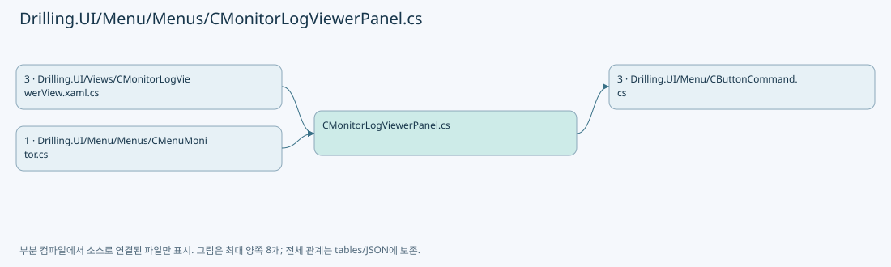
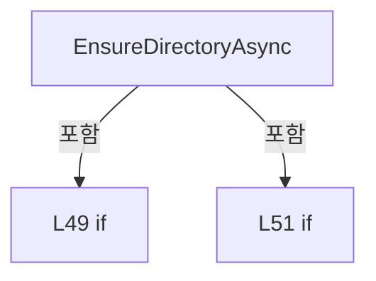
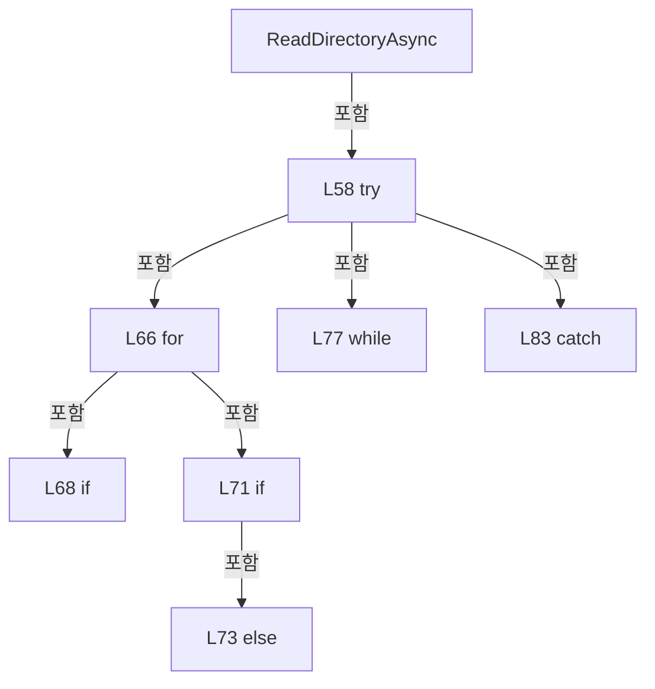
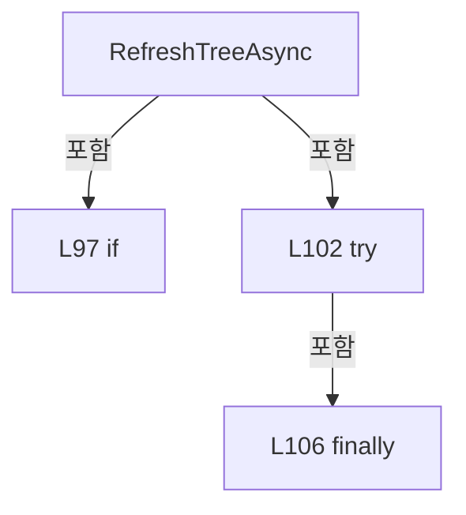
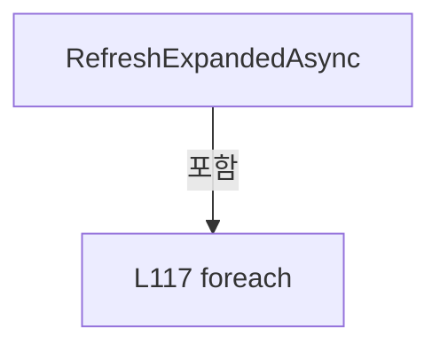
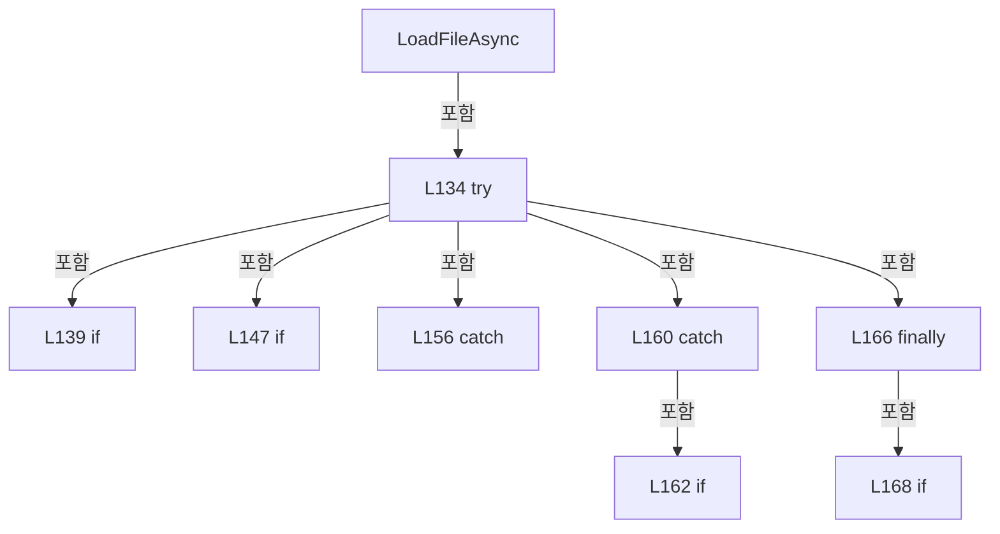
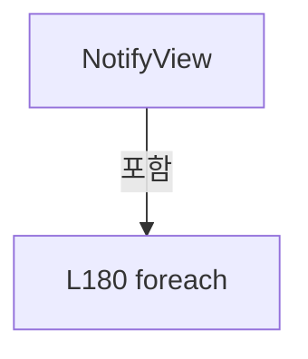
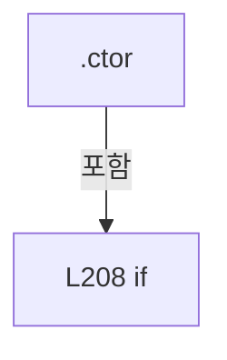

# Drilling.UI/Menu/Menus/CMonitorLogViewerPanel.cs

| 항목 | 내용 |
| --- | --- |
| 원본 저장소 | https://github.com/kjuws10-rgb/A3Drilling.git |
| 원본 Commit | 5aee8e58439c9b455cae7c9593c9be986c3e682e |
| 원본 SHA256 | 5d06e93a3ba16a27c93f45c6825f5ef8324b118a9c80bb7ef241987423a8c303 |
| 파일 분류 | code |
| 원본 크기/행 | 11,031 bytes / 252 physical lines |
| 인코딩 | utf-8-sig |
| 검토 범위 | 구문/부분 의미 분석에서 추출한 사실. 동작·물리 단위·실장비 합격을 보증하지 않습니다. |
| 원본 링크 | [고정 Commit 원본](https://github.com/kjuws10-rgb/A3Drilling/blob/5aee8e58439c9b455cae7c9593c9be986c3e682e/Drilling.UI/Menu/Menus/CMonitorLogViewerPanel.cs) |

## 파일의 역할과 읽는 순서

WPF 화면·사용자 명령·표시 상태를 구성합니다. XAML 이벤트와 코드 비하인드, RootView의 조립 경로를 함께 추적합니다.

## 네임스페이스·타입·상속

| 타입 | 구분 | 원본 범위 | 선언/상속 |
| --- | --- | --- | --- |
| CMonitorLogViewerPanel | ClassDeclaration | 9–195 | CMonitorLogViewerPanel: INotifyPropertyChanged |
| CLogTreeNode | ClassDeclaration | 197–251 | CLogTreeNode: INotifyPropertyChanged |

## 멤버 빠른 목록

| 이름 | 종류 | 범위 | 서명 |
| --- | --- | --- | --- |
| _logDirectory | FieldDeclaration | L11–11 | string Drilling.UI.Menu.Menus.CMonitorLogViewerPanel._logDirectory |
| _fileScope | FieldDeclaration | L12–12 | CLogFileScope Drilling.UI.Menu.Menus.CMonitorLogViewerPanel._fileScope |
| _lastOpenedDirectory | FieldDeclaration | L13–13 | string? Drilling.UI.Menu.Menus.CMonitorLogViewerPanel._lastOpenedDirectory |
| _readCts | FieldDeclaration | L14–14 | System.Threading.CancellationTokenSource? Drilling.UI.Menu.Menus.CMonitorLogViewerPanel._readCts |
| _readVersion | FieldDeclaration | L15–15 | long Drilling.UI.Menu.Menus.CMonitorLogViewerPanel._readVersion |
| _initializeTask | FieldDeclaration | L16–16 | System.Threading.Tasks.Task? Drilling.UI.Menu.Menus.CMonitorLogViewerPanel._initializeTask |
| _isTreeBusy | FieldDeclaration | L17–17 | bool Drilling.UI.Menu.Menus.CMonitorLogViewerPanel._isTreeBusy |
| .ctor | ConstructorDeclaration | L18–29 | Drilling.UI.Menu.Menus.CMonitorLogViewerPanel.CMonitorLogViewerPanel(string) |
| PropertyChanged | EventFieldDeclaration | L31–31 | System.ComponentModel.PropertyChangedEventHandler? Drilling.UI.Menu.Menus.CMonitorLogViewerPanel.PropertyChanged |
| OpenDirectory | PropertyDeclaration | L32–32 | string Drilling.UI.Menu.Menus.CMonitorLogViewerPanel.OpenDirectory |
| FilePath | PropertyDeclaration | L33–33 | string Drilling.UI.Menu.Menus.CMonitorLogViewerPanel.FilePath |
| get_FilePath | GetAccessorDeclaration | L33–33 | string Drilling.UI.Menu.Menus.CMonitorLogViewerPanel.FilePath.get |
| set_FilePath | SetAccessorDeclaration | L33–33 | void Drilling.UI.Menu.Menus.CMonitorLogViewerPanel.FilePath.set |
| Text | PropertyDeclaration | L34–34 | string Drilling.UI.Menu.Menus.CMonitorLogViewerPanel.Text |
| get_Text | GetAccessorDeclaration | L34–34 | string Drilling.UI.Menu.Menus.CMonitorLogViewerPanel.Text.get |
| set_Text | SetAccessorDeclaration | L34–34 | void Drilling.UI.Menu.Menus.CMonitorLogViewerPanel.Text.set |
| Status | PropertyDeclaration | L35–35 | string Drilling.UI.Menu.Menus.CMonitorLogViewerPanel.Status |
| get_Status | GetAccessorDeclaration | L35–35 | string Drilling.UI.Menu.Menus.CMonitorLogViewerPanel.Status.get |
| set_Status | SetAccessorDeclaration | L35–35 | void Drilling.UI.Menu.Menus.CMonitorLogViewerPanel.Status.set |
| TreeStatus | PropertyDeclaration | L36–36 | string Drilling.UI.Menu.Menus.CMonitorLogViewerPanel.TreeStatus |
| get_TreeStatus | GetAccessorDeclaration | L36–36 | string Drilling.UI.Menu.Menus.CMonitorLogViewerPanel.TreeStatus.get |
| set_TreeStatus | SetAccessorDeclaration | L36–36 | void Drilling.UI.Menu.Menus.CMonitorLogViewerPanel.TreeStatus.set |
| TreeRoots | PropertyDeclaration | L37–37 | System.Collections.Generic.IReadOnlyList<Drilling.UI.Menu.Menus.CLogTreeNode> Drilling.UI.Menu.Menus.CMonitorLogViewerPanel.TreeRoots |
| get_TreeRoots | GetAccessorDeclaration | L37–37 | System.Collections.Generic.IReadOnlyList<Drilling.UI.Menu.Menus.CLogTreeNode> Drilling.UI.Menu.Menus.CMonitorLogViewerPanel.TreeRoots.get |
| IsTreeBusy | PropertyDeclaration | L38–38 | bool Drilling.UI.Menu.Menus.CMonitorLogViewerPanel.IsTreeBusy |
| IsBusy | PropertyDeclaration | L39–39 | bool Drilling.UI.Menu.Menus.CMonitorLogViewerPanel.IsBusy |
| get_IsBusy | GetAccessorDeclaration | L39–39 | bool Drilling.UI.Menu.Menus.CMonitorLogViewerPanel.IsBusy.get |
| set_IsBusy | SetAccessorDeclaration | L39–39 | void Drilling.UI.Menu.Menus.CMonitorLogViewerPanel.IsBusy.set |
| LoadProgress | PropertyDeclaration | L40–40 | double Drilling.UI.Menu.Menus.CMonitorLogViewerPanel.LoadProgress |
| get_LoadProgress | GetAccessorDeclaration | L40–40 | double Drilling.UI.Menu.Menus.CMonitorLogViewerPanel.LoadProgress.get |
| set_LoadProgress | SetAccessorDeclaration | L40–40 | void Drilling.UI.Menu.Menus.CMonitorLogViewerPanel.LoadProgress.set |
| LoadProgressText | PropertyDeclaration | L41–41 | string Drilling.UI.Menu.Menus.CMonitorLogViewerPanel.LoadProgressText |
| get_LoadProgressText | GetAccessorDeclaration | L41–41 | string Drilling.UI.Menu.Menus.CMonitorLogViewerPanel.LoadProgressText.get |
| set_LoadProgressText | SetAccessorDeclaration | L41–41 | void Drilling.UI.Menu.Menus.CMonitorLogViewerPanel.LoadProgressText.set |
| RefreshTreeCommand | PropertyDeclaration | L42–42 | Drilling.UI.Menu.CButtonCommand Drilling.UI.Menu.Menus.CMonitorLogViewerPanel.RefreshTreeCommand |
| get_RefreshTreeCommand | GetAccessorDeclaration | L42–42 | Drilling.UI.Menu.CButtonCommand Drilling.UI.Menu.Menus.CMonitorLogViewerPanel.RefreshTreeCommand.get |
| InitializeAsync | MethodDeclaration | L44–44 | System.Threading.Tasks.Task Drilling.UI.Menu.Menus.CMonitorLogViewerPanel.InitializeAsync() |
| ExpandDirectoryAsync | MethodDeclaration | L45–45 | System.Threading.Tasks.Task Drilling.UI.Menu.Menus.CMonitorLogViewerPanel.ExpandDirectoryAsync(Drilling.UI.Menu.Menus.CLogTreeNode) |
| SelectNodeAsync | MethodDeclaration | L46–46 | System.Threading.Tasks.Task Drilling.UI.Menu.Menus.CMonitorLogViewerPanel.SelectNodeAsync(Drilling.UI.Menu.Menus.CLogTreeNode?) |
| EnsureDirectoryAsync | MethodDeclaration | L47–54 | System.Threading.Tasks.Task Drilling.UI.Menu.Menus.CMonitorLogViewerPanel.EnsureDirectoryAsync(Drilling.UI.Menu.Menus.CLogTreeNode, bool) |
| ReadDirectoryAsync | MethodDeclaration | L56–93 | System.Threading.Tasks.Task Drilling.UI.Menu.Menus.CMonitorLogViewerPanel.ReadDirectoryAsync(Drilling.UI.Menu.Menus.CLogTreeNode) |
| RefreshTreeAsync | MethodDeclaration | L95–112 | System.Threading.Tasks.Task Drilling.UI.Menu.Menus.CMonitorLogViewerPanel.RefreshTreeAsync() |
| RefreshExpandedAsync | MethodDeclaration | L114–119 | System.Threading.Tasks.Task Drilling.UI.Menu.Menus.CMonitorLogViewerPanel.RefreshExpandedAsync(Drilling.UI.Menu.Menus.CLogTreeNode) |
| LoadFileAsync | MethodDeclaration | L121–176 | System.Threading.Tasks.Task Drilling.UI.Menu.Menus.CMonitorLogViewerPanel.LoadFileAsync(string) |
| NotifyView | MethodDeclaration | L178–192 | void Drilling.UI.Menu.Menus.CMonitorLogViewerPanel.NotifyView() |
| Notify | MethodDeclaration | L194–194 | void Drilling.UI.Menu.Menus.CMonitorLogViewerPanel.Notify(string?) |
| _isExpanded | FieldDeclaration | L199–199 | bool Drilling.UI.Menu.Menus.CLogTreeNode._isExpanded |
| _isSelected | FieldDeclaration | L200–200 | bool Drilling.UI.Menu.Menus.CLogTreeNode._isSelected |
| _error | FieldDeclaration | L201–201 | string Drilling.UI.Menu.Menus.CLogTreeNode._error |
| .ctor | ConstructorDeclaration | L202–210 | Drilling.UI.Menu.Menus.CLogTreeNode.CLogTreeNode(string, string, bool, bool) |
| PropertyChanged | EventFieldDeclaration | L212–212 | System.ComponentModel.PropertyChangedEventHandler? Drilling.UI.Menu.Menus.CLogTreeNode.PropertyChanged |
| Path | PropertyDeclaration | L213–213 | string Drilling.UI.Menu.Menus.CLogTreeNode.Path |
| get_Path | GetAccessorDeclaration | L213–213 | string Drilling.UI.Menu.Menus.CLogTreeNode.Path.get |
| Name | PropertyDeclaration | L214–214 | string Drilling.UI.Menu.Menus.CLogTreeNode.Name |
| get_Name | GetAccessorDeclaration | L214–214 | string Drilling.UI.Menu.Menus.CLogTreeNode.Name.get |
| IsDirectory | PropertyDeclaration | L215–215 | bool Drilling.UI.Menu.Menus.CLogTreeNode.IsDirectory |
| get_IsDirectory | GetAccessorDeclaration | L215–215 | bool Drilling.UI.Menu.Menus.CLogTreeNode.IsDirectory.get |
| IsPlaceholder | PropertyDeclaration | L216–216 | bool Drilling.UI.Menu.Menus.CLogTreeNode.IsPlaceholder |
| get_IsPlaceholder | GetAccessorDeclaration | L216–216 | bool Drilling.UI.Menu.Menus.CLogTreeNode.IsPlaceholder.get |
| ToolTip | PropertyDeclaration | L217–217 | string Drilling.UI.Menu.Menus.CLogTreeNode.ToolTip |
| Children | PropertyDeclaration | L218–218 | System.Collections.ObjectModel.ObservableCollection<Drilling.UI.Menu.Menus.CLogTreeNode> Drilling.UI.Menu.Menus.CLogTreeNode.Children |
| get_Children | GetAccessorDeclaration | L218–218 | System.Collections.ObjectModel.ObservableCollection<Drilling.UI.Menu.Menus.CLogTreeNode> Drilling.UI.Menu.Menus.CLogTreeNode.Children.get |
| IsExpanded | PropertyDeclaration | L220–228 | bool Drilling.UI.Menu.Menus.CLogTreeNode.IsExpanded |
| get_IsExpanded | GetAccessorDeclaration | L222–222 | bool Drilling.UI.Menu.Menus.CLogTreeNode.IsExpanded.get |
| set_IsExpanded | SetAccessorDeclaration | L223–227 | void Drilling.UI.Menu.Menus.CLogTreeNode.IsExpanded.set |
| IsSelected | PropertyDeclaration | L230–238 | bool Drilling.UI.Menu.Menus.CLogTreeNode.IsSelected |
| get_IsSelected | GetAccessorDeclaration | L232–232 | bool Drilling.UI.Menu.Menus.CLogTreeNode.IsSelected.get |
| set_IsSelected | SetAccessorDeclaration | L233–237 | void Drilling.UI.Menu.Menus.CLogTreeNode.IsSelected.set |
| IsLoaded | PropertyDeclaration | L240–240 | bool Drilling.UI.Menu.Menus.CLogTreeNode.IsLoaded |
| get_IsLoaded | GetAccessorDeclaration | L240–240 | bool Drilling.UI.Menu.Menus.CLogTreeNode.IsLoaded.get |
| set_IsLoaded | SetAccessorDeclaration | L240–240 | void Drilling.UI.Menu.Menus.CLogTreeNode.IsLoaded.set |
| LoadingTask | PropertyDeclaration | L241–241 | System.Threading.Tasks.Task? Drilling.UI.Menu.Menus.CLogTreeNode.LoadingTask |
| get_LoadingTask | GetAccessorDeclaration | L241–241 | System.Threading.Tasks.Task? Drilling.UI.Menu.Menus.CLogTreeNode.LoadingTask.get |
| set_LoadingTask | SetAccessorDeclaration | L241–241 | void Drilling.UI.Menu.Menus.CLogTreeNode.LoadingTask.set |
| SetError | MethodDeclaration | L243–247 | void Drilling.UI.Menu.Menus.CLogTreeNode.SetError(string) |
| Placeholder | MethodDeclaration | L249–249 | Drilling.UI.Menu.Menus.CLogTreeNode Drilling.UI.Menu.Menus.CLogTreeNode.Placeholder(string) |
| Notify | MethodDeclaration | L250–250 | void Drilling.UI.Menu.Menus.CLogTreeNode.Notify(string?) |

## 멤버별 상세 계약·호출·처리 해설

### FieldDeclaration `_logDirectory` · L11–11

[Drilling.UI/Menu/Menus/CMonitorLogViewerPanel.cs:11–11](https://github.com/kjuws10-rgb/A3Drilling/blob/5aee8e58439c9b455cae7c9593c9be986c3e682e/Drilling.UI/Menu/Menus/CMonitorLogViewerPanel.cs#L11-L11)

| 항목 | 실제 추출 값 |
| --- | --- |
| 서명 | string Drilling.UI.Menu.Menus.CMonitorLogViewerPanel._logDirectory |
| 접근/수식자 | Private / private, readonly |
| 반환/값 타입 | string |
| 소속 타입 | NamedType:Drilling.UI.Menu.Menus.CMonitorLogViewerPanel |

현재 부분 분석에서 직접 연결된 호출자는 없습니다. XAML/이벤트/인터페이스·델리게이트·외부 진입을 추가 확인해야 하며, 미사용으로 판정한 것이 아닙니다.

변경 전 점검: 입력/반환 타입, 위 호출자, 예외/취소 경로, 공유 상태와 저장·전송 소비자를 함께 확인합니다. 값의 단위나 물리 방향을 이름만으로 확정하지 않습니다.

### FieldDeclaration `_fileScope` · L12–12

[Drilling.UI/Menu/Menus/CMonitorLogViewerPanel.cs:12–12](https://github.com/kjuws10-rgb/A3Drilling/blob/5aee8e58439c9b455cae7c9593c9be986c3e682e/Drilling.UI/Menu/Menus/CMonitorLogViewerPanel.cs#L12-L12)

| 항목 | 실제 추출 값 |
| --- | --- |
| 서명 | CLogFileScope Drilling.UI.Menu.Menus.CMonitorLogViewerPanel._fileScope |
| 접근/수식자 | Private / private, readonly |
| 반환/값 타입 | CLogFileScope |
| 소속 타입 | NamedType:Drilling.UI.Menu.Menus.CMonitorLogViewerPanel |

현재 부분 분석에서 직접 연결된 호출자는 없습니다. XAML/이벤트/인터페이스·델리게이트·외부 진입을 추가 확인해야 하며, 미사용으로 판정한 것이 아닙니다.

변경 전 점검: 입력/반환 타입, 위 호출자, 예외/취소 경로, 공유 상태와 저장·전송 소비자를 함께 확인합니다. 값의 단위나 물리 방향을 이름만으로 확정하지 않습니다.

### FieldDeclaration `_lastOpenedDirectory` · L13–13

[Drilling.UI/Menu/Menus/CMonitorLogViewerPanel.cs:13–13](https://github.com/kjuws10-rgb/A3Drilling/blob/5aee8e58439c9b455cae7c9593c9be986c3e682e/Drilling.UI/Menu/Menus/CMonitorLogViewerPanel.cs#L13-L13)

| 항목 | 실제 추출 값 |
| --- | --- |
| 서명 | string? Drilling.UI.Menu.Menus.CMonitorLogViewerPanel._lastOpenedDirectory |
| 접근/수식자 | Private / private |
| 반환/값 타입 | string? |
| 소속 타입 | NamedType:Drilling.UI.Menu.Menus.CMonitorLogViewerPanel |

현재 부분 분석에서 직접 연결된 호출자는 없습니다. XAML/이벤트/인터페이스·델리게이트·외부 진입을 추가 확인해야 하며, 미사용으로 판정한 것이 아닙니다.

변경 전 점검: 입력/반환 타입, 위 호출자, 예외/취소 경로, 공유 상태와 저장·전송 소비자를 함께 확인합니다. 값의 단위나 물리 방향을 이름만으로 확정하지 않습니다.

### FieldDeclaration `_readCts` · L14–14

[Drilling.UI/Menu/Menus/CMonitorLogViewerPanel.cs:14–14](https://github.com/kjuws10-rgb/A3Drilling/blob/5aee8e58439c9b455cae7c9593c9be986c3e682e/Drilling.UI/Menu/Menus/CMonitorLogViewerPanel.cs#L14-L14)

| 항목 | 실제 추출 값 |
| --- | --- |
| 서명 | System.Threading.CancellationTokenSource? Drilling.UI.Menu.Menus.CMonitorLogViewerPanel._readCts |
| 접근/수식자 | Private / private |
| 반환/값 타입 | System.Threading.CancellationTokenSource? |
| 소속 타입 | NamedType:Drilling.UI.Menu.Menus.CMonitorLogViewerPanel |

현재 부분 분석에서 직접 연결된 호출자는 없습니다. XAML/이벤트/인터페이스·델리게이트·외부 진입을 추가 확인해야 하며, 미사용으로 판정한 것이 아닙니다.

변경 전 점검: 입력/반환 타입, 위 호출자, 예외/취소 경로, 공유 상태와 저장·전송 소비자를 함께 확인합니다. 값의 단위나 물리 방향을 이름만으로 확정하지 않습니다.

### FieldDeclaration `_readVersion` · L15–15

[Drilling.UI/Menu/Menus/CMonitorLogViewerPanel.cs:15–15](https://github.com/kjuws10-rgb/A3Drilling/blob/5aee8e58439c9b455cae7c9593c9be986c3e682e/Drilling.UI/Menu/Menus/CMonitorLogViewerPanel.cs#L15-L15)

| 항목 | 실제 추출 값 |
| --- | --- |
| 서명 | long Drilling.UI.Menu.Menus.CMonitorLogViewerPanel._readVersion |
| 접근/수식자 | Private / private |
| 반환/값 타입 | long |
| 소속 타입 | NamedType:Drilling.UI.Menu.Menus.CMonitorLogViewerPanel |

현재 부분 분석에서 직접 연결된 호출자는 없습니다. XAML/이벤트/인터페이스·델리게이트·외부 진입을 추가 확인해야 하며, 미사용으로 판정한 것이 아닙니다.

변경 전 점검: 입력/반환 타입, 위 호출자, 예외/취소 경로, 공유 상태와 저장·전송 소비자를 함께 확인합니다. 값의 단위나 물리 방향을 이름만으로 확정하지 않습니다.

### FieldDeclaration `_initializeTask` · L16–16

[Drilling.UI/Menu/Menus/CMonitorLogViewerPanel.cs:16–16](https://github.com/kjuws10-rgb/A3Drilling/blob/5aee8e58439c9b455cae7c9593c9be986c3e682e/Drilling.UI/Menu/Menus/CMonitorLogViewerPanel.cs#L16-L16)

| 항목 | 실제 추출 값 |
| --- | --- |
| 서명 | System.Threading.Tasks.Task? Drilling.UI.Menu.Menus.CMonitorLogViewerPanel._initializeTask |
| 접근/수식자 | Private / private |
| 반환/값 타입 | System.Threading.Tasks.Task? |
| 소속 타입 | NamedType:Drilling.UI.Menu.Menus.CMonitorLogViewerPanel |

현재 부분 분석에서 직접 연결된 호출자는 없습니다. XAML/이벤트/인터페이스·델리게이트·외부 진입을 추가 확인해야 하며, 미사용으로 판정한 것이 아닙니다.

변경 전 점검: 입력/반환 타입, 위 호출자, 예외/취소 경로, 공유 상태와 저장·전송 소비자를 함께 확인합니다. 값의 단위나 물리 방향을 이름만으로 확정하지 않습니다.

### FieldDeclaration `_isTreeBusy` · L17–17

[Drilling.UI/Menu/Menus/CMonitorLogViewerPanel.cs:17–17](https://github.com/kjuws10-rgb/A3Drilling/blob/5aee8e58439c9b455cae7c9593c9be986c3e682e/Drilling.UI/Menu/Menus/CMonitorLogViewerPanel.cs#L17-L17)

| 항목 | 실제 추출 값 |
| --- | --- |
| 서명 | bool Drilling.UI.Menu.Menus.CMonitorLogViewerPanel._isTreeBusy |
| 접근/수식자 | Private / private |
| 반환/값 타입 | bool |
| 소속 타입 | NamedType:Drilling.UI.Menu.Menus.CMonitorLogViewerPanel |

현재 부분 분석에서 직접 연결된 호출자는 없습니다. XAML/이벤트/인터페이스·델리게이트·외부 진입을 추가 확인해야 하며, 미사용으로 판정한 것이 아닙니다.

변경 전 점검: 입력/반환 타입, 위 호출자, 예외/취소 경로, 공유 상태와 저장·전송 소비자를 함께 확인합니다. 값의 단위나 물리 방향을 이름만으로 확정하지 않습니다.

### ConstructorDeclaration `.ctor` · L18–29

[Drilling.UI/Menu/Menus/CMonitorLogViewerPanel.cs:18–29](https://github.com/kjuws10-rgb/A3Drilling/blob/5aee8e58439c9b455cae7c9593c9be986c3e682e/Drilling.UI/Menu/Menus/CMonitorLogViewerPanel.cs#L18-L29)

| 항목 | 실제 추출 값 |
| --- | --- |
| 서명 | Drilling.UI.Menu.Menus.CMonitorLogViewerPanel.CMonitorLogViewerPanel(string) |
| 접근/수식자 | Public / public |
| 반환/값 타입 | void |
| 소속 타입 | NamedType:Drilling.UI.Menu.Menus.CMonitorLogViewerPanel |

입력 계약:

| 이름 | 타입 | 전달 | 선택/기본값 |
| --- | --- | --- | --- |
| logDirectory | string | None | False /  |

정적 호출자로 확인된 위치:

| 호출 파일/행 | 호출 표현식 | 런타임 분기 가능 |
| --- | --- | --- |
| [Drilling.UI/Menu/Menus/CMenuMonitor.cs:161–161](https://github.com/kjuws10-rgb/A3Drilling/blob/5aee8e58439c9b455cae7c9593c9be986c3e682e/Drilling.UI/Menu/Menus/CMenuMonitor.cs#L161-L161) | new CMonitorLogViewerPanel | False |

호출하는 대상과 해석 범위:

| 원본 행 | 표현식 | 분석 상태 | 대상/소스 위치 |
| --- | --- | --- | --- |
| 20 | new CLogFileScope | unresolved | None |
| 22 | new CLogTreeNode | resolved | Drilling.UI.Menu.Menus.CLogTreeNode.CLogTreeNode(string, string, bool, bool) · Drilling.UI/Menu/Menus/CMonitorLogViewerPanel.cs:202 |
| 28 | new | resolved | Drilling.UI.Menu.CButtonCommand.CButtonCommand(System.Action<object?>, System.Predicate<object?>?) · Drilling.UI/Menu/CButtonCommand.cs:9 |
| 28 | RefreshTreeAsync | resolved | System.Threading.Tasks.Task Drilling.UI.Menu.Menus.CMonitorLogViewerPanel.RefreshTreeAsync() · Drilling.UI/Menu/Menus/CMonitorLogViewerPanel.cs:95 |

본문의 실제 연산·분기·예외·반환 순서(원문 위치 순):

| 원본 행 | 종류 | 주석 해설 |
| --- | --- | --- |
| 20 | assignment | 값을 대상에 대입합니다: _fileScope = new CLogFileScope(logDirectory) |
| 20 | call | 함수·델리게이트 또는 객체 생성자를 호출합니다: new CLogFileScope(logDirectory) |
| 21 | assignment | 값을 대상에 대입합니다: _logDirectory = _fileScope.RootDirectory |
| 22 | call | 함수·델리게이트 또는 객체 생성자를 호출합니다: new CLogTreeNode(_logDirectory, "Log", true) { IsExpanded = true } |
| 22 | assignment | 값을 대상에 대입합니다: TreeRoots = [new CLogTreeNode(_logDirectory, "Log", true) { IsExpanded = true } ] |
| 24 | assignment | 값을 대상에 대입합니다: IsExpanded = true |
| 28 | assignment | 값을 대상에 대입합니다: RefreshTreeCommand = new(async _ => await RefreshTreeAsync(), _ => !IsTreeBusy) |
| 28 | await | 비동기 완료를 기다립니다: await RefreshTreeAsync() |
| 28 | call | 함수·델리게이트 또는 객체 생성자를 호출합니다: new(async _ => await RefreshTreeAsync(), _ => !IsTreeBusy) |
| 28 | call | 함수·델리게이트 또는 객체 생성자를 호출합니다: RefreshTreeAsync() |

변경 전 점검: 입력/반환 타입, 위 호출자, 예외/취소 경로, 공유 상태와 저장·전송 소비자를 함께 확인합니다. 값의 단위나 물리 방향을 이름만으로 확정하지 않습니다.

### EventFieldDeclaration `PropertyChanged` · L31–31

[Drilling.UI/Menu/Menus/CMonitorLogViewerPanel.cs:31–31](https://github.com/kjuws10-rgb/A3Drilling/blob/5aee8e58439c9b455cae7c9593c9be986c3e682e/Drilling.UI/Menu/Menus/CMonitorLogViewerPanel.cs#L31-L31)

| 항목 | 실제 추출 값 |
| --- | --- |
| 서명 | System.ComponentModel.PropertyChangedEventHandler? Drilling.UI.Menu.Menus.CMonitorLogViewerPanel.PropertyChanged |
| 접근/수식자 | Public / public, event |
| 반환/값 타입 | System.ComponentModel.PropertyChangedEventHandler? |
| 소속 타입 | NamedType:Drilling.UI.Menu.Menus.CMonitorLogViewerPanel |

현재 부분 분석에서 직접 연결된 호출자는 없습니다. XAML/이벤트/인터페이스·델리게이트·외부 진입을 추가 확인해야 하며, 미사용으로 판정한 것이 아닙니다.

변경 전 점검: 입력/반환 타입, 위 호출자, 예외/취소 경로, 공유 상태와 저장·전송 소비자를 함께 확인합니다. 값의 단위나 물리 방향을 이름만으로 확정하지 않습니다.

### PropertyDeclaration `OpenDirectory` · L32–32

[Drilling.UI/Menu/Menus/CMonitorLogViewerPanel.cs:32–32](https://github.com/kjuws10-rgb/A3Drilling/blob/5aee8e58439c9b455cae7c9593c9be986c3e682e/Drilling.UI/Menu/Menus/CMonitorLogViewerPanel.cs#L32-L32)

| 항목 | 실제 추출 값 |
| --- | --- |
| 서명 | string Drilling.UI.Menu.Menus.CMonitorLogViewerPanel.OpenDirectory |
| 접근/수식자 | Public / public |
| 반환/값 타입 | string |
| 소속 타입 | NamedType:Drilling.UI.Menu.Menus.CMonitorLogViewerPanel |

현재 부분 분석에서 직접 연결된 호출자는 없습니다. XAML/이벤트/인터페이스·델리게이트·외부 진입을 추가 확인해야 하며, 미사용으로 판정한 것이 아닙니다.

변경 전 점검: 입력/반환 타입, 위 호출자, 예외/취소 경로, 공유 상태와 저장·전송 소비자를 함께 확인합니다. 값의 단위나 물리 방향을 이름만으로 확정하지 않습니다.

### PropertyDeclaration `FilePath` · L33–33

[Drilling.UI/Menu/Menus/CMonitorLogViewerPanel.cs:33–33](https://github.com/kjuws10-rgb/A3Drilling/blob/5aee8e58439c9b455cae7c9593c9be986c3e682e/Drilling.UI/Menu/Menus/CMonitorLogViewerPanel.cs#L33-L33)

| 항목 | 실제 추출 값 |
| --- | --- |
| 서명 | string Drilling.UI.Menu.Menus.CMonitorLogViewerPanel.FilePath |
| 접근/수식자 | Public / public |
| 반환/값 타입 | string |
| 소속 타입 | NamedType:Drilling.UI.Menu.Menus.CMonitorLogViewerPanel |

현재 부분 분석에서 직접 연결된 호출자는 없습니다. XAML/이벤트/인터페이스·델리게이트·외부 진입을 추가 확인해야 하며, 미사용으로 판정한 것이 아닙니다.

변경 전 점검: 입력/반환 타입, 위 호출자, 예외/취소 경로, 공유 상태와 저장·전송 소비자를 함께 확인합니다. 값의 단위나 물리 방향을 이름만으로 확정하지 않습니다.

### GetAccessorDeclaration `get_FilePath` · L33–33

[Drilling.UI/Menu/Menus/CMonitorLogViewerPanel.cs:33–33](https://github.com/kjuws10-rgb/A3Drilling/blob/5aee8e58439c9b455cae7c9593c9be986c3e682e/Drilling.UI/Menu/Menus/CMonitorLogViewerPanel.cs#L33-L33)

| 항목 | 실제 추출 값 |
| --- | --- |
| 서명 | string Drilling.UI.Menu.Menus.CMonitorLogViewerPanel.FilePath.get |
| 접근/수식자 | Public / get |
| 반환/값 타입 | string |
| 소속 타입 | NamedType:Drilling.UI.Menu.Menus.CMonitorLogViewerPanel |

현재 부분 분석에서 직접 연결된 호출자는 없습니다. XAML/이벤트/인터페이스·델리게이트·외부 진입을 추가 확인해야 하며, 미사용으로 판정한 것이 아닙니다.

변경 전 점검: 입력/반환 타입, 위 호출자, 예외/취소 경로, 공유 상태와 저장·전송 소비자를 함께 확인합니다. 값의 단위나 물리 방향을 이름만으로 확정하지 않습니다.

### SetAccessorDeclaration `set_FilePath` · L33–33

[Drilling.UI/Menu/Menus/CMonitorLogViewerPanel.cs:33–33](https://github.com/kjuws10-rgb/A3Drilling/blob/5aee8e58439c9b455cae7c9593c9be986c3e682e/Drilling.UI/Menu/Menus/CMonitorLogViewerPanel.cs#L33-L33)

| 항목 | 실제 추출 값 |
| --- | --- |
| 서명 | void Drilling.UI.Menu.Menus.CMonitorLogViewerPanel.FilePath.set |
| 접근/수식자 | Private / private, set |
| 반환/값 타입 | void |
| 소속 타입 | NamedType:Drilling.UI.Menu.Menus.CMonitorLogViewerPanel |

입력 계약:

| 이름 | 타입 | 전달 | 선택/기본값 |
| --- | --- | --- | --- |
| value | string | None | False /  |

현재 부분 분석에서 직접 연결된 호출자는 없습니다. XAML/이벤트/인터페이스·델리게이트·외부 진입을 추가 확인해야 하며, 미사용으로 판정한 것이 아닙니다.

변경 전 점검: 입력/반환 타입, 위 호출자, 예외/취소 경로, 공유 상태와 저장·전송 소비자를 함께 확인합니다. 값의 단위나 물리 방향을 이름만으로 확정하지 않습니다.

### PropertyDeclaration `Text` · L34–34

[Drilling.UI/Menu/Menus/CMonitorLogViewerPanel.cs:34–34](https://github.com/kjuws10-rgb/A3Drilling/blob/5aee8e58439c9b455cae7c9593c9be986c3e682e/Drilling.UI/Menu/Menus/CMonitorLogViewerPanel.cs#L34-L34)

| 항목 | 실제 추출 값 |
| --- | --- |
| 서명 | string Drilling.UI.Menu.Menus.CMonitorLogViewerPanel.Text |
| 접근/수식자 | Public / public |
| 반환/값 타입 | string |
| 소속 타입 | NamedType:Drilling.UI.Menu.Menus.CMonitorLogViewerPanel |

현재 부분 분석에서 직접 연결된 호출자는 없습니다. XAML/이벤트/인터페이스·델리게이트·외부 진입을 추가 확인해야 하며, 미사용으로 판정한 것이 아닙니다.

변경 전 점검: 입력/반환 타입, 위 호출자, 예외/취소 경로, 공유 상태와 저장·전송 소비자를 함께 확인합니다. 값의 단위나 물리 방향을 이름만으로 확정하지 않습니다.

### GetAccessorDeclaration `get_Text` · L34–34

[Drilling.UI/Menu/Menus/CMonitorLogViewerPanel.cs:34–34](https://github.com/kjuws10-rgb/A3Drilling/blob/5aee8e58439c9b455cae7c9593c9be986c3e682e/Drilling.UI/Menu/Menus/CMonitorLogViewerPanel.cs#L34-L34)

| 항목 | 실제 추출 값 |
| --- | --- |
| 서명 | string Drilling.UI.Menu.Menus.CMonitorLogViewerPanel.Text.get |
| 접근/수식자 | Public / get |
| 반환/값 타입 | string |
| 소속 타입 | NamedType:Drilling.UI.Menu.Menus.CMonitorLogViewerPanel |

현재 부분 분석에서 직접 연결된 호출자는 없습니다. XAML/이벤트/인터페이스·델리게이트·외부 진입을 추가 확인해야 하며, 미사용으로 판정한 것이 아닙니다.

변경 전 점검: 입력/반환 타입, 위 호출자, 예외/취소 경로, 공유 상태와 저장·전송 소비자를 함께 확인합니다. 값의 단위나 물리 방향을 이름만으로 확정하지 않습니다.

### SetAccessorDeclaration `set_Text` · L34–34

[Drilling.UI/Menu/Menus/CMonitorLogViewerPanel.cs:34–34](https://github.com/kjuws10-rgb/A3Drilling/blob/5aee8e58439c9b455cae7c9593c9be986c3e682e/Drilling.UI/Menu/Menus/CMonitorLogViewerPanel.cs#L34-L34)

| 항목 | 실제 추출 값 |
| --- | --- |
| 서명 | void Drilling.UI.Menu.Menus.CMonitorLogViewerPanel.Text.set |
| 접근/수식자 | Private / private, set |
| 반환/값 타입 | void |
| 소속 타입 | NamedType:Drilling.UI.Menu.Menus.CMonitorLogViewerPanel |

입력 계약:

| 이름 | 타입 | 전달 | 선택/기본값 |
| --- | --- | --- | --- |
| value | string | None | False /  |

현재 부분 분석에서 직접 연결된 호출자는 없습니다. XAML/이벤트/인터페이스·델리게이트·외부 진입을 추가 확인해야 하며, 미사용으로 판정한 것이 아닙니다.

변경 전 점검: 입력/반환 타입, 위 호출자, 예외/취소 경로, 공유 상태와 저장·전송 소비자를 함께 확인합니다. 값의 단위나 물리 방향을 이름만으로 확정하지 않습니다.

### PropertyDeclaration `Status` · L35–35

[Drilling.UI/Menu/Menus/CMonitorLogViewerPanel.cs:35–35](https://github.com/kjuws10-rgb/A3Drilling/blob/5aee8e58439c9b455cae7c9593c9be986c3e682e/Drilling.UI/Menu/Menus/CMonitorLogViewerPanel.cs#L35-L35)

| 항목 | 실제 추출 값 |
| --- | --- |
| 서명 | string Drilling.UI.Menu.Menus.CMonitorLogViewerPanel.Status |
| 접근/수식자 | Public / public |
| 반환/값 타입 | string |
| 소속 타입 | NamedType:Drilling.UI.Menu.Menus.CMonitorLogViewerPanel |

현재 부분 분석에서 직접 연결된 호출자는 없습니다. XAML/이벤트/인터페이스·델리게이트·외부 진입을 추가 확인해야 하며, 미사용으로 판정한 것이 아닙니다.

변경 전 점검: 입력/반환 타입, 위 호출자, 예외/취소 경로, 공유 상태와 저장·전송 소비자를 함께 확인합니다. 값의 단위나 물리 방향을 이름만으로 확정하지 않습니다.

### GetAccessorDeclaration `get_Status` · L35–35

[Drilling.UI/Menu/Menus/CMonitorLogViewerPanel.cs:35–35](https://github.com/kjuws10-rgb/A3Drilling/blob/5aee8e58439c9b455cae7c9593c9be986c3e682e/Drilling.UI/Menu/Menus/CMonitorLogViewerPanel.cs#L35-L35)

| 항목 | 실제 추출 값 |
| --- | --- |
| 서명 | string Drilling.UI.Menu.Menus.CMonitorLogViewerPanel.Status.get |
| 접근/수식자 | Public / get |
| 반환/값 타입 | string |
| 소속 타입 | NamedType:Drilling.UI.Menu.Menus.CMonitorLogViewerPanel |

현재 부분 분석에서 직접 연결된 호출자는 없습니다. XAML/이벤트/인터페이스·델리게이트·외부 진입을 추가 확인해야 하며, 미사용으로 판정한 것이 아닙니다.

변경 전 점검: 입력/반환 타입, 위 호출자, 예외/취소 경로, 공유 상태와 저장·전송 소비자를 함께 확인합니다. 값의 단위나 물리 방향을 이름만으로 확정하지 않습니다.

### SetAccessorDeclaration `set_Status` · L35–35

[Drilling.UI/Menu/Menus/CMonitorLogViewerPanel.cs:35–35](https://github.com/kjuws10-rgb/A3Drilling/blob/5aee8e58439c9b455cae7c9593c9be986c3e682e/Drilling.UI/Menu/Menus/CMonitorLogViewerPanel.cs#L35-L35)

| 항목 | 실제 추출 값 |
| --- | --- |
| 서명 | void Drilling.UI.Menu.Menus.CMonitorLogViewerPanel.Status.set |
| 접근/수식자 | Private / private, set |
| 반환/값 타입 | void |
| 소속 타입 | NamedType:Drilling.UI.Menu.Menus.CMonitorLogViewerPanel |

입력 계약:

| 이름 | 타입 | 전달 | 선택/기본값 |
| --- | --- | --- | --- |
| value | string | None | False /  |

현재 부분 분석에서 직접 연결된 호출자는 없습니다. XAML/이벤트/인터페이스·델리게이트·외부 진입을 추가 확인해야 하며, 미사용으로 판정한 것이 아닙니다.

변경 전 점검: 입력/반환 타입, 위 호출자, 예외/취소 경로, 공유 상태와 저장·전송 소비자를 함께 확인합니다. 값의 단위나 물리 방향을 이름만으로 확정하지 않습니다.

### PropertyDeclaration `TreeStatus` · L36–36

[Drilling.UI/Menu/Menus/CMonitorLogViewerPanel.cs:36–36](https://github.com/kjuws10-rgb/A3Drilling/blob/5aee8e58439c9b455cae7c9593c9be986c3e682e/Drilling.UI/Menu/Menus/CMonitorLogViewerPanel.cs#L36-L36)

| 항목 | 실제 추출 값 |
| --- | --- |
| 서명 | string Drilling.UI.Menu.Menus.CMonitorLogViewerPanel.TreeStatus |
| 접근/수식자 | Public / public |
| 반환/값 타입 | string |
| 소속 타입 | NamedType:Drilling.UI.Menu.Menus.CMonitorLogViewerPanel |

현재 부분 분석에서 직접 연결된 호출자는 없습니다. XAML/이벤트/인터페이스·델리게이트·외부 진입을 추가 확인해야 하며, 미사용으로 판정한 것이 아닙니다.

변경 전 점검: 입력/반환 타입, 위 호출자, 예외/취소 경로, 공유 상태와 저장·전송 소비자를 함께 확인합니다. 값의 단위나 물리 방향을 이름만으로 확정하지 않습니다.

### GetAccessorDeclaration `get_TreeStatus` · L36–36

[Drilling.UI/Menu/Menus/CMonitorLogViewerPanel.cs:36–36](https://github.com/kjuws10-rgb/A3Drilling/blob/5aee8e58439c9b455cae7c9593c9be986c3e682e/Drilling.UI/Menu/Menus/CMonitorLogViewerPanel.cs#L36-L36)

| 항목 | 실제 추출 값 |
| --- | --- |
| 서명 | string Drilling.UI.Menu.Menus.CMonitorLogViewerPanel.TreeStatus.get |
| 접근/수식자 | Public / get |
| 반환/값 타입 | string |
| 소속 타입 | NamedType:Drilling.UI.Menu.Menus.CMonitorLogViewerPanel |

현재 부분 분석에서 직접 연결된 호출자는 없습니다. XAML/이벤트/인터페이스·델리게이트·외부 진입을 추가 확인해야 하며, 미사용으로 판정한 것이 아닙니다.

변경 전 점검: 입력/반환 타입, 위 호출자, 예외/취소 경로, 공유 상태와 저장·전송 소비자를 함께 확인합니다. 값의 단위나 물리 방향을 이름만으로 확정하지 않습니다.

### SetAccessorDeclaration `set_TreeStatus` · L36–36

[Drilling.UI/Menu/Menus/CMonitorLogViewerPanel.cs:36–36](https://github.com/kjuws10-rgb/A3Drilling/blob/5aee8e58439c9b455cae7c9593c9be986c3e682e/Drilling.UI/Menu/Menus/CMonitorLogViewerPanel.cs#L36-L36)

| 항목 | 실제 추출 값 |
| --- | --- |
| 서명 | void Drilling.UI.Menu.Menus.CMonitorLogViewerPanel.TreeStatus.set |
| 접근/수식자 | Private / private, set |
| 반환/값 타입 | void |
| 소속 타입 | NamedType:Drilling.UI.Menu.Menus.CMonitorLogViewerPanel |

입력 계약:

| 이름 | 타입 | 전달 | 선택/기본값 |
| --- | --- | --- | --- |
| value | string | None | False /  |

현재 부분 분석에서 직접 연결된 호출자는 없습니다. XAML/이벤트/인터페이스·델리게이트·외부 진입을 추가 확인해야 하며, 미사용으로 판정한 것이 아닙니다.

변경 전 점검: 입력/반환 타입, 위 호출자, 예외/취소 경로, 공유 상태와 저장·전송 소비자를 함께 확인합니다. 값의 단위나 물리 방향을 이름만으로 확정하지 않습니다.

### PropertyDeclaration `TreeRoots` · L37–37

[Drilling.UI/Menu/Menus/CMonitorLogViewerPanel.cs:37–37](https://github.com/kjuws10-rgb/A3Drilling/blob/5aee8e58439c9b455cae7c9593c9be986c3e682e/Drilling.UI/Menu/Menus/CMonitorLogViewerPanel.cs#L37-L37)

| 항목 | 실제 추출 값 |
| --- | --- |
| 서명 | System.Collections.Generic.IReadOnlyList<Drilling.UI.Menu.Menus.CLogTreeNode> Drilling.UI.Menu.Menus.CMonitorLogViewerPanel.TreeRoots |
| 접근/수식자 | Public / public |
| 반환/값 타입 | System.Collections.Generic.IReadOnlyList<Drilling.UI.Menu.Menus.CLogTreeNode> |
| 소속 타입 | NamedType:Drilling.UI.Menu.Menus.CMonitorLogViewerPanel |

현재 부분 분석에서 직접 연결된 호출자는 없습니다. XAML/이벤트/인터페이스·델리게이트·외부 진입을 추가 확인해야 하며, 미사용으로 판정한 것이 아닙니다.

변경 전 점검: 입력/반환 타입, 위 호출자, 예외/취소 경로, 공유 상태와 저장·전송 소비자를 함께 확인합니다. 값의 단위나 물리 방향을 이름만으로 확정하지 않습니다.

### GetAccessorDeclaration `get_TreeRoots` · L37–37

[Drilling.UI/Menu/Menus/CMonitorLogViewerPanel.cs:37–37](https://github.com/kjuws10-rgb/A3Drilling/blob/5aee8e58439c9b455cae7c9593c9be986c3e682e/Drilling.UI/Menu/Menus/CMonitorLogViewerPanel.cs#L37-L37)

| 항목 | 실제 추출 값 |
| --- | --- |
| 서명 | System.Collections.Generic.IReadOnlyList<Drilling.UI.Menu.Menus.CLogTreeNode> Drilling.UI.Menu.Menus.CMonitorLogViewerPanel.TreeRoots.get |
| 접근/수식자 | Public / get |
| 반환/값 타입 | System.Collections.Generic.IReadOnlyList<Drilling.UI.Menu.Menus.CLogTreeNode> |
| 소속 타입 | NamedType:Drilling.UI.Menu.Menus.CMonitorLogViewerPanel |

현재 부분 분석에서 직접 연결된 호출자는 없습니다. XAML/이벤트/인터페이스·델리게이트·외부 진입을 추가 확인해야 하며, 미사용으로 판정한 것이 아닙니다.

변경 전 점검: 입력/반환 타입, 위 호출자, 예외/취소 경로, 공유 상태와 저장·전송 소비자를 함께 확인합니다. 값의 단위나 물리 방향을 이름만으로 확정하지 않습니다.

### PropertyDeclaration `IsTreeBusy` · L38–38

[Drilling.UI/Menu/Menus/CMonitorLogViewerPanel.cs:38–38](https://github.com/kjuws10-rgb/A3Drilling/blob/5aee8e58439c9b455cae7c9593c9be986c3e682e/Drilling.UI/Menu/Menus/CMonitorLogViewerPanel.cs#L38-L38)

| 항목 | 실제 추출 값 |
| --- | --- |
| 서명 | bool Drilling.UI.Menu.Menus.CMonitorLogViewerPanel.IsTreeBusy |
| 접근/수식자 | Public / public |
| 반환/값 타입 | bool |
| 소속 타입 | NamedType:Drilling.UI.Menu.Menus.CMonitorLogViewerPanel |

현재 부분 분석에서 직접 연결된 호출자는 없습니다. XAML/이벤트/인터페이스·델리게이트·외부 진입을 추가 확인해야 하며, 미사용으로 판정한 것이 아닙니다.

변경 전 점검: 입력/반환 타입, 위 호출자, 예외/취소 경로, 공유 상태와 저장·전송 소비자를 함께 확인합니다. 값의 단위나 물리 방향을 이름만으로 확정하지 않습니다.

### PropertyDeclaration `IsBusy` · L39–39

[Drilling.UI/Menu/Menus/CMonitorLogViewerPanel.cs:39–39](https://github.com/kjuws10-rgb/A3Drilling/blob/5aee8e58439c9b455cae7c9593c9be986c3e682e/Drilling.UI/Menu/Menus/CMonitorLogViewerPanel.cs#L39-L39)

| 항목 | 실제 추출 값 |
| --- | --- |
| 서명 | bool Drilling.UI.Menu.Menus.CMonitorLogViewerPanel.IsBusy |
| 접근/수식자 | Public / public |
| 반환/값 타입 | bool |
| 소속 타입 | NamedType:Drilling.UI.Menu.Menus.CMonitorLogViewerPanel |

현재 부분 분석에서 직접 연결된 호출자는 없습니다. XAML/이벤트/인터페이스·델리게이트·외부 진입을 추가 확인해야 하며, 미사용으로 판정한 것이 아닙니다.

변경 전 점검: 입력/반환 타입, 위 호출자, 예외/취소 경로, 공유 상태와 저장·전송 소비자를 함께 확인합니다. 값의 단위나 물리 방향을 이름만으로 확정하지 않습니다.

### GetAccessorDeclaration `get_IsBusy` · L39–39

[Drilling.UI/Menu/Menus/CMonitorLogViewerPanel.cs:39–39](https://github.com/kjuws10-rgb/A3Drilling/blob/5aee8e58439c9b455cae7c9593c9be986c3e682e/Drilling.UI/Menu/Menus/CMonitorLogViewerPanel.cs#L39-L39)

| 항목 | 실제 추출 값 |
| --- | --- |
| 서명 | bool Drilling.UI.Menu.Menus.CMonitorLogViewerPanel.IsBusy.get |
| 접근/수식자 | Public / get |
| 반환/값 타입 | bool |
| 소속 타입 | NamedType:Drilling.UI.Menu.Menus.CMonitorLogViewerPanel |

현재 부분 분석에서 직접 연결된 호출자는 없습니다. XAML/이벤트/인터페이스·델리게이트·외부 진입을 추가 확인해야 하며, 미사용으로 판정한 것이 아닙니다.

변경 전 점검: 입력/반환 타입, 위 호출자, 예외/취소 경로, 공유 상태와 저장·전송 소비자를 함께 확인합니다. 값의 단위나 물리 방향을 이름만으로 확정하지 않습니다.

### SetAccessorDeclaration `set_IsBusy` · L39–39

[Drilling.UI/Menu/Menus/CMonitorLogViewerPanel.cs:39–39](https://github.com/kjuws10-rgb/A3Drilling/blob/5aee8e58439c9b455cae7c9593c9be986c3e682e/Drilling.UI/Menu/Menus/CMonitorLogViewerPanel.cs#L39-L39)

| 항목 | 실제 추출 값 |
| --- | --- |
| 서명 | void Drilling.UI.Menu.Menus.CMonitorLogViewerPanel.IsBusy.set |
| 접근/수식자 | Private / private, set |
| 반환/값 타입 | void |
| 소속 타입 | NamedType:Drilling.UI.Menu.Menus.CMonitorLogViewerPanel |

입력 계약:

| 이름 | 타입 | 전달 | 선택/기본값 |
| --- | --- | --- | --- |
| value | bool | None | False /  |

현재 부분 분석에서 직접 연결된 호출자는 없습니다. XAML/이벤트/인터페이스·델리게이트·외부 진입을 추가 확인해야 하며, 미사용으로 판정한 것이 아닙니다.

변경 전 점검: 입력/반환 타입, 위 호출자, 예외/취소 경로, 공유 상태와 저장·전송 소비자를 함께 확인합니다. 값의 단위나 물리 방향을 이름만으로 확정하지 않습니다.

### PropertyDeclaration `LoadProgress` · L40–40

[Drilling.UI/Menu/Menus/CMonitorLogViewerPanel.cs:40–40](https://github.com/kjuws10-rgb/A3Drilling/blob/5aee8e58439c9b455cae7c9593c9be986c3e682e/Drilling.UI/Menu/Menus/CMonitorLogViewerPanel.cs#L40-L40)

| 항목 | 실제 추출 값 |
| --- | --- |
| 서명 | double Drilling.UI.Menu.Menus.CMonitorLogViewerPanel.LoadProgress |
| 접근/수식자 | Public / public |
| 반환/값 타입 | double |
| 소속 타입 | NamedType:Drilling.UI.Menu.Menus.CMonitorLogViewerPanel |

현재 부분 분석에서 직접 연결된 호출자는 없습니다. XAML/이벤트/인터페이스·델리게이트·외부 진입을 추가 확인해야 하며, 미사용으로 판정한 것이 아닙니다.

변경 전 점검: 입력/반환 타입, 위 호출자, 예외/취소 경로, 공유 상태와 저장·전송 소비자를 함께 확인합니다. 값의 단위나 물리 방향을 이름만으로 확정하지 않습니다.

### GetAccessorDeclaration `get_LoadProgress` · L40–40

[Drilling.UI/Menu/Menus/CMonitorLogViewerPanel.cs:40–40](https://github.com/kjuws10-rgb/A3Drilling/blob/5aee8e58439c9b455cae7c9593c9be986c3e682e/Drilling.UI/Menu/Menus/CMonitorLogViewerPanel.cs#L40-L40)

| 항목 | 실제 추출 값 |
| --- | --- |
| 서명 | double Drilling.UI.Menu.Menus.CMonitorLogViewerPanel.LoadProgress.get |
| 접근/수식자 | Public / get |
| 반환/값 타입 | double |
| 소속 타입 | NamedType:Drilling.UI.Menu.Menus.CMonitorLogViewerPanel |

현재 부분 분석에서 직접 연결된 호출자는 없습니다. XAML/이벤트/인터페이스·델리게이트·외부 진입을 추가 확인해야 하며, 미사용으로 판정한 것이 아닙니다.

변경 전 점검: 입력/반환 타입, 위 호출자, 예외/취소 경로, 공유 상태와 저장·전송 소비자를 함께 확인합니다. 값의 단위나 물리 방향을 이름만으로 확정하지 않습니다.

### SetAccessorDeclaration `set_LoadProgress` · L40–40

[Drilling.UI/Menu/Menus/CMonitorLogViewerPanel.cs:40–40](https://github.com/kjuws10-rgb/A3Drilling/blob/5aee8e58439c9b455cae7c9593c9be986c3e682e/Drilling.UI/Menu/Menus/CMonitorLogViewerPanel.cs#L40-L40)

| 항목 | 실제 추출 값 |
| --- | --- |
| 서명 | void Drilling.UI.Menu.Menus.CMonitorLogViewerPanel.LoadProgress.set |
| 접근/수식자 | Private / private, set |
| 반환/값 타입 | void |
| 소속 타입 | NamedType:Drilling.UI.Menu.Menus.CMonitorLogViewerPanel |

입력 계약:

| 이름 | 타입 | 전달 | 선택/기본값 |
| --- | --- | --- | --- |
| value | double | None | False /  |

현재 부분 분석에서 직접 연결된 호출자는 없습니다. XAML/이벤트/인터페이스·델리게이트·외부 진입을 추가 확인해야 하며, 미사용으로 판정한 것이 아닙니다.

변경 전 점검: 입력/반환 타입, 위 호출자, 예외/취소 경로, 공유 상태와 저장·전송 소비자를 함께 확인합니다. 값의 단위나 물리 방향을 이름만으로 확정하지 않습니다.

### PropertyDeclaration `LoadProgressText` · L41–41

[Drilling.UI/Menu/Menus/CMonitorLogViewerPanel.cs:41–41](https://github.com/kjuws10-rgb/A3Drilling/blob/5aee8e58439c9b455cae7c9593c9be986c3e682e/Drilling.UI/Menu/Menus/CMonitorLogViewerPanel.cs#L41-L41)

| 항목 | 실제 추출 값 |
| --- | --- |
| 서명 | string Drilling.UI.Menu.Menus.CMonitorLogViewerPanel.LoadProgressText |
| 접근/수식자 | Public / public |
| 반환/값 타입 | string |
| 소속 타입 | NamedType:Drilling.UI.Menu.Menus.CMonitorLogViewerPanel |

현재 부분 분석에서 직접 연결된 호출자는 없습니다. XAML/이벤트/인터페이스·델리게이트·외부 진입을 추가 확인해야 하며, 미사용으로 판정한 것이 아닙니다.

변경 전 점검: 입력/반환 타입, 위 호출자, 예외/취소 경로, 공유 상태와 저장·전송 소비자를 함께 확인합니다. 값의 단위나 물리 방향을 이름만으로 확정하지 않습니다.

### GetAccessorDeclaration `get_LoadProgressText` · L41–41

[Drilling.UI/Menu/Menus/CMonitorLogViewerPanel.cs:41–41](https://github.com/kjuws10-rgb/A3Drilling/blob/5aee8e58439c9b455cae7c9593c9be986c3e682e/Drilling.UI/Menu/Menus/CMonitorLogViewerPanel.cs#L41-L41)

| 항목 | 실제 추출 값 |
| --- | --- |
| 서명 | string Drilling.UI.Menu.Menus.CMonitorLogViewerPanel.LoadProgressText.get |
| 접근/수식자 | Public / get |
| 반환/값 타입 | string |
| 소속 타입 | NamedType:Drilling.UI.Menu.Menus.CMonitorLogViewerPanel |

현재 부분 분석에서 직접 연결된 호출자는 없습니다. XAML/이벤트/인터페이스·델리게이트·외부 진입을 추가 확인해야 하며, 미사용으로 판정한 것이 아닙니다.

변경 전 점검: 입력/반환 타입, 위 호출자, 예외/취소 경로, 공유 상태와 저장·전송 소비자를 함께 확인합니다. 값의 단위나 물리 방향을 이름만으로 확정하지 않습니다.

### SetAccessorDeclaration `set_LoadProgressText` · L41–41

[Drilling.UI/Menu/Menus/CMonitorLogViewerPanel.cs:41–41](https://github.com/kjuws10-rgb/A3Drilling/blob/5aee8e58439c9b455cae7c9593c9be986c3e682e/Drilling.UI/Menu/Menus/CMonitorLogViewerPanel.cs#L41-L41)

| 항목 | 실제 추출 값 |
| --- | --- |
| 서명 | void Drilling.UI.Menu.Menus.CMonitorLogViewerPanel.LoadProgressText.set |
| 접근/수식자 | Private / private, set |
| 반환/값 타입 | void |
| 소속 타입 | NamedType:Drilling.UI.Menu.Menus.CMonitorLogViewerPanel |

입력 계약:

| 이름 | 타입 | 전달 | 선택/기본값 |
| --- | --- | --- | --- |
| value | string | None | False /  |

현재 부분 분석에서 직접 연결된 호출자는 없습니다. XAML/이벤트/인터페이스·델리게이트·외부 진입을 추가 확인해야 하며, 미사용으로 판정한 것이 아닙니다.

변경 전 점검: 입력/반환 타입, 위 호출자, 예외/취소 경로, 공유 상태와 저장·전송 소비자를 함께 확인합니다. 값의 단위나 물리 방향을 이름만으로 확정하지 않습니다.

### PropertyDeclaration `RefreshTreeCommand` · L42–42

[Drilling.UI/Menu/Menus/CMonitorLogViewerPanel.cs:42–42](https://github.com/kjuws10-rgb/A3Drilling/blob/5aee8e58439c9b455cae7c9593c9be986c3e682e/Drilling.UI/Menu/Menus/CMonitorLogViewerPanel.cs#L42-L42)

| 항목 | 실제 추출 값 |
| --- | --- |
| 서명 | Drilling.UI.Menu.CButtonCommand Drilling.UI.Menu.Menus.CMonitorLogViewerPanel.RefreshTreeCommand |
| 접근/수식자 | Public / public |
| 반환/값 타입 | Drilling.UI.Menu.CButtonCommand |
| 소속 타입 | NamedType:Drilling.UI.Menu.Menus.CMonitorLogViewerPanel |

현재 부분 분석에서 직접 연결된 호출자는 없습니다. XAML/이벤트/인터페이스·델리게이트·외부 진입을 추가 확인해야 하며, 미사용으로 판정한 것이 아닙니다.

변경 전 점검: 입력/반환 타입, 위 호출자, 예외/취소 경로, 공유 상태와 저장·전송 소비자를 함께 확인합니다. 값의 단위나 물리 방향을 이름만으로 확정하지 않습니다.

### GetAccessorDeclaration `get_RefreshTreeCommand` · L42–42

[Drilling.UI/Menu/Menus/CMonitorLogViewerPanel.cs:42–42](https://github.com/kjuws10-rgb/A3Drilling/blob/5aee8e58439c9b455cae7c9593c9be986c3e682e/Drilling.UI/Menu/Menus/CMonitorLogViewerPanel.cs#L42-L42)

| 항목 | 실제 추출 값 |
| --- | --- |
| 서명 | Drilling.UI.Menu.CButtonCommand Drilling.UI.Menu.Menus.CMonitorLogViewerPanel.RefreshTreeCommand.get |
| 접근/수식자 | Public / get |
| 반환/값 타입 | Drilling.UI.Menu.CButtonCommand |
| 소속 타입 | NamedType:Drilling.UI.Menu.Menus.CMonitorLogViewerPanel |

현재 부분 분석에서 직접 연결된 호출자는 없습니다. XAML/이벤트/인터페이스·델리게이트·외부 진입을 추가 확인해야 하며, 미사용으로 판정한 것이 아닙니다.

변경 전 점검: 입력/반환 타입, 위 호출자, 예외/취소 경로, 공유 상태와 저장·전송 소비자를 함께 확인합니다. 값의 단위나 물리 방향을 이름만으로 확정하지 않습니다.

### MethodDeclaration `InitializeAsync` · L44–44

[Drilling.UI/Menu/Menus/CMonitorLogViewerPanel.cs:44–44](https://github.com/kjuws10-rgb/A3Drilling/blob/5aee8e58439c9b455cae7c9593c9be986c3e682e/Drilling.UI/Menu/Menus/CMonitorLogViewerPanel.cs#L44-L44)

| 항목 | 실제 추출 값 |
| --- | --- |
| 서명 | System.Threading.Tasks.Task Drilling.UI.Menu.Menus.CMonitorLogViewerPanel.InitializeAsync() |
| 접근/수식자 | Public / public |
| 반환/값 타입 | System.Threading.Tasks.Task |
| 소속 타입 | NamedType:Drilling.UI.Menu.Menus.CMonitorLogViewerPanel |

정적 호출자로 확인된 위치:

| 호출 파일/행 | 호출 표현식 | 런타임 분기 가능 |
| --- | --- | --- |
| [Drilling.UI/Views/CMonitorLogViewerView.xaml.cs:13–13](https://github.com/kjuws10-rgb/A3Drilling/blob/5aee8e58439c9b455cae7c9593c9be986c3e682e/Drilling.UI/Views/CMonitorLogViewerView.xaml.cs#L13-L13) | panel.InitializeAsync | False |

호출하는 대상과 해석 범위:

| 원본 행 | 표현식 | 분석 상태 | 대상/소스 위치 |
| --- | --- | --- | --- |
| 44 | ExpandDirectoryAsync | resolved | System.Threading.Tasks.Task Drilling.UI.Menu.Menus.CMonitorLogViewerPanel.ExpandDirectoryAsync(Drilling.UI.Menu.Menus.CLogTreeNode) · Drilling.UI/Menu/Menus/CMonitorLogViewerPanel.cs:45 |

본문의 실제 연산·분기·예외·반환 순서(원문 위치 순):

| 원본 행 | 종류 | 주석 해설 |
| --- | --- | --- |
| 44 | assignment | 값을 대상에 대입합니다: _initializeTask ??= ExpandDirectoryAsync(TreeRoots[0]) |
| 44 | call | 함수·델리게이트 또는 객체 생성자를 호출합니다: ExpandDirectoryAsync(TreeRoots[0]) |

변경 전 점검: 입력/반환 타입, 위 호출자, 예외/취소 경로, 공유 상태와 저장·전송 소비자를 함께 확인합니다. 값의 단위나 물리 방향을 이름만으로 확정하지 않습니다.

### MethodDeclaration `ExpandDirectoryAsync` · L45–45

[Drilling.UI/Menu/Menus/CMonitorLogViewerPanel.cs:45–45](https://github.com/kjuws10-rgb/A3Drilling/blob/5aee8e58439c9b455cae7c9593c9be986c3e682e/Drilling.UI/Menu/Menus/CMonitorLogViewerPanel.cs#L45-L45)

| 항목 | 실제 추출 값 |
| --- | --- |
| 서명 | System.Threading.Tasks.Task Drilling.UI.Menu.Menus.CMonitorLogViewerPanel.ExpandDirectoryAsync(Drilling.UI.Menu.Menus.CLogTreeNode) |
| 접근/수식자 | Public / public |
| 반환/값 타입 | System.Threading.Tasks.Task |
| 소속 타입 | NamedType:Drilling.UI.Menu.Menus.CMonitorLogViewerPanel |

입력 계약:

| 이름 | 타입 | 전달 | 선택/기본값 |
| --- | --- | --- | --- |
| node | Drilling.UI.Menu.Menus.CLogTreeNode | None | False /  |

정적 호출자로 확인된 위치:

| 호출 파일/행 | 호출 표현식 | 런타임 분기 가능 |
| --- | --- | --- |
| [Drilling.UI/Menu/Menus/CMonitorLogViewerPanel.cs:44–44](https://github.com/kjuws10-rgb/A3Drilling/blob/5aee8e58439c9b455cae7c9593c9be986c3e682e/Drilling.UI/Menu/Menus/CMonitorLogViewerPanel.cs#L44-L44) | ExpandDirectoryAsync | False |
| [Drilling.UI/Views/CMonitorLogViewerView.xaml.cs:23–23](https://github.com/kjuws10-rgb/A3Drilling/blob/5aee8e58439c9b455cae7c9593c9be986c3e682e/Drilling.UI/Views/CMonitorLogViewerView.xaml.cs#L23-L23) | panel.ExpandDirectoryAsync | False |

호출하는 대상과 해석 범위:

| 원본 행 | 표현식 | 분석 상태 | 대상/소스 위치 |
| --- | --- | --- | --- |
| 45 | EnsureDirectoryAsync | resolved | System.Threading.Tasks.Task Drilling.UI.Menu.Menus.CMonitorLogViewerPanel.EnsureDirectoryAsync(Drilling.UI.Menu.Menus.CLogTreeNode, bool) · Drilling.UI/Menu/Menus/CMonitorLogViewerPanel.cs:47 |

본문의 실제 연산·분기·예외·반환 순서(원문 위치 순):

| 원본 행 | 종류 | 주석 해설 |
| --- | --- | --- |
| 45 | call | 함수·델리게이트 또는 객체 생성자를 호출합니다: EnsureDirectoryAsync(node, false) |

변경 전 점검: 입력/반환 타입, 위 호출자, 예외/취소 경로, 공유 상태와 저장·전송 소비자를 함께 확인합니다. 값의 단위나 물리 방향을 이름만으로 확정하지 않습니다.

### MethodDeclaration `SelectNodeAsync` · L46–46

[Drilling.UI/Menu/Menus/CMonitorLogViewerPanel.cs:46–46](https://github.com/kjuws10-rgb/A3Drilling/blob/5aee8e58439c9b455cae7c9593c9be986c3e682e/Drilling.UI/Menu/Menus/CMonitorLogViewerPanel.cs#L46-L46)

| 항목 | 실제 추출 값 |
| --- | --- |
| 서명 | System.Threading.Tasks.Task Drilling.UI.Menu.Menus.CMonitorLogViewerPanel.SelectNodeAsync(Drilling.UI.Menu.Menus.CLogTreeNode?) |
| 접근/수식자 | Public / public |
| 반환/값 타입 | System.Threading.Tasks.Task |
| 소속 타입 | NamedType:Drilling.UI.Menu.Menus.CMonitorLogViewerPanel |

입력 계약:

| 이름 | 타입 | 전달 | 선택/기본값 |
| --- | --- | --- | --- |
| node | Drilling.UI.Menu.Menus.CLogTreeNode? | None | False /  |

정적 호출자로 확인된 위치:

| 호출 파일/행 | 호출 표현식 | 런타임 분기 가능 |
| --- | --- | --- |
| [Drilling.UI/Views/CMonitorLogViewerView.xaml.cs:28–28](https://github.com/kjuws10-rgb/A3Drilling/blob/5aee8e58439c9b455cae7c9593c9be986c3e682e/Drilling.UI/Views/CMonitorLogViewerView.xaml.cs#L28-L28) | panel.SelectNodeAsync | False |

호출하는 대상과 해석 범위:

| 원본 행 | 표현식 | 분석 상태 | 대상/소스 위치 |
| --- | --- | --- | --- |
| 46 | LoadFileAsync | resolved | System.Threading.Tasks.Task Drilling.UI.Menu.Menus.CMonitorLogViewerPanel.LoadFileAsync(string) · Drilling.UI/Menu/Menus/CMonitorLogViewerPanel.cs:121 |

본문의 실제 연산·분기·예외·반환 순서(원문 위치 순):

| 원본 행 | 종류 | 주석 해설 |
| --- | --- | --- |
| 46 | call | 함수·델리게이트 또는 객체 생성자를 호출합니다: LoadFileAsync(node.Path) |
| 46 | conditional-expression | 조건에 따라 결과식을 선택합니다: node is { IsDirectory: false, IsPlaceholder: false } ? LoadFileAsync(node.Path) : Task.CompletedTask |

변경 전 점검: 입력/반환 타입, 위 호출자, 예외/취소 경로, 공유 상태와 저장·전송 소비자를 함께 확인합니다. 값의 단위나 물리 방향을 이름만으로 확정하지 않습니다.

### MethodDeclaration `EnsureDirectoryAsync` · L47–54

[Drilling.UI/Menu/Menus/CMonitorLogViewerPanel.cs:47–54](https://github.com/kjuws10-rgb/A3Drilling/blob/5aee8e58439c9b455cae7c9593c9be986c3e682e/Drilling.UI/Menu/Menus/CMonitorLogViewerPanel.cs#L47-L54)

| 항목 | 실제 추출 값 |
| --- | --- |
| 서명 | System.Threading.Tasks.Task Drilling.UI.Menu.Menus.CMonitorLogViewerPanel.EnsureDirectoryAsync(Drilling.UI.Menu.Menus.CLogTreeNode, bool) |
| 접근/수식자 | Private / private |
| 반환/값 타입 | System.Threading.Tasks.Task |
| 소속 타입 | NamedType:Drilling.UI.Menu.Menus.CMonitorLogViewerPanel |

입력 계약:

| 이름 | 타입 | 전달 | 선택/기본값 |
| --- | --- | --- | --- |
| node | Drilling.UI.Menu.Menus.CLogTreeNode | None | False /  |
| refresh | bool | None | False /  |

정적 호출자로 확인된 위치:

| 호출 파일/행 | 호출 표현식 | 런타임 분기 가능 |
| --- | --- | --- |
| [Drilling.UI/Menu/Menus/CMonitorLogViewerPanel.cs:45–45](https://github.com/kjuws10-rgb/A3Drilling/blob/5aee8e58439c9b455cae7c9593c9be986c3e682e/Drilling.UI/Menu/Menus/CMonitorLogViewerPanel.cs#L45-L45) | EnsureDirectoryAsync | False |
| [Drilling.UI/Menu/Menus/CMonitorLogViewerPanel.cs:116–116](https://github.com/kjuws10-rgb/A3Drilling/blob/5aee8e58439c9b455cae7c9593c9be986c3e682e/Drilling.UI/Menu/Menus/CMonitorLogViewerPanel.cs#L116-L116) | EnsureDirectoryAsync | False |

호출하는 대상과 해석 범위:

| 원본 행 | 표현식 | 분석 상태 | 대상/소스 위치 |
| --- | --- | --- | --- |
| 53 | ReadDirectoryAsync | resolved | System.Threading.Tasks.Task Drilling.UI.Menu.Menus.CMonitorLogViewerPanel.ReadDirectoryAsync(Drilling.UI.Menu.Menus.CLogTreeNode) · Drilling.UI/Menu/Menus/CMonitorLogViewerPanel.cs:56 |

본문의 실제 연산·분기·예외·반환 순서(원문 위치 순):

| 원본 행 | 종류 | 주석 해설 |
| --- | --- | --- |
| 49 | if | 조건에 따라 분기합니다: if (!node.IsDirectory &#124;&#124; (!refresh && node.IsLoaded)) |
| 50 | return | 호출자에게 값 또는 제어를 반환합니다: return Task.CompletedTask; |
| 51 | if | 조건에 따라 분기합니다: if (node.LoadingTask is { IsCompleted: false } pending) |
| 52 | return | 호출자에게 값 또는 제어를 반환합니다: return pending; |
| 53 | assignment | 값을 대상에 대입합니다: node.LoadingTask = ReadDirectoryAsync(node) |
| 53 | call | 함수·델리게이트 또는 객체 생성자를 호출합니다: ReadDirectoryAsync(node) |
| 53 | return | 호출자에게 값 또는 제어를 반환합니다: return node.LoadingTask = ReadDirectoryAsync(node); |

제어 구문의 포함 구조(실제 실행 순서/CFG가 아닌 구문 탐색 그림):

변경 전 점검: 입력/반환 타입, 위 호출자, 예외/취소 경로, 공유 상태와 저장·전송 소비자를 함께 확인합니다. 값의 단위나 물리 방향을 이름만으로 확정하지 않습니다.

### MethodDeclaration `ReadDirectoryAsync` · L56–93

[Drilling.UI/Menu/Menus/CMonitorLogViewerPanel.cs:56–93](https://github.com/kjuws10-rgb/A3Drilling/blob/5aee8e58439c9b455cae7c9593c9be986c3e682e/Drilling.UI/Menu/Menus/CMonitorLogViewerPanel.cs#L56-L93)

| 항목 | 실제 추출 값 |
| --- | --- |
| 서명 | System.Threading.Tasks.Task Drilling.UI.Menu.Menus.CMonitorLogViewerPanel.ReadDirectoryAsync(Drilling.UI.Menu.Menus.CLogTreeNode) |
| 접근/수식자 | Private / private, async |
| 반환/값 타입 | System.Threading.Tasks.Task |
| 소속 타입 | NamedType:Drilling.UI.Menu.Menus.CMonitorLogViewerPanel |

입력 계약:

| 이름 | 타입 | 전달 | 선택/기본값 |
| --- | --- | --- | --- |
| node | Drilling.UI.Menu.Menus.CLogTreeNode | None | False /  |

정적 호출자로 확인된 위치:

| 호출 파일/행 | 호출 표현식 | 런타임 분기 가능 |
| --- | --- | --- |
| [Drilling.UI/Menu/Menus/CMonitorLogViewerPanel.cs:53–53](https://github.com/kjuws10-rgb/A3Drilling/blob/5aee8e58439c9b455cae7c9593c9be986c3e682e/Drilling.UI/Menu/Menus/CMonitorLogViewerPanel.cs#L53-L53) | ReadDirectoryAsync | False |

호출하는 대상과 해석 범위:

| 원본 행 | 표현식 | 분석 상태 | 대상/소스 위치 |
| --- | --- | --- | --- |
| 61 | Task.Run | candidate | OverloadResolutionFailure |
| 61 | new DirectoryInfo(_fileScope.ResolveDirectory(node.Path)).EnumerateFileSystemInfos().Where(info => (info.Attributes & FileAttributes.ReparsePoint) == 0 && !CLogFileScope.IsAlarm(info.Name)).Where(info => info is DirectoryInfo &#124;&#124; CLogFileScope.IsLogFile(info.Name)).Select(info => (info.FullName, info.Name, IsDirectory: info is DirectoryInfo)).OrderB… | unresolved | None |
| 61 | new DirectoryInfo(_fileScope.ResolveDirectory(node.Path)).EnumerateFileSystemInfos().Where(info => (info.Attributes & FileAttributes.ReparsePoint) == 0 && !CLogFileScope.IsAlarm(info.Name)).Where(info => info is DirectoryInfo &#124;&#124; CLogFileScope.IsLogFile(info.Name)).Select(info => (info.FullName, info.Name, IsDirectory: info is DirectoryInfo)).OrderB… | unresolved | None |
| 61 | new DirectoryInfo(_fileScope.ResolveDirectory(node.Path)).EnumerateFileSystemInfos().Where(info => (info.Attributes & FileAttributes.ReparsePoint) == 0 && !CLogFileScope.IsAlarm(info.Name)).Where(info => info is DirectoryInfo &#124;&#124; CLogFileScope.IsLogFile(info.Name)).Select(info => (info.FullName, info.Name, IsDirectory: info is DirectoryInfo)).OrderB… | unresolved | None |
| 61 | new DirectoryInfo(_fileScope.ResolveDirectory(node.Path)).EnumerateFileSystemInfos().Where(info => (info.Attributes & FileAttributes.ReparsePoint) == 0 && !CLogFileScope.IsAlarm(info.Name)).Where(info => info is DirectoryInfo &#124;&#124; CLogFileScope.IsLogFile(info.Name)).Select | unresolved | None |
| 61 | new DirectoryInfo(_fileScope.ResolveDirectory(node.Path)).EnumerateFileSystemInfos().Where(info => (info.Attributes & FileAttributes.ReparsePoint) == 0 && !CLogFileScope.IsAlarm(info.Name)).Where | unresolved | None |
| 61 | new DirectoryInfo(_fileScope.ResolveDirectory(node.Path)).EnumerateFileSystemInfos().Where | candidate | OverloadResolutionFailure |
| 61 | new DirectoryInfo(_fileScope.ResolveDirectory(node.Path)).EnumerateFileSystemInfos | resolved | System.Collections.Generic.IEnumerable<System.IO.FileSystemInfo> System.IO.DirectoryInfo.EnumerateFileSystemInfos() |
| 61 | new DirectoryInfo | candidate | OverloadResolutionFailure |
| 61 | _fileScope.ResolveDirectory | unresolved | None |
| 61 | CLogFileScope.IsAlarm | unresolved | None |
| 61 | CLogFileScope.IsLogFile | unresolved | None |
| 62 | node.Children.Where(child => !child.IsPlaceholder).ToDictionary | resolved | System.Collections.Generic.Dictionary<string, Drilling.UI.Menu.Menus.CLogTreeNode> System.Collections.Generic.IEnumerable<Drilling.UI.Menu.Menus.CLogTreeNode>.ToDictionary<Drilling.UI.Menu.Menus.CLogTreeNode, string>(System.Func<Drilling.UI.Menu.Menus.CLogTreeNode, string>, System.Collections.Generic.IEqualityComparer<string>?) |
| 62 | node.Children.Where | resolved | System.Collections.Generic.IEnumerable<Drilling.UI.Menu.Menus.CLogTreeNode> System.Collections.Generic.IEnumerable<Drilling.UI.Menu.Menus.CLogTreeNode>.Where<Drilling.UI.Menu.Menus.CLogTreeNode>(System.Func<Drilling.UI.Menu.Menus.CLogTreeNode, bool>) |
| 63 | entries.Select(entry => existing.TryGetValue(entry.FullName, out var child) && child.IsDirectory == entry.IsDirectory ? child : new CLogTreeNode(entry.FullName, entry.Name, entry.IsDirectory)).ToArray | unresolved | None |
| 63 | entries.Select | unresolved | None |
| 63 | existing.TryGetValue | candidate | OverloadResolutionFailure |
| 63 | new CLogTreeNode | candidate | OverloadResolutionFailure |
| 64 | node.Children.ToHashSet | resolved | System.Collections.Generic.HashSet<Drilling.UI.Menu.Menus.CLogTreeNode> System.Collections.Generic.IEnumerable<Drilling.UI.Menu.Menus.CLogTreeNode>.ToHashSet<Drilling.UI.Menu.Menus.CLogTreeNode>() |
| 68 | ReferenceEquals | candidate | OverloadResolutionFailure |
| 70 | present.Contains | candidate | OverloadResolutionFailure |
| 70 | node.Children.IndexOf | candidate | OverloadResolutionFailure |
| 72 | node.Children.Move | resolved | void System.Collections.ObjectModel.ObservableCollection<Drilling.UI.Menu.Menus.CLogTreeNode>.Move(int, int) |
| 74 | node.Children.Insert | candidate | OverloadResolutionFailure |
| 78 | node.Children.RemoveAt | resolved | void System.Collections.ObjectModel.Collection<Drilling.UI.Menu.Menus.CLogTreeNode>.RemoveAt(int) |
| 80 | node.SetError | resolved | void Drilling.UI.Menu.Menus.CLogTreeNode.SetError(string) · Drilling.UI/Menu/Menus/CMonitorLogViewerPanel.cs:243 |
| 86 | node.SetError | resolved | void Drilling.UI.Menu.Menus.CLogTreeNode.SetError(string) · Drilling.UI/Menu/Menus/CMonitorLogViewerPanel.cs:243 |
| 87 | node.Children.Clear | resolved | void System.Collections.ObjectModel.Collection<Drilling.UI.Menu.Menus.CLogTreeNode>.Clear() |
| 88 | node.Children.Add | resolved | void System.Collections.ObjectModel.Collection<Drilling.UI.Menu.Menus.CLogTreeNode>.Add(Drilling.UI.Menu.Menus.CLogTreeNode) |
| 88 | CLogTreeNode.Placeholder | resolved | Drilling.UI.Menu.Menus.CLogTreeNode Drilling.UI.Menu.Menus.CLogTreeNode.Placeholder(string) · Drilling.UI/Menu/Menus/CMonitorLogViewerPanel.cs:249 |
| 92 | Notify | resolved | void Drilling.UI.Menu.Menus.CMonitorLogViewerPanel.Notify(string?) · Drilling.UI/Menu/Menus/CMonitorLogViewerPanel.cs:194 |
| 92 | nameof | unresolved | None |

본문의 실제 연산·분기·예외·반환 순서(원문 위치 순):

| 원본 행 | 종류 | 주석 해설 |
| --- | --- | --- |
| 58 | try | 예외 처리 범위입니다: try |
| 61 | await | 비동기 완료를 기다립니다: await Task.Run(() => new DirectoryInfo(_fileScope.ResolveDirectory(node.Path)).EnumerateFileSystemInfos().Where(info => (info.Attributes & FileAttributes.ReparsePoint) == 0 && !CLogFileScope.IsAlarm(info.Name)).Where(info => info  |
| 61 | call | 함수·델리게이트 또는 객체 생성자를 호출합니다: Task.Run(() => new DirectoryInfo(_fileScope.ResolveDirectory(node.Path)).EnumerateFileSystemInfos().Where(info => (info.Attributes & FileAttributes.ReparsePoint) == 0 && !CLogFileScope.IsAlarm(info.Name)).Where(info => i… |
| 61 | call | 함수·델리게이트 또는 객체 생성자를 호출합니다: new DirectoryInfo(_fileScope.ResolveDirectory(node.Path)).EnumerateFileSystemInfos().Where(info => (info.Attributes & FileAttributes.ReparsePoint) == 0 && !CLogFileScope.IsAlarm(info.Name)).Where(info => info is Director… |
| 61 | call | 함수·델리게이트 또는 객체 생성자를 호출합니다: new DirectoryInfo(_fileScope.ResolveDirectory(node.Path)).EnumerateFileSystemInfos().Where(info => (info.Attributes & FileAttributes.ReparsePoint) == 0 && !CLogFileScope.IsAlarm(info.Name)).Where(info => info is Director… |
| 61 | call | 함수·델리게이트 또는 객체 생성자를 호출합니다: new DirectoryInfo(_fileScope.ResolveDirectory(node.Path)).EnumerateFileSystemInfos().Where(info => (info.Attributes & FileAttributes.ReparsePoint) == 0 && !CLogFileScope.IsAlarm(info.Name)).Where(info => info is Director… |
| 61 | call | 함수·델리게이트 또는 객체 생성자를 호출합니다: new DirectoryInfo(_fileScope.ResolveDirectory(node.Path)).EnumerateFileSystemInfos().Where(info => (info.Attributes & FileAttributes.ReparsePoint) == 0 && !CLogFileScope.IsAlarm(info.Name)).Where(info => info is Director… |
| 61 | call | 함수·델리게이트 또는 객체 생성자를 호출합니다: new DirectoryInfo(_fileScope.ResolveDirectory(node.Path)).EnumerateFileSystemInfos().Where(info => (info.Attributes & FileAttributes.ReparsePoint) == 0 && !CLogFileScope.IsAlarm(info.Name)).Where(info => info is Director… |
| 61 | call | 함수·델리게이트 또는 객체 생성자를 호출합니다: new DirectoryInfo(_fileScope.ResolveDirectory(node.Path)).EnumerateFileSystemInfos().Where(info => (info.Attributes & FileAttributes.ReparsePoint) == 0 && !CLogFileScope.IsAlarm(info.Name)) |
| 61 | call | 함수·델리게이트 또는 객체 생성자를 호출합니다: new DirectoryInfo(_fileScope.ResolveDirectory(node.Path)).EnumerateFileSystemInfos() |
| 61 | call | 함수·델리게이트 또는 객체 생성자를 호출합니다: new DirectoryInfo(_fileScope.ResolveDirectory(node.Path)) |
| 61 | call | 함수·델리게이트 또는 객체 생성자를 호출합니다: _fileScope.ResolveDirectory(node.Path) |
| 61 | call | 함수·델리게이트 또는 객체 생성자를 호출합니다: CLogFileScope.IsAlarm(info.Name) |
| 61 | call | 함수·델리게이트 또는 객체 생성자를 호출합니다: CLogFileScope.IsLogFile(info.Name) |
| 61 | local-declaration | 지역 변수를 선언합니다: var entries = await Task.Run(() => new DirectoryInfo(_fileScope.ResolveDirectory(node.Path)).EnumerateFileSystemInfos().Where(info => (info.Attributes & FileAttributes.ReparsePoint) == 0 && !CLogFileScope.IsAlarm(info.Name)).Where |
| 61 | variable-initializer | 변수의 초기값을 지정합니다: entries = await Task.Run(() => new DirectoryInfo(_fileScope.ResolveDirectory(node.Path)).EnumerateFileSystemInfos().Where(info => (info.Attributes & FileAttributes.ReparsePoint) == 0 && !CLogFileScope.IsAlarm(info.Name)).Where(inf |
| 62 | call | 함수·델리게이트 또는 객체 생성자를 호출합니다: node.Children.Where(child => !child.IsPlaceholder).ToDictionary(child => child.Path, StringComparer.OrdinalIgnoreCase) |
| 62 | call | 함수·델리게이트 또는 객체 생성자를 호출합니다: node.Children.Where(child => !child.IsPlaceholder) |
| 62 | local-declaration | 지역 변수를 선언합니다: var existing = node.Children.Where(child => !child.IsPlaceholder).ToDictionary(child => child.Path, StringComparer.OrdinalIgnoreCase); |
| 62 | variable-initializer | 변수의 초기값을 지정합니다: existing = node.Children.Where(child => !child.IsPlaceholder).ToDictionary(child => child.Path, StringComparer.OrdinalIgnoreCase) |
| 63 | call | 함수·델리게이트 또는 객체 생성자를 호출합니다: entries.Select(entry => existing.TryGetValue(entry.FullName, out var child) && child.IsDirectory == entry.IsDirectory ? child : new CLogTreeNode(entry.FullName, entry.Name, entry.IsDirectory)).ToArray() |
| 63 | call | 함수·델리게이트 또는 객체 생성자를 호출합니다: entries.Select(entry => existing.TryGetValue(entry.FullName, out var child) && child.IsDirectory == entry.IsDirectory ? child : new CLogTreeNode(entry.FullName, entry.Name, entry.IsDirectory)) |
| 63 | call | 함수·델리게이트 또는 객체 생성자를 호출합니다: existing.TryGetValue(entry.FullName, out var child) |
| 63 | call | 함수·델리게이트 또는 객체 생성자를 호출합니다: new CLogTreeNode(entry.FullName, entry.Name, entry.IsDirectory) |
| 63 | conditional-expression | 조건에 따라 결과식을 선택합니다: existing.TryGetValue(entry.FullName, out var child) && child.IsDirectory == entry.IsDirectory ? child : new CLogTreeNode(entry.FullName, entry.Name, entry.IsDirectory) |
| 63 | local-declaration | 지역 변수를 선언합니다: var children = entries.Select(entry => existing.TryGetValue(entry.FullName, out var child) && child.IsDirectory == entry.IsDirectory ? child : new CLogTreeNode(entry.FullName, entry.Name, entry.IsDirectory)).ToArray(); |
| 63 | variable-initializer | 변수의 초기값을 지정합니다: children = entries.Select(entry => existing.TryGetValue(entry.FullName, out var child) && child.IsDirectory == entry.IsDirectory ? child : new CLogTreeNode(entry.FullName, entry.Name, entry.IsDirectory)).ToArray() |
| 64 | call | 함수·델리게이트 또는 객체 생성자를 호출합니다: node.Children.ToHashSet() |
| 64 | local-declaration | 지역 변수를 선언합니다: var present = node.Children.ToHashSet(); |
| 64 | variable-initializer | 변수의 초기값을 지정합니다: present = node.Children.ToHashSet() |
| 66 | variable-initializer | 변수의 초기값을 지정합니다: index = 0 |
| 66 | for | 초기화·조건·증감이 있는 반복입니다: for (var index = 0; index < children.Length; index++) |
| 68 | call | 함수·델리게이트 또는 객체 생성자를 호출합니다: ReferenceEquals(node.Children[index], children[index]) |
| 68 | if | 조건에 따라 분기합니다: if (index < node.Children.Count && ReferenceEquals(node.Children[index], children[index])) |
| 69 | continue | 다음 반복으로 진행합니다: continue; |
| 70 | call | 함수·델리게이트 또는 객체 생성자를 호출합니다: present.Contains(children[index]) |
| 70 | call | 함수·델리게이트 또는 객체 생성자를 호출합니다: node.Children.IndexOf(children[index]) |
| 70 | conditional-expression | 조건에 따라 결과식을 선택합니다: present.Contains(children[index]) ? node.Children.IndexOf(children[index]) : -1 |
| 70 | local-declaration | 지역 변수를 선언합니다: var previous = present.Contains(children[index]) ? node.Children.IndexOf(children[index]) : -1; |
| 70 | variable-initializer | 변수의 초기값을 지정합니다: previous = present.Contains(children[index]) ? node.Children.IndexOf(children[index]) : -1 |
| 71 | if | 조건에 따라 분기합니다: if (previous >= 0) |
| 72 | call | 함수·델리게이트 또는 객체 생성자를 호출합니다: node.Children.Move(previous, index) |
| 73 | else | 앞 조건이 거짓인 경로입니다: else |
| 74 | call | 함수·델리게이트 또는 객체 생성자를 호출합니다: node.Children.Insert(index, children[index]) |
| 77 | while | 조건을 먼저 확인하며 반복합니다: while (node.Children.Count > children.Length) |
| 78 | call | 함수·델리게이트 또는 객체 생성자를 호출합니다: node.Children.RemoveAt(node.Children.Count - 1) |
| 79 | assignment | 값을 대상에 대입합니다: node.IsLoaded = true |
| 80 | call | 함수·델리게이트 또는 객체 생성자를 호출합니다: node.SetError("") |
| 81 | assignment | 값을 대상에 대입합니다: TreeStatus = "파일을 선택하면 오른쪽에 내용이 표시됩니다." |
| 83 | catch | 지정 예외를 처리합니다: catch (Exception exception) when (exception is IOException or UnauthorizedAccessException or ArgumentException) |
| 85 | assignment | 값을 대상에 대입합니다: node.IsLoaded = false |
| 86 | call | 함수·델리게이트 또는 객체 생성자를 호출합니다: node.SetError(exception.Message) |
| 87 | call | 함수·델리게이트 또는 객체 생성자를 호출합니다: node.Children.Clear() |
| 88 | call | 함수·델리게이트 또는 객체 생성자를 호출합니다: node.Children.Add(CLogTreeNode.Placeholder("조회 실패 · 다시 펼쳐서 재시도")) |
| 88 | call | 함수·델리게이트 또는 객체 생성자를 호출합니다: CLogTreeNode.Placeholder("조회 실패 · 다시 펼쳐서 재시도") |
| 89 | assignment | 값을 대상에 대입합니다: TreeStatus = $"폴더를 읽지 못했습니다: {exception.Message}" |
| 92 | call | 함수·델리게이트 또는 객체 생성자를 호출합니다: Notify(nameof(TreeStatus)) |
| 92 | call | 함수·델리게이트 또는 객체 생성자를 호출합니다: nameof(TreeStatus) |

제어 구문의 포함 구조(실제 실행 순서/CFG가 아닌 구문 탐색 그림):

변경 전 점검: 입력/반환 타입, 위 호출자, 예외/취소 경로, 공유 상태와 저장·전송 소비자를 함께 확인합니다. 값의 단위나 물리 방향을 이름만으로 확정하지 않습니다.

### MethodDeclaration `RefreshTreeAsync` · L95–112

[Drilling.UI/Menu/Menus/CMonitorLogViewerPanel.cs:95–112](https://github.com/kjuws10-rgb/A3Drilling/blob/5aee8e58439c9b455cae7c9593c9be986c3e682e/Drilling.UI/Menu/Menus/CMonitorLogViewerPanel.cs#L95-L112)

| 항목 | 실제 추출 값 |
| --- | --- |
| 서명 | System.Threading.Tasks.Task Drilling.UI.Menu.Menus.CMonitorLogViewerPanel.RefreshTreeAsync() |
| 접근/수식자 | Public / public, async |
| 반환/값 타입 | System.Threading.Tasks.Task |
| 소속 타입 | NamedType:Drilling.UI.Menu.Menus.CMonitorLogViewerPanel |

정적 호출자로 확인된 위치:

| 호출 파일/행 | 호출 표현식 | 런타임 분기 가능 |
| --- | --- | --- |
| [Drilling.UI/Menu/Menus/CMonitorLogViewerPanel.cs:28–28](https://github.com/kjuws10-rgb/A3Drilling/blob/5aee8e58439c9b455cae7c9593c9be986c3e682e/Drilling.UI/Menu/Menus/CMonitorLogViewerPanel.cs#L28-L28) | RefreshTreeAsync | False |

호출하는 대상과 해석 범위:

| 원본 행 | 표현식 | 분석 상태 | 대상/소스 위치 |
| --- | --- | --- | --- |
| 100 | Notify | resolved | void Drilling.UI.Menu.Menus.CMonitorLogViewerPanel.Notify(string?) · Drilling.UI/Menu/Menus/CMonitorLogViewerPanel.cs:194 |
| 100 | nameof | unresolved | None |
| 101 | RefreshTreeCommand.NotifyCanExecuteChanged | resolved | void Drilling.UI.Menu.CButtonCommand.NotifyCanExecuteChanged() · Drilling.UI/Menu/CButtonCommand.cs:24 |
| 104 | RefreshExpandedAsync | resolved | System.Threading.Tasks.Task Drilling.UI.Menu.Menus.CMonitorLogViewerPanel.RefreshExpandedAsync(Drilling.UI.Menu.Menus.CLogTreeNode) · Drilling.UI/Menu/Menus/CMonitorLogViewerPanel.cs:114 |
| 109 | Notify | resolved | void Drilling.UI.Menu.Menus.CMonitorLogViewerPanel.Notify(string?) · Drilling.UI/Menu/Menus/CMonitorLogViewerPanel.cs:194 |
| 109 | nameof | unresolved | None |
| 110 | RefreshTreeCommand.NotifyCanExecuteChanged | resolved | void Drilling.UI.Menu.CButtonCommand.NotifyCanExecuteChanged() · Drilling.UI/Menu/CButtonCommand.cs:24 |

본문의 실제 연산·분기·예외·반환 순서(원문 위치 순):

| 원본 행 | 종류 | 주석 해설 |
| --- | --- | --- |
| 97 | if | 조건에 따라 분기합니다: if (_isTreeBusy) |
| 98 | return | 호출자에게 값 또는 제어를 반환합니다: return; |
| 99 | assignment | 값을 대상에 대입합니다: _isTreeBusy = true |
| 100 | call | 함수·델리게이트 또는 객체 생성자를 호출합니다: Notify(nameof(IsTreeBusy)) |
| 100 | call | 함수·델리게이트 또는 객체 생성자를 호출합니다: nameof(IsTreeBusy) |
| 101 | call | 함수·델리게이트 또는 객체 생성자를 호출합니다: RefreshTreeCommand.NotifyCanExecuteChanged() |
| 102 | try | 예외 처리 범위입니다: try |
| 104 | await | 비동기 완료를 기다립니다: await RefreshExpandedAsync(TreeRoots[0]) |
| 104 | call | 함수·델리게이트 또는 객체 생성자를 호출합니다: RefreshExpandedAsync(TreeRoots[0]) |
| 106 | finally | 종료 정리 구간입니다: finally |
| 108 | assignment | 값을 대상에 대입합니다: _isTreeBusy = false |
| 109 | call | 함수·델리게이트 또는 객체 생성자를 호출합니다: Notify(nameof(IsTreeBusy)) |
| 109 | call | 함수·델리게이트 또는 객체 생성자를 호출합니다: nameof(IsTreeBusy) |
| 110 | call | 함수·델리게이트 또는 객체 생성자를 호출합니다: RefreshTreeCommand.NotifyCanExecuteChanged() |

제어 구문의 포함 구조(실제 실행 순서/CFG가 아닌 구문 탐색 그림):

변경 전 점검: 입력/반환 타입, 위 호출자, 예외/취소 경로, 공유 상태와 저장·전송 소비자를 함께 확인합니다. 값의 단위나 물리 방향을 이름만으로 확정하지 않습니다.

### MethodDeclaration `RefreshExpandedAsync` · L114–119

[Drilling.UI/Menu/Menus/CMonitorLogViewerPanel.cs:114–119](https://github.com/kjuws10-rgb/A3Drilling/blob/5aee8e58439c9b455cae7c9593c9be986c3e682e/Drilling.UI/Menu/Menus/CMonitorLogViewerPanel.cs#L114-L119)

| 항목 | 실제 추출 값 |
| --- | --- |
| 서명 | System.Threading.Tasks.Task Drilling.UI.Menu.Menus.CMonitorLogViewerPanel.RefreshExpandedAsync(Drilling.UI.Menu.Menus.CLogTreeNode) |
| 접근/수식자 | Private / private, async |
| 반환/값 타입 | System.Threading.Tasks.Task |
| 소속 타입 | NamedType:Drilling.UI.Menu.Menus.CMonitorLogViewerPanel |

입력 계약:

| 이름 | 타입 | 전달 | 선택/기본값 |
| --- | --- | --- | --- |
| node | Drilling.UI.Menu.Menus.CLogTreeNode | None | False /  |

정적 호출자로 확인된 위치:

| 호출 파일/행 | 호출 표현식 | 런타임 분기 가능 |
| --- | --- | --- |
| [Drilling.UI/Menu/Menus/CMonitorLogViewerPanel.cs:104–104](https://github.com/kjuws10-rgb/A3Drilling/blob/5aee8e58439c9b455cae7c9593c9be986c3e682e/Drilling.UI/Menu/Menus/CMonitorLogViewerPanel.cs#L104-L104) | RefreshExpandedAsync | False |
| [Drilling.UI/Menu/Menus/CMonitorLogViewerPanel.cs:118–118](https://github.com/kjuws10-rgb/A3Drilling/blob/5aee8e58439c9b455cae7c9593c9be986c3e682e/Drilling.UI/Menu/Menus/CMonitorLogViewerPanel.cs#L118-L118) | RefreshExpandedAsync | False |

호출하는 대상과 해석 범위:

| 원본 행 | 표현식 | 분석 상태 | 대상/소스 위치 |
| --- | --- | --- | --- |
| 116 | EnsureDirectoryAsync | resolved | System.Threading.Tasks.Task Drilling.UI.Menu.Menus.CMonitorLogViewerPanel.EnsureDirectoryAsync(Drilling.UI.Menu.Menus.CLogTreeNode, bool) · Drilling.UI/Menu/Menus/CMonitorLogViewerPanel.cs:47 |
| 117 | node.Children.Where(child => child.IsDirectory && child.IsExpanded).ToArray | resolved | Drilling.UI.Menu.Menus.CLogTreeNode[] System.Collections.Generic.IEnumerable<Drilling.UI.Menu.Menus.CLogTreeNode>.ToArray<Drilling.UI.Menu.Menus.CLogTreeNode>() |
| 117 | node.Children.Where | resolved | System.Collections.Generic.IEnumerable<Drilling.UI.Menu.Menus.CLogTreeNode> System.Collections.Generic.IEnumerable<Drilling.UI.Menu.Menus.CLogTreeNode>.Where<Drilling.UI.Menu.Menus.CLogTreeNode>(System.Func<Drilling.UI.Menu.Menus.CLogTreeNode, bool>) |
| 118 | RefreshExpandedAsync | resolved | System.Threading.Tasks.Task Drilling.UI.Menu.Menus.CMonitorLogViewerPanel.RefreshExpandedAsync(Drilling.UI.Menu.Menus.CLogTreeNode) · Drilling.UI/Menu/Menus/CMonitorLogViewerPanel.cs:114 |

본문의 실제 연산·분기·예외·반환 순서(원문 위치 순):

| 원본 행 | 종류 | 주석 해설 |
| --- | --- | --- |
| 116 | await | 비동기 완료를 기다립니다: await EnsureDirectoryAsync(node, true) |
| 116 | call | 함수·델리게이트 또는 객체 생성자를 호출합니다: EnsureDirectoryAsync(node, true) |
| 117 | call | 함수·델리게이트 또는 객체 생성자를 호출합니다: node.Children.Where(child => child.IsDirectory && child.IsExpanded).ToArray() |
| 117 | call | 함수·델리게이트 또는 객체 생성자를 호출합니다: node.Children.Where(child => child.IsDirectory && child.IsExpanded) |
| 117 | foreach | 컬렉션 요소를 순회합니다: foreach (var child in node.Children.Where(child => child.IsDirectory && child.IsExpanded).ToArray()) |
| 118 | await | 비동기 완료를 기다립니다: await RefreshExpandedAsync(child) |
| 118 | call | 함수·델리게이트 또는 객체 생성자를 호출합니다: RefreshExpandedAsync(child) |

제어 구문의 포함 구조(실제 실행 순서/CFG가 아닌 구문 탐색 그림):

변경 전 점검: 입력/반환 타입, 위 호출자, 예외/취소 경로, 공유 상태와 저장·전송 소비자를 함께 확인합니다. 값의 단위나 물리 방향을 이름만으로 확정하지 않습니다.

### MethodDeclaration `LoadFileAsync` · L121–176

[Drilling.UI/Menu/Menus/CMonitorLogViewerPanel.cs:121–176](https://github.com/kjuws10-rgb/A3Drilling/blob/5aee8e58439c9b455cae7c9593c9be986c3e682e/Drilling.UI/Menu/Menus/CMonitorLogViewerPanel.cs#L121-L176)

| 항목 | 실제 추출 값 |
| --- | --- |
| 서명 | System.Threading.Tasks.Task Drilling.UI.Menu.Menus.CMonitorLogViewerPanel.LoadFileAsync(string) |
| 접근/수식자 | Public / public, async |
| 반환/값 타입 | System.Threading.Tasks.Task |
| 소속 타입 | NamedType:Drilling.UI.Menu.Menus.CMonitorLogViewerPanel |

입력 계약:

| 이름 | 타입 | 전달 | 선택/기본값 |
| --- | --- | --- | --- |
| path | string | None | False /  |

정적 호출자로 확인된 위치:

| 호출 파일/행 | 호출 표현식 | 런타임 분기 가능 |
| --- | --- | --- |
| [Drilling.UI/Menu/Menus/CMonitorLogViewerPanel.cs:46–46](https://github.com/kjuws10-rgb/A3Drilling/blob/5aee8e58439c9b455cae7c9593c9be986c3e682e/Drilling.UI/Menu/Menus/CMonitorLogViewerPanel.cs#L46-L46) | LoadFileAsync | False |

호출하는 대상과 해석 범위:

| 원본 행 | 표현식 | 분석 상태 | 대상/소스 위치 |
| --- | --- | --- | --- |
| 123 | .Cancel | resolved | void System.Threading.CancellationTokenSource.Cancel() |
| 124 | new CancellationTokenSource | resolved | System.Threading.CancellationTokenSource.CancellationTokenSource() |
| 133 | NotifyView | resolved | void Drilling.UI.Menu.Menus.CMonitorLogViewerPanel.NotifyView() · Drilling.UI/Menu/Menus/CMonitorLogViewerPanel.cs:178 |
| 137 | new Progress<double> | resolved | System.Progress<double>.Progress(System.Action<double>) |
| 141 | Math.Clamp | resolved | double System.Math.Clamp(double, double, double) |
| 143 | Notify | resolved | void Drilling.UI.Menu.Menus.CMonitorLogViewerPanel.Notify(string?) · Drilling.UI/Menu/Menus/CMonitorLogViewerPanel.cs:194 |
| 143 | nameof | unresolved | None |
| 144 | Notify | resolved | void Drilling.UI.Menu.Menus.CMonitorLogViewerPanel.Notify(string?) · Drilling.UI/Menu/Menus/CMonitorLogViewerPanel.cs:194 |
| 144 | nameof | unresolved | None |
| 146 | CLogTextReader.ReadAllAsync | unresolved | None |
| 146 | _fileScope.ResolveFile | unresolved | None |
| 149 | Path.GetFullPath | resolved | string System.IO.Path.GetFullPath(string) |
| 150 | Path.GetDirectoryName | resolved | string? System.IO.Path.GetDirectoryName(string?) |
| 172 | NotifyView | resolved | void Drilling.UI.Menu.Menus.CMonitorLogViewerPanel.NotifyView() · Drilling.UI/Menu/Menus/CMonitorLogViewerPanel.cs:178 |
| 174 | cts.Dispose | resolved | void System.Threading.CancellationTokenSource.Dispose() |

본문의 실제 연산·분기·예외·반환 순서(원문 위치 순):

| 원본 행 | 종류 | 주석 해설 |
| --- | --- | --- |
| 123 | call | 함수·델리게이트 또는 객체 생성자를 호출합니다: .Cancel() |
| 124 | call | 함수·델리게이트 또는 객체 생성자를 호출합니다: new CancellationTokenSource() |
| 124 | local-declaration | 지역 변수를 선언합니다: var cts = new CancellationTokenSource(); |
| 124 | variable-initializer | 변수의 초기값을 지정합니다: cts = new CancellationTokenSource() |
| 125 | assignment | 값을 대상에 대입합니다: _readCts = cts |
| 126 | local-declaration | 지역 변수를 선언합니다: var version = ++_readVersion; |
| 126 | variable-initializer | 변수의 초기값을 지정합니다: version = ++_readVersion |
| 127 | assignment | 값을 대상에 대입합니다: FilePath = "" |
| 128 | assignment | 값을 대상에 대입합니다: Text = "" |
| 129 | assignment | 값을 대상에 대입합니다: IsBusy = true |
| 130 | assignment | 값을 대상에 대입합니다: LoadProgress = 0.0 |
| 131 | assignment | 값을 대상에 대입합니다: LoadProgressText = "0% · 로그 파일 준비 중" |
| 132 | assignment | 값을 대상에 대입합니다: Status = "로그를 읽고 있습니다..." |
| 133 | call | 함수·델리게이트 또는 객체 생성자를 호출합니다: NotifyView() |
| 134 | try | 예외 처리 범위입니다: try |
| 137 | call | 함수·델리게이트 또는 객체 생성자를 호출합니다: new Progress<double>(value => { if (version != _readVersion &#124;&#124; !IsBusy) return; LoadProgress = Math.Clamp(value, 0.0, 100.0); LoadProgressText = $"{LoadProgress:0}% · 로그 파일 읽는 중"; Notify(nameof(LoadProgress)); Notify(nam… |
| 137 | local-declaration | 지역 변수를 선언합니다: var progress = new Progress<double>(value => { if (version != _readVersion &#124;&#124; !IsBusy) return; LoadProgress = Math.Clamp(value, 0.0, 100.0); LoadProgressText = $"{LoadProgress:0}% · 로그 파일 읽는 중"; Notify(nameof(LoadProgress)); Notif |
| 137 | variable-initializer | 변수의 초기값을 지정합니다: progress = new Progress<double>(value => { if (version != _readVersion &#124;&#124; !IsBusy) return; LoadProgress = Math.Clamp(value, 0.0, 100.0); LoadProgressText = $"{LoadProgress:0}% · 로그 파일 읽는 중"; Notify(nameof(LoadProgress)); Notify(na |
| 139 | if | 조건에 따라 분기합니다: if (version != _readVersion &#124;&#124; !IsBusy) |
| 140 | return | 호출자에게 값 또는 제어를 반환합니다: return; |
| 141 | assignment | 값을 대상에 대입합니다: LoadProgress = Math.Clamp(value, 0.0, 100.0) |
| 141 | call | 함수·델리게이트 또는 객체 생성자를 호출합니다: Math.Clamp(value, 0.0, 100.0) |
| 142 | assignment | 값을 대상에 대입합니다: LoadProgressText = $"{LoadProgress:0}% · 로그 파일 읽는 중" |
| 143 | call | 함수·델리게이트 또는 객체 생성자를 호출합니다: Notify(nameof(LoadProgress)) |
| 143 | call | 함수·델리게이트 또는 객체 생성자를 호출합니다: nameof(LoadProgress) |
| 144 | call | 함수·델리게이트 또는 객체 생성자를 호출합니다: Notify(nameof(LoadProgressText)) |
| 144 | call | 함수·델리게이트 또는 객체 생성자를 호출합니다: nameof(LoadProgressText) |
| 146 | await | 비동기 완료를 기다립니다: await CLogTextReader.ReadAllAsync(_fileScope.ResolveFile(path), progress, cts.Token) |
| 146 | call | 함수·델리게이트 또는 객체 생성자를 호출합니다: CLogTextReader.ReadAllAsync(_fileScope.ResolveFile(path), progress, cts.Token) |
| 146 | call | 함수·델리게이트 또는 객체 생성자를 호출합니다: _fileScope.ResolveFile(path) |
| 146 | local-declaration | 지역 변수를 선언합니다: var file = await CLogTextReader.ReadAllAsync(_fileScope.ResolveFile(path), progress, cts.Token); |
| 146 | variable-initializer | 변수의 초기값을 지정합니다: file = await CLogTextReader.ReadAllAsync(_fileScope.ResolveFile(path), progress, cts.Token) |
| 147 | if | 조건에 따라 분기합니다: if (version != _readVersion) |
| 148 | return | 호출자에게 값 또는 제어를 반환합니다: return; |
| 149 | assignment | 값을 대상에 대입합니다: FilePath = Path.GetFullPath(path) |
| 149 | call | 함수·델리게이트 또는 객체 생성자를 호출합니다: Path.GetFullPath(path) |
| 150 | assignment | 값을 대상에 대입합니다: _lastOpenedDirectory = Path.GetDirectoryName(FilePath) |
| 150 | call | 함수·델리게이트 또는 객체 생성자를 호출합니다: Path.GetDirectoryName(FilePath) |
| 151 | assignment | 값을 대상에 대입합니다: Text = file.Text |
| 152 | assignment | 값을 대상에 대입합니다: LoadProgress = 100.0 |
| 153 | assignment | 값을 대상에 대입합니다: LoadProgressText = "100% · 로그 표시 완료" |
| 154 | assignment | 값을 대상에 대입합니다: Status = Text.Length == 0 ? "내용이 없는 파일입니다." : $"{file.FileLength / 1024.0:N1} KB · 읽기 전용 · 전체 내용" |
| 154 | conditional-expression | 조건에 따라 결과식을 선택합니다: Text.Length == 0 ? "내용이 없는 파일입니다." : $"{file.FileLength / 1024.0:N1} KB · 읽기 전용 · 전체 내용" |
| 156 | catch | 지정 예외를 처리합니다: catch (OperationCanceledException) when (cts.IsCancellationRequested) |
| 160 | catch | 지정 예외를 처리합니다: catch (Exception exception) when (exception is IOException or UnauthorizedAccessException or ArgumentException) |
| 162 | if | 조건에 따라 분기합니다: if (version != _readVersion) |
| 163 | return | 호출자에게 값 또는 제어를 반환합니다: return; |
| 164 | assignment | 값을 대상에 대입합니다: Status = $"로그를 읽지 못했습니다: {exception.Message}" |
| 166 | finally | 종료 정리 구간입니다: finally |
| 168 | if | 조건에 따라 분기합니다: if (version == _readVersion) |
| 170 | assignment | 값을 대상에 대입합니다: _readCts = null |
| 171 | assignment | 값을 대상에 대입합니다: IsBusy = false |
| 172 | call | 함수·델리게이트 또는 객체 생성자를 호출합니다: NotifyView() |
| 174 | call | 함수·델리게이트 또는 객체 생성자를 호출합니다: cts.Dispose() |

제어 구문의 포함 구조(실제 실행 순서/CFG가 아닌 구문 탐색 그림):

변경 전 점검: 입력/반환 타입, 위 호출자, 예외/취소 경로, 공유 상태와 저장·전송 소비자를 함께 확인합니다. 값의 단위나 물리 방향을 이름만으로 확정하지 않습니다.

### MethodDeclaration `NotifyView` · L178–192

[Drilling.UI/Menu/Menus/CMonitorLogViewerPanel.cs:178–192](https://github.com/kjuws10-rgb/A3Drilling/blob/5aee8e58439c9b455cae7c9593c9be986c3e682e/Drilling.UI/Menu/Menus/CMonitorLogViewerPanel.cs#L178-L192)

| 항목 | 실제 추출 값 |
| --- | --- |
| 서명 | void Drilling.UI.Menu.Menus.CMonitorLogViewerPanel.NotifyView() |
| 접근/수식자 | Private / private |
| 반환/값 타입 | void |
| 소속 타입 | NamedType:Drilling.UI.Menu.Menus.CMonitorLogViewerPanel |

정적 호출자로 확인된 위치:

| 호출 파일/행 | 호출 표현식 | 런타임 분기 가능 |
| --- | --- | --- |
| [Drilling.UI/Menu/Menus/CMonitorLogViewerPanel.cs:133–133](https://github.com/kjuws10-rgb/A3Drilling/blob/5aee8e58439c9b455cae7c9593c9be986c3e682e/Drilling.UI/Menu/Menus/CMonitorLogViewerPanel.cs#L133-L133) | NotifyView | False |
| [Drilling.UI/Menu/Menus/CMonitorLogViewerPanel.cs:172–172](https://github.com/kjuws10-rgb/A3Drilling/blob/5aee8e58439c9b455cae7c9593c9be986c3e682e/Drilling.UI/Menu/Menus/CMonitorLogViewerPanel.cs#L172-L172) | NotifyView | False |

호출하는 대상과 해석 범위:

| 원본 행 | 표현식 | 분석 상태 | 대상/소스 위치 |
| --- | --- | --- | --- |
| 182 | nameof | unresolved | None |
| 183 | nameof | unresolved | None |
| 184 | nameof | unresolved | None |
| 185 | nameof | unresolved | None |
| 186 | nameof | unresolved | None |
| 187 | nameof | unresolved | None |
| 191 | Notify | resolved | void Drilling.UI.Menu.Menus.CMonitorLogViewerPanel.Notify(string?) · Drilling.UI/Menu/Menus/CMonitorLogViewerPanel.cs:194 |

본문의 실제 연산·분기·예외·반환 순서(원문 위치 순):

| 원본 행 | 종류 | 주석 해설 |
| --- | --- | --- |
| 180 | foreach | 컬렉션 요소를 순회합니다: foreach (var property in new[] { nameof(FilePath), nameof(Text), nameof(Status), nameof(IsBusy), nameof(LoadProgress), nameof(LoadProgressText) }) |
| 182 | call | 함수·델리게이트 또는 객체 생성자를 호출합니다: nameof(FilePath) |
| 183 | call | 함수·델리게이트 또는 객체 생성자를 호출합니다: nameof(Text) |
| 184 | call | 함수·델리게이트 또는 객체 생성자를 호출합니다: nameof(Status) |
| 185 | call | 함수·델리게이트 또는 객체 생성자를 호출합니다: nameof(IsBusy) |
| 186 | call | 함수·델리게이트 또는 객체 생성자를 호출합니다: nameof(LoadProgress) |
| 187 | call | 함수·델리게이트 또는 객체 생성자를 호출합니다: nameof(LoadProgressText) |
| 191 | call | 함수·델리게이트 또는 객체 생성자를 호출합니다: Notify(property) |

제어 구문의 포함 구조(실제 실행 순서/CFG가 아닌 구문 탐색 그림):

변경 전 점검: 입력/반환 타입, 위 호출자, 예외/취소 경로, 공유 상태와 저장·전송 소비자를 함께 확인합니다. 값의 단위나 물리 방향을 이름만으로 확정하지 않습니다.

### MethodDeclaration `Notify` · L194–194

[Drilling.UI/Menu/Menus/CMonitorLogViewerPanel.cs:194–194](https://github.com/kjuws10-rgb/A3Drilling/blob/5aee8e58439c9b455cae7c9593c9be986c3e682e/Drilling.UI/Menu/Menus/CMonitorLogViewerPanel.cs#L194-L194)

| 항목 | 실제 추출 값 |
| --- | --- |
| 서명 | void Drilling.UI.Menu.Menus.CMonitorLogViewerPanel.Notify(string?) |
| 접근/수식자 | Private / private |
| 반환/값 타입 | void |
| 소속 타입 | NamedType:Drilling.UI.Menu.Menus.CMonitorLogViewerPanel |

입력 계약:

| 이름 | 타입 | 전달 | 선택/기본값 |
| --- | --- | --- | --- |
| property | string? | None | True / null |

정적 호출자로 확인된 위치:

| 호출 파일/행 | 호출 표현식 | 런타임 분기 가능 |
| --- | --- | --- |
| [Drilling.UI/Menu/Menus/CMonitorLogViewerPanel.cs:92–92](https://github.com/kjuws10-rgb/A3Drilling/blob/5aee8e58439c9b455cae7c9593c9be986c3e682e/Drilling.UI/Menu/Menus/CMonitorLogViewerPanel.cs#L92-L92) | Notify | False |
| [Drilling.UI/Menu/Menus/CMonitorLogViewerPanel.cs:100–100](https://github.com/kjuws10-rgb/A3Drilling/blob/5aee8e58439c9b455cae7c9593c9be986c3e682e/Drilling.UI/Menu/Menus/CMonitorLogViewerPanel.cs#L100-L100) | Notify | False |
| [Drilling.UI/Menu/Menus/CMonitorLogViewerPanel.cs:109–109](https://github.com/kjuws10-rgb/A3Drilling/blob/5aee8e58439c9b455cae7c9593c9be986c3e682e/Drilling.UI/Menu/Menus/CMonitorLogViewerPanel.cs#L109-L109) | Notify | False |
| [Drilling.UI/Menu/Menus/CMonitorLogViewerPanel.cs:143–143](https://github.com/kjuws10-rgb/A3Drilling/blob/5aee8e58439c9b455cae7c9593c9be986c3e682e/Drilling.UI/Menu/Menus/CMonitorLogViewerPanel.cs#L143-L143) | Notify | False |
| [Drilling.UI/Menu/Menus/CMonitorLogViewerPanel.cs:144–144](https://github.com/kjuws10-rgb/A3Drilling/blob/5aee8e58439c9b455cae7c9593c9be986c3e682e/Drilling.UI/Menu/Menus/CMonitorLogViewerPanel.cs#L144-L144) | Notify | False |
| [Drilling.UI/Menu/Menus/CMonitorLogViewerPanel.cs:191–191](https://github.com/kjuws10-rgb/A3Drilling/blob/5aee8e58439c9b455cae7c9593c9be986c3e682e/Drilling.UI/Menu/Menus/CMonitorLogViewerPanel.cs#L191-L191) | Notify | False |

호출하는 대상과 해석 범위:

| 원본 행 | 표현식 | 분석 상태 | 대상/소스 위치 |
| --- | --- | --- | --- |
| 194 | .Invoke | resolved · 동적 구현 선택 가능 | void System.ComponentModel.PropertyChangedEventHandler.Invoke(object?, System.ComponentModel.PropertyChangedEventArgs) |
| 194 | new | resolved | System.ComponentModel.PropertyChangedEventArgs.PropertyChangedEventArgs(string?) |

본문의 실제 연산·분기·예외·반환 순서(원문 위치 순):

| 원본 행 | 종류 | 주석 해설 |
| --- | --- | --- |
| 194 | call | 함수·델리게이트 또는 객체 생성자를 호출합니다: .Invoke(this, new(property)) |
| 194 | call | 함수·델리게이트 또는 객체 생성자를 호출합니다: new(property) |

변경 전 점검: 입력/반환 타입, 위 호출자, 예외/취소 경로, 공유 상태와 저장·전송 소비자를 함께 확인합니다. 값의 단위나 물리 방향을 이름만으로 확정하지 않습니다.

### FieldDeclaration `_isExpanded` · L199–199

[Drilling.UI/Menu/Menus/CMonitorLogViewerPanel.cs:199–199](https://github.com/kjuws10-rgb/A3Drilling/blob/5aee8e58439c9b455cae7c9593c9be986c3e682e/Drilling.UI/Menu/Menus/CMonitorLogViewerPanel.cs#L199-L199)

| 항목 | 실제 추출 값 |
| --- | --- |
| 서명 | bool Drilling.UI.Menu.Menus.CLogTreeNode._isExpanded |
| 접근/수식자 | Private / private |
| 반환/값 타입 | bool |
| 소속 타입 | NamedType:Drilling.UI.Menu.Menus.CLogTreeNode |

현재 부분 분석에서 직접 연결된 호출자는 없습니다. XAML/이벤트/인터페이스·델리게이트·외부 진입을 추가 확인해야 하며, 미사용으로 판정한 것이 아닙니다.

변경 전 점검: 입력/반환 타입, 위 호출자, 예외/취소 경로, 공유 상태와 저장·전송 소비자를 함께 확인합니다. 값의 단위나 물리 방향을 이름만으로 확정하지 않습니다.

### FieldDeclaration `_isSelected` · L200–200

[Drilling.UI/Menu/Menus/CMonitorLogViewerPanel.cs:200–200](https://github.com/kjuws10-rgb/A3Drilling/blob/5aee8e58439c9b455cae7c9593c9be986c3e682e/Drilling.UI/Menu/Menus/CMonitorLogViewerPanel.cs#L200-L200)

| 항목 | 실제 추출 값 |
| --- | --- |
| 서명 | bool Drilling.UI.Menu.Menus.CLogTreeNode._isSelected |
| 접근/수식자 | Private / private |
| 반환/값 타입 | bool |
| 소속 타입 | NamedType:Drilling.UI.Menu.Menus.CLogTreeNode |

현재 부분 분석에서 직접 연결된 호출자는 없습니다. XAML/이벤트/인터페이스·델리게이트·외부 진입을 추가 확인해야 하며, 미사용으로 판정한 것이 아닙니다.

변경 전 점검: 입력/반환 타입, 위 호출자, 예외/취소 경로, 공유 상태와 저장·전송 소비자를 함께 확인합니다. 값의 단위나 물리 방향을 이름만으로 확정하지 않습니다.

### FieldDeclaration `_error` · L201–201

[Drilling.UI/Menu/Menus/CMonitorLogViewerPanel.cs:201–201](https://github.com/kjuws10-rgb/A3Drilling/blob/5aee8e58439c9b455cae7c9593c9be986c3e682e/Drilling.UI/Menu/Menus/CMonitorLogViewerPanel.cs#L201-L201)

| 항목 | 실제 추출 값 |
| --- | --- |
| 서명 | string Drilling.UI.Menu.Menus.CLogTreeNode._error |
| 접근/수식자 | Private / private |
| 반환/값 타입 | string |
| 소속 타입 | NamedType:Drilling.UI.Menu.Menus.CLogTreeNode |

현재 부분 분석에서 직접 연결된 호출자는 없습니다. XAML/이벤트/인터페이스·델리게이트·외부 진입을 추가 확인해야 하며, 미사용으로 판정한 것이 아닙니다.

본문의 실제 연산·분기·예외·반환 순서(원문 위치 순):

| 원본 행 | 종류 | 주석 해설 |
| --- | --- | --- |
| 201 | variable-initializer | 변수의 초기값을 지정합니다: _error = "" |

변경 전 점검: 입력/반환 타입, 위 호출자, 예외/취소 경로, 공유 상태와 저장·전송 소비자를 함께 확인합니다. 값의 단위나 물리 방향을 이름만으로 확정하지 않습니다.

### ConstructorDeclaration `.ctor` · L202–210

[Drilling.UI/Menu/Menus/CMonitorLogViewerPanel.cs:202–210](https://github.com/kjuws10-rgb/A3Drilling/blob/5aee8e58439c9b455cae7c9593c9be986c3e682e/Drilling.UI/Menu/Menus/CMonitorLogViewerPanel.cs#L202-L210)

| 항목 | 실제 추출 값 |
| --- | --- |
| 서명 | Drilling.UI.Menu.Menus.CLogTreeNode.CLogTreeNode(string, string, bool, bool) |
| 접근/수식자 | Internal / internal |
| 반환/값 타입 | void |
| 소속 타입 | NamedType:Drilling.UI.Menu.Menus.CLogTreeNode |

입력 계약:

| 이름 | 타입 | 전달 | 선택/기본값 |
| --- | --- | --- | --- |
| path | string | None | False /  |
| name | string | None | False /  |
| isDirectory | bool | None | False /  |
| isPlaceholder | bool | None | True / false |

정적 호출자로 확인된 위치:

| 호출 파일/행 | 호출 표현식 | 런타임 분기 가능 |
| --- | --- | --- |
| [Drilling.UI/Menu/Menus/CMonitorLogViewerPanel.cs:22–25](https://github.com/kjuws10-rgb/A3Drilling/blob/5aee8e58439c9b455cae7c9593c9be986c3e682e/Drilling.UI/Menu/Menus/CMonitorLogViewerPanel.cs#L22-L25) | new CLogTreeNode | False |
| [Drilling.UI/Menu/Menus/CMonitorLogViewerPanel.cs:249–249](https://github.com/kjuws10-rgb/A3Drilling/blob/5aee8e58439c9b455cae7c9593c9be986c3e682e/Drilling.UI/Menu/Menus/CMonitorLogViewerPanel.cs#L249-L249) | new | False |

호출하는 대상과 해석 범위:

| 원본 행 | 표현식 | 분석 상태 | 대상/소스 위치 |
| --- | --- | --- | --- |
| 209 | Children.Add | resolved | void System.Collections.ObjectModel.Collection<Drilling.UI.Menu.Menus.CLogTreeNode>.Add(Drilling.UI.Menu.Menus.CLogTreeNode) |
| 209 | Placeholder | resolved | Drilling.UI.Menu.Menus.CLogTreeNode Drilling.UI.Menu.Menus.CLogTreeNode.Placeholder(string) · Drilling.UI/Menu/Menus/CMonitorLogViewerPanel.cs:249 |

본문의 실제 연산·분기·예외·반환 순서(원문 위치 순):

| 원본 행 | 종류 | 주석 해설 |
| --- | --- | --- |
| 204 | assignment | 값을 대상에 대입합니다: Path = path |
| 205 | assignment | 값을 대상에 대입합니다: Name = name |
| 206 | assignment | 값을 대상에 대입합니다: IsDirectory = isDirectory |
| 207 | assignment | 값을 대상에 대입합니다: IsPlaceholder = isPlaceholder |
| 208 | if | 조건에 따라 분기합니다: if (isDirectory) |
| 209 | call | 함수·델리게이트 또는 객체 생성자를 호출합니다: Children.Add(Placeholder("펼쳐서 보기")) |
| 209 | call | 함수·델리게이트 또는 객체 생성자를 호출합니다: Placeholder("펼쳐서 보기") |

제어 구문의 포함 구조(실제 실행 순서/CFG가 아닌 구문 탐색 그림):

변경 전 점검: 입력/반환 타입, 위 호출자, 예외/취소 경로, 공유 상태와 저장·전송 소비자를 함께 확인합니다. 값의 단위나 물리 방향을 이름만으로 확정하지 않습니다.

### EventFieldDeclaration `PropertyChanged` · L212–212

[Drilling.UI/Menu/Menus/CMonitorLogViewerPanel.cs:212–212](https://github.com/kjuws10-rgb/A3Drilling/blob/5aee8e58439c9b455cae7c9593c9be986c3e682e/Drilling.UI/Menu/Menus/CMonitorLogViewerPanel.cs#L212-L212)

| 항목 | 실제 추출 값 |
| --- | --- |
| 서명 | System.ComponentModel.PropertyChangedEventHandler? Drilling.UI.Menu.Menus.CLogTreeNode.PropertyChanged |
| 접근/수식자 | Public / public, event |
| 반환/값 타입 | System.ComponentModel.PropertyChangedEventHandler? |
| 소속 타입 | NamedType:Drilling.UI.Menu.Menus.CLogTreeNode |

현재 부분 분석에서 직접 연결된 호출자는 없습니다. XAML/이벤트/인터페이스·델리게이트·외부 진입을 추가 확인해야 하며, 미사용으로 판정한 것이 아닙니다.

변경 전 점검: 입력/반환 타입, 위 호출자, 예외/취소 경로, 공유 상태와 저장·전송 소비자를 함께 확인합니다. 값의 단위나 물리 방향을 이름만으로 확정하지 않습니다.

### PropertyDeclaration `Path` · L213–213

[Drilling.UI/Menu/Menus/CMonitorLogViewerPanel.cs:213–213](https://github.com/kjuws10-rgb/A3Drilling/blob/5aee8e58439c9b455cae7c9593c9be986c3e682e/Drilling.UI/Menu/Menus/CMonitorLogViewerPanel.cs#L213-L213)

| 항목 | 실제 추출 값 |
| --- | --- |
| 서명 | string Drilling.UI.Menu.Menus.CLogTreeNode.Path |
| 접근/수식자 | Public / public |
| 반환/값 타입 | string |
| 소속 타입 | NamedType:Drilling.UI.Menu.Menus.CLogTreeNode |

현재 부분 분석에서 직접 연결된 호출자는 없습니다. XAML/이벤트/인터페이스·델리게이트·외부 진입을 추가 확인해야 하며, 미사용으로 판정한 것이 아닙니다.

변경 전 점검: 입력/반환 타입, 위 호출자, 예외/취소 경로, 공유 상태와 저장·전송 소비자를 함께 확인합니다. 값의 단위나 물리 방향을 이름만으로 확정하지 않습니다.

### GetAccessorDeclaration `get_Path` · L213–213

[Drilling.UI/Menu/Menus/CMonitorLogViewerPanel.cs:213–213](https://github.com/kjuws10-rgb/A3Drilling/blob/5aee8e58439c9b455cae7c9593c9be986c3e682e/Drilling.UI/Menu/Menus/CMonitorLogViewerPanel.cs#L213-L213)

| 항목 | 실제 추출 값 |
| --- | --- |
| 서명 | string Drilling.UI.Menu.Menus.CLogTreeNode.Path.get |
| 접근/수식자 | Public / get |
| 반환/값 타입 | string |
| 소속 타입 | NamedType:Drilling.UI.Menu.Menus.CLogTreeNode |

현재 부분 분석에서 직접 연결된 호출자는 없습니다. XAML/이벤트/인터페이스·델리게이트·외부 진입을 추가 확인해야 하며, 미사용으로 판정한 것이 아닙니다.

변경 전 점검: 입력/반환 타입, 위 호출자, 예외/취소 경로, 공유 상태와 저장·전송 소비자를 함께 확인합니다. 값의 단위나 물리 방향을 이름만으로 확정하지 않습니다.

### PropertyDeclaration `Name` · L214–214

[Drilling.UI/Menu/Menus/CMonitorLogViewerPanel.cs:214–214](https://github.com/kjuws10-rgb/A3Drilling/blob/5aee8e58439c9b455cae7c9593c9be986c3e682e/Drilling.UI/Menu/Menus/CMonitorLogViewerPanel.cs#L214-L214)

| 항목 | 실제 추출 값 |
| --- | --- |
| 서명 | string Drilling.UI.Menu.Menus.CLogTreeNode.Name |
| 접근/수식자 | Public / public |
| 반환/값 타입 | string |
| 소속 타입 | NamedType:Drilling.UI.Menu.Menus.CLogTreeNode |

현재 부분 분석에서 직접 연결된 호출자는 없습니다. XAML/이벤트/인터페이스·델리게이트·외부 진입을 추가 확인해야 하며, 미사용으로 판정한 것이 아닙니다.

변경 전 점검: 입력/반환 타입, 위 호출자, 예외/취소 경로, 공유 상태와 저장·전송 소비자를 함께 확인합니다. 값의 단위나 물리 방향을 이름만으로 확정하지 않습니다.

### GetAccessorDeclaration `get_Name` · L214–214

[Drilling.UI/Menu/Menus/CMonitorLogViewerPanel.cs:214–214](https://github.com/kjuws10-rgb/A3Drilling/blob/5aee8e58439c9b455cae7c9593c9be986c3e682e/Drilling.UI/Menu/Menus/CMonitorLogViewerPanel.cs#L214-L214)

| 항목 | 실제 추출 값 |
| --- | --- |
| 서명 | string Drilling.UI.Menu.Menus.CLogTreeNode.Name.get |
| 접근/수식자 | Public / get |
| 반환/값 타입 | string |
| 소속 타입 | NamedType:Drilling.UI.Menu.Menus.CLogTreeNode |

현재 부분 분석에서 직접 연결된 호출자는 없습니다. XAML/이벤트/인터페이스·델리게이트·외부 진입을 추가 확인해야 하며, 미사용으로 판정한 것이 아닙니다.

변경 전 점검: 입력/반환 타입, 위 호출자, 예외/취소 경로, 공유 상태와 저장·전송 소비자를 함께 확인합니다. 값의 단위나 물리 방향을 이름만으로 확정하지 않습니다.

### PropertyDeclaration `IsDirectory` · L215–215

[Drilling.UI/Menu/Menus/CMonitorLogViewerPanel.cs:215–215](https://github.com/kjuws10-rgb/A3Drilling/blob/5aee8e58439c9b455cae7c9593c9be986c3e682e/Drilling.UI/Menu/Menus/CMonitorLogViewerPanel.cs#L215-L215)

| 항목 | 실제 추출 값 |
| --- | --- |
| 서명 | bool Drilling.UI.Menu.Menus.CLogTreeNode.IsDirectory |
| 접근/수식자 | Public / public |
| 반환/값 타입 | bool |
| 소속 타입 | NamedType:Drilling.UI.Menu.Menus.CLogTreeNode |

현재 부분 분석에서 직접 연결된 호출자는 없습니다. XAML/이벤트/인터페이스·델리게이트·외부 진입을 추가 확인해야 하며, 미사용으로 판정한 것이 아닙니다.

변경 전 점검: 입력/반환 타입, 위 호출자, 예외/취소 경로, 공유 상태와 저장·전송 소비자를 함께 확인합니다. 값의 단위나 물리 방향을 이름만으로 확정하지 않습니다.

### GetAccessorDeclaration `get_IsDirectory` · L215–215

[Drilling.UI/Menu/Menus/CMonitorLogViewerPanel.cs:215–215](https://github.com/kjuws10-rgb/A3Drilling/blob/5aee8e58439c9b455cae7c9593c9be986c3e682e/Drilling.UI/Menu/Menus/CMonitorLogViewerPanel.cs#L215-L215)

| 항목 | 실제 추출 값 |
| --- | --- |
| 서명 | bool Drilling.UI.Menu.Menus.CLogTreeNode.IsDirectory.get |
| 접근/수식자 | Public / get |
| 반환/값 타입 | bool |
| 소속 타입 | NamedType:Drilling.UI.Menu.Menus.CLogTreeNode |

현재 부분 분석에서 직접 연결된 호출자는 없습니다. XAML/이벤트/인터페이스·델리게이트·외부 진입을 추가 확인해야 하며, 미사용으로 판정한 것이 아닙니다.

변경 전 점검: 입력/반환 타입, 위 호출자, 예외/취소 경로, 공유 상태와 저장·전송 소비자를 함께 확인합니다. 값의 단위나 물리 방향을 이름만으로 확정하지 않습니다.

### PropertyDeclaration `IsPlaceholder` · L216–216

[Drilling.UI/Menu/Menus/CMonitorLogViewerPanel.cs:216–216](https://github.com/kjuws10-rgb/A3Drilling/blob/5aee8e58439c9b455cae7c9593c9be986c3e682e/Drilling.UI/Menu/Menus/CMonitorLogViewerPanel.cs#L216-L216)

| 항목 | 실제 추출 값 |
| --- | --- |
| 서명 | bool Drilling.UI.Menu.Menus.CLogTreeNode.IsPlaceholder |
| 접근/수식자 | Public / public |
| 반환/값 타입 | bool |
| 소속 타입 | NamedType:Drilling.UI.Menu.Menus.CLogTreeNode |

현재 부분 분석에서 직접 연결된 호출자는 없습니다. XAML/이벤트/인터페이스·델리게이트·외부 진입을 추가 확인해야 하며, 미사용으로 판정한 것이 아닙니다.

변경 전 점검: 입력/반환 타입, 위 호출자, 예외/취소 경로, 공유 상태와 저장·전송 소비자를 함께 확인합니다. 값의 단위나 물리 방향을 이름만으로 확정하지 않습니다.

### GetAccessorDeclaration `get_IsPlaceholder` · L216–216

[Drilling.UI/Menu/Menus/CMonitorLogViewerPanel.cs:216–216](https://github.com/kjuws10-rgb/A3Drilling/blob/5aee8e58439c9b455cae7c9593c9be986c3e682e/Drilling.UI/Menu/Menus/CMonitorLogViewerPanel.cs#L216-L216)

| 항목 | 실제 추출 값 |
| --- | --- |
| 서명 | bool Drilling.UI.Menu.Menus.CLogTreeNode.IsPlaceholder.get |
| 접근/수식자 | Public / get |
| 반환/값 타입 | bool |
| 소속 타입 | NamedType:Drilling.UI.Menu.Menus.CLogTreeNode |

현재 부분 분석에서 직접 연결된 호출자는 없습니다. XAML/이벤트/인터페이스·델리게이트·외부 진입을 추가 확인해야 하며, 미사용으로 판정한 것이 아닙니다.

변경 전 점검: 입력/반환 타입, 위 호출자, 예외/취소 경로, 공유 상태와 저장·전송 소비자를 함께 확인합니다. 값의 단위나 물리 방향을 이름만으로 확정하지 않습니다.

### PropertyDeclaration `ToolTip` · L217–217

[Drilling.UI/Menu/Menus/CMonitorLogViewerPanel.cs:217–217](https://github.com/kjuws10-rgb/A3Drilling/blob/5aee8e58439c9b455cae7c9593c9be986c3e682e/Drilling.UI/Menu/Menus/CMonitorLogViewerPanel.cs#L217-L217)

| 항목 | 실제 추출 값 |
| --- | --- |
| 서명 | string Drilling.UI.Menu.Menus.CLogTreeNode.ToolTip |
| 접근/수식자 | Public / public |
| 반환/값 타입 | string |
| 소속 타입 | NamedType:Drilling.UI.Menu.Menus.CLogTreeNode |

현재 부분 분석에서 직접 연결된 호출자는 없습니다. XAML/이벤트/인터페이스·델리게이트·외부 진입을 추가 확인해야 하며, 미사용으로 판정한 것이 아닙니다.

본문의 실제 연산·분기·예외·반환 순서(원문 위치 순):

| 원본 행 | 종류 | 주석 해설 |
| --- | --- | --- |
| 217 | conditional-expression | 조건에 따라 결과식을 선택합니다: _error.Length == 0 ? Path : _error |

변경 전 점검: 입력/반환 타입, 위 호출자, 예외/취소 경로, 공유 상태와 저장·전송 소비자를 함께 확인합니다. 값의 단위나 물리 방향을 이름만으로 확정하지 않습니다.

### PropertyDeclaration `Children` · L218–218

[Drilling.UI/Menu/Menus/CMonitorLogViewerPanel.cs:218–218](https://github.com/kjuws10-rgb/A3Drilling/blob/5aee8e58439c9b455cae7c9593c9be986c3e682e/Drilling.UI/Menu/Menus/CMonitorLogViewerPanel.cs#L218-L218)

| 항목 | 실제 추출 값 |
| --- | --- |
| 서명 | System.Collections.ObjectModel.ObservableCollection<Drilling.UI.Menu.Menus.CLogTreeNode> Drilling.UI.Menu.Menus.CLogTreeNode.Children |
| 접근/수식자 | Public / public |
| 반환/값 타입 | System.Collections.ObjectModel.ObservableCollection<Drilling.UI.Menu.Menus.CLogTreeNode> |
| 소속 타입 | NamedType:Drilling.UI.Menu.Menus.CLogTreeNode |

현재 부분 분석에서 직접 연결된 호출자는 없습니다. XAML/이벤트/인터페이스·델리게이트·외부 진입을 추가 확인해야 하며, 미사용으로 판정한 것이 아닙니다.

변경 전 점검: 입력/반환 타입, 위 호출자, 예외/취소 경로, 공유 상태와 저장·전송 소비자를 함께 확인합니다. 값의 단위나 물리 방향을 이름만으로 확정하지 않습니다.

### GetAccessorDeclaration `get_Children` · L218–218

[Drilling.UI/Menu/Menus/CMonitorLogViewerPanel.cs:218–218](https://github.com/kjuws10-rgb/A3Drilling/blob/5aee8e58439c9b455cae7c9593c9be986c3e682e/Drilling.UI/Menu/Menus/CMonitorLogViewerPanel.cs#L218-L218)

| 항목 | 실제 추출 값 |
| --- | --- |
| 서명 | System.Collections.ObjectModel.ObservableCollection<Drilling.UI.Menu.Menus.CLogTreeNode> Drilling.UI.Menu.Menus.CLogTreeNode.Children.get |
| 접근/수식자 | Public / get |
| 반환/값 타입 | System.Collections.ObjectModel.ObservableCollection<Drilling.UI.Menu.Menus.CLogTreeNode> |
| 소속 타입 | NamedType:Drilling.UI.Menu.Menus.CLogTreeNode |

현재 부분 분석에서 직접 연결된 호출자는 없습니다. XAML/이벤트/인터페이스·델리게이트·외부 진입을 추가 확인해야 하며, 미사용으로 판정한 것이 아닙니다.

변경 전 점검: 입력/반환 타입, 위 호출자, 예외/취소 경로, 공유 상태와 저장·전송 소비자를 함께 확인합니다. 값의 단위나 물리 방향을 이름만으로 확정하지 않습니다.

### PropertyDeclaration `IsExpanded` · L220–228

[Drilling.UI/Menu/Menus/CMonitorLogViewerPanel.cs:220–228](https://github.com/kjuws10-rgb/A3Drilling/blob/5aee8e58439c9b455cae7c9593c9be986c3e682e/Drilling.UI/Menu/Menus/CMonitorLogViewerPanel.cs#L220-L228)

| 항목 | 실제 추출 값 |
| --- | --- |
| 서명 | bool Drilling.UI.Menu.Menus.CLogTreeNode.IsExpanded |
| 접근/수식자 | Public / public |
| 반환/값 타입 | bool |
| 소속 타입 | NamedType:Drilling.UI.Menu.Menus.CLogTreeNode |

현재 부분 분석에서 직접 연결된 호출자는 없습니다. XAML/이벤트/인터페이스·델리게이트·외부 진입을 추가 확인해야 하며, 미사용으로 판정한 것이 아닙니다.

변경 전 점검: 입력/반환 타입, 위 호출자, 예외/취소 경로, 공유 상태와 저장·전송 소비자를 함께 확인합니다. 값의 단위나 물리 방향을 이름만으로 확정하지 않습니다.

### GetAccessorDeclaration `get_IsExpanded` · L222–222

[Drilling.UI/Menu/Menus/CMonitorLogViewerPanel.cs:222–222](https://github.com/kjuws10-rgb/A3Drilling/blob/5aee8e58439c9b455cae7c9593c9be986c3e682e/Drilling.UI/Menu/Menus/CMonitorLogViewerPanel.cs#L222-L222)

| 항목 | 실제 추출 값 |
| --- | --- |
| 서명 | bool Drilling.UI.Menu.Menus.CLogTreeNode.IsExpanded.get |
| 접근/수식자 | Public / get |
| 반환/값 타입 | bool |
| 소속 타입 | NamedType:Drilling.UI.Menu.Menus.CLogTreeNode |

현재 부분 분석에서 직접 연결된 호출자는 없습니다. XAML/이벤트/인터페이스·델리게이트·외부 진입을 추가 확인해야 하며, 미사용으로 판정한 것이 아닙니다.

변경 전 점검: 입력/반환 타입, 위 호출자, 예외/취소 경로, 공유 상태와 저장·전송 소비자를 함께 확인합니다. 값의 단위나 물리 방향을 이름만으로 확정하지 않습니다.

### SetAccessorDeclaration `set_IsExpanded` · L223–227

[Drilling.UI/Menu/Menus/CMonitorLogViewerPanel.cs:223–227](https://github.com/kjuws10-rgb/A3Drilling/blob/5aee8e58439c9b455cae7c9593c9be986c3e682e/Drilling.UI/Menu/Menus/CMonitorLogViewerPanel.cs#L223-L227)

| 항목 | 실제 추출 값 |
| --- | --- |
| 서명 | void Drilling.UI.Menu.Menus.CLogTreeNode.IsExpanded.set |
| 접근/수식자 | Public / set |
| 반환/값 타입 | void |
| 소속 타입 | NamedType:Drilling.UI.Menu.Menus.CLogTreeNode |

입력 계약:

| 이름 | 타입 | 전달 | 선택/기본값 |
| --- | --- | --- | --- |
| value | bool | None | False /  |

현재 부분 분석에서 직접 연결된 호출자는 없습니다. XAML/이벤트/인터페이스·델리게이트·외부 진입을 추가 확인해야 하며, 미사용으로 판정한 것이 아닙니다.

호출하는 대상과 해석 범위:

| 원본 행 | 표현식 | 분석 상태 | 대상/소스 위치 |
| --- | --- | --- | --- |
| 226 | Notify | resolved | void Drilling.UI.Menu.Menus.CLogTreeNode.Notify(string?) · Drilling.UI/Menu/Menus/CMonitorLogViewerPanel.cs:250 |

본문의 실제 연산·분기·예외·반환 순서(원문 위치 순):

| 원본 행 | 종류 | 주석 해설 |
| --- | --- | --- |
| 225 | assignment | 값을 대상에 대입합니다: _isExpanded = value |
| 226 | call | 함수·델리게이트 또는 객체 생성자를 호출합니다: Notify() |

변경 전 점검: 입력/반환 타입, 위 호출자, 예외/취소 경로, 공유 상태와 저장·전송 소비자를 함께 확인합니다. 값의 단위나 물리 방향을 이름만으로 확정하지 않습니다.

### PropertyDeclaration `IsSelected` · L230–238

[Drilling.UI/Menu/Menus/CMonitorLogViewerPanel.cs:230–238](https://github.com/kjuws10-rgb/A3Drilling/blob/5aee8e58439c9b455cae7c9593c9be986c3e682e/Drilling.UI/Menu/Menus/CMonitorLogViewerPanel.cs#L230-L238)

| 항목 | 실제 추출 값 |
| --- | --- |
| 서명 | bool Drilling.UI.Menu.Menus.CLogTreeNode.IsSelected |
| 접근/수식자 | Public / public |
| 반환/값 타입 | bool |
| 소속 타입 | NamedType:Drilling.UI.Menu.Menus.CLogTreeNode |

현재 부분 분석에서 직접 연결된 호출자는 없습니다. XAML/이벤트/인터페이스·델리게이트·외부 진입을 추가 확인해야 하며, 미사용으로 판정한 것이 아닙니다.

변경 전 점검: 입력/반환 타입, 위 호출자, 예외/취소 경로, 공유 상태와 저장·전송 소비자를 함께 확인합니다. 값의 단위나 물리 방향을 이름만으로 확정하지 않습니다.

### GetAccessorDeclaration `get_IsSelected` · L232–232

[Drilling.UI/Menu/Menus/CMonitorLogViewerPanel.cs:232–232](https://github.com/kjuws10-rgb/A3Drilling/blob/5aee8e58439c9b455cae7c9593c9be986c3e682e/Drilling.UI/Menu/Menus/CMonitorLogViewerPanel.cs#L232-L232)

| 항목 | 실제 추출 값 |
| --- | --- |
| 서명 | bool Drilling.UI.Menu.Menus.CLogTreeNode.IsSelected.get |
| 접근/수식자 | Public / get |
| 반환/값 타입 | bool |
| 소속 타입 | NamedType:Drilling.UI.Menu.Menus.CLogTreeNode |

현재 부분 분석에서 직접 연결된 호출자는 없습니다. XAML/이벤트/인터페이스·델리게이트·외부 진입을 추가 확인해야 하며, 미사용으로 판정한 것이 아닙니다.

변경 전 점검: 입력/반환 타입, 위 호출자, 예외/취소 경로, 공유 상태와 저장·전송 소비자를 함께 확인합니다. 값의 단위나 물리 방향을 이름만으로 확정하지 않습니다.

### SetAccessorDeclaration `set_IsSelected` · L233–237

[Drilling.UI/Menu/Menus/CMonitorLogViewerPanel.cs:233–237](https://github.com/kjuws10-rgb/A3Drilling/blob/5aee8e58439c9b455cae7c9593c9be986c3e682e/Drilling.UI/Menu/Menus/CMonitorLogViewerPanel.cs#L233-L237)

| 항목 | 실제 추출 값 |
| --- | --- |
| 서명 | void Drilling.UI.Menu.Menus.CLogTreeNode.IsSelected.set |
| 접근/수식자 | Public / set |
| 반환/값 타입 | void |
| 소속 타입 | NamedType:Drilling.UI.Menu.Menus.CLogTreeNode |

입력 계약:

| 이름 | 타입 | 전달 | 선택/기본값 |
| --- | --- | --- | --- |
| value | bool | None | False /  |

현재 부분 분석에서 직접 연결된 호출자는 없습니다. XAML/이벤트/인터페이스·델리게이트·외부 진입을 추가 확인해야 하며, 미사용으로 판정한 것이 아닙니다.

호출하는 대상과 해석 범위:

| 원본 행 | 표현식 | 분석 상태 | 대상/소스 위치 |
| --- | --- | --- | --- |
| 236 | Notify | resolved | void Drilling.UI.Menu.Menus.CLogTreeNode.Notify(string?) · Drilling.UI/Menu/Menus/CMonitorLogViewerPanel.cs:250 |

본문의 실제 연산·분기·예외·반환 순서(원문 위치 순):

| 원본 행 | 종류 | 주석 해설 |
| --- | --- | --- |
| 235 | assignment | 값을 대상에 대입합니다: _isSelected = value |
| 236 | call | 함수·델리게이트 또는 객체 생성자를 호출합니다: Notify() |

변경 전 점검: 입력/반환 타입, 위 호출자, 예외/취소 경로, 공유 상태와 저장·전송 소비자를 함께 확인합니다. 값의 단위나 물리 방향을 이름만으로 확정하지 않습니다.

### PropertyDeclaration `IsLoaded` · L240–240

[Drilling.UI/Menu/Menus/CMonitorLogViewerPanel.cs:240–240](https://github.com/kjuws10-rgb/A3Drilling/blob/5aee8e58439c9b455cae7c9593c9be986c3e682e/Drilling.UI/Menu/Menus/CMonitorLogViewerPanel.cs#L240-L240)

| 항목 | 실제 추출 값 |
| --- | --- |
| 서명 | bool Drilling.UI.Menu.Menus.CLogTreeNode.IsLoaded |
| 접근/수식자 | Public / public |
| 반환/값 타입 | bool |
| 소속 타입 | NamedType:Drilling.UI.Menu.Menus.CLogTreeNode |

현재 부분 분석에서 직접 연결된 호출자는 없습니다. XAML/이벤트/인터페이스·델리게이트·외부 진입을 추가 확인해야 하며, 미사용으로 판정한 것이 아닙니다.

변경 전 점검: 입력/반환 타입, 위 호출자, 예외/취소 경로, 공유 상태와 저장·전송 소비자를 함께 확인합니다. 값의 단위나 물리 방향을 이름만으로 확정하지 않습니다.

### GetAccessorDeclaration `get_IsLoaded` · L240–240

[Drilling.UI/Menu/Menus/CMonitorLogViewerPanel.cs:240–240](https://github.com/kjuws10-rgb/A3Drilling/blob/5aee8e58439c9b455cae7c9593c9be986c3e682e/Drilling.UI/Menu/Menus/CMonitorLogViewerPanel.cs#L240-L240)

| 항목 | 실제 추출 값 |
| --- | --- |
| 서명 | bool Drilling.UI.Menu.Menus.CLogTreeNode.IsLoaded.get |
| 접근/수식자 | Public / get |
| 반환/값 타입 | bool |
| 소속 타입 | NamedType:Drilling.UI.Menu.Menus.CLogTreeNode |

현재 부분 분석에서 직접 연결된 호출자는 없습니다. XAML/이벤트/인터페이스·델리게이트·외부 진입을 추가 확인해야 하며, 미사용으로 판정한 것이 아닙니다.

변경 전 점검: 입력/반환 타입, 위 호출자, 예외/취소 경로, 공유 상태와 저장·전송 소비자를 함께 확인합니다. 값의 단위나 물리 방향을 이름만으로 확정하지 않습니다.

### SetAccessorDeclaration `set_IsLoaded` · L240–240

[Drilling.UI/Menu/Menus/CMonitorLogViewerPanel.cs:240–240](https://github.com/kjuws10-rgb/A3Drilling/blob/5aee8e58439c9b455cae7c9593c9be986c3e682e/Drilling.UI/Menu/Menus/CMonitorLogViewerPanel.cs#L240-L240)

| 항목 | 실제 추출 값 |
| --- | --- |
| 서명 | void Drilling.UI.Menu.Menus.CLogTreeNode.IsLoaded.set |
| 접근/수식자 | Internal / internal, set |
| 반환/값 타입 | void |
| 소속 타입 | NamedType:Drilling.UI.Menu.Menus.CLogTreeNode |

입력 계약:

| 이름 | 타입 | 전달 | 선택/기본값 |
| --- | --- | --- | --- |
| value | bool | None | False /  |

현재 부분 분석에서 직접 연결된 호출자는 없습니다. XAML/이벤트/인터페이스·델리게이트·외부 진입을 추가 확인해야 하며, 미사용으로 판정한 것이 아닙니다.

변경 전 점검: 입력/반환 타입, 위 호출자, 예외/취소 경로, 공유 상태와 저장·전송 소비자를 함께 확인합니다. 값의 단위나 물리 방향을 이름만으로 확정하지 않습니다.

### PropertyDeclaration `LoadingTask` · L241–241

[Drilling.UI/Menu/Menus/CMonitorLogViewerPanel.cs:241–241](https://github.com/kjuws10-rgb/A3Drilling/blob/5aee8e58439c9b455cae7c9593c9be986c3e682e/Drilling.UI/Menu/Menus/CMonitorLogViewerPanel.cs#L241-L241)

| 항목 | 실제 추출 값 |
| --- | --- |
| 서명 | System.Threading.Tasks.Task? Drilling.UI.Menu.Menus.CLogTreeNode.LoadingTask |
| 접근/수식자 | Internal / internal |
| 반환/값 타입 | System.Threading.Tasks.Task? |
| 소속 타입 | NamedType:Drilling.UI.Menu.Menus.CLogTreeNode |

현재 부분 분석에서 직접 연결된 호출자는 없습니다. XAML/이벤트/인터페이스·델리게이트·외부 진입을 추가 확인해야 하며, 미사용으로 판정한 것이 아닙니다.

변경 전 점검: 입력/반환 타입, 위 호출자, 예외/취소 경로, 공유 상태와 저장·전송 소비자를 함께 확인합니다. 값의 단위나 물리 방향을 이름만으로 확정하지 않습니다.

### GetAccessorDeclaration `get_LoadingTask` · L241–241

[Drilling.UI/Menu/Menus/CMonitorLogViewerPanel.cs:241–241](https://github.com/kjuws10-rgb/A3Drilling/blob/5aee8e58439c9b455cae7c9593c9be986c3e682e/Drilling.UI/Menu/Menus/CMonitorLogViewerPanel.cs#L241-L241)

| 항목 | 실제 추출 값 |
| --- | --- |
| 서명 | System.Threading.Tasks.Task? Drilling.UI.Menu.Menus.CLogTreeNode.LoadingTask.get |
| 접근/수식자 | Internal / get |
| 반환/값 타입 | System.Threading.Tasks.Task? |
| 소속 타입 | NamedType:Drilling.UI.Menu.Menus.CLogTreeNode |

현재 부분 분석에서 직접 연결된 호출자는 없습니다. XAML/이벤트/인터페이스·델리게이트·외부 진입을 추가 확인해야 하며, 미사용으로 판정한 것이 아닙니다.

변경 전 점검: 입력/반환 타입, 위 호출자, 예외/취소 경로, 공유 상태와 저장·전송 소비자를 함께 확인합니다. 값의 단위나 물리 방향을 이름만으로 확정하지 않습니다.

### SetAccessorDeclaration `set_LoadingTask` · L241–241

[Drilling.UI/Menu/Menus/CMonitorLogViewerPanel.cs:241–241](https://github.com/kjuws10-rgb/A3Drilling/blob/5aee8e58439c9b455cae7c9593c9be986c3e682e/Drilling.UI/Menu/Menus/CMonitorLogViewerPanel.cs#L241-L241)

| 항목 | 실제 추출 값 |
| --- | --- |
| 서명 | void Drilling.UI.Menu.Menus.CLogTreeNode.LoadingTask.set |
| 접근/수식자 | Internal / set |
| 반환/값 타입 | void |
| 소속 타입 | NamedType:Drilling.UI.Menu.Menus.CLogTreeNode |

입력 계약:

| 이름 | 타입 | 전달 | 선택/기본값 |
| --- | --- | --- | --- |
| value | System.Threading.Tasks.Task? | None | False /  |

현재 부분 분석에서 직접 연결된 호출자는 없습니다. XAML/이벤트/인터페이스·델리게이트·외부 진입을 추가 확인해야 하며, 미사용으로 판정한 것이 아닙니다.

변경 전 점검: 입력/반환 타입, 위 호출자, 예외/취소 경로, 공유 상태와 저장·전송 소비자를 함께 확인합니다. 값의 단위나 물리 방향을 이름만으로 확정하지 않습니다.

### MethodDeclaration `SetError` · L243–247

[Drilling.UI/Menu/Menus/CMonitorLogViewerPanel.cs:243–247](https://github.com/kjuws10-rgb/A3Drilling/blob/5aee8e58439c9b455cae7c9593c9be986c3e682e/Drilling.UI/Menu/Menus/CMonitorLogViewerPanel.cs#L243-L247)

| 항목 | 실제 추출 값 |
| --- | --- |
| 서명 | void Drilling.UI.Menu.Menus.CLogTreeNode.SetError(string) |
| 접근/수식자 | Internal / internal |
| 반환/값 타입 | void |
| 소속 타입 | NamedType:Drilling.UI.Menu.Menus.CLogTreeNode |

입력 계약:

| 이름 | 타입 | 전달 | 선택/기본값 |
| --- | --- | --- | --- |
| error | string | None | False /  |

정적 호출자로 확인된 위치:

| 호출 파일/행 | 호출 표현식 | 런타임 분기 가능 |
| --- | --- | --- |
| [Drilling.UI/Menu/Menus/CMonitorLogViewerPanel.cs:80–80](https://github.com/kjuws10-rgb/A3Drilling/blob/5aee8e58439c9b455cae7c9593c9be986c3e682e/Drilling.UI/Menu/Menus/CMonitorLogViewerPanel.cs#L80-L80) | node.SetError | False |
| [Drilling.UI/Menu/Menus/CMonitorLogViewerPanel.cs:86–86](https://github.com/kjuws10-rgb/A3Drilling/blob/5aee8e58439c9b455cae7c9593c9be986c3e682e/Drilling.UI/Menu/Menus/CMonitorLogViewerPanel.cs#L86-L86) | node.SetError | False |

호출하는 대상과 해석 범위:

| 원본 행 | 표현식 | 분석 상태 | 대상/소스 위치 |
| --- | --- | --- | --- |
| 246 | Notify | resolved | void Drilling.UI.Menu.Menus.CLogTreeNode.Notify(string?) · Drilling.UI/Menu/Menus/CMonitorLogViewerPanel.cs:250 |
| 246 | nameof | unresolved | None |

본문의 실제 연산·분기·예외·반환 순서(원문 위치 순):

| 원본 행 | 종류 | 주석 해설 |
| --- | --- | --- |
| 245 | assignment | 값을 대상에 대입합니다: _error = error |
| 246 | call | 함수·델리게이트 또는 객체 생성자를 호출합니다: Notify(nameof(ToolTip)) |
| 246 | call | 함수·델리게이트 또는 객체 생성자를 호출합니다: nameof(ToolTip) |

변경 전 점검: 입력/반환 타입, 위 호출자, 예외/취소 경로, 공유 상태와 저장·전송 소비자를 함께 확인합니다. 값의 단위나 물리 방향을 이름만으로 확정하지 않습니다.

### MethodDeclaration `Placeholder` · L249–249

[Drilling.UI/Menu/Menus/CMonitorLogViewerPanel.cs:249–249](https://github.com/kjuws10-rgb/A3Drilling/blob/5aee8e58439c9b455cae7c9593c9be986c3e682e/Drilling.UI/Menu/Menus/CMonitorLogViewerPanel.cs#L249-L249)

| 항목 | 실제 추출 값 |
| --- | --- |
| 서명 | Drilling.UI.Menu.Menus.CLogTreeNode Drilling.UI.Menu.Menus.CLogTreeNode.Placeholder(string) |
| 접근/수식자 | Internal / internal, static |
| 반환/값 타입 | Drilling.UI.Menu.Menus.CLogTreeNode |
| 소속 타입 | NamedType:Drilling.UI.Menu.Menus.CLogTreeNode |

입력 계약:

| 이름 | 타입 | 전달 | 선택/기본값 |
| --- | --- | --- | --- |
| name | string | None | False /  |

정적 호출자로 확인된 위치:

| 호출 파일/행 | 호출 표현식 | 런타임 분기 가능 |
| --- | --- | --- |
| [Drilling.UI/Menu/Menus/CMonitorLogViewerPanel.cs:88–88](https://github.com/kjuws10-rgb/A3Drilling/blob/5aee8e58439c9b455cae7c9593c9be986c3e682e/Drilling.UI/Menu/Menus/CMonitorLogViewerPanel.cs#L88-L88) | CLogTreeNode.Placeholder | False |
| [Drilling.UI/Menu/Menus/CMonitorLogViewerPanel.cs:209–209](https://github.com/kjuws10-rgb/A3Drilling/blob/5aee8e58439c9b455cae7c9593c9be986c3e682e/Drilling.UI/Menu/Menus/CMonitorLogViewerPanel.cs#L209-L209) | Placeholder | False |

호출하는 대상과 해석 범위:

| 원본 행 | 표현식 | 분석 상태 | 대상/소스 위치 |
| --- | --- | --- | --- |
| 249 | new | resolved | Drilling.UI.Menu.Menus.CLogTreeNode.CLogTreeNode(string, string, bool, bool) · Drilling.UI/Menu/Menus/CMonitorLogViewerPanel.cs:202 |

본문의 실제 연산·분기·예외·반환 순서(원문 위치 순):

| 원본 행 | 종류 | 주석 해설 |
| --- | --- | --- |
| 249 | call | 함수·델리게이트 또는 객체 생성자를 호출합니다: new("", name, false, true) |

변경 전 점검: 입력/반환 타입, 위 호출자, 예외/취소 경로, 공유 상태와 저장·전송 소비자를 함께 확인합니다. 값의 단위나 물리 방향을 이름만으로 확정하지 않습니다.

### MethodDeclaration `Notify` · L250–250

[Drilling.UI/Menu/Menus/CMonitorLogViewerPanel.cs:250–250](https://github.com/kjuws10-rgb/A3Drilling/blob/5aee8e58439c9b455cae7c9593c9be986c3e682e/Drilling.UI/Menu/Menus/CMonitorLogViewerPanel.cs#L250-L250)

| 항목 | 실제 추출 값 |
| --- | --- |
| 서명 | void Drilling.UI.Menu.Menus.CLogTreeNode.Notify(string?) |
| 접근/수식자 | Private / private |
| 반환/값 타입 | void |
| 소속 타입 | NamedType:Drilling.UI.Menu.Menus.CLogTreeNode |

입력 계약:

| 이름 | 타입 | 전달 | 선택/기본값 |
| --- | --- | --- | --- |
| name | string? | None | True / null |

정적 호출자로 확인된 위치:

| 호출 파일/행 | 호출 표현식 | 런타임 분기 가능 |
| --- | --- | --- |
| [Drilling.UI/Menu/Menus/CMonitorLogViewerPanel.cs:226–226](https://github.com/kjuws10-rgb/A3Drilling/blob/5aee8e58439c9b455cae7c9593c9be986c3e682e/Drilling.UI/Menu/Menus/CMonitorLogViewerPanel.cs#L226-L226) | Notify | False |
| [Drilling.UI/Menu/Menus/CMonitorLogViewerPanel.cs:236–236](https://github.com/kjuws10-rgb/A3Drilling/blob/5aee8e58439c9b455cae7c9593c9be986c3e682e/Drilling.UI/Menu/Menus/CMonitorLogViewerPanel.cs#L236-L236) | Notify | False |
| [Drilling.UI/Menu/Menus/CMonitorLogViewerPanel.cs:246–246](https://github.com/kjuws10-rgb/A3Drilling/blob/5aee8e58439c9b455cae7c9593c9be986c3e682e/Drilling.UI/Menu/Menus/CMonitorLogViewerPanel.cs#L246-L246) | Notify | False |

호출하는 대상과 해석 범위:

| 원본 행 | 표현식 | 분석 상태 | 대상/소스 위치 |
| --- | --- | --- | --- |
| 250 | .Invoke | resolved · 동적 구현 선택 가능 | void System.ComponentModel.PropertyChangedEventHandler.Invoke(object?, System.ComponentModel.PropertyChangedEventArgs) |
| 250 | new | resolved | System.ComponentModel.PropertyChangedEventArgs.PropertyChangedEventArgs(string?) |

본문의 실제 연산·분기·예외·반환 순서(원문 위치 순):

| 원본 행 | 종류 | 주석 해설 |
| --- | --- | --- |
| 250 | call | 함수·델리게이트 또는 객체 생성자를 호출합니다: .Invoke(this, new(name)) |
| 250 | call | 함수·델리게이트 또는 객체 생성자를 호출합니다: new(name) |

변경 전 점검: 입력/반환 타입, 위 호출자, 예외/취소 경로, 공유 상태와 저장·전송 소비자를 함께 확인합니다. 값의 단위나 물리 방향을 이름만으로 확정하지 않습니다.

## 구문·바인딩 한계

전체 WPF/벤더 SDK/프로젝트별 빌드 조건을 로드한 정식 빌드가 아닙니다. `resolved`는 이 부분 컴파일에서의 심볼 연결이며 virtual/interface/delegate/이벤트/Reflection/XAML의 실제 런타임 구현을 확정하지 않습니다. `candidate`와 `unresolved`는 후속 확인 대상으로 남깁니다.

## 원문 전체 주석 해설본

[원본 모든 행과 행별 해설 보기](../../../../annotated/Drilling.UI/Menu/Menus/CMonitorLogViewerPanel.cs.annotated.txt)

원본을 빠뜨리거나 임의로 줄이지 않았습니다. `L000001 |` 표시는 원본 행 번호, `// 해설`은 별도 설명입니다. 실행용 소스가 아닌 문서입니다.

## 수정·재검증 체크

- 원본 Commit과 현재 작업 파일 SHA가 같은지 먼저 확인합니다. 다르면 이 문서를 과거 버전 자료로 취급합니다.
- 선언·직접 호출·이벤트/인터페이스 경계·설정 소비를 함께 확인합니다. 정적 연결의 빈 곳을 정상 경로로 추정하지 않습니다.
- 저장 형식/단위/식별자·재시도·취소·예외·롤백에 영향을 주는 변경은 상세 해설장과 호출자를 다시 검토합니다.
- 도구의 구문 추출과 별도 정적 추적 해설, 실제 빌드·시뮬레이션·실장비 검증 결과를 분리합니다.
