# Drilling.UI/Menu/Menus/CMonitorStatusPollingService.cs

| 항목 | 내용 |
| --- | --- |
| 원본 저장소 | https://github.com/kjuws10-rgb/A3Drilling.git |
| 원본 Commit | 5aee8e58439c9b455cae7c9593c9be986c3e682e |
| 원본 SHA256 | 0d6e2a5a06d85d5eb080923fa2ce8f837d2ecdf3da6f45ae7c489026fcbef15f |
| 파일 분류 | code |
| 원본 크기/행 | 18,362 bytes / 486 physical lines |
| 인코딩 | utf-8-sig |
| 검토 범위 | 구문/부분 의미 분석에서 추출한 사실. 동작·물리 단위·실장비 합격을 보증하지 않습니다. |
| 원본 링크 | [고정 Commit 원본](https://github.com/kjuws10-rgb/A3Drilling/blob/5aee8e58439c9b455cae7c9593c9be986c3e682e/Drilling.UI/Menu/Menus/CMonitorStatusPollingService.cs) |

## 파일의 역할과 읽는 순서

WPF 화면·사용자 명령·표시 상태를 구성합니다. XAML 이벤트와 코드 비하인드, RootView의 조립 경로를 함께 추적합니다.

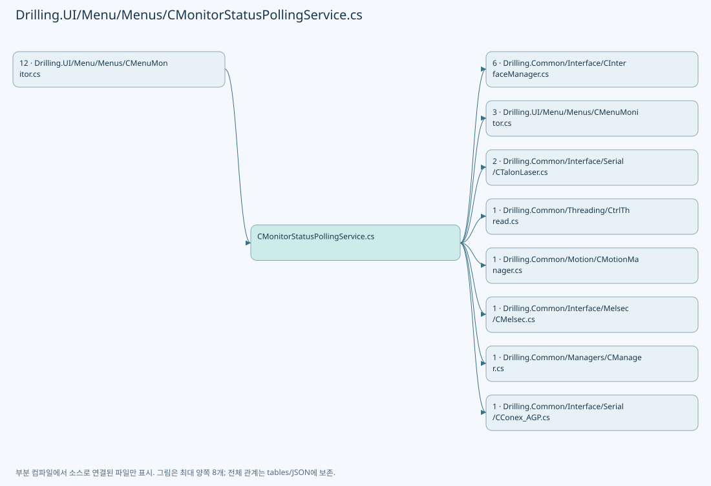

## 네임스페이스·타입·상속

| 타입 | 구분 | 원본 범위 | 선언/상속 |
| --- | --- | --- | --- |
| CMonitorStatusPollingService | ClassDeclaration | 9–455 | CMonitorStatusPollingService: CtrlThread |
| ST_MONITOR_POLLING_CONTEXT | RecordDeclaration | 457–460 | ST_MONITOR_POLLING_CONTEXT |
| ST_MONITOR_STATUS_SNAPSHOT | RecordDeclaration | 462–484 | ST_MONITOR_STATUS_SNAPSHOT |
| ST_MONITOR_MELSEC_VALUE | RecordDeclaration | 486–486 | ST_MONITOR_MELSEC_VALUE |

## 멤버 빠른 목록

| 이름 | 종류 | 범위 | 서명 |
| --- | --- | --- | --- |
| HeadCount | FieldDeclaration | L11–11 | int Drilling.UI.Menu.Menus.CMonitorStatusPollingService.HeadCount |
| LoopInterval | FieldDeclaration | L12–12 | System.TimeSpan Drilling.UI.Menu.Menus.CMonitorStatusPollingService.LoopInterval |
| ActiveInterval | FieldDeclaration | L13–13 | System.TimeSpan Drilling.UI.Menu.Menus.CMonitorStatusPollingService.ActiveInterval |
| ActivePowerMeterMeasureInterval | FieldDeclaration | L14–14 | System.TimeSpan Drilling.UI.Menu.Menus.CMonitorStatusPollingService.ActivePowerMeterMeasureInterval |
| SlowSafetyInterval | FieldDeclaration | L15–15 | System.TimeSpan Drilling.UI.Menu.Menus.CMonitorStatusPollingService.SlowSafetyInterval |
| CommunicationInterval | FieldDeclaration | L16–16 | System.TimeSpan Drilling.UI.Menu.Menus.CMonitorStatusPollingService.CommunicationInterval |
| _contextLock | FieldDeclaration | L17–17 | object Drilling.UI.Menu.Menus.CMonitorStatusPollingService._contextLock |
| _snapshotLock | FieldDeclaration | L18–18 | object Drilling.UI.Menu.Menus.CMonitorStatusPollingService._snapshotLock |
| _isActive | FieldDeclaration | L19–19 | bool Drilling.UI.Menu.Menus.CMonitorStatusPollingService._isActive |
| _motorPollLock | FieldDeclaration | L20–20 | System.Threading.SemaphoreSlim Drilling.UI.Menu.Menus.CMonitorStatusPollingService._motorPollLock |
| _context | FieldDeclaration | L21–21 | Drilling.UI.Menu.Menus.ST_MONITOR_POLLING_CONTEXT Drilling.UI.Menu.Menus.CMonitorStatusPollingService._context |
| _snapshot | FieldDeclaration | L22–22 | Drilling.UI.Menu.Menus.ST_MONITOR_STATUS_SNAPSHOT Drilling.UI.Menu.Menus.CMonitorStatusPollingService._snapshot |
| _lastCommunicationPoll | FieldDeclaration | L23–23 | System.DateTimeOffset Drilling.UI.Menu.Menus.CMonitorStatusPollingService._lastCommunicationPoll |
| _lastSuccessfulMotorPollTimestamp | FieldDeclaration | L24–24 | long? Drilling.UI.Menu.Menus.CMonitorStatusPollingService._lastSuccessfulMotorPollTimestamp |
| _lastLaserPoll | FieldDeclaration | L25–25 | System.DateTimeOffset Drilling.UI.Menu.Menus.CMonitorStatusPollingService._lastLaserPoll |
| _lastAttenuatorPoll | FieldDeclaration | L26–26 | System.DateTimeOffset Drilling.UI.Menu.Menus.CMonitorStatusPollingService._lastAttenuatorPoll |
| _lastBetPoll | FieldDeclaration | L27–27 | System.DateTimeOffset Drilling.UI.Menu.Menus.CMonitorStatusPollingService._lastBetPoll |
| _lastPowerMeterPoll | FieldDeclaration | L28–28 | System.DateTimeOffset Drilling.UI.Menu.Menus.CMonitorStatusPollingService._lastPowerMeterPoll |
| _lastPicoMotorPoll | FieldDeclaration | L29–29 | System.DateTimeOffset Drilling.UI.Menu.Menus.CMonitorStatusPollingService._lastPicoMotorPoll |
| _communicationPollRunning | FieldDeclaration | L30–30 | int Drilling.UI.Menu.Menus.CMonitorStatusPollingService._communicationPollRunning |
| _activeDevicePollRunning | FieldDeclaration | L31–31 | int Drilling.UI.Menu.Menus.CMonitorStatusPollingService._activeDevicePollRunning |
| Start | MethodDeclaration | L32–35 | void Drilling.UI.Menu.Menus.CMonitorStatusPollingService.Start() |
| UpdateContext | MethodDeclaration | L37–44 | void Drilling.UI.Menu.Menus.CMonitorStatusPollingService.UpdateContext(string, int, int, int, string) |
| SetActive | MethodDeclaration | L46–52 | void Drilling.UI.Menu.Menus.CMonitorStatusPollingService.SetActive(bool) |
| GetSnapshot | MethodDeclaration | L54–60 | Drilling.UI.Menu.Menus.ST_MONITOR_STATUS_SNAPSHOT Drilling.UI.Menu.Menus.CMonitorStatusPollingService.GetSnapshot() |
| RefreshMelsecNow | MethodDeclaration | L62–62 | void Drilling.UI.Menu.Menus.CMonitorStatusPollingService.RefreshMelsecNow() |
| RefreshMotorNow | MethodDeclaration | L64–67 | void Drilling.UI.Menu.Menus.CMonitorStatusPollingService.RefreshMotorNow(System.Threading.CancellationToken) |
| Run | MethodDeclaration | L69–72 | void Drilling.UI.Menu.Menus.CMonitorStatusPollingService.Run() |
| PollDue | MethodDeclaration | L74–137 | void Drilling.UI.Menu.Menus.CMonitorStatusPollingService.PollDue(System.Threading.CancellationToken) |
| PollLaserCallback | LocalFunctionStatement | L83–86 | void PollLaserCallback(System.Threading.CancellationToken) |
| PollAttenuatorCallback | LocalFunctionStatement | L88–91 | void PollAttenuatorCallback(System.Threading.CancellationToken) |
| PollBetCallback | LocalFunctionStatement | L93–96 | void PollBetCallback(System.Threading.CancellationToken) |
| PollMelsecCallback | LocalFunctionStatement | L98–101 | void PollMelsecCallback(System.Threading.CancellationToken) |
| TryPoll | MethodDeclaration | L139–148 | void Drilling.UI.Menu.Menus.CMonitorStatusPollingService.TryPoll(System.Action<System.Threading.CancellationToken>, System.Threading.CancellationToken) |
| PollCommunication | MethodDeclaration | L150–162 | void Drilling.UI.Menu.Menus.CMonitorStatusPollingService.PollCommunication(System.Threading.CancellationToken) |
| SelectValue | LocalFunctionStatement | L153–159 | Drilling.UI.Menu.Menus.ST_MONITOR_STATUS_SNAPSHOT SelectValue(Drilling.UI.Menu.Menus.ST_MONITOR_STATUS_SNAPSHOT) |
| PollMotorWhenDue | MethodDeclaration | L164–167 | void Drilling.UI.Menu.Menus.CMonitorStatusPollingService.PollMotorWhenDue(System.Threading.CancellationToken) |
| PollMotorSerialized | MethodDeclaration | L169–186 | void Drilling.UI.Menu.Menus.CMonitorStatusPollingService.PollMotorSerialized(bool, System.Threading.CancellationToken) |
| PollMotorCore | MethodDeclaration | L188–203 | void Drilling.UI.Menu.Menus.CMonitorStatusPollingService.PollMotorCore(System.Threading.CancellationToken) |
| SelectValue | LocalFunctionStatement | L191–200 | Drilling.UI.Menu.Menus.ST_MONITOR_STATUS_SNAPSHOT SelectValue(Drilling.UI.Menu.Menus.ST_MONITOR_STATUS_SNAPSHOT) |
| PollLaser | MethodDeclaration | L205–222 | void Drilling.UI.Menu.Menus.CMonitorStatusPollingService.PollLaser(int, System.Threading.CancellationToken) |
| SelectValue | LocalFunctionStatement | L209–219 | Drilling.UI.Menu.Menus.ST_MONITOR_STATUS_SNAPSHOT SelectValue(Drilling.UI.Menu.Menus.ST_MONITOR_STATUS_SNAPSHOT) |
| PollAttenuator | MethodDeclaration | L224–239 | void Drilling.UI.Menu.Menus.CMonitorStatusPollingService.PollAttenuator(int, System.Threading.CancellationToken) |
| SelectValue | LocalFunctionStatement | L227–236 | Drilling.UI.Menu.Menus.ST_MONITOR_STATUS_SNAPSHOT SelectValue(Drilling.UI.Menu.Menus.ST_MONITOR_STATUS_SNAPSHOT) |
| PollBet | MethodDeclaration | L241–256 | void Drilling.UI.Menu.Menus.CMonitorStatusPollingService.PollBet(int, System.Threading.CancellationToken) |
| SelectValue | LocalFunctionStatement | L244–253 | Drilling.UI.Menu.Menus.ST_MONITOR_STATUS_SNAPSHOT SelectValue(Drilling.UI.Menu.Menus.ST_MONITOR_STATUS_SNAPSHOT) |
| PollPowerMeter | MethodDeclaration | L258–273 | void Drilling.UI.Menu.Menus.CMonitorStatusPollingService.PollPowerMeter(System.Threading.CancellationToken) |
| SelectValue | LocalFunctionStatement | L261–270 | Drilling.UI.Menu.Menus.ST_MONITOR_STATUS_SNAPSHOT SelectValue(Drilling.UI.Menu.Menus.ST_MONITOR_STATUS_SNAPSHOT) |
| PollPicoMotor | MethodDeclaration | L275–287 | void Drilling.UI.Menu.Menus.CMonitorStatusPollingService.PollPicoMotor(System.Threading.CancellationToken) |
| SelectValue | LocalFunctionStatement | L278–284 | Drilling.UI.Menu.Menus.ST_MONITOR_STATUS_SNAPSHOT SelectValue(Drilling.UI.Menu.Menus.ST_MONITOR_STATUS_SNAPSHOT) |
| PollMelsec | MethodDeclaration | L289–321 | void Drilling.UI.Menu.Menus.CMonitorStatusPollingService.PollMelsec(string, System.Threading.CancellationToken) |
| CreateMelsecPollingRows | MethodDeclaration | L323–346 | System.Collections.Generic.IReadOnlyList<Drilling.Common.Interface.ST_MELSEC_MAP_DATA> Drilling.UI.Menu.Menus.CMonitorStatusPollingService.CreateMelsecPollingRows(System.Collections.Generic.IReadOnlyList<Drilling.Common.Interface.ST_MELSEC_MAP_DATA>, string) |
| FormatMelsecValue | MethodDeclaration | L348–359 | string Drilling.UI.Menu.Menus.CMonitorStatusPollingService.FormatMelsecValue(Drilling.Common.Interface.ST_MELSEC_MAP_DATA, object?) |
| GetContext | MethodDeclaration | L361–367 | Drilling.UI.Menu.Menus.ST_MONITOR_POLLING_CONTEXT Drilling.UI.Menu.Menus.CMonitorStatusPollingService.GetContext() |
| SchedulePoll | MethodDeclaration | L369–396 | void Drilling.UI.Menu.Menus.CMonitorStatusPollingService.SchedulePoll(System.Action<System.Threading.CancellationToken>, bool) |
| IsActive | MethodDeclaration | L398–404 | bool Drilling.UI.Menu.Menus.CMonitorStatusPollingService.IsActive() |
| GetMotorInterval | MethodDeclaration | L406–409 | System.TimeSpan Drilling.UI.Menu.Menus.CMonitorStatusPollingService.GetMotorInterval() |
| GetPowerMeterInterval | MethodDeclaration | L411–415 | System.TimeSpan Drilling.UI.Menu.Menus.CMonitorStatusPollingService.GetPowerMeterInterval() |
| UpdateSnapshot | MethodDeclaration | L417–423 | void Drilling.UI.Menu.Menus.CMonitorStatusPollingService.UpdateSnapshot(System.Func<Drilling.UI.Menu.Menus.ST_MONITOR_STATUS_SNAPSHOT, Drilling.UI.Menu.Menus.ST_MONITOR_STATUS_SNAPSHOT>) |
| IsDue | MethodDeclaration | L425–434 | bool Drilling.UI.Menu.Menus.CMonitorStatusPollingService.IsDue(ref System.DateTimeOffset, System.DateTimeOffset, System.TimeSpan) |
| NormalizeTab | MethodDeclaration | L436–449 | string Drilling.UI.Menu.Menus.CMonitorStatusPollingService.NormalizeTab(string) |
| NormalizeMelsecGroup | MethodDeclaration | L451–454 | string Drilling.UI.Menu.Menus.CMonitorStatusPollingService.NormalizeMelsecGroup(string) |
| Default | PropertyDeclaration | L459–459 | Drilling.UI.Menu.Menus.ST_MONITOR_POLLING_CONTEXT Drilling.UI.Menu.Menus.ST_MONITOR_POLLING_CONTEXT.Default |
| get_Default | GetAccessorDeclaration | L459–459 | Drilling.UI.Menu.Menus.ST_MONITOR_POLLING_CONTEXT Drilling.UI.Menu.Menus.ST_MONITOR_POLLING_CONTEXT.Default.get |
| Empty | PropertyDeclaration | L470–483 | Drilling.UI.Menu.Menus.ST_MONITOR_STATUS_SNAPSHOT Drilling.UI.Menu.Menus.ST_MONITOR_STATUS_SNAPSHOT.Empty |
| get_Empty | GetAccessorDeclaration | L470–470 | Drilling.UI.Menu.Menus.ST_MONITOR_STATUS_SNAPSHOT Drilling.UI.Menu.Menus.ST_MONITOR_STATUS_SNAPSHOT.Empty.get |

## 멤버별 상세 계약·호출·처리 해설

### FieldDeclaration `HeadCount` · L11–11

[Drilling.UI/Menu/Menus/CMonitorStatusPollingService.cs:11–11](https://github.com/kjuws10-rgb/A3Drilling/blob/5aee8e58439c9b455cae7c9593c9be986c3e682e/Drilling.UI/Menu/Menus/CMonitorStatusPollingService.cs#L11-L11)

| 항목 | 실제 추출 값 |
| --- | --- |
| 서명 | int Drilling.UI.Menu.Menus.CMonitorStatusPollingService.HeadCount |
| 접근/수식자 | Private / private, const |
| 반환/값 타입 | int |
| 소속 타입 | NamedType:Drilling.UI.Menu.Menus.CMonitorStatusPollingService |

현재 부분 분석에서 직접 연결된 호출자는 없습니다. XAML/이벤트/인터페이스·델리게이트·외부 진입을 추가 확인해야 하며, 미사용으로 판정한 것이 아닙니다.

본문의 실제 연산·분기·예외·반환 순서(원문 위치 순):

| 원본 행 | 종류 | 주석 해설 |
| --- | --- | --- |
| 11 | variable-initializer | 변수의 초기값을 지정합니다: HeadCount = 8 |

변경 전 점검: 입력/반환 타입, 위 호출자, 예외/취소 경로, 공유 상태와 저장·전송 소비자를 함께 확인합니다. 값의 단위나 물리 방향을 이름만으로 확정하지 않습니다.

### FieldDeclaration `LoopInterval` · L12–12

[Drilling.UI/Menu/Menus/CMonitorStatusPollingService.cs:12–12](https://github.com/kjuws10-rgb/A3Drilling/blob/5aee8e58439c9b455cae7c9593c9be986c3e682e/Drilling.UI/Menu/Menus/CMonitorStatusPollingService.cs#L12-L12)

| 항목 | 실제 추출 값 |
| --- | --- |
| 서명 | System.TimeSpan Drilling.UI.Menu.Menus.CMonitorStatusPollingService.LoopInterval |
| 접근/수식자 | Private / private, static, readonly |
| 반환/값 타입 | System.TimeSpan |
| 소속 타입 | NamedType:Drilling.UI.Menu.Menus.CMonitorStatusPollingService |

현재 부분 분석에서 직접 연결된 호출자는 없습니다. XAML/이벤트/인터페이스·델리게이트·외부 진입을 추가 확인해야 하며, 미사용으로 판정한 것이 아닙니다.

호출하는 대상과 해석 범위:

| 원본 행 | 표현식 | 분석 상태 | 대상/소스 위치 |
| --- | --- | --- | --- |
| 12 | TimeSpan.FromMilliseconds | resolved | System.TimeSpan System.TimeSpan.FromMilliseconds(long) |

본문의 실제 연산·분기·예외·반환 순서(원문 위치 순):

| 원본 행 | 종류 | 주석 해설 |
| --- | --- | --- |
| 12 | call | 함수·델리게이트 또는 객체 생성자를 호출합니다: TimeSpan.FromMilliseconds(250) |
| 12 | variable-initializer | 변수의 초기값을 지정합니다: LoopInterval = TimeSpan.FromMilliseconds(250) |

변경 전 점검: 입력/반환 타입, 위 호출자, 예외/취소 경로, 공유 상태와 저장·전송 소비자를 함께 확인합니다. 값의 단위나 물리 방향을 이름만으로 확정하지 않습니다.

### FieldDeclaration `ActiveInterval` · L13–13

[Drilling.UI/Menu/Menus/CMonitorStatusPollingService.cs:13–13](https://github.com/kjuws10-rgb/A3Drilling/blob/5aee8e58439c9b455cae7c9593c9be986c3e682e/Drilling.UI/Menu/Menus/CMonitorStatusPollingService.cs#L13-L13)

| 항목 | 실제 추출 값 |
| --- | --- |
| 서명 | System.TimeSpan Drilling.UI.Menu.Menus.CMonitorStatusPollingService.ActiveInterval |
| 접근/수식자 | Private / private, static, readonly |
| 반환/값 타입 | System.TimeSpan |
| 소속 타입 | NamedType:Drilling.UI.Menu.Menus.CMonitorStatusPollingService |

현재 부분 분석에서 직접 연결된 호출자는 없습니다. XAML/이벤트/인터페이스·델리게이트·외부 진입을 추가 확인해야 하며, 미사용으로 판정한 것이 아닙니다.

호출하는 대상과 해석 범위:

| 원본 행 | 표현식 | 분석 상태 | 대상/소스 위치 |
| --- | --- | --- | --- |
| 13 | TimeSpan.FromSeconds | resolved | System.TimeSpan System.TimeSpan.FromSeconds(double) |

본문의 실제 연산·분기·예외·반환 순서(원문 위치 순):

| 원본 행 | 종류 | 주석 해설 |
| --- | --- | --- |
| 13 | call | 함수·델리게이트 또는 객체 생성자를 호출합니다: TimeSpan.FromSeconds(0.5) |
| 13 | variable-initializer | 변수의 초기값을 지정합니다: ActiveInterval = TimeSpan.FromSeconds(0.5) |

변경 전 점검: 입력/반환 타입, 위 호출자, 예외/취소 경로, 공유 상태와 저장·전송 소비자를 함께 확인합니다. 값의 단위나 물리 방향을 이름만으로 확정하지 않습니다.

### FieldDeclaration `ActivePowerMeterMeasureInterval` · L14–14

[Drilling.UI/Menu/Menus/CMonitorStatusPollingService.cs:14–14](https://github.com/kjuws10-rgb/A3Drilling/blob/5aee8e58439c9b455cae7c9593c9be986c3e682e/Drilling.UI/Menu/Menus/CMonitorStatusPollingService.cs#L14-L14)

| 항목 | 실제 추출 값 |
| --- | --- |
| 서명 | System.TimeSpan Drilling.UI.Menu.Menus.CMonitorStatusPollingService.ActivePowerMeterMeasureInterval |
| 접근/수식자 | Private / private, static, readonly |
| 반환/값 타입 | System.TimeSpan |
| 소속 타입 | NamedType:Drilling.UI.Menu.Menus.CMonitorStatusPollingService |

현재 부분 분석에서 직접 연결된 호출자는 없습니다. XAML/이벤트/인터페이스·델리게이트·외부 진입을 추가 확인해야 하며, 미사용으로 판정한 것이 아닙니다.

호출하는 대상과 해석 범위:

| 원본 행 | 표현식 | 분석 상태 | 대상/소스 위치 |
| --- | --- | --- | --- |
| 14 | TimeSpan.FromMilliseconds | resolved | System.TimeSpan System.TimeSpan.FromMilliseconds(long) |

본문의 실제 연산·분기·예외·반환 순서(원문 위치 순):

| 원본 행 | 종류 | 주석 해설 |
| --- | --- | --- |
| 14 | call | 함수·델리게이트 또는 객체 생성자를 호출합니다: TimeSpan.FromMilliseconds(500) |
| 14 | variable-initializer | 변수의 초기값을 지정합니다: ActivePowerMeterMeasureInterval = TimeSpan.FromMilliseconds(500) |

변경 전 점검: 입력/반환 타입, 위 호출자, 예외/취소 경로, 공유 상태와 저장·전송 소비자를 함께 확인합니다. 값의 단위나 물리 방향을 이름만으로 확정하지 않습니다.

### FieldDeclaration `SlowSafetyInterval` · L15–15

[Drilling.UI/Menu/Menus/CMonitorStatusPollingService.cs:15–15](https://github.com/kjuws10-rgb/A3Drilling/blob/5aee8e58439c9b455cae7c9593c9be986c3e682e/Drilling.UI/Menu/Menus/CMonitorStatusPollingService.cs#L15-L15)

| 항목 | 실제 추출 값 |
| --- | --- |
| 서명 | System.TimeSpan Drilling.UI.Menu.Menus.CMonitorStatusPollingService.SlowSafetyInterval |
| 접근/수식자 | Private / private, static, readonly |
| 반환/값 타입 | System.TimeSpan |
| 소속 타입 | NamedType:Drilling.UI.Menu.Menus.CMonitorStatusPollingService |

현재 부분 분석에서 직접 연결된 호출자는 없습니다. XAML/이벤트/인터페이스·델리게이트·외부 진입을 추가 확인해야 하며, 미사용으로 판정한 것이 아닙니다.

호출하는 대상과 해석 범위:

| 원본 행 | 표현식 | 분석 상태 | 대상/소스 위치 |
| --- | --- | --- | --- |
| 15 | TimeSpan.FromSeconds | resolved | System.TimeSpan System.TimeSpan.FromSeconds(long) |

본문의 실제 연산·분기·예외·반환 순서(원문 위치 순):

| 원본 행 | 종류 | 주석 해설 |
| --- | --- | --- |
| 15 | call | 함수·델리게이트 또는 객체 생성자를 호출합니다: TimeSpan.FromSeconds(5) |
| 15 | variable-initializer | 변수의 초기값을 지정합니다: SlowSafetyInterval = TimeSpan.FromSeconds(5) |

변경 전 점검: 입력/반환 타입, 위 호출자, 예외/취소 경로, 공유 상태와 저장·전송 소비자를 함께 확인합니다. 값의 단위나 물리 방향을 이름만으로 확정하지 않습니다.

### FieldDeclaration `CommunicationInterval` · L16–16

[Drilling.UI/Menu/Menus/CMonitorStatusPollingService.cs:16–16](https://github.com/kjuws10-rgb/A3Drilling/blob/5aee8e58439c9b455cae7c9593c9be986c3e682e/Drilling.UI/Menu/Menus/CMonitorStatusPollingService.cs#L16-L16)

| 항목 | 실제 추출 값 |
| --- | --- |
| 서명 | System.TimeSpan Drilling.UI.Menu.Menus.CMonitorStatusPollingService.CommunicationInterval |
| 접근/수식자 | Private / private, static, readonly |
| 반환/값 타입 | System.TimeSpan |
| 소속 타입 | NamedType:Drilling.UI.Menu.Menus.CMonitorStatusPollingService |

현재 부분 분석에서 직접 연결된 호출자는 없습니다. XAML/이벤트/인터페이스·델리게이트·외부 진입을 추가 확인해야 하며, 미사용으로 판정한 것이 아닙니다.

호출하는 대상과 해석 범위:

| 원본 행 | 표현식 | 분석 상태 | 대상/소스 위치 |
| --- | --- | --- | --- |
| 16 | TimeSpan.FromSeconds | resolved | System.TimeSpan System.TimeSpan.FromSeconds(long) |

본문의 실제 연산·분기·예외·반환 순서(원문 위치 순):

| 원본 행 | 종류 | 주석 해설 |
| --- | --- | --- |
| 16 | call | 함수·델리게이트 또는 객체 생성자를 호출합니다: TimeSpan.FromSeconds(1) |
| 16 | variable-initializer | 변수의 초기값을 지정합니다: CommunicationInterval = TimeSpan.FromSeconds(1) |

변경 전 점검: 입력/반환 타입, 위 호출자, 예외/취소 경로, 공유 상태와 저장·전송 소비자를 함께 확인합니다. 값의 단위나 물리 방향을 이름만으로 확정하지 않습니다.

### FieldDeclaration `_contextLock` · L17–17

[Drilling.UI/Menu/Menus/CMonitorStatusPollingService.cs:17–17](https://github.com/kjuws10-rgb/A3Drilling/blob/5aee8e58439c9b455cae7c9593c9be986c3e682e/Drilling.UI/Menu/Menus/CMonitorStatusPollingService.cs#L17-L17)

| 항목 | 실제 추출 값 |
| --- | --- |
| 서명 | object Drilling.UI.Menu.Menus.CMonitorStatusPollingService._contextLock |
| 접근/수식자 | Private / private, readonly |
| 반환/값 타입 | object |
| 소속 타입 | NamedType:Drilling.UI.Menu.Menus.CMonitorStatusPollingService |

현재 부분 분석에서 직접 연결된 호출자는 없습니다. XAML/이벤트/인터페이스·델리게이트·외부 진입을 추가 확인해야 하며, 미사용으로 판정한 것이 아닙니다.

호출하는 대상과 해석 범위:

| 원본 행 | 표현식 | 분석 상태 | 대상/소스 위치 |
| --- | --- | --- | --- |
| 17 | new | resolved | object.Object() |

본문의 실제 연산·분기·예외·반환 순서(원문 위치 순):

| 원본 행 | 종류 | 주석 해설 |
| --- | --- | --- |
| 17 | call | 함수·델리게이트 또는 객체 생성자를 호출합니다: new() |
| 17 | variable-initializer | 변수의 초기값을 지정합니다: _contextLock = new() |

변경 전 점검: 입력/반환 타입, 위 호출자, 예외/취소 경로, 공유 상태와 저장·전송 소비자를 함께 확인합니다. 값의 단위나 물리 방향을 이름만으로 확정하지 않습니다.

### FieldDeclaration `_snapshotLock` · L18–18

[Drilling.UI/Menu/Menus/CMonitorStatusPollingService.cs:18–18](https://github.com/kjuws10-rgb/A3Drilling/blob/5aee8e58439c9b455cae7c9593c9be986c3e682e/Drilling.UI/Menu/Menus/CMonitorStatusPollingService.cs#L18-L18)

| 항목 | 실제 추출 값 |
| --- | --- |
| 서명 | object Drilling.UI.Menu.Menus.CMonitorStatusPollingService._snapshotLock |
| 접근/수식자 | Private / private, readonly |
| 반환/값 타입 | object |
| 소속 타입 | NamedType:Drilling.UI.Menu.Menus.CMonitorStatusPollingService |

현재 부분 분석에서 직접 연결된 호출자는 없습니다. XAML/이벤트/인터페이스·델리게이트·외부 진입을 추가 확인해야 하며, 미사용으로 판정한 것이 아닙니다.

호출하는 대상과 해석 범위:

| 원본 행 | 표현식 | 분석 상태 | 대상/소스 위치 |
| --- | --- | --- | --- |
| 18 | new | resolved | object.Object() |

본문의 실제 연산·분기·예외·반환 순서(원문 위치 순):

| 원본 행 | 종류 | 주석 해설 |
| --- | --- | --- |
| 18 | call | 함수·델리게이트 또는 객체 생성자를 호출합니다: new() |
| 18 | variable-initializer | 변수의 초기값을 지정합니다: _snapshotLock = new() |

변경 전 점검: 입력/반환 타입, 위 호출자, 예외/취소 경로, 공유 상태와 저장·전송 소비자를 함께 확인합니다. 값의 단위나 물리 방향을 이름만으로 확정하지 않습니다.

### FieldDeclaration `_isActive` · L19–19

[Drilling.UI/Menu/Menus/CMonitorStatusPollingService.cs:19–19](https://github.com/kjuws10-rgb/A3Drilling/blob/5aee8e58439c9b455cae7c9593c9be986c3e682e/Drilling.UI/Menu/Menus/CMonitorStatusPollingService.cs#L19-L19)

| 항목 | 실제 추출 값 |
| --- | --- |
| 서명 | bool Drilling.UI.Menu.Menus.CMonitorStatusPollingService._isActive |
| 접근/수식자 | Private / private |
| 반환/값 타입 | bool |
| 소속 타입 | NamedType:Drilling.UI.Menu.Menus.CMonitorStatusPollingService |

현재 부분 분석에서 직접 연결된 호출자는 없습니다. XAML/이벤트/인터페이스·델리게이트·외부 진입을 추가 확인해야 하며, 미사용으로 판정한 것이 아닙니다.

변경 전 점검: 입력/반환 타입, 위 호출자, 예외/취소 경로, 공유 상태와 저장·전송 소비자를 함께 확인합니다. 값의 단위나 물리 방향을 이름만으로 확정하지 않습니다.

### FieldDeclaration `_motorPollLock` · L20–20

[Drilling.UI/Menu/Menus/CMonitorStatusPollingService.cs:20–20](https://github.com/kjuws10-rgb/A3Drilling/blob/5aee8e58439c9b455cae7c9593c9be986c3e682e/Drilling.UI/Menu/Menus/CMonitorStatusPollingService.cs#L20-L20)

| 항목 | 실제 추출 값 |
| --- | --- |
| 서명 | System.Threading.SemaphoreSlim Drilling.UI.Menu.Menus.CMonitorStatusPollingService._motorPollLock |
| 접근/수식자 | Private / private, readonly |
| 반환/값 타입 | System.Threading.SemaphoreSlim |
| 소속 타입 | NamedType:Drilling.UI.Menu.Menus.CMonitorStatusPollingService |

현재 부분 분석에서 직접 연결된 호출자는 없습니다. XAML/이벤트/인터페이스·델리게이트·외부 진입을 추가 확인해야 하며, 미사용으로 판정한 것이 아닙니다.

호출하는 대상과 해석 범위:

| 원본 행 | 표현식 | 분석 상태 | 대상/소스 위치 |
| --- | --- | --- | --- |
| 20 | new | resolved | System.Threading.SemaphoreSlim.SemaphoreSlim(int, int) |

본문의 실제 연산·분기·예외·반환 순서(원문 위치 순):

| 원본 행 | 종류 | 주석 해설 |
| --- | --- | --- |
| 20 | call | 함수·델리게이트 또는 객체 생성자를 호출합니다: new(1, 1) |
| 20 | variable-initializer | 변수의 초기값을 지정합니다: _motorPollLock = new(1, 1) |

변경 전 점검: 입력/반환 타입, 위 호출자, 예외/취소 경로, 공유 상태와 저장·전송 소비자를 함께 확인합니다. 값의 단위나 물리 방향을 이름만으로 확정하지 않습니다.

### FieldDeclaration `_context` · L21–21

[Drilling.UI/Menu/Menus/CMonitorStatusPollingService.cs:21–21](https://github.com/kjuws10-rgb/A3Drilling/blob/5aee8e58439c9b455cae7c9593c9be986c3e682e/Drilling.UI/Menu/Menus/CMonitorStatusPollingService.cs#L21-L21)

| 항목 | 실제 추출 값 |
| --- | --- |
| 서명 | Drilling.UI.Menu.Menus.ST_MONITOR_POLLING_CONTEXT Drilling.UI.Menu.Menus.CMonitorStatusPollingService._context |
| 접근/수식자 | Private / private |
| 반환/값 타입 | Drilling.UI.Menu.Menus.ST_MONITOR_POLLING_CONTEXT |
| 소속 타입 | NamedType:Drilling.UI.Menu.Menus.CMonitorStatusPollingService |

현재 부분 분석에서 직접 연결된 호출자는 없습니다. XAML/이벤트/인터페이스·델리게이트·외부 진입을 추가 확인해야 하며, 미사용으로 판정한 것이 아닙니다.

본문의 실제 연산·분기·예외·반환 순서(원문 위치 순):

| 원본 행 | 종류 | 주석 해설 |
| --- | --- | --- |
| 21 | variable-initializer | 변수의 초기값을 지정합니다: _context = ST_MONITOR_POLLING_CONTEXT.Default |

변경 전 점검: 입력/반환 타입, 위 호출자, 예외/취소 경로, 공유 상태와 저장·전송 소비자를 함께 확인합니다. 값의 단위나 물리 방향을 이름만으로 확정하지 않습니다.

### FieldDeclaration `_snapshot` · L22–22

[Drilling.UI/Menu/Menus/CMonitorStatusPollingService.cs:22–22](https://github.com/kjuws10-rgb/A3Drilling/blob/5aee8e58439c9b455cae7c9593c9be986c3e682e/Drilling.UI/Menu/Menus/CMonitorStatusPollingService.cs#L22-L22)

| 항목 | 실제 추출 값 |
| --- | --- |
| 서명 | Drilling.UI.Menu.Menus.ST_MONITOR_STATUS_SNAPSHOT Drilling.UI.Menu.Menus.CMonitorStatusPollingService._snapshot |
| 접근/수식자 | Private / private |
| 반환/값 타입 | Drilling.UI.Menu.Menus.ST_MONITOR_STATUS_SNAPSHOT |
| 소속 타입 | NamedType:Drilling.UI.Menu.Menus.CMonitorStatusPollingService |

현재 부분 분석에서 직접 연결된 호출자는 없습니다. XAML/이벤트/인터페이스·델리게이트·외부 진입을 추가 확인해야 하며, 미사용으로 판정한 것이 아닙니다.

본문의 실제 연산·분기·예외·반환 순서(원문 위치 순):

| 원본 행 | 종류 | 주석 해설 |
| --- | --- | --- |
| 22 | variable-initializer | 변수의 초기값을 지정합니다: _snapshot = ST_MONITOR_STATUS_SNAPSHOT.Empty |

변경 전 점검: 입력/반환 타입, 위 호출자, 예외/취소 경로, 공유 상태와 저장·전송 소비자를 함께 확인합니다. 값의 단위나 물리 방향을 이름만으로 확정하지 않습니다.

### FieldDeclaration `_lastCommunicationPoll` · L23–23

[Drilling.UI/Menu/Menus/CMonitorStatusPollingService.cs:23–23](https://github.com/kjuws10-rgb/A3Drilling/blob/5aee8e58439c9b455cae7c9593c9be986c3e682e/Drilling.UI/Menu/Menus/CMonitorStatusPollingService.cs#L23-L23)

| 항목 | 실제 추출 값 |
| --- | --- |
| 서명 | System.DateTimeOffset Drilling.UI.Menu.Menus.CMonitorStatusPollingService._lastCommunicationPoll |
| 접근/수식자 | Private / private |
| 반환/값 타입 | System.DateTimeOffset |
| 소속 타입 | NamedType:Drilling.UI.Menu.Menus.CMonitorStatusPollingService |

현재 부분 분석에서 직접 연결된 호출자는 없습니다. XAML/이벤트/인터페이스·델리게이트·외부 진입을 추가 확인해야 하며, 미사용으로 판정한 것이 아닙니다.

본문의 실제 연산·분기·예외·반환 순서(원문 위치 순):

| 원본 행 | 종류 | 주석 해설 |
| --- | --- | --- |
| 23 | variable-initializer | 변수의 초기값을 지정합니다: _lastCommunicationPoll = DateTimeOffset.MinValue |

변경 전 점검: 입력/반환 타입, 위 호출자, 예외/취소 경로, 공유 상태와 저장·전송 소비자를 함께 확인합니다. 값의 단위나 물리 방향을 이름만으로 확정하지 않습니다.

### FieldDeclaration `_lastSuccessfulMotorPollTimestamp` · L24–24

[Drilling.UI/Menu/Menus/CMonitorStatusPollingService.cs:24–24](https://github.com/kjuws10-rgb/A3Drilling/blob/5aee8e58439c9b455cae7c9593c9be986c3e682e/Drilling.UI/Menu/Menus/CMonitorStatusPollingService.cs#L24-L24)

| 항목 | 실제 추출 값 |
| --- | --- |
| 서명 | long? Drilling.UI.Menu.Menus.CMonitorStatusPollingService._lastSuccessfulMotorPollTimestamp |
| 접근/수식자 | Private / private |
| 반환/값 타입 | long? |
| 소속 타입 | NamedType:Drilling.UI.Menu.Menus.CMonitorStatusPollingService |

현재 부분 분석에서 직접 연결된 호출자는 없습니다. XAML/이벤트/인터페이스·델리게이트·외부 진입을 추가 확인해야 하며, 미사용으로 판정한 것이 아닙니다.

변경 전 점검: 입력/반환 타입, 위 호출자, 예외/취소 경로, 공유 상태와 저장·전송 소비자를 함께 확인합니다. 값의 단위나 물리 방향을 이름만으로 확정하지 않습니다.

### FieldDeclaration `_lastLaserPoll` · L25–25

[Drilling.UI/Menu/Menus/CMonitorStatusPollingService.cs:25–25](https://github.com/kjuws10-rgb/A3Drilling/blob/5aee8e58439c9b455cae7c9593c9be986c3e682e/Drilling.UI/Menu/Menus/CMonitorStatusPollingService.cs#L25-L25)

| 항목 | 실제 추출 값 |
| --- | --- |
| 서명 | System.DateTimeOffset Drilling.UI.Menu.Menus.CMonitorStatusPollingService._lastLaserPoll |
| 접근/수식자 | Private / private |
| 반환/값 타입 | System.DateTimeOffset |
| 소속 타입 | NamedType:Drilling.UI.Menu.Menus.CMonitorStatusPollingService |

현재 부분 분석에서 직접 연결된 호출자는 없습니다. XAML/이벤트/인터페이스·델리게이트·외부 진입을 추가 확인해야 하며, 미사용으로 판정한 것이 아닙니다.

본문의 실제 연산·분기·예외·반환 순서(원문 위치 순):

| 원본 행 | 종류 | 주석 해설 |
| --- | --- | --- |
| 25 | variable-initializer | 변수의 초기값을 지정합니다: _lastLaserPoll = DateTimeOffset.MinValue |

변경 전 점검: 입력/반환 타입, 위 호출자, 예외/취소 경로, 공유 상태와 저장·전송 소비자를 함께 확인합니다. 값의 단위나 물리 방향을 이름만으로 확정하지 않습니다.

### FieldDeclaration `_lastAttenuatorPoll` · L26–26

[Drilling.UI/Menu/Menus/CMonitorStatusPollingService.cs:26–26](https://github.com/kjuws10-rgb/A3Drilling/blob/5aee8e58439c9b455cae7c9593c9be986c3e682e/Drilling.UI/Menu/Menus/CMonitorStatusPollingService.cs#L26-L26)

| 항목 | 실제 추출 값 |
| --- | --- |
| 서명 | System.DateTimeOffset Drilling.UI.Menu.Menus.CMonitorStatusPollingService._lastAttenuatorPoll |
| 접근/수식자 | Private / private |
| 반환/값 타입 | System.DateTimeOffset |
| 소속 타입 | NamedType:Drilling.UI.Menu.Menus.CMonitorStatusPollingService |

현재 부분 분석에서 직접 연결된 호출자는 없습니다. XAML/이벤트/인터페이스·델리게이트·외부 진입을 추가 확인해야 하며, 미사용으로 판정한 것이 아닙니다.

본문의 실제 연산·분기·예외·반환 순서(원문 위치 순):

| 원본 행 | 종류 | 주석 해설 |
| --- | --- | --- |
| 26 | variable-initializer | 변수의 초기값을 지정합니다: _lastAttenuatorPoll = DateTimeOffset.MinValue |

변경 전 점검: 입력/반환 타입, 위 호출자, 예외/취소 경로, 공유 상태와 저장·전송 소비자를 함께 확인합니다. 값의 단위나 물리 방향을 이름만으로 확정하지 않습니다.

### FieldDeclaration `_lastBetPoll` · L27–27

[Drilling.UI/Menu/Menus/CMonitorStatusPollingService.cs:27–27](https://github.com/kjuws10-rgb/A3Drilling/blob/5aee8e58439c9b455cae7c9593c9be986c3e682e/Drilling.UI/Menu/Menus/CMonitorStatusPollingService.cs#L27-L27)

| 항목 | 실제 추출 값 |
| --- | --- |
| 서명 | System.DateTimeOffset Drilling.UI.Menu.Menus.CMonitorStatusPollingService._lastBetPoll |
| 접근/수식자 | Private / private |
| 반환/값 타입 | System.DateTimeOffset |
| 소속 타입 | NamedType:Drilling.UI.Menu.Menus.CMonitorStatusPollingService |

현재 부분 분석에서 직접 연결된 호출자는 없습니다. XAML/이벤트/인터페이스·델리게이트·외부 진입을 추가 확인해야 하며, 미사용으로 판정한 것이 아닙니다.

본문의 실제 연산·분기·예외·반환 순서(원문 위치 순):

| 원본 행 | 종류 | 주석 해설 |
| --- | --- | --- |
| 27 | variable-initializer | 변수의 초기값을 지정합니다: _lastBetPoll = DateTimeOffset.MinValue |

변경 전 점검: 입력/반환 타입, 위 호출자, 예외/취소 경로, 공유 상태와 저장·전송 소비자를 함께 확인합니다. 값의 단위나 물리 방향을 이름만으로 확정하지 않습니다.

### FieldDeclaration `_lastPowerMeterPoll` · L28–28

[Drilling.UI/Menu/Menus/CMonitorStatusPollingService.cs:28–28](https://github.com/kjuws10-rgb/A3Drilling/blob/5aee8e58439c9b455cae7c9593c9be986c3e682e/Drilling.UI/Menu/Menus/CMonitorStatusPollingService.cs#L28-L28)

| 항목 | 실제 추출 값 |
| --- | --- |
| 서명 | System.DateTimeOffset Drilling.UI.Menu.Menus.CMonitorStatusPollingService._lastPowerMeterPoll |
| 접근/수식자 | Private / private |
| 반환/값 타입 | System.DateTimeOffset |
| 소속 타입 | NamedType:Drilling.UI.Menu.Menus.CMonitorStatusPollingService |

현재 부분 분석에서 직접 연결된 호출자는 없습니다. XAML/이벤트/인터페이스·델리게이트·외부 진입을 추가 확인해야 하며, 미사용으로 판정한 것이 아닙니다.

본문의 실제 연산·분기·예외·반환 순서(원문 위치 순):

| 원본 행 | 종류 | 주석 해설 |
| --- | --- | --- |
| 28 | variable-initializer | 변수의 초기값을 지정합니다: _lastPowerMeterPoll = DateTimeOffset.MinValue |

변경 전 점검: 입력/반환 타입, 위 호출자, 예외/취소 경로, 공유 상태와 저장·전송 소비자를 함께 확인합니다. 값의 단위나 물리 방향을 이름만으로 확정하지 않습니다.

### FieldDeclaration `_lastPicoMotorPoll` · L29–29

[Drilling.UI/Menu/Menus/CMonitorStatusPollingService.cs:29–29](https://github.com/kjuws10-rgb/A3Drilling/blob/5aee8e58439c9b455cae7c9593c9be986c3e682e/Drilling.UI/Menu/Menus/CMonitorStatusPollingService.cs#L29-L29)

| 항목 | 실제 추출 값 |
| --- | --- |
| 서명 | System.DateTimeOffset Drilling.UI.Menu.Menus.CMonitorStatusPollingService._lastPicoMotorPoll |
| 접근/수식자 | Private / private |
| 반환/값 타입 | System.DateTimeOffset |
| 소속 타입 | NamedType:Drilling.UI.Menu.Menus.CMonitorStatusPollingService |

현재 부분 분석에서 직접 연결된 호출자는 없습니다. XAML/이벤트/인터페이스·델리게이트·외부 진입을 추가 확인해야 하며, 미사용으로 판정한 것이 아닙니다.

본문의 실제 연산·분기·예외·반환 순서(원문 위치 순):

| 원본 행 | 종류 | 주석 해설 |
| --- | --- | --- |
| 29 | variable-initializer | 변수의 초기값을 지정합니다: _lastPicoMotorPoll = DateTimeOffset.MinValue |

변경 전 점검: 입력/반환 타입, 위 호출자, 예외/취소 경로, 공유 상태와 저장·전송 소비자를 함께 확인합니다. 값의 단위나 물리 방향을 이름만으로 확정하지 않습니다.

### FieldDeclaration `_communicationPollRunning` · L30–30

[Drilling.UI/Menu/Menus/CMonitorStatusPollingService.cs:30–30](https://github.com/kjuws10-rgb/A3Drilling/blob/5aee8e58439c9b455cae7c9593c9be986c3e682e/Drilling.UI/Menu/Menus/CMonitorStatusPollingService.cs#L30-L30)

| 항목 | 실제 추출 값 |
| --- | --- |
| 서명 | int Drilling.UI.Menu.Menus.CMonitorStatusPollingService._communicationPollRunning |
| 접근/수식자 | Private / private |
| 반환/값 타입 | int |
| 소속 타입 | NamedType:Drilling.UI.Menu.Menus.CMonitorStatusPollingService |

현재 부분 분석에서 직접 연결된 호출자는 없습니다. XAML/이벤트/인터페이스·델리게이트·외부 진입을 추가 확인해야 하며, 미사용으로 판정한 것이 아닙니다.

변경 전 점검: 입력/반환 타입, 위 호출자, 예외/취소 경로, 공유 상태와 저장·전송 소비자를 함께 확인합니다. 값의 단위나 물리 방향을 이름만으로 확정하지 않습니다.

### FieldDeclaration `_activeDevicePollRunning` · L31–31

[Drilling.UI/Menu/Menus/CMonitorStatusPollingService.cs:31–31](https://github.com/kjuws10-rgb/A3Drilling/blob/5aee8e58439c9b455cae7c9593c9be986c3e682e/Drilling.UI/Menu/Menus/CMonitorStatusPollingService.cs#L31-L31)

| 항목 | 실제 추출 값 |
| --- | --- |
| 서명 | int Drilling.UI.Menu.Menus.CMonitorStatusPollingService._activeDevicePollRunning |
| 접근/수식자 | Private / private |
| 반환/값 타입 | int |
| 소속 타입 | NamedType:Drilling.UI.Menu.Menus.CMonitorStatusPollingService |

현재 부분 분석에서 직접 연결된 호출자는 없습니다. XAML/이벤트/인터페이스·델리게이트·외부 진입을 추가 확인해야 하며, 미사용으로 판정한 것이 아닙니다.

변경 전 점검: 입력/반환 타입, 위 호출자, 예외/취소 경로, 공유 상태와 저장·전송 소비자를 함께 확인합니다. 값의 단위나 물리 방향을 이름만으로 확정하지 않습니다.

### MethodDeclaration `Start` · L32–35

[Drilling.UI/Menu/Menus/CMonitorStatusPollingService.cs:32–35](https://github.com/kjuws10-rgb/A3Drilling/blob/5aee8e58439c9b455cae7c9593c9be986c3e682e/Drilling.UI/Menu/Menus/CMonitorStatusPollingService.cs#L32-L35)

| 항목 | 실제 추출 값 |
| --- | --- |
| 서명 | void Drilling.UI.Menu.Menus.CMonitorStatusPollingService.Start() |
| 접근/수식자 | Public / public |
| 반환/값 타입 | void |
| 소속 타입 | NamedType:Drilling.UI.Menu.Menus.CMonitorStatusPollingService |

정적 호출자로 확인된 위치:

| 호출 파일/행 | 호출 표현식 | 런타임 분기 가능 |
| --- | --- | --- |
| [Drilling.UI/Menu/Menus/CMenuMonitor.cs:673–673](https://github.com/kjuws10-rgb/A3Drilling/blob/5aee8e58439c9b455cae7c9593c9be986c3e682e/Drilling.UI/Menu/Menus/CMenuMonitor.cs#L673-L673) | _statusPollingService.Start | False |
| [Drilling.UI/Menu/Menus/CMenuMonitor.cs:841–841](https://github.com/kjuws10-rgb/A3Drilling/blob/5aee8e58439c9b455cae7c9593c9be986c3e682e/Drilling.UI/Menu/Menus/CMenuMonitor.cs#L841-L841) | _statusPollingService.Start | False |

호출하는 대상과 해석 범위:

| 원본 행 | 표현식 | 분석 상태 | 대상/소스 위치 |
| --- | --- | --- | --- |
| 34 | base.Start | resolved | void Drilling.Common.Threading.CtrlThread.Start(int, string) · Drilling.Common/Threading/CtrlThread.cs:60 |

본문의 실제 연산·분기·예외·반환 순서(원문 위치 순):

| 원본 행 | 종류 | 주석 해설 |
| --- | --- | --- |
| 34 | call | 함수·델리게이트 또는 객체 생성자를 호출합니다: base.Start((int)LoopInterval.TotalMilliseconds, "MonitorStatusPolling") |

변경 전 점검: 입력/반환 타입, 위 호출자, 예외/취소 경로, 공유 상태와 저장·전송 소비자를 함께 확인합니다. 값의 단위나 물리 방향을 이름만으로 확정하지 않습니다.

### MethodDeclaration `UpdateContext` · L37–44

[Drilling.UI/Menu/Menus/CMonitorStatusPollingService.cs:37–44](https://github.com/kjuws10-rgb/A3Drilling/blob/5aee8e58439c9b455cae7c9593c9be986c3e682e/Drilling.UI/Menu/Menus/CMonitorStatusPollingService.cs#L37-L44)

| 항목 | 실제 추출 값 |
| --- | --- |
| 서명 | void Drilling.UI.Menu.Menus.CMonitorStatusPollingService.UpdateContext(string, int, int, int, string) |
| 접근/수식자 | Public / public |
| 반환/값 타입 | void |
| 소속 타입 | NamedType:Drilling.UI.Menu.Menus.CMonitorStatusPollingService |

입력 계약:

| 이름 | 타입 | 전달 | 선택/기본값 |
| --- | --- | --- | --- |
| selectedTab | string | None | False /  |
| laserNumber | int | None | False /  |
| attenuatorNumber | int | None | False /  |
| betNumber | int | None | False /  |
| melsecGroup | string | None | False /  |

정적 호출자로 확인된 위치:

| 호출 파일/행 | 호출 표현식 | 런타임 분기 가능 |
| --- | --- | --- |
| [Drilling.UI/Menu/Menus/CMenuMonitor.cs:1045–1045](https://github.com/kjuws10-rgb/A3Drilling/blob/5aee8e58439c9b455cae7c9593c9be986c3e682e/Drilling.UI/Menu/Menus/CMenuMonitor.cs#L1045-L1045) | _statusPollingService.UpdateContext | False |

호출하는 대상과 해석 범위:

| 원본 행 | 표현식 | 분석 상태 | 대상/소스 위치 |
| --- | --- | --- | --- |
| 39 | new ST_MONITOR_POLLING_CONTEXT | resolved | Drilling.UI.Menu.Menus.ST_MONITOR_POLLING_CONTEXT.ST_MONITOR_POLLING_CONTEXT(string, int, int, int, string) · Drilling.UI/Menu/Menus/CMonitorStatusPollingService.cs:457 |
| 39 | NormalizeTab | resolved | string Drilling.UI.Menu.Menus.CMonitorStatusPollingService.NormalizeTab(string) · Drilling.UI/Menu/Menus/CMonitorStatusPollingService.cs:436 |
| 39 | Math.Clamp | resolved | int System.Math.Clamp(int, int, int) |
| 39 | Math.Clamp | resolved | int System.Math.Clamp(int, int, int) |
| 39 | Math.Clamp | resolved | int System.Math.Clamp(int, int, int) |
| 39 | NormalizeMelsecGroup | resolved | string Drilling.UI.Menu.Menus.CMonitorStatusPollingService.NormalizeMelsecGroup(string) · Drilling.UI/Menu/Menus/CMonitorStatusPollingService.cs:451 |

본문의 실제 연산·분기·예외·반환 순서(원문 위치 순):

| 원본 행 | 종류 | 주석 해설 |
| --- | --- | --- |
| 39 | call | 함수·델리게이트 또는 객체 생성자를 호출합니다: new ST_MONITOR_POLLING_CONTEXT(NormalizeTab(selectedTab), Math.Clamp(laserNumber, 0, HeadCount - 1), Math.Clamp(attenuatorNumber, 0, HeadCount - 1), Math.Clamp(betNumber, 0, HeadCount - 1), NormalizeMelsecGroup(melsecGro… |
| 39 | call | 함수·델리게이트 또는 객체 생성자를 호출합니다: NormalizeTab(selectedTab) |
| 39 | call | 함수·델리게이트 또는 객체 생성자를 호출합니다: Math.Clamp(laserNumber, 0, HeadCount - 1) |
| 39 | call | 함수·델리게이트 또는 객체 생성자를 호출합니다: Math.Clamp(attenuatorNumber, 0, HeadCount - 1) |
| 39 | call | 함수·델리게이트 또는 객체 생성자를 호출합니다: Math.Clamp(betNumber, 0, HeadCount - 1) |
| 39 | call | 함수·델리게이트 또는 객체 생성자를 호출합니다: NormalizeMelsecGroup(melsecGroup) |
| 39 | local-declaration | 지역 변수를 선언합니다: var nextContext = new ST_MONITOR_POLLING_CONTEXT(NormalizeTab(selectedTab), Math.Clamp(laserNumber, 0, HeadCount - 1), Math.Clamp(attenuatorNumber, 0, HeadCount - 1), Math.Clamp(betNumber, 0, HeadCount - 1), NormalizeMelsecGroup(m |
| 39 | variable-initializer | 변수의 초기값을 지정합니다: nextContext = new ST_MONITOR_POLLING_CONTEXT(NormalizeTab(selectedTab), Math.Clamp(laserNumber, 0, HeadCount - 1), Math.Clamp(attenuatorNumber, 0, HeadCount - 1), Math.Clamp(betNumber, 0, HeadCount - 1), NormalizeMelsecGroup(melse |
| 40 | lock | 공유 상태의 임계 구역에 진입합니다: lock (_contextLock) |
| 42 | assignment | 값을 대상에 대입합니다: _context = nextContext |

제어 구문의 포함 구조(실제 실행 순서/CFG가 아닌 구문 탐색 그림):

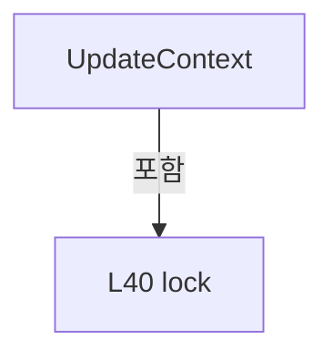

변경 전 점검: 입력/반환 타입, 위 호출자, 예외/취소 경로, 공유 상태와 저장·전송 소비자를 함께 확인합니다. 값의 단위나 물리 방향을 이름만으로 확정하지 않습니다.

### MethodDeclaration `SetActive` · L46–52

[Drilling.UI/Menu/Menus/CMonitorStatusPollingService.cs:46–52](https://github.com/kjuws10-rgb/A3Drilling/blob/5aee8e58439c9b455cae7c9593c9be986c3e682e/Drilling.UI/Menu/Menus/CMonitorStatusPollingService.cs#L46-L52)

| 항목 | 실제 추출 값 |
| --- | --- |
| 서명 | void Drilling.UI.Menu.Menus.CMonitorStatusPollingService.SetActive(bool) |
| 접근/수식자 | Public / public |
| 반환/값 타입 | void |
| 소속 타입 | NamedType:Drilling.UI.Menu.Menus.CMonitorStatusPollingService |

입력 계약:

| 이름 | 타입 | 전달 | 선택/기본값 |
| --- | --- | --- | --- |
| active | bool | None | False /  |

정적 호출자로 확인된 위치:

| 호출 파일/행 | 호출 표현식 | 런타임 분기 가능 |
| --- | --- | --- |
| [Drilling.UI/Menu/Menus/CMenuMonitor.cs:647–647](https://github.com/kjuws10-rgb/A3Drilling/blob/5aee8e58439c9b455cae7c9593c9be986c3e682e/Drilling.UI/Menu/Menus/CMenuMonitor.cs#L647-L647) | _statusPollingService.SetActive | False |
| [Drilling.UI/Menu/Menus/CMenuMonitor.cs:2553–2553](https://github.com/kjuws10-rgb/A3Drilling/blob/5aee8e58439c9b455cae7c9593c9be986c3e682e/Drilling.UI/Menu/Menus/CMenuMonitor.cs#L2553-L2553) | _statusPollingService.SetActive | False |

본문의 실제 연산·분기·예외·반환 순서(원문 위치 순):

| 원본 행 | 종류 | 주석 해설 |
| --- | --- | --- |
| 48 | lock | 공유 상태의 임계 구역에 진입합니다: lock (_contextLock) |
| 50 | assignment | 값을 대상에 대입합니다: _isActive = active |

제어 구문의 포함 구조(실제 실행 순서/CFG가 아닌 구문 탐색 그림):

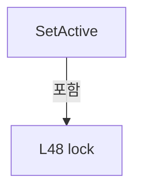

변경 전 점검: 입력/반환 타입, 위 호출자, 예외/취소 경로, 공유 상태와 저장·전송 소비자를 함께 확인합니다. 값의 단위나 물리 방향을 이름만으로 확정하지 않습니다.

### MethodDeclaration `GetSnapshot` · L54–60

[Drilling.UI/Menu/Menus/CMonitorStatusPollingService.cs:54–60](https://github.com/kjuws10-rgb/A3Drilling/blob/5aee8e58439c9b455cae7c9593c9be986c3e682e/Drilling.UI/Menu/Menus/CMonitorStatusPollingService.cs#L54-L60)

| 항목 | 실제 추출 값 |
| --- | --- |
| 서명 | Drilling.UI.Menu.Menus.ST_MONITOR_STATUS_SNAPSHOT Drilling.UI.Menu.Menus.CMonitorStatusPollingService.GetSnapshot() |
| 접근/수식자 | Public / public |
| 반환/값 타입 | Drilling.UI.Menu.Menus.ST_MONITOR_STATUS_SNAPSHOT |
| 소속 타입 | NamedType:Drilling.UI.Menu.Menus.CMonitorStatusPollingService |

정적 호출자로 확인된 위치:

| 호출 파일/행 | 호출 표현식 | 런타임 분기 가능 |
| --- | --- | --- |
| [Drilling.UI/Menu/Menus/CMenuMonitor.cs:674–674](https://github.com/kjuws10-rgb/A3Drilling/blob/5aee8e58439c9b455cae7c9593c9be986c3e682e/Drilling.UI/Menu/Menus/CMenuMonitor.cs#L674-L674) | _statusPollingService.GetSnapshot | False |
| [Drilling.UI/Menu/Menus/CMenuMonitor.cs:842–842](https://github.com/kjuws10-rgb/A3Drilling/blob/5aee8e58439c9b455cae7c9593c9be986c3e682e/Drilling.UI/Menu/Menus/CMenuMonitor.cs#L842-L842) | _statusPollingService.GetSnapshot | False |
| [Drilling.UI/Menu/Menus/CMenuMonitor.cs:2898–2898](https://github.com/kjuws10-rgb/A3Drilling/blob/5aee8e58439c9b455cae7c9593c9be986c3e682e/Drilling.UI/Menu/Menus/CMenuMonitor.cs#L2898-L2898) | _statusPollingService.GetSnapshot | False |
| [Drilling.UI/Menu/Menus/CMenuMonitor.cs:5281–5281](https://github.com/kjuws10-rgb/A3Drilling/blob/5aee8e58439c9b455cae7c9593c9be986c3e682e/Drilling.UI/Menu/Menus/CMenuMonitor.cs#L5281-L5281) | _statusPollingService.GetSnapshot | False |
| [Drilling.UI/Menu/Menus/CMonitorStatusPollingService.cs:413–413](https://github.com/kjuws10-rgb/A3Drilling/blob/5aee8e58439c9b455cae7c9593c9be986c3e682e/Drilling.UI/Menu/Menus/CMonitorStatusPollingService.cs#L413-L413) | GetSnapshot | False |

본문의 실제 연산·분기·예외·반환 순서(원문 위치 순):

| 원본 행 | 종류 | 주석 해설 |
| --- | --- | --- |
| 56 | lock | 공유 상태의 임계 구역에 진입합니다: lock (_snapshotLock) |
| 58 | return | 호출자에게 값 또는 제어를 반환합니다: return _snapshot; |

제어 구문의 포함 구조(실제 실행 순서/CFG가 아닌 구문 탐색 그림):

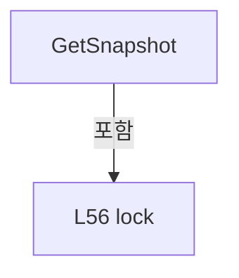

변경 전 점검: 입력/반환 타입, 위 호출자, 예외/취소 경로, 공유 상태와 저장·전송 소비자를 함께 확인합니다. 값의 단위나 물리 방향을 이름만으로 확정하지 않습니다.

### MethodDeclaration `RefreshMelsecNow` · L62–62

[Drilling.UI/Menu/Menus/CMonitorStatusPollingService.cs:62–62](https://github.com/kjuws10-rgb/A3Drilling/blob/5aee8e58439c9b455cae7c9593c9be986c3e682e/Drilling.UI/Menu/Menus/CMonitorStatusPollingService.cs#L62-L62)

| 항목 | 실제 추출 값 |
| --- | --- |
| 서명 | void Drilling.UI.Menu.Menus.CMonitorStatusPollingService.RefreshMelsecNow() |
| 접근/수식자 | Public / public |
| 반환/값 타입 | void |
| 소속 타입 | NamedType:Drilling.UI.Menu.Menus.CMonitorStatusPollingService |

정적 호출자로 확인된 위치:

| 호출 파일/행 | 호출 표현식 | 런타임 분기 가능 |
| --- | --- | --- |
| [Drilling.UI/Menu/Menus/CMenuMonitor.cs:2897–2897](https://github.com/kjuws10-rgb/A3Drilling/blob/5aee8e58439c9b455cae7c9593c9be986c3e682e/Drilling.UI/Menu/Menus/CMenuMonitor.cs#L2897-L2897) | _statusPollingService.RefreshMelsecNow | False |

호출하는 대상과 해석 범위:

| 원본 행 | 표현식 | 분석 상태 | 대상/소스 위치 |
| --- | --- | --- | --- |
| 62 | PollMelsec | resolved | void Drilling.UI.Menu.Menus.CMonitorStatusPollingService.PollMelsec(string, System.Threading.CancellationToken) · Drilling.UI/Menu/Menus/CMonitorStatusPollingService.cs:289 |
| 62 | GetContext | resolved | Drilling.UI.Menu.Menus.ST_MONITOR_POLLING_CONTEXT Drilling.UI.Menu.Menus.CMonitorStatusPollingService.GetContext() · Drilling.UI/Menu/Menus/CMonitorStatusPollingService.cs:361 |

본문의 실제 연산·분기·예외·반환 순서(원문 위치 순):

| 원본 행 | 종류 | 주석 해설 |
| --- | --- | --- |
| 62 | call | 함수·델리게이트 또는 객체 생성자를 호출합니다: PollMelsec(GetContext().MelsecGroup, CancellationToken.None) |
| 62 | call | 함수·델리게이트 또는 객체 생성자를 호출합니다: GetContext() |

변경 전 점검: 입력/반환 타입, 위 호출자, 예외/취소 경로, 공유 상태와 저장·전송 소비자를 함께 확인합니다. 값의 단위나 물리 방향을 이름만으로 확정하지 않습니다.

### MethodDeclaration `RefreshMotorNow` · L64–67

[Drilling.UI/Menu/Menus/CMonitorStatusPollingService.cs:64–67](https://github.com/kjuws10-rgb/A3Drilling/blob/5aee8e58439c9b455cae7c9593c9be986c3e682e/Drilling.UI/Menu/Menus/CMonitorStatusPollingService.cs#L64-L67)

| 항목 | 실제 추출 값 |
| --- | --- |
| 서명 | void Drilling.UI.Menu.Menus.CMonitorStatusPollingService.RefreshMotorNow(System.Threading.CancellationToken) |
| 접근/수식자 | Public / public |
| 반환/값 타입 | void |
| 소속 타입 | NamedType:Drilling.UI.Menu.Menus.CMonitorStatusPollingService |

입력 계약:

| 이름 | 타입 | 전달 | 선택/기본값 |
| --- | --- | --- | --- |
| cancellationToken | System.Threading.CancellationToken | None | True / null |

정적 호출자로 확인된 위치:

| 호출 파일/행 | 호출 표현식 | 런타임 분기 가능 |
| --- | --- | --- |
| [Drilling.UI/Menu/Menus/CMenuMonitor.cs:1244–1244](https://github.com/kjuws10-rgb/A3Drilling/blob/5aee8e58439c9b455cae7c9593c9be986c3e682e/Drilling.UI/Menu/Menus/CMenuMonitor.cs#L1244-L1244) | _statusPollingService.RefreshMotorNow | False |

호출하는 대상과 해석 범위:

| 원본 행 | 표현식 | 분석 상태 | 대상/소스 위치 |
| --- | --- | --- | --- |
| 66 | PollMotorSerialized | resolved | void Drilling.UI.Menu.Menus.CMonitorStatusPollingService.PollMotorSerialized(bool, System.Threading.CancellationToken) · Drilling.UI/Menu/Menus/CMonitorStatusPollingService.cs:169 |

본문의 실제 연산·분기·예외·반환 순서(원문 위치 순):

| 원본 행 | 종류 | 주석 해설 |
| --- | --- | --- |
| 66 | call | 함수·델리게이트 또는 객체 생성자를 호출합니다: PollMotorSerialized(true, cancellationToken) |

변경 전 점검: 입력/반환 타입, 위 호출자, 예외/취소 경로, 공유 상태와 저장·전송 소비자를 함께 확인합니다. 값의 단위나 물리 방향을 이름만으로 확정하지 않습니다.

### MethodDeclaration `Run` · L69–72

[Drilling.UI/Menu/Menus/CMonitorStatusPollingService.cs:69–72](https://github.com/kjuws10-rgb/A3Drilling/blob/5aee8e58439c9b455cae7c9593c9be986c3e682e/Drilling.UI/Menu/Menus/CMonitorStatusPollingService.cs#L69-L72)

| 항목 | 실제 추출 값 |
| --- | --- |
| 서명 | void Drilling.UI.Menu.Menus.CMonitorStatusPollingService.Run() |
| 접근/수식자 | Public / public, override |
| 반환/값 타입 | void |
| 소속 타입 | NamedType:Drilling.UI.Menu.Menus.CMonitorStatusPollingService |

현재 부분 분석에서 직접 연결된 호출자는 없습니다. XAML/이벤트/인터페이스·델리게이트·외부 진입을 추가 확인해야 하며, 미사용으로 판정한 것이 아닙니다.

호출하는 대상과 해석 범위:

| 원본 행 | 표현식 | 분석 상태 | 대상/소스 위치 |
| --- | --- | --- | --- |
| 71 | PollDue | resolved | void Drilling.UI.Menu.Menus.CMonitorStatusPollingService.PollDue(System.Threading.CancellationToken) · Drilling.UI/Menu/Menus/CMonitorStatusPollingService.cs:74 |

본문의 실제 연산·분기·예외·반환 순서(원문 위치 순):

| 원본 행 | 종류 | 주석 해설 |
| --- | --- | --- |
| 71 | call | 함수·델리게이트 또는 객체 생성자를 호출합니다: PollDue(CancellationToken.None) |

변경 전 점검: 입력/반환 타입, 위 호출자, 예외/취소 경로, 공유 상태와 저장·전송 소비자를 함께 확인합니다. 값의 단위나 물리 방향을 이름만으로 확정하지 않습니다.

### MethodDeclaration `PollDue` · L74–137

[Drilling.UI/Menu/Menus/CMonitorStatusPollingService.cs:74–137](https://github.com/kjuws10-rgb/A3Drilling/blob/5aee8e58439c9b455cae7c9593c9be986c3e682e/Drilling.UI/Menu/Menus/CMonitorStatusPollingService.cs#L74-L137)

| 항목 | 실제 추출 값 |
| --- | --- |
| 서명 | void Drilling.UI.Menu.Menus.CMonitorStatusPollingService.PollDue(System.Threading.CancellationToken) |
| 접근/수식자 | Private / private |
| 반환/값 타입 | void |
| 소속 타입 | NamedType:Drilling.UI.Menu.Menus.CMonitorStatusPollingService |

입력 계약:

| 이름 | 타입 | 전달 | 선택/기본값 |
| --- | --- | --- | --- |
| cancellationToken | System.Threading.CancellationToken | None | False /  |

정적 호출자로 확인된 위치:

| 호출 파일/행 | 호출 표현식 | 런타임 분기 가능 |
| --- | --- | --- |
| [Drilling.UI/Menu/Menus/CMonitorStatusPollingService.cs:71–71](https://github.com/kjuws10-rgb/A3Drilling/blob/5aee8e58439c9b455cae7c9593c9be986c3e682e/Drilling.UI/Menu/Menus/CMonitorStatusPollingService.cs#L71-L71) | PollDue | False |

호출하는 대상과 해석 범위:

| 원본 행 | 표현식 | 분석 상태 | 대상/소스 위치 |
| --- | --- | --- | --- |
| 76 | IsActive | resolved | bool Drilling.UI.Menu.Menus.CMonitorStatusPollingService.IsActive() · Drilling.UI/Menu/Menus/CMonitorStatusPollingService.cs:398 |
| 81 | GetContext | resolved | Drilling.UI.Menu.Menus.ST_MONITOR_POLLING_CONTEXT Drilling.UI.Menu.Menus.CMonitorStatusPollingService.GetContext() · Drilling.UI/Menu/Menus/CMonitorStatusPollingService.cs:361 |
| 103 | IsDue | resolved | bool Drilling.UI.Menu.Menus.CMonitorStatusPollingService.IsDue(ref System.DateTimeOffset, System.DateTimeOffset, System.TimeSpan) · Drilling.UI/Menu/Menus/CMonitorStatusPollingService.cs:425 |
| 105 | SchedulePoll | resolved | void Drilling.UI.Menu.Menus.CMonitorStatusPollingService.SchedulePoll(System.Action<System.Threading.CancellationToken>, bool) · Drilling.UI/Menu/Menus/CMonitorStatusPollingService.cs:369 |
| 111 | SchedulePoll | resolved | void Drilling.UI.Menu.Menus.CMonitorStatusPollingService.SchedulePoll(System.Action<System.Threading.CancellationToken>, bool) · Drilling.UI/Menu/Menus/CMonitorStatusPollingService.cs:369 |
| 113 | IsDue | resolved | bool Drilling.UI.Menu.Menus.CMonitorStatusPollingService.IsDue(ref System.DateTimeOffset, System.DateTimeOffset, System.TimeSpan) · Drilling.UI/Menu/Menus/CMonitorStatusPollingService.cs:425 |
| 114 | SchedulePoll | resolved | void Drilling.UI.Menu.Menus.CMonitorStatusPollingService.SchedulePoll(System.Action<System.Threading.CancellationToken>, bool) · Drilling.UI/Menu/Menus/CMonitorStatusPollingService.cs:369 |
| 116 | IsDue | resolved | bool Drilling.UI.Menu.Menus.CMonitorStatusPollingService.IsDue(ref System.DateTimeOffset, System.DateTimeOffset, System.TimeSpan) · Drilling.UI/Menu/Menus/CMonitorStatusPollingService.cs:425 |
| 117 | SchedulePoll | resolved | void Drilling.UI.Menu.Menus.CMonitorStatusPollingService.SchedulePoll(System.Action<System.Threading.CancellationToken>, bool) · Drilling.UI/Menu/Menus/CMonitorStatusPollingService.cs:369 |
| 119 | IsDue | resolved | bool Drilling.UI.Menu.Menus.CMonitorStatusPollingService.IsDue(ref System.DateTimeOffset, System.DateTimeOffset, System.TimeSpan) · Drilling.UI/Menu/Menus/CMonitorStatusPollingService.cs:425 |
| 120 | SchedulePoll | resolved | void Drilling.UI.Menu.Menus.CMonitorStatusPollingService.SchedulePoll(System.Action<System.Threading.CancellationToken>, bool) · Drilling.UI/Menu/Menus/CMonitorStatusPollingService.cs:369 |
| 122 | IsDue | resolved | bool Drilling.UI.Menu.Menus.CMonitorStatusPollingService.IsDue(ref System.DateTimeOffset, System.DateTimeOffset, System.TimeSpan) · Drilling.UI/Menu/Menus/CMonitorStatusPollingService.cs:425 |
| 122 | GetPowerMeterInterval | resolved | System.TimeSpan Drilling.UI.Menu.Menus.CMonitorStatusPollingService.GetPowerMeterInterval() · Drilling.UI/Menu/Menus/CMonitorStatusPollingService.cs:411 |
| 125 | IsDue | resolved | bool Drilling.UI.Menu.Menus.CMonitorStatusPollingService.IsDue(ref System.DateTimeOffset, System.DateTimeOffset, System.TimeSpan) · Drilling.UI/Menu/Menus/CMonitorStatusPollingService.cs:425 |
| 126 | SchedulePoll | resolved | void Drilling.UI.Menu.Menus.CMonitorStatusPollingService.SchedulePoll(System.Action<System.Threading.CancellationToken>, bool) · Drilling.UI/Menu/Menus/CMonitorStatusPollingService.cs:369 |
| 129 | SchedulePoll | resolved | void Drilling.UI.Menu.Menus.CMonitorStatusPollingService.SchedulePoll(System.Action<System.Threading.CancellationToken>, bool) · Drilling.UI/Menu/Menus/CMonitorStatusPollingService.cs:369 |
| 133 | IsDue | resolved | bool Drilling.UI.Menu.Menus.CMonitorStatusPollingService.IsDue(ref System.DateTimeOffset, System.DateTimeOffset, System.TimeSpan) · Drilling.UI/Menu/Menus/CMonitorStatusPollingService.cs:425 |

본문의 실제 연산·분기·예외·반환 순서(원문 위치 순):

| 원본 행 | 종류 | 주석 해설 |
| --- | --- | --- |
| 76 | call | 함수·델리게이트 또는 객체 생성자를 호출합니다: IsActive() |
| 76 | if | 조건에 따라 분기합니다: if (!IsActive()) |
| 78 | return | 호출자에게 값 또는 제어를 반환합니다: return; |
| 81 | call | 함수·델리게이트 또는 객체 생성자를 호출합니다: GetContext() |
| 81 | local-declaration | 지역 변수를 선언합니다: var context = GetContext(); |
| 81 | variable-initializer | 변수의 초기값을 지정합니다: context = GetContext() |
| 82 | local-declaration | 지역 변수를 선언합니다: var now = DateTimeOffset.Now; |
| 82 | variable-initializer | 변수의 초기값을 지정합니다: now = DateTimeOffset.Now |
| 103 | call | 함수·델리게이트 또는 객체 생성자를 호출합니다: IsDue(ref _lastCommunicationPoll, now, CommunicationInterval) |
| 103 | if | 조건에 따라 분기합니다: if (IsDue(ref _lastCommunicationPoll, now, CommunicationInterval)) |
| 105 | call | 함수·델리게이트 또는 객체 생성자를 호출합니다: SchedulePoll(PollCommunication, communicationPoll: true) |
| 108 | switch | 값에 따라 분기합니다: switch (context.SelectedTab) |
| 110 | case | 분기값/패턴의 구간입니다: case "XPS": |
| 111 | call | 함수·델리게이트 또는 객체 생성자를 호출합니다: SchedulePoll(PollMotorWhenDue, communicationPoll: false) |
| 112 | break | 해당 반복/분기 구간을 종료합니다: break; |
| 113 | call | 함수·델리게이트 또는 객체 생성자를 호출합니다: IsDue(ref _lastLaserPoll, now, ActiveInterval) |
| 113 | case | 분기값/패턴의 구간입니다: case "LASER" when IsDue(ref _lastLaserPoll, now, ActiveInterval): |
| 114 | call | 함수·델리게이트 또는 객체 생성자를 호출합니다: SchedulePoll(PollLaserCallback, communicationPoll: false) |
| 115 | break | 해당 반복/분기 구간을 종료합니다: break; |
| 116 | call | 함수·델리게이트 또는 객체 생성자를 호출합니다: IsDue(ref _lastAttenuatorPoll, now, ActiveInterval) |
| 116 | case | 분기값/패턴의 구간입니다: case "ATTENUATOR" when IsDue(ref _lastAttenuatorPoll, now, ActiveInterval): |
| 117 | call | 함수·델리게이트 또는 객체 생성자를 호출합니다: SchedulePoll(PollAttenuatorCallback, communicationPoll: false) |
| 118 | break | 해당 반복/분기 구간을 종료합니다: break; |
| 119 | call | 함수·델리게이트 또는 객체 생성자를 호출합니다: IsDue(ref _lastBetPoll, now, ActiveInterval) |
| 119 | case | 분기값/패턴의 구간입니다: case "BET" when IsDue(ref _lastBetPoll, now, ActiveInterval): |
| 120 | call | 함수·델리게이트 또는 객체 생성자를 호출합니다: SchedulePoll(PollBetCallback, communicationPoll: false) |
| 121 | break | 해당 반복/분기 구간을 종료합니다: break; |
| 122 | call | 함수·델리게이트 또는 객체 생성자를 호출합니다: IsDue(ref _lastPowerMeterPoll, now, GetPowerMeterInterval()) |
| 122 | call | 함수·델리게이트 또는 객체 생성자를 호출합니다: GetPowerMeterInterval() |
| 122 | case | 분기값/패턴의 구간입니다: case "POWER METER" when IsDue(ref _lastPowerMeterPoll, now, GetPowerMeterInterval()): |
| 124 | break | 해당 반복/분기 구간을 종료합니다: break; |
| 125 | call | 함수·델리게이트 또는 객체 생성자를 호출합니다: IsDue(ref _lastPicoMotorPoll, now, ActiveInterval) |
| 125 | case | 분기값/패턴의 구간입니다: case "PICO MOTOR" when IsDue(ref _lastPicoMotorPoll, now, ActiveInterval): |
| 126 | call | 함수·델리게이트 또는 객체 생성자를 호출합니다: SchedulePoll(PollPicoMotor, communicationPoll: false) |
| 127 | break | 해당 반복/분기 구간을 종료합니다: break; |
| 128 | case | 분기값/패턴의 구간입니다: case "MELSEC": |
| 129 | call | 함수·델리게이트 또는 객체 생성자를 호출합니다: SchedulePoll(PollMelsecCallback, communicationPoll: false) |
| 130 | break | 해당 반복/분기 구간을 종료합니다: break; |
| 133 | call | 함수·델리게이트 또는 객체 생성자를 호출합니다: IsDue(ref _lastPowerMeterPoll, now, SlowSafetyInterval) |
| 133 | if | 조건에 따라 분기합니다: if (context.SelectedTab != "POWER METER" && IsDue(ref _lastPowerMeterPoll, now, SlowSafetyInterval)) |

제어 구문의 포함 구조(실제 실행 순서/CFG가 아닌 구문 탐색 그림):

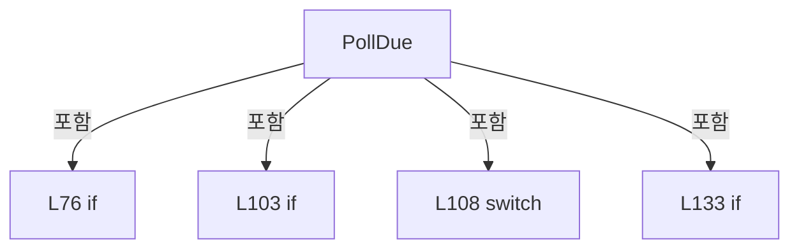

변경 전 점검: 입력/반환 타입, 위 호출자, 예외/취소 경로, 공유 상태와 저장·전송 소비자를 함께 확인합니다. 값의 단위나 물리 방향을 이름만으로 확정하지 않습니다.

### LocalFunctionStatement `PollLaserCallback` · L83–86

[Drilling.UI/Menu/Menus/CMonitorStatusPollingService.cs:83–86](https://github.com/kjuws10-rgb/A3Drilling/blob/5aee8e58439c9b455cae7c9593c9be986c3e682e/Drilling.UI/Menu/Menus/CMonitorStatusPollingService.cs#L83-L86)

| 항목 | 실제 추출 값 |
| --- | --- |
| 서명 | void PollLaserCallback(System.Threading.CancellationToken) |
| 접근/수식자 | Private /  |
| 반환/값 타입 | void |
| 소속 타입 | NamedType:Drilling.UI.Menu.Menus.CMonitorStatusPollingService |

입력 계약:

| 이름 | 타입 | 전달 | 선택/기본값 |
| --- | --- | --- | --- |
| token | System.Threading.CancellationToken | None | False /  |

현재 부분 분석에서 직접 연결된 호출자는 없습니다. XAML/이벤트/인터페이스·델리게이트·외부 진입을 추가 확인해야 하며, 미사용으로 판정한 것이 아닙니다.

호출하는 대상과 해석 범위:

| 원본 행 | 표현식 | 분석 상태 | 대상/소스 위치 |
| --- | --- | --- | --- |
| 85 | PollLaser | resolved | void Drilling.UI.Menu.Menus.CMonitorStatusPollingService.PollLaser(int, System.Threading.CancellationToken) · Drilling.UI/Menu/Menus/CMonitorStatusPollingService.cs:205 |

본문의 실제 연산·분기·예외·반환 순서(원문 위치 순):

| 원본 행 | 종류 | 주석 해설 |
| --- | --- | --- |
| 85 | call | 함수·델리게이트 또는 객체 생성자를 호출합니다: PollLaser(context.LaserNumber, token) |

변경 전 점검: 입력/반환 타입, 위 호출자, 예외/취소 경로, 공유 상태와 저장·전송 소비자를 함께 확인합니다. 값의 단위나 물리 방향을 이름만으로 확정하지 않습니다.

### LocalFunctionStatement `PollAttenuatorCallback` · L88–91

[Drilling.UI/Menu/Menus/CMonitorStatusPollingService.cs:88–91](https://github.com/kjuws10-rgb/A3Drilling/blob/5aee8e58439c9b455cae7c9593c9be986c3e682e/Drilling.UI/Menu/Menus/CMonitorStatusPollingService.cs#L88-L91)

| 항목 | 실제 추출 값 |
| --- | --- |
| 서명 | void PollAttenuatorCallback(System.Threading.CancellationToken) |
| 접근/수식자 | Private /  |
| 반환/값 타입 | void |
| 소속 타입 | NamedType:Drilling.UI.Menu.Menus.CMonitorStatusPollingService |

입력 계약:

| 이름 | 타입 | 전달 | 선택/기본값 |
| --- | --- | --- | --- |
| token | System.Threading.CancellationToken | None | False /  |

현재 부분 분석에서 직접 연결된 호출자는 없습니다. XAML/이벤트/인터페이스·델리게이트·외부 진입을 추가 확인해야 하며, 미사용으로 판정한 것이 아닙니다.

호출하는 대상과 해석 범위:

| 원본 행 | 표현식 | 분석 상태 | 대상/소스 위치 |
| --- | --- | --- | --- |
| 90 | PollAttenuator | resolved | void Drilling.UI.Menu.Menus.CMonitorStatusPollingService.PollAttenuator(int, System.Threading.CancellationToken) · Drilling.UI/Menu/Menus/CMonitorStatusPollingService.cs:224 |

본문의 실제 연산·분기·예외·반환 순서(원문 위치 순):

| 원본 행 | 종류 | 주석 해설 |
| --- | --- | --- |
| 90 | call | 함수·델리게이트 또는 객체 생성자를 호출합니다: PollAttenuator(context.AttenuatorNumber, token) |

변경 전 점검: 입력/반환 타입, 위 호출자, 예외/취소 경로, 공유 상태와 저장·전송 소비자를 함께 확인합니다. 값의 단위나 물리 방향을 이름만으로 확정하지 않습니다.

### LocalFunctionStatement `PollBetCallback` · L93–96

[Drilling.UI/Menu/Menus/CMonitorStatusPollingService.cs:93–96](https://github.com/kjuws10-rgb/A3Drilling/blob/5aee8e58439c9b455cae7c9593c9be986c3e682e/Drilling.UI/Menu/Menus/CMonitorStatusPollingService.cs#L93-L96)

| 항목 | 실제 추출 값 |
| --- | --- |
| 서명 | void PollBetCallback(System.Threading.CancellationToken) |
| 접근/수식자 | Private /  |
| 반환/값 타입 | void |
| 소속 타입 | NamedType:Drilling.UI.Menu.Menus.CMonitorStatusPollingService |

입력 계약:

| 이름 | 타입 | 전달 | 선택/기본값 |
| --- | --- | --- | --- |
| token | System.Threading.CancellationToken | None | False /  |

현재 부분 분석에서 직접 연결된 호출자는 없습니다. XAML/이벤트/인터페이스·델리게이트·외부 진입을 추가 확인해야 하며, 미사용으로 판정한 것이 아닙니다.

호출하는 대상과 해석 범위:

| 원본 행 | 표현식 | 분석 상태 | 대상/소스 위치 |
| --- | --- | --- | --- |
| 95 | PollBet | resolved | void Drilling.UI.Menu.Menus.CMonitorStatusPollingService.PollBet(int, System.Threading.CancellationToken) · Drilling.UI/Menu/Menus/CMonitorStatusPollingService.cs:241 |

본문의 실제 연산·분기·예외·반환 순서(원문 위치 순):

| 원본 행 | 종류 | 주석 해설 |
| --- | --- | --- |
| 95 | call | 함수·델리게이트 또는 객체 생성자를 호출합니다: PollBet(context.BetNumber, token) |

변경 전 점검: 입력/반환 타입, 위 호출자, 예외/취소 경로, 공유 상태와 저장·전송 소비자를 함께 확인합니다. 값의 단위나 물리 방향을 이름만으로 확정하지 않습니다.

### LocalFunctionStatement `PollMelsecCallback` · L98–101

[Drilling.UI/Menu/Menus/CMonitorStatusPollingService.cs:98–101](https://github.com/kjuws10-rgb/A3Drilling/blob/5aee8e58439c9b455cae7c9593c9be986c3e682e/Drilling.UI/Menu/Menus/CMonitorStatusPollingService.cs#L98-L101)

| 항목 | 실제 추출 값 |
| --- | --- |
| 서명 | void PollMelsecCallback(System.Threading.CancellationToken) |
| 접근/수식자 | Private /  |
| 반환/값 타입 | void |
| 소속 타입 | NamedType:Drilling.UI.Menu.Menus.CMonitorStatusPollingService |

입력 계약:

| 이름 | 타입 | 전달 | 선택/기본값 |
| --- | --- | --- | --- |
| token | System.Threading.CancellationToken | None | False /  |

현재 부분 분석에서 직접 연결된 호출자는 없습니다. XAML/이벤트/인터페이스·델리게이트·외부 진입을 추가 확인해야 하며, 미사용으로 판정한 것이 아닙니다.

호출하는 대상과 해석 범위:

| 원본 행 | 표현식 | 분석 상태 | 대상/소스 위치 |
| --- | --- | --- | --- |
| 100 | PollMelsec | resolved | void Drilling.UI.Menu.Menus.CMonitorStatusPollingService.PollMelsec(string, System.Threading.CancellationToken) · Drilling.UI/Menu/Menus/CMonitorStatusPollingService.cs:289 |

본문의 실제 연산·분기·예외·반환 순서(원문 위치 순):

| 원본 행 | 종류 | 주석 해설 |
| --- | --- | --- |
| 100 | call | 함수·델리게이트 또는 객체 생성자를 호출합니다: PollMelsec(context.MelsecGroup, token) |

변경 전 점검: 입력/반환 타입, 위 호출자, 예외/취소 경로, 공유 상태와 저장·전송 소비자를 함께 확인합니다. 값의 단위나 물리 방향을 이름만으로 확정하지 않습니다.

### MethodDeclaration `TryPoll` · L139–148

[Drilling.UI/Menu/Menus/CMonitorStatusPollingService.cs:139–148](https://github.com/kjuws10-rgb/A3Drilling/blob/5aee8e58439c9b455cae7c9593c9be986c3e682e/Drilling.UI/Menu/Menus/CMonitorStatusPollingService.cs#L139-L148)

| 항목 | 실제 추출 값 |
| --- | --- |
| 서명 | void Drilling.UI.Menu.Menus.CMonitorStatusPollingService.TryPoll(System.Action<System.Threading.CancellationToken>, System.Threading.CancellationToken) |
| 접근/수식자 | Private / private |
| 반환/값 타입 | void |
| 소속 타입 | NamedType:Drilling.UI.Menu.Menus.CMonitorStatusPollingService |

입력 계약:

| 이름 | 타입 | 전달 | 선택/기본값 |
| --- | --- | --- | --- |
| poll | System.Action<System.Threading.CancellationToken> | None | False /  |
| cancellationToken | System.Threading.CancellationToken | None | False /  |

정적 호출자로 확인된 위치:

| 호출 파일/행 | 호출 표현식 | 런타임 분기 가능 |
| --- | --- | --- |
| [Drilling.UI/Menu/Menus/CMonitorStatusPollingService.cs:382–382](https://github.com/kjuws10-rgb/A3Drilling/blob/5aee8e58439c9b455cae7c9593c9be986c3e682e/Drilling.UI/Menu/Menus/CMonitorStatusPollingService.cs#L382-L382) | TryPoll | False |

호출하는 대상과 해석 범위:

| 원본 행 | 표현식 | 분석 상태 | 대상/소스 위치 |
| --- | --- | --- | --- |
| 143 | poll | resolved · 동적 구현 선택 가능 | void System.Action<System.Threading.CancellationToken>.Invoke(System.Threading.CancellationToken) |

본문의 실제 연산·분기·예외·반환 순서(원문 위치 순):

| 원본 행 | 종류 | 주석 해설 |
| --- | --- | --- |
| 141 | try | 예외 처리 범위입니다: try |
| 143 | call | 함수·델리게이트 또는 객체 생성자를 호출합니다: poll(cancellationToken) |
| 145 | catch | 지정 예외를 처리합니다: catch (Exception exception) when (exception is not OperationCanceledException) |

제어 구문의 포함 구조(실제 실행 순서/CFG가 아닌 구문 탐색 그림):

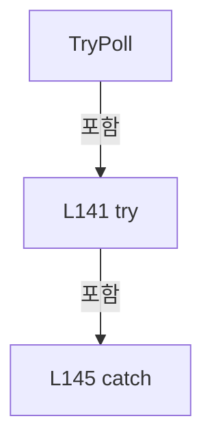

변경 전 점검: 입력/반환 타입, 위 호출자, 예외/취소 경로, 공유 상태와 저장·전송 소비자를 함께 확인합니다. 값의 단위나 물리 방향을 이름만으로 확정하지 않습니다.

### MethodDeclaration `PollCommunication` · L150–162

[Drilling.UI/Menu/Menus/CMonitorStatusPollingService.cs:150–162](https://github.com/kjuws10-rgb/A3Drilling/blob/5aee8e58439c9b455cae7c9593c9be986c3e682e/Drilling.UI/Menu/Menus/CMonitorStatusPollingService.cs#L150-L162)

| 항목 | 실제 추출 값 |
| --- | --- |
| 서명 | void Drilling.UI.Menu.Menus.CMonitorStatusPollingService.PollCommunication(System.Threading.CancellationToken) |
| 접근/수식자 | Private / private |
| 반환/값 타입 | void |
| 소속 타입 | NamedType:Drilling.UI.Menu.Menus.CMonitorStatusPollingService |

입력 계약:

| 이름 | 타입 | 전달 | 선택/기본값 |
| --- | --- | --- | --- |
| cancellationToken | System.Threading.CancellationToken | None | False /  |

현재 부분 분석에서 직접 연결된 호출자는 없습니다. XAML/이벤트/인터페이스·델리게이트·외부 진입을 추가 확인해야 하며, 미사용으로 판정한 것이 아닙니다.

호출하는 대상과 해석 범위:

| 원본 행 | 표현식 | 분석 상태 | 대상/소스 위치 |
| --- | --- | --- | --- |
| 152 | interfaceManager.GetCommunicationStatus | resolved | System.Collections.Generic.IReadOnlyList<Drilling.Common.Interface.ST_DEVICE_COMM_STATUS> Drilling.Common.Interface.CInterfaceManager.GetCommunicationStatus(System.Threading.CancellationToken) · Drilling.Common/Interface/CInterfaceManager.cs:502 |
| 161 | UpdateSnapshot | resolved | void Drilling.UI.Menu.Menus.CMonitorStatusPollingService.UpdateSnapshot(System.Func<Drilling.UI.Menu.Menus.ST_MONITOR_STATUS_SNAPSHOT, Drilling.UI.Menu.Menus.ST_MONITOR_STATUS_SNAPSHOT>) · Drilling.UI/Menu/Menus/CMonitorStatusPollingService.cs:417 |

본문의 실제 연산·분기·예외·반환 순서(원문 위치 순):

| 원본 행 | 종류 | 주석 해설 |
| --- | --- | --- |
| 152 | call | 함수·델리게이트 또는 객체 생성자를 호출합니다: interfaceManager.GetCommunicationStatus(cancellationToken) |
| 152 | local-declaration | 지역 변수를 선언합니다: var communication = interfaceManager.GetCommunicationStatus(cancellationToken); |
| 152 | variable-initializer | 변수의 초기값을 지정합니다: communication = interfaceManager.GetCommunicationStatus(cancellationToken) |
| 161 | call | 함수·델리게이트 또는 객체 생성자를 호출합니다: UpdateSnapshot(SelectValue) |

변경 전 점검: 입력/반환 타입, 위 호출자, 예외/취소 경로, 공유 상태와 저장·전송 소비자를 함께 확인합니다. 값의 단위나 물리 방향을 이름만으로 확정하지 않습니다.

### LocalFunctionStatement `SelectValue` · L153–159

[Drilling.UI/Menu/Menus/CMonitorStatusPollingService.cs:153–159](https://github.com/kjuws10-rgb/A3Drilling/blob/5aee8e58439c9b455cae7c9593c9be986c3e682e/Drilling.UI/Menu/Menus/CMonitorStatusPollingService.cs#L153-L159)

| 항목 | 실제 추출 값 |
| --- | --- |
| 서명 | Drilling.UI.Menu.Menus.ST_MONITOR_STATUS_SNAPSHOT SelectValue(Drilling.UI.Menu.Menus.ST_MONITOR_STATUS_SNAPSHOT) |
| 접근/수식자 | Private /  |
| 반환/값 타입 | Drilling.UI.Menu.Menus.ST_MONITOR_STATUS_SNAPSHOT |
| 소속 타입 | NamedType:Drilling.UI.Menu.Menus.CMonitorStatusPollingService |

입력 계약:

| 이름 | 타입 | 전달 | 선택/기본값 |
| --- | --- | --- | --- |
| snapshot | Drilling.UI.Menu.Menus.ST_MONITOR_STATUS_SNAPSHOT | None | False /  |

현재 부분 분석에서 직접 연결된 호출자는 없습니다. XAML/이벤트/인터페이스·델리게이트·외부 진입을 추가 확인해야 하며, 미사용으로 판정한 것이 아닙니다.

본문의 실제 연산·분기·예외·반환 순서(원문 위치 순):

| 원본 행 | 종류 | 주석 해설 |
| --- | --- | --- |
| 155 | return | 호출자에게 값 또는 제어를 반환합니다: return snapshot with { Communication = communication }; |
| 157 | assignment | 값을 대상에 대입합니다: Communication = communication |

변경 전 점검: 입력/반환 타입, 위 호출자, 예외/취소 경로, 공유 상태와 저장·전송 소비자를 함께 확인합니다. 값의 단위나 물리 방향을 이름만으로 확정하지 않습니다.

### MethodDeclaration `PollMotorWhenDue` · L164–167

[Drilling.UI/Menu/Menus/CMonitorStatusPollingService.cs:164–167](https://github.com/kjuws10-rgb/A3Drilling/blob/5aee8e58439c9b455cae7c9593c9be986c3e682e/Drilling.UI/Menu/Menus/CMonitorStatusPollingService.cs#L164-L167)

| 항목 | 실제 추출 값 |
| --- | --- |
| 서명 | void Drilling.UI.Menu.Menus.CMonitorStatusPollingService.PollMotorWhenDue(System.Threading.CancellationToken) |
| 접근/수식자 | Private / private |
| 반환/값 타입 | void |
| 소속 타입 | NamedType:Drilling.UI.Menu.Menus.CMonitorStatusPollingService |

입력 계약:

| 이름 | 타입 | 전달 | 선택/기본값 |
| --- | --- | --- | --- |
| cancellationToken | System.Threading.CancellationToken | None | False /  |

현재 부분 분석에서 직접 연결된 호출자는 없습니다. XAML/이벤트/인터페이스·델리게이트·외부 진입을 추가 확인해야 하며, 미사용으로 판정한 것이 아닙니다.

호출하는 대상과 해석 범위:

| 원본 행 | 표현식 | 분석 상태 | 대상/소스 위치 |
| --- | --- | --- | --- |
| 166 | PollMotorSerialized | resolved | void Drilling.UI.Menu.Menus.CMonitorStatusPollingService.PollMotorSerialized(bool, System.Threading.CancellationToken) · Drilling.UI/Menu/Menus/CMonitorStatusPollingService.cs:169 |

본문의 실제 연산·분기·예외·반환 순서(원문 위치 순):

| 원본 행 | 종류 | 주석 해설 |
| --- | --- | --- |
| 166 | call | 함수·델리게이트 또는 객체 생성자를 호출합니다: PollMotorSerialized(false, cancellationToken) |

변경 전 점검: 입력/반환 타입, 위 호출자, 예외/취소 경로, 공유 상태와 저장·전송 소비자를 함께 확인합니다. 값의 단위나 물리 방향을 이름만으로 확정하지 않습니다.

### MethodDeclaration `PollMotorSerialized` · L169–186

[Drilling.UI/Menu/Menus/CMonitorStatusPollingService.cs:169–186](https://github.com/kjuws10-rgb/A3Drilling/blob/5aee8e58439c9b455cae7c9593c9be986c3e682e/Drilling.UI/Menu/Menus/CMonitorStatusPollingService.cs#L169-L186)

| 항목 | 실제 추출 값 |
| --- | --- |
| 서명 | void Drilling.UI.Menu.Menus.CMonitorStatusPollingService.PollMotorSerialized(bool, System.Threading.CancellationToken) |
| 접근/수식자 | Private / private |
| 반환/값 타입 | void |
| 소속 타입 | NamedType:Drilling.UI.Menu.Menus.CMonitorStatusPollingService |

입력 계약:

| 이름 | 타입 | 전달 | 선택/기본값 |
| --- | --- | --- | --- |
| force | bool | None | False /  |
| cancellationToken | System.Threading.CancellationToken | None | False /  |

정적 호출자로 확인된 위치:

| 호출 파일/행 | 호출 표현식 | 런타임 분기 가능 |
| --- | --- | --- |
| [Drilling.UI/Menu/Menus/CMonitorStatusPollingService.cs:66–66](https://github.com/kjuws10-rgb/A3Drilling/blob/5aee8e58439c9b455cae7c9593c9be986c3e682e/Drilling.UI/Menu/Menus/CMonitorStatusPollingService.cs#L66-L66) | PollMotorSerialized | False |
| [Drilling.UI/Menu/Menus/CMonitorStatusPollingService.cs:166–166](https://github.com/kjuws10-rgb/A3Drilling/blob/5aee8e58439c9b455cae7c9593c9be986c3e682e/Drilling.UI/Menu/Menus/CMonitorStatusPollingService.cs#L166-L166) | PollMotorSerialized | False |

호출하는 대상과 해석 범위:

| 원본 행 | 표현식 | 분석 상태 | 대상/소스 위치 |
| --- | --- | --- | --- |
| 171 | _motorPollLock.Wait | resolved | void System.Threading.SemaphoreSlim.Wait(System.Threading.CancellationToken) |
| 174 | Stopwatch.GetElapsedTime | resolved | System.TimeSpan System.Diagnostics.Stopwatch.GetElapsedTime(long) |
| 174 | GetMotorInterval | resolved | System.TimeSpan Drilling.UI.Menu.Menus.CMonitorStatusPollingService.GetMotorInterval() · Drilling.UI/Menu/Menus/CMonitorStatusPollingService.cs:406 |
| 179 | PollMotorCore | resolved | void Drilling.UI.Menu.Menus.CMonitorStatusPollingService.PollMotorCore(System.Threading.CancellationToken) · Drilling.UI/Menu/Menus/CMonitorStatusPollingService.cs:188 |
| 180 | Stopwatch.GetTimestamp | resolved | long System.Diagnostics.Stopwatch.GetTimestamp() |
| 184 | _motorPollLock.Release | resolved | int System.Threading.SemaphoreSlim.Release() |

본문의 실제 연산·분기·예외·반환 순서(원문 위치 순):

| 원본 행 | 종류 | 주석 해설 |
| --- | --- | --- |
| 171 | call | 함수·델리게이트 또는 객체 생성자를 호출합니다: _motorPollLock.Wait(cancellationToken) |
| 172 | try | 예외 처리 범위입니다: try |
| 174 | call | 함수·델리게이트 또는 객체 생성자를 호출합니다: Stopwatch.GetElapsedTime(lastSuccessfulPollTimestamp) |
| 174 | call | 함수·델리게이트 또는 객체 생성자를 호출합니다: GetMotorInterval() |
| 174 | if | 조건에 따라 분기합니다: if (!force && _lastSuccessfulMotorPollTimestamp is long lastSuccessfulPollTimestamp && Stopwatch.GetElapsedTime(lastSuccessfulPollTimestamp) < GetMotorInterval()) |
| 176 | return | 호출자에게 값 또는 제어를 반환합니다: return; |
| 179 | call | 함수·델리게이트 또는 객체 생성자를 호출합니다: PollMotorCore(cancellationToken) |
| 180 | assignment | 값을 대상에 대입합니다: _lastSuccessfulMotorPollTimestamp = Stopwatch.GetTimestamp() |
| 180 | call | 함수·델리게이트 또는 객체 생성자를 호출합니다: Stopwatch.GetTimestamp() |
| 182 | finally | 종료 정리 구간입니다: finally |
| 184 | call | 함수·델리게이트 또는 객체 생성자를 호출합니다: _motorPollLock.Release() |

제어 구문의 포함 구조(실제 실행 순서/CFG가 아닌 구문 탐색 그림):

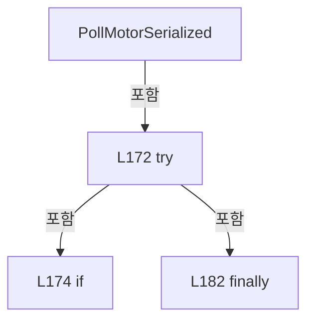

변경 전 점검: 입력/반환 타입, 위 호출자, 예외/취소 경로, 공유 상태와 저장·전송 소비자를 함께 확인합니다. 값의 단위나 물리 방향을 이름만으로 확정하지 않습니다.

### MethodDeclaration `PollMotorCore` · L188–203

[Drilling.UI/Menu/Menus/CMonitorStatusPollingService.cs:188–203](https://github.com/kjuws10-rgb/A3Drilling/blob/5aee8e58439c9b455cae7c9593c9be986c3e682e/Drilling.UI/Menu/Menus/CMonitorStatusPollingService.cs#L188-L203)

| 항목 | 실제 추출 값 |
| --- | --- |
| 서명 | void Drilling.UI.Menu.Menus.CMonitorStatusPollingService.PollMotorCore(System.Threading.CancellationToken) |
| 접근/수식자 | Private / private |
| 반환/값 타입 | void |
| 소속 타입 | NamedType:Drilling.UI.Menu.Menus.CMonitorStatusPollingService |

입력 계약:

| 이름 | 타입 | 전달 | 선택/기본값 |
| --- | --- | --- | --- |
| cancellationToken | System.Threading.CancellationToken | None | False /  |

정적 호출자로 확인된 위치:

| 호출 파일/행 | 호출 표현식 | 런타임 분기 가능 |
| --- | --- | --- |
| [Drilling.UI/Menu/Menus/CMonitorStatusPollingService.cs:179–179](https://github.com/kjuws10-rgb/A3Drilling/blob/5aee8e58439c9b455cae7c9593c9be986c3e682e/Drilling.UI/Menu/Menus/CMonitorStatusPollingService.cs#L179-L179) | PollMotorCore | False |

호출하는 대상과 해석 범위:

| 원본 행 | 표현식 | 분석 상태 | 대상/소스 위치 |
| --- | --- | --- | --- |
| 190 | motionManager.GetAxisStatus | resolved | System.Collections.Generic.IReadOnlyList<Drilling.Common.Motion.ST_MOTOR_AXIS_STATUS> Drilling.Common.Motion.CMotionManager.GetAxisStatus(System.Threading.CancellationToken) · Drilling.Common/Motion/CMotionManager.cs:146 |
| 202 | UpdateSnapshot | resolved | void Drilling.UI.Menu.Menus.CMonitorStatusPollingService.UpdateSnapshot(System.Func<Drilling.UI.Menu.Menus.ST_MONITOR_STATUS_SNAPSHOT, Drilling.UI.Menu.Menus.ST_MONITOR_STATUS_SNAPSHOT>) · Drilling.UI/Menu/Menus/CMonitorStatusPollingService.cs:417 |

본문의 실제 연산·분기·예외·반환 순서(원문 위치 순):

| 원본 행 | 종류 | 주석 해설 |
| --- | --- | --- |
| 190 | call | 함수·델리게이트 또는 객체 생성자를 호출합니다: motionManager.GetAxisStatus(cancellationToken) |
| 190 | local-declaration | 지역 변수를 선언합니다: var motors = motionManager.GetAxisStatus(cancellationToken); |
| 190 | variable-initializer | 변수의 초기값을 지정합니다: motors = motionManager.GetAxisStatus(cancellationToken) |
| 202 | call | 함수·델리게이트 또는 객체 생성자를 호출합니다: UpdateSnapshot(SelectValue) |

변경 전 점검: 입력/반환 타입, 위 호출자, 예외/취소 경로, 공유 상태와 저장·전송 소비자를 함께 확인합니다. 값의 단위나 물리 방향을 이름만으로 확정하지 않습니다.

### LocalFunctionStatement `SelectValue` · L191–200

[Drilling.UI/Menu/Menus/CMonitorStatusPollingService.cs:191–200](https://github.com/kjuws10-rgb/A3Drilling/blob/5aee8e58439c9b455cae7c9593c9be986c3e682e/Drilling.UI/Menu/Menus/CMonitorStatusPollingService.cs#L191-L200)

| 항목 | 실제 추출 값 |
| --- | --- |
| 서명 | Drilling.UI.Menu.Menus.ST_MONITOR_STATUS_SNAPSHOT SelectValue(Drilling.UI.Menu.Menus.ST_MONITOR_STATUS_SNAPSHOT) |
| 접근/수식자 | Private /  |
| 반환/값 타입 | Drilling.UI.Menu.Menus.ST_MONITOR_STATUS_SNAPSHOT |
| 소속 타입 | NamedType:Drilling.UI.Menu.Menus.CMonitorStatusPollingService |

입력 계약:

| 이름 | 타입 | 전달 | 선택/기본값 |
| --- | --- | --- | --- |
| snapshot | Drilling.UI.Menu.Menus.ST_MONITOR_STATUS_SNAPSHOT | None | False /  |

현재 부분 분석에서 직접 연결된 호출자는 없습니다. XAML/이벤트/인터페이스·델리게이트·외부 진입을 추가 확인해야 하며, 미사용으로 판정한 것이 아닙니다.

본문의 실제 연산·분기·예외·반환 순서(원문 위치 순):

| 원본 행 | 종류 | 주석 해설 |
| --- | --- | --- |
| 193 | return | 호출자에게 값 또는 제어를 반환합니다: return snapshot with { DeviceStatus = snapshot.DeviceStatus with { Motors = motors } }; |
| 195 | assignment | 값을 대상에 대입합니다: DeviceStatus = snapshot.DeviceStatus with { Motors = motors } |
| 197 | assignment | 값을 대상에 대입합니다: Motors = motors |

변경 전 점검: 입력/반환 타입, 위 호출자, 예외/취소 경로, 공유 상태와 저장·전송 소비자를 함께 확인합니다. 값의 단위나 물리 방향을 이름만으로 확정하지 않습니다.

### MethodDeclaration `PollLaser` · L205–222

[Drilling.UI/Menu/Menus/CMonitorStatusPollingService.cs:205–222](https://github.com/kjuws10-rgb/A3Drilling/blob/5aee8e58439c9b455cae7c9593c9be986c3e682e/Drilling.UI/Menu/Menus/CMonitorStatusPollingService.cs#L205-L222)

| 항목 | 실제 추출 값 |
| --- | --- |
| 서명 | void Drilling.UI.Menu.Menus.CMonitorStatusPollingService.PollLaser(int, System.Threading.CancellationToken) |
| 접근/수식자 | Private / private |
| 반환/값 타입 | void |
| 소속 타입 | NamedType:Drilling.UI.Menu.Menus.CMonitorStatusPollingService |

입력 계약:

| 이름 | 타입 | 전달 | 선택/기본값 |
| --- | --- | --- | --- |
| laserNumber | int | None | False /  |
| cancellationToken | System.Threading.CancellationToken | None | False /  |

정적 호출자로 확인된 위치:

| 호출 파일/행 | 호출 표현식 | 런타임 분기 가능 |
| --- | --- | --- |
| [Drilling.UI/Menu/Menus/CMonitorStatusPollingService.cs:85–85](https://github.com/kjuws10-rgb/A3Drilling/blob/5aee8e58439c9b455cae7c9593c9be986c3e682e/Drilling.UI/Menu/Menus/CMonitorStatusPollingService.cs#L85-L85) | PollLaser | False |

호출하는 대상과 해석 범위:

| 원본 행 | 표현식 | 분석 상태 | 대상/소스 위치 |
| --- | --- | --- | --- |
| 207 | interfaceManager.RefreshTalonLaserStatus | resolved | Drilling.Common.Interface.ST_TALON_STATUS Drilling.Common.Interface.CInterfaceManager.RefreshTalonLaserStatus(int, System.Threading.CancellationToken, bool) · Drilling.Common/Interface/CInterfaceManager.cs:973 |
| 208 | new ST_LASER_STATUS | resolved | Drilling.Common.Interface.ST_LASER_STATUS.ST_LASER_STATUS(bool, bool, bool, double) · Drilling.Common/Interface/Serial/CTalonLaser.cs:367 |
| 221 | UpdateSnapshot | resolved | void Drilling.UI.Menu.Menus.CMonitorStatusPollingService.UpdateSnapshot(System.Func<Drilling.UI.Menu.Menus.ST_MONITOR_STATUS_SNAPSHOT, Drilling.UI.Menu.Menus.ST_MONITOR_STATUS_SNAPSHOT>) · Drilling.UI/Menu/Menus/CMonitorStatusPollingService.cs:417 |

본문의 실제 연산·분기·예외·반환 순서(원문 위치 순):

| 원본 행 | 종류 | 주석 해설 |
| --- | --- | --- |
| 207 | call | 함수·델리게이트 또는 객체 생성자를 호출합니다: interfaceManager.RefreshTalonLaserStatus(laserNumber, cancellationToken, suppressCommandLog: true) |
| 207 | local-declaration | 지역 변수를 선언합니다: var talonStatus = interfaceManager.RefreshTalonLaserStatus(laserNumber, cancellationToken, suppressCommandLog: true); |
| 207 | variable-initializer | 변수의 초기값을 지정합니다: talonStatus = interfaceManager.RefreshTalonLaserStatus(laserNumber, cancellationToken, suppressCommandLog: true) |
| 208 | call | 함수·델리게이트 또는 객체 생성자를 호출합니다: new ST_LASER_STATUS(talonStatus.LaserOn, talonStatus.ShutterOpen, talonStatus.GateOpen, talonStatus.OutputPower) |
| 208 | local-declaration | 지역 변수를 선언합니다: var laserStatus = new ST_LASER_STATUS(talonStatus.LaserOn, talonStatus.ShutterOpen, talonStatus.GateOpen, talonStatus.OutputPower); |
| 208 | variable-initializer | 변수의 초기값을 지정합니다: laserStatus = new ST_LASER_STATUS(talonStatus.LaserOn, talonStatus.ShutterOpen, talonStatus.GateOpen, talonStatus.OutputPower) |
| 221 | call | 함수·델리게이트 또는 객체 생성자를 호출합니다: UpdateSnapshot(SelectValue) |

변경 전 점검: 입력/반환 타입, 위 호출자, 예외/취소 경로, 공유 상태와 저장·전송 소비자를 함께 확인합니다. 값의 단위나 물리 방향을 이름만으로 확정하지 않습니다.

### LocalFunctionStatement `SelectValue` · L209–219

[Drilling.UI/Menu/Menus/CMonitorStatusPollingService.cs:209–219](https://github.com/kjuws10-rgb/A3Drilling/blob/5aee8e58439c9b455cae7c9593c9be986c3e682e/Drilling.UI/Menu/Menus/CMonitorStatusPollingService.cs#L209-L219)

| 항목 | 실제 추출 값 |
| --- | --- |
| 서명 | Drilling.UI.Menu.Menus.ST_MONITOR_STATUS_SNAPSHOT SelectValue(Drilling.UI.Menu.Menus.ST_MONITOR_STATUS_SNAPSHOT) |
| 접근/수식자 | Private /  |
| 반환/값 타입 | Drilling.UI.Menu.Menus.ST_MONITOR_STATUS_SNAPSHOT |
| 소속 타입 | NamedType:Drilling.UI.Menu.Menus.CMonitorStatusPollingService |

입력 계약:

| 이름 | 타입 | 전달 | 선택/기본값 |
| --- | --- | --- | --- |
| snapshot | Drilling.UI.Menu.Menus.ST_MONITOR_STATUS_SNAPSHOT | None | False /  |

현재 부분 분석에서 직접 연결된 호출자는 없습니다. XAML/이벤트/인터페이스·델리게이트·외부 진입을 추가 확인해야 하며, 미사용으로 판정한 것이 아닙니다.

본문의 실제 연산·분기·예외·반환 순서(원문 위치 순):

| 원본 행 | 종류 | 주석 해설 |
| --- | --- | --- |
| 211 | return | 호출자에게 값 또는 제어를 반환합니다: return snapshot with { DeviceStatus = snapshot.DeviceStatus with { Laser = laserStatus }, TalonStatus = talonStatus }; |
| 213 | assignment | 값을 대상에 대입합니다: DeviceStatus = snapshot.DeviceStatus with { Laser = laserStatus } |
| 215 | assignment | 값을 대상에 대입합니다: Laser = laserStatus |
| 217 | assignment | 값을 대상에 대입합니다: TalonStatus = talonStatus |

변경 전 점검: 입력/반환 타입, 위 호출자, 예외/취소 경로, 공유 상태와 저장·전송 소비자를 함께 확인합니다. 값의 단위나 물리 방향을 이름만으로 확정하지 않습니다.

### MethodDeclaration `PollAttenuator` · L224–239

[Drilling.UI/Menu/Menus/CMonitorStatusPollingService.cs:224–239](https://github.com/kjuws10-rgb/A3Drilling/blob/5aee8e58439c9b455cae7c9593c9be986c3e682e/Drilling.UI/Menu/Menus/CMonitorStatusPollingService.cs#L224-L239)

| 항목 | 실제 추출 값 |
| --- | --- |
| 서명 | void Drilling.UI.Menu.Menus.CMonitorStatusPollingService.PollAttenuator(int, System.Threading.CancellationToken) |
| 접근/수식자 | Private / private |
| 반환/값 타입 | void |
| 소속 타입 | NamedType:Drilling.UI.Menu.Menus.CMonitorStatusPollingService |

입력 계약:

| 이름 | 타입 | 전달 | 선택/기본값 |
| --- | --- | --- | --- |
| attenuatorNumber | int | None | False /  |
| cancellationToken | System.Threading.CancellationToken | None | False /  |

정적 호출자로 확인된 위치:

| 호출 파일/행 | 호출 표현식 | 런타임 분기 가능 |
| --- | --- | --- |
| [Drilling.UI/Menu/Menus/CMonitorStatusPollingService.cs:90–90](https://github.com/kjuws10-rgb/A3Drilling/blob/5aee8e58439c9b455cae7c9593c9be986c3e682e/Drilling.UI/Menu/Menus/CMonitorStatusPollingService.cs#L90-L90) | PollAttenuator | False |

호출하는 대상과 해석 범위:

| 원본 행 | 표현식 | 분석 상태 | 대상/소스 위치 |
| --- | --- | --- | --- |
| 226 | interfaceManager.GetAttenuatorStatus | resolved | Drilling.Common.Interface.ST_ATTENUATOR_STATUS Drilling.Common.Interface.CInterfaceManager.GetAttenuatorStatus(int, System.Threading.CancellationToken) · Drilling.Common/Interface/CInterfaceManager.cs:1014 |
| 238 | UpdateSnapshot | resolved | void Drilling.UI.Menu.Menus.CMonitorStatusPollingService.UpdateSnapshot(System.Func<Drilling.UI.Menu.Menus.ST_MONITOR_STATUS_SNAPSHOT, Drilling.UI.Menu.Menus.ST_MONITOR_STATUS_SNAPSHOT>) · Drilling.UI/Menu/Menus/CMonitorStatusPollingService.cs:417 |

본문의 실제 연산·분기·예외·반환 순서(원문 위치 순):

| 원본 행 | 종류 | 주석 해설 |
| --- | --- | --- |
| 226 | call | 함수·델리게이트 또는 객체 생성자를 호출합니다: interfaceManager.GetAttenuatorStatus(attenuatorNumber, cancellationToken) |
| 226 | local-declaration | 지역 변수를 선언합니다: var attenuator = interfaceManager.GetAttenuatorStatus(attenuatorNumber, cancellationToken); |
| 226 | variable-initializer | 변수의 초기값을 지정합니다: attenuator = interfaceManager.GetAttenuatorStatus(attenuatorNumber, cancellationToken) |
| 238 | call | 함수·델리게이트 또는 객체 생성자를 호출합니다: UpdateSnapshot(SelectValue) |

변경 전 점검: 입력/반환 타입, 위 호출자, 예외/취소 경로, 공유 상태와 저장·전송 소비자를 함께 확인합니다. 값의 단위나 물리 방향을 이름만으로 확정하지 않습니다.

### LocalFunctionStatement `SelectValue` · L227–236

[Drilling.UI/Menu/Menus/CMonitorStatusPollingService.cs:227–236](https://github.com/kjuws10-rgb/A3Drilling/blob/5aee8e58439c9b455cae7c9593c9be986c3e682e/Drilling.UI/Menu/Menus/CMonitorStatusPollingService.cs#L227-L236)

| 항목 | 실제 추출 값 |
| --- | --- |
| 서명 | Drilling.UI.Menu.Menus.ST_MONITOR_STATUS_SNAPSHOT SelectValue(Drilling.UI.Menu.Menus.ST_MONITOR_STATUS_SNAPSHOT) |
| 접근/수식자 | Private /  |
| 반환/값 타입 | Drilling.UI.Menu.Menus.ST_MONITOR_STATUS_SNAPSHOT |
| 소속 타입 | NamedType:Drilling.UI.Menu.Menus.CMonitorStatusPollingService |

입력 계약:

| 이름 | 타입 | 전달 | 선택/기본값 |
| --- | --- | --- | --- |
| snapshot | Drilling.UI.Menu.Menus.ST_MONITOR_STATUS_SNAPSHOT | None | False /  |

현재 부분 분석에서 직접 연결된 호출자는 없습니다. XAML/이벤트/인터페이스·델리게이트·외부 진입을 추가 확인해야 하며, 미사용으로 판정한 것이 아닙니다.

본문의 실제 연산·분기·예외·반환 순서(원문 위치 순):

| 원본 행 | 종류 | 주석 해설 |
| --- | --- | --- |
| 229 | return | 호출자에게 값 또는 제어를 반환합니다: return snapshot with { DeviceStatus = snapshot.DeviceStatus with { Attenuator = attenuator } }; |
| 231 | assignment | 값을 대상에 대입합니다: DeviceStatus = snapshot.DeviceStatus with { Attenuator = attenuator } |
| 233 | assignment | 값을 대상에 대입합니다: Attenuator = attenuator |

변경 전 점검: 입력/반환 타입, 위 호출자, 예외/취소 경로, 공유 상태와 저장·전송 소비자를 함께 확인합니다. 값의 단위나 물리 방향을 이름만으로 확정하지 않습니다.

### MethodDeclaration `PollBet` · L241–256

[Drilling.UI/Menu/Menus/CMonitorStatusPollingService.cs:241–256](https://github.com/kjuws10-rgb/A3Drilling/blob/5aee8e58439c9b455cae7c9593c9be986c3e682e/Drilling.UI/Menu/Menus/CMonitorStatusPollingService.cs#L241-L256)

| 항목 | 실제 추출 값 |
| --- | --- |
| 서명 | void Drilling.UI.Menu.Menus.CMonitorStatusPollingService.PollBet(int, System.Threading.CancellationToken) |
| 접근/수식자 | Private / private |
| 반환/값 타입 | void |
| 소속 타입 | NamedType:Drilling.UI.Menu.Menus.CMonitorStatusPollingService |

입력 계약:

| 이름 | 타입 | 전달 | 선택/기본값 |
| --- | --- | --- | --- |
| betNumber | int | None | False /  |
| cancellationToken | System.Threading.CancellationToken | None | False /  |

정적 호출자로 확인된 위치:

| 호출 파일/행 | 호출 표현식 | 런타임 분기 가능 |
| --- | --- | --- |
| [Drilling.UI/Menu/Menus/CMonitorStatusPollingService.cs:95–95](https://github.com/kjuws10-rgb/A3Drilling/blob/5aee8e58439c9b455cae7c9593c9be986c3e682e/Drilling.UI/Menu/Menus/CMonitorStatusPollingService.cs#L95-L95) | PollBet | False |

호출하는 대상과 해석 범위:

| 원본 행 | 표현식 | 분석 상태 | 대상/소스 위치 |
| --- | --- | --- | --- |
| 243 | interfaceManager.RefreshBETStatus | resolved | Drilling.Common.Interface.ST_BET_STATUS Drilling.Common.Interface.CInterfaceManager.RefreshBETStatus(int, System.Threading.CancellationToken, bool) · Drilling.Common/Interface/CInterfaceManager.cs:1363 |
| 255 | UpdateSnapshot | resolved | void Drilling.UI.Menu.Menus.CMonitorStatusPollingService.UpdateSnapshot(System.Func<Drilling.UI.Menu.Menus.ST_MONITOR_STATUS_SNAPSHOT, Drilling.UI.Menu.Menus.ST_MONITOR_STATUS_SNAPSHOT>) · Drilling.UI/Menu/Menus/CMonitorStatusPollingService.cs:417 |

본문의 실제 연산·분기·예외·반환 순서(원문 위치 순):

| 원본 행 | 종류 | 주석 해설 |
| --- | --- | --- |
| 243 | call | 함수·델리게이트 또는 객체 생성자를 호출합니다: interfaceManager.RefreshBETStatus(betNumber, cancellationToken, suppressCommandLog: true) |
| 243 | local-declaration | 지역 변수를 선언합니다: var bet = interfaceManager.RefreshBETStatus(betNumber, cancellationToken, suppressCommandLog: true); |
| 243 | variable-initializer | 변수의 초기값을 지정합니다: bet = interfaceManager.RefreshBETStatus(betNumber, cancellationToken, suppressCommandLog: true) |
| 255 | call | 함수·델리게이트 또는 객체 생성자를 호출합니다: UpdateSnapshot(SelectValue) |

변경 전 점검: 입력/반환 타입, 위 호출자, 예외/취소 경로, 공유 상태와 저장·전송 소비자를 함께 확인합니다. 값의 단위나 물리 방향을 이름만으로 확정하지 않습니다.

### LocalFunctionStatement `SelectValue` · L244–253

[Drilling.UI/Menu/Menus/CMonitorStatusPollingService.cs:244–253](https://github.com/kjuws10-rgb/A3Drilling/blob/5aee8e58439c9b455cae7c9593c9be986c3e682e/Drilling.UI/Menu/Menus/CMonitorStatusPollingService.cs#L244-L253)

| 항목 | 실제 추출 값 |
| --- | --- |
| 서명 | Drilling.UI.Menu.Menus.ST_MONITOR_STATUS_SNAPSHOT SelectValue(Drilling.UI.Menu.Menus.ST_MONITOR_STATUS_SNAPSHOT) |
| 접근/수식자 | Private /  |
| 반환/값 타입 | Drilling.UI.Menu.Menus.ST_MONITOR_STATUS_SNAPSHOT |
| 소속 타입 | NamedType:Drilling.UI.Menu.Menus.CMonitorStatusPollingService |

입력 계약:

| 이름 | 타입 | 전달 | 선택/기본값 |
| --- | --- | --- | --- |
| snapshot | Drilling.UI.Menu.Menus.ST_MONITOR_STATUS_SNAPSHOT | None | False /  |

현재 부분 분석에서 직접 연결된 호출자는 없습니다. XAML/이벤트/인터페이스·델리게이트·외부 진입을 추가 확인해야 하며, 미사용으로 판정한 것이 아닙니다.

본문의 실제 연산·분기·예외·반환 순서(원문 위치 순):

| 원본 행 | 종류 | 주석 해설 |
| --- | --- | --- |
| 246 | return | 호출자에게 값 또는 제어를 반환합니다: return snapshot with { DeviceStatus = snapshot.DeviceStatus with { Bet = bet } }; |
| 248 | assignment | 값을 대상에 대입합니다: DeviceStatus = snapshot.DeviceStatus with { Bet = bet } |
| 250 | assignment | 값을 대상에 대입합니다: Bet = bet |

변경 전 점검: 입력/반환 타입, 위 호출자, 예외/취소 경로, 공유 상태와 저장·전송 소비자를 함께 확인합니다. 값의 단위나 물리 방향을 이름만으로 확정하지 않습니다.

### MethodDeclaration `PollPowerMeter` · L258–273

[Drilling.UI/Menu/Menus/CMonitorStatusPollingService.cs:258–273](https://github.com/kjuws10-rgb/A3Drilling/blob/5aee8e58439c9b455cae7c9593c9be986c3e682e/Drilling.UI/Menu/Menus/CMonitorStatusPollingService.cs#L258-L273)

| 항목 | 실제 추출 값 |
| --- | --- |
| 서명 | void Drilling.UI.Menu.Menus.CMonitorStatusPollingService.PollPowerMeter(System.Threading.CancellationToken) |
| 접근/수식자 | Private / private |
| 반환/값 타입 | void |
| 소속 타입 | NamedType:Drilling.UI.Menu.Menus.CMonitorStatusPollingService |

입력 계약:

| 이름 | 타입 | 전달 | 선택/기본값 |
| --- | --- | --- | --- |
| cancellationToken | System.Threading.CancellationToken | None | False /  |

현재 부분 분석에서 직접 연결된 호출자는 없습니다. XAML/이벤트/인터페이스·델리게이트·외부 진입을 추가 확인해야 하며, 미사용으로 판정한 것이 아닙니다.

호출하는 대상과 해석 범위:

| 원본 행 | 표현식 | 분석 상태 | 대상/소스 위치 |
| --- | --- | --- | --- |
| 260 | interfaceManager.GetPowerMeterStatus | resolved | Drilling.Common.Managers.ST_POWER_METER_STATUS Drilling.Common.Interface.CInterfaceManager.GetPowerMeterStatus(System.Threading.CancellationToken) · Drilling.Common/Interface/CInterfaceManager.cs:1395 |
| 272 | UpdateSnapshot | resolved | void Drilling.UI.Menu.Menus.CMonitorStatusPollingService.UpdateSnapshot(System.Func<Drilling.UI.Menu.Menus.ST_MONITOR_STATUS_SNAPSHOT, Drilling.UI.Menu.Menus.ST_MONITOR_STATUS_SNAPSHOT>) · Drilling.UI/Menu/Menus/CMonitorStatusPollingService.cs:417 |

본문의 실제 연산·분기·예외·반환 순서(원문 위치 순):

| 원본 행 | 종류 | 주석 해설 |
| --- | --- | --- |
| 260 | call | 함수·델리게이트 또는 객체 생성자를 호출합니다: interfaceManager.GetPowerMeterStatus(cancellationToken) |
| 260 | local-declaration | 지역 변수를 선언합니다: var powerMeter = interfaceManager.GetPowerMeterStatus(cancellationToken); |
| 260 | variable-initializer | 변수의 초기값을 지정합니다: powerMeter = interfaceManager.GetPowerMeterStatus(cancellationToken) |
| 272 | call | 함수·델리게이트 또는 객체 생성자를 호출합니다: UpdateSnapshot(SelectValue) |

변경 전 점검: 입력/반환 타입, 위 호출자, 예외/취소 경로, 공유 상태와 저장·전송 소비자를 함께 확인합니다. 값의 단위나 물리 방향을 이름만으로 확정하지 않습니다.

### LocalFunctionStatement `SelectValue` · L261–270

[Drilling.UI/Menu/Menus/CMonitorStatusPollingService.cs:261–270](https://github.com/kjuws10-rgb/A3Drilling/blob/5aee8e58439c9b455cae7c9593c9be986c3e682e/Drilling.UI/Menu/Menus/CMonitorStatusPollingService.cs#L261-L270)

| 항목 | 실제 추출 값 |
| --- | --- |
| 서명 | Drilling.UI.Menu.Menus.ST_MONITOR_STATUS_SNAPSHOT SelectValue(Drilling.UI.Menu.Menus.ST_MONITOR_STATUS_SNAPSHOT) |
| 접근/수식자 | Private /  |
| 반환/값 타입 | Drilling.UI.Menu.Menus.ST_MONITOR_STATUS_SNAPSHOT |
| 소속 타입 | NamedType:Drilling.UI.Menu.Menus.CMonitorStatusPollingService |

입력 계약:

| 이름 | 타입 | 전달 | 선택/기본값 |
| --- | --- | --- | --- |
| snapshot | Drilling.UI.Menu.Menus.ST_MONITOR_STATUS_SNAPSHOT | None | False /  |

현재 부분 분석에서 직접 연결된 호출자는 없습니다. XAML/이벤트/인터페이스·델리게이트·외부 진입을 추가 확인해야 하며, 미사용으로 판정한 것이 아닙니다.

본문의 실제 연산·분기·예외·반환 순서(원문 위치 순):

| 원본 행 | 종류 | 주석 해설 |
| --- | --- | --- |
| 263 | return | 호출자에게 값 또는 제어를 반환합니다: return snapshot with { DeviceStatus = snapshot.DeviceStatus with { PowerMeter = powerMeter } }; |
| 265 | assignment | 값을 대상에 대입합니다: DeviceStatus = snapshot.DeviceStatus with { PowerMeter = powerMeter } |
| 267 | assignment | 값을 대상에 대입합니다: PowerMeter = powerMeter |

변경 전 점검: 입력/반환 타입, 위 호출자, 예외/취소 경로, 공유 상태와 저장·전송 소비자를 함께 확인합니다. 값의 단위나 물리 방향을 이름만으로 확정하지 않습니다.

### MethodDeclaration `PollPicoMotor` · L275–287

[Drilling.UI/Menu/Menus/CMonitorStatusPollingService.cs:275–287](https://github.com/kjuws10-rgb/A3Drilling/blob/5aee8e58439c9b455cae7c9593c9be986c3e682e/Drilling.UI/Menu/Menus/CMonitorStatusPollingService.cs#L275-L287)

| 항목 | 실제 추출 값 |
| --- | --- |
| 서명 | void Drilling.UI.Menu.Menus.CMonitorStatusPollingService.PollPicoMotor(System.Threading.CancellationToken) |
| 접근/수식자 | Private / private |
| 반환/값 타입 | void |
| 소속 타입 | NamedType:Drilling.UI.Menu.Menus.CMonitorStatusPollingService |

입력 계약:

| 이름 | 타입 | 전달 | 선택/기본값 |
| --- | --- | --- | --- |
| cancellationToken | System.Threading.CancellationToken | None | False /  |

현재 부분 분석에서 직접 연결된 호출자는 없습니다. XAML/이벤트/인터페이스·델리게이트·외부 진입을 추가 확인해야 하며, 미사용으로 판정한 것이 아닙니다.

호출하는 대상과 해석 범위:

| 원본 행 | 표현식 | 분석 상태 | 대상/소스 위치 |
| --- | --- | --- | --- |
| 277 | interfaceManager.GetPicoMotorStatus | resolved | Drilling.Common.Interface.ST_PICO_MOTOR_STATUS Drilling.Common.Interface.CInterfaceManager.GetPicoMotorStatus(System.Threading.CancellationToken) · Drilling.Common/Interface/CInterfaceManager.cs:1482 |
| 286 | UpdateSnapshot | resolved | void Drilling.UI.Menu.Menus.CMonitorStatusPollingService.UpdateSnapshot(System.Func<Drilling.UI.Menu.Menus.ST_MONITOR_STATUS_SNAPSHOT, Drilling.UI.Menu.Menus.ST_MONITOR_STATUS_SNAPSHOT>) · Drilling.UI/Menu/Menus/CMonitorStatusPollingService.cs:417 |

본문의 실제 연산·분기·예외·반환 순서(원문 위치 순):

| 원본 행 | 종류 | 주석 해설 |
| --- | --- | --- |
| 277 | call | 함수·델리게이트 또는 객체 생성자를 호출합니다: interfaceManager.GetPicoMotorStatus(cancellationToken) |
| 277 | local-declaration | 지역 변수를 선언합니다: var picoMotor = interfaceManager.GetPicoMotorStatus(cancellationToken); |
| 277 | variable-initializer | 변수의 초기값을 지정합니다: picoMotor = interfaceManager.GetPicoMotorStatus(cancellationToken) |
| 286 | call | 함수·델리게이트 또는 객체 생성자를 호출합니다: UpdateSnapshot(SelectValue) |

변경 전 점검: 입력/반환 타입, 위 호출자, 예외/취소 경로, 공유 상태와 저장·전송 소비자를 함께 확인합니다. 값의 단위나 물리 방향을 이름만으로 확정하지 않습니다.

### LocalFunctionStatement `SelectValue` · L278–284

[Drilling.UI/Menu/Menus/CMonitorStatusPollingService.cs:278–284](https://github.com/kjuws10-rgb/A3Drilling/blob/5aee8e58439c9b455cae7c9593c9be986c3e682e/Drilling.UI/Menu/Menus/CMonitorStatusPollingService.cs#L278-L284)

| 항목 | 실제 추출 값 |
| --- | --- |
| 서명 | Drilling.UI.Menu.Menus.ST_MONITOR_STATUS_SNAPSHOT SelectValue(Drilling.UI.Menu.Menus.ST_MONITOR_STATUS_SNAPSHOT) |
| 접근/수식자 | Private /  |
| 반환/값 타입 | Drilling.UI.Menu.Menus.ST_MONITOR_STATUS_SNAPSHOT |
| 소속 타입 | NamedType:Drilling.UI.Menu.Menus.CMonitorStatusPollingService |

입력 계약:

| 이름 | 타입 | 전달 | 선택/기본값 |
| --- | --- | --- | --- |
| snapshot | Drilling.UI.Menu.Menus.ST_MONITOR_STATUS_SNAPSHOT | None | False /  |

현재 부분 분석에서 직접 연결된 호출자는 없습니다. XAML/이벤트/인터페이스·델리게이트·외부 진입을 추가 확인해야 하며, 미사용으로 판정한 것이 아닙니다.

본문의 실제 연산·분기·예외·반환 순서(원문 위치 순):

| 원본 행 | 종류 | 주석 해설 |
| --- | --- | --- |
| 280 | return | 호출자에게 값 또는 제어를 반환합니다: return snapshot with { PicoMotorStatus = picoMotor }; |
| 282 | assignment | 값을 대상에 대입합니다: PicoMotorStatus = picoMotor |

변경 전 점검: 입력/반환 타입, 위 호출자, 예외/취소 경로, 공유 상태와 저장·전송 소비자를 함께 확인합니다. 값의 단위나 물리 방향을 이름만으로 확정하지 않습니다.

### MethodDeclaration `PollMelsec` · L289–321

[Drilling.UI/Menu/Menus/CMonitorStatusPollingService.cs:289–321](https://github.com/kjuws10-rgb/A3Drilling/blob/5aee8e58439c9b455cae7c9593c9be986c3e682e/Drilling.UI/Menu/Menus/CMonitorStatusPollingService.cs#L289-L321)

| 항목 | 실제 추출 값 |
| --- | --- |
| 서명 | void Drilling.UI.Menu.Menus.CMonitorStatusPollingService.PollMelsec(string, System.Threading.CancellationToken) |
| 접근/수식자 | Private / private |
| 반환/값 타입 | void |
| 소속 타입 | NamedType:Drilling.UI.Menu.Menus.CMonitorStatusPollingService |

입력 계약:

| 이름 | 타입 | 전달 | 선택/기본값 |
| --- | --- | --- | --- |
| selectedGroup | string | None | False /  |
| cancellationToken | System.Threading.CancellationToken | None | False /  |

정적 호출자로 확인된 위치:

| 호출 파일/행 | 호출 표현식 | 런타임 분기 가능 |
| --- | --- | --- |
| [Drilling.UI/Menu/Menus/CMonitorStatusPollingService.cs:62–62](https://github.com/kjuws10-rgb/A3Drilling/blob/5aee8e58439c9b455cae7c9593c9be986c3e682e/Drilling.UI/Menu/Menus/CMonitorStatusPollingService.cs#L62-L62) | PollMelsec | False |
| [Drilling.UI/Menu/Menus/CMonitorStatusPollingService.cs:100–100](https://github.com/kjuws10-rgb/A3Drilling/blob/5aee8e58439c9b455cae7c9593c9be986c3e682e/Drilling.UI/Menu/Menus/CMonitorStatusPollingService.cs#L100-L100) | PollMelsec | False |

호출하는 대상과 해석 범위:

| 원본 행 | 표현식 | 분석 상태 | 대상/소스 위치 |
| --- | --- | --- | --- |
| 291 | interfaceManager.Melsec.GetCachedSnapshot | resolved | System.Collections.Generic.IReadOnlyDictionary<string, Drilling.Common.Interface.ST_MELSEC_CACHED_VALUE> Drilling.Common.Interface.CMelsec.GetCachedSnapshot(out System.Collections.Generic.IReadOnlyList<Drilling.Common.Interface.ST_MELSEC_MAP_DATA>) · Drilling.Common/Interface/Melsec/CMelsec.cs:2538 |
| 292 | new Dictionary<string, ST_MONITOR_MELSEC_VALUE> | resolved | System.Collections.Generic.Dictionary<string, Drilling.UI.Menu.Menus.ST_MONITOR_MELSEC_VALUE>.Dictionary(System.Collections.Generic.IEqualityComparer<string>?) |
| 293 | CreateMelsecPollingRows | resolved | System.Collections.Generic.IReadOnlyList<Drilling.Common.Interface.ST_MELSEC_MAP_DATA> Drilling.UI.Menu.Menus.CMonitorStatusPollingService.CreateMelsecPollingRows(System.Collections.Generic.IReadOnlyList<Drilling.Common.Interface.ST_MELSEC_MAP_DATA>, string) · Drilling.UI/Menu/Menus/CMonitorStatusPollingService.cs:323 |
| 295 | cancellationToken.ThrowIfCancellationRequested | resolved | void System.Threading.CancellationToken.ThrowIfCancellationRequested() |
| 301 | cachedValues.TryGetValue | resolved · 동적 구현 선택 가능 | bool System.Collections.Generic.IReadOnlyDictionary<string, Drilling.Common.Interface.ST_MELSEC_CACHED_VALUE>.TryGetValue(string, out Drilling.Common.Interface.ST_MELSEC_CACHED_VALUE) |
| 303 | new ST_MONITOR_MELSEC_VALUE | resolved | Drilling.UI.Menu.Menus.ST_MONITOR_MELSEC_VALUE.ST_MONITOR_MELSEC_VALUE(string, string, string, string, System.DateTimeOffset?) · Drilling.UI/Menu/Menus/CMonitorStatusPollingService.cs:486 |
| 307 | cached.State.ToString().ToUpperInvariant | resolved | string string.ToUpperInvariant() |
| 307 | cached.State.ToString | resolved · 동적 구현 선택 가능 | string System.Enum.ToString() |
| 308 | FormatMelsecValue | resolved | string Drilling.UI.Menu.Menus.CMonitorStatusPollingService.FormatMelsecValue(Drilling.Common.Interface.ST_MELSEC_MAP_DATA, object?) · Drilling.UI/Menu/Menus/CMonitorStatusPollingService.cs:348 |
| 310 | CMelsecCachePresentation.Describe | resolved | string Drilling.UI.Menu.Menus.CMelsecCachePresentation.Describe(Drilling.Common.Interface.ST_MELSEC_CACHED_VALUE) · Drilling.UI/Menu/Menus/CMenuMonitor.cs:6233 |
| 317 | new ST_MONITOR_MELSEC_VALUE | resolved | Drilling.UI.Menu.Menus.ST_MONITOR_MELSEC_VALUE.ST_MONITOR_MELSEC_VALUE(string, string, string, string, System.DateTimeOffset?) · Drilling.UI/Menu/Menus/CMonitorStatusPollingService.cs:486 |
| 320 | UpdateSnapshot | resolved | void Drilling.UI.Menu.Menus.CMonitorStatusPollingService.UpdateSnapshot(System.Func<Drilling.UI.Menu.Menus.ST_MONITOR_STATUS_SNAPSHOT, Drilling.UI.Menu.Menus.ST_MONITOR_STATUS_SNAPSHOT>) · Drilling.UI/Menu/Menus/CMonitorStatusPollingService.cs:417 |

본문의 실제 연산·분기·예외·반환 순서(원문 위치 순):

| 원본 행 | 종류 | 주석 해설 |
| --- | --- | --- |
| 291 | call | 함수·델리게이트 또는 객체 생성자를 호출합니다: interfaceManager.Melsec.GetCachedSnapshot(out var mapRows) |
| 291 | local-declaration | 지역 변수를 선언합니다: var cachedValues = interfaceManager.Melsec.GetCachedSnapshot(out var mapRows); |
| 291 | variable-initializer | 변수의 초기값을 지정합니다: cachedValues = interfaceManager.Melsec.GetCachedSnapshot(out var mapRows) |
| 292 | call | 함수·델리게이트 또는 객체 생성자를 호출합니다: new Dictionary<string, ST_MONITOR_MELSEC_VALUE>(StringComparer.OrdinalIgnoreCase) |
| 292 | local-declaration | 지역 변수를 선언합니다: var values = new Dictionary<string, ST_MONITOR_MELSEC_VALUE>(StringComparer.OrdinalIgnoreCase); |
| 292 | variable-initializer | 변수의 초기값을 지정합니다: values = new Dictionary<string, ST_MONITOR_MELSEC_VALUE>(StringComparer.OrdinalIgnoreCase) |
| 293 | call | 함수·델리게이트 또는 객체 생성자를 호출합니다: CreateMelsecPollingRows(mapRows, selectedGroup) |
| 293 | foreach | 컬렉션 요소를 순회합니다: foreach (var row in CreateMelsecPollingRows(mapRows, selectedGroup)) |
| 295 | call | 함수·델리게이트 또는 객체 생성자를 호출합니다: cancellationToken.ThrowIfCancellationRequested() |
| 296 | if | 조건에 따라 분기합니다: if (row.Access == EN_MELSEC_ACCESS.Write) |
| 298 | continue | 다음 반복으로 진행합니다: continue; |
| 301 | call | 함수·델리게이트 또는 객체 생성자를 호출합니다: cachedValues.TryGetValue(row.Id, out var cached) |
| 301 | if | 조건에 따라 분기합니다: if (!row.Use &#124;&#124; !cachedValues.TryGetValue(row.Id, out var cached)) |
| 303 | assignment | 값을 대상에 대입합니다: values[row.Id] = new ST_MONITOR_MELSEC_VALUE(row.Id, "-", row.Use ? "WAIT" : "DISABLED", row.Description, null) |
| 303 | call | 함수·델리게이트 또는 객체 생성자를 호출합니다: new ST_MONITOR_MELSEC_VALUE(row.Id, "-", row.Use ? "WAIT" : "DISABLED", row.Description, null) |
| 303 | conditional-expression | 조건에 따라 결과식을 선택합니다: row.Use ? "WAIT" : "DISABLED" |
| 304 | continue | 다음 반복으로 진행합니다: continue; |
| 307 | call | 함수·델리게이트 또는 객체 생성자를 호출합니다: cached.State.ToString().ToUpperInvariant() |
| 307 | call | 함수·델리게이트 또는 객체 생성자를 호출합니다: cached.State.ToString() |
| 307 | conditional-expression | 조건에 따라 결과식을 선택합니다: cached.IsValid ? "OK" : cached.State.ToString().ToUpperInvariant() |
| 307 | local-declaration | 지역 변수를 선언합니다: var state = cached.IsValid ? "OK" : cached.State.ToString().ToUpperInvariant(); |
| 307 | variable-initializer | 변수의 초기값을 지정합니다: state = cached.IsValid ? "OK" : cached.State.ToString().ToUpperInvariant() |
| 308 | call | 함수·델리게이트 또는 객체 생성자를 호출합니다: FormatMelsecValue(row, cached.Value) |
| 308 | conditional-expression | 조건에 따라 결과식을 선택합니다: cached.IsValid ? FormatMelsecValue(row, cached.Value) : cached.State == EN_MELSEC_CACHE_STATE.Pending ? "-" : "ERR" |
| 308 | local-declaration | 지역 변수를 선언합니다: var value = cached.IsValid ? FormatMelsecValue(row, cached.Value) : cached.State == EN_MELSEC_CACHE_STATE.Pending ? "-" : "ERR"; |
| 308 | variable-initializer | 변수의 초기값을 지정합니다: value = cached.IsValid ? FormatMelsecValue(row, cached.Value) : cached.State == EN_MELSEC_CACHE_STATE.Pending ? "-" : "ERR" |
| 309 | conditional-expression | 조건에 따라 결과식을 선택합니다: cached.State == EN_MELSEC_CACHE_STATE.Pending ? "-" : "ERR" |
| 310 | call | 함수·델리게이트 또는 객체 생성자를 호출합니다: CMelsecCachePresentation.Describe(cached) |
| 310 | local-declaration | 지역 변수를 선언합니다: var message = CMelsecCachePresentation.Describe(cached); |
| 310 | variable-initializer | 변수의 초기값을 지정합니다: message = CMelsecCachePresentation.Describe(cached) |
| 311 | if | 조건에 따라 분기합니다: if (cached.IsValid && value == "ERR" && row.DataType != EN_MELSEC_DATA_TYPE.String) |
| 313 | assignment | 값을 대상에 대입합니다: state = "ERROR" |
| 314 | assignment | 값을 대상에 대입합니다: message = $"{row.Id} has invalid {row.DataType} feedback. {message}" |
| 317 | assignment | 값을 대상에 대입합니다: values[row.Id] = new ST_MONITOR_MELSEC_VALUE(row.Id, value, state, message, cached.UpdatedAt) |
| 317 | call | 함수·델리게이트 또는 객체 생성자를 호출합니다: new ST_MONITOR_MELSEC_VALUE(row.Id, value, state, message, cached.UpdatedAt) |
| 320 | assignment | 값을 대상에 대입합니다: MelsecValues = values |
| 320 | call | 함수·델리게이트 또는 객체 생성자를 호출합니다: UpdateSnapshot(snapshot => snapshot with { MelsecValues = values }) |

제어 구문의 포함 구조(실제 실행 순서/CFG가 아닌 구문 탐색 그림):

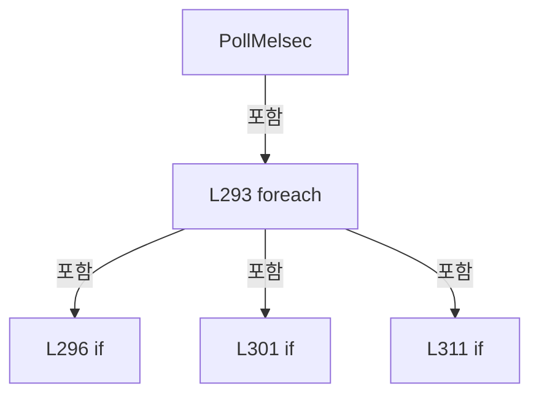

변경 전 점검: 입력/반환 타입, 위 호출자, 예외/취소 경로, 공유 상태와 저장·전송 소비자를 함께 확인합니다. 값의 단위나 물리 방향을 이름만으로 확정하지 않습니다.

### MethodDeclaration `CreateMelsecPollingRows` · L323–346

[Drilling.UI/Menu/Menus/CMonitorStatusPollingService.cs:323–346](https://github.com/kjuws10-rgb/A3Drilling/blob/5aee8e58439c9b455cae7c9593c9be986c3e682e/Drilling.UI/Menu/Menus/CMonitorStatusPollingService.cs#L323-L346)

| 항목 | 실제 추출 값 |
| --- | --- |
| 서명 | System.Collections.Generic.IReadOnlyList<Drilling.Common.Interface.ST_MELSEC_MAP_DATA> Drilling.UI.Menu.Menus.CMonitorStatusPollingService.CreateMelsecPollingRows(System.Collections.Generic.IReadOnlyList<Drilling.Common.Interface.ST_MELSEC_MAP_DATA>, string) |
| 접근/수식자 | Private / private, static |
| 반환/값 타입 | System.Collections.Generic.IReadOnlyList<Drilling.Common.Interface.ST_MELSEC_MAP_DATA> |
| 소속 타입 | NamedType:Drilling.UI.Menu.Menus.CMonitorStatusPollingService |

입력 계약:

| 이름 | 타입 | 전달 | 선택/기본값 |
| --- | --- | --- | --- |
| mapRows | System.Collections.Generic.IReadOnlyList<Drilling.Common.Interface.ST_MELSEC_MAP_DATA> | None | False /  |
| selectedGroup | string | None | False /  |

정적 호출자로 확인된 위치:

| 호출 파일/행 | 호출 표현식 | 런타임 분기 가능 |
| --- | --- | --- |
| [Drilling.UI/Menu/Menus/CMonitorStatusPollingService.cs:293–293](https://github.com/kjuws10-rgb/A3Drilling/blob/5aee8e58439c9b455cae7c9593c9be986c3e682e/Drilling.UI/Menu/Menus/CMonitorStatusPollingService.cs#L293-L293) | CreateMelsecPollingRows | False |

호출하는 대상과 해석 범위:

| 원본 행 | 표현식 | 분석 상태 | 대상/소스 위치 |
| --- | --- | --- | --- |
| 325 | selectedGroup.Equals | resolved | bool string.Equals(string?, System.StringComparison) |
| 330 | new Dictionary<string, ST_MELSEC_MAP_DATA> | resolved | System.Collections.Generic.Dictionary<string, Drilling.Common.Interface.ST_MELSEC_MAP_DATA>.Dictionary(System.Collections.Generic.IEqualityComparer<string>?) |
| 331 | mapRows.Where | resolved | System.Collections.Generic.IEnumerable<Drilling.Common.Interface.ST_MELSEC_MAP_DATA> System.Collections.Generic.IEnumerable<Drilling.Common.Interface.ST_MELSEC_MAP_DATA>.Where<Drilling.Common.Interface.ST_MELSEC_MAP_DATA>(System.Func<Drilling.Common.Interface.ST_MELSEC_MAP_DATA, bool>) |
| 331 | string.IsNullOrWhiteSpace | resolved | bool string.IsNullOrWhiteSpace(string?) |
| 331 | row.Group.Equals | resolved | bool string.Equals(string?, System.StringComparison) |
| 338 | row.Id.StartsWith | resolved | bool string.StartsWith(string, System.StringComparison) |
| 339 | row.Id.StartsWith | resolved | bool string.StartsWith(string, System.StringComparison) |
| 341 | rows.TryAdd | resolved | bool System.Collections.Generic.Dictionary<string, Drilling.Common.Interface.ST_MELSEC_MAP_DATA>.TryAdd(string, Drilling.Common.Interface.ST_MELSEC_MAP_DATA) |
| 345 | rows.Values.ToArray | resolved | Drilling.Common.Interface.ST_MELSEC_MAP_DATA[] System.Collections.Generic.IEnumerable<Drilling.Common.Interface.ST_MELSEC_MAP_DATA>.ToArray<Drilling.Common.Interface.ST_MELSEC_MAP_DATA>() |

본문의 실제 연산·분기·예외·반환 순서(원문 위치 순):

| 원본 행 | 종류 | 주석 해설 |
| --- | --- | --- |
| 325 | call | 함수·델리게이트 또는 객체 생성자를 호출합니다: selectedGroup.Equals("ALL", StringComparison.OrdinalIgnoreCase) |
| 325 | if | 조건에 따라 분기합니다: if (selectedGroup.Equals("ALL", StringComparison.OrdinalIgnoreCase)) |
| 327 | return | 호출자에게 값 또는 제어를 반환합니다: return mapRows; |
| 330 | call | 함수·델리게이트 또는 객체 생성자를 호출합니다: new Dictionary<string, ST_MELSEC_MAP_DATA>(StringComparer.OrdinalIgnoreCase) |
| 330 | local-declaration | 지역 변수를 선언합니다: var rows = new Dictionary<string, ST_MELSEC_MAP_DATA>(StringComparer.OrdinalIgnoreCase); |
| 330 | variable-initializer | 변수의 초기값을 지정합니다: rows = new Dictionary<string, ST_MELSEC_MAP_DATA>(StringComparer.OrdinalIgnoreCase) |
| 331 | call | 함수·델리게이트 또는 객체 생성자를 호출합니다: mapRows.Where(row => string.IsNullOrWhiteSpace(selectedGroup) &#124;&#124; row.Group.Equals(selectedGroup, StringComparison.OrdinalIgnoreCase)) |
| 331 | call | 함수·델리게이트 또는 객체 생성자를 호출합니다: string.IsNullOrWhiteSpace(selectedGroup) |
| 331 | call | 함수·델리게이트 또는 객체 생성자를 호출합니다: row.Group.Equals(selectedGroup, StringComparison.OrdinalIgnoreCase) |
| 331 | foreach | 컬렉션 요소를 순회합니다: foreach (var row in mapRows.Where(row => string.IsNullOrWhiteSpace(selectedGroup) &#124;&#124; row.Group.Equals(selectedGroup, StringComparison.OrdinalIgnoreCase))) |
| 333 | assignment | 값을 대상에 대입합니다: rows[row.Id] = row |
| 336 | foreach | 컬렉션 요소를 순회합니다: foreach (var row in mapRows) |
| 338 | call | 함수·델리게이트 또는 객체 생성자를 호출합니다: row.Id.StartsWith("IF_", StringComparison.OrdinalIgnoreCase) |
| 338 | if | 조건에 따라 분기합니다: if (row.Id.StartsWith("IF_", StringComparison.OrdinalIgnoreCase) &#124;&#124; row.Id.StartsWith("HANDSHAKE_", StringComparison.OrdinalIgnoreCase)) |
| 339 | call | 함수·델리게이트 또는 객체 생성자를 호출합니다: row.Id.StartsWith("HANDSHAKE_", StringComparison.OrdinalIgnoreCase) |
| 341 | call | 함수·델리게이트 또는 객체 생성자를 호출합니다: rows.TryAdd(row.Id, row) |
| 345 | call | 함수·델리게이트 또는 객체 생성자를 호출합니다: rows.Values.ToArray() |
| 345 | return | 호출자에게 값 또는 제어를 반환합니다: return rows.Values.ToArray(); |

제어 구문의 포함 구조(실제 실행 순서/CFG가 아닌 구문 탐색 그림):

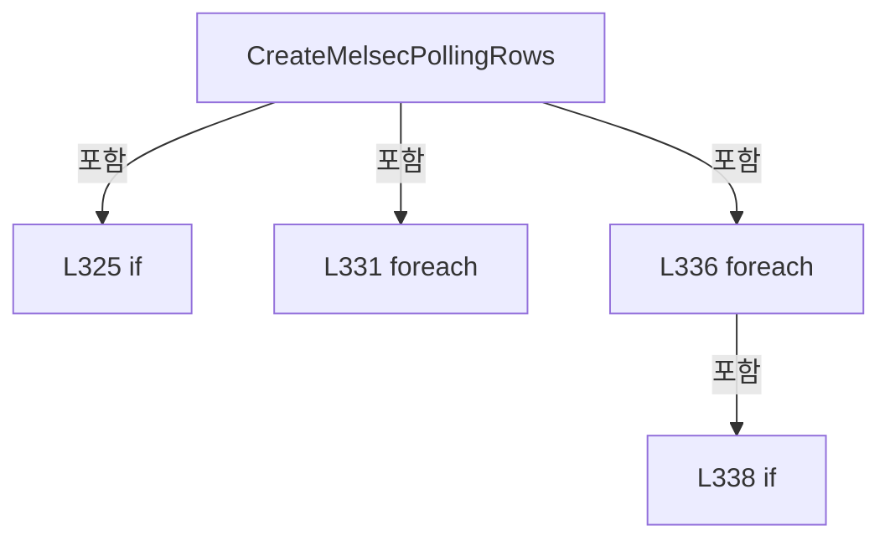

변경 전 점검: 입력/반환 타입, 위 호출자, 예외/취소 경로, 공유 상태와 저장·전송 소비자를 함께 확인합니다. 값의 단위나 물리 방향을 이름만으로 확정하지 않습니다.

### MethodDeclaration `FormatMelsecValue` · L348–359

[Drilling.UI/Menu/Menus/CMonitorStatusPollingService.cs:348–359](https://github.com/kjuws10-rgb/A3Drilling/blob/5aee8e58439c9b455cae7c9593c9be986c3e682e/Drilling.UI/Menu/Menus/CMonitorStatusPollingService.cs#L348-L359)

| 항목 | 실제 추출 값 |
| --- | --- |
| 서명 | string Drilling.UI.Menu.Menus.CMonitorStatusPollingService.FormatMelsecValue(Drilling.Common.Interface.ST_MELSEC_MAP_DATA, object?) |
| 접근/수식자 | Private / private, static |
| 반환/값 타입 | string |
| 소속 타입 | NamedType:Drilling.UI.Menu.Menus.CMonitorStatusPollingService |

입력 계약:

| 이름 | 타입 | 전달 | 선택/기본값 |
| --- | --- | --- | --- |
| row | Drilling.Common.Interface.ST_MELSEC_MAP_DATA | None | False /  |
| value | object? | None | False /  |

정적 호출자로 확인된 위치:

| 호출 파일/행 | 호출 표현식 | 런타임 분기 가능 |
| --- | --- | --- |
| [Drilling.UI/Menu/Menus/CMonitorStatusPollingService.cs:308–308](https://github.com/kjuws10-rgb/A3Drilling/blob/5aee8e58439c9b455cae7c9593c9be986c3e682e/Drilling.UI/Menu/Menus/CMonitorStatusPollingService.cs#L308-L308) | FormatMelsecValue | False |

호출하는 대상과 해석 범위:

| 원본 행 | 표현식 | 분석 상태 | 대상/소스 위치 |
| --- | --- | --- | --- |
| 353 | double.IsFinite | resolved | bool double.IsFinite(double) |
| 353 | CMelsecCachePresentation.NumericValue | resolved | double Drilling.UI.Menu.Menus.CMelsecCachePresentation.NumericValue(object?) · Drilling.UI/Menu/Menus/CMenuMonitor.cs:6222 |
| 354 | CMelsecCachePresentation.NumericValue(value).ToString | resolved | string double.ToString(string?, System.IFormatProvider?) |
| 354 | CMelsecCachePresentation.NumericValue | resolved | double Drilling.UI.Menu.Menus.CMelsecCachePresentation.NumericValue(object?) · Drilling.UI/Menu/Menus/CMenuMonitor.cs:6222 |
| 355 | double.IsFinite | resolved | bool double.IsFinite(double) |
| 355 | number.ToString | resolved | string double.ToString(string?, System.IFormatProvider?) |

본문의 실제 연산·분기·예외·반환 순서(원문 위치 순):

| 원본 행 | 종류 | 주석 해설 |
| --- | --- | --- |
| 350 | return | 호출자에게 값 또는 제어를 반환합니다: return row.DataType switch { EN_MELSEC_DATA_TYPE.Bit when value is bool bit => bit ? "ON" : "OFF", EN_MELSEC_DATA_TYPE.Word or EN_MELSEC_DATA_TYPE.DWord when double.IsFinite(CMelsecCachePresentation.NumericValue(value)) => CMelsec |
| 350 | switch-expression | 값별 결과식을 선택합니다: row.DataType switch { EN_MELSEC_DATA_TYPE.Bit when value is bool bit => bit ? "ON" : "OFF", EN_MELSEC_DATA_TYPE.Word or EN_MELSEC_DATA_TYPE.DWord when double.IsFinite(CMelsecCachePresentation.NumericValue(value)) => CMelsecCachePr |
| 352 | conditional-expression | 조건에 따라 결과식을 선택합니다: bit ? "ON" : "OFF" |
| 353 | call | 함수·델리게이트 또는 객체 생성자를 호출합니다: double.IsFinite(CMelsecCachePresentation.NumericValue(value)) |
| 353 | call | 함수·델리게이트 또는 객체 생성자를 호출합니다: CMelsecCachePresentation.NumericValue(value) |
| 354 | call | 함수·델리게이트 또는 객체 생성자를 호출합니다: CMelsecCachePresentation.NumericValue(value).ToString("0.########", CultureInfo.InvariantCulture) |
| 354 | call | 함수·델리게이트 또는 객체 생성자를 호출합니다: CMelsecCachePresentation.NumericValue(value) |
| 355 | call | 함수·델리게이트 또는 객체 생성자를 호출합니다: double.IsFinite(number) |
| 355 | call | 함수·델리게이트 또는 객체 생성자를 호출합니다: number.ToString("F3", CultureInfo.InvariantCulture) |

제어 구문의 포함 구조(실제 실행 순서/CFG가 아닌 구문 탐색 그림):

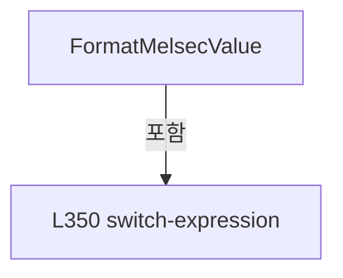

변경 전 점검: 입력/반환 타입, 위 호출자, 예외/취소 경로, 공유 상태와 저장·전송 소비자를 함께 확인합니다. 값의 단위나 물리 방향을 이름만으로 확정하지 않습니다.

### MethodDeclaration `GetContext` · L361–367

[Drilling.UI/Menu/Menus/CMonitorStatusPollingService.cs:361–367](https://github.com/kjuws10-rgb/A3Drilling/blob/5aee8e58439c9b455cae7c9593c9be986c3e682e/Drilling.UI/Menu/Menus/CMonitorStatusPollingService.cs#L361-L367)

| 항목 | 실제 추출 값 |
| --- | --- |
| 서명 | Drilling.UI.Menu.Menus.ST_MONITOR_POLLING_CONTEXT Drilling.UI.Menu.Menus.CMonitorStatusPollingService.GetContext() |
| 접근/수식자 | Private / private |
| 반환/값 타입 | Drilling.UI.Menu.Menus.ST_MONITOR_POLLING_CONTEXT |
| 소속 타입 | NamedType:Drilling.UI.Menu.Menus.CMonitorStatusPollingService |

정적 호출자로 확인된 위치:

| 호출 파일/행 | 호출 표현식 | 런타임 분기 가능 |
| --- | --- | --- |
| [Drilling.UI/Menu/Menus/CMonitorStatusPollingService.cs:62–62](https://github.com/kjuws10-rgb/A3Drilling/blob/5aee8e58439c9b455cae7c9593c9be986c3e682e/Drilling.UI/Menu/Menus/CMonitorStatusPollingService.cs#L62-L62) | GetContext | False |
| [Drilling.UI/Menu/Menus/CMonitorStatusPollingService.cs:81–81](https://github.com/kjuws10-rgb/A3Drilling/blob/5aee8e58439c9b455cae7c9593c9be986c3e682e/Drilling.UI/Menu/Menus/CMonitorStatusPollingService.cs#L81-L81) | GetContext | False |

본문의 실제 연산·분기·예외·반환 순서(원문 위치 순):

| 원본 행 | 종류 | 주석 해설 |
| --- | --- | --- |
| 363 | lock | 공유 상태의 임계 구역에 진입합니다: lock (_contextLock) |
| 365 | return | 호출자에게 값 또는 제어를 반환합니다: return _context; |

제어 구문의 포함 구조(실제 실행 순서/CFG가 아닌 구문 탐색 그림):

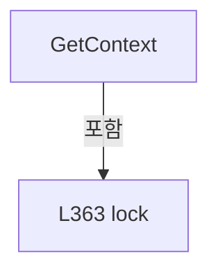

변경 전 점검: 입력/반환 타입, 위 호출자, 예외/취소 경로, 공유 상태와 저장·전송 소비자를 함께 확인합니다. 값의 단위나 물리 방향을 이름만으로 확정하지 않습니다.

### MethodDeclaration `SchedulePoll` · L369–396

[Drilling.UI/Menu/Menus/CMonitorStatusPollingService.cs:369–396](https://github.com/kjuws10-rgb/A3Drilling/blob/5aee8e58439c9b455cae7c9593c9be986c3e682e/Drilling.UI/Menu/Menus/CMonitorStatusPollingService.cs#L369-L396)

| 항목 | 실제 추출 값 |
| --- | --- |
| 서명 | void Drilling.UI.Menu.Menus.CMonitorStatusPollingService.SchedulePoll(System.Action<System.Threading.CancellationToken>, bool) |
| 접근/수식자 | Private / private |
| 반환/값 타입 | void |
| 소속 타입 | NamedType:Drilling.UI.Menu.Menus.CMonitorStatusPollingService |

입력 계약:

| 이름 | 타입 | 전달 | 선택/기본값 |
| --- | --- | --- | --- |
| poll | System.Action<System.Threading.CancellationToken> | None | False /  |
| communicationPoll | bool | None | False /  |

정적 호출자로 확인된 위치:

| 호출 파일/행 | 호출 표현식 | 런타임 분기 가능 |
| --- | --- | --- |
| [Drilling.UI/Menu/Menus/CMonitorStatusPollingService.cs:105–105](https://github.com/kjuws10-rgb/A3Drilling/blob/5aee8e58439c9b455cae7c9593c9be986c3e682e/Drilling.UI/Menu/Menus/CMonitorStatusPollingService.cs#L105-L105) | SchedulePoll | False |
| [Drilling.UI/Menu/Menus/CMonitorStatusPollingService.cs:111–111](https://github.com/kjuws10-rgb/A3Drilling/blob/5aee8e58439c9b455cae7c9593c9be986c3e682e/Drilling.UI/Menu/Menus/CMonitorStatusPollingService.cs#L111-L111) | SchedulePoll | False |
| [Drilling.UI/Menu/Menus/CMonitorStatusPollingService.cs:114–114](https://github.com/kjuws10-rgb/A3Drilling/blob/5aee8e58439c9b455cae7c9593c9be986c3e682e/Drilling.UI/Menu/Menus/CMonitorStatusPollingService.cs#L114-L114) | SchedulePoll | False |
| [Drilling.UI/Menu/Menus/CMonitorStatusPollingService.cs:117–117](https://github.com/kjuws10-rgb/A3Drilling/blob/5aee8e58439c9b455cae7c9593c9be986c3e682e/Drilling.UI/Menu/Menus/CMonitorStatusPollingService.cs#L117-L117) | SchedulePoll | False |
| [Drilling.UI/Menu/Menus/CMonitorStatusPollingService.cs:120–120](https://github.com/kjuws10-rgb/A3Drilling/blob/5aee8e58439c9b455cae7c9593c9be986c3e682e/Drilling.UI/Menu/Menus/CMonitorStatusPollingService.cs#L120-L120) | SchedulePoll | False |
| [Drilling.UI/Menu/Menus/CMonitorStatusPollingService.cs:126–126](https://github.com/kjuws10-rgb/A3Drilling/blob/5aee8e58439c9b455cae7c9593c9be986c3e682e/Drilling.UI/Menu/Menus/CMonitorStatusPollingService.cs#L126-L126) | SchedulePoll | False |
| [Drilling.UI/Menu/Menus/CMonitorStatusPollingService.cs:129–129](https://github.com/kjuws10-rgb/A3Drilling/blob/5aee8e58439c9b455cae7c9593c9be986c3e682e/Drilling.UI/Menu/Menus/CMonitorStatusPollingService.cs#L129-L129) | SchedulePoll | False |

호출하는 대상과 해석 범위:

| 원본 행 | 표현식 | 분석 상태 | 대상/소스 위치 |
| --- | --- | --- | --- |
| 372 | Interlocked.CompareExchange | resolved | int System.Threading.Interlocked.CompareExchange(ref int, int, int) |
| 373 | Interlocked.CompareExchange | resolved | int System.Threading.Interlocked.CompareExchange(ref int, int, int) |
| 378 | Task.Run | resolved | System.Threading.Tasks.Task System.Threading.Tasks.Task.Run(System.Action) |
| 382 | TryPoll | resolved | void Drilling.UI.Menu.Menus.CMonitorStatusPollingService.TryPoll(System.Action<System.Threading.CancellationToken>, System.Threading.CancellationToken) · Drilling.UI/Menu/Menus/CMonitorStatusPollingService.cs:139 |
| 388 | Interlocked.Exchange | resolved | int System.Threading.Interlocked.Exchange(ref int, int) |
| 392 | Interlocked.Exchange | resolved | int System.Threading.Interlocked.Exchange(ref int, int) |

본문의 실제 연산·분기·예외·반환 순서(원문 위치 순):

| 원본 행 | 종류 | 주석 해설 |
| --- | --- | --- |
| 371 | conditional-expression | 조건에 따라 결과식을 선택합니다: communicationPoll ? Interlocked.CompareExchange(ref _communicationPollRunning, 1, 0) != 0 : Interlocked.CompareExchange(ref _activeDevicePollRunning, 1, 0) != 0 |
| 371 | if | 조건에 따라 분기합니다: if (communicationPoll ? Interlocked.CompareExchange(ref _communicationPollRunning, 1, 0) != 0 : Interlocked.CompareExchange(ref _activeDevicePollRunning, 1, 0) != 0) |
| 372 | call | 함수·델리게이트 또는 객체 생성자를 호출합니다: Interlocked.CompareExchange(ref _communicationPollRunning, 1, 0) |
| 373 | call | 함수·델리게이트 또는 객체 생성자를 호출합니다: Interlocked.CompareExchange(ref _activeDevicePollRunning, 1, 0) |
| 375 | return | 호출자에게 값 또는 제어를 반환합니다: return; |
| 378 | assignment | 값을 대상에 대입합니다: _ = Task.Run(() => { try { TryPoll(poll, CancellationToken.None); } finally { if (communicationPoll) { Interlocked.Exchange(ref _communicationPollRunning, 0); } else { Interlocked.Exchange(ref _activeDevicePollRunning, 0); } } }) |
| 378 | call | 함수·델리게이트 또는 객체 생성자를 호출합니다: Task.Run(() => { try { TryPoll(poll, CancellationToken.None); } finally { if (communicationPoll) { Interlocked.Exchange(ref _communicationPollRunning, 0); } else { Interlocked.Exchange(ref _activeDevicePollRunning, 0); }… |
| 380 | try | 예외 처리 범위입니다: try |
| 382 | call | 함수·델리게이트 또는 객체 생성자를 호출합니다: TryPoll(poll, CancellationToken.None) |
| 384 | finally | 종료 정리 구간입니다: finally |
| 386 | if | 조건에 따라 분기합니다: if (communicationPoll) |
| 388 | call | 함수·델리게이트 또는 객체 생성자를 호출합니다: Interlocked.Exchange(ref _communicationPollRunning, 0) |
| 390 | else | 앞 조건이 거짓인 경로입니다: else |
| 392 | call | 함수·델리게이트 또는 객체 생성자를 호출합니다: Interlocked.Exchange(ref _activeDevicePollRunning, 0) |

제어 구문의 포함 구조(실제 실행 순서/CFG가 아닌 구문 탐색 그림):

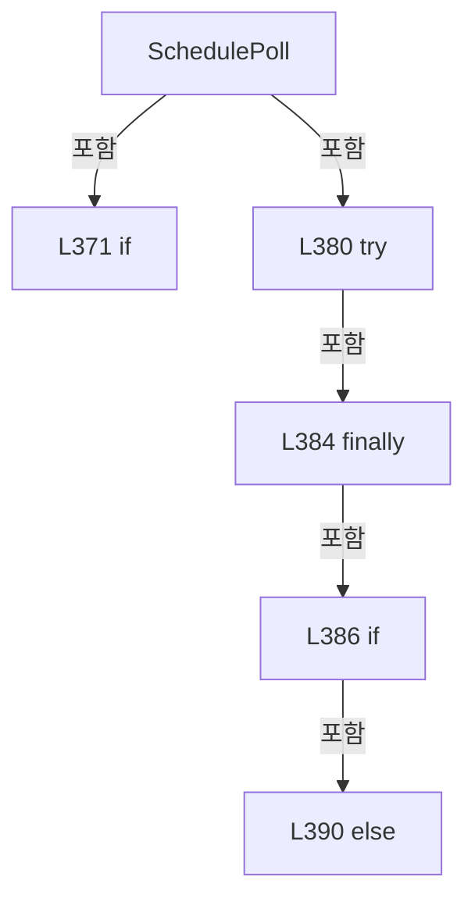

변경 전 점검: 입력/반환 타입, 위 호출자, 예외/취소 경로, 공유 상태와 저장·전송 소비자를 함께 확인합니다. 값의 단위나 물리 방향을 이름만으로 확정하지 않습니다.

### MethodDeclaration `IsActive` · L398–404

[Drilling.UI/Menu/Menus/CMonitorStatusPollingService.cs:398–404](https://github.com/kjuws10-rgb/A3Drilling/blob/5aee8e58439c9b455cae7c9593c9be986c3e682e/Drilling.UI/Menu/Menus/CMonitorStatusPollingService.cs#L398-L404)

| 항목 | 실제 추출 값 |
| --- | --- |
| 서명 | bool Drilling.UI.Menu.Menus.CMonitorStatusPollingService.IsActive() |
| 접근/수식자 | Private / private |
| 반환/값 타입 | bool |
| 소속 타입 | NamedType:Drilling.UI.Menu.Menus.CMonitorStatusPollingService |

정적 호출자로 확인된 위치:

| 호출 파일/행 | 호출 표현식 | 런타임 분기 가능 |
| --- | --- | --- |
| [Drilling.UI/Menu/Menus/CMonitorStatusPollingService.cs:76–76](https://github.com/kjuws10-rgb/A3Drilling/blob/5aee8e58439c9b455cae7c9593c9be986c3e682e/Drilling.UI/Menu/Menus/CMonitorStatusPollingService.cs#L76-L76) | IsActive | False |

본문의 실제 연산·분기·예외·반환 순서(원문 위치 순):

| 원본 행 | 종류 | 주석 해설 |
| --- | --- | --- |
| 400 | lock | 공유 상태의 임계 구역에 진입합니다: lock (_contextLock) |
| 402 | return | 호출자에게 값 또는 제어를 반환합니다: return _isActive; |

제어 구문의 포함 구조(실제 실행 순서/CFG가 아닌 구문 탐색 그림):

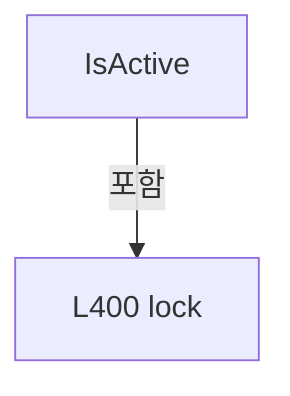

변경 전 점검: 입력/반환 타입, 위 호출자, 예외/취소 경로, 공유 상태와 저장·전송 소비자를 함께 확인합니다. 값의 단위나 물리 방향을 이름만으로 확정하지 않습니다.

### MethodDeclaration `GetMotorInterval` · L406–409

[Drilling.UI/Menu/Menus/CMonitorStatusPollingService.cs:406–409](https://github.com/kjuws10-rgb/A3Drilling/blob/5aee8e58439c9b455cae7c9593c9be986c3e682e/Drilling.UI/Menu/Menus/CMonitorStatusPollingService.cs#L406-L409)

| 항목 | 실제 추출 값 |
| --- | --- |
| 서명 | System.TimeSpan Drilling.UI.Menu.Menus.CMonitorStatusPollingService.GetMotorInterval() |
| 접근/수식자 | Private / private |
| 반환/값 타입 | System.TimeSpan |
| 소속 타입 | NamedType:Drilling.UI.Menu.Menus.CMonitorStatusPollingService |

정적 호출자로 확인된 위치:

| 호출 파일/행 | 호출 표현식 | 런타임 분기 가능 |
| --- | --- | --- |
| [Drilling.UI/Menu/Menus/CMonitorStatusPollingService.cs:174–174](https://github.com/kjuws10-rgb/A3Drilling/blob/5aee8e58439c9b455cae7c9593c9be986c3e682e/Drilling.UI/Menu/Menus/CMonitorStatusPollingService.cs#L174-L174) | GetMotorInterval | False |

본문의 실제 연산·분기·예외·반환 순서(원문 위치 순):

| 원본 행 | 종류 | 주석 해설 |
| --- | --- | --- |
| 408 | conditional-expression | 조건에 따라 결과식을 선택합니다: motionManager.IsSimulation ? LoopInterval : ActiveInterval |
| 408 | return | 호출자에게 값 또는 제어를 반환합니다: return motionManager.IsSimulation ? LoopInterval : ActiveInterval; |

변경 전 점검: 입력/반환 타입, 위 호출자, 예외/취소 경로, 공유 상태와 저장·전송 소비자를 함께 확인합니다. 값의 단위나 물리 방향을 이름만으로 확정하지 않습니다.

### MethodDeclaration `GetPowerMeterInterval` · L411–415

[Drilling.UI/Menu/Menus/CMonitorStatusPollingService.cs:411–415](https://github.com/kjuws10-rgb/A3Drilling/blob/5aee8e58439c9b455cae7c9593c9be986c3e682e/Drilling.UI/Menu/Menus/CMonitorStatusPollingService.cs#L411-L415)

| 항목 | 실제 추출 값 |
| --- | --- |
| 서명 | System.TimeSpan Drilling.UI.Menu.Menus.CMonitorStatusPollingService.GetPowerMeterInterval() |
| 접근/수식자 | Private / private |
| 반환/값 타입 | System.TimeSpan |
| 소속 타입 | NamedType:Drilling.UI.Menu.Menus.CMonitorStatusPollingService |

정적 호출자로 확인된 위치:

| 호출 파일/행 | 호출 표현식 | 런타임 분기 가능 |
| --- | --- | --- |
| [Drilling.UI/Menu/Menus/CMonitorStatusPollingService.cs:122–122](https://github.com/kjuws10-rgb/A3Drilling/blob/5aee8e58439c9b455cae7c9593c9be986c3e682e/Drilling.UI/Menu/Menus/CMonitorStatusPollingService.cs#L122-L122) | GetPowerMeterInterval | False |

호출하는 대상과 해석 범위:

| 원본 행 | 표현식 | 분석 상태 | 대상/소스 위치 |
| --- | --- | --- | --- |
| 413 | GetSnapshot | resolved | Drilling.UI.Menu.Menus.ST_MONITOR_STATUS_SNAPSHOT Drilling.UI.Menu.Menus.CMonitorStatusPollingService.GetSnapshot() · Drilling.UI/Menu/Menus/CMonitorStatusPollingService.cs:54 |

본문의 실제 연산·분기·예외·반환 순서(원문 위치 순):

| 원본 행 | 종류 | 주석 해설 |
| --- | --- | --- |
| 413 | call | 함수·델리게이트 또는 객체 생성자를 호출합니다: GetSnapshot() |
| 413 | local-declaration | 지역 변수를 선언합니다: var snapshot = GetSnapshot(); |
| 413 | variable-initializer | 변수의 초기값을 지정합니다: snapshot = GetSnapshot() |
| 414 | conditional-expression | 조건에 따라 결과식을 선택합니다: snapshot.DeviceStatus.PowerMeter.IsMeasuring ? ActivePowerMeterMeasureInterval : ActiveInterval |
| 414 | return | 호출자에게 값 또는 제어를 반환합니다: return snapshot.DeviceStatus.PowerMeter.IsMeasuring ? ActivePowerMeterMeasureInterval : ActiveInterval; |

변경 전 점검: 입력/반환 타입, 위 호출자, 예외/취소 경로, 공유 상태와 저장·전송 소비자를 함께 확인합니다. 값의 단위나 물리 방향을 이름만으로 확정하지 않습니다.

### MethodDeclaration `UpdateSnapshot` · L417–423

[Drilling.UI/Menu/Menus/CMonitorStatusPollingService.cs:417–423](https://github.com/kjuws10-rgb/A3Drilling/blob/5aee8e58439c9b455cae7c9593c9be986c3e682e/Drilling.UI/Menu/Menus/CMonitorStatusPollingService.cs#L417-L423)

| 항목 | 실제 추출 값 |
| --- | --- |
| 서명 | void Drilling.UI.Menu.Menus.CMonitorStatusPollingService.UpdateSnapshot(System.Func<Drilling.UI.Menu.Menus.ST_MONITOR_STATUS_SNAPSHOT, Drilling.UI.Menu.Menus.ST_MONITOR_STATUS_SNAPSHOT>) |
| 접근/수식자 | Private / private |
| 반환/값 타입 | void |
| 소속 타입 | NamedType:Drilling.UI.Menu.Menus.CMonitorStatusPollingService |

입력 계약:

| 이름 | 타입 | 전달 | 선택/기본값 |
| --- | --- | --- | --- |
| update | System.Func<Drilling.UI.Menu.Menus.ST_MONITOR_STATUS_SNAPSHOT, Drilling.UI.Menu.Menus.ST_MONITOR_STATUS_SNAPSHOT> | None | False /  |

정적 호출자로 확인된 위치:

| 호출 파일/행 | 호출 표현식 | 런타임 분기 가능 |
| --- | --- | --- |
| [Drilling.UI/Menu/Menus/CMonitorStatusPollingService.cs:161–161](https://github.com/kjuws10-rgb/A3Drilling/blob/5aee8e58439c9b455cae7c9593c9be986c3e682e/Drilling.UI/Menu/Menus/CMonitorStatusPollingService.cs#L161-L161) | UpdateSnapshot | False |
| [Drilling.UI/Menu/Menus/CMonitorStatusPollingService.cs:202–202](https://github.com/kjuws10-rgb/A3Drilling/blob/5aee8e58439c9b455cae7c9593c9be986c3e682e/Drilling.UI/Menu/Menus/CMonitorStatusPollingService.cs#L202-L202) | UpdateSnapshot | False |
| [Drilling.UI/Menu/Menus/CMonitorStatusPollingService.cs:221–221](https://github.com/kjuws10-rgb/A3Drilling/blob/5aee8e58439c9b455cae7c9593c9be986c3e682e/Drilling.UI/Menu/Menus/CMonitorStatusPollingService.cs#L221-L221) | UpdateSnapshot | False |
| [Drilling.UI/Menu/Menus/CMonitorStatusPollingService.cs:238–238](https://github.com/kjuws10-rgb/A3Drilling/blob/5aee8e58439c9b455cae7c9593c9be986c3e682e/Drilling.UI/Menu/Menus/CMonitorStatusPollingService.cs#L238-L238) | UpdateSnapshot | False |
| [Drilling.UI/Menu/Menus/CMonitorStatusPollingService.cs:255–255](https://github.com/kjuws10-rgb/A3Drilling/blob/5aee8e58439c9b455cae7c9593c9be986c3e682e/Drilling.UI/Menu/Menus/CMonitorStatusPollingService.cs#L255-L255) | UpdateSnapshot | False |
| [Drilling.UI/Menu/Menus/CMonitorStatusPollingService.cs:272–272](https://github.com/kjuws10-rgb/A3Drilling/blob/5aee8e58439c9b455cae7c9593c9be986c3e682e/Drilling.UI/Menu/Menus/CMonitorStatusPollingService.cs#L272-L272) | UpdateSnapshot | False |
| [Drilling.UI/Menu/Menus/CMonitorStatusPollingService.cs:286–286](https://github.com/kjuws10-rgb/A3Drilling/blob/5aee8e58439c9b455cae7c9593c9be986c3e682e/Drilling.UI/Menu/Menus/CMonitorStatusPollingService.cs#L286-L286) | UpdateSnapshot | False |
| [Drilling.UI/Menu/Menus/CMonitorStatusPollingService.cs:320–320](https://github.com/kjuws10-rgb/A3Drilling/blob/5aee8e58439c9b455cae7c9593c9be986c3e682e/Drilling.UI/Menu/Menus/CMonitorStatusPollingService.cs#L320-L320) | UpdateSnapshot | False |

호출하는 대상과 해석 범위:

| 원본 행 | 표현식 | 분석 상태 | 대상/소스 위치 |
| --- | --- | --- | --- |
| 421 | update | resolved · 동적 구현 선택 가능 | Drilling.UI.Menu.Menus.ST_MONITOR_STATUS_SNAPSHOT System.Func<Drilling.UI.Menu.Menus.ST_MONITOR_STATUS_SNAPSHOT, Drilling.UI.Menu.Menus.ST_MONITOR_STATUS_SNAPSHOT>.Invoke(Drilling.UI.Menu.Menus.ST_MONITOR_STATUS_SNAPSHOT) |

본문의 실제 연산·분기·예외·반환 순서(원문 위치 순):

| 원본 행 | 종류 | 주석 해설 |
| --- | --- | --- |
| 419 | lock | 공유 상태의 임계 구역에 진입합니다: lock (_snapshotLock) |
| 421 | assignment | 값을 대상에 대입합니다: _snapshot = update(_snapshot) |
| 421 | call | 함수·델리게이트 또는 객체 생성자를 호출합니다: update(_snapshot) |

제어 구문의 포함 구조(실제 실행 순서/CFG가 아닌 구문 탐색 그림):

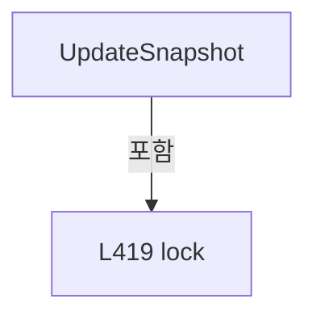

변경 전 점검: 입력/반환 타입, 위 호출자, 예외/취소 경로, 공유 상태와 저장·전송 소비자를 함께 확인합니다. 값의 단위나 물리 방향을 이름만으로 확정하지 않습니다.

### MethodDeclaration `IsDue` · L425–434

[Drilling.UI/Menu/Menus/CMonitorStatusPollingService.cs:425–434](https://github.com/kjuws10-rgb/A3Drilling/blob/5aee8e58439c9b455cae7c9593c9be986c3e682e/Drilling.UI/Menu/Menus/CMonitorStatusPollingService.cs#L425-L434)

| 항목 | 실제 추출 값 |
| --- | --- |
| 서명 | bool Drilling.UI.Menu.Menus.CMonitorStatusPollingService.IsDue(ref System.DateTimeOffset, System.DateTimeOffset, System.TimeSpan) |
| 접근/수식자 | Private / private, static |
| 반환/값 타입 | bool |
| 소속 타입 | NamedType:Drilling.UI.Menu.Menus.CMonitorStatusPollingService |

입력 계약:

| 이름 | 타입 | 전달 | 선택/기본값 |
| --- | --- | --- | --- |
| lastPoll | System.DateTimeOffset | Ref | False /  |
| now | System.DateTimeOffset | None | False /  |
| interval | System.TimeSpan | None | False /  |

정적 호출자로 확인된 위치:

| 호출 파일/행 | 호출 표현식 | 런타임 분기 가능 |
| --- | --- | --- |
| [Drilling.UI/Menu/Menus/CMonitorStatusPollingService.cs:103–103](https://github.com/kjuws10-rgb/A3Drilling/blob/5aee8e58439c9b455cae7c9593c9be986c3e682e/Drilling.UI/Menu/Menus/CMonitorStatusPollingService.cs#L103-L103) | IsDue | False |
| [Drilling.UI/Menu/Menus/CMonitorStatusPollingService.cs:113–113](https://github.com/kjuws10-rgb/A3Drilling/blob/5aee8e58439c9b455cae7c9593c9be986c3e682e/Drilling.UI/Menu/Menus/CMonitorStatusPollingService.cs#L113-L113) | IsDue | False |
| [Drilling.UI/Menu/Menus/CMonitorStatusPollingService.cs:116–116](https://github.com/kjuws10-rgb/A3Drilling/blob/5aee8e58439c9b455cae7c9593c9be986c3e682e/Drilling.UI/Menu/Menus/CMonitorStatusPollingService.cs#L116-L116) | IsDue | False |
| [Drilling.UI/Menu/Menus/CMonitorStatusPollingService.cs:119–119](https://github.com/kjuws10-rgb/A3Drilling/blob/5aee8e58439c9b455cae7c9593c9be986c3e682e/Drilling.UI/Menu/Menus/CMonitorStatusPollingService.cs#L119-L119) | IsDue | False |
| [Drilling.UI/Menu/Menus/CMonitorStatusPollingService.cs:122–122](https://github.com/kjuws10-rgb/A3Drilling/blob/5aee8e58439c9b455cae7c9593c9be986c3e682e/Drilling.UI/Menu/Menus/CMonitorStatusPollingService.cs#L122-L122) | IsDue | False |
| [Drilling.UI/Menu/Menus/CMonitorStatusPollingService.cs:125–125](https://github.com/kjuws10-rgb/A3Drilling/blob/5aee8e58439c9b455cae7c9593c9be986c3e682e/Drilling.UI/Menu/Menus/CMonitorStatusPollingService.cs#L125-L125) | IsDue | False |
| [Drilling.UI/Menu/Menus/CMonitorStatusPollingService.cs:133–133](https://github.com/kjuws10-rgb/A3Drilling/blob/5aee8e58439c9b455cae7c9593c9be986c3e682e/Drilling.UI/Menu/Menus/CMonitorStatusPollingService.cs#L133-L133) | IsDue | False |

본문의 실제 연산·분기·예외·반환 순서(원문 위치 순):

| 원본 행 | 종류 | 주석 해설 |
| --- | --- | --- |
| 427 | if | 조건에 따라 분기합니다: if (now - lastPoll < interval) |
| 429 | return | 호출자에게 값 또는 제어를 반환합니다: return false; |
| 432 | assignment | 값을 대상에 대입합니다: lastPoll = now |
| 433 | return | 호출자에게 값 또는 제어를 반환합니다: return true; |

제어 구문의 포함 구조(실제 실행 순서/CFG가 아닌 구문 탐색 그림):

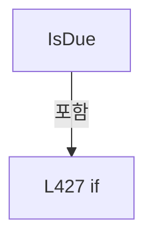

변경 전 점검: 입력/반환 타입, 위 호출자, 예외/취소 경로, 공유 상태와 저장·전송 소비자를 함께 확인합니다. 값의 단위나 물리 방향을 이름만으로 확정하지 않습니다.

### MethodDeclaration `NormalizeTab` · L436–449

[Drilling.UI/Menu/Menus/CMonitorStatusPollingService.cs:436–449](https://github.com/kjuws10-rgb/A3Drilling/blob/5aee8e58439c9b455cae7c9593c9be986c3e682e/Drilling.UI/Menu/Menus/CMonitorStatusPollingService.cs#L436-L449)

| 항목 | 실제 추출 값 |
| --- | --- |
| 서명 | string Drilling.UI.Menu.Menus.CMonitorStatusPollingService.NormalizeTab(string) |
| 접근/수식자 | Private / private, static |
| 반환/값 타입 | string |
| 소속 타입 | NamedType:Drilling.UI.Menu.Menus.CMonitorStatusPollingService |

입력 계약:

| 이름 | 타입 | 전달 | 선택/기본값 |
| --- | --- | --- | --- |
| tab | string | None | False /  |

정적 호출자로 확인된 위치:

| 호출 파일/행 | 호출 표현식 | 런타임 분기 가능 |
| --- | --- | --- |
| [Drilling.UI/Menu/Menus/CMonitorStatusPollingService.cs:39–39](https://github.com/kjuws10-rgb/A3Drilling/blob/5aee8e58439c9b455cae7c9593c9be986c3e682e/Drilling.UI/Menu/Menus/CMonitorStatusPollingService.cs#L39-L39) | NormalizeTab | False |

호출하는 대상과 해석 범위:

| 원본 행 | 표현식 | 분석 상태 | 대상/소스 위치 |
| --- | --- | --- | --- |
| 438 | string.IsNullOrWhiteSpace | resolved | bool string.IsNullOrWhiteSpace(string?) |
| 438 | tab.Trim().ToUpperInvariant | resolved | string string.ToUpperInvariant() |
| 438 | tab.Trim | resolved | string string.Trim() |

본문의 실제 연산·분기·예외·반환 순서(원문 위치 순):

| 원본 행 | 종류 | 주석 해설 |
| --- | --- | --- |
| 438 | call | 함수·델리게이트 또는 객체 생성자를 호출합니다: string.IsNullOrWhiteSpace(tab) |
| 438 | call | 함수·델리게이트 또는 객체 생성자를 호출합니다: tab.Trim().ToUpperInvariant() |
| 438 | call | 함수·델리게이트 또는 객체 생성자를 호출합니다: tab.Trim() |
| 438 | conditional-expression | 조건에 따라 결과식을 선택합니다: string.IsNullOrWhiteSpace(tab) ? "PRODUCT" : tab.Trim().ToUpperInvariant() |
| 438 | local-declaration | 지역 변수를 선언합니다: var normalized = string.IsNullOrWhiteSpace(tab) ? "PRODUCT" : tab.Trim().ToUpperInvariant(); |
| 438 | variable-initializer | 변수의 초기값을 지정합니다: normalized = string.IsNullOrWhiteSpace(tab) ? "PRODUCT" : tab.Trim().ToUpperInvariant() |
| 439 | return | 호출자에게 값 또는 제어를 반환합니다: return normalized switch { "ATT" => "ATTENUATOR", "POWER" or "POWERMETER" or "POWER_METER" => "POWER METER", "MOTOR" or "XPS" or "SCANNERTILT" or "SCANNER TILT" or "SCANNER_TILT" => "XPS", "PICO" or "PICOMOTOR" or "PICO_MOTOR" or  |
| 439 | switch-expression | 값별 결과식을 선택합니다: normalized switch { "ATT" => "ATTENUATOR", "POWER" or "POWERMETER" or "POWER_METER" => "POWER METER", "MOTOR" or "XPS" or "SCANNERTILT" or "SCANNER TILT" or "SCANNER_TILT" => "XPS", "PICO" or "PICOMOTOR" or "PICO_MOTOR" or "DOETIL |

제어 구문의 포함 구조(실제 실행 순서/CFG가 아닌 구문 탐색 그림):

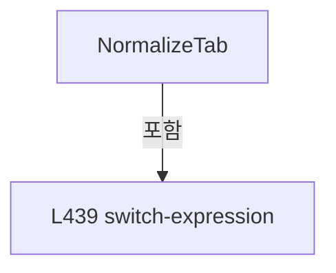

변경 전 점검: 입력/반환 타입, 위 호출자, 예외/취소 경로, 공유 상태와 저장·전송 소비자를 함께 확인합니다. 값의 단위나 물리 방향을 이름만으로 확정하지 않습니다.

### MethodDeclaration `NormalizeMelsecGroup` · L451–454

[Drilling.UI/Menu/Menus/CMonitorStatusPollingService.cs:451–454](https://github.com/kjuws10-rgb/A3Drilling/blob/5aee8e58439c9b455cae7c9593c9be986c3e682e/Drilling.UI/Menu/Menus/CMonitorStatusPollingService.cs#L451-L454)

| 항목 | 실제 추출 값 |
| --- | --- |
| 서명 | string Drilling.UI.Menu.Menus.CMonitorStatusPollingService.NormalizeMelsecGroup(string) |
| 접근/수식자 | Private / private, static |
| 반환/값 타입 | string |
| 소속 타입 | NamedType:Drilling.UI.Menu.Menus.CMonitorStatusPollingService |

입력 계약:

| 이름 | 타입 | 전달 | 선택/기본값 |
| --- | --- | --- | --- |
| group | string | None | False /  |

정적 호출자로 확인된 위치:

| 호출 파일/행 | 호출 표현식 | 런타임 분기 가능 |
| --- | --- | --- |
| [Drilling.UI/Menu/Menus/CMonitorStatusPollingService.cs:39–39](https://github.com/kjuws10-rgb/A3Drilling/blob/5aee8e58439c9b455cae7c9593c9be986c3e682e/Drilling.UI/Menu/Menus/CMonitorStatusPollingService.cs#L39-L39) | NormalizeMelsecGroup | False |

호출하는 대상과 해석 범위:

| 원본 행 | 표현식 | 분석 상태 | 대상/소스 위치 |
| --- | --- | --- | --- |
| 453 | string.IsNullOrWhiteSpace | resolved | bool string.IsNullOrWhiteSpace(string?) |
| 453 | group.Trim().ToUpperInvariant | resolved | string string.ToUpperInvariant() |
| 453 | group.Trim | resolved | string string.Trim() |

본문의 실제 연산·분기·예외·반환 순서(원문 위치 순):

| 원본 행 | 종류 | 주석 해설 |
| --- | --- | --- |
| 453 | call | 함수·델리게이트 또는 객체 생성자를 호출합니다: string.IsNullOrWhiteSpace(group) |
| 453 | call | 함수·델리게이트 또는 객체 생성자를 호출합니다: group.Trim().ToUpperInvariant() |
| 453 | call | 함수·델리게이트 또는 객체 생성자를 호출합니다: group.Trim() |
| 453 | conditional-expression | 조건에 따라 결과식을 선택합니다: string.IsNullOrWhiteSpace(group) ? "ALL" : group.Trim().ToUpperInvariant() |
| 453 | return | 호출자에게 값 또는 제어를 반환합니다: return string.IsNullOrWhiteSpace(group) ? "ALL" : group.Trim().ToUpperInvariant(); |

변경 전 점검: 입력/반환 타입, 위 호출자, 예외/취소 경로, 공유 상태와 저장·전송 소비자를 함께 확인합니다. 값의 단위나 물리 방향을 이름만으로 확정하지 않습니다.

### PropertyDeclaration `Default` · L459–459

[Drilling.UI/Menu/Menus/CMonitorStatusPollingService.cs:459–459](https://github.com/kjuws10-rgb/A3Drilling/blob/5aee8e58439c9b455cae7c9593c9be986c3e682e/Drilling.UI/Menu/Menus/CMonitorStatusPollingService.cs#L459-L459)

| 항목 | 실제 추출 값 |
| --- | --- |
| 서명 | Drilling.UI.Menu.Menus.ST_MONITOR_POLLING_CONTEXT Drilling.UI.Menu.Menus.ST_MONITOR_POLLING_CONTEXT.Default |
| 접근/수식자 | Public / public, static |
| 반환/값 타입 | Drilling.UI.Menu.Menus.ST_MONITOR_POLLING_CONTEXT |
| 소속 타입 | NamedType:Drilling.UI.Menu.Menus.ST_MONITOR_POLLING_CONTEXT |

현재 부분 분석에서 직접 연결된 호출자는 없습니다. XAML/이벤트/인터페이스·델리게이트·외부 진입을 추가 확인해야 하며, 미사용으로 판정한 것이 아닙니다.

호출하는 대상과 해석 범위:

| 원본 행 | 표현식 | 분석 상태 | 대상/소스 위치 |
| --- | --- | --- | --- |
| 459 | new | resolved | Drilling.UI.Menu.Menus.ST_MONITOR_POLLING_CONTEXT.ST_MONITOR_POLLING_CONTEXT(string, int, int, int, string) · Drilling.UI/Menu/Menus/CMonitorStatusPollingService.cs:457 |

본문의 실제 연산·분기·예외·반환 순서(원문 위치 순):

| 원본 행 | 종류 | 주석 해설 |
| --- | --- | --- |
| 459 | call | 함수·델리게이트 또는 객체 생성자를 호출합니다: new("PRODUCT", 0, 0, 0, "ALL") |

변경 전 점검: 입력/반환 타입, 위 호출자, 예외/취소 경로, 공유 상태와 저장·전송 소비자를 함께 확인합니다. 값의 단위나 물리 방향을 이름만으로 확정하지 않습니다.

### GetAccessorDeclaration `get_Default` · L459–459

[Drilling.UI/Menu/Menus/CMonitorStatusPollingService.cs:459–459](https://github.com/kjuws10-rgb/A3Drilling/blob/5aee8e58439c9b455cae7c9593c9be986c3e682e/Drilling.UI/Menu/Menus/CMonitorStatusPollingService.cs#L459-L459)

| 항목 | 실제 추출 값 |
| --- | --- |
| 서명 | Drilling.UI.Menu.Menus.ST_MONITOR_POLLING_CONTEXT Drilling.UI.Menu.Menus.ST_MONITOR_POLLING_CONTEXT.Default.get |
| 접근/수식자 | Public / get |
| 반환/값 타입 | Drilling.UI.Menu.Menus.ST_MONITOR_POLLING_CONTEXT |
| 소속 타입 | NamedType:Drilling.UI.Menu.Menus.ST_MONITOR_POLLING_CONTEXT |

현재 부분 분석에서 직접 연결된 호출자는 없습니다. XAML/이벤트/인터페이스·델리게이트·외부 진입을 추가 확인해야 하며, 미사용으로 판정한 것이 아닙니다.

변경 전 점검: 입력/반환 타입, 위 호출자, 예외/취소 경로, 공유 상태와 저장·전송 소비자를 함께 확인합니다. 값의 단위나 물리 방향을 이름만으로 확정하지 않습니다.

### PropertyDeclaration `Empty` · L470–483

[Drilling.UI/Menu/Menus/CMonitorStatusPollingService.cs:470–483](https://github.com/kjuws10-rgb/A3Drilling/blob/5aee8e58439c9b455cae7c9593c9be986c3e682e/Drilling.UI/Menu/Menus/CMonitorStatusPollingService.cs#L470-L483)

| 항목 | 실제 추출 값 |
| --- | --- |
| 서명 | Drilling.UI.Menu.Menus.ST_MONITOR_STATUS_SNAPSHOT Drilling.UI.Menu.Menus.ST_MONITOR_STATUS_SNAPSHOT.Empty |
| 접근/수식자 | Public / public, static |
| 반환/값 타입 | Drilling.UI.Menu.Menus.ST_MONITOR_STATUS_SNAPSHOT |
| 소속 타입 | NamedType:Drilling.UI.Menu.Menus.ST_MONITOR_STATUS_SNAPSHOT |

현재 부분 분석에서 직접 연결된 호출자는 없습니다. XAML/이벤트/인터페이스·델리게이트·외부 진입을 추가 확인해야 하며, 미사용으로 판정한 것이 아닙니다.

호출하는 대상과 해석 범위:

| 원본 행 | 표현식 | 분석 상태 | 대상/소스 위치 |
| --- | --- | --- | --- |
| 470 | new | resolved | Drilling.UI.Menu.Menus.ST_MONITOR_STATUS_SNAPSHOT.ST_MONITOR_STATUS_SNAPSHOT(Drilling.Common.Managers.ST_DEVICE_STATUS, System.Collections.Generic.IReadOnlyList<Drilling.Common.Interface.ST_DEVICE_COMM_STATUS>, Drilling.Common.Interface.ST_TALON_STATUS, Drilling.Common.Interface.ST_PICO_MOTOR_STATUS, System.Collections.Generic.IReadOnlyDictionary<string, Drilling.UI.Menu.Menus.ST_MONITOR_MELSEC_VALUE>) · Drilling.UI/Menu/Menus/CMonitorStatusPollingService.cs:462 |
| 471 | new ST_DEVICE_STATUS | resolved | Drilling.Common.Managers.ST_DEVICE_STATUS.ST_DEVICE_STATUS(System.Collections.Generic.IReadOnlyList<Drilling.Common.Motion.ST_IO_STATUS>, System.Collections.Generic.IReadOnlyList<Drilling.Common.Motion.ST_MOTOR_AXIS_STATUS>, Drilling.Common.Interface.ST_LASER_STATUS, Drilling.Common.Interface.ST_ATTENUATOR_STATUS, Drilling.Common.Interface.ST_BET_STATUS, Drilling.Common.Managers.ST_POWER_METER_STATUS) · Drilling.Common/Managers/CManager.cs:726 |
| 474 | new ST_LASER_STATUS | resolved | Drilling.Common.Interface.ST_LASER_STATUS.ST_LASER_STATUS(bool, bool, bool, double) · Drilling.Common/Interface/Serial/CTalonLaser.cs:367 |
| 475 | new ST_ATTENUATOR_STATUS | resolved | Drilling.Common.Interface.ST_ATTENUATOR_STATUS.ST_ATTENUATOR_STATUS(double, double, string, bool, Drilling.Common.Interface.EN_CONEX_AGP_ERROR, System.DateTimeOffset?, int?, double?, double?, double?, double?, double?) · Drilling.Common/Interface/Serial/CConex_AGP.cs:549 |
| 476 | new ST_BET_STATUS | resolved | Drilling.Common.Interface.ST_BET_STATUS.ST_BET_STATUS(double, double, double, double, double, double, bool, bool, bool, bool, bool, Drilling.Common.Interface.EN_BET_ERROR, System.DateTimeOffset?, string) · Drilling.Common/Interface/Serial/CBeamExpander.cs:449 |
| 482 | new Dictionary<string, ST_MONITOR_MELSEC_VALUE> | resolved | System.Collections.Generic.Dictionary<string, Drilling.UI.Menu.Menus.ST_MONITOR_MELSEC_VALUE>.Dictionary(System.Collections.Generic.IEqualityComparer<string>?) |

본문의 실제 연산·분기·예외·반환 순서(원문 위치 순):

| 원본 행 | 종류 | 주석 해설 |
| --- | --- | --- |
| 470 | call | 함수·델리게이트 또는 객체 생성자를 호출합니다: new( new ST_DEVICE_STATUS( [], [], new ST_LASER_STATUS(false, false, false, 0.0), new ST_ATTENUATOR_STATUS(0.0, 0.0, "IDLE", false), new ST_BET_STATUS(0.0, 0.0, 0.0, 0.0, 0.0, 0.0, false, false, false, false, false), ST_… |
| 471 | call | 함수·델리게이트 또는 객체 생성자를 호출합니다: new ST_DEVICE_STATUS( [], [], new ST_LASER_STATUS(false, false, false, 0.0), new ST_ATTENUATOR_STATUS(0.0, 0.0, "IDLE", false), new ST_BET_STATUS(0.0, 0.0, 0.0, 0.0, 0.0, 0.0, false, false, false, false, false), ST_POWER… |
| 474 | call | 함수·델리게이트 또는 객체 생성자를 호출합니다: new ST_LASER_STATUS(false, false, false, 0.0) |
| 475 | call | 함수·델리게이트 또는 객체 생성자를 호출합니다: new ST_ATTENUATOR_STATUS(0.0, 0.0, "IDLE", false) |
| 476 | call | 함수·델리게이트 또는 객체 생성자를 호출합니다: new ST_BET_STATUS(0.0, 0.0, 0.0, 0.0, 0.0, 0.0, false, false, false, false, false) |
| 482 | call | 함수·델리게이트 또는 객체 생성자를 호출합니다: new Dictionary<string, ST_MONITOR_MELSEC_VALUE>(StringComparer.OrdinalIgnoreCase) |

변경 전 점검: 입력/반환 타입, 위 호출자, 예외/취소 경로, 공유 상태와 저장·전송 소비자를 함께 확인합니다. 값의 단위나 물리 방향을 이름만으로 확정하지 않습니다.

### GetAccessorDeclaration `get_Empty` · L470–470

[Drilling.UI/Menu/Menus/CMonitorStatusPollingService.cs:470–470](https://github.com/kjuws10-rgb/A3Drilling/blob/5aee8e58439c9b455cae7c9593c9be986c3e682e/Drilling.UI/Menu/Menus/CMonitorStatusPollingService.cs#L470-L470)

| 항목 | 실제 추출 값 |
| --- | --- |
| 서명 | Drilling.UI.Menu.Menus.ST_MONITOR_STATUS_SNAPSHOT Drilling.UI.Menu.Menus.ST_MONITOR_STATUS_SNAPSHOT.Empty.get |
| 접근/수식자 | Public / get |
| 반환/값 타입 | Drilling.UI.Menu.Menus.ST_MONITOR_STATUS_SNAPSHOT |
| 소속 타입 | NamedType:Drilling.UI.Menu.Menus.ST_MONITOR_STATUS_SNAPSHOT |

현재 부분 분석에서 직접 연결된 호출자는 없습니다. XAML/이벤트/인터페이스·델리게이트·외부 진입을 추가 확인해야 하며, 미사용으로 판정한 것이 아닙니다.

변경 전 점검: 입력/반환 타입, 위 호출자, 예외/취소 경로, 공유 상태와 저장·전송 소비자를 함께 확인합니다. 값의 단위나 물리 방향을 이름만으로 확정하지 않습니다.

## 구문·바인딩 한계

전체 WPF/벤더 SDK/프로젝트별 빌드 조건을 로드한 정식 빌드가 아닙니다. `resolved`는 이 부분 컴파일에서의 심볼 연결이며 virtual/interface/delegate/이벤트/Reflection/XAML의 실제 런타임 구현을 확정하지 않습니다. `candidate`와 `unresolved`는 후속 확인 대상으로 남깁니다.

## 원문 전체 주석 해설본

[원본 모든 행과 행별 해설 보기](../../../../annotated/Drilling.UI/Menu/Menus/CMonitorStatusPollingService.cs.annotated.txt)

원본을 빠뜨리거나 임의로 줄이지 않았습니다. `L000001 |` 표시는 원본 행 번호, `// 해설`은 별도 설명입니다. 실행용 소스가 아닌 문서입니다.

## 수정·재검증 체크

- 원본 Commit과 현재 작업 파일 SHA가 같은지 먼저 확인합니다. 다르면 이 문서를 과거 버전 자료로 취급합니다.
- 선언·직접 호출·이벤트/인터페이스 경계·설정 소비를 함께 확인합니다. 정적 연결의 빈 곳을 정상 경로로 추정하지 않습니다.
- 저장 형식/단위/식별자·재시도·취소·예외·롤백에 영향을 주는 변경은 상세 해설장과 호출자를 다시 검토합니다.
- 도구의 구문 추출과 별도 정적 추적 해설, 실제 빌드·시뮬레이션·실장비 검증 결과를 분리합니다.
