# Drilling.UI/Menu/Menus/CRecipeCellPatternPreviewDrawing.cs

| 항목 | 내용 |
| --- | --- |
| 원본 저장소 | https://github.com/kjuws10-rgb/A3Drilling.git |
| 원본 Commit | 5aee8e58439c9b455cae7c9593c9be986c3e682e |
| 원본 SHA256 | 4f0734c7e46f77a225b37aa296ce98ed47c2af052d912739bc4661e6eb52b852 |
| 파일 분류 | code |
| 원본 크기/행 | 32,585 bytes / 677 physical lines |
| 인코딩 | utf-8-sig |
| 검토 범위 | 구문/부분 의미 분석에서 추출한 사실. 동작·물리 단위·실장비 합격을 보증하지 않습니다. |
| 원본 링크 | [고정 Commit 원본](https://github.com/kjuws10-rgb/A3Drilling/blob/5aee8e58439c9b455cae7c9593c9be986c3e682e/Drilling.UI/Menu/Menus/CRecipeCellPatternPreviewDrawing.cs) |

## 파일의 역할과 읽는 순서

WPF 화면·사용자 명령·표시 상태를 구성합니다. XAML 이벤트와 코드 비하인드, RootView의 조립 경로를 함께 추적합니다.

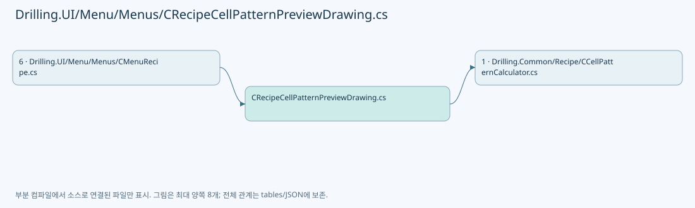

## 네임스페이스·타입·상속

| 타입 | 구분 | 원본 범위 | 선언/상속 |
| --- | --- | --- | --- |
| CRecipeCellPatternPreviewDrawing | ClassDeclaration | 7–677 | CRecipeCellPatternPreviewDrawing |

## 멤버 빠른 목록

| 이름 | 종류 | 범위 | 서명 |
| --- | --- | --- | --- |
| CellMapPortraitDesignWidth | FieldDeclaration | L9–9 | double Drilling.UI.Menu.Menus.CRecipeCellPatternPreviewDrawing.CellMapPortraitDesignWidth |
| CellMapPortraitDesignHeight | FieldDeclaration | L10–10 | double Drilling.UI.Menu.Menus.CRecipeCellPatternPreviewDrawing.CellMapPortraitDesignHeight |
| CellMapLandscapeDesignWidth | FieldDeclaration | L11–11 | double Drilling.UI.Menu.Menus.CRecipeCellPatternPreviewDrawing.CellMapLandscapeDesignWidth |
| CellMapLandscapeDesignHeight | FieldDeclaration | L12–12 | double Drilling.UI.Menu.Menus.CRecipeCellPatternPreviewDrawing.CellMapLandscapeDesignHeight |
| ShotDetailDesignWidth | FieldDeclaration | L13–13 | double Drilling.UI.Menu.Menus.CRecipeCellPatternPreviewDrawing.ShotDetailDesignWidth |
| ShotDetailDesignHeight | FieldDeclaration | L14–14 | double Drilling.UI.Menu.Menus.CRecipeCellPatternPreviewDrawing.ShotDetailDesignHeight |
| CellMapPortraitRect | FieldDeclaration | L15–15 | Rect Drilling.UI.Menu.Menus.CRecipeCellPatternPreviewDrawing.CellMapPortraitRect |
| CellMapLandscapeRect | FieldDeclaration | L16–16 | Rect Drilling.UI.Menu.Menus.CRecipeCellPatternPreviewDrawing.CellMapLandscapeRect |
| ShotDetailRect | FieldDeclaration | L17–17 | Rect Drilling.UI.Menu.Menus.CRecipeCellPatternPreviewDrawing.ShotDetailRect |
| GetCellMapDesignWidth | MethodDeclaration | L18–21 | double Drilling.UI.Menu.Menus.CRecipeCellPatternPreviewDrawing.GetCellMapDesignWidth(Drilling.Common.Recipe.ST_CELL_PATTERN_LAYOUT) |
| GetCellMapDesignHeight | MethodDeclaration | L23–26 | double Drilling.UI.Menu.Menus.CRecipeCellPatternPreviewDrawing.GetCellMapDesignHeight(Drilling.Common.Recipe.ST_CELL_PATTERN_LAYOUT) |
| CreateCellMap | MethodDeclaration | L28–70 | ImageSource? Drilling.UI.Menu.Menus.CRecipeCellPatternPreviewDrawing.CreateCellMap(Drilling.UI.Menu.Menus.ST_RECIPE_CELL_VIEW_MODEL, System.Collections.Generic.IReadOnlyList<Drilling.UI.Menu.Menus.ST_RECIPE_MASKING_AREA>, Drilling.UI.Menu.Menus.ST_RECIPE_EDGE_MASKING_AREA?, System.Collections.Generic.IReadOnlyList<Drilling.UI.Menu.Menus.ST_SHOT_GROUP_EDITOR_ROW>, Drilling.UI.Menu.Menus.ST_SHOT_GROUP_EDITOR_ROW?) |
| CreateShotDetail | MethodDeclaration | L72–122 | ImageSource? Drilling.UI.Menu.Menus.CRecipeCellPatternPreviewDrawing.CreateShotDetail(double, int, System.Collections.Generic.IReadOnlyList<int>, bool) |
| TryResolveCellShotNo | MethodDeclaration | L124–139 | bool Drilling.UI.Menu.Menus.CRecipeCellPatternPreviewDrawing.TryResolveCellShotNo(double, double, Drilling.Common.Recipe.ST_CELL_PATTERN_LAYOUT, out int) |
| DrawMapGrid | MethodDeclaration | L141–157 | void Drilling.UI.Menu.Menus.CRecipeCellPatternPreviewDrawing.DrawMapGrid(DrawingContext, Rect, int, int) |
| DrawShotCenters | MethodDeclaration | L159–185 | void Drilling.UI.Menu.Menus.CRecipeCellPatternPreviewDrawing.DrawShotCenters(DrawingContext, Rect, int, int) |
| DrawMaskingAreas | MethodDeclaration | L187–212 | void Drilling.UI.Menu.Menus.CRecipeCellPatternPreviewDrawing.DrawMaskingAreas(DrawingContext, Drilling.UI.Menu.Menus.ST_RECIPE_CELL_VIEW_MODEL, Rect, System.Collections.Generic.IReadOnlyList<Drilling.UI.Menu.Menus.ST_RECIPE_MASKING_AREA>) |
| DrawEdgeMaskingArea | MethodDeclaration | L214–240 | void Drilling.UI.Menu.Menus.CRecipeCellPatternPreviewDrawing.DrawEdgeMaskingArea(DrawingContext, Drilling.UI.Menu.Menus.ST_RECIPE_CELL_VIEW_MODEL, Rect, Drilling.UI.Menu.Menus.ST_RECIPE_EDGE_MASKING_AREA?) |
| DrawEdgeMaskingOutline | MethodDeclaration | L242–258 | void Drilling.UI.Menu.Menus.CRecipeCellPatternPreviewDrawing.DrawEdgeMaskingOutline(DrawingContext, Drilling.UI.Menu.Menus.ST_RECIPE_CELL_VIEW_MODEL, Rect, Drilling.UI.Menu.Menus.ST_RECIPE_EDGE_MASKING_AREA?) |
| BuildEdgeMaskingGeometry | MethodDeclaration | L260–289 | Geometry? Drilling.UI.Menu.Menus.CRecipeCellPatternPreviewDrawing.BuildEdgeMaskingGeometry(Drilling.UI.Menu.Menus.ST_RECIPE_CELL_VIEW_MODEL, Rect, Drilling.UI.Menu.Menus.ST_RECIPE_EDGE_MASKING_AREA) |
| BuildEdgeMaskingRectGeometry | MethodDeclaration | L291–311 | StreamGeometry? Drilling.UI.Menu.Menus.CRecipeCellPatternPreviewDrawing.BuildEdgeMaskingRectGeometry(Drilling.UI.Menu.Menus.ST_RECIPE_CELL_VIEW_MODEL, Rect, Rect) |
| BuildMaskingAreaGeometry | MethodDeclaration | L313–340 | StreamGeometry? Drilling.UI.Menu.Menus.CRecipeCellPatternPreviewDrawing.BuildMaskingAreaGeometry(Drilling.UI.Menu.Menus.ST_RECIPE_CELL_VIEW_MODEL, Rect, Drilling.UI.Menu.Menus.ST_RECIPE_MASKING_AREA) |
| TryProjectDoeOriginToCellMap | MethodDeclaration | L342–360 | bool Drilling.UI.Menu.Menus.CRecipeCellPatternPreviewDrawing.TryProjectDoeOriginToCellMap(Point, Drilling.Common.Recipe.ST_CELL_PATTERN_LAYOUT, Rect, out Point) |
| DrawMaskingHatches | MethodDeclaration | L362–377 | void Drilling.UI.Menu.Menus.CRecipeCellPatternPreviewDrawing.DrawMaskingHatches(DrawingContext, Geometry, Pen, double) |
| DrawMaskedShots | MethodDeclaration | L379–418 | void Drilling.UI.Menu.Menus.CRecipeCellPatternPreviewDrawing.DrawMaskedShots(DrawingContext, Rect, Drilling.UI.Menu.Menus.ST_RECIPE_CELL_VIEW_MODEL, System.Collections.Generic.IReadOnlyList<Drilling.UI.Menu.Menus.ST_SHOT_GROUP_EDITOR_ROW>) |
| DrawShotMarkers | LocalFunctionStatement | L406–417 | void DrawShotMarkers(System.Collections.Generic.IReadOnlyList<Drilling.UI.Menu.Menus.ST_SHOT_GROUP_EDITOR_ROW>, Brush, Pen) |
| DrawSelectedShot | MethodDeclaration | L420–438 | void Drilling.UI.Menu.Menus.CRecipeCellPatternPreviewDrawing.DrawSelectedShot(DrawingContext, Rect, Drilling.UI.Menu.Menus.ST_RECIPE_CELL_VIEW_MODEL, Drilling.UI.Menu.Menus.ST_SHOT_GROUP_EDITOR_ROW?) |
| ToShotMapPoint | MethodDeclaration | L440–450 | Point Drilling.UI.Menu.Menus.CRecipeCellPatternPreviewDrawing.ToShotMapPoint(Rect, Drilling.UI.Menu.Menus.ST_RECIPE_CELL_VIEW_MODEL, Drilling.UI.Menu.Menus.ST_SHOT_GROUP_EDITOR_ROW) |
| IsLandscape | MethodDeclaration | L452–455 | bool Drilling.UI.Menu.Menus.CRecipeCellPatternPreviewDrawing.IsLandscape(Drilling.Common.Recipe.ST_CELL_PATTERN_LAYOUT) |
| GetCellMapRect | MethodDeclaration | L457–460 | Rect Drilling.UI.Menu.Menus.CRecipeCellPatternPreviewDrawing.GetCellMapRect(Drilling.Common.Recipe.ST_CELL_PATTERN_LAYOUT) |
| GetProcessedMapRect | MethodDeclaration | L462–479 | Rect Drilling.UI.Menu.Menus.CRecipeCellPatternPreviewDrawing.GetProcessedMapRect(Drilling.Common.Recipe.ST_CELL_PATTERN_LAYOUT, Rect) |
| DrawExcludedTargetEdges | MethodDeclaration | L481–498 | void Drilling.UI.Menu.Menus.CRecipeCellPatternPreviewDrawing.DrawExcludedTargetEdges(DrawingContext, Drilling.Common.Recipe.ST_CELL_PATTERN_LAYOUT, Rect, Rect) |
| DrawBeamPitchGrid | MethodDeclaration | L500–513 | void Drilling.UI.Menu.Menus.CRecipeCellPatternPreviewDrawing.DrawBeamPitchGrid(DrawingContext, double, int, double, double) |
| DrawPixelLattice | MethodDeclaration | L515–547 | void Drilling.UI.Menu.Menus.CRecipeCellPatternPreviewDrawing.DrawPixelLattice(DrawingContext, int, int, int, double, double) |
| DrawDoeBeams | MethodDeclaration | L549–576 | void Drilling.UI.Menu.Menus.CRecipeCellPatternPreviewDrawing.DrawDoeBeams(DrawingContext, double, int, double, double, System.Collections.Generic.IReadOnlyList<int>) |
| DrawLaserOffStamp | MethodDeclaration | L578–587 | void Drilling.UI.Menu.Menus.CRecipeCellPatternPreviewDrawing.DrawLaserOffStamp(DrawingContext, System.Collections.Generic.IReadOnlyList<int>) |
| FormatBeamList | MethodDeclaration | L589–616 | string Drilling.UI.Menu.Menus.CRecipeCellPatternPreviewDrawing.FormatBeamList(System.Collections.Generic.IReadOnlyList<int>) |
| ToDetailPoint | MethodDeclaration | L618–622 | Point Drilling.UI.Menu.Menus.CRecipeCellPatternPreviewDrawing.ToDetailPoint(double, double, double, double) |
| DrawAxes | MethodDeclaration | L624–639 | void Drilling.UI.Menu.Menus.CRecipeCellPatternPreviewDrawing.DrawAxes(DrawingContext, Rect) |
| DrawText | MethodDeclaration | L641–645 | void Drilling.UI.Menu.Menus.CRecipeCellPatternPreviewDrawing.DrawText(DrawingContext, string, Point, double, Brush) |
| DrawCenteredText | MethodDeclaration | L647–651 | void Drilling.UI.Menu.Menus.CRecipeCellPatternPreviewDrawing.DrawCenteredText(DrawingContext, string, Point, double, Brush) |
| CreatePen | MethodDeclaration | L653–658 | Pen Drilling.UI.Menu.Menus.CRecipeCellPatternPreviewDrawing.CreatePen(byte, byte, byte, byte, double) |
| CreateBrush | MethodDeclaration | L660–665 | SolidColorBrush Drilling.UI.Menu.Menus.CRecipeCellPatternPreviewDrawing.CreateBrush(byte, byte, byte, byte) |
| AddCircle | MethodDeclaration | L667–676 | void Drilling.UI.Menu.Menus.CRecipeCellPatternPreviewDrawing.AddCircle(StreamGeometryContext, double, double, double) |

## 멤버별 상세 계약·호출·처리 해설

### FieldDeclaration `CellMapPortraitDesignWidth` · L9–9

[Drilling.UI/Menu/Menus/CRecipeCellPatternPreviewDrawing.cs:9–9](https://github.com/kjuws10-rgb/A3Drilling/blob/5aee8e58439c9b455cae7c9593c9be986c3e682e/Drilling.UI/Menu/Menus/CRecipeCellPatternPreviewDrawing.cs#L9-L9)

| 항목 | 실제 추출 값 |
| --- | --- |
| 서명 | double Drilling.UI.Menu.Menus.CRecipeCellPatternPreviewDrawing.CellMapPortraitDesignWidth |
| 접근/수식자 | Public / public, const |
| 반환/값 타입 | double |
| 소속 타입 | NamedType:Drilling.UI.Menu.Menus.CRecipeCellPatternPreviewDrawing |

현재 부분 분석에서 직접 연결된 호출자는 없습니다. XAML/이벤트/인터페이스·델리게이트·외부 진입을 추가 확인해야 하며, 미사용으로 판정한 것이 아닙니다.

본문의 실제 연산·분기·예외·반환 순서(원문 위치 순):

| 원본 행 | 종류 | 주석 해설 |
| --- | --- | --- |
| 9 | variable-initializer | 변수의 초기값을 지정합니다: CellMapPortraitDesignWidth = 420.0 |

변경 전 점검: 입력/반환 타입, 위 호출자, 예외/취소 경로, 공유 상태와 저장·전송 소비자를 함께 확인합니다. 값의 단위나 물리 방향을 이름만으로 확정하지 않습니다.

### FieldDeclaration `CellMapPortraitDesignHeight` · L10–10

[Drilling.UI/Menu/Menus/CRecipeCellPatternPreviewDrawing.cs:10–10](https://github.com/kjuws10-rgb/A3Drilling/blob/5aee8e58439c9b455cae7c9593c9be986c3e682e/Drilling.UI/Menu/Menus/CRecipeCellPatternPreviewDrawing.cs#L10-L10)

| 항목 | 실제 추출 값 |
| --- | --- |
| 서명 | double Drilling.UI.Menu.Menus.CRecipeCellPatternPreviewDrawing.CellMapPortraitDesignHeight |
| 접근/수식자 | Public / public, const |
| 반환/값 타입 | double |
| 소속 타입 | NamedType:Drilling.UI.Menu.Menus.CRecipeCellPatternPreviewDrawing |

현재 부분 분석에서 직접 연결된 호출자는 없습니다. XAML/이벤트/인터페이스·델리게이트·외부 진입을 추가 확인해야 하며, 미사용으로 판정한 것이 아닙니다.

본문의 실제 연산·분기·예외·반환 순서(원문 위치 순):

| 원본 행 | 종류 | 주석 해설 |
| --- | --- | --- |
| 10 | variable-initializer | 변수의 초기값을 지정합니다: CellMapPortraitDesignHeight = 680.0 |

변경 전 점검: 입력/반환 타입, 위 호출자, 예외/취소 경로, 공유 상태와 저장·전송 소비자를 함께 확인합니다. 값의 단위나 물리 방향을 이름만으로 확정하지 않습니다.

### FieldDeclaration `CellMapLandscapeDesignWidth` · L11–11

[Drilling.UI/Menu/Menus/CRecipeCellPatternPreviewDrawing.cs:11–11](https://github.com/kjuws10-rgb/A3Drilling/blob/5aee8e58439c9b455cae7c9593c9be986c3e682e/Drilling.UI/Menu/Menus/CRecipeCellPatternPreviewDrawing.cs#L11-L11)

| 항목 | 실제 추출 값 |
| --- | --- |
| 서명 | double Drilling.UI.Menu.Menus.CRecipeCellPatternPreviewDrawing.CellMapLandscapeDesignWidth |
| 접근/수식자 | Public / public, const |
| 반환/값 타입 | double |
| 소속 타입 | NamedType:Drilling.UI.Menu.Menus.CRecipeCellPatternPreviewDrawing |

현재 부분 분석에서 직접 연결된 호출자는 없습니다. XAML/이벤트/인터페이스·델리게이트·외부 진입을 추가 확인해야 하며, 미사용으로 판정한 것이 아닙니다.

본문의 실제 연산·분기·예외·반환 순서(원문 위치 순):

| 원본 행 | 종류 | 주석 해설 |
| --- | --- | --- |
| 11 | variable-initializer | 변수의 초기값을 지정합니다: CellMapLandscapeDesignWidth = 680.0 |

변경 전 점검: 입력/반환 타입, 위 호출자, 예외/취소 경로, 공유 상태와 저장·전송 소비자를 함께 확인합니다. 값의 단위나 물리 방향을 이름만으로 확정하지 않습니다.

### FieldDeclaration `CellMapLandscapeDesignHeight` · L12–12

[Drilling.UI/Menu/Menus/CRecipeCellPatternPreviewDrawing.cs:12–12](https://github.com/kjuws10-rgb/A3Drilling/blob/5aee8e58439c9b455cae7c9593c9be986c3e682e/Drilling.UI/Menu/Menus/CRecipeCellPatternPreviewDrawing.cs#L12-L12)

| 항목 | 실제 추출 값 |
| --- | --- |
| 서명 | double Drilling.UI.Menu.Menus.CRecipeCellPatternPreviewDrawing.CellMapLandscapeDesignHeight |
| 접근/수식자 | Public / public, const |
| 반환/값 타입 | double |
| 소속 타입 | NamedType:Drilling.UI.Menu.Menus.CRecipeCellPatternPreviewDrawing |

현재 부분 분석에서 직접 연결된 호출자는 없습니다. XAML/이벤트/인터페이스·델리게이트·외부 진입을 추가 확인해야 하며, 미사용으로 판정한 것이 아닙니다.

본문의 실제 연산·분기·예외·반환 순서(원문 위치 순):

| 원본 행 | 종류 | 주석 해설 |
| --- | --- | --- |
| 12 | variable-initializer | 변수의 초기값을 지정합니다: CellMapLandscapeDesignHeight = 420.0 |

변경 전 점검: 입력/반환 타입, 위 호출자, 예외/취소 경로, 공유 상태와 저장·전송 소비자를 함께 확인합니다. 값의 단위나 물리 방향을 이름만으로 확정하지 않습니다.

### FieldDeclaration `ShotDetailDesignWidth` · L13–13

[Drilling.UI/Menu/Menus/CRecipeCellPatternPreviewDrawing.cs:13–13](https://github.com/kjuws10-rgb/A3Drilling/blob/5aee8e58439c9b455cae7c9593c9be986c3e682e/Drilling.UI/Menu/Menus/CRecipeCellPatternPreviewDrawing.cs#L13-L13)

| 항목 | 실제 추출 값 |
| --- | --- |
| 서명 | double Drilling.UI.Menu.Menus.CRecipeCellPatternPreviewDrawing.ShotDetailDesignWidth |
| 접근/수식자 | Public / public, const |
| 반환/값 타입 | double |
| 소속 타입 | NamedType:Drilling.UI.Menu.Menus.CRecipeCellPatternPreviewDrawing |

현재 부분 분석에서 직접 연결된 호출자는 없습니다. XAML/이벤트/인터페이스·델리게이트·외부 진입을 추가 확인해야 하며, 미사용으로 판정한 것이 아닙니다.

본문의 실제 연산·분기·예외·반환 순서(원문 위치 순):

| 원본 행 | 종류 | 주석 해설 |
| --- | --- | --- |
| 13 | variable-initializer | 변수의 초기값을 지정합니다: ShotDetailDesignWidth = 360.0 |

변경 전 점검: 입력/반환 타입, 위 호출자, 예외/취소 경로, 공유 상태와 저장·전송 소비자를 함께 확인합니다. 값의 단위나 물리 방향을 이름만으로 확정하지 않습니다.

### FieldDeclaration `ShotDetailDesignHeight` · L14–14

[Drilling.UI/Menu/Menus/CRecipeCellPatternPreviewDrawing.cs:14–14](https://github.com/kjuws10-rgb/A3Drilling/blob/5aee8e58439c9b455cae7c9593c9be986c3e682e/Drilling.UI/Menu/Menus/CRecipeCellPatternPreviewDrawing.cs#L14-L14)

| 항목 | 실제 추출 값 |
| --- | --- |
| 서명 | double Drilling.UI.Menu.Menus.CRecipeCellPatternPreviewDrawing.ShotDetailDesignHeight |
| 접근/수식자 | Public / public, const |
| 반환/값 타입 | double |
| 소속 타입 | NamedType:Drilling.UI.Menu.Menus.CRecipeCellPatternPreviewDrawing |

현재 부분 분석에서 직접 연결된 호출자는 없습니다. XAML/이벤트/인터페이스·델리게이트·외부 진입을 추가 확인해야 하며, 미사용으로 판정한 것이 아닙니다.

본문의 실제 연산·분기·예외·반환 순서(원문 위치 순):

| 원본 행 | 종류 | 주석 해설 |
| --- | --- | --- |
| 14 | variable-initializer | 변수의 초기값을 지정합니다: ShotDetailDesignHeight = 360.0 |

변경 전 점검: 입력/반환 타입, 위 호출자, 예외/취소 경로, 공유 상태와 저장·전송 소비자를 함께 확인합니다. 값의 단위나 물리 방향을 이름만으로 확정하지 않습니다.

### FieldDeclaration `CellMapPortraitRect` · L15–15

[Drilling.UI/Menu/Menus/CRecipeCellPatternPreviewDrawing.cs:15–15](https://github.com/kjuws10-rgb/A3Drilling/blob/5aee8e58439c9b455cae7c9593c9be986c3e682e/Drilling.UI/Menu/Menus/CRecipeCellPatternPreviewDrawing.cs#L15-L15)

| 항목 | 실제 추출 값 |
| --- | --- |
| 서명 | Rect Drilling.UI.Menu.Menus.CRecipeCellPatternPreviewDrawing.CellMapPortraitRect |
| 접근/수식자 | Private / private, static, readonly |
| 반환/값 타입 | Rect |
| 소속 타입 | NamedType:Drilling.UI.Menu.Menus.CRecipeCellPatternPreviewDrawing |

현재 부분 분석에서 직접 연결된 호출자는 없습니다. XAML/이벤트/인터페이스·델리게이트·외부 진입을 추가 확인해야 하며, 미사용으로 판정한 것이 아닙니다.

호출하는 대상과 해석 범위:

| 원본 행 | 표현식 | 분석 상태 | 대상/소스 위치 |
| --- | --- | --- | --- |
| 15 | new | unresolved | None |

본문의 실제 연산·분기·예외·반환 순서(원문 위치 순):

| 원본 행 | 종류 | 주석 해설 |
| --- | --- | --- |
| 15 | call | 함수·델리게이트 또는 객체 생성자를 호출합니다: new(40.0, 22.0, 340.0, 612.0) |
| 15 | variable-initializer | 변수의 초기값을 지정합니다: CellMapPortraitRect = new(40.0, 22.0, 340.0, 612.0) |

변경 전 점검: 입력/반환 타입, 위 호출자, 예외/취소 경로, 공유 상태와 저장·전송 소비자를 함께 확인합니다. 값의 단위나 물리 방향을 이름만으로 확정하지 않습니다.

### FieldDeclaration `CellMapLandscapeRect` · L16–16

[Drilling.UI/Menu/Menus/CRecipeCellPatternPreviewDrawing.cs:16–16](https://github.com/kjuws10-rgb/A3Drilling/blob/5aee8e58439c9b455cae7c9593c9be986c3e682e/Drilling.UI/Menu/Menus/CRecipeCellPatternPreviewDrawing.cs#L16-L16)

| 항목 | 실제 추출 값 |
| --- | --- |
| 서명 | Rect Drilling.UI.Menu.Menus.CRecipeCellPatternPreviewDrawing.CellMapLandscapeRect |
| 접근/수식자 | Private / private, static, readonly |
| 반환/값 타입 | Rect |
| 소속 타입 | NamedType:Drilling.UI.Menu.Menus.CRecipeCellPatternPreviewDrawing |

현재 부분 분석에서 직접 연결된 호출자는 없습니다. XAML/이벤트/인터페이스·델리게이트·외부 진입을 추가 확인해야 하며, 미사용으로 판정한 것이 아닙니다.

호출하는 대상과 해석 범위:

| 원본 행 | 표현식 | 분석 상태 | 대상/소스 위치 |
| --- | --- | --- | --- |
| 16 | new | unresolved | None |

본문의 실제 연산·분기·예외·반환 순서(원문 위치 순):

| 원본 행 | 종류 | 주석 해설 |
| --- | --- | --- |
| 16 | call | 함수·델리게이트 또는 객체 생성자를 호출합니다: new(34.0, 40.0, 612.0, 340.0) |
| 16 | variable-initializer | 변수의 초기값을 지정합니다: CellMapLandscapeRect = new(34.0, 40.0, 612.0, 340.0) |

변경 전 점검: 입력/반환 타입, 위 호출자, 예외/취소 경로, 공유 상태와 저장·전송 소비자를 함께 확인합니다. 값의 단위나 물리 방향을 이름만으로 확정하지 않습니다.

### FieldDeclaration `ShotDetailRect` · L17–17

[Drilling.UI/Menu/Menus/CRecipeCellPatternPreviewDrawing.cs:17–17](https://github.com/kjuws10-rgb/A3Drilling/blob/5aee8e58439c9b455cae7c9593c9be986c3e682e/Drilling.UI/Menu/Menus/CRecipeCellPatternPreviewDrawing.cs#L17-L17)

| 항목 | 실제 추출 값 |
| --- | --- |
| 서명 | Rect Drilling.UI.Menu.Menus.CRecipeCellPatternPreviewDrawing.ShotDetailRect |
| 접근/수식자 | Private / private, static, readonly |
| 반환/값 타입 | Rect |
| 소속 타입 | NamedType:Drilling.UI.Menu.Menus.CRecipeCellPatternPreviewDrawing |

현재 부분 분석에서 직접 연결된 호출자는 없습니다. XAML/이벤트/인터페이스·델리게이트·외부 진입을 추가 확인해야 하며, 미사용으로 판정한 것이 아닙니다.

호출하는 대상과 해석 범위:

| 원본 행 | 표현식 | 분석 상태 | 대상/소스 위치 |
| --- | --- | --- | --- |
| 17 | new | unresolved | None |

본문의 실제 연산·분기·예외·반환 순서(원문 위치 순):

| 원본 행 | 종류 | 주석 해설 |
| --- | --- | --- |
| 17 | call | 함수·델리게이트 또는 객체 생성자를 호출합니다: new(42.0, 42.0, 276.0, 276.0) |
| 17 | variable-initializer | 변수의 초기값을 지정합니다: ShotDetailRect = new(42.0, 42.0, 276.0, 276.0) |

변경 전 점검: 입력/반환 타입, 위 호출자, 예외/취소 경로, 공유 상태와 저장·전송 소비자를 함께 확인합니다. 값의 단위나 물리 방향을 이름만으로 확정하지 않습니다.

### MethodDeclaration `GetCellMapDesignWidth` · L18–21

[Drilling.UI/Menu/Menus/CRecipeCellPatternPreviewDrawing.cs:18–21](https://github.com/kjuws10-rgb/A3Drilling/blob/5aee8e58439c9b455cae7c9593c9be986c3e682e/Drilling.UI/Menu/Menus/CRecipeCellPatternPreviewDrawing.cs#L18-L21)

| 항목 | 실제 추출 값 |
| --- | --- |
| 서명 | double Drilling.UI.Menu.Menus.CRecipeCellPatternPreviewDrawing.GetCellMapDesignWidth(Drilling.Common.Recipe.ST_CELL_PATTERN_LAYOUT) |
| 접근/수식자 | Public / public, static |
| 반환/값 타입 | double |
| 소속 타입 | NamedType:Drilling.UI.Menu.Menus.CRecipeCellPatternPreviewDrawing |

입력 계약:

| 이름 | 타입 | 전달 | 선택/기본값 |
| --- | --- | --- | --- |
| patternLayout | Drilling.Common.Recipe.ST_CELL_PATTERN_LAYOUT | None | False /  |

정적 호출자로 확인된 위치:

| 호출 파일/행 | 호출 표현식 | 런타임 분기 가능 |
| --- | --- | --- |
| [Drilling.UI/Menu/Menus/CMenuRecipe.cs:430–430](https://github.com/kjuws10-rgb/A3Drilling/blob/5aee8e58439c9b455cae7c9593c9be986c3e682e/Drilling.UI/Menu/Menus/CMenuRecipe.cs#L430-L430) | CRecipeCellPatternPreviewDrawing.GetCellMapDesignWidth | False |
| [Drilling.UI/Menu/Menus/CRecipeCellPatternPreviewDrawing.cs:43–43](https://github.com/kjuws10-rgb/A3Drilling/blob/5aee8e58439c9b455cae7c9593c9be986c3e682e/Drilling.UI/Menu/Menus/CRecipeCellPatternPreviewDrawing.cs#L43-L43) | GetCellMapDesignWidth | False |

호출하는 대상과 해석 범위:

| 원본 행 | 표현식 | 분석 상태 | 대상/소스 위치 |
| --- | --- | --- | --- |
| 20 | IsLandscape | resolved | bool Drilling.UI.Menu.Menus.CRecipeCellPatternPreviewDrawing.IsLandscape(Drilling.Common.Recipe.ST_CELL_PATTERN_LAYOUT) · Drilling.UI/Menu/Menus/CRecipeCellPatternPreviewDrawing.cs:452 |

본문의 실제 연산·분기·예외·반환 순서(원문 위치 순):

| 원본 행 | 종류 | 주석 해설 |
| --- | --- | --- |
| 20 | call | 함수·델리게이트 또는 객체 생성자를 호출합니다: IsLandscape(patternLayout) |
| 20 | conditional-expression | 조건에 따라 결과식을 선택합니다: IsLandscape(patternLayout) ? CellMapLandscapeDesignWidth : CellMapPortraitDesignWidth |
| 20 | return | 호출자에게 값 또는 제어를 반환합니다: return IsLandscape(patternLayout) ? CellMapLandscapeDesignWidth : CellMapPortraitDesignWidth; |

변경 전 점검: 입력/반환 타입, 위 호출자, 예외/취소 경로, 공유 상태와 저장·전송 소비자를 함께 확인합니다. 값의 단위나 물리 방향을 이름만으로 확정하지 않습니다.

### MethodDeclaration `GetCellMapDesignHeight` · L23–26

[Drilling.UI/Menu/Menus/CRecipeCellPatternPreviewDrawing.cs:23–26](https://github.com/kjuws10-rgb/A3Drilling/blob/5aee8e58439c9b455cae7c9593c9be986c3e682e/Drilling.UI/Menu/Menus/CRecipeCellPatternPreviewDrawing.cs#L23-L26)

| 항목 | 실제 추출 값 |
| --- | --- |
| 서명 | double Drilling.UI.Menu.Menus.CRecipeCellPatternPreviewDrawing.GetCellMapDesignHeight(Drilling.Common.Recipe.ST_CELL_PATTERN_LAYOUT) |
| 접근/수식자 | Public / public, static |
| 반환/값 타입 | double |
| 소속 타입 | NamedType:Drilling.UI.Menu.Menus.CRecipeCellPatternPreviewDrawing |

입력 계약:

| 이름 | 타입 | 전달 | 선택/기본값 |
| --- | --- | --- | --- |
| patternLayout | Drilling.Common.Recipe.ST_CELL_PATTERN_LAYOUT | None | False /  |

정적 호출자로 확인된 위치:

| 호출 파일/행 | 호출 표현식 | 런타임 분기 가능 |
| --- | --- | --- |
| [Drilling.UI/Menu/Menus/CMenuRecipe.cs:439–439](https://github.com/kjuws10-rgb/A3Drilling/blob/5aee8e58439c9b455cae7c9593c9be986c3e682e/Drilling.UI/Menu/Menus/CMenuRecipe.cs#L439-L439) | CRecipeCellPatternPreviewDrawing.GetCellMapDesignHeight | False |
| [Drilling.UI/Menu/Menus/CRecipeCellPatternPreviewDrawing.cs:44–44](https://github.com/kjuws10-rgb/A3Drilling/blob/5aee8e58439c9b455cae7c9593c9be986c3e682e/Drilling.UI/Menu/Menus/CRecipeCellPatternPreviewDrawing.cs#L44-L44) | GetCellMapDesignHeight | False |

호출하는 대상과 해석 범위:

| 원본 행 | 표현식 | 분석 상태 | 대상/소스 위치 |
| --- | --- | --- | --- |
| 25 | IsLandscape | resolved | bool Drilling.UI.Menu.Menus.CRecipeCellPatternPreviewDrawing.IsLandscape(Drilling.Common.Recipe.ST_CELL_PATTERN_LAYOUT) · Drilling.UI/Menu/Menus/CRecipeCellPatternPreviewDrawing.cs:452 |

본문의 실제 연산·분기·예외·반환 순서(원문 위치 순):

| 원본 행 | 종류 | 주석 해설 |
| --- | --- | --- |
| 25 | call | 함수·델리게이트 또는 객체 생성자를 호출합니다: IsLandscape(patternLayout) |
| 25 | conditional-expression | 조건에 따라 결과식을 선택합니다: IsLandscape(patternLayout) ? CellMapLandscapeDesignHeight : CellMapPortraitDesignHeight |
| 25 | return | 호출자에게 값 또는 제어를 반환합니다: return IsLandscape(patternLayout) ? CellMapLandscapeDesignHeight : CellMapPortraitDesignHeight; |

변경 전 점검: 입력/반환 타입, 위 호출자, 예외/취소 경로, 공유 상태와 저장·전송 소비자를 함께 확인합니다. 값의 단위나 물리 방향을 이름만으로 확정하지 않습니다.

### MethodDeclaration `CreateCellMap` · L28–70

[Drilling.UI/Menu/Menus/CRecipeCellPatternPreviewDrawing.cs:28–70](https://github.com/kjuws10-rgb/A3Drilling/blob/5aee8e58439c9b455cae7c9593c9be986c3e682e/Drilling.UI/Menu/Menus/CRecipeCellPatternPreviewDrawing.cs#L28-L70)

| 항목 | 실제 추출 값 |
| --- | --- |
| 서명 | ImageSource? Drilling.UI.Menu.Menus.CRecipeCellPatternPreviewDrawing.CreateCellMap(Drilling.UI.Menu.Menus.ST_RECIPE_CELL_VIEW_MODEL, System.Collections.Generic.IReadOnlyList<Drilling.UI.Menu.Menus.ST_RECIPE_MASKING_AREA>, Drilling.UI.Menu.Menus.ST_RECIPE_EDGE_MASKING_AREA?, System.Collections.Generic.IReadOnlyList<Drilling.UI.Menu.Menus.ST_SHOT_GROUP_EDITOR_ROW>, Drilling.UI.Menu.Menus.ST_SHOT_GROUP_EDITOR_ROW?) |
| 접근/수식자 | Public / public, static |
| 반환/값 타입 | ImageSource? |
| 소속 타입 | NamedType:Drilling.UI.Menu.Menus.CRecipeCellPatternPreviewDrawing |

입력 계약:

| 이름 | 타입 | 전달 | 선택/기본값 |
| --- | --- | --- | --- |
| cell | Drilling.UI.Menu.Menus.ST_RECIPE_CELL_VIEW_MODEL | None | False /  |
| maskingAreas | System.Collections.Generic.IReadOnlyList<Drilling.UI.Menu.Menus.ST_RECIPE_MASKING_AREA> | None | False /  |
| edgeMaskingArea | Drilling.UI.Menu.Menus.ST_RECIPE_EDGE_MASKING_AREA? | None | False /  |
| shotGroups | System.Collections.Generic.IReadOnlyList<Drilling.UI.Menu.Menus.ST_SHOT_GROUP_EDITOR_ROW> | None | False /  |
| selectedGroup | Drilling.UI.Menu.Menus.ST_SHOT_GROUP_EDITOR_ROW? | None | False /  |

정적 호출자로 확인된 위치:

| 호출 파일/행 | 호출 표현식 | 런타임 분기 가능 |
| --- | --- | --- |
| [Drilling.UI/Menu/Menus/CMenuRecipe.cs:2079–2079](https://github.com/kjuws10-rgb/A3Drilling/blob/5aee8e58439c9b455cae7c9593c9be986c3e682e/Drilling.UI/Menu/Menus/CMenuRecipe.cs#L2079-L2079) | CRecipeCellPatternPreviewDrawing.CreateCellMap | False |

호출하는 대상과 해석 범위:

| 원본 행 | 표현식 | 분석 상태 | 대상/소스 위치 |
| --- | --- | --- | --- |
| 43 | GetCellMapDesignWidth | resolved | double Drilling.UI.Menu.Menus.CRecipeCellPatternPreviewDrawing.GetCellMapDesignWidth(Drilling.Common.Recipe.ST_CELL_PATTERN_LAYOUT) · Drilling.UI/Menu/Menus/CRecipeCellPatternPreviewDrawing.cs:18 |
| 44 | GetCellMapDesignHeight | resolved | double Drilling.UI.Menu.Menus.CRecipeCellPatternPreviewDrawing.GetCellMapDesignHeight(Drilling.Common.Recipe.ST_CELL_PATTERN_LAYOUT) · Drilling.UI/Menu/Menus/CRecipeCellPatternPreviewDrawing.cs:23 |
| 45 | GetCellMapRect | resolved | Rect Drilling.UI.Menu.Menus.CRecipeCellPatternPreviewDrawing.GetCellMapRect(Drilling.Common.Recipe.ST_CELL_PATTERN_LAYOUT) · Drilling.UI/Menu/Menus/CRecipeCellPatternPreviewDrawing.cs:457 |
| 46 | GetProcessedMapRect | resolved | Rect Drilling.UI.Menu.Menus.CRecipeCellPatternPreviewDrawing.GetProcessedMapRect(Drilling.Common.Recipe.ST_CELL_PATTERN_LAYOUT, Rect) · Drilling.UI/Menu/Menus/CRecipeCellPatternPreviewDrawing.cs:462 |
| 47 | new DrawingGroup | unresolved | None |
| 48 | drawing.Open | unresolved | None |
| 50 | context.PushClip | unresolved | None |
| 50 | new RectangleGeometry | unresolved | None |
| 50 | new Rect | unresolved | None |
| 51 | context.DrawRectangle | unresolved | None |
| 51 | CreateBrush | resolved | SolidColorBrush Drilling.UI.Menu.Menus.CRecipeCellPatternPreviewDrawing.CreateBrush(byte, byte, byte, byte) · Drilling.UI/Menu/Menus/CRecipeCellPatternPreviewDrawing.cs:660 |
| 51 | new Rect | unresolved | None |
| 52 | context.DrawRectangle | unresolved | None |
| 52 | CreateBrush | resolved | SolidColorBrush Drilling.UI.Menu.Menus.CRecipeCellPatternPreviewDrawing.CreateBrush(byte, byte, byte, byte) · Drilling.UI/Menu/Menus/CRecipeCellPatternPreviewDrawing.cs:660 |
| 53 | DrawExcludedTargetEdges | candidate | OverloadResolutionFailure |
| 54 | DrawEdgeMaskingArea | candidate | OverloadResolutionFailure |
| 55 | DrawMaskingAreas | candidate | OverloadResolutionFailure |
| 56 | DrawMapGrid | candidate | OverloadResolutionFailure |
| 57 | DrawShotCenters | candidate | OverloadResolutionFailure |
| 58 | DrawEdgeMaskingOutline | candidate | OverloadResolutionFailure |
| 59 | DrawMaskedShots | candidate | OverloadResolutionFailure |
| 60 | DrawSelectedShot | candidate | OverloadResolutionFailure |
| 61 | DrawAxes | candidate | OverloadResolutionFailure |
| 62 | context.DrawRectangle | unresolved | None |
| 62 | CreatePen | resolved | Pen Drilling.UI.Menu.Menus.CRecipeCellPatternPreviewDrawing.CreatePen(byte, byte, byte, byte, double) · Drilling.UI/Menu/Menus/CRecipeCellPatternPreviewDrawing.cs:653 |
| 63 | context.Pop | unresolved | None |
| 66 | drawing.Freeze | unresolved | None |
| 67 | new DrawingImage | unresolved | None |
| 68 | image.Freeze | unresolved | None |

본문의 실제 연산·분기·예외·반환 순서(원문 위치 순):

| 원본 행 | 종류 | 주석 해설 |
| --- | --- | --- |
| 36 | local-declaration | 지역 변수를 선언합니다: var countX = cell.PatternLayout.GroupCountX; |
| 36 | variable-initializer | 변수의 초기값을 지정합니다: countX = cell.PatternLayout.GroupCountX |
| 37 | local-declaration | 지역 변수를 선언합니다: var countY = cell.PatternLayout.GroupCountY; |
| 37 | variable-initializer | 변수의 초기값을 지정합니다: countY = cell.PatternLayout.GroupCountY |
| 38 | if | 조건에 따라 분기합니다: if (!cell.PatternLayout.IsValid &#124;&#124; countX <= 0 &#124;&#124; countY <= 0) |
| 40 | return | 호출자에게 값 또는 제어를 반환합니다: return null; |
| 43 | call | 함수·델리게이트 또는 객체 생성자를 호출합니다: GetCellMapDesignWidth(cell.PatternLayout) |
| 43 | local-declaration | 지역 변수를 선언합니다: var designWidth = GetCellMapDesignWidth(cell.PatternLayout); |
| 43 | variable-initializer | 변수의 초기값을 지정합니다: designWidth = GetCellMapDesignWidth(cell.PatternLayout) |
| 44 | call | 함수·델리게이트 또는 객체 생성자를 호출합니다: GetCellMapDesignHeight(cell.PatternLayout) |
| 44 | local-declaration | 지역 변수를 선언합니다: var designHeight = GetCellMapDesignHeight(cell.PatternLayout); |
| 44 | variable-initializer | 변수의 초기값을 지정합니다: designHeight = GetCellMapDesignHeight(cell.PatternLayout) |
| 45 | call | 함수·델리게이트 또는 객체 생성자를 호출합니다: GetCellMapRect(cell.PatternLayout) |
| 45 | local-declaration | 지역 변수를 선언합니다: var cellMapRect = GetCellMapRect(cell.PatternLayout); |
| 45 | variable-initializer | 변수의 초기값을 지정합니다: cellMapRect = GetCellMapRect(cell.PatternLayout) |
| 46 | call | 함수·델리게이트 또는 객체 생성자를 호출합니다: GetProcessedMapRect(cell.PatternLayout, cellMapRect) |
| 46 | local-declaration | 지역 변수를 선언합니다: var processedMapRect = GetProcessedMapRect(cell.PatternLayout, cellMapRect); |
| 46 | variable-initializer | 변수의 초기값을 지정합니다: processedMapRect = GetProcessedMapRect(cell.PatternLayout, cellMapRect) |
| 47 | call | 함수·델리게이트 또는 객체 생성자를 호출합니다: new DrawingGroup() |
| 47 | local-declaration | 지역 변수를 선언합니다: var drawing = new DrawingGroup(); |
| 47 | variable-initializer | 변수의 초기값을 지정합니다: drawing = new DrawingGroup() |
| 48 | call | 함수·델리게이트 또는 객체 생성자를 호출합니다: drawing.Open() |
| 48 | variable-initializer | 변수의 초기값을 지정합니다: context = drawing.Open() |
| 48 | using | 자원 사용과 정리 범위를 지정합니다: using (var context = drawing.Open()) |
| 50 | call | 함수·델리게이트 또는 객체 생성자를 호출합니다: context.PushClip(new RectangleGeometry(new Rect(0.0, 0.0, designWidth, designHeight))) |
| 50 | call | 함수·델리게이트 또는 객체 생성자를 호출합니다: new RectangleGeometry(new Rect(0.0, 0.0, designWidth, designHeight)) |
| 50 | call | 함수·델리게이트 또는 객체 생성자를 호출합니다: new Rect(0.0, 0.0, designWidth, designHeight) |
| 51 | call | 함수·델리게이트 또는 객체 생성자를 호출합니다: context.DrawRectangle(CreateBrush(1, 0, 0, 0), null, new Rect(0.0, 0.0, designWidth, designHeight)) |
| 51 | call | 함수·델리게이트 또는 객체 생성자를 호출합니다: CreateBrush(1, 0, 0, 0) |
| 51 | call | 함수·델리게이트 또는 객체 생성자를 호출합니다: new Rect(0.0, 0.0, designWidth, designHeight) |
| 52 | call | 함수·델리게이트 또는 객체 생성자를 호출합니다: context.DrawRectangle(CreateBrush(255, 17, 24, 32), null, cellMapRect) |
| 52 | call | 함수·델리게이트 또는 객체 생성자를 호출합니다: CreateBrush(255, 17, 24, 32) |
| 53 | call | 함수·델리게이트 또는 객체 생성자를 호출합니다: DrawExcludedTargetEdges(context, cell.PatternLayout, cellMapRect, processedMapRect) |
| 54 | call | 함수·델리게이트 또는 객체 생성자를 호출합니다: DrawEdgeMaskingArea(context, cell, processedMapRect, edgeMaskingArea) |
| 55 | call | 함수·델리게이트 또는 객체 생성자를 호출합니다: DrawMaskingAreas(context, cell, processedMapRect, maskingAreas) |
| 56 | call | 함수·델리게이트 또는 객체 생성자를 호출합니다: DrawMapGrid(context, processedMapRect, countX, countY) |
| 57 | call | 함수·델리게이트 또는 객체 생성자를 호출합니다: DrawShotCenters(context, processedMapRect, countX, countY) |
| 58 | call | 함수·델리게이트 또는 객체 생성자를 호출합니다: DrawEdgeMaskingOutline(context, cell, processedMapRect, edgeMaskingArea) |
| 59 | call | 함수·델리게이트 또는 객체 생성자를 호출합니다: DrawMaskedShots(context, processedMapRect, cell, shotGroups) |
| 60 | call | 함수·델리게이트 또는 객체 생성자를 호출합니다: DrawSelectedShot(context, processedMapRect, cell, selectedGroup) |
| 61 | call | 함수·델리게이트 또는 객체 생성자를 호출합니다: DrawAxes(context, cellMapRect) |
| 62 | call | 함수·델리게이트 또는 객체 생성자를 호출합니다: context.DrawRectangle(null, CreatePen(255, 102, 136, 164, 1.4), cellMapRect) |
| 62 | call | 함수·델리게이트 또는 객체 생성자를 호출합니다: CreatePen(255, 102, 136, 164, 1.4) |
| 63 | call | 함수·델리게이트 또는 객체 생성자를 호출합니다: context.Pop() |
| 66 | call | 함수·델리게이트 또는 객체 생성자를 호출합니다: drawing.Freeze() |
| 67 | call | 함수·델리게이트 또는 객체 생성자를 호출합니다: new DrawingImage(drawing) |
| 67 | local-declaration | 지역 변수를 선언합니다: var image = new DrawingImage(drawing); |
| 67 | variable-initializer | 변수의 초기값을 지정합니다: image = new DrawingImage(drawing) |
| 68 | call | 함수·델리게이트 또는 객체 생성자를 호출합니다: image.Freeze() |
| 69 | return | 호출자에게 값 또는 제어를 반환합니다: return image; |

제어 구문의 포함 구조(실제 실행 순서/CFG가 아닌 구문 탐색 그림):

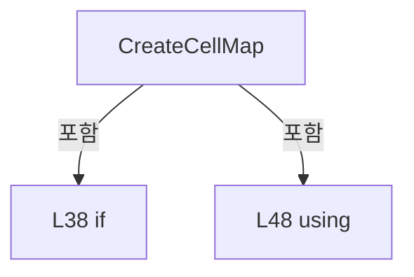

변경 전 점검: 입력/반환 타입, 위 호출자, 예외/취소 경로, 공유 상태와 저장·전송 소비자를 함께 확인합니다. 값의 단위나 물리 방향을 이름만으로 확정하지 않습니다.

### MethodDeclaration `CreateShotDetail` · L72–122

[Drilling.UI/Menu/Menus/CRecipeCellPatternPreviewDrawing.cs:72–122](https://github.com/kjuws10-rgb/A3Drilling/blob/5aee8e58439c9b455cae7c9593c9be986c3e682e/Drilling.UI/Menu/Menus/CRecipeCellPatternPreviewDrawing.cs#L72-L122)

| 항목 | 실제 추출 값 |
| --- | --- |
| 서명 | ImageSource? Drilling.UI.Menu.Menus.CRecipeCellPatternPreviewDrawing.CreateShotDetail(double, int, System.Collections.Generic.IReadOnlyList<int>, bool) |
| 접근/수식자 | Public / public, static |
| 반환/값 타입 | ImageSource? |
| 소속 타입 | NamedType:Drilling.UI.Menu.Menus.CRecipeCellPatternPreviewDrawing |

입력 계약:

| 이름 | 타입 | 전달 | 선택/기본값 |
| --- | --- | --- | --- |
| centerPitchMillimeters | double | None | False /  |
| splitBeamCount | int | None | False /  |
| maskedBeamNumbers | System.Collections.Generic.IReadOnlyList<int> | None | False /  |
| isMasked | bool | None | False /  |

정적 호출자로 확인된 위치:

| 호출 파일/행 | 호출 표현식 | 런타임 분기 가능 |
| --- | --- | --- |
| [Drilling.UI/Menu/Menus/CMenuRecipe.cs:2080–2080](https://github.com/kjuws10-rgb/A3Drilling/blob/5aee8e58439c9b455cae7c9593c9be986c3e682e/Drilling.UI/Menu/Menus/CMenuRecipe.cs#L2080-L2080) | CRecipeCellPatternPreviewDrawing.CreateShotDetail | False |

호출하는 대상과 해석 범위:

| 원본 행 | 표현식 | 분석 상태 | 대상/소스 위치 |
| --- | --- | --- | --- |
| 74 | double.IsFinite | resolved | bool double.IsFinite(double) |
| 74 | CCellPatternCalculator.IsSupportedSplitBeamCount | resolved | bool Drilling.Common.Recipe.CCellPatternCalculator.IsSupportedSplitBeamCount(int) · Drilling.Common/Recipe/CCellPatternCalculator.cs:15 |
| 80 | double.IsFinite | resolved | bool double.IsFinite(double) |
| 87 | new DrawingGroup | unresolved | None |
| 88 | drawing.Open | unresolved | None |
| 90 | context.DrawRectangle | unresolved | None |
| 90 | CreateBrush | resolved | SolidColorBrush Drilling.UI.Menu.Menus.CRecipeCellPatternPreviewDrawing.CreateBrush(byte, byte, byte, byte) · Drilling.UI/Menu/Menus/CRecipeCellPatternPreviewDrawing.cs:660 |
| 90 | new Rect | unresolved | None |
| 91 | context.DrawRectangle | unresolved | None |
| 91 | CreateBrush | resolved | SolidColorBrush Drilling.UI.Menu.Menus.CRecipeCellPatternPreviewDrawing.CreateBrush(byte, byte, byte, byte) · Drilling.UI/Menu/Menus/CRecipeCellPatternPreviewDrawing.cs:660 |
| 92 | DrawBeamPitchGrid | candidate | OverloadResolutionFailure |
| 93 | ToDetailPoint | resolved | Point Drilling.UI.Menu.Menus.CRecipeCellPatternPreviewDrawing.ToDetailPoint(double, double, double, double) · Drilling.UI/Menu/Menus/CRecipeCellPatternPreviewDrawing.cs:618 |
| 94 | CreatePen | resolved | Pen Drilling.UI.Menu.Menus.CRecipeCellPatternPreviewDrawing.CreatePen(byte, byte, byte, byte, double) · Drilling.UI/Menu/Menus/CRecipeCellPatternPreviewDrawing.cs:653 |
| 97 | context.DrawLine | unresolved | None |
| 97 | new Point | unresolved | None |
| 97 | new Point | unresolved | None |
| 98 | context.DrawLine | unresolved | None |
| 98 | new Point | unresolved | None |
| 98 | new Point | unresolved | None |
| 99 | context.DrawEllipse | unresolved | None |
| 100 | DrawDoeBeams | candidate | OverloadResolutionFailure |
| 102 | DrawText | candidate | OverloadResolutionFailure |
| 105 | new Point | unresolved | None |
| 107 | CreateBrush | resolved | SolidColorBrush Drilling.UI.Menu.Menus.CRecipeCellPatternPreviewDrawing.CreateBrush(byte, byte, byte, byte) · Drilling.UI/Menu/Menus/CRecipeCellPatternPreviewDrawing.cs:660 |
| 107 | CreateBrush | resolved | SolidColorBrush Drilling.UI.Menu.Menus.CRecipeCellPatternPreviewDrawing.CreateBrush(byte, byte, byte, byte) · Drilling.UI/Menu/Menus/CRecipeCellPatternPreviewDrawing.cs:660 |
| 111 | DrawLaserOffStamp | candidate | OverloadResolutionFailure |
| 114 | context.DrawRectangle | unresolved | None |
| 114 | CreatePen | resolved | Pen Drilling.UI.Menu.Menus.CRecipeCellPatternPreviewDrawing.CreatePen(byte, byte, byte, byte, double) · Drilling.UI/Menu/Menus/CRecipeCellPatternPreviewDrawing.cs:653 |
| 115 | DrawAxes | candidate | OverloadResolutionFailure |
| 118 | drawing.Freeze | unresolved | None |
| 119 | new DrawingImage | unresolved | None |
| 120 | image.Freeze | unresolved | None |

본문의 실제 연산·분기·예외·반환 순서(원문 위치 순):

| 원본 행 | 종류 | 주석 해설 |
| --- | --- | --- |
| 74 | call | 함수·델리게이트 또는 객체 생성자를 호출합니다: double.IsFinite(centerPitchMillimeters) |
| 74 | call | 함수·델리게이트 또는 객체 생성자를 호출합니다: CCellPatternCalculator.IsSupportedSplitBeamCount(splitBeamCount) |
| 74 | if | 조건에 따라 분기합니다: if (!double.IsFinite(centerPitchMillimeters) &#124;&#124; centerPitchMillimeters <= 0.0 &#124;&#124; !CCellPatternCalculator.IsSupportedSplitBeamCount(splitBeamCount)) |
| 76 | return | 호출자에게 값 또는 제어를 반환합니다: return null; |
| 79 | local-declaration | 지역 변수를 선언합니다: var beamPitch = centerPitchMillimeters / splitBeamCount; |
| 79 | variable-initializer | 변수의 초기값을 지정합니다: beamPitch = centerPitchMillimeters / splitBeamCount |
| 80 | call | 함수·델리게이트 또는 객체 생성자를 호출합니다: double.IsFinite(beamPitch) |
| 80 | if | 조건에 따라 분기합니다: if (!double.IsFinite(beamPitch) &#124;&#124; beamPitch <= 0.0) |
| 82 | return | 호출자에게 값 또는 제어를 반환합니다: return null; |
| 85 | local-declaration | 지역 변수를 선언합니다: var domainMinimum = -(centerPitchMillimeters / 2.0); |
| 85 | variable-initializer | 변수의 초기값을 지정합니다: domainMinimum = -(centerPitchMillimeters / 2.0) |
| 86 | local-declaration | 지역 변수를 선언합니다: var domainMaximum = centerPitchMillimeters / 2.0; |
| 86 | variable-initializer | 변수의 초기값을 지정합니다: domainMaximum = centerPitchMillimeters / 2.0 |
| 87 | call | 함수·델리게이트 또는 객체 생성자를 호출합니다: new DrawingGroup() |
| 87 | local-declaration | 지역 변수를 선언합니다: var drawing = new DrawingGroup(); |
| 87 | variable-initializer | 변수의 초기값을 지정합니다: drawing = new DrawingGroup() |
| 88 | call | 함수·델리게이트 또는 객체 생성자를 호출합니다: drawing.Open() |
| 88 | variable-initializer | 변수의 초기값을 지정합니다: context = drawing.Open() |
| 88 | using | 자원 사용과 정리 범위를 지정합니다: using (var context = drawing.Open()) |
| 90 | call | 함수·델리게이트 또는 객체 생성자를 호출합니다: context.DrawRectangle(CreateBrush(1, 0, 0, 0), null, new Rect(0.0, 0.0, ShotDetailDesignWidth, ShotDetailDesignHeight)) |
| 90 | call | 함수·델리게이트 또는 객체 생성자를 호출합니다: CreateBrush(1, 0, 0, 0) |
| 90 | call | 함수·델리게이트 또는 객체 생성자를 호출합니다: new Rect(0.0, 0.0, ShotDetailDesignWidth, ShotDetailDesignHeight) |
| 91 | call | 함수·델리게이트 또는 객체 생성자를 호출합니다: context.DrawRectangle(CreateBrush(255, 17, 24, 32), null, ShotDetailRect) |
| 91 | call | 함수·델리게이트 또는 객체 생성자를 호출합니다: CreateBrush(255, 17, 24, 32) |
| 92 | call | 함수·델리게이트 또는 객체 생성자를 호출합니다: DrawBeamPitchGrid(context, beamPitch, splitBeamCount, domainMinimum, domainMaximum) |
| 93 | call | 함수·델리게이트 또는 객체 생성자를 호출합니다: ToDetailPoint(0.0, 0.0, domainMinimum, domainMaximum) |
| 93 | local-declaration | 지역 변수를 선언합니다: var centerPoint = ToDetailPoint(0.0, 0.0, domainMinimum, domainMaximum); |
| 93 | variable-initializer | 변수의 초기값을 지정합니다: centerPoint = ToDetailPoint(0.0, 0.0, domainMinimum, domainMaximum) |
| 94 | call | 함수·델리게이트 또는 객체 생성자를 호출합니다: CreatePen(255, 251, 191, 36, 2.0) |
| 94 | local-declaration | 지역 변수를 선언합니다: var centerPen = CreatePen(255, 251, 191, 36, 2.0); |
| 94 | variable-initializer | 변수의 초기값을 지정합니다: centerPen = CreatePen(255, 251, 191, 36, 2.0) |
| 95 | conditional-expression | 조건에 따라 결과식을 선택합니다: splitBeamCount == 1 ? 18.0 : 10.0 |
| 95 | local-declaration | 지역 변수를 선언합니다: var centerArmLength = splitBeamCount == 1 ? 18.0 : 10.0; |
| 95 | variable-initializer | 변수의 초기값을 지정합니다: centerArmLength = splitBeamCount == 1 ? 18.0 : 10.0 |
| 96 | conditional-expression | 조건에 따라 결과식을 선택합니다: splitBeamCount == 1 ? 17.0 : 5.0 |
| 96 | local-declaration | 지역 변수를 선언합니다: var centerRingRadius = splitBeamCount == 1 ? 17.0 : 5.0; |
| 96 | variable-initializer | 변수의 초기값을 지정합니다: centerRingRadius = splitBeamCount == 1 ? 17.0 : 5.0 |
| 97 | call | 함수·델리게이트 또는 객체 생성자를 호출합니다: context.DrawLine(centerPen, new Point(centerPoint.X - centerArmLength, centerPoint.Y), new Point(centerPoint.X + centerArmLength, centerPoint.Y)) |
| 97 | call | 함수·델리게이트 또는 객체 생성자를 호출합니다: new Point(centerPoint.X - centerArmLength, centerPoint.Y) |
| 97 | call | 함수·델리게이트 또는 객체 생성자를 호출합니다: new Point(centerPoint.X + centerArmLength, centerPoint.Y) |
| 98 | call | 함수·델리게이트 또는 객체 생성자를 호출합니다: context.DrawLine(centerPen, new Point(centerPoint.X, centerPoint.Y - centerArmLength), new Point(centerPoint.X, centerPoint.Y + centerArmLength)) |
| 98 | call | 함수·델리게이트 또는 객체 생성자를 호출합니다: new Point(centerPoint.X, centerPoint.Y - centerArmLength) |
| 98 | call | 함수·델리게이트 또는 객체 생성자를 호출합니다: new Point(centerPoint.X, centerPoint.Y + centerArmLength) |
| 99 | call | 함수·델리게이트 또는 객체 생성자를 호출합니다: context.DrawEllipse(null, centerPen, centerPoint, centerRingRadius, centerRingRadius) |
| 100 | call | 함수·델리게이트 또는 객체 생성자를 호출합니다: DrawDoeBeams(context, beamPitch, splitBeamCount, domainMinimum, domainMaximum, maskedBeamNumbers) |
| 101 | local-declaration | 지역 변수를 선언합니다: var totalBeamCount = splitBeamCount * splitBeamCount; |
| 101 | variable-initializer | 변수의 초기값을 지정합니다: totalBeamCount = splitBeamCount * splitBeamCount |
| 102 | call | 함수·델리게이트 또는 객체 생성자를 호출합니다: DrawText( context, totalBeamCount == 1 ? "DOE BEAM 01" : $"DOE BEAM 01-{totalBeamCount:00}", new Point(ShotDetailRect.Left, 14.0), 11.0, isMasked ? CreateBrush(255, 248, 113, 113) : CreateBrush(255, 74, 222, 128) ) |
| 104 | conditional-expression | 조건에 따라 결과식을 선택합니다: totalBeamCount == 1 ? "DOE BEAM 01" : $"DOE BEAM 01-{totalBeamCount:00}" |
| 105 | call | 함수·델리게이트 또는 객체 생성자를 호출합니다: new Point(ShotDetailRect.Left, 14.0) |
| 107 | call | 함수·델리게이트 또는 객체 생성자를 호출합니다: CreateBrush(255, 248, 113, 113) |
| 107 | call | 함수·델리게이트 또는 객체 생성자를 호출합니다: CreateBrush(255, 74, 222, 128) |
| 107 | conditional-expression | 조건에 따라 결과식을 선택합니다: isMasked ? CreateBrush(255, 248, 113, 113) : CreateBrush(255, 74, 222, 128) |
| 109 | if | 조건에 따라 분기합니다: if (isMasked) |
| 111 | call | 함수·델리게이트 또는 객체 생성자를 호출합니다: DrawLaserOffStamp(context, maskedBeamNumbers) |
| 114 | call | 함수·델리게이트 또는 객체 생성자를 호출합니다: context.DrawRectangle(null, CreatePen(255, 102, 136, 164, 1.4), ShotDetailRect) |
| 114 | call | 함수·델리게이트 또는 객체 생성자를 호출합니다: CreatePen(255, 102, 136, 164, 1.4) |
| 115 | call | 함수·델리게이트 또는 객체 생성자를 호출합니다: DrawAxes(context, ShotDetailRect) |
| 118 | call | 함수·델리게이트 또는 객체 생성자를 호출합니다: drawing.Freeze() |
| 119 | call | 함수·델리게이트 또는 객체 생성자를 호출합니다: new DrawingImage(drawing) |
| 119 | local-declaration | 지역 변수를 선언합니다: var image = new DrawingImage(drawing); |
| 119 | variable-initializer | 변수의 초기값을 지정합니다: image = new DrawingImage(drawing) |
| 120 | call | 함수·델리게이트 또는 객체 생성자를 호출합니다: image.Freeze() |
| 121 | return | 호출자에게 값 또는 제어를 반환합니다: return image; |

제어 구문의 포함 구조(실제 실행 순서/CFG가 아닌 구문 탐색 그림):

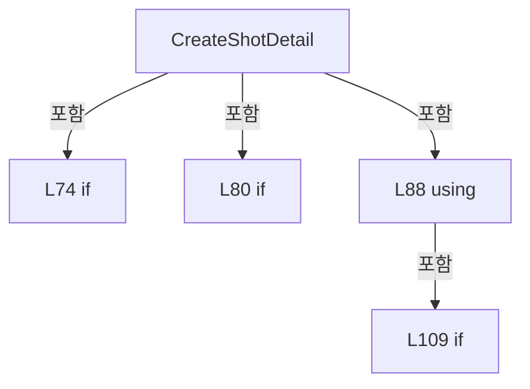

변경 전 점검: 입력/반환 타입, 위 호출자, 예외/취소 경로, 공유 상태와 저장·전송 소비자를 함께 확인합니다. 값의 단위나 물리 방향을 이름만으로 확정하지 않습니다.

### MethodDeclaration `TryResolveCellShotNo` · L124–139

[Drilling.UI/Menu/Menus/CRecipeCellPatternPreviewDrawing.cs:124–139](https://github.com/kjuws10-rgb/A3Drilling/blob/5aee8e58439c9b455cae7c9593c9be986c3e682e/Drilling.UI/Menu/Menus/CRecipeCellPatternPreviewDrawing.cs#L124-L139)

| 항목 | 실제 추출 값 |
| --- | --- |
| 서명 | bool Drilling.UI.Menu.Menus.CRecipeCellPatternPreviewDrawing.TryResolveCellShotNo(double, double, Drilling.Common.Recipe.ST_CELL_PATTERN_LAYOUT, out int) |
| 접근/수식자 | Public / public, static |
| 반환/값 타입 | bool |
| 소속 타입 | NamedType:Drilling.UI.Menu.Menus.CRecipeCellPatternPreviewDrawing |

입력 계약:

| 이름 | 타입 | 전달 | 선택/기본값 |
| --- | --- | --- | --- |
| x | double | None | False /  |
| y | double | None | False /  |
| patternLayout | Drilling.Common.Recipe.ST_CELL_PATTERN_LAYOUT | None | False /  |
| cellShotNo | int | Out | False /  |

정적 호출자로 확인된 위치:

| 호출 파일/행 | 호출 표현식 | 런타임 분기 가능 |
| --- | --- | --- |
| [Drilling.UI/Menu/Menus/CMenuRecipe.cs:835–835](https://github.com/kjuws10-rgb/A3Drilling/blob/5aee8e58439c9b455cae7c9593c9be986c3e682e/Drilling.UI/Menu/Menus/CMenuRecipe.cs#L835-L835) | CRecipeCellPatternPreviewDrawing.TryResolveCellShotNo | False |
| [Drilling.UI/Menu/Menus/CMenuRecipe.cs:846–846](https://github.com/kjuws10-rgb/A3Drilling/blob/5aee8e58439c9b455cae7c9593c9be986c3e682e/Drilling.UI/Menu/Menus/CMenuRecipe.cs#L846-L846) | CRecipeCellPatternPreviewDrawing.TryResolveCellShotNo | False |

호출하는 대상과 해석 범위:

| 원본 행 | 표현식 | 분석 상태 | 대상/소스 위치 |
| --- | --- | --- | --- |
| 129 | GetProcessedMapRect | resolved | Rect Drilling.UI.Menu.Menus.CRecipeCellPatternPreviewDrawing.GetProcessedMapRect(Drilling.Common.Recipe.ST_CELL_PATTERN_LAYOUT, Rect) · Drilling.UI/Menu/Menus/CRecipeCellPatternPreviewDrawing.cs:462 |
| 129 | GetCellMapRect | resolved | Rect Drilling.UI.Menu.Menus.CRecipeCellPatternPreviewDrawing.GetCellMapRect(Drilling.Common.Recipe.ST_CELL_PATTERN_LAYOUT) · Drilling.UI/Menu/Menus/CRecipeCellPatternPreviewDrawing.cs:457 |
| 130 | processedMapRect.Contains | unresolved | None |
| 130 | new Point | unresolved | None |
| 135 | Math.Clamp | resolved | int System.Math.Clamp(int, int, int) |
| 136 | Math.Clamp | resolved | int System.Math.Clamp(int, int, int) |

본문의 실제 연산·분기·예외·반환 순서(원문 위치 순):

| 원본 행 | 종류 | 주석 해설 |
| --- | --- | --- |
| 126 | assignment | 값을 대상에 대입합니다: cellShotNo = 0 |
| 127 | local-declaration | 지역 변수를 선언합니다: var groupCountX = patternLayout.GroupCountX; |
| 127 | variable-initializer | 변수의 초기값을 지정합니다: groupCountX = patternLayout.GroupCountX |
| 128 | local-declaration | 지역 변수를 선언합니다: var groupCountY = patternLayout.GroupCountY; |
| 128 | variable-initializer | 변수의 초기값을 지정합니다: groupCountY = patternLayout.GroupCountY |
| 129 | call | 함수·델리게이트 또는 객체 생성자를 호출합니다: GetProcessedMapRect(patternLayout, GetCellMapRect(patternLayout)) |
| 129 | call | 함수·델리게이트 또는 객체 생성자를 호출합니다: GetCellMapRect(patternLayout) |
| 129 | local-declaration | 지역 변수를 선언합니다: var processedMapRect = GetProcessedMapRect(patternLayout, GetCellMapRect(patternLayout)); |
| 129 | variable-initializer | 변수의 초기값을 지정합니다: processedMapRect = GetProcessedMapRect(patternLayout, GetCellMapRect(patternLayout)) |
| 130 | call | 함수·델리게이트 또는 객체 생성자를 호출합니다: processedMapRect.Contains(new Point(x, y)) |
| 130 | call | 함수·델리게이트 또는 객체 생성자를 호출합니다: new Point(x, y) |
| 130 | if | 조건에 따라 분기합니다: if (groupCountX <= 0 &#124;&#124; groupCountY <= 0 &#124;&#124; !processedMapRect.Contains(new Point(x, y))) |
| 132 | return | 호출자에게 값 또는 제어를 반환합니다: return false; |
| 135 | call | 함수·델리게이트 또는 객체 생성자를 호출합니다: Math.Clamp((int)((x - processedMapRect.Left) / processedMapRect.Width * groupCountX), 0, groupCountX - 1) |
| 135 | local-declaration | 지역 변수를 선언합니다: var column = Math.Clamp((int)((x - processedMapRect.Left) / processedMapRect.Width * groupCountX), 0, groupCountX - 1); |
| 135 | variable-initializer | 변수의 초기값을 지정합니다: column = Math.Clamp((int)((x - processedMapRect.Left) / processedMapRect.Width * groupCountX), 0, groupCountX - 1) |
| 136 | call | 함수·델리게이트 또는 객체 생성자를 호출합니다: Math.Clamp((int)((y - processedMapRect.Top) / processedMapRect.Height * groupCountY), 0, groupCountY - 1) |
| 136 | local-declaration | 지역 변수를 선언합니다: var row = Math.Clamp((int)((y - processedMapRect.Top) / processedMapRect.Height * groupCountY), 0, groupCountY - 1); |
| 136 | variable-initializer | 변수의 초기값을 지정합니다: row = Math.Clamp((int)((y - processedMapRect.Top) / processedMapRect.Height * groupCountY), 0, groupCountY - 1) |
| 137 | assignment | 값을 대상에 대입합니다: cellShotNo = (row * groupCountX) + column + 1 |
| 138 | return | 호출자에게 값 또는 제어를 반환합니다: return true; |

제어 구문의 포함 구조(실제 실행 순서/CFG가 아닌 구문 탐색 그림):

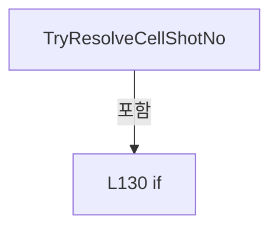

변경 전 점검: 입력/반환 타입, 위 호출자, 예외/취소 경로, 공유 상태와 저장·전송 소비자를 함께 확인합니다. 값의 단위나 물리 방향을 이름만으로 확정하지 않습니다.

### MethodDeclaration `DrawMapGrid` · L141–157

[Drilling.UI/Menu/Menus/CRecipeCellPatternPreviewDrawing.cs:141–157](https://github.com/kjuws10-rgb/A3Drilling/blob/5aee8e58439c9b455cae7c9593c9be986c3e682e/Drilling.UI/Menu/Menus/CRecipeCellPatternPreviewDrawing.cs#L141-L157)

| 항목 | 실제 추출 값 |
| --- | --- |
| 서명 | void Drilling.UI.Menu.Menus.CRecipeCellPatternPreviewDrawing.DrawMapGrid(DrawingContext, Rect, int, int) |
| 접근/수식자 | Private / private, static |
| 반환/값 타입 | void |
| 소속 타입 | NamedType:Drilling.UI.Menu.Menus.CRecipeCellPatternPreviewDrawing |

입력 계약:

| 이름 | 타입 | 전달 | 선택/기본값 |
| --- | --- | --- | --- |
| context | DrawingContext | None | False /  |
| mapRect | Rect | None | False /  |
| countX | int | None | False /  |
| countY | int | None | False /  |

현재 부분 분석에서 직접 연결된 호출자는 없습니다. XAML/이벤트/인터페이스·델리게이트·외부 진입을 추가 확인해야 하며, 미사용으로 판정한 것이 아닙니다.

호출하는 대상과 해석 범위:

| 원본 행 | 표현식 | 분석 상태 | 대상/소스 위치 |
| --- | --- | --- | --- |
| 143 | Math.Max | resolved | int System.Math.Max(int, int) |
| 144 | Math.Max | resolved | int System.Math.Max(int, int) |
| 145 | CreatePen | resolved | Pen Drilling.UI.Menu.Menus.CRecipeCellPatternPreviewDrawing.CreatePen(byte, byte, byte, byte, double) · Drilling.UI/Menu/Menus/CRecipeCellPatternPreviewDrawing.cs:653 |
| 149 | context.DrawLine | unresolved | None |
| 149 | new Point | unresolved | None |
| 149 | new Point | unresolved | None |
| 155 | context.DrawLine | unresolved | None |
| 155 | new Point | unresolved | None |
| 155 | new Point | unresolved | None |

본문의 실제 연산·분기·예외·반환 순서(원문 위치 순):

| 원본 행 | 종류 | 주석 해설 |
| --- | --- | --- |
| 143 | call | 함수·델리게이트 또는 객체 생성자를 호출합니다: Math.Max(1, countX / 6) |
| 143 | local-declaration | 지역 변수를 선언합니다: var columnStep = Math.Max(1, countX / 6); |
| 143 | variable-initializer | 변수의 초기값을 지정합니다: columnStep = Math.Max(1, countX / 6) |
| 144 | call | 함수·델리게이트 또는 객체 생성자를 호출합니다: Math.Max(1, countY / 8) |
| 144 | local-declaration | 지역 변수를 선언합니다: var rowStep = Math.Max(1, countY / 8); |
| 144 | variable-initializer | 변수의 초기값을 지정합니다: rowStep = Math.Max(1, countY / 8) |
| 145 | call | 함수·델리게이트 또는 객체 생성자를 호출합니다: CreatePen(72, 102, 136, 164, 0.8) |
| 145 | local-declaration | 지역 변수를 선언합니다: var gridPen = CreatePen(72, 102, 136, 164, 0.8); |
| 145 | variable-initializer | 변수의 초기값을 지정합니다: gridPen = CreatePen(72, 102, 136, 164, 0.8) |
| 146 | compound-assignment-or-event-subscription | 복합 대입 또는 이벤트 구독/해지 표현입니다: column += columnStep |
| 146 | variable-initializer | 변수의 초기값을 지정합니다: column = columnStep |
| 146 | for | 초기화·조건·증감이 있는 반복입니다: for (var column = columnStep; column < countX; column += columnStep) |
| 148 | local-declaration | 지역 변수를 선언합니다: var x = mapRect.Left + (mapRect.Width * column / countX); |
| 148 | variable-initializer | 변수의 초기값을 지정합니다: x = mapRect.Left + (mapRect.Width * column / countX) |
| 149 | call | 함수·델리게이트 또는 객체 생성자를 호출합니다: context.DrawLine(gridPen, new Point(x, mapRect.Top), new Point(x, mapRect.Bottom)) |
| 149 | call | 함수·델리게이트 또는 객체 생성자를 호출합니다: new Point(x, mapRect.Top) |
| 149 | call | 함수·델리게이트 또는 객체 생성자를 호출합니다: new Point(x, mapRect.Bottom) |
| 152 | compound-assignment-or-event-subscription | 복합 대입 또는 이벤트 구독/해지 표현입니다: row += rowStep |
| 152 | variable-initializer | 변수의 초기값을 지정합니다: row = rowStep |
| 152 | for | 초기화·조건·증감이 있는 반복입니다: for (var row = rowStep; row < countY; row += rowStep) |
| 154 | local-declaration | 지역 변수를 선언합니다: var y = mapRect.Top + (mapRect.Height * row / countY); |
| 154 | variable-initializer | 변수의 초기값을 지정합니다: y = mapRect.Top + (mapRect.Height * row / countY) |
| 155 | call | 함수·델리게이트 또는 객체 생성자를 호출합니다: context.DrawLine(gridPen, new Point(mapRect.Left, y), new Point(mapRect.Right, y)) |
| 155 | call | 함수·델리게이트 또는 객체 생성자를 호출합니다: new Point(mapRect.Left, y) |
| 155 | call | 함수·델리게이트 또는 객체 생성자를 호출합니다: new Point(mapRect.Right, y) |

제어 구문의 포함 구조(실제 실행 순서/CFG가 아닌 구문 탐색 그림):

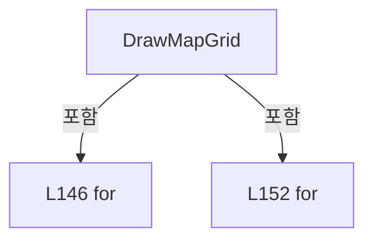

변경 전 점검: 입력/반환 타입, 위 호출자, 예외/취소 경로, 공유 상태와 저장·전송 소비자를 함께 확인합니다. 값의 단위나 물리 방향을 이름만으로 확정하지 않습니다.

### MethodDeclaration `DrawShotCenters` · L159–185

[Drilling.UI/Menu/Menus/CRecipeCellPatternPreviewDrawing.cs:159–185](https://github.com/kjuws10-rgb/A3Drilling/blob/5aee8e58439c9b455cae7c9593c9be986c3e682e/Drilling.UI/Menu/Menus/CRecipeCellPatternPreviewDrawing.cs#L159-L185)

| 항목 | 실제 추출 값 |
| --- | --- |
| 서명 | void Drilling.UI.Menu.Menus.CRecipeCellPatternPreviewDrawing.DrawShotCenters(DrawingContext, Rect, int, int) |
| 접근/수식자 | Private / private, static |
| 반환/값 타입 | void |
| 소속 타입 | NamedType:Drilling.UI.Menu.Menus.CRecipeCellPatternPreviewDrawing |

입력 계약:

| 이름 | 타입 | 전달 | 선택/기본값 |
| --- | --- | --- | --- |
| context | DrawingContext | None | False /  |
| mapRect | Rect | None | False /  |
| countX | int | None | False /  |
| countY | int | None | False /  |

현재 부분 분석에서 직접 연결된 호출자는 없습니다. XAML/이벤트/인터페이스·델리게이트·외부 진입을 추가 확인해야 하며, 미사용으로 판정한 것이 아닙니다.

호출하는 대상과 해석 범위:

| 원본 행 | 표현식 | 분석 상태 | 대상/소스 위치 |
| --- | --- | --- | --- |
| 163 | Math.Clamp | candidate | OverloadResolutionFailure |
| 163 | Math.Min | candidate | OverloadResolutionFailure |
| 168 | Math.Ceiling | resolved | double System.Math.Ceiling(double) |
| 168 | Math.Sqrt | resolved | double System.Math.Sqrt(double) |
| 169 | new StreamGeometry | unresolved | None |
| 170 | geometry.Open | unresolved | None |
| 178 | AddCircle | candidate | OverloadResolutionFailure |
| 183 | geometry.Freeze | unresolved | None |
| 184 | context.DrawGeometry | unresolved | None |
| 184 | CreateBrush | resolved | SolidColorBrush Drilling.UI.Menu.Menus.CRecipeCellPatternPreviewDrawing.CreateBrush(byte, byte, byte, byte) · Drilling.UI/Menu/Menus/CRecipeCellPatternPreviewDrawing.cs:660 |

본문의 실제 연산·분기·예외·반환 순서(원문 위치 순):

| 원본 행 | 종류 | 주석 해설 |
| --- | --- | --- |
| 161 | local-declaration | 지역 변수를 선언합니다: var cellWidth = mapRect.Width / countX; |
| 161 | variable-initializer | 변수의 초기값을 지정합니다: cellWidth = mapRect.Width / countX |
| 162 | local-declaration | 지역 변수를 선언합니다: var cellHeight = mapRect.Height / countY; |
| 162 | variable-initializer | 변수의 초기값을 지정합니다: cellHeight = mapRect.Height / countY |
| 163 | call | 함수·델리게이트 또는 객체 생성자를 호출합니다: Math.Clamp(Math.Min(cellWidth, cellHeight) * 0.38, 1.6, 4.2) |
| 163 | call | 함수·델리게이트 또는 객체 생성자를 호출합니다: Math.Min(cellWidth, cellHeight) |
| 163 | local-declaration | 지역 변수를 선언합니다: var pointSize = Math.Clamp(Math.Min(cellWidth, cellHeight) * 0.38, 1.6, 4.2); |
| 163 | variable-initializer | 변수의 초기값을 지정합니다: pointSize = Math.Clamp(Math.Min(cellWidth, cellHeight) * 0.38, 1.6, 4.2) |
| 164 | local-declaration | 지역 변수를 선언합니다: const int maximumPreviewPoints = 10_000; |
| 164 | variable-initializer | 변수의 초기값을 지정합니다: maximumPreviewPoints = 10_000 |
| 165 | local-declaration | 지역 변수를 선언합니다: var total = (long)countX * countY; |
| 165 | variable-initializer | 변수의 초기값을 지정합니다: total = (long)countX * countY |
| 166 | conditional-expression | 조건에 따라 결과식을 선택합니다: total <= maximumPreviewPoints ? 1 : (int)Math.Ceiling(Math.Sqrt(total / (double)maximumPreviewPoints)) |
| 166 | local-declaration | 지역 변수를 선언합니다: var sampleStep = total <= maximumPreviewPoints ? 1 : (int)Math.Ceiling(Math.Sqrt(total / (double)maximumPreviewPoints)); |
| 166 | variable-initializer | 변수의 초기값을 지정합니다: sampleStep = total <= maximumPreviewPoints ? 1 : (int)Math.Ceiling(Math.Sqrt(total / (double)maximumPreviewPoints)) |
| 168 | call | 함수·델리게이트 또는 객체 생성자를 호출합니다: Math.Ceiling(Math.Sqrt(total / (double)maximumPreviewPoints)) |
| 168 | call | 함수·델리게이트 또는 객체 생성자를 호출합니다: Math.Sqrt(total / (double)maximumPreviewPoints) |
| 169 | call | 함수·델리게이트 또는 객체 생성자를 호출합니다: new StreamGeometry() |
| 169 | local-declaration | 지역 변수를 선언합니다: var geometry = new StreamGeometry(); |
| 169 | variable-initializer | 변수의 초기값을 지정합니다: geometry = new StreamGeometry() |
| 170 | call | 함수·델리게이트 또는 객체 생성자를 호출합니다: geometry.Open() |
| 170 | variable-initializer | 변수의 초기값을 지정합니다: geometryContext = geometry.Open() |
| 170 | using | 자원 사용과 정리 범위를 지정합니다: using (var geometryContext = geometry.Open()) |
| 172 | compound-assignment-or-event-subscription | 복합 대입 또는 이벤트 구독/해지 표현입니다: row += sampleStep |
| 172 | variable-initializer | 변수의 초기값을 지정합니다: row = 0 |
| 172 | for | 초기화·조건·증감이 있는 반복입니다: for (var row = 0; row < countY; row += sampleStep) |
| 174 | compound-assignment-or-event-subscription | 복합 대입 또는 이벤트 구독/해지 표현입니다: column += sampleStep |
| 174 | variable-initializer | 변수의 초기값을 지정합니다: column = 0 |
| 174 | for | 초기화·조건·증감이 있는 반복입니다: for (var column = 0; column < countX; column += sampleStep) |
| 176 | local-declaration | 지역 변수를 선언합니다: var x = mapRect.Left + ((column + 0.5) * cellWidth); |
| 176 | variable-initializer | 변수의 초기값을 지정합니다: x = mapRect.Left + ((column + 0.5) * cellWidth) |
| 177 | local-declaration | 지역 변수를 선언합니다: var y = mapRect.Top + ((row + 0.5) * cellHeight); |
| 177 | variable-initializer | 변수의 초기값을 지정합니다: y = mapRect.Top + ((row + 0.5) * cellHeight) |
| 178 | call | 함수·델리게이트 또는 객체 생성자를 호출합니다: AddCircle(geometryContext, x, y, pointSize) |
| 183 | call | 함수·델리게이트 또는 객체 생성자를 호출합니다: geometry.Freeze() |
| 184 | call | 함수·델리게이트 또는 객체 생성자를 호출합니다: context.DrawGeometry(CreateBrush(235, 45, 212, 191), null, geometry) |
| 184 | call | 함수·델리게이트 또는 객체 생성자를 호출합니다: CreateBrush(235, 45, 212, 191) |

제어 구문의 포함 구조(실제 실행 순서/CFG가 아닌 구문 탐색 그림):

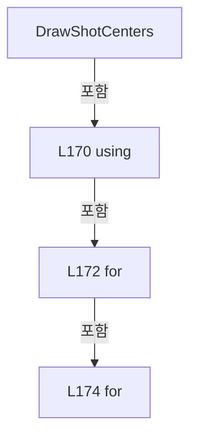

변경 전 점검: 입력/반환 타입, 위 호출자, 예외/취소 경로, 공유 상태와 저장·전송 소비자를 함께 확인합니다. 값의 단위나 물리 방향을 이름만으로 확정하지 않습니다.

### MethodDeclaration `DrawMaskingAreas` · L187–212

[Drilling.UI/Menu/Menus/CRecipeCellPatternPreviewDrawing.cs:187–212](https://github.com/kjuws10-rgb/A3Drilling/blob/5aee8e58439c9b455cae7c9593c9be986c3e682e/Drilling.UI/Menu/Menus/CRecipeCellPatternPreviewDrawing.cs#L187-L212)

| 항목 | 실제 추출 값 |
| --- | --- |
| 서명 | void Drilling.UI.Menu.Menus.CRecipeCellPatternPreviewDrawing.DrawMaskingAreas(DrawingContext, Drilling.UI.Menu.Menus.ST_RECIPE_CELL_VIEW_MODEL, Rect, System.Collections.Generic.IReadOnlyList<Drilling.UI.Menu.Menus.ST_RECIPE_MASKING_AREA>) |
| 접근/수식자 | Private / private, static |
| 반환/값 타입 | void |
| 소속 타입 | NamedType:Drilling.UI.Menu.Menus.CRecipeCellPatternPreviewDrawing |

입력 계약:

| 이름 | 타입 | 전달 | 선택/기본값 |
| --- | --- | --- | --- |
| context | DrawingContext | None | False /  |
| cell | Drilling.UI.Menu.Menus.ST_RECIPE_CELL_VIEW_MODEL | None | False /  |
| mapRect | Rect | None | False /  |
| maskingAreas | System.Collections.Generic.IReadOnlyList<Drilling.UI.Menu.Menus.ST_RECIPE_MASKING_AREA> | None | False /  |

현재 부분 분석에서 직접 연결된 호출자는 없습니다. XAML/이벤트/인터페이스·델리게이트·외부 진입을 추가 확인해야 하며, 미사용으로 판정한 것이 아닙니다.

호출하는 대상과 해석 범위:

| 원본 행 | 표현식 | 분석 상태 | 대상/소스 위치 |
| --- | --- | --- | --- |
| 194 | CreateBrush | resolved | SolidColorBrush Drilling.UI.Menu.Menus.CRecipeCellPatternPreviewDrawing.CreateBrush(byte, byte, byte, byte) · Drilling.UI/Menu/Menus/CRecipeCellPatternPreviewDrawing.cs:660 |
| 195 | CreatePen | resolved | Pen Drilling.UI.Menu.Menus.CRecipeCellPatternPreviewDrawing.CreatePen(byte, byte, byte, byte, double) · Drilling.UI/Menu/Menus/CRecipeCellPatternPreviewDrawing.cs:653 |
| 196 | CreatePen | resolved | Pen Drilling.UI.Menu.Menus.CRecipeCellPatternPreviewDrawing.CreatePen(byte, byte, byte, byte, double) · Drilling.UI/Menu/Menus/CRecipeCellPatternPreviewDrawing.cs:653 |
| 197 | context.PushClip | unresolved | None |
| 197 | new RectangleGeometry | unresolved | None |
| 200 | BuildMaskingAreaGeometry | resolved | StreamGeometry? Drilling.UI.Menu.Menus.CRecipeCellPatternPreviewDrawing.BuildMaskingAreaGeometry(Drilling.UI.Menu.Menus.ST_RECIPE_CELL_VIEW_MODEL, Rect, Drilling.UI.Menu.Menus.ST_RECIPE_MASKING_AREA) · Drilling.UI/Menu/Menus/CRecipeCellPatternPreviewDrawing.cs:313 |
| 206 | context.DrawGeometry | unresolved | None |
| 207 | DrawMaskingHatches | candidate | OverloadResolutionFailure |
| 208 | context.DrawGeometry | unresolved | None |
| 211 | context.Pop | unresolved | None |

본문의 실제 연산·분기·예외·반환 순서(원문 위치 순):

| 원본 행 | 종류 | 주석 해설 |
| --- | --- | --- |
| 189 | if | 조건에 따라 분기합니다: if (maskingAreas.Count == 0 &#124;&#124; cell.PatternLayout.GroupCountX <= 0 &#124;&#124; cell.PatternLayout.GroupCountY <= 0 &#124;&#124; cell.PatternLayout.GroupPitchMillimeters <= 0.0) |
| 191 | return | 호출자에게 값 또는 제어를 반환합니다: return; |
| 194 | call | 함수·델리게이트 또는 객체 생성자를 호출합니다: CreateBrush(64, 248, 113, 113) |
| 194 | local-declaration | 지역 변수를 선언합니다: var fillBrush = CreateBrush(64, 248, 113, 113); |
| 194 | variable-initializer | 변수의 초기값을 지정합니다: fillBrush = CreateBrush(64, 248, 113, 113) |
| 195 | call | 함수·델리게이트 또는 객체 생성자를 호출합니다: CreatePen(220, 248, 113, 113, 1.2) |
| 195 | local-declaration | 지역 변수를 선언합니다: var borderPen = CreatePen(220, 248, 113, 113, 1.2); |
| 195 | variable-initializer | 변수의 초기값을 지정합니다: borderPen = CreatePen(220, 248, 113, 113, 1.2) |
| 196 | call | 함수·델리게이트 또는 객체 생성자를 호출합니다: CreatePen(120, 254, 202, 202, 0.9) |
| 196 | local-declaration | 지역 변수를 선언합니다: var hatchPen = CreatePen(120, 254, 202, 202, 0.9); |
| 196 | variable-initializer | 변수의 초기값을 지정합니다: hatchPen = CreatePen(120, 254, 202, 202, 0.9) |
| 197 | call | 함수·델리게이트 또는 객체 생성자를 호출합니다: context.PushClip(new RectangleGeometry(mapRect)) |
| 197 | call | 함수·델리게이트 또는 객체 생성자를 호출합니다: new RectangleGeometry(mapRect) |
| 198 | foreach | 컬렉션 요소를 순회합니다: foreach (var area in maskingAreas) |
| 200 | call | 함수·델리게이트 또는 객체 생성자를 호출합니다: BuildMaskingAreaGeometry(cell, mapRect, area) |
| 200 | local-declaration | 지역 변수를 선언합니다: var geometry = BuildMaskingAreaGeometry(cell, mapRect, area); |
| 200 | variable-initializer | 변수의 초기값을 지정합니다: geometry = BuildMaskingAreaGeometry(cell, mapRect, area) |
| 201 | if | 조건에 따라 분기합니다: if (geometry is null) |
| 203 | continue | 다음 반복으로 진행합니다: continue; |
| 206 | call | 함수·델리게이트 또는 객체 생성자를 호출합니다: context.DrawGeometry(fillBrush, null, geometry) |
| 207 | call | 함수·델리게이트 또는 객체 생성자를 호출합니다: DrawMaskingHatches(context, geometry, hatchPen, 7.0) |
| 208 | call | 함수·델리게이트 또는 객체 생성자를 호출합니다: context.DrawGeometry(null, borderPen, geometry) |
| 211 | call | 함수·델리게이트 또는 객체 생성자를 호출합니다: context.Pop() |

제어 구문의 포함 구조(실제 실행 순서/CFG가 아닌 구문 탐색 그림):

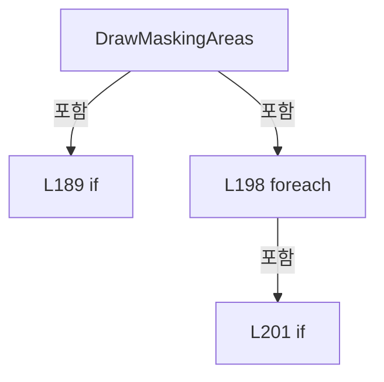

변경 전 점검: 입력/반환 타입, 위 호출자, 예외/취소 경로, 공유 상태와 저장·전송 소비자를 함께 확인합니다. 값의 단위나 물리 방향을 이름만으로 확정하지 않습니다.

### MethodDeclaration `DrawEdgeMaskingArea` · L214–240

[Drilling.UI/Menu/Menus/CRecipeCellPatternPreviewDrawing.cs:214–240](https://github.com/kjuws10-rgb/A3Drilling/blob/5aee8e58439c9b455cae7c9593c9be986c3e682e/Drilling.UI/Menu/Menus/CRecipeCellPatternPreviewDrawing.cs#L214-L240)

| 항목 | 실제 추출 값 |
| --- | --- |
| 서명 | void Drilling.UI.Menu.Menus.CRecipeCellPatternPreviewDrawing.DrawEdgeMaskingArea(DrawingContext, Drilling.UI.Menu.Menus.ST_RECIPE_CELL_VIEW_MODEL, Rect, Drilling.UI.Menu.Menus.ST_RECIPE_EDGE_MASKING_AREA?) |
| 접근/수식자 | Private / private, static |
| 반환/값 타입 | void |
| 소속 타입 | NamedType:Drilling.UI.Menu.Menus.CRecipeCellPatternPreviewDrawing |

입력 계약:

| 이름 | 타입 | 전달 | 선택/기본값 |
| --- | --- | --- | --- |
| context | DrawingContext | None | False /  |
| cell | Drilling.UI.Menu.Menus.ST_RECIPE_CELL_VIEW_MODEL | None | False /  |
| mapRect | Rect | None | False /  |
| edgeMaskingArea | Drilling.UI.Menu.Menus.ST_RECIPE_EDGE_MASKING_AREA? | None | False /  |

현재 부분 분석에서 직접 연결된 호출자는 없습니다. XAML/이벤트/인터페이스·델리게이트·외부 진입을 추가 확인해야 하며, 미사용으로 판정한 것이 아닙니다.

호출하는 대상과 해석 범위:

| 원본 행 | 표현식 | 분석 상태 | 대상/소스 위치 |
| --- | --- | --- | --- |
| 221 | BuildEdgeMaskingGeometry | resolved | Geometry? Drilling.UI.Menu.Menus.CRecipeCellPatternPreviewDrawing.BuildEdgeMaskingGeometry(Drilling.UI.Menu.Menus.ST_RECIPE_CELL_VIEW_MODEL, Rect, Drilling.UI.Menu.Menus.ST_RECIPE_EDGE_MASKING_AREA) · Drilling.UI/Menu/Menus/CRecipeCellPatternPreviewDrawing.cs:260 |
| 229 | maskedGeometry.Freeze | unresolved | None |
| 232 | CreateBrush | resolved | SolidColorBrush Drilling.UI.Menu.Menus.CRecipeCellPatternPreviewDrawing.CreateBrush(byte, byte, byte, byte) · Drilling.UI/Menu/Menus/CRecipeCellPatternPreviewDrawing.cs:660 |
| 233 | CreatePen | resolved | Pen Drilling.UI.Menu.Menus.CRecipeCellPatternPreviewDrawing.CreatePen(byte, byte, byte, byte, double) · Drilling.UI/Menu/Menus/CRecipeCellPatternPreviewDrawing.cs:653 |
| 234 | CreatePen | resolved | Pen Drilling.UI.Menu.Menus.CRecipeCellPatternPreviewDrawing.CreatePen(byte, byte, byte, byte, double) · Drilling.UI/Menu/Menus/CRecipeCellPatternPreviewDrawing.cs:653 |
| 235 | context.PushClip | unresolved | None |
| 235 | new RectangleGeometry | unresolved | None |
| 236 | context.DrawGeometry | unresolved | None |
| 237 | DrawMaskingHatches | candidate | OverloadResolutionFailure |
| 238 | context.DrawGeometry | unresolved | None |
| 239 | context.Pop | unresolved | None |

본문의 실제 연산·분기·예외·반환 순서(원문 위치 순):

| 원본 행 | 종류 | 주석 해설 |
| --- | --- | --- |
| 216 | if | 조건에 따라 분기합니다: if (edgeMaskingArea is null &#124;&#124; cell.PatternLayout.GroupCountX <= 0 &#124;&#124; cell.PatternLayout.GroupCountY <= 0 &#124;&#124; cell.PatternLayout.GroupPitchMillimeters <= 0.0) |
| 218 | return | 호출자에게 값 또는 제어를 반환합니다: return; |
| 221 | call | 함수·델리게이트 또는 객체 생성자를 호출합니다: BuildEdgeMaskingGeometry(cell, mapRect, edgeMaskingArea) |
| 221 | local-declaration | 지역 변수를 선언합니다: var maskedGeometry = BuildEdgeMaskingGeometry(cell, mapRect, edgeMaskingArea); |
| 221 | variable-initializer | 변수의 초기값을 지정합니다: maskedGeometry = BuildEdgeMaskingGeometry(cell, mapRect, edgeMaskingArea) |
| 222 | if | 조건에 따라 분기합니다: if (maskedGeometry is null) |
| 224 | return | 호출자에게 값 또는 제어를 반환합니다: return; |
| 227 | if | 조건에 따라 분기합니다: if (maskedGeometry.CanFreeze) |
| 229 | call | 함수·델리게이트 또는 객체 생성자를 호출합니다: maskedGeometry.Freeze() |
| 232 | call | 함수·델리게이트 또는 객체 생성자를 호출합니다: CreateBrush(82, 251, 146, 60) |
| 232 | local-declaration | 지역 변수를 선언합니다: var fillBrush = CreateBrush(82, 251, 146, 60); |
| 232 | variable-initializer | 변수의 초기값을 지정합니다: fillBrush = CreateBrush(82, 251, 146, 60) |
| 233 | call | 함수·델리게이트 또는 객체 생성자를 호출합니다: CreatePen(245, 251, 146, 60, 1.4) |
| 233 | local-declaration | 지역 변수를 선언합니다: var borderPen = CreatePen(245, 251, 146, 60, 1.4); |
| 233 | variable-initializer | 변수의 초기값을 지정합니다: borderPen = CreatePen(245, 251, 146, 60, 1.4) |
| 234 | call | 함수·델리게이트 또는 객체 생성자를 호출합니다: CreatePen(165, 253, 186, 116, 0.9) |
| 234 | local-declaration | 지역 변수를 선언합니다: var hatchPen = CreatePen(165, 253, 186, 116, 0.9); |
| 234 | variable-initializer | 변수의 초기값을 지정합니다: hatchPen = CreatePen(165, 253, 186, 116, 0.9) |
| 235 | call | 함수·델리게이트 또는 객체 생성자를 호출합니다: context.PushClip(new RectangleGeometry(mapRect)) |
| 235 | call | 함수·델리게이트 또는 객체 생성자를 호출합니다: new RectangleGeometry(mapRect) |
| 236 | call | 함수·델리게이트 또는 객체 생성자를 호출합니다: context.DrawGeometry(fillBrush, null, maskedGeometry) |
| 237 | call | 함수·델리게이트 또는 객체 생성자를 호출합니다: DrawMaskingHatches(context, maskedGeometry, hatchPen, 8.0) |
| 238 | call | 함수·델리게이트 또는 객체 생성자를 호출합니다: context.DrawGeometry(null, borderPen, maskedGeometry) |
| 239 | call | 함수·델리게이트 또는 객체 생성자를 호출합니다: context.Pop() |

제어 구문의 포함 구조(실제 실행 순서/CFG가 아닌 구문 탐색 그림):

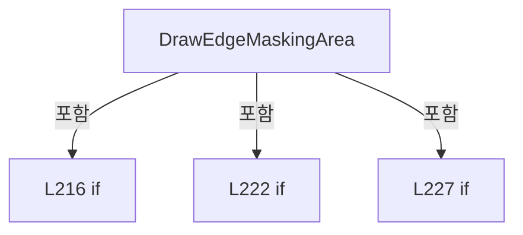

변경 전 점검: 입력/반환 타입, 위 호출자, 예외/취소 경로, 공유 상태와 저장·전송 소비자를 함께 확인합니다. 값의 단위나 물리 방향을 이름만으로 확정하지 않습니다.

### MethodDeclaration `DrawEdgeMaskingOutline` · L242–258

[Drilling.UI/Menu/Menus/CRecipeCellPatternPreviewDrawing.cs:242–258](https://github.com/kjuws10-rgb/A3Drilling/blob/5aee8e58439c9b455cae7c9593c9be986c3e682e/Drilling.UI/Menu/Menus/CRecipeCellPatternPreviewDrawing.cs#L242-L258)

| 항목 | 실제 추출 값 |
| --- | --- |
| 서명 | void Drilling.UI.Menu.Menus.CRecipeCellPatternPreviewDrawing.DrawEdgeMaskingOutline(DrawingContext, Drilling.UI.Menu.Menus.ST_RECIPE_CELL_VIEW_MODEL, Rect, Drilling.UI.Menu.Menus.ST_RECIPE_EDGE_MASKING_AREA?) |
| 접근/수식자 | Private / private, static |
| 반환/값 타입 | void |
| 소속 타입 | NamedType:Drilling.UI.Menu.Menus.CRecipeCellPatternPreviewDrawing |

입력 계약:

| 이름 | 타입 | 전달 | 선택/기본값 |
| --- | --- | --- | --- |
| context | DrawingContext | None | False /  |
| cell | Drilling.UI.Menu.Menus.ST_RECIPE_CELL_VIEW_MODEL | None | False /  |
| mapRect | Rect | None | False /  |
| edgeMaskingArea | Drilling.UI.Menu.Menus.ST_RECIPE_EDGE_MASKING_AREA? | None | False /  |

현재 부분 분석에서 직접 연결된 호출자는 없습니다. XAML/이벤트/인터페이스·델리게이트·외부 진입을 추가 확인해야 하며, 미사용으로 판정한 것이 아닙니다.

호출하는 대상과 해석 범위:

| 원본 행 | 표현식 | 분석 상태 | 대상/소스 위치 |
| --- | --- | --- | --- |
| 249 | BuildEdgeMaskingGeometry | resolved | Geometry? Drilling.UI.Menu.Menus.CRecipeCellPatternPreviewDrawing.BuildEdgeMaskingGeometry(Drilling.UI.Menu.Menus.ST_RECIPE_CELL_VIEW_MODEL, Rect, Drilling.UI.Menu.Menus.ST_RECIPE_EDGE_MASKING_AREA) · Drilling.UI/Menu/Menus/CRecipeCellPatternPreviewDrawing.cs:260 |
| 255 | context.PushClip | unresolved | None |
| 255 | new RectangleGeometry | unresolved | None |
| 256 | context.DrawGeometry | unresolved | None |
| 256 | CreatePen | resolved | Pen Drilling.UI.Menu.Menus.CRecipeCellPatternPreviewDrawing.CreatePen(byte, byte, byte, byte, double) · Drilling.UI/Menu/Menus/CRecipeCellPatternPreviewDrawing.cs:653 |
| 257 | context.Pop | unresolved | None |

본문의 실제 연산·분기·예외·반환 순서(원문 위치 순):

| 원본 행 | 종류 | 주석 해설 |
| --- | --- | --- |
| 244 | if | 조건에 따라 분기합니다: if (edgeMaskingArea is null) |
| 246 | return | 호출자에게 값 또는 제어를 반환합니다: return; |
| 249 | call | 함수·델리게이트 또는 객체 생성자를 호출합니다: BuildEdgeMaskingGeometry(cell, mapRect, edgeMaskingArea) |
| 249 | local-declaration | 지역 변수를 선언합니다: var maskedGeometry = BuildEdgeMaskingGeometry(cell, mapRect, edgeMaskingArea); |
| 249 | variable-initializer | 변수의 초기값을 지정합니다: maskedGeometry = BuildEdgeMaskingGeometry(cell, mapRect, edgeMaskingArea) |
| 250 | if | 조건에 따라 분기합니다: if (maskedGeometry is null) |
| 252 | return | 호출자에게 값 또는 제어를 반환합니다: return; |
| 255 | call | 함수·델리게이트 또는 객체 생성자를 호출합니다: context.PushClip(new RectangleGeometry(mapRect)) |
| 255 | call | 함수·델리게이트 또는 객체 생성자를 호출합니다: new RectangleGeometry(mapRect) |
| 256 | call | 함수·델리게이트 또는 객체 생성자를 호출합니다: context.DrawGeometry(null, CreatePen(255, 251, 146, 60, 1.8), maskedGeometry) |
| 256 | call | 함수·델리게이트 또는 객체 생성자를 호출합니다: CreatePen(255, 251, 146, 60, 1.8) |
| 257 | call | 함수·델리게이트 또는 객체 생성자를 호출합니다: context.Pop() |

제어 구문의 포함 구조(실제 실행 순서/CFG가 아닌 구문 탐색 그림):

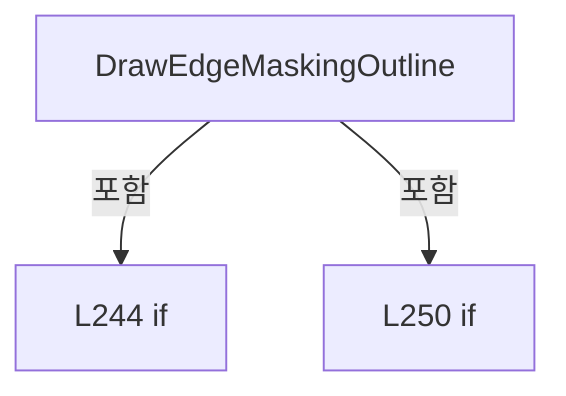

변경 전 점검: 입력/반환 타입, 위 호출자, 예외/취소 경로, 공유 상태와 저장·전송 소비자를 함께 확인합니다. 값의 단위나 물리 방향을 이름만으로 확정하지 않습니다.

### MethodDeclaration `BuildEdgeMaskingGeometry` · L260–289

[Drilling.UI/Menu/Menus/CRecipeCellPatternPreviewDrawing.cs:260–289](https://github.com/kjuws10-rgb/A3Drilling/blob/5aee8e58439c9b455cae7c9593c9be986c3e682e/Drilling.UI/Menu/Menus/CRecipeCellPatternPreviewDrawing.cs#L260-L289)

| 항목 | 실제 추출 값 |
| --- | --- |
| 서명 | Geometry? Drilling.UI.Menu.Menus.CRecipeCellPatternPreviewDrawing.BuildEdgeMaskingGeometry(Drilling.UI.Menu.Menus.ST_RECIPE_CELL_VIEW_MODEL, Rect, Drilling.UI.Menu.Menus.ST_RECIPE_EDGE_MASKING_AREA) |
| 접근/수식자 | Private / private, static |
| 반환/값 타입 | Geometry? |
| 소속 타입 | NamedType:Drilling.UI.Menu.Menus.CRecipeCellPatternPreviewDrawing |

입력 계약:

| 이름 | 타입 | 전달 | 선택/기본값 |
| --- | --- | --- | --- |
| cell | Drilling.UI.Menu.Menus.ST_RECIPE_CELL_VIEW_MODEL | None | False /  |
| mapRect | Rect | None | False /  |
| edgeMaskingArea | Drilling.UI.Menu.Menus.ST_RECIPE_EDGE_MASKING_AREA | None | False /  |

정적 호출자로 확인된 위치:

| 호출 파일/행 | 호출 표현식 | 런타임 분기 가능 |
| --- | --- | --- |
| [Drilling.UI/Menu/Menus/CRecipeCellPatternPreviewDrawing.cs:221–221](https://github.com/kjuws10-rgb/A3Drilling/blob/5aee8e58439c9b455cae7c9593c9be986c3e682e/Drilling.UI/Menu/Menus/CRecipeCellPatternPreviewDrawing.cs#L221-L221) | BuildEdgeMaskingGeometry | False |
| [Drilling.UI/Menu/Menus/CRecipeCellPatternPreviewDrawing.cs:249–249](https://github.com/kjuws10-rgb/A3Drilling/blob/5aee8e58439c9b455cae7c9593c9be986c3e682e/Drilling.UI/Menu/Menus/CRecipeCellPatternPreviewDrawing.cs#L249-L249) | BuildEdgeMaskingGeometry | False |

호출하는 대상과 해석 범위:

| 원본 행 | 표현식 | 분석 상태 | 대상/소스 위치 |
| --- | --- | --- | --- |
| 267 | new List<Geometry> | resolved | System.Collections.Generic.List<Geometry>.List() |
| 270 | BuildEdgeMaskingRectGeometry | resolved | StreamGeometry? Drilling.UI.Menu.Menus.CRecipeCellPatternPreviewDrawing.BuildEdgeMaskingRectGeometry(Drilling.UI.Menu.Menus.ST_RECIPE_CELL_VIEW_MODEL, Rect, Rect) · Drilling.UI/Menu/Menus/CRecipeCellPatternPreviewDrawing.cs:291 |
| 273 | geometries.Add | candidate | OverloadResolutionFailure |
| 285 | new CombinedGeometry | unresolved | None |

본문의 실제 연산·분기·예외·반환 순서(원문 위치 순):

| 원본 행 | 종류 | 주석 해설 |
| --- | --- | --- |
| 262 | if | 조건에 따라 분기합니다: if (edgeMaskingArea.Bounds.Count == 0) |
| 264 | return | 호출자에게 값 또는 제어를 반환합니다: return null; |
| 267 | call | 함수·델리게이트 또는 객체 생성자를 호출합니다: new List<Geometry>() |
| 267 | local-declaration | 지역 변수를 선언합니다: var geometries = new List<Geometry>(); |
| 267 | variable-initializer | 변수의 초기값을 지정합니다: geometries = new List<Geometry>() |
| 268 | foreach | 컬렉션 요소를 순회합니다: foreach (var bounds in edgeMaskingArea.Bounds) |
| 270 | call | 함수·델리게이트 또는 객체 생성자를 호출합니다: BuildEdgeMaskingRectGeometry(cell, mapRect, bounds) |
| 270 | local-declaration | 지역 변수를 선언합니다: var geometry = BuildEdgeMaskingRectGeometry(cell, mapRect, bounds); |
| 270 | variable-initializer | 변수의 초기값을 지정합니다: geometry = BuildEdgeMaskingRectGeometry(cell, mapRect, bounds) |
| 271 | if | 조건에 따라 분기합니다: if (geometry is not null) |
| 273 | call | 함수·델리게이트 또는 객체 생성자를 호출합니다: geometries.Add(geometry) |
| 277 | if | 조건에 따라 분기합니다: if (geometries.Count == 0) |
| 279 | return | 호출자에게 값 또는 제어를 반환합니다: return null; |
| 282 | local-declaration | 지역 변수를 선언합니다: Geometry result = geometries[0]; |
| 282 | variable-initializer | 변수의 초기값을 지정합니다: result = geometries[0] |
| 283 | variable-initializer | 변수의 초기값을 지정합니다: index = 1 |
| 283 | for | 초기화·조건·증감이 있는 반복입니다: for (var index = 1; index < geometries.Count; index++) |
| 285 | assignment | 값을 대상에 대입합니다: result = new CombinedGeometry(GeometryCombineMode.Union, result, geometries[index]) |
| 285 | call | 함수·델리게이트 또는 객체 생성자를 호출합니다: new CombinedGeometry(GeometryCombineMode.Union, result, geometries[index]) |
| 288 | return | 호출자에게 값 또는 제어를 반환합니다: return result; |

제어 구문의 포함 구조(실제 실행 순서/CFG가 아닌 구문 탐색 그림):

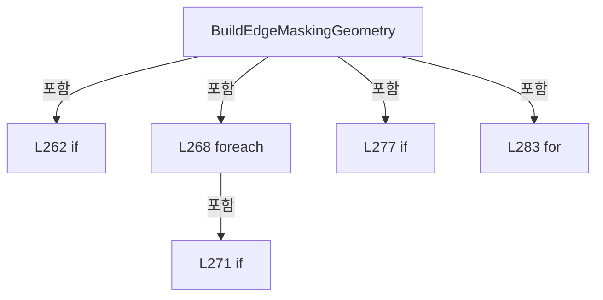

변경 전 점검: 입력/반환 타입, 위 호출자, 예외/취소 경로, 공유 상태와 저장·전송 소비자를 함께 확인합니다. 값의 단위나 물리 방향을 이름만으로 확정하지 않습니다.

### MethodDeclaration `BuildEdgeMaskingRectGeometry` · L291–311

[Drilling.UI/Menu/Menus/CRecipeCellPatternPreviewDrawing.cs:291–311](https://github.com/kjuws10-rgb/A3Drilling/blob/5aee8e58439c9b455cae7c9593c9be986c3e682e/Drilling.UI/Menu/Menus/CRecipeCellPatternPreviewDrawing.cs#L291-L311)

| 항목 | 실제 추출 값 |
| --- | --- |
| 서명 | StreamGeometry? Drilling.UI.Menu.Menus.CRecipeCellPatternPreviewDrawing.BuildEdgeMaskingRectGeometry(Drilling.UI.Menu.Menus.ST_RECIPE_CELL_VIEW_MODEL, Rect, Rect) |
| 접근/수식자 | Private / private, static |
| 반환/값 타입 | StreamGeometry? |
| 소속 타입 | NamedType:Drilling.UI.Menu.Menus.CRecipeCellPatternPreviewDrawing |

입력 계약:

| 이름 | 타입 | 전달 | 선택/기본값 |
| --- | --- | --- | --- |
| cell | Drilling.UI.Menu.Menus.ST_RECIPE_CELL_VIEW_MODEL | None | False /  |
| mapRect | Rect | None | False /  |
| bounds | Rect | None | False /  |

정적 호출자로 확인된 위치:

| 호출 파일/행 | 호출 표현식 | 런타임 분기 가능 |
| --- | --- | --- |
| [Drilling.UI/Menu/Menus/CRecipeCellPatternPreviewDrawing.cs:270–270](https://github.com/kjuws10-rgb/A3Drilling/blob/5aee8e58439c9b455cae7c9593c9be986c3e682e/Drilling.UI/Menu/Menus/CRecipeCellPatternPreviewDrawing.cs#L270-L270) | BuildEdgeMaskingRectGeometry | False |

호출하는 대상과 해석 범위:

| 원본 행 | 표현식 | 분석 상태 | 대상/소스 위치 |
| --- | --- | --- | --- |
| 294 | TryProjectDoeOriginToCellMap | resolved | bool Drilling.UI.Menu.Menus.CRecipeCellPatternPreviewDrawing.TryProjectDoeOriginToCellMap(Point, Drilling.Common.Recipe.ST_CELL_PATTERN_LAYOUT, Rect, out Point) · Drilling.UI/Menu/Menus/CRecipeCellPatternPreviewDrawing.cs:342 |
| 294 | new Point | unresolved | None |
| 295 | TryProjectDoeOriginToCellMap | resolved | bool Drilling.UI.Menu.Menus.CRecipeCellPatternPreviewDrawing.TryProjectDoeOriginToCellMap(Point, Drilling.Common.Recipe.ST_CELL_PATTERN_LAYOUT, Rect, out Point) · Drilling.UI/Menu/Menus/CRecipeCellPatternPreviewDrawing.cs:342 |
| 295 | new Point | unresolved | None |
| 296 | TryProjectDoeOriginToCellMap | resolved | bool Drilling.UI.Menu.Menus.CRecipeCellPatternPreviewDrawing.TryProjectDoeOriginToCellMap(Point, Drilling.Common.Recipe.ST_CELL_PATTERN_LAYOUT, Rect, out Point) · Drilling.UI/Menu/Menus/CRecipeCellPatternPreviewDrawing.cs:342 |
| 296 | new Point | unresolved | None |
| 297 | TryProjectDoeOriginToCellMap | resolved | bool Drilling.UI.Menu.Menus.CRecipeCellPatternPreviewDrawing.TryProjectDoeOriginToCellMap(Point, Drilling.Common.Recipe.ST_CELL_PATTERN_LAYOUT, Rect, out Point) · Drilling.UI/Menu/Menus/CRecipeCellPatternPreviewDrawing.cs:342 |
| 297 | new Point | unresolved | None |
| 302 | new StreamGeometry | unresolved | None |
| 303 | geometry.Open | unresolved | None |
| 305 | geometryContext.BeginFigure | unresolved | None |
| 306 | geometryContext.PolyLineTo | unresolved | None |
| 309 | geometry.Freeze | unresolved | None |

본문의 실제 연산·분기·예외·반환 순서(원문 위치 순):

| 원본 행 | 종류 | 주석 해설 |
| --- | --- | --- |
| 293 | if | 조건에 따라 분기합니다: if (bounds.IsEmpty &#124;&#124; !TryProjectDoeOriginToCellMap(new Point(bounds.Left, bounds.Top), cell.PatternLayout, mapRect, out var topLeft) &#124;&#124; !TryProjectDoeOriginToCellMap(new Point(bounds.Right, bounds.Top), cell.PatternLayout, …) |
| 294 | call | 함수·델리게이트 또는 객체 생성자를 호출합니다: TryProjectDoeOriginToCellMap(new Point(bounds.Left, bounds.Top), cell.PatternLayout, mapRect, out var topLeft) |
| 294 | call | 함수·델리게이트 또는 객체 생성자를 호출합니다: new Point(bounds.Left, bounds.Top) |
| 295 | call | 함수·델리게이트 또는 객체 생성자를 호출합니다: TryProjectDoeOriginToCellMap(new Point(bounds.Right, bounds.Top), cell.PatternLayout, mapRect, out var topRight) |
| 295 | call | 함수·델리게이트 또는 객체 생성자를 호출합니다: new Point(bounds.Right, bounds.Top) |
| 296 | call | 함수·델리게이트 또는 객체 생성자를 호출합니다: TryProjectDoeOriginToCellMap(new Point(bounds.Right, bounds.Bottom), cell.PatternLayout, mapRect, out var bottomRight) |
| 296 | call | 함수·델리게이트 또는 객체 생성자를 호출합니다: new Point(bounds.Right, bounds.Bottom) |
| 297 | call | 함수·델리게이트 또는 객체 생성자를 호출합니다: TryProjectDoeOriginToCellMap(new Point(bounds.Left, bounds.Bottom), cell.PatternLayout, mapRect, out var bottomLeft) |
| 297 | call | 함수·델리게이트 또는 객체 생성자를 호출합니다: new Point(bounds.Left, bounds.Bottom) |
| 299 | return | 호출자에게 값 또는 제어를 반환합니다: return null; |
| 302 | call | 함수·델리게이트 또는 객체 생성자를 호출합니다: new StreamGeometry() |
| 302 | local-declaration | 지역 변수를 선언합니다: var geometry = new StreamGeometry(); |
| 302 | variable-initializer | 변수의 초기값을 지정합니다: geometry = new StreamGeometry() |
| 303 | call | 함수·델리게이트 또는 객체 생성자를 호출합니다: geometry.Open() |
| 303 | variable-initializer | 변수의 초기값을 지정합니다: geometryContext = geometry.Open() |
| 303 | using | 자원 사용과 정리 범위를 지정합니다: using (var geometryContext = geometry.Open()) |
| 305 | call | 함수·델리게이트 또는 객체 생성자를 호출합니다: geometryContext.BeginFigure(topLeft, true, true) |
| 306 | call | 함수·델리게이트 또는 객체 생성자를 호출합니다: geometryContext.PolyLineTo([topRight, bottomRight, bottomLeft], true, false) |
| 309 | call | 함수·델리게이트 또는 객체 생성자를 호출합니다: geometry.Freeze() |
| 310 | return | 호출자에게 값 또는 제어를 반환합니다: return geometry; |

제어 구문의 포함 구조(실제 실행 순서/CFG가 아닌 구문 탐색 그림):

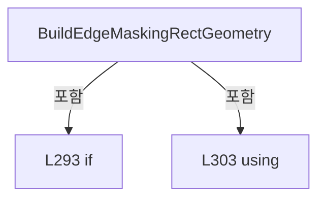

변경 전 점검: 입력/반환 타입, 위 호출자, 예외/취소 경로, 공유 상태와 저장·전송 소비자를 함께 확인합니다. 값의 단위나 물리 방향을 이름만으로 확정하지 않습니다.

### MethodDeclaration `BuildMaskingAreaGeometry` · L313–340

[Drilling.UI/Menu/Menus/CRecipeCellPatternPreviewDrawing.cs:313–340](https://github.com/kjuws10-rgb/A3Drilling/blob/5aee8e58439c9b455cae7c9593c9be986c3e682e/Drilling.UI/Menu/Menus/CRecipeCellPatternPreviewDrawing.cs#L313-L340)

| 항목 | 실제 추출 값 |
| --- | --- |
| 서명 | StreamGeometry? Drilling.UI.Menu.Menus.CRecipeCellPatternPreviewDrawing.BuildMaskingAreaGeometry(Drilling.UI.Menu.Menus.ST_RECIPE_CELL_VIEW_MODEL, Rect, Drilling.UI.Menu.Menus.ST_RECIPE_MASKING_AREA) |
| 접근/수식자 | Private / private, static |
| 반환/값 타입 | StreamGeometry? |
| 소속 타입 | NamedType:Drilling.UI.Menu.Menus.CRecipeCellPatternPreviewDrawing |

입력 계약:

| 이름 | 타입 | 전달 | 선택/기본값 |
| --- | --- | --- | --- |
| cell | Drilling.UI.Menu.Menus.ST_RECIPE_CELL_VIEW_MODEL | None | False /  |
| mapRect | Rect | None | False /  |
| area | Drilling.UI.Menu.Menus.ST_RECIPE_MASKING_AREA | None | False /  |

정적 호출자로 확인된 위치:

| 호출 파일/행 | 호출 표현식 | 런타임 분기 가능 |
| --- | --- | --- |
| [Drilling.UI/Menu/Menus/CRecipeCellPatternPreviewDrawing.cs:200–200](https://github.com/kjuws10-rgb/A3Drilling/blob/5aee8e58439c9b455cae7c9593c9be986c3e682e/Drilling.UI/Menu/Menus/CRecipeCellPatternPreviewDrawing.cs#L200-L200) | BuildMaskingAreaGeometry | False |

호출하는 대상과 해석 범위:

| 원본 행 | 표현식 | 분석 상태 | 대상/소스 위치 |
| --- | --- | --- | --- |
| 317 | new Point | unresolved | None |
| 318 | new Point | unresolved | None |
| 319 | new Point | unresolved | None |
| 320 | new Point | unresolved | None |
| 325 | TryProjectDoeOriginToCellMap | resolved | bool Drilling.UI.Menu.Menus.CRecipeCellPatternPreviewDrawing.TryProjectDoeOriginToCellMap(Point, Drilling.Common.Recipe.ST_CELL_PATTERN_LAYOUT, Rect, out Point) · Drilling.UI/Menu/Menus/CRecipeCellPatternPreviewDrawing.cs:342 |
| 331 | new StreamGeometry | unresolved | None |
| 332 | geometry.Open | unresolved | None |
| 334 | geometryContext.BeginFigure | unresolved | None |
| 335 | geometryContext.PolyLineTo | unresolved | None |
| 335 | points.Skip(1).ToArray | resolved | Point[] System.Collections.Generic.IEnumerable<Point>.ToArray<Point>() |
| 335 | points.Skip | resolved | System.Collections.Generic.IEnumerable<Point> System.Collections.Generic.IEnumerable<Point>.Skip<Point>(int) |
| 338 | geometry.Freeze | unresolved | None |

본문의 실제 연산·분기·예외·반환 순서(원문 위치 순):

| 원본 행 | 종류 | 주석 해설 |
| --- | --- | --- |
| 315 | local-declaration | 지역 변수를 선언합니다: var corners = new[] { new Point(area.Bounds.Left, area.Bounds.Top), new Point(area.Bounds.Right, area.Bounds.Top), new Point(area.Bounds.Right, area.Bounds.Bottom), new Point(area.Bounds.Left, area.Bounds.Bottom) }; |
| 315 | variable-initializer | 변수의 초기값을 지정합니다: corners = new[] { new Point(area.Bounds.Left, area.Bounds.Top), new Point(area.Bounds.Right, area.Bounds.Top), new Point(area.Bounds.Right, area.Bounds.Bottom), new Point(area.Bounds.Left, area.Bounds.Bottom) } |
| 317 | call | 함수·델리게이트 또는 객체 생성자를 호출합니다: new Point(area.Bounds.Left, area.Bounds.Top) |
| 318 | call | 함수·델리게이트 또는 객체 생성자를 호출합니다: new Point(area.Bounds.Right, area.Bounds.Top) |
| 319 | call | 함수·델리게이트 또는 객체 생성자를 호출합니다: new Point(area.Bounds.Right, area.Bounds.Bottom) |
| 320 | call | 함수·델리게이트 또는 객체 생성자를 호출합니다: new Point(area.Bounds.Left, area.Bounds.Bottom) |
| 322 | local-declaration | 지역 변수를 선언합니다: var points = new Point[corners.Length]; |
| 322 | variable-initializer | 변수의 초기값을 지정합니다: points = new Point[corners.Length] |
| 323 | variable-initializer | 변수의 초기값을 지정합니다: index = 0 |
| 323 | for | 초기화·조건·증감이 있는 반복입니다: for (var index = 0; index < corners.Length; index++) |
| 325 | call | 함수·델리게이트 또는 객체 생성자를 호출합니다: TryProjectDoeOriginToCellMap(corners[index], cell.PatternLayout, mapRect, out points[index]) |
| 325 | if | 조건에 따라 분기합니다: if (!TryProjectDoeOriginToCellMap(corners[index], cell.PatternLayout, mapRect, out points[index])) |
| 327 | return | 호출자에게 값 또는 제어를 반환합니다: return null; |
| 331 | call | 함수·델리게이트 또는 객체 생성자를 호출합니다: new StreamGeometry() |
| 331 | local-declaration | 지역 변수를 선언합니다: var geometry = new StreamGeometry(); |
| 331 | variable-initializer | 변수의 초기값을 지정합니다: geometry = new StreamGeometry() |
| 332 | call | 함수·델리게이트 또는 객체 생성자를 호출합니다: geometry.Open() |
| 332 | variable-initializer | 변수의 초기값을 지정합니다: geometryContext = geometry.Open() |
| 332 | using | 자원 사용과 정리 범위를 지정합니다: using (var geometryContext = geometry.Open()) |
| 334 | call | 함수·델리게이트 또는 객체 생성자를 호출합니다: geometryContext.BeginFigure(points[0], true, true) |
| 335 | call | 함수·델리게이트 또는 객체 생성자를 호출합니다: geometryContext.PolyLineTo(points.Skip(1).ToArray(), true, false) |
| 335 | call | 함수·델리게이트 또는 객체 생성자를 호출합니다: points.Skip(1).ToArray() |
| 335 | call | 함수·델리게이트 또는 객체 생성자를 호출합니다: points.Skip(1) |
| 338 | call | 함수·델리게이트 또는 객체 생성자를 호출합니다: geometry.Freeze() |
| 339 | return | 호출자에게 값 또는 제어를 반환합니다: return geometry; |

제어 구문의 포함 구조(실제 실행 순서/CFG가 아닌 구문 탐색 그림):

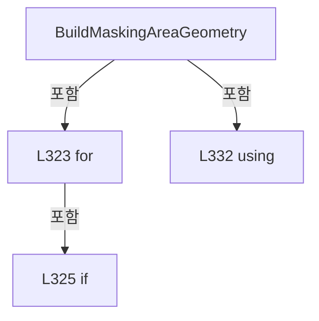

변경 전 점검: 입력/반환 타입, 위 호출자, 예외/취소 경로, 공유 상태와 저장·전송 소비자를 함께 확인합니다. 값의 단위나 물리 방향을 이름만으로 확정하지 않습니다.

### MethodDeclaration `TryProjectDoeOriginToCellMap` · L342–360

[Drilling.UI/Menu/Menus/CRecipeCellPatternPreviewDrawing.cs:342–360](https://github.com/kjuws10-rgb/A3Drilling/blob/5aee8e58439c9b455cae7c9593c9be986c3e682e/Drilling.UI/Menu/Menus/CRecipeCellPatternPreviewDrawing.cs#L342-L360)

| 항목 | 실제 추출 값 |
| --- | --- |
| 서명 | bool Drilling.UI.Menu.Menus.CRecipeCellPatternPreviewDrawing.TryProjectDoeOriginToCellMap(Point, Drilling.Common.Recipe.ST_CELL_PATTERN_LAYOUT, Rect, out Point) |
| 접근/수식자 | Private / private, static |
| 반환/값 타입 | bool |
| 소속 타입 | NamedType:Drilling.UI.Menu.Menus.CRecipeCellPatternPreviewDrawing |

입력 계약:

| 이름 | 타입 | 전달 | 선택/기본값 |
| --- | --- | --- | --- |
| localPoint | Point | None | False /  |
| patternLayout | Drilling.Common.Recipe.ST_CELL_PATTERN_LAYOUT | None | False /  |
| mapRect | Rect | None | False /  |
| mapPoint | Point | Out | False /  |

정적 호출자로 확인된 위치:

| 호출 파일/행 | 호출 표현식 | 런타임 분기 가능 |
| --- | --- | --- |
| [Drilling.UI/Menu/Menus/CRecipeCellPatternPreviewDrawing.cs:294–294](https://github.com/kjuws10-rgb/A3Drilling/blob/5aee8e58439c9b455cae7c9593c9be986c3e682e/Drilling.UI/Menu/Menus/CRecipeCellPatternPreviewDrawing.cs#L294-L294) | TryProjectDoeOriginToCellMap | False |
| [Drilling.UI/Menu/Menus/CRecipeCellPatternPreviewDrawing.cs:295–295](https://github.com/kjuws10-rgb/A3Drilling/blob/5aee8e58439c9b455cae7c9593c9be986c3e682e/Drilling.UI/Menu/Menus/CRecipeCellPatternPreviewDrawing.cs#L295-L295) | TryProjectDoeOriginToCellMap | False |
| [Drilling.UI/Menu/Menus/CRecipeCellPatternPreviewDrawing.cs:296–296](https://github.com/kjuws10-rgb/A3Drilling/blob/5aee8e58439c9b455cae7c9593c9be986c3e682e/Drilling.UI/Menu/Menus/CRecipeCellPatternPreviewDrawing.cs#L296-L296) | TryProjectDoeOriginToCellMap | False |
| [Drilling.UI/Menu/Menus/CRecipeCellPatternPreviewDrawing.cs:297–297](https://github.com/kjuws10-rgb/A3Drilling/blob/5aee8e58439c9b455cae7c9593c9be986c3e682e/Drilling.UI/Menu/Menus/CRecipeCellPatternPreviewDrawing.cs#L297-L297) | TryProjectDoeOriginToCellMap | False |
| [Drilling.UI/Menu/Menus/CRecipeCellPatternPreviewDrawing.cs:325–325](https://github.com/kjuws10-rgb/A3Drilling/blob/5aee8e58439c9b455cae7c9593c9be986c3e682e/Drilling.UI/Menu/Menus/CRecipeCellPatternPreviewDrawing.cs#L325-L325) | TryProjectDoeOriginToCellMap | False |

호출하는 대상과 해석 범위:

| 원본 행 | 표현식 | 분석 상태 | 대상/소스 위치 |
| --- | --- | --- | --- |
| 345 | double.IsFinite | candidate | OverloadResolutionFailure |
| 345 | double.IsFinite | candidate | OverloadResolutionFailure |
| 345 | double.IsFinite | resolved | bool double.IsFinite(double) |
| 352 | double.IsFinite | candidate | OverloadResolutionFailure |
| 352 | double.IsFinite | candidate | OverloadResolutionFailure |
| 357 | new Point | unresolved | None |
| 358 | new Point | unresolved | None |
| 359 | double.IsFinite | candidate | OverloadResolutionFailure |
| 359 | double.IsFinite | candidate | OverloadResolutionFailure |

본문의 실제 연산·분기·예외·반환 순서(원문 위치 순):

| 원본 행 | 종류 | 주석 해설 |
| --- | --- | --- |
| 344 | assignment | 값을 대상에 대입합니다: mapPoint = default |
| 345 | call | 함수·델리게이트 또는 객체 생성자를 호출합니다: double.IsFinite(localPoint.X) |
| 345 | call | 함수·델리게이트 또는 객체 생성자를 호출합니다: double.IsFinite(localPoint.Y) |
| 345 | call | 함수·델리게이트 또는 객체 생성자를 호출합니다: double.IsFinite(patternLayout.GroupPitchMillimeters) |
| 345 | if | 조건에 따라 분기합니다: if (!double.IsFinite(localPoint.X) &#124;&#124; !double.IsFinite(localPoint.Y) &#124;&#124; patternLayout.GroupCountX <= 0 &#124;&#124; patternLayout.GroupCountY <= 0 &#124;&#124; !double.IsFinite(patternLayout.GroupPitchMillimeters) &#124;&#124; patternLayout.GroupPitchMil…) |
| 347 | return | 호출자에게 값 또는 제어를 반환합니다: return false; |
| 350 | local-declaration | 지역 변수를 선언합니다: var cellWidth = mapRect.Width / patternLayout.GroupCountX; |
| 350 | variable-initializer | 변수의 초기값을 지정합니다: cellWidth = mapRect.Width / patternLayout.GroupCountX |
| 351 | local-declaration | 지역 변수를 선언합니다: var cellHeight = mapRect.Height / patternLayout.GroupCountY; |
| 351 | variable-initializer | 변수의 초기값을 지정합니다: cellHeight = mapRect.Height / patternLayout.GroupCountY |
| 352 | call | 함수·델리게이트 또는 객체 생성자를 호출합니다: double.IsFinite(cellWidth) |
| 352 | call | 함수·델리게이트 또는 객체 생성자를 호출합니다: double.IsFinite(cellHeight) |
| 352 | if | 조건에 따라 분기합니다: if (!double.IsFinite(cellWidth) &#124;&#124; !double.IsFinite(cellHeight) &#124;&#124; cellWidth <= 0.0 &#124;&#124; cellHeight <= 0.0) |
| 354 | return | 호출자에게 값 또는 제어를 반환합니다: return false; |
| 357 | call | 함수·델리게이트 또는 객체 생성자를 호출합니다: new Point(mapRect.Left + (cellWidth * 0.5), mapRect.Top + (cellHeight * 0.5)) |
| 357 | local-declaration | 지역 변수를 선언합니다: var firstDoeCenter = new Point(mapRect.Left + (cellWidth * 0.5), mapRect.Top + (cellHeight * 0.5)); |
| 357 | variable-initializer | 변수의 초기값을 지정합니다: firstDoeCenter = new Point(mapRect.Left + (cellWidth * 0.5), mapRect.Top + (cellHeight * 0.5)) |
| 358 | assignment | 값을 대상에 대입합니다: mapPoint = new Point(firstDoeCenter.X + (localPoint.X / patternLayout.GroupPitchMillimeters * cellWidth), firstDoeCenter.Y + (localPoint.Y / patternLayout.GroupPitchMillimeters * cellHeight)) |
| 358 | call | 함수·델리게이트 또는 객체 생성자를 호출합니다: new Point(firstDoeCenter.X + (localPoint.X / patternLayout.GroupPitchMillimeters * cellWidth), firstDoeCenter.Y + (localPoint.Y / patternLayout.GroupPitchMillimeters * cellHeight)) |
| 359 | call | 함수·델리게이트 또는 객체 생성자를 호출합니다: double.IsFinite(mapPoint.X) |
| 359 | call | 함수·델리게이트 또는 객체 생성자를 호출합니다: double.IsFinite(mapPoint.Y) |
| 359 | return | 호출자에게 값 또는 제어를 반환합니다: return double.IsFinite(mapPoint.X) && double.IsFinite(mapPoint.Y); |

제어 구문의 포함 구조(실제 실행 순서/CFG가 아닌 구문 탐색 그림):

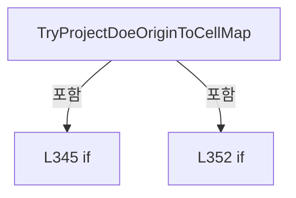

변경 전 점검: 입력/반환 타입, 위 호출자, 예외/취소 경로, 공유 상태와 저장·전송 소비자를 함께 확인합니다. 값의 단위나 물리 방향을 이름만으로 확정하지 않습니다.

### MethodDeclaration `DrawMaskingHatches` · L362–377

[Drilling.UI/Menu/Menus/CRecipeCellPatternPreviewDrawing.cs:362–377](https://github.com/kjuws10-rgb/A3Drilling/blob/5aee8e58439c9b455cae7c9593c9be986c3e682e/Drilling.UI/Menu/Menus/CRecipeCellPatternPreviewDrawing.cs#L362-L377)

| 항목 | 실제 추출 값 |
| --- | --- |
| 서명 | void Drilling.UI.Menu.Menus.CRecipeCellPatternPreviewDrawing.DrawMaskingHatches(DrawingContext, Geometry, Pen, double) |
| 접근/수식자 | Private / private, static |
| 반환/값 타입 | void |
| 소속 타입 | NamedType:Drilling.UI.Menu.Menus.CRecipeCellPatternPreviewDrawing |

입력 계약:

| 이름 | 타입 | 전달 | 선택/기본값 |
| --- | --- | --- | --- |
| context | DrawingContext | None | False /  |
| geometry | Geometry | None | False /  |
| pen | Pen | None | False /  |
| step | double | None | False /  |

현재 부분 분석에서 직접 연결된 호출자는 없습니다. XAML/이벤트/인터페이스·델리게이트·외부 진입을 추가 확인해야 하며, 미사용으로 판정한 것이 아닙니다.

호출하는 대상과 해석 범위:

| 원본 행 | 표현식 | 분석 상태 | 대상/소스 위치 |
| --- | --- | --- | --- |
| 370 | context.PushClip | unresolved | None |
| 373 | context.DrawLine | unresolved | None |
| 373 | new Point | unresolved | None |
| 373 | new Point | unresolved | None |
| 376 | context.Pop | unresolved | None |

본문의 실제 연산·분기·예외·반환 순서(원문 위치 순):

| 원본 행 | 종류 | 주석 해설 |
| --- | --- | --- |
| 364 | local-declaration | 지역 변수를 선언합니다: var bounds = geometry.Bounds; |
| 364 | variable-initializer | 변수의 초기값을 지정합니다: bounds = geometry.Bounds |
| 365 | if | 조건에 따라 분기합니다: if (bounds.IsEmpty &#124;&#124; bounds.Width <= 0.0 &#124;&#124; bounds.Height <= 0.0) |
| 367 | return | 호출자에게 값 또는 제어를 반환합니다: return; |
| 370 | call | 함수·델리게이트 또는 객체 생성자를 호출합니다: context.PushClip(geometry) |
| 371 | compound-assignment-or-event-subscription | 복합 대입 또는 이벤트 구독/해지 표현입니다: offset += step |
| 371 | variable-initializer | 변수의 초기값을 지정합니다: offset = -bounds.Height |
| 371 | for | 초기화·조건·증감이 있는 반복입니다: for (var offset = -bounds.Height; offset < bounds.Width; offset += step) |
| 373 | call | 함수·델리게이트 또는 객체 생성자를 호출합니다: context.DrawLine(pen, new Point(bounds.Left + offset, bounds.Bottom), new Point(bounds.Left + offset + bounds.Height, bounds.Top)) |
| 373 | call | 함수·델리게이트 또는 객체 생성자를 호출합니다: new Point(bounds.Left + offset, bounds.Bottom) |
| 373 | call | 함수·델리게이트 또는 객체 생성자를 호출합니다: new Point(bounds.Left + offset + bounds.Height, bounds.Top) |
| 376 | call | 함수·델리게이트 또는 객체 생성자를 호출합니다: context.Pop() |

제어 구문의 포함 구조(실제 실행 순서/CFG가 아닌 구문 탐색 그림):

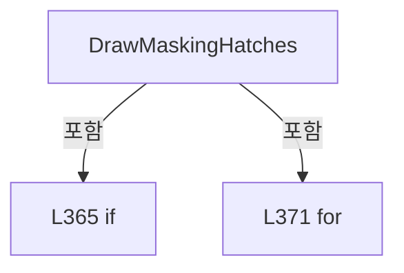

변경 전 점검: 입력/반환 타입, 위 호출자, 예외/취소 경로, 공유 상태와 저장·전송 소비자를 함께 확인합니다. 값의 단위나 물리 방향을 이름만으로 확정하지 않습니다.

### MethodDeclaration `DrawMaskedShots` · L379–418

[Drilling.UI/Menu/Menus/CRecipeCellPatternPreviewDrawing.cs:379–418](https://github.com/kjuws10-rgb/A3Drilling/blob/5aee8e58439c9b455cae7c9593c9be986c3e682e/Drilling.UI/Menu/Menus/CRecipeCellPatternPreviewDrawing.cs#L379-L418)

| 항목 | 실제 추출 값 |
| --- | --- |
| 서명 | void Drilling.UI.Menu.Menus.CRecipeCellPatternPreviewDrawing.DrawMaskedShots(DrawingContext, Rect, Drilling.UI.Menu.Menus.ST_RECIPE_CELL_VIEW_MODEL, System.Collections.Generic.IReadOnlyList<Drilling.UI.Menu.Menus.ST_SHOT_GROUP_EDITOR_ROW>) |
| 접근/수식자 | Private / private, static |
| 반환/값 타입 | void |
| 소속 타입 | NamedType:Drilling.UI.Menu.Menus.CRecipeCellPatternPreviewDrawing |

입력 계약:

| 이름 | 타입 | 전달 | 선택/기본값 |
| --- | --- | --- | --- |
| context | DrawingContext | None | False /  |
| mapRect | Rect | None | False /  |
| cell | Drilling.UI.Menu.Menus.ST_RECIPE_CELL_VIEW_MODEL | None | False /  |
| shotGroups | System.Collections.Generic.IReadOnlyList<Drilling.UI.Menu.Menus.ST_SHOT_GROUP_EDITOR_ROW> | None | False /  |

현재 부분 분석에서 직접 연결된 호출자는 없습니다. XAML/이벤트/인터페이스·델리게이트·외부 진입을 추가 확인해야 하며, 미사용으로 판정한 것이 아닙니다.

호출하는 대상과 해석 범위:

| 원본 행 | 표현식 | 분석 상태 | 대상/소스 위치 |
| --- | --- | --- | --- |
| 386 | shotGroups.Where(shot => shot.IsMasked && !shot.IsChessSkipped).ToArray | resolved | Drilling.UI.Menu.Menus.ST_SHOT_GROUP_EDITOR_ROW[] System.Collections.Generic.IEnumerable<Drilling.UI.Menu.Menus.ST_SHOT_GROUP_EDITOR_ROW>.ToArray<Drilling.UI.Menu.Menus.ST_SHOT_GROUP_EDITOR_ROW>() |
| 386 | shotGroups.Where | resolved | System.Collections.Generic.IEnumerable<Drilling.UI.Menu.Menus.ST_SHOT_GROUP_EDITOR_ROW> System.Collections.Generic.IEnumerable<Drilling.UI.Menu.Menus.ST_SHOT_GROUP_EDITOR_ROW>.Where<Drilling.UI.Menu.Menus.ST_SHOT_GROUP_EDITOR_ROW>(System.Func<Drilling.UI.Menu.Menus.ST_SHOT_GROUP_EDITOR_ROW, bool>) |
| 387 | shotGroups.Where(shot => shot.IsChessSkipped).ToArray | resolved | Drilling.UI.Menu.Menus.ST_SHOT_GROUP_EDITOR_ROW[] System.Collections.Generic.IEnumerable<Drilling.UI.Menu.Menus.ST_SHOT_GROUP_EDITOR_ROW>.ToArray<Drilling.UI.Menu.Menus.ST_SHOT_GROUP_EDITOR_ROW>() |
| 387 | shotGroups.Where | resolved | System.Collections.Generic.IEnumerable<Drilling.UI.Menu.Menus.ST_SHOT_GROUP_EDITOR_ROW> System.Collections.Generic.IEnumerable<Drilling.UI.Menu.Menus.ST_SHOT_GROUP_EDITOR_ROW>.Where<Drilling.UI.Menu.Menus.ST_SHOT_GROUP_EDITOR_ROW>(System.Func<Drilling.UI.Menu.Menus.ST_SHOT_GROUP_EDITOR_ROW, bool>) |
| 395 | Math.Clamp | candidate | OverloadResolutionFailure |
| 395 | Math.Min | candidate | OverloadResolutionFailure |
| 396 | CreateBrush | resolved | SolidColorBrush Drilling.UI.Menu.Menus.CRecipeCellPatternPreviewDrawing.CreateBrush(byte, byte, byte, byte) · Drilling.UI/Menu/Menus/CRecipeCellPatternPreviewDrawing.cs:660 |
| 397 | CreatePen | resolved | Pen Drilling.UI.Menu.Menus.CRecipeCellPatternPreviewDrawing.CreatePen(byte, byte, byte, byte, double) · Drilling.UI/Menu/Menus/CRecipeCellPatternPreviewDrawing.cs:653 |
| 398 | CreateBrush | resolved | SolidColorBrush Drilling.UI.Menu.Menus.CRecipeCellPatternPreviewDrawing.CreateBrush(byte, byte, byte, byte) · Drilling.UI/Menu/Menus/CRecipeCellPatternPreviewDrawing.cs:660 |
| 399 | CreatePen | resolved | Pen Drilling.UI.Menu.Menus.CRecipeCellPatternPreviewDrawing.CreatePen(byte, byte, byte, byte, double) · Drilling.UI/Menu/Menus/CRecipeCellPatternPreviewDrawing.cs:653 |
| 401 | context.PushClip | unresolved | None |
| 401 | new RectangleGeometry | unresolved | None |
| 402 | DrawShotMarkers | candidate | OverloadResolutionFailure |
| 403 | DrawShotMarkers | candidate | OverloadResolutionFailure |
| 404 | context.Pop | unresolved | None |

본문의 실제 연산·분기·예외·반환 순서(원문 위치 순):

| 원본 행 | 종류 | 주석 해설 |
| --- | --- | --- |
| 381 | if | 조건에 따라 분기합니다: if (shotGroups.Count == 0) |
| 383 | return | 호출자에게 값 또는 제어를 반환합니다: return; |
| 386 | call | 함수·델리게이트 또는 객체 생성자를 호출합니다: shotGroups.Where(shot => shot.IsMasked && !shot.IsChessSkipped).ToArray() |
| 386 | call | 함수·델리게이트 또는 객체 생성자를 호출합니다: shotGroups.Where(shot => shot.IsMasked && !shot.IsChessSkipped) |
| 386 | local-declaration | 지역 변수를 선언합니다: var maskedShotGroups = shotGroups.Where(shot => shot.IsMasked && !shot.IsChessSkipped).ToArray(); |
| 386 | variable-initializer | 변수의 초기값을 지정합니다: maskedShotGroups = shotGroups.Where(shot => shot.IsMasked && !shot.IsChessSkipped).ToArray() |
| 387 | call | 함수·델리게이트 또는 객체 생성자를 호출합니다: shotGroups.Where(shot => shot.IsChessSkipped).ToArray() |
| 387 | call | 함수·델리게이트 또는 객체 생성자를 호출합니다: shotGroups.Where(shot => shot.IsChessSkipped) |
| 387 | local-declaration | 지역 변수를 선언합니다: var chessShotGroups = shotGroups.Where(shot => shot.IsChessSkipped).ToArray(); |
| 387 | variable-initializer | 변수의 초기값을 지정합니다: chessShotGroups = shotGroups.Where(shot => shot.IsChessSkipped).ToArray() |
| 388 | if | 조건에 따라 분기합니다: if (maskedShotGroups.Length == 0 && chessShotGroups.Length == 0) |
| 390 | return | 호출자에게 값 또는 제어를 반환합니다: return; |
| 393 | local-declaration | 지역 변수를 선언합니다: var cellWidth = mapRect.Width / cell.PatternLayout.GroupCountX; |
| 393 | variable-initializer | 변수의 초기값을 지정합니다: cellWidth = mapRect.Width / cell.PatternLayout.GroupCountX |
| 394 | local-declaration | 지역 변수를 선언합니다: var cellHeight = mapRect.Height / cell.PatternLayout.GroupCountY; |
| 394 | variable-initializer | 변수의 초기값을 지정합니다: cellHeight = mapRect.Height / cell.PatternLayout.GroupCountY |
| 395 | call | 함수·델리게이트 또는 객체 생성자를 호출합니다: Math.Clamp(Math.Min(cellWidth, cellHeight) * 0.58, 3.2, 7.0) |
| 395 | call | 함수·델리게이트 또는 객체 생성자를 호출합니다: Math.Min(cellWidth, cellHeight) |
| 395 | local-declaration | 지역 변수를 선언합니다: var radius = Math.Clamp(Math.Min(cellWidth, cellHeight) * 0.58, 3.2, 7.0); |
| 395 | variable-initializer | 변수의 초기값을 지정합니다: radius = Math.Clamp(Math.Min(cellWidth, cellHeight) * 0.58, 3.2, 7.0) |
| 396 | call | 함수·델리게이트 또는 객체 생성자를 호출합니다: CreateBrush(115, 248, 113, 113) |
| 396 | local-declaration | 지역 변수를 선언합니다: var maskedFillBrush = CreateBrush(115, 248, 113, 113); |
| 396 | variable-initializer | 변수의 초기값을 지정합니다: maskedFillBrush = CreateBrush(115, 248, 113, 113) |
| 397 | call | 함수·델리게이트 또는 객체 생성자를 호출합니다: CreatePen(255, 248, 113, 113, 1.5) |
| 397 | local-declaration | 지역 변수를 선언합니다: var maskedPen = CreatePen(255, 248, 113, 113, 1.5); |
| 397 | variable-initializer | 변수의 초기값을 지정합니다: maskedPen = CreatePen(255, 248, 113, 113, 1.5) |
| 398 | call | 함수·델리게이트 또는 객체 생성자를 호출합니다: CreateBrush(90, 192, 132, 252) |
| 398 | local-declaration | 지역 변수를 선언합니다: var chessFillBrush = CreateBrush(90, 192, 132, 252); |
| 398 | variable-initializer | 변수의 초기값을 지정합니다: chessFillBrush = CreateBrush(90, 192, 132, 252) |
| 399 | call | 함수·델리게이트 또는 객체 생성자를 호출합니다: CreatePen(255, 192, 132, 252, 1.5) |
| 399 | local-declaration | 지역 변수를 선언합니다: var chessPen = CreatePen(255, 192, 132, 252, 1.5); |
| 399 | variable-initializer | 변수의 초기값을 지정합니다: chessPen = CreatePen(255, 192, 132, 252, 1.5) |
| 400 | local-declaration | 지역 변수를 선언합니다: const int maximumMaskedPreviewMarkers = 12_000; |
| 400 | variable-initializer | 변수의 초기값을 지정합니다: maximumMaskedPreviewMarkers = 12_000 |
| 401 | call | 함수·델리게이트 또는 객체 생성자를 호출합니다: context.PushClip(new RectangleGeometry(mapRect)) |
| 401 | call | 함수·델리게이트 또는 객체 생성자를 호출합니다: new RectangleGeometry(mapRect) |
| 402 | call | 함수·델리게이트 또는 객체 생성자를 호출합니다: DrawShotMarkers(maskedShotGroups, maskedFillBrush, maskedPen) |
| 403 | call | 함수·델리게이트 또는 객체 생성자를 호출합니다: DrawShotMarkers(chessShotGroups, chessFillBrush, chessPen) |
| 404 | call | 함수·델리게이트 또는 객체 생성자를 호출합니다: context.Pop() |

제어 구문의 포함 구조(실제 실행 순서/CFG가 아닌 구문 탐색 그림):

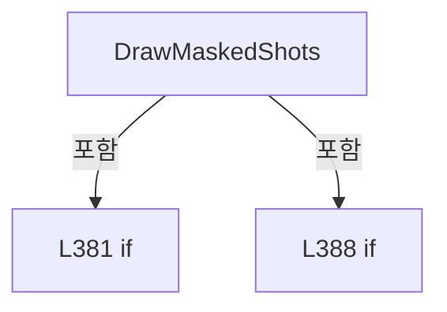

변경 전 점검: 입력/반환 타입, 위 호출자, 예외/취소 경로, 공유 상태와 저장·전송 소비자를 함께 확인합니다. 값의 단위나 물리 방향을 이름만으로 확정하지 않습니다.

### LocalFunctionStatement `DrawShotMarkers` · L406–417

[Drilling.UI/Menu/Menus/CRecipeCellPatternPreviewDrawing.cs:406–417](https://github.com/kjuws10-rgb/A3Drilling/blob/5aee8e58439c9b455cae7c9593c9be986c3e682e/Drilling.UI/Menu/Menus/CRecipeCellPatternPreviewDrawing.cs#L406-L417)

| 항목 | 실제 추출 값 |
| --- | --- |
| 서명 | void DrawShotMarkers(System.Collections.Generic.IReadOnlyList<Drilling.UI.Menu.Menus.ST_SHOT_GROUP_EDITOR_ROW>, Brush, Pen) |
| 접근/수식자 | Private /  |
| 반환/값 타입 | void |
| 소속 타입 | NamedType:Drilling.UI.Menu.Menus.CRecipeCellPatternPreviewDrawing |

입력 계약:

| 이름 | 타입 | 전달 | 선택/기본값 |
| --- | --- | --- | --- |
| groups | System.Collections.Generic.IReadOnlyList<Drilling.UI.Menu.Menus.ST_SHOT_GROUP_EDITOR_ROW> | None | False /  |
| fillBrush | Brush | None | False /  |
| pen | Pen | None | False /  |

현재 부분 분석에서 직접 연결된 호출자는 없습니다. XAML/이벤트/인터페이스·델리게이트·외부 진입을 추가 확인해야 하며, 미사용으로 판정한 것이 아닙니다.

호출하는 대상과 해석 범위:

| 원본 행 | 표현식 | 분석 상태 | 대상/소스 위치 |
| --- | --- | --- | --- |
| 408 | Math.Ceiling | resolved | double System.Math.Ceiling(double) |
| 411 | ToShotMapPoint | resolved | Point Drilling.UI.Menu.Menus.CRecipeCellPatternPreviewDrawing.ToShotMapPoint(Rect, Drilling.UI.Menu.Menus.ST_RECIPE_CELL_VIEW_MODEL, Drilling.UI.Menu.Menus.ST_SHOT_GROUP_EDITOR_ROW) · Drilling.UI/Menu/Menus/CRecipeCellPatternPreviewDrawing.cs:440 |
| 412 | context.DrawEllipse | unresolved | None |
| 413 | context.DrawLine | unresolved | None |
| 413 | new Point | unresolved | None |
| 413 | new Point | unresolved | None |
| 414 | context.DrawLine | unresolved | None |
| 414 | new Point | unresolved | None |
| 414 | new Point | unresolved | None |

본문의 실제 연산·분기·예외·반환 순서(원문 위치 순):

| 원본 행 | 종류 | 주석 해설 |
| --- | --- | --- |
| 408 | call | 함수·델리게이트 또는 객체 생성자를 호출합니다: Math.Ceiling(groups.Count / (double)maximumMaskedPreviewMarkers) |
| 408 | conditional-expression | 조건에 따라 결과식을 선택합니다: groups.Count <= maximumMaskedPreviewMarkers ? 1 : (int)Math.Ceiling(groups.Count / (double)maximumMaskedPreviewMarkers) |
| 408 | local-declaration | 지역 변수를 선언합니다: var sampleStep = groups.Count <= maximumMaskedPreviewMarkers ? 1 : (int)Math.Ceiling(groups.Count / (double)maximumMaskedPreviewMarkers); |
| 408 | variable-initializer | 변수의 초기값을 지정합니다: sampleStep = groups.Count <= maximumMaskedPreviewMarkers ? 1 : (int)Math.Ceiling(groups.Count / (double)maximumMaskedPreviewMarkers) |
| 409 | compound-assignment-or-event-subscription | 복합 대입 또는 이벤트 구독/해지 표현입니다: index += sampleStep |
| 409 | variable-initializer | 변수의 초기값을 지정합니다: index = 0 |
| 409 | for | 초기화·조건·증감이 있는 반복입니다: for (var index = 0; index < groups.Count; index += sampleStep) |
| 411 | call | 함수·델리게이트 또는 객체 생성자를 호출합니다: ToShotMapPoint(mapRect, cell, groups[index]) |
| 411 | local-declaration | 지역 변수를 선언합니다: var point = ToShotMapPoint(mapRect, cell, groups[index]); |
| 411 | variable-initializer | 변수의 초기값을 지정합니다: point = ToShotMapPoint(mapRect, cell, groups[index]) |
| 412 | call | 함수·델리게이트 또는 객체 생성자를 호출합니다: context.DrawEllipse(fillBrush, null, point, radius * 0.58, radius * 0.58) |
| 413 | call | 함수·델리게이트 또는 객체 생성자를 호출합니다: context.DrawLine(pen, new Point(point.X - radius, point.Y - radius), new Point(point.X + radius, point.Y + radius)) |
| 413 | call | 함수·델리게이트 또는 객체 생성자를 호출합니다: new Point(point.X - radius, point.Y - radius) |
| 413 | call | 함수·델리게이트 또는 객체 생성자를 호출합니다: new Point(point.X + radius, point.Y + radius) |
| 414 | call | 함수·델리게이트 또는 객체 생성자를 호출합니다: context.DrawLine(pen, new Point(point.X - radius, point.Y + radius), new Point(point.X + radius, point.Y - radius)) |
| 414 | call | 함수·델리게이트 또는 객체 생성자를 호출합니다: new Point(point.X - radius, point.Y + radius) |
| 414 | call | 함수·델리게이트 또는 객체 생성자를 호출합니다: new Point(point.X + radius, point.Y - radius) |

제어 구문의 포함 구조(실제 실행 순서/CFG가 아닌 구문 탐색 그림):

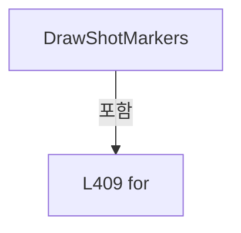

변경 전 점검: 입력/반환 타입, 위 호출자, 예외/취소 경로, 공유 상태와 저장·전송 소비자를 함께 확인합니다. 값의 단위나 물리 방향을 이름만으로 확정하지 않습니다.

### MethodDeclaration `DrawSelectedShot` · L420–438

[Drilling.UI/Menu/Menus/CRecipeCellPatternPreviewDrawing.cs:420–438](https://github.com/kjuws10-rgb/A3Drilling/blob/5aee8e58439c9b455cae7c9593c9be986c3e682e/Drilling.UI/Menu/Menus/CRecipeCellPatternPreviewDrawing.cs#L420-L438)

| 항목 | 실제 추출 값 |
| --- | --- |
| 서명 | void Drilling.UI.Menu.Menus.CRecipeCellPatternPreviewDrawing.DrawSelectedShot(DrawingContext, Rect, Drilling.UI.Menu.Menus.ST_RECIPE_CELL_VIEW_MODEL, Drilling.UI.Menu.Menus.ST_SHOT_GROUP_EDITOR_ROW?) |
| 접근/수식자 | Private / private, static |
| 반환/값 타입 | void |
| 소속 타입 | NamedType:Drilling.UI.Menu.Menus.CRecipeCellPatternPreviewDrawing |

입력 계약:

| 이름 | 타입 | 전달 | 선택/기본값 |
| --- | --- | --- | --- |
| context | DrawingContext | None | False /  |
| mapRect | Rect | None | False /  |
| cell | Drilling.UI.Menu.Menus.ST_RECIPE_CELL_VIEW_MODEL | None | False /  |
| selectedGroup | Drilling.UI.Menu.Menus.ST_SHOT_GROUP_EDITOR_ROW? | None | False /  |

현재 부분 분석에서 직접 연결된 호출자는 없습니다. XAML/이벤트/인터페이스·델리게이트·외부 진입을 추가 확인해야 하며, 미사용으로 판정한 것이 아닙니다.

호출하는 대상과 해석 범위:

| 원본 행 | 표현식 | 분석 상태 | 대상/소스 위치 |
| --- | --- | --- | --- |
| 427 | ToShotMapPoint | resolved | Point Drilling.UI.Menu.Menus.CRecipeCellPatternPreviewDrawing.ToShotMapPoint(Rect, Drilling.UI.Menu.Menus.ST_RECIPE_CELL_VIEW_MODEL, Drilling.UI.Menu.Menus.ST_SHOT_GROUP_EDITOR_ROW) · Drilling.UI/Menu/Menus/CRecipeCellPatternPreviewDrawing.cs:440 |
| 428 | Math.Clamp | candidate | OverloadResolutionFailure |
| 429 | Math.Clamp | candidate | OverloadResolutionFailure |
| 431 | CreateBrush | resolved | SolidColorBrush Drilling.UI.Menu.Menus.CRecipeCellPatternPreviewDrawing.CreateBrush(byte, byte, byte, byte) · Drilling.UI/Menu/Menus/CRecipeCellPatternPreviewDrawing.cs:660 |
| 432 | CreateBrush | resolved | SolidColorBrush Drilling.UI.Menu.Menus.CRecipeCellPatternPreviewDrawing.CreateBrush(byte, byte, byte, byte) · Drilling.UI/Menu/Menus/CRecipeCellPatternPreviewDrawing.cs:660 |
| 432 | CreateBrush | resolved | SolidColorBrush Drilling.UI.Menu.Menus.CRecipeCellPatternPreviewDrawing.CreateBrush(byte, byte, byte, byte) · Drilling.UI/Menu/Menus/CRecipeCellPatternPreviewDrawing.cs:660 |
| 433 | new Pen | unresolved | None |
| 434 | markerPen.Freeze | unresolved | None |
| 435 | context.DrawEllipse | unresolved | None |
| 435 | CreateBrush | resolved | SolidColorBrush Drilling.UI.Menu.Menus.CRecipeCellPatternPreviewDrawing.CreateBrush(byte, byte, byte, byte) · Drilling.UI/Menu/Menus/CRecipeCellPatternPreviewDrawing.cs:660 |
| 435 | new Point | unresolved | None |
| 436 | context.DrawLine | unresolved | None |
| 436 | new Point | unresolved | None |
| 436 | new Point | unresolved | None |
| 437 | context.DrawLine | unresolved | None |
| 437 | new Point | unresolved | None |
| 437 | new Point | unresolved | None |

본문의 실제 연산·분기·예외·반환 순서(원문 위치 순):

| 원본 행 | 종류 | 주석 해설 |
| --- | --- | --- |
| 422 | if | 조건에 따라 분기합니다: if (selectedGroup is null) |
| 424 | return | 호출자에게 값 또는 제어를 반환합니다: return; |
| 427 | call | 함수·델리게이트 또는 객체 생성자를 호출합니다: ToShotMapPoint(mapRect, cell, selectedGroup) |
| 427 | local-declaration | 지역 변수를 선언합니다: var point = ToShotMapPoint(mapRect, cell, selectedGroup); |
| 427 | variable-initializer | 변수의 초기값을 지정합니다: point = ToShotMapPoint(mapRect, cell, selectedGroup) |
| 428 | call | 함수·델리게이트 또는 객체 생성자를 호출합니다: Math.Clamp(point.X, mapRect.Left, mapRect.Right) |
| 428 | local-declaration | 지역 변수를 선언합니다: var x = Math.Clamp(point.X, mapRect.Left, mapRect.Right); |
| 428 | variable-initializer | 변수의 초기값을 지정합니다: x = Math.Clamp(point.X, mapRect.Left, mapRect.Right) |
| 429 | call | 함수·델리게이트 또는 객체 생성자를 호출합니다: Math.Clamp(point.Y, mapRect.Top, mapRect.Bottom) |
| 429 | local-declaration | 지역 변수를 선언합니다: var y = Math.Clamp(point.Y, mapRect.Top, mapRect.Bottom); |
| 429 | variable-initializer | 변수의 초기값을 지정합니다: y = Math.Clamp(point.Y, mapRect.Top, mapRect.Bottom) |
| 430 | conditional-expression | 조건에 따라 결과식을 선택합니다: selectedGroup.IsChessSkipped ? CreateBrush(255, 192, 132, 252) : selectedGroup.IsMasked &#124;&#124; !selectedGroup.IsInsideGlass ? CreateBrush(255, 248, 113, 113) : CreateBrush(255, 251, 191, 36) |
| 430 | local-declaration | 지역 변수를 선언합니다: var markerBrush = selectedGroup.IsChessSkipped ? CreateBrush(255, 192, 132, 252) : selectedGroup.IsMasked &#124;&#124; !selectedGroup.IsInsideGlass ? CreateBrush(255, 248, 113, 113) : CreateBrush(255, 251, 191, 36); |
| 430 | variable-initializer | 변수의 초기값을 지정합니다: markerBrush = selectedGroup.IsChessSkipped ? CreateBrush(255, 192, 132, 252) : selectedGroup.IsMasked &#124;&#124; !selectedGroup.IsInsideGlass ? CreateBrush(255, 248, 113, 113) : CreateBrush(255, 251, 191, 36) |
| 431 | call | 함수·델리게이트 또는 객체 생성자를 호출합니다: CreateBrush(255, 192, 132, 252) |
| 432 | call | 함수·델리게이트 또는 객체 생성자를 호출합니다: CreateBrush(255, 248, 113, 113) |
| 432 | call | 함수·델리게이트 또는 객체 생성자를 호출합니다: CreateBrush(255, 251, 191, 36) |
| 432 | conditional-expression | 조건에 따라 결과식을 선택합니다: selectedGroup.IsMasked &#124;&#124; !selectedGroup.IsInsideGlass ? CreateBrush(255, 248, 113, 113) : CreateBrush(255, 251, 191, 36) |
| 433 | call | 함수·델리게이트 또는 객체 생성자를 호출합니다: new Pen(markerBrush, 2.0) |
| 433 | local-declaration | 지역 변수를 선언합니다: var markerPen = new Pen(markerBrush, 2.0); |
| 433 | variable-initializer | 변수의 초기값을 지정합니다: markerPen = new Pen(markerBrush, 2.0) |
| 434 | call | 함수·델리게이트 또는 객체 생성자를 호출합니다: markerPen.Freeze() |
| 435 | call | 함수·델리게이트 또는 객체 생성자를 호출합니다: context.DrawEllipse(CreateBrush(150, 17, 24, 32), markerPen, new Point(x, y), 8.0, 8.0) |
| 435 | call | 함수·델리게이트 또는 객체 생성자를 호출합니다: CreateBrush(150, 17, 24, 32) |
| 435 | call | 함수·델리게이트 또는 객체 생성자를 호출합니다: new Point(x, y) |
| 436 | call | 함수·델리게이트 또는 객체 생성자를 호출합니다: context.DrawLine(markerPen, new Point(x - 12.0, y), new Point(x + 12.0, y)) |
| 436 | call | 함수·델리게이트 또는 객체 생성자를 호출합니다: new Point(x - 12.0, y) |
| 436 | call | 함수·델리게이트 또는 객체 생성자를 호출합니다: new Point(x + 12.0, y) |
| 437 | call | 함수·델리게이트 또는 객체 생성자를 호출합니다: context.DrawLine(markerPen, new Point(x, y - 12.0), new Point(x, y + 12.0)) |
| 437 | call | 함수·델리게이트 또는 객체 생성자를 호출합니다: new Point(x, y - 12.0) |
| 437 | call | 함수·델리게이트 또는 객체 생성자를 호출합니다: new Point(x, y + 12.0) |

제어 구문의 포함 구조(실제 실행 순서/CFG가 아닌 구문 탐색 그림):

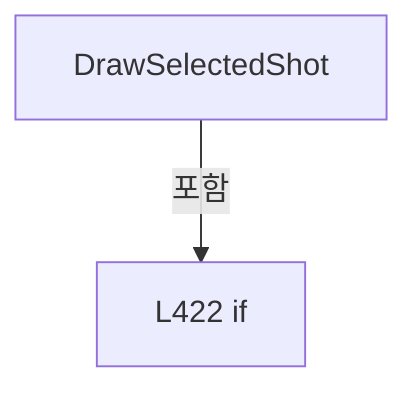

변경 전 점검: 입력/반환 타입, 위 호출자, 예외/취소 경로, 공유 상태와 저장·전송 소비자를 함께 확인합니다. 값의 단위나 물리 방향을 이름만으로 확정하지 않습니다.

### MethodDeclaration `ToShotMapPoint` · L440–450

[Drilling.UI/Menu/Menus/CRecipeCellPatternPreviewDrawing.cs:440–450](https://github.com/kjuws10-rgb/A3Drilling/blob/5aee8e58439c9b455cae7c9593c9be986c3e682e/Drilling.UI/Menu/Menus/CRecipeCellPatternPreviewDrawing.cs#L440-L450)

| 항목 | 실제 추출 값 |
| --- | --- |
| 서명 | Point Drilling.UI.Menu.Menus.CRecipeCellPatternPreviewDrawing.ToShotMapPoint(Rect, Drilling.UI.Menu.Menus.ST_RECIPE_CELL_VIEW_MODEL, Drilling.UI.Menu.Menus.ST_SHOT_GROUP_EDITOR_ROW) |
| 접근/수식자 | Private / private, static |
| 반환/값 타입 | Point |
| 소속 타입 | NamedType:Drilling.UI.Menu.Menus.CRecipeCellPatternPreviewDrawing |

입력 계약:

| 이름 | 타입 | 전달 | 선택/기본값 |
| --- | --- | --- | --- |
| mapRect | Rect | None | False /  |
| cell | Drilling.UI.Menu.Menus.ST_RECIPE_CELL_VIEW_MODEL | None | False /  |
| shotGroup | Drilling.UI.Menu.Menus.ST_SHOT_GROUP_EDITOR_ROW | None | False /  |

정적 호출자로 확인된 위치:

| 호출 파일/행 | 호출 표현식 | 런타임 분기 가능 |
| --- | --- | --- |
| [Drilling.UI/Menu/Menus/CRecipeCellPatternPreviewDrawing.cs:411–411](https://github.com/kjuws10-rgb/A3Drilling/blob/5aee8e58439c9b455cae7c9593c9be986c3e682e/Drilling.UI/Menu/Menus/CRecipeCellPatternPreviewDrawing.cs#L411-L411) | ToShotMapPoint | False |
| [Drilling.UI/Menu/Menus/CRecipeCellPatternPreviewDrawing.cs:427–427](https://github.com/kjuws10-rgb/A3Drilling/blob/5aee8e58439c9b455cae7c9593c9be986c3e682e/Drilling.UI/Menu/Menus/CRecipeCellPatternPreviewDrawing.cs#L427-L427) | ToShotMapPoint | False |

호출하는 대상과 해석 범위:

| 원본 행 | 표현식 | 분석 상태 | 대상/소스 위치 |
| --- | --- | --- | --- |
| 449 | new Point | unresolved | None |

본문의 실제 연산·분기·예외·반환 순서(원문 위치 순):

| 원본 행 | 종류 | 주석 해설 |
| --- | --- | --- |
| 442 | local-declaration | 지역 변수를 선언합니다: var countX = cell.PatternLayout.GroupCountX; |
| 442 | variable-initializer | 변수의 초기값을 지정합니다: countX = cell.PatternLayout.GroupCountX |
| 443 | local-declaration | 지역 변수를 선언합니다: var countY = cell.PatternLayout.GroupCountY; |
| 443 | variable-initializer | 변수의 초기값을 지정합니다: countY = cell.PatternLayout.GroupCountY |
| 444 | local-declaration | 지역 변수를 선언합니다: var cellWidth = mapRect.Width / countX; |
| 444 | variable-initializer | 변수의 초기값을 지정합니다: cellWidth = mapRect.Width / countX |
| 445 | local-declaration | 지역 변수를 선언합니다: var cellHeight = mapRect.Height / countY; |
| 445 | variable-initializer | 변수의 초기값을 지정합니다: cellHeight = mapRect.Height / countY |
| 446 | local-declaration | 지역 변수를 선언합니다: var groupPitch = cell.PatternLayout.GroupPitchMillimeters; |
| 446 | variable-initializer | 변수의 초기값을 지정합니다: groupPitch = cell.PatternLayout.GroupPitchMillimeters |
| 447 | conditional-expression | 조건에 따라 결과식을 선택합니다: groupPitch > 0.0 ? cellWidth / groupPitch : 0.0 |
| 447 | local-declaration | 지역 변수를 선언합니다: var offsetScaleX = groupPitch > 0.0 ? cellWidth / groupPitch : 0.0; |
| 447 | variable-initializer | 변수의 초기값을 지정합니다: offsetScaleX = groupPitch > 0.0 ? cellWidth / groupPitch : 0.0 |
| 448 | conditional-expression | 조건에 따라 결과식을 선택합니다: groupPitch > 0.0 ? cellHeight / groupPitch : 0.0 |
| 448 | local-declaration | 지역 변수를 선언합니다: var offsetScaleY = groupPitch > 0.0 ? cellHeight / groupPitch : 0.0; |
| 448 | variable-initializer | 변수의 초기값을 지정합니다: offsetScaleY = groupPitch > 0.0 ? cellHeight / groupPitch : 0.0 |
| 449 | call | 함수·델리게이트 또는 객체 생성자를 호출합니다: new Point(mapRect.Left + ((shotGroup.Column - 0.5) * cellWidth) + ((shotGroup.CorrectedCenterX - shotGroup.BaseCenterX) * offsetScaleX), mapRect.Top + ((shotGroup.Row - 0.5) * cellHeight) + ((shotGroup.CorrectedCenterY -… |
| 449 | return | 호출자에게 값 또는 제어를 반환합니다: return new Point(mapRect.Left + ((shotGroup.Column - 0.5) * cellWidth) + ((shotGroup.CorrectedCenterX - shotGroup.BaseCenterX) * offsetScaleX), mapRect.Top + ((shotGroup.Row - 0.5) * cellHeight) + ((shotGroup.CorrectedCenterY - sh |

변경 전 점검: 입력/반환 타입, 위 호출자, 예외/취소 경로, 공유 상태와 저장·전송 소비자를 함께 확인합니다. 값의 단위나 물리 방향을 이름만으로 확정하지 않습니다.

### MethodDeclaration `IsLandscape` · L452–455

[Drilling.UI/Menu/Menus/CRecipeCellPatternPreviewDrawing.cs:452–455](https://github.com/kjuws10-rgb/A3Drilling/blob/5aee8e58439c9b455cae7c9593c9be986c3e682e/Drilling.UI/Menu/Menus/CRecipeCellPatternPreviewDrawing.cs#L452-L455)

| 항목 | 실제 추출 값 |
| --- | --- |
| 서명 | bool Drilling.UI.Menu.Menus.CRecipeCellPatternPreviewDrawing.IsLandscape(Drilling.Common.Recipe.ST_CELL_PATTERN_LAYOUT) |
| 접근/수식자 | Private / private, static |
| 반환/값 타입 | bool |
| 소속 타입 | NamedType:Drilling.UI.Menu.Menus.CRecipeCellPatternPreviewDrawing |

입력 계약:

| 이름 | 타입 | 전달 | 선택/기본값 |
| --- | --- | --- | --- |
| patternLayout | Drilling.Common.Recipe.ST_CELL_PATTERN_LAYOUT | None | False /  |

정적 호출자로 확인된 위치:

| 호출 파일/행 | 호출 표현식 | 런타임 분기 가능 |
| --- | --- | --- |
| [Drilling.UI/Menu/Menus/CRecipeCellPatternPreviewDrawing.cs:20–20](https://github.com/kjuws10-rgb/A3Drilling/blob/5aee8e58439c9b455cae7c9593c9be986c3e682e/Drilling.UI/Menu/Menus/CRecipeCellPatternPreviewDrawing.cs#L20-L20) | IsLandscape | False |
| [Drilling.UI/Menu/Menus/CRecipeCellPatternPreviewDrawing.cs:25–25](https://github.com/kjuws10-rgb/A3Drilling/blob/5aee8e58439c9b455cae7c9593c9be986c3e682e/Drilling.UI/Menu/Menus/CRecipeCellPatternPreviewDrawing.cs#L25-L25) | IsLandscape | False |
| [Drilling.UI/Menu/Menus/CRecipeCellPatternPreviewDrawing.cs:459–459](https://github.com/kjuws10-rgb/A3Drilling/blob/5aee8e58439c9b455cae7c9593c9be986c3e682e/Drilling.UI/Menu/Menus/CRecipeCellPatternPreviewDrawing.cs#L459-L459) | IsLandscape | False |

본문의 실제 연산·분기·예외·반환 순서(원문 위치 순):

| 원본 행 | 종류 | 주석 해설 |
| --- | --- | --- |
| 454 | return | 호출자에게 값 또는 제어를 반환합니다: return patternLayout.PixelCountX > patternLayout.PixelCountY; |

변경 전 점검: 입력/반환 타입, 위 호출자, 예외/취소 경로, 공유 상태와 저장·전송 소비자를 함께 확인합니다. 값의 단위나 물리 방향을 이름만으로 확정하지 않습니다.

### MethodDeclaration `GetCellMapRect` · L457–460

[Drilling.UI/Menu/Menus/CRecipeCellPatternPreviewDrawing.cs:457–460](https://github.com/kjuws10-rgb/A3Drilling/blob/5aee8e58439c9b455cae7c9593c9be986c3e682e/Drilling.UI/Menu/Menus/CRecipeCellPatternPreviewDrawing.cs#L457-L460)

| 항목 | 실제 추출 값 |
| --- | --- |
| 서명 | Rect Drilling.UI.Menu.Menus.CRecipeCellPatternPreviewDrawing.GetCellMapRect(Drilling.Common.Recipe.ST_CELL_PATTERN_LAYOUT) |
| 접근/수식자 | Private / private, static |
| 반환/값 타입 | Rect |
| 소속 타입 | NamedType:Drilling.UI.Menu.Menus.CRecipeCellPatternPreviewDrawing |

입력 계약:

| 이름 | 타입 | 전달 | 선택/기본값 |
| --- | --- | --- | --- |
| patternLayout | Drilling.Common.Recipe.ST_CELL_PATTERN_LAYOUT | None | False /  |

정적 호출자로 확인된 위치:

| 호출 파일/행 | 호출 표현식 | 런타임 분기 가능 |
| --- | --- | --- |
| [Drilling.UI/Menu/Menus/CRecipeCellPatternPreviewDrawing.cs:45–45](https://github.com/kjuws10-rgb/A3Drilling/blob/5aee8e58439c9b455cae7c9593c9be986c3e682e/Drilling.UI/Menu/Menus/CRecipeCellPatternPreviewDrawing.cs#L45-L45) | GetCellMapRect | False |
| [Drilling.UI/Menu/Menus/CRecipeCellPatternPreviewDrawing.cs:129–129](https://github.com/kjuws10-rgb/A3Drilling/blob/5aee8e58439c9b455cae7c9593c9be986c3e682e/Drilling.UI/Menu/Menus/CRecipeCellPatternPreviewDrawing.cs#L129-L129) | GetCellMapRect | False |

호출하는 대상과 해석 범위:

| 원본 행 | 표현식 | 분석 상태 | 대상/소스 위치 |
| --- | --- | --- | --- |
| 459 | IsLandscape | resolved | bool Drilling.UI.Menu.Menus.CRecipeCellPatternPreviewDrawing.IsLandscape(Drilling.Common.Recipe.ST_CELL_PATTERN_LAYOUT) · Drilling.UI/Menu/Menus/CRecipeCellPatternPreviewDrawing.cs:452 |

본문의 실제 연산·분기·예외·반환 순서(원문 위치 순):

| 원본 행 | 종류 | 주석 해설 |
| --- | --- | --- |
| 459 | call | 함수·델리게이트 또는 객체 생성자를 호출합니다: IsLandscape(patternLayout) |
| 459 | conditional-expression | 조건에 따라 결과식을 선택합니다: IsLandscape(patternLayout) ? CellMapLandscapeRect : CellMapPortraitRect |
| 459 | return | 호출자에게 값 또는 제어를 반환합니다: return IsLandscape(patternLayout) ? CellMapLandscapeRect : CellMapPortraitRect; |

변경 전 점검: 입력/반환 타입, 위 호출자, 예외/취소 경로, 공유 상태와 저장·전송 소비자를 함께 확인합니다. 값의 단위나 물리 방향을 이름만으로 확정하지 않습니다.

### MethodDeclaration `GetProcessedMapRect` · L462–479

[Drilling.UI/Menu/Menus/CRecipeCellPatternPreviewDrawing.cs:462–479](https://github.com/kjuws10-rgb/A3Drilling/blob/5aee8e58439c9b455cae7c9593c9be986c3e682e/Drilling.UI/Menu/Menus/CRecipeCellPatternPreviewDrawing.cs#L462-L479)

| 항목 | 실제 추출 값 |
| --- | --- |
| 서명 | Rect Drilling.UI.Menu.Menus.CRecipeCellPatternPreviewDrawing.GetProcessedMapRect(Drilling.Common.Recipe.ST_CELL_PATTERN_LAYOUT, Rect) |
| 접근/수식자 | Private / private, static |
| 반환/값 타입 | Rect |
| 소속 타입 | NamedType:Drilling.UI.Menu.Menus.CRecipeCellPatternPreviewDrawing |

입력 계약:

| 이름 | 타입 | 전달 | 선택/기본값 |
| --- | --- | --- | --- |
| shotGroups | Drilling.Common.Recipe.ST_CELL_PATTERN_LAYOUT | None | False /  |
| cellMapRect | Rect | None | False /  |

정적 호출자로 확인된 위치:

| 호출 파일/행 | 호출 표현식 | 런타임 분기 가능 |
| --- | --- | --- |
| [Drilling.UI/Menu/Menus/CRecipeCellPatternPreviewDrawing.cs:46–46](https://github.com/kjuws10-rgb/A3Drilling/blob/5aee8e58439c9b455cae7c9593c9be986c3e682e/Drilling.UI/Menu/Menus/CRecipeCellPatternPreviewDrawing.cs#L46-L46) | GetProcessedMapRect | False |
| [Drilling.UI/Menu/Menus/CRecipeCellPatternPreviewDrawing.cs:129–129](https://github.com/kjuws10-rgb/A3Drilling/blob/5aee8e58439c9b455cae7c9593c9be986c3e682e/Drilling.UI/Menu/Menus/CRecipeCellPatternPreviewDrawing.cs#L129-L129) | GetProcessedMapRect | False |

호출하는 대상과 해석 범위:

| 원본 행 | 표현식 | 분석 상태 | 대상/소스 위치 |
| --- | --- | --- | --- |
| 466 | Math.Clamp | resolved | double System.Math.Clamp(double, double, double) |
| 467 | Math.Clamp | resolved | double System.Math.Clamp(double, double, double) |
| 468 | new Rect | unresolved | None |
| 476 | Math.Clamp | resolved | double System.Math.Clamp(double, double, double) |
| 477 | Math.Clamp | resolved | double System.Math.Clamp(double, double, double) |
| 478 | new Rect | unresolved | None |

본문의 실제 연산·분기·예외·반환 순서(원문 위치 순):

| 원본 행 | 종류 | 주석 해설 |
| --- | --- | --- |
| 464 | if | 조건에 따라 분기합니다: if (shotGroups.PixelCountX > 0 && shotGroups.PixelCountY > 0 && shotGroups.ProcessedPixelCountX > 0 && shotGroups.ProcessedPixelCountY > 0) |
| 466 | call | 함수·델리게이트 또는 객체 생성자를 호출합니다: Math.Clamp(shotGroups.ProcessedPixelCountX / (double)shotGroups.PixelCountX, 0.0, 1.0) |
| 466 | local-declaration | 지역 변수를 선언합니다: var processedPixelRatioX = Math.Clamp(shotGroups.ProcessedPixelCountX / (double)shotGroups.PixelCountX, 0.0, 1.0); |
| 466 | variable-initializer | 변수의 초기값을 지정합니다: processedPixelRatioX = Math.Clamp(shotGroups.ProcessedPixelCountX / (double)shotGroups.PixelCountX, 0.0, 1.0) |
| 467 | call | 함수·델리게이트 또는 객체 생성자를 호출합니다: Math.Clamp(shotGroups.ProcessedPixelCountY / (double)shotGroups.PixelCountY, 0.0, 1.0) |
| 467 | local-declaration | 지역 변수를 선언합니다: var processedPixelRatioY = Math.Clamp(shotGroups.ProcessedPixelCountY / (double)shotGroups.PixelCountY, 0.0, 1.0); |
| 467 | variable-initializer | 변수의 초기값을 지정합니다: processedPixelRatioY = Math.Clamp(shotGroups.ProcessedPixelCountY / (double)shotGroups.PixelCountY, 0.0, 1.0) |
| 468 | call | 함수·델리게이트 또는 객체 생성자를 호출합니다: new Rect(cellMapRect.Left, cellMapRect.Top, cellMapRect.Width * processedPixelRatioX, cellMapRect.Height * processedPixelRatioY) |
| 468 | return | 호출자에게 값 또는 제어를 반환합니다: return new Rect(cellMapRect.Left, cellMapRect.Top, cellMapRect.Width * processedPixelRatioX, cellMapRect.Height * processedPixelRatioY); |
| 471 | if | 조건에 따라 분기합니다: if (shotGroups.TargetCountX <= 0 &#124;&#124; shotGroups.TargetCountY <= 0 &#124;&#124; shotGroups.ProcessedTargetCountX <= 0 &#124;&#124; shotGroups.ProcessedTargetCountY <= 0) |
| 473 | return | 호출자에게 값 또는 제어를 반환합니다: return cellMapRect; |
| 476 | call | 함수·델리게이트 또는 객체 생성자를 호출합니다: Math.Clamp(shotGroups.ProcessedTargetCountX / (double)shotGroups.TargetCountX, 0.0, 1.0) |
| 476 | local-declaration | 지역 변수를 선언합니다: var processedRatioX = Math.Clamp(shotGroups.ProcessedTargetCountX / (double)shotGroups.TargetCountX, 0.0, 1.0); |
| 476 | variable-initializer | 변수의 초기값을 지정합니다: processedRatioX = Math.Clamp(shotGroups.ProcessedTargetCountX / (double)shotGroups.TargetCountX, 0.0, 1.0) |
| 477 | call | 함수·델리게이트 또는 객체 생성자를 호출합니다: Math.Clamp(shotGroups.ProcessedTargetCountY / (double)shotGroups.TargetCountY, 0.0, 1.0) |
| 477 | local-declaration | 지역 변수를 선언합니다: var processedRatioY = Math.Clamp(shotGroups.ProcessedTargetCountY / (double)shotGroups.TargetCountY, 0.0, 1.0); |
| 477 | variable-initializer | 변수의 초기값을 지정합니다: processedRatioY = Math.Clamp(shotGroups.ProcessedTargetCountY / (double)shotGroups.TargetCountY, 0.0, 1.0) |
| 478 | call | 함수·델리게이트 또는 객체 생성자를 호출합니다: new Rect(cellMapRect.Left, cellMapRect.Top, cellMapRect.Width * processedRatioX, cellMapRect.Height * processedRatioY) |
| 478 | return | 호출자에게 값 또는 제어를 반환합니다: return new Rect(cellMapRect.Left, cellMapRect.Top, cellMapRect.Width * processedRatioX, cellMapRect.Height * processedRatioY); |

제어 구문의 포함 구조(실제 실행 순서/CFG가 아닌 구문 탐색 그림):

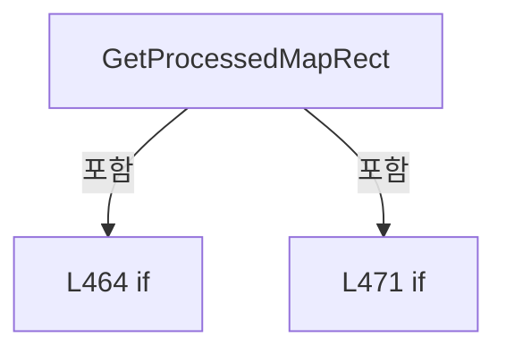

변경 전 점검: 입력/반환 타입, 위 호출자, 예외/취소 경로, 공유 상태와 저장·전송 소비자를 함께 확인합니다. 값의 단위나 물리 방향을 이름만으로 확정하지 않습니다.

### MethodDeclaration `DrawExcludedTargetEdges` · L481–498

[Drilling.UI/Menu/Menus/CRecipeCellPatternPreviewDrawing.cs:481–498](https://github.com/kjuws10-rgb/A3Drilling/blob/5aee8e58439c9b455cae7c9593c9be986c3e682e/Drilling.UI/Menu/Menus/CRecipeCellPatternPreviewDrawing.cs#L481-L498)

| 항목 | 실제 추출 값 |
| --- | --- |
| 서명 | void Drilling.UI.Menu.Menus.CRecipeCellPatternPreviewDrawing.DrawExcludedTargetEdges(DrawingContext, Drilling.Common.Recipe.ST_CELL_PATTERN_LAYOUT, Rect, Rect) |
| 접근/수식자 | Private / private, static |
| 반환/값 타입 | void |
| 소속 타입 | NamedType:Drilling.UI.Menu.Menus.CRecipeCellPatternPreviewDrawing |

입력 계약:

| 이름 | 타입 | 전달 | 선택/기본값 |
| --- | --- | --- | --- |
| context | DrawingContext | None | False /  |
| shotGroups | Drilling.Common.Recipe.ST_CELL_PATTERN_LAYOUT | None | False /  |
| cellMapRect | Rect | None | False /  |
| processedMapRect | Rect | None | False /  |

현재 부분 분석에서 직접 연결된 호출자는 없습니다. XAML/이벤트/인터페이스·델리게이트·외부 진입을 추가 확인해야 하며, 미사용으로 판정한 것이 아닙니다.

호출하는 대상과 해석 범위:

| 원본 행 | 표현식 | 분석 상태 | 대상/소스 위치 |
| --- | --- | --- | --- |
| 488 | CreatePen | resolved | Pen Drilling.UI.Menu.Menus.CRecipeCellPatternPreviewDrawing.CreatePen(byte, byte, byte, byte, double) · Drilling.UI/Menu/Menus/CRecipeCellPatternPreviewDrawing.cs:653 |
| 491 | context.DrawLine | unresolved | None |
| 491 | new Point | unresolved | None |
| 491 | new Point | unresolved | None |
| 496 | context.DrawLine | unresolved | None |
| 496 | new Point | unresolved | None |
| 496 | new Point | unresolved | None |

본문의 실제 연산·분기·예외·반환 순서(원문 위치 순):

| 원본 행 | 종류 | 주석 해설 |
| --- | --- | --- |
| 483 | if | 조건에 따라 분기합니다: if (!shotGroups.HasExcludedTargets) |
| 485 | return | 호출자에게 값 또는 제어를 반환합니다: return; |
| 488 | call | 함수·델리게이트 또는 객체 생성자를 호출합니다: CreatePen(155, 100, 116, 139, 1.0) |
| 488 | local-declaration | 지역 변수를 선언합니다: var boundaryPen = CreatePen(155, 100, 116, 139, 1.0); |
| 488 | variable-initializer | 변수의 초기값을 지정합니다: boundaryPen = CreatePen(155, 100, 116, 139, 1.0) |
| 489 | if | 조건에 따라 분기합니다: if (shotGroups.ExcludedTargetCountX > 0) |
| 491 | call | 함수·델리게이트 또는 객체 생성자를 호출합니다: context.DrawLine(boundaryPen, new Point(processedMapRect.Right, cellMapRect.Top), new Point(processedMapRect.Right, cellMapRect.Bottom)) |
| 491 | call | 함수·델리게이트 또는 객체 생성자를 호출합니다: new Point(processedMapRect.Right, cellMapRect.Top) |
| 491 | call | 함수·델리게이트 또는 객체 생성자를 호출합니다: new Point(processedMapRect.Right, cellMapRect.Bottom) |
| 494 | if | 조건에 따라 분기합니다: if (shotGroups.ExcludedTargetCountY > 0) |
| 496 | call | 함수·델리게이트 또는 객체 생성자를 호출합니다: context.DrawLine(boundaryPen, new Point(cellMapRect.Left, processedMapRect.Bottom), new Point(cellMapRect.Right, processedMapRect.Bottom)) |
| 496 | call | 함수·델리게이트 또는 객체 생성자를 호출합니다: new Point(cellMapRect.Left, processedMapRect.Bottom) |
| 496 | call | 함수·델리게이트 또는 객체 생성자를 호출합니다: new Point(cellMapRect.Right, processedMapRect.Bottom) |

제어 구문의 포함 구조(실제 실행 순서/CFG가 아닌 구문 탐색 그림):

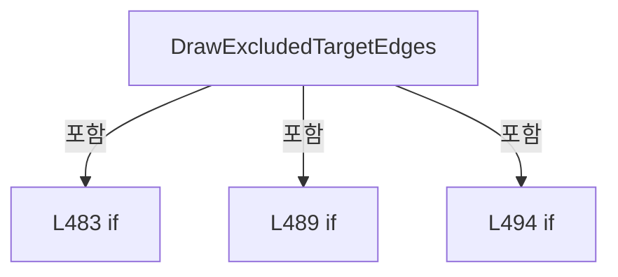

변경 전 점검: 입력/반환 타입, 위 호출자, 예외/취소 경로, 공유 상태와 저장·전송 소비자를 함께 확인합니다. 값의 단위나 물리 방향을 이름만으로 확정하지 않습니다.

### MethodDeclaration `DrawBeamPitchGrid` · L500–513

[Drilling.UI/Menu/Menus/CRecipeCellPatternPreviewDrawing.cs:500–513](https://github.com/kjuws10-rgb/A3Drilling/blob/5aee8e58439c9b455cae7c9593c9be986c3e682e/Drilling.UI/Menu/Menus/CRecipeCellPatternPreviewDrawing.cs#L500-L513)

| 항목 | 실제 추출 값 |
| --- | --- |
| 서명 | void Drilling.UI.Menu.Menus.CRecipeCellPatternPreviewDrawing.DrawBeamPitchGrid(DrawingContext, double, int, double, double) |
| 접근/수식자 | Private / private, static |
| 반환/값 타입 | void |
| 소속 타입 | NamedType:Drilling.UI.Menu.Menus.CRecipeCellPatternPreviewDrawing |

입력 계약:

| 이름 | 타입 | 전달 | 선택/기본값 |
| --- | --- | --- | --- |
| context | DrawingContext | None | False /  |
| beamPitch | double | None | False /  |
| splitBeamCount | int | None | False /  |
| domainMinimum | double | None | False /  |
| domainMaximum | double | None | False /  |

현재 부분 분석에서 직접 연결된 호출자는 없습니다. XAML/이벤트/인터페이스·델리게이트·외부 진입을 추가 확인해야 하며, 미사용으로 판정한 것이 아닙니다.

호출하는 대상과 해석 범위:

| 원본 행 | 표현식 | 분석 상태 | 대상/소스 위치 |
| --- | --- | --- | --- |
| 502 | CreatePen | resolved | Pen Drilling.UI.Menu.Menus.CRecipeCellPatternPreviewDrawing.CreatePen(byte, byte, byte, byte, double) · Drilling.UI/Menu/Menus/CRecipeCellPatternPreviewDrawing.cs:653 |
| 506 | ToDetailPoint | resolved | Point Drilling.UI.Menu.Menus.CRecipeCellPatternPreviewDrawing.ToDetailPoint(double, double, double, double) · Drilling.UI/Menu/Menus/CRecipeCellPatternPreviewDrawing.cs:618 |
| 507 | ToDetailPoint | resolved | Point Drilling.UI.Menu.Menus.CRecipeCellPatternPreviewDrawing.ToDetailPoint(double, double, double, double) · Drilling.UI/Menu/Menus/CRecipeCellPatternPreviewDrawing.cs:618 |
| 508 | context.DrawLine | unresolved | None |
| 509 | ToDetailPoint | resolved | Point Drilling.UI.Menu.Menus.CRecipeCellPatternPreviewDrawing.ToDetailPoint(double, double, double, double) · Drilling.UI/Menu/Menus/CRecipeCellPatternPreviewDrawing.cs:618 |
| 510 | ToDetailPoint | resolved | Point Drilling.UI.Menu.Menus.CRecipeCellPatternPreviewDrawing.ToDetailPoint(double, double, double, double) · Drilling.UI/Menu/Menus/CRecipeCellPatternPreviewDrawing.cs:618 |
| 511 | context.DrawLine | unresolved | None |

본문의 실제 연산·분기·예외·반환 순서(원문 위치 순):

| 원본 행 | 종류 | 주석 해설 |
| --- | --- | --- |
| 502 | call | 함수·델리게이트 또는 객체 생성자를 호출합니다: CreatePen(105, 100, 116, 139, 0.8) |
| 502 | local-declaration | 지역 변수를 선언합니다: var pitchPen = CreatePen(105, 100, 116, 139, 0.8); |
| 502 | variable-initializer | 변수의 초기값을 지정합니다: pitchPen = CreatePen(105, 100, 116, 139, 0.8) |
| 503 | variable-initializer | 변수의 초기값을 지정합니다: index = 0 |
| 503 | for | 초기화·조건·증감이 있는 반복입니다: for (var index = 0; index <= splitBeamCount; index++) |
| 505 | local-declaration | 지역 변수를 선언합니다: var coordinate = domainMinimum + (index * beamPitch); |
| 505 | variable-initializer | 변수의 초기값을 지정합니다: coordinate = domainMinimum + (index * beamPitch) |
| 506 | call | 함수·델리게이트 또는 객체 생성자를 호출합니다: ToDetailPoint(coordinate, domainMinimum, domainMinimum, domainMaximum) |
| 506 | local-declaration | 지역 변수를 선언합니다: var verticalStart = ToDetailPoint(coordinate, domainMinimum, domainMinimum, domainMaximum); |
| 506 | variable-initializer | 변수의 초기값을 지정합니다: verticalStart = ToDetailPoint(coordinate, domainMinimum, domainMinimum, domainMaximum) |
| 507 | call | 함수·델리게이트 또는 객체 생성자를 호출합니다: ToDetailPoint(coordinate, domainMaximum, domainMinimum, domainMaximum) |
| 507 | local-declaration | 지역 변수를 선언합니다: var verticalEnd = ToDetailPoint(coordinate, domainMaximum, domainMinimum, domainMaximum); |
| 507 | variable-initializer | 변수의 초기값을 지정합니다: verticalEnd = ToDetailPoint(coordinate, domainMaximum, domainMinimum, domainMaximum) |
| 508 | call | 함수·델리게이트 또는 객체 생성자를 호출합니다: context.DrawLine(pitchPen, verticalStart, verticalEnd) |
| 509 | call | 함수·델리게이트 또는 객체 생성자를 호출합니다: ToDetailPoint(domainMinimum, coordinate, domainMinimum, domainMaximum) |
| 509 | local-declaration | 지역 변수를 선언합니다: var horizontalStart = ToDetailPoint(domainMinimum, coordinate, domainMinimum, domainMaximum); |
| 509 | variable-initializer | 변수의 초기값을 지정합니다: horizontalStart = ToDetailPoint(domainMinimum, coordinate, domainMinimum, domainMaximum) |
| 510 | call | 함수·델리게이트 또는 객체 생성자를 호출합니다: ToDetailPoint(domainMaximum, coordinate, domainMinimum, domainMaximum) |
| 510 | local-declaration | 지역 변수를 선언합니다: var horizontalEnd = ToDetailPoint(domainMaximum, coordinate, domainMinimum, domainMaximum); |
| 510 | variable-initializer | 변수의 초기값을 지정합니다: horizontalEnd = ToDetailPoint(domainMaximum, coordinate, domainMinimum, domainMaximum) |
| 511 | call | 함수·델리게이트 또는 객체 생성자를 호출합니다: context.DrawLine(pitchPen, horizontalStart, horizontalEnd) |

제어 구문의 포함 구조(실제 실행 순서/CFG가 아닌 구문 탐색 그림):

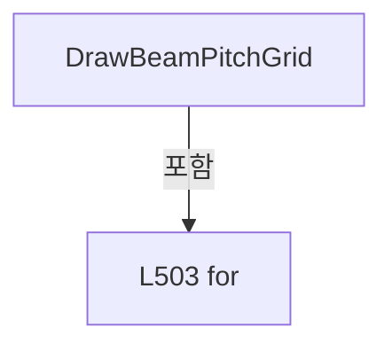

변경 전 점검: 입력/반환 타입, 위 호출자, 예외/취소 경로, 공유 상태와 저장·전송 소비자를 함께 확인합니다. 값의 단위나 물리 방향을 이름만으로 확정하지 않습니다.

### MethodDeclaration `DrawPixelLattice` · L515–547

[Drilling.UI/Menu/Menus/CRecipeCellPatternPreviewDrawing.cs:515–547](https://github.com/kjuws10-rgb/A3Drilling/blob/5aee8e58439c9b455cae7c9593c9be986c3e682e/Drilling.UI/Menu/Menus/CRecipeCellPatternPreviewDrawing.cs#L515-L547)

| 항목 | 실제 추출 값 |
| --- | --- |
| 서명 | void Drilling.UI.Menu.Menus.CRecipeCellPatternPreviewDrawing.DrawPixelLattice(DrawingContext, int, int, int, double, double) |
| 접근/수식자 | Private / private, static |
| 반환/값 타입 | void |
| 소속 타입 | NamedType:Drilling.UI.Menu.Menus.CRecipeCellPatternPreviewDrawing |

입력 계약:

| 이름 | 타입 | 전달 | 선택/기본값 |
| --- | --- | --- | --- |
| context | DrawingContext | None | False /  |
| beamSpan | int | None | False /  |
| processPitch | int | None | False /  |
| splitBeamCount | int | None | False /  |
| domainMinimum | double | None | False /  |
| domainMaximum | double | None | False /  |

현재 부분 분석에서 직접 연결된 호출자는 없습니다. XAML/이벤트/인터페이스·델리게이트·외부 진입을 추가 확인해야 하며, 미사용으로 판정한 것이 아닙니다.

호출하는 대상과 해석 범위:

| 원본 행 | 표현식 | 분석 상태 | 대상/소스 위치 |
| --- | --- | --- | --- |
| 518 | Math.Max | resolved | int System.Math.Max(int, int) |
| 518 | Math.Ceiling | resolved | double System.Math.Ceiling(double) |
| 520 | new SortedSet<int> | resolved | System.Collections.Generic.SortedSet<int>.SortedSet() |
| 523 | displayedPixelIndices.Add | resolved | bool System.Collections.Generic.SortedSet<int>.Add(int) |
| 526 | displayedPixelIndices.Add | resolved | bool System.Collections.Generic.SortedSet<int>.Add(int) |
| 529 | displayedPixelIndices.Add | resolved | bool System.Collections.Generic.SortedSet<int>.Add(int) |
| 532 | new StreamGeometry | unresolved | None |
| 533 | geometry.Open | unresolved | None |
| 539 | ToDetailPoint | resolved | Point Drilling.UI.Menu.Menus.CRecipeCellPatternPreviewDrawing.ToDetailPoint(double, double, double, double) · Drilling.UI/Menu/Menus/CRecipeCellPatternPreviewDrawing.cs:618 |
| 540 | AddCircle | candidate | OverloadResolutionFailure |
| 545 | geometry.Freeze | unresolved | None |
| 546 | context.DrawGeometry | unresolved | None |
| 546 | CreateBrush | resolved | SolidColorBrush Drilling.UI.Menu.Menus.CRecipeCellPatternPreviewDrawing.CreateBrush(byte, byte, byte, byte) · Drilling.UI/Menu/Menus/CRecipeCellPatternPreviewDrawing.cs:660 |

본문의 실제 연산·분기·예외·반환 순서(원문 위치 순):

| 원본 행 | 종류 | 주석 해설 |
| --- | --- | --- |
| 517 | local-declaration | 지역 변수를 선언합니다: var pixelPointCount = beamSpan + 1; |
| 517 | variable-initializer | 변수의 초기값을 지정합니다: pixelPointCount = beamSpan + 1 |
| 518 | call | 함수·델리게이트 또는 객체 생성자를 호출합니다: Math.Max(1, (int)Math.Ceiling(pixelPointCount / 72.0)) |
| 518 | call | 함수·델리게이트 또는 객체 생성자를 호출합니다: Math.Ceiling(pixelPointCount / 72.0) |
| 518 | local-declaration | 지역 변수를 선언합니다: var sampleStep = Math.Max(1, (int)Math.Ceiling(pixelPointCount / 72.0)); |
| 518 | variable-initializer | 변수의 초기값을 지정합니다: sampleStep = Math.Max(1, (int)Math.Ceiling(pixelPointCount / 72.0)) |
| 519 | conditional-expression | 조건에 따라 결과식을 선택합니다: pixelPointCount <= 48 ? 1.6 : 1.1 |
| 519 | local-declaration | 지역 변수를 선언합니다: var pointSize = pixelPointCount <= 48 ? 1.6 : 1.1; |
| 519 | variable-initializer | 변수의 초기값을 지정합니다: pointSize = pixelPointCount <= 48 ? 1.6 : 1.1 |
| 520 | call | 함수·델리게이트 또는 객체 생성자를 호출합니다: new SortedSet<int>() |
| 520 | local-declaration | 지역 변수를 선언합니다: var displayedPixelIndices = new SortedSet<int>(); |
| 520 | variable-initializer | 변수의 초기값을 지정합니다: displayedPixelIndices = new SortedSet<int>() |
| 521 | compound-assignment-or-event-subscription | 복합 대입 또는 이벤트 구독/해지 표현입니다: index += sampleStep |
| 521 | variable-initializer | 변수의 초기값을 지정합니다: index = 0 |
| 521 | for | 초기화·조건·증감이 있는 반복입니다: for (var index = 0; index <= beamSpan; index += sampleStep) |
| 523 | call | 함수·델리게이트 또는 객체 생성자를 호출합니다: displayedPixelIndices.Add(index) |
| 526 | call | 함수·델리게이트 또는 객체 생성자를 호출합니다: displayedPixelIndices.Add(beamSpan) |
| 527 | variable-initializer | 변수의 초기값을 지정합니다: beamIndex = 0 |
| 527 | for | 초기화·조건·증감이 있는 반복입니다: for (var beamIndex = 0; beamIndex < splitBeamCount; beamIndex++) |
| 529 | call | 함수·델리게이트 또는 객체 생성자를 호출합니다: displayedPixelIndices.Add(beamIndex * processPitch) |
| 532 | call | 함수·델리게이트 또는 객체 생성자를 호출합니다: new StreamGeometry() |
| 532 | local-declaration | 지역 변수를 선언합니다: var geometry = new StreamGeometry(); |
| 532 | variable-initializer | 변수의 초기값을 지정합니다: geometry = new StreamGeometry() |
| 533 | call | 함수·델리게이트 또는 객체 생성자를 호출합니다: geometry.Open() |
| 533 | variable-initializer | 변수의 초기값을 지정합니다: geometryContext = geometry.Open() |
| 533 | using | 자원 사용과 정리 범위를 지정합니다: using (var geometryContext = geometry.Open()) |
| 535 | foreach | 컬렉션 요소를 순회합니다: foreach (var row in displayedPixelIndices) |
| 537 | foreach | 컬렉션 요소를 순회합니다: foreach (var column in displayedPixelIndices) |
| 539 | call | 함수·델리게이트 또는 객체 생성자를 호출합니다: ToDetailPoint(column, row, domainMinimum, domainMaximum) |
| 539 | local-declaration | 지역 변수를 선언합니다: var point = ToDetailPoint(column, row, domainMinimum, domainMaximum); |
| 539 | variable-initializer | 변수의 초기값을 지정합니다: point = ToDetailPoint(column, row, domainMinimum, domainMaximum) |
| 540 | call | 함수·델리게이트 또는 객체 생성자를 호출합니다: AddCircle(geometryContext, point.X, point.Y, pointSize) |
| 545 | call | 함수·델리게이트 또는 객체 생성자를 호출합니다: geometry.Freeze() |
| 546 | call | 함수·델리게이트 또는 객체 생성자를 호출합니다: context.DrawGeometry(CreateBrush(190, 100, 116, 139), null, geometry) |
| 546 | call | 함수·델리게이트 또는 객체 생성자를 호출합니다: CreateBrush(190, 100, 116, 139) |

제어 구문의 포함 구조(실제 실행 순서/CFG가 아닌 구문 탐색 그림):

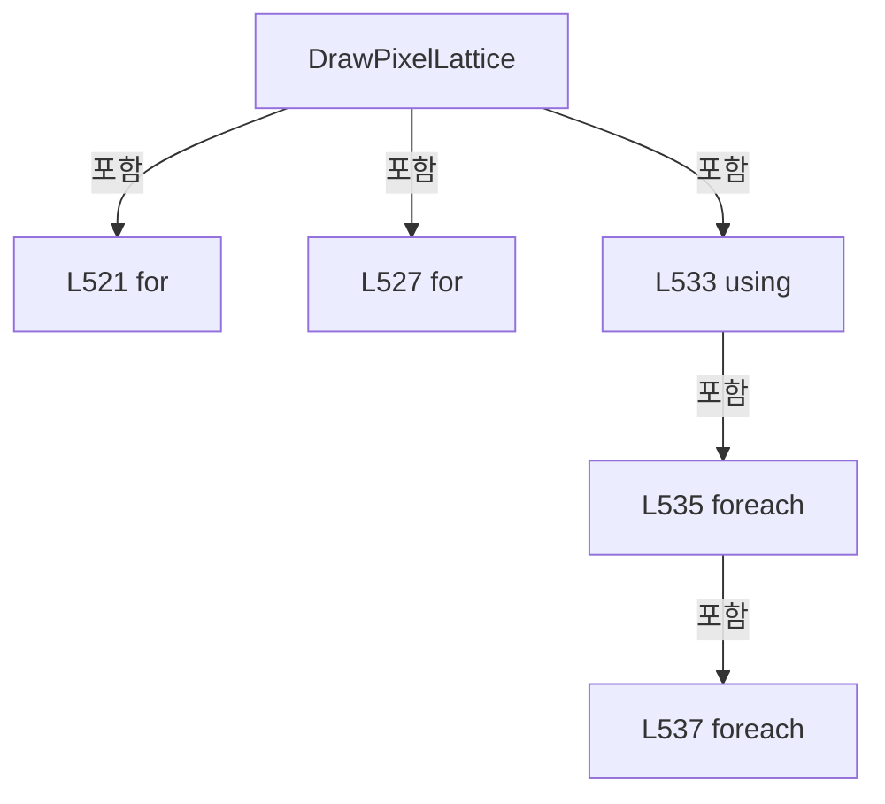

변경 전 점검: 입력/반환 타입, 위 호출자, 예외/취소 경로, 공유 상태와 저장·전송 소비자를 함께 확인합니다. 값의 단위나 물리 방향을 이름만으로 확정하지 않습니다.

### MethodDeclaration `DrawDoeBeams` · L549–576

[Drilling.UI/Menu/Menus/CRecipeCellPatternPreviewDrawing.cs:549–576](https://github.com/kjuws10-rgb/A3Drilling/blob/5aee8e58439c9b455cae7c9593c9be986c3e682e/Drilling.UI/Menu/Menus/CRecipeCellPatternPreviewDrawing.cs#L549-L576)

| 항목 | 실제 추출 값 |
| --- | --- |
| 서명 | void Drilling.UI.Menu.Menus.CRecipeCellPatternPreviewDrawing.DrawDoeBeams(DrawingContext, double, int, double, double, System.Collections.Generic.IReadOnlyList<int>) |
| 접근/수식자 | Private / private, static |
| 반환/값 타입 | void |
| 소속 타입 | NamedType:Drilling.UI.Menu.Menus.CRecipeCellPatternPreviewDrawing |

입력 계약:

| 이름 | 타입 | 전달 | 선택/기본값 |
| --- | --- | --- | --- |
| context | DrawingContext | None | False /  |
| beamPitch | double | None | False /  |
| splitBeamCount | int | None | False /  |
| domainMinimum | double | None | False /  |
| domainMaximum | double | None | False /  |
| maskedBeamNumbers | System.Collections.Generic.IReadOnlyList<int> | None | False /  |

현재 부분 분석에서 직접 연결된 호출자는 없습니다. XAML/이벤트/인터페이스·델리게이트·외부 진입을 추가 확인해야 하며, 미사용으로 판정한 것이 아닙니다.

호출하는 대상과 해석 범위:

| 원본 행 | 표현식 | 분석 상태 | 대상/소스 위치 |
| --- | --- | --- | --- |
| 551 | new HashSet<int> | resolved | System.Collections.Generic.HashSet<int>.HashSet() |
| 551 | maskedBeamNumbers.ToHashSet | resolved | System.Collections.Generic.HashSet<int> System.Collections.Generic.IEnumerable<int>.ToHashSet<int>() |
| 552 | CreateBrush | resolved | SolidColorBrush Drilling.UI.Menu.Menus.CRecipeCellPatternPreviewDrawing.CreateBrush(byte, byte, byte, byte) · Drilling.UI/Menu/Menus/CRecipeCellPatternPreviewDrawing.cs:660 |
| 553 | new Pen | unresolved | None |
| 553 | CreateBrush | resolved | SolidColorBrush Drilling.UI.Menu.Menus.CRecipeCellPatternPreviewDrawing.CreateBrush(byte, byte, byte, byte) · Drilling.UI/Menu/Menus/CRecipeCellPatternPreviewDrawing.cs:660 |
| 554 | CreateBrush | resolved | SolidColorBrush Drilling.UI.Menu.Menus.CRecipeCellPatternPreviewDrawing.CreateBrush(byte, byte, byte, byte) · Drilling.UI/Menu/Menus/CRecipeCellPatternPreviewDrawing.cs:660 |
| 555 | new Pen | unresolved | None |
| 555 | CreateBrush | resolved | SolidColorBrush Drilling.UI.Menu.Menus.CRecipeCellPatternPreviewDrawing.CreateBrush(byte, byte, byte, byte) · Drilling.UI/Menu/Menus/CRecipeCellPatternPreviewDrawing.cs:660 |
| 556 | CreateBrush | resolved | SolidColorBrush Drilling.UI.Menu.Menus.CRecipeCellPatternPreviewDrawing.CreateBrush(byte, byte, byte, byte) · Drilling.UI/Menu/Menus/CRecipeCellPatternPreviewDrawing.cs:660 |
| 557 | CreateBrush | resolved | SolidColorBrush Drilling.UI.Menu.Menus.CRecipeCellPatternPreviewDrawing.CreateBrush(byte, byte, byte, byte) · Drilling.UI/Menu/Menus/CRecipeCellPatternPreviewDrawing.cs:660 |
| 561 | beamPen.Freeze | unresolved | None |
| 562 | maskedBeamPen.Freeze | unresolved | None |
| 568 | ToDetailPoint | resolved | Point Drilling.UI.Menu.Menus.CRecipeCellPatternPreviewDrawing.ToDetailPoint(double, double, double, double) · Drilling.UI/Menu/Menus/CRecipeCellPatternPreviewDrawing.cs:618 |
| 570 | maskedBeams.Contains | resolved | bool System.Collections.Generic.HashSet<int>.Contains(int) |
| 571 | context.DrawEllipse | unresolved | None |
| 572 | context.DrawEllipse | unresolved | None |
| 573 | DrawCenteredText | candidate | OverloadResolutionFailure |
| 573 | beamNo.ToString | resolved | string int.ToString(System.IFormatProvider?) |
| 573 | new Point | unresolved | None |

본문의 실제 연산·분기·예외·반환 순서(원문 위치 순):

| 원본 행 | 종류 | 주석 해설 |
| --- | --- | --- |
| 551 | call | 함수·델리게이트 또는 객체 생성자를 호출합니다: new HashSet<int>() |
| 551 | call | 함수·델리게이트 또는 객체 생성자를 호출합니다: maskedBeamNumbers.ToHashSet() |
| 551 | conditional-expression | 조건에 따라 결과식을 선택합니다: maskedBeamNumbers.Count == 0 ? new HashSet<int>() : maskedBeamNumbers.ToHashSet() |
| 551 | local-declaration | 지역 변수를 선언합니다: var maskedBeams = maskedBeamNumbers.Count == 0 ? new HashSet<int>() : maskedBeamNumbers.ToHashSet(); |
| 551 | variable-initializer | 변수의 초기값을 지정합니다: maskedBeams = maskedBeamNumbers.Count == 0 ? new HashSet<int>() : maskedBeamNumbers.ToHashSet() |
| 552 | call | 함수·델리게이트 또는 객체 생성자를 호출합니다: CreateBrush(128, 34, 197, 94) |
| 552 | local-declaration | 지역 변수를 선언합니다: var beamBrush = CreateBrush(128, 34, 197, 94); |
| 552 | variable-initializer | 변수의 초기값을 지정합니다: beamBrush = CreateBrush(128, 34, 197, 94) |
| 553 | call | 함수·델리게이트 또는 객체 생성자를 호출합니다: new Pen(CreateBrush(255, 134, 239, 172), 1.2) |
| 553 | call | 함수·델리게이트 또는 객체 생성자를 호출합니다: CreateBrush(255, 134, 239, 172) |
| 553 | local-declaration | 지역 변수를 선언합니다: var beamPen = new Pen(CreateBrush(255, 134, 239, 172), 1.2); |
| 553 | variable-initializer | 변수의 초기값을 지정합니다: beamPen = new Pen(CreateBrush(255, 134, 239, 172), 1.2) |
| 554 | call | 함수·델리게이트 또는 객체 생성자를 호출합니다: CreateBrush(178, 248, 113, 113) |
| 554 | local-declaration | 지역 변수를 선언합니다: var maskedBeamBrush = CreateBrush(178, 248, 113, 113); |
| 554 | variable-initializer | 변수의 초기값을 지정합니다: maskedBeamBrush = CreateBrush(178, 248, 113, 113) |
| 555 | call | 함수·델리게이트 또는 객체 생성자를 호출합니다: new Pen(CreateBrush(255, 254, 202, 202), 1.7) |
| 555 | call | 함수·델리게이트 또는 객체 생성자를 호출합니다: CreateBrush(255, 254, 202, 202) |
| 555 | local-declaration | 지역 변수를 선언합니다: var maskedBeamPen = new Pen(CreateBrush(255, 254, 202, 202), 1.7); |
| 555 | variable-initializer | 변수의 초기값을 지정합니다: maskedBeamPen = new Pen(CreateBrush(255, 254, 202, 202), 1.7) |
| 556 | call | 함수·델리게이트 또는 객체 생성자를 호출합니다: CreateBrush(255, 255, 255, 255) |
| 556 | local-declaration | 지역 변수를 선언합니다: var beamTextBrush = CreateBrush(255, 255, 255, 255); |
| 556 | variable-initializer | 변수의 초기값을 지정합니다: beamTextBrush = CreateBrush(255, 255, 255, 255) |
| 557 | call | 함수·델리게이트 또는 객체 생성자를 호출합니다: CreateBrush(255, 148, 163, 184) |
| 557 | local-declaration | 지역 변수를 선언합니다: var targetPixelBrush = CreateBrush(255, 148, 163, 184); |
| 557 | variable-initializer | 변수의 초기값을 지정합니다: targetPixelBrush = CreateBrush(255, 148, 163, 184) |
| 558 | conditional-expression | 조건에 따라 결과식을 선택합니다: splitBeamCount == 1 ? 13.0 : 10.5 |
| 558 | local-declaration | 지역 변수를 선언합니다: var markerRadius = splitBeamCount == 1 ? 13.0 : 10.5; |
| 558 | variable-initializer | 변수의 초기값을 지정합니다: markerRadius = splitBeamCount == 1 ? 13.0 : 10.5 |
| 559 | conditional-expression | 조건에 따라 결과식을 선택합니다: splitBeamCount == 1 ? 9.0 : 7.5 |
| 559 | local-declaration | 지역 변수를 선언합니다: var markerFontSize = splitBeamCount == 1 ? 9.0 : 7.5; |
| 559 | variable-initializer | 변수의 초기값을 지정합니다: markerFontSize = splitBeamCount == 1 ? 9.0 : 7.5 |
| 560 | conditional-expression | 조건에 따라 결과식을 선택합니다: splitBeamCount == 1 ? -6.0 : -5.0 |
| 560 | local-declaration | 지역 변수를 선언합니다: var labelOffsetY = splitBeamCount == 1 ? -6.0 : -5.0; |
| 560 | variable-initializer | 변수의 초기값을 지정합니다: labelOffsetY = splitBeamCount == 1 ? -6.0 : -5.0 |
| 561 | call | 함수·델리게이트 또는 객체 생성자를 호출합니다: beamPen.Freeze() |
| 562 | call | 함수·델리게이트 또는 객체 생성자를 호출합니다: maskedBeamPen.Freeze() |
| 563 | local-declaration | 지역 변수를 선언합니다: var centerIndex = (splitBeamCount - 1) / 2.0; |
| 563 | variable-initializer | 변수의 초기값을 지정합니다: centerIndex = (splitBeamCount - 1) / 2.0 |
| 564 | variable-initializer | 변수의 초기값을 지정합니다: row = 0 |
| 564 | for | 초기화·조건·증감이 있는 반복입니다: for (var row = 0; row < splitBeamCount; row++) |
| 566 | variable-initializer | 변수의 초기값을 지정합니다: column = 0 |
| 566 | for | 초기화·조건·증감이 있는 반복입니다: for (var column = 0; column < splitBeamCount; column++) |
| 568 | call | 함수·델리게이트 또는 객체 생성자를 호출합니다: ToDetailPoint((column - centerIndex) * beamPitch, (row - centerIndex) * beamPitch, domainMinimum, domainMaximum) |
| 568 | local-declaration | 지역 변수를 선언합니다: var point = ToDetailPoint((column - centerIndex) * beamPitch, (row - centerIndex) * beamPitch, domainMinimum, domainMaximum); |
| 568 | variable-initializer | 변수의 초기값을 지정합니다: point = ToDetailPoint((column - centerIndex) * beamPitch, (row - centerIndex) * beamPitch, domainMinimum, domainMaximum) |
| 569 | local-declaration | 지역 변수를 선언합니다: var beamNo = (row * splitBeamCount) + column + 1; |
| 569 | variable-initializer | 변수의 초기값을 지정합니다: beamNo = (row * splitBeamCount) + column + 1 |
| 570 | call | 함수·델리게이트 또는 객체 생성자를 호출합니다: maskedBeams.Contains(beamNo) |
| 570 | local-declaration | 지역 변수를 선언합니다: var isMasked = maskedBeams.Contains(beamNo); |
| 570 | variable-initializer | 변수의 초기값을 지정합니다: isMasked = maskedBeams.Contains(beamNo) |
| 571 | call | 함수·델리게이트 또는 객체 생성자를 호출합니다: context.DrawEllipse(isMasked ? maskedBeamBrush : beamBrush, isMasked ? maskedBeamPen : beamPen, point, markerRadius, markerRadius) |
| 571 | conditional-expression | 조건에 따라 결과식을 선택합니다: isMasked ? maskedBeamBrush : beamBrush |
| 571 | conditional-expression | 조건에 따라 결과식을 선택합니다: isMasked ? maskedBeamPen : beamPen |
| 572 | call | 함수·델리게이트 또는 객체 생성자를 호출합니다: context.DrawEllipse(targetPixelBrush, null, point, 2.0, 2.0) |
| 573 | call | 함수·델리게이트 또는 객체 생성자를 호출합니다: DrawCenteredText(context, beamNo.ToString(CultureInfo.InvariantCulture), new Point(point.X, point.Y + labelOffsetY), markerFontSize, beamTextBrush) |
| 573 | call | 함수·델리게이트 또는 객체 생성자를 호출합니다: beamNo.ToString(CultureInfo.InvariantCulture) |
| 573 | call | 함수·델리게이트 또는 객체 생성자를 호출합니다: new Point(point.X, point.Y + labelOffsetY) |

제어 구문의 포함 구조(실제 실행 순서/CFG가 아닌 구문 탐색 그림):

```mermaid
flowchart TD
 M["DrawDoeBeams"]
 N0["L564 for"]
 M -->|포함| N0
 N1["L566 for"]
 N0 -->|포함| N1
```

변경 전 점검: 입력/반환 타입, 위 호출자, 예외/취소 경로, 공유 상태와 저장·전송 소비자를 함께 확인합니다. 값의 단위나 물리 방향을 이름만으로 확정하지 않습니다.

### MethodDeclaration `DrawLaserOffStamp` · L578–587

[Drilling.UI/Menu/Menus/CRecipeCellPatternPreviewDrawing.cs:578–587](https://github.com/kjuws10-rgb/A3Drilling/blob/5aee8e58439c9b455cae7c9593c9be986c3e682e/Drilling.UI/Menu/Menus/CRecipeCellPatternPreviewDrawing.cs#L578-L587)

| 항목 | 실제 추출 값 |
| --- | --- |
| 서명 | void Drilling.UI.Menu.Menus.CRecipeCellPatternPreviewDrawing.DrawLaserOffStamp(DrawingContext, System.Collections.Generic.IReadOnlyList<int>) |
| 접근/수식자 | Private / private, static |
| 반환/값 타입 | void |
| 소속 타입 | NamedType:Drilling.UI.Menu.Menus.CRecipeCellPatternPreviewDrawing |

입력 계약:

| 이름 | 타입 | 전달 | 선택/기본값 |
| --- | --- | --- | --- |
| context | DrawingContext | None | False /  |
| maskedBeamNumbers | System.Collections.Generic.IReadOnlyList<int> | None | False /  |

현재 부분 분석에서 직접 연결된 호출자는 없습니다. XAML/이벤트/인터페이스·델리게이트·외부 진입을 추가 확인해야 하며, 미사용으로 판정한 것이 아닙니다.

호출하는 대상과 해석 범위:

| 원본 행 | 표현식 | 분석 상태 | 대상/소스 위치 |
| --- | --- | --- | --- |
| 580 | new Rect | unresolved | None |
| 581 | CreateBrush | resolved | SolidColorBrush Drilling.UI.Menu.Menus.CRecipeCellPatternPreviewDrawing.CreateBrush(byte, byte, byte, byte) · Drilling.UI/Menu/Menus/CRecipeCellPatternPreviewDrawing.cs:660 |
| 582 | CreatePen | resolved | Pen Drilling.UI.Menu.Menus.CRecipeCellPatternPreviewDrawing.CreatePen(byte, byte, byte, byte, double) · Drilling.UI/Menu/Menus/CRecipeCellPatternPreviewDrawing.cs:653 |
| 583 | context.DrawRectangle | unresolved | None |
| 584 | DrawCenteredText | candidate | OverloadResolutionFailure |
| 584 | new Point | unresolved | None |
| 584 | CreateBrush | resolved | SolidColorBrush Drilling.UI.Menu.Menus.CRecipeCellPatternPreviewDrawing.CreateBrush(byte, byte, byte, byte) · Drilling.UI/Menu/Menus/CRecipeCellPatternPreviewDrawing.cs:660 |
| 585 | FormatBeamList | resolved | string Drilling.UI.Menu.Menus.CRecipeCellPatternPreviewDrawing.FormatBeamList(System.Collections.Generic.IReadOnlyList<int>) · Drilling.UI/Menu/Menus/CRecipeCellPatternPreviewDrawing.cs:589 |
| 586 | DrawCenteredText | candidate | OverloadResolutionFailure |
| 586 | new Point | unresolved | None |
| 586 | CreateBrush | resolved | SolidColorBrush Drilling.UI.Menu.Menus.CRecipeCellPatternPreviewDrawing.CreateBrush(byte, byte, byte, byte) · Drilling.UI/Menu/Menus/CRecipeCellPatternPreviewDrawing.cs:660 |

본문의 실제 연산·분기·예외·반환 순서(원문 위치 순):

| 원본 행 | 종류 | 주석 해설 |
| --- | --- | --- |
| 580 | call | 함수·델리게이트 또는 객체 생성자를 호출합니다: new Rect(ShotDetailRect.Left + 10.0, ShotDetailRect.Bottom - 44.0, ShotDetailRect.Width - 20.0, 34.0) |
| 580 | local-declaration | 지역 변수를 선언합니다: var stampRect = new Rect(ShotDetailRect.Left + 10.0, ShotDetailRect.Bottom - 44.0, ShotDetailRect.Width - 20.0, 34.0); |
| 580 | variable-initializer | 변수의 초기값을 지정합니다: stampRect = new Rect(ShotDetailRect.Left + 10.0, ShotDetailRect.Bottom - 44.0, ShotDetailRect.Width - 20.0, 34.0) |
| 581 | call | 함수·델리게이트 또는 객체 생성자를 호출합니다: CreateBrush(205, 127, 29, 29) |
| 581 | local-declaration | 지역 변수를 선언합니다: var fillBrush = CreateBrush(205, 127, 29, 29); |
| 581 | variable-initializer | 변수의 초기값을 지정합니다: fillBrush = CreateBrush(205, 127, 29, 29) |
| 582 | call | 함수·델리게이트 또는 객체 생성자를 호출합니다: CreatePen(255, 248, 113, 113, 1.5) |
| 582 | local-declaration | 지역 변수를 선언합니다: var borderPen = CreatePen(255, 248, 113, 113, 1.5); |
| 582 | variable-initializer | 변수의 초기값을 지정합니다: borderPen = CreatePen(255, 248, 113, 113, 1.5) |
| 583 | call | 함수·델리게이트 또는 객체 생성자를 호출합니다: context.DrawRectangle(fillBrush, borderPen, stampRect) |
| 584 | call | 함수·델리게이트 또는 객체 생성자를 호출합니다: DrawCenteredText(context, "LASER OFF", new Point(stampRect.Left + (stampRect.Width / 2.0), stampRect.Top + 8.0), 12.0, CreateBrush(255, 255, 255, 255)) |
| 584 | call | 함수·델리게이트 또는 객체 생성자를 호출합니다: new Point(stampRect.Left + (stampRect.Width / 2.0), stampRect.Top + 8.0) |
| 584 | call | 함수·델리게이트 또는 객체 생성자를 호출합니다: CreateBrush(255, 255, 255, 255) |
| 585 | call | 함수·델리게이트 또는 객체 생성자를 호출합니다: FormatBeamList(maskedBeamNumbers) |
| 585 | conditional-expression | 조건에 따라 결과식을 선택합니다: maskedBeamNumbers.Count == 0 ? "MASKED" : $"MASKED {FormatBeamList(maskedBeamNumbers)}" |
| 585 | local-declaration | 지역 변수를 선언합니다: var beamText = maskedBeamNumbers.Count == 0 ? "MASKED" : $"MASKED {FormatBeamList(maskedBeamNumbers)}"; |
| 585 | variable-initializer | 변수의 초기값을 지정합니다: beamText = maskedBeamNumbers.Count == 0 ? "MASKED" : $"MASKED {FormatBeamList(maskedBeamNumbers)}" |
| 586 | call | 함수·델리게이트 또는 객체 생성자를 호출합니다: DrawCenteredText(context, beamText, new Point(stampRect.Left + (stampRect.Width / 2.0), stampRect.Top + 24.0), 8.0, CreateBrush(255, 254, 226, 226)) |
| 586 | call | 함수·델리게이트 또는 객체 생성자를 호출합니다: new Point(stampRect.Left + (stampRect.Width / 2.0), stampRect.Top + 24.0) |
| 586 | call | 함수·델리게이트 또는 객체 생성자를 호출합니다: CreateBrush(255, 254, 226, 226) |

변경 전 점검: 입력/반환 타입, 위 호출자, 예외/취소 경로, 공유 상태와 저장·전송 소비자를 함께 확인합니다. 값의 단위나 물리 방향을 이름만으로 확정하지 않습니다.

### MethodDeclaration `FormatBeamList` · L589–616

[Drilling.UI/Menu/Menus/CRecipeCellPatternPreviewDrawing.cs:589–616](https://github.com/kjuws10-rgb/A3Drilling/blob/5aee8e58439c9b455cae7c9593c9be986c3e682e/Drilling.UI/Menu/Menus/CRecipeCellPatternPreviewDrawing.cs#L589-L616)

| 항목 | 실제 추출 값 |
| --- | --- |
| 서명 | string Drilling.UI.Menu.Menus.CRecipeCellPatternPreviewDrawing.FormatBeamList(System.Collections.Generic.IReadOnlyList<int>) |
| 접근/수식자 | Private / private, static |
| 반환/값 타입 | string |
| 소속 타입 | NamedType:Drilling.UI.Menu.Menus.CRecipeCellPatternPreviewDrawing |

입력 계약:

| 이름 | 타입 | 전달 | 선택/기본값 |
| --- | --- | --- | --- |
| beamNumbers | System.Collections.Generic.IReadOnlyList<int> | None | False /  |

정적 호출자로 확인된 위치:

| 호출 파일/행 | 호출 표현식 | 런타임 분기 가능 |
| --- | --- | --- |
| [Drilling.UI/Menu/Menus/CRecipeCellPatternPreviewDrawing.cs:585–585](https://github.com/kjuws10-rgb/A3Drilling/blob/5aee8e58439c9b455cae7c9593c9be986c3e682e/Drilling.UI/Menu/Menus/CRecipeCellPatternPreviewDrawing.cs#L585-L585) | FormatBeamList | False |

호출하는 대상과 해석 범위:

| 원본 행 | 표현식 | 분석 상태 | 대상/소스 위치 |
| --- | --- | --- | --- |
| 591 | beamNumbers.Distinct().OrderBy(number => number).ToArray | resolved | int[] System.Collections.Generic.IEnumerable<int>.ToArray<int>() |
| 591 | beamNumbers.Distinct().OrderBy | resolved | System.Linq.IOrderedEnumerable<int> System.Collections.Generic.IEnumerable<int>.OrderBy<int, int>(System.Func<int, int>) |
| 591 | beamNumbers.Distinct | resolved | System.Collections.Generic.IEnumerable<int> System.Collections.Generic.IEnumerable<int>.Distinct<int>() |
| 597 | new List<string> | resolved | System.Collections.Generic.List<string>.List() |
| 609 | ranges.Add | resolved | void System.Collections.Generic.List<string>.Add(string) |
| 609 | start.ToString | resolved | string int.ToString(System.IFormatProvider?) |
| 614 | ranges.Add | resolved | void System.Collections.Generic.List<string>.Add(string) |
| 614 | start.ToString | resolved | string int.ToString(System.IFormatProvider?) |
| 615 | string.Join | resolved | string string.Join(string?, System.Collections.Generic.IEnumerable<string?>) |

본문의 실제 연산·분기·예외·반환 순서(원문 위치 순):

| 원본 행 | 종류 | 주석 해설 |
| --- | --- | --- |
| 591 | call | 함수·델리게이트 또는 객체 생성자를 호출합니다: beamNumbers.Distinct().OrderBy(number => number).ToArray() |
| 591 | call | 함수·델리게이트 또는 객체 생성자를 호출합니다: beamNumbers.Distinct().OrderBy(number => number) |
| 591 | call | 함수·델리게이트 또는 객체 생성자를 호출합니다: beamNumbers.Distinct() |
| 591 | local-declaration | 지역 변수를 선언합니다: var ordered = beamNumbers.Distinct().OrderBy(number => number).ToArray(); |
| 591 | variable-initializer | 변수의 초기값을 지정합니다: ordered = beamNumbers.Distinct().OrderBy(number => number).ToArray() |
| 592 | if | 조건에 따라 분기합니다: if (ordered.Length == 0) |
| 594 | return | 호출자에게 값 또는 제어를 반환합니다: return "BEAM"; |
| 597 | call | 함수·델리게이트 또는 객체 생성자를 호출합니다: new List<string>() |
| 597 | local-declaration | 지역 변수를 선언합니다: var ranges = new List<string>(); |
| 597 | variable-initializer | 변수의 초기값을 지정합니다: ranges = new List<string>() |
| 598 | local-declaration | 지역 변수를 선언합니다: var start = ordered[0]; |
| 598 | variable-initializer | 변수의 초기값을 지정합니다: start = ordered[0] |
| 599 | local-declaration | 지역 변수를 선언합니다: var previous = ordered[0]; |
| 599 | variable-initializer | 변수의 초기값을 지정합니다: previous = ordered[0] |
| 600 | variable-initializer | 변수의 초기값을 지정합니다: index = 1 |
| 600 | for | 초기화·조건·증감이 있는 반복입니다: for (var index = 1; index < ordered.Length; index++) |
| 602 | local-declaration | 지역 변수를 선언합니다: var current = ordered[index]; |
| 602 | variable-initializer | 변수의 초기값을 지정합니다: current = ordered[index] |
| 603 | if | 조건에 따라 분기합니다: if (current == previous + 1) |
| 605 | assignment | 값을 대상에 대입합니다: previous = current |
| 606 | continue | 다음 반복으로 진행합니다: continue; |
| 609 | call | 함수·델리게이트 또는 객체 생성자를 호출합니다: ranges.Add(start == previous ? start.ToString(CultureInfo.InvariantCulture) : $"{start}-{previous}") |
| 609 | call | 함수·델리게이트 또는 객체 생성자를 호출합니다: start.ToString(CultureInfo.InvariantCulture) |
| 609 | conditional-expression | 조건에 따라 결과식을 선택합니다: start == previous ? start.ToString(CultureInfo.InvariantCulture) : $"{start}-{previous}" |
| 610 | assignment | 값을 대상에 대입합니다: start = current |
| 611 | assignment | 값을 대상에 대입합니다: previous = current |
| 614 | call | 함수·델리게이트 또는 객체 생성자를 호출합니다: ranges.Add(start == previous ? start.ToString(CultureInfo.InvariantCulture) : $"{start}-{previous}") |
| 614 | call | 함수·델리게이트 또는 객체 생성자를 호출합니다: start.ToString(CultureInfo.InvariantCulture) |
| 614 | conditional-expression | 조건에 따라 결과식을 선택합니다: start == previous ? start.ToString(CultureInfo.InvariantCulture) : $"{start}-{previous}" |
| 615 | call | 함수·델리게이트 또는 객체 생성자를 호출합니다: string.Join(",", ranges) |
| 615 | return | 호출자에게 값 또는 제어를 반환합니다: return $"BEAM {string.Join(",", ranges)}"; |

제어 구문의 포함 구조(실제 실행 순서/CFG가 아닌 구문 탐색 그림):

```mermaid
flowchart TD
 M["FormatBeamList"]
 N0["L592 if"]
 M -->|포함| N0
 N1["L600 for"]
 M -->|포함| N1
 N2["L603 if"]
 N1 -->|포함| N2
```

변경 전 점검: 입력/반환 타입, 위 호출자, 예외/취소 경로, 공유 상태와 저장·전송 소비자를 함께 확인합니다. 값의 단위나 물리 방향을 이름만으로 확정하지 않습니다.

### MethodDeclaration `ToDetailPoint` · L618–622

[Drilling.UI/Menu/Menus/CRecipeCellPatternPreviewDrawing.cs:618–622](https://github.com/kjuws10-rgb/A3Drilling/blob/5aee8e58439c9b455cae7c9593c9be986c3e682e/Drilling.UI/Menu/Menus/CRecipeCellPatternPreviewDrawing.cs#L618-L622)

| 항목 | 실제 추출 값 |
| --- | --- |
| 서명 | Point Drilling.UI.Menu.Menus.CRecipeCellPatternPreviewDrawing.ToDetailPoint(double, double, double, double) |
| 접근/수식자 | Private / private, static |
| 반환/값 타입 | Point |
| 소속 타입 | NamedType:Drilling.UI.Menu.Menus.CRecipeCellPatternPreviewDrawing |

입력 계약:

| 이름 | 타입 | 전달 | 선택/기본값 |
| --- | --- | --- | --- |
| x | double | None | False /  |
| y | double | None | False /  |
| domainMinimum | double | None | False /  |
| domainMaximum | double | None | False /  |

정적 호출자로 확인된 위치:

| 호출 파일/행 | 호출 표현식 | 런타임 분기 가능 |
| --- | --- | --- |
| [Drilling.UI/Menu/Menus/CRecipeCellPatternPreviewDrawing.cs:93–93](https://github.com/kjuws10-rgb/A3Drilling/blob/5aee8e58439c9b455cae7c9593c9be986c3e682e/Drilling.UI/Menu/Menus/CRecipeCellPatternPreviewDrawing.cs#L93-L93) | ToDetailPoint | False |
| [Drilling.UI/Menu/Menus/CRecipeCellPatternPreviewDrawing.cs:506–506](https://github.com/kjuws10-rgb/A3Drilling/blob/5aee8e58439c9b455cae7c9593c9be986c3e682e/Drilling.UI/Menu/Menus/CRecipeCellPatternPreviewDrawing.cs#L506-L506) | ToDetailPoint | False |
| [Drilling.UI/Menu/Menus/CRecipeCellPatternPreviewDrawing.cs:507–507](https://github.com/kjuws10-rgb/A3Drilling/blob/5aee8e58439c9b455cae7c9593c9be986c3e682e/Drilling.UI/Menu/Menus/CRecipeCellPatternPreviewDrawing.cs#L507-L507) | ToDetailPoint | False |
| [Drilling.UI/Menu/Menus/CRecipeCellPatternPreviewDrawing.cs:509–509](https://github.com/kjuws10-rgb/A3Drilling/blob/5aee8e58439c9b455cae7c9593c9be986c3e682e/Drilling.UI/Menu/Menus/CRecipeCellPatternPreviewDrawing.cs#L509-L509) | ToDetailPoint | False |
| [Drilling.UI/Menu/Menus/CRecipeCellPatternPreviewDrawing.cs:510–510](https://github.com/kjuws10-rgb/A3Drilling/blob/5aee8e58439c9b455cae7c9593c9be986c3e682e/Drilling.UI/Menu/Menus/CRecipeCellPatternPreviewDrawing.cs#L510-L510) | ToDetailPoint | False |
| [Drilling.UI/Menu/Menus/CRecipeCellPatternPreviewDrawing.cs:539–539](https://github.com/kjuws10-rgb/A3Drilling/blob/5aee8e58439c9b455cae7c9593c9be986c3e682e/Drilling.UI/Menu/Menus/CRecipeCellPatternPreviewDrawing.cs#L539-L539) | ToDetailPoint | False |
| [Drilling.UI/Menu/Menus/CRecipeCellPatternPreviewDrawing.cs:568–568](https://github.com/kjuws10-rgb/A3Drilling/blob/5aee8e58439c9b455cae7c9593c9be986c3e682e/Drilling.UI/Menu/Menus/CRecipeCellPatternPreviewDrawing.cs#L568-L568) | ToDetailPoint | False |

호출하는 대상과 해석 범위:

| 원본 행 | 표현식 | 분석 상태 | 대상/소스 위치 |
| --- | --- | --- | --- |
| 620 | Math.Max | resolved | double System.Math.Max(double, double) |
| 621 | new Point | unresolved | None |

본문의 실제 연산·분기·예외·반환 순서(원문 위치 순):

| 원본 행 | 종류 | 주석 해설 |
| --- | --- | --- |
| 620 | call | 함수·델리게이트 또는 객체 생성자를 호출합니다: Math.Max(double.Epsilon, domainMaximum - domainMinimum) |
| 620 | local-declaration | 지역 변수를 선언합니다: var domainSize = Math.Max(double.Epsilon, domainMaximum - domainMinimum); |
| 620 | variable-initializer | 변수의 초기값을 지정합니다: domainSize = Math.Max(double.Epsilon, domainMaximum - domainMinimum) |
| 621 | call | 함수·델리게이트 또는 객체 생성자를 호출합니다: new Point(ShotDetailRect.Left + ((x - domainMinimum) / domainSize * ShotDetailRect.Width), ShotDetailRect.Top + ((y - domainMinimum) / domainSize * ShotDetailRect.Height)) |
| 621 | return | 호출자에게 값 또는 제어를 반환합니다: return new Point(ShotDetailRect.Left + ((x - domainMinimum) / domainSize * ShotDetailRect.Width), ShotDetailRect.Top + ((y - domainMinimum) / domainSize * ShotDetailRect.Height)); |

변경 전 점검: 입력/반환 타입, 위 호출자, 예외/취소 경로, 공유 상태와 저장·전송 소비자를 함께 확인합니다. 값의 단위나 물리 방향을 이름만으로 확정하지 않습니다.

### MethodDeclaration `DrawAxes` · L624–639

[Drilling.UI/Menu/Menus/CRecipeCellPatternPreviewDrawing.cs:624–639](https://github.com/kjuws10-rgb/A3Drilling/blob/5aee8e58439c9b455cae7c9593c9be986c3e682e/Drilling.UI/Menu/Menus/CRecipeCellPatternPreviewDrawing.cs#L624-L639)

| 항목 | 실제 추출 값 |
| --- | --- |
| 서명 | void Drilling.UI.Menu.Menus.CRecipeCellPatternPreviewDrawing.DrawAxes(DrawingContext, Rect) |
| 접근/수식자 | Private / private, static |
| 반환/값 타입 | void |
| 소속 타입 | NamedType:Drilling.UI.Menu.Menus.CRecipeCellPatternPreviewDrawing |

입력 계약:

| 이름 | 타입 | 전달 | 선택/기본값 |
| --- | --- | --- | --- |
| context | DrawingContext | None | False /  |
| rect | Rect | None | False /  |

현재 부분 분석에서 직접 연결된 호출자는 없습니다. XAML/이벤트/인터페이스·델리게이트·외부 진입을 추가 확인해야 하며, 미사용으로 판정한 것이 아닙니다.

호출하는 대상과 해석 범위:

| 원본 행 | 표현식 | 분석 상태 | 대상/소스 위치 |
| --- | --- | --- | --- |
| 626 | CreatePen | resolved | Pen Drilling.UI.Menu.Menus.CRecipeCellPatternPreviewDrawing.CreatePen(byte, byte, byte, byte, double) · Drilling.UI/Menu/Menus/CRecipeCellPatternPreviewDrawing.cs:653 |
| 627 | new Point | unresolved | None |
| 628 | new Point | unresolved | None |
| 629 | new Point | unresolved | None |
| 630 | context.DrawLine | unresolved | None |
| 631 | context.DrawLine | unresolved | None |
| 631 | new Point | unresolved | None |
| 632 | context.DrawLine | unresolved | None |
| 632 | new Point | unresolved | None |
| 633 | context.DrawLine | unresolved | None |
| 634 | context.DrawLine | unresolved | None |
| 634 | new Point | unresolved | None |
| 635 | context.DrawLine | unresolved | None |
| 635 | new Point | unresolved | None |
| 636 | CreateBrush | resolved | SolidColorBrush Drilling.UI.Menu.Menus.CRecipeCellPatternPreviewDrawing.CreateBrush(byte, byte, byte, byte) · Drilling.UI/Menu/Menus/CRecipeCellPatternPreviewDrawing.cs:660 |
| 637 | DrawText | candidate | OverloadResolutionFailure |
| 637 | new Point | unresolved | None |
| 638 | DrawText | candidate | OverloadResolutionFailure |
| 638 | new Point | unresolved | None |

본문의 실제 연산·분기·예외·반환 순서(원문 위치 순):

| 원본 행 | 종류 | 주석 해설 |
| --- | --- | --- |
| 626 | call | 함수·델리게이트 또는 객체 생성자를 호출합니다: CreatePen(255, 226, 232, 240, 1.4) |
| 626 | local-declaration | 지역 변수를 선언합니다: var axisPen = CreatePen(255, 226, 232, 240, 1.4); |
| 626 | variable-initializer | 변수의 초기값을 지정합니다: axisPen = CreatePen(255, 226, 232, 240, 1.4) |
| 627 | call | 함수·델리게이트 또는 객체 생성자를 호출합니다: new Point(rect.Left, rect.Bottom + 20.0) |
| 627 | local-declaration | 지역 변수를 선언합니다: var origin = new Point(rect.Left, rect.Bottom + 20.0); |
| 627 | variable-initializer | 변수의 초기값을 지정합니다: origin = new Point(rect.Left, rect.Bottom + 20.0) |
| 628 | call | 함수·델리게이트 또는 객체 생성자를 호출합니다: new Point(origin.X + 42.0, origin.Y) |
| 628 | local-declaration | 지역 변수를 선언합니다: var xEnd = new Point(origin.X + 42.0, origin.Y); |
| 628 | variable-initializer | 변수의 초기값을 지정합니다: xEnd = new Point(origin.X + 42.0, origin.Y) |
| 629 | call | 함수·델리게이트 또는 객체 생성자를 호출합니다: new Point(origin.X, origin.Y + 18.0) |
| 629 | local-declaration | 지역 변수를 선언합니다: var yEnd = new Point(origin.X, origin.Y + 18.0); |
| 629 | variable-initializer | 변수의 초기값을 지정합니다: yEnd = new Point(origin.X, origin.Y + 18.0) |
| 630 | call | 함수·델리게이트 또는 객체 생성자를 호출합니다: context.DrawLine(axisPen, origin, xEnd) |
| 631 | call | 함수·델리게이트 또는 객체 생성자를 호출합니다: context.DrawLine(axisPen, new Point(xEnd.X - 7.0, xEnd.Y - 4.0), xEnd) |
| 631 | call | 함수·델리게이트 또는 객체 생성자를 호출합니다: new Point(xEnd.X - 7.0, xEnd.Y - 4.0) |
| 632 | call | 함수·델리게이트 또는 객체 생성자를 호출합니다: context.DrawLine(axisPen, new Point(xEnd.X - 7.0, xEnd.Y + 4.0), xEnd) |
| 632 | call | 함수·델리게이트 또는 객체 생성자를 호출합니다: new Point(xEnd.X - 7.0, xEnd.Y + 4.0) |
| 633 | call | 함수·델리게이트 또는 객체 생성자를 호출합니다: context.DrawLine(axisPen, origin, yEnd) |
| 634 | call | 함수·델리게이트 또는 객체 생성자를 호출합니다: context.DrawLine(axisPen, new Point(yEnd.X - 4.0, yEnd.Y - 7.0), yEnd) |
| 634 | call | 함수·델리게이트 또는 객체 생성자를 호출합니다: new Point(yEnd.X - 4.0, yEnd.Y - 7.0) |
| 635 | call | 함수·델리게이트 또는 객체 생성자를 호출합니다: context.DrawLine(axisPen, new Point(yEnd.X + 4.0, yEnd.Y - 7.0), yEnd) |
| 635 | call | 함수·델리게이트 또는 객체 생성자를 호출합니다: new Point(yEnd.X + 4.0, yEnd.Y - 7.0) |
| 636 | call | 함수·델리게이트 또는 객체 생성자를 호출합니다: CreateBrush(255, 226, 232, 240) |
| 636 | local-declaration | 지역 변수를 선언합니다: var axisBrush = CreateBrush(255, 226, 232, 240); |
| 636 | variable-initializer | 변수의 초기값을 지정합니다: axisBrush = CreateBrush(255, 226, 232, 240) |
| 637 | call | 함수·델리게이트 또는 객체 생성자를 호출합니다: DrawText(context, "X+", new Point(xEnd.X + 4.0, xEnd.Y - 9.0), 11.0, axisBrush) |
| 637 | call | 함수·델리게이트 또는 객체 생성자를 호출합니다: new Point(xEnd.X + 4.0, xEnd.Y - 9.0) |
| 638 | call | 함수·델리게이트 또는 객체 생성자를 호출합니다: DrawText(context, "Y+", new Point(yEnd.X + 5.0, yEnd.Y - 8.0), 11.0, axisBrush) |
| 638 | call | 함수·델리게이트 또는 객체 생성자를 호출합니다: new Point(yEnd.X + 5.0, yEnd.Y - 8.0) |

변경 전 점검: 입력/반환 타입, 위 호출자, 예외/취소 경로, 공유 상태와 저장·전송 소비자를 함께 확인합니다. 값의 단위나 물리 방향을 이름만으로 확정하지 않습니다.

### MethodDeclaration `DrawText` · L641–645

[Drilling.UI/Menu/Menus/CRecipeCellPatternPreviewDrawing.cs:641–645](https://github.com/kjuws10-rgb/A3Drilling/blob/5aee8e58439c9b455cae7c9593c9be986c3e682e/Drilling.UI/Menu/Menus/CRecipeCellPatternPreviewDrawing.cs#L641-L645)

| 항목 | 실제 추출 값 |
| --- | --- |
| 서명 | void Drilling.UI.Menu.Menus.CRecipeCellPatternPreviewDrawing.DrawText(DrawingContext, string, Point, double, Brush) |
| 접근/수식자 | Private / private, static |
| 반환/값 타입 | void |
| 소속 타입 | NamedType:Drilling.UI.Menu.Menus.CRecipeCellPatternPreviewDrawing |

입력 계약:

| 이름 | 타입 | 전달 | 선택/기본값 |
| --- | --- | --- | --- |
| context | DrawingContext | None | False /  |
| text | string | None | False /  |
| point | Point | None | False /  |
| fontSize | double | None | False /  |
| brush | Brush | None | False /  |

현재 부분 분석에서 직접 연결된 호출자는 없습니다. XAML/이벤트/인터페이스·델리게이트·외부 진입을 추가 확인해야 하며, 미사용으로 판정한 것이 아닙니다.

호출하는 대상과 해석 범위:

| 원본 행 | 표현식 | 분석 상태 | 대상/소스 위치 |
| --- | --- | --- | --- |
| 643 | new FormattedText | unresolved | None |
| 643 | new Typeface | unresolved | None |
| 644 | context.DrawText | unresolved | None |

본문의 실제 연산·분기·예외·반환 순서(원문 위치 순):

| 원본 행 | 종류 | 주석 해설 |
| --- | --- | --- |
| 643 | call | 함수·델리게이트 또는 객체 생성자를 호출합니다: new FormattedText(text, CultureInfo.InvariantCulture, FlowDirection.LeftToRight, new Typeface("Segoe UI Semibold"), fontSize, brush, 1.0) |
| 643 | call | 함수·델리게이트 또는 객체 생성자를 호출합니다: new Typeface("Segoe UI Semibold") |
| 643 | local-declaration | 지역 변수를 선언합니다: var formattedText = new FormattedText(text, CultureInfo.InvariantCulture, FlowDirection.LeftToRight, new Typeface("Segoe UI Semibold"), fontSize, brush, 1.0); |
| 643 | variable-initializer | 변수의 초기값을 지정합니다: formattedText = new FormattedText(text, CultureInfo.InvariantCulture, FlowDirection.LeftToRight, new Typeface("Segoe UI Semibold"), fontSize, brush, 1.0) |
| 644 | call | 함수·델리게이트 또는 객체 생성자를 호출합니다: context.DrawText(formattedText, point) |

변경 전 점검: 입력/반환 타입, 위 호출자, 예외/취소 경로, 공유 상태와 저장·전송 소비자를 함께 확인합니다. 값의 단위나 물리 방향을 이름만으로 확정하지 않습니다.

### MethodDeclaration `DrawCenteredText` · L647–651

[Drilling.UI/Menu/Menus/CRecipeCellPatternPreviewDrawing.cs:647–651](https://github.com/kjuws10-rgb/A3Drilling/blob/5aee8e58439c9b455cae7c9593c9be986c3e682e/Drilling.UI/Menu/Menus/CRecipeCellPatternPreviewDrawing.cs#L647-L651)

| 항목 | 실제 추출 값 |
| --- | --- |
| 서명 | void Drilling.UI.Menu.Menus.CRecipeCellPatternPreviewDrawing.DrawCenteredText(DrawingContext, string, Point, double, Brush) |
| 접근/수식자 | Private / private, static |
| 반환/값 타입 | void |
| 소속 타입 | NamedType:Drilling.UI.Menu.Menus.CRecipeCellPatternPreviewDrawing |

입력 계약:

| 이름 | 타입 | 전달 | 선택/기본값 |
| --- | --- | --- | --- |
| context | DrawingContext | None | False /  |
| text | string | None | False /  |
| center | Point | None | False /  |
| fontSize | double | None | False /  |
| brush | Brush | None | False /  |

현재 부분 분석에서 직접 연결된 호출자는 없습니다. XAML/이벤트/인터페이스·델리게이트·외부 진입을 추가 확인해야 하며, 미사용으로 판정한 것이 아닙니다.

호출하는 대상과 해석 범위:

| 원본 행 | 표현식 | 분석 상태 | 대상/소스 위치 |
| --- | --- | --- | --- |
| 649 | new FormattedText | unresolved | None |
| 649 | new Typeface | unresolved | None |
| 650 | context.DrawText | unresolved | None |
| 650 | new Point | unresolved | None |

본문의 실제 연산·분기·예외·반환 순서(원문 위치 순):

| 원본 행 | 종류 | 주석 해설 |
| --- | --- | --- |
| 649 | call | 함수·델리게이트 또는 객체 생성자를 호출합니다: new FormattedText(text, CultureInfo.InvariantCulture, FlowDirection.LeftToRight, new Typeface("Segoe UI Semibold"), fontSize, brush, 1.0) |
| 649 | call | 함수·델리게이트 또는 객체 생성자를 호출합니다: new Typeface("Segoe UI Semibold") |
| 649 | local-declaration | 지역 변수를 선언합니다: var formattedText = new FormattedText(text, CultureInfo.InvariantCulture, FlowDirection.LeftToRight, new Typeface("Segoe UI Semibold"), fontSize, brush, 1.0); |
| 649 | variable-initializer | 변수의 초기값을 지정합니다: formattedText = new FormattedText(text, CultureInfo.InvariantCulture, FlowDirection.LeftToRight, new Typeface("Segoe UI Semibold"), fontSize, brush, 1.0) |
| 650 | call | 함수·델리게이트 또는 객체 생성자를 호출합니다: context.DrawText(formattedText, new Point(center.X - (formattedText.Width / 2.0), center.Y - (formattedText.Height / 2.0))) |
| 650 | call | 함수·델리게이트 또는 객체 생성자를 호출합니다: new Point(center.X - (formattedText.Width / 2.0), center.Y - (formattedText.Height / 2.0)) |

변경 전 점검: 입력/반환 타입, 위 호출자, 예외/취소 경로, 공유 상태와 저장·전송 소비자를 함께 확인합니다. 값의 단위나 물리 방향을 이름만으로 확정하지 않습니다.

### MethodDeclaration `CreatePen` · L653–658

[Drilling.UI/Menu/Menus/CRecipeCellPatternPreviewDrawing.cs:653–658](https://github.com/kjuws10-rgb/A3Drilling/blob/5aee8e58439c9b455cae7c9593c9be986c3e682e/Drilling.UI/Menu/Menus/CRecipeCellPatternPreviewDrawing.cs#L653-L658)

| 항목 | 실제 추출 값 |
| --- | --- |
| 서명 | Pen Drilling.UI.Menu.Menus.CRecipeCellPatternPreviewDrawing.CreatePen(byte, byte, byte, byte, double) |
| 접근/수식자 | Private / private, static |
| 반환/값 타입 | Pen |
| 소속 타입 | NamedType:Drilling.UI.Menu.Menus.CRecipeCellPatternPreviewDrawing |

입력 계약:

| 이름 | 타입 | 전달 | 선택/기본값 |
| --- | --- | --- | --- |
| alpha | byte | None | False /  |
| red | byte | None | False /  |
| green | byte | None | False /  |
| blue | byte | None | False /  |
| thickness | double | None | False /  |

정적 호출자로 확인된 위치:

| 호출 파일/행 | 호출 표현식 | 런타임 분기 가능 |
| --- | --- | --- |
| [Drilling.UI/Menu/Menus/CRecipeCellPatternPreviewDrawing.cs:62–62](https://github.com/kjuws10-rgb/A3Drilling/blob/5aee8e58439c9b455cae7c9593c9be986c3e682e/Drilling.UI/Menu/Menus/CRecipeCellPatternPreviewDrawing.cs#L62-L62) | CreatePen | False |
| [Drilling.UI/Menu/Menus/CRecipeCellPatternPreviewDrawing.cs:94–94](https://github.com/kjuws10-rgb/A3Drilling/blob/5aee8e58439c9b455cae7c9593c9be986c3e682e/Drilling.UI/Menu/Menus/CRecipeCellPatternPreviewDrawing.cs#L94-L94) | CreatePen | False |
| [Drilling.UI/Menu/Menus/CRecipeCellPatternPreviewDrawing.cs:114–114](https://github.com/kjuws10-rgb/A3Drilling/blob/5aee8e58439c9b455cae7c9593c9be986c3e682e/Drilling.UI/Menu/Menus/CRecipeCellPatternPreviewDrawing.cs#L114-L114) | CreatePen | False |
| [Drilling.UI/Menu/Menus/CRecipeCellPatternPreviewDrawing.cs:145–145](https://github.com/kjuws10-rgb/A3Drilling/blob/5aee8e58439c9b455cae7c9593c9be986c3e682e/Drilling.UI/Menu/Menus/CRecipeCellPatternPreviewDrawing.cs#L145-L145) | CreatePen | False |
| [Drilling.UI/Menu/Menus/CRecipeCellPatternPreviewDrawing.cs:195–195](https://github.com/kjuws10-rgb/A3Drilling/blob/5aee8e58439c9b455cae7c9593c9be986c3e682e/Drilling.UI/Menu/Menus/CRecipeCellPatternPreviewDrawing.cs#L195-L195) | CreatePen | False |
| [Drilling.UI/Menu/Menus/CRecipeCellPatternPreviewDrawing.cs:196–196](https://github.com/kjuws10-rgb/A3Drilling/blob/5aee8e58439c9b455cae7c9593c9be986c3e682e/Drilling.UI/Menu/Menus/CRecipeCellPatternPreviewDrawing.cs#L196-L196) | CreatePen | False |
| [Drilling.UI/Menu/Menus/CRecipeCellPatternPreviewDrawing.cs:233–233](https://github.com/kjuws10-rgb/A3Drilling/blob/5aee8e58439c9b455cae7c9593c9be986c3e682e/Drilling.UI/Menu/Menus/CRecipeCellPatternPreviewDrawing.cs#L233-L233) | CreatePen | False |
| [Drilling.UI/Menu/Menus/CRecipeCellPatternPreviewDrawing.cs:234–234](https://github.com/kjuws10-rgb/A3Drilling/blob/5aee8e58439c9b455cae7c9593c9be986c3e682e/Drilling.UI/Menu/Menus/CRecipeCellPatternPreviewDrawing.cs#L234-L234) | CreatePen | False |
| [Drilling.UI/Menu/Menus/CRecipeCellPatternPreviewDrawing.cs:256–256](https://github.com/kjuws10-rgb/A3Drilling/blob/5aee8e58439c9b455cae7c9593c9be986c3e682e/Drilling.UI/Menu/Menus/CRecipeCellPatternPreviewDrawing.cs#L256-L256) | CreatePen | False |
| [Drilling.UI/Menu/Menus/CRecipeCellPatternPreviewDrawing.cs:397–397](https://github.com/kjuws10-rgb/A3Drilling/blob/5aee8e58439c9b455cae7c9593c9be986c3e682e/Drilling.UI/Menu/Menus/CRecipeCellPatternPreviewDrawing.cs#L397-L397) | CreatePen | False |
| [Drilling.UI/Menu/Menus/CRecipeCellPatternPreviewDrawing.cs:399–399](https://github.com/kjuws10-rgb/A3Drilling/blob/5aee8e58439c9b455cae7c9593c9be986c3e682e/Drilling.UI/Menu/Menus/CRecipeCellPatternPreviewDrawing.cs#L399-L399) | CreatePen | False |
| [Drilling.UI/Menu/Menus/CRecipeCellPatternPreviewDrawing.cs:488–488](https://github.com/kjuws10-rgb/A3Drilling/blob/5aee8e58439c9b455cae7c9593c9be986c3e682e/Drilling.UI/Menu/Menus/CRecipeCellPatternPreviewDrawing.cs#L488-L488) | CreatePen | False |
| [Drilling.UI/Menu/Menus/CRecipeCellPatternPreviewDrawing.cs:502–502](https://github.com/kjuws10-rgb/A3Drilling/blob/5aee8e58439c9b455cae7c9593c9be986c3e682e/Drilling.UI/Menu/Menus/CRecipeCellPatternPreviewDrawing.cs#L502-L502) | CreatePen | False |
| [Drilling.UI/Menu/Menus/CRecipeCellPatternPreviewDrawing.cs:582–582](https://github.com/kjuws10-rgb/A3Drilling/blob/5aee8e58439c9b455cae7c9593c9be986c3e682e/Drilling.UI/Menu/Menus/CRecipeCellPatternPreviewDrawing.cs#L582-L582) | CreatePen | False |
| [Drilling.UI/Menu/Menus/CRecipeCellPatternPreviewDrawing.cs:626–626](https://github.com/kjuws10-rgb/A3Drilling/blob/5aee8e58439c9b455cae7c9593c9be986c3e682e/Drilling.UI/Menu/Menus/CRecipeCellPatternPreviewDrawing.cs#L626-L626) | CreatePen | False |

호출하는 대상과 해석 범위:

| 원본 행 | 표현식 | 분석 상태 | 대상/소스 위치 |
| --- | --- | --- | --- |
| 655 | new Pen | unresolved | None |
| 655 | CreateBrush | resolved | SolidColorBrush Drilling.UI.Menu.Menus.CRecipeCellPatternPreviewDrawing.CreateBrush(byte, byte, byte, byte) · Drilling.UI/Menu/Menus/CRecipeCellPatternPreviewDrawing.cs:660 |
| 656 | pen.Freeze | unresolved | None |

본문의 실제 연산·분기·예외·반환 순서(원문 위치 순):

| 원본 행 | 종류 | 주석 해설 |
| --- | --- | --- |
| 655 | call | 함수·델리게이트 또는 객체 생성자를 호출합니다: new Pen(CreateBrush(alpha, red, green, blue), thickness) |
| 655 | call | 함수·델리게이트 또는 객체 생성자를 호출합니다: CreateBrush(alpha, red, green, blue) |
| 655 | local-declaration | 지역 변수를 선언합니다: var pen = new Pen(CreateBrush(alpha, red, green, blue), thickness); |
| 655 | variable-initializer | 변수의 초기값을 지정합니다: pen = new Pen(CreateBrush(alpha, red, green, blue), thickness) |
| 656 | call | 함수·델리게이트 또는 객체 생성자를 호출합니다: pen.Freeze() |
| 657 | return | 호출자에게 값 또는 제어를 반환합니다: return pen; |

변경 전 점검: 입력/반환 타입, 위 호출자, 예외/취소 경로, 공유 상태와 저장·전송 소비자를 함께 확인합니다. 값의 단위나 물리 방향을 이름만으로 확정하지 않습니다.

### MethodDeclaration `CreateBrush` · L660–665

[Drilling.UI/Menu/Menus/CRecipeCellPatternPreviewDrawing.cs:660–665](https://github.com/kjuws10-rgb/A3Drilling/blob/5aee8e58439c9b455cae7c9593c9be986c3e682e/Drilling.UI/Menu/Menus/CRecipeCellPatternPreviewDrawing.cs#L660-L665)

| 항목 | 실제 추출 값 |
| --- | --- |
| 서명 | SolidColorBrush Drilling.UI.Menu.Menus.CRecipeCellPatternPreviewDrawing.CreateBrush(byte, byte, byte, byte) |
| 접근/수식자 | Private / private, static |
| 반환/값 타입 | SolidColorBrush |
| 소속 타입 | NamedType:Drilling.UI.Menu.Menus.CRecipeCellPatternPreviewDrawing |

입력 계약:

| 이름 | 타입 | 전달 | 선택/기본값 |
| --- | --- | --- | --- |
| alpha | byte | None | False /  |
| red | byte | None | False /  |
| green | byte | None | False /  |
| blue | byte | None | False /  |

정적 호출자로 확인된 위치:

| 호출 파일/행 | 호출 표현식 | 런타임 분기 가능 |
| --- | --- | --- |
| [Drilling.UI/Menu/Menus/CRecipeCellPatternPreviewDrawing.cs:51–51](https://github.com/kjuws10-rgb/A3Drilling/blob/5aee8e58439c9b455cae7c9593c9be986c3e682e/Drilling.UI/Menu/Menus/CRecipeCellPatternPreviewDrawing.cs#L51-L51) | CreateBrush | False |
| [Drilling.UI/Menu/Menus/CRecipeCellPatternPreviewDrawing.cs:52–52](https://github.com/kjuws10-rgb/A3Drilling/blob/5aee8e58439c9b455cae7c9593c9be986c3e682e/Drilling.UI/Menu/Menus/CRecipeCellPatternPreviewDrawing.cs#L52-L52) | CreateBrush | False |
| [Drilling.UI/Menu/Menus/CRecipeCellPatternPreviewDrawing.cs:90–90](https://github.com/kjuws10-rgb/A3Drilling/blob/5aee8e58439c9b455cae7c9593c9be986c3e682e/Drilling.UI/Menu/Menus/CRecipeCellPatternPreviewDrawing.cs#L90-L90) | CreateBrush | False |
| [Drilling.UI/Menu/Menus/CRecipeCellPatternPreviewDrawing.cs:91–91](https://github.com/kjuws10-rgb/A3Drilling/blob/5aee8e58439c9b455cae7c9593c9be986c3e682e/Drilling.UI/Menu/Menus/CRecipeCellPatternPreviewDrawing.cs#L91-L91) | CreateBrush | False |
| [Drilling.UI/Menu/Menus/CRecipeCellPatternPreviewDrawing.cs:107–107](https://github.com/kjuws10-rgb/A3Drilling/blob/5aee8e58439c9b455cae7c9593c9be986c3e682e/Drilling.UI/Menu/Menus/CRecipeCellPatternPreviewDrawing.cs#L107-L107) | CreateBrush | False |
| [Drilling.UI/Menu/Menus/CRecipeCellPatternPreviewDrawing.cs:107–107](https://github.com/kjuws10-rgb/A3Drilling/blob/5aee8e58439c9b455cae7c9593c9be986c3e682e/Drilling.UI/Menu/Menus/CRecipeCellPatternPreviewDrawing.cs#L107-L107) | CreateBrush | False |
| [Drilling.UI/Menu/Menus/CRecipeCellPatternPreviewDrawing.cs:184–184](https://github.com/kjuws10-rgb/A3Drilling/blob/5aee8e58439c9b455cae7c9593c9be986c3e682e/Drilling.UI/Menu/Menus/CRecipeCellPatternPreviewDrawing.cs#L184-L184) | CreateBrush | False |
| [Drilling.UI/Menu/Menus/CRecipeCellPatternPreviewDrawing.cs:194–194](https://github.com/kjuws10-rgb/A3Drilling/blob/5aee8e58439c9b455cae7c9593c9be986c3e682e/Drilling.UI/Menu/Menus/CRecipeCellPatternPreviewDrawing.cs#L194-L194) | CreateBrush | False |
| [Drilling.UI/Menu/Menus/CRecipeCellPatternPreviewDrawing.cs:232–232](https://github.com/kjuws10-rgb/A3Drilling/blob/5aee8e58439c9b455cae7c9593c9be986c3e682e/Drilling.UI/Menu/Menus/CRecipeCellPatternPreviewDrawing.cs#L232-L232) | CreateBrush | False |
| [Drilling.UI/Menu/Menus/CRecipeCellPatternPreviewDrawing.cs:396–396](https://github.com/kjuws10-rgb/A3Drilling/blob/5aee8e58439c9b455cae7c9593c9be986c3e682e/Drilling.UI/Menu/Menus/CRecipeCellPatternPreviewDrawing.cs#L396-L396) | CreateBrush | False |
| [Drilling.UI/Menu/Menus/CRecipeCellPatternPreviewDrawing.cs:398–398](https://github.com/kjuws10-rgb/A3Drilling/blob/5aee8e58439c9b455cae7c9593c9be986c3e682e/Drilling.UI/Menu/Menus/CRecipeCellPatternPreviewDrawing.cs#L398-L398) | CreateBrush | False |
| [Drilling.UI/Menu/Menus/CRecipeCellPatternPreviewDrawing.cs:431–431](https://github.com/kjuws10-rgb/A3Drilling/blob/5aee8e58439c9b455cae7c9593c9be986c3e682e/Drilling.UI/Menu/Menus/CRecipeCellPatternPreviewDrawing.cs#L431-L431) | CreateBrush | False |
| [Drilling.UI/Menu/Menus/CRecipeCellPatternPreviewDrawing.cs:432–432](https://github.com/kjuws10-rgb/A3Drilling/blob/5aee8e58439c9b455cae7c9593c9be986c3e682e/Drilling.UI/Menu/Menus/CRecipeCellPatternPreviewDrawing.cs#L432-L432) | CreateBrush | False |
| [Drilling.UI/Menu/Menus/CRecipeCellPatternPreviewDrawing.cs:432–432](https://github.com/kjuws10-rgb/A3Drilling/blob/5aee8e58439c9b455cae7c9593c9be986c3e682e/Drilling.UI/Menu/Menus/CRecipeCellPatternPreviewDrawing.cs#L432-L432) | CreateBrush | False |
| [Drilling.UI/Menu/Menus/CRecipeCellPatternPreviewDrawing.cs:435–435](https://github.com/kjuws10-rgb/A3Drilling/blob/5aee8e58439c9b455cae7c9593c9be986c3e682e/Drilling.UI/Menu/Menus/CRecipeCellPatternPreviewDrawing.cs#L435-L435) | CreateBrush | False |
| [Drilling.UI/Menu/Menus/CRecipeCellPatternPreviewDrawing.cs:546–546](https://github.com/kjuws10-rgb/A3Drilling/blob/5aee8e58439c9b455cae7c9593c9be986c3e682e/Drilling.UI/Menu/Menus/CRecipeCellPatternPreviewDrawing.cs#L546-L546) | CreateBrush | False |
| [Drilling.UI/Menu/Menus/CRecipeCellPatternPreviewDrawing.cs:552–552](https://github.com/kjuws10-rgb/A3Drilling/blob/5aee8e58439c9b455cae7c9593c9be986c3e682e/Drilling.UI/Menu/Menus/CRecipeCellPatternPreviewDrawing.cs#L552-L552) | CreateBrush | False |
| [Drilling.UI/Menu/Menus/CRecipeCellPatternPreviewDrawing.cs:553–553](https://github.com/kjuws10-rgb/A3Drilling/blob/5aee8e58439c9b455cae7c9593c9be986c3e682e/Drilling.UI/Menu/Menus/CRecipeCellPatternPreviewDrawing.cs#L553-L553) | CreateBrush | False |
| [Drilling.UI/Menu/Menus/CRecipeCellPatternPreviewDrawing.cs:554–554](https://github.com/kjuws10-rgb/A3Drilling/blob/5aee8e58439c9b455cae7c9593c9be986c3e682e/Drilling.UI/Menu/Menus/CRecipeCellPatternPreviewDrawing.cs#L554-L554) | CreateBrush | False |
| [Drilling.UI/Menu/Menus/CRecipeCellPatternPreviewDrawing.cs:555–555](https://github.com/kjuws10-rgb/A3Drilling/blob/5aee8e58439c9b455cae7c9593c9be986c3e682e/Drilling.UI/Menu/Menus/CRecipeCellPatternPreviewDrawing.cs#L555-L555) | CreateBrush | False |
| [Drilling.UI/Menu/Menus/CRecipeCellPatternPreviewDrawing.cs:556–556](https://github.com/kjuws10-rgb/A3Drilling/blob/5aee8e58439c9b455cae7c9593c9be986c3e682e/Drilling.UI/Menu/Menus/CRecipeCellPatternPreviewDrawing.cs#L556-L556) | CreateBrush | False |
| [Drilling.UI/Menu/Menus/CRecipeCellPatternPreviewDrawing.cs:557–557](https://github.com/kjuws10-rgb/A3Drilling/blob/5aee8e58439c9b455cae7c9593c9be986c3e682e/Drilling.UI/Menu/Menus/CRecipeCellPatternPreviewDrawing.cs#L557-L557) | CreateBrush | False |
| [Drilling.UI/Menu/Menus/CRecipeCellPatternPreviewDrawing.cs:581–581](https://github.com/kjuws10-rgb/A3Drilling/blob/5aee8e58439c9b455cae7c9593c9be986c3e682e/Drilling.UI/Menu/Menus/CRecipeCellPatternPreviewDrawing.cs#L581-L581) | CreateBrush | False |
| [Drilling.UI/Menu/Menus/CRecipeCellPatternPreviewDrawing.cs:584–584](https://github.com/kjuws10-rgb/A3Drilling/blob/5aee8e58439c9b455cae7c9593c9be986c3e682e/Drilling.UI/Menu/Menus/CRecipeCellPatternPreviewDrawing.cs#L584-L584) | CreateBrush | False |
| [Drilling.UI/Menu/Menus/CRecipeCellPatternPreviewDrawing.cs:586–586](https://github.com/kjuws10-rgb/A3Drilling/blob/5aee8e58439c9b455cae7c9593c9be986c3e682e/Drilling.UI/Menu/Menus/CRecipeCellPatternPreviewDrawing.cs#L586-L586) | CreateBrush | False |
| [Drilling.UI/Menu/Menus/CRecipeCellPatternPreviewDrawing.cs:636–636](https://github.com/kjuws10-rgb/A3Drilling/blob/5aee8e58439c9b455cae7c9593c9be986c3e682e/Drilling.UI/Menu/Menus/CRecipeCellPatternPreviewDrawing.cs#L636-L636) | CreateBrush | False |
| [Drilling.UI/Menu/Menus/CRecipeCellPatternPreviewDrawing.cs:655–655](https://github.com/kjuws10-rgb/A3Drilling/blob/5aee8e58439c9b455cae7c9593c9be986c3e682e/Drilling.UI/Menu/Menus/CRecipeCellPatternPreviewDrawing.cs#L655-L655) | CreateBrush | False |

호출하는 대상과 해석 범위:

| 원본 행 | 표현식 | 분석 상태 | 대상/소스 위치 |
| --- | --- | --- | --- |
| 662 | new SolidColorBrush | unresolved | None |
| 662 | Color.FromArgb | unresolved | None |
| 663 | brush.Freeze | unresolved | None |

본문의 실제 연산·분기·예외·반환 순서(원문 위치 순):

| 원본 행 | 종류 | 주석 해설 |
| --- | --- | --- |
| 662 | call | 함수·델리게이트 또는 객체 생성자를 호출합니다: new SolidColorBrush(Color.FromArgb(alpha, red, green, blue)) |
| 662 | call | 함수·델리게이트 또는 객체 생성자를 호출합니다: Color.FromArgb(alpha, red, green, blue) |
| 662 | local-declaration | 지역 변수를 선언합니다: var brush = new SolidColorBrush(Color.FromArgb(alpha, red, green, blue)); |
| 662 | variable-initializer | 변수의 초기값을 지정합니다: brush = new SolidColorBrush(Color.FromArgb(alpha, red, green, blue)) |
| 663 | call | 함수·델리게이트 또는 객체 생성자를 호출합니다: brush.Freeze() |
| 664 | return | 호출자에게 값 또는 제어를 반환합니다: return brush; |

변경 전 점검: 입력/반환 타입, 위 호출자, 예외/취소 경로, 공유 상태와 저장·전송 소비자를 함께 확인합니다. 값의 단위나 물리 방향을 이름만으로 확정하지 않습니다.

### MethodDeclaration `AddCircle` · L667–676

[Drilling.UI/Menu/Menus/CRecipeCellPatternPreviewDrawing.cs:667–676](https://github.com/kjuws10-rgb/A3Drilling/blob/5aee8e58439c9b455cae7c9593c9be986c3e682e/Drilling.UI/Menu/Menus/CRecipeCellPatternPreviewDrawing.cs#L667-L676)

| 항목 | 실제 추출 값 |
| --- | --- |
| 서명 | void Drilling.UI.Menu.Menus.CRecipeCellPatternPreviewDrawing.AddCircle(StreamGeometryContext, double, double, double) |
| 접근/수식자 | Private / private, static |
| 반환/값 타입 | void |
| 소속 타입 | NamedType:Drilling.UI.Menu.Menus.CRecipeCellPatternPreviewDrawing |

입력 계약:

| 이름 | 타입 | 전달 | 선택/기본값 |
| --- | --- | --- | --- |
| context | StreamGeometryContext | None | False /  |
| x | double | None | False /  |
| y | double | None | False /  |
| size | double | None | False /  |

현재 부분 분석에서 직접 연결된 호출자는 없습니다. XAML/이벤트/인터페이스·델리게이트·외부 진입을 추가 확인해야 하며, 미사용으로 판정한 것이 아닙니다.

호출하는 대상과 해석 범위:

| 원본 행 | 표현식 | 분석 상태 | 대상/소스 위치 |
| --- | --- | --- | --- |
| 671 | context.BeginFigure | unresolved | None |
| 671 | new Point | unresolved | None |
| 672 | context.BezierTo | unresolved | None |
| 672 | new Point | unresolved | None |
| 672 | new Point | unresolved | None |
| 672 | new Point | unresolved | None |
| 673 | context.BezierTo | unresolved | None |
| 673 | new Point | unresolved | None |
| 673 | new Point | unresolved | None |
| 673 | new Point | unresolved | None |
| 674 | context.BezierTo | unresolved | None |
| 674 | new Point | unresolved | None |
| 674 | new Point | unresolved | None |
| 674 | new Point | unresolved | None |
| 675 | context.BezierTo | unresolved | None |
| 675 | new Point | unresolved | None |
| 675 | new Point | unresolved | None |
| 675 | new Point | unresolved | None |

본문의 실제 연산·분기·예외·반환 순서(원문 위치 순):

| 원본 행 | 종류 | 주석 해설 |
| --- | --- | --- |
| 669 | local-declaration | 지역 변수를 선언합니다: var radius = size / 2.0; |
| 669 | variable-initializer | 변수의 초기값을 지정합니다: radius = size / 2.0 |
| 670 | local-declaration | 지역 변수를 선언합니다: var control = radius * 0.5522847498; |
| 670 | variable-initializer | 변수의 초기값을 지정합니다: control = radius * 0.5522847498 |
| 671 | call | 함수·델리게이트 또는 객체 생성자를 호출합니다: context.BeginFigure(new Point(x + radius, y), true, true) |
| 671 | call | 함수·델리게이트 또는 객체 생성자를 호출합니다: new Point(x + radius, y) |
| 672 | call | 함수·델리게이트 또는 객체 생성자를 호출합니다: context.BezierTo(new Point(x + radius, y + control), new Point(x + control, y + radius), new Point(x, y + radius), true, false) |
| 672 | call | 함수·델리게이트 또는 객체 생성자를 호출합니다: new Point(x + radius, y + control) |
| 672 | call | 함수·델리게이트 또는 객체 생성자를 호출합니다: new Point(x + control, y + radius) |
| 672 | call | 함수·델리게이트 또는 객체 생성자를 호출합니다: new Point(x, y + radius) |
| 673 | call | 함수·델리게이트 또는 객체 생성자를 호출합니다: context.BezierTo(new Point(x - control, y + radius), new Point(x - radius, y + control), new Point(x - radius, y), true, false) |
| 673 | call | 함수·델리게이트 또는 객체 생성자를 호출합니다: new Point(x - control, y + radius) |
| 673 | call | 함수·델리게이트 또는 객체 생성자를 호출합니다: new Point(x - radius, y + control) |
| 673 | call | 함수·델리게이트 또는 객체 생성자를 호출합니다: new Point(x - radius, y) |
| 674 | call | 함수·델리게이트 또는 객체 생성자를 호출합니다: context.BezierTo(new Point(x - radius, y - control), new Point(x - control, y - radius), new Point(x, y - radius), true, false) |
| 674 | call | 함수·델리게이트 또는 객체 생성자를 호출합니다: new Point(x - radius, y - control) |
| 674 | call | 함수·델리게이트 또는 객체 생성자를 호출합니다: new Point(x - control, y - radius) |
| 674 | call | 함수·델리게이트 또는 객체 생성자를 호출합니다: new Point(x, y - radius) |
| 675 | call | 함수·델리게이트 또는 객체 생성자를 호출합니다: context.BezierTo(new Point(x + control, y - radius), new Point(x + radius, y - control), new Point(x + radius, y), true, false) |
| 675 | call | 함수·델리게이트 또는 객체 생성자를 호출합니다: new Point(x + control, y - radius) |
| 675 | call | 함수·델리게이트 또는 객체 생성자를 호출합니다: new Point(x + radius, y - control) |
| 675 | call | 함수·델리게이트 또는 객체 생성자를 호출합니다: new Point(x + radius, y) |

변경 전 점검: 입력/반환 타입, 위 호출자, 예외/취소 경로, 공유 상태와 저장·전송 소비자를 함께 확인합니다. 값의 단위나 물리 방향을 이름만으로 확정하지 않습니다.

## 구문·바인딩 한계

전체 WPF/벤더 SDK/프로젝트별 빌드 조건을 로드한 정식 빌드가 아닙니다. `resolved`는 이 부분 컴파일에서의 심볼 연결이며 virtual/interface/delegate/이벤트/Reflection/XAML의 실제 런타임 구현을 확정하지 않습니다. `candidate`와 `unresolved`는 후속 확인 대상으로 남깁니다.

## 원문 전체 주석 해설본

[원본 모든 행과 행별 해설 보기](../../../../annotated/Drilling.UI/Menu/Menus/CRecipeCellPatternPreviewDrawing.cs.annotated.txt)

원본을 빠뜨리거나 임의로 줄이지 않았습니다. `L000001 |` 표시는 원본 행 번호, `// 해설`은 별도 설명입니다. 실행용 소스가 아닌 문서입니다.

## 수정·재검증 체크

- 원본 Commit과 현재 작업 파일 SHA가 같은지 먼저 확인합니다. 다르면 이 문서를 과거 버전 자료로 취급합니다.
- 선언·직접 호출·이벤트/인터페이스 경계·설정 소비를 함께 확인합니다. 정적 연결의 빈 곳을 정상 경로로 추정하지 않습니다.
- 저장 형식/단위/식별자·재시도·취소·예외·롤백에 영향을 주는 변경은 상세 해설장과 호출자를 다시 검토합니다.
- 도구의 구문 추출과 별도 정적 추적 해설, 실제 빌드·시뮬레이션·실장비 검증 결과를 분리합니다.
