# Drilling.UI/Menu/Menus/CReviewGlassPreviewBuilder.cs

| 항목 | 내용 |
| --- | --- |
| 원본 저장소 | https://github.com/kjuws10-rgb/A3Drilling.git |
| 원본 Commit | 28764c91d521777b8ee068dd7aaf2d3902ce9fe2 |
| 원본 SHA256 | 141e3b12b439092785cb9f41f3565aa688d69bac23e5bd4bb884893d9c6b4992 |
| 파일 분류 | code |
| 원본 크기/행 | 66,669 bytes / 1,873 physical lines |
| 인코딩 | utf-8-sig |
| 검토 범위 | 구문/부분 의미 분석에서 추출한 사실. 동작·물리 단위·실장비 합격을 보증하지 않습니다. |
| 원본 링크 | [고정 Commit 원본](https://github.com/kjuws10-rgb/A3Drilling/blob/28764c91d521777b8ee068dd7aaf2d3902ce9fe2/Drilling.UI/Menu/Menus/CReviewGlassPreviewBuilder.cs) |

## 파일의 역할과 읽는 순서

WPF 화면·사용자 명령·표시 상태를 구성합니다. XAML 이벤트와 코드 비하인드, RootView의 조립 경로를 함께 추적합니다.

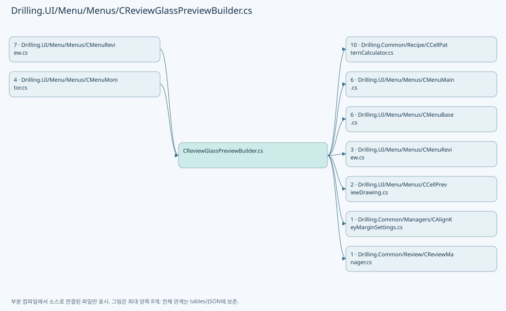

## 네임스페이스·타입·상속

| 타입 | 구분 | 원본 범위 | 선언/상속 |
| --- | --- | --- | --- |
| CReviewGlassPreviewBuilder | ClassDeclaration | 12–1853 | CReviewGlassPreviewBuilder |
| ST_REVIEW_CELL_DISPLAY | RecordDeclaration | 29–29 | ST_REVIEW_CELL_DISPLAY |
| ST_REVIEW_GLASS_PREVIEW | RecordDeclaration | 1855–1863 | ST_REVIEW_GLASS_PREVIEW |
| ST_REVIEW_SCOPE_TARGET | RecordDeclaration | 1865–1865 | ST_REVIEW_SCOPE_TARGET |
| ST_REVIEW_GLASS_AXIS_INDICATOR | RecordDeclaration | 1867–1873 | ST_REVIEW_GLASS_AXIS_INDICATOR |

## 멤버 빠른 목록

| 이름 | 종류 | 범위 | 서명 |
| --- | --- | --- | --- |
| CanvasWidth | FieldDeclaration | L14–14 | double Drilling.UI.Menu.Menus.CReviewGlassPreviewBuilder.CanvasWidth |
| CanvasHeight | FieldDeclaration | L15–15 | double Drilling.UI.Menu.Menus.CReviewGlassPreviewBuilder.CanvasHeight |
| FrameLeft | FieldDeclaration | L16–16 | double Drilling.UI.Menu.Menus.CReviewGlassPreviewBuilder.FrameLeft |
| FrameTop | FieldDeclaration | L17–17 | double Drilling.UI.Menu.Menus.CReviewGlassPreviewBuilder.FrameTop |
| FrameMaxWidth | FieldDeclaration | L18–18 | double Drilling.UI.Menu.Menus.CReviewGlassPreviewBuilder.FrameMaxWidth |
| FrameMaxHeight | FieldDeclaration | L19–19 | double Drilling.UI.Menu.Menus.CReviewGlassPreviewBuilder.FrameMaxHeight |
| MinimumLayoutPatternWidth | FieldDeclaration | L23–23 | double Drilling.UI.Menu.Menus.CReviewGlassPreviewBuilder.MinimumLayoutPatternWidth |
| MinimumLayoutPatternHeight | FieldDeclaration | L24–24 | double Drilling.UI.Menu.Menus.CReviewGlassPreviewBuilder.MinimumLayoutPatternHeight |
| RecipeParameterIndexes | FieldDeclaration | L25–27 | System.Runtime.CompilerServices.ConditionalWeakTable<Drilling.Common.Managers.ST_RECIPE_DEFINITION, System.Collections.Generic.Dictionary<string, string>> Drilling.UI.Menu.Menus.CReviewGlassPreviewBuilder.RecipeParameterIndexes |
| Build | MethodDeclaration | L31–881 | Drilling.UI.Menu.Menus.ST_REVIEW_GLASS_PREVIEW Drilling.UI.Menu.Menus.CReviewGlassPreviewBuilder.Build(Drilling.Common.Managers.ST_RECIPE_DEFINITION, int, int, System.Collections.Generic.IReadOnlyList<Drilling.Common.Review.ST_REVIEW_PLAN_POINT>?, bool, System.Collections.Generic.IReadOnlySet<int>?, Drilling.UI.Menu.Menus.ST_REVIEW_GLASS_AXIS_INDICATOR?, System.Collections.Generic.IReadOnlyList<Drilling.UI.Menu.Menus.ST_REVIEW_GLASS_AXIS_INDICATOR>?, Drilling.Common.Review.EN_REVIEW_POINT_STATE, System.Collections.Generic.IReadOnlySet<string>?, bool, bool, System.Collections.Generic.IReadOnlyList<Drilling.Common.Review.ST_REVIEW_PLAN_POINT>?, Drilling.Common.Review.EN_REVIEW_CORRECTION_RULE?, System.Collections.Generic.IReadOnlyList<Drilling.UI.Menu.Menus.ST_REVIEW_SCOPE_TARGET>?, System.Collections.Generic.IReadOnlyList<Drilling.Common.Review.ST_REVIEW_PLAN_POINT>?, int, int, System.Collections.Generic.IReadOnlyList<Drilling.Common.Review.ST_REVIEW_HEAD_SCOPE>?, Drilling.Common.Review.ST_REVIEW_PLAN_POINT?, bool, bool, System.Collections.Generic.IReadOnlySet<int>?, System.Collections.Generic.IReadOnlySet<int>?, System.Collections.Generic.IReadOnlyList<Drilling.Common.Managers.ST_SYSTEM_PARAMETER>?) |
| AddPreviewShot | LocalFunctionStatement | L503–556 | void AddPreviewShot(Drilling.Common.Recipe.ST_SHOT_GROUP_CENTER) |
| DrawInspectionPoints | MethodDeclaration | L883–941 | void Drilling.UI.Menu.Menus.CReviewGlassPreviewBuilder.DrawInspectionPoints(DrawingContext, System.Collections.Generic.IReadOnlyList<Drilling.Common.Review.ST_REVIEW_PLAN_POINT>, Drilling.Common.Review.EN_REVIEW_CORRECTION_RULE?, Drilling.UI.Menu.Menus.ST_GLASS_PREVIEW_FRAME, double, System.Collections.Generic.IReadOnlyDictionary<int, Drilling.UI.Menu.Menus.CReviewGlassPreviewBuilder.ST_REVIEW_CELL_DISPLAY>) |
| DrawEdgeInspectionAreas | MethodDeclaration | L943–1000 | void Drilling.UI.Menu.Menus.CReviewGlassPreviewBuilder.DrawEdgeInspectionAreas(DrawingContext, System.Collections.Generic.IReadOnlyList<Drilling.Common.Review.ST_REVIEW_PLAN_POINT>, Drilling.UI.Menu.Menus.ST_GLASS_PREVIEW_FRAME, double, System.Collections.Generic.IReadOnlyDictionary<int, Drilling.UI.Menu.Menus.CReviewGlassPreviewBuilder.ST_REVIEW_CELL_DISPLAY>) |
| DrawFineInspectionLines | MethodDeclaration | L1002–1049 | void Drilling.UI.Menu.Menus.CReviewGlassPreviewBuilder.DrawFineInspectionLines(DrawingContext, System.Collections.Generic.IReadOnlyList<Drilling.Common.Review.ST_REVIEW_PLAN_POINT>, Drilling.UI.Menu.Menus.ST_GLASS_PREVIEW_FRAME, double) |
| TryProjectCellPoint | MethodDeclaration | L1051–1082 | bool Drilling.UI.Menu.Menus.CReviewGlassPreviewBuilder.TryProjectCellPoint(Drilling.Common.Review.ST_REVIEW_PLAN_POINT, Drilling.UI.Menu.Menus.ST_GLASS_PREVIEW_FRAME, double, out Point) |
| TryGetHeadScopeBounds | MethodDeclaration | L1084–1117 | bool Drilling.UI.Menu.Menus.CReviewGlassPreviewBuilder.TryGetHeadScopeBounds(System.Collections.Generic.IReadOnlyDictionary<(int CellNo, int HeadNo), (int FirstColumn, int LastColumn)>, int, int, int, Rect, out Rect) |
| BuildHeadScopeColumnIndex | MethodDeclaration | L1119–1154 | System.Collections.Generic.IReadOnlyDictionary<(int CellNo, int HeadNo), (int FirstColumn, int LastColumn)> Drilling.UI.Menu.Menus.CReviewGlassPreviewBuilder.BuildHeadScopeColumnIndex(System.Collections.Generic.IReadOnlyList<Drilling.Common.Review.ST_REVIEW_PLAN_POINT>) |
| AddScopeCorners | MethodDeclaration | L1156–1167 | void Drilling.UI.Menu.Menus.CReviewGlassPreviewBuilder.AddScopeCorners(System.Collections.Generic.ICollection<Point>, Rect) |
| DrawHeadScope | MethodDeclaration | L1169–1186 | void Drilling.UI.Menu.Menus.CReviewGlassPreviewBuilder.DrawHeadScope(DrawingContext, int, Rect) |
| DrawHeadCellScope | MethodDeclaration | L1188–1201 | void Drilling.UI.Menu.Menus.CReviewGlassPreviewBuilder.DrawHeadCellScope(DrawingContext, int, Geometry) |
| DrawCurrentCellOutline | MethodDeclaration | L1203–1220 | void Drilling.UI.Menu.Menus.CReviewGlassPreviewBuilder.DrawCurrentCellOutline(DrawingContext, Geometry) |
| DrawGlobalHeadScope | MethodDeclaration | L1222–1245 | void Drilling.UI.Menu.Menus.CReviewGlassPreviewBuilder.DrawGlobalHeadScope(DrawingContext, int, System.Collections.Generic.IReadOnlyCollection<Point>) |
| DrawPhysicalHeadScope | MethodDeclaration | L1247–1317 | void Drilling.UI.Menu.Menus.CReviewGlassPreviewBuilder.DrawPhysicalHeadScope(DrawingContext, int, Drilling.Common.Review.ST_REVIEW_HEAD_SCOPE, System.Collections.Generic.IReadOnlyDictionary<int, Drilling.UI.Menu.Menus.CReviewGlassPreviewBuilder.ST_REVIEW_CELL_DISPLAY>, Drilling.UI.Menu.Menus.ST_GLASS_PREVIEW_FRAME, double, double, double, int) |
| TryBuildRecipeCellBoundary | MethodDeclaration | L1319–1398 | bool Drilling.UI.Menu.Menus.CReviewGlassPreviewBuilder.TryBuildRecipeCellBoundary(Drilling.Common.Recipe.ST_CELL_PATTERN_DEFINITION, double, int, int, Drilling.UI.Menu.Menus.ST_GLASS_PREVIEW_FRAME, double, out StreamGeometry) |
| ShouldUseExpandedPreviewBounds | MethodDeclaration | L1400–1405 | bool Drilling.UI.Menu.Menus.CReviewGlassPreviewBuilder.ShouldUseExpandedPreviewBounds(Rect, Rect) |
| ExpandPreviewBounds | MethodDeclaration | L1407–1422 | Rect Drilling.UI.Menu.Menus.CReviewGlassPreviewBuilder.ExpandPreviewBounds(Rect, double, double, Rect) |
| TryProjectReviewPreviewPixel | MethodDeclaration | L1426–1474 | bool Drilling.UI.Menu.Menus.CReviewGlassPreviewBuilder.TryProjectReviewPreviewPixel(double, double, Drilling.UI.Menu.Menus.ST_GLASS_PREVIEW_FRAME, double, out double, out double, out int, out int) |
| CreateErrorPreview | MethodDeclaration | L1476–1483 | Drilling.UI.Menu.Menus.ST_REVIEW_GLASS_PREVIEW Drilling.UI.Menu.Menus.CReviewGlassPreviewBuilder.CreateErrorPreview(string) |
| AddCircle | MethodDeclaration | L1485–1518 | void Drilling.UI.Menu.Menus.CReviewGlassPreviewBuilder.AddCircle(StreamGeometryContext, double, double, double) |
| DrawPreviewAxisIndicator | MethodDeclaration | L1520–1596 | void Drilling.UI.Menu.Menus.CReviewGlassPreviewBuilder.DrawPreviewAxisIndicator(DrawingContext, Rect, Rect, Drilling.UI.Menu.Menus.ST_REVIEW_GLASS_AXIS_INDICATOR) |
| GetPreviewAxisTitlePoint | MethodDeclaration | L1598–1621 | Point Drilling.UI.Menu.Menus.CReviewGlassPreviewBuilder.GetPreviewAxisTitlePoint(Drilling.UI.Menu.Menus.ST_REVIEW_GLASS_AXIS_INDICATOR, Point, Rect) |
| GetPreviewAxisOrigin | MethodDeclaration | L1623–1677 | Point Drilling.UI.Menu.Menus.CReviewGlassPreviewBuilder.GetPreviewAxisOrigin(Rect, Rect, Drilling.UI.Menu.Menus.ST_REVIEW_GLASS_AXIS_INDICATOR) |
| ClampPreviewAxisCoordinate | MethodDeclaration | L1679–1686 | double Drilling.UI.Menu.Menus.CReviewGlassPreviewBuilder.ClampPreviewAxisCoordinate(double, double, double) |
| DrawHorizontalArrowHead | MethodDeclaration | L1688–1697 | void Drilling.UI.Menu.Menus.CReviewGlassPreviewBuilder.DrawHorizontalArrowHead(DrawingContext, Pen, Point, bool) |
| DrawVerticalArrowHead | MethodDeclaration | L1699–1708 | void Drilling.UI.Menu.Menus.CReviewGlassPreviewBuilder.DrawVerticalArrowHead(DrawingContext, Pen, Point, bool) |
| DrawPreviewAxisText | MethodDeclaration | L1710–1735 | void Drilling.UI.Menu.Menus.CReviewGlassPreviewBuilder.DrawPreviewAxisText(DrawingContext, string, Point, Brush, double) |
| ReadInt | MethodDeclaration | L1737–1751 | int Drilling.UI.Menu.Menus.CReviewGlassPreviewBuilder.ReadInt(Drilling.Common.Managers.ST_RECIPE_DEFINITION, int, params string[]) |
| CreateParameterMap | MethodDeclaration | L1753–1758 | System.Collections.Generic.IReadOnlyDictionary<string, string> Drilling.UI.Menu.Menus.CReviewGlassPreviewBuilder.CreateParameterMap(Drilling.Common.Managers.ST_RECIPE_DEFINITION) |
| ReadDouble | MethodDeclaration | L1760–1770 | double Drilling.UI.Menu.Menus.CReviewGlassPreviewBuilder.ReadDouble(Drilling.Common.Managers.ST_RECIPE_DEFINITION, double, params string[]) |
| ReadNullableDouble | MethodDeclaration | L1772–1781 | double? Drilling.UI.Menu.Menus.CReviewGlassPreviewBuilder.ReadNullableDouble(Drilling.Common.Managers.ST_RECIPE_DEFINITION, string) |
| ReadText | MethodDeclaration | L1783–1797 | string Drilling.UI.Menu.Menus.CReviewGlassPreviewBuilder.ReadText(Drilling.Common.Managers.ST_RECIPE_DEFINITION, params string[]) |
| TryReadParameterText | MethodDeclaration | L1799–1808 | bool Drilling.UI.Menu.Menus.CReviewGlassPreviewBuilder.TryReadParameterText(Drilling.Common.Managers.ST_RECIPE_DEFINITION, string, out string) |
| CreateRecipeParameterIndex | MethodDeclaration | L1810–1829 | System.Collections.Generic.Dictionary<string, string> Drilling.UI.Menu.Menus.CReviewGlassPreviewBuilder.CreateRecipeParameterIndex(Drilling.Common.Managers.ST_RECIPE_DEFINITION) |
| FindParameter | MethodDeclaration | L1831–1838 | Drilling.Common.Managers.ST_RECIPE_PARAMETER? Drilling.UI.Menu.Menus.CReviewGlassPreviewBuilder.FindParameter(Drilling.Common.Managers.ST_RECIPE_DEFINITION, string) |
| GetParameterMinimum | MethodDeclaration | L1840–1845 | int Drilling.UI.Menu.Menus.CReviewGlassPreviewBuilder.GetParameterMinimum(Drilling.Common.Managers.ST_RECIPE_PARAMETER?) |
| GetParameterMaximum | MethodDeclaration | L1847–1852 | int? Drilling.UI.Menu.Menus.CReviewGlassPreviewBuilder.GetParameterMaximum(Drilling.Common.Managers.ST_RECIPE_PARAMETER?, int) |
| GlassBounds | PropertyDeclaration | L1861–1861 | Rect Drilling.UI.Menu.Menus.ST_REVIEW_GLASS_PREVIEW.GlassBounds |
| get_GlassBounds | GetAccessorDeclaration | L1861–1861 | Rect Drilling.UI.Menu.Menus.ST_REVIEW_GLASS_PREVIEW.GlassBounds.get |
| set_GlassBounds | InitAccessorDeclaration | L1861–1861 | void Drilling.UI.Menu.Menus.ST_REVIEW_GLASS_PREVIEW.GlassBounds.init |
| CanvasSize | PropertyDeclaration | L1862–1862 | Size Drilling.UI.Menu.Menus.ST_REVIEW_GLASS_PREVIEW.CanvasSize |
| get_CanvasSize | GetAccessorDeclaration | L1862–1862 | Size Drilling.UI.Menu.Menus.ST_REVIEW_GLASS_PREVIEW.CanvasSize.get |
| set_CanvasSize | InitAccessorDeclaration | L1862–1862 | void Drilling.UI.Menu.Menus.ST_REVIEW_GLASS_PREVIEW.CanvasSize.init |

## 멤버별 상세 계약·호출·처리 해설

### FieldDeclaration `CanvasWidth` · L14–14

[Drilling.UI/Menu/Menus/CReviewGlassPreviewBuilder.cs:14–14](https://github.com/kjuws10-rgb/A3Drilling/blob/28764c91d521777b8ee068dd7aaf2d3902ce9fe2/Drilling.UI/Menu/Menus/CReviewGlassPreviewBuilder.cs#L14-L14)

| 항목 | 실제 추출 값 |
| --- | --- |
| 서명 | double Drilling.UI.Menu.Menus.CReviewGlassPreviewBuilder.CanvasWidth |
| 접근/수식자 | Private / private, const |
| 반환/값 타입 | double |
| 소속 타입 | NamedType:Drilling.UI.Menu.Menus.CReviewGlassPreviewBuilder |

현재 부분 분석에서 직접 연결된 호출자는 없습니다. XAML/이벤트/인터페이스·델리게이트·외부 진입을 추가 확인해야 하며, 미사용으로 판정한 것이 아닙니다.

본문의 실제 연산·분기·예외·반환 순서(원문 위치 순):

| 원본 행 | 종류 | 주석 해설 |
| --- | --- | --- |
| 14 | variable-initializer | 변수의 초기값을 지정합니다: CanvasWidth = 860.0 |

변경 전 점검: 입력/반환 타입, 위 호출자, 예외/취소 경로, 공유 상태와 저장·전송 소비자를 함께 확인합니다. 값의 단위나 물리 방향을 이름만으로 확정하지 않습니다.

### FieldDeclaration `CanvasHeight` · L15–15

[Drilling.UI/Menu/Menus/CReviewGlassPreviewBuilder.cs:15–15](https://github.com/kjuws10-rgb/A3Drilling/blob/28764c91d521777b8ee068dd7aaf2d3902ce9fe2/Drilling.UI/Menu/Menus/CReviewGlassPreviewBuilder.cs#L15-L15)

| 항목 | 실제 추출 값 |
| --- | --- |
| 서명 | double Drilling.UI.Menu.Menus.CReviewGlassPreviewBuilder.CanvasHeight |
| 접근/수식자 | Private / private, const |
| 반환/값 타입 | double |
| 소속 타입 | NamedType:Drilling.UI.Menu.Menus.CReviewGlassPreviewBuilder |

현재 부분 분석에서 직접 연결된 호출자는 없습니다. XAML/이벤트/인터페이스·델리게이트·외부 진입을 추가 확인해야 하며, 미사용으로 판정한 것이 아닙니다.

본문의 실제 연산·분기·예외·반환 순서(원문 위치 순):

| 원본 행 | 종류 | 주석 해설 |
| --- | --- | --- |
| 15 | variable-initializer | 변수의 초기값을 지정합니다: CanvasHeight = 430.0 |

변경 전 점검: 입력/반환 타입, 위 호출자, 예외/취소 경로, 공유 상태와 저장·전송 소비자를 함께 확인합니다. 값의 단위나 물리 방향을 이름만으로 확정하지 않습니다.

### FieldDeclaration `FrameLeft` · L16–16

[Drilling.UI/Menu/Menus/CReviewGlassPreviewBuilder.cs:16–16](https://github.com/kjuws10-rgb/A3Drilling/blob/28764c91d521777b8ee068dd7aaf2d3902ce9fe2/Drilling.UI/Menu/Menus/CReviewGlassPreviewBuilder.cs#L16-L16)

| 항목 | 실제 추출 값 |
| --- | --- |
| 서명 | double Drilling.UI.Menu.Menus.CReviewGlassPreviewBuilder.FrameLeft |
| 접근/수식자 | Private / private, const |
| 반환/값 타입 | double |
| 소속 타입 | NamedType:Drilling.UI.Menu.Menus.CReviewGlassPreviewBuilder |

현재 부분 분석에서 직접 연결된 호출자는 없습니다. XAML/이벤트/인터페이스·델리게이트·외부 진입을 추가 확인해야 하며, 미사용으로 판정한 것이 아닙니다.

본문의 실제 연산·분기·예외·반환 순서(원문 위치 순):

| 원본 행 | 종류 | 주석 해설 |
| --- | --- | --- |
| 16 | variable-initializer | 변수의 초기값을 지정합니다: FrameLeft = 44.0 |

변경 전 점검: 입력/반환 타입, 위 호출자, 예외/취소 경로, 공유 상태와 저장·전송 소비자를 함께 확인합니다. 값의 단위나 물리 방향을 이름만으로 확정하지 않습니다.

### FieldDeclaration `FrameTop` · L17–17

[Drilling.UI/Menu/Menus/CReviewGlassPreviewBuilder.cs:17–17](https://github.com/kjuws10-rgb/A3Drilling/blob/28764c91d521777b8ee068dd7aaf2d3902ce9fe2/Drilling.UI/Menu/Menus/CReviewGlassPreviewBuilder.cs#L17-L17)

| 항목 | 실제 추출 값 |
| --- | --- |
| 서명 | double Drilling.UI.Menu.Menus.CReviewGlassPreviewBuilder.FrameTop |
| 접근/수식자 | Private / private, const |
| 반환/값 타입 | double |
| 소속 타입 | NamedType:Drilling.UI.Menu.Menus.CReviewGlassPreviewBuilder |

현재 부분 분석에서 직접 연결된 호출자는 없습니다. XAML/이벤트/인터페이스·델리게이트·외부 진입을 추가 확인해야 하며, 미사용으로 판정한 것이 아닙니다.

본문의 실제 연산·분기·예외·반환 순서(원문 위치 순):

| 원본 행 | 종류 | 주석 해설 |
| --- | --- | --- |
| 17 | variable-initializer | 변수의 초기값을 지정합니다: FrameTop = 50.0 |

변경 전 점검: 입력/반환 타입, 위 호출자, 예외/취소 경로, 공유 상태와 저장·전송 소비자를 함께 확인합니다. 값의 단위나 물리 방향을 이름만으로 확정하지 않습니다.

### FieldDeclaration `FrameMaxWidth` · L18–18

[Drilling.UI/Menu/Menus/CReviewGlassPreviewBuilder.cs:18–18](https://github.com/kjuws10-rgb/A3Drilling/blob/28764c91d521777b8ee068dd7aaf2d3902ce9fe2/Drilling.UI/Menu/Menus/CReviewGlassPreviewBuilder.cs#L18-L18)

| 항목 | 실제 추출 값 |
| --- | --- |
| 서명 | double Drilling.UI.Menu.Menus.CReviewGlassPreviewBuilder.FrameMaxWidth |
| 접근/수식자 | Private / private, const |
| 반환/값 타입 | double |
| 소속 타입 | NamedType:Drilling.UI.Menu.Menus.CReviewGlassPreviewBuilder |

현재 부분 분석에서 직접 연결된 호출자는 없습니다. XAML/이벤트/인터페이스·델리게이트·외부 진입을 추가 확인해야 하며, 미사용으로 판정한 것이 아닙니다.

본문의 실제 연산·분기·예외·반환 순서(원문 위치 순):

| 원본 행 | 종류 | 주석 해설 |
| --- | --- | --- |
| 18 | variable-initializer | 변수의 초기값을 지정합니다: FrameMaxWidth = 772.0 |

변경 전 점검: 입력/반환 타입, 위 호출자, 예외/취소 경로, 공유 상태와 저장·전송 소비자를 함께 확인합니다. 값의 단위나 물리 방향을 이름만으로 확정하지 않습니다.

### FieldDeclaration `FrameMaxHeight` · L19–19

[Drilling.UI/Menu/Menus/CReviewGlassPreviewBuilder.cs:19–19](https://github.com/kjuws10-rgb/A3Drilling/blob/28764c91d521777b8ee068dd7aaf2d3902ce9fe2/Drilling.UI/Menu/Menus/CReviewGlassPreviewBuilder.cs#L19-L19)

| 항목 | 실제 추출 값 |
| --- | --- |
| 서명 | double Drilling.UI.Menu.Menus.CReviewGlassPreviewBuilder.FrameMaxHeight |
| 접근/수식자 | Private / private, const |
| 반환/값 타입 | double |
| 소속 타입 | NamedType:Drilling.UI.Menu.Menus.CReviewGlassPreviewBuilder |

현재 부분 분석에서 직접 연결된 호출자는 없습니다. XAML/이벤트/인터페이스·델리게이트·외부 진입을 추가 확인해야 하며, 미사용으로 판정한 것이 아닙니다.

본문의 실제 연산·분기·예외·반환 순서(원문 위치 순):

| 원본 행 | 종류 | 주석 해설 |
| --- | --- | --- |
| 19 | variable-initializer | 변수의 초기값을 지정합니다: FrameMaxHeight = 340.0 |

변경 전 점검: 입력/반환 타입, 위 호출자, 예외/취소 경로, 공유 상태와 저장·전송 소비자를 함께 확인합니다. 값의 단위나 물리 방향을 이름만으로 확정하지 않습니다.

### FieldDeclaration `MinimumLayoutPatternWidth` · L23–23

[Drilling.UI/Menu/Menus/CReviewGlassPreviewBuilder.cs:23–23](https://github.com/kjuws10-rgb/A3Drilling/blob/28764c91d521777b8ee068dd7aaf2d3902ce9fe2/Drilling.UI/Menu/Menus/CReviewGlassPreviewBuilder.cs#L23-L23)

| 항목 | 실제 추출 값 |
| --- | --- |
| 서명 | double Drilling.UI.Menu.Menus.CReviewGlassPreviewBuilder.MinimumLayoutPatternWidth |
| 접근/수식자 | Private / private, const |
| 반환/값 타입 | double |
| 소속 타입 | NamedType:Drilling.UI.Menu.Menus.CReviewGlassPreviewBuilder |

현재 부분 분석에서 직접 연결된 호출자는 없습니다. XAML/이벤트/인터페이스·델리게이트·외부 진입을 추가 확인해야 하며, 미사용으로 판정한 것이 아닙니다.

본문의 실제 연산·분기·예외·반환 순서(원문 위치 순):

| 원본 행 | 종류 | 주석 해설 |
| --- | --- | --- |
| 23 | variable-initializer | 변수의 초기값을 지정합니다: MinimumLayoutPatternWidth = 18.0 |

변경 전 점검: 입력/반환 타입, 위 호출자, 예외/취소 경로, 공유 상태와 저장·전송 소비자를 함께 확인합니다. 값의 단위나 물리 방향을 이름만으로 확정하지 않습니다.

### FieldDeclaration `MinimumLayoutPatternHeight` · L24–24

[Drilling.UI/Menu/Menus/CReviewGlassPreviewBuilder.cs:24–24](https://github.com/kjuws10-rgb/A3Drilling/blob/28764c91d521777b8ee068dd7aaf2d3902ce9fe2/Drilling.UI/Menu/Menus/CReviewGlassPreviewBuilder.cs#L24-L24)

| 항목 | 실제 추출 값 |
| --- | --- |
| 서명 | double Drilling.UI.Menu.Menus.CReviewGlassPreviewBuilder.MinimumLayoutPatternHeight |
| 접근/수식자 | Private / private, const |
| 반환/값 타입 | double |
| 소속 타입 | NamedType:Drilling.UI.Menu.Menus.CReviewGlassPreviewBuilder |

현재 부분 분석에서 직접 연결된 호출자는 없습니다. XAML/이벤트/인터페이스·델리게이트·외부 진입을 추가 확인해야 하며, 미사용으로 판정한 것이 아닙니다.

본문의 실제 연산·분기·예외·반환 순서(원문 위치 순):

| 원본 행 | 종류 | 주석 해설 |
| --- | --- | --- |
| 24 | variable-initializer | 변수의 초기값을 지정합니다: MinimumLayoutPatternHeight = 32.0 |

변경 전 점검: 입력/반환 타입, 위 호출자, 예외/취소 경로, 공유 상태와 저장·전송 소비자를 함께 확인합니다. 값의 단위나 물리 방향을 이름만으로 확정하지 않습니다.

### FieldDeclaration `RecipeParameterIndexes` · L25–27

[Drilling.UI/Menu/Menus/CReviewGlassPreviewBuilder.cs:25–27](https://github.com/kjuws10-rgb/A3Drilling/blob/28764c91d521777b8ee068dd7aaf2d3902ce9fe2/Drilling.UI/Menu/Menus/CReviewGlassPreviewBuilder.cs#L25-L27)

| 항목 | 실제 추출 값 |
| --- | --- |
| 서명 | System.Runtime.CompilerServices.ConditionalWeakTable<Drilling.Common.Managers.ST_RECIPE_DEFINITION, System.Collections.Generic.Dictionary<string, string>> Drilling.UI.Menu.Menus.CReviewGlassPreviewBuilder.RecipeParameterIndexes |
| 접근/수식자 | Private / private, static, readonly |
| 반환/값 타입 | System.Runtime.CompilerServices.ConditionalWeakTable<Drilling.Common.Managers.ST_RECIPE_DEFINITION, System.Collections.Generic.Dictionary<string, string>> |
| 소속 타입 | NamedType:Drilling.UI.Menu.Menus.CReviewGlassPreviewBuilder |

현재 부분 분석에서 직접 연결된 호출자는 없습니다. XAML/이벤트/인터페이스·델리게이트·외부 진입을 추가 확인해야 하며, 미사용으로 판정한 것이 아닙니다.

호출하는 대상과 해석 범위:

| 원본 행 | 표현식 | 분석 상태 | 대상/소스 위치 |
| --- | --- | --- | --- |
| 27 | new | resolved | System.Runtime.CompilerServices.ConditionalWeakTable<Drilling.Common.Managers.ST_RECIPE_DEFINITION, System.Collections.Generic.Dictionary<string, string>>.ConditionalWeakTable() |

본문의 실제 연산·분기·예외·반환 순서(원문 위치 순):

| 원본 행 | 종류 | 주석 해설 |
| --- | --- | --- |
| 27 | call | 함수·델리게이트 또는 객체 생성자를 호출합니다: new() |
| 27 | variable-initializer | 변수의 초기값을 지정합니다: RecipeParameterIndexes = new() |

변경 전 점검: 입력/반환 타입, 위 호출자, 예외/취소 경로, 공유 상태와 저장·전송 소비자를 함께 확인합니다. 값의 단위나 물리 방향을 이름만으로 확정하지 않습니다.

### MethodDeclaration `Build` · L31–881

[Drilling.UI/Menu/Menus/CReviewGlassPreviewBuilder.cs:31–881](https://github.com/kjuws10-rgb/A3Drilling/blob/28764c91d521777b8ee068dd7aaf2d3902ce9fe2/Drilling.UI/Menu/Menus/CReviewGlassPreviewBuilder.cs#L31-L881)

| 항목 | 실제 추출 값 |
| --- | --- |
| 서명 | Drilling.UI.Menu.Menus.ST_REVIEW_GLASS_PREVIEW Drilling.UI.Menu.Menus.CReviewGlassPreviewBuilder.Build(Drilling.Common.Managers.ST_RECIPE_DEFINITION, int, int, System.Collections.Generic.IReadOnlyList<Drilling.Common.Review.ST_REVIEW_PLAN_POINT>?, bool, System.Collections.Generic.IReadOnlySet<int>?, Drilling.UI.Menu.Menus.ST_REVIEW_GLASS_AXIS_INDICATOR?, System.Collections.Generic.IReadOnlyList<Drilling.UI.Menu.Menus.ST_REVIEW_GLASS_AXIS_INDICATOR>?, Drilling.Common.Review.EN_REVIEW_POINT_STATE, System.Collections.Generic.IReadOnlySet<string>?, bool, bool, System.Collections.Generic.IReadOnlyList<Drilling.Common.Review.ST_REVIEW_PLAN_POINT>?, Drilling.Common.Review.EN_REVIEW_CORRECTION_RULE?, System.Collections.Generic.IReadOnlyList<Drilling.UI.Menu.Menus.ST_REVIEW_SCOPE_TARGET>?, System.Collections.Generic.IReadOnlyList<Drilling.Common.Review.ST_REVIEW_PLAN_POINT>?, int, int, System.Collections.Generic.IReadOnlyList<Drilling.Common.Review.ST_REVIEW_HEAD_SCOPE>?, Drilling.Common.Review.ST_REVIEW_PLAN_POINT?, bool, bool, System.Collections.Generic.IReadOnlySet<int>?, System.Collections.Generic.IReadOnlySet<int>?, System.Collections.Generic.IReadOnlyList<Drilling.Common.Managers.ST_SYSTEM_PARAMETER>?) |
| 접근/수식자 | Public / public, static |
| 반환/값 타입 | Drilling.UI.Menu.Menus.ST_REVIEW_GLASS_PREVIEW |
| 소속 타입 | NamedType:Drilling.UI.Menu.Menus.CReviewGlassPreviewBuilder |

입력 계약:

| 이름 | 타입 | 전달 | 선택/기본값 |
| --- | --- | --- | --- |
| recipe | Drilling.Common.Managers.ST_RECIPE_DEFINITION | None | False /  |
| defaultCellCount | int | None | False /  |
| currentCellNo | int | None | True / 0 |
| reviewPoints | System.Collections.Generic.IReadOnlyList<Drilling.Common.Review.ST_REVIEW_PLAN_POINT>? | None | True / null |
| useSampleSelectionColors | bool | None | True / false |
| visibleCellNos | System.Collections.Generic.IReadOnlySet<int>? | None | True / null |
| axisIndicator | Drilling.UI.Menu.Menus.ST_REVIEW_GLASS_AXIS_INDICATOR? | None | True / null |
| axisIndicators | System.Collections.Generic.IReadOnlyList<Drilling.UI.Menu.Menus.ST_REVIEW_GLASS_AXIS_INDICATOR>? | None | True / null |
| defaultPointState | Drilling.Common.Review.EN_REVIEW_POINT_STATE | None | True / 0 |
| selectedShotKeys | System.Collections.Generic.IReadOnlySet<string>? | None | True / null |
| selectAllShots | bool | None | True / false |
| showShotPoints | bool | None | True / true |
| inspectionPoints | System.Collections.Generic.IReadOnlyList<Drilling.Common.Review.ST_REVIEW_PLAN_POINT>? | None | True / null |
| inspectionRule | Drilling.Common.Review.EN_REVIEW_CORRECTION_RULE? | None | True / null |
| scopeTargets | System.Collections.Generic.IReadOnlyList<Drilling.UI.Menu.Menus.ST_REVIEW_SCOPE_TARGET>? | None | True / null |
| scopePoints | System.Collections.Generic.IReadOnlyList<Drilling.Common.Review.ST_REVIEW_PLAN_POINT>? | None | True / null |
| scopeHeadNo | int | None | True / 0 |
| scopeCellNo | int | None | True / 0 |
| headScopes | System.Collections.Generic.IReadOnlyList<Drilling.Common.Review.ST_REVIEW_HEAD_SCOPE>? | None | True / null |
| currentHolePoint | Drilling.Common.Review.ST_REVIEW_PLAN_POINT? | None | True / null |
| expandSmallCellBounds | bool | None | True / true |
| emphasizeCurrentCell | bool | None | True / false |
| currentCellNos | System.Collections.Generic.IReadOnlySet<int>? | None | True / null |
| filledCellNos | System.Collections.Generic.IReadOnlySet<int>? | None | True / null |
| settings | System.Collections.Generic.IReadOnlyList<Drilling.Common.Managers.ST_SYSTEM_PARAMETER>? | None | True / null |

정적 호출자로 확인된 위치:

| 호출 파일/행 | 호출 표현식 | 런타임 분기 가능 |
| --- | --- | --- |
| [Drilling.UI/Menu/Menus/CMenuReview.cs:1285–1302](https://github.com/kjuws10-rgb/A3Drilling/blob/28764c91d521777b8ee068dd7aaf2d3902ce9fe2/Drilling.UI/Menu/Menus/CMenuReview.cs#L1285-L1302) | CReviewGlassPreviewBuilder.Build | False |
| [Drilling.UI/Menu/Menus/CMenuReview.cs:3448–3457](https://github.com/kjuws10-rgb/A3Drilling/blob/28764c91d521777b8ee068dd7aaf2d3902ce9fe2/Drilling.UI/Menu/Menus/CMenuReview.cs#L3448-L3457) | CReviewGlassPreviewBuilder.Build | False |
| [Drilling.UI/Menu/Menus/CMenuReview.cs:4114–4126](https://github.com/kjuws10-rgb/A3Drilling/blob/28764c91d521777b8ee068dd7aaf2d3902ce9fe2/Drilling.UI/Menu/Menus/CMenuReview.cs#L4114-L4126) | CReviewGlassPreviewBuilder.Build | False |
| [Drilling.UI/Menu/Menus/CMenuReview.cs:4611–4628](https://github.com/kjuws10-rgb/A3Drilling/blob/28764c91d521777b8ee068dd7aaf2d3902ce9fe2/Drilling.UI/Menu/Menus/CMenuReview.cs#L4611-L4628) | CReviewGlassPreviewBuilder.Build | False |
| [Drilling.UI/Menu/Menus/CMenuReview.cs:4632–4649](https://github.com/kjuws10-rgb/A3Drilling/blob/28764c91d521777b8ee068dd7aaf2d3902ce9fe2/Drilling.UI/Menu/Menus/CMenuReview.cs#L4632-L4649) | CReviewGlassPreviewBuilder.Build | False |

호출하는 대상과 해석 범위:

| 원본 행 | 표현식 | 분석 상태 | 대상/소스 위치 |
| --- | --- | --- | --- |
| 83 | ReadDouble | resolved | double Drilling.UI.Menu.Menus.CReviewGlassPreviewBuilder.ReadDouble(Drilling.Common.Managers.ST_RECIPE_DEFINITION, double, params string[]) · Drilling.UI/Menu/Menus/CReviewGlassPreviewBuilder.cs:1760 |
| 84 | ReadDouble | resolved | double Drilling.UI.Menu.Menus.CReviewGlassPreviewBuilder.ReadDouble(Drilling.Common.Managers.ST_RECIPE_DEFINITION, double, params string[]) · Drilling.UI/Menu/Menus/CReviewGlassPreviewBuilder.cs:1760 |
| 87 | CreateErrorPreview | resolved | Drilling.UI.Menu.Menus.ST_REVIEW_GLASS_PREVIEW Drilling.UI.Menu.Menus.CReviewGlassPreviewBuilder.CreateErrorPreview(string) · Drilling.UI/Menu/Menus/CReviewGlassPreviewBuilder.cs:1476 |
| 93 | CAlignKeyMarginSettings.Read | resolved | Drilling.Common.Managers.ST_ALIGN_KEY_MARGINS Drilling.Common.Managers.CAlignKeyMarginSettings.Read(System.Collections.Generic.IReadOnlyList<Drilling.Common.Managers.ST_SYSTEM_PARAMETER>) · Drilling.Common/Managers/CAlignKeyMarginSettings.cs:15 |
| 97 | CreateErrorPreview | resolved | Drilling.UI.Menu.Menus.ST_REVIEW_GLASS_PREVIEW Drilling.UI.Menu.Menus.CReviewGlassPreviewBuilder.CreateErrorPreview(string) · Drilling.UI/Menu/Menus/CReviewGlassPreviewBuilder.cs:1476 |
| 106 | ReadDouble | resolved | double Drilling.UI.Menu.Menus.CReviewGlassPreviewBuilder.ReadDouble(Drilling.Common.Managers.ST_RECIPE_DEFINITION, double, params string[]) · Drilling.UI/Menu/Menus/CReviewGlassPreviewBuilder.cs:1760 |
| 107 | ReadDouble | resolved | double Drilling.UI.Menu.Menus.CReviewGlassPreviewBuilder.ReadDouble(Drilling.Common.Managers.ST_RECIPE_DEFINITION, double, params string[]) · Drilling.UI/Menu/Menus/CReviewGlassPreviewBuilder.cs:1760 |
| 108 | double.IsFinite | resolved | bool double.IsFinite(double) |
| 109 | double.IsFinite | resolved | bool double.IsFinite(double) |
| 113 | CreateErrorPreview | resolved | Drilling.UI.Menu.Menus.ST_REVIEW_GLASS_PREVIEW Drilling.UI.Menu.Menus.CReviewGlassPreviewBuilder.CreateErrorPreview(string) · Drilling.UI/Menu/Menus/CReviewGlassPreviewBuilder.cs:1476 |
| 118 | double.IsFinite | resolved | bool double.IsFinite(double) |
| 118 | double.IsFinite | resolved | bool double.IsFinite(double) |
| 120 | CreateErrorPreview | resolved | Drilling.UI.Menu.Menus.ST_REVIEW_GLASS_PREVIEW Drilling.UI.Menu.Menus.CReviewGlassPreviewBuilder.CreateErrorPreview(string) · Drilling.UI/Menu/Menus/CReviewGlassPreviewBuilder.cs:1476 |
| 124 | double.IsFinite | resolved | bool double.IsFinite(double) |
| 126 | CreateErrorPreview | resolved | Drilling.UI.Menu.Menus.ST_REVIEW_GLASS_PREVIEW Drilling.UI.Menu.Menus.CReviewGlassPreviewBuilder.CreateErrorPreview(string) · Drilling.UI/Menu/Menus/CReviewGlassPreviewBuilder.cs:1476 |
| 130 | FindParameter | resolved | Drilling.Common.Managers.ST_RECIPE_PARAMETER? Drilling.UI.Menu.Menus.CReviewGlassPreviewBuilder.FindParameter(Drilling.Common.Managers.ST_RECIPE_DEFINITION, string) · Drilling.UI/Menu/Menus/CReviewGlassPreviewBuilder.cs:1831 |
| 131 | string.IsNullOrWhiteSpace | resolved | bool string.IsNullOrWhiteSpace(string?) |
| 132 | cellCountParameter.Value.Trim | resolved | string string.Trim() |
| 133 | Math.Max(1, defaultCellCount).ToString | resolved | string int.ToString(System.IFormatProvider?) |
| 133 | Math.Max | resolved | int System.Math.Max(int, int) |
| 134 | GetParameterMinimum | resolved | int Drilling.UI.Menu.Menus.CReviewGlassPreviewBuilder.GetParameterMinimum(Drilling.Common.Managers.ST_RECIPE_PARAMETER?) · Drilling.UI/Menu/Menus/CReviewGlassPreviewBuilder.cs:1840 |
| 135 | GetParameterMaximum | resolved | int? Drilling.UI.Menu.Menus.CReviewGlassPreviewBuilder.GetParameterMaximum(Drilling.Common.Managers.ST_RECIPE_PARAMETER?, int) · Drilling.UI/Menu/Menus/CReviewGlassPreviewBuilder.cs:1847 |
| 136 | CCellPatternCalculator.TryParseCellCount | resolved | bool Drilling.Common.Recipe.CCellPatternCalculator.TryParseCellCount(string?, int, int?, out int, out string) · Drilling.Common/Recipe/CCellPatternCalculator.cs:35 |
| 143 | CreateErrorPreview | resolved | Drilling.UI.Menu.Menus.ST_REVIEW_GLASS_PREVIEW Drilling.UI.Menu.Menus.CReviewGlassPreviewBuilder.CreateErrorPreview(string) · Drilling.UI/Menu/Menus/CReviewGlassPreviewBuilder.cs:1476 |
| 146 | CCellPreviewDrawing.CreateDistortionKeyPreviews | resolved | System.Collections.Generic.IReadOnlyList<Drilling.UI.Menu.Menus.ST_DISTORTION_KEY_PREVIEW> Drilling.UI.Menu.Menus.CCellPreviewDrawing.CreateDistortionKeyPreviews(double, double, double, double, System.Func<string, double?>) · Drilling.UI/Menu/Menus/CCellPreviewDrawing.cs:61 |
| 153 | .FirstOrDefault | resolved | Drilling.Common.Managers.ST_SYSTEM_PARAMETER? System.Collections.Generic.IEnumerable<Drilling.Common.Managers.ST_SYSTEM_PARAMETER>.FirstOrDefault<Drilling.Common.Managers.ST_SYSTEM_PARAMETER>(System.Func<Drilling.Common.Managers.ST_SYSTEM_PARAMETER, bool>) |
| 153 | p.Key.Equals | resolved | bool string.Equals(string?, System.StringComparison) |
| 154 | double.TryParse | resolved | bool double.TryParse(string?, System.Globalization.NumberStyles, System.IFormatProvider?, out double) |
| 154 | double.IsFinite | resolved | bool double.IsFinite(double) |
| 156 | ReadDouble | resolved | double Drilling.UI.Menu.Menus.CReviewGlassPreviewBuilder.ReadDouble(Drilling.Common.Managers.ST_RECIPE_DEFINITION, double, params string[]) · Drilling.UI/Menu/Menus/CReviewGlassPreviewBuilder.cs:1760 |
| 157 | ReadInt | resolved | int Drilling.UI.Menu.Menus.CReviewGlassPreviewBuilder.ReadInt(Drilling.Common.Managers.ST_RECIPE_DEFINITION, int, params string[]) · Drilling.UI/Menu/Menus/CReviewGlassPreviewBuilder.cs:1737 |
| 158 | CreateParameterMap | resolved | System.Collections.Generic.IReadOnlyDictionary<string, string> Drilling.UI.Menu.Menus.CReviewGlassPreviewBuilder.CreateParameterMap(Drilling.Common.Managers.ST_RECIPE_DEFINITION) · Drilling.UI/Menu/Menus/CReviewGlassPreviewBuilder.cs:1753 |
| 159 | CRecipeModelPixelCountReader.ReadModelTypeCount | resolved | int Drilling.Common.Recipe.CRecipeModelPixelCountReader.ReadModelTypeCount(System.Collections.Generic.IReadOnlyDictionary<string, string>) · Drilling.Common/Recipe/CCellPatternCalculator.cs:428 |
| 161 | reviewPointList .GroupBy(point => (point.CellNo, point.ShotNo)) .ToDictionary | resolved | System.Collections.Generic.Dictionary<(int CellNo, int ShotNo), Drilling.Common.Review.EN_REVIEW_POINT_STATE> System.Collections.Generic.IEnumerable<System.Linq.IGrouping<(int CellNo, int ShotNo), Drilling.Common.Review.ST_REVIEW_PLAN_POINT>>.ToDictionary<System.Linq.IGrouping<(int CellNo, int ShotNo), Drilling.Common.Review.ST_REVIEW_PLAN_POINT>, (int CellNo, int ShotNo), Drilling.Common.Review.EN_REVIEW_POINT_STATE>(System.Func<System.Linq.IGrouping<(int CellNo, int ShotNo), Drilling.Common.Review.ST_REVIEW_PLAN_POINT>, (int CellNo, int ShotNo)>, System.Func<System.Linq.IGrouping<(int CellNo, int ShotNo), Drilling.Common.Review.ST_REVIEW_PLAN_POINT>, Drilling.Common.Review.EN_REVIEW_POINT_STATE>) |
| 161 | reviewPointList .GroupBy | resolved | System.Collections.Generic.IEnumerable<System.Linq.IGrouping<(int CellNo, int ShotNo), Drilling.Common.Review.ST_REVIEW_PLAN_POINT>> System.Collections.Generic.IEnumerable<Drilling.Common.Review.ST_REVIEW_PLAN_POINT>.GroupBy<Drilling.Common.Review.ST_REVIEW_PLAN_POINT, (int CellNo, int ShotNo)>(System.Func<Drilling.Common.Review.ST_REVIEW_PLAN_POINT, (int CellNo, int ShotNo)>) |
| 163 | group.Last | resolved | Drilling.Common.Review.ST_REVIEW_PLAN_POINT System.Collections.Generic.IEnumerable<Drilling.Common.Review.ST_REVIEW_PLAN_POINT>.Last<Drilling.Common.Review.ST_REVIEW_PLAN_POINT>() |
| 164 | reviewPointList .GroupBy(point => (point.CellNo, point.ShotNo)) .ToDictionary | resolved | System.Collections.Generic.Dictionary<(int CellNo, int ShotNo), Drilling.Common.Review.ST_REVIEW_PLAN_POINT> System.Collections.Generic.IEnumerable<System.Linq.IGrouping<(int CellNo, int ShotNo), Drilling.Common.Review.ST_REVIEW_PLAN_POINT>>.ToDictionary<System.Linq.IGrouping<(int CellNo, int ShotNo), Drilling.Common.Review.ST_REVIEW_PLAN_POINT>, (int CellNo, int ShotNo), Drilling.Common.Review.ST_REVIEW_PLAN_POINT>(System.Func<System.Linq.IGrouping<(int CellNo, int ShotNo), Drilling.Common.Review.ST_REVIEW_PLAN_POINT>, (int CellNo, int ShotNo)>, System.Func<System.Linq.IGrouping<(int CellNo, int ShotNo), Drilling.Common.Review.ST_REVIEW_PLAN_POINT>, Drilling.Common.Review.ST_REVIEW_PLAN_POINT>) |
| 164 | reviewPointList .GroupBy | resolved | System.Collections.Generic.IEnumerable<System.Linq.IGrouping<(int CellNo, int ShotNo), Drilling.Common.Review.ST_REVIEW_PLAN_POINT>> System.Collections.Generic.IEnumerable<Drilling.Common.Review.ST_REVIEW_PLAN_POINT>.GroupBy<Drilling.Common.Review.ST_REVIEW_PLAN_POINT, (int CellNo, int ShotNo)>(System.Func<Drilling.Common.Review.ST_REVIEW_PLAN_POINT, (int CellNo, int ShotNo)>) |
| 166 | group.Last | resolved | Drilling.Common.Review.ST_REVIEW_PLAN_POINT System.Collections.Generic.IEnumerable<Drilling.Common.Review.ST_REVIEW_PLAN_POINT>.Last<Drilling.Common.Review.ST_REVIEW_PLAN_POINT>() |
| 168 | Enumerable.Range(1, cellCount).ToArray | resolved | int[] System.Collections.Generic.IEnumerable<int>.ToArray<int>() |
| 168 | Enumerable.Range | resolved | System.Collections.Generic.IEnumerable<int> System.Linq.Enumerable.Range(int, int) |
| 169 | visibleCellNos .Where(cellNo => cellNo >= 1 && cellNo <= cellCount) .Distinct() .OrderBy(cellNo => cellNo) .ToArray | resolved | int[] System.Collections.Generic.IEnumerable<int>.ToArray<int>() |
| 169 | visibleCellNos .Where(cellNo => cellNo >= 1 && cellNo <= cellCount) .Distinct() .OrderBy | resolved | System.Linq.IOrderedEnumerable<int> System.Collections.Generic.IEnumerable<int>.OrderBy<int, int>(System.Func<int, int>) |
| 169 | visibleCellNos .Where(cellNo => cellNo >= 1 && cellNo <= cellCount) .Distinct | resolved | System.Collections.Generic.IEnumerable<int> System.Collections.Generic.IEnumerable<int>.Distinct<int>() |
| 169 | visibleCellNos .Where | resolved | System.Collections.Generic.IEnumerable<int> System.Collections.Generic.IEnumerable<int>.Where<int>(System.Func<int, bool>) |
| 175 | Math.Max | resolved | int System.Math.Max(int, int) |
| 177 | Math.Max | resolved | int System.Math.Max(int, int) |
| 179 | Math.Min | resolved | double System.Math.Min(double, double) |
| 184 | double.IsFinite | resolved | bool double.IsFinite(double) |
| 186 | double.IsFinite | resolved | bool double.IsFinite(double) |
| 187 | double.IsFinite | resolved | bool double.IsFinite(double) |
| 188 | double.IsFinite | resolved | bool double.IsFinite(double) |
| 189 | double.IsFinite | resolved | bool double.IsFinite(double) |
| 193 | CreateErrorPreview | resolved | Drilling.UI.Menu.Menus.ST_REVIEW_GLASS_PREVIEW Drilling.UI.Menu.Menus.CReviewGlassPreviewBuilder.CreateErrorPreview(string) · Drilling.UI/Menu/Menus/CReviewGlassPreviewBuilder.cs:1476 |
| 197 | new ST_GLASS_PREVIEW_FRAME | resolved | Drilling.UI.Menu.Menus.ST_GLASS_PREVIEW_FRAME.ST_GLASS_PREVIEW_FRAME(double, double, double, double) · Drilling.UI/Menu/Menus/CMenuMain.cs:3560 |
| 198 | new DrawingGroup | unresolved | None |
| 199 | new DrawingGroup | unresolved | None |
| 200 | new List<ST_CELL_PREVIEW_LABEL> | resolved | System.Collections.Generic.List<Drilling.UI.Menu.Menus.ST_CELL_PREVIEW_LABEL>.List() |
| 203 | new Dictionary<int, ST_REVIEW_CELL_DISPLAY> | resolved | System.Collections.Generic.Dictionary<int, Drilling.UI.Menu.Menus.CReviewGlassPreviewBuilder.ST_REVIEW_CELL_DISPLAY>.Dictionary() |
| 204 | new List<Point> | resolved | System.Collections.Generic.List<Point>.List() |
| 205 | new Dictionary<int, List<Point>> | resolved | System.Collections.Generic.Dictionary<int, System.Collections.Generic.List<Point>>.Dictionary() |
| 206 | new List<(int HeadNo, Rect Bounds)> | resolved | System.Collections.Generic.List<(int HeadNo, Rect Bounds)>.List() |
| 207 | new List<(int HeadNo, Geometry Boundary)> | resolved | System.Collections.Generic.List<(int HeadNo, Geometry Boundary)>.List() |
| 208 | new List<Geometry> | resolved | System.Collections.Generic.List<Geometry>.List() |
| 209 | new HashSet<int> | resolved | System.Collections.Generic.HashSet<int>.HashSet() |
| 210 | new HashSet<(int HeadNo, int CellNo)> | resolved | System.Collections.Generic.HashSet<(int HeadNo, int CellNo)>.HashSet() |
| 211 | new Dictionary<int, int> | resolved | System.Collections.Generic.Dictionary<int, int>.Dictionary() |
| 218 | roughInspectionHeadNosByCell.ContainsKey | resolved | bool System.Collections.Generic.Dictionary<int, int>.ContainsKey(int) |
| 220 | roughInspectionHeadNosByCell.Add | resolved | void System.Collections.Generic.Dictionary<int, int>.Add(int, int) |
| 226 | requestedGlobalScopeHeads.Add | resolved | bool System.Collections.Generic.HashSet<int>.Add(int) |
| 230 | requestedLocalScopeTargets.Add | resolved | bool System.Collections.Generic.HashSet<(int HeadNo, int CellNo)>.Add((int HeadNo, int CellNo)) |
| 235 | scopeTargets.Where | resolved | System.Collections.Generic.IEnumerable<Drilling.UI.Menu.Menus.ST_REVIEW_SCOPE_TARGET> System.Collections.Generic.IEnumerable<Drilling.UI.Menu.Menus.ST_REVIEW_SCOPE_TARGET>.Where<Drilling.UI.Menu.Menus.ST_REVIEW_SCOPE_TARGET>(System.Func<Drilling.UI.Menu.Menus.ST_REVIEW_SCOPE_TARGET, bool>) |
| 239 | requestedGlobalScopeHeads.Add | resolved | bool System.Collections.Generic.HashSet<int>.Add(int) |
| 243 | requestedLocalScopeTargets.Add | resolved | bool System.Collections.Generic.HashSet<(int HeadNo, int CellNo)>.Add((int HeadNo, int CellNo)) |
| 248 | (headScopes ?? []) .Where(scope => scope.HeadNo > 0 && double.IsFinite(scope.PositionX) && double.IsFinite(scope.ScanFieldWidthX) && scope.ScanFieldWidthX > 0.0) .GroupBy(scope => scope.HeadNo) .ToDictionary | resolved | System.Collections.Generic.Dictionary<int, Drilling.Common.Review.ST_REVIEW_HEAD_SCOPE> System.Collections.Generic.IEnumerable<System.Linq.IGrouping<int, Drilling.Common.Review.ST_REVIEW_HEAD_SCOPE>>.ToDictionary<System.Linq.IGrouping<int, Drilling.Common.Review.ST_REVIEW_HEAD_SCOPE>, int, Drilling.Common.Review.ST_REVIEW_HEAD_SCOPE>(System.Func<System.Linq.IGrouping<int, Drilling.Common.Review.ST_REVIEW_HEAD_SCOPE>, int>, System.Func<System.Linq.IGrouping<int, Drilling.Common.Review.ST_REVIEW_HEAD_SCOPE>, Drilling.Common.Review.ST_REVIEW_HEAD_SCOPE>) |
| 248 | (headScopes ?? []) .Where(scope => scope.HeadNo > 0 && double.IsFinite(scope.PositionX) && double.IsFinite(scope.ScanFieldWidthX) && scope.ScanFieldWidthX > 0.0) .GroupBy | resolved | System.Collections.Generic.IEnumerable<System.Linq.IGrouping<int, Drilling.Common.Review.ST_REVIEW_HEAD_SCOPE>> System.Collections.Generic.IEnumerable<Drilling.Common.Review.ST_REVIEW_HEAD_SCOPE>.GroupBy<Drilling.Common.Review.ST_REVIEW_HEAD_SCOPE, int>(System.Func<Drilling.Common.Review.ST_REVIEW_HEAD_SCOPE, int>) |
| 248 | (headScopes ?? []) .Where | resolved | System.Collections.Generic.IEnumerable<Drilling.Common.Review.ST_REVIEW_HEAD_SCOPE> System.Collections.Generic.IEnumerable<Drilling.Common.Review.ST_REVIEW_HEAD_SCOPE>.Where<Drilling.Common.Review.ST_REVIEW_HEAD_SCOPE>(System.Func<Drilling.Common.Review.ST_REVIEW_HEAD_SCOPE, bool>) |
| 251 | double.IsFinite | resolved | bool double.IsFinite(double) |
| 252 | double.IsFinite | resolved | bool double.IsFinite(double) |
| 255 | group.First | resolved | Drilling.Common.Review.ST_REVIEW_HEAD_SCOPE System.Collections.Generic.IEnumerable<Drilling.Common.Review.ST_REVIEW_HEAD_SCOPE>.First<Drilling.Common.Review.ST_REVIEW_HEAD_SCOPE>() |
| 256 | requestedGlobalScopeHeads .Where(physicalHeadScopes.ContainsKey) .ToHashSet | resolved | System.Collections.Generic.HashSet<int> System.Collections.Generic.IEnumerable<int>.ToHashSet<int>() |
| 256 | requestedGlobalScopeHeads .Where | resolved | System.Collections.Generic.IEnumerable<int> System.Collections.Generic.IEnumerable<int>.Where<int>(System.Func<int, bool>) |
| 259 | requestedLocalScopeTargets .Where(target => physicalHeadScopes.ContainsKey(target.HeadNo)) .ToHashSet | resolved | System.Collections.Generic.HashSet<(int HeadNo, int CellNo)> System.Collections.Generic.IEnumerable<(int HeadNo, int CellNo)>.ToHashSet<(int HeadNo, int CellNo)>() |
| 259 | requestedLocalScopeTargets .Where | resolved | System.Collections.Generic.IEnumerable<(int HeadNo, int CellNo)> System.Collections.Generic.IEnumerable<(int HeadNo, int CellNo)>.Where<(int HeadNo, int CellNo)>(System.Func<(int HeadNo, int CellNo), bool>) |
| 260 | physicalHeadScopes.ContainsKey | resolved | bool System.Collections.Generic.Dictionary<int, Drilling.Common.Review.ST_REVIEW_HEAD_SCOPE>.ContainsKey(int) |
| 262 | requestedGlobalScopeHeads.Any | resolved | bool System.Collections.Generic.IEnumerable<int>.Any<int>(System.Func<int, bool>) |
| 263 | physicalGlobalScopeHeads.Contains | resolved | bool System.Collections.Generic.HashSet<int>.Contains(int) |
| 264 | requestedLocalScopeTargets.Any | resolved | bool System.Collections.Generic.IEnumerable<(int HeadNo, int CellNo)>.Any<(int HeadNo, int CellNo)>(System.Func<(int HeadNo, int CellNo), bool>) |
| 265 | physicalLocalScopeTargets.Contains | resolved | bool System.Collections.Generic.HashSet<(int HeadNo, int CellNo)>.Contains((int HeadNo, int CellNo)) |
| 270 | BuildHeadScopeColumnIndex | resolved | System.Collections.Generic.IReadOnlyDictionary<(int CellNo, int HeadNo), (int FirstColumn, int LastColumn)> Drilling.UI.Menu.Menus.CReviewGlassPreviewBuilder.BuildHeadScopeColumnIndex(System.Collections.Generic.IReadOnlyList<Drilling.Common.Review.ST_REVIEW_PLAN_POINT>) · Drilling.UI/Menu/Menus/CReviewGlassPreviewBuilder.cs:1121 |
| 271 | new Dictionary< (int CellNo, int HeadNo), (int FirstColumn, int LastColumn)> | resolved | System.Collections.Generic.Dictionary<(int CellNo, int HeadNo), (int FirstColumn, int LastColumn)>.Dictionary() |
| 275 | drawing.Open | unresolved | None |
| 277 | context.DrawRectangle | unresolved | None |
| 278 | new SolidColorBrush | unresolved | None |
| 278 | Color.FromArgb | unresolved | None |
| 280 | new Rect | unresolved | None |
| 285 | ReadDouble | resolved | double Drilling.UI.Menu.Menus.CReviewGlassPreviewBuilder.ReadDouble(Drilling.Common.Managers.ST_RECIPE_DEFINITION, double, params string[]) · Drilling.UI/Menu/Menus/CReviewGlassPreviewBuilder.cs:1760 |
| 289 | ReadDouble | resolved | double Drilling.UI.Menu.Menus.CReviewGlassPreviewBuilder.ReadDouble(Drilling.Common.Managers.ST_RECIPE_DEFINITION, double, params string[]) · Drilling.UI/Menu/Menus/CReviewGlassPreviewBuilder.cs:1760 |
| 293 | ReadDouble | resolved | double Drilling.UI.Menu.Menus.CReviewGlassPreviewBuilder.ReadDouble(Drilling.Common.Managers.ST_RECIPE_DEFINITION, double, params string[]) · Drilling.UI/Menu/Menus/CReviewGlassPreviewBuilder.cs:1760 |
| 297 | CRecipeModelPixelCountReader.ReadCellModelType | resolved | int Drilling.Common.Recipe.CRecipeModelPixelCountReader.ReadCellModelType(System.Collections.Generic.IReadOnlyDictionary<string, string>, int, int) · Drilling.Common/Recipe/CCellPatternCalculator.cs:433 |
| 298 | CRecipeModelPixelCountReader.ReadPatternForModel | resolved | Drilling.Common.Recipe.ST_RECIPE_MODEL_PATTERN Drilling.Common.Recipe.CRecipeModelPixelCountReader.ReadPatternForModel(System.Collections.Generic.IReadOnlyDictionary<string, string>, int) · Drilling.Common/Recipe/CCellPatternCalculator.cs:455 |
| 299 | new ST_CELL_PATTERN_DEFINITION | resolved | Drilling.Common.Recipe.ST_CELL_PATTERN_DEFINITION.ST_CELL_PATTERN_DEFINITION(int, double, double, double, double, int, int, int, int, double, double) · Drilling.Common/Recipe/CCellPatternCalculator.cs:277 |
| 323 | CCellPatternCalculator.Calculate | resolved | Drilling.Common.Recipe.ST_CELL_PATTERN_LAYOUT Drilling.Common.Recipe.CCellPatternCalculator.Calculate(Drilling.Common.Recipe.ST_CELL_PATTERN_DEFINITION, bool) · Drilling.Common/Recipe/CCellPatternCalculator.cs:66 |
| 326 | CreateErrorPreview | resolved | Drilling.UI.Menu.Menus.ST_REVIEW_GLASS_PREVIEW Drilling.UI.Menu.Menus.CReviewGlassPreviewBuilder.CreateErrorPreview(string) · Drilling.UI/Menu/Menus/CReviewGlassPreviewBuilder.cs:1476 |
| 335 | TryBuildRecipeCellBoundary | resolved | bool Drilling.UI.Menu.Menus.CReviewGlassPreviewBuilder.TryBuildRecipeCellBoundary(Drilling.Common.Recipe.ST_CELL_PATTERN_DEFINITION, double, int, int, Drilling.UI.Menu.Menus.ST_GLASS_PREVIEW_FRAME, double, out StreamGeometry) · Drilling.UI/Menu/Menus/CReviewGlassPreviewBuilder.cs:1319 |
| 352 | CreateErrorPreview | resolved | Drilling.UI.Menu.Menus.ST_REVIEW_GLASS_PREVIEW Drilling.UI.Menu.Menus.CReviewGlassPreviewBuilder.CreateErrorPreview(string) · Drilling.UI/Menu/Menus/CReviewGlassPreviewBuilder.cs:1476 |
| 356 | ExpandPreviewBounds | candidate | OverloadResolutionFailure |
| 364 | new Rect | unresolved | None |
| 367 | ShouldUseExpandedPreviewBounds | candidate | OverloadResolutionFailure |
| 371 | new ST_REVIEW_CELL_DISPLAY | candidate | OverloadResolutionFailure |
| 382 | physicalGlobalScopeHeads.Contains | resolved | bool System.Collections.Generic.HashSet<int>.Contains(int) |
| 383 | physicalLocalScopeTargets.Contains | resolved | bool System.Collections.Generic.HashSet<(int HeadNo, int CellNo)>.Contains((int HeadNo, int CellNo)) |
| 386 | TryGetHeadScopeBounds | candidate | OverloadResolutionFailure |
| 403 | AddScopeCorners | resolved | void Drilling.UI.Menu.Menus.CReviewGlassPreviewBuilder.AddScopeCorners(System.Collections.Generic.ICollection<Point>, Rect) · Drilling.UI/Menu/Menus/CReviewGlassPreviewBuilder.cs:1156 |
| 407 | localScopeBounds.Add | resolved | void System.Collections.Generic.List<(int HeadNo, Rect Bounds)>.Add((int HeadNo, Rect Bounds)) |
| 422 | physicalGlobalScopeHeads.Contains | resolved | bool System.Collections.Generic.HashSet<int>.Contains(int) |
| 423 | physicalLocalScopeTargets.Contains | resolved | bool System.Collections.Generic.HashSet<(int HeadNo, int CellNo)>.Contains((int HeadNo, int CellNo)) |
| 429 | TryGetHeadScopeBounds | candidate | OverloadResolutionFailure |
| 448 | physicalGlobalScopeHeads.Contains | resolved | bool System.Collections.Generic.HashSet<int>.Contains(int) |
| 450 | globalRuleScopePoints.TryGetValue | resolved | bool System.Collections.Generic.Dictionary<int, System.Collections.Generic.List<Point>>.TryGetValue(int, out System.Collections.Generic.List<Point>) |
| 459 | AddScopeCorners | resolved | void Drilling.UI.Menu.Menus.CReviewGlassPreviewBuilder.AddScopeCorners(System.Collections.Generic.ICollection<Point>, Rect) · Drilling.UI/Menu/Menus/CReviewGlassPreviewBuilder.cs:1156 |
| 463 | localScopeBounds.Add | resolved | void System.Collections.Generic.List<(int HeadNo, Rect Bounds)>.Add((int HeadNo, Rect Bounds)) |
| 468 | CCellPatternCalculator.CalculatePreviewPointSize | resolved | double Drilling.Common.Recipe.CCellPatternCalculator.CalculatePreviewPointSize(Drilling.Common.Recipe.ST_CELL_PATTERN_LAYOUT, double) · Drilling.Common/Recipe/CCellPatternCalculator.cs:20 |
| 469 | CCellPatternCalculator.CalculatePreviewBeamHalfSpan | resolved | double Drilling.Common.Recipe.CCellPatternCalculator.CalculatePreviewBeamHalfSpan(Drilling.Common.Recipe.ST_CELL_PATTERN_LAYOUT, int) · Drilling.Common/Recipe/CCellPatternCalculator.cs:29 |
| 470 | double.IsFinite | resolved | bool double.IsFinite(double) |
| 472 | CreateErrorPreview | resolved | Drilling.UI.Menu.Menus.ST_REVIEW_GLASS_PREVIEW Drilling.UI.Menu.Menus.CReviewGlassPreviewBuilder.CreateErrorPreview(string) · Drilling.UI/Menu/Menus/CReviewGlassPreviewBuilder.cs:1476 |
| 477 | new HashSet<long> | resolved | System.Collections.Generic.HashSet<long>.HashSet() |
| 478 | new List<(double X, double Y, double Size, EN_REVIEW_POINT_STATE State)> | resolved | System.Collections.Generic.List<(double X, double Y, double Size, Drilling.Common.Review.EN_REVIEW_POINT_STATE State)>.List() |
| 486 | Math.Max | resolved | int System.Math.Max(int, int) |
| 487 | CCellPatternCalculator.CalculatePreviewSampleStep | resolved | int Drilling.Common.Recipe.CCellPatternCalculator.CalculatePreviewSampleStep(Drilling.Common.Recipe.ST_CELL_PATTERN_LAYOUT, double) · Drilling.Common/Recipe/CCellPatternCalculator.cs:21 |
| 488 | Math.Ceiling | resolved | double System.Math.Ceiling(double) |
| 488 | Math.Sqrt | resolved | double System.Math.Sqrt(double) |
| 494 | CCellPatternCalculator.CalculateShotCenter | resolved | Drilling.Common.Recipe.ST_SHOT_GROUP_CENTER Drilling.Common.Recipe.CCellPatternCalculator.CalculateShotCenter(Drilling.Common.Recipe.ST_CELL_PATTERN_DEFINITION, int, int, Drilling.Common.Recipe.ST_CELL_PATTERN_LAYOUT) · Drilling.Common/Recipe/CCellPatternCalculator.cs:224 |
| 499 | AddPreviewShot | resolved | void AddPreviewShot(Drilling.Common.Recipe.ST_SHOT_GROUP_CENTER) · Drilling.UI/Menu/Menus/CReviewGlassPreviewBuilder.cs:503 |
| 559 | shotVisuals.GroupBy | resolved | System.Collections.Generic.IEnumerable<System.Linq.IGrouping<Drilling.Common.Review.EN_REVIEW_POINT_STATE, (double X, double Y, double Size, Drilling.Common.Review.EN_REVIEW_POINT_STATE State)>> System.Collections.Generic.IEnumerable<(double X, double Y, double Size, Drilling.Common.Review.EN_REVIEW_POINT_STATE State)>.GroupBy<(double X, double Y, double Size, Drilling.Common.Review.EN_REVIEW_POINT_STATE State), Drilling.Common.Review.EN_REVIEW_POINT_STATE>(System.Func<(double X, double Y, double Size, Drilling.Common.Review.EN_REVIEW_POINT_STATE State), Drilling.Common.Review.EN_REVIEW_POINT_STATE>) |
| 562 | new StreamGeometry | unresolved | None |
| 563 | geometry.Open | unresolved | None |
| 567 | AddCircle | candidate | OverloadResolutionFailure |
| 571 | geometry.Freeze | unresolved | None |
| 572 | context.DrawGeometry | unresolved | None |
| 574 | CReviewStatusBrush.ForSampleSelection | resolved | Brush Drilling.UI.Menu.Menus.CReviewStatusBrush.ForSampleSelection(Drilling.Common.Review.EN_REVIEW_POINT_STATE) · Drilling.UI/Menu/Menus/CMenuReview.cs:5864 |
| 575 | CReviewStatusBrush.ForPreviewBaseState | resolved | Brush Drilling.UI.Menu.Menus.CReviewStatusBrush.ForPreviewBaseState(Drilling.Common.Review.EN_REVIEW_POINT_STATE) · Drilling.UI/Menu/Menus/CMenuReview.cs:5857 |
| 589 | roughInspectionHeadNosByCell.ContainsKey | resolved | bool System.Collections.Generic.Dictionary<int, int>.ContainsKey(int) |
| 597 | roughInspectionHeadNosByCell.TryGetValue | resolved | bool System.Collections.Generic.Dictionary<int, int>.TryGetValue(int, out int) |
| 606 | requestedLocalScopeTargets.Contains | resolved | bool System.Collections.Generic.HashSet<(int HeadNo, int CellNo)>.Contains((int HeadNo, int CellNo)) |
| 612 | selectedCellOutlines.Add | candidate | OverloadResolutionFailure |
| 617 | currentCellNos.Contains | resolved · 동적 구현 선택 가능 | bool System.Collections.Generic.IReadOnlySet<int>.Contains(int) |
| 620 | currentCellOutlines.Add | candidate | OverloadResolutionFailure |
| 623 | CStatusBrush.Frozen | resolved | SolidColorBrush Drilling.UI.Menu.Menus.CStatusBrush.Frozen(byte, byte, byte) · Drilling.UI/Menu/Menus/CMenuBase.cs:330 |
| 624 | new Pen | unresolved | None |
| 627 | boundaryPen.Freeze | unresolved | None |
| 628 | .Contains | resolved · 동적 구현 선택 가능 | bool System.Collections.Generic.IReadOnlySet<int>.Contains(int) |
| 629 | CStatusBrush.Frozen | resolved | SolidColorBrush Drilling.UI.Menu.Menus.CStatusBrush.Frozen(byte, byte, byte) · Drilling.UI/Menu/Menus/CMenuBase.cs:330 |
| 630 | context.DrawGeometry | unresolved | None |
| 635 | PathGeometry.CreateFromGeometry(boundary).Clone | unresolved | None |
| 635 | PathGeometry.CreateFromGeometry | unresolved | None |
| 640 | fillGeometry.Freeze | unresolved | None |
| 641 | context.DrawGeometry | unresolved | None |
| 641 | CStatusBrush.Frozen | resolved | SolidColorBrush Drilling.UI.Menu.Menus.CStatusBrush.Frozen(byte, byte, byte) · Drilling.UI/Menu/Menus/CMenuBase.cs:330 |
| 643 | context.DrawGeometry | unresolved | None |
| 644 | CCellPreviewDrawing.CreateCellLabel | resolved | Drilling.UI.Menu.Menus.ST_CELL_PREVIEW_LABEL? Drilling.UI.Menu.Menus.CCellPreviewDrawing.CreateCellLabel(int, Rect, double, double, bool) · Drilling.UI/Menu/Menus/CCellPreviewDrawing.cs:125 |
| 658 | labels.Add | resolved | void System.Collections.Generic.List<Drilling.UI.Menu.Menus.ST_CELL_PREVIEW_LABEL>.Add(Drilling.UI.Menu.Menus.ST_CELL_PREVIEW_LABEL) |
| 663 | CCellPreviewDrawing.DrawAlignKeys | candidate | OverloadResolutionFailure |
| 670 | CCellPreviewDrawing.DrawDistortionKeys | candidate | OverloadResolutionFailure |
| 688 | globalRuleScopePoints.Any | resolved | bool System.Collections.Generic.IEnumerable<System.Collections.Generic.KeyValuePair<int, System.Collections.Generic.List<Point>>>.Any<System.Collections.Generic.KeyValuePair<int, System.Collections.Generic.List<Point>>>(System.Func<System.Collections.Generic.KeyValuePair<int, System.Collections.Generic.List<Point>>, bool>) |
| 692 | inspectionOverlayDrawing.Open | unresolved | None |
| 696 | DrawHeadCellScope | candidate | OverloadResolutionFailure |
| 696 | new RectangleGeometry | unresolved | None |
| 701 | physicalGlobalScopeHeads.OrderBy | resolved | System.Linq.IOrderedEnumerable<int> System.Collections.Generic.IEnumerable<int>.OrderBy<int, int>(System.Func<int, int>) |
| 703 | DrawPhysicalHeadScope | candidate | OverloadResolutionFailure |
| 725 | physicalLocalScopeTargets .OrderBy(target => target.HeadNo) .ThenBy | resolved | System.Linq.IOrderedEnumerable<(int HeadNo, int CellNo)> System.Linq.IOrderedEnumerable<(int HeadNo, int CellNo)>.ThenBy<(int HeadNo, int CellNo), int>(System.Func<(int HeadNo, int CellNo), int>) |
| 725 | physicalLocalScopeTargets .OrderBy | resolved | System.Linq.IOrderedEnumerable<(int HeadNo, int CellNo)> System.Collections.Generic.IEnumerable<(int HeadNo, int CellNo)>.OrderBy<(int HeadNo, int CellNo), int>(System.Func<(int HeadNo, int CellNo), int>) |
| 729 | DrawPhysicalHeadScope | candidate | OverloadResolutionFailure |
| 753 | DrawGlobalHeadScope | candidate | OverloadResolutionFailure |
| 756 | globalRuleScopePoints.Where | resolved | System.Collections.Generic.IEnumerable<System.Collections.Generic.KeyValuePair<int, System.Collections.Generic.List<Point>>> System.Collections.Generic.IEnumerable<System.Collections.Generic.KeyValuePair<int, System.Collections.Generic.List<Point>>>.Where<System.Collections.Generic.KeyValuePair<int, System.Collections.Generic.List<Point>>>(System.Func<System.Collections.Generic.KeyValuePair<int, System.Collections.Generic.List<Point>>, bool>) |
| 758 | DrawGlobalHeadScope | candidate | OverloadResolutionFailure |
| 763 | DrawInspectionPoints | candidate | OverloadResolutionFailure |
| 781 | DrawHeadCellScope | candidate | OverloadResolutionFailure |
| 786 | DrawCurrentCellOutline | candidate | OverloadResolutionFailure |
| 790 | drawing.Freeze | unresolved | None |
| 793 | Math.Max | resolved | double System.Math.Max(double, double) |
| 796 | Math.Max | resolved | double System.Math.Max(double, double) |
| 797 | Math.Max | resolved | double System.Math.Max(double, double) |
| 798 | new Rect | unresolved | None |
| 803 | new Rect | unresolved | None |
| 804 | labels .Select(label => label with { CanvasCenterX = label.CanvasCenterX - frameLeft + paddingX, CanvasCenterY = label.CanvasCenterY - frameTop + paddingY, DesignWidth = previewRect.Width, DesignHeight = previewRect.Height }) .ToArray | resolved | Drilling.UI.Menu.Menus.ST_CELL_PREVIEW_LABEL[] System.Collections.Generic.IEnumerable<Drilling.UI.Menu.Menus.ST_CELL_PREVIEW_LABEL>.ToArray<Drilling.UI.Menu.Menus.ST_CELL_PREVIEW_LABEL>() |
| 804 | labels .Select | resolved | System.Collections.Generic.IEnumerable<Drilling.UI.Menu.Menus.ST_CELL_PREVIEW_LABEL> System.Collections.Generic.IEnumerable<Drilling.UI.Menu.Menus.ST_CELL_PREVIEW_LABEL>.Select<Drilling.UI.Menu.Menus.ST_CELL_PREVIEW_LABEL, Drilling.UI.Menu.Menus.ST_CELL_PREVIEW_LABEL>(System.Func<Drilling.UI.Menu.Menus.ST_CELL_PREVIEW_LABEL, Drilling.UI.Menu.Menus.ST_CELL_PREVIEW_LABEL>) |
| 813 | new DrawingGroup | unresolved | None |
| 815 | previewDrawing.Open | unresolved | None |
| 817 | context.DrawRectangle | unresolved | None |
| 818 | new SolidColorBrush | unresolved | None |
| 818 | Color.FromArgb | unresolved | None |
| 821 | new Pen | unresolved | None |
| 821 | new SolidColorBrush | unresolved | None |
| 821 | Color.FromRgb | unresolved | None |
| 822 | glassPen.Freeze | unresolved | None |
| 823 | context.DrawRectangle | unresolved | None |
| 824 | context.PushClip | unresolved | None |
| 824 | new RectangleGeometry | unresolved | None |
| 825 | context.PushTransform | unresolved | None |
| 825 | new TranslateTransform | unresolved | None |
| 828 | context.DrawDrawing | unresolved | None |
| 829 | context.Pop | unresolved | None |
| 830 | context.Pop | unresolved | None |
| 833 | DrawPreviewAxisIndicator | candidate | OverloadResolutionFailure |
| 837 | previewDrawing.Freeze | unresolved | None |
| 838 | new DrawingImage | unresolved | None |
| 839 | previewImage.Freeze | unresolved | None |
| 844 | inspectionOverlayDrawing.Freeze | unresolved | None |
| 845 | new DrawingGroup | unresolved | None |
| 846 | previewOverlayDrawing.Open | unresolved | None |
| 851 | context.DrawRectangle | unresolved | None |
| 852 | new SolidColorBrush | unresolved | None |
| 852 | Color.FromArgb | unresolved | None |
| 855 | context.PushClip | unresolved | None |
| 855 | new RectangleGeometry | unresolved | None |
| 856 | context.PushTransform | unresolved | None |
| 856 | new TranslateTransform | unresolved | None |
| 859 | context.DrawDrawing | unresolved | None |
| 860 | context.Pop | unresolved | None |
| 861 | context.Pop | unresolved | None |
| 864 | previewOverlayDrawing.Freeze | unresolved | None |
| 865 | new DrawingImage | unresolved | None |
| 866 | image.Freeze | unresolved | None |
| 870 | new ST_REVIEW_GLASS_PREVIEW | candidate | OverloadResolutionFailure |

본문의 실제 연산·분기·예외·반환 순서(원문 위치 순):

| 원본 행 | 종류 | 주석 해설 |
| --- | --- | --- |
| 83 | call | 함수·델리게이트 또는 객체 생성자를 호출합니다: ReadDouble(recipe, 500.0, "GLASS_SIZE_X") |
| 83 | local-declaration | 지역 변수를 선언합니다: var glassWidth = ReadDouble(recipe, 500.0, "GLASS_SIZE_X"); |
| 83 | variable-initializer | 변수의 초기값을 지정합니다: glassWidth = ReadDouble(recipe, 500.0, "GLASS_SIZE_X") |
| 84 | call | 함수·델리게이트 또는 객체 생성자를 호출합니다: ReadDouble(recipe, 300.0, "GLASS_SIZE_Y") |
| 84 | local-declaration | 지역 변수를 선언합니다: var glassHeight = ReadDouble(recipe, 300.0, "GLASS_SIZE_Y"); |
| 84 | variable-initializer | 변수의 초기값을 지정합니다: glassHeight = ReadDouble(recipe, 300.0, "GLASS_SIZE_Y") |
| 85 | if | 조건에 따라 분기합니다: if (settings is null) |
| 87 | call | 함수·델리게이트 또는 객체 생성자를 호출합니다: CreateErrorPreview("Setting > Common > ALIGN의 AK Margin X/Y를 불러올 수 없습니다.") |
| 87 | return | 호출자에게 값 또는 제어를 반환합니다: return CreateErrorPreview("Setting > Common > ALIGN의 AK Margin X/Y를 불러올 수 없습니다."); |
| 90 | local-declaration | 지역 변수를 선언합니다: ST_ALIGN_KEY_MARGINS alignKeyMargins; |
| 91 | try | 예외 처리 범위입니다: try |
| 93 | assignment | 값을 대상에 대입합니다: alignKeyMargins = CAlignKeyMarginSettings.Read(settings) |
| 93 | call | 함수·델리게이트 또는 객체 생성자를 호출합니다: CAlignKeyMarginSettings.Read(settings) |
| 95 | catch | 지정 예외를 처리합니다: catch (InvalidDataException exception) |
| 97 | call | 함수·델리게이트 또는 객체 생성자를 호출합니다: CreateErrorPreview(exception.Message) |
| 97 | return | 호출자에게 값 또는 제어를 반환합니다: return CreateErrorPreview(exception.Message); |
| 100 | local-declaration | 지역 변수를 선언합니다: var akMarginX = alignKeyMargins.X; |
| 100 | variable-initializer | 변수의 초기값을 지정합니다: akMarginX = alignKeyMargins.X |
| 101 | local-declaration | 지역 변수를 선언합니다: var akMarginY = alignKeyMargins.Y; |
| 101 | variable-initializer | 변수의 초기값을 지정합니다: akMarginY = alignKeyMargins.Y |
| 105 | local-declaration | 지역 변수를 선언합니다: var scannerReferenceOffsetX = ReadDouble(recipe, 0.0, "ESC_EDGE_TO_GLASS_EDGE", "ESC_EDGE_TO_GLASS_EDGE_X") + ReadDouble(recipe, 0.0, "GLASS_CENTER_TO_SCANNER_CENTER", "GLASS_CENTER_TO_SCANNER_CENTER_X"); |
| 105 | variable-initializer | 변수의 초기값을 지정합니다: scannerReferenceOffsetX = ReadDouble(recipe, 0.0, "ESC_EDGE_TO_GLASS_EDGE", "ESC_EDGE_TO_GLASS_EDGE_X") + ReadDouble(recipe, 0.0, "GLASS_CENTER_TO_SCANNER_CENTER", "GLASS_CENTER_TO_SCANNER_CENTER_X") |
| 106 | call | 함수·델리게이트 또는 객체 생성자를 호출합니다: ReadDouble(recipe, 0.0, "ESC_EDGE_TO_GLASS_EDGE", "ESC_EDGE_TO_GLASS_EDGE_X") |
| 107 | call | 함수·델리게이트 또는 객체 생성자를 호출합니다: ReadDouble(recipe, 0.0, "GLASS_CENTER_TO_SCANNER_CENTER", "GLASS_CENTER_TO_SCANNER_CENTER_X") |
| 108 | call | 함수·델리게이트 또는 객체 생성자를 호출합니다: double.IsFinite(glassWidth) |
| 108 | if | 조건에 따라 분기합니다: if (!double.IsFinite(glassWidth) &#124;&#124; !double.IsFinite(glassHeight) &#124;&#124; glassWidth <= 0.0 &#124;&#124; glassHeight <= 0.0) |
| 109 | call | 함수·델리게이트 또는 객체 생성자를 호출합니다: double.IsFinite(glassHeight) |
| 113 | call | 함수·델리게이트 또는 객체 생성자를 호출합니다: CreateErrorPreview( $"GLASS_SIZE_X/Y must be finite values greater than 0. " + $"Current value: {glassWidth} x {glassHeight}") |
| 113 | return | 호출자에게 값 또는 제어를 반환합니다: return CreateErrorPreview( $"GLASS_SIZE_X/Y must be finite values greater than 0. " + $"Current value: {glassWidth} x {glassHeight}"); |
| 118 | call | 함수·델리게이트 또는 객체 생성자를 호출합니다: double.IsFinite(akMarginX) |
| 118 | call | 함수·델리게이트 또는 객체 생성자를 호출합니다: double.IsFinite(akMarginY) |
| 118 | if | 조건에 따라 분기합니다: if (!double.IsFinite(akMarginX) &#124;&#124; !double.IsFinite(akMarginY)) |
| 120 | call | 함수·델리게이트 또는 객체 생성자를 호출합니다: CreateErrorPreview( $"AK_MARGIN_X/Y must be finite values. Current value: {akMarginX} x {akMarginY}") |
| 120 | return | 호출자에게 값 또는 제어를 반환합니다: return CreateErrorPreview( $"AK_MARGIN_X/Y must be finite values. Current value: {akMarginX} x {akMarginY}"); |
| 124 | call | 함수·델리게이트 또는 객체 생성자를 호출합니다: double.IsFinite(scannerReferenceOffsetX) |
| 124 | if | 조건에 따라 분기합니다: if (!double.IsFinite(scannerReferenceOffsetX)) |
| 126 | call | 함수·델리게이트 또는 객체 생성자를 호출합니다: CreateErrorPreview( $"Scanner reference offset must be finite. Current value: {scannerReferenceOffsetX}") |
| 126 | return | 호출자에게 값 또는 제어를 반환합니다: return CreateErrorPreview( $"Scanner reference offset must be finite. Current value: {scannerReferenceOffsetX}"); |
| 130 | call | 함수·델리게이트 또는 객체 생성자를 호출합니다: FindParameter(recipe, "MAX_CELL_NUMBER") |
| 130 | local-declaration | 지역 변수를 선언합니다: var cellCountParameter = FindParameter(recipe, "MAX_CELL_NUMBER"); |
| 130 | variable-initializer | 변수의 초기값을 지정합니다: cellCountParameter = FindParameter(recipe, "MAX_CELL_NUMBER") |
| 131 | call | 함수·델리게이트 또는 객체 생성자를 호출합니다: string.IsNullOrWhiteSpace(cellCountParameter?.Value) |
| 131 | conditional-expression | 조건에 따라 결과식을 선택합니다: !string.IsNullOrWhiteSpace(cellCountParameter?.Value) ? cellCountParameter.Value.Trim() : Math.Max(1, defaultCellCount).ToString(CultureInfo.InvariantCulture) |
| 131 | local-declaration | 지역 변수를 선언합니다: var cellCountText = !string.IsNullOrWhiteSpace(cellCountParameter?.Value) ? cellCountParameter.Value.Trim() : Math.Max(1, defaultCellCount).ToString(CultureInfo.InvariantCulture); |
| 131 | variable-initializer | 변수의 초기값을 지정합니다: cellCountText = !string.IsNullOrWhiteSpace(cellCountParameter?.Value) ? cellCountParameter.Value.Trim() : Math.Max(1, defaultCellCount).ToString(CultureInfo.InvariantCulture) |
| 132 | call | 함수·델리게이트 또는 객체 생성자를 호출합니다: cellCountParameter.Value.Trim() |
| 133 | call | 함수·델리게이트 또는 객체 생성자를 호출합니다: Math.Max(1, defaultCellCount).ToString(CultureInfo.InvariantCulture) |
| 133 | call | 함수·델리게이트 또는 객체 생성자를 호출합니다: Math.Max(1, defaultCellCount) |
| 134 | call | 함수·델리게이트 또는 객체 생성자를 호출합니다: GetParameterMinimum(cellCountParameter) |
| 134 | local-declaration | 지역 변수를 선언합니다: var cellCountMinimum = GetParameterMinimum(cellCountParameter); |
| 134 | variable-initializer | 변수의 초기값을 지정합니다: cellCountMinimum = GetParameterMinimum(cellCountParameter) |
| 135 | call | 함수·델리게이트 또는 객체 생성자를 호출합니다: GetParameterMaximum(cellCountParameter, cellCountMinimum) |
| 135 | local-declaration | 지역 변수를 선언합니다: var cellCountMaximum = GetParameterMaximum(cellCountParameter, cellCountMinimum); |
| 135 | variable-initializer | 변수의 초기값을 지정합니다: cellCountMaximum = GetParameterMaximum(cellCountParameter, cellCountMinimum) |
| 136 | call | 함수·델리게이트 또는 객체 생성자를 호출합니다: CCellPatternCalculator.TryParseCellCount( cellCountText, cellCountMinimum, cellCountMaximum, out var cellCount, out var cellCountValidationMessage) |
| 136 | if | 조건에 따라 분기합니다: if (!CCellPatternCalculator.TryParseCellCount( cellCountText, cellCountMinimum, cellCountMaximum, out var cellCount, out var cellCountValidationMessage)) |
| 143 | call | 함수·델리게이트 또는 객체 생성자를 호출합니다: CreateErrorPreview(cellCountValidationMessage) |
| 143 | return | 호출자에게 값 또는 제어를 반환합니다: return CreateErrorPreview(cellCountValidationMessage); |
| 146 | call | 함수·델리게이트 또는 객체 생성자를 호출합니다: CCellPreviewDrawing.CreateDistortionKeyPreviews( glassWidth, glassHeight, akMarginX, akMarginY, key => { var text = settings?.FirstOrDefault(p => p.Key.Equals(key, StringComparison.OrdinalIgnoreCase))?.Value; return doub… |
| 146 | local-declaration | 지역 변수를 선언합니다: var distortionKeys = CCellPreviewDrawing.CreateDistortionKeyPreviews( glassWidth, glassHeight, akMarginX, akMarginY, key => { var text = settings?.FirstOrDefault(p => p.Key.Equals(key, StringComparison.OrdinalIgnoreCase))?.Value;  |
| 146 | variable-initializer | 변수의 초기값을 지정합니다: distortionKeys = CCellPreviewDrawing.CreateDistortionKeyPreviews( glassWidth, glassHeight, akMarginX, akMarginY, key => { var text = settings?.FirstOrDefault(p => p.Key.Equals(key, StringComparison.OrdinalIgnoreCase))?.Value; retu |
| 153 | call | 함수·델리게이트 또는 객체 생성자를 호출합니다: .FirstOrDefault(p => p.Key.Equals(key, StringComparison.OrdinalIgnoreCase)) |
| 153 | call | 함수·델리게이트 또는 객체 생성자를 호출합니다: p.Key.Equals(key, StringComparison.OrdinalIgnoreCase) |
| 153 | local-declaration | 지역 변수를 선언합니다: var text = settings?.FirstOrDefault(p => p.Key.Equals(key, StringComparison.OrdinalIgnoreCase))?.Value; |
| 153 | variable-initializer | 변수의 초기값을 지정합니다: text = settings?.FirstOrDefault(p => p.Key.Equals(key, StringComparison.OrdinalIgnoreCase))?.Value |
| 154 | call | 함수·델리게이트 또는 객체 생성자를 호출합니다: double.TryParse(text, NumberStyles.Float, CultureInfo.InvariantCulture, out var value) |
| 154 | call | 함수·델리게이트 또는 객체 생성자를 호출합니다: double.IsFinite(value) |
| 154 | conditional-expression | 조건에 따라 결과식을 선택합니다: double.TryParse(text, NumberStyles.Float, CultureInfo.InvariantCulture, out var value) && double.IsFinite(value) ? value : null |
| 154 | return | 호출자에게 값 또는 제어를 반환합니다: return double.TryParse(text, NumberStyles.Float, CultureInfo.InvariantCulture, out var value) && double.IsFinite(value) ? value : null; |
| 156 | call | 함수·델리게이트 또는 객체 생성자를 호출합니다: ReadDouble(recipe, 0.0, "PIXEL_SIZE") |
| 156 | local-declaration | 지역 변수를 선언합니다: var pixelSize = ReadDouble(recipe, 0.0, "PIXEL_SIZE"); |
| 156 | variable-initializer | 변수의 초기값을 지정합니다: pixelSize = ReadDouble(recipe, 0.0, "PIXEL_SIZE") |
| 157 | call | 함수·델리게이트 또는 객체 생성자를 호출합니다: ReadInt(recipe, 0, "SPLITED_BEAM_COUNT") |
| 157 | local-declaration | 지역 변수를 선언합니다: var splitBeamCount = ReadInt(recipe, 0, "SPLITED_BEAM_COUNT"); |
| 157 | variable-initializer | 변수의 초기값을 지정합니다: splitBeamCount = ReadInt(recipe, 0, "SPLITED_BEAM_COUNT") |
| 158 | call | 함수·델리게이트 또는 객체 생성자를 호출합니다: CreateParameterMap(recipe) |
| 158 | local-declaration | 지역 변수를 선언합니다: var parameterMap = CreateParameterMap(recipe); |
| 158 | variable-initializer | 변수의 초기값을 지정합니다: parameterMap = CreateParameterMap(recipe) |
| 159 | call | 함수·델리게이트 또는 객체 생성자를 호출합니다: CRecipeModelPixelCountReader.ReadModelTypeCount(parameterMap) |
| 159 | local-declaration | 지역 변수를 선언합니다: var modelTypeCount = CRecipeModelPixelCountReader.ReadModelTypeCount(parameterMap); |
| 159 | variable-initializer | 변수의 초기값을 지정합니다: modelTypeCount = CRecipeModelPixelCountReader.ReadModelTypeCount(parameterMap) |
| 160 | local-declaration | 지역 변수를 선언합니다: var reviewPointList = reviewPoints ?? []; |
| 160 | variable-initializer | 변수의 초기값을 지정합니다: reviewPointList = reviewPoints ?? [] |
| 161 | call | 함수·델리게이트 또는 객체 생성자를 호출합니다: reviewPointList .GroupBy(point => (point.CellNo, point.ShotNo)) |
| 161 | call | 함수·델리게이트 또는 객체 생성자를 호출합니다: reviewPointList .GroupBy(point => (point.CellNo, point.ShotNo)) .ToDictionary(group => group.Key, group => group.Last().State) |
| 161 | local-declaration | 지역 변수를 선언합니다: var shotStates = reviewPointList .GroupBy(point => (point.CellNo, point.ShotNo)) .ToDictionary(group => group.Key, group => group.Last().State); |
| 161 | variable-initializer | 변수의 초기값을 지정합니다: shotStates = reviewPointList .GroupBy(point => (point.CellNo, point.ShotNo)) .ToDictionary(group => group.Key, group => group.Last().State) |
| 163 | call | 함수·델리게이트 또는 객체 생성자를 호출합니다: group.Last() |
| 164 | call | 함수·델리게이트 또는 객체 생성자를 호출합니다: reviewPointList .GroupBy(point => (point.CellNo, point.ShotNo)) |
| 164 | call | 함수·델리게이트 또는 객체 생성자를 호출합니다: reviewPointList .GroupBy(point => (point.CellNo, point.ShotNo)) .ToDictionary(group => group.Key, group => group.Last()) |
| 164 | local-declaration | 지역 변수를 선언합니다: var shotLocations = reviewPointList .GroupBy(point => (point.CellNo, point.ShotNo)) .ToDictionary(group => group.Key, group => group.Last()); |
| 164 | variable-initializer | 변수의 초기값을 지정합니다: shotLocations = reviewPointList .GroupBy(point => (point.CellNo, point.ShotNo)) .ToDictionary(group => group.Key, group => group.Last()) |
| 166 | call | 함수·델리게이트 또는 객체 생성자를 호출합니다: group.Last() |
| 167 | conditional-expression | 조건에 따라 결과식을 선택합니다: visibleCellNos is null ? Enumerable.Range(1, cellCount).ToArray() : visibleCellNos .Where(cellNo => cellNo >= 1 && cellNo <= cellCount) .Distinct() .OrderBy(cellNo => cellNo) .ToArray() |
| 167 | local-declaration | 지역 변수를 선언합니다: var displayedCellNos = visibleCellNos is null ? Enumerable.Range(1, cellCount).ToArray() : visibleCellNos .Where(cellNo => cellNo >= 1 && cellNo <= cellCount) .Distinct() .OrderBy(cellNo => cellNo) .ToArray(); |
| 167 | variable-initializer | 변수의 초기값을 지정합니다: displayedCellNos = visibleCellNos is null ? Enumerable.Range(1, cellCount).ToArray() : visibleCellNos .Where(cellNo => cellNo >= 1 && cellNo <= cellCount) .Distinct() .OrderBy(cellNo => cellNo) .ToArray() |
| 168 | call | 함수·델리게이트 또는 객체 생성자를 호출합니다: Enumerable.Range(1, cellCount).ToArray() |
| 168 | call | 함수·델리게이트 또는 객체 생성자를 호출합니다: Enumerable.Range(1, cellCount) |
| 169 | call | 함수·델리게이트 또는 객체 생성자를 호출합니다: visibleCellNos .Where(cellNo => cellNo >= 1 && cellNo <= cellCount) |
| 169 | call | 함수·델리게이트 또는 객체 생성자를 호출합니다: visibleCellNos .Where(cellNo => cellNo >= 1 && cellNo <= cellCount) .Distinct() |
| 169 | call | 함수·델리게이트 또는 객체 생성자를 호출합니다: visibleCellNos .Where(cellNo => cellNo >= 1 && cellNo <= cellCount) .Distinct() .OrderBy(cellNo => cellNo) |
| 169 | call | 함수·델리게이트 또는 객체 생성자를 호출합니다: visibleCellNos .Where(cellNo => cellNo >= 1 && cellNo <= cellCount) .Distinct() .OrderBy(cellNo => cellNo) .ToArray() |
| 174 | local-declaration | 지역 변수를 선언합니다: const int glassPreviewPointBudget = 8000; |
| 174 | variable-initializer | 변수의 초기값을 지정합니다: glassPreviewPointBudget = 8000 |
| 175 | call | 함수·델리게이트 또는 객체 생성자를 호출합니다: Math.Max( 1, glassPreviewPointBudget / Math.Max(1, displayedCellNos.Length)) |
| 175 | local-declaration | 지역 변수를 선언합니다: var previewPointBudgetPerCell = Math.Max( 1, glassPreviewPointBudget / Math.Max(1, displayedCellNos.Length)); |
| 175 | variable-initializer | 변수의 초기값을 지정합니다: previewPointBudgetPerCell = Math.Max( 1, glassPreviewPointBudget / Math.Max(1, displayedCellNos.Length)) |
| 177 | call | 함수·델리게이트 또는 객체 생성자를 호출합니다: Math.Max(1, displayedCellNos.Length) |
| 179 | call | 함수·델리게이트 또는 객체 생성자를 호출합니다: Math.Min(FrameMaxWidth / glassWidth, FrameMaxHeight / glassHeight) |
| 179 | local-declaration | 지역 변수를 선언합니다: var scale = Math.Min(FrameMaxWidth / glassWidth, FrameMaxHeight / glassHeight); |
| 179 | variable-initializer | 변수의 초기값을 지정합니다: scale = Math.Min(FrameMaxWidth / glassWidth, FrameMaxHeight / glassHeight) |
| 180 | local-declaration | 지역 변수를 선언합니다: var frameWidth = glassWidth * scale; |
| 180 | variable-initializer | 변수의 초기값을 지정합니다: frameWidth = glassWidth * scale |
| 181 | local-declaration | 지역 변수를 선언합니다: var frameHeight = glassHeight * scale; |
| 181 | variable-initializer | 변수의 초기값을 지정합니다: frameHeight = glassHeight * scale |
| 182 | local-declaration | 지역 변수를 선언합니다: var frameLeft = FrameLeft + ((FrameMaxWidth - frameWidth) / 2.0); |
| 182 | variable-initializer | 변수의 초기값을 지정합니다: frameLeft = FrameLeft + ((FrameMaxWidth - frameWidth) / 2.0) |
| 183 | local-declaration | 지역 변수를 선언합니다: var frameTop = FrameTop + ((FrameMaxHeight - frameHeight) / 2.0); |
| 183 | variable-initializer | 변수의 초기값을 지정합니다: frameTop = FrameTop + ((FrameMaxHeight - frameHeight) / 2.0) |
| 184 | call | 함수·델리게이트 또는 객체 생성자를 호출합니다: double.IsFinite(scale) |
| 184 | if | 조건에 따라 분기합니다: if (!double.IsFinite(scale) &#124;&#124; scale <= 0.0 &#124;&#124; !double.IsFinite(frameWidth) &#124;&#124; !double.IsFinite(frameHeight) &#124;&#124; !double.IsFinite(frameLeft) &#124;&#124; !double.IsFinite(frameTop) &#124;&#124; frameWidth <= 0.0 &#124;&#124; frameHeight <= 0.0) |
| 186 | call | 함수·델리게이트 또는 객체 생성자를 호출합니다: double.IsFinite(frameWidth) |
| 187 | call | 함수·델리게이트 또는 객체 생성자를 호출합니다: double.IsFinite(frameHeight) |
| 188 | call | 함수·델리게이트 또는 객체 생성자를 호출합니다: double.IsFinite(frameLeft) |
| 189 | call | 함수·델리게이트 또는 객체 생성자를 호출합니다: double.IsFinite(frameTop) |
| 193 | call | 함수·델리게이트 또는 객체 생성자를 호출합니다: CreateErrorPreview( $"Preview scale and frame must be finite positive values. Current scale: {scale}") |
| 193 | return | 호출자에게 값 또는 제어를 반환합니다: return CreateErrorPreview( $"Preview scale and frame must be finite positive values. Current scale: {scale}"); |
| 197 | call | 함수·델리게이트 또는 객체 생성자를 호출합니다: new ST_GLASS_PREVIEW_FRAME(frameLeft, frameTop, frameWidth, frameHeight) |
| 197 | local-declaration | 지역 변수를 선언합니다: var frame = new ST_GLASS_PREVIEW_FRAME(frameLeft, frameTop, frameWidth, frameHeight); |
| 197 | variable-initializer | 변수의 초기값을 지정합니다: frame = new ST_GLASS_PREVIEW_FRAME(frameLeft, frameTop, frameWidth, frameHeight) |
| 198 | call | 함수·델리게이트 또는 객체 생성자를 호출합니다: new DrawingGroup() |
| 198 | local-declaration | 지역 변수를 선언합니다: var drawing = new DrawingGroup(); |
| 198 | variable-initializer | 변수의 초기값을 지정합니다: drawing = new DrawingGroup() |
| 199 | call | 함수·델리게이트 또는 객체 생성자를 호출합니다: new DrawingGroup() |
| 199 | local-declaration | 지역 변수를 선언합니다: var inspectionOverlayDrawing = new DrawingGroup(); |
| 199 | variable-initializer | 변수의 초기값을 지정합니다: inspectionOverlayDrawing = new DrawingGroup() |
| 200 | call | 함수·델리게이트 또는 객체 생성자를 호출합니다: new List<ST_CELL_PREVIEW_LABEL>() |
| 200 | local-declaration | 지역 변수를 선언합니다: var labels = new List<ST_CELL_PREVIEW_LABEL>(); |
| 200 | variable-initializer | 변수의 초기값을 지정합니다: labels = new List<ST_CELL_PREVIEW_LABEL>() |
| 201 | conditional-expression | 조건에 따라 결과식을 선택합니다: axisIndicator is null ? [] : [axisIndicator] |
| 201 | local-declaration | 지역 변수를 선언합니다: var previewAxisIndicators = axisIndicators ?? (axisIndicator is null ? [] : [axisIndicator]); |
| 201 | variable-initializer | 변수의 초기값을 지정합니다: previewAxisIndicators = axisIndicators ?? (axisIndicator is null ? [] : [axisIndicator]) |
| 202 | local-declaration | 지역 변수를 선언합니다: long totalShotCount = 0; |
| 202 | variable-initializer | 변수의 초기값을 지정합니다: totalShotCount = 0 |
| 203 | call | 함수·델리게이트 또는 객체 생성자를 호출합니다: new Dictionary<int, ST_REVIEW_CELL_DISPLAY>() |
| 203 | local-declaration | 지역 변수를 선언합니다: var cellDisplays = new Dictionary<int, ST_REVIEW_CELL_DISPLAY>(); |
| 203 | variable-initializer | 변수의 초기값을 지정합니다: cellDisplays = new Dictionary<int, ST_REVIEW_CELL_DISPLAY>() |
| 204 | call | 함수·델리게이트 또는 객체 생성자를 호출합니다: new List<Point>() |
| 204 | local-declaration | 지역 변수를 선언합니다: var globalHeadScopePoints = new List<Point>(); |
| 204 | variable-initializer | 변수의 초기값을 지정합니다: globalHeadScopePoints = new List<Point>() |
| 205 | call | 함수·델리게이트 또는 객체 생성자를 호출합니다: new Dictionary<int, List<Point>>() |
| 205 | local-declaration | 지역 변수를 선언합니다: var globalRuleScopePoints = new Dictionary<int, List<Point>>(); |
| 205 | variable-initializer | 변수의 초기값을 지정합니다: globalRuleScopePoints = new Dictionary<int, List<Point>>() |
| 206 | call | 함수·델리게이트 또는 객체 생성자를 호출합니다: new List<(int HeadNo, Rect Bounds)>() |
| 206 | local-declaration | 지역 변수를 선언합니다: var localScopeBounds = new List<(int HeadNo, Rect Bounds)>(); |
| 206 | variable-initializer | 변수의 초기값을 지정합니다: localScopeBounds = new List<(int HeadNo, Rect Bounds)>() |
| 207 | call | 함수·델리게이트 또는 객체 생성자를 호출합니다: new List<(int HeadNo, Geometry Boundary)>() |
| 207 | local-declaration | 지역 변수를 선언합니다: var selectedCellOutlines = new List<(int HeadNo, Geometry Boundary)>(); |
| 207 | variable-initializer | 변수의 초기값을 지정합니다: selectedCellOutlines = new List<(int HeadNo, Geometry Boundary)>() |
| 208 | call | 함수·델리게이트 또는 객체 생성자를 호출합니다: new List<Geometry>() |
| 208 | local-declaration | 지역 변수를 선언합니다: var currentCellOutlines = new List<Geometry>(); |
| 208 | variable-initializer | 변수의 초기값을 지정합니다: currentCellOutlines = new List<Geometry>() |
| 209 | call | 함수·델리게이트 또는 객체 생성자를 호출합니다: new HashSet<int>() |
| 209 | local-declaration | 지역 변수를 선언합니다: var requestedGlobalScopeHeads = new HashSet<int>(); |
| 209 | variable-initializer | 변수의 초기값을 지정합니다: requestedGlobalScopeHeads = new HashSet<int>() |
| 210 | call | 함수·델리게이트 또는 객체 생성자를 호출합니다: new HashSet<(int HeadNo, int CellNo)>() |
| 210 | local-declaration | 지역 변수를 선언합니다: var requestedLocalScopeTargets = new HashSet<(int HeadNo, int CellNo)>(); |
| 210 | variable-initializer | 변수의 초기값을 지정합니다: requestedLocalScopeTargets = new HashSet<(int HeadNo, int CellNo)>() |
| 211 | call | 함수·델리게이트 또는 객체 생성자를 호출합니다: new Dictionary<int, int>() |
| 211 | local-declaration | 지역 변수를 선언합니다: var roughInspectionHeadNosByCell = new Dictionary<int, int>(); |
| 211 | variable-initializer | 변수의 초기값을 지정합니다: roughInspectionHeadNosByCell = new Dictionary<int, int>() |
| 212 | if | 조건에 따라 분기합니다: if (inspectionRule == EN_REVIEW_CORRECTION_RULE.Rough && inspectionPoints is not null) |
| 214 | foreach | 컬렉션 요소를 순회합니다: foreach (var point in inspectionPoints) |
| 216 | if | 조건에 따라 분기합니다: if (point.CellNo > 0 && point.HeadNo > 0 && !roughInspectionHeadNosByCell.ContainsKey(point.CellNo)) |
| 218 | call | 함수·델리게이트 또는 객체 생성자를 호출합니다: roughInspectionHeadNosByCell.ContainsKey(point.CellNo) |
| 220 | call | 함수·델리게이트 또는 객체 생성자를 호출합니다: roughInspectionHeadNosByCell.Add(point.CellNo, point.HeadNo) |
| 224 | if | 조건에 따라 분기합니다: if (scopeHeadNo > 0 && scopeCellNo <= 0) |
| 226 | call | 함수·델리게이트 또는 객체 생성자를 호출합니다: requestedGlobalScopeHeads.Add(scopeHeadNo) |
| 228 | else | 앞 조건이 거짓인 경로입니다: else |
| 228 | if | 조건에 따라 분기합니다: if (scopeHeadNo > 0 && scopeCellNo > 0) |
| 230 | call | 함수·델리게이트 또는 객체 생성자를 호출합니다: requestedLocalScopeTargets.Add((scopeHeadNo, scopeCellNo)) |
| 233 | if | 조건에 따라 분기합니다: if (scopeTargets is { Count: > 0 }) |
| 235 | call | 함수·델리게이트 또는 객체 생성자를 호출합니다: scopeTargets.Where(target => target.HeadNo > 0) |
| 235 | foreach | 컬렉션 요소를 순회합니다: foreach (var target in scopeTargets.Where(target => target.HeadNo > 0)) |
| 237 | if | 조건에 따라 분기합니다: if (target.CellNo <= 0) |
| 239 | call | 함수·델리게이트 또는 객체 생성자를 호출합니다: requestedGlobalScopeHeads.Add(target.HeadNo) |
| 241 | else | 앞 조건이 거짓인 경로입니다: else |
| 243 | call | 함수·델리게이트 또는 객체 생성자를 호출합니다: requestedLocalScopeTargets.Add((target.HeadNo, target.CellNo)) |
| 248 | call | 함수·델리게이트 또는 객체 생성자를 호출합니다: (headScopes ?? []) .Where(scope => scope.HeadNo > 0 && double.IsFinite(scope.PositionX) && double.IsFinite(scope.ScanFieldWidthX) && scope.ScanFieldWidthX > 0.0) |
| 248 | call | 함수·델리게이트 또는 객체 생성자를 호출합니다: (headScopes ?? []) .Where(scope => scope.HeadNo > 0 && double.IsFinite(scope.PositionX) && double.IsFinite(scope.ScanFieldWidthX) && scope.ScanFieldWidthX > 0.0) .GroupBy(scope => scope.HeadNo) |
| 248 | call | 함수·델리게이트 또는 객체 생성자를 호출합니다: (headScopes ?? []) .Where(scope => scope.HeadNo > 0 && double.IsFinite(scope.PositionX) && double.IsFinite(scope.ScanFieldWidthX) && scope.ScanFieldWidthX > 0.0) .GroupBy(scope => scope.HeadNo) .ToDictionary(group => gro… |
| 248 | local-declaration | 지역 변수를 선언합니다: var physicalHeadScopes = (headScopes ?? []) .Where(scope => scope.HeadNo > 0 && double.IsFinite(scope.PositionX) && double.IsFinite(scope.ScanFieldWidthX) && scope.ScanFieldWidthX > 0.0) .GroupBy(scope => scope.HeadNo) .ToDictiona |
| 248 | variable-initializer | 변수의 초기값을 지정합니다: physicalHeadScopes = (headScopes ?? []) .Where(scope => scope.HeadNo > 0 && double.IsFinite(scope.PositionX) && double.IsFinite(scope.ScanFieldWidthX) && scope.ScanFieldWidthX > 0.0) .GroupBy(scope => scope.HeadNo) .ToDictionary(g |
| 251 | call | 함수·델리게이트 또는 객체 생성자를 호출합니다: double.IsFinite(scope.PositionX) |
| 252 | call | 함수·델리게이트 또는 객체 생성자를 호출합니다: double.IsFinite(scope.ScanFieldWidthX) |
| 255 | call | 함수·델리게이트 또는 객체 생성자를 호출합니다: group.First() |
| 256 | call | 함수·델리게이트 또는 객체 생성자를 호출합니다: requestedGlobalScopeHeads .Where(physicalHeadScopes.ContainsKey) |
| 256 | call | 함수·델리게이트 또는 객체 생성자를 호출합니다: requestedGlobalScopeHeads .Where(physicalHeadScopes.ContainsKey) .ToHashSet() |
| 256 | local-declaration | 지역 변수를 선언합니다: var physicalGlobalScopeHeads = requestedGlobalScopeHeads .Where(physicalHeadScopes.ContainsKey) .ToHashSet(); |
| 256 | variable-initializer | 변수의 초기값을 지정합니다: physicalGlobalScopeHeads = requestedGlobalScopeHeads .Where(physicalHeadScopes.ContainsKey) .ToHashSet() |
| 259 | call | 함수·델리게이트 또는 객체 생성자를 호출합니다: requestedLocalScopeTargets .Where(target => physicalHeadScopes.ContainsKey(target.HeadNo)) |
| 259 | call | 함수·델리게이트 또는 객체 생성자를 호출합니다: requestedLocalScopeTargets .Where(target => physicalHeadScopes.ContainsKey(target.HeadNo)) .ToHashSet() |
| 259 | local-declaration | 지역 변수를 선언합니다: var physicalLocalScopeTargets = requestedLocalScopeTargets .Where(target => physicalHeadScopes.ContainsKey(target.HeadNo)) .ToHashSet(); |
| 259 | variable-initializer | 변수의 초기값을 지정합니다: physicalLocalScopeTargets = requestedLocalScopeTargets .Where(target => physicalHeadScopes.ContainsKey(target.HeadNo)) .ToHashSet() |
| 260 | call | 함수·델리게이트 또는 객체 생성자를 호출합니다: physicalHeadScopes.ContainsKey(target.HeadNo) |
| 262 | call | 함수·델리게이트 또는 객체 생성자를 호출합니다: requestedGlobalScopeHeads.Any(headNo => !physicalGlobalScopeHeads.Contains(headNo)) |
| 262 | local-declaration | 지역 변수를 선언합니다: var requiresPointScope = requestedGlobalScopeHeads.Any(headNo => !physicalGlobalScopeHeads.Contains(headNo)) &#124;&#124; requestedLocalScopeTargets.Any(target => !physicalLocalScopeTargets.Contains(target)); |
| 262 | variable-initializer | 변수의 초기값을 지정합니다: requiresPointScope = requestedGlobalScopeHeads.Any(headNo => !physicalGlobalScopeHeads.Contains(headNo)) &#124;&#124; requestedLocalScopeTargets.Any(target => !physicalLocalScopeTargets.Contains(target)) |
| 263 | call | 함수·델리게이트 또는 객체 생성자를 호출합니다: physicalGlobalScopeHeads.Contains(headNo) |
| 264 | call | 함수·델리게이트 또는 객체 생성자를 호출합니다: requestedLocalScopeTargets.Any(target => !physicalLocalScopeTargets.Contains(target)) |
| 265 | call | 함수·델리게이트 또는 객체 생성자를 호출합니다: physicalLocalScopeTargets.Contains(target) |
| 266 | local-declaration | 지역 변수를 선언합니다: IReadOnlyDictionary< (int CellNo, int HeadNo), (int FirstColumn, int LastColumn)> pointScopeColumns = requiresPointScope && scopePoints is not null ? BuildHeadScopeColumnIndex(scopePoints) : new Dictionary< (int CellNo, int HeadNo |
| 268 | variable-initializer | 변수의 초기값을 지정합니다: pointScopeColumns = requiresPointScope && scopePoints is not null ? BuildHeadScopeColumnIndex(scopePoints) : new Dictionary< (int CellNo, int HeadNo), (int FirstColumn, int LastColumn)>() |
| 269 | conditional-expression | 조건에 따라 결과식을 선택합니다: requiresPointScope && scopePoints is not null ? BuildHeadScopeColumnIndex(scopePoints) : new Dictionary< (int CellNo, int HeadNo), (int FirstColumn, int LastColumn)>() |
| 270 | call | 함수·델리게이트 또는 객체 생성자를 호출합니다: BuildHeadScopeColumnIndex(scopePoints) |
| 271 | call | 함수·델리게이트 또는 객체 생성자를 호출합니다: new Dictionary< (int CellNo, int HeadNo), (int FirstColumn, int LastColumn)>() |
| 275 | call | 함수·델리게이트 또는 객체 생성자를 호출합니다: drawing.Open() |
| 275 | variable-initializer | 변수의 초기값을 지정합니다: context = drawing.Open() |
| 275 | using | 자원 사용과 정리 범위를 지정합니다: using (var context = drawing.Open()) |
| 277 | call | 함수·델리게이트 또는 객체 생성자를 호출합니다: context.DrawRectangle( new SolidColorBrush(Color.FromArgb(1, 0, 0, 0)), null, new Rect(0.0, 0.0, CanvasWidth, CanvasHeight)) |
| 278 | call | 함수·델리게이트 또는 객체 생성자를 호출합니다: new SolidColorBrush(Color.FromArgb(1, 0, 0, 0)) |
| 278 | call | 함수·델리게이트 또는 객체 생성자를 호출합니다: Color.FromArgb(1, 0, 0, 0) |
| 280 | call | 함수·델리게이트 또는 객체 생성자를 호출합니다: new Rect(0.0, 0.0, CanvasWidth, CanvasHeight) |
| 282 | foreach | 컬렉션 요소를 순회합니다: foreach (var cellNo in displayedCellNos) |
| 284 | local-declaration | 지역 변수를 선언합니다: var prefix = $"CELL{cellNo}"; |
| 284 | variable-initializer | 변수의 초기값을 지정합니다: prefix = $"CELL{cellNo}" |
| 285 | call | 함수·델리게이트 또는 객체 생성자를 호출합니다: ReadDouble( recipe, 0.0, $"{prefix}_ALIGN_TO_1ST_PIXEL_X") |
| 285 | local-declaration | 지역 변수를 선언합니다: var firstX = ReadDouble( recipe, 0.0, $"{prefix}_ALIGN_TO_1ST_PIXEL_X"); |
| 285 | variable-initializer | 변수의 초기값을 지정합니다: firstX = ReadDouble( recipe, 0.0, $"{prefix}_ALIGN_TO_1ST_PIXEL_X") |
| 289 | call | 함수·델리게이트 또는 객체 생성자를 호출합니다: ReadDouble( recipe, 0.0, $"{prefix}_ALIGN_TO_1ST_PIXEL_Y") |
| 289 | local-declaration | 지역 변수를 선언합니다: var firstY = ReadDouble( recipe, 0.0, $"{prefix}_ALIGN_TO_1ST_PIXEL_Y"); |
| 289 | variable-initializer | 변수의 초기값을 지정합니다: firstY = ReadDouble( recipe, 0.0, $"{prefix}_ALIGN_TO_1ST_PIXEL_Y") |
| 293 | call | 함수·델리게이트 또는 객체 생성자를 호출합니다: ReadDouble( recipe, 0.0, $"{prefix}_ROTATION") |
| 293 | local-declaration | 지역 변수를 선언합니다: var rotation = ReadDouble( recipe, 0.0, $"{prefix}_ROTATION"); |
| 293 | variable-initializer | 변수의 초기값을 지정합니다: rotation = ReadDouble( recipe, 0.0, $"{prefix}_ROTATION") |
| 297 | call | 함수·델리게이트 또는 객체 생성자를 호출합니다: CRecipeModelPixelCountReader.ReadCellModelType(parameterMap, cellNo, modelTypeCount) |
| 297 | local-declaration | 지역 변수를 선언합니다: var modelType = CRecipeModelPixelCountReader.ReadCellModelType(parameterMap, cellNo, modelTypeCount); |
| 297 | variable-initializer | 변수의 초기값을 지정합니다: modelType = CRecipeModelPixelCountReader.ReadCellModelType(parameterMap, cellNo, modelTypeCount) |
| 298 | call | 함수·델리게이트 또는 객체 생성자를 호출합니다: CRecipeModelPixelCountReader.ReadPatternForModel(parameterMap, modelType) |
| 298 | local-declaration | 지역 변수를 선언합니다: var modelPattern = CRecipeModelPixelCountReader.ReadPatternForModel(parameterMap, modelType); |
| 298 | variable-initializer | 변수의 초기값을 지정합니다: modelPattern = CRecipeModelPixelCountReader.ReadPatternForModel(parameterMap, modelType) |
| 299 | call | 함수·델리게이트 또는 객체 생성자를 호출합니다: new ST_CELL_PATTERN_DEFINITION( cellNo, firstX, firstY, rotation, pixelSize, modelPattern.PixelCountX, modelPattern.PixelCountY, modelPattern.ProcessPitch, splitBeamCount, akMarginX, akMarginY ) |
| 299 | local-declaration | 지역 변수를 선언합니다: var patternDefinition = new ST_CELL_PATTERN_DEFINITION( cellNo, firstX, firstY, rotation, pixelSize, modelPattern.PixelCountX, modelPattern.PixelCountY, modelPattern.ProcessPitch, splitBeamCount, akMarginX, akMarginY ); |
| 299 | variable-initializer | 변수의 초기값을 지정합니다: patternDefinition = new ST_CELL_PATTERN_DEFINITION( cellNo, firstX, firstY, rotation, pixelSize, modelPattern.PixelCountX, modelPattern.PixelCountY, modelPattern.ProcessPitch, splitBeamCount, akMarginX, akMarginY ) |
| 323 | call | 함수·델리게이트 또는 객체 생성자를 호출합니다: CCellPatternCalculator.Calculate(patternDefinition, includeShotCenters: false) |
| 323 | local-declaration | 지역 변수를 선언합니다: var result = CCellPatternCalculator.Calculate(patternDefinition, includeShotCenters: false); |
| 323 | variable-initializer | 변수의 초기값을 지정합니다: result = CCellPatternCalculator.Calculate(patternDefinition, includeShotCenters: false) |
| 324 | if | 조건에 따라 분기합니다: if (!result.IsValid) |
| 326 | call | 함수·델리게이트 또는 객체 생성자를 호출합니다: CreateErrorPreview(result.ValidationMessage) |
| 326 | return | 호출자에게 값 또는 제어를 반환합니다: return CreateErrorPreview(result.ValidationMessage); |
| 329 | local-declaration | 지역 변수를 선언합니다: var cellShotCount = (long)result.GroupCountX * result.GroupCountY; |
| 329 | variable-initializer | 변수의 초기값을 지정합니다: cellShotCount = (long)result.GroupCountX * result.GroupCountY |
| 330 | compound-assignment-or-event-subscription | 복합 대입 또는 이벤트 구독/해지 표현입니다: totalShotCount += cellShotCount |
| 335 | call | 함수·델리게이트 또는 객체 생성자를 호출합니다: TryBuildRecipeCellBoundary( patternDefinition, pixelSize, modelPattern.PixelCountX, modelPattern.PixelCountY, frame, scale, out var boundary ) |
| 335 | if | 조건에 따라 분기합니다: if (!TryBuildRecipeCellBoundary( patternDefinition, pixelSize, modelPattern.PixelCountX, modelPattern.PixelCountY, frame, scale, out var boundary )) |
| 352 | call | 함수·델리게이트 또는 객체 생성자를 호출합니다: CreateErrorPreview($"Cell{cellNo} boundary produces an invalid preview coordinate.") |
| 352 | return | 호출자에게 값 또는 제어를 반환합니다: return CreateErrorPreview($"Cell{cellNo} boundary produces an invalid preview coordinate."); |
| 355 | conditional-expression | 조건에 따라 결과식을 선택합니다: expandSmallCellBounds ? ExpandPreviewBounds( boundary.Bounds, MinimumLayoutPatternWidth, MinimumLayoutPatternHeight, new Rect(frameLeft, frameTop, frameWidth, frameHeight) ) : boundary.Bounds |
| 355 | local-declaration | 지역 변수를 선언합니다: var displayBounds = expandSmallCellBounds ? ExpandPreviewBounds( boundary.Bounds, MinimumLayoutPatternWidth, MinimumLayoutPatternHeight, new Rect(frameLeft, frameTop, frameWidth, frameHeight) ) : boundary.Bounds; |
| 355 | variable-initializer | 변수의 초기값을 지정합니다: displayBounds = expandSmallCellBounds ? ExpandPreviewBounds( boundary.Bounds, MinimumLayoutPatternWidth, MinimumLayoutPatternHeight, new Rect(frameLeft, frameTop, frameWidth, frameHeight) ) : boundary.Bounds |
| 356 | call | 함수·델리게이트 또는 객체 생성자를 호출합니다: ExpandPreviewBounds( boundary.Bounds, MinimumLayoutPatternWidth, MinimumLayoutPatternHeight, new Rect(frameLeft, frameTop, frameWidth, frameHeight) ) |
| 364 | call | 함수·델리게이트 또는 객체 생성자를 호출합니다: new Rect(frameLeft, frameTop, frameWidth, frameHeight) |
| 367 | call | 함수·델리게이트 또는 객체 생성자를 호출합니다: ShouldUseExpandedPreviewBounds( boundary.Bounds, displayBounds) |
| 367 | local-declaration | 지역 변수를 선언합니다: var useDisplayBounds = expandSmallCellBounds && ShouldUseExpandedPreviewBounds( boundary.Bounds, displayBounds); |
| 367 | variable-initializer | 변수의 초기값을 지정합니다: useDisplayBounds = expandSmallCellBounds && ShouldUseExpandedPreviewBounds( boundary.Bounds, displayBounds) |
| 370 | local-declaration | 지역 변수를 선언합니다: var scopeBounds = boundary.Bounds; |
| 370 | variable-initializer | 변수의 초기값을 지정합니다: scopeBounds = boundary.Bounds |
| 371 | assignment | 값을 대상에 대입합니다: cellDisplays[cellNo] = new ST_REVIEW_CELL_DISPLAY(boundary.Bounds, boundary) |
| 371 | call | 함수·델리게이트 또는 객체 생성자를 호출합니다: new ST_REVIEW_CELL_DISPLAY(boundary.Bounds, boundary) |
| 377 | local-declaration | 지역 변수를 선언합니다: var isCurrentSimpleScopeCell = scopePoints is not null && scopeHeadNo > 0 && (scopeCellNo <= 0 &#124;&#124; scopeCellNo == cellNo); |
| 377 | variable-initializer | 변수의 초기값을 지정합니다: isCurrentSimpleScopeCell = scopePoints is not null && scopeHeadNo > 0 && (scopeCellNo <= 0 &#124;&#124; scopeCellNo == cellNo) |
| 381 | conditional-expression | 조건에 따라 결과식을 선택합니다: scopeCellNo <= 0 ? physicalGlobalScopeHeads.Contains(scopeHeadNo) : physicalLocalScopeTargets.Contains((scopeHeadNo, scopeCellNo)) |
| 381 | local-declaration | 지역 변수를 선언합니다: var hasPhysicalSimpleScope = scopeCellNo <= 0 ? physicalGlobalScopeHeads.Contains(scopeHeadNo) : physicalLocalScopeTargets.Contains((scopeHeadNo, scopeCellNo)); |
| 381 | variable-initializer | 변수의 초기값을 지정합니다: hasPhysicalSimpleScope = scopeCellNo <= 0 ? physicalGlobalScopeHeads.Contains(scopeHeadNo) : physicalLocalScopeTargets.Contains((scopeHeadNo, scopeCellNo)) |
| 382 | call | 함수·델리게이트 또는 객체 생성자를 호출합니다: physicalGlobalScopeHeads.Contains(scopeHeadNo) |
| 383 | call | 함수·델리게이트 또는 객체 생성자를 호출합니다: physicalLocalScopeTargets.Contains((scopeHeadNo, scopeCellNo)) |
| 384 | if | 조건에 따라 분기합니다: if (isCurrentSimpleScopeCell && !hasPhysicalSimpleScope && TryGetHeadScopeBounds( pointScopeColumns, cellNo, result.GroupCountX, scopeHeadNo, scopeBounds, out var simpleScopeBounds )) |
| 386 | call | 함수·델리게이트 또는 객체 생성자를 호출합니다: TryGetHeadScopeBounds( pointScopeColumns, cellNo, result.GroupCountX, scopeHeadNo, scopeBounds, out var simpleScopeBounds ) |
| 401 | if | 조건에 따라 분기합니다: if (scopeCellNo <= 0) |
| 403 | call | 함수·델리게이트 또는 객체 생성자를 호출합니다: AddScopeCorners(globalHeadScopePoints, simpleScopeBounds) |
| 405 | else | 앞 조건이 거짓인 경로입니다: else |
| 407 | call | 함수·델리게이트 또는 객체 생성자를 호출합니다: localScopeBounds.Add((scopeHeadNo, simpleScopeBounds)) |
| 411 | if | 조건에 따라 분기합니다: if (scopePoints is not null && scopeTargets is { Count: > 0 }) |
| 413 | foreach | 컬렉션 요소를 순회합니다: foreach (var target in scopeTargets) |
| 415 | if | 조건에 따라 분기합니다: if (target.HeadNo <= 0 &#124;&#124; target.CellNo > 0 && target.CellNo != cellNo) |
| 418 | continue | 다음 반복으로 진행합니다: continue; |
| 421 | conditional-expression | 조건에 따라 결과식을 선택합니다: target.CellNo <= 0 ? physicalGlobalScopeHeads.Contains(target.HeadNo) : physicalLocalScopeTargets.Contains((target.HeadNo, target.CellNo)) |
| 421 | local-declaration | 지역 변수를 선언합니다: var hasPhysicalTargetScope = target.CellNo <= 0 ? physicalGlobalScopeHeads.Contains(target.HeadNo) : physicalLocalScopeTargets.Contains((target.HeadNo, target.CellNo)); |
| 421 | variable-initializer | 변수의 초기값을 지정합니다: hasPhysicalTargetScope = target.CellNo <= 0 ? physicalGlobalScopeHeads.Contains(target.HeadNo) : physicalLocalScopeTargets.Contains((target.HeadNo, target.CellNo)) |
| 422 | call | 함수·델리게이트 또는 객체 생성자를 호출합니다: physicalGlobalScopeHeads.Contains(target.HeadNo) |
| 423 | call | 함수·델리게이트 또는 객체 생성자를 호출합니다: physicalLocalScopeTargets.Contains((target.HeadNo, target.CellNo)) |
| 424 | if | 조건에 따라 분기합니다: if (hasPhysicalTargetScope) |
| 426 | continue | 다음 반복으로 진행합니다: continue; |
| 429 | call | 함수·델리게이트 또는 객체 생성자를 호출합니다: TryGetHeadScopeBounds( pointScopeColumns, cellNo, result.GroupCountX, target.HeadNo, scopeBounds, out var roughScopeBounds ) |
| 429 | if | 조건에 따라 분기합니다: if (!TryGetHeadScopeBounds( pointScopeColumns, cellNo, result.GroupCountX, target.HeadNo, scopeBounds, out var roughScopeBounds )) |
| 444 | continue | 다음 반복으로 진행합니다: continue; |
| 447 | local-declaration | 지역 변수를 선언합니다: List<Point>? collectedPoints = null; |
| 447 | variable-initializer | 변수의 초기값을 지정합니다: collectedPoints = null |
| 448 | call | 함수·델리게이트 또는 객체 생성자를 호출합니다: physicalGlobalScopeHeads.Contains(target.HeadNo) |
| 448 | if | 조건에 따라 분기합니다: if (target.CellNo <= 0 && !physicalGlobalScopeHeads.Contains(target.HeadNo)) |
| 450 | call | 함수·델리게이트 또는 객체 생성자를 호출합니다: globalRuleScopePoints.TryGetValue(target.HeadNo, out collectedPoints) |
| 450 | if | 조건에 따라 분기합니다: if (!globalRuleScopePoints.TryGetValue(target.HeadNo, out collectedPoints)) |
| 452 | assignment | 값을 대상에 대입합니다: collectedPoints = [] |
| 453 | assignment | 값을 대상에 대입합니다: globalRuleScopePoints[target.HeadNo] = collectedPoints |
| 457 | if | 조건에 따라 분기합니다: if (collectedPoints is not null) |
| 459 | call | 함수·델리게이트 또는 객체 생성자를 호출합니다: AddScopeCorners(collectedPoints, roughScopeBounds) |
| 461 | else | 앞 조건이 거짓인 경로입니다: else |
| 463 | call | 함수·델리게이트 또는 객체 생성자를 호출합니다: localScopeBounds.Add((target.HeadNo, roughScopeBounds)) |
| 468 | call | 함수·델리게이트 또는 객체 생성자를 호출합니다: CCellPatternCalculator.CalculatePreviewPointSize(result, scale) |
| 468 | local-declaration | 지역 변수를 선언합니다: var previewShotSize = CCellPatternCalculator.CalculatePreviewPointSize(result, scale); |
| 468 | variable-initializer | 변수의 초기값을 지정합니다: previewShotSize = CCellPatternCalculator.CalculatePreviewPointSize(result, scale) |
| 469 | call | 함수·델리게이트 또는 객체 생성자를 호출합니다: CCellPatternCalculator.CalculatePreviewBeamHalfSpan(result, splitBeamCount) |
| 469 | local-declaration | 지역 변수를 선언합니다: var beamHalfSpan = CCellPatternCalculator.CalculatePreviewBeamHalfSpan(result, splitBeamCount); |
| 469 | variable-initializer | 변수의 초기값을 지정합니다: beamHalfSpan = CCellPatternCalculator.CalculatePreviewBeamHalfSpan(result, splitBeamCount) |
| 470 | call | 함수·델리게이트 또는 객체 생성자를 호출합니다: double.IsFinite(beamHalfSpan) |
| 470 | if | 조건에 따라 분기합니다: if (!double.IsFinite(beamHalfSpan) &#124;&#124; beamHalfSpan < 0.0) |
| 472 | call | 함수·델리게이트 또는 객체 생성자를 호출합니다: CreateErrorPreview( $"Cell{cellNo} preview radius must be a finite value greater than or equal to 0. " + $"Current value: {beamHalfSpan}") |
| 472 | return | 호출자에게 값 또는 제어를 반환합니다: return CreateErrorPreview( $"Cell{cellNo} preview radius must be a finite value greater than or equal to 0. " + $"Current value: {beamHalfSpan}"); |
| 477 | call | 함수·델리게이트 또는 객체 생성자를 호출합니다: new HashSet<long>() |
| 477 | local-declaration | 지역 변수를 선언합니다: var cellPixels = new HashSet<long>(); |
| 477 | variable-initializer | 변수의 초기값을 지정합니다: cellPixels = new HashSet<long>() |
| 478 | call | 함수·델리게이트 또는 객체 생성자를 호출합니다: new List<(double X, double Y, double Size, EN_REVIEW_POINT_STATE State)>() |
| 478 | local-declaration | 지역 변수를 선언합니다: var shotVisuals = new List<(double X, double Y, double Size, EN_REVIEW_POINT_STATE State)>(); |
| 478 | variable-initializer | 변수의 초기값을 지정합니다: shotVisuals = new List<(double X, double Y, double Size, EN_REVIEW_POINT_STATE State)>() |
| 479 | local-declaration | 지역 변수를 선언합니다: var minCanvasX = double.MaxValue; |
| 479 | variable-initializer | 변수의 초기값을 지정합니다: minCanvasX = double.MaxValue |
| 480 | local-declaration | 지역 변수를 선언합니다: var minCanvasY = double.MaxValue; |
| 480 | variable-initializer | 변수의 초기값을 지정합니다: minCanvasY = double.MaxValue |
| 481 | local-declaration | 지역 변수를 선언합니다: var maxCanvasX = double.MinValue; |
| 481 | variable-initializer | 변수의 초기값을 지정합니다: maxCanvasX = double.MinValue |
| 482 | local-declaration | 지역 변수를 선언합니다: var maxCanvasY = double.MinValue; |
| 482 | variable-initializer | 변수의 초기값을 지정합니다: maxCanvasY = double.MinValue |
| 484 | if | 조건에 따라 분기합니다: if (showShotPoints) |
| 486 | call | 함수·델리게이트 또는 객체 생성자를 호출합니다: Math.Max( CCellPatternCalculator.CalculatePreviewSampleStep(result, scale), (int)Math.Ceiling(Math.Sqrt( cellShotCount / (double)previewPointBudgetPerCell))) |
| 486 | local-declaration | 지역 변수를 선언합니다: var sampleStep = Math.Max( CCellPatternCalculator.CalculatePreviewSampleStep(result, scale), (int)Math.Ceiling(Math.Sqrt( cellShotCount / (double)previewPointBudgetPerCell))); |
| 486 | variable-initializer | 변수의 초기값을 지정합니다: sampleStep = Math.Max( CCellPatternCalculator.CalculatePreviewSampleStep(result, scale), (int)Math.Ceiling(Math.Sqrt( cellShotCount / (double)previewPointBudgetPerCell))) |
| 487 | call | 함수·델리게이트 또는 객체 생성자를 호출합니다: CCellPatternCalculator.CalculatePreviewSampleStep(result, scale) |
| 488 | call | 함수·델리게이트 또는 객체 생성자를 호출합니다: Math.Ceiling(Math.Sqrt( cellShotCount / (double)previewPointBudgetPerCell)) |
| 488 | call | 함수·델리게이트 또는 객체 생성자를 호출합니다: Math.Sqrt( cellShotCount / (double)previewPointBudgetPerCell) |
| 490 | compound-assignment-or-event-subscription | 복합 대입 또는 이벤트 구독/해지 표현입니다: row += sampleStep |
| 490 | variable-initializer | 변수의 초기값을 지정합니다: row = 0 |
| 490 | for | 초기화·조건·증감이 있는 반복입니다: for (var row = 0; row < result.GroupCountY; row += sampleStep) |
| 492 | compound-assignment-or-event-subscription | 복합 대입 또는 이벤트 구독/해지 표현입니다: column += sampleStep |
| 492 | variable-initializer | 변수의 초기값을 지정합니다: column = 0 |
| 492 | for | 초기화·조건·증감이 있는 반복입니다: for (var column = 0; column < result.GroupCountX; column += sampleStep) |
| 494 | call | 함수·델리게이트 또는 객체 생성자를 호출합니다: CCellPatternCalculator.CalculateShotCenter( patternDefinition, column, row, result) |
| 494 | local-declaration | 지역 변수를 선언합니다: var shotCenter = CCellPatternCalculator.CalculateShotCenter( patternDefinition, column, row, result); |
| 494 | variable-initializer | 변수의 초기값을 지정합니다: shotCenter = CCellPatternCalculator.CalculateShotCenter( patternDefinition, column, row, result) |
| 499 | call | 함수·델리게이트 또는 객체 생성자를 호출합니다: AddPreviewShot(shotCenter) |
| 558 | conditional-expression | 조건에 따라 결과식을 선택합니다: showShotPoints ? shotVisuals.GroupBy(shot => shot.State) : [] |
| 558 | foreach | 컬렉션 요소를 순회합니다: foreach (var stateGroup in showShotPoints ? shotVisuals.GroupBy(shot => shot.State) : []) |
| 559 | call | 함수·델리게이트 또는 객체 생성자를 호출합니다: shotVisuals.GroupBy(shot => shot.State) |
| 562 | call | 함수·델리게이트 또는 객체 생성자를 호출합니다: new StreamGeometry() |
| 562 | local-declaration | 지역 변수를 선언합니다: var geometry = new StreamGeometry(); |
| 562 | variable-initializer | 변수의 초기값을 지정합니다: geometry = new StreamGeometry() |
| 563 | call | 함수·델리게이트 또는 객체 생성자를 호출합니다: geometry.Open() |
| 563 | variable-initializer | 변수의 초기값을 지정합니다: geometryContext = geometry.Open() |
| 563 | using | 자원 사용과 정리 범위를 지정합니다: using (var geometryContext = geometry.Open()) |
| 565 | foreach | 컬렉션 요소를 순회합니다: foreach (var shot in stateGroup) |
| 567 | call | 함수·델리게이트 또는 객체 생성자를 호출합니다: AddCircle(geometryContext, shot.X, shot.Y, shot.Size) |
| 571 | call | 함수·델리게이트 또는 객체 생성자를 호출합니다: geometry.Freeze() |
| 572 | call | 함수·델리게이트 또는 객체 생성자를 호출합니다: context.DrawGeometry( useSampleSelectionColors ? CReviewStatusBrush.ForSampleSelection(stateGroup.Key) : CReviewStatusBrush.ForPreviewBaseState(stateGroup.Key), null, geometry) |
| 573 | conditional-expression | 조건에 따라 결과식을 선택합니다: useSampleSelectionColors ? CReviewStatusBrush.ForSampleSelection(stateGroup.Key) : CReviewStatusBrush.ForPreviewBaseState(stateGroup.Key) |
| 574 | call | 함수·델리게이트 또는 객체 생성자를 호출합니다: CReviewStatusBrush.ForSampleSelection(stateGroup.Key) |
| 575 | call | 함수·델리게이트 또는 객체 생성자를 호출합니다: CReviewStatusBrush.ForPreviewBaseState(stateGroup.Key) |
| 581 | if | 조건에 따라 분기합니다: if (!showShotPoints &#124;&#124; minCanvasX <= maxCanvasX && minCanvasY <= maxCanvasY) |
| 583 | conditional-expression | 조건에 따라 결과식을 선택합니다: useDisplayBounds ? displayBounds : boundary.Bounds |
| 583 | local-declaration | 지역 변수를 선언합니다: var labelBounds = useDisplayBounds ? displayBounds : boundary.Bounds; |
| 583 | variable-initializer | 변수의 초기값을 지정합니다: labelBounds = useDisplayBounds ? displayBounds : boundary.Bounds |
| 588 | local-declaration | 지역 변수를 선언합니다: var isSelectedCell = cellNo == currentCellNo &#124;&#124; roughInspectionHeadNosByCell.ContainsKey(cellNo); |
| 588 | variable-initializer | 변수의 초기값을 지정합니다: isSelectedCell = cellNo == currentCellNo &#124;&#124; roughInspectionHeadNosByCell.ContainsKey(cellNo) |
| 589 | call | 함수·델리게이트 또는 객체 생성자를 호출합니다: roughInspectionHeadNosByCell.ContainsKey(cellNo) |
| 590 | local-declaration | 지역 변수를 선언합니다: var selectedHeadNo = 0; |
| 590 | variable-initializer | 변수의 초기값을 지정합니다: selectedHeadNo = 0 |
| 591 | if | 조건에 따라 분기합니다: if (cellNo == currentCellNo && scopeHeadNo > 0) |
| 593 | assignment | 값을 대상에 대입합니다: selectedHeadNo = scopeHeadNo |
| 595 | else | 앞 조건이 거짓인 경로입니다: else |
| 597 | call | 함수·델리게이트 또는 객체 생성자를 호출합니다: roughInspectionHeadNosByCell.TryGetValue(cellNo, out selectedHeadNo) |
| 604 | local-declaration | 지역 변수를 선언합니다: var hasCellClippedScope = selectedHeadNo > 0 && (scopeHeadNo == selectedHeadNo && scopeCellNo == cellNo &#124;&#124; requestedLocalScopeTargets.Contains((selectedHeadNo, cellNo))); |
| 604 | variable-initializer | 변수의 초기값을 지정합니다: hasCellClippedScope = selectedHeadNo > 0 && (scopeHeadNo == selectedHeadNo && scopeCellNo == cellNo &#124;&#124; requestedLocalScopeTargets.Contains((selectedHeadNo, cellNo))) |
| 606 | call | 함수·델리게이트 또는 객체 생성자를 호출합니다: requestedLocalScopeTargets.Contains((selectedHeadNo, cellNo)) |
| 607 | local-declaration | 지역 변수를 선언합니다: var emphasizeSelectedCell = isSelectedCell && selectedHeadNo > 0 && !hasCellClippedScope; |
| 607 | variable-initializer | 변수의 초기값을 지정합니다: emphasizeSelectedCell = isSelectedCell && selectedHeadNo > 0 && !hasCellClippedScope |
| 610 | if | 조건에 따라 분기합니다: if (emphasizeSelectedCell) |
| 612 | call | 함수·델리게이트 또는 객체 생성자를 호출합니다: selectedCellOutlines.Add((selectedHeadNo, boundary)) |
| 615 | conditional-expression | 조건에 따라 결과식을 선택합니다: currentCellNos is null ? cellNo == currentCellNo : currentCellNos.Contains(cellNo) |
| 615 | local-declaration | 지역 변수를 선언합니다: var isCurrentCell = currentCellNos is null ? cellNo == currentCellNo : currentCellNos.Contains(cellNo); |
| 615 | variable-initializer | 변수의 초기값을 지정합니다: isCurrentCell = currentCellNos is null ? cellNo == currentCellNo : currentCellNos.Contains(cellNo) |
| 617 | call | 함수·델리게이트 또는 객체 생성자를 호출합니다: currentCellNos.Contains(cellNo) |
| 618 | if | 조건에 따라 분기합니다: if (emphasizeCurrentCell && isCurrentCell) |
| 620 | call | 함수·델리게이트 또는 객체 생성자를 호출합니다: currentCellOutlines.Add(boundary) |
| 623 | call | 함수·델리게이트 또는 객체 생성자를 호출합니다: CStatusBrush.Frozen(0x9C, 0xA8, 0xB5) |
| 623 | local-declaration | 지역 변수를 선언합니다: var boundaryBrush = CStatusBrush.Frozen(0x9C, 0xA8, 0xB5); |
| 623 | variable-initializer | 변수의 초기값을 지정합니다: boundaryBrush = CStatusBrush.Frozen(0x9C, 0xA8, 0xB5) |
| 624 | call | 함수·델리게이트 또는 객체 생성자를 호출합니다: new Pen( boundaryBrush, inspectionRule == EN_REVIEW_CORRECTION_RULE.Fine ? 0.7 : 1.0) |
| 624 | local-declaration | 지역 변수를 선언합니다: var boundaryPen = new Pen( boundaryBrush, inspectionRule == EN_REVIEW_CORRECTION_RULE.Fine ? 0.7 : 1.0); |
| 624 | variable-initializer | 변수의 초기값을 지정합니다: boundaryPen = new Pen( boundaryBrush, inspectionRule == EN_REVIEW_CORRECTION_RULE.Fine ? 0.7 : 1.0) |
| 626 | conditional-expression | 조건에 따라 결과식을 선택합니다: inspectionRule == EN_REVIEW_CORRECTION_RULE.Fine ? 0.7 : 1.0 |
| 627 | call | 함수·델리게이트 또는 객체 생성자를 호출합니다: boundaryPen.Freeze() |
| 628 | call | 함수·델리게이트 또는 객체 생성자를 호출합니다: .Contains(cellNo) |
| 628 | local-declaration | 지역 변수를 선언합니다: var hasSelectedShots = filledCellNos?.Contains(cellNo) == true; |
| 628 | variable-initializer | 변수의 초기값을 지정합니다: hasSelectedShots = filledCellNos?.Contains(cellNo) == true |
| 629 | call | 함수·델리게이트 또는 객체 생성자를 호출합니다: CStatusBrush.Frozen(0x43, 0x4C, 0x57) |
| 629 | local-declaration | 지역 변수를 선언합니다: var cellBrush = CStatusBrush.Frozen(0x43, 0x4C, 0x57); |
| 629 | variable-initializer | 변수의 초기값을 지정합니다: cellBrush = CStatusBrush.Frozen(0x43, 0x4C, 0x57) |
| 630 | call | 함수·델리게이트 또는 객체 생성자를 호출합니다: context.DrawGeometry(cellBrush, null, boundary) |
| 631 | if | 조건에 따라 분기합니다: if (hasSelectedShots) |
| 635 | call | 함수·델리게이트 또는 객체 생성자를 호출합니다: PathGeometry.CreateFromGeometry(boundary).Clone() |
| 635 | call | 함수·델리게이트 또는 객체 생성자를 호출합니다: PathGeometry.CreateFromGeometry(boundary) |
| 635 | local-declaration | 지역 변수를 선언합니다: var fillGeometry = PathGeometry.CreateFromGeometry(boundary).Clone(); |
| 635 | variable-initializer | 변수의 초기값을 지정합니다: fillGeometry = PathGeometry.CreateFromGeometry(boundary).Clone() |
| 636 | foreach | 컬렉션 요소를 순회합니다: foreach (var figure in fillGeometry.Figures) |
| 638 | assignment | 값을 대상에 대입합니다: figure.IsFilled = true |
| 640 | call | 함수·델리게이트 또는 객체 생성자를 호출합니다: fillGeometry.Freeze() |
| 641 | call | 함수·델리게이트 또는 객체 생성자를 호출합니다: context.DrawGeometry(CStatusBrush.Frozen(0x90, 0xB8, 0xD6), null, fillGeometry) |
| 641 | call | 함수·델리게이트 또는 객체 생성자를 호출합니다: CStatusBrush.Frozen(0x90, 0xB8, 0xD6) |
| 643 | call | 함수·델리게이트 또는 객체 생성자를 호출합니다: context.DrawGeometry(null, boundaryPen, boundary) |
| 644 | call | 함수·델리게이트 또는 객체 생성자를 호출합니다: CCellPreviewDrawing.CreateCellLabel( cellNo, labelBounds, CanvasWidth, CanvasHeight, isSelectedCell ) |
| 644 | local-declaration | 지역 변수를 선언합니다: var label = CCellPreviewDrawing.CreateCellLabel( cellNo, labelBounds, CanvasWidth, CanvasHeight, isSelectedCell ); |
| 644 | variable-initializer | 변수의 초기값을 지정합니다: label = CCellPreviewDrawing.CreateCellLabel( cellNo, labelBounds, CanvasWidth, CanvasHeight, isSelectedCell ) |
| 656 | if | 조건에 따라 분기합니다: if (label is not null) |
| 658 | assignment | 값을 대상에 대입합니다: HasSelectedShots = hasSelectedShots |
| 658 | call | 함수·델리게이트 또는 객체 생성자를 호출합니다: labels.Add(label with { HasSelectedShots = hasSelectedShots }) |
| 663 | call | 함수·델리게이트 또는 객체 생성자를 호출합니다: CCellPreviewDrawing.DrawAlignKeys( context, frame, glassWidth, glassHeight, akMarginX, akMarginY) |
| 670 | call | 함수·델리게이트 또는 객체 생성자를 호출합니다: CCellPreviewDrawing.DrawDistortionKeys( context, frame, glassWidth, glassHeight, distortionKeys) |
| 681 | local-declaration | 지역 변수를 선언합니다: var hasInspectionOverlay = localScopeBounds.Count > 0 &#124;&#124; selectedCellOutlines.Count > 0 &#124;&#124; currentCellOutlines.Count > 0 &#124;&#124; physicalGlobalScopeHeads.Count > 0 &#124;&#124; physicalLocalScopeTargets.Count > 0 &#124;&#124; (globalHeadScopePoints.Count  |
| 681 | variable-initializer | 변수의 초기값을 지정합니다: hasInspectionOverlay = localScopeBounds.Count > 0 &#124;&#124; selectedCellOutlines.Count > 0 &#124;&#124; currentCellOutlines.Count > 0 &#124;&#124; physicalGlobalScopeHeads.Count > 0 &#124;&#124; physicalLocalScopeTargets.Count > 0 &#124;&#124; (globalHeadScopePoints.Count > 0  |
| 688 | call | 함수·델리게이트 또는 객체 생성자를 호출합니다: globalRuleScopePoints.Any(item => item.Value.Count > 0) |
| 690 | if | 조건에 따라 분기합니다: if (hasInspectionOverlay) |
| 692 | call | 함수·델리게이트 또는 객체 생성자를 호출합니다: inspectionOverlayDrawing.Open() |
| 692 | using-declaration | 정리할 자원을 선언합니다: using var overlayContext = inspectionOverlayDrawing.Open(); |
| 692 | variable-initializer | 변수의 초기값을 지정합니다: overlayContext = inspectionOverlayDrawing.Open() |
| 694 | foreach | 컬렉션 요소를 순회합니다: foreach (var (headNo, bounds) in localScopeBounds) { DrawHeadCellScope(overlayContext, headNo, new RectangleGeometry(bounds)); } |
| 696 | call | 함수·델리게이트 또는 객체 생성자를 호출합니다: DrawHeadCellScope(overlayContext, headNo, new RectangleGeometry(bounds)) |
| 696 | call | 함수·델리게이트 또는 객체 생성자를 호출합니다: new RectangleGeometry(bounds) |
| 701 | call | 함수·델리게이트 또는 객체 생성자를 호출합니다: physicalGlobalScopeHeads.OrderBy(headNo => headNo) |
| 701 | foreach | 컬렉션 요소를 순회합니다: foreach (var headNo in physicalGlobalScopeHeads.OrderBy(headNo => headNo)) |
| 703 | call | 함수·델리게이트 또는 객체 생성자를 호출합니다: DrawPhysicalHeadScope( overlayContext, headNo, physicalHeadScopes[headNo], cellDisplays, frame, scale, akMarginX, scannerReferenceOffsetX, targetCellNo: 0 ) |
| 725 | call | 함수·델리게이트 또는 객체 생성자를 호출합니다: physicalLocalScopeTargets .OrderBy(target => target.HeadNo) |
| 725 | call | 함수·델리게이트 또는 객체 생성자를 호출합니다: physicalLocalScopeTargets .OrderBy(target => target.HeadNo) .ThenBy(target => target.CellNo) |
| 725 | foreach | 컬렉션 요소를 순회합니다: foreach (var (headNo, cellNo) in physicalLocalScopeTargets .OrderBy(target => target.HeadNo) .ThenBy(target => target.CellNo)) { DrawPhysicalHeadScope( overlayContext, headNo, physicalHeadScopes[headNo], cellDisplays, frame, scale |
| 729 | call | 함수·델리게이트 또는 객체 생성자를 호출합니다: DrawPhysicalHeadScope( overlayContext, headNo, physicalHeadScopes[headNo], cellDisplays, frame, scale, akMarginX, scannerReferenceOffsetX, cellNo ) |
| 751 | if | 조건에 따라 분기합니다: if (globalHeadScopePoints.Count > 0 && scopeHeadNo > 0) |
| 753 | call | 함수·델리게이트 또는 객체 생성자를 호출합니다: DrawGlobalHeadScope(overlayContext, scopeHeadNo, globalHeadScopePoints) |
| 756 | call | 함수·델리게이트 또는 객체 생성자를 호출합니다: globalRuleScopePoints.Where(item => item.Value.Count > 0) |
| 756 | foreach | 컬렉션 요소를 순회합니다: foreach (var (headNo, points) in globalRuleScopePoints.Where(item => item.Value.Count > 0)) { DrawGlobalHeadScope(overlayContext, headNo, points); } |
| 758 | call | 함수·델리게이트 또는 객체 생성자를 호출합니다: DrawGlobalHeadScope(overlayContext, headNo, points) |
| 761 | if | 조건에 따라 분기합니다: if (inspectionPoints is { Count: > 0 }) |
| 763 | call | 함수·델리게이트 또는 객체 생성자를 호출합니다: DrawInspectionPoints( overlayContext, inspectionPoints, inspectionRule, frame, scale, cellDisplays ) |
| 779 | foreach | 컬렉션 요소를 순회합니다: foreach (var (headNo, boundary) in selectedCellOutlines) { DrawHeadCellScope(overlayContext, headNo, boundary); } |
| 781 | call | 함수·델리게이트 또는 객체 생성자를 호출합니다: DrawHeadCellScope(overlayContext, headNo, boundary) |
| 784 | foreach | 컬렉션 요소를 순회합니다: foreach (var currentCellOutline in currentCellOutlines) |
| 786 | call | 함수·델리게이트 또는 객체 생성자를 호출합니다: DrawCurrentCellOutline(overlayContext, currentCellOutline) |
| 790 | call | 함수·델리게이트 또는 객체 생성자를 호출합니다: drawing.Freeze() |
| 791 | local-declaration | 지역 변수를 선언합니다: var hasAxisIndicators = previewAxisIndicators.Count > 0; |
| 791 | variable-initializer | 변수의 초기값을 지정합니다: hasAxisIndicators = previewAxisIndicators.Count > 0 |
| 792 | conditional-expression | 조건에 따라 결과식을 선택합니다: hasAxisIndicators ? Math.Max(96.0, frameWidth * 0.03) : frameWidth * 0.03 |
| 792 | local-declaration | 지역 변수를 선언합니다: var paddingX = hasAxisIndicators ? Math.Max(96.0, frameWidth * 0.03) : frameWidth * 0.03; |
| 792 | variable-initializer | 변수의 초기값을 지정합니다: paddingX = hasAxisIndicators ? Math.Max(96.0, frameWidth * 0.03) : frameWidth * 0.03 |
| 793 | call | 함수·델리게이트 또는 객체 생성자를 호출합니다: Math.Max(96.0, frameWidth * 0.03) |
| 795 | conditional-expression | 조건에 따라 결과식을 선택합니다: hasAxisIndicators ? Math.Max(68.0, frameHeight * 0.03) : Math.Max(22.0, frameHeight * 0.03) |
| 795 | local-declaration | 지역 변수를 선언합니다: var paddingY = hasAxisIndicators ? Math.Max(68.0, frameHeight * 0.03) : Math.Max(22.0, frameHeight * 0.03); |
| 795 | variable-initializer | 변수의 초기값을 지정합니다: paddingY = hasAxisIndicators ? Math.Max(68.0, frameHeight * 0.03) : Math.Max(22.0, frameHeight * 0.03) |
| 796 | call | 함수·델리게이트 또는 객체 생성자를 호출합니다: Math.Max(68.0, frameHeight * 0.03) |
| 797 | call | 함수·델리게이트 또는 객체 생성자를 호출합니다: Math.Max(22.0, frameHeight * 0.03) |
| 798 | call | 함수·델리게이트 또는 객체 생성자를 호출합니다: new Rect( 0.0, 0.0, frameWidth + (paddingX * 2.0), frameHeight + (paddingY * 2.0)) |
| 798 | local-declaration | 지역 변수를 선언합니다: var previewRect = new Rect( 0.0, 0.0, frameWidth + (paddingX * 2.0), frameHeight + (paddingY * 2.0)); |
| 798 | variable-initializer | 변수의 초기값을 지정합니다: previewRect = new Rect( 0.0, 0.0, frameWidth + (paddingX * 2.0), frameHeight + (paddingY * 2.0)) |
| 803 | call | 함수·델리게이트 또는 객체 생성자를 호출합니다: new Rect(paddingX, paddingY, frameWidth, frameHeight) |
| 803 | local-declaration | 지역 변수를 선언합니다: var glassRect = new Rect(paddingX, paddingY, frameWidth, frameHeight); |
| 803 | variable-initializer | 변수의 초기값을 지정합니다: glassRect = new Rect(paddingX, paddingY, frameWidth, frameHeight) |
| 804 | call | 함수·델리게이트 또는 객체 생성자를 호출합니다: labels .Select(label => label with { CanvasCenterX = label.CanvasCenterX - frameLeft + paddingX, CanvasCenterY = label.CanvasCenterY - frameTop + paddingY, DesignWidth = previewRect.Width, DesignHeight = previewRect.Heig… |
| 804 | call | 함수·델리게이트 또는 객체 생성자를 호출합니다: labels .Select(label => label with { CanvasCenterX = label.CanvasCenterX - frameLeft + paddingX, CanvasCenterY = label.CanvasCenterY - frameTop + paddingY, DesignWidth = previewRect.Width, DesignHeight = previewRect.Heig… |
| 804 | local-declaration | 지역 변수를 선언합니다: var translatedLabels = labels .Select(label => label with { CanvasCenterX = label.CanvasCenterX - frameLeft + paddingX, CanvasCenterY = label.CanvasCenterY - frameTop + paddingY, DesignWidth = previewRect.Width, DesignHeight = pre |
| 804 | variable-initializer | 변수의 초기값을 지정합니다: translatedLabels = labels .Select(label => label with { CanvasCenterX = label.CanvasCenterX - frameLeft + paddingX, CanvasCenterY = label.CanvasCenterY - frameTop + paddingY, DesignWidth = previewRect.Width, DesignHeight = preview |
| 807 | assignment | 값을 대상에 대입합니다: CanvasCenterX = label.CanvasCenterX - frameLeft + paddingX |
| 808 | assignment | 값을 대상에 대입합니다: CanvasCenterY = label.CanvasCenterY - frameTop + paddingY |
| 809 | assignment | 값을 대상에 대입합니다: DesignWidth = previewRect.Width |
| 810 | assignment | 값을 대상에 대입합니다: DesignHeight = previewRect.Height |
| 813 | call | 함수·델리게이트 또는 객체 생성자를 호출합니다: new DrawingGroup() |
| 813 | local-declaration | 지역 변수를 선언합니다: var previewDrawing = new DrawingGroup(); |
| 813 | variable-initializer | 변수의 초기값을 지정합니다: previewDrawing = new DrawingGroup() |
| 815 | call | 함수·델리게이트 또는 객체 생성자를 호출합니다: previewDrawing.Open() |
| 815 | variable-initializer | 변수의 초기값을 지정합니다: context = previewDrawing.Open() |
| 815 | using | 자원 사용과 정리 범위를 지정합니다: using (var context = previewDrawing.Open()) |
| 817 | call | 함수·델리게이트 또는 객체 생성자를 호출합니다: context.DrawRectangle( new SolidColorBrush(Color.FromArgb(1, 0, 0, 0)), null, previewRect) |
| 818 | call | 함수·델리게이트 또는 객체 생성자를 호출합니다: new SolidColorBrush(Color.FromArgb(1, 0, 0, 0)) |
| 818 | call | 함수·델리게이트 또는 객체 생성자를 호출합니다: Color.FromArgb(1, 0, 0, 0) |
| 821 | call | 함수·델리게이트 또는 객체 생성자를 호출합니다: new Pen(new SolidColorBrush(Color.FromRgb(102, 136, 164)), 1.8) |
| 821 | call | 함수·델리게이트 또는 객체 생성자를 호출합니다: new SolidColorBrush(Color.FromRgb(102, 136, 164)) |
| 821 | call | 함수·델리게이트 또는 객체 생성자를 호출합니다: Color.FromRgb(102, 136, 164) |
| 821 | local-declaration | 지역 변수를 선언합니다: var glassPen = new Pen(new SolidColorBrush(Color.FromRgb(102, 136, 164)), 1.8); |
| 821 | variable-initializer | 변수의 초기값을 지정합니다: glassPen = new Pen(new SolidColorBrush(Color.FromRgb(102, 136, 164)), 1.8) |
| 822 | call | 함수·델리게이트 또는 객체 생성자를 호출합니다: glassPen.Freeze() |
| 823 | call | 함수·델리게이트 또는 객체 생성자를 호출합니다: context.DrawRectangle(null, glassPen, glassRect) |
| 824 | call | 함수·델리게이트 또는 객체 생성자를 호출합니다: context.PushClip(new RectangleGeometry(previewRect)) |
| 824 | call | 함수·델리게이트 또는 객체 생성자를 호출합니다: new RectangleGeometry(previewRect) |
| 825 | call | 함수·델리게이트 또는 객체 생성자를 호출합니다: context.PushTransform(new TranslateTransform( -(frameLeft - paddingX), -(frameTop - paddingY))) |
| 825 | call | 함수·델리게이트 또는 객체 생성자를 호출합니다: new TranslateTransform( -(frameLeft - paddingX), -(frameTop - paddingY)) |
| 828 | call | 함수·델리게이트 또는 객체 생성자를 호출합니다: context.DrawDrawing(drawing) |
| 829 | call | 함수·델리게이트 또는 객체 생성자를 호출합니다: context.Pop() |
| 830 | call | 함수·델리게이트 또는 객체 생성자를 호출합니다: context.Pop() |
| 831 | foreach | 컬렉션 요소를 순회합니다: foreach (var previewAxisIndicator in previewAxisIndicators) |
| 833 | call | 함수·델리게이트 또는 객체 생성자를 호출합니다: DrawPreviewAxisIndicator(context, previewRect, glassRect, previewAxisIndicator) |
| 837 | call | 함수·델리게이트 또는 객체 생성자를 호출합니다: previewDrawing.Freeze() |
| 838 | call | 함수·델리게이트 또는 객체 생성자를 호출합니다: new DrawingImage(previewDrawing) |
| 838 | local-declaration | 지역 변수를 선언합니다: var previewImage = new DrawingImage(previewDrawing); |
| 838 | variable-initializer | 변수의 초기값을 지정합니다: previewImage = new DrawingImage(previewDrawing) |
| 839 | call | 함수·델리게이트 또는 객체 생성자를 호출합니다: previewImage.Freeze() |
| 841 | local-declaration | 지역 변수를 선언합니다: ImageSource? inspectionOverlayImage = null; |
| 841 | variable-initializer | 변수의 초기값을 지정합니다: inspectionOverlayImage = null |
| 842 | if | 조건에 따라 분기합니다: if (hasInspectionOverlay) |
| 844 | call | 함수·델리게이트 또는 객체 생성자를 호출합니다: inspectionOverlayDrawing.Freeze() |
| 845 | call | 함수·델리게이트 또는 객체 생성자를 호출합니다: new DrawingGroup() |
| 845 | local-declaration | 지역 변수를 선언합니다: var previewOverlayDrawing = new DrawingGroup(); |
| 845 | variable-initializer | 변수의 초기값을 지정합니다: previewOverlayDrawing = new DrawingGroup() |
| 846 | call | 함수·델리게이트 또는 객체 생성자를 호출합니다: previewOverlayDrawing.Open() |
| 846 | variable-initializer | 변수의 초기값을 지정합니다: context = previewOverlayDrawing.Open() |
| 846 | using | 자원 사용과 정리 범위를 지정합니다: using (var context = previewOverlayDrawing.Open()) |
| 851 | call | 함수·델리게이트 또는 객체 생성자를 호출합니다: context.DrawRectangle( new SolidColorBrush(Color.FromArgb(1, 0, 0, 0)), null, previewRect) |
| 852 | call | 함수·델리게이트 또는 객체 생성자를 호출합니다: new SolidColorBrush(Color.FromArgb(1, 0, 0, 0)) |
| 852 | call | 함수·델리게이트 또는 객체 생성자를 호출합니다: Color.FromArgb(1, 0, 0, 0) |
| 855 | call | 함수·델리게이트 또는 객체 생성자를 호출합니다: context.PushClip(new RectangleGeometry(previewRect)) |
| 855 | call | 함수·델리게이트 또는 객체 생성자를 호출합니다: new RectangleGeometry(previewRect) |
| 856 | call | 함수·델리게이트 또는 객체 생성자를 호출합니다: context.PushTransform(new TranslateTransform( -(frameLeft - paddingX), -(frameTop - paddingY))) |
| 856 | call | 함수·델리게이트 또는 객체 생성자를 호출합니다: new TranslateTransform( -(frameLeft - paddingX), -(frameTop - paddingY)) |
| 859 | call | 함수·델리게이트 또는 객체 생성자를 호출합니다: context.DrawDrawing(inspectionOverlayDrawing) |
| 860 | call | 함수·델리게이트 또는 객체 생성자를 호출합니다: context.Pop() |
| 861 | call | 함수·델리게이트 또는 객체 생성자를 호출합니다: context.Pop() |
| 864 | call | 함수·델리게이트 또는 객체 생성자를 호출합니다: previewOverlayDrawing.Freeze() |
| 865 | call | 함수·델리게이트 또는 객체 생성자를 호출합니다: new DrawingImage(previewOverlayDrawing) |
| 865 | local-declaration | 지역 변수를 선언합니다: var image = new DrawingImage(previewOverlayDrawing); |
| 865 | variable-initializer | 변수의 초기값을 지정합니다: image = new DrawingImage(previewOverlayDrawing) |
| 866 | call | 함수·델리게이트 또는 객체 생성자를 호출합니다: image.Freeze() |
| 867 | assignment | 값을 대상에 대입합니다: inspectionOverlayImage = image |
| 870 | call | 함수·델리게이트 또는 객체 생성자를 호출합니다: new ST_REVIEW_GLASS_PREVIEW( previewImage, inspectionOverlayImage, translatedLabels, $"{displayedCellNos.Length} Cells / {totalShotCount:N0} Shot Groups / Glass {glassWidth:0.#} x {glassHeight:0.#} mm" ) { GlassBounds = … |
| 870 | return | 호출자에게 값 또는 제어를 반환합니다: return new ST_REVIEW_GLASS_PREVIEW( previewImage, inspectionOverlayImage, translatedLabels, $"{displayedCellNos.Length} Cells / {totalShotCount:N0} Shot Groups / Glass {glassWidth:0.#} x {glassHeight:0.#} mm" ) { GlassBounds = gla |
| 880 | assignment | 값을 대상에 대입합니다: GlassBounds = glassRect |
| 880 | assignment | 값을 대상에 대입합니다: CanvasSize = previewRect.Size |

제어 구문의 포함 구조(실제 실행 순서/CFG가 아닌 구문 탐색 그림):

```mermaid
flowchart TD
 M["Build"]
 N0["L85 if"]
 M -->|포함| N0
 N1["L91 try"]
 M -->|포함| N1
 N2["L95 catch"]
 N1 -->|포함| N2
 N3["L108 if"]
 M -->|포함| N3
 N4["L118 if"]
 M -->|포함| N4
 N5["L124 if"]
 M -->|포함| N5
 N6["L136 if"]
 M -->|포함| N6
 N7["L184 if"]
 M -->|포함| N7
 N8["L212 if"]
 M -->|포함| N8
 N9["L214 foreach"]
 N8 -->|포함| N9
 N10["L216 if"]
 N9 -->|포함| N10
 N11["L224 if"]
 M -->|포함| N11
 N12["L228 else"]
 N11 -->|포함| N12
 N13["L228 if"]
 N11 -->|포함| N13
 N14["L233 if"]
 M -->|포함| N14
 N15["L235 foreach"]
 N14 -->|포함| N15
 N16["L237 if"]
 N15 -->|포함| N16
 N17["L241 else"]
 N16 -->|포함| N17
 N18["L275 using"]
 M -->|포함| N18
 N19["L282 foreach"]
 N18 -->|포함| N19
 N20["L324 if"]
 N19 -->|포함| N20
 N21["L335 if"]
 N19 -->|포함| N21
 N22["L384 if"]
 N19 -->|포함| N22
 N23["L401 if"]
 N22 -->|포함| N23
 N24["L405 else"]
 N23 -->|포함| N24
 N25["L411 if"]
 N19 -->|포함| N25
 N26["L413 foreach"]
 N25 -->|포함| N26
 N27["L415 if"]
 N26 -->|포함| N27
 N28["L424 if"]
 N26 -->|포함| N28
 N29["L429 if"]
 N26 -->|포함| N29
 N30["L448 if"]
 N26 -->|포함| N30
 N31["L450 if"]
 N30 -->|포함| N31
 N32["L457 if"]
 N26 -->|포함| N32
 N33["L461 else"]
 N32 -->|포함| N33
 N34["L470 if"]
 N19 -->|포함| N34
 N35["L484 if"]
 N19 -->|포함| N35
 N36["L490 for"]
 N35 -->|포함| N36
 N37["L492 for"]
 N36 -->|포함| N37
 N38["L558 foreach"]
 N35 -->|포함| N38
 N39["L563 using"]
 N38 -->|포함| N39
 N40["L565 foreach"]
 N39 -->|포함| N40
 N41["L581 if"]
 N19 -->|포함| N41
 N42["L591 if"]
 N41 -->|포함| N42
 N43["L595 else"]
 N42 -->|포함| N43
 N44["L610 if"]
 N41 -->|포함| N44
 N45["L618 if"]
 N41 -->|포함| N45
 N46["L631 if"]
 N41 -->|포함| N46
 N47["L636 foreach"]
 N46 -->|포함| N47
 N48["L656 if"]
 N41 -->|포함| N48
 N49["L690 if"]
 M -->|포함| N49
 N50["L694 foreach"]
 N49 -->|포함| N50
 N51["L701 foreach"]
 N49 -->|포함| N51
 N52["L725 foreach"]
 N49 -->|포함| N52
 N53["L751 if"]
 N49 -->|포함| N53
 N54["L756 foreach"]
 N49 -->|포함| N54
 N55["L761 if"]
 N49 -->|포함| N55
 N56["L779 foreach"]
 N49 -->|포함| N56
 N57["L784 foreach"]
 N49 -->|포함| N57
 N58["L815 using"]
 M -->|포함| N58
 N59["L831 foreach"]
 N58 -->|포함| N59
 N60["L842 if"]
 M -->|포함| N60
 N61["L846 using"]
 N60 -->|포함| N61
```

변경 전 점검: 입력/반환 타입, 위 호출자, 예외/취소 경로, 공유 상태와 저장·전송 소비자를 함께 확인합니다. 값의 단위나 물리 방향을 이름만으로 확정하지 않습니다.

### LocalFunctionStatement `AddPreviewShot` · L503–556

[Drilling.UI/Menu/Menus/CReviewGlassPreviewBuilder.cs:503–556](https://github.com/kjuws10-rgb/A3Drilling/blob/28764c91d521777b8ee068dd7aaf2d3902ce9fe2/Drilling.UI/Menu/Menus/CReviewGlassPreviewBuilder.cs#L503-L556)

| 항목 | 실제 추출 값 |
| --- | --- |
| 서명 | void AddPreviewShot(Drilling.Common.Recipe.ST_SHOT_GROUP_CENTER) |
| 접근/수식자 | Private /  |
| 반환/값 타입 | void |
| 소속 타입 | NamedType:Drilling.UI.Menu.Menus.CReviewGlassPreviewBuilder |

입력 계약:

| 이름 | 타입 | 전달 | 선택/기본값 |
| --- | --- | --- | --- |
| shotCenter | Drilling.Common.Recipe.ST_SHOT_GROUP_CENTER | None | False /  |

정적 호출자로 확인된 위치:

| 호출 파일/행 | 호출 표현식 | 런타임 분기 가능 |
| --- | --- | --- |
| [Drilling.UI/Menu/Menus/CReviewGlassPreviewBuilder.cs:499–499](https://github.com/kjuws10-rgb/A3Drilling/blob/28764c91d521777b8ee068dd7aaf2d3902ce9fe2/Drilling.UI/Menu/Menus/CReviewGlassPreviewBuilder.cs#L499-L499) | AddPreviewShot | False |

호출하는 대상과 해석 범위:

| 원본 행 | 표현식 | 분석 상태 | 대상/소스 위치 |
| --- | --- | --- | --- |
| 505 | shotLocations.GetValueOrDefault | resolved | Drilling.Common.Review.ST_REVIEW_PLAN_POINT? System.Collections.Generic.IReadOnlyDictionary<(int, int), Drilling.Common.Review.ST_REVIEW_PLAN_POINT>.GetValueOrDefault<(int, int), Drilling.Common.Review.ST_REVIEW_PLAN_POINT>((int, int)) |
| 508 | TryProjectReviewPreviewPixel | resolved | bool Drilling.UI.Menu.Menus.CReviewGlassPreviewBuilder.TryProjectReviewPreviewPixel(double, double, Drilling.UI.Menu.Menus.ST_GLASS_PREVIEW_FRAME, double, out double, out double, out int, out int) · Drilling.UI/Menu/Menus/CReviewGlassPreviewBuilder.cs:1426 |
| 530 | Math.Min | resolved | double System.Math.Min(double, double) |
| 531 | Math.Min | resolved | double System.Math.Min(double, double) |
| 532 | Math.Max | resolved | double System.Math.Max(double, double) |
| 533 | Math.Max | resolved | double System.Math.Max(double, double) |
| 540 | cellPixels.Add | resolved | bool System.Collections.Generic.HashSet<long>.Add(long) |
| 542 | .Contains | resolved · 동적 구현 선택 가능 | bool System.Collections.Generic.IReadOnlySet<string>.Contains(string) |
| 543 | CReviewManager.ToShotKey | resolved | string Drilling.Common.Review.CReviewManager.ToShotKey(int, int) · Drilling.Common/Review/CReviewManager.cs:1240 |
| 545 | shotStates.GetValueOrDefault | resolved | Drilling.Common.Review.EN_REVIEW_POINT_STATE System.Collections.Generic.IReadOnlyDictionary<(int, int), Drilling.Common.Review.EN_REVIEW_POINT_STATE>.GetValueOrDefault<(int, int), Drilling.Common.Review.EN_REVIEW_POINT_STATE>((int, int), Drilling.Common.Review.EN_REVIEW_POINT_STATE) |
| 550 | shotVisuals.Add | resolved | void System.Collections.Generic.List<(double X, double Y, double Size, Drilling.Common.Review.EN_REVIEW_POINT_STATE State)>.Add((double X, double Y, double Size, Drilling.Common.Review.EN_REVIEW_POINT_STATE State)) |

본문의 실제 연산·분기·예외·반환 순서(원문 위치 순):

| 원본 행 | 종류 | 주석 해설 |
| --- | --- | --- |
| 505 | call | 함수·델리게이트 또는 객체 생성자를 호출합니다: shotLocations.GetValueOrDefault((cellNo, shotCenter.CellShotNo)) |
| 505 | local-declaration | 지역 변수를 선언합니다: var coordinatePoint = shotLocations.GetValueOrDefault((cellNo, shotCenter.CellShotNo)); |
| 505 | variable-initializer | 변수의 초기값을 지정합니다: coordinatePoint = shotLocations.GetValueOrDefault((cellNo, shotCenter.CellShotNo)) |
| 506 | local-declaration | 지역 변수를 선언합니다: var pointX = coordinatePoint?.DesignX ?? shotCenter.DesignX; |
| 506 | variable-initializer | 변수의 초기값을 지정합니다: pointX = coordinatePoint?.DesignX ?? shotCenter.DesignX |
| 507 | local-declaration | 지역 변수를 선언합니다: var pointY = coordinatePoint?.DesignY ?? shotCenter.DesignY; |
| 507 | variable-initializer | 변수의 초기값을 지정합니다: pointY = coordinatePoint?.DesignY ?? shotCenter.DesignY |
| 508 | call | 함수·델리게이트 또는 객체 생성자를 호출합니다: TryProjectReviewPreviewPixel( pointX, pointY, frame, scale, out var canvasX, out var canvasY, out var pixelX, out var pixelY ) |
| 508 | if | 조건에 따라 분기합니다: if (!TryProjectReviewPreviewPixel( pointX, pointY, frame, scale, out var canvasX, out var canvasY, out var pixelX, out var pixelY )) |
| 527 | return | 호출자에게 값 또는 제어를 반환합니다: return; |
| 530 | assignment | 값을 대상에 대입합니다: minCanvasX = Math.Min(minCanvasX, canvasX) |
| 530 | call | 함수·델리게이트 또는 객체 생성자를 호출합니다: Math.Min(minCanvasX, canvasX) |
| 531 | assignment | 값을 대상에 대입합니다: minCanvasY = Math.Min(minCanvasY, canvasY) |
| 531 | call | 함수·델리게이트 또는 객체 생성자를 호출합니다: Math.Min(minCanvasY, canvasY) |
| 532 | assignment | 값을 대상에 대입합니다: maxCanvasX = Math.Max(maxCanvasX, canvasX) |
| 532 | call | 함수·델리게이트 또는 객체 생성자를 호출합니다: Math.Max(maxCanvasX, canvasX) |
| 533 | assignment | 값을 대상에 대입합니다: maxCanvasY = Math.Max(maxCanvasY, canvasY) |
| 533 | call | 함수·델리게이트 또는 객체 생성자를 호출합니다: Math.Max(maxCanvasY, canvasY) |
| 535 | local-declaration | 지역 변수를 선언합니다: var pixelKey = ((long)pixelX << 32) &#124; (uint)pixelY; |
| 535 | variable-initializer | 변수의 초기값을 지정합니다: pixelKey = ((long)pixelX << 32) &#124; (uint)pixelY |
| 536 | local-declaration | 지역 변수를 선언합니다: var isInside = pointX - beamHalfSpan >= 0.0 && pointX + beamHalfSpan <= glassWidth && pointY - beamHalfSpan >= 0.0 && pointY + beamHalfSpan <= glassHeight; |
| 536 | variable-initializer | 변수의 초기값을 지정합니다: isInside = pointX - beamHalfSpan >= 0.0 && pointX + beamHalfSpan <= glassWidth && pointY - beamHalfSpan >= 0.0 && pointY + beamHalfSpan <= glassHeight |
| 540 | call | 함수·델리게이트 또는 객체 생성자를 호출합니다: cellPixels.Add(pixelKey) |
| 540 | if | 조건에 따라 분기합니다: if (cellPixels.Add(pixelKey)) |
| 542 | call | 함수·델리게이트 또는 객체 생성자를 호출합니다: .Contains( CReviewManager.ToShotKey(cellNo, shotCenter.CellShotNo)) |
| 542 | conditional-expression | 조건에 따라 결과식을 선택합니다: selectAllShots &#124;&#124; selectedShotKeys?.Contains( CReviewManager.ToShotKey(cellNo, shotCenter.CellShotNo)) == true ? EN_REVIEW_POINT_STATE.Ready : shotStates.GetValueOrDefault( (cellNo, shotCenter.CellShotNo), useSampleSelectionColors |
| 542 | local-declaration | 지역 변수를 선언합니다: var state = selectAllShots &#124;&#124; selectedShotKeys?.Contains( CReviewManager.ToShotKey(cellNo, shotCenter.CellShotNo)) == true ? EN_REVIEW_POINT_STATE.Ready : shotStates.GetValueOrDefault( (cellNo, shotCenter.CellShotNo), useSampleSel |
| 542 | variable-initializer | 변수의 초기값을 지정합니다: state = selectAllShots &#124;&#124; selectedShotKeys?.Contains( CReviewManager.ToShotKey(cellNo, shotCenter.CellShotNo)) == true ? EN_REVIEW_POINT_STATE.Ready : shotStates.GetValueOrDefault( (cellNo, shotCenter.CellShotNo), useSampleSelecti |
| 543 | call | 함수·델리게이트 또는 객체 생성자를 호출합니다: CReviewManager.ToShotKey(cellNo, shotCenter.CellShotNo) |
| 545 | call | 함수·델리게이트 또는 객체 생성자를 호출합니다: shotStates.GetValueOrDefault( (cellNo, shotCenter.CellShotNo), useSampleSelectionColors ? EN_REVIEW_POINT_STATE.Skip : defaultPointState) |
| 547 | conditional-expression | 조건에 따라 결과식을 선택합니다: useSampleSelectionColors ? EN_REVIEW_POINT_STATE.Skip : defaultPointState |
| 550 | call | 함수·델리게이트 또는 객체 생성자를 호출합니다: shotVisuals.Add(( pixelX, pixelY, isInside ? previewShotSize : 4.0, state)) |
| 553 | conditional-expression | 조건에 따라 결과식을 선택합니다: isInside ? previewShotSize : 4.0 |

제어 구문의 포함 구조(실제 실행 순서/CFG가 아닌 구문 탐색 그림):

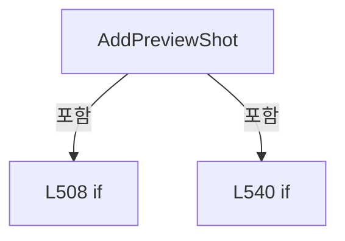

변경 전 점검: 입력/반환 타입, 위 호출자, 예외/취소 경로, 공유 상태와 저장·전송 소비자를 함께 확인합니다. 값의 단위나 물리 방향을 이름만으로 확정하지 않습니다.

### MethodDeclaration `DrawInspectionPoints` · L883–941

[Drilling.UI/Menu/Menus/CReviewGlassPreviewBuilder.cs:883–941](https://github.com/kjuws10-rgb/A3Drilling/blob/28764c91d521777b8ee068dd7aaf2d3902ce9fe2/Drilling.UI/Menu/Menus/CReviewGlassPreviewBuilder.cs#L883-L941)

| 항목 | 실제 추출 값 |
| --- | --- |
| 서명 | void Drilling.UI.Menu.Menus.CReviewGlassPreviewBuilder.DrawInspectionPoints(DrawingContext, System.Collections.Generic.IReadOnlyList<Drilling.Common.Review.ST_REVIEW_PLAN_POINT>, Drilling.Common.Review.EN_REVIEW_CORRECTION_RULE?, Drilling.UI.Menu.Menus.ST_GLASS_PREVIEW_FRAME, double, System.Collections.Generic.IReadOnlyDictionary<int, Drilling.UI.Menu.Menus.CReviewGlassPreviewBuilder.ST_REVIEW_CELL_DISPLAY>) |
| 접근/수식자 | Private / private, static |
| 반환/값 타입 | void |
| 소속 타입 | NamedType:Drilling.UI.Menu.Menus.CReviewGlassPreviewBuilder |

입력 계약:

| 이름 | 타입 | 전달 | 선택/기본값 |
| --- | --- | --- | --- |
| context | DrawingContext | None | False /  |
| inspectionPoints | System.Collections.Generic.IReadOnlyList<Drilling.Common.Review.ST_REVIEW_PLAN_POINT> | None | False /  |
| inspectionRule | Drilling.Common.Review.EN_REVIEW_CORRECTION_RULE? | None | False /  |
| frame | Drilling.UI.Menu.Menus.ST_GLASS_PREVIEW_FRAME | None | False /  |
| scale | double | None | False /  |
| cellDisplays | System.Collections.Generic.IReadOnlyDictionary<int, Drilling.UI.Menu.Menus.CReviewGlassPreviewBuilder.ST_REVIEW_CELL_DISPLAY> | None | False /  |

현재 부분 분석에서 직접 연결된 호출자는 없습니다. XAML/이벤트/인터페이스·델리게이트·외부 진입을 추가 확인해야 하며, 미사용으로 판정한 것이 아닙니다.

호출하는 대상과 해석 범위:

| 원본 행 | 표현식 | 분석 상태 | 대상/소스 위치 |
| --- | --- | --- | --- |
| 900 | DrawFineInspectionLines | resolved | void Drilling.UI.Menu.Menus.CReviewGlassPreviewBuilder.DrawFineInspectionLines(DrawingContext, System.Collections.Generic.IReadOnlyList<Drilling.Common.Review.ST_REVIEW_PLAN_POINT>, Drilling.UI.Menu.Menus.ST_GLASS_PREVIEW_FRAME, double) · Drilling.UI/Menu/Menus/CReviewGlassPreviewBuilder.cs:1002 |
| 906 | DrawEdgeInspectionAreas | resolved | void Drilling.UI.Menu.Menus.CReviewGlassPreviewBuilder.DrawEdgeInspectionAreas(DrawingContext, System.Collections.Generic.IReadOnlyList<Drilling.Common.Review.ST_REVIEW_PLAN_POINT>, Drilling.UI.Menu.Menus.ST_GLASS_PREVIEW_FRAME, double, System.Collections.Generic.IReadOnlyDictionary<int, Drilling.UI.Menu.Menus.CReviewGlassPreviewBuilder.ST_REVIEW_CELL_DISPLAY>) · Drilling.UI/Menu/Menus/CReviewGlassPreviewBuilder.cs:943 |
| 917 | new StreamGeometry | unresolved | None |
| 918 | geometry.Open | unresolved | None |
| 922 | TryProjectCellPoint | resolved | bool Drilling.UI.Menu.Menus.CReviewGlassPreviewBuilder.TryProjectCellPoint(Drilling.Common.Review.ST_REVIEW_PLAN_POINT, Drilling.UI.Menu.Menus.ST_GLASS_PREVIEW_FRAME, double, out Point) · Drilling.UI/Menu/Menus/CReviewGlassPreviewBuilder.cs:1051 |
| 931 | AddCircle | candidate | OverloadResolutionFailure |
| 939 | geometry.Freeze | unresolved | None |
| 940 | context.DrawGeometry | unresolved | None |
| 940 | CStatusBrush.Frozen | resolved | SolidColorBrush Drilling.UI.Menu.Menus.CStatusBrush.Frozen(byte, byte, byte) · Drilling.UI/Menu/Menus/CMenuBase.cs:330 |

본문의 실제 연산·분기·예외·반환 순서(원문 위치 순):

| 원본 행 | 종류 | 주석 해설 |
| --- | --- | --- |
| 898 | if | 조건에 따라 분기합니다: if (inspectionRule == EN_REVIEW_CORRECTION_RULE.Fine) |
| 900 | call | 함수·델리게이트 또는 객체 생성자를 호출합니다: DrawFineInspectionLines(context, inspectionPoints, frame, scale) |
| 901 | return | 호출자에게 값 또는 제어를 반환합니다: return; |
| 904 | if | 조건에 따라 분기합니다: if (inspectionRule == EN_REVIEW_CORRECTION_RULE.Edge) |
| 906 | call | 함수·델리게이트 또는 객체 생성자를 호출합니다: DrawEdgeInspectionAreas(context, inspectionPoints, frame, scale, cellDisplays) |
| 907 | return | 호출자에게 값 또는 제어를 반환합니다: return; |
| 912 | if | 조건에 따라 분기합니다: if (inspectionRule == EN_REVIEW_CORRECTION_RULE.Rough) |
| 914 | return | 호출자에게 값 또는 제어를 반환합니다: return; |
| 917 | call | 함수·델리게이트 또는 객체 생성자를 호출합니다: new StreamGeometry() |
| 917 | local-declaration | 지역 변수를 선언합니다: var geometry = new StreamGeometry(); |
| 917 | variable-initializer | 변수의 초기값을 지정합니다: geometry = new StreamGeometry() |
| 918 | call | 함수·델리게이트 또는 객체 생성자를 호출합니다: geometry.Open() |
| 918 | variable-initializer | 변수의 초기값을 지정합니다: geometryContext = geometry.Open() |
| 918 | using | 자원 사용과 정리 범위를 지정합니다: using (var geometryContext = geometry.Open()) |
| 920 | foreach | 컬렉션 요소를 순회합니다: foreach (var point in inspectionPoints) |
| 922 | call | 함수·델리게이트 또는 객체 생성자를 호출합니다: TryProjectCellPoint( point, frame, scale, out var canvasPoint) |
| 922 | if | 조건에 따라 분기합니다: if (!TryProjectCellPoint( point, frame, scale, out var canvasPoint)) |
| 928 | continue | 다음 반복으로 진행합니다: continue; |
| 931 | call | 함수·델리게이트 또는 객체 생성자를 호출합니다: AddCircle( geometryContext, canvasPoint.X, canvasPoint.Y, 1.4) |
| 939 | call | 함수·델리게이트 또는 객체 생성자를 호출합니다: geometry.Freeze() |
| 940 | call | 함수·델리게이트 또는 객체 생성자를 호출합니다: context.DrawGeometry(CStatusBrush.Frozen(0xFF, 0xC6, 0x29), null, geometry) |
| 940 | call | 함수·델리게이트 또는 객체 생성자를 호출합니다: CStatusBrush.Frozen(0xFF, 0xC6, 0x29) |

제어 구문의 포함 구조(실제 실행 순서/CFG가 아닌 구문 탐색 그림):

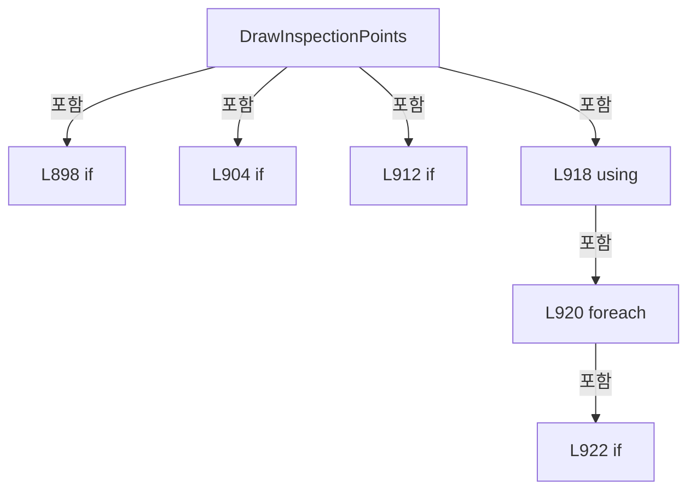

변경 전 점검: 입력/반환 타입, 위 호출자, 예외/취소 경로, 공유 상태와 저장·전송 소비자를 함께 확인합니다. 값의 단위나 물리 방향을 이름만으로 확정하지 않습니다.

### MethodDeclaration `DrawEdgeInspectionAreas` · L943–1000

[Drilling.UI/Menu/Menus/CReviewGlassPreviewBuilder.cs:943–1000](https://github.com/kjuws10-rgb/A3Drilling/blob/28764c91d521777b8ee068dd7aaf2d3902ce9fe2/Drilling.UI/Menu/Menus/CReviewGlassPreviewBuilder.cs#L943-L1000)

| 항목 | 실제 추출 값 |
| --- | --- |
| 서명 | void Drilling.UI.Menu.Menus.CReviewGlassPreviewBuilder.DrawEdgeInspectionAreas(DrawingContext, System.Collections.Generic.IReadOnlyList<Drilling.Common.Review.ST_REVIEW_PLAN_POINT>, Drilling.UI.Menu.Menus.ST_GLASS_PREVIEW_FRAME, double, System.Collections.Generic.IReadOnlyDictionary<int, Drilling.UI.Menu.Menus.CReviewGlassPreviewBuilder.ST_REVIEW_CELL_DISPLAY>) |
| 접근/수식자 | Private / private, static |
| 반환/값 타입 | void |
| 소속 타입 | NamedType:Drilling.UI.Menu.Menus.CReviewGlassPreviewBuilder |

입력 계약:

| 이름 | 타입 | 전달 | 선택/기본값 |
| --- | --- | --- | --- |
| context | DrawingContext | None | False /  |
| inspectionPoints | System.Collections.Generic.IReadOnlyList<Drilling.Common.Review.ST_REVIEW_PLAN_POINT> | None | False /  |
| frame | Drilling.UI.Menu.Menus.ST_GLASS_PREVIEW_FRAME | None | False /  |
| scale | double | None | False /  |
| cellDisplays | System.Collections.Generic.IReadOnlyDictionary<int, Drilling.UI.Menu.Menus.CReviewGlassPreviewBuilder.ST_REVIEW_CELL_DISPLAY> | None | False /  |

정적 호출자로 확인된 위치:

| 호출 파일/행 | 호출 표현식 | 런타임 분기 가능 |
| --- | --- | --- |
| [Drilling.UI/Menu/Menus/CReviewGlassPreviewBuilder.cs:906–906](https://github.com/kjuws10-rgb/A3Drilling/blob/28764c91d521777b8ee068dd7aaf2d3902ce9fe2/Drilling.UI/Menu/Menus/CReviewGlassPreviewBuilder.cs#L906-L906) | DrawEdgeInspectionAreas | False |

호출하는 대상과 해석 범위:

| 원본 행 | 표현식 | 분석 상태 | 대상/소스 위치 |
| --- | --- | --- | --- |
| 956 | new DashStyle | unresolved | None |
| 957 | dashStyle.Freeze | unresolved | None |
| 958 | new Pen | unresolved | None |
| 958 | CStatusBrush.Frozen | resolved | SolidColorBrush Drilling.UI.Menu.Menus.CStatusBrush.Frozen(byte, byte, byte) · Drilling.UI/Menu/Menus/CMenuBase.cs:330 |
| 963 | edgePen.Freeze | unresolved | None |
| 964 | inspectionPoints.GroupBy | resolved | System.Collections.Generic.IEnumerable<System.Linq.IGrouping<int, Drilling.Common.Review.ST_REVIEW_PLAN_POINT>> System.Collections.Generic.IEnumerable<Drilling.Common.Review.ST_REVIEW_PLAN_POINT>.GroupBy<Drilling.Common.Review.ST_REVIEW_PLAN_POINT, int>(System.Func<Drilling.Common.Review.ST_REVIEW_PLAN_POINT, int>) |
| 966 | cellDisplays.TryGetValue | resolved · 동적 구현 선택 가능 | bool System.Collections.Generic.IReadOnlyDictionary<int, Drilling.UI.Menu.Menus.CReviewGlassPreviewBuilder.ST_REVIEW_CELL_DISPLAY>.TryGetValue(int, out Drilling.UI.Menu.Menus.CReviewGlassPreviewBuilder.ST_REVIEW_CELL_DISPLAY) |
| 968 | context.DrawRectangle | unresolved | None |
| 972 | cell .Select(point => TryProjectCellPoint( point, frame, scale, out var canvasPoint) ? new Point?(canvasPoint) : null) .Where(point => point.HasValue) .Select(point => point!.Value) .ToArray | unresolved | None |
| 972 | cell .Select(point => TryProjectCellPoint( point, frame, scale, out var canvasPoint) ? new Point?(canvasPoint) : null) .Where(point => point.HasValue) .Select | unresolved | None |
| 972 | cell .Select(point => TryProjectCellPoint( point, frame, scale, out var canvasPoint) ? new Point?(canvasPoint) : null) .Where | unresolved | None |
| 972 | cell .Select | candidate | OverloadResolutionFailure |
| 973 | TryProjectCellPoint | resolved | bool Drilling.UI.Menu.Menus.CReviewGlassPreviewBuilder.TryProjectCellPoint(Drilling.Common.Review.ST_REVIEW_PLAN_POINT, Drilling.UI.Menu.Menus.ST_GLASS_PREVIEW_FRAME, double, out Point) · Drilling.UI/Menu/Menus/CReviewGlassPreviewBuilder.cs:1051 |
| 978 | new Point? | resolved | Point?.Nullable(Point) |
| 988 | projected.Min | unresolved | None |
| 989 | projected.Max | unresolved | None |
| 990 | projected.Min | unresolved | None |
| 991 | projected.Max | unresolved | None |
| 994 | context.DrawRectangle | unresolved | None |
| 997 | new Rect | unresolved | None |

본문의 실제 연산·분기·예외·반환 순서(원문 위치 순):

| 원본 행 | 종류 | 주석 해설 |
| --- | --- | --- |
| 956 | call | 함수·델리게이트 또는 객체 생성자를 호출합니다: new DashStyle([3.0, 3.0], 0.0) |
| 956 | local-declaration | 지역 변수를 선언합니다: var dashStyle = new DashStyle([3.0, 3.0], 0.0); |
| 956 | variable-initializer | 변수의 초기값을 지정합니다: dashStyle = new DashStyle([3.0, 3.0], 0.0) |
| 957 | call | 함수·델리게이트 또는 객체 생성자를 호출합니다: dashStyle.Freeze() |
| 958 | call | 함수·델리게이트 또는 객체 생성자를 호출합니다: CStatusBrush.Frozen(0x4F, 0x91, 0xB8) |
| 958 | call | 함수·델리게이트 또는 객체 생성자를 호출합니다: new Pen(CStatusBrush.Frozen(0x4F, 0x91, 0xB8), 1.15) { DashStyle = dashStyle, DashCap = PenLineCap.Round } |
| 958 | local-declaration | 지역 변수를 선언합니다: var edgePen = new Pen(CStatusBrush.Frozen(0x4F, 0x91, 0xB8), 1.15) { DashStyle = dashStyle, DashCap = PenLineCap.Round }; |
| 958 | variable-initializer | 변수의 초기값을 지정합니다: edgePen = new Pen(CStatusBrush.Frozen(0x4F, 0x91, 0xB8), 1.15) { DashStyle = dashStyle, DashCap = PenLineCap.Round } |
| 960 | assignment | 값을 대상에 대입합니다: DashStyle = dashStyle |
| 961 | assignment | 값을 대상에 대입합니다: DashCap = PenLineCap.Round |
| 963 | call | 함수·델리게이트 또는 객체 생성자를 호출합니다: edgePen.Freeze() |
| 964 | call | 함수·델리게이트 또는 객체 생성자를 호출합니다: inspectionPoints.GroupBy(point => point.CellNo) |
| 964 | foreach | 컬렉션 요소를 순회합니다: foreach (var cell in inspectionPoints.GroupBy(point => point.CellNo)) |
| 966 | call | 함수·델리게이트 또는 객체 생성자를 호출합니다: cellDisplays.TryGetValue(cell.Key, out var display) |
| 966 | if | 조건에 따라 분기합니다: if (cellDisplays.TryGetValue(cell.Key, out var display)) |
| 968 | call | 함수·델리게이트 또는 객체 생성자를 호출합니다: context.DrawRectangle(null, edgePen, display.ActualBounds) |
| 969 | continue | 다음 반복으로 진행합니다: continue; |
| 972 | call | 함수·델리게이트 또는 객체 생성자를 호출합니다: cell .Select(point => TryProjectCellPoint( point, frame, scale, out var canvasPoint) ? new Point?(canvasPoint) : null) |
| 972 | call | 함수·델리게이트 또는 객체 생성자를 호출합니다: cell .Select(point => TryProjectCellPoint( point, frame, scale, out var canvasPoint) ? new Point?(canvasPoint) : null) .Where(point => point.HasValue) |
| 972 | call | 함수·델리게이트 또는 객체 생성자를 호출합니다: cell .Select(point => TryProjectCellPoint( point, frame, scale, out var canvasPoint) ? new Point?(canvasPoint) : null) .Where(point => point.HasValue) .Select(point => point!.Value) |
| 972 | call | 함수·델리게이트 또는 객체 생성자를 호출합니다: cell .Select(point => TryProjectCellPoint( point, frame, scale, out var canvasPoint) ? new Point?(canvasPoint) : null) .Where(point => point.HasValue) .Select(point => point!.Value) .ToArray() |
| 972 | local-declaration | 지역 변수를 선언합니다: var projected = cell .Select(point => TryProjectCellPoint( point, frame, scale, out var canvasPoint) ? new Point?(canvasPoint) : null) .Where(point => point.HasValue) .Select(point => point!.Value) .ToArray(); |
| 972 | variable-initializer | 변수의 초기값을 지정합니다: projected = cell .Select(point => TryProjectCellPoint( point, frame, scale, out var canvasPoint) ? new Point?(canvasPoint) : null) .Where(point => point.HasValue) .Select(point => point!.Value) .ToArray() |
| 973 | call | 함수·델리게이트 또는 객체 생성자를 호출합니다: TryProjectCellPoint( point, frame, scale, out var canvasPoint) |
| 973 | conditional-expression | 조건에 따라 결과식을 선택합니다: TryProjectCellPoint( point, frame, scale, out var canvasPoint) ? new Point?(canvasPoint) : null |
| 978 | call | 함수·델리게이트 또는 객체 생성자를 호출합니다: new Point?(canvasPoint) |
| 983 | if | 조건에 따라 분기합니다: if (projected.Length == 0) |
| 985 | continue | 다음 반복으로 진행합니다: continue; |
| 988 | call | 함수·델리게이트 또는 객체 생성자를 호출합니다: projected.Min(point => point.X) |
| 988 | local-declaration | 지역 변수를 선언합니다: var minimumX = projected.Min(point => point.X); |
| 988 | variable-initializer | 변수의 초기값을 지정합니다: minimumX = projected.Min(point => point.X) |
| 989 | call | 함수·델리게이트 또는 객체 생성자를 호출합니다: projected.Max(point => point.X) |
| 989 | local-declaration | 지역 변수를 선언합니다: var maximumX = projected.Max(point => point.X); |
| 989 | variable-initializer | 변수의 초기값을 지정합니다: maximumX = projected.Max(point => point.X) |
| 990 | call | 함수·델리게이트 또는 객체 생성자를 호출합니다: projected.Min(point => point.Y) |
| 990 | local-declaration | 지역 변수를 선언합니다: var minimumY = projected.Min(point => point.Y); |
| 990 | variable-initializer | 변수의 초기값을 지정합니다: minimumY = projected.Min(point => point.Y) |
| 991 | call | 함수·델리게이트 또는 객체 생성자를 호출합니다: projected.Max(point => point.Y) |
| 991 | local-declaration | 지역 변수를 선언합니다: var maximumY = projected.Max(point => point.Y); |
| 991 | variable-initializer | 변수의 초기값을 지정합니다: maximumY = projected.Max(point => point.Y) |
| 992 | if | 조건에 따라 분기합니다: if (maximumX > minimumX && maximumY > minimumY) |
| 994 | call | 함수·델리게이트 또는 객체 생성자를 호출합니다: context.DrawRectangle( null, edgePen, new Rect(minimumX, minimumY, maximumX - minimumX, maximumY - minimumY)) |
| 997 | call | 함수·델리게이트 또는 객체 생성자를 호출합니다: new Rect(minimumX, minimumY, maximumX - minimumX, maximumY - minimumY) |

제어 구문의 포함 구조(실제 실행 순서/CFG가 아닌 구문 탐색 그림):

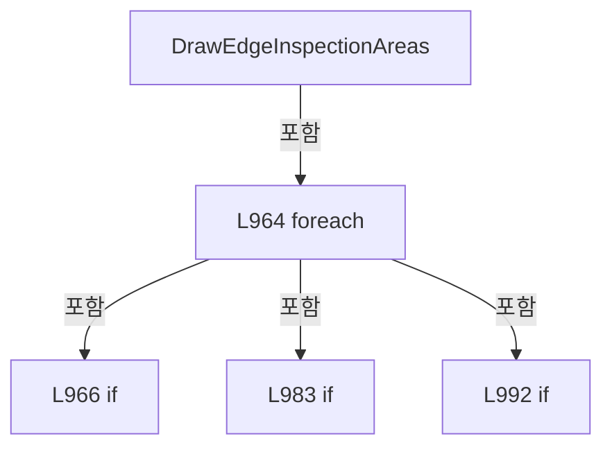

변경 전 점검: 입력/반환 타입, 위 호출자, 예외/취소 경로, 공유 상태와 저장·전송 소비자를 함께 확인합니다. 값의 단위나 물리 방향을 이름만으로 확정하지 않습니다.

### MethodDeclaration `DrawFineInspectionLines` · L1002–1049

[Drilling.UI/Menu/Menus/CReviewGlassPreviewBuilder.cs:1002–1049](https://github.com/kjuws10-rgb/A3Drilling/blob/28764c91d521777b8ee068dd7aaf2d3902ce9fe2/Drilling.UI/Menu/Menus/CReviewGlassPreviewBuilder.cs#L1002-L1049)

| 항목 | 실제 추출 값 |
| --- | --- |
| 서명 | void Drilling.UI.Menu.Menus.CReviewGlassPreviewBuilder.DrawFineInspectionLines(DrawingContext, System.Collections.Generic.IReadOnlyList<Drilling.Common.Review.ST_REVIEW_PLAN_POINT>, Drilling.UI.Menu.Menus.ST_GLASS_PREVIEW_FRAME, double) |
| 접근/수식자 | Private / private, static |
| 반환/값 타입 | void |
| 소속 타입 | NamedType:Drilling.UI.Menu.Menus.CReviewGlassPreviewBuilder |

입력 계약:

| 이름 | 타입 | 전달 | 선택/기본값 |
| --- | --- | --- | --- |
| context | DrawingContext | None | False /  |
| inspectionPoints | System.Collections.Generic.IReadOnlyList<Drilling.Common.Review.ST_REVIEW_PLAN_POINT> | None | False /  |
| frame | Drilling.UI.Menu.Menus.ST_GLASS_PREVIEW_FRAME | None | False /  |
| scale | double | None | False /  |

정적 호출자로 확인된 위치:

| 호출 파일/행 | 호출 표현식 | 런타임 분기 가능 |
| --- | --- | --- |
| [Drilling.UI/Menu/Menus/CReviewGlassPreviewBuilder.cs:900–900](https://github.com/kjuws10-rgb/A3Drilling/blob/28764c91d521777b8ee068dd7aaf2d3902ce9fe2/Drilling.UI/Menu/Menus/CReviewGlassPreviewBuilder.cs#L900-L900) | DrawFineInspectionLines | False |

호출하는 대상과 해석 범위:

| 원본 행 | 표현식 | 분석 상태 | 대상/소스 위치 |
| --- | --- | --- | --- |
| 1008 | new Pen | unresolved | None |
| 1008 | CStatusBrush.Frozen | resolved | SolidColorBrush Drilling.UI.Menu.Menus.CStatusBrush.Frozen(byte, byte, byte) · Drilling.UI/Menu/Menus/CMenuBase.cs:330 |
| 1013 | linePen.Freeze | unresolved | None |
| 1014 | inspectionPoints .Where(point => point.CellNo > 0 && point.HeadNo > 0 && double.IsFinite(point.DesignY)) .GroupBy(point => (point.CellNo, Y: Math.Round(point.DesignY, 6))) .OrderBy(group => group.Key.CellNo) .ThenBy(group => group.Key.Y) .ToArray | resolved | System.Linq.IGrouping<(int CellNo, double Y), Drilling.Common.Review.ST_REVIEW_PLAN_POINT>[] System.Collections.Generic.IEnumerable<System.Linq.IGrouping<(int CellNo, double Y), Drilling.Common.Review.ST_REVIEW_PLAN_POINT>>.ToArray<System.Linq.IGrouping<(int CellNo, double Y), Drilling.Common.Review.ST_REVIEW_PLAN_POINT>>() |
| 1014 | inspectionPoints .Where(point => point.CellNo > 0 && point.HeadNo > 0 && double.IsFinite(point.DesignY)) .GroupBy(point => (point.CellNo, Y: Math.Round(point.DesignY, 6))) .OrderBy(group => group.Key.CellNo) .ThenBy | resolved | System.Linq.IOrderedEnumerable<System.Linq.IGrouping<(int CellNo, double Y), Drilling.Common.Review.ST_REVIEW_PLAN_POINT>> System.Linq.IOrderedEnumerable<System.Linq.IGrouping<(int CellNo, double Y), Drilling.Common.Review.ST_REVIEW_PLAN_POINT>>.ThenBy<System.Linq.IGrouping<(int CellNo, double Y), Drilling.Common.Review.ST_REVIEW_PLAN_POINT>, double>(System.Func<System.Linq.IGrouping<(int CellNo, double Y), Drilling.Common.Review.ST_REVIEW_PLAN_POINT>, double>) |
| 1014 | inspectionPoints .Where(point => point.CellNo > 0 && point.HeadNo > 0 && double.IsFinite(point.DesignY)) .GroupBy(point => (point.CellNo, Y: Math.Round(point.DesignY, 6))) .OrderBy | resolved | System.Linq.IOrderedEnumerable<System.Linq.IGrouping<(int CellNo, double Y), Drilling.Common.Review.ST_REVIEW_PLAN_POINT>> System.Collections.Generic.IEnumerable<System.Linq.IGrouping<(int CellNo, double Y), Drilling.Common.Review.ST_REVIEW_PLAN_POINT>>.OrderBy<System.Linq.IGrouping<(int CellNo, double Y), Drilling.Common.Review.ST_REVIEW_PLAN_POINT>, int>(System.Func<System.Linq.IGrouping<(int CellNo, double Y), Drilling.Common.Review.ST_REVIEW_PLAN_POINT>, int>) |
| 1014 | inspectionPoints .Where(point => point.CellNo > 0 && point.HeadNo > 0 && double.IsFinite(point.DesignY)) .GroupBy | resolved | System.Collections.Generic.IEnumerable<System.Linq.IGrouping<(int CellNo, double Y), Drilling.Common.Review.ST_REVIEW_PLAN_POINT>> System.Collections.Generic.IEnumerable<Drilling.Common.Review.ST_REVIEW_PLAN_POINT>.GroupBy<Drilling.Common.Review.ST_REVIEW_PLAN_POINT, (int CellNo, double Y)>(System.Func<Drilling.Common.Review.ST_REVIEW_PLAN_POINT, (int CellNo, double Y)>) |
| 1014 | inspectionPoints .Where | resolved | System.Collections.Generic.IEnumerable<Drilling.Common.Review.ST_REVIEW_PLAN_POINT> System.Collections.Generic.IEnumerable<Drilling.Common.Review.ST_REVIEW_PLAN_POINT>.Where<Drilling.Common.Review.ST_REVIEW_PLAN_POINT>(System.Func<Drilling.Common.Review.ST_REVIEW_PLAN_POINT, bool>) |
| 1015 | double.IsFinite | resolved | bool double.IsFinite(double) |
| 1016 | Math.Round | resolved | double System.Math.Round(double, int) |
| 1023 | row .Select(point => TryProjectCellPoint( point, frame, scale, out var canvasPoint) ? new Point?(canvasPoint) : null) .Where(point => point.HasValue) .Select(point => point!.Value) .ToArray | unresolved | None |
| 1023 | row .Select(point => TryProjectCellPoint( point, frame, scale, out var canvasPoint) ? new Point?(canvasPoint) : null) .Where(point => point.HasValue) .Select | unresolved | None |
| 1023 | row .Select(point => TryProjectCellPoint( point, frame, scale, out var canvasPoint) ? new Point?(canvasPoint) : null) .Where | unresolved | None |
| 1023 | row .Select | candidate | OverloadResolutionFailure |
| 1024 | TryProjectCellPoint | resolved | bool Drilling.UI.Menu.Menus.CReviewGlassPreviewBuilder.TryProjectCellPoint(Drilling.Common.Review.ST_REVIEW_PLAN_POINT, Drilling.UI.Menu.Menus.ST_GLASS_PREVIEW_FRAME, double, out Point) · Drilling.UI/Menu/Menus/CReviewGlassPreviewBuilder.cs:1051 |
| 1029 | new Point? | resolved | Point?.Nullable(Point) |
| 1041 | projectedRow.Min | unresolved | None |
| 1042 | projectedRow.Max | unresolved | None |
| 1043 | projectedRow.Average | unresolved | None |
| 1044 | context.DrawLine | unresolved | None |
| 1046 | new Point | unresolved | None |
| 1047 | new Point | unresolved | None |

본문의 실제 연산·분기·예외·반환 순서(원문 위치 순):

| 원본 행 | 종류 | 주석 해설 |
| --- | --- | --- |
| 1008 | call | 함수·델리게이트 또는 객체 생성자를 호출합니다: CStatusBrush.Frozen(0x4F, 0x91, 0xB8) |
| 1008 | call | 함수·델리게이트 또는 객체 생성자를 호출합니다: new Pen(CStatusBrush.Frozen(0x4F, 0x91, 0xB8), 1.6) { StartLineCap = PenLineCap.Round, EndLineCap = PenLineCap.Round } |
| 1008 | local-declaration | 지역 변수를 선언합니다: var linePen = new Pen(CStatusBrush.Frozen(0x4F, 0x91, 0xB8), 1.6) { StartLineCap = PenLineCap.Round, EndLineCap = PenLineCap.Round }; |
| 1008 | variable-initializer | 변수의 초기값을 지정합니다: linePen = new Pen(CStatusBrush.Frozen(0x4F, 0x91, 0xB8), 1.6) { StartLineCap = PenLineCap.Round, EndLineCap = PenLineCap.Round } |
| 1010 | assignment | 값을 대상에 대입합니다: StartLineCap = PenLineCap.Round |
| 1011 | assignment | 값을 대상에 대입합니다: EndLineCap = PenLineCap.Round |
| 1013 | call | 함수·델리게이트 또는 객체 생성자를 호출합니다: linePen.Freeze() |
| 1014 | call | 함수·델리게이트 또는 객체 생성자를 호출합니다: inspectionPoints .Where(point => point.CellNo > 0 && point.HeadNo > 0 && double.IsFinite(point.DesignY)) |
| 1014 | call | 함수·델리게이트 또는 객체 생성자를 호출합니다: inspectionPoints .Where(point => point.CellNo > 0 && point.HeadNo > 0 && double.IsFinite(point.DesignY)) .GroupBy(point => (point.CellNo, Y: Math.Round(point.DesignY, 6))) |
| 1014 | call | 함수·델리게이트 또는 객체 생성자를 호출합니다: inspectionPoints .Where(point => point.CellNo > 0 && point.HeadNo > 0 && double.IsFinite(point.DesignY)) .GroupBy(point => (point.CellNo, Y: Math.Round(point.DesignY, 6))) .OrderBy(group => group.Key.CellNo) |
| 1014 | call | 함수·델리게이트 또는 객체 생성자를 호출합니다: inspectionPoints .Where(point => point.CellNo > 0 && point.HeadNo > 0 && double.IsFinite(point.DesignY)) .GroupBy(point => (point.CellNo, Y: Math.Round(point.DesignY, 6))) .OrderBy(group => group.Key.CellNo) .ThenBy(grou… |
| 1014 | call | 함수·델리게이트 또는 객체 생성자를 호출합니다: inspectionPoints .Where(point => point.CellNo > 0 && point.HeadNo > 0 && double.IsFinite(point.DesignY)) .GroupBy(point => (point.CellNo, Y: Math.Round(point.DesignY, 6))) .OrderBy(group => group.Key.CellNo) .ThenBy(grou… |
| 1014 | local-declaration | 지역 변수를 선언합니다: var rows = inspectionPoints .Where(point => point.CellNo > 0 && point.HeadNo > 0 && double.IsFinite(point.DesignY)) .GroupBy(point => (point.CellNo, Y: Math.Round(point.DesignY, 6))) .OrderBy(group => group.Key.CellNo) .ThenBy(gro |
| 1014 | variable-initializer | 변수의 초기값을 지정합니다: rows = inspectionPoints .Where(point => point.CellNo > 0 && point.HeadNo > 0 && double.IsFinite(point.DesignY)) .GroupBy(point => (point.CellNo, Y: Math.Round(point.DesignY, 6))) .OrderBy(group => group.Key.CellNo) .ThenBy(group = |
| 1015 | call | 함수·델리게이트 또는 객체 생성자를 호출합니다: double.IsFinite(point.DesignY) |
| 1016 | call | 함수·델리게이트 또는 객체 생성자를 호출합니다: Math.Round(point.DesignY, 6) |
| 1021 | foreach | 컬렉션 요소를 순회합니다: foreach (var row in rows) |
| 1023 | call | 함수·델리게이트 또는 객체 생성자를 호출합니다: row .Select(point => TryProjectCellPoint( point, frame, scale, out var canvasPoint) ? new Point?(canvasPoint) : null) |
| 1023 | call | 함수·델리게이트 또는 객체 생성자를 호출합니다: row .Select(point => TryProjectCellPoint( point, frame, scale, out var canvasPoint) ? new Point?(canvasPoint) : null) .Where(point => point.HasValue) |
| 1023 | call | 함수·델리게이트 또는 객체 생성자를 호출합니다: row .Select(point => TryProjectCellPoint( point, frame, scale, out var canvasPoint) ? new Point?(canvasPoint) : null) .Where(point => point.HasValue) .Select(point => point!.Value) |
| 1023 | call | 함수·델리게이트 또는 객체 생성자를 호출합니다: row .Select(point => TryProjectCellPoint( point, frame, scale, out var canvasPoint) ? new Point?(canvasPoint) : null) .Where(point => point.HasValue) .Select(point => point!.Value) .ToArray() |
| 1023 | local-declaration | 지역 변수를 선언합니다: var projectedRow = row .Select(point => TryProjectCellPoint( point, frame, scale, out var canvasPoint) ? new Point?(canvasPoint) : null) .Where(point => point.HasValue) .Select(point => point!.Value) .ToArray(); |
| 1023 | variable-initializer | 변수의 초기값을 지정합니다: projectedRow = row .Select(point => TryProjectCellPoint( point, frame, scale, out var canvasPoint) ? new Point?(canvasPoint) : null) .Where(point => point.HasValue) .Select(point => point!.Value) .ToArray() |
| 1024 | call | 함수·델리게이트 또는 객체 생성자를 호출합니다: TryProjectCellPoint( point, frame, scale, out var canvasPoint) |
| 1024 | conditional-expression | 조건에 따라 결과식을 선택합니다: TryProjectCellPoint( point, frame, scale, out var canvasPoint) ? new Point?(canvasPoint) : null |
| 1029 | call | 함수·델리게이트 또는 객체 생성자를 호출합니다: new Point?(canvasPoint) |
| 1034 | if | 조건에 따라 분기합니다: if (projectedRow.Length == 0) |
| 1036 | continue | 다음 반복으로 진행합니다: continue; |
| 1041 | call | 함수·델리게이트 또는 객체 생성자를 호출합니다: projectedRow.Min(point => point.X) |
| 1041 | local-declaration | 지역 변수를 선언합니다: var left = projectedRow.Min(point => point.X); |
| 1041 | variable-initializer | 변수의 초기값을 지정합니다: left = projectedRow.Min(point => point.X) |
| 1042 | call | 함수·델리게이트 또는 객체 생성자를 호출합니다: projectedRow.Max(point => point.X) |
| 1042 | local-declaration | 지역 변수를 선언합니다: var right = projectedRow.Max(point => point.X); |
| 1042 | variable-initializer | 변수의 초기값을 지정합니다: right = projectedRow.Max(point => point.X) |
| 1043 | call | 함수·델리게이트 또는 객체 생성자를 호출합니다: projectedRow.Average(point => point.Y) |
| 1043 | local-declaration | 지역 변수를 선언합니다: var y = projectedRow.Average(point => point.Y); |
| 1043 | variable-initializer | 변수의 초기값을 지정합니다: y = projectedRow.Average(point => point.Y) |
| 1044 | call | 함수·델리게이트 또는 객체 생성자를 호출합니다: context.DrawLine( linePen, new Point(left, y), new Point(right, y)) |
| 1046 | call | 함수·델리게이트 또는 객체 생성자를 호출합니다: new Point(left, y) |
| 1047 | call | 함수·델리게이트 또는 객체 생성자를 호출합니다: new Point(right, y) |

제어 구문의 포함 구조(실제 실행 순서/CFG가 아닌 구문 탐색 그림):

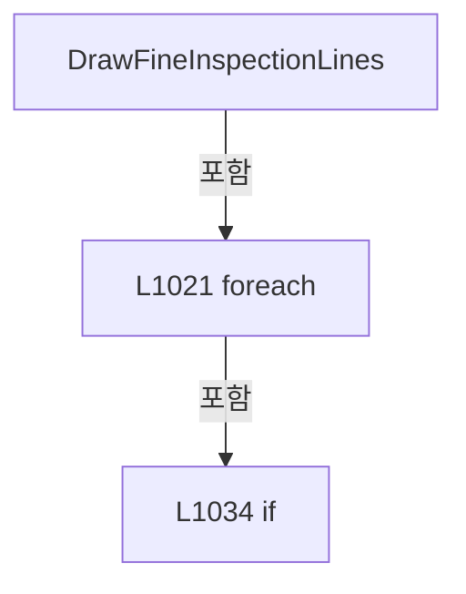

변경 전 점검: 입력/반환 타입, 위 호출자, 예외/취소 경로, 공유 상태와 저장·전송 소비자를 함께 확인합니다. 값의 단위나 물리 방향을 이름만으로 확정하지 않습니다.

### MethodDeclaration `TryProjectCellPoint` · L1051–1082

[Drilling.UI/Menu/Menus/CReviewGlassPreviewBuilder.cs:1051–1082](https://github.com/kjuws10-rgb/A3Drilling/blob/28764c91d521777b8ee068dd7aaf2d3902ce9fe2/Drilling.UI/Menu/Menus/CReviewGlassPreviewBuilder.cs#L1051-L1082)

| 항목 | 실제 추출 값 |
| --- | --- |
| 서명 | bool Drilling.UI.Menu.Menus.CReviewGlassPreviewBuilder.TryProjectCellPoint(Drilling.Common.Review.ST_REVIEW_PLAN_POINT, Drilling.UI.Menu.Menus.ST_GLASS_PREVIEW_FRAME, double, out Point) |
| 접근/수식자 | Private / private, static |
| 반환/값 타입 | bool |
| 소속 타입 | NamedType:Drilling.UI.Menu.Menus.CReviewGlassPreviewBuilder |

입력 계약:

| 이름 | 타입 | 전달 | 선택/기본값 |
| --- | --- | --- | --- |
| point | Drilling.Common.Review.ST_REVIEW_PLAN_POINT | None | False /  |
| frame | Drilling.UI.Menu.Menus.ST_GLASS_PREVIEW_FRAME | None | False /  |
| scale | double | None | False /  |
| canvasPoint | Point | Out | False /  |

정적 호출자로 확인된 위치:

| 호출 파일/행 | 호출 표현식 | 런타임 분기 가능 |
| --- | --- | --- |
| [Drilling.UI/Menu/Menus/CReviewGlassPreviewBuilder.cs:922–926](https://github.com/kjuws10-rgb/A3Drilling/blob/28764c91d521777b8ee068dd7aaf2d3902ce9fe2/Drilling.UI/Menu/Menus/CReviewGlassPreviewBuilder.cs#L922-L926) | TryProjectCellPoint | False |
| [Drilling.UI/Menu/Menus/CReviewGlassPreviewBuilder.cs:973–977](https://github.com/kjuws10-rgb/A3Drilling/blob/28764c91d521777b8ee068dd7aaf2d3902ce9fe2/Drilling.UI/Menu/Menus/CReviewGlassPreviewBuilder.cs#L973-L977) | TryProjectCellPoint | False |
| [Drilling.UI/Menu/Menus/CReviewGlassPreviewBuilder.cs:1024–1028](https://github.com/kjuws10-rgb/A3Drilling/blob/28764c91d521777b8ee068dd7aaf2d3902ce9fe2/Drilling.UI/Menu/Menus/CReviewGlassPreviewBuilder.cs#L1024-L1028) | TryProjectCellPoint | False |

호출하는 대상과 해석 범위:

| 원본 행 | 표현식 | 분석 상태 | 대상/소스 위치 |
| --- | --- | --- | --- |
| 1058 | TryProjectReviewPreviewPixel | resolved | bool Drilling.UI.Menu.Menus.CReviewGlassPreviewBuilder.TryProjectReviewPreviewPixel(double, double, Drilling.UI.Menu.Menus.ST_GLASS_PREVIEW_FRAME, double, out double, out double, out int, out int) · Drilling.UI/Menu/Menus/CReviewGlassPreviewBuilder.cs:1426 |
| 1080 | new Point | unresolved | None |

본문의 실제 연산·분기·예외·반환 순서(원문 위치 순):

| 원본 행 | 종류 | 주석 해설 |
| --- | --- | --- |
| 1057 | assignment | 값을 대상에 대입합니다: canvasPoint = default |
| 1058 | call | 함수·델리게이트 또는 객체 생성자를 호출합니다: TryProjectReviewPreviewPixel( point.DesignX, point.DesignY, frame, scale, out var canvasX, out var canvasY, out _, out _ ) |
| 1058 | if | 조건에 따라 분기합니다: if (!TryProjectReviewPreviewPixel( point.DesignX, point.DesignY, frame, scale, out var canvasX, out var canvasY, out _, out _ )) |
| 1077 | return | 호출자에게 값 또는 제어를 반환합니다: return false; |
| 1080 | assignment | 값을 대상에 대입합니다: canvasPoint = new Point(canvasX, canvasY) |
| 1080 | call | 함수·델리게이트 또는 객체 생성자를 호출합니다: new Point(canvasX, canvasY) |
| 1081 | return | 호출자에게 값 또는 제어를 반환합니다: return true; |

제어 구문의 포함 구조(실제 실행 순서/CFG가 아닌 구문 탐색 그림):

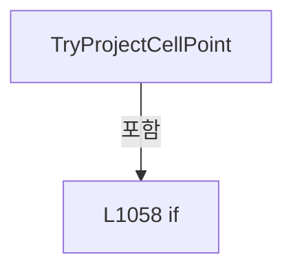

변경 전 점검: 입력/반환 타입, 위 호출자, 예외/취소 경로, 공유 상태와 저장·전송 소비자를 함께 확인합니다. 값의 단위나 물리 방향을 이름만으로 확정하지 않습니다.

### MethodDeclaration `TryGetHeadScopeBounds` · L1084–1117

[Drilling.UI/Menu/Menus/CReviewGlassPreviewBuilder.cs:1084–1117](https://github.com/kjuws10-rgb/A3Drilling/blob/28764c91d521777b8ee068dd7aaf2d3902ce9fe2/Drilling.UI/Menu/Menus/CReviewGlassPreviewBuilder.cs#L1084-L1117)

| 항목 | 실제 추출 값 |
| --- | --- |
| 서명 | bool Drilling.UI.Menu.Menus.CReviewGlassPreviewBuilder.TryGetHeadScopeBounds(System.Collections.Generic.IReadOnlyDictionary<(int CellNo, int HeadNo), (int FirstColumn, int LastColumn)>, int, int, int, Rect, out Rect) |
| 접근/수식자 | Private / private, static |
| 반환/값 타입 | bool |
| 소속 타입 | NamedType:Drilling.UI.Menu.Menus.CReviewGlassPreviewBuilder |

입력 계약:

| 이름 | 타입 | 전달 | 선택/기본값 |
| --- | --- | --- | --- |
| scopeColumns | System.Collections.Generic.IReadOnlyDictionary<(int CellNo, int HeadNo), (int FirstColumn, int LastColumn)> | None | False /  |
| cellNo | int | None | False /  |
| groupCountX | int | None | False /  |
| headNo | int | None | False /  |
| cellBounds | Rect | None | False /  |
| scopeBounds | Rect | Out | False /  |

현재 부분 분석에서 직접 연결된 호출자는 없습니다. XAML/이벤트/인터페이스·델리게이트·외부 진입을 추가 확인해야 하며, 미사용으로 판정한 것이 아닙니다.

호출하는 대상과 해석 범위:

| 원본 행 | 표현식 | 분석 상태 | 대상/소스 위치 |
| --- | --- | --- | --- |
| 1105 | scopeColumns.TryGetValue | resolved · 동적 구현 선택 가능 | bool System.Collections.Generic.IReadOnlyDictionary<(int CellNo, int HeadNo), (int FirstColumn, int LastColumn)>.TryGetValue((int CellNo, int HeadNo), out (int FirstColumn, int LastColumn)) |
| 1115 | new Rect | unresolved | None |

본문의 실제 연산·분기·예외·반환 순서(원문 위치 순):

| 원본 행 | 종류 | 주석 해설 |
| --- | --- | --- |
| 1099 | assignment | 값을 대상에 대입합니다: scopeBounds = Rect.Empty |
| 1100 | if | 조건에 따라 분기합니다: if (cellNo <= 0 &#124;&#124; groupCountX <= 0 &#124;&#124; headNo <= 0) |
| 1102 | return | 호출자에게 값 또는 제어를 반환합니다: return false; |
| 1105 | call | 함수·델리게이트 또는 객체 생성자를 호출합니다: scopeColumns.TryGetValue((cellNo, headNo), out var columns) |
| 1105 | if | 조건에 따라 분기합니다: if (!scopeColumns.TryGetValue((cellNo, headNo), out var columns) &#124;&#124; cellBounds.IsEmpty &#124;&#124; cellBounds.Width <= 0.0 &#124;&#124; cellBounds.Height <= 0.0) |
| 1110 | return | 호출자에게 값 또는 제어를 반환합니다: return false; |
| 1113 | local-declaration | 지역 변수를 선언합니다: var left = cellBounds.Left + (cellBounds.Width * columns.FirstColumn / groupCountX); |
| 1113 | variable-initializer | 변수의 초기값을 지정합니다: left = cellBounds.Left + (cellBounds.Width * columns.FirstColumn / groupCountX) |
| 1114 | local-declaration | 지역 변수를 선언합니다: var right = cellBounds.Left + (cellBounds.Width * (columns.LastColumn + 1) / groupCountX); |
| 1114 | variable-initializer | 변수의 초기값을 지정합니다: right = cellBounds.Left + (cellBounds.Width * (columns.LastColumn + 1) / groupCountX) |
| 1115 | assignment | 값을 대상에 대입합니다: scopeBounds = new Rect(left, cellBounds.Top, right - left, cellBounds.Height) |
| 1115 | call | 함수·델리게이트 또는 객체 생성자를 호출합니다: new Rect(left, cellBounds.Top, right - left, cellBounds.Height) |
| 1116 | return | 호출자에게 값 또는 제어를 반환합니다: return true; |

제어 구문의 포함 구조(실제 실행 순서/CFG가 아닌 구문 탐색 그림):

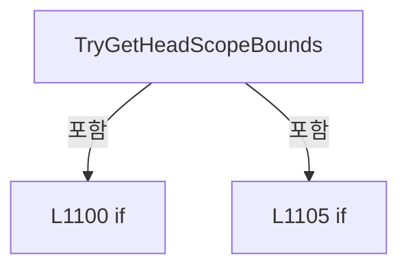

변경 전 점검: 입력/반환 타입, 위 호출자, 예외/취소 경로, 공유 상태와 저장·전송 소비자를 함께 확인합니다. 값의 단위나 물리 방향을 이름만으로 확정하지 않습니다.

### MethodDeclaration `BuildHeadScopeColumnIndex` · L1119–1154

[Drilling.UI/Menu/Menus/CReviewGlassPreviewBuilder.cs:1119–1154](https://github.com/kjuws10-rgb/A3Drilling/blob/28764c91d521777b8ee068dd7aaf2d3902ce9fe2/Drilling.UI/Menu/Menus/CReviewGlassPreviewBuilder.cs#L1119-L1154)

| 항목 | 실제 추출 값 |
| --- | --- |
| 서명 | System.Collections.Generic.IReadOnlyDictionary<(int CellNo, int HeadNo), (int FirstColumn, int LastColumn)> Drilling.UI.Menu.Menus.CReviewGlassPreviewBuilder.BuildHeadScopeColumnIndex(System.Collections.Generic.IReadOnlyList<Drilling.Common.Review.ST_REVIEW_PLAN_POINT>) |
| 접근/수식자 | Private / private, static |
| 반환/값 타입 | System.Collections.Generic.IReadOnlyDictionary<(int CellNo, int HeadNo), (int FirstColumn, int LastColumn)> |
| 소속 타입 | NamedType:Drilling.UI.Menu.Menus.CReviewGlassPreviewBuilder |

입력 계약:

| 이름 | 타입 | 전달 | 선택/기본값 |
| --- | --- | --- | --- |
| scopePoints | System.Collections.Generic.IReadOnlyList<Drilling.Common.Review.ST_REVIEW_PLAN_POINT> | None | False /  |

정적 호출자로 확인된 위치:

| 호출 파일/행 | 호출 표현식 | 런타임 분기 가능 |
| --- | --- | --- |
| [Drilling.UI/Menu/Menus/CReviewGlassPreviewBuilder.cs:270–270](https://github.com/kjuws10-rgb/A3Drilling/blob/28764c91d521777b8ee068dd7aaf2d3902ce9fe2/Drilling.UI/Menu/Menus/CReviewGlassPreviewBuilder.cs#L270-L270) | BuildHeadScopeColumnIndex | False |

호출하는 대상과 해석 범위:

| 원본 행 | 표현식 | 분석 상태 | 대상/소스 위치 |
| --- | --- | --- | --- |
| 1124 | new Dictionary< (int CellNo, int HeadNo), (int FirstColumn, int LastColumn)> | resolved | System.Collections.Generic.Dictionary<(int CellNo, int HeadNo), (int FirstColumn, int LastColumn)>.Dictionary() |
| 1141 | result.TryGetValue | resolved | bool System.Collections.Generic.Dictionary<(int CellNo, int HeadNo), (int FirstColumn, int LastColumn)>.TryGetValue((int CellNo, int HeadNo), out (int FirstColumn, int LastColumn)) |
| 1144 | Math.Min | resolved | int System.Math.Min(int, int) |
| 1145 | Math.Max | resolved | int System.Math.Max(int, int) |
| 1149 | result.Add | resolved | void System.Collections.Generic.Dictionary<(int CellNo, int HeadNo), (int FirstColumn, int LastColumn)>.Add((int CellNo, int HeadNo), (int FirstColumn, int LastColumn)) |

본문의 실제 연산·분기·예외·반환 순서(원문 위치 순):

| 원본 행 | 종류 | 주석 해설 |
| --- | --- | --- |
| 1124 | call | 함수·델리게이트 또는 객체 생성자를 호출합니다: new Dictionary< (int CellNo, int HeadNo), (int FirstColumn, int LastColumn)>() |
| 1124 | local-declaration | 지역 변수를 선언합니다: var result = new Dictionary< (int CellNo, int HeadNo), (int FirstColumn, int LastColumn)>(); |
| 1124 | variable-initializer | 변수의 초기값을 지정합니다: result = new Dictionary< (int CellNo, int HeadNo), (int FirstColumn, int LastColumn)>() |
| 1127 | foreach | 컬렉션 요소를 순회합니다: foreach (var point in scopePoints) |
| 1129 | if | 조건에 따라 분기합니다: if (point.CellNo <= 0 &#124;&#124; point.HeadNo <= 0 &#124;&#124; point.PixelCountX <= 0) |
| 1131 | continue | 다음 반복으로 진행합니다: continue; |
| 1134 | local-declaration | 지역 변수를 선언합니다: var column = (point.ShotNo - 1) % point.PixelCountX; |
| 1134 | variable-initializer | 변수의 초기값을 지정합니다: column = (point.ShotNo - 1) % point.PixelCountX |
| 1135 | if | 조건에 따라 분기합니다: if (column < 0) |
| 1137 | continue | 다음 반복으로 진행합니다: continue; |
| 1140 | local-declaration | 지역 변수를 선언합니다: var key = (point.CellNo, point.HeadNo); |
| 1140 | variable-initializer | 변수의 초기값을 지정합니다: key = (point.CellNo, point.HeadNo) |
| 1141 | call | 함수·델리게이트 또는 객체 생성자를 호출합니다: result.TryGetValue(key, out var columns) |
| 1141 | if | 조건에 따라 분기합니다: if (result.TryGetValue(key, out var columns)) |
| 1143 | assignment | 값을 대상에 대입합니다: result[key] = ( Math.Min(columns.FirstColumn, column), Math.Max(columns.LastColumn, column)) |
| 1144 | call | 함수·델리게이트 또는 객체 생성자를 호출합니다: Math.Min(columns.FirstColumn, column) |
| 1145 | call | 함수·델리게이트 또는 객체 생성자를 호출합니다: Math.Max(columns.LastColumn, column) |
| 1147 | else | 앞 조건이 거짓인 경로입니다: else |
| 1149 | call | 함수·델리게이트 또는 객체 생성자를 호출합니다: result.Add(key, (column, column)) |
| 1153 | return | 호출자에게 값 또는 제어를 반환합니다: return result; |

제어 구문의 포함 구조(실제 실행 순서/CFG가 아닌 구문 탐색 그림):

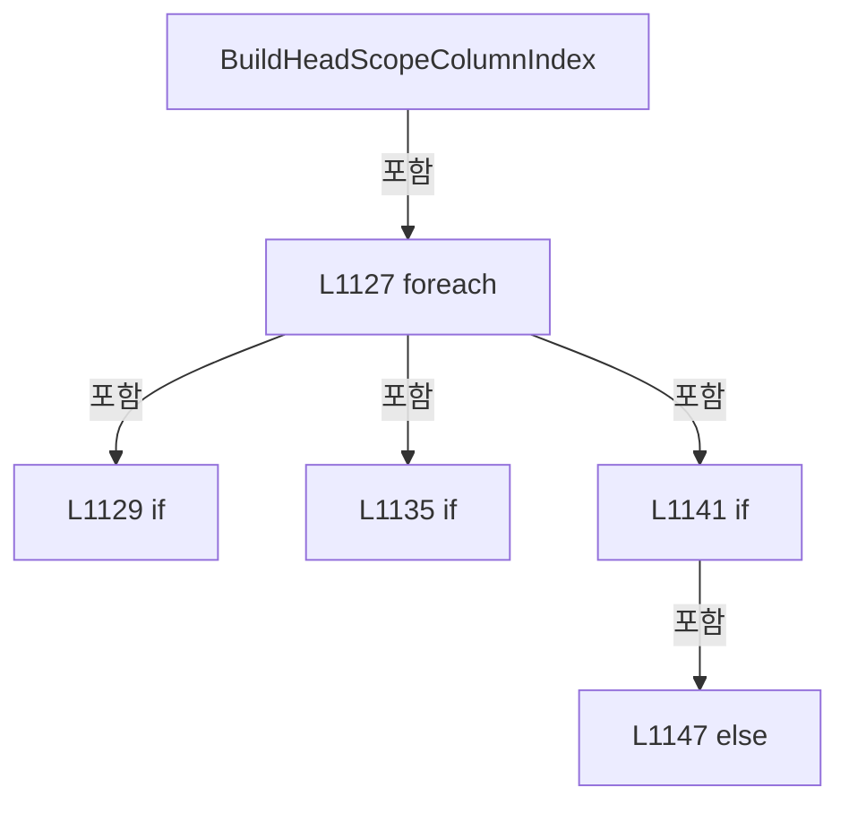

변경 전 점검: 입력/반환 타입, 위 호출자, 예외/취소 경로, 공유 상태와 저장·전송 소비자를 함께 확인합니다. 값의 단위나 물리 방향을 이름만으로 확정하지 않습니다.

### MethodDeclaration `AddScopeCorners` · L1156–1167

[Drilling.UI/Menu/Menus/CReviewGlassPreviewBuilder.cs:1156–1167](https://github.com/kjuws10-rgb/A3Drilling/blob/28764c91d521777b8ee068dd7aaf2d3902ce9fe2/Drilling.UI/Menu/Menus/CReviewGlassPreviewBuilder.cs#L1156-L1167)

| 항목 | 실제 추출 값 |
| --- | --- |
| 서명 | void Drilling.UI.Menu.Menus.CReviewGlassPreviewBuilder.AddScopeCorners(System.Collections.Generic.ICollection<Point>, Rect) |
| 접근/수식자 | Private / private, static |
| 반환/값 타입 | void |
| 소속 타입 | NamedType:Drilling.UI.Menu.Menus.CReviewGlassPreviewBuilder |

입력 계약:

| 이름 | 타입 | 전달 | 선택/기본값 |
| --- | --- | --- | --- |
| points | System.Collections.Generic.ICollection<Point> | None | False /  |
| bounds | Rect | None | False /  |

정적 호출자로 확인된 위치:

| 호출 파일/행 | 호출 표현식 | 런타임 분기 가능 |
| --- | --- | --- |
| [Drilling.UI/Menu/Menus/CReviewGlassPreviewBuilder.cs:403–403](https://github.com/kjuws10-rgb/A3Drilling/blob/28764c91d521777b8ee068dd7aaf2d3902ce9fe2/Drilling.UI/Menu/Menus/CReviewGlassPreviewBuilder.cs#L403-L403) | AddScopeCorners | False |
| [Drilling.UI/Menu/Menus/CReviewGlassPreviewBuilder.cs:459–459](https://github.com/kjuws10-rgb/A3Drilling/blob/28764c91d521777b8ee068dd7aaf2d3902ce9fe2/Drilling.UI/Menu/Menus/CReviewGlassPreviewBuilder.cs#L459-L459) | AddScopeCorners | False |

호출하는 대상과 해석 범위:

| 원본 행 | 표현식 | 분석 상태 | 대상/소스 위치 |
| --- | --- | --- | --- |
| 1163 | points.Add | candidate | OverloadResolutionFailure |
| 1164 | points.Add | candidate | OverloadResolutionFailure |
| 1165 | points.Add | candidate | OverloadResolutionFailure |
| 1166 | points.Add | candidate | OverloadResolutionFailure |

본문의 실제 연산·분기·예외·반환 순서(원문 위치 순):

| 원본 행 | 종류 | 주석 해설 |
| --- | --- | --- |
| 1158 | if | 조건에 따라 분기합니다: if (bounds.IsEmpty &#124;&#124; bounds.Width <= 0.0 &#124;&#124; bounds.Height <= 0.0) |
| 1160 | return | 호출자에게 값 또는 제어를 반환합니다: return; |
| 1163 | call | 함수·델리게이트 또는 객체 생성자를 호출합니다: points.Add(bounds.TopLeft) |
| 1164 | call | 함수·델리게이트 또는 객체 생성자를 호출합니다: points.Add(bounds.TopRight) |
| 1165 | call | 함수·델리게이트 또는 객체 생성자를 호출합니다: points.Add(bounds.BottomRight) |
| 1166 | call | 함수·델리게이트 또는 객체 생성자를 호출합니다: points.Add(bounds.BottomLeft) |

제어 구문의 포함 구조(실제 실행 순서/CFG가 아닌 구문 탐색 그림):

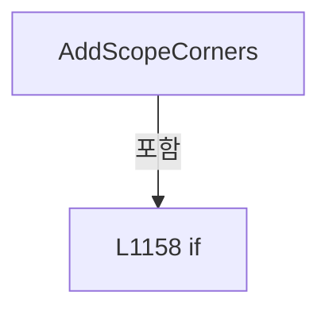

변경 전 점검: 입력/반환 타입, 위 호출자, 예외/취소 경로, 공유 상태와 저장·전송 소비자를 함께 확인합니다. 값의 단위나 물리 방향을 이름만으로 확정하지 않습니다.

### MethodDeclaration `DrawHeadScope` · L1169–1186

[Drilling.UI/Menu/Menus/CReviewGlassPreviewBuilder.cs:1169–1186](https://github.com/kjuws10-rgb/A3Drilling/blob/28764c91d521777b8ee068dd7aaf2d3902ce9fe2/Drilling.UI/Menu/Menus/CReviewGlassPreviewBuilder.cs#L1169-L1186)

| 항목 | 실제 추출 값 |
| --- | --- |
| 서명 | void Drilling.UI.Menu.Menus.CReviewGlassPreviewBuilder.DrawHeadScope(DrawingContext, int, Rect) |
| 접근/수식자 | Private / private, static |
| 반환/값 타입 | void |
| 소속 타입 | NamedType:Drilling.UI.Menu.Menus.CReviewGlassPreviewBuilder |

입력 계약:

| 이름 | 타입 | 전달 | 선택/기본값 |
| --- | --- | --- | --- |
| context | DrawingContext | None | False /  |
| headNo | int | None | False /  |
| scopeBounds | Rect | None | False /  |

정적 호출자로 확인된 위치:

| 호출 파일/행 | 호출 표현식 | 런타임 분기 가능 |
| --- | --- | --- |
| [Drilling.UI/Menu/Menus/CReviewGlassPreviewBuilder.cs:1291–1294](https://github.com/kjuws10-rgb/A3Drilling/blob/28764c91d521777b8ee068dd7aaf2d3902ce9fe2/Drilling.UI/Menu/Menus/CReviewGlassPreviewBuilder.cs#L1291-L1294) | DrawHeadScope | False |

호출하는 대상과 해석 범위:

| 원본 행 | 표현식 | 분석 상태 | 대상/소스 위치 |
| --- | --- | --- | --- |
| 1179 | CMenuMain.CreateHeadBrush | resolved | Brush Drilling.UI.Menu.Menus.CMenuMain.CreateHeadBrush(int, byte) · Drilling.UI/Menu/Menus/CMenuMain.cs:2246 |
| 1180 | new Pen | unresolved | None |
| 1180 | CMenuMain.CreateHeadBrush | resolved | Brush Drilling.UI.Menu.Menus.CMenuMain.CreateHeadBrush(int, byte) · Drilling.UI/Menu/Menus/CMenuMain.cs:2246 |
| 1184 | stroke.Freeze | unresolved | None |
| 1185 | context.DrawRectangle | unresolved | None |

본문의 실제 연산·분기·예외·반환 순서(원문 위치 순):

| 원본 행 | 종류 | 주석 해설 |
| --- | --- | --- |
| 1174 | if | 조건에 따라 분기합니다: if (headNo <= 0 &#124;&#124; scopeBounds.IsEmpty &#124;&#124; scopeBounds.Width <= 0.0 &#124;&#124; scopeBounds.Height <= 0.0) |
| 1176 | return | 호출자에게 값 또는 제어를 반환합니다: return; |
| 1179 | call | 함수·델리게이트 또는 객체 생성자를 호출합니다: CMenuMain.CreateHeadBrush(headNo, 0x58) |
| 1179 | local-declaration | 지역 변수를 선언합니다: var fill = CMenuMain.CreateHeadBrush(headNo, 0x58); |
| 1179 | variable-initializer | 변수의 초기값을 지정합니다: fill = CMenuMain.CreateHeadBrush(headNo, 0x58) |
| 1180 | call | 함수·델리게이트 또는 객체 생성자를 호출합니다: CMenuMain.CreateHeadBrush(headNo, 0xE6) |
| 1180 | call | 함수·델리게이트 또는 객체 생성자를 호출합니다: new Pen(CMenuMain.CreateHeadBrush(headNo, 0xE6), 2.0) { DashStyle = DashStyles.Dash } |
| 1180 | local-declaration | 지역 변수를 선언합니다: var stroke = new Pen(CMenuMain.CreateHeadBrush(headNo, 0xE6), 2.0) { DashStyle = DashStyles.Dash }; |
| 1180 | variable-initializer | 변수의 초기값을 지정합니다: stroke = new Pen(CMenuMain.CreateHeadBrush(headNo, 0xE6), 2.0) { DashStyle = DashStyles.Dash } |
| 1182 | assignment | 값을 대상에 대입합니다: DashStyle = DashStyles.Dash |
| 1184 | call | 함수·델리게이트 또는 객체 생성자를 호출합니다: stroke.Freeze() |
| 1185 | call | 함수·델리게이트 또는 객체 생성자를 호출합니다: context.DrawRectangle(fill, stroke, scopeBounds) |

제어 구문의 포함 구조(실제 실행 순서/CFG가 아닌 구문 탐색 그림):

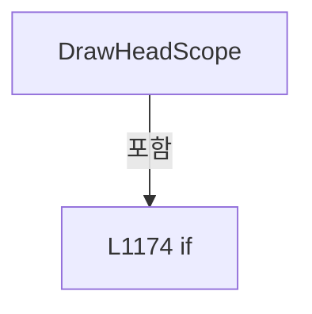

변경 전 점검: 입력/반환 타입, 위 호출자, 예외/취소 경로, 공유 상태와 저장·전송 소비자를 함께 확인합니다. 값의 단위나 물리 방향을 이름만으로 확정하지 않습니다.

### MethodDeclaration `DrawHeadCellScope` · L1188–1201

[Drilling.UI/Menu/Menus/CReviewGlassPreviewBuilder.cs:1188–1201](https://github.com/kjuws10-rgb/A3Drilling/blob/28764c91d521777b8ee068dd7aaf2d3902ce9fe2/Drilling.UI/Menu/Menus/CReviewGlassPreviewBuilder.cs#L1188-L1201)

| 항목 | 실제 추출 값 |
| --- | --- |
| 서명 | void Drilling.UI.Menu.Menus.CReviewGlassPreviewBuilder.DrawHeadCellScope(DrawingContext, int, Geometry) |
| 접근/수식자 | Private / private, static |
| 반환/값 타입 | void |
| 소속 타입 | NamedType:Drilling.UI.Menu.Menus.CReviewGlassPreviewBuilder |

입력 계약:

| 이름 | 타입 | 전달 | 선택/기본값 |
| --- | --- | --- | --- |
| context | DrawingContext | None | False /  |
| headNo | int | None | False /  |
| cellBoundary | Geometry | None | False /  |

정적 호출자로 확인된 위치:

| 호출 파일/행 | 호출 표현식 | 런타임 분기 가능 |
| --- | --- | --- |
| [Drilling.UI/Menu/Menus/CReviewGlassPreviewBuilder.cs:1316–1316](https://github.com/kjuws10-rgb/A3Drilling/blob/28764c91d521777b8ee068dd7aaf2d3902ce9fe2/Drilling.UI/Menu/Menus/CReviewGlassPreviewBuilder.cs#L1316-L1316) | DrawHeadCellScope | False |

호출하는 대상과 해석 범위:

| 원본 행 | 표현식 | 분석 상태 | 대상/소스 위치 |
| --- | --- | --- | --- |
| 1198 | new Pen | unresolved | None |
| 1198 | CMenuMain.CreateHeadBrush | resolved | Brush Drilling.UI.Menu.Menus.CMenuMain.CreateHeadBrush(int, byte) · Drilling.UI/Menu/Menus/CMenuMain.cs:2246 |
| 1199 | stroke.Freeze | unresolved | None |
| 1200 | context.DrawGeometry | unresolved | None |

본문의 실제 연산·분기·예외·반환 순서(원문 위치 순):

| 원본 행 | 종류 | 주석 해설 |
| --- | --- | --- |
| 1193 | if | 조건에 따라 분기합니다: if (headNo <= 0 &#124;&#124; cellBoundary.Bounds.IsEmpty) |
| 1195 | return | 호출자에게 값 또는 제어를 반환합니다: return; |
| 1198 | call | 함수·델리게이트 또는 객체 생성자를 호출합니다: new Pen(CMenuMain.CreateHeadBrush(headNo, 0xF2), 1.0) |
| 1198 | call | 함수·델리게이트 또는 객체 생성자를 호출합니다: CMenuMain.CreateHeadBrush(headNo, 0xF2) |
| 1198 | local-declaration | 지역 변수를 선언합니다: var stroke = new Pen(CMenuMain.CreateHeadBrush(headNo, 0xF2), 1.0); |
| 1198 | variable-initializer | 변수의 초기값을 지정합니다: stroke = new Pen(CMenuMain.CreateHeadBrush(headNo, 0xF2), 1.0) |
| 1199 | call | 함수·델리게이트 또는 객체 생성자를 호출합니다: stroke.Freeze() |
| 1200 | call | 함수·델리게이트 또는 객체 생성자를 호출합니다: context.DrawGeometry(null, stroke, cellBoundary) |

제어 구문의 포함 구조(실제 실행 순서/CFG가 아닌 구문 탐색 그림):

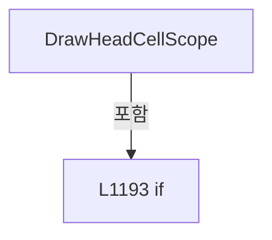

변경 전 점검: 입력/반환 타입, 위 호출자, 예외/취소 경로, 공유 상태와 저장·전송 소비자를 함께 확인합니다. 값의 단위나 물리 방향을 이름만으로 확정하지 않습니다.

### MethodDeclaration `DrawCurrentCellOutline` · L1203–1220

[Drilling.UI/Menu/Menus/CReviewGlassPreviewBuilder.cs:1203–1220](https://github.com/kjuws10-rgb/A3Drilling/blob/28764c91d521777b8ee068dd7aaf2d3902ce9fe2/Drilling.UI/Menu/Menus/CReviewGlassPreviewBuilder.cs#L1203-L1220)

| 항목 | 실제 추출 값 |
| --- | --- |
| 서명 | void Drilling.UI.Menu.Menus.CReviewGlassPreviewBuilder.DrawCurrentCellOutline(DrawingContext, Geometry) |
| 접근/수식자 | Private / private, static |
| 반환/값 타입 | void |
| 소속 타입 | NamedType:Drilling.UI.Menu.Menus.CReviewGlassPreviewBuilder |

입력 계약:

| 이름 | 타입 | 전달 | 선택/기본값 |
| --- | --- | --- | --- |
| context | DrawingContext | None | False /  |
| cellBoundary | Geometry | None | False /  |

현재 부분 분석에서 직접 연결된 호출자는 없습니다. XAML/이벤트/인터페이스·델리게이트·외부 진입을 추가 확인해야 하며, 미사용으로 판정한 것이 아닙니다.

호출하는 대상과 해석 범위:

| 원본 행 | 표현식 | 분석 상태 | 대상/소스 위치 |
| --- | --- | --- | --- |
| 1212 | new Pen | unresolved | None |
| 1213 | CReviewStatusBrush.ForState | resolved | Brush Drilling.UI.Menu.Menus.CReviewStatusBrush.ForState(Drilling.Common.Review.EN_REVIEW_POINT_STATE) · Drilling.UI/Menu/Menus/CMenuReview.cs:5844 |
| 1218 | stroke.Freeze | unresolved | None |
| 1219 | context.DrawGeometry | unresolved | None |

본문의 실제 연산·분기·예외·반환 순서(원문 위치 순):

| 원본 행 | 종류 | 주석 해설 |
| --- | --- | --- |
| 1207 | if | 조건에 따라 분기합니다: if (cellBoundary.Bounds.IsEmpty) |
| 1209 | return | 호출자에게 값 또는 제어를 반환합니다: return; |
| 1212 | call | 함수·델리게이트 또는 객체 생성자를 호출합니다: new Pen( CReviewStatusBrush.ForState(EN_REVIEW_POINT_STATE.Current), 2.4) { LineJoin = PenLineJoin.Round } |
| 1212 | local-declaration | 지역 변수를 선언합니다: var stroke = new Pen( CReviewStatusBrush.ForState(EN_REVIEW_POINT_STATE.Current), 2.4) { LineJoin = PenLineJoin.Round }; |
| 1212 | variable-initializer | 변수의 초기값을 지정합니다: stroke = new Pen( CReviewStatusBrush.ForState(EN_REVIEW_POINT_STATE.Current), 2.4) { LineJoin = PenLineJoin.Round } |
| 1213 | call | 함수·델리게이트 또는 객체 생성자를 호출합니다: CReviewStatusBrush.ForState(EN_REVIEW_POINT_STATE.Current) |
| 1216 | assignment | 값을 대상에 대입합니다: LineJoin = PenLineJoin.Round |
| 1218 | call | 함수·델리게이트 또는 객체 생성자를 호출합니다: stroke.Freeze() |
| 1219 | call | 함수·델리게이트 또는 객체 생성자를 호출합니다: context.DrawGeometry(null, stroke, cellBoundary) |

제어 구문의 포함 구조(실제 실행 순서/CFG가 아닌 구문 탐색 그림):

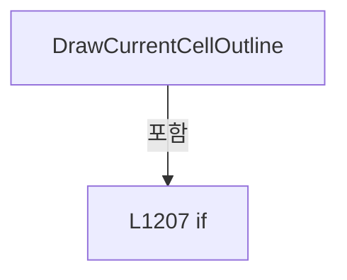

변경 전 점검: 입력/반환 타입, 위 호출자, 예외/취소 경로, 공유 상태와 저장·전송 소비자를 함께 확인합니다. 값의 단위나 물리 방향을 이름만으로 확정하지 않습니다.

### MethodDeclaration `DrawGlobalHeadScope` · L1222–1245

[Drilling.UI/Menu/Menus/CReviewGlassPreviewBuilder.cs:1222–1245](https://github.com/kjuws10-rgb/A3Drilling/blob/28764c91d521777b8ee068dd7aaf2d3902ce9fe2/Drilling.UI/Menu/Menus/CReviewGlassPreviewBuilder.cs#L1222-L1245)

| 항목 | 실제 추출 값 |
| --- | --- |
| 서명 | void Drilling.UI.Menu.Menus.CReviewGlassPreviewBuilder.DrawGlobalHeadScope(DrawingContext, int, System.Collections.Generic.IReadOnlyCollection<Point>) |
| 접근/수식자 | Private / private, static |
| 반환/값 타입 | void |
| 소속 타입 | NamedType:Drilling.UI.Menu.Menus.CReviewGlassPreviewBuilder |

입력 계약:

| 이름 | 타입 | 전달 | 선택/기본값 |
| --- | --- | --- | --- |
| context | DrawingContext | None | False /  |
| headNo | int | None | False /  |
| scopePoints | System.Collections.Generic.IReadOnlyCollection<Point> | None | False /  |

현재 부분 분석에서 직접 연결된 호출자는 없습니다. XAML/이벤트/인터페이스·델리게이트·외부 진입을 추가 확인해야 하며, 미사용으로 판정한 것이 아닙니다.

호출하는 대상과 해석 범위:

| 원본 행 | 표현식 | 분석 상태 | 대상/소스 위치 |
| --- | --- | --- | --- |
| 1227 | scopePoints.Min | resolved | ? System.Collections.Generic.IEnumerable<Point>.Min<Point, >(System.Func<Point, >) |
| 1228 | scopePoints.Min | resolved | ? System.Collections.Generic.IEnumerable<Point>.Min<Point, >(System.Func<Point, >) |
| 1229 | scopePoints.Max | resolved | ? System.Collections.Generic.IEnumerable<Point>.Max<Point, >(System.Func<Point, >) |
| 1230 | scopePoints.Max | resolved | ? System.Collections.Generic.IEnumerable<Point>.Max<Point, >(System.Func<Point, >) |
| 1231 | double.IsFinite | candidate | OverloadResolutionFailure |
| 1231 | double.IsFinite | candidate | OverloadResolutionFailure |
| 1232 | double.IsFinite | candidate | OverloadResolutionFailure |
| 1232 | double.IsFinite | candidate | OverloadResolutionFailure |
| 1238 | CMenuMain.CreateHeadBrush | resolved | Brush Drilling.UI.Menu.Menus.CMenuMain.CreateHeadBrush(int, byte) · Drilling.UI/Menu/Menus/CMenuMain.cs:2246 |
| 1239 | new Pen | unresolved | None |
| 1239 | CMenuMain.CreateHeadBrush | resolved | Brush Drilling.UI.Menu.Menus.CMenuMain.CreateHeadBrush(int, byte) · Drilling.UI/Menu/Menus/CMenuMain.cs:2246 |
| 1243 | stroke.Freeze | unresolved | None |
| 1244 | context.DrawRectangle | unresolved | None |
| 1244 | new Rect | unresolved | None |

본문의 실제 연산·분기·예외·반환 순서(원문 위치 순):

| 원본 행 | 종류 | 주석 해설 |
| --- | --- | --- |
| 1227 | call | 함수·델리게이트 또는 객체 생성자를 호출합니다: scopePoints.Min(point => point.X) |
| 1227 | local-declaration | 지역 변수를 선언합니다: var minX = scopePoints.Min(point => point.X); |
| 1227 | variable-initializer | 변수의 초기값을 지정합니다: minX = scopePoints.Min(point => point.X) |
| 1228 | call | 함수·델리게이트 또는 객체 생성자를 호출합니다: scopePoints.Min(point => point.Y) |
| 1228 | local-declaration | 지역 변수를 선언합니다: var minY = scopePoints.Min(point => point.Y); |
| 1228 | variable-initializer | 변수의 초기값을 지정합니다: minY = scopePoints.Min(point => point.Y) |
| 1229 | call | 함수·델리게이트 또는 객체 생성자를 호출합니다: scopePoints.Max(point => point.X) |
| 1229 | local-declaration | 지역 변수를 선언합니다: var maxX = scopePoints.Max(point => point.X); |
| 1229 | variable-initializer | 변수의 초기값을 지정합니다: maxX = scopePoints.Max(point => point.X) |
| 1230 | call | 함수·델리게이트 또는 객체 생성자를 호출합니다: scopePoints.Max(point => point.Y) |
| 1230 | local-declaration | 지역 변수를 선언합니다: var maxY = scopePoints.Max(point => point.Y); |
| 1230 | variable-initializer | 변수의 초기값을 지정합니다: maxY = scopePoints.Max(point => point.Y) |
| 1231 | call | 함수·델리게이트 또는 객체 생성자를 호출합니다: double.IsFinite(minX) |
| 1231 | call | 함수·델리게이트 또는 객체 생성자를 호출합니다: double.IsFinite(minY) |
| 1231 | if | 조건에 따라 분기합니다: if (!double.IsFinite(minX) &#124;&#124; !double.IsFinite(minY) &#124;&#124; !double.IsFinite(maxX) &#124;&#124; !double.IsFinite(maxY) &#124;&#124; maxX <= minX &#124;&#124; maxY <= minY) |
| 1232 | call | 함수·델리게이트 또는 객체 생성자를 호출합니다: double.IsFinite(maxX) |
| 1232 | call | 함수·델리게이트 또는 객체 생성자를 호출합니다: double.IsFinite(maxY) |
| 1235 | return | 호출자에게 값 또는 제어를 반환합니다: return; |
| 1238 | call | 함수·델리게이트 또는 객체 생성자를 호출합니다: CMenuMain.CreateHeadBrush(headNo, 0x58) |
| 1238 | local-declaration | 지역 변수를 선언합니다: var fill = CMenuMain.CreateHeadBrush(headNo, 0x58); |
| 1238 | variable-initializer | 변수의 초기값을 지정합니다: fill = CMenuMain.CreateHeadBrush(headNo, 0x58) |
| 1239 | call | 함수·델리게이트 또는 객체 생성자를 호출합니다: CMenuMain.CreateHeadBrush(headNo, 0xE6) |
| 1239 | call | 함수·델리게이트 또는 객체 생성자를 호출합니다: new Pen(CMenuMain.CreateHeadBrush(headNo, 0xE6), 2.0) { DashStyle = DashStyles.Dash } |
| 1239 | local-declaration | 지역 변수를 선언합니다: var stroke = new Pen(CMenuMain.CreateHeadBrush(headNo, 0xE6), 2.0) { DashStyle = DashStyles.Dash }; |
| 1239 | variable-initializer | 변수의 초기값을 지정합니다: stroke = new Pen(CMenuMain.CreateHeadBrush(headNo, 0xE6), 2.0) { DashStyle = DashStyles.Dash } |
| 1241 | assignment | 값을 대상에 대입합니다: DashStyle = DashStyles.Dash |
| 1243 | call | 함수·델리게이트 또는 객체 생성자를 호출합니다: stroke.Freeze() |
| 1244 | call | 함수·델리게이트 또는 객체 생성자를 호출합니다: context.DrawRectangle(fill, stroke, new Rect(minX, minY, maxX - minX, maxY - minY)) |
| 1244 | call | 함수·델리게이트 또는 객체 생성자를 호출합니다: new Rect(minX, minY, maxX - minX, maxY - minY) |

제어 구문의 포함 구조(실제 실행 순서/CFG가 아닌 구문 탐색 그림):

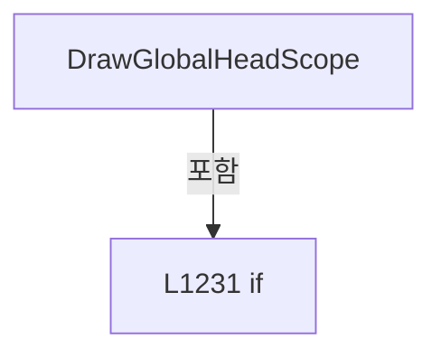

변경 전 점검: 입력/반환 타입, 위 호출자, 예외/취소 경로, 공유 상태와 저장·전송 소비자를 함께 확인합니다. 값의 단위나 물리 방향을 이름만으로 확정하지 않습니다.

### MethodDeclaration `DrawPhysicalHeadScope` · L1247–1317

[Drilling.UI/Menu/Menus/CReviewGlassPreviewBuilder.cs:1247–1317](https://github.com/kjuws10-rgb/A3Drilling/blob/28764c91d521777b8ee068dd7aaf2d3902ce9fe2/Drilling.UI/Menu/Menus/CReviewGlassPreviewBuilder.cs#L1247-L1317)

| 항목 | 실제 추출 값 |
| --- | --- |
| 서명 | void Drilling.UI.Menu.Menus.CReviewGlassPreviewBuilder.DrawPhysicalHeadScope(DrawingContext, int, Drilling.Common.Review.ST_REVIEW_HEAD_SCOPE, System.Collections.Generic.IReadOnlyDictionary<int, Drilling.UI.Menu.Menus.CReviewGlassPreviewBuilder.ST_REVIEW_CELL_DISPLAY>, Drilling.UI.Menu.Menus.ST_GLASS_PREVIEW_FRAME, double, double, double, int) |
| 접근/수식자 | Private / private, static |
| 반환/값 타입 | void |
| 소속 타입 | NamedType:Drilling.UI.Menu.Menus.CReviewGlassPreviewBuilder |

입력 계약:

| 이름 | 타입 | 전달 | 선택/기본값 |
| --- | --- | --- | --- |
| context | DrawingContext | None | False /  |
| headNo | int | None | False /  |
| headScope | Drilling.Common.Review.ST_REVIEW_HEAD_SCOPE | None | False /  |
| cellDisplays | System.Collections.Generic.IReadOnlyDictionary<int, Drilling.UI.Menu.Menus.CReviewGlassPreviewBuilder.ST_REVIEW_CELL_DISPLAY> | None | False /  |
| frame | Drilling.UI.Menu.Menus.ST_GLASS_PREVIEW_FRAME | None | False /  |
| scale | double | None | False /  |
| akMarginX | double | None | False /  |
| scannerReferenceOffsetX | double | None | False /  |
| targetCellNo | int | None | False /  |

현재 부분 분석에서 직접 연결된 호출자는 없습니다. XAML/이벤트/인터페이스·델리게이트·외부 진입을 추가 확인해야 하며, 미사용으로 판정한 것이 아닙니다.

호출하는 대상과 해석 범위:

| 원본 행 | 표현식 | 분석 상태 | 대상/소스 위치 |
| --- | --- | --- | --- |
| 1276 | double.IsFinite | resolved | bool double.IsFinite(double) |
| 1276 | double.IsFinite | resolved | bool double.IsFinite(double) |
| 1282 | Math.Max | resolved | double System.Math.Max(double, double) |
| 1283 | Math.Min | resolved | double System.Math.Min(double, double) |
| 1291 | DrawHeadScope | resolved | void Drilling.UI.Menu.Menus.CReviewGlassPreviewBuilder.DrawHeadScope(DrawingContext, int, Rect) · Drilling.UI/Menu/Menus/CReviewGlassPreviewBuilder.cs:1169 |
| 1294 | new Rect | unresolved | None |
| 1298 | cellDisplays.TryGetValue | resolved · 동적 구현 선택 가능 | bool System.Collections.Generic.IReadOnlyDictionary<int, Drilling.UI.Menu.Menus.CReviewGlassPreviewBuilder.ST_REVIEW_CELL_DISPLAY>.TryGetValue(int, out Drilling.UI.Menu.Menus.CReviewGlassPreviewBuilder.ST_REVIEW_CELL_DISPLAY) |
| 1309 | Math.Max | candidate | OverloadResolutionFailure |
| 1310 | Math.Min | candidate | OverloadResolutionFailure |
| 1316 | DrawHeadCellScope | resolved | void Drilling.UI.Menu.Menus.CReviewGlassPreviewBuilder.DrawHeadCellScope(DrawingContext, int, Geometry) · Drilling.UI/Menu/Menus/CReviewGlassPreviewBuilder.cs:1188 |

본문의 실제 연산·분기·예외·반환 순서(원문 위치 순):

| 원본 행 | 종류 | 주석 해설 |
| --- | --- | --- |
| 1272 | local-declaration | 지역 변수를 선언합니다: var centerX = akMarginX + headScope.PositionX - scannerReferenceOffsetX; |
| 1272 | variable-initializer | 변수의 초기값을 지정합니다: centerX = akMarginX + headScope.PositionX - scannerReferenceOffsetX |
| 1273 | local-declaration | 지역 변수를 선언합니다: var halfWidth = headScope.ScanFieldWidthX / 2.0; |
| 1273 | variable-initializer | 변수의 초기값을 지정합니다: halfWidth = headScope.ScanFieldWidthX / 2.0 |
| 1274 | local-declaration | 지역 변수를 선언합니다: var physicalLeft = frame.CanvasLeft + ((centerX - halfWidth) * scale); |
| 1274 | variable-initializer | 변수의 초기값을 지정합니다: physicalLeft = frame.CanvasLeft + ((centerX - halfWidth) * scale) |
| 1275 | local-declaration | 지역 변수를 선언합니다: var physicalRight = frame.CanvasLeft + ((centerX + halfWidth) * scale); |
| 1275 | variable-initializer | 변수의 초기값을 지정합니다: physicalRight = frame.CanvasLeft + ((centerX + halfWidth) * scale) |
| 1276 | call | 함수·델리게이트 또는 객체 생성자를 호출합니다: double.IsFinite(physicalLeft) |
| 1276 | call | 함수·델리게이트 또는 객체 생성자를 호출합니다: double.IsFinite(physicalRight) |
| 1276 | if | 조건에 따라 분기합니다: if (!double.IsFinite(physicalLeft) &#124;&#124; !double.IsFinite(physicalRight) &#124;&#124; physicalRight <= physicalLeft) |
| 1279 | return | 호출자에게 값 또는 제어를 반환합니다: return; |
| 1282 | call | 함수·델리게이트 또는 객체 생성자를 호출합니다: Math.Max(frame.CanvasLeft, physicalLeft) |
| 1282 | local-declaration | 지역 변수를 선언합니다: var clippedLeft = Math.Max(frame.CanvasLeft, physicalLeft); |
| 1282 | variable-initializer | 변수의 초기값을 지정합니다: clippedLeft = Math.Max(frame.CanvasLeft, physicalLeft) |
| 1283 | call | 함수·델리게이트 또는 객체 생성자를 호출합니다: Math.Min(frame.CanvasLeft + frame.Width, physicalRight) |
| 1283 | local-declaration | 지역 변수를 선언합니다: var clippedRight = Math.Min(frame.CanvasLeft + frame.Width, physicalRight); |
| 1283 | variable-initializer | 변수의 초기값을 지정합니다: clippedRight = Math.Min(frame.CanvasLeft + frame.Width, physicalRight) |
| 1284 | if | 조건에 따라 분기합니다: if (clippedRight <= clippedLeft) |
| 1286 | return | 호출자에게 값 또는 제어를 반환합니다: return; |
| 1289 | if | 조건에 따라 분기합니다: if (targetCellNo <= 0) |
| 1291 | call | 함수·델리게이트 또는 객체 생성자를 호출합니다: DrawHeadScope( context, headNo, new Rect(clippedLeft, frame.CanvasTop, clippedRight - clippedLeft, frame.Height)) |
| 1294 | call | 함수·델리게이트 또는 객체 생성자를 호출합니다: new Rect(clippedLeft, frame.CanvasTop, clippedRight - clippedLeft, frame.Height) |
| 1295 | return | 호출자에게 값 또는 제어를 반환합니다: return; |
| 1298 | call | 함수·델리게이트 또는 객체 생성자를 호출합니다: cellDisplays.TryGetValue(targetCellNo, out var display) |
| 1298 | if | 조건에 따라 분기합니다: if (!cellDisplays.TryGetValue(targetCellNo, out var display)) |
| 1300 | return | 호출자에게 값 또는 제어를 반환합니다: return; |
| 1303 | local-declaration | 지역 변수를 선언합니다: var actual = display.ActualBounds; |
| 1303 | variable-initializer | 변수의 초기값을 지정합니다: actual = display.ActualBounds |
| 1304 | if | 조건에 따라 분기합니다: if (actual.IsEmpty &#124;&#124; actual.Width <= 0.0 &#124;&#124; actual.Height <= 0.0) |
| 1306 | return | 호출자에게 값 또는 제어를 반환합니다: return; |
| 1309 | call | 함수·델리게이트 또는 객체 생성자를 호출합니다: Math.Max(physicalLeft, actual.Left) |
| 1309 | local-declaration | 지역 변수를 선언합니다: var overlapLeft = Math.Max(physicalLeft, actual.Left); |
| 1309 | variable-initializer | 변수의 초기값을 지정합니다: overlapLeft = Math.Max(physicalLeft, actual.Left) |
| 1310 | call | 함수·델리게이트 또는 객체 생성자를 호출합니다: Math.Min(physicalRight, actual.Right) |
| 1310 | local-declaration | 지역 변수를 선언합니다: var overlapRight = Math.Min(physicalRight, actual.Right); |
| 1310 | variable-initializer | 변수의 초기값을 지정합니다: overlapRight = Math.Min(physicalRight, actual.Right) |
| 1311 | if | 조건에 따라 분기합니다: if (overlapRight <= overlapLeft) |
| 1313 | return | 호출자에게 값 또는 제어를 반환합니다: return; |
| 1316 | call | 함수·델리게이트 또는 객체 생성자를 호출합니다: DrawHeadCellScope(context, headNo, display.Boundary) |

제어 구문의 포함 구조(실제 실행 순서/CFG가 아닌 구문 탐색 그림):

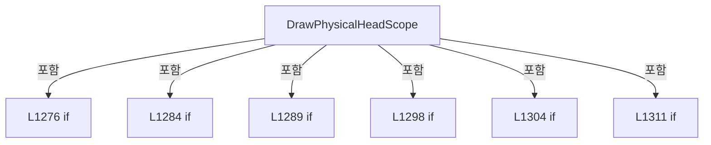

변경 전 점검: 입력/반환 타입, 위 호출자, 예외/취소 경로, 공유 상태와 저장·전송 소비자를 함께 확인합니다. 값의 단위나 물리 방향을 이름만으로 확정하지 않습니다.

### MethodDeclaration `TryBuildRecipeCellBoundary` · L1319–1398

[Drilling.UI/Menu/Menus/CReviewGlassPreviewBuilder.cs:1319–1398](https://github.com/kjuws10-rgb/A3Drilling/blob/28764c91d521777b8ee068dd7aaf2d3902ce9fe2/Drilling.UI/Menu/Menus/CReviewGlassPreviewBuilder.cs#L1319-L1398)

| 항목 | 실제 추출 값 |
| --- | --- |
| 서명 | bool Drilling.UI.Menu.Menus.CReviewGlassPreviewBuilder.TryBuildRecipeCellBoundary(Drilling.Common.Recipe.ST_CELL_PATTERN_DEFINITION, double, int, int, Drilling.UI.Menu.Menus.ST_GLASS_PREVIEW_FRAME, double, out StreamGeometry) |
| 접근/수식자 | Private / private, static |
| 반환/값 타입 | bool |
| 소속 타입 | NamedType:Drilling.UI.Menu.Menus.CReviewGlassPreviewBuilder |

입력 계약:

| 이름 | 타입 | 전달 | 선택/기본값 |
| --- | --- | --- | --- |
| definition | Drilling.Common.Recipe.ST_CELL_PATTERN_DEFINITION | None | False /  |
| pixelSize | double | None | False /  |
| pixelCountX | int | None | False /  |
| pixelCountY | int | None | False /  |
| frame | Drilling.UI.Menu.Menus.ST_GLASS_PREVIEW_FRAME | None | False /  |
| scale | double | None | False /  |
| geometry | StreamGeometry | Out | False /  |

정적 호출자로 확인된 위치:

| 호출 파일/행 | 호출 표현식 | 런타임 분기 가능 |
| --- | --- | --- |
| [Drilling.UI/Menu/Menus/CReviewGlassPreviewBuilder.cs:335–350](https://github.com/kjuws10-rgb/A3Drilling/blob/28764c91d521777b8ee068dd7aaf2d3902ce9fe2/Drilling.UI/Menu/Menus/CReviewGlassPreviewBuilder.cs#L335-L350) | TryBuildRecipeCellBoundary | False |

호출하는 대상과 해석 범위:

| 원본 행 | 표현식 | 분석 상태 | 대상/소스 위치 |
| --- | --- | --- | --- |
| 1336 | double.IsFinite | resolved | bool double.IsFinite(double) |
| 1338 | new StreamGeometry | unresolved | None |
| 1343 | Math.Cos | resolved | double System.Math.Cos(double) |
| 1344 | Math.Sin | resolved | double System.Math.Sin(double) |
| 1350 | new Point | unresolved | None |
| 1351 | new Point | unresolved | None |
| 1352 | new Point | unresolved | None |
| 1353 | new Point | unresolved | None |
| 1363 | TryProjectReviewPreviewPixel | candidate | OverloadResolutionFailure |
| 1382 | new StreamGeometry | unresolved | None |
| 1386 | new Point | unresolved | None |
| 1389 | new StreamGeometry | unresolved | None |
| 1390 | geometry.Open | unresolved | None |
| 1392 | context.BeginFigure | unresolved | None |
| 1393 | context.PolyLineTo | unresolved | None |
| 1393 | corners.Skip(1).ToArray | resolved | Point[] System.Collections.Generic.IEnumerable<Point>.ToArray<Point>() |
| 1393 | corners.Skip | resolved | System.Collections.Generic.IEnumerable<Point> System.Collections.Generic.IEnumerable<Point>.Skip<Point>(int) |
| 1396 | geometry.Freeze | unresolved | None |

본문의 실제 연산·분기·예외·반환 순서(원문 위치 순):

| 원본 행 | 종류 | 주석 해설 |
| --- | --- | --- |
| 1336 | call | 함수·델리게이트 또는 객체 생성자를 호출합니다: double.IsFinite(pixelSize) |
| 1336 | if | 조건에 따라 분기합니다: if (pixelCountX <= 0 &#124;&#124; pixelCountY <= 0 &#124;&#124; !double.IsFinite(pixelSize) &#124;&#124; pixelSize <= 0.0) |
| 1338 | assignment | 값을 대상에 대입합니다: geometry = new StreamGeometry() |
| 1338 | call | 함수·델리게이트 또는 객체 생성자를 호출합니다: new StreamGeometry() |
| 1339 | return | 호출자에게 값 또는 제어를 반환합니다: return false; |
| 1342 | local-declaration | 지역 변수를 선언합니다: var radians = definition.RotationDegrees * Math.PI / 180.0; |
| 1342 | variable-initializer | 변수의 초기값을 지정합니다: radians = definition.RotationDegrees * Math.PI / 180.0 |
| 1343 | call | 함수·델리게이트 또는 객체 생성자를 호출합니다: Math.Cos(radians) |
| 1343 | local-declaration | 지역 변수를 선언합니다: var cos = Math.Cos(radians); |
| 1343 | variable-initializer | 변수의 초기값을 지정합니다: cos = Math.Cos(radians) |
| 1344 | call | 함수·델리게이트 또는 객체 생성자를 호출합니다: Math.Sin(radians) |
| 1344 | local-declaration | 지역 변수를 선언합니다: var sin = Math.Sin(radians); |
| 1344 | variable-initializer | 변수의 초기값을 지정합니다: sin = Math.Sin(radians) |
| 1345 | local-declaration | 지역 변수를 선언합니다: var halfPixel = pixelSize / 2.0; |
| 1345 | variable-initializer | 변수의 초기값을 지정합니다: halfPixel = pixelSize / 2.0 |
| 1346 | local-declaration | 지역 변수를 선언합니다: var localMaxX = ((pixelCountX - 1) * pixelSize) + halfPixel; |
| 1346 | variable-initializer | 변수의 초기값을 지정합니다: localMaxX = ((pixelCountX - 1) * pixelSize) + halfPixel |
| 1347 | local-declaration | 지역 변수를 선언합니다: var localMaxY = ((pixelCountY - 1) * pixelSize) + halfPixel; |
| 1347 | variable-initializer | 변수의 초기값을 지정합니다: localMaxY = ((pixelCountY - 1) * pixelSize) + halfPixel |
| 1348 | local-declaration | 지역 변수를 선언합니다: var localCorners = new[] { new Point(-halfPixel, -halfPixel), new Point(localMaxX, -halfPixel), new Point(localMaxX, localMaxY), new Point(-halfPixel, localMaxY) }; |
| 1348 | variable-initializer | 변수의 초기값을 지정합니다: localCorners = new[] { new Point(-halfPixel, -halfPixel), new Point(localMaxX, -halfPixel), new Point(localMaxX, localMaxY), new Point(-halfPixel, localMaxY) } |
| 1350 | call | 함수·델리게이트 또는 객체 생성자를 호출합니다: new Point(-halfPixel, -halfPixel) |
| 1351 | call | 함수·델리게이트 또는 객체 생성자를 호출합니다: new Point(localMaxX, -halfPixel) |
| 1352 | call | 함수·델리게이트 또는 객체 생성자를 호출합니다: new Point(localMaxX, localMaxY) |
| 1353 | call | 함수·델리게이트 또는 객체 생성자를 호출합니다: new Point(-halfPixel, localMaxY) |
| 1355 | local-declaration | 지역 변수를 선언합니다: var corners = new Point[localCorners.Length]; |
| 1355 | variable-initializer | 변수의 초기값을 지정합니다: corners = new Point[localCorners.Length] |
| 1356 | variable-initializer | 변수의 초기값을 지정합니다: index = 0 |
| 1356 | for | 초기화·조건·증감이 있는 반복입니다: for (var index = 0; index < localCorners.Length; index++) |
| 1358 | local-declaration | 지역 변수를 선언합니다: var local = localCorners[index]; |
| 1358 | variable-initializer | 변수의 초기값을 지정합니다: local = localCorners[index] |
| 1359 | local-declaration | 지역 변수를 선언합니다: var designX = definition.OriginX + definition.FirstTargetX + (local.X * cos) - (local.Y * sin); |
| 1359 | variable-initializer | 변수의 초기값을 지정합니다: designX = definition.OriginX + definition.FirstTargetX + (local.X * cos) - (local.Y * sin) |
| 1361 | local-declaration | 지역 변수를 선언합니다: var designY = definition.OriginY + definition.FirstTargetY + (local.X * sin) + (local.Y * cos); |
| 1361 | variable-initializer | 변수의 초기값을 지정합니다: designY = definition.OriginY + definition.FirstTargetY + (local.X * sin) + (local.Y * cos) |
| 1363 | call | 함수·델리게이트 또는 객체 생성자를 호출합니다: TryProjectReviewPreviewPixel( designX, designY, frame, scale, out var canvasX, out var canvasY, out _, out _ ) |
| 1363 | if | 조건에 따라 분기합니다: if (!TryProjectReviewPreviewPixel( designX, designY, frame, scale, out var canvasX, out var canvasY, out _, out _ )) |
| 1382 | assignment | 값을 대상에 대입합니다: geometry = new StreamGeometry() |
| 1382 | call | 함수·델리게이트 또는 객체 생성자를 호출합니다: new StreamGeometry() |
| 1383 | return | 호출자에게 값 또는 제어를 반환합니다: return false; |
| 1386 | assignment | 값을 대상에 대입합니다: corners[index] = new Point(canvasX, canvasY) |
| 1386 | call | 함수·델리게이트 또는 객체 생성자를 호출합니다: new Point(canvasX, canvasY) |
| 1389 | assignment | 값을 대상에 대입합니다: geometry = new StreamGeometry() |
| 1389 | call | 함수·델리게이트 또는 객체 생성자를 호출합니다: new StreamGeometry() |
| 1390 | call | 함수·델리게이트 또는 객체 생성자를 호출합니다: geometry.Open() |
| 1390 | variable-initializer | 변수의 초기값을 지정합니다: context = geometry.Open() |
| 1390 | using | 자원 사용과 정리 범위를 지정합니다: using (var context = geometry.Open()) |
| 1392 | call | 함수·델리게이트 또는 객체 생성자를 호출합니다: context.BeginFigure(corners[0], false, true) |
| 1393 | call | 함수·델리게이트 또는 객체 생성자를 호출합니다: context.PolyLineTo(corners.Skip(1).ToArray(), true, false) |
| 1393 | call | 함수·델리게이트 또는 객체 생성자를 호출합니다: corners.Skip(1).ToArray() |
| 1393 | call | 함수·델리게이트 또는 객체 생성자를 호출합니다: corners.Skip(1) |
| 1396 | call | 함수·델리게이트 또는 객체 생성자를 호출합니다: geometry.Freeze() |
| 1397 | return | 호출자에게 값 또는 제어를 반환합니다: return true; |

제어 구문의 포함 구조(실제 실행 순서/CFG가 아닌 구문 탐색 그림):

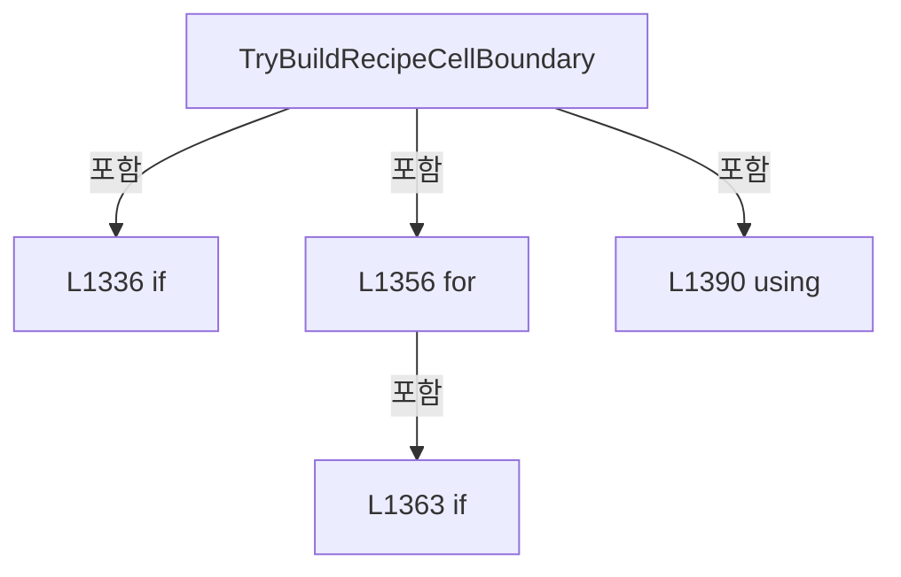

변경 전 점검: 입력/반환 타입, 위 호출자, 예외/취소 경로, 공유 상태와 저장·전송 소비자를 함께 확인합니다. 값의 단위나 물리 방향을 이름만으로 확정하지 않습니다.

### MethodDeclaration `ShouldUseExpandedPreviewBounds` · L1400–1405

[Drilling.UI/Menu/Menus/CReviewGlassPreviewBuilder.cs:1400–1405](https://github.com/kjuws10-rgb/A3Drilling/blob/28764c91d521777b8ee068dd7aaf2d3902ce9fe2/Drilling.UI/Menu/Menus/CReviewGlassPreviewBuilder.cs#L1400-L1405)

| 항목 | 실제 추출 값 |
| --- | --- |
| 서명 | bool Drilling.UI.Menu.Menus.CReviewGlassPreviewBuilder.ShouldUseExpandedPreviewBounds(Rect, Rect) |
| 접근/수식자 | Private / private, static |
| 반환/값 타입 | bool |
| 소속 타입 | NamedType:Drilling.UI.Menu.Menus.CReviewGlassPreviewBuilder |

입력 계약:

| 이름 | 타입 | 전달 | 선택/기본값 |
| --- | --- | --- | --- |
| actualBounds | Rect | None | False /  |
| displayBounds | Rect | None | False /  |

현재 부분 분석에서 직접 연결된 호출자는 없습니다. XAML/이벤트/인터페이스·델리게이트·외부 진입을 추가 확인해야 하며, 미사용으로 판정한 것이 아닙니다.

호출하는 대상과 해석 범위:

| 원본 행 | 표현식 | 분석 상태 | 대상/소스 위치 |
| --- | --- | --- | --- |
| 1404 | Math.Abs | candidate | OverloadResolutionFailure |
| 1405 | Math.Abs | candidate | OverloadResolutionFailure |

본문의 실제 연산·분기·예외·반환 순서(원문 위치 순):

| 원본 행 | 종류 | 주석 해설 |
| --- | --- | --- |
| 1404 | call | 함수·델리게이트 또는 객체 생성자를 호출합니다: Math.Abs(actualBounds.Width - displayBounds.Width) |
| 1405 | call | 함수·델리게이트 또는 객체 생성자를 호출합니다: Math.Abs(actualBounds.Height - displayBounds.Height) |

변경 전 점검: 입력/반환 타입, 위 호출자, 예외/취소 경로, 공유 상태와 저장·전송 소비자를 함께 확인합니다. 값의 단위나 물리 방향을 이름만으로 확정하지 않습니다.

### MethodDeclaration `ExpandPreviewBounds` · L1407–1422

[Drilling.UI/Menu/Menus/CReviewGlassPreviewBuilder.cs:1407–1422](https://github.com/kjuws10-rgb/A3Drilling/blob/28764c91d521777b8ee068dd7aaf2d3902ce9fe2/Drilling.UI/Menu/Menus/CReviewGlassPreviewBuilder.cs#L1407-L1422)

| 항목 | 실제 추출 값 |
| --- | --- |
| 서명 | Rect Drilling.UI.Menu.Menus.CReviewGlassPreviewBuilder.ExpandPreviewBounds(Rect, double, double, Rect) |
| 접근/수식자 | Private / private, static |
| 반환/값 타입 | Rect |
| 소속 타입 | NamedType:Drilling.UI.Menu.Menus.CReviewGlassPreviewBuilder |

입력 계약:

| 이름 | 타입 | 전달 | 선택/기본값 |
| --- | --- | --- | --- |
| bounds | Rect | None | False /  |
| minimumWidth | double | None | False /  |
| minimumHeight | double | None | False /  |
| limitBounds | Rect | None | False /  |

현재 부분 분석에서 직접 연결된 호출자는 없습니다. XAML/이벤트/인터페이스·델리게이트·외부 진입을 추가 확인해야 하며, 미사용으로 판정한 것이 아닙니다.

호출하는 대상과 해석 범위:

| 원본 행 | 표현식 | 분석 상태 | 대상/소스 위치 |
| --- | --- | --- | --- |
| 1413 | Math.Clamp | candidate | OverloadResolutionFailure |
| 1414 | Math.Clamp | candidate | OverloadResolutionFailure |
| 1415 | Math.Max | candidate | OverloadResolutionFailure |
| 1416 | Math.Max | candidate | OverloadResolutionFailure |
| 1417 | new Rect | unresolved | None |
| 1420 | Math.Min | candidate | OverloadResolutionFailure |
| 1420 | Math.Max | candidate | OverloadResolutionFailure |
| 1421 | Math.Min | candidate | OverloadResolutionFailure |
| 1421 | Math.Max | candidate | OverloadResolutionFailure |

본문의 실제 연산·분기·예외·반환 순서(원문 위치 순):

| 원본 행 | 종류 | 주석 해설 |
| --- | --- | --- |
| 1413 | call | 함수·델리게이트 또는 객체 생성자를 호출합니다: Math.Clamp(bounds.Left, limitBounds.Left, limitBounds.Right) |
| 1413 | local-declaration | 지역 변수를 선언합니다: var left = Math.Clamp(bounds.Left, limitBounds.Left, limitBounds.Right); |
| 1413 | variable-initializer | 변수의 초기값을 지정합니다: left = Math.Clamp(bounds.Left, limitBounds.Left, limitBounds.Right) |
| 1414 | call | 함수·델리게이트 또는 객체 생성자를 호출합니다: Math.Clamp(bounds.Top, limitBounds.Top, limitBounds.Bottom) |
| 1414 | local-declaration | 지역 변수를 선언합니다: var top = Math.Clamp(bounds.Top, limitBounds.Top, limitBounds.Bottom); |
| 1414 | variable-initializer | 변수의 초기값을 지정합니다: top = Math.Clamp(bounds.Top, limitBounds.Top, limitBounds.Bottom) |
| 1415 | call | 함수·델리게이트 또는 객체 생성자를 호출합니다: Math.Max(1.0, limitBounds.Right - left) |
| 1415 | local-declaration | 지역 변수를 선언합니다: var maximumWidth = Math.Max(1.0, limitBounds.Right - left); |
| 1415 | variable-initializer | 변수의 초기값을 지정합니다: maximumWidth = Math.Max(1.0, limitBounds.Right - left) |
| 1416 | call | 함수·델리게이트 또는 객체 생성자를 호출합니다: Math.Max(1.0, limitBounds.Bottom - top) |
| 1416 | local-declaration | 지역 변수를 선언합니다: var maximumHeight = Math.Max(1.0, limitBounds.Bottom - top); |
| 1416 | variable-initializer | 변수의 초기값을 지정합니다: maximumHeight = Math.Max(1.0, limitBounds.Bottom - top) |
| 1417 | call | 함수·델리게이트 또는 객체 생성자를 호출합니다: new Rect( left, top, Math.Min(Math.Max(bounds.Width, minimumWidth), maximumWidth), Math.Min(Math.Max(bounds.Height, minimumHeight), maximumHeight)) |
| 1417 | return | 호출자에게 값 또는 제어를 반환합니다: return new Rect( left, top, Math.Min(Math.Max(bounds.Width, minimumWidth), maximumWidth), Math.Min(Math.Max(bounds.Height, minimumHeight), maximumHeight)); |
| 1420 | call | 함수·델리게이트 또는 객체 생성자를 호출합니다: Math.Min(Math.Max(bounds.Width, minimumWidth), maximumWidth) |
| 1420 | call | 함수·델리게이트 또는 객체 생성자를 호출합니다: Math.Max(bounds.Width, minimumWidth) |
| 1421 | call | 함수·델리게이트 또는 객체 생성자를 호출합니다: Math.Min(Math.Max(bounds.Height, minimumHeight), maximumHeight) |
| 1421 | call | 함수·델리게이트 또는 객체 생성자를 호출합니다: Math.Max(bounds.Height, minimumHeight) |

변경 전 점검: 입력/반환 타입, 위 호출자, 예외/취소 경로, 공유 상태와 저장·전송 소비자를 함께 확인합니다. 값의 단위나 물리 방향을 이름만으로 확정하지 않습니다.

### MethodDeclaration `TryProjectReviewPreviewPixel` · L1426–1474

[Drilling.UI/Menu/Menus/CReviewGlassPreviewBuilder.cs:1426–1474](https://github.com/kjuws10-rgb/A3Drilling/blob/28764c91d521777b8ee068dd7aaf2d3902ce9fe2/Drilling.UI/Menu/Menus/CReviewGlassPreviewBuilder.cs#L1426-L1474)

| 항목 | 실제 추출 값 |
| --- | --- |
| 서명 | bool Drilling.UI.Menu.Menus.CReviewGlassPreviewBuilder.TryProjectReviewPreviewPixel(double, double, Drilling.UI.Menu.Menus.ST_GLASS_PREVIEW_FRAME, double, out double, out double, out int, out int) |
| 접근/수식자 | Private / private, static |
| 반환/값 타입 | bool |
| 소속 타입 | NamedType:Drilling.UI.Menu.Menus.CReviewGlassPreviewBuilder |

입력 계약:

| 이름 | 타입 | 전달 | 선택/기본값 |
| --- | --- | --- | --- |
| designX | double | None | False /  |
| designY | double | None | False /  |
| frame | Drilling.UI.Menu.Menus.ST_GLASS_PREVIEW_FRAME | None | False /  |
| scale | double | None | False /  |
| canvasX | double | Out | False /  |
| canvasY | double | Out | False /  |
| pixelX | int | Out | False /  |
| pixelY | int | Out | False /  |

정적 호출자로 확인된 위치:

| 호출 파일/행 | 호출 표현식 | 런타임 분기 가능 |
| --- | --- | --- |
| [Drilling.UI/Menu/Menus/CReviewGlassPreviewBuilder.cs:508–525](https://github.com/kjuws10-rgb/A3Drilling/blob/28764c91d521777b8ee068dd7aaf2d3902ce9fe2/Drilling.UI/Menu/Menus/CReviewGlassPreviewBuilder.cs#L508-L525) | TryProjectReviewPreviewPixel | False |
| [Drilling.UI/Menu/Menus/CReviewGlassPreviewBuilder.cs:1058–1075](https://github.com/kjuws10-rgb/A3Drilling/blob/28764c91d521777b8ee068dd7aaf2d3902ce9fe2/Drilling.UI/Menu/Menus/CReviewGlassPreviewBuilder.cs#L1058-L1075) | TryProjectReviewPreviewPixel | False |

호출하는 대상과 해석 범위:

| 원본 행 | 표현식 | 분석 상태 | 대상/소스 위치 |
| --- | --- | --- | --- |
| 1449 | double.IsFinite | resolved | bool double.IsFinite(double) |
| 1450 | double.IsFinite | resolved | bool double.IsFinite(double) |
| 1451 | double.IsFinite | resolved | bool double.IsFinite(double) |
| 1453 | double.IsFinite | resolved | bool double.IsFinite(double) |
| 1454 | double.IsFinite | resolved | bool double.IsFinite(double) |
| 1459 | Math.Round | resolved | double System.Math.Round(double) |
| 1460 | Math.Round | resolved | double System.Math.Round(double) |
| 1461 | double.IsFinite | resolved | bool double.IsFinite(double) |
| 1462 | double.IsFinite | resolved | bool double.IsFinite(double) |

본문의 실제 연산·분기·예외·반환 순서(원문 위치 순):

| 원본 행 | 종류 | 주석 해설 |
| --- | --- | --- |
| 1445 | assignment | 값을 대상에 대입합니다: canvasX = frame.CanvasLeft + (designX * scale) |
| 1446 | assignment | 값을 대상에 대입합니다: canvasY = frame.CanvasTop + (designY * scale) |
| 1447 | assignment | 값을 대상에 대입합니다: pixelX = 0 |
| 1448 | assignment | 값을 대상에 대입합니다: pixelY = 0 |
| 1449 | call | 함수·델리게이트 또는 객체 생성자를 호출합니다: double.IsFinite(designX) |
| 1449 | if | 조건에 따라 분기합니다: if (!double.IsFinite(designX) &#124;&#124; !double.IsFinite(designY) &#124;&#124; !double.IsFinite(scale) &#124;&#124; scale <= 0.0 &#124;&#124; !double.IsFinite(canvasX) &#124;&#124; !double.IsFinite(canvasY)) |
| 1450 | call | 함수·델리게이트 또는 객체 생성자를 호출합니다: double.IsFinite(designY) |
| 1451 | call | 함수·델리게이트 또는 객체 생성자를 호출합니다: double.IsFinite(scale) |
| 1453 | call | 함수·델리게이트 또는 객체 생성자를 호출합니다: double.IsFinite(canvasX) |
| 1454 | call | 함수·델리게이트 또는 객체 생성자를 호출합니다: double.IsFinite(canvasY) |
| 1456 | return | 호출자에게 값 또는 제어를 반환합니다: return false; |
| 1459 | call | 함수·델리게이트 또는 객체 생성자를 호출합니다: Math.Round(canvasX) |
| 1459 | local-declaration | 지역 변수를 선언합니다: var roundedX = Math.Round(canvasX); |
| 1459 | variable-initializer | 변수의 초기값을 지정합니다: roundedX = Math.Round(canvasX) |
| 1460 | call | 함수·델리게이트 또는 객체 생성자를 호출합니다: Math.Round(canvasY) |
| 1460 | local-declaration | 지역 변수를 선언합니다: var roundedY = Math.Round(canvasY); |
| 1460 | variable-initializer | 변수의 초기값을 지정합니다: roundedY = Math.Round(canvasY) |
| 1461 | call | 함수·델리게이트 또는 객체 생성자를 호출합니다: double.IsFinite(roundedX) |
| 1461 | if | 조건에 따라 분기합니다: if (!double.IsFinite(roundedX) &#124;&#124; !double.IsFinite(roundedY) &#124;&#124; roundedX < int.MinValue &#124;&#124; roundedX > int.MaxValue &#124;&#124; roundedY < int.MinValue &#124;&#124; roundedY > int.MaxValue) |
| 1462 | call | 함수·델리게이트 또는 객체 생성자를 호출합니다: double.IsFinite(roundedY) |
| 1468 | return | 호출자에게 값 또는 제어를 반환합니다: return false; |
| 1471 | assignment | 값을 대상에 대입합니다: pixelX = (int)roundedX |
| 1472 | assignment | 값을 대상에 대입합니다: pixelY = (int)roundedY |
| 1473 | return | 호출자에게 값 또는 제어를 반환합니다: return true; |

제어 구문의 포함 구조(실제 실행 순서/CFG가 아닌 구문 탐색 그림):

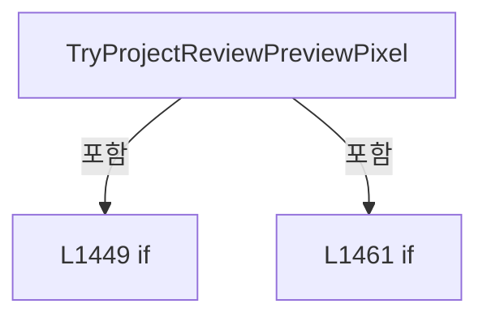

변경 전 점검: 입력/반환 타입, 위 호출자, 예외/취소 경로, 공유 상태와 저장·전송 소비자를 함께 확인합니다. 값의 단위나 물리 방향을 이름만으로 확정하지 않습니다.

### MethodDeclaration `CreateErrorPreview` · L1476–1483

[Drilling.UI/Menu/Menus/CReviewGlassPreviewBuilder.cs:1476–1483](https://github.com/kjuws10-rgb/A3Drilling/blob/28764c91d521777b8ee068dd7aaf2d3902ce9fe2/Drilling.UI/Menu/Menus/CReviewGlassPreviewBuilder.cs#L1476-L1483)

| 항목 | 실제 추출 값 |
| --- | --- |
| 서명 | Drilling.UI.Menu.Menus.ST_REVIEW_GLASS_PREVIEW Drilling.UI.Menu.Menus.CReviewGlassPreviewBuilder.CreateErrorPreview(string) |
| 접근/수식자 | Private / private, static |
| 반환/값 타입 | Drilling.UI.Menu.Menus.ST_REVIEW_GLASS_PREVIEW |
| 소속 타입 | NamedType:Drilling.UI.Menu.Menus.CReviewGlassPreviewBuilder |

입력 계약:

| 이름 | 타입 | 전달 | 선택/기본값 |
| --- | --- | --- | --- |
| message | string | None | False /  |

정적 호출자로 확인된 위치:

| 호출 파일/행 | 호출 표현식 | 런타임 분기 가능 |
| --- | --- | --- |
| [Drilling.UI/Menu/Menus/CReviewGlassPreviewBuilder.cs:87–87](https://github.com/kjuws10-rgb/A3Drilling/blob/28764c91d521777b8ee068dd7aaf2d3902ce9fe2/Drilling.UI/Menu/Menus/CReviewGlassPreviewBuilder.cs#L87-L87) | CreateErrorPreview | False |
| [Drilling.UI/Menu/Menus/CReviewGlassPreviewBuilder.cs:97–97](https://github.com/kjuws10-rgb/A3Drilling/blob/28764c91d521777b8ee068dd7aaf2d3902ce9fe2/Drilling.UI/Menu/Menus/CReviewGlassPreviewBuilder.cs#L97-L97) | CreateErrorPreview | False |
| [Drilling.UI/Menu/Menus/CReviewGlassPreviewBuilder.cs:113–115](https://github.com/kjuws10-rgb/A3Drilling/blob/28764c91d521777b8ee068dd7aaf2d3902ce9fe2/Drilling.UI/Menu/Menus/CReviewGlassPreviewBuilder.cs#L113-L115) | CreateErrorPreview | False |
| [Drilling.UI/Menu/Menus/CReviewGlassPreviewBuilder.cs:120–121](https://github.com/kjuws10-rgb/A3Drilling/blob/28764c91d521777b8ee068dd7aaf2d3902ce9fe2/Drilling.UI/Menu/Menus/CReviewGlassPreviewBuilder.cs#L120-L121) | CreateErrorPreview | False |
| [Drilling.UI/Menu/Menus/CReviewGlassPreviewBuilder.cs:126–127](https://github.com/kjuws10-rgb/A3Drilling/blob/28764c91d521777b8ee068dd7aaf2d3902ce9fe2/Drilling.UI/Menu/Menus/CReviewGlassPreviewBuilder.cs#L126-L127) | CreateErrorPreview | False |
| [Drilling.UI/Menu/Menus/CReviewGlassPreviewBuilder.cs:143–143](https://github.com/kjuws10-rgb/A3Drilling/blob/28764c91d521777b8ee068dd7aaf2d3902ce9fe2/Drilling.UI/Menu/Menus/CReviewGlassPreviewBuilder.cs#L143-L143) | CreateErrorPreview | False |
| [Drilling.UI/Menu/Menus/CReviewGlassPreviewBuilder.cs:193–194](https://github.com/kjuws10-rgb/A3Drilling/blob/28764c91d521777b8ee068dd7aaf2d3902ce9fe2/Drilling.UI/Menu/Menus/CReviewGlassPreviewBuilder.cs#L193-L194) | CreateErrorPreview | False |
| [Drilling.UI/Menu/Menus/CReviewGlassPreviewBuilder.cs:326–326](https://github.com/kjuws10-rgb/A3Drilling/blob/28764c91d521777b8ee068dd7aaf2d3902ce9fe2/Drilling.UI/Menu/Menus/CReviewGlassPreviewBuilder.cs#L326-L326) | CreateErrorPreview | False |
| [Drilling.UI/Menu/Menus/CReviewGlassPreviewBuilder.cs:352–352](https://github.com/kjuws10-rgb/A3Drilling/blob/28764c91d521777b8ee068dd7aaf2d3902ce9fe2/Drilling.UI/Menu/Menus/CReviewGlassPreviewBuilder.cs#L352-L352) | CreateErrorPreview | False |
| [Drilling.UI/Menu/Menus/CReviewGlassPreviewBuilder.cs:472–474](https://github.com/kjuws10-rgb/A3Drilling/blob/28764c91d521777b8ee068dd7aaf2d3902ce9fe2/Drilling.UI/Menu/Menus/CReviewGlassPreviewBuilder.cs#L472-L474) | CreateErrorPreview | False |

호출하는 대상과 해석 범위:

| 원본 행 | 표현식 | 분석 상태 | 대상/소스 위치 |
| --- | --- | --- | --- |
| 1478 | new ST_REVIEW_GLASS_PREVIEW | resolved | Drilling.UI.Menu.Menus.ST_REVIEW_GLASS_PREVIEW.ST_REVIEW_GLASS_PREVIEW(ImageSource?, ImageSource?, System.Collections.Generic.IReadOnlyList<Drilling.UI.Menu.Menus.ST_CELL_PREVIEW_LABEL>, string) · Drilling.UI/Menu/Menus/CReviewGlassPreviewBuilder.cs:1855 |

본문의 실제 연산·분기·예외·반환 순서(원문 위치 순):

| 원본 행 | 종류 | 주석 해설 |
| --- | --- | --- |
| 1478 | call | 함수·델리게이트 또는 객체 생성자를 호출합니다: new ST_REVIEW_GLASS_PREVIEW( null, null, [], $"Preview unavailable: {message}") |
| 1478 | return | 호출자에게 값 또는 제어를 반환합니다: return new ST_REVIEW_GLASS_PREVIEW( null, null, [], $"Preview unavailable: {message}"); |

변경 전 점검: 입력/반환 타입, 위 호출자, 예외/취소 경로, 공유 상태와 저장·전송 소비자를 함께 확인합니다. 값의 단위나 물리 방향을 이름만으로 확정하지 않습니다.

### MethodDeclaration `AddCircle` · L1485–1518

[Drilling.UI/Menu/Menus/CReviewGlassPreviewBuilder.cs:1485–1518](https://github.com/kjuws10-rgb/A3Drilling/blob/28764c91d521777b8ee068dd7aaf2d3902ce9fe2/Drilling.UI/Menu/Menus/CReviewGlassPreviewBuilder.cs#L1485-L1518)

| 항목 | 실제 추출 값 |
| --- | --- |
| 서명 | void Drilling.UI.Menu.Menus.CReviewGlassPreviewBuilder.AddCircle(StreamGeometryContext, double, double, double) |
| 접근/수식자 | Private / private, static |
| 반환/값 타입 | void |
| 소속 타입 | NamedType:Drilling.UI.Menu.Menus.CReviewGlassPreviewBuilder |

입력 계약:

| 이름 | 타입 | 전달 | 선택/기본값 |
| --- | --- | --- | --- |
| context | StreamGeometryContext | None | False /  |
| x | double | None | False /  |
| y | double | None | False /  |
| size | double | None | False /  |

현재 부분 분석에서 직접 연결된 호출자는 없습니다. XAML/이벤트/인터페이스·델리게이트·외부 진입을 추가 확인해야 하며, 미사용으로 판정한 것이 아닙니다.

호출하는 대상과 해석 범위:

| 원본 행 | 표현식 | 분석 상태 | 대상/소스 위치 |
| --- | --- | --- | --- |
| 1493 | context.BeginFigure | unresolved | None |
| 1493 | new Point | unresolved | None |
| 1494 | context.BezierTo | unresolved | None |
| 1495 | new Point | unresolved | None |
| 1496 | new Point | unresolved | None |
| 1497 | new Point | unresolved | None |
| 1500 | context.BezierTo | unresolved | None |
| 1501 | new Point | unresolved | None |
| 1502 | new Point | unresolved | None |
| 1503 | new Point | unresolved | None |
| 1506 | context.BezierTo | unresolved | None |
| 1507 | new Point | unresolved | None |
| 1508 | new Point | unresolved | None |
| 1509 | new Point | unresolved | None |
| 1512 | context.BezierTo | unresolved | None |
| 1513 | new Point | unresolved | None |
| 1514 | new Point | unresolved | None |
| 1515 | new Point | unresolved | None |

본문의 실제 연산·분기·예외·반환 순서(원문 위치 순):

| 원본 행 | 종류 | 주석 해설 |
| --- | --- | --- |
| 1491 | local-declaration | 지역 변수를 선언합니다: var radius = size / 2.0; |
| 1491 | variable-initializer | 변수의 초기값을 지정합니다: radius = size / 2.0 |
| 1492 | local-declaration | 지역 변수를 선언합니다: var control = radius * 0.5522847498; |
| 1492 | variable-initializer | 변수의 초기값을 지정합니다: control = radius * 0.5522847498 |
| 1493 | call | 함수·델리게이트 또는 객체 생성자를 호출합니다: context.BeginFigure(new Point(x + radius, y), true, true) |
| 1493 | call | 함수·델리게이트 또는 객체 생성자를 호출합니다: new Point(x + radius, y) |
| 1494 | call | 함수·델리게이트 또는 객체 생성자를 호출합니다: context.BezierTo( new Point(x + radius, y + control), new Point(x + control, y + radius), new Point(x, y + radius), true, false) |
| 1495 | call | 함수·델리게이트 또는 객체 생성자를 호출합니다: new Point(x + radius, y + control) |
| 1496 | call | 함수·델리게이트 또는 객체 생성자를 호출합니다: new Point(x + control, y + radius) |
| 1497 | call | 함수·델리게이트 또는 객체 생성자를 호출합니다: new Point(x, y + radius) |
| 1500 | call | 함수·델리게이트 또는 객체 생성자를 호출합니다: context.BezierTo( new Point(x - control, y + radius), new Point(x - radius, y + control), new Point(x - radius, y), true, false) |
| 1501 | call | 함수·델리게이트 또는 객체 생성자를 호출합니다: new Point(x - control, y + radius) |
| 1502 | call | 함수·델리게이트 또는 객체 생성자를 호출합니다: new Point(x - radius, y + control) |
| 1503 | call | 함수·델리게이트 또는 객체 생성자를 호출합니다: new Point(x - radius, y) |
| 1506 | call | 함수·델리게이트 또는 객체 생성자를 호출합니다: context.BezierTo( new Point(x - radius, y - control), new Point(x - control, y - radius), new Point(x, y - radius), true, false) |
| 1507 | call | 함수·델리게이트 또는 객체 생성자를 호출합니다: new Point(x - radius, y - control) |
| 1508 | call | 함수·델리게이트 또는 객체 생성자를 호출합니다: new Point(x - control, y - radius) |
| 1509 | call | 함수·델리게이트 또는 객체 생성자를 호출합니다: new Point(x, y - radius) |
| 1512 | call | 함수·델리게이트 또는 객체 생성자를 호출합니다: context.BezierTo( new Point(x + control, y - radius), new Point(x + radius, y - control), new Point(x + radius, y), true, false) |
| 1513 | call | 함수·델리게이트 또는 객체 생성자를 호출합니다: new Point(x + control, y - radius) |
| 1514 | call | 함수·델리게이트 또는 객체 생성자를 호출합니다: new Point(x + radius, y - control) |
| 1515 | call | 함수·델리게이트 또는 객체 생성자를 호출합니다: new Point(x + radius, y) |

변경 전 점검: 입력/반환 타입, 위 호출자, 예외/취소 경로, 공유 상태와 저장·전송 소비자를 함께 확인합니다. 값의 단위나 물리 방향을 이름만으로 확정하지 않습니다.

### MethodDeclaration `DrawPreviewAxisIndicator` · L1520–1596

[Drilling.UI/Menu/Menus/CReviewGlassPreviewBuilder.cs:1520–1596](https://github.com/kjuws10-rgb/A3Drilling/blob/28764c91d521777b8ee068dd7aaf2d3902ce9fe2/Drilling.UI/Menu/Menus/CReviewGlassPreviewBuilder.cs#L1520-L1596)

| 항목 | 실제 추출 값 |
| --- | --- |
| 서명 | void Drilling.UI.Menu.Menus.CReviewGlassPreviewBuilder.DrawPreviewAxisIndicator(DrawingContext, Rect, Rect, Drilling.UI.Menu.Menus.ST_REVIEW_GLASS_AXIS_INDICATOR) |
| 접근/수식자 | Private / private, static |
| 반환/값 타입 | void |
| 소속 타입 | NamedType:Drilling.UI.Menu.Menus.CReviewGlassPreviewBuilder |

입력 계약:

| 이름 | 타입 | 전달 | 선택/기본값 |
| --- | --- | --- | --- |
| context | DrawingContext | None | False /  |
| previewRect | Rect | None | False /  |
| glassRect | Rect | None | False /  |
| axisIndicator | Drilling.UI.Menu.Menus.ST_REVIEW_GLASS_AXIS_INDICATOR | None | False /  |

현재 부분 분석에서 직접 연결된 호출자는 없습니다. XAML/이벤트/인터페이스·델리게이트·외부 진입을 추가 확인해야 하며, 미사용으로 판정한 것이 아닙니다.

호출하는 대상과 해석 범위:

| 원본 행 | 표현식 | 분석 상태 | 대상/소스 위치 |
| --- | --- | --- | --- |
| 1526 | new SolidColorBrush | unresolved | None |
| 1526 | Color.FromRgb | unresolved | None |
| 1527 | axisBrush.Freeze | unresolved | None |
| 1528 | new Pen | unresolved | None |
| 1533 | axisPen.Freeze | unresolved | None |
| 1535 | GetPreviewAxisOrigin | resolved | Point Drilling.UI.Menu.Menus.CReviewGlassPreviewBuilder.GetPreviewAxisOrigin(Rect, Rect, Drilling.UI.Menu.Menus.ST_REVIEW_GLASS_AXIS_INDICATOR) · Drilling.UI/Menu/Menus/CReviewGlassPreviewBuilder.cs:1623 |
| 1537 | new Point | unresolved | None |
| 1538 | new Point | unresolved | None |
| 1540 | new Point | unresolved | None |
| 1541 | new Point | unresolved | None |
| 1543 | string.IsNullOrWhiteSpace | resolved | bool string.IsNullOrWhiteSpace(string?) |
| 1545 | context.DrawLine | unresolved | None |
| 1546 | DrawHorizontalArrowHead | resolved | void Drilling.UI.Menu.Menus.CReviewGlassPreviewBuilder.DrawHorizontalArrowHead(DrawingContext, Pen, Point, bool) · Drilling.UI/Menu/Menus/CReviewGlassPreviewBuilder.cs:1688 |
| 1549 | string.IsNullOrWhiteSpace | resolved | bool string.IsNullOrWhiteSpace(string?) |
| 1551 | context.DrawLine | unresolved | None |
| 1552 | DrawVerticalArrowHead | resolved | void Drilling.UI.Menu.Menus.CReviewGlassPreviewBuilder.DrawVerticalArrowHead(DrawingContext, Pen, Point, bool) · Drilling.UI/Menu/Menus/CReviewGlassPreviewBuilder.cs:1699 |
| 1555 | string.IsNullOrWhiteSpace | resolved | bool string.IsNullOrWhiteSpace(string?) |
| 1557 | DrawPreviewAxisText | candidate | OverloadResolutionFailure |
| 1563 | new Point | unresolved | None |
| 1564 | Math.Max | candidate | OverloadResolutionFailure |
| 1565 | Math.Max | candidate | OverloadResolutionFailure |
| 1571 | string.IsNullOrWhiteSpace | resolved | bool string.IsNullOrWhiteSpace(string?) |
| 1573 | DrawPreviewAxisText | candidate | OverloadResolutionFailure |
| 1579 | new Point | unresolved | None |
| 1581 | Math.Max | candidate | OverloadResolutionFailure |
| 1587 | string.IsNullOrWhiteSpace | resolved | bool string.IsNullOrWhiteSpace(string?) |
| 1589 | DrawPreviewAxisText | candidate | OverloadResolutionFailure |
| 1592 | GetPreviewAxisTitlePoint | resolved | Point Drilling.UI.Menu.Menus.CReviewGlassPreviewBuilder.GetPreviewAxisTitlePoint(Drilling.UI.Menu.Menus.ST_REVIEW_GLASS_AXIS_INDICATOR, Point, Rect) · Drilling.UI/Menu/Menus/CReviewGlassPreviewBuilder.cs:1598 |

본문의 실제 연산·분기·예외·반환 순서(원문 위치 순):

| 원본 행 | 종류 | 주석 해설 |
| --- | --- | --- |
| 1526 | call | 함수·델리게이트 또는 객체 생성자를 호출합니다: new SolidColorBrush(Color.FromRgb(248, 250, 252)) |
| 1526 | call | 함수·델리게이트 또는 객체 생성자를 호출합니다: Color.FromRgb(248, 250, 252) |
| 1526 | local-declaration | 지역 변수를 선언합니다: var axisBrush = new SolidColorBrush(Color.FromRgb(248, 250, 252)); |
| 1526 | variable-initializer | 변수의 초기값을 지정합니다: axisBrush = new SolidColorBrush(Color.FromRgb(248, 250, 252)) |
| 1527 | call | 함수·델리게이트 또는 객체 생성자를 호출합니다: axisBrush.Freeze() |
| 1528 | call | 함수·델리게이트 또는 객체 생성자를 호출합니다: new Pen(axisBrush, 2.0) { StartLineCap = PenLineCap.Round, EndLineCap = PenLineCap.Round } |
| 1528 | local-declaration | 지역 변수를 선언합니다: var axisPen = new Pen(axisBrush, 2.0) { StartLineCap = PenLineCap.Round, EndLineCap = PenLineCap.Round }; |
| 1528 | variable-initializer | 변수의 초기값을 지정합니다: axisPen = new Pen(axisBrush, 2.0) { StartLineCap = PenLineCap.Round, EndLineCap = PenLineCap.Round } |
| 1530 | assignment | 값을 대상에 대입합니다: StartLineCap = PenLineCap.Round |
| 1531 | assignment | 값을 대상에 대입합니다: EndLineCap = PenLineCap.Round |
| 1533 | call | 함수·델리게이트 또는 객체 생성자를 호출합니다: axisPen.Freeze() |
| 1535 | call | 함수·델리게이트 또는 객체 생성자를 호출합니다: GetPreviewAxisOrigin(previewRect, glassRect, axisIndicator) |
| 1535 | local-declaration | 지역 변수를 선언합니다: var origin = GetPreviewAxisOrigin(previewRect, glassRect, axisIndicator); |
| 1535 | variable-initializer | 변수의 초기값을 지정합니다: origin = GetPreviewAxisOrigin(previewRect, glassRect, axisIndicator) |
| 1536 | conditional-expression | 조건에 따라 결과식을 선택합니다: axisIndicator.XPositiveRight ? new Point(origin.X + 46.0, origin.Y) : new Point(origin.X - 46.0, origin.Y) |
| 1536 | local-declaration | 지역 변수를 선언합니다: var xEnd = axisIndicator.XPositiveRight ? new Point(origin.X + 46.0, origin.Y) : new Point(origin.X - 46.0, origin.Y); |
| 1536 | variable-initializer | 변수의 초기값을 지정합니다: xEnd = axisIndicator.XPositiveRight ? new Point(origin.X + 46.0, origin.Y) : new Point(origin.X - 46.0, origin.Y) |
| 1537 | call | 함수·델리게이트 또는 객체 생성자를 호출합니다: new Point(origin.X + 46.0, origin.Y) |
| 1538 | call | 함수·델리게이트 또는 객체 생성자를 호출합니다: new Point(origin.X - 46.0, origin.Y) |
| 1539 | conditional-expression | 조건에 따라 결과식을 선택합니다: axisIndicator.YPositiveDown ? new Point(origin.X, origin.Y + 42.0) : new Point(origin.X, origin.Y - 42.0) |
| 1539 | local-declaration | 지역 변수를 선언합니다: var yEnd = axisIndicator.YPositiveDown ? new Point(origin.X, origin.Y + 42.0) : new Point(origin.X, origin.Y - 42.0); |
| 1539 | variable-initializer | 변수의 초기값을 지정합니다: yEnd = axisIndicator.YPositiveDown ? new Point(origin.X, origin.Y + 42.0) : new Point(origin.X, origin.Y - 42.0) |
| 1540 | call | 함수·델리게이트 또는 객체 생성자를 호출합니다: new Point(origin.X, origin.Y + 42.0) |
| 1541 | call | 함수·델리게이트 또는 객체 생성자를 호출합니다: new Point(origin.X, origin.Y - 42.0) |
| 1543 | call | 함수·델리게이트 또는 객체 생성자를 호출합니다: string.IsNullOrWhiteSpace(axisIndicator.XLabel) |
| 1543 | if | 조건에 따라 분기합니다: if (!string.IsNullOrWhiteSpace(axisIndicator.XLabel)) |
| 1545 | call | 함수·델리게이트 또는 객체 생성자를 호출합니다: context.DrawLine(axisPen, origin, xEnd) |
| 1546 | call | 함수·델리게이트 또는 객체 생성자를 호출합니다: DrawHorizontalArrowHead(context, axisPen, xEnd, axisIndicator.XPositiveRight) |
| 1549 | call | 함수·델리게이트 또는 객체 생성자를 호출합니다: string.IsNullOrWhiteSpace(axisIndicator.YLabel) |
| 1549 | if | 조건에 따라 분기합니다: if (!string.IsNullOrWhiteSpace(axisIndicator.YLabel)) |
| 1551 | call | 함수·델리게이트 또는 객체 생성자를 호출합니다: context.DrawLine(axisPen, origin, yEnd) |
| 1552 | call | 함수·델리게이트 또는 객체 생성자를 호출합니다: DrawVerticalArrowHead(context, axisPen, yEnd, axisIndicator.YPositiveDown) |
| 1555 | call | 함수·델리게이트 또는 객체 생성자를 호출합니다: string.IsNullOrWhiteSpace(axisIndicator.XLabel) |
| 1555 | if | 조건에 따라 분기합니다: if (!string.IsNullOrWhiteSpace(axisIndicator.XLabel)) |
| 1557 | call | 함수·델리게이트 또는 객체 생성자를 호출합니다: DrawPreviewAxisText( context, axisIndicator.XLabel, new Point( axisIndicator.XPositiveRight ? xEnd.X + 4.0 : Math.Max(2.0, xEnd.X - 24.0), Math.Max(2.0, xEnd.Y - 10.0)), axisBrush ) |
| 1563 | call | 함수·델리게이트 또는 객체 생성자를 호출합니다: new Point( axisIndicator.XPositiveRight ? xEnd.X + 4.0 : Math.Max(2.0, xEnd.X - 24.0), Math.Max(2.0, xEnd.Y - 10.0)) |
| 1564 | call | 함수·델리게이트 또는 객체 생성자를 호출합니다: Math.Max(2.0, xEnd.X - 24.0) |
| 1564 | conditional-expression | 조건에 따라 결과식을 선택합니다: axisIndicator.XPositiveRight ? xEnd.X + 4.0 : Math.Max(2.0, xEnd.X - 24.0) |
| 1565 | call | 함수·델리게이트 또는 객체 생성자를 호출합니다: Math.Max(2.0, xEnd.Y - 10.0) |
| 1571 | call | 함수·델리게이트 또는 객체 생성자를 호출합니다: string.IsNullOrWhiteSpace(axisIndicator.YLabel) |
| 1571 | if | 조건에 따라 분기합니다: if (!string.IsNullOrWhiteSpace(axisIndicator.YLabel)) |
| 1573 | call | 함수·델리게이트 또는 객체 생성자를 호출합니다: DrawPreviewAxisText( context, axisIndicator.YLabel, new Point( yEnd.X + 4.0, axisIndicator.YPositiveDown ? yEnd.Y - 4.0 : Math.Max(2.0, yEnd.Y - 10.0)), axisBrush ) |
| 1579 | call | 함수·델리게이트 또는 객체 생성자를 호출합니다: new Point( yEnd.X + 4.0, axisIndicator.YPositiveDown ? yEnd.Y - 4.0 : Math.Max(2.0, yEnd.Y - 10.0)) |
| 1581 | call | 함수·델리게이트 또는 객체 생성자를 호출합니다: Math.Max(2.0, yEnd.Y - 10.0) |
| 1581 | conditional-expression | 조건에 따라 결과식을 선택합니다: axisIndicator.YPositiveDown ? yEnd.Y - 4.0 : Math.Max(2.0, yEnd.Y - 10.0) |
| 1587 | call | 함수·델리게이트 또는 객체 생성자를 호출합니다: string.IsNullOrWhiteSpace(axisIndicator.Title) |
| 1587 | if | 조건에 따라 분기합니다: if (!string.IsNullOrWhiteSpace(axisIndicator.Title)) |
| 1589 | call | 함수·델리게이트 또는 객체 생성자를 호출합니다: DrawPreviewAxisText( context, axisIndicator.Title, GetPreviewAxisTitlePoint(axisIndicator, origin, previewRect), axisBrush, 11.0) |
| 1592 | call | 함수·델리게이트 또는 객체 생성자를 호출합니다: GetPreviewAxisTitlePoint(axisIndicator, origin, previewRect) |

제어 구문의 포함 구조(실제 실행 순서/CFG가 아닌 구문 탐색 그림):

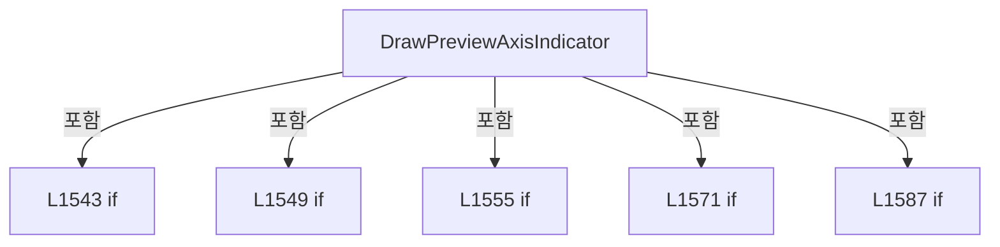

변경 전 점검: 입력/반환 타입, 위 호출자, 예외/취소 경로, 공유 상태와 저장·전송 소비자를 함께 확인합니다. 값의 단위나 물리 방향을 이름만으로 확정하지 않습니다.

### MethodDeclaration `GetPreviewAxisTitlePoint` · L1598–1621

[Drilling.UI/Menu/Menus/CReviewGlassPreviewBuilder.cs:1598–1621](https://github.com/kjuws10-rgb/A3Drilling/blob/28764c91d521777b8ee068dd7aaf2d3902ce9fe2/Drilling.UI/Menu/Menus/CReviewGlassPreviewBuilder.cs#L1598-L1621)

| 항목 | 실제 추출 값 |
| --- | --- |
| 서명 | Point Drilling.UI.Menu.Menus.CReviewGlassPreviewBuilder.GetPreviewAxisTitlePoint(Drilling.UI.Menu.Menus.ST_REVIEW_GLASS_AXIS_INDICATOR, Point, Rect) |
| 접근/수식자 | Private / private, static |
| 반환/값 타입 | Point |
| 소속 타입 | NamedType:Drilling.UI.Menu.Menus.CReviewGlassPreviewBuilder |

입력 계약:

| 이름 | 타입 | 전달 | 선택/기본값 |
| --- | --- | --- | --- |
| axisIndicator | Drilling.UI.Menu.Menus.ST_REVIEW_GLASS_AXIS_INDICATOR | None | False /  |
| origin | Point | None | False /  |
| previewRect | Rect | None | False /  |

정적 호출자로 확인된 위치:

| 호출 파일/행 | 호출 표현식 | 런타임 분기 가능 |
| --- | --- | --- |
| [Drilling.UI/Menu/Menus/CReviewGlassPreviewBuilder.cs:1592–1592](https://github.com/kjuws10-rgb/A3Drilling/blob/28764c91d521777b8ee068dd7aaf2d3902ce9fe2/Drilling.UI/Menu/Menus/CReviewGlassPreviewBuilder.cs#L1592-L1592) | GetPreviewAxisTitlePoint | False |

호출하는 대상과 해석 범위:

| 원본 행 | 표현식 | 분석 상태 | 대상/소스 위치 |
| --- | --- | --- | --- |
| 1603 | axisIndicator.Anchor.ToUpperInvariant | resolved | string string.ToUpperInvariant() |
| 1618 | new Point | unresolved | None |
| 1619 | ClampPreviewAxisCoordinate | candidate | OverloadResolutionFailure |
| 1620 | ClampPreviewAxisCoordinate | candidate | OverloadResolutionFailure |

본문의 실제 연산·분기·예외·반환 순서(원문 위치 순):

| 원본 행 | 종류 | 주석 해설 |
| --- | --- | --- |
| 1603 | call | 함수·델리게이트 또는 객체 생성자를 호출합니다: axisIndicator.Anchor.ToUpperInvariant() |
| 1603 | local-declaration | 지역 변수를 선언합니다: var anchor = axisIndicator.Anchor.ToUpperInvariant(); |
| 1603 | variable-initializer | 변수의 초기값을 지정합니다: anchor = axisIndicator.Anchor.ToUpperInvariant() |
| 1604 | local-declaration | 지역 변수를 선언합니다: var x = origin.X - 18.0; |
| 1604 | variable-initializer | 변수의 초기값을 지정합니다: x = origin.X - 18.0 |
| 1605 | local-declaration | 지역 변수를 선언합니다: var y = origin.Y - 24.0; |
| 1605 | variable-initializer | 변수의 초기값을 지정합니다: y = origin.Y - 24.0 |
| 1607 | if | 조건에 따라 분기합니다: if (anchor == "BOTTOM_LEFT") |
| 1609 | assignment | 값을 대상에 대입합니다: x = origin.X + 4.0 |
| 1610 | assignment | 값을 대상에 대입합니다: y = origin.Y + 12.0 |
| 1612 | else | 앞 조건이 거짓인 경로입니다: else |
| 1612 | if | 조건에 따라 분기합니다: if (anchor == "BOTTOM_RIGHT") |
| 1614 | assignment | 값을 대상에 대입합니다: x = origin.X - 92.0 |
| 1615 | assignment | 값을 대상에 대입합니다: y = origin.Y + 12.0 |
| 1618 | call | 함수·델리게이트 또는 객체 생성자를 호출합니다: new Point( ClampPreviewAxisCoordinate(x, previewRect.Left + 4.0, previewRect.Right - 112.0), ClampPreviewAxisCoordinate(y, previewRect.Top + 4.0, previewRect.Bottom - 16.0)) |
| 1618 | return | 호출자에게 값 또는 제어를 반환합니다: return new Point( ClampPreviewAxisCoordinate(x, previewRect.Left + 4.0, previewRect.Right - 112.0), ClampPreviewAxisCoordinate(y, previewRect.Top + 4.0, previewRect.Bottom - 16.0)); |
| 1619 | call | 함수·델리게이트 또는 객체 생성자를 호출합니다: ClampPreviewAxisCoordinate(x, previewRect.Left + 4.0, previewRect.Right - 112.0) |
| 1620 | call | 함수·델리게이트 또는 객체 생성자를 호출합니다: ClampPreviewAxisCoordinate(y, previewRect.Top + 4.0, previewRect.Bottom - 16.0) |

제어 구문의 포함 구조(실제 실행 순서/CFG가 아닌 구문 탐색 그림):

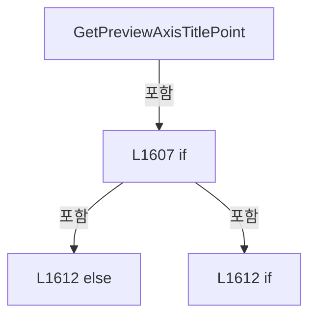

변경 전 점검: 입력/반환 타입, 위 호출자, 예외/취소 경로, 공유 상태와 저장·전송 소비자를 함께 확인합니다. 값의 단위나 물리 방향을 이름만으로 확정하지 않습니다.

### MethodDeclaration `GetPreviewAxisOrigin` · L1623–1677

[Drilling.UI/Menu/Menus/CReviewGlassPreviewBuilder.cs:1623–1677](https://github.com/kjuws10-rgb/A3Drilling/blob/28764c91d521777b8ee068dd7aaf2d3902ce9fe2/Drilling.UI/Menu/Menus/CReviewGlassPreviewBuilder.cs#L1623-L1677)

| 항목 | 실제 추출 값 |
| --- | --- |
| 서명 | Point Drilling.UI.Menu.Menus.CReviewGlassPreviewBuilder.GetPreviewAxisOrigin(Rect, Rect, Drilling.UI.Menu.Menus.ST_REVIEW_GLASS_AXIS_INDICATOR) |
| 접근/수식자 | Private / private, static |
| 반환/값 타입 | Point |
| 소속 타입 | NamedType:Drilling.UI.Menu.Menus.CReviewGlassPreviewBuilder |

입력 계약:

| 이름 | 타입 | 전달 | 선택/기본값 |
| --- | --- | --- | --- |
| previewRect | Rect | None | False /  |
| glassRect | Rect | None | False /  |
| axisIndicator | Drilling.UI.Menu.Menus.ST_REVIEW_GLASS_AXIS_INDICATOR | None | False /  |

정적 호출자로 확인된 위치:

| 호출 파일/행 | 호출 표현식 | 런타임 분기 가능 |
| --- | --- | --- |
| [Drilling.UI/Menu/Menus/CReviewGlassPreviewBuilder.cs:1535–1535](https://github.com/kjuws10-rgb/A3Drilling/blob/28764c91d521777b8ee068dd7aaf2d3902ce9fe2/Drilling.UI/Menu/Menus/CReviewGlassPreviewBuilder.cs#L1535-L1535) | GetPreviewAxisOrigin | False |

호출하는 대상과 해석 범위:

| 원본 행 | 표현식 | 분석 상태 | 대상/소스 위치 |
| --- | --- | --- | --- |
| 1628 | axisIndicator.Anchor.ToUpperInvariant | resolved | string string.ToUpperInvariant() |
| 1637 | new Point | unresolved | None |
| 1638 | ClampPreviewAxisCoordinate | candidate | OverloadResolutionFailure |
| 1639 | ClampPreviewAxisCoordinate | candidate | OverloadResolutionFailure |
| 1650 | new Point | unresolved | None |
| 1651 | ClampPreviewAxisCoordinate | candidate | OverloadResolutionFailure |
| 1652 | ClampPreviewAxisCoordinate | candidate | OverloadResolutionFailure |
| 1663 | new Point | unresolved | None |
| 1664 | ClampPreviewAxisCoordinate | candidate | OverloadResolutionFailure |
| 1665 | ClampPreviewAxisCoordinate | candidate | OverloadResolutionFailure |
| 1674 | new Point | unresolved | None |
| 1675 | ClampPreviewAxisCoordinate | candidate | OverloadResolutionFailure |
| 1676 | ClampPreviewAxisCoordinate | candidate | OverloadResolutionFailure |

본문의 실제 연산·분기·예외·반환 순서(원문 위치 순):

| 원본 행 | 종류 | 주석 해설 |
| --- | --- | --- |
| 1628 | call | 함수·델리게이트 또는 객체 생성자를 호출합니다: axisIndicator.Anchor.ToUpperInvariant() |
| 1628 | local-declaration | 지역 변수를 선언합니다: var anchor = axisIndicator.Anchor.ToUpperInvariant(); |
| 1628 | variable-initializer | 변수의 초기값을 지정합니다: anchor = axisIndicator.Anchor.ToUpperInvariant() |
| 1629 | if | 조건에 따라 분기합니다: if (anchor == "TOP_RIGHT") |
| 1631 | conditional-expression | 조건에 따라 결과식을 선택합니다: axisIndicator.XPositiveRight ? glassRect.Right - 54.0 : glassRect.Right + 14.0 |
| 1631 | local-declaration | 지역 변수를 선언합니다: var x = axisIndicator.XPositiveRight ? glassRect.Right - 54.0 : glassRect.Right + 14.0; |
| 1631 | variable-initializer | 변수의 초기값을 지정합니다: x = axisIndicator.XPositiveRight ? glassRect.Right - 54.0 : glassRect.Right + 14.0 |
| 1634 | conditional-expression | 조건에 따라 결과식을 선택합니다: axisIndicator.YPositiveDown ? glassRect.Top - 42.0 : glassRect.Top - 8.0 |
| 1634 | local-declaration | 지역 변수를 선언합니다: var y = axisIndicator.YPositiveDown ? glassRect.Top - 42.0 : glassRect.Top - 8.0; |
| 1634 | variable-initializer | 변수의 초기값을 지정합니다: y = axisIndicator.YPositiveDown ? glassRect.Top - 42.0 : glassRect.Top - 8.0 |
| 1637 | call | 함수·델리게이트 또는 객체 생성자를 호출합니다: new Point( ClampPreviewAxisCoordinate(x, previewRect.Left + 8.0, previewRect.Right - 8.0), ClampPreviewAxisCoordinate(y, previewRect.Top + 8.0, previewRect.Bottom - 8.0)) |
| 1637 | return | 호출자에게 값 또는 제어를 반환합니다: return new Point( ClampPreviewAxisCoordinate(x, previewRect.Left + 8.0, previewRect.Right - 8.0), ClampPreviewAxisCoordinate(y, previewRect.Top + 8.0, previewRect.Bottom - 8.0)); |
| 1638 | call | 함수·델리게이트 또는 객체 생성자를 호출합니다: ClampPreviewAxisCoordinate(x, previewRect.Left + 8.0, previewRect.Right - 8.0) |
| 1639 | call | 함수·델리게이트 또는 객체 생성자를 호출합니다: ClampPreviewAxisCoordinate(y, previewRect.Top + 8.0, previewRect.Bottom - 8.0) |
| 1642 | if | 조건에 따라 분기합니다: if (anchor == "BOTTOM_LEFT") |
| 1644 | conditional-expression | 조건에 따라 결과식을 선택합니다: axisIndicator.XPositiveRight ? glassRect.Left - 30.0 : glassRect.Left + 54.0 |
| 1644 | local-declaration | 지역 변수를 선언합니다: var x = axisIndicator.XPositiveRight ? glassRect.Left - 30.0 : glassRect.Left + 54.0; |
| 1644 | variable-initializer | 변수의 초기값을 지정합니다: x = axisIndicator.XPositiveRight ? glassRect.Left - 30.0 : glassRect.Left + 54.0 |
| 1647 | conditional-expression | 조건에 따라 결과식을 선택합니다: axisIndicator.YPositiveDown ? glassRect.Bottom + 14.0 : glassRect.Bottom + 42.0 |
| 1647 | local-declaration | 지역 변수를 선언합니다: var y = axisIndicator.YPositiveDown ? glassRect.Bottom + 14.0 : glassRect.Bottom + 42.0; |
| 1647 | variable-initializer | 변수의 초기값을 지정합니다: y = axisIndicator.YPositiveDown ? glassRect.Bottom + 14.0 : glassRect.Bottom + 42.0 |
| 1650 | call | 함수·델리게이트 또는 객체 생성자를 호출합니다: new Point( ClampPreviewAxisCoordinate(x, previewRect.Left + 8.0, previewRect.Right - 8.0), ClampPreviewAxisCoordinate(y, previewRect.Top + 8.0, previewRect.Bottom - 8.0)) |
| 1650 | return | 호출자에게 값 또는 제어를 반환합니다: return new Point( ClampPreviewAxisCoordinate(x, previewRect.Left + 8.0, previewRect.Right - 8.0), ClampPreviewAxisCoordinate(y, previewRect.Top + 8.0, previewRect.Bottom - 8.0)); |
| 1651 | call | 함수·델리게이트 또는 객체 생성자를 호출합니다: ClampPreviewAxisCoordinate(x, previewRect.Left + 8.0, previewRect.Right - 8.0) |
| 1652 | call | 함수·델리게이트 또는 객체 생성자를 호출합니다: ClampPreviewAxisCoordinate(y, previewRect.Top + 8.0, previewRect.Bottom - 8.0) |
| 1655 | if | 조건에 따라 분기합니다: if (anchor == "BOTTOM_RIGHT") |
| 1657 | conditional-expression | 조건에 따라 결과식을 선택합니다: axisIndicator.XPositiveRight ? glassRect.Right - 54.0 : glassRect.Right + 14.0 |
| 1657 | local-declaration | 지역 변수를 선언합니다: var x = axisIndicator.XPositiveRight ? glassRect.Right - 54.0 : glassRect.Right + 14.0; |
| 1657 | variable-initializer | 변수의 초기값을 지정합니다: x = axisIndicator.XPositiveRight ? glassRect.Right - 54.0 : glassRect.Right + 14.0 |
| 1660 | conditional-expression | 조건에 따라 결과식을 선택합니다: axisIndicator.YPositiveDown ? glassRect.Bottom + 14.0 : glassRect.Bottom + 42.0 |
| 1660 | local-declaration | 지역 변수를 선언합니다: var y = axisIndicator.YPositiveDown ? glassRect.Bottom + 14.0 : glassRect.Bottom + 42.0; |
| 1660 | variable-initializer | 변수의 초기값을 지정합니다: y = axisIndicator.YPositiveDown ? glassRect.Bottom + 14.0 : glassRect.Bottom + 42.0 |
| 1663 | call | 함수·델리게이트 또는 객체 생성자를 호출합니다: new Point( ClampPreviewAxisCoordinate(x, previewRect.Left + 8.0, previewRect.Right - 8.0), ClampPreviewAxisCoordinate(y, previewRect.Top + 8.0, previewRect.Bottom - 8.0)) |
| 1663 | return | 호출자에게 값 또는 제어를 반환합니다: return new Point( ClampPreviewAxisCoordinate(x, previewRect.Left + 8.0, previewRect.Right - 8.0), ClampPreviewAxisCoordinate(y, previewRect.Top + 8.0, previewRect.Bottom - 8.0)); |
| 1664 | call | 함수·델리게이트 또는 객체 생성자를 호출합니다: ClampPreviewAxisCoordinate(x, previewRect.Left + 8.0, previewRect.Right - 8.0) |
| 1665 | call | 함수·델리게이트 또는 객체 생성자를 호출합니다: ClampPreviewAxisCoordinate(y, previewRect.Top + 8.0, previewRect.Bottom - 8.0) |
| 1668 | conditional-expression | 조건에 따라 결과식을 선택합니다: axisIndicator.XPositiveRight ? glassRect.Left - 30.0 : glassRect.Left + 54.0 |
| 1668 | local-declaration | 지역 변수를 선언합니다: var topLeftX = axisIndicator.XPositiveRight ? glassRect.Left - 30.0 : glassRect.Left + 54.0; |
| 1668 | variable-initializer | 변수의 초기값을 지정합니다: topLeftX = axisIndicator.XPositiveRight ? glassRect.Left - 30.0 : glassRect.Left + 54.0 |
| 1671 | conditional-expression | 조건에 따라 결과식을 선택합니다: axisIndicator.YPositiveDown ? glassRect.Top - 42.0 : glassRect.Top - 8.0 |
| 1671 | local-declaration | 지역 변수를 선언합니다: var topLeftY = axisIndicator.YPositiveDown ? glassRect.Top - 42.0 : glassRect.Top - 8.0; |
| 1671 | variable-initializer | 변수의 초기값을 지정합니다: topLeftY = axisIndicator.YPositiveDown ? glassRect.Top - 42.0 : glassRect.Top - 8.0 |
| 1674 | call | 함수·델리게이트 또는 객체 생성자를 호출합니다: new Point( ClampPreviewAxisCoordinate(topLeftX, previewRect.Left + 8.0, previewRect.Right - 8.0), ClampPreviewAxisCoordinate(topLeftY, previewRect.Top + 8.0, previewRect.Bottom - 8.0)) |
| 1674 | return | 호출자에게 값 또는 제어를 반환합니다: return new Point( ClampPreviewAxisCoordinate(topLeftX, previewRect.Left + 8.0, previewRect.Right - 8.0), ClampPreviewAxisCoordinate(topLeftY, previewRect.Top + 8.0, previewRect.Bottom - 8.0)); |
| 1675 | call | 함수·델리게이트 또는 객체 생성자를 호출합니다: ClampPreviewAxisCoordinate(topLeftX, previewRect.Left + 8.0, previewRect.Right - 8.0) |
| 1676 | call | 함수·델리게이트 또는 객체 생성자를 호출합니다: ClampPreviewAxisCoordinate(topLeftY, previewRect.Top + 8.0, previewRect.Bottom - 8.0) |

제어 구문의 포함 구조(실제 실행 순서/CFG가 아닌 구문 탐색 그림):

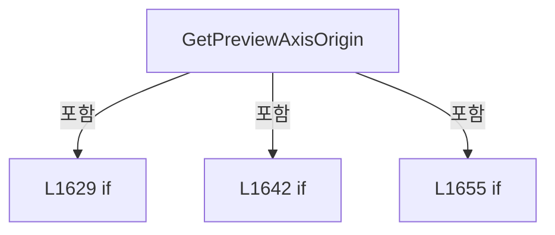

변경 전 점검: 입력/반환 타입, 위 호출자, 예외/취소 경로, 공유 상태와 저장·전송 소비자를 함께 확인합니다. 값의 단위나 물리 방향을 이름만으로 확정하지 않습니다.

### MethodDeclaration `ClampPreviewAxisCoordinate` · L1679–1686

[Drilling.UI/Menu/Menus/CReviewGlassPreviewBuilder.cs:1679–1686](https://github.com/kjuws10-rgb/A3Drilling/blob/28764c91d521777b8ee068dd7aaf2d3902ce9fe2/Drilling.UI/Menu/Menus/CReviewGlassPreviewBuilder.cs#L1679-L1686)

| 항목 | 실제 추출 값 |
| --- | --- |
| 서명 | double Drilling.UI.Menu.Menus.CReviewGlassPreviewBuilder.ClampPreviewAxisCoordinate(double, double, double) |
| 접근/수식자 | Private / private, static |
| 반환/값 타입 | double |
| 소속 타입 | NamedType:Drilling.UI.Menu.Menus.CReviewGlassPreviewBuilder |

입력 계약:

| 이름 | 타입 | 전달 | 선택/기본값 |
| --- | --- | --- | --- |
| value | double | None | False /  |
| min | double | None | False /  |
| max | double | None | False /  |

현재 부분 분석에서 직접 연결된 호출자는 없습니다. XAML/이벤트/인터페이스·델리게이트·외부 진입을 추가 확인해야 하며, 미사용으로 판정한 것이 아닙니다.

호출하는 대상과 해석 범위:

| 원본 행 | 표현식 | 분석 상태 | 대상/소스 위치 |
| --- | --- | --- | --- |
| 1684 | Math.Max | resolved | double System.Math.Max(double, double) |
| 1685 | Math.Clamp | resolved | double System.Math.Clamp(double, double, double) |

본문의 실제 연산·분기·예외·반환 순서(원문 위치 순):

| 원본 행 | 종류 | 주석 해설 |
| --- | --- | --- |
| 1684 | call | 함수·델리게이트 또는 객체 생성자를 호출합니다: Math.Max(min, max) |
| 1684 | local-declaration | 지역 변수를 선언합니다: var safeMax = Math.Max(min, max); |
| 1684 | variable-initializer | 변수의 초기값을 지정합니다: safeMax = Math.Max(min, max) |
| 1685 | call | 함수·델리게이트 또는 객체 생성자를 호출합니다: Math.Clamp(value, min, safeMax) |
| 1685 | return | 호출자에게 값 또는 제어를 반환합니다: return Math.Clamp(value, min, safeMax); |

변경 전 점검: 입력/반환 타입, 위 호출자, 예외/취소 경로, 공유 상태와 저장·전송 소비자를 함께 확인합니다. 값의 단위나 물리 방향을 이름만으로 확정하지 않습니다.

### MethodDeclaration `DrawHorizontalArrowHead` · L1688–1697

[Drilling.UI/Menu/Menus/CReviewGlassPreviewBuilder.cs:1688–1697](https://github.com/kjuws10-rgb/A3Drilling/blob/28764c91d521777b8ee068dd7aaf2d3902ce9fe2/Drilling.UI/Menu/Menus/CReviewGlassPreviewBuilder.cs#L1688-L1697)

| 항목 | 실제 추출 값 |
| --- | --- |
| 서명 | void Drilling.UI.Menu.Menus.CReviewGlassPreviewBuilder.DrawHorizontalArrowHead(DrawingContext, Pen, Point, bool) |
| 접근/수식자 | Private / private, static |
| 반환/값 타입 | void |
| 소속 타입 | NamedType:Drilling.UI.Menu.Menus.CReviewGlassPreviewBuilder |

입력 계약:

| 이름 | 타입 | 전달 | 선택/기본값 |
| --- | --- | --- | --- |
| context | DrawingContext | None | False /  |
| axisPen | Pen | None | False /  |
| end | Point | None | False /  |
| positiveRight | bool | None | False /  |

정적 호출자로 확인된 위치:

| 호출 파일/행 | 호출 표현식 | 런타임 분기 가능 |
| --- | --- | --- |
| [Drilling.UI/Menu/Menus/CReviewGlassPreviewBuilder.cs:1546–1546](https://github.com/kjuws10-rgb/A3Drilling/blob/28764c91d521777b8ee068dd7aaf2d3902ce9fe2/Drilling.UI/Menu/Menus/CReviewGlassPreviewBuilder.cs#L1546-L1546) | DrawHorizontalArrowHead | False |

호출하는 대상과 해석 범위:

| 원본 행 | 표현식 | 분석 상태 | 대상/소스 위치 |
| --- | --- | --- | --- |
| 1695 | context.DrawLine | unresolved | None |
| 1695 | new Point | unresolved | None |
| 1696 | context.DrawLine | unresolved | None |
| 1696 | new Point | unresolved | None |

본문의 실제 연산·분기·예외·반환 순서(원문 위치 순):

| 원본 행 | 종류 | 주석 해설 |
| --- | --- | --- |
| 1694 | conditional-expression | 조건에 따라 결과식을 선택합니다: positiveRight ? 1.0 : -1.0 |
| 1694 | local-declaration | 지역 변수를 선언합니다: var direction = positiveRight ? 1.0 : -1.0; |
| 1694 | variable-initializer | 변수의 초기값을 지정합니다: direction = positiveRight ? 1.0 : -1.0 |
| 1695 | call | 함수·델리게이트 또는 객체 생성자를 호출합니다: context.DrawLine(axisPen, new Point(end.X - (direction * 8.0), end.Y - 4.0), end) |
| 1695 | call | 함수·델리게이트 또는 객체 생성자를 호출합니다: new Point(end.X - (direction * 8.0), end.Y - 4.0) |
| 1696 | call | 함수·델리게이트 또는 객체 생성자를 호출합니다: context.DrawLine(axisPen, new Point(end.X - (direction * 8.0), end.Y + 4.0), end) |
| 1696 | call | 함수·델리게이트 또는 객체 생성자를 호출합니다: new Point(end.X - (direction * 8.0), end.Y + 4.0) |

변경 전 점검: 입력/반환 타입, 위 호출자, 예외/취소 경로, 공유 상태와 저장·전송 소비자를 함께 확인합니다. 값의 단위나 물리 방향을 이름만으로 확정하지 않습니다.

### MethodDeclaration `DrawVerticalArrowHead` · L1699–1708

[Drilling.UI/Menu/Menus/CReviewGlassPreviewBuilder.cs:1699–1708](https://github.com/kjuws10-rgb/A3Drilling/blob/28764c91d521777b8ee068dd7aaf2d3902ce9fe2/Drilling.UI/Menu/Menus/CReviewGlassPreviewBuilder.cs#L1699-L1708)

| 항목 | 실제 추출 값 |
| --- | --- |
| 서명 | void Drilling.UI.Menu.Menus.CReviewGlassPreviewBuilder.DrawVerticalArrowHead(DrawingContext, Pen, Point, bool) |
| 접근/수식자 | Private / private, static |
| 반환/값 타입 | void |
| 소속 타입 | NamedType:Drilling.UI.Menu.Menus.CReviewGlassPreviewBuilder |

입력 계약:

| 이름 | 타입 | 전달 | 선택/기본값 |
| --- | --- | --- | --- |
| context | DrawingContext | None | False /  |
| axisPen | Pen | None | False /  |
| end | Point | None | False /  |
| positiveDown | bool | None | False /  |

정적 호출자로 확인된 위치:

| 호출 파일/행 | 호출 표현식 | 런타임 분기 가능 |
| --- | --- | --- |
| [Drilling.UI/Menu/Menus/CReviewGlassPreviewBuilder.cs:1552–1552](https://github.com/kjuws10-rgb/A3Drilling/blob/28764c91d521777b8ee068dd7aaf2d3902ce9fe2/Drilling.UI/Menu/Menus/CReviewGlassPreviewBuilder.cs#L1552-L1552) | DrawVerticalArrowHead | False |

호출하는 대상과 해석 범위:

| 원본 행 | 표현식 | 분석 상태 | 대상/소스 위치 |
| --- | --- | --- | --- |
| 1706 | context.DrawLine | unresolved | None |
| 1706 | new Point | unresolved | None |
| 1707 | context.DrawLine | unresolved | None |
| 1707 | new Point | unresolved | None |

본문의 실제 연산·분기·예외·반환 순서(원문 위치 순):

| 원본 행 | 종류 | 주석 해설 |
| --- | --- | --- |
| 1705 | conditional-expression | 조건에 따라 결과식을 선택합니다: positiveDown ? 1.0 : -1.0 |
| 1705 | local-declaration | 지역 변수를 선언합니다: var direction = positiveDown ? 1.0 : -1.0; |
| 1705 | variable-initializer | 변수의 초기값을 지정합니다: direction = positiveDown ? 1.0 : -1.0 |
| 1706 | call | 함수·델리게이트 또는 객체 생성자를 호출합니다: context.DrawLine(axisPen, new Point(end.X - 4.0, end.Y - (direction * 8.0)), end) |
| 1706 | call | 함수·델리게이트 또는 객체 생성자를 호출합니다: new Point(end.X - 4.0, end.Y - (direction * 8.0)) |
| 1707 | call | 함수·델리게이트 또는 객체 생성자를 호출합니다: context.DrawLine(axisPen, new Point(end.X + 4.0, end.Y - (direction * 8.0)), end) |
| 1707 | call | 함수·델리게이트 또는 객체 생성자를 호출합니다: new Point(end.X + 4.0, end.Y - (direction * 8.0)) |

변경 전 점검: 입력/반환 타입, 위 호출자, 예외/취소 경로, 공유 상태와 저장·전송 소비자를 함께 확인합니다. 값의 단위나 물리 방향을 이름만으로 확정하지 않습니다.

### MethodDeclaration `DrawPreviewAxisText` · L1710–1735

[Drilling.UI/Menu/Menus/CReviewGlassPreviewBuilder.cs:1710–1735](https://github.com/kjuws10-rgb/A3Drilling/blob/28764c91d521777b8ee068dd7aaf2d3902ce9fe2/Drilling.UI/Menu/Menus/CReviewGlassPreviewBuilder.cs#L1710-L1735)

| 항목 | 실제 추출 값 |
| --- | --- |
| 서명 | void Drilling.UI.Menu.Menus.CReviewGlassPreviewBuilder.DrawPreviewAxisText(DrawingContext, string, Point, Brush, double) |
| 접근/수식자 | Private / private, static |
| 반환/값 타입 | void |
| 소속 타입 | NamedType:Drilling.UI.Menu.Menus.CReviewGlassPreviewBuilder |

입력 계약:

| 이름 | 타입 | 전달 | 선택/기본값 |
| --- | --- | --- | --- |
| context | DrawingContext | None | False /  |
| text | string | None | False /  |
| point | Point | None | False /  |
| brush | Brush | None | False /  |
| fontSize | double | None | True / 13 |

현재 부분 분석에서 직접 연결된 호출자는 없습니다. XAML/이벤트/인터페이스·델리게이트·외부 진입을 추가 확인해야 하며, 미사용으로 판정한 것이 아닙니다.

호출하는 대상과 해석 범위:

| 원본 행 | 표현식 | 분석 상태 | 대상/소스 위치 |
| --- | --- | --- | --- |
| 1717 | new FormattedText | unresolved | None |
| 1725 | new Typeface | unresolved | None |
| 1734 | context.DrawText | unresolved | None |

본문의 실제 연산·분기·예외·반환 순서(원문 위치 순):

| 원본 행 | 종류 | 주석 해설 |
| --- | --- | --- |
| 1717 | call | 함수·델리게이트 또는 객체 생성자를 호출합니다: new FormattedText( text, CultureInfo.InvariantCulture, FlowDirection.LeftToRight, new Typeface("Segoe UI Semibold"), fontSize, brush, 1.0 ) |
| 1717 | local-declaration | 지역 변수를 선언합니다: var label = new FormattedText( text, CultureInfo.InvariantCulture, FlowDirection.LeftToRight, new Typeface("Segoe UI Semibold"), fontSize, brush, 1.0 ); |
| 1717 | variable-initializer | 변수의 초기값을 지정합니다: label = new FormattedText( text, CultureInfo.InvariantCulture, FlowDirection.LeftToRight, new Typeface("Segoe UI Semibold"), fontSize, brush, 1.0 ) |
| 1725 | call | 함수·델리게이트 또는 객체 생성자를 호출합니다: new Typeface("Segoe UI Semibold") |
| 1734 | call | 함수·델리게이트 또는 객체 생성자를 호출합니다: context.DrawText(label, point) |

변경 전 점검: 입력/반환 타입, 위 호출자, 예외/취소 경로, 공유 상태와 저장·전송 소비자를 함께 확인합니다. 값의 단위나 물리 방향을 이름만으로 확정하지 않습니다.

### MethodDeclaration `ReadInt` · L1737–1751

[Drilling.UI/Menu/Menus/CReviewGlassPreviewBuilder.cs:1737–1751](https://github.com/kjuws10-rgb/A3Drilling/blob/28764c91d521777b8ee068dd7aaf2d3902ce9fe2/Drilling.UI/Menu/Menus/CReviewGlassPreviewBuilder.cs#L1737-L1751)

| 항목 | 실제 추출 값 |
| --- | --- |
| 서명 | int Drilling.UI.Menu.Menus.CReviewGlassPreviewBuilder.ReadInt(Drilling.Common.Managers.ST_RECIPE_DEFINITION, int, params string[]) |
| 접근/수식자 | Private / private, static |
| 반환/값 타입 | int |
| 소속 타입 | NamedType:Drilling.UI.Menu.Menus.CReviewGlassPreviewBuilder |

입력 계약:

| 이름 | 타입 | 전달 | 선택/기본값 |
| --- | --- | --- | --- |
| recipe | Drilling.Common.Managers.ST_RECIPE_DEFINITION | None | False /  |
| defaultValue | int | None | False /  |
| keys | string[] | None | False /  |

정적 호출자로 확인된 위치:

| 호출 파일/행 | 호출 표현식 | 런타임 분기 가능 |
| --- | --- | --- |
| [Drilling.UI/Menu/Menus/CReviewGlassPreviewBuilder.cs:157–157](https://github.com/kjuws10-rgb/A3Drilling/blob/28764c91d521777b8ee068dd7aaf2d3902ce9fe2/Drilling.UI/Menu/Menus/CReviewGlassPreviewBuilder.cs#L157-L157) | ReadInt | False |

호출하는 대상과 해석 범위:

| 원본 행 | 표현식 | 분석 상태 | 대상/소스 위치 |
| --- | --- | --- | --- |
| 1742 | ReadText | resolved | string Drilling.UI.Menu.Menus.CReviewGlassPreviewBuilder.ReadText(Drilling.Common.Managers.ST_RECIPE_DEFINITION, params string[]) · Drilling.UI/Menu/Menus/CReviewGlassPreviewBuilder.cs:1783 |
| 1743 | int.TryParse | resolved | bool int.TryParse(string?, System.Globalization.NumberStyles, System.IFormatProvider?, out int) |
| 1748 | double.TryParse | resolved | bool double.TryParse(string?, System.Globalization.NumberStyles, System.IFormatProvider?, out double) |
| 1749 | Math.Round | resolved | double System.Math.Round(double) |

본문의 실제 연산·분기·예외·반환 순서(원문 위치 순):

| 원본 행 | 종류 | 주석 해설 |
| --- | --- | --- |
| 1742 | call | 함수·델리게이트 또는 객체 생성자를 호출합니다: ReadText(recipe, keys) |
| 1742 | local-declaration | 지역 변수를 선언합니다: var text = ReadText(recipe, keys); |
| 1742 | variable-initializer | 변수의 초기값을 지정합니다: text = ReadText(recipe, keys) |
| 1743 | call | 함수·델리게이트 또는 객체 생성자를 호출합니다: int.TryParse(text, NumberStyles.Integer, CultureInfo.InvariantCulture, out var value) |
| 1743 | if | 조건에 따라 분기합니다: if (int.TryParse(text, NumberStyles.Integer, CultureInfo.InvariantCulture, out var value)) |
| 1745 | return | 호출자에게 값 또는 제어를 반환합니다: return value; |
| 1748 | call | 함수·델리게이트 또는 객체 생성자를 호출합니다: double.TryParse(text, NumberStyles.Float, CultureInfo.InvariantCulture, out var doubleValue) |
| 1748 | conditional-expression | 조건에 따라 결과식을 선택합니다: double.TryParse(text, NumberStyles.Float, CultureInfo.InvariantCulture, out var doubleValue) ? (int)Math.Round(doubleValue) : defaultValue |
| 1748 | return | 호출자에게 값 또는 제어를 반환합니다: return double.TryParse(text, NumberStyles.Float, CultureInfo.InvariantCulture, out var doubleValue) ? (int)Math.Round(doubleValue) : defaultValue; |
| 1749 | call | 함수·델리게이트 또는 객체 생성자를 호출합니다: Math.Round(doubleValue) |

제어 구문의 포함 구조(실제 실행 순서/CFG가 아닌 구문 탐색 그림):

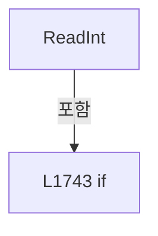

변경 전 점검: 입력/반환 타입, 위 호출자, 예외/취소 경로, 공유 상태와 저장·전송 소비자를 함께 확인합니다. 값의 단위나 물리 방향을 이름만으로 확정하지 않습니다.

### MethodDeclaration `CreateParameterMap` · L1753–1758

[Drilling.UI/Menu/Menus/CReviewGlassPreviewBuilder.cs:1753–1758](https://github.com/kjuws10-rgb/A3Drilling/blob/28764c91d521777b8ee068dd7aaf2d3902ce9fe2/Drilling.UI/Menu/Menus/CReviewGlassPreviewBuilder.cs#L1753-L1758)

| 항목 | 실제 추출 값 |
| --- | --- |
| 서명 | System.Collections.Generic.IReadOnlyDictionary<string, string> Drilling.UI.Menu.Menus.CReviewGlassPreviewBuilder.CreateParameterMap(Drilling.Common.Managers.ST_RECIPE_DEFINITION) |
| 접근/수식자 | Private / private, static |
| 반환/값 타입 | System.Collections.Generic.IReadOnlyDictionary<string, string> |
| 소속 타입 | NamedType:Drilling.UI.Menu.Menus.CReviewGlassPreviewBuilder |

입력 계약:

| 이름 | 타입 | 전달 | 선택/기본값 |
| --- | --- | --- | --- |
| recipe | Drilling.Common.Managers.ST_RECIPE_DEFINITION | None | False /  |

정적 호출자로 확인된 위치:

| 호출 파일/행 | 호출 표현식 | 런타임 분기 가능 |
| --- | --- | --- |
| [Drilling.UI/Menu/Menus/CReviewGlassPreviewBuilder.cs:158–158](https://github.com/kjuws10-rgb/A3Drilling/blob/28764c91d521777b8ee068dd7aaf2d3902ce9fe2/Drilling.UI/Menu/Menus/CReviewGlassPreviewBuilder.cs#L158-L158) | CreateParameterMap | False |

호출하는 대상과 해석 범위:

| 원본 행 | 표현식 | 분석 상태 | 대상/소스 위치 |
| --- | --- | --- | --- |
| 1755 | recipe.Parameters .GroupBy(parameter => parameter.Key, StringComparer.OrdinalIgnoreCase) .ToDictionary | resolved | System.Collections.Generic.Dictionary<string, string> System.Collections.Generic.IEnumerable<System.Linq.IGrouping<string, Drilling.Common.Managers.ST_RECIPE_PARAMETER>>.ToDictionary<System.Linq.IGrouping<string, Drilling.Common.Managers.ST_RECIPE_PARAMETER>, string, string>(System.Func<System.Linq.IGrouping<string, Drilling.Common.Managers.ST_RECIPE_PARAMETER>, string>, System.Func<System.Linq.IGrouping<string, Drilling.Common.Managers.ST_RECIPE_PARAMETER>, string>, System.Collections.Generic.IEqualityComparer<string>?) |
| 1755 | recipe.Parameters .GroupBy | resolved | System.Collections.Generic.IEnumerable<System.Linq.IGrouping<string, Drilling.Common.Managers.ST_RECIPE_PARAMETER>> System.Collections.Generic.IEnumerable<Drilling.Common.Managers.ST_RECIPE_PARAMETER>.GroupBy<Drilling.Common.Managers.ST_RECIPE_PARAMETER, string>(System.Func<Drilling.Common.Managers.ST_RECIPE_PARAMETER, string>, System.Collections.Generic.IEqualityComparer<string>?) |
| 1757 | group.Last | resolved | Drilling.Common.Managers.ST_RECIPE_PARAMETER System.Collections.Generic.IEnumerable<Drilling.Common.Managers.ST_RECIPE_PARAMETER>.Last<Drilling.Common.Managers.ST_RECIPE_PARAMETER>() |

본문의 실제 연산·분기·예외·반환 순서(원문 위치 순):

| 원본 행 | 종류 | 주석 해설 |
| --- | --- | --- |
| 1755 | call | 함수·델리게이트 또는 객체 생성자를 호출합니다: recipe.Parameters .GroupBy(parameter => parameter.Key, StringComparer.OrdinalIgnoreCase) |
| 1755 | call | 함수·델리게이트 또는 객체 생성자를 호출합니다: recipe.Parameters .GroupBy(parameter => parameter.Key, StringComparer.OrdinalIgnoreCase) .ToDictionary(group => group.Key, group => group.Last().Value, StringComparer.OrdinalIgnoreCase) |
| 1755 | return | 호출자에게 값 또는 제어를 반환합니다: return recipe.Parameters .GroupBy(parameter => parameter.Key, StringComparer.OrdinalIgnoreCase) .ToDictionary(group => group.Key, group => group.Last().Value, StringComparer.OrdinalIgnoreCase); |
| 1757 | call | 함수·델리게이트 또는 객체 생성자를 호출합니다: group.Last() |

변경 전 점검: 입력/반환 타입, 위 호출자, 예외/취소 경로, 공유 상태와 저장·전송 소비자를 함께 확인합니다. 값의 단위나 물리 방향을 이름만으로 확정하지 않습니다.

### MethodDeclaration `ReadDouble` · L1760–1770

[Drilling.UI/Menu/Menus/CReviewGlassPreviewBuilder.cs:1760–1770](https://github.com/kjuws10-rgb/A3Drilling/blob/28764c91d521777b8ee068dd7aaf2d3902ce9fe2/Drilling.UI/Menu/Menus/CReviewGlassPreviewBuilder.cs#L1760-L1770)

| 항목 | 실제 추출 값 |
| --- | --- |
| 서명 | double Drilling.UI.Menu.Menus.CReviewGlassPreviewBuilder.ReadDouble(Drilling.Common.Managers.ST_RECIPE_DEFINITION, double, params string[]) |
| 접근/수식자 | Private / private, static |
| 반환/값 타입 | double |
| 소속 타입 | NamedType:Drilling.UI.Menu.Menus.CReviewGlassPreviewBuilder |

입력 계약:

| 이름 | 타입 | 전달 | 선택/기본값 |
| --- | --- | --- | --- |
| recipe | Drilling.Common.Managers.ST_RECIPE_DEFINITION | None | False /  |
| defaultValue | double | None | False /  |
| keys | string[] | None | False /  |

정적 호출자로 확인된 위치:

| 호출 파일/행 | 호출 표현식 | 런타임 분기 가능 |
| --- | --- | --- |
| [Drilling.UI/Menu/Menus/CReviewGlassPreviewBuilder.cs:83–83](https://github.com/kjuws10-rgb/A3Drilling/blob/28764c91d521777b8ee068dd7aaf2d3902ce9fe2/Drilling.UI/Menu/Menus/CReviewGlassPreviewBuilder.cs#L83-L83) | ReadDouble | False |
| [Drilling.UI/Menu/Menus/CReviewGlassPreviewBuilder.cs:84–84](https://github.com/kjuws10-rgb/A3Drilling/blob/28764c91d521777b8ee068dd7aaf2d3902ce9fe2/Drilling.UI/Menu/Menus/CReviewGlassPreviewBuilder.cs#L84-L84) | ReadDouble | False |
| [Drilling.UI/Menu/Menus/CReviewGlassPreviewBuilder.cs:106–106](https://github.com/kjuws10-rgb/A3Drilling/blob/28764c91d521777b8ee068dd7aaf2d3902ce9fe2/Drilling.UI/Menu/Menus/CReviewGlassPreviewBuilder.cs#L106-L106) | ReadDouble | False |
| [Drilling.UI/Menu/Menus/CReviewGlassPreviewBuilder.cs:107–107](https://github.com/kjuws10-rgb/A3Drilling/blob/28764c91d521777b8ee068dd7aaf2d3902ce9fe2/Drilling.UI/Menu/Menus/CReviewGlassPreviewBuilder.cs#L107-L107) | ReadDouble | False |
| [Drilling.UI/Menu/Menus/CReviewGlassPreviewBuilder.cs:156–156](https://github.com/kjuws10-rgb/A3Drilling/blob/28764c91d521777b8ee068dd7aaf2d3902ce9fe2/Drilling.UI/Menu/Menus/CReviewGlassPreviewBuilder.cs#L156-L156) | ReadDouble | False |
| [Drilling.UI/Menu/Menus/CReviewGlassPreviewBuilder.cs:285–288](https://github.com/kjuws10-rgb/A3Drilling/blob/28764c91d521777b8ee068dd7aaf2d3902ce9fe2/Drilling.UI/Menu/Menus/CReviewGlassPreviewBuilder.cs#L285-L288) | ReadDouble | False |
| [Drilling.UI/Menu/Menus/CReviewGlassPreviewBuilder.cs:289–292](https://github.com/kjuws10-rgb/A3Drilling/blob/28764c91d521777b8ee068dd7aaf2d3902ce9fe2/Drilling.UI/Menu/Menus/CReviewGlassPreviewBuilder.cs#L289-L292) | ReadDouble | False |
| [Drilling.UI/Menu/Menus/CReviewGlassPreviewBuilder.cs:293–296](https://github.com/kjuws10-rgb/A3Drilling/blob/28764c91d521777b8ee068dd7aaf2d3902ce9fe2/Drilling.UI/Menu/Menus/CReviewGlassPreviewBuilder.cs#L293-L296) | ReadDouble | False |

호출하는 대상과 해석 범위:

| 원본 행 | 표현식 | 분석 상태 | 대상/소스 위치 |
| --- | --- | --- | --- |
| 1765 | ReadText | resolved | string Drilling.UI.Menu.Menus.CReviewGlassPreviewBuilder.ReadText(Drilling.Common.Managers.ST_RECIPE_DEFINITION, params string[]) · Drilling.UI/Menu/Menus/CReviewGlassPreviewBuilder.cs:1783 |
| 1767 | double.TryParse | resolved | bool double.TryParse(string?, System.Globalization.NumberStyles, System.IFormatProvider?, out double) |

본문의 실제 연산·분기·예외·반환 순서(원문 위치 순):

| 원본 행 | 종류 | 주석 해설 |
| --- | --- | --- |
| 1765 | call | 함수·델리게이트 또는 객체 생성자를 호출합니다: ReadText(recipe, keys) |
| 1765 | local-declaration | 지역 변수를 선언합니다: var text = ReadText(recipe, keys); |
| 1765 | variable-initializer | 변수의 초기값을 지정합니다: text = ReadText(recipe, keys) |
| 1767 | call | 함수·델리게이트 또는 객체 생성자를 호출합니다: double.TryParse(text, NumberStyles.Float, CultureInfo.InvariantCulture, out var value) |
| 1767 | conditional-expression | 조건에 따라 결과식을 선택합니다: double.TryParse(text, NumberStyles.Float, CultureInfo.InvariantCulture, out var value) ? value : defaultValue |
| 1767 | return | 호출자에게 값 또는 제어를 반환합니다: return double.TryParse(text, NumberStyles.Float, CultureInfo.InvariantCulture, out var value) ? value : defaultValue; |

변경 전 점검: 입력/반환 타입, 위 호출자, 예외/취소 경로, 공유 상태와 저장·전송 소비자를 함께 확인합니다. 값의 단위나 물리 방향을 이름만으로 확정하지 않습니다.

### MethodDeclaration `ReadNullableDouble` · L1772–1781

[Drilling.UI/Menu/Menus/CReviewGlassPreviewBuilder.cs:1772–1781](https://github.com/kjuws10-rgb/A3Drilling/blob/28764c91d521777b8ee068dd7aaf2d3902ce9fe2/Drilling.UI/Menu/Menus/CReviewGlassPreviewBuilder.cs#L1772-L1781)

| 항목 | 실제 추출 값 |
| --- | --- |
| 서명 | double? Drilling.UI.Menu.Menus.CReviewGlassPreviewBuilder.ReadNullableDouble(Drilling.Common.Managers.ST_RECIPE_DEFINITION, string) |
| 접근/수식자 | Private / private, static |
| 반환/값 타입 | double? |
| 소속 타입 | NamedType:Drilling.UI.Menu.Menus.CReviewGlassPreviewBuilder |

입력 계약:

| 이름 | 타입 | 전달 | 선택/기본값 |
| --- | --- | --- | --- |
| recipe | Drilling.Common.Managers.ST_RECIPE_DEFINITION | None | False /  |
| key | string | None | False /  |

현재 부분 분석에서 직접 연결된 호출자는 없습니다. XAML/이벤트/인터페이스·델리게이트·외부 진입을 추가 확인해야 하며, 미사용으로 판정한 것이 아닙니다.

호출하는 대상과 해석 범위:

| 원본 행 | 표현식 | 분석 상태 | 대상/소스 위치 |
| --- | --- | --- | --- |
| 1776 | ReadText | resolved | string Drilling.UI.Menu.Menus.CReviewGlassPreviewBuilder.ReadText(Drilling.Common.Managers.ST_RECIPE_DEFINITION, params string[]) · Drilling.UI/Menu/Menus/CReviewGlassPreviewBuilder.cs:1783 |
| 1778 | double.TryParse | resolved | bool double.TryParse(string?, System.Globalization.NumberStyles, System.IFormatProvider?, out double) |

본문의 실제 연산·분기·예외·반환 순서(원문 위치 순):

| 원본 행 | 종류 | 주석 해설 |
| --- | --- | --- |
| 1776 | call | 함수·델리게이트 또는 객체 생성자를 호출합니다: ReadText(recipe, key) |
| 1776 | local-declaration | 지역 변수를 선언합니다: var text = ReadText(recipe, key); |
| 1776 | variable-initializer | 변수의 초기값을 지정합니다: text = ReadText(recipe, key) |
| 1778 | call | 함수·델리게이트 또는 객체 생성자를 호출합니다: double.TryParse(text, NumberStyles.Float, CultureInfo.InvariantCulture, out var value) |
| 1778 | conditional-expression | 조건에 따라 결과식을 선택합니다: double.TryParse(text, NumberStyles.Float, CultureInfo.InvariantCulture, out var value) ? value : null |
| 1778 | return | 호출자에게 값 또는 제어를 반환합니다: return double.TryParse(text, NumberStyles.Float, CultureInfo.InvariantCulture, out var value) ? value : null; |

변경 전 점검: 입력/반환 타입, 위 호출자, 예외/취소 경로, 공유 상태와 저장·전송 소비자를 함께 확인합니다. 값의 단위나 물리 방향을 이름만으로 확정하지 않습니다.

### MethodDeclaration `ReadText` · L1783–1797

[Drilling.UI/Menu/Menus/CReviewGlassPreviewBuilder.cs:1783–1797](https://github.com/kjuws10-rgb/A3Drilling/blob/28764c91d521777b8ee068dd7aaf2d3902ce9fe2/Drilling.UI/Menu/Menus/CReviewGlassPreviewBuilder.cs#L1783-L1797)

| 항목 | 실제 추출 값 |
| --- | --- |
| 서명 | string Drilling.UI.Menu.Menus.CReviewGlassPreviewBuilder.ReadText(Drilling.Common.Managers.ST_RECIPE_DEFINITION, params string[]) |
| 접근/수식자 | Private / private, static |
| 반환/값 타입 | string |
| 소속 타입 | NamedType:Drilling.UI.Menu.Menus.CReviewGlassPreviewBuilder |

입력 계약:

| 이름 | 타입 | 전달 | 선택/기본값 |
| --- | --- | --- | --- |
| recipe | Drilling.Common.Managers.ST_RECIPE_DEFINITION | None | False /  |
| keys | string[] | None | False /  |

정적 호출자로 확인된 위치:

| 호출 파일/행 | 호출 표현식 | 런타임 분기 가능 |
| --- | --- | --- |
| [Drilling.UI/Menu/Menus/CReviewGlassPreviewBuilder.cs:1742–1742](https://github.com/kjuws10-rgb/A3Drilling/blob/28764c91d521777b8ee068dd7aaf2d3902ce9fe2/Drilling.UI/Menu/Menus/CReviewGlassPreviewBuilder.cs#L1742-L1742) | ReadText | False |
| [Drilling.UI/Menu/Menus/CReviewGlassPreviewBuilder.cs:1765–1765](https://github.com/kjuws10-rgb/A3Drilling/blob/28764c91d521777b8ee068dd7aaf2d3902ce9fe2/Drilling.UI/Menu/Menus/CReviewGlassPreviewBuilder.cs#L1765-L1765) | ReadText | False |
| [Drilling.UI/Menu/Menus/CReviewGlassPreviewBuilder.cs:1776–1776](https://github.com/kjuws10-rgb/A3Drilling/blob/28764c91d521777b8ee068dd7aaf2d3902ce9fe2/Drilling.UI/Menu/Menus/CReviewGlassPreviewBuilder.cs#L1776-L1776) | ReadText | False |

호출하는 대상과 해석 범위:

| 원본 행 | 표현식 | 분석 상태 | 대상/소스 위치 |
| --- | --- | --- | --- |
| 1789 | TryReadParameterText | resolved | bool Drilling.UI.Menu.Menus.CReviewGlassPreviewBuilder.TryReadParameterText(Drilling.Common.Managers.ST_RECIPE_DEFINITION, string, out string) · Drilling.UI/Menu/Menus/CReviewGlassPreviewBuilder.cs:1799 |
| 1790 | string.IsNullOrWhiteSpace | resolved | bool string.IsNullOrWhiteSpace(string?) |

본문의 실제 연산·분기·예외·반환 순서(원문 위치 순):

| 원본 행 | 종류 | 주석 해설 |
| --- | --- | --- |
| 1787 | foreach | 컬렉션 요소를 순회합니다: foreach (var key in keys) |
| 1789 | call | 함수·델리게이트 또는 객체 생성자를 호출합니다: TryReadParameterText(recipe, key, out var value) |
| 1789 | if | 조건에 따라 분기합니다: if (TryReadParameterText(recipe, key, out var value) && !string.IsNullOrWhiteSpace(value)) |
| 1790 | call | 함수·델리게이트 또는 객체 생성자를 호출합니다: string.IsNullOrWhiteSpace(value) |
| 1792 | return | 호출자에게 값 또는 제어를 반환합니다: return value; |
| 1796 | return | 호출자에게 값 또는 제어를 반환합니다: return ""; |

제어 구문의 포함 구조(실제 실행 순서/CFG가 아닌 구문 탐색 그림):

```mermaid
flowchart TD
 M["ReadText"]
 N0["L1787 foreach"]
 M -->|포함| N0
 N1["L1789 if"]
 N0 -->|포함| N1
```

변경 전 점검: 입력/반환 타입, 위 호출자, 예외/취소 경로, 공유 상태와 저장·전송 소비자를 함께 확인합니다. 값의 단위나 물리 방향을 이름만으로 확정하지 않습니다.

### MethodDeclaration `TryReadParameterText` · L1799–1808

[Drilling.UI/Menu/Menus/CReviewGlassPreviewBuilder.cs:1799–1808](https://github.com/kjuws10-rgb/A3Drilling/blob/28764c91d521777b8ee068dd7aaf2d3902ce9fe2/Drilling.UI/Menu/Menus/CReviewGlassPreviewBuilder.cs#L1799-L1808)

| 항목 | 실제 추출 값 |
| --- | --- |
| 서명 | bool Drilling.UI.Menu.Menus.CReviewGlassPreviewBuilder.TryReadParameterText(Drilling.Common.Managers.ST_RECIPE_DEFINITION, string, out string) |
| 접근/수식자 | Private / private, static |
| 반환/값 타입 | bool |
| 소속 타입 | NamedType:Drilling.UI.Menu.Menus.CReviewGlassPreviewBuilder |

입력 계약:

| 이름 | 타입 | 전달 | 선택/기본값 |
| --- | --- | --- | --- |
| recipe | Drilling.Common.Managers.ST_RECIPE_DEFINITION | None | False /  |
| key | string | None | False /  |
| value | string | Out | False /  |

정적 호출자로 확인된 위치:

| 호출 파일/행 | 호출 표현식 | 런타임 분기 가능 |
| --- | --- | --- |
| [Drilling.UI/Menu/Menus/CReviewGlassPreviewBuilder.cs:1789–1789](https://github.com/kjuws10-rgb/A3Drilling/blob/28764c91d521777b8ee068dd7aaf2d3902ce9fe2/Drilling.UI/Menu/Menus/CReviewGlassPreviewBuilder.cs#L1789-L1789) | TryReadParameterText | False |

호출하는 대상과 해석 범위:

| 원본 행 | 표현식 | 분석 상태 | 대상/소스 위치 |
| --- | --- | --- | --- |
| 1804 | RecipeParameterIndexes.GetValue | resolved | System.Collections.Generic.Dictionary<string, string> System.Runtime.CompilerServices.ConditionalWeakTable<Drilling.Common.Managers.ST_RECIPE_DEFINITION, System.Collections.Generic.Dictionary<string, string>>.GetValue(Drilling.Common.Managers.ST_RECIPE_DEFINITION, System.Runtime.CompilerServices.ConditionalWeakTable<Drilling.Common.Managers.ST_RECIPE_DEFINITION, System.Collections.Generic.Dictionary<string, string>>.CreateValueCallback) |
| 1806 | CreateRecipeParameterIndex | resolved | System.Collections.Generic.Dictionary<string, string> Drilling.UI.Menu.Menus.CReviewGlassPreviewBuilder.CreateRecipeParameterIndex(Drilling.Common.Managers.ST_RECIPE_DEFINITION) · Drilling.UI/Menu/Menus/CReviewGlassPreviewBuilder.cs:1810 |
| 1807 | parameters.TryGetValue | resolved | bool System.Collections.Generic.Dictionary<string, string>.TryGetValue(string, out string) |

본문의 실제 연산·분기·예외·반환 순서(원문 위치 순):

| 원본 행 | 종류 | 주석 해설 |
| --- | --- | --- |
| 1804 | call | 함수·델리게이트 또는 객체 생성자를 호출합니다: RecipeParameterIndexes.GetValue( recipe, static definition => CreateRecipeParameterIndex(definition)) |
| 1804 | local-declaration | 지역 변수를 선언합니다: var parameters = RecipeParameterIndexes.GetValue( recipe, static definition => CreateRecipeParameterIndex(definition)); |
| 1804 | variable-initializer | 변수의 초기값을 지정합니다: parameters = RecipeParameterIndexes.GetValue( recipe, static definition => CreateRecipeParameterIndex(definition)) |
| 1806 | call | 함수·델리게이트 또는 객체 생성자를 호출합니다: CreateRecipeParameterIndex(definition) |
| 1807 | call | 함수·델리게이트 또는 객체 생성자를 호출합니다: parameters.TryGetValue(key, out value!) |
| 1807 | return | 호출자에게 값 또는 제어를 반환합니다: return parameters.TryGetValue(key, out value!); |

변경 전 점검: 입력/반환 타입, 위 호출자, 예외/취소 경로, 공유 상태와 저장·전송 소비자를 함께 확인합니다. 값의 단위나 물리 방향을 이름만으로 확정하지 않습니다.

### MethodDeclaration `CreateRecipeParameterIndex` · L1810–1829

[Drilling.UI/Menu/Menus/CReviewGlassPreviewBuilder.cs:1810–1829](https://github.com/kjuws10-rgb/A3Drilling/blob/28764c91d521777b8ee068dd7aaf2d3902ce9fe2/Drilling.UI/Menu/Menus/CReviewGlassPreviewBuilder.cs#L1810-L1829)

| 항목 | 실제 추출 값 |
| --- | --- |
| 서명 | System.Collections.Generic.Dictionary<string, string> Drilling.UI.Menu.Menus.CReviewGlassPreviewBuilder.CreateRecipeParameterIndex(Drilling.Common.Managers.ST_RECIPE_DEFINITION) |
| 접근/수식자 | Private / private, static |
| 반환/값 타입 | System.Collections.Generic.Dictionary<string, string> |
| 소속 타입 | NamedType:Drilling.UI.Menu.Menus.CReviewGlassPreviewBuilder |

입력 계약:

| 이름 | 타입 | 전달 | 선택/기본값 |
| --- | --- | --- | --- |
| recipe | Drilling.Common.Managers.ST_RECIPE_DEFINITION | None | False /  |

정적 호출자로 확인된 위치:

| 호출 파일/행 | 호출 표현식 | 런타임 분기 가능 |
| --- | --- | --- |
| [Drilling.UI/Menu/Menus/CReviewGlassPreviewBuilder.cs:1806–1806](https://github.com/kjuws10-rgb/A3Drilling/blob/28764c91d521777b8ee068dd7aaf2d3902ce9fe2/Drilling.UI/Menu/Menus/CReviewGlassPreviewBuilder.cs#L1806-L1806) | CreateRecipeParameterIndex | False |

호출하는 대상과 해석 범위:

| 원본 행 | 표현식 | 분석 상태 | 대상/소스 위치 |
| --- | --- | --- | --- |
| 1813 | new Dictionary<string, string> | resolved | System.Collections.Generic.Dictionary<string, string>.Dictionary(System.Collections.Generic.IEqualityComparer<string>?) |
| 1816 | .Trim | resolved | string string.Trim() |
| 1817 | string.IsNullOrWhiteSpace | resolved | bool string.IsNullOrWhiteSpace(string?) |
| 1819 | parameters.TryAdd | resolved | bool System.Collections.Generic.Dictionary<string, string>.TryAdd(string, string) |
| 1822 | string.IsNullOrWhiteSpace | resolved | bool string.IsNullOrWhiteSpace(string?) |
| 1824 | parameters.TryAdd | resolved | bool System.Collections.Generic.Dictionary<string, string>.TryAdd(string, string) |

본문의 실제 연산·분기·예외·반환 순서(원문 위치 순):

| 원본 행 | 종류 | 주석 해설 |
| --- | --- | --- |
| 1813 | call | 함수·델리게이트 또는 객체 생성자를 호출합니다: new Dictionary<string, string>(StringComparer.OrdinalIgnoreCase) |
| 1813 | local-declaration | 지역 변수를 선언합니다: var parameters = new Dictionary<string, string>(StringComparer.OrdinalIgnoreCase); |
| 1813 | variable-initializer | 변수의 초기값을 지정합니다: parameters = new Dictionary<string, string>(StringComparer.OrdinalIgnoreCase) |
| 1814 | foreach | 컬렉션 요소를 순회합니다: foreach (var parameter in recipe.Parameters) |
| 1816 | call | 함수·델리게이트 또는 객체 생성자를 호출합니다: .Trim() |
| 1816 | local-declaration | 지역 변수를 선언합니다: var value = parameter.Value?.Trim() ?? ""; |
| 1816 | variable-initializer | 변수의 초기값을 지정합니다: value = parameter.Value?.Trim() ?? "" |
| 1817 | call | 함수·델리게이트 또는 객체 생성자를 호출합니다: string.IsNullOrWhiteSpace(parameter.Key) |
| 1817 | if | 조건에 따라 분기합니다: if (!string.IsNullOrWhiteSpace(parameter.Key)) |
| 1819 | call | 함수·델리게이트 또는 객체 생성자를 호출합니다: parameters.TryAdd(parameter.Key, value) |
| 1822 | call | 함수·델리게이트 또는 객체 생성자를 호출합니다: string.IsNullOrWhiteSpace(parameter.Name) |
| 1822 | if | 조건에 따라 분기합니다: if (!string.IsNullOrWhiteSpace(parameter.Name)) |
| 1824 | call | 함수·델리게이트 또는 객체 생성자를 호출합니다: parameters.TryAdd(parameter.Name, value) |
| 1828 | return | 호출자에게 값 또는 제어를 반환합니다: return parameters; |

제어 구문의 포함 구조(실제 실행 순서/CFG가 아닌 구문 탐색 그림):

```mermaid
flowchart TD
 M["CreateRecipeParameterIndex"]
 N0["L1814 foreach"]
 M -->|포함| N0
 N1["L1817 if"]
 N0 -->|포함| N1
 N2["L1822 if"]
 N0 -->|포함| N2
```

변경 전 점검: 입력/반환 타입, 위 호출자, 예외/취소 경로, 공유 상태와 저장·전송 소비자를 함께 확인합니다. 값의 단위나 물리 방향을 이름만으로 확정하지 않습니다.

### MethodDeclaration `FindParameter` · L1831–1838

[Drilling.UI/Menu/Menus/CReviewGlassPreviewBuilder.cs:1831–1838](https://github.com/kjuws10-rgb/A3Drilling/blob/28764c91d521777b8ee068dd7aaf2d3902ce9fe2/Drilling.UI/Menu/Menus/CReviewGlassPreviewBuilder.cs#L1831-L1838)

| 항목 | 실제 추출 값 |
| --- | --- |
| 서명 | Drilling.Common.Managers.ST_RECIPE_PARAMETER? Drilling.UI.Menu.Menus.CReviewGlassPreviewBuilder.FindParameter(Drilling.Common.Managers.ST_RECIPE_DEFINITION, string) |
| 접근/수식자 | Private / private, static |
| 반환/값 타입 | Drilling.Common.Managers.ST_RECIPE_PARAMETER? |
| 소속 타입 | NamedType:Drilling.UI.Menu.Menus.CReviewGlassPreviewBuilder |

입력 계약:

| 이름 | 타입 | 전달 | 선택/기본값 |
| --- | --- | --- | --- |
| recipe | Drilling.Common.Managers.ST_RECIPE_DEFINITION | None | False /  |
| key | string | None | False /  |

정적 호출자로 확인된 위치:

| 호출 파일/행 | 호출 표현식 | 런타임 분기 가능 |
| --- | --- | --- |
| [Drilling.UI/Menu/Menus/CReviewGlassPreviewBuilder.cs:130–130](https://github.com/kjuws10-rgb/A3Drilling/blob/28764c91d521777b8ee068dd7aaf2d3902ce9fe2/Drilling.UI/Menu/Menus/CReviewGlassPreviewBuilder.cs#L130-L130) | FindParameter | False |

호출하는 대상과 해석 범위:

| 원본 행 | 표현식 | 분석 상태 | 대상/소스 위치 |
| --- | --- | --- | --- |
| 1835 | recipe.Parameters.FirstOrDefault | resolved | Drilling.Common.Managers.ST_RECIPE_PARAMETER? System.Collections.Generic.IEnumerable<Drilling.Common.Managers.ST_RECIPE_PARAMETER>.FirstOrDefault<Drilling.Common.Managers.ST_RECIPE_PARAMETER>(System.Func<Drilling.Common.Managers.ST_RECIPE_PARAMETER, bool>) |
| 1836 | item.Key.Equals | resolved | bool string.Equals(string?, System.StringComparison) |
| 1837 | item.Name.Equals | resolved | bool string.Equals(string?, System.StringComparison) |

본문의 실제 연산·분기·예외·반환 순서(원문 위치 순):

| 원본 행 | 종류 | 주석 해설 |
| --- | --- | --- |
| 1835 | call | 함수·델리게이트 또는 객체 생성자를 호출합니다: recipe.Parameters.FirstOrDefault(item => item.Key.Equals(key, StringComparison.OrdinalIgnoreCase) &#124;&#124; item.Name.Equals(key, StringComparison.OrdinalIgnoreCase)) |
| 1835 | return | 호출자에게 값 또는 제어를 반환합니다: return recipe.Parameters.FirstOrDefault(item => item.Key.Equals(key, StringComparison.OrdinalIgnoreCase) &#124;&#124; item.Name.Equals(key, StringComparison.OrdinalIgnoreCase)); |
| 1836 | call | 함수·델리게이트 또는 객체 생성자를 호출합니다: item.Key.Equals(key, StringComparison.OrdinalIgnoreCase) |
| 1837 | call | 함수·델리게이트 또는 객체 생성자를 호출합니다: item.Name.Equals(key, StringComparison.OrdinalIgnoreCase) |

변경 전 점검: 입력/반환 타입, 위 호출자, 예외/취소 경로, 공유 상태와 저장·전송 소비자를 함께 확인합니다. 값의 단위나 물리 방향을 이름만으로 확정하지 않습니다.

### MethodDeclaration `GetParameterMinimum` · L1840–1845

[Drilling.UI/Menu/Menus/CReviewGlassPreviewBuilder.cs:1840–1845](https://github.com/kjuws10-rgb/A3Drilling/blob/28764c91d521777b8ee068dd7aaf2d3902ce9fe2/Drilling.UI/Menu/Menus/CReviewGlassPreviewBuilder.cs#L1840-L1845)

| 항목 | 실제 추출 값 |
| --- | --- |
| 서명 | int Drilling.UI.Menu.Menus.CReviewGlassPreviewBuilder.GetParameterMinimum(Drilling.Common.Managers.ST_RECIPE_PARAMETER?) |
| 접근/수식자 | Private / private, static |
| 반환/값 타입 | int |
| 소속 타입 | NamedType:Drilling.UI.Menu.Menus.CReviewGlassPreviewBuilder |

입력 계약:

| 이름 | 타입 | 전달 | 선택/기본값 |
| --- | --- | --- | --- |
| parameter | Drilling.Common.Managers.ST_RECIPE_PARAMETER? | None | False /  |

정적 호출자로 확인된 위치:

| 호출 파일/행 | 호출 표현식 | 런타임 분기 가능 |
| --- | --- | --- |
| [Drilling.UI/Menu/Menus/CReviewGlassPreviewBuilder.cs:134–134](https://github.com/kjuws10-rgb/A3Drilling/blob/28764c91d521777b8ee068dd7aaf2d3902ce9fe2/Drilling.UI/Menu/Menus/CReviewGlassPreviewBuilder.cs#L134-L134) | GetParameterMinimum | False |

호출하는 대상과 해석 범위:

| 원본 행 | 표현식 | 분석 상태 | 대상/소스 위치 |
| --- | --- | --- | --- |
| 1843 | Math.Max | resolved | int System.Math.Max(int, int) |
| 1843 | Math.Ceiling | resolved | double System.Math.Ceiling(double) |

본문의 실제 연산·분기·예외·반환 순서(원문 위치 순):

| 원본 행 | 종류 | 주석 해설 |
| --- | --- | --- |
| 1842 | conditional-expression | 조건에 따라 결과식을 선택합니다: parameter is not null && parameter.Max > parameter.Min ? Math.Max(CCellPatternCalculator.MinCellCount, (int)Math.Ceiling(parameter.Min)) : CCellPatternCalculator.MinCellCount |
| 1842 | return | 호출자에게 값 또는 제어를 반환합니다: return parameter is not null && parameter.Max > parameter.Min ? Math.Max(CCellPatternCalculator.MinCellCount, (int)Math.Ceiling(parameter.Min)) : CCellPatternCalculator.MinCellCount; |
| 1843 | call | 함수·델리게이트 또는 객체 생성자를 호출합니다: Math.Max(CCellPatternCalculator.MinCellCount, (int)Math.Ceiling(parameter.Min)) |
| 1843 | call | 함수·델리게이트 또는 객체 생성자를 호출합니다: Math.Ceiling(parameter.Min) |

변경 전 점검: 입력/반환 타입, 위 호출자, 예외/취소 경로, 공유 상태와 저장·전송 소비자를 함께 확인합니다. 값의 단위나 물리 방향을 이름만으로 확정하지 않습니다.

### MethodDeclaration `GetParameterMaximum` · L1847–1852

[Drilling.UI/Menu/Menus/CReviewGlassPreviewBuilder.cs:1847–1852](https://github.com/kjuws10-rgb/A3Drilling/blob/28764c91d521777b8ee068dd7aaf2d3902ce9fe2/Drilling.UI/Menu/Menus/CReviewGlassPreviewBuilder.cs#L1847-L1852)

| 항목 | 실제 추출 값 |
| --- | --- |
| 서명 | int? Drilling.UI.Menu.Menus.CReviewGlassPreviewBuilder.GetParameterMaximum(Drilling.Common.Managers.ST_RECIPE_PARAMETER?, int) |
| 접근/수식자 | Private / private, static |
| 반환/값 타입 | int? |
| 소속 타입 | NamedType:Drilling.UI.Menu.Menus.CReviewGlassPreviewBuilder |

입력 계약:

| 이름 | 타입 | 전달 | 선택/기본값 |
| --- | --- | --- | --- |
| parameter | Drilling.Common.Managers.ST_RECIPE_PARAMETER? | None | False /  |
| minimum | int | None | False /  |

정적 호출자로 확인된 위치:

| 호출 파일/행 | 호출 표현식 | 런타임 분기 가능 |
| --- | --- | --- |
| [Drilling.UI/Menu/Menus/CReviewGlassPreviewBuilder.cs:135–135](https://github.com/kjuws10-rgb/A3Drilling/blob/28764c91d521777b8ee068dd7aaf2d3902ce9fe2/Drilling.UI/Menu/Menus/CReviewGlassPreviewBuilder.cs#L135-L135) | GetParameterMaximum | False |

호출하는 대상과 해석 범위:

| 원본 행 | 표현식 | 분석 상태 | 대상/소스 위치 |
| --- | --- | --- | --- |
| 1850 | Math.Floor | resolved | double System.Math.Floor(double) |

본문의 실제 연산·분기·예외·반환 순서(원문 위치 순):

| 원본 행 | 종류 | 주석 해설 |
| --- | --- | --- |
| 1849 | conditional-expression | 조건에 따라 결과식을 선택합니다: parameter is not null && parameter.Max >= minimum ? (int)Math.Floor(parameter.Max) : null |
| 1849 | return | 호출자에게 값 또는 제어를 반환합니다: return parameter is not null && parameter.Max >= minimum ? (int)Math.Floor(parameter.Max) : null; |
| 1850 | call | 함수·델리게이트 또는 객체 생성자를 호출합니다: Math.Floor(parameter.Max) |

변경 전 점검: 입력/반환 타입, 위 호출자, 예외/취소 경로, 공유 상태와 저장·전송 소비자를 함께 확인합니다. 값의 단위나 물리 방향을 이름만으로 확정하지 않습니다.

### PropertyDeclaration `GlassBounds` · L1861–1861

[Drilling.UI/Menu/Menus/CReviewGlassPreviewBuilder.cs:1861–1861](https://github.com/kjuws10-rgb/A3Drilling/blob/28764c91d521777b8ee068dd7aaf2d3902ce9fe2/Drilling.UI/Menu/Menus/CReviewGlassPreviewBuilder.cs#L1861-L1861)

| 항목 | 실제 추출 값 |
| --- | --- |
| 서명 | Rect Drilling.UI.Menu.Menus.ST_REVIEW_GLASS_PREVIEW.GlassBounds |
| 접근/수식자 | Public / public |
| 반환/값 타입 | Rect |
| 소속 타입 | NamedType:Drilling.UI.Menu.Menus.ST_REVIEW_GLASS_PREVIEW |

현재 부분 분석에서 직접 연결된 호출자는 없습니다. XAML/이벤트/인터페이스·델리게이트·외부 진입을 추가 확인해야 하며, 미사용으로 판정한 것이 아닙니다.

변경 전 점검: 입력/반환 타입, 위 호출자, 예외/취소 경로, 공유 상태와 저장·전송 소비자를 함께 확인합니다. 값의 단위나 물리 방향을 이름만으로 확정하지 않습니다.

### GetAccessorDeclaration `get_GlassBounds` · L1861–1861

[Drilling.UI/Menu/Menus/CReviewGlassPreviewBuilder.cs:1861–1861](https://github.com/kjuws10-rgb/A3Drilling/blob/28764c91d521777b8ee068dd7aaf2d3902ce9fe2/Drilling.UI/Menu/Menus/CReviewGlassPreviewBuilder.cs#L1861-L1861)

| 항목 | 실제 추출 값 |
| --- | --- |
| 서명 | Rect Drilling.UI.Menu.Menus.ST_REVIEW_GLASS_PREVIEW.GlassBounds.get |
| 접근/수식자 | Public / get |
| 반환/값 타입 | Rect |
| 소속 타입 | NamedType:Drilling.UI.Menu.Menus.ST_REVIEW_GLASS_PREVIEW |

현재 부분 분석에서 직접 연결된 호출자는 없습니다. XAML/이벤트/인터페이스·델리게이트·외부 진입을 추가 확인해야 하며, 미사용으로 판정한 것이 아닙니다.

변경 전 점검: 입력/반환 타입, 위 호출자, 예외/취소 경로, 공유 상태와 저장·전송 소비자를 함께 확인합니다. 값의 단위나 물리 방향을 이름만으로 확정하지 않습니다.

### InitAccessorDeclaration `set_GlassBounds` · L1861–1861

[Drilling.UI/Menu/Menus/CReviewGlassPreviewBuilder.cs:1861–1861](https://github.com/kjuws10-rgb/A3Drilling/blob/28764c91d521777b8ee068dd7aaf2d3902ce9fe2/Drilling.UI/Menu/Menus/CReviewGlassPreviewBuilder.cs#L1861-L1861)

| 항목 | 실제 추출 값 |
| --- | --- |
| 서명 | void Drilling.UI.Menu.Menus.ST_REVIEW_GLASS_PREVIEW.GlassBounds.init |
| 접근/수식자 | Public / init |
| 반환/값 타입 | void |
| 소속 타입 | NamedType:Drilling.UI.Menu.Menus.ST_REVIEW_GLASS_PREVIEW |

입력 계약:

| 이름 | 타입 | 전달 | 선택/기본값 |
| --- | --- | --- | --- |
| value | Rect | None | False /  |

현재 부분 분석에서 직접 연결된 호출자는 없습니다. XAML/이벤트/인터페이스·델리게이트·외부 진입을 추가 확인해야 하며, 미사용으로 판정한 것이 아닙니다.

변경 전 점검: 입력/반환 타입, 위 호출자, 예외/취소 경로, 공유 상태와 저장·전송 소비자를 함께 확인합니다. 값의 단위나 물리 방향을 이름만으로 확정하지 않습니다.

### PropertyDeclaration `CanvasSize` · L1862–1862

[Drilling.UI/Menu/Menus/CReviewGlassPreviewBuilder.cs:1862–1862](https://github.com/kjuws10-rgb/A3Drilling/blob/28764c91d521777b8ee068dd7aaf2d3902ce9fe2/Drilling.UI/Menu/Menus/CReviewGlassPreviewBuilder.cs#L1862-L1862)

| 항목 | 실제 추출 값 |
| --- | --- |
| 서명 | Size Drilling.UI.Menu.Menus.ST_REVIEW_GLASS_PREVIEW.CanvasSize |
| 접근/수식자 | Public / public |
| 반환/값 타입 | Size |
| 소속 타입 | NamedType:Drilling.UI.Menu.Menus.ST_REVIEW_GLASS_PREVIEW |

현재 부분 분석에서 직접 연결된 호출자는 없습니다. XAML/이벤트/인터페이스·델리게이트·외부 진입을 추가 확인해야 하며, 미사용으로 판정한 것이 아닙니다.

변경 전 점검: 입력/반환 타입, 위 호출자, 예외/취소 경로, 공유 상태와 저장·전송 소비자를 함께 확인합니다. 값의 단위나 물리 방향을 이름만으로 확정하지 않습니다.

### GetAccessorDeclaration `get_CanvasSize` · L1862–1862

[Drilling.UI/Menu/Menus/CReviewGlassPreviewBuilder.cs:1862–1862](https://github.com/kjuws10-rgb/A3Drilling/blob/28764c91d521777b8ee068dd7aaf2d3902ce9fe2/Drilling.UI/Menu/Menus/CReviewGlassPreviewBuilder.cs#L1862-L1862)

| 항목 | 실제 추출 값 |
| --- | --- |
| 서명 | Size Drilling.UI.Menu.Menus.ST_REVIEW_GLASS_PREVIEW.CanvasSize.get |
| 접근/수식자 | Public / get |
| 반환/값 타입 | Size |
| 소속 타입 | NamedType:Drilling.UI.Menu.Menus.ST_REVIEW_GLASS_PREVIEW |

현재 부분 분석에서 직접 연결된 호출자는 없습니다. XAML/이벤트/인터페이스·델리게이트·외부 진입을 추가 확인해야 하며, 미사용으로 판정한 것이 아닙니다.

변경 전 점검: 입력/반환 타입, 위 호출자, 예외/취소 경로, 공유 상태와 저장·전송 소비자를 함께 확인합니다. 값의 단위나 물리 방향을 이름만으로 확정하지 않습니다.

### InitAccessorDeclaration `set_CanvasSize` · L1862–1862

[Drilling.UI/Menu/Menus/CReviewGlassPreviewBuilder.cs:1862–1862](https://github.com/kjuws10-rgb/A3Drilling/blob/28764c91d521777b8ee068dd7aaf2d3902ce9fe2/Drilling.UI/Menu/Menus/CReviewGlassPreviewBuilder.cs#L1862-L1862)

| 항목 | 실제 추출 값 |
| --- | --- |
| 서명 | void Drilling.UI.Menu.Menus.ST_REVIEW_GLASS_PREVIEW.CanvasSize.init |
| 접근/수식자 | Public / init |
| 반환/값 타입 | void |
| 소속 타입 | NamedType:Drilling.UI.Menu.Menus.ST_REVIEW_GLASS_PREVIEW |

입력 계약:

| 이름 | 타입 | 전달 | 선택/기본값 |
| --- | --- | --- | --- |
| value | Size | None | False /  |

현재 부분 분석에서 직접 연결된 호출자는 없습니다. XAML/이벤트/인터페이스·델리게이트·외부 진입을 추가 확인해야 하며, 미사용으로 판정한 것이 아닙니다.

변경 전 점검: 입력/반환 타입, 위 호출자, 예외/취소 경로, 공유 상태와 저장·전송 소비자를 함께 확인합니다. 값의 단위나 물리 방향을 이름만으로 확정하지 않습니다.

## 구문·바인딩 한계

전체 WPF/벤더 SDK/프로젝트별 빌드 조건을 로드한 정식 빌드가 아닙니다. `resolved`는 이 부분 컴파일에서의 심볼 연결이며 virtual/interface/delegate/이벤트/Reflection/XAML의 실제 런타임 구현을 확정하지 않습니다. `candidate`와 `unresolved`는 후속 확인 대상으로 남깁니다.

## 원문 전체 주석 해설본

[원본 모든 행과 행별 해설 보기](../../../../annotated/Drilling.UI/Menu/Menus/CReviewGlassPreviewBuilder.cs.annotated.txt)

원본을 빠뜨리거나 임의로 줄이지 않았습니다. `L000001 |` 표시는 원본 행 번호, `// 해설`은 별도 설명입니다. 실행용 소스가 아닌 문서입니다.

## 수정·재검증 체크

- 원본 Commit과 현재 작업 파일 SHA가 같은지 먼저 확인합니다. 다르면 이 문서를 과거 버전 자료로 취급합니다.
- 선언·직접 호출·이벤트/인터페이스 경계·설정 소비를 함께 확인합니다. 정적 연결의 빈 곳을 정상 경로로 추정하지 않습니다.
- 저장 형식/단위/식별자·재시도·취소·예외·롤백에 영향을 주는 변경은 상세 해설장과 호출자를 다시 검토합니다.
- 도구의 구문 추출과 별도 정적 추적 해설, 실제 빌드·시뮬레이션·실장비 검증 결과를 분리합니다.
