# Drilling.UI/Menu/Menus/CScannerStatusSnapshotReader.cs

| 항목 | 내용 |
| --- | --- |
| 원본 저장소 | https://github.com/kjuws10-rgb/A3Drilling.git |
| 원본 Commit | 5aee8e58439c9b455cae7c9593c9be986c3e682e |
| 원본 SHA256 | 973c837fe9fa3cc3b209e09522b760012ec8382b04a71f7cd158aa566e86bb30 |
| 파일 분류 | code |
| 원본 크기/행 | 9,527 bytes / 238 physical lines |
| 인코딩 | utf-8-sig |
| 검토 범위 | 구문/부분 의미 분석에서 추출한 사실. 동작·물리 단위·실장비 합격을 보증하지 않습니다. |
| 원본 링크 | [고정 Commit 원본](https://github.com/kjuws10-rgb/A3Drilling/blob/5aee8e58439c9b455cae7c9593c9be986c3e682e/Drilling.UI/Menu/Menus/CScannerStatusSnapshotReader.cs) |

## 파일의 역할과 읽는 순서

WPF 화면·사용자 명령·표시 상태를 구성합니다. XAML 이벤트와 코드 비하인드, RootView의 조립 경로를 함께 추적합니다.

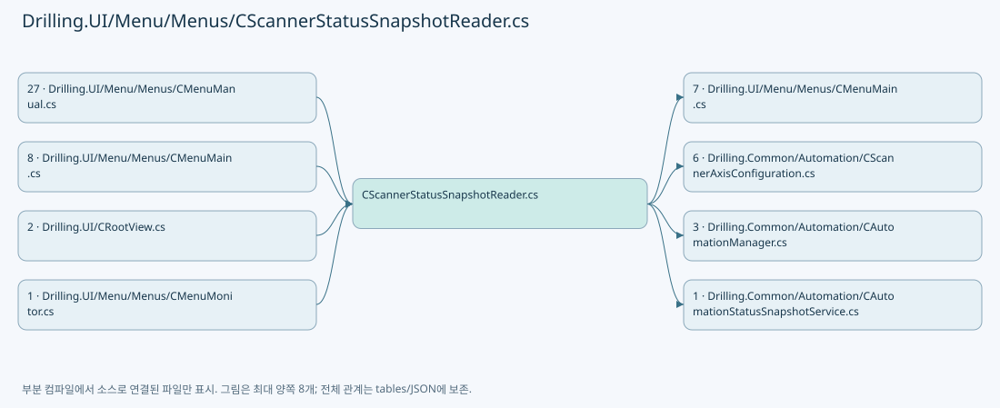

## 네임스페이스·타입·상속

| 타입 | 구분 | 원본 범위 | 선언/상속 |
| --- | --- | --- | --- |
| CScannerStatusSnapshotReader | ClassDeclaration | 7–238 | CScannerStatusSnapshotReader |
| ST_SCANNER_STATUS_POLLING_CONTEXT | RecordStructDeclaration | 237–237 | ST_SCANNER_STATUS_POLLING_CONTEXT |

## 멤버 빠른 목록

| 이름 | 종류 | 범위 | 서명 |
| --- | --- | --- | --- |
| _snapshotLock | FieldDeclaration | L9–9 | object Drilling.UI.Menu.Menus.CScannerStatusSnapshotReader._snapshotLock |
| _snapshot | FieldDeclaration | L10–10 | System.Collections.Generic.IReadOnlyList<Drilling.UI.Menu.Menus.ST_SCANNER_AXIS_STATUS_ITEM> Drilling.UI.Menu.Menus.CScannerStatusSnapshotReader._snapshot |
| _axisDefinitions | FieldDeclaration | L11–11 | System.Collections.Generic.IReadOnlyList<Drilling.Common.Automation.ST_SCANNER_AXIS_SETTING> Drilling.UI.Menu.Menus.CScannerStatusSnapshotReader._axisDefinitions |
| _selectedHeadNo | FieldDeclaration | L12–12 | int Drilling.UI.Menu.Menus.CScannerStatusSnapshotReader._selectedHeadNo |
| SelectHead | MethodDeclaration | L13–27 | void Drilling.UI.Menu.Menus.CScannerStatusSnapshotReader.SelectHead(int) |
| SelectHead | MethodDeclaration | L29–44 | void Drilling.UI.Menu.Menus.CScannerStatusSnapshotReader.SelectHead(int, System.Collections.Generic.IReadOnlyDictionary<string, string>) |
| GetSnapshot | MethodDeclaration | L46–50 | System.Collections.Generic.IReadOnlyList<Drilling.UI.Menu.Menus.ST_SCANNER_AXIS_STATUS_ITEM> Drilling.UI.Menu.Menus.CScannerStatusSnapshotReader.GetSnapshot() |
| RefreshSnapshot | MethodDeclaration | L52–70 | void Drilling.UI.Menu.Menus.CScannerStatusSnapshotReader.RefreshSnapshot(System.Threading.CancellationToken) |
| BuildScannerAxisStatusItem | MethodDeclaration | L72–118 | Drilling.UI.Menu.Menus.ST_SCANNER_AXIS_STATUS_ITEM Drilling.UI.Menu.Menus.CScannerStatusSnapshotReader.BuildScannerAxisStatusItem(Drilling.Common.Automation.ST_SCANNER_AXIS_SETTING, System.Threading.CancellationToken) |
| BuildAxisDefinitions | MethodDeclaration | L120–121 | System.Collections.Generic.IReadOnlyList<Drilling.Common.Automation.ST_SCANNER_AXIS_SETTING> Drilling.UI.Menu.Menus.CScannerStatusSnapshotReader.BuildAxisDefinitions(System.Collections.Generic.IReadOnlyList<Drilling.Common.Managers.ST_SYSTEM_PARAMETER>, int) |
| BuildAxisDefinitions | MethodDeclaration | L123–124 | System.Collections.Generic.IReadOnlyList<Drilling.Common.Automation.ST_SCANNER_AXIS_SETTING> Drilling.UI.Menu.Menus.CScannerStatusSnapshotReader.BuildAxisDefinitions(System.Collections.Generic.IReadOnlyDictionary<string, string>, int) |
| BuildEnabledHeadNumbers | MethodDeclaration | L126–127 | System.Collections.Generic.IReadOnlyList<int> Drilling.UI.Menu.Menus.CScannerStatusSnapshotReader.BuildEnabledHeadNumbers(System.Collections.Generic.IReadOnlyList<Drilling.Common.Managers.ST_SYSTEM_PARAMETER>, int) |
| IsHeadEnabled | MethodDeclaration | L129–130 | bool Drilling.UI.Menu.Menus.CScannerStatusSnapshotReader.IsHeadEnabled(System.Collections.Generic.IReadOnlyList<Drilling.Common.Managers.ST_SYSTEM_PARAMETER>, int) |
| IsHeadEnabled | MethodDeclaration | L132–133 | bool Drilling.UI.Menu.Menus.CScannerStatusSnapshotReader.IsHeadEnabled(System.Collections.Generic.IReadOnlyDictionary<string, string>, int) |
| CreatePollingErrorSnapshot | MethodDeclaration | L135–138 | System.Collections.Generic.IReadOnlyList<Drilling.UI.Menu.Menus.ST_SCANNER_AXIS_STATUS_ITEM> Drilling.UI.Menu.Menus.CScannerStatusSnapshotReader.CreatePollingErrorSnapshot(string) |
| SetSnapshot | MethodDeclaration | L140–146 | void Drilling.UI.Menu.Menus.CScannerStatusSnapshotReader.SetSnapshot(System.Collections.Generic.IReadOnlyList<Drilling.UI.Menu.Menus.ST_SCANNER_AXIS_STATUS_ITEM>) |
| SetSnapshot | MethodDeclaration | L148–159 | void Drilling.UI.Menu.Menus.CScannerStatusSnapshotReader.SetSnapshot(int, System.Collections.Generic.IReadOnlyList<Drilling.UI.Menu.Menus.ST_SCANNER_AXIS_STATUS_ITEM>) |
| ReadPollingContext | MethodDeclaration | L161–167 | Drilling.UI.Menu.Menus.CScannerStatusSnapshotReader.ST_SCANNER_STATUS_POLLING_CONTEXT Drilling.UI.Menu.Menus.CScannerStatusSnapshotReader.ReadPollingContext() |
| IsSameAxisDefinitions | MethodDeclaration | L169–185 | bool Drilling.UI.Menu.Menus.CScannerStatusSnapshotReader.IsSameAxisDefinitions(System.Collections.Generic.IReadOnlyList<Drilling.Common.Automation.ST_SCANNER_AXIS_SETTING>, System.Collections.Generic.IReadOnlyList<Drilling.Common.Automation.ST_SCANNER_AXIS_SETTING>) |
| NormalizeHeadNo | MethodDeclaration | L187–190 | int Drilling.UI.Menu.Menus.CScannerStatusSnapshotReader.NormalizeHeadNo(int) |
| FormatScannerPosition | MethodDeclaration | L192–200 | string Drilling.UI.Menu.Menus.CScannerStatusSnapshotReader.FormatScannerPosition(double) |
| FormatExtendedScannerPosition | MethodDeclaration | L202–205 | string Drilling.UI.Menu.Menus.CScannerStatusSnapshotReader.FormatExtendedScannerPosition(double, bool) |
| FormatScannerValue | MethodDeclaration | L207–215 | string Drilling.UI.Menu.Menus.CScannerStatusSnapshotReader.FormatScannerValue(double) |
| FormatExtendedScannerValue | MethodDeclaration | L217–220 | string Drilling.UI.Menu.Menus.CScannerStatusSnapshotReader.FormatExtendedScannerValue(double, bool) |
| FormatScannerTemperature | MethodDeclaration | L222–225 | string Drilling.UI.Menu.Menus.CScannerStatusSnapshotReader.FormatScannerTemperature(double) |
| FormatExtendedScannerTemperature | MethodDeclaration | L227–230 | string Drilling.UI.Menu.Menus.CScannerStatusSnapshotReader.FormatExtendedScannerTemperature(double, bool) |
| FormatFault | MethodDeclaration | L232–235 | string Drilling.UI.Menu.Menus.CScannerStatusSnapshotReader.FormatFault(string) |

## 멤버별 상세 계약·호출·처리 해설

### FieldDeclaration `_snapshotLock` · L9–9

[Drilling.UI/Menu/Menus/CScannerStatusSnapshotReader.cs:9–9](https://github.com/kjuws10-rgb/A3Drilling/blob/5aee8e58439c9b455cae7c9593c9be986c3e682e/Drilling.UI/Menu/Menus/CScannerStatusSnapshotReader.cs#L9-L9)

| 항목 | 실제 추출 값 |
| --- | --- |
| 서명 | object Drilling.UI.Menu.Menus.CScannerStatusSnapshotReader._snapshotLock |
| 접근/수식자 | Private / private, readonly |
| 반환/값 타입 | object |
| 소속 타입 | NamedType:Drilling.UI.Menu.Menus.CScannerStatusSnapshotReader |

현재 부분 분석에서 직접 연결된 호출자는 없습니다. XAML/이벤트/인터페이스·델리게이트·외부 진입을 추가 확인해야 하며, 미사용으로 판정한 것이 아닙니다.

호출하는 대상과 해석 범위:

| 원본 행 | 표현식 | 분석 상태 | 대상/소스 위치 |
| --- | --- | --- | --- |
| 9 | new | resolved | object.Object() |

본문의 실제 연산·분기·예외·반환 순서(원문 위치 순):

| 원본 행 | 종류 | 주석 해설 |
| --- | --- | --- |
| 9 | call | 함수·델리게이트 또는 객체 생성자를 호출합니다: new() |
| 9 | variable-initializer | 변수의 초기값을 지정합니다: _snapshotLock = new() |

변경 전 점검: 입력/반환 타입, 위 호출자, 예외/취소 경로, 공유 상태와 저장·전송 소비자를 함께 확인합니다. 값의 단위나 물리 방향을 이름만으로 확정하지 않습니다.

### FieldDeclaration `_snapshot` · L10–10

[Drilling.UI/Menu/Menus/CScannerStatusSnapshotReader.cs:10–10](https://github.com/kjuws10-rgb/A3Drilling/blob/5aee8e58439c9b455cae7c9593c9be986c3e682e/Drilling.UI/Menu/Menus/CScannerStatusSnapshotReader.cs#L10-L10)

| 항목 | 실제 추출 값 |
| --- | --- |
| 서명 | System.Collections.Generic.IReadOnlyList<Drilling.UI.Menu.Menus.ST_SCANNER_AXIS_STATUS_ITEM> Drilling.UI.Menu.Menus.CScannerStatusSnapshotReader._snapshot |
| 접근/수식자 | Private / private |
| 반환/값 타입 | System.Collections.Generic.IReadOnlyList<Drilling.UI.Menu.Menus.ST_SCANNER_AXIS_STATUS_ITEM> |
| 소속 타입 | NamedType:Drilling.UI.Menu.Menus.CScannerStatusSnapshotReader |

현재 부분 분석에서 직접 연결된 호출자는 없습니다. XAML/이벤트/인터페이스·델리게이트·외부 진입을 추가 확인해야 하며, 미사용으로 판정한 것이 아닙니다.

본문의 실제 연산·분기·예외·반환 순서(원문 위치 순):

| 원본 행 | 종류 | 주석 해설 |
| --- | --- | --- |
| 10 | variable-initializer | 변수의 초기값을 지정합니다: _snapshot = [] |

변경 전 점검: 입력/반환 타입, 위 호출자, 예외/취소 경로, 공유 상태와 저장·전송 소비자를 함께 확인합니다. 값의 단위나 물리 방향을 이름만으로 확정하지 않습니다.

### FieldDeclaration `_axisDefinitions` · L11–11

[Drilling.UI/Menu/Menus/CScannerStatusSnapshotReader.cs:11–11](https://github.com/kjuws10-rgb/A3Drilling/blob/5aee8e58439c9b455cae7c9593c9be986c3e682e/Drilling.UI/Menu/Menus/CScannerStatusSnapshotReader.cs#L11-L11)

| 항목 | 실제 추출 값 |
| --- | --- |
| 서명 | System.Collections.Generic.IReadOnlyList<Drilling.Common.Automation.ST_SCANNER_AXIS_SETTING> Drilling.UI.Menu.Menus.CScannerStatusSnapshotReader._axisDefinitions |
| 접근/수식자 | Private / private |
| 반환/값 타입 | System.Collections.Generic.IReadOnlyList<Drilling.Common.Automation.ST_SCANNER_AXIS_SETTING> |
| 소속 타입 | NamedType:Drilling.UI.Menu.Menus.CScannerStatusSnapshotReader |

현재 부분 분석에서 직접 연결된 호출자는 없습니다. XAML/이벤트/인터페이스·델리게이트·외부 진입을 추가 확인해야 하며, 미사용으로 판정한 것이 아닙니다.

본문의 실제 연산·분기·예외·반환 순서(원문 위치 순):

| 원본 행 | 종류 | 주석 해설 |
| --- | --- | --- |
| 11 | variable-initializer | 변수의 초기값을 지정합니다: _axisDefinitions = [] |

변경 전 점검: 입력/반환 타입, 위 호출자, 예외/취소 경로, 공유 상태와 저장·전송 소비자를 함께 확인합니다. 값의 단위나 물리 방향을 이름만으로 확정하지 않습니다.

### FieldDeclaration `_selectedHeadNo` · L12–12

[Drilling.UI/Menu/Menus/CScannerStatusSnapshotReader.cs:12–12](https://github.com/kjuws10-rgb/A3Drilling/blob/5aee8e58439c9b455cae7c9593c9be986c3e682e/Drilling.UI/Menu/Menus/CScannerStatusSnapshotReader.cs#L12-L12)

| 항목 | 실제 추출 값 |
| --- | --- |
| 서명 | int Drilling.UI.Menu.Menus.CScannerStatusSnapshotReader._selectedHeadNo |
| 접근/수식자 | Private / private |
| 반환/값 타입 | int |
| 소속 타입 | NamedType:Drilling.UI.Menu.Menus.CScannerStatusSnapshotReader |

현재 부분 분석에서 직접 연결된 호출자는 없습니다. XAML/이벤트/인터페이스·델리게이트·외부 진입을 추가 확인해야 하며, 미사용으로 판정한 것이 아닙니다.

본문의 실제 연산·분기·예외·반환 순서(원문 위치 순):

| 원본 행 | 종류 | 주석 해설 |
| --- | --- | --- |
| 12 | variable-initializer | 변수의 초기값을 지정합니다: _selectedHeadNo = 1 |

변경 전 점검: 입력/반환 타입, 위 호출자, 예외/취소 경로, 공유 상태와 저장·전송 소비자를 함께 확인합니다. 값의 단위나 물리 방향을 이름만으로 확정하지 않습니다.

### MethodDeclaration `SelectHead` · L13–27

[Drilling.UI/Menu/Menus/CScannerStatusSnapshotReader.cs:13–27](https://github.com/kjuws10-rgb/A3Drilling/blob/5aee8e58439c9b455cae7c9593c9be986c3e682e/Drilling.UI/Menu/Menus/CScannerStatusSnapshotReader.cs#L13-L27)

| 항목 | 실제 추출 값 |
| --- | --- |
| 서명 | void Drilling.UI.Menu.Menus.CScannerStatusSnapshotReader.SelectHead(int) |
| 접근/수식자 | Public / public |
| 반환/값 타입 | void |
| 소속 타입 | NamedType:Drilling.UI.Menu.Menus.CScannerStatusSnapshotReader |

입력 계약:

| 이름 | 타입 | 전달 | 선택/기본값 |
| --- | --- | --- | --- |
| headNo | int | None | False /  |

정적 호출자로 확인된 위치:

| 호출 파일/행 | 호출 표현식 | 런타임 분기 가능 |
| --- | --- | --- |
| [Drilling.UI/Menu/Menus/CMenuMain.cs:961–961](https://github.com/kjuws10-rgb/A3Drilling/blob/5aee8e58439c9b455cae7c9593c9be986c3e682e/Drilling.UI/Menu/Menus/CMenuMain.cs#L961-L961) | _scannerStatusSnapshotReader.SelectHead | False |
| [Drilling.UI/Menu/Menus/CMenuMain.cs:1006–1006](https://github.com/kjuws10-rgb/A3Drilling/blob/5aee8e58439c9b455cae7c9593c9be986c3e682e/Drilling.UI/Menu/Menus/CMenuMain.cs#L1006-L1006) | _scannerStatusSnapshotReader.SelectHead | False |
| [Drilling.UI/Menu/Menus/CMenuMain.cs:1018–1018](https://github.com/kjuws10-rgb/A3Drilling/blob/5aee8e58439c9b455cae7c9593c9be986c3e682e/Drilling.UI/Menu/Menus/CMenuMain.cs#L1018-L1018) | _scannerStatusSnapshotReader.SelectHead | False |

호출하는 대상과 해석 범위:

| 원본 행 | 표현식 | 분석 상태 | 대상/소스 위치 |
| --- | --- | --- | --- |
| 15 | NormalizeHeadNo | resolved | int Drilling.UI.Menu.Menus.CScannerStatusSnapshotReader.NormalizeHeadNo(int) · Drilling.UI/Menu/Menus/CScannerStatusSnapshotReader.cs:187 |

본문의 실제 연산·분기·예외·반환 순서(원문 위치 순):

| 원본 행 | 종류 | 주석 해설 |
| --- | --- | --- |
| 15 | call | 함수·델리게이트 또는 객체 생성자를 호출합니다: NormalizeHeadNo(headNo) |
| 15 | local-declaration | 지역 변수를 선언합니다: var normalizedHeadNo = NormalizeHeadNo(headNo); |
| 15 | variable-initializer | 변수의 초기값을 지정합니다: normalizedHeadNo = NormalizeHeadNo(headNo) |
| 16 | lock | 공유 상태의 임계 구역에 진입합니다: lock (_snapshotLock) |
| 18 | if | 조건에 따라 분기합니다: if (_selectedHeadNo == normalizedHeadNo) |
| 20 | return | 호출자에게 값 또는 제어를 반환합니다: return; |
| 23 | assignment | 값을 대상에 대입합니다: _selectedHeadNo = normalizedHeadNo |
| 24 | assignment | 값을 대상에 대입합니다: _axisDefinitions = [] |
| 25 | assignment | 값을 대상에 대입합니다: _snapshot = [] |

제어 구문의 포함 구조(실제 실행 순서/CFG가 아닌 구문 탐색 그림):

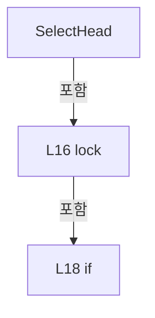

변경 전 점검: 입력/반환 타입, 위 호출자, 예외/취소 경로, 공유 상태와 저장·전송 소비자를 함께 확인합니다. 값의 단위나 물리 방향을 이름만으로 확정하지 않습니다.

### MethodDeclaration `SelectHead` · L29–44

[Drilling.UI/Menu/Menus/CScannerStatusSnapshotReader.cs:29–44](https://github.com/kjuws10-rgb/A3Drilling/blob/5aee8e58439c9b455cae7c9593c9be986c3e682e/Drilling.UI/Menu/Menus/CScannerStatusSnapshotReader.cs#L29-L44)

| 항목 | 실제 추출 값 |
| --- | --- |
| 서명 | void Drilling.UI.Menu.Menus.CScannerStatusSnapshotReader.SelectHead(int, System.Collections.Generic.IReadOnlyDictionary<string, string>) |
| 접근/수식자 | Public / public |
| 반환/값 타입 | void |
| 소속 타입 | NamedType:Drilling.UI.Menu.Menus.CScannerStatusSnapshotReader |

입력 계약:

| 이름 | 타입 | 전달 | 선택/기본값 |
| --- | --- | --- | --- |
| headNo | int | None | False /  |
| parameters | System.Collections.Generic.IReadOnlyDictionary<string, string> | None | False /  |

정적 호출자로 확인된 위치:

| 호출 파일/행 | 호출 표현식 | 런타임 분기 가능 |
| --- | --- | --- |
| [Drilling.UI/Menu/Menus/CMenuMain.cs:714–714](https://github.com/kjuws10-rgb/A3Drilling/blob/5aee8e58439c9b455cae7c9593c9be986c3e682e/Drilling.UI/Menu/Menus/CMenuMain.cs#L714-L714) | _scannerStatusSnapshotReader.SelectHead | False |
| [Drilling.UI/Menu/Menus/CMenuMain.cs:836–836](https://github.com/kjuws10-rgb/A3Drilling/blob/5aee8e58439c9b455cae7c9593c9be986c3e682e/Drilling.UI/Menu/Menus/CMenuMain.cs#L836-L836) | _scannerStatusSnapshotReader.SelectHead | False |

호출하는 대상과 해석 범위:

| 원본 행 | 표현식 | 분석 상태 | 대상/소스 위치 |
| --- | --- | --- | --- |
| 31 | NormalizeHeadNo | resolved | int Drilling.UI.Menu.Menus.CScannerStatusSnapshotReader.NormalizeHeadNo(int) · Drilling.UI/Menu/Menus/CScannerStatusSnapshotReader.cs:187 |
| 32 | BuildAxisDefinitions | resolved | System.Collections.Generic.IReadOnlyList<Drilling.Common.Automation.ST_SCANNER_AXIS_SETTING> Drilling.UI.Menu.Menus.CScannerStatusSnapshotReader.BuildAxisDefinitions(System.Collections.Generic.IReadOnlyDictionary<string, string>, int) · Drilling.UI/Menu/Menus/CScannerStatusSnapshotReader.cs:123 |
| 35 | IsSameAxisDefinitions | resolved | bool Drilling.UI.Menu.Menus.CScannerStatusSnapshotReader.IsSameAxisDefinitions(System.Collections.Generic.IReadOnlyList<Drilling.Common.Automation.ST_SCANNER_AXIS_SETTING>, System.Collections.Generic.IReadOnlyList<Drilling.Common.Automation.ST_SCANNER_AXIS_SETTING>) · Drilling.UI/Menu/Menus/CScannerStatusSnapshotReader.cs:169 |

본문의 실제 연산·분기·예외·반환 순서(원문 위치 순):

| 원본 행 | 종류 | 주석 해설 |
| --- | --- | --- |
| 31 | call | 함수·델리게이트 또는 객체 생성자를 호출합니다: NormalizeHeadNo(headNo) |
| 31 | local-declaration | 지역 변수를 선언합니다: var normalizedHeadNo = NormalizeHeadNo(headNo); |
| 31 | variable-initializer | 변수의 초기값을 지정합니다: normalizedHeadNo = NormalizeHeadNo(headNo) |
| 32 | call | 함수·델리게이트 또는 객체 생성자를 호출합니다: BuildAxisDefinitions(parameters, normalizedHeadNo) |
| 32 | local-declaration | 지역 변수를 선언합니다: var axisDefinitions = BuildAxisDefinitions(parameters, normalizedHeadNo); |
| 32 | variable-initializer | 변수의 초기값을 지정합니다: axisDefinitions = BuildAxisDefinitions(parameters, normalizedHeadNo) |
| 33 | lock | 공유 상태의 임계 구역에 진입합니다: lock (_snapshotLock) |
| 35 | call | 함수·델리게이트 또는 객체 생성자를 호출합니다: IsSameAxisDefinitions(_axisDefinitions, axisDefinitions) |
| 35 | if | 조건에 따라 분기합니다: if (_selectedHeadNo == normalizedHeadNo && IsSameAxisDefinitions(_axisDefinitions, axisDefinitions)) |
| 37 | return | 호출자에게 값 또는 제어를 반환합니다: return; |
| 40 | assignment | 값을 대상에 대입합니다: _selectedHeadNo = normalizedHeadNo |
| 41 | assignment | 값을 대상에 대입합니다: _axisDefinitions = axisDefinitions |
| 42 | assignment | 값을 대상에 대입합니다: _snapshot = [] |

제어 구문의 포함 구조(실제 실행 순서/CFG가 아닌 구문 탐색 그림):

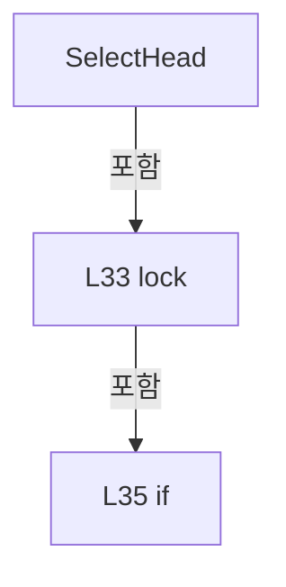

변경 전 점검: 입력/반환 타입, 위 호출자, 예외/취소 경로, 공유 상태와 저장·전송 소비자를 함께 확인합니다. 값의 단위나 물리 방향을 이름만으로 확정하지 않습니다.

### MethodDeclaration `GetSnapshot` · L46–50

[Drilling.UI/Menu/Menus/CScannerStatusSnapshotReader.cs:46–50](https://github.com/kjuws10-rgb/A3Drilling/blob/5aee8e58439c9b455cae7c9593c9be986c3e682e/Drilling.UI/Menu/Menus/CScannerStatusSnapshotReader.cs#L46-L50)

| 항목 | 실제 추출 값 |
| --- | --- |
| 서명 | System.Collections.Generic.IReadOnlyList<Drilling.UI.Menu.Menus.ST_SCANNER_AXIS_STATUS_ITEM> Drilling.UI.Menu.Menus.CScannerStatusSnapshotReader.GetSnapshot() |
| 접근/수식자 | Public / public |
| 반환/값 타입 | System.Collections.Generic.IReadOnlyList<Drilling.UI.Menu.Menus.ST_SCANNER_AXIS_STATUS_ITEM> |
| 소속 타입 | NamedType:Drilling.UI.Menu.Menus.CScannerStatusSnapshotReader |

정적 호출자로 확인된 위치:

| 호출 파일/행 | 호출 표현식 | 런타임 분기 가능 |
| --- | --- | --- |
| [Drilling.UI/Menu/Menus/CMenuMain.cs:717–717](https://github.com/kjuws10-rgb/A3Drilling/blob/5aee8e58439c9b455cae7c9593c9be986c3e682e/Drilling.UI/Menu/Menus/CMenuMain.cs#L717-L717) | _scannerStatusSnapshotReader.GetSnapshot | False |
| [Drilling.UI/Menu/Menus/CMenuMain.cs:837–837](https://github.com/kjuws10-rgb/A3Drilling/blob/5aee8e58439c9b455cae7c9593c9be986c3e682e/Drilling.UI/Menu/Menus/CMenuMain.cs#L837-L837) | _scannerStatusSnapshotReader.GetSnapshot | False |

호출하는 대상과 해석 범위:

| 원본 행 | 표현식 | 분석 상태 | 대상/소스 위치 |
| --- | --- | --- | --- |
| 48 | RefreshSnapshot | resolved | void Drilling.UI.Menu.Menus.CScannerStatusSnapshotReader.RefreshSnapshot(System.Threading.CancellationToken) · Drilling.UI/Menu/Menus/CScannerStatusSnapshotReader.cs:52 |

본문의 실제 연산·분기·예외·반환 순서(원문 위치 순):

| 원본 행 | 종류 | 주석 해설 |
| --- | --- | --- |
| 48 | call | 함수·델리게이트 또는 객체 생성자를 호출합니다: RefreshSnapshot(CancellationToken.None) |
| 49 | lock | 공유 상태의 임계 구역에 진입합니다: lock (_snapshotLock) |
| 49 | return | 호출자에게 값 또는 제어를 반환합니다: return _snapshot; |

제어 구문의 포함 구조(실제 실행 순서/CFG가 아닌 구문 탐색 그림):

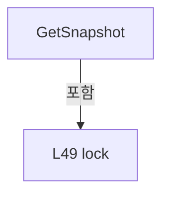

변경 전 점검: 입력/반환 타입, 위 호출자, 예외/취소 경로, 공유 상태와 저장·전송 소비자를 함께 확인합니다. 값의 단위나 물리 방향을 이름만으로 확정하지 않습니다.

### MethodDeclaration `RefreshSnapshot` · L52–70

[Drilling.UI/Menu/Menus/CScannerStatusSnapshotReader.cs:52–70](https://github.com/kjuws10-rgb/A3Drilling/blob/5aee8e58439c9b455cae7c9593c9be986c3e682e/Drilling.UI/Menu/Menus/CScannerStatusSnapshotReader.cs#L52-L70)

| 항목 | 실제 추출 값 |
| --- | --- |
| 서명 | void Drilling.UI.Menu.Menus.CScannerStatusSnapshotReader.RefreshSnapshot(System.Threading.CancellationToken) |
| 접근/수식자 | Private / private |
| 반환/값 타입 | void |
| 소속 타입 | NamedType:Drilling.UI.Menu.Menus.CScannerStatusSnapshotReader |

입력 계약:

| 이름 | 타입 | 전달 | 선택/기본값 |
| --- | --- | --- | --- |
| cancellationToken | System.Threading.CancellationToken | None | False /  |

정적 호출자로 확인된 위치:

| 호출 파일/행 | 호출 표현식 | 런타임 분기 가능 |
| --- | --- | --- |
| [Drilling.UI/Menu/Menus/CScannerStatusSnapshotReader.cs:48–48](https://github.com/kjuws10-rgb/A3Drilling/blob/5aee8e58439c9b455cae7c9593c9be986c3e682e/Drilling.UI/Menu/Menus/CScannerStatusSnapshotReader.cs#L48-L48) | RefreshSnapshot | False |

호출하는 대상과 해석 범위:

| 원본 행 | 표현식 | 분석 상태 | 대상/소스 위치 |
| --- | --- | --- | --- |
| 54 | ReadPollingContext | resolved | Drilling.UI.Menu.Menus.CScannerStatusSnapshotReader.ST_SCANNER_STATUS_POLLING_CONTEXT Drilling.UI.Menu.Menus.CScannerStatusSnapshotReader.ReadPollingContext() · Drilling.UI/Menu/Menus/CScannerStatusSnapshotReader.cs:161 |
| 57 | new List<ST_SCANNER_AXIS_STATUS_ITEM> | resolved | System.Collections.Generic.List<Drilling.UI.Menu.Menus.ST_SCANNER_AXIS_STATUS_ITEM>.List(int) |
| 60 | cancellationToken.ThrowIfCancellationRequested | resolved | void System.Threading.CancellationToken.ThrowIfCancellationRequested() |
| 61 | items.Add | resolved | void System.Collections.Generic.List<Drilling.UI.Menu.Menus.ST_SCANNER_AXIS_STATUS_ITEM>.Add(Drilling.UI.Menu.Menus.ST_SCANNER_AXIS_STATUS_ITEM) |
| 61 | BuildScannerAxisStatusItem | resolved | Drilling.UI.Menu.Menus.ST_SCANNER_AXIS_STATUS_ITEM Drilling.UI.Menu.Menus.CScannerStatusSnapshotReader.BuildScannerAxisStatusItem(Drilling.Common.Automation.ST_SCANNER_AXIS_SETTING, System.Threading.CancellationToken) · Drilling.UI/Menu/Menus/CScannerStatusSnapshotReader.cs:72 |
| 64 | SetSnapshot | resolved | void Drilling.UI.Menu.Menus.CScannerStatusSnapshotReader.SetSnapshot(int, System.Collections.Generic.IReadOnlyList<Drilling.UI.Menu.Menus.ST_SCANNER_AXIS_STATUS_ITEM>) · Drilling.UI/Menu/Menus/CScannerStatusSnapshotReader.cs:148 |
| 68 | SetSnapshot | resolved | void Drilling.UI.Menu.Menus.CScannerStatusSnapshotReader.SetSnapshot(int, System.Collections.Generic.IReadOnlyList<Drilling.UI.Menu.Menus.ST_SCANNER_AXIS_STATUS_ITEM>) · Drilling.UI/Menu/Menus/CScannerStatusSnapshotReader.cs:148 |
| 68 | CreatePollingErrorSnapshot | resolved | System.Collections.Generic.IReadOnlyList<Drilling.UI.Menu.Menus.ST_SCANNER_AXIS_STATUS_ITEM> Drilling.UI.Menu.Menus.CScannerStatusSnapshotReader.CreatePollingErrorSnapshot(string) · Drilling.UI/Menu/Menus/CScannerStatusSnapshotReader.cs:135 |

본문의 실제 연산·분기·예외·반환 순서(원문 위치 순):

| 원본 행 | 종류 | 주석 해설 |
| --- | --- | --- |
| 54 | call | 함수·델리게이트 또는 객체 생성자를 호출합니다: ReadPollingContext() |
| 54 | local-declaration | 지역 변수를 선언합니다: var context = ReadPollingContext(); |
| 54 | variable-initializer | 변수의 초기값을 지정합니다: context = ReadPollingContext() |
| 55 | try | 예외 처리 범위입니다: try |
| 57 | call | 함수·델리게이트 또는 객체 생성자를 호출합니다: new List<ST_SCANNER_AXIS_STATUS_ITEM>(context.AxisDefinitions.Count) |
| 57 | local-declaration | 지역 변수를 선언합니다: var items = new List<ST_SCANNER_AXIS_STATUS_ITEM>(context.AxisDefinitions.Count); |
| 57 | variable-initializer | 변수의 초기값을 지정합니다: items = new List<ST_SCANNER_AXIS_STATUS_ITEM>(context.AxisDefinitions.Count) |
| 58 | foreach | 컬렉션 요소를 순회합니다: foreach (var axis in context.AxisDefinitions) |
| 60 | call | 함수·델리게이트 또는 객체 생성자를 호출합니다: cancellationToken.ThrowIfCancellationRequested() |
| 61 | call | 함수·델리게이트 또는 객체 생성자를 호출합니다: items.Add(BuildScannerAxisStatusItem(axis, cancellationToken)) |
| 61 | call | 함수·델리게이트 또는 객체 생성자를 호출합니다: BuildScannerAxisStatusItem(axis, cancellationToken) |
| 64 | call | 함수·델리게이트 또는 객체 생성자를 호출합니다: SetSnapshot(context.HeadNo, items) |
| 66 | catch | 지정 예외를 처리합니다: catch (Exception exception) when (exception is not OperationCanceledException) |
| 68 | call | 함수·델리게이트 또는 객체 생성자를 호출합니다: SetSnapshot(context.HeadNo, CreatePollingErrorSnapshot(exception.Message)) |
| 68 | call | 함수·델리게이트 또는 객체 생성자를 호출합니다: CreatePollingErrorSnapshot(exception.Message) |

제어 구문의 포함 구조(실제 실행 순서/CFG가 아닌 구문 탐색 그림):

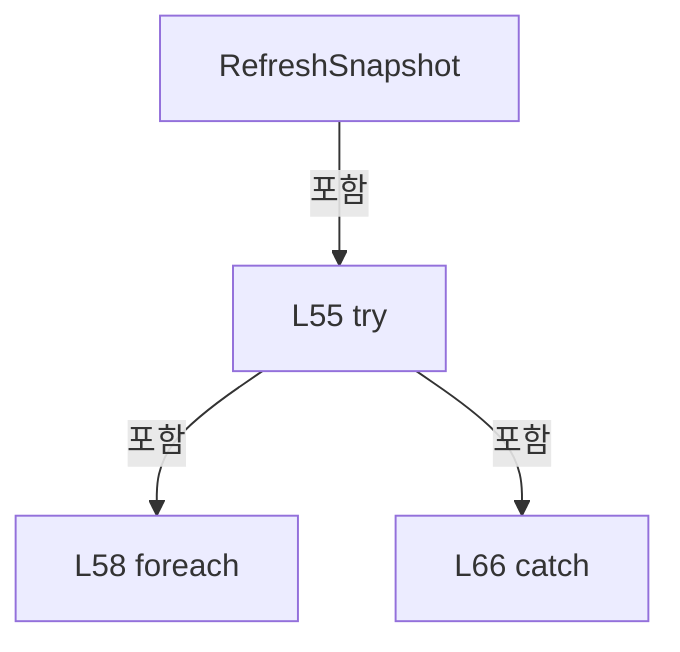

변경 전 점검: 입력/반환 타입, 위 호출자, 예외/취소 경로, 공유 상태와 저장·전송 소비자를 함께 확인합니다. 값의 단위나 물리 방향을 이름만으로 확정하지 않습니다.

### MethodDeclaration `BuildScannerAxisStatusItem` · L72–118

[Drilling.UI/Menu/Menus/CScannerStatusSnapshotReader.cs:72–118](https://github.com/kjuws10-rgb/A3Drilling/blob/5aee8e58439c9b455cae7c9593c9be986c3e682e/Drilling.UI/Menu/Menus/CScannerStatusSnapshotReader.cs#L72-L118)

| 항목 | 실제 추출 값 |
| --- | --- |
| 서명 | Drilling.UI.Menu.Menus.ST_SCANNER_AXIS_STATUS_ITEM Drilling.UI.Menu.Menus.CScannerStatusSnapshotReader.BuildScannerAxisStatusItem(Drilling.Common.Automation.ST_SCANNER_AXIS_SETTING, System.Threading.CancellationToken) |
| 접근/수식자 | Private / private |
| 반환/값 타입 | Drilling.UI.Menu.Menus.ST_SCANNER_AXIS_STATUS_ITEM |
| 소속 타입 | NamedType:Drilling.UI.Menu.Menus.CScannerStatusSnapshotReader |

입력 계약:

| 이름 | 타입 | 전달 | 선택/기본값 |
| --- | --- | --- | --- |
| axis | Drilling.Common.Automation.ST_SCANNER_AXIS_SETTING | None | False /  |
| cancellationToken | System.Threading.CancellationToken | None | False /  |

정적 호출자로 확인된 위치:

| 호출 파일/행 | 호출 표현식 | 런타임 분기 가능 |
| --- | --- | --- |
| [Drilling.UI/Menu/Menus/CScannerStatusSnapshotReader.cs:61–61](https://github.com/kjuws10-rgb/A3Drilling/blob/5aee8e58439c9b455cae7c9593c9be986c3e682e/Drilling.UI/Menu/Menus/CScannerStatusSnapshotReader.cs#L61-L61) | BuildScannerAxisStatusItem | False |

호출하는 대상과 해석 범위:

| 원본 행 | 표현식 | 분석 상태 | 대상/소스 위치 |
| --- | --- | --- | --- |
| 74 | axis.AxisReference.Trim | resolved | string string.Trim() |
| 75 | string.IsNullOrWhiteSpace | resolved | bool string.IsNullOrWhiteSpace(string?) |
| 79 | new ST_SCANNER_AXIS_STATUS_ITEM | resolved | Drilling.UI.Menu.Menus.ST_SCANNER_AXIS_STATUS_ITEM.ST_SCANNER_AXIS_STATUS_ITEM(string, string, string, string, string, string, string, string, string, string, string, string, string, string) · Drilling.UI/Menu/Menus/CMenuMain.cs:3915 |
| 82 | string.IsNullOrWhiteSpace | resolved | bool string.IsNullOrWhiteSpace(string?) |
| 84 | new ST_SCANNER_AXIS_STATUS_ITEM | resolved | Drilling.UI.Menu.Menus.ST_SCANNER_AXIS_STATUS_ITEM.ST_SCANNER_AXIS_STATUS_ITEM(string, string, string, string, string, string, string, string, string, string, string, string, string, string) · Drilling.UI/Menu/Menus/CMenuMain.cs:3915 |
| 89 | automationManager.IsSimul | resolved | bool Drilling.Common.Automation.CAutomationManager.IsSimul(int) · Drilling.Common/Automation/CAutomationManager.cs:63 |
| 89 | automationManager.IsConnect | resolved | bool Drilling.Common.Automation.CAutomationManager.IsConnect(int) · Drilling.Common/Automation/CAutomationManager.cs:58 |
| 91 | new ST_SCANNER_AXIS_STATUS_ITEM | resolved | Drilling.UI.Menu.Menus.ST_SCANNER_AXIS_STATUS_ITEM.ST_SCANNER_AXIS_STATUS_ITEM(string, string, string, string, string, string, string, string, string, string, string, string, string, string) · Drilling.UI/Menu/Menus/CMenuMain.cs:3915 |
| 94 | automationManager.StatusSnapshots.GetAxis | resolved | Drilling.Common.Automation.ST_AUTOMATION_STATUS_SNAPSHOT<Drilling.Common.Automation.ST_AUTOMATION_AXIS_STATUS> Drilling.Common.Automation.CAutomationStatusSnapshotService.GetAxis(string, int, int, bool) · Drilling.Common/Automation/CAutomationStatusSnapshotService.cs:23 |
| 96 | new ST_SCANNER_AXIS_STATUS_ITEM | resolved | Drilling.UI.Menu.Menus.ST_SCANNER_AXIS_STATUS_ITEM.ST_SCANNER_AXIS_STATUS_ITEM(string, string, string, string, string, string, string, string, string, string, string, string, string, string) · Drilling.UI/Menu/Menus/CMenuMain.cs:3915 |
| 97 | new ST_SCANNER_AXIS_STATUS_ITEM | resolved | Drilling.UI.Menu.Menus.ST_SCANNER_AXIS_STATUS_ITEM.ST_SCANNER_AXIS_STATUS_ITEM(string, string, string, string, string, string, string, string, string, string, string, string, string, string) · Drilling.UI/Menu/Menus/CMenuMain.cs:3915 |
| 103 | FormatScannerPosition | resolved | string Drilling.UI.Menu.Menus.CScannerStatusSnapshotReader.FormatScannerPosition(double) · Drilling.UI/Menu/Menus/CScannerStatusSnapshotReader.cs:192 |
| 104 | FormatExtendedScannerPosition | resolved | string Drilling.UI.Menu.Menus.CScannerStatusSnapshotReader.FormatExtendedScannerPosition(double, bool) · Drilling.UI/Menu/Menus/CScannerStatusSnapshotReader.cs:202 |
| 105 | FormatExtendedScannerValue | resolved | string Drilling.UI.Menu.Menus.CScannerStatusSnapshotReader.FormatExtendedScannerValue(double, bool) · Drilling.UI/Menu/Menus/CScannerStatusSnapshotReader.cs:217 |
| 106 | FormatExtendedScannerValue | resolved | string Drilling.UI.Menu.Menus.CScannerStatusSnapshotReader.FormatExtendedScannerValue(double, bool) · Drilling.UI/Menu/Menus/CScannerStatusSnapshotReader.cs:217 |
| 107 | FormatExtendedScannerTemperature | resolved | string Drilling.UI.Menu.Menus.CScannerStatusSnapshotReader.FormatExtendedScannerTemperature(double, bool) · Drilling.UI/Menu/Menus/CScannerStatusSnapshotReader.cs:227 |
| 109 | FormatFault | resolved | string Drilling.UI.Menu.Menus.CScannerStatusSnapshotReader.FormatFault(string) · Drilling.UI/Menu/Menus/CScannerStatusSnapshotReader.cs:232 |
| 111 | string.IsNullOrWhiteSpace | resolved | bool string.IsNullOrWhiteSpace(string?) |
| 116 | new ST_SCANNER_AXIS_STATUS_ITEM | resolved | Drilling.UI.Menu.Menus.ST_SCANNER_AXIS_STATUS_ITEM.ST_SCANNER_AXIS_STATUS_ITEM(string, string, string, string, string, string, string, string, string, string, string, string, string, string) · Drilling.UI/Menu/Menus/CMenuMain.cs:3915 |

본문의 실제 연산·분기·예외·반환 순서(원문 위치 순):

| 원본 행 | 종류 | 주석 해설 |
| --- | --- | --- |
| 74 | call | 함수·델리게이트 또는 객체 생성자를 호출합니다: axis.AxisReference.Trim() |
| 74 | local-declaration | 지역 변수를 선언합니다: var axisReference = axis.AxisReference.Trim(); |
| 74 | variable-initializer | 변수의 초기값을 지정합니다: axisReference = axis.AxisReference.Trim() |
| 75 | call | 함수·델리게이트 또는 객체 생성자를 호출합니다: string.IsNullOrWhiteSpace(axisReference) |
| 75 | conditional-expression | 조건에 따라 결과식을 선택합니다: string.IsNullOrWhiteSpace(axisReference) ? "-" : axisReference |
| 75 | local-declaration | 지역 변수를 선언합니다: var displayAxisReference = string.IsNullOrWhiteSpace(axisReference) ? "-" : axisReference; |
| 75 | variable-initializer | 변수의 초기값을 지정합니다: displayAxisReference = string.IsNullOrWhiteSpace(axisReference) ? "-" : axisReference |
| 76 | local-declaration | 지역 변수를 선언합니다: var automationLabel = $"#{axis.AutomationNo}"; |
| 76 | variable-initializer | 변수의 초기값을 지정합니다: automationLabel = $"#{axis.AutomationNo}" |
| 77 | if | 조건에 따라 분기합니다: if (!axis.IsUsed) |
| 79 | call | 함수·델리게이트 또는 객체 생성자를 호출합니다: new ST_SCANNER_AXIS_STATUS_ITEM($"H{axis.HeadNo:00}", automationLabel, axis.AxisName, "Z NOT USE", "NOT USE", "-", "-", "-", "-", "-", "-", "-", "NOT USE", "Scanner Z axis is not used.") |
| 79 | return | 호출자에게 값 또는 제어를 반환합니다: return new ST_SCANNER_AXIS_STATUS_ITEM($"H{axis.HeadNo:00}", automationLabel, axis.AxisName, "Z NOT USE", "NOT USE", "-", "-", "-", "-", "-", "-", "-", "NOT USE", "Scanner Z axis is not used."); |
| 82 | call | 함수·델리게이트 또는 객체 생성자를 호출합니다: string.IsNullOrWhiteSpace(axis.ConfigurationError) |
| 82 | if | 조건에 따라 분기합니다: if (!string.IsNullOrWhiteSpace(axis.ConfigurationError)) |
| 84 | call | 함수·델리게이트 또는 객체 생성자를 호출합니다: new ST_SCANNER_AXIS_STATUS_ITEM($"H{axis.HeadNo:00}", automationLabel, axis.AxisName, displayAxisReference, "NOT CONFIGURED", "-", "-", "-", "-", "-", "NO", "-", "NOT CONFIGURED", axis.ConfigurationError) |
| 84 | return | 호출자에게 값 또는 제어를 반환합니다: return new ST_SCANNER_AXIS_STATUS_ITEM($"H{axis.HeadNo:00}", automationLabel, axis.AxisName, displayAxisReference, "NOT CONFIGURED", "-", "-", "-", "-", "-", "NO", "-", "NOT CONFIGURED", axis.ConfigurationError); |
| 87 | try | 예외 처리 범위입니다: try |
| 89 | call | 함수·델리게이트 또는 객체 생성자를 호출합니다: automationManager.IsSimul(axis.AutomationNo) |
| 89 | call | 함수·델리게이트 또는 객체 생성자를 호출합니다: automationManager.IsConnect(axis.AutomationNo) |
| 89 | if | 조건에 따라 분기합니다: if (!automationManager.IsSimul(axis.AutomationNo) && !automationManager.IsConnect(axis.AutomationNo)) |
| 91 | call | 함수·델리게이트 또는 객체 생성자를 호출합니다: new ST_SCANNER_AXIS_STATUS_ITEM($"H{axis.HeadNo:00}", automationLabel, axis.AxisName, displayAxisReference, "OFFLINE", "-", "-", "-", "-", "-", "-", "-", "OFFLINE", "Automation not connected.") |
| 91 | return | 호출자에게 값 또는 제어를 반환합니다: return new ST_SCANNER_AXIS_STATUS_ITEM($"H{axis.HeadNo:00}", automationLabel, axis.AxisName, displayAxisReference, "OFFLINE", "-", "-", "-", "-", "-", "-", "-", "OFFLINE", "Automation not connected."); |
| 94 | call | 함수·델리게이트 또는 객체 생성자를 호출합니다: automationManager.StatusSnapshots.GetAxis(axisReference, axis.AutomationNo, axis.AioNo, axis.ReadExtendedStatus) |
| 94 | local-declaration | 지역 변수를 선언합니다: var snapshot = automationManager.StatusSnapshots.GetAxis(axisReference, axis.AutomationNo, axis.AioNo, axis.ReadExtendedStatus); |
| 94 | variable-initializer | 변수의 초기값을 지정합니다: snapshot = automationManager.StatusSnapshots.GetAxis(axisReference, axis.AutomationNo, axis.AioNo, axis.ReadExtendedStatus) |
| 95 | if | 조건에 따라 분기합니다: if (snapshot.Value is not { } status) |
| 96 | call | 함수·델리게이트 또는 객체 생성자를 호출합니다: new ST_SCANNER_AXIS_STATUS_ITEM($"H{axis.HeadNo:00}", automationLabel, axis.AxisName, displayAxisReference, snapshot.State, "-", "-", "-", "-", "-", "-", "-", snapshot.State, snapshot.Detail) |
| 96 | return | 호출자에게 값 또는 제어를 반환합니다: return new ST_SCANNER_AXIS_STATUS_ITEM($"H{axis.HeadNo:00}", automationLabel, axis.AxisName, displayAxisReference, snapshot.State, "-", "-", "-", "-", "-", "-", "-", snapshot.State, snapshot.Detail); |
| 97 | call | 함수·델리게이트 또는 객체 생성자를 호출합니다: new ST_SCANNER_AXIS_STATUS_ITEM( $"H{axis.HeadNo:00}", automationLabel, axis.AxisName, displayAxisReference, status.Able ? "ABLE" : "DISABLE", FormatScannerPosition(status.PositionFeedback), FormatExtendedScannerPosition… |
| 97 | return | 호출자에게 값 또는 제어를 반환합니다: return new ST_SCANNER_AXIS_STATUS_ITEM( $"H{axis.HeadNo:00}", automationLabel, axis.AxisName, displayAxisReference, status.Able ? "ABLE" : "DISABLE", FormatScannerPosition(status.PositionFeedback), FormatExtendedScannerPosition(st |
| 102 | conditional-expression | 조건에 따라 결과식을 선택합니다: status.Able ? "ABLE" : "DISABLE" |
| 103 | call | 함수·델리게이트 또는 객체 생성자를 호출합니다: FormatScannerPosition(status.PositionFeedback) |
| 104 | call | 함수·델리게이트 또는 객체 생성자를 호출합니다: FormatExtendedScannerPosition(status.AuxiliaryFeedback, axis.ReadExtendedStatus) |
| 105 | call | 함수·델리게이트 또는 객체 생성자를 호출합니다: FormatExtendedScannerValue(status.CurrentFeedback, axis.ReadExtendedStatus) |
| 106 | call | 함수·델리게이트 또는 객체 생성자를 호출합니다: FormatExtendedScannerValue(status.GalvoLaserOutputRaw, axis.ReadExtendedStatus) |
| 107 | call | 함수·델리게이트 또는 객체 생성자를 호출합니다: FormatExtendedScannerTemperature(status.MotorTemperature, axis.ReadExtendedStatus) |
| 108 | conditional-expression | 조건에 따라 결과식을 선택합니다: status.HomeDone ? "OK" : "NO" |
| 109 | call | 함수·델리게이트 또는 객체 생성자를 호출합니다: FormatFault(status.Fault) |
| 110 | conditional-expression | 조건에 따라 결과식을 선택합니다: status.HasError ? "ERROR" : "OK" |
| 111 | call | 함수·델리게이트 또는 객체 생성자를 호출합니다: string.IsNullOrWhiteSpace(status.RawResponse) |
| 111 | conditional-expression | 조건에 따라 결과식을 선택합니다: string.IsNullOrWhiteSpace(status.RawResponse) ? "-" : status.RawResponse |
| 114 | catch | 지정 예외를 처리합니다: catch (Exception exception) when (exception is not OperationCanceledException) |
| 116 | call | 함수·델리게이트 또는 객체 생성자를 호출합니다: new ST_SCANNER_AXIS_STATUS_ITEM($"H{axis.HeadNo:00}", automationLabel, axis.AxisName, displayAxisReference, "ERROR", "-", "-", "-", "-", "-", "-", "-", "ERROR", exception.Message) |
| 116 | return | 호출자에게 값 또는 제어를 반환합니다: return new ST_SCANNER_AXIS_STATUS_ITEM($"H{axis.HeadNo:00}", automationLabel, axis.AxisName, displayAxisReference, "ERROR", "-", "-", "-", "-", "-", "-", "-", "ERROR", exception.Message); |

제어 구문의 포함 구조(실제 실행 순서/CFG가 아닌 구문 탐색 그림):

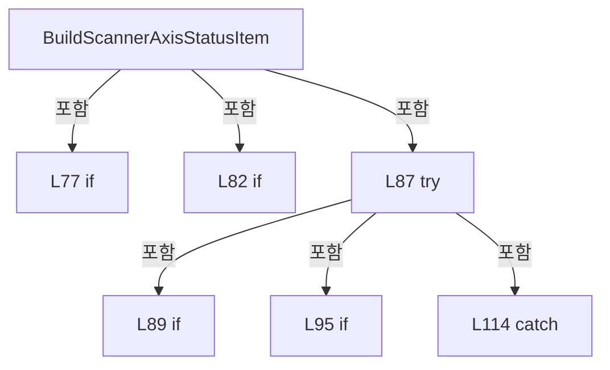

변경 전 점검: 입력/반환 타입, 위 호출자, 예외/취소 경로, 공유 상태와 저장·전송 소비자를 함께 확인합니다. 값의 단위나 물리 방향을 이름만으로 확정하지 않습니다.

### MethodDeclaration `BuildAxisDefinitions` · L120–121

[Drilling.UI/Menu/Menus/CScannerStatusSnapshotReader.cs:120–121](https://github.com/kjuws10-rgb/A3Drilling/blob/5aee8e58439c9b455cae7c9593c9be986c3e682e/Drilling.UI/Menu/Menus/CScannerStatusSnapshotReader.cs#L120-L121)

| 항목 | 실제 추출 값 |
| --- | --- |
| 서명 | System.Collections.Generic.IReadOnlyList<Drilling.Common.Automation.ST_SCANNER_AXIS_SETTING> Drilling.UI.Menu.Menus.CScannerStatusSnapshotReader.BuildAxisDefinitions(System.Collections.Generic.IReadOnlyList<Drilling.Common.Managers.ST_SYSTEM_PARAMETER>, int) |
| 접근/수식자 | Internal / internal, static |
| 반환/값 타입 | System.Collections.Generic.IReadOnlyList<Drilling.Common.Automation.ST_SCANNER_AXIS_SETTING> |
| 소속 타입 | NamedType:Drilling.UI.Menu.Menus.CScannerStatusSnapshotReader |

입력 계약:

| 이름 | 타입 | 전달 | 선택/기본값 |
| --- | --- | --- | --- |
| settings | System.Collections.Generic.IReadOnlyList<Drilling.Common.Managers.ST_SYSTEM_PARAMETER> | None | False /  |
| headNo | int | None | False /  |

정적 호출자로 확인된 위치:

| 호출 파일/행 | 호출 표현식 | 런타임 분기 가능 |
| --- | --- | --- |
| [Drilling.UI/Menu/Menus/CMenuManual.cs:1795–1795](https://github.com/kjuws10-rgb/A3Drilling/blob/5aee8e58439c9b455cae7c9593c9be986c3e682e/Drilling.UI/Menu/Menus/CMenuManual.cs#L1795-L1795) | CScannerStatusSnapshotReader.BuildAxisDefinitions | False |
| [Drilling.UI/Menu/Menus/CMenuManual.cs:1876–1876](https://github.com/kjuws10-rgb/A3Drilling/blob/5aee8e58439c9b455cae7c9593c9be986c3e682e/Drilling.UI/Menu/Menus/CMenuManual.cs#L1876-L1876) | CScannerStatusSnapshotReader.BuildAxisDefinitions | False |
| [Drilling.UI/Menu/Menus/CMenuManual.cs:1887–1887](https://github.com/kjuws10-rgb/A3Drilling/blob/5aee8e58439c9b455cae7c9593c9be986c3e682e/Drilling.UI/Menu/Menus/CMenuManual.cs#L1887-L1887) | CScannerStatusSnapshotReader.BuildAxisDefinitions | False |
| [Drilling.UI/Menu/Menus/CMenuManual.cs:1921–1921](https://github.com/kjuws10-rgb/A3Drilling/blob/5aee8e58439c9b455cae7c9593c9be986c3e682e/Drilling.UI/Menu/Menus/CMenuManual.cs#L1921-L1921) | CScannerStatusSnapshotReader.BuildAxisDefinitions | False |
| [Drilling.UI/Menu/Menus/CMenuManual.cs:1942–1942](https://github.com/kjuws10-rgb/A3Drilling/blob/5aee8e58439c9b455cae7c9593c9be986c3e682e/Drilling.UI/Menu/Menus/CMenuManual.cs#L1942-L1942) | CScannerStatusSnapshotReader.BuildAxisDefinitions | False |
| [Drilling.UI/Menu/Menus/CMenuManual.cs:2507–2507](https://github.com/kjuws10-rgb/A3Drilling/blob/5aee8e58439c9b455cae7c9593c9be986c3e682e/Drilling.UI/Menu/Menus/CMenuManual.cs#L2507-L2507) | CScannerStatusSnapshotReader.BuildAxisDefinitions | False |
| [Drilling.UI/Menu/Menus/CMenuManual.cs:3101–3101](https://github.com/kjuws10-rgb/A3Drilling/blob/5aee8e58439c9b455cae7c9593c9be986c3e682e/Drilling.UI/Menu/Menus/CMenuManual.cs#L3101-L3101) | CScannerStatusSnapshotReader.BuildAxisDefinitions | False |
| [Drilling.UI/Menu/Menus/CMenuManual.cs:3251–3251](https://github.com/kjuws10-rgb/A3Drilling/blob/5aee8e58439c9b455cae7c9593c9be986c3e682e/Drilling.UI/Menu/Menus/CMenuManual.cs#L3251-L3251) | CScannerStatusSnapshotReader.BuildAxisDefinitions | False |
| [Drilling.UI/Menu/Menus/CMenuManual.cs:3473–3473](https://github.com/kjuws10-rgb/A3Drilling/blob/5aee8e58439c9b455cae7c9593c9be986c3e682e/Drilling.UI/Menu/Menus/CMenuManual.cs#L3473-L3473) | CScannerStatusSnapshotReader.BuildAxisDefinitions | False |
| [Drilling.UI/Menu/Menus/CMenuManual.cs:3614–3614](https://github.com/kjuws10-rgb/A3Drilling/blob/5aee8e58439c9b455cae7c9593c9be986c3e682e/Drilling.UI/Menu/Menus/CMenuManual.cs#L3614-L3614) | CScannerStatusSnapshotReader.BuildAxisDefinitions | False |
| [Drilling.UI/Menu/Menus/CMenuManual.cs:4229–4229](https://github.com/kjuws10-rgb/A3Drilling/blob/5aee8e58439c9b455cae7c9593c9be986c3e682e/Drilling.UI/Menu/Menus/CMenuManual.cs#L4229-L4229) | CScannerStatusSnapshotReader.BuildAxisDefinitions | False |
| [Drilling.UI/Menu/Menus/CMenuManual.cs:4450–4450](https://github.com/kjuws10-rgb/A3Drilling/blob/5aee8e58439c9b455cae7c9593c9be986c3e682e/Drilling.UI/Menu/Menus/CMenuManual.cs#L4450-L4450) | CScannerStatusSnapshotReader.BuildAxisDefinitions | False |
| [Drilling.UI/Menu/Menus/CMenuManual.cs:5371–5371](https://github.com/kjuws10-rgb/A3Drilling/blob/5aee8e58439c9b455cae7c9593c9be986c3e682e/Drilling.UI/Menu/Menus/CMenuManual.cs#L5371-L5371) | CScannerStatusSnapshotReader.BuildAxisDefinitions | False |
| [Drilling.UI/Menu/Menus/CMenuManual.cs:6791–6791](https://github.com/kjuws10-rgb/A3Drilling/blob/5aee8e58439c9b455cae7c9593c9be986c3e682e/Drilling.UI/Menu/Menus/CMenuManual.cs#L6791-L6791) | CScannerStatusSnapshotReader.BuildAxisDefinitions | False |
| [Drilling.UI/Menu/Menus/CMenuManual.cs:7631–7631](https://github.com/kjuws10-rgb/A3Drilling/blob/5aee8e58439c9b455cae7c9593c9be986c3e682e/Drilling.UI/Menu/Menus/CMenuManual.cs#L7631-L7631) | CScannerStatusSnapshotReader.BuildAxisDefinitions | False |
| [Drilling.UI/Menu/Menus/CMenuManual.cs:7660–7660](https://github.com/kjuws10-rgb/A3Drilling/blob/5aee8e58439c9b455cae7c9593c9be986c3e682e/Drilling.UI/Menu/Menus/CMenuManual.cs#L7660-L7660) | CScannerStatusSnapshotReader.BuildAxisDefinitions | False |

호출하는 대상과 해석 범위:

| 원본 행 | 표현식 | 분석 상태 | 대상/소스 위치 |
| --- | --- | --- | --- |
| 121 | CScannerAxisConfiguration.BuildAxisDefinitions | resolved | System.Collections.Generic.IReadOnlyList<Drilling.Common.Automation.ST_SCANNER_AXIS_SETTING> Drilling.Common.Automation.CScannerAxisConfiguration.BuildAxisDefinitions(System.Collections.Generic.IReadOnlyList<Drilling.Common.Managers.ST_SYSTEM_PARAMETER>, int) · Drilling.Common/Automation/CScannerAxisConfiguration.cs:8 |

본문의 실제 연산·분기·예외·반환 순서(원문 위치 순):

| 원본 행 | 종류 | 주석 해설 |
| --- | --- | --- |
| 121 | call | 함수·델리게이트 또는 객체 생성자를 호출합니다: CScannerAxisConfiguration.BuildAxisDefinitions(settings, headNo) |

변경 전 점검: 입력/반환 타입, 위 호출자, 예외/취소 경로, 공유 상태와 저장·전송 소비자를 함께 확인합니다. 값의 단위나 물리 방향을 이름만으로 확정하지 않습니다.

### MethodDeclaration `BuildAxisDefinitions` · L123–124

[Drilling.UI/Menu/Menus/CScannerStatusSnapshotReader.cs:123–124](https://github.com/kjuws10-rgb/A3Drilling/blob/5aee8e58439c9b455cae7c9593c9be986c3e682e/Drilling.UI/Menu/Menus/CScannerStatusSnapshotReader.cs#L123-L124)

| 항목 | 실제 추출 값 |
| --- | --- |
| 서명 | System.Collections.Generic.IReadOnlyList<Drilling.Common.Automation.ST_SCANNER_AXIS_SETTING> Drilling.UI.Menu.Menus.CScannerStatusSnapshotReader.BuildAxisDefinitions(System.Collections.Generic.IReadOnlyDictionary<string, string>, int) |
| 접근/수식자 | Internal / internal, static |
| 반환/값 타입 | System.Collections.Generic.IReadOnlyList<Drilling.Common.Automation.ST_SCANNER_AXIS_SETTING> |
| 소속 타입 | NamedType:Drilling.UI.Menu.Menus.CScannerStatusSnapshotReader |

입력 계약:

| 이름 | 타입 | 전달 | 선택/기본값 |
| --- | --- | --- | --- |
| parameters | System.Collections.Generic.IReadOnlyDictionary<string, string> | None | False /  |
| headNo | int | None | False /  |

정적 호출자로 확인된 위치:

| 호출 파일/행 | 호출 표현식 | 런타임 분기 가능 |
| --- | --- | --- |
| [Drilling.UI/Menu/Menus/CScannerStatusSnapshotReader.cs:32–32](https://github.com/kjuws10-rgb/A3Drilling/blob/5aee8e58439c9b455cae7c9593c9be986c3e682e/Drilling.UI/Menu/Menus/CScannerStatusSnapshotReader.cs#L32-L32) | BuildAxisDefinitions | False |

호출하는 대상과 해석 범위:

| 원본 행 | 표현식 | 분석 상태 | 대상/소스 위치 |
| --- | --- | --- | --- |
| 124 | CScannerAxisConfiguration.BuildAxisDefinitions | resolved | System.Collections.Generic.IReadOnlyList<Drilling.Common.Automation.ST_SCANNER_AXIS_SETTING> Drilling.Common.Automation.CScannerAxisConfiguration.BuildAxisDefinitions(System.Collections.Generic.IReadOnlyDictionary<string, string>, int) · Drilling.Common/Automation/CScannerAxisConfiguration.cs:29 |

본문의 실제 연산·분기·예외·반환 순서(원문 위치 순):

| 원본 행 | 종류 | 주석 해설 |
| --- | --- | --- |
| 124 | call | 함수·델리게이트 또는 객체 생성자를 호출합니다: CScannerAxisConfiguration.BuildAxisDefinitions(parameters, headNo) |

변경 전 점검: 입력/반환 타입, 위 호출자, 예외/취소 경로, 공유 상태와 저장·전송 소비자를 함께 확인합니다. 값의 단위나 물리 방향을 이름만으로 확정하지 않습니다.

### MethodDeclaration `BuildEnabledHeadNumbers` · L126–127

[Drilling.UI/Menu/Menus/CScannerStatusSnapshotReader.cs:126–127](https://github.com/kjuws10-rgb/A3Drilling/blob/5aee8e58439c9b455cae7c9593c9be986c3e682e/Drilling.UI/Menu/Menus/CScannerStatusSnapshotReader.cs#L126-L127)

| 항목 | 실제 추출 값 |
| --- | --- |
| 서명 | System.Collections.Generic.IReadOnlyList<int> Drilling.UI.Menu.Menus.CScannerStatusSnapshotReader.BuildEnabledHeadNumbers(System.Collections.Generic.IReadOnlyList<Drilling.Common.Managers.ST_SYSTEM_PARAMETER>, int) |
| 접근/수식자 | Internal / internal, static |
| 반환/값 타입 | System.Collections.Generic.IReadOnlyList<int> |
| 소속 타입 | NamedType:Drilling.UI.Menu.Menus.CScannerStatusSnapshotReader |

입력 계약:

| 이름 | 타입 | 전달 | 선택/기본값 |
| --- | --- | --- | --- |
| settings | System.Collections.Generic.IReadOnlyList<Drilling.Common.Managers.ST_SYSTEM_PARAMETER> | None | False /  |
| headCount | int | None | True / 8 |

정적 호출자로 확인된 위치:

| 호출 파일/행 | 호출 표현식 | 런타임 분기 가능 |
| --- | --- | --- |
| [Drilling.UI/CRootView.cs:557–557](https://github.com/kjuws10-rgb/A3Drilling/blob/5aee8e58439c9b455cae7c9593c9be986c3e682e/Drilling.UI/CRootView.cs#L557-L557) | CScannerStatusSnapshotReader.BuildEnabledHeadNumbers | False |
| [Drilling.UI/Menu/Menus/CMenuManual.cs:1451–1451](https://github.com/kjuws10-rgb/A3Drilling/blob/5aee8e58439c9b455cae7c9593c9be986c3e682e/Drilling.UI/Menu/Menus/CMenuManual.cs#L1451-L1451) | CScannerStatusSnapshotReader.BuildEnabledHeadNumbers | False |
| [Drilling.UI/Menu/Menus/CMenuManual.cs:1750–1750](https://github.com/kjuws10-rgb/A3Drilling/blob/5aee8e58439c9b455cae7c9593c9be986c3e682e/Drilling.UI/Menu/Menus/CMenuManual.cs#L1750-L1750) | CScannerStatusSnapshotReader.BuildEnabledHeadNumbers | False |
| [Drilling.UI/Menu/Menus/CMenuManual.cs:1921–1921](https://github.com/kjuws10-rgb/A3Drilling/blob/5aee8e58439c9b455cae7c9593c9be986c3e682e/Drilling.UI/Menu/Menus/CMenuManual.cs#L1921-L1921) | CScannerStatusSnapshotReader.BuildEnabledHeadNumbers | False |
| [Drilling.UI/Menu/Menus/CMenuManual.cs:1940–1940](https://github.com/kjuws10-rgb/A3Drilling/blob/5aee8e58439c9b455cae7c9593c9be986c3e682e/Drilling.UI/Menu/Menus/CMenuManual.cs#L1940-L1940) | CScannerStatusSnapshotReader.BuildEnabledHeadNumbers | False |
| [Drilling.UI/Menu/Menus/CMenuManual.cs:2541–2541](https://github.com/kjuws10-rgb/A3Drilling/blob/5aee8e58439c9b455cae7c9593c9be986c3e682e/Drilling.UI/Menu/Menus/CMenuManual.cs#L2541-L2541) | CScannerStatusSnapshotReader.BuildEnabledHeadNumbers | False |
| [Drilling.UI/Menu/Menus/CMenuManual.cs:3471–3471](https://github.com/kjuws10-rgb/A3Drilling/blob/5aee8e58439c9b455cae7c9593c9be986c3e682e/Drilling.UI/Menu/Menus/CMenuManual.cs#L3471-L3471) | CScannerStatusSnapshotReader.BuildEnabledHeadNumbers | False |
| [Drilling.UI/Menu/Menus/CMenuManual.cs:3613–3613](https://github.com/kjuws10-rgb/A3Drilling/blob/5aee8e58439c9b455cae7c9593c9be986c3e682e/Drilling.UI/Menu/Menus/CMenuManual.cs#L3613-L3613) | CScannerStatusSnapshotReader.BuildEnabledHeadNumbers | False |
| [Drilling.UI/Menu/Menus/CMenuManual.cs:4438–4438](https://github.com/kjuws10-rgb/A3Drilling/blob/5aee8e58439c9b455cae7c9593c9be986c3e682e/Drilling.UI/Menu/Menus/CMenuManual.cs#L4438-L4438) | CScannerStatusSnapshotReader.BuildEnabledHeadNumbers | False |
| [Drilling.UI/Menu/Menus/CMenuManual.cs:4848–4848](https://github.com/kjuws10-rgb/A3Drilling/blob/5aee8e58439c9b455cae7c9593c9be986c3e682e/Drilling.UI/Menu/Menus/CMenuManual.cs#L4848-L4848) | CScannerStatusSnapshotReader.BuildEnabledHeadNumbers | False |
| [Drilling.UI/Menu/Menus/CMenuManual.cs:6748–6748](https://github.com/kjuws10-rgb/A3Drilling/blob/5aee8e58439c9b455cae7c9593c9be986c3e682e/Drilling.UI/Menu/Menus/CMenuManual.cs#L6748-L6748) | CScannerStatusSnapshotReader.BuildEnabledHeadNumbers | False |
| [Drilling.UI/Menu/Menus/CMenuManual.cs:6761–6761](https://github.com/kjuws10-rgb/A3Drilling/blob/5aee8e58439c9b455cae7c9593c9be986c3e682e/Drilling.UI/Menu/Menus/CMenuManual.cs#L6761-L6761) | CScannerStatusSnapshotReader.BuildEnabledHeadNumbers | False |
| [Drilling.UI/Menu/Menus/CMenuMonitor.cs:2298–2298](https://github.com/kjuws10-rgb/A3Drilling/blob/5aee8e58439c9b455cae7c9593c9be986c3e682e/Drilling.UI/Menu/Menus/CMenuMonitor.cs#L2298-L2298) | CScannerStatusSnapshotReader.BuildEnabledHeadNumbers | False |

호출하는 대상과 해석 범위:

| 원본 행 | 표현식 | 분석 상태 | 대상/소스 위치 |
| --- | --- | --- | --- |
| 127 | CScannerAxisConfiguration.BuildEnabledHeadNumbers | resolved | System.Collections.Generic.IReadOnlyList<int> Drilling.Common.Automation.CScannerAxisConfiguration.BuildEnabledHeadNumbers(System.Collections.Generic.IReadOnlyList<Drilling.Common.Managers.ST_SYSTEM_PARAMETER>, int) · Drilling.Common/Automation/CScannerAxisConfiguration.cs:147 |

본문의 실제 연산·분기·예외·반환 순서(원문 위치 순):

| 원본 행 | 종류 | 주석 해설 |
| --- | --- | --- |
| 127 | call | 함수·델리게이트 또는 객체 생성자를 호출합니다: CScannerAxisConfiguration.BuildEnabledHeadNumbers(settings, headCount) |

변경 전 점검: 입력/반환 타입, 위 호출자, 예외/취소 경로, 공유 상태와 저장·전송 소비자를 함께 확인합니다. 값의 단위나 물리 방향을 이름만으로 확정하지 않습니다.

### MethodDeclaration `IsHeadEnabled` · L129–130

[Drilling.UI/Menu/Menus/CScannerStatusSnapshotReader.cs:129–130](https://github.com/kjuws10-rgb/A3Drilling/blob/5aee8e58439c9b455cae7c9593c9be986c3e682e/Drilling.UI/Menu/Menus/CScannerStatusSnapshotReader.cs#L129-L130)

| 항목 | 실제 추출 값 |
| --- | --- |
| 서명 | bool Drilling.UI.Menu.Menus.CScannerStatusSnapshotReader.IsHeadEnabled(System.Collections.Generic.IReadOnlyList<Drilling.Common.Managers.ST_SYSTEM_PARAMETER>, int) |
| 접근/수식자 | Internal / internal, static |
| 반환/값 타입 | bool |
| 소속 타입 | NamedType:Drilling.UI.Menu.Menus.CScannerStatusSnapshotReader |

입력 계약:

| 이름 | 타입 | 전달 | 선택/기본값 |
| --- | --- | --- | --- |
| settings | System.Collections.Generic.IReadOnlyList<Drilling.Common.Managers.ST_SYSTEM_PARAMETER> | None | False /  |
| headNo | int | None | False /  |

정적 호출자로 확인된 위치:

| 호출 파일/행 | 호출 표현식 | 런타임 분기 가능 |
| --- | --- | --- |
| [Drilling.UI/CRootView.cs:1912–1912](https://github.com/kjuws10-rgb/A3Drilling/blob/5aee8e58439c9b455cae7c9593c9be986c3e682e/Drilling.UI/CRootView.cs#L1912-L1912) | CScannerStatusSnapshotReader.IsHeadEnabled | False |

호출하는 대상과 해석 범위:

| 원본 행 | 표현식 | 분석 상태 | 대상/소스 위치 |
| --- | --- | --- | --- |
| 130 | CScannerAxisConfiguration.IsHeadEnabled | resolved | bool Drilling.Common.Automation.CScannerAxisConfiguration.IsHeadEnabled(System.Collections.Generic.IReadOnlyList<Drilling.Common.Managers.ST_SYSTEM_PARAMETER>, int) · Drilling.Common/Automation/CScannerAxisConfiguration.cs:161 |

본문의 실제 연산·분기·예외·반환 순서(원문 위치 순):

| 원본 행 | 종류 | 주석 해설 |
| --- | --- | --- |
| 130 | call | 함수·델리게이트 또는 객체 생성자를 호출합니다: CScannerAxisConfiguration.IsHeadEnabled(settings, headNo) |

변경 전 점검: 입력/반환 타입, 위 호출자, 예외/취소 경로, 공유 상태와 저장·전송 소비자를 함께 확인합니다. 값의 단위나 물리 방향을 이름만으로 확정하지 않습니다.

### MethodDeclaration `IsHeadEnabled` · L132–133

[Drilling.UI/Menu/Menus/CScannerStatusSnapshotReader.cs:132–133](https://github.com/kjuws10-rgb/A3Drilling/blob/5aee8e58439c9b455cae7c9593c9be986c3e682e/Drilling.UI/Menu/Menus/CScannerStatusSnapshotReader.cs#L132-L133)

| 항목 | 실제 추출 값 |
| --- | --- |
| 서명 | bool Drilling.UI.Menu.Menus.CScannerStatusSnapshotReader.IsHeadEnabled(System.Collections.Generic.IReadOnlyDictionary<string, string>, int) |
| 접근/수식자 | Internal / internal, static |
| 반환/값 타입 | bool |
| 소속 타입 | NamedType:Drilling.UI.Menu.Menus.CScannerStatusSnapshotReader |

입력 계약:

| 이름 | 타입 | 전달 | 선택/기본값 |
| --- | --- | --- | --- |
| parameters | System.Collections.Generic.IReadOnlyDictionary<string, string> | None | False /  |
| headNo | int | None | False /  |

현재 부분 분석에서 직접 연결된 호출자는 없습니다. XAML/이벤트/인터페이스·델리게이트·외부 진입을 추가 확인해야 하며, 미사용으로 판정한 것이 아닙니다.

호출하는 대상과 해석 범위:

| 원본 행 | 표현식 | 분석 상태 | 대상/소스 위치 |
| --- | --- | --- | --- |
| 133 | CScannerAxisConfiguration.IsHeadEnabled | resolved | bool Drilling.Common.Automation.CScannerAxisConfiguration.IsHeadEnabled(System.Collections.Generic.IReadOnlyDictionary<string, string>, int) · Drilling.Common/Automation/CScannerAxisConfiguration.cs:166 |

본문의 실제 연산·분기·예외·반환 순서(원문 위치 순):

| 원본 행 | 종류 | 주석 해설 |
| --- | --- | --- |
| 133 | call | 함수·델리게이트 또는 객체 생성자를 호출합니다: CScannerAxisConfiguration.IsHeadEnabled(parameters, headNo) |

변경 전 점검: 입력/반환 타입, 위 호출자, 예외/취소 경로, 공유 상태와 저장·전송 소비자를 함께 확인합니다. 값의 단위나 물리 방향을 이름만으로 확정하지 않습니다.

### MethodDeclaration `CreatePollingErrorSnapshot` · L135–138

[Drilling.UI/Menu/Menus/CScannerStatusSnapshotReader.cs:135–138](https://github.com/kjuws10-rgb/A3Drilling/blob/5aee8e58439c9b455cae7c9593c9be986c3e682e/Drilling.UI/Menu/Menus/CScannerStatusSnapshotReader.cs#L135-L138)

| 항목 | 실제 추출 값 |
| --- | --- |
| 서명 | System.Collections.Generic.IReadOnlyList<Drilling.UI.Menu.Menus.ST_SCANNER_AXIS_STATUS_ITEM> Drilling.UI.Menu.Menus.CScannerStatusSnapshotReader.CreatePollingErrorSnapshot(string) |
| 접근/수식자 | Private / private, static |
| 반환/값 타입 | System.Collections.Generic.IReadOnlyList<Drilling.UI.Menu.Menus.ST_SCANNER_AXIS_STATUS_ITEM> |
| 소속 타입 | NamedType:Drilling.UI.Menu.Menus.CScannerStatusSnapshotReader |

입력 계약:

| 이름 | 타입 | 전달 | 선택/기본값 |
| --- | --- | --- | --- |
| message | string | None | False /  |

정적 호출자로 확인된 위치:

| 호출 파일/행 | 호출 표현식 | 런타임 분기 가능 |
| --- | --- | --- |
| [Drilling.UI/Menu/Menus/CScannerStatusSnapshotReader.cs:68–68](https://github.com/kjuws10-rgb/A3Drilling/blob/5aee8e58439c9b455cae7c9593c9be986c3e682e/Drilling.UI/Menu/Menus/CScannerStatusSnapshotReader.cs#L68-L68) | CreatePollingErrorSnapshot | False |

호출하는 대상과 해석 범위:

| 원본 행 | 표현식 | 분석 상태 | 대상/소스 위치 |
| --- | --- | --- | --- |
| 137 | new ST_SCANNER_AXIS_STATUS_ITEM | resolved | Drilling.UI.Menu.Menus.ST_SCANNER_AXIS_STATUS_ITEM.ST_SCANNER_AXIS_STATUS_ITEM(string, string, string, string, string, string, string, string, string, string, string, string, string, string) · Drilling.UI/Menu/Menus/CMenuMain.cs:3915 |
| 137 | string.IsNullOrWhiteSpace | resolved | bool string.IsNullOrWhiteSpace(string?) |

본문의 실제 연산·분기·예외·반환 순서(원문 위치 순):

| 원본 행 | 종류 | 주석 해설 |
| --- | --- | --- |
| 137 | call | 함수·델리게이트 또는 객체 생성자를 호출합니다: new ST_SCANNER_AXIS_STATUS_ITEM("-", "-", "-", "-", "ERROR", "-", "-", "-", "-", "-", "-", "-", "ERROR", string.IsNullOrWhiteSpace(message) ? "Scanner status polling failed." : message) |
| 137 | call | 함수·델리게이트 또는 객체 생성자를 호출합니다: string.IsNullOrWhiteSpace(message) |
| 137 | conditional-expression | 조건에 따라 결과식을 선택합니다: string.IsNullOrWhiteSpace(message) ? "Scanner status polling failed." : message |
| 137 | return | 호출자에게 값 또는 제어를 반환합니다: return[new ST_SCANNER_AXIS_STATUS_ITEM("-", "-", "-", "-", "ERROR", "-", "-", "-", "-", "-", "-", "-", "ERROR", string.IsNullOrWhiteSpace(message) ? "Scanner status polling failed." : message)]; |

변경 전 점검: 입력/반환 타입, 위 호출자, 예외/취소 경로, 공유 상태와 저장·전송 소비자를 함께 확인합니다. 값의 단위나 물리 방향을 이름만으로 확정하지 않습니다.

### MethodDeclaration `SetSnapshot` · L140–146

[Drilling.UI/Menu/Menus/CScannerStatusSnapshotReader.cs:140–146](https://github.com/kjuws10-rgb/A3Drilling/blob/5aee8e58439c9b455cae7c9593c9be986c3e682e/Drilling.UI/Menu/Menus/CScannerStatusSnapshotReader.cs#L140-L146)

| 항목 | 실제 추출 값 |
| --- | --- |
| 서명 | void Drilling.UI.Menu.Menus.CScannerStatusSnapshotReader.SetSnapshot(System.Collections.Generic.IReadOnlyList<Drilling.UI.Menu.Menus.ST_SCANNER_AXIS_STATUS_ITEM>) |
| 접근/수식자 | Private / private |
| 반환/값 타입 | void |
| 소속 타입 | NamedType:Drilling.UI.Menu.Menus.CScannerStatusSnapshotReader |

입력 계약:

| 이름 | 타입 | 전달 | 선택/기본값 |
| --- | --- | --- | --- |
| snapshot | System.Collections.Generic.IReadOnlyList<Drilling.UI.Menu.Menus.ST_SCANNER_AXIS_STATUS_ITEM> | None | False /  |

현재 부분 분석에서 직접 연결된 호출자는 없습니다. XAML/이벤트/인터페이스·델리게이트·외부 진입을 추가 확인해야 하며, 미사용으로 판정한 것이 아닙니다.

본문의 실제 연산·분기·예외·반환 순서(원문 위치 순):

| 원본 행 | 종류 | 주석 해설 |
| --- | --- | --- |
| 142 | lock | 공유 상태의 임계 구역에 진입합니다: lock (_snapshotLock) |
| 144 | assignment | 값을 대상에 대입합니다: _snapshot = snapshot |

제어 구문의 포함 구조(실제 실행 순서/CFG가 아닌 구문 탐색 그림):

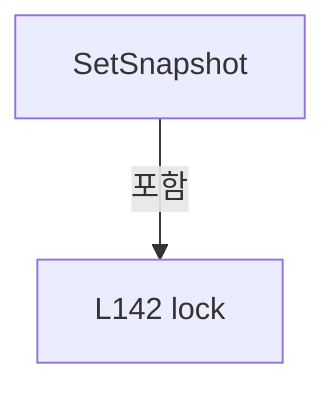

변경 전 점검: 입력/반환 타입, 위 호출자, 예외/취소 경로, 공유 상태와 저장·전송 소비자를 함께 확인합니다. 값의 단위나 물리 방향을 이름만으로 확정하지 않습니다.

### MethodDeclaration `SetSnapshot` · L148–159

[Drilling.UI/Menu/Menus/CScannerStatusSnapshotReader.cs:148–159](https://github.com/kjuws10-rgb/A3Drilling/blob/5aee8e58439c9b455cae7c9593c9be986c3e682e/Drilling.UI/Menu/Menus/CScannerStatusSnapshotReader.cs#L148-L159)

| 항목 | 실제 추출 값 |
| --- | --- |
| 서명 | void Drilling.UI.Menu.Menus.CScannerStatusSnapshotReader.SetSnapshot(int, System.Collections.Generic.IReadOnlyList<Drilling.UI.Menu.Menus.ST_SCANNER_AXIS_STATUS_ITEM>) |
| 접근/수식자 | Private / private |
| 반환/값 타입 | void |
| 소속 타입 | NamedType:Drilling.UI.Menu.Menus.CScannerStatusSnapshotReader |

입력 계약:

| 이름 | 타입 | 전달 | 선택/기본값 |
| --- | --- | --- | --- |
| headNo | int | None | False /  |
| snapshot | System.Collections.Generic.IReadOnlyList<Drilling.UI.Menu.Menus.ST_SCANNER_AXIS_STATUS_ITEM> | None | False /  |

정적 호출자로 확인된 위치:

| 호출 파일/행 | 호출 표현식 | 런타임 분기 가능 |
| --- | --- | --- |
| [Drilling.UI/Menu/Menus/CScannerStatusSnapshotReader.cs:64–64](https://github.com/kjuws10-rgb/A3Drilling/blob/5aee8e58439c9b455cae7c9593c9be986c3e682e/Drilling.UI/Menu/Menus/CScannerStatusSnapshotReader.cs#L64-L64) | SetSnapshot | False |
| [Drilling.UI/Menu/Menus/CScannerStatusSnapshotReader.cs:68–68](https://github.com/kjuws10-rgb/A3Drilling/blob/5aee8e58439c9b455cae7c9593c9be986c3e682e/Drilling.UI/Menu/Menus/CScannerStatusSnapshotReader.cs#L68-L68) | SetSnapshot | False |

본문의 실제 연산·분기·예외·반환 순서(원문 위치 순):

| 원본 행 | 종류 | 주석 해설 |
| --- | --- | --- |
| 150 | lock | 공유 상태의 임계 구역에 진입합니다: lock (_snapshotLock) |
| 152 | if | 조건에 따라 분기합니다: if (_selectedHeadNo != headNo) |
| 154 | return | 호출자에게 값 또는 제어를 반환합니다: return; |
| 157 | assignment | 값을 대상에 대입합니다: _snapshot = snapshot |

제어 구문의 포함 구조(실제 실행 순서/CFG가 아닌 구문 탐색 그림):

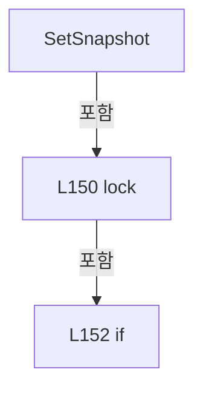

변경 전 점검: 입력/반환 타입, 위 호출자, 예외/취소 경로, 공유 상태와 저장·전송 소비자를 함께 확인합니다. 값의 단위나 물리 방향을 이름만으로 확정하지 않습니다.

### MethodDeclaration `ReadPollingContext` · L161–167

[Drilling.UI/Menu/Menus/CScannerStatusSnapshotReader.cs:161–167](https://github.com/kjuws10-rgb/A3Drilling/blob/5aee8e58439c9b455cae7c9593c9be986c3e682e/Drilling.UI/Menu/Menus/CScannerStatusSnapshotReader.cs#L161-L167)

| 항목 | 실제 추출 값 |
| --- | --- |
| 서명 | Drilling.UI.Menu.Menus.CScannerStatusSnapshotReader.ST_SCANNER_STATUS_POLLING_CONTEXT Drilling.UI.Menu.Menus.CScannerStatusSnapshotReader.ReadPollingContext() |
| 접근/수식자 | Private / private |
| 반환/값 타입 | Drilling.UI.Menu.Menus.CScannerStatusSnapshotReader.ST_SCANNER_STATUS_POLLING_CONTEXT |
| 소속 타입 | NamedType:Drilling.UI.Menu.Menus.CScannerStatusSnapshotReader |

정적 호출자로 확인된 위치:

| 호출 파일/행 | 호출 표현식 | 런타임 분기 가능 |
| --- | --- | --- |
| [Drilling.UI/Menu/Menus/CScannerStatusSnapshotReader.cs:54–54](https://github.com/kjuws10-rgb/A3Drilling/blob/5aee8e58439c9b455cae7c9593c9be986c3e682e/Drilling.UI/Menu/Menus/CScannerStatusSnapshotReader.cs#L54-L54) | ReadPollingContext | False |

호출하는 대상과 해석 범위:

| 원본 행 | 표현식 | 분석 상태 | 대상/소스 위치 |
| --- | --- | --- | --- |
| 165 | new ST_SCANNER_STATUS_POLLING_CONTEXT | resolved | Drilling.UI.Menu.Menus.CScannerStatusSnapshotReader.ST_SCANNER_STATUS_POLLING_CONTEXT.ST_SCANNER_STATUS_POLLING_CONTEXT(int, System.Collections.Generic.IReadOnlyList<Drilling.Common.Automation.ST_SCANNER_AXIS_SETTING>) · Drilling.UI/Menu/Menus/CScannerStatusSnapshotReader.cs:237 |

본문의 실제 연산·분기·예외·반환 순서(원문 위치 순):

| 원본 행 | 종류 | 주석 해설 |
| --- | --- | --- |
| 163 | lock | 공유 상태의 임계 구역에 진입합니다: lock (_snapshotLock) |
| 165 | call | 함수·델리게이트 또는 객체 생성자를 호출합니다: new ST_SCANNER_STATUS_POLLING_CONTEXT(_selectedHeadNo, _axisDefinitions) |
| 165 | return | 호출자에게 값 또는 제어를 반환합니다: return new ST_SCANNER_STATUS_POLLING_CONTEXT(_selectedHeadNo, _axisDefinitions); |

제어 구문의 포함 구조(실제 실행 순서/CFG가 아닌 구문 탐색 그림):

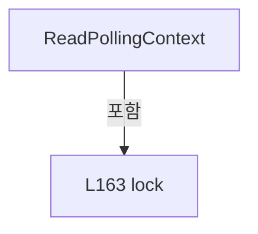

변경 전 점검: 입력/반환 타입, 위 호출자, 예외/취소 경로, 공유 상태와 저장·전송 소비자를 함께 확인합니다. 값의 단위나 물리 방향을 이름만으로 확정하지 않습니다.

### MethodDeclaration `IsSameAxisDefinitions` · L169–185

[Drilling.UI/Menu/Menus/CScannerStatusSnapshotReader.cs:169–185](https://github.com/kjuws10-rgb/A3Drilling/blob/5aee8e58439c9b455cae7c9593c9be986c3e682e/Drilling.UI/Menu/Menus/CScannerStatusSnapshotReader.cs#L169-L185)

| 항목 | 실제 추출 값 |
| --- | --- |
| 서명 | bool Drilling.UI.Menu.Menus.CScannerStatusSnapshotReader.IsSameAxisDefinitions(System.Collections.Generic.IReadOnlyList<Drilling.Common.Automation.ST_SCANNER_AXIS_SETTING>, System.Collections.Generic.IReadOnlyList<Drilling.Common.Automation.ST_SCANNER_AXIS_SETTING>) |
| 접근/수식자 | Private / private, static |
| 반환/값 타입 | bool |
| 소속 타입 | NamedType:Drilling.UI.Menu.Menus.CScannerStatusSnapshotReader |

입력 계약:

| 이름 | 타입 | 전달 | 선택/기본값 |
| --- | --- | --- | --- |
| left | System.Collections.Generic.IReadOnlyList<Drilling.Common.Automation.ST_SCANNER_AXIS_SETTING> | None | False /  |
| right | System.Collections.Generic.IReadOnlyList<Drilling.Common.Automation.ST_SCANNER_AXIS_SETTING> | None | False /  |

정적 호출자로 확인된 위치:

| 호출 파일/행 | 호출 표현식 | 런타임 분기 가능 |
| --- | --- | --- |
| [Drilling.UI/Menu/Menus/CScannerStatusSnapshotReader.cs:35–35](https://github.com/kjuws10-rgb/A3Drilling/blob/5aee8e58439c9b455cae7c9593c9be986c3e682e/Drilling.UI/Menu/Menus/CScannerStatusSnapshotReader.cs#L35-L35) | IsSameAxisDefinitions | False |

호출하는 대상과 해석 범위:

| 원본 행 | 표현식 | 분석 상태 | 대상/소스 위치 |
| --- | --- | --- | --- |
| 178 | left[index].Equals | resolved | bool Drilling.Common.Automation.ST_SCANNER_AXIS_SETTING.Equals(Drilling.Common.Automation.ST_SCANNER_AXIS_SETTING) · Drilling.Common/Automation/CScannerAxisConfiguration.cs:307 |

본문의 실제 연산·분기·예외·반환 순서(원문 위치 순):

| 원본 행 | 종류 | 주석 해설 |
| --- | --- | --- |
| 171 | if | 조건에 따라 분기합니다: if (left.Count != right.Count) |
| 173 | return | 호출자에게 값 또는 제어를 반환합니다: return false; |
| 176 | variable-initializer | 변수의 초기값을 지정합니다: index = 0 |
| 176 | for | 초기화·조건·증감이 있는 반복입니다: for (var index = 0; index < left.Count; index++) |
| 178 | call | 함수·델리게이트 또는 객체 생성자를 호출합니다: left[index].Equals(right[index]) |
| 178 | if | 조건에 따라 분기합니다: if (!left[index].Equals(right[index])) |
| 180 | return | 호출자에게 값 또는 제어를 반환합니다: return false; |
| 184 | return | 호출자에게 값 또는 제어를 반환합니다: return true; |

제어 구문의 포함 구조(실제 실행 순서/CFG가 아닌 구문 탐색 그림):

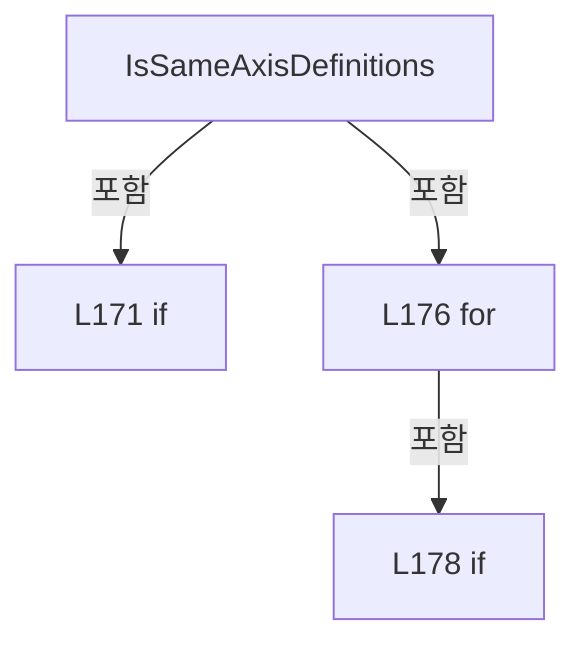

변경 전 점검: 입력/반환 타입, 위 호출자, 예외/취소 경로, 공유 상태와 저장·전송 소비자를 함께 확인합니다. 값의 단위나 물리 방향을 이름만으로 확정하지 않습니다.

### MethodDeclaration `NormalizeHeadNo` · L187–190

[Drilling.UI/Menu/Menus/CScannerStatusSnapshotReader.cs:187–190](https://github.com/kjuws10-rgb/A3Drilling/blob/5aee8e58439c9b455cae7c9593c9be986c3e682e/Drilling.UI/Menu/Menus/CScannerStatusSnapshotReader.cs#L187-L190)

| 항목 | 실제 추출 값 |
| --- | --- |
| 서명 | int Drilling.UI.Menu.Menus.CScannerStatusSnapshotReader.NormalizeHeadNo(int) |
| 접근/수식자 | Private / private, static |
| 반환/값 타입 | int |
| 소속 타입 | NamedType:Drilling.UI.Menu.Menus.CScannerStatusSnapshotReader |

입력 계약:

| 이름 | 타입 | 전달 | 선택/기본값 |
| --- | --- | --- | --- |
| headNo | int | None | False /  |

정적 호출자로 확인된 위치:

| 호출 파일/행 | 호출 표현식 | 런타임 분기 가능 |
| --- | --- | --- |
| [Drilling.UI/Menu/Menus/CScannerStatusSnapshotReader.cs:15–15](https://github.com/kjuws10-rgb/A3Drilling/blob/5aee8e58439c9b455cae7c9593c9be986c3e682e/Drilling.UI/Menu/Menus/CScannerStatusSnapshotReader.cs#L15-L15) | NormalizeHeadNo | False |
| [Drilling.UI/Menu/Menus/CScannerStatusSnapshotReader.cs:31–31](https://github.com/kjuws10-rgb/A3Drilling/blob/5aee8e58439c9b455cae7c9593c9be986c3e682e/Drilling.UI/Menu/Menus/CScannerStatusSnapshotReader.cs#L31-L31) | NormalizeHeadNo | False |

호출하는 대상과 해석 범위:

| 원본 행 | 표현식 | 분석 상태 | 대상/소스 위치 |
| --- | --- | --- | --- |
| 189 | Math.Clamp | resolved | int System.Math.Clamp(int, int, int) |

본문의 실제 연산·분기·예외·반환 순서(원문 위치 순):

| 원본 행 | 종류 | 주석 해설 |
| --- | --- | --- |
| 189 | call | 함수·델리게이트 또는 객체 생성자를 호출합니다: Math.Clamp(headNo, 1, 8) |
| 189 | return | 호출자에게 값 또는 제어를 반환합니다: return Math.Clamp(headNo, 1, 8); |

변경 전 점검: 입력/반환 타입, 위 호출자, 예외/취소 경로, 공유 상태와 저장·전송 소비자를 함께 확인합니다. 값의 단위나 물리 방향을 이름만으로 확정하지 않습니다.

### MethodDeclaration `FormatScannerPosition` · L192–200

[Drilling.UI/Menu/Menus/CScannerStatusSnapshotReader.cs:192–200](https://github.com/kjuws10-rgb/A3Drilling/blob/5aee8e58439c9b455cae7c9593c9be986c3e682e/Drilling.UI/Menu/Menus/CScannerStatusSnapshotReader.cs#L192-L200)

| 항목 | 실제 추출 값 |
| --- | --- |
| 서명 | string Drilling.UI.Menu.Menus.CScannerStatusSnapshotReader.FormatScannerPosition(double) |
| 접근/수식자 | Private / private, static |
| 반환/값 타입 | string |
| 소속 타입 | NamedType:Drilling.UI.Menu.Menus.CScannerStatusSnapshotReader |

입력 계약:

| 이름 | 타입 | 전달 | 선택/기본값 |
| --- | --- | --- | --- |
| value | double | None | False /  |

정적 호출자로 확인된 위치:

| 호출 파일/행 | 호출 표현식 | 런타임 분기 가능 |
| --- | --- | --- |
| [Drilling.UI/Menu/Menus/CScannerStatusSnapshotReader.cs:103–103](https://github.com/kjuws10-rgb/A3Drilling/blob/5aee8e58439c9b455cae7c9593c9be986c3e682e/Drilling.UI/Menu/Menus/CScannerStatusSnapshotReader.cs#L103-L103) | FormatScannerPosition | False |
| [Drilling.UI/Menu/Menus/CScannerStatusSnapshotReader.cs:204–204](https://github.com/kjuws10-rgb/A3Drilling/blob/5aee8e58439c9b455cae7c9593c9be986c3e682e/Drilling.UI/Menu/Menus/CScannerStatusSnapshotReader.cs#L204-L204) | FormatScannerPosition | False |

호출하는 대상과 해석 범위:

| 원본 행 | 표현식 | 분석 상태 | 대상/소스 위치 |
| --- | --- | --- | --- |
| 194 | double.IsFinite | resolved | bool double.IsFinite(double) |
| 199 | value.ToString | resolved | string double.ToString(string?, System.IFormatProvider?) |

본문의 실제 연산·분기·예외·반환 순서(원문 위치 순):

| 원본 행 | 종류 | 주석 해설 |
| --- | --- | --- |
| 194 | call | 함수·델리게이트 또는 객체 생성자를 호출합니다: double.IsFinite(value) |
| 194 | if | 조건에 따라 분기합니다: if (!double.IsFinite(value)) |
| 196 | return | 호출자에게 값 또는 제어를 반환합니다: return "-"; |
| 199 | call | 함수·델리게이트 또는 객체 생성자를 호출합니다: value.ToString("F3", CultureInfo.InvariantCulture) |
| 199 | return | 호출자에게 값 또는 제어를 반환합니다: return value.ToString("F3", CultureInfo.InvariantCulture); |

제어 구문의 포함 구조(실제 실행 순서/CFG가 아닌 구문 탐색 그림):

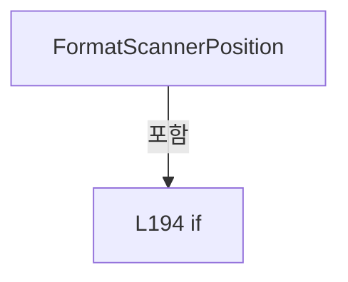

변경 전 점검: 입력/반환 타입, 위 호출자, 예외/취소 경로, 공유 상태와 저장·전송 소비자를 함께 확인합니다. 값의 단위나 물리 방향을 이름만으로 확정하지 않습니다.

### MethodDeclaration `FormatExtendedScannerPosition` · L202–205

[Drilling.UI/Menu/Menus/CScannerStatusSnapshotReader.cs:202–205](https://github.com/kjuws10-rgb/A3Drilling/blob/5aee8e58439c9b455cae7c9593c9be986c3e682e/Drilling.UI/Menu/Menus/CScannerStatusSnapshotReader.cs#L202-L205)

| 항목 | 실제 추출 값 |
| --- | --- |
| 서명 | string Drilling.UI.Menu.Menus.CScannerStatusSnapshotReader.FormatExtendedScannerPosition(double, bool) |
| 접근/수식자 | Private / private, static |
| 반환/값 타입 | string |
| 소속 타입 | NamedType:Drilling.UI.Menu.Menus.CScannerStatusSnapshotReader |

입력 계약:

| 이름 | 타입 | 전달 | 선택/기본값 |
| --- | --- | --- | --- |
| value | double | None | False /  |
| readExtendedStatus | bool | None | False /  |

정적 호출자로 확인된 위치:

| 호출 파일/행 | 호출 표현식 | 런타임 분기 가능 |
| --- | --- | --- |
| [Drilling.UI/Menu/Menus/CScannerStatusSnapshotReader.cs:104–104](https://github.com/kjuws10-rgb/A3Drilling/blob/5aee8e58439c9b455cae7c9593c9be986c3e682e/Drilling.UI/Menu/Menus/CScannerStatusSnapshotReader.cs#L104-L104) | FormatExtendedScannerPosition | False |

호출하는 대상과 해석 범위:

| 원본 행 | 표현식 | 분석 상태 | 대상/소스 위치 |
| --- | --- | --- | --- |
| 204 | FormatScannerPosition | resolved | string Drilling.UI.Menu.Menus.CScannerStatusSnapshotReader.FormatScannerPosition(double) · Drilling.UI/Menu/Menus/CScannerStatusSnapshotReader.cs:192 |

본문의 실제 연산·분기·예외·반환 순서(원문 위치 순):

| 원본 행 | 종류 | 주석 해설 |
| --- | --- | --- |
| 204 | call | 함수·델리게이트 또는 객체 생성자를 호출합니다: FormatScannerPosition(value) |
| 204 | conditional-expression | 조건에 따라 결과식을 선택합니다: readExtendedStatus ? FormatScannerPosition(value) : "-" |
| 204 | return | 호출자에게 값 또는 제어를 반환합니다: return readExtendedStatus ? FormatScannerPosition(value) : "-"; |

변경 전 점검: 입력/반환 타입, 위 호출자, 예외/취소 경로, 공유 상태와 저장·전송 소비자를 함께 확인합니다. 값의 단위나 물리 방향을 이름만으로 확정하지 않습니다.

### MethodDeclaration `FormatScannerValue` · L207–215

[Drilling.UI/Menu/Menus/CScannerStatusSnapshotReader.cs:207–215](https://github.com/kjuws10-rgb/A3Drilling/blob/5aee8e58439c9b455cae7c9593c9be986c3e682e/Drilling.UI/Menu/Menus/CScannerStatusSnapshotReader.cs#L207-L215)

| 항목 | 실제 추출 값 |
| --- | --- |
| 서명 | string Drilling.UI.Menu.Menus.CScannerStatusSnapshotReader.FormatScannerValue(double) |
| 접근/수식자 | Private / private, static |
| 반환/값 타입 | string |
| 소속 타입 | NamedType:Drilling.UI.Menu.Menus.CScannerStatusSnapshotReader |

입력 계약:

| 이름 | 타입 | 전달 | 선택/기본값 |
| --- | --- | --- | --- |
| value | double | None | False /  |

정적 호출자로 확인된 위치:

| 호출 파일/행 | 호출 표현식 | 런타임 분기 가능 |
| --- | --- | --- |
| [Drilling.UI/Menu/Menus/CScannerStatusSnapshotReader.cs:219–219](https://github.com/kjuws10-rgb/A3Drilling/blob/5aee8e58439c9b455cae7c9593c9be986c3e682e/Drilling.UI/Menu/Menus/CScannerStatusSnapshotReader.cs#L219-L219) | FormatScannerValue | False |

호출하는 대상과 해석 범위:

| 원본 행 | 표현식 | 분석 상태 | 대상/소스 위치 |
| --- | --- | --- | --- |
| 209 | double.IsFinite | resolved | bool double.IsFinite(double) |
| 214 | value.ToString | resolved | string double.ToString(string?, System.IFormatProvider?) |

본문의 실제 연산·분기·예외·반환 순서(원문 위치 순):

| 원본 행 | 종류 | 주석 해설 |
| --- | --- | --- |
| 209 | call | 함수·델리게이트 또는 객체 생성자를 호출합니다: double.IsFinite(value) |
| 209 | if | 조건에 따라 분기합니다: if (!double.IsFinite(value)) |
| 211 | return | 호출자에게 값 또는 제어를 반환합니다: return "-"; |
| 214 | call | 함수·델리게이트 또는 객체 생성자를 호출합니다: value.ToString("F3", CultureInfo.InvariantCulture) |
| 214 | return | 호출자에게 값 또는 제어를 반환합니다: return value.ToString("F3", CultureInfo.InvariantCulture); |

제어 구문의 포함 구조(실제 실행 순서/CFG가 아닌 구문 탐색 그림):

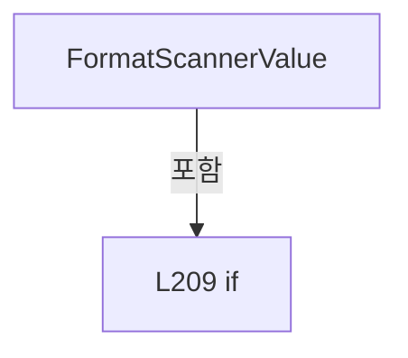

변경 전 점검: 입력/반환 타입, 위 호출자, 예외/취소 경로, 공유 상태와 저장·전송 소비자를 함께 확인합니다. 값의 단위나 물리 방향을 이름만으로 확정하지 않습니다.

### MethodDeclaration `FormatExtendedScannerValue` · L217–220

[Drilling.UI/Menu/Menus/CScannerStatusSnapshotReader.cs:217–220](https://github.com/kjuws10-rgb/A3Drilling/blob/5aee8e58439c9b455cae7c9593c9be986c3e682e/Drilling.UI/Menu/Menus/CScannerStatusSnapshotReader.cs#L217-L220)

| 항목 | 실제 추출 값 |
| --- | --- |
| 서명 | string Drilling.UI.Menu.Menus.CScannerStatusSnapshotReader.FormatExtendedScannerValue(double, bool) |
| 접근/수식자 | Private / private, static |
| 반환/값 타입 | string |
| 소속 타입 | NamedType:Drilling.UI.Menu.Menus.CScannerStatusSnapshotReader |

입력 계약:

| 이름 | 타입 | 전달 | 선택/기본값 |
| --- | --- | --- | --- |
| value | double | None | False /  |
| readExtendedStatus | bool | None | False /  |

정적 호출자로 확인된 위치:

| 호출 파일/행 | 호출 표현식 | 런타임 분기 가능 |
| --- | --- | --- |
| [Drilling.UI/Menu/Menus/CScannerStatusSnapshotReader.cs:105–105](https://github.com/kjuws10-rgb/A3Drilling/blob/5aee8e58439c9b455cae7c9593c9be986c3e682e/Drilling.UI/Menu/Menus/CScannerStatusSnapshotReader.cs#L105-L105) | FormatExtendedScannerValue | False |
| [Drilling.UI/Menu/Menus/CScannerStatusSnapshotReader.cs:106–106](https://github.com/kjuws10-rgb/A3Drilling/blob/5aee8e58439c9b455cae7c9593c9be986c3e682e/Drilling.UI/Menu/Menus/CScannerStatusSnapshotReader.cs#L106-L106) | FormatExtendedScannerValue | False |

호출하는 대상과 해석 범위:

| 원본 행 | 표현식 | 분석 상태 | 대상/소스 위치 |
| --- | --- | --- | --- |
| 219 | FormatScannerValue | resolved | string Drilling.UI.Menu.Menus.CScannerStatusSnapshotReader.FormatScannerValue(double) · Drilling.UI/Menu/Menus/CScannerStatusSnapshotReader.cs:207 |

본문의 실제 연산·분기·예외·반환 순서(원문 위치 순):

| 원본 행 | 종류 | 주석 해설 |
| --- | --- | --- |
| 219 | call | 함수·델리게이트 또는 객체 생성자를 호출합니다: FormatScannerValue(value) |
| 219 | conditional-expression | 조건에 따라 결과식을 선택합니다: readExtendedStatus ? FormatScannerValue(value) : "-" |
| 219 | return | 호출자에게 값 또는 제어를 반환합니다: return readExtendedStatus ? FormatScannerValue(value) : "-"; |

변경 전 점검: 입력/반환 타입, 위 호출자, 예외/취소 경로, 공유 상태와 저장·전송 소비자를 함께 확인합니다. 값의 단위나 물리 방향을 이름만으로 확정하지 않습니다.

### MethodDeclaration `FormatScannerTemperature` · L222–225

[Drilling.UI/Menu/Menus/CScannerStatusSnapshotReader.cs:222–225](https://github.com/kjuws10-rgb/A3Drilling/blob/5aee8e58439c9b455cae7c9593c9be986c3e682e/Drilling.UI/Menu/Menus/CScannerStatusSnapshotReader.cs#L222-L225)

| 항목 | 실제 추출 값 |
| --- | --- |
| 서명 | string Drilling.UI.Menu.Menus.CScannerStatusSnapshotReader.FormatScannerTemperature(double) |
| 접근/수식자 | Private / private, static |
| 반환/값 타입 | string |
| 소속 타입 | NamedType:Drilling.UI.Menu.Menus.CScannerStatusSnapshotReader |

입력 계약:

| 이름 | 타입 | 전달 | 선택/기본값 |
| --- | --- | --- | --- |
| value | double | None | False /  |

정적 호출자로 확인된 위치:

| 호출 파일/행 | 호출 표현식 | 런타임 분기 가능 |
| --- | --- | --- |
| [Drilling.UI/Menu/Menus/CScannerStatusSnapshotReader.cs:229–229](https://github.com/kjuws10-rgb/A3Drilling/blob/5aee8e58439c9b455cae7c9593c9be986c3e682e/Drilling.UI/Menu/Menus/CScannerStatusSnapshotReader.cs#L229-L229) | FormatScannerTemperature | False |

호출하는 대상과 해석 범위:

| 원본 행 | 표현식 | 분석 상태 | 대상/소스 위치 |
| --- | --- | --- | --- |
| 224 | CGalvoTemperature.FormatCelsius | resolved | string Drilling.Common.Automation.CGalvoTemperature.FormatCelsius(double) · Drilling.Common/Automation/CAutomationManager.cs:1666 |

본문의 실제 연산·분기·예외·반환 순서(원문 위치 순):

| 원본 행 | 종류 | 주석 해설 |
| --- | --- | --- |
| 224 | call | 함수·델리게이트 또는 객체 생성자를 호출합니다: CGalvoTemperature.FormatCelsius(value) |
| 224 | return | 호출자에게 값 또는 제어를 반환합니다: return CGalvoTemperature.FormatCelsius(value); |

변경 전 점검: 입력/반환 타입, 위 호출자, 예외/취소 경로, 공유 상태와 저장·전송 소비자를 함께 확인합니다. 값의 단위나 물리 방향을 이름만으로 확정하지 않습니다.

### MethodDeclaration `FormatExtendedScannerTemperature` · L227–230

[Drilling.UI/Menu/Menus/CScannerStatusSnapshotReader.cs:227–230](https://github.com/kjuws10-rgb/A3Drilling/blob/5aee8e58439c9b455cae7c9593c9be986c3e682e/Drilling.UI/Menu/Menus/CScannerStatusSnapshotReader.cs#L227-L230)

| 항목 | 실제 추출 값 |
| --- | --- |
| 서명 | string Drilling.UI.Menu.Menus.CScannerStatusSnapshotReader.FormatExtendedScannerTemperature(double, bool) |
| 접근/수식자 | Private / private, static |
| 반환/값 타입 | string |
| 소속 타입 | NamedType:Drilling.UI.Menu.Menus.CScannerStatusSnapshotReader |

입력 계약:

| 이름 | 타입 | 전달 | 선택/기본값 |
| --- | --- | --- | --- |
| value | double | None | False /  |
| readExtendedStatus | bool | None | False /  |

정적 호출자로 확인된 위치:

| 호출 파일/행 | 호출 표현식 | 런타임 분기 가능 |
| --- | --- | --- |
| [Drilling.UI/Menu/Menus/CScannerStatusSnapshotReader.cs:107–107](https://github.com/kjuws10-rgb/A3Drilling/blob/5aee8e58439c9b455cae7c9593c9be986c3e682e/Drilling.UI/Menu/Menus/CScannerStatusSnapshotReader.cs#L107-L107) | FormatExtendedScannerTemperature | False |

호출하는 대상과 해석 범위:

| 원본 행 | 표현식 | 분석 상태 | 대상/소스 위치 |
| --- | --- | --- | --- |
| 229 | FormatScannerTemperature | resolved | string Drilling.UI.Menu.Menus.CScannerStatusSnapshotReader.FormatScannerTemperature(double) · Drilling.UI/Menu/Menus/CScannerStatusSnapshotReader.cs:222 |

본문의 실제 연산·분기·예외·반환 순서(원문 위치 순):

| 원본 행 | 종류 | 주석 해설 |
| --- | --- | --- |
| 229 | call | 함수·델리게이트 또는 객체 생성자를 호출합니다: FormatScannerTemperature(value) |
| 229 | conditional-expression | 조건에 따라 결과식을 선택합니다: readExtendedStatus ? FormatScannerTemperature(value) : "-" |
| 229 | return | 호출자에게 값 또는 제어를 반환합니다: return readExtendedStatus ? FormatScannerTemperature(value) : "-"; |

변경 전 점검: 입력/반환 타입, 위 호출자, 예외/취소 경로, 공유 상태와 저장·전송 소비자를 함께 확인합니다. 값의 단위나 물리 방향을 이름만으로 확정하지 않습니다.

### MethodDeclaration `FormatFault` · L232–235

[Drilling.UI/Menu/Menus/CScannerStatusSnapshotReader.cs:232–235](https://github.com/kjuws10-rgb/A3Drilling/blob/5aee8e58439c9b455cae7c9593c9be986c3e682e/Drilling.UI/Menu/Menus/CScannerStatusSnapshotReader.cs#L232-L235)

| 항목 | 실제 추출 값 |
| --- | --- |
| 서명 | string Drilling.UI.Menu.Menus.CScannerStatusSnapshotReader.FormatFault(string) |
| 접근/수식자 | Private / private, static |
| 반환/값 타입 | string |
| 소속 타입 | NamedType:Drilling.UI.Menu.Menus.CScannerStatusSnapshotReader |

입력 계약:

| 이름 | 타입 | 전달 | 선택/기본값 |
| --- | --- | --- | --- |
| value | string | None | False /  |

정적 호출자로 확인된 위치:

| 호출 파일/행 | 호출 표현식 | 런타임 분기 가능 |
| --- | --- | --- |
| [Drilling.UI/Menu/Menus/CScannerStatusSnapshotReader.cs:109–109](https://github.com/kjuws10-rgb/A3Drilling/blob/5aee8e58439c9b455cae7c9593c9be986c3e682e/Drilling.UI/Menu/Menus/CScannerStatusSnapshotReader.cs#L109-L109) | FormatFault | False |

호출하는 대상과 해석 범위:

| 원본 행 | 표현식 | 분석 상태 | 대상/소스 위치 |
| --- | --- | --- | --- |
| 234 | string.IsNullOrWhiteSpace | resolved | bool string.IsNullOrWhiteSpace(string?) |
| 234 | value.Trim | resolved | string string.Trim() |

본문의 실제 연산·분기·예외·반환 순서(원문 위치 순):

| 원본 행 | 종류 | 주석 해설 |
| --- | --- | --- |
| 234 | call | 함수·델리게이트 또는 객체 생성자를 호출합니다: string.IsNullOrWhiteSpace(value) |
| 234 | call | 함수·델리게이트 또는 객체 생성자를 호출합니다: value.Trim() |
| 234 | conditional-expression | 조건에 따라 결과식을 선택합니다: string.IsNullOrWhiteSpace(value) ? "-" : value.Trim() |
| 234 | return | 호출자에게 값 또는 제어를 반환합니다: return string.IsNullOrWhiteSpace(value) ? "-" : value.Trim(); |

변경 전 점검: 입력/반환 타입, 위 호출자, 예외/취소 경로, 공유 상태와 저장·전송 소비자를 함께 확인합니다. 값의 단위나 물리 방향을 이름만으로 확정하지 않습니다.

## 구문·바인딩 한계

전체 WPF/벤더 SDK/프로젝트별 빌드 조건을 로드한 정식 빌드가 아닙니다. `resolved`는 이 부분 컴파일에서의 심볼 연결이며 virtual/interface/delegate/이벤트/Reflection/XAML의 실제 런타임 구현을 확정하지 않습니다. `candidate`와 `unresolved`는 후속 확인 대상으로 남깁니다.

## 원문 전체 주석 해설본

[원본 모든 행과 행별 해설 보기](../../../../annotated/Drilling.UI/Menu/Menus/CScannerStatusSnapshotReader.cs.annotated.txt)

원본을 빠뜨리거나 임의로 줄이지 않았습니다. `L000001 |` 표시는 원본 행 번호, `// 해설`은 별도 설명입니다. 실행용 소스가 아닌 문서입니다.

## 수정·재검증 체크

- 원본 Commit과 현재 작업 파일 SHA가 같은지 먼저 확인합니다. 다르면 이 문서를 과거 버전 자료로 취급합니다.
- 선언·직접 호출·이벤트/인터페이스 경계·설정 소비를 함께 확인합니다. 정적 연결의 빈 곳을 정상 경로로 추정하지 않습니다.
- 저장 형식/단위/식별자·재시도·취소·예외·롤백에 영향을 주는 변경은 상세 해설장과 호출자를 다시 검토합니다.
- 도구의 구문 추출과 별도 정적 추적 해설, 실제 빌드·시뮬레이션·실장비 검증 결과를 분리합니다.
