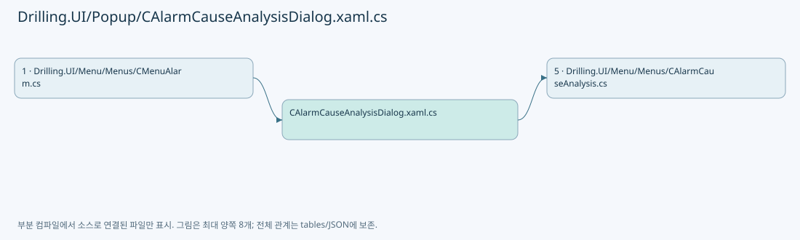
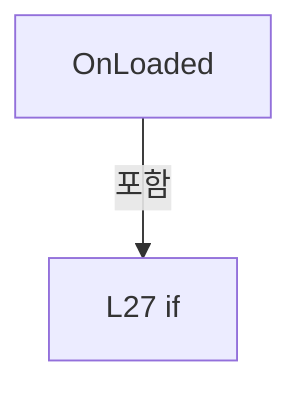
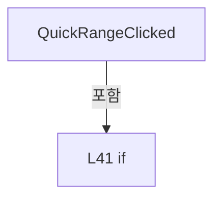
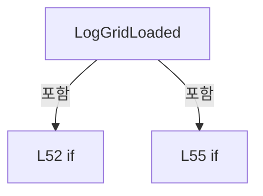
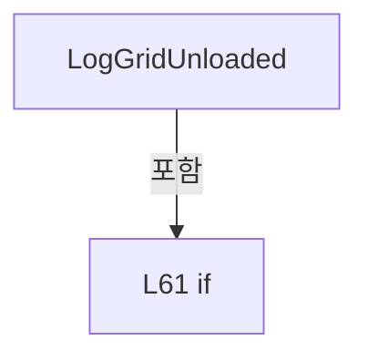
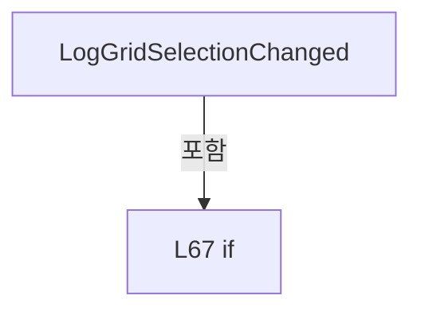
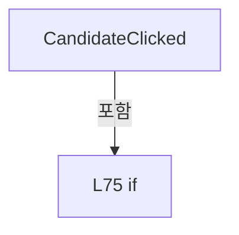
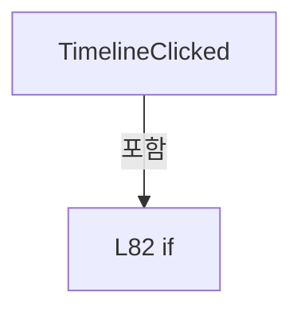
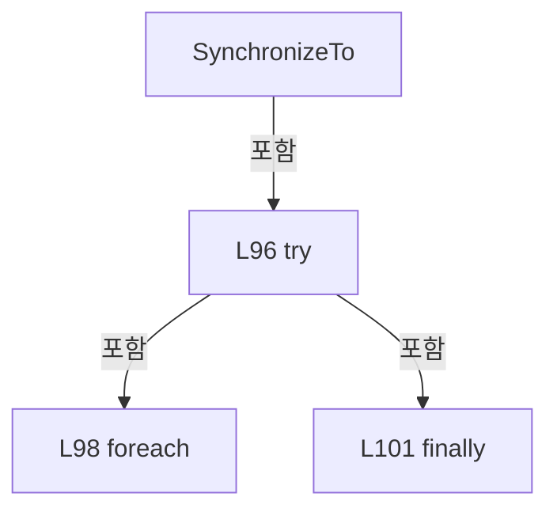
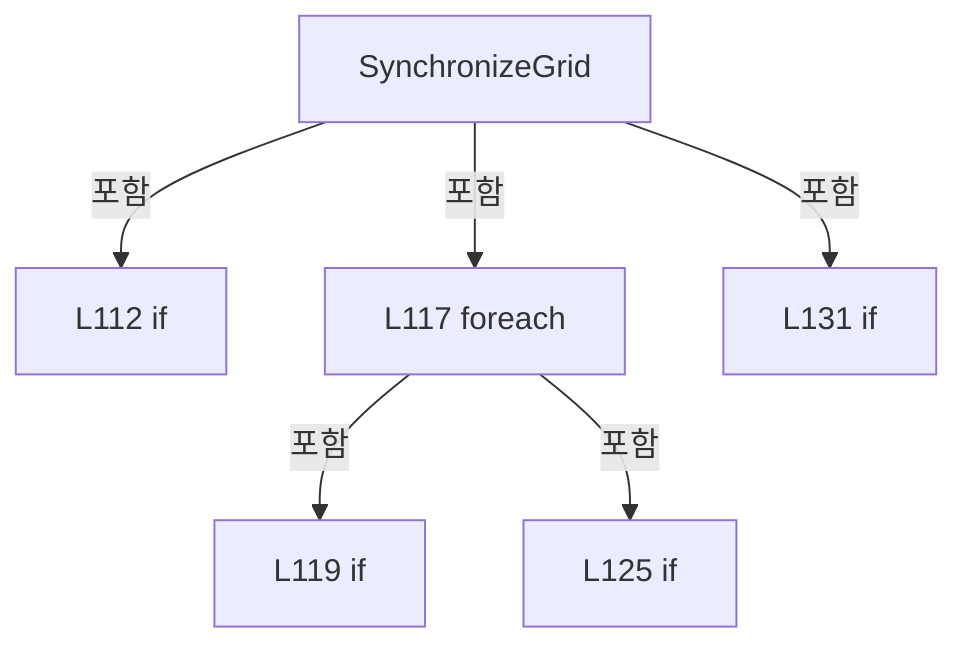

# Drilling.UI/Popup/CAlarmCauseAnalysisDialog.xaml.cs

| 항목 | 내용 |
| --- | --- |
| 원본 저장소 | https://github.com/kjuws10-rgb/A3Drilling.git |
| 원본 Commit | 96e22cd027c84bf302b23f2949b98985d7f301bb |
| 원본 SHA256 | 71a00f66738e1f87fbb411a2657b4a1c61ce145703a47e03c3a70d971511f288 |
| 파일 분류 | code |
| 원본 크기/행 | 4,458 bytes / 142 physical lines |
| 인코딩 | utf-8-sig |
| 검토 범위 | 구문/부분 의미 분석에서 추출한 사실. 동작·물리 단위·실장비 합격을 보증하지 않습니다. |
| 원본 링크 | [고정 Commit 원본](https://github.com/kjuws10-rgb/A3Drilling/blob/96e22cd027c84bf302b23f2949b98985d7f301bb/Drilling.UI/Popup/CAlarmCauseAnalysisDialog.xaml.cs) |

## 파일의 역할과 읽는 순서

WPF 화면·사용자 명령·표시 상태를 구성합니다. XAML 이벤트와 코드 비하인드, RootView의 조립 경로를 함께 추적합니다.

## 네임스페이스·타입·상속

| 타입 | 구분 | 원본 범위 | 선언/상속 |
| --- | --- | --- | --- |
| CAlarmCauseAnalysisDialog | ClassDeclaration | 8–142 | CAlarmCauseAnalysisDialog: Window |

## 멤버 빠른 목록

| 이름 | 종류 | 범위 | 서명 |
| --- | --- | --- | --- |
| _panel | FieldDeclaration | L10–10 | Drilling.UI.Menu.Menus.CAlarmCauseAnalysisPanel Drilling.UI.Popup.CAlarmCauseAnalysisDialog._panel |
| _logGrids | FieldDeclaration | L11–11 | System.Collections.Generic.HashSet<DataGrid> Drilling.UI.Popup.CAlarmCauseAnalysisDialog._logGrids |
| _loaded | FieldDeclaration | L12–12 | bool Drilling.UI.Popup.CAlarmCauseAnalysisDialog._loaded |
| _synchronizingSelection | FieldDeclaration | L13–13 | bool Drilling.UI.Popup.CAlarmCauseAnalysisDialog._synchronizingSelection |
| .ctor | ConstructorDeclaration | L15–23 | Drilling.UI.Popup.CAlarmCauseAnalysisDialog.CAlarmCauseAnalysisDialog(string, Drilling.UI.Menu.Menus.ST_ALARM_HISTORY_ROW) |
| OnLoaded | MethodDeclaration | L25–31 | void Drilling.UI.Popup.CAlarmCauseAnalysisDialog.OnLoaded(object, RoutedEventArgs) |
| OnClosed | MethodDeclaration | L33–37 | void Drilling.UI.Popup.CAlarmCauseAnalysisDialog.OnClosed(object?, System.EventArgs) |
| QuickRangeClicked | MethodDeclaration | L39–48 | void Drilling.UI.Popup.CAlarmCauseAnalysisDialog.QuickRangeClicked(object, RoutedEventArgs) |
| LogGridLoaded | MethodDeclaration | L50–57 | void Drilling.UI.Popup.CAlarmCauseAnalysisDialog.LogGridLoaded(object, RoutedEventArgs) |
| LogGridUnloaded | MethodDeclaration | L59–63 | void Drilling.UI.Popup.CAlarmCauseAnalysisDialog.LogGridUnloaded(object, RoutedEventArgs) |
| LogGridSelectionChanged | MethodDeclaration | L65–71 | void Drilling.UI.Popup.CAlarmCauseAnalysisDialog.LogGridSelectionChanged(object, SelectionChangedEventArgs) |
| CandidateClicked | MethodDeclaration | L73–78 | void Drilling.UI.Popup.CAlarmCauseAnalysisDialog.CandidateClicked(object, RoutedEventArgs) |
| TimelineClicked | MethodDeclaration | L80–85 | void Drilling.UI.Popup.CAlarmCauseAnalysisDialog.TimelineClicked(object, RoutedEventArgs) |
| AnalysisLoaded | MethodDeclaration | L87–90 | void Drilling.UI.Popup.CAlarmCauseAnalysisDialog.AnalysisLoaded(System.DateTimeOffset) |
| SynchronizeTo | MethodDeclaration | L92–105 | void Drilling.UI.Popup.CAlarmCauseAnalysisDialog.SynchronizeTo(System.DateTimeOffset, Drilling.UI.Menu.Menus.ST_ALARM_ANALYSIS_LOG_ROW?) |
| SynchronizeGrid | MethodDeclaration | L107–139 | void Drilling.UI.Popup.CAlarmCauseAnalysisDialog.SynchronizeGrid(DataGrid, System.DateTimeOffset, Drilling.UI.Menu.Menus.ST_ALARM_ANALYSIS_LOG_ROW?) |
| CloseClicked | MethodDeclaration | L141–141 | void Drilling.UI.Popup.CAlarmCauseAnalysisDialog.CloseClicked(object, RoutedEventArgs) |

## 멤버별 상세 계약·호출·처리 해설

### FieldDeclaration `_panel` · L10–10

[Drilling.UI/Popup/CAlarmCauseAnalysisDialog.xaml.cs:10–10](https://github.com/kjuws10-rgb/A3Drilling/blob/96e22cd027c84bf302b23f2949b98985d7f301bb/Drilling.UI/Popup/CAlarmCauseAnalysisDialog.xaml.cs#L10-L10)

| 항목 | 실제 추출 값 |
| --- | --- |
| 서명 | Drilling.UI.Menu.Menus.CAlarmCauseAnalysisPanel Drilling.UI.Popup.CAlarmCauseAnalysisDialog._panel |
| 접근/수식자 | Private / private, readonly |
| 반환/값 타입 | Drilling.UI.Menu.Menus.CAlarmCauseAnalysisPanel |
| 소속 타입 | NamedType:Drilling.UI.Popup.CAlarmCauseAnalysisDialog |

현재 부분 분석에서 직접 연결된 호출자는 없습니다. XAML/이벤트/인터페이스·델리게이트·외부 진입을 추가 확인해야 하며, 미사용으로 판정한 것이 아닙니다.

변경 전 점검: 입력/반환 타입, 위 호출자, 예외/취소 경로, 공유 상태와 저장·전송 소비자를 함께 확인합니다. 값의 단위나 물리 방향을 이름만으로 확정하지 않습니다.

### FieldDeclaration `_logGrids` · L11–11

[Drilling.UI/Popup/CAlarmCauseAnalysisDialog.xaml.cs:11–11](https://github.com/kjuws10-rgb/A3Drilling/blob/96e22cd027c84bf302b23f2949b98985d7f301bb/Drilling.UI/Popup/CAlarmCauseAnalysisDialog.xaml.cs#L11-L11)

| 항목 | 실제 추출 값 |
| --- | --- |
| 서명 | System.Collections.Generic.HashSet<DataGrid> Drilling.UI.Popup.CAlarmCauseAnalysisDialog._logGrids |
| 접근/수식자 | Private / private, readonly |
| 반환/값 타입 | System.Collections.Generic.HashSet<DataGrid> |
| 소속 타입 | NamedType:Drilling.UI.Popup.CAlarmCauseAnalysisDialog |

현재 부분 분석에서 직접 연결된 호출자는 없습니다. XAML/이벤트/인터페이스·델리게이트·외부 진입을 추가 확인해야 하며, 미사용으로 판정한 것이 아닙니다.

본문의 실제 연산·분기·예외·반환 순서(원문 위치 순):

| 원본 행 | 종류 | 주석 해설 |
| --- | --- | --- |
| 11 | variable-initializer | 변수의 초기값을 지정합니다: _logGrids = [] |

변경 전 점검: 입력/반환 타입, 위 호출자, 예외/취소 경로, 공유 상태와 저장·전송 소비자를 함께 확인합니다. 값의 단위나 물리 방향을 이름만으로 확정하지 않습니다.

### FieldDeclaration `_loaded` · L12–12

[Drilling.UI/Popup/CAlarmCauseAnalysisDialog.xaml.cs:12–12](https://github.com/kjuws10-rgb/A3Drilling/blob/96e22cd027c84bf302b23f2949b98985d7f301bb/Drilling.UI/Popup/CAlarmCauseAnalysisDialog.xaml.cs#L12-L12)

| 항목 | 실제 추출 값 |
| --- | --- |
| 서명 | bool Drilling.UI.Popup.CAlarmCauseAnalysisDialog._loaded |
| 접근/수식자 | Private / private |
| 반환/값 타입 | bool |
| 소속 타입 | NamedType:Drilling.UI.Popup.CAlarmCauseAnalysisDialog |

현재 부분 분석에서 직접 연결된 호출자는 없습니다. XAML/이벤트/인터페이스·델리게이트·외부 진입을 추가 확인해야 하며, 미사용으로 판정한 것이 아닙니다.

변경 전 점검: 입력/반환 타입, 위 호출자, 예외/취소 경로, 공유 상태와 저장·전송 소비자를 함께 확인합니다. 값의 단위나 물리 방향을 이름만으로 확정하지 않습니다.

### FieldDeclaration `_synchronizingSelection` · L13–13

[Drilling.UI/Popup/CAlarmCauseAnalysisDialog.xaml.cs:13–13](https://github.com/kjuws10-rgb/A3Drilling/blob/96e22cd027c84bf302b23f2949b98985d7f301bb/Drilling.UI/Popup/CAlarmCauseAnalysisDialog.xaml.cs#L13-L13)

| 항목 | 실제 추출 값 |
| --- | --- |
| 서명 | bool Drilling.UI.Popup.CAlarmCauseAnalysisDialog._synchronizingSelection |
| 접근/수식자 | Private / private |
| 반환/값 타입 | bool |
| 소속 타입 | NamedType:Drilling.UI.Popup.CAlarmCauseAnalysisDialog |

현재 부분 분석에서 직접 연결된 호출자는 없습니다. XAML/이벤트/인터페이스·델리게이트·외부 진입을 추가 확인해야 하며, 미사용으로 판정한 것이 아닙니다.

변경 전 점검: 입력/반환 타입, 위 호출자, 예외/취소 경로, 공유 상태와 저장·전송 소비자를 함께 확인합니다. 값의 단위나 물리 방향을 이름만으로 확정하지 않습니다.

### ConstructorDeclaration `.ctor` · L15–23

[Drilling.UI/Popup/CAlarmCauseAnalysisDialog.xaml.cs:15–23](https://github.com/kjuws10-rgb/A3Drilling/blob/96e22cd027c84bf302b23f2949b98985d7f301bb/Drilling.UI/Popup/CAlarmCauseAnalysisDialog.xaml.cs#L15-L23)

| 항목 | 실제 추출 값 |
| --- | --- |
| 서명 | Drilling.UI.Popup.CAlarmCauseAnalysisDialog.CAlarmCauseAnalysisDialog(string, Drilling.UI.Menu.Menus.ST_ALARM_HISTORY_ROW) |
| 접근/수식자 | Public / public |
| 반환/값 타입 | void |
| 소속 타입 | NamedType:Drilling.UI.Popup.CAlarmCauseAnalysisDialog |

입력 계약:

| 이름 | 타입 | 전달 | 선택/기본값 |
| --- | --- | --- | --- |
| logDirectory | string | None | False /  |
| alarm | Drilling.UI.Menu.Menus.ST_ALARM_HISTORY_ROW | None | False /  |

정적 호출자로 확인된 위치:

| 호출 파일/행 | 호출 표현식 | 런타임 분기 가능 |
| --- | --- | --- |
| [Drilling.UI/Menu/Menus/CMenuAlarm.cs:314–314](https://github.com/kjuws10-rgb/A3Drilling/blob/96e22cd027c84bf302b23f2949b98985d7f301bb/Drilling.UI/Menu/Menus/CMenuAlarm.cs#L314-L314) | new CAlarmCauseAnalysisDialog | False |

호출하는 대상과 해석 범위:

| 원본 행 | 표현식 | 분석 상태 | 대상/소스 위치 |
| --- | --- | --- | --- |
| 17 | InitializeComponent | unresolved | None |
| 18 | new | resolved | Drilling.UI.Menu.Menus.CAlarmCauseAnalysisPanel.CAlarmCauseAnalysisPanel(string, Drilling.UI.Menu.Menus.ST_ALARM_HISTORY_ROW) · Drilling.UI/Menu/Menus/CAlarmCauseAnalysis.cs:34 |

본문의 실제 연산·분기·예외·반환 순서(원문 위치 순):

| 원본 행 | 종류 | 주석 해설 |
| --- | --- | --- |
| 17 | call | 함수·델리게이트 또는 객체 생성자를 호출합니다: InitializeComponent() |
| 18 | assignment | 값을 대상에 대입합니다: _panel = new(logDirectory, alarm) |
| 18 | call | 함수·델리게이트 또는 객체 생성자를 호출합니다: new(logDirectory, alarm) |
| 19 | assignment | 값을 대상에 대입합니다: DataContext = _panel |
| 20 | compound-assignment-or-event-subscription | 복합 대입 또는 이벤트 구독/해지 표현입니다: _panel.AnalysisLoaded += AnalysisLoaded |
| 21 | compound-assignment-or-event-subscription | 복합 대입 또는 이벤트 구독/해지 표현입니다: Loaded += OnLoaded |
| 22 | compound-assignment-or-event-subscription | 복합 대입 또는 이벤트 구독/해지 표현입니다: Closed += OnClosed |

변경 전 점검: 입력/반환 타입, 위 호출자, 예외/취소 경로, 공유 상태와 저장·전송 소비자를 함께 확인합니다. 값의 단위나 물리 방향을 이름만으로 확정하지 않습니다.

### MethodDeclaration `OnLoaded` · L25–31

[Drilling.UI/Popup/CAlarmCauseAnalysisDialog.xaml.cs:25–31](https://github.com/kjuws10-rgb/A3Drilling/blob/96e22cd027c84bf302b23f2949b98985d7f301bb/Drilling.UI/Popup/CAlarmCauseAnalysisDialog.xaml.cs#L25-L31)

| 항목 | 실제 추출 값 |
| --- | --- |
| 서명 | void Drilling.UI.Popup.CAlarmCauseAnalysisDialog.OnLoaded(object, RoutedEventArgs) |
| 접근/수식자 | Private / private, async |
| 반환/값 타입 | void |
| 소속 타입 | NamedType:Drilling.UI.Popup.CAlarmCauseAnalysisDialog |

입력 계약:

| 이름 | 타입 | 전달 | 선택/기본값 |
| --- | --- | --- | --- |
| sender | object | None | False /  |
| e | RoutedEventArgs | None | False /  |

현재 부분 분석에서 직접 연결된 호출자는 없습니다. XAML/이벤트/인터페이스·델리게이트·외부 진입을 추가 확인해야 하며, 미사용으로 판정한 것이 아닙니다.

호출하는 대상과 해석 범위:

| 원본 행 | 표현식 | 분석 상태 | 대상/소스 위치 |
| --- | --- | --- | --- |
| 30 | _panel.LoadAsync | resolved | System.Threading.Tasks.Task Drilling.UI.Menu.Menus.CAlarmCauseAnalysisPanel.LoadAsync() · Drilling.UI/Menu/Menus/CAlarmCauseAnalysis.cs:209 |

본문의 실제 연산·분기·예외·반환 순서(원문 위치 순):

| 원본 행 | 종류 | 주석 해설 |
| --- | --- | --- |
| 27 | if | 조건에 따라 분기합니다: if (_loaded) |
| 28 | return | 호출자에게 값 또는 제어를 반환합니다: return; |
| 29 | assignment | 값을 대상에 대입합니다: _loaded = true |
| 30 | await | 비동기 완료를 기다립니다: await _panel.LoadAsync() |
| 30 | call | 함수·델리게이트 또는 객체 생성자를 호출합니다: _panel.LoadAsync() |

제어 구문의 포함 구조(실제 실행 순서/CFG가 아닌 구문 탐색 그림):

변경 전 점검: 입력/반환 타입, 위 호출자, 예외/취소 경로, 공유 상태와 저장·전송 소비자를 함께 확인합니다. 값의 단위나 물리 방향을 이름만으로 확정하지 않습니다.

### MethodDeclaration `OnClosed` · L33–37

[Drilling.UI/Popup/CAlarmCauseAnalysisDialog.xaml.cs:33–37](https://github.com/kjuws10-rgb/A3Drilling/blob/96e22cd027c84bf302b23f2949b98985d7f301bb/Drilling.UI/Popup/CAlarmCauseAnalysisDialog.xaml.cs#L33-L37)

| 항목 | 실제 추출 값 |
| --- | --- |
| 서명 | void Drilling.UI.Popup.CAlarmCauseAnalysisDialog.OnClosed(object?, System.EventArgs) |
| 접근/수식자 | Private / private |
| 반환/값 타입 | void |
| 소속 타입 | NamedType:Drilling.UI.Popup.CAlarmCauseAnalysisDialog |

입력 계약:

| 이름 | 타입 | 전달 | 선택/기본값 |
| --- | --- | --- | --- |
| sender | object? | None | False /  |
| e | System.EventArgs | None | False /  |

현재 부분 분석에서 직접 연결된 호출자는 없습니다. XAML/이벤트/인터페이스·델리게이트·외부 진입을 추가 확인해야 하며, 미사용으로 판정한 것이 아닙니다.

호출하는 대상과 해석 범위:

| 원본 행 | 표현식 | 분석 상태 | 대상/소스 위치 |
| --- | --- | --- | --- |
| 36 | _panel.Dispose | resolved | void Drilling.UI.Menu.Menus.CAlarmCauseAnalysisPanel.Dispose() · Drilling.UI/Menu/Menus/CAlarmCauseAnalysis.cs:266 |

본문의 실제 연산·분기·예외·반환 순서(원문 위치 순):

| 원본 행 | 종류 | 주석 해설 |
| --- | --- | --- |
| 35 | compound-assignment-or-event-subscription | 복합 대입 또는 이벤트 구독/해지 표현입니다: _panel.AnalysisLoaded -= AnalysisLoaded |
| 36 | call | 함수·델리게이트 또는 객체 생성자를 호출합니다: _panel.Dispose() |

변경 전 점검: 입력/반환 타입, 위 호출자, 예외/취소 경로, 공유 상태와 저장·전송 소비자를 함께 확인합니다. 값의 단위나 물리 방향을 이름만으로 확정하지 않습니다.

### MethodDeclaration `QuickRangeClicked` · L39–48

[Drilling.UI/Popup/CAlarmCauseAnalysisDialog.xaml.cs:39–48](https://github.com/kjuws10-rgb/A3Drilling/blob/96e22cd027c84bf302b23f2949b98985d7f301bb/Drilling.UI/Popup/CAlarmCauseAnalysisDialog.xaml.cs#L39-L48)

| 항목 | 실제 추출 값 |
| --- | --- |
| 서명 | void Drilling.UI.Popup.CAlarmCauseAnalysisDialog.QuickRangeClicked(object, RoutedEventArgs) |
| 접근/수식자 | Private / private, async |
| 반환/값 타입 | void |
| 소속 타입 | NamedType:Drilling.UI.Popup.CAlarmCauseAnalysisDialog |

입력 계약:

| 이름 | 타입 | 전달 | 선택/기본값 |
| --- | --- | --- | --- |
| sender | object | None | False /  |
| e | RoutedEventArgs | None | False /  |

현재 부분 분석에서 직접 연결된 호출자는 없습니다. XAML/이벤트/인터페이스·델리게이트·외부 진입을 추가 확인해야 하며, 미사용으로 판정한 것이 아닙니다.

호출하는 대상과 해석 범위:

| 원본 행 | 표현식 | 분석 상태 | 대상/소스 위치 |
| --- | --- | --- | --- |
| 42 | int.TryParse | resolved | bool int.TryParse(string?, out int) |
| 45 | rangeSeconds.ToString | resolved | string int.ToString(System.IFormatProvider?) |
| 46 | rangeSeconds.ToString | resolved | string int.ToString(System.IFormatProvider?) |
| 47 | _panel.LoadAsync | resolved | System.Threading.Tasks.Task Drilling.UI.Menu.Menus.CAlarmCauseAnalysisPanel.LoadAsync() · Drilling.UI/Menu/Menus/CAlarmCauseAnalysis.cs:209 |

본문의 실제 연산·분기·예외·반환 순서(원문 위치 순):

| 원본 행 | 종류 | 주석 해설 |
| --- | --- | --- |
| 41 | if | 조건에 따라 분기합니다: if (sender is not Button { Tag: string rangeText } &#124;&#124; !int.TryParse(rangeText, out var rangeSeconds)) |
| 42 | call | 함수·델리게이트 또는 객체 생성자를 호출합니다: int.TryParse(rangeText, out var rangeSeconds) |
| 43 | return | 호출자에게 값 또는 제어를 반환합니다: return; |
| 45 | assignment | 값을 대상에 대입합니다: _panel.BeforeSeconds = rangeSeconds.ToString(System.Globalization.CultureInfo.InvariantCulture) |
| 45 | call | 함수·델리게이트 또는 객체 생성자를 호출합니다: rangeSeconds.ToString(System.Globalization.CultureInfo.InvariantCulture) |
| 46 | assignment | 값을 대상에 대입합니다: _panel.AfterSeconds = rangeSeconds.ToString(System.Globalization.CultureInfo.InvariantCulture) |
| 46 | call | 함수·델리게이트 또는 객체 생성자를 호출합니다: rangeSeconds.ToString(System.Globalization.CultureInfo.InvariantCulture) |
| 47 | await | 비동기 완료를 기다립니다: await _panel.LoadAsync() |
| 47 | call | 함수·델리게이트 또는 객체 생성자를 호출합니다: _panel.LoadAsync() |

제어 구문의 포함 구조(실제 실행 순서/CFG가 아닌 구문 탐색 그림):

변경 전 점검: 입력/반환 타입, 위 호출자, 예외/취소 경로, 공유 상태와 저장·전송 소비자를 함께 확인합니다. 값의 단위나 물리 방향을 이름만으로 확정하지 않습니다.

### MethodDeclaration `LogGridLoaded` · L50–57

[Drilling.UI/Popup/CAlarmCauseAnalysisDialog.xaml.cs:50–57](https://github.com/kjuws10-rgb/A3Drilling/blob/96e22cd027c84bf302b23f2949b98985d7f301bb/Drilling.UI/Popup/CAlarmCauseAnalysisDialog.xaml.cs#L50-L57)

| 항목 | 실제 추출 값 |
| --- | --- |
| 서명 | void Drilling.UI.Popup.CAlarmCauseAnalysisDialog.LogGridLoaded(object, RoutedEventArgs) |
| 접근/수식자 | Private / private |
| 반환/값 타입 | void |
| 소속 타입 | NamedType:Drilling.UI.Popup.CAlarmCauseAnalysisDialog |

입력 계약:

| 이름 | 타입 | 전달 | 선택/기본값 |
| --- | --- | --- | --- |
| sender | object | None | False /  |
| e | RoutedEventArgs | None | False /  |

현재 부분 분석에서 직접 연결된 호출자는 없습니다. XAML/이벤트/인터페이스·델리게이트·외부 진입을 추가 확인해야 하며, 미사용으로 판정한 것이 아닙니다.

호출하는 대상과 해석 범위:

| 원본 행 | 표현식 | 분석 상태 | 대상/소스 위치 |
| --- | --- | --- | --- |
| 54 | _logGrids.Add | resolved | bool System.Collections.Generic.HashSet<DataGrid>.Add(DataGrid) |
| 56 | SynchronizeGrid | resolved | void Drilling.UI.Popup.CAlarmCauseAnalysisDialog.SynchronizeGrid(DataGrid, System.DateTimeOffset, Drilling.UI.Menu.Menus.ST_ALARM_ANALYSIS_LOG_ROW?) · Drilling.UI/Popup/CAlarmCauseAnalysisDialog.xaml.cs:107 |

본문의 실제 연산·분기·예외·반환 순서(원문 위치 순):

| 원본 행 | 종류 | 주석 해설 |
| --- | --- | --- |
| 52 | if | 조건에 따라 분기합니다: if (sender is not DataGrid grid) |
| 53 | return | 호출자에게 값 또는 제어를 반환합니다: return; |
| 54 | call | 함수·델리게이트 또는 객체 생성자를 호출합니다: _logGrids.Add(grid) |
| 55 | if | 조건에 따라 분기합니다: if (_panel.CursorOccurredAt is { } cursor) |
| 56 | call | 함수·델리게이트 또는 객체 생성자를 호출합니다: SynchronizeGrid(grid, cursor) |

제어 구문의 포함 구조(실제 실행 순서/CFG가 아닌 구문 탐색 그림):

변경 전 점검: 입력/반환 타입, 위 호출자, 예외/취소 경로, 공유 상태와 저장·전송 소비자를 함께 확인합니다. 값의 단위나 물리 방향을 이름만으로 확정하지 않습니다.

### MethodDeclaration `LogGridUnloaded` · L59–63

[Drilling.UI/Popup/CAlarmCauseAnalysisDialog.xaml.cs:59–63](https://github.com/kjuws10-rgb/A3Drilling/blob/96e22cd027c84bf302b23f2949b98985d7f301bb/Drilling.UI/Popup/CAlarmCauseAnalysisDialog.xaml.cs#L59-L63)

| 항목 | 실제 추출 값 |
| --- | --- |
| 서명 | void Drilling.UI.Popup.CAlarmCauseAnalysisDialog.LogGridUnloaded(object, RoutedEventArgs) |
| 접근/수식자 | Private / private |
| 반환/값 타입 | void |
| 소속 타입 | NamedType:Drilling.UI.Popup.CAlarmCauseAnalysisDialog |

입력 계약:

| 이름 | 타입 | 전달 | 선택/기본값 |
| --- | --- | --- | --- |
| sender | object | None | False /  |
| e | RoutedEventArgs | None | False /  |

현재 부분 분석에서 직접 연결된 호출자는 없습니다. XAML/이벤트/인터페이스·델리게이트·외부 진입을 추가 확인해야 하며, 미사용으로 판정한 것이 아닙니다.

호출하는 대상과 해석 범위:

| 원본 행 | 표현식 | 분석 상태 | 대상/소스 위치 |
| --- | --- | --- | --- |
| 62 | _logGrids.Remove | resolved | bool System.Collections.Generic.HashSet<DataGrid>.Remove(DataGrid) |

본문의 실제 연산·분기·예외·반환 순서(원문 위치 순):

| 원본 행 | 종류 | 주석 해설 |
| --- | --- | --- |
| 61 | if | 조건에 따라 분기합니다: if (sender is DataGrid grid) |
| 62 | call | 함수·델리게이트 또는 객체 생성자를 호출합니다: _logGrids.Remove(grid) |

제어 구문의 포함 구조(실제 실행 순서/CFG가 아닌 구문 탐색 그림):

변경 전 점검: 입력/반환 타입, 위 호출자, 예외/취소 경로, 공유 상태와 저장·전송 소비자를 함께 확인합니다. 값의 단위나 물리 방향을 이름만으로 확정하지 않습니다.

### MethodDeclaration `LogGridSelectionChanged` · L65–71

[Drilling.UI/Popup/CAlarmCauseAnalysisDialog.xaml.cs:65–71](https://github.com/kjuws10-rgb/A3Drilling/blob/96e22cd027c84bf302b23f2949b98985d7f301bb/Drilling.UI/Popup/CAlarmCauseAnalysisDialog.xaml.cs#L65-L71)

| 항목 | 실제 추출 값 |
| --- | --- |
| 서명 | void Drilling.UI.Popup.CAlarmCauseAnalysisDialog.LogGridSelectionChanged(object, SelectionChangedEventArgs) |
| 접근/수식자 | Private / private |
| 반환/값 타입 | void |
| 소속 타입 | NamedType:Drilling.UI.Popup.CAlarmCauseAnalysisDialog |

입력 계약:

| 이름 | 타입 | 전달 | 선택/기본값 |
| --- | --- | --- | --- |
| sender | object | None | False /  |
| e | SelectionChangedEventArgs | None | False /  |

현재 부분 분석에서 직접 연결된 호출자는 없습니다. XAML/이벤트/인터페이스·델리게이트·외부 진입을 추가 확인해야 하며, 미사용으로 판정한 것이 아닙니다.

호출하는 대상과 해석 범위:

| 원본 행 | 표현식 | 분석 상태 | 대상/소스 위치 |
| --- | --- | --- | --- |
| 70 | SynchronizeTo | resolved | void Drilling.UI.Popup.CAlarmCauseAnalysisDialog.SynchronizeTo(System.DateTimeOffset, Drilling.UI.Menu.Menus.ST_ALARM_ANALYSIS_LOG_ROW?) · Drilling.UI/Popup/CAlarmCauseAnalysisDialog.xaml.cs:92 |

본문의 실제 연산·분기·예외·반환 순서(원문 위치 순):

| 원본 행 | 종류 | 주석 해설 |
| --- | --- | --- |
| 67 | if | 조건에 따라 분기합니다: if (_synchronizingSelection &#124;&#124; sender is not DataGrid { SelectedItem: ST_ALARM_ANALYSIS_LOG_ROW row }) |
| 69 | return | 호출자에게 값 또는 제어를 반환합니다: return; |
| 70 | call | 함수·델리게이트 또는 객체 생성자를 호출합니다: SynchronizeTo(row.OccurredAt) |

제어 구문의 포함 구조(실제 실행 순서/CFG가 아닌 구문 탐색 그림):

변경 전 점검: 입력/반환 타입, 위 호출자, 예외/취소 경로, 공유 상태와 저장·전송 소비자를 함께 확인합니다. 값의 단위나 물리 방향을 이름만으로 확정하지 않습니다.

### MethodDeclaration `CandidateClicked` · L73–78

[Drilling.UI/Popup/CAlarmCauseAnalysisDialog.xaml.cs:73–78](https://github.com/kjuws10-rgb/A3Drilling/blob/96e22cd027c84bf302b23f2949b98985d7f301bb/Drilling.UI/Popup/CAlarmCauseAnalysisDialog.xaml.cs#L73-L78)

| 항목 | 실제 추출 값 |
| --- | --- |
| 서명 | void Drilling.UI.Popup.CAlarmCauseAnalysisDialog.CandidateClicked(object, RoutedEventArgs) |
| 접근/수식자 | Private / private |
| 반환/값 타입 | void |
| 소속 타입 | NamedType:Drilling.UI.Popup.CAlarmCauseAnalysisDialog |

입력 계약:

| 이름 | 타입 | 전달 | 선택/기본값 |
| --- | --- | --- | --- |
| sender | object | None | False /  |
| e | RoutedEventArgs | None | False /  |

현재 부분 분석에서 직접 연결된 호출자는 없습니다. XAML/이벤트/인터페이스·델리게이트·외부 진입을 추가 확인해야 하며, 미사용으로 판정한 것이 아닙니다.

호출하는 대상과 해석 범위:

| 원본 행 | 표현식 | 분석 상태 | 대상/소스 위치 |
| --- | --- | --- | --- |
| 77 | SynchronizeTo | resolved | void Drilling.UI.Popup.CAlarmCauseAnalysisDialog.SynchronizeTo(System.DateTimeOffset, Drilling.UI.Menu.Menus.ST_ALARM_ANALYSIS_LOG_ROW?) · Drilling.UI/Popup/CAlarmCauseAnalysisDialog.xaml.cs:92 |

본문의 실제 연산·분기·예외·반환 순서(원문 위치 순):

| 원본 행 | 종류 | 주석 해설 |
| --- | --- | --- |
| 75 | if | 조건에 따라 분기합니다: if (sender is not Button { DataContext: ST_ALARM_CAUSE_CANDIDATE candidate }) |
| 76 | return | 호출자에게 값 또는 제어를 반환합니다: return; |
| 77 | call | 함수·델리게이트 또는 객체 생성자를 호출합니다: SynchronizeTo(candidate.Evidence.OccurredAt, candidate.Evidence) |

제어 구문의 포함 구조(실제 실행 순서/CFG가 아닌 구문 탐색 그림):

변경 전 점검: 입력/반환 타입, 위 호출자, 예외/취소 경로, 공유 상태와 저장·전송 소비자를 함께 확인합니다. 값의 단위나 물리 방향을 이름만으로 확정하지 않습니다.

### MethodDeclaration `TimelineClicked` · L80–85

[Drilling.UI/Popup/CAlarmCauseAnalysisDialog.xaml.cs:80–85](https://github.com/kjuws10-rgb/A3Drilling/blob/96e22cd027c84bf302b23f2949b98985d7f301bb/Drilling.UI/Popup/CAlarmCauseAnalysisDialog.xaml.cs#L80-L85)

| 항목 | 실제 추출 값 |
| --- | --- |
| 서명 | void Drilling.UI.Popup.CAlarmCauseAnalysisDialog.TimelineClicked(object, RoutedEventArgs) |
| 접근/수식자 | Private / private |
| 반환/값 타입 | void |
| 소속 타입 | NamedType:Drilling.UI.Popup.CAlarmCauseAnalysisDialog |

입력 계약:

| 이름 | 타입 | 전달 | 선택/기본값 |
| --- | --- | --- | --- |
| sender | object | None | False /  |
| e | RoutedEventArgs | None | False /  |

현재 부분 분석에서 직접 연결된 호출자는 없습니다. XAML/이벤트/인터페이스·델리게이트·외부 진입을 추가 확인해야 하며, 미사용으로 판정한 것이 아닙니다.

호출하는 대상과 해석 범위:

| 원본 행 | 표현식 | 분석 상태 | 대상/소스 위치 |
| --- | --- | --- | --- |
| 84 | SynchronizeTo | resolved | void Drilling.UI.Popup.CAlarmCauseAnalysisDialog.SynchronizeTo(System.DateTimeOffset, Drilling.UI.Menu.Menus.ST_ALARM_ANALYSIS_LOG_ROW?) · Drilling.UI/Popup/CAlarmCauseAnalysisDialog.xaml.cs:92 |

본문의 실제 연산·분기·예외·반환 순서(원문 위치 순):

| 원본 행 | 종류 | 주석 해설 |
| --- | --- | --- |
| 82 | if | 조건에 따라 분기합니다: if (sender is not Button { DataContext: ST_ALARM_TIMELINE_ITEM item }) |
| 83 | return | 호출자에게 값 또는 제어를 반환합니다: return; |
| 84 | call | 함수·델리게이트 또는 객체 생성자를 호출합니다: SynchronizeTo(item.OccurredAt, item.Evidence) |

제어 구문의 포함 구조(실제 실행 순서/CFG가 아닌 구문 탐색 그림):

변경 전 점검: 입력/반환 타입, 위 호출자, 예외/취소 경로, 공유 상태와 저장·전송 소비자를 함께 확인합니다. 값의 단위나 물리 방향을 이름만으로 확정하지 않습니다.

### MethodDeclaration `AnalysisLoaded` · L87–90

[Drilling.UI/Popup/CAlarmCauseAnalysisDialog.xaml.cs:87–90](https://github.com/kjuws10-rgb/A3Drilling/blob/96e22cd027c84bf302b23f2949b98985d7f301bb/Drilling.UI/Popup/CAlarmCauseAnalysisDialog.xaml.cs#L87-L90)

| 항목 | 실제 추출 값 |
| --- | --- |
| 서명 | void Drilling.UI.Popup.CAlarmCauseAnalysisDialog.AnalysisLoaded(System.DateTimeOffset) |
| 접근/수식자 | Private / private |
| 반환/값 타입 | void |
| 소속 타입 | NamedType:Drilling.UI.Popup.CAlarmCauseAnalysisDialog |

입력 계약:

| 이름 | 타입 | 전달 | 선택/기본값 |
| --- | --- | --- | --- |
| alarmTime | System.DateTimeOffset | None | False /  |

현재 부분 분석에서 직접 연결된 호출자는 없습니다. XAML/이벤트/인터페이스·델리게이트·외부 진입을 추가 확인해야 하며, 미사용으로 판정한 것이 아닙니다.

호출하는 대상과 해석 범위:

| 원본 행 | 표현식 | 분석 상태 | 대상/소스 위치 |
| --- | --- | --- | --- |
| 89 | Dispatcher.BeginInvoke | unresolved | None |
| 89 | SynchronizeTo | resolved | void Drilling.UI.Popup.CAlarmCauseAnalysisDialog.SynchronizeTo(System.DateTimeOffset, Drilling.UI.Menu.Menus.ST_ALARM_ANALYSIS_LOG_ROW?) · Drilling.UI/Popup/CAlarmCauseAnalysisDialog.xaml.cs:92 |

본문의 실제 연산·분기·예외·반환 순서(원문 위치 순):

| 원본 행 | 종류 | 주석 해설 |
| --- | --- | --- |
| 89 | call | 함수·델리게이트 또는 객체 생성자를 호출합니다: Dispatcher.BeginInvoke(() => SynchronizeTo(alarmTime), DispatcherPriority.Loaded) |
| 89 | call | 함수·델리게이트 또는 객체 생성자를 호출합니다: SynchronizeTo(alarmTime) |

변경 전 점검: 입력/반환 타입, 위 호출자, 예외/취소 경로, 공유 상태와 저장·전송 소비자를 함께 확인합니다. 값의 단위나 물리 방향을 이름만으로 확정하지 않습니다.

### MethodDeclaration `SynchronizeTo` · L92–105

[Drilling.UI/Popup/CAlarmCauseAnalysisDialog.xaml.cs:92–105](https://github.com/kjuws10-rgb/A3Drilling/blob/96e22cd027c84bf302b23f2949b98985d7f301bb/Drilling.UI/Popup/CAlarmCauseAnalysisDialog.xaml.cs#L92-L105)

| 항목 | 실제 추출 값 |
| --- | --- |
| 서명 | void Drilling.UI.Popup.CAlarmCauseAnalysisDialog.SynchronizeTo(System.DateTimeOffset, Drilling.UI.Menu.Menus.ST_ALARM_ANALYSIS_LOG_ROW?) |
| 접근/수식자 | Private / private |
| 반환/값 타입 | void |
| 소속 타입 | NamedType:Drilling.UI.Popup.CAlarmCauseAnalysisDialog |

입력 계약:

| 이름 | 타입 | 전달 | 선택/기본값 |
| --- | --- | --- | --- |
| cursor | System.DateTimeOffset | None | False /  |
| preferredRow | Drilling.UI.Menu.Menus.ST_ALARM_ANALYSIS_LOG_ROW? | None | True / null |

정적 호출자로 확인된 위치:

| 호출 파일/행 | 호출 표현식 | 런타임 분기 가능 |
| --- | --- | --- |
| [Drilling.UI/Popup/CAlarmCauseAnalysisDialog.xaml.cs:70–70](https://github.com/kjuws10-rgb/A3Drilling/blob/96e22cd027c84bf302b23f2949b98985d7f301bb/Drilling.UI/Popup/CAlarmCauseAnalysisDialog.xaml.cs#L70-L70) | SynchronizeTo | False |
| [Drilling.UI/Popup/CAlarmCauseAnalysisDialog.xaml.cs:77–77](https://github.com/kjuws10-rgb/A3Drilling/blob/96e22cd027c84bf302b23f2949b98985d7f301bb/Drilling.UI/Popup/CAlarmCauseAnalysisDialog.xaml.cs#L77-L77) | SynchronizeTo | False |
| [Drilling.UI/Popup/CAlarmCauseAnalysisDialog.xaml.cs:84–84](https://github.com/kjuws10-rgb/A3Drilling/blob/96e22cd027c84bf302b23f2949b98985d7f301bb/Drilling.UI/Popup/CAlarmCauseAnalysisDialog.xaml.cs#L84-L84) | SynchronizeTo | False |
| [Drilling.UI/Popup/CAlarmCauseAnalysisDialog.xaml.cs:89–89](https://github.com/kjuws10-rgb/A3Drilling/blob/96e22cd027c84bf302b23f2949b98985d7f301bb/Drilling.UI/Popup/CAlarmCauseAnalysisDialog.xaml.cs#L89-L89) | SynchronizeTo | False |

호출하는 대상과 해석 범위:

| 원본 행 | 표현식 | 분석 상태 | 대상/소스 위치 |
| --- | --- | --- | --- |
| 94 | _panel.SetCursor | resolved | void Drilling.UI.Menu.Menus.CAlarmCauseAnalysisPanel.SetCursor(System.DateTimeOffset) · Drilling.UI/Menu/Menus/CAlarmCauseAnalysis.cs:273 |
| 98 | _logGrids.ToArray | resolved | DataGrid[] System.Collections.Generic.IEnumerable<DataGrid>.ToArray<DataGrid>() |
| 99 | SynchronizeGrid | resolved | void Drilling.UI.Popup.CAlarmCauseAnalysisDialog.SynchronizeGrid(DataGrid, System.DateTimeOffset, Drilling.UI.Menu.Menus.ST_ALARM_ANALYSIS_LOG_ROW?) · Drilling.UI/Popup/CAlarmCauseAnalysisDialog.xaml.cs:107 |

본문의 실제 연산·분기·예외·반환 순서(원문 위치 순):

| 원본 행 | 종류 | 주석 해설 |
| --- | --- | --- |
| 94 | call | 함수·델리게이트 또는 객체 생성자를 호출합니다: _panel.SetCursor(cursor) |
| 95 | assignment | 값을 대상에 대입합니다: _synchronizingSelection = true |
| 96 | try | 예외 처리 범위입니다: try |
| 98 | call | 함수·델리게이트 또는 객체 생성자를 호출합니다: _logGrids.ToArray() |
| 98 | foreach | 컬렉션 요소를 순회합니다: foreach (var grid in _logGrids.ToArray()) |
| 99 | call | 함수·델리게이트 또는 객체 생성자를 호출합니다: SynchronizeGrid(grid, cursor, preferredRow) |
| 101 | finally | 종료 정리 구간입니다: finally |
| 103 | assignment | 값을 대상에 대입합니다: _synchronizingSelection = false |

제어 구문의 포함 구조(실제 실행 순서/CFG가 아닌 구문 탐색 그림):

변경 전 점검: 입력/반환 타입, 위 호출자, 예외/취소 경로, 공유 상태와 저장·전송 소비자를 함께 확인합니다. 값의 단위나 물리 방향을 이름만으로 확정하지 않습니다.

### MethodDeclaration `SynchronizeGrid` · L107–139

[Drilling.UI/Popup/CAlarmCauseAnalysisDialog.xaml.cs:107–139](https://github.com/kjuws10-rgb/A3Drilling/blob/96e22cd027c84bf302b23f2949b98985d7f301bb/Drilling.UI/Popup/CAlarmCauseAnalysisDialog.xaml.cs#L107-L139)

| 항목 | 실제 추출 값 |
| --- | --- |
| 서명 | void Drilling.UI.Popup.CAlarmCauseAnalysisDialog.SynchronizeGrid(DataGrid, System.DateTimeOffset, Drilling.UI.Menu.Menus.ST_ALARM_ANALYSIS_LOG_ROW?) |
| 접근/수식자 | Private / private, static |
| 반환/값 타입 | void |
| 소속 타입 | NamedType:Drilling.UI.Popup.CAlarmCauseAnalysisDialog |

입력 계약:

| 이름 | 타입 | 전달 | 선택/기본값 |
| --- | --- | --- | --- |
| grid | DataGrid | None | False /  |
| cursor | System.DateTimeOffset | None | False /  |
| preferredRow | Drilling.UI.Menu.Menus.ST_ALARM_ANALYSIS_LOG_ROW? | None | True / null |

정적 호출자로 확인된 위치:

| 호출 파일/행 | 호출 표현식 | 런타임 분기 가능 |
| --- | --- | --- |
| [Drilling.UI/Popup/CAlarmCauseAnalysisDialog.xaml.cs:56–56](https://github.com/kjuws10-rgb/A3Drilling/blob/96e22cd027c84bf302b23f2949b98985d7f301bb/Drilling.UI/Popup/CAlarmCauseAnalysisDialog.xaml.cs#L56-L56) | SynchronizeGrid | False |
| [Drilling.UI/Popup/CAlarmCauseAnalysisDialog.xaml.cs:99–99](https://github.com/kjuws10-rgb/A3Drilling/blob/96e22cd027c84bf302b23f2949b98985d7f301bb/Drilling.UI/Popup/CAlarmCauseAnalysisDialog.xaml.cs#L99-L99) | SynchronizeGrid | False |

호출하는 대상과 해석 범위:

| 원본 행 | 표현식 | 분석 상태 | 대상/소스 위치 |
| --- | --- | --- | --- |
| 119 | ReferenceEquals | resolved | bool object.ReferenceEquals(object?, object?) |
| 124 | Math.Abs | resolved | double System.Math.Abs(double) |
| 138 | grid.ScrollIntoView | unresolved | None |

본문의 실제 연산·분기·예외·반환 순서(원문 위치 순):

| 원본 행 | 종류 | 주석 해설 |
| --- | --- | --- |
| 112 | if | 조건에 따라 분기합니다: if (grid.ItemsSource is not IEnumerable<ST_ALARM_ANALYSIS_LOG_ROW> rows) |
| 113 | return | 호출자에게 값 또는 제어를 반환합니다: return; |
| 115 | local-declaration | 지역 변수를 선언합니다: ST_ALARM_ANALYSIS_LOG_ROW? nearest = null; |
| 115 | variable-initializer | 변수의 초기값을 지정합니다: nearest = null |
| 116 | local-declaration | 지역 변수를 선언합니다: var nearestDistance = double.MaxValue; |
| 116 | variable-initializer | 변수의 초기값을 지정합니다: nearestDistance = double.MaxValue |
| 117 | foreach | 컬렉션 요소를 순회합니다: foreach (var row in rows) |
| 119 | call | 함수·델리게이트 또는 객체 생성자를 호출합니다: ReferenceEquals(row, preferredRow) |
| 119 | if | 조건에 따라 분기합니다: if (preferredRow is not null && ReferenceEquals(row, preferredRow)) |
| 121 | assignment | 값을 대상에 대입합니다: nearest = row |
| 122 | break | 해당 반복/분기 구간을 종료합니다: break; |
| 124 | call | 함수·델리게이트 또는 객체 생성자를 호출합니다: Math.Abs((row.OccurredAt - cursor).TotalMilliseconds) |
| 124 | local-declaration | 지역 변수를 선언합니다: var distance = Math.Abs((row.OccurredAt - cursor).TotalMilliseconds); |
| 124 | variable-initializer | 변수의 초기값을 지정합니다: distance = Math.Abs((row.OccurredAt - cursor).TotalMilliseconds) |
| 125 | if | 조건에 따라 분기합니다: if (distance >= nearestDistance) |
| 126 | continue | 다음 반복으로 진행합니다: continue; |
| 127 | assignment | 값을 대상에 대입합니다: nearest = row |
| 128 | assignment | 값을 대상에 대입합니다: nearestDistance = distance |
| 131 | if | 조건에 따라 분기합니다: if (nearest is null) |
| 133 | assignment | 값을 대상에 대입합니다: grid.SelectedItem = null |
| 134 | return | 호출자에게 값 또는 제어를 반환합니다: return; |
| 137 | assignment | 값을 대상에 대입합니다: grid.SelectedItem = nearest |
| 138 | call | 함수·델리게이트 또는 객체 생성자를 호출합니다: grid.ScrollIntoView(nearest) |

제어 구문의 포함 구조(실제 실행 순서/CFG가 아닌 구문 탐색 그림):

변경 전 점검: 입력/반환 타입, 위 호출자, 예외/취소 경로, 공유 상태와 저장·전송 소비자를 함께 확인합니다. 값의 단위나 물리 방향을 이름만으로 확정하지 않습니다.

### MethodDeclaration `CloseClicked` · L141–141

[Drilling.UI/Popup/CAlarmCauseAnalysisDialog.xaml.cs:141–141](https://github.com/kjuws10-rgb/A3Drilling/blob/96e22cd027c84bf302b23f2949b98985d7f301bb/Drilling.UI/Popup/CAlarmCauseAnalysisDialog.xaml.cs#L141-L141)

| 항목 | 실제 추출 값 |
| --- | --- |
| 서명 | void Drilling.UI.Popup.CAlarmCauseAnalysisDialog.CloseClicked(object, RoutedEventArgs) |
| 접근/수식자 | Private / private |
| 반환/값 타입 | void |
| 소속 타입 | NamedType:Drilling.UI.Popup.CAlarmCauseAnalysisDialog |

입력 계약:

| 이름 | 타입 | 전달 | 선택/기본값 |
| --- | --- | --- | --- |
| sender | object | None | False /  |
| e | RoutedEventArgs | None | False /  |

현재 부분 분석에서 직접 연결된 호출자는 없습니다. XAML/이벤트/인터페이스·델리게이트·외부 진입을 추가 확인해야 하며, 미사용으로 판정한 것이 아닙니다.

호출하는 대상과 해석 범위:

| 원본 행 | 표현식 | 분석 상태 | 대상/소스 위치 |
| --- | --- | --- | --- |
| 141 | Close | unresolved | None |

본문의 실제 연산·분기·예외·반환 순서(원문 위치 순):

| 원본 행 | 종류 | 주석 해설 |
| --- | --- | --- |
| 141 | call | 함수·델리게이트 또는 객체 생성자를 호출합니다: Close() |

변경 전 점검: 입력/반환 타입, 위 호출자, 예외/취소 경로, 공유 상태와 저장·전송 소비자를 함께 확인합니다. 값의 단위나 물리 방향을 이름만으로 확정하지 않습니다.

## 구문·바인딩 한계

전체 WPF/벤더 SDK/프로젝트별 빌드 조건을 로드한 정식 빌드가 아닙니다. `resolved`는 이 부분 컴파일에서의 심볼 연결이며 virtual/interface/delegate/이벤트/Reflection/XAML의 실제 런타임 구현을 확정하지 않습니다. `candidate`와 `unresolved`는 후속 확인 대상으로 남깁니다.

## 원문 전체 주석 해설본

[원본 모든 행과 행별 해설 보기](../../../annotated/Drilling.UI/Popup/CAlarmCauseAnalysisDialog.xaml.cs.annotated.txt)

원본을 빠뜨리거나 임의로 줄이지 않았습니다. `L000001 |` 표시는 원본 행 번호, `// 해설`은 별도 설명입니다. 실행용 소스가 아닌 문서입니다.

## 수정·재검증 체크

- 원본 Commit과 현재 작업 파일 SHA가 같은지 먼저 확인합니다. 다르면 이 문서를 과거 버전 자료로 취급합니다.
- 선언·직접 호출·이벤트/인터페이스 경계·설정 소비를 함께 확인합니다. 정적 연결의 빈 곳을 정상 경로로 추정하지 않습니다.
- 저장 형식/단위/식별자·재시도·취소·예외·롤백에 영향을 주는 변경은 상세 해설장과 호출자를 다시 검토합니다.
- 도구의 구문 추출과 별도 정적 추적 해설, 실제 빌드·시뮬레이션·실장비 검증 결과를 분리합니다.
