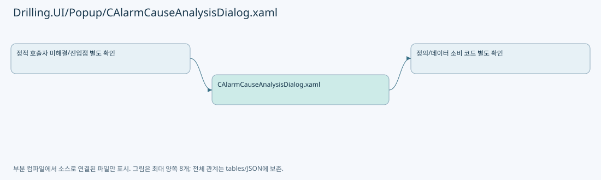

# Drilling.UI/Popup/CAlarmCauseAnalysisDialog.xaml

| 항목 | 내용 |
| --- | --- |
| 원본 저장소 | https://github.com/kjuws10-rgb/A3Drilling.git |
| 원본 Commit | dfa5920e6301d9ec4b0eab1452ae59521aafc986 |
| 원본 SHA256 | 918e769f0c8073fe41738a8fc8a19382c84d159a8e538e22791df2048c7d5bb1 |
| 파일 분류 | code |
| 원본 크기/행 | 29,079 bytes / 413 physical lines |
| 인코딩 | utf-8-sig |
| 검토 범위 | 구문/부분 의미 분석에서 추출한 사실. 동작·물리 단위·실장비 합격을 보증하지 않습니다. |
| 원본 링크 | [고정 Commit 원본](https://github.com/kjuws10-rgb/A3Drilling/blob/dfa5920e6301d9ec4b0eab1452ae59521aafc986/Drilling.UI/Popup/CAlarmCauseAnalysisDialog.xaml) |

## 파일의 역할과 읽는 순서

WPF 화면·사용자 명령·표시 상태를 구성합니다. XAML 이벤트와 코드 비하인드, RootView의 조립 경로를 함께 추적합니다.

## 화면 구성과 코드 비하인드 연결

| 항목 | 추출 값 |
| --- | --- |
| 코드 비하인드 후보 | Drilling.UI/Popup/CAlarmCauseAnalysisDialog.xaml.cs |
| 이름 있는 요소 |  |
| 이벤트 개수 | 10 |
| Binding 표현 개수 | 57 |

이름 있는 요소는 WPF가 필드를 생성할 수 있는 XAML 선언입니다. 문서 추출기는 WPF 생성 코드를 만들거나 로드하지 않으므로 C# 원문 멤버 수에 합산하지 않습니다.

| 요소 이름 | 원본 범위 |
| --- | --- |

| 이벤트 | 핸들러 이름 | 원본 범위 | 해석 |
| --- | --- | --- | --- |
| Click | QuickRangeClicked | L147–147 | 코드 비하인드/이벤트 라우팅에서 실제 연결 확인 필요 |
| Click | QuickRangeClicked | L149–149 | 코드 비하인드/이벤트 라우팅에서 실제 연결 확인 필요 |
| Click | QuickRangeClicked | L151–151 | 코드 비하인드/이벤트 라우팅에서 실제 연결 확인 필요 |
| Click | QuickRangeClicked | L153–153 | 코드 비하인드/이벤트 라우팅에서 실제 연결 확인 필요 |
| Click | CandidateClicked | L233–233 | 코드 비하인드/이벤트 라우팅에서 실제 연결 확인 필요 |
| Click | TimelineClicked | L291–291 | 코드 비하인드/이벤트 라우팅에서 실제 연결 확인 필요 |
| Loaded | LogGridLoaded | L384–384 | 코드 비하인드/이벤트 라우팅에서 실제 연결 확인 필요 |
| Unloaded | LogGridUnloaded | L384–384 | 코드 비하인드/이벤트 라우팅에서 실제 연결 확인 필요 |
| SelectionChanged | LogGridSelectionChanged | L384–384 | 코드 비하인드/이벤트 라우팅에서 실제 연결 확인 필요 |
| Click | CloseClicked | L409–409 | 코드 비하인드/이벤트 라우팅에서 실제 연결 확인 필요 |

| Binding 표현 | 원본 범위 |
| --- | --- |
| {Binding IsBaselineDifference} | L32–32 |
| {Binding IsImportant} | L35–35 |
| {Binding IsAlarmMoment} | L38–38 |
| {Binding Text, RelativeSource={RelativeSource Self}} | L55–55 |
| {Binding Message} | L58–58 |
| {Binding Message} | L62–62 |
| {Binding IsAlarm} | L96–96 |
| {Binding AlarmHeading} | L121–121 |
| {Binding AlarmCause} | L122–122 |
| {Binding AlarmTime} | L126–126 |
| {Binding BeforeSeconds, UpdateSourceTrigger=PropertyChanged} | L135–135 |
| {Binding CanEdit} | L136–136 |
| {Binding AfterSeconds, UpdateSourceTrigger=PropertyChanged} | L138–138 |
| {Binding CanEdit} | L139–139 |
| {Binding LoadCommand} | L140–140 |
| {Binding Interval} | L144–144 |
| {Binding CanEdit} | L148–148 |
| {Binding CanEdit} | L150–150 |
| {Binding CanEdit} | L152–152 |
| {Binding CanEdit} | L154–154 |
| {Binding ShowStateChangesOnly, Mode=TwoWay} | L157–157 |
| {Binding CanEdit} | L158–158 |
| {Binding CompareWithReference, Mode=TwoWay} | L159–159 |
| {Binding HasReference} | L160–160 |
| {Binding ReferenceSummary} | L162–162 |
| {Binding ReferenceSummary} | L164–164 |
| {Binding FailureSummary.Source, StringFormat=SOURCE · {0}} | L179–179 |
| {Binding FailureSummary.LeadTime, StringFormat=LEAD · {0}} | L181–181 |
| {Binding FailureSummary.Title} | L186–186 |
| {Binding FailureSummary.Category} | L188–188 |
| {Binding FailureSummary.Items} | L192–192 |
| {Binding Label} | L200–200 |
| {Binding Value} | L202–202 |
| {Binding Value} | L203–203 |
| {Binding FailureSummary.Detail} | L209–209 |
| {Binding FailureSummary.Detail} | L210–210 |
| {Binding Candidates} | L227–227 |
| {Binding RankLabel} | L243–243 |
| {Binding Title} | L245–245 |
| {Binding Reason} | L248–248 |
| {Binding Candidates.Count} | L263–263 |
| {Binding Timeline} | L285–285 |
| {Binding FullMessage} | L295–295 |
| {Binding Source} | L305–305 |
| {Binding OffsetText} | L307–307 |
| {Binding Summary} | L310–310 |
| {Binding Timeline.Count} | L324–324 |
| {Binding CursorTime} | L354–354 |
| {Binding IsBusy} | L361–361 |
| {Binding Panes} | L367–367 |
| {Binding Summary} | L378–378 |
| {Binding Title} | L380–380 |
| {Binding Rows} | L383–383 |
| {Binding Time} | L386–386 |
| {Binding Source} | L387–387 |
| {Binding Rows.Count} | L397–397 |
| {Binding Status} | L410–410 |

## 원문 전체 주석 해설본

[원본 모든 행과 행별 해설 보기](../../../annotated/Drilling.UI/Popup/CAlarmCauseAnalysisDialog.xaml.annotated.txt)

원본을 빠뜨리거나 임의로 줄이지 않았습니다. `L000001 |` 표시는 원본 행 번호, `// 해설`은 별도 설명입니다. 실행용 소스가 아닌 문서입니다.

## 수정·재검증 체크

- 원본 Commit과 현재 작업 파일 SHA가 같은지 먼저 확인합니다. 다르면 이 문서를 과거 버전 자료로 취급합니다.
- 선언·직접 호출·이벤트/인터페이스 경계·설정 소비를 함께 확인합니다. 정적 연결의 빈 곳을 정상 경로로 추정하지 않습니다.
- 저장 형식/단위/식별자·재시도·취소·예외·롤백에 영향을 주는 변경은 상세 해설장과 호출자를 다시 검토합니다.
- 도구의 구문 추출과 별도 정적 추적 해설, 실제 빌드·시뮬레이션·실장비 검증 결과를 분리합니다.
