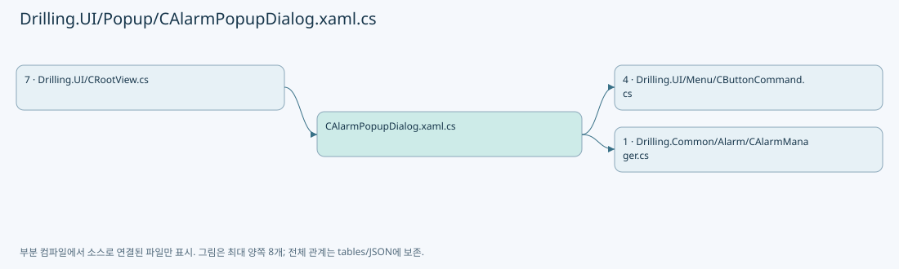
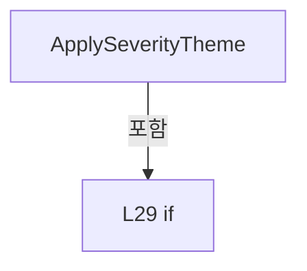
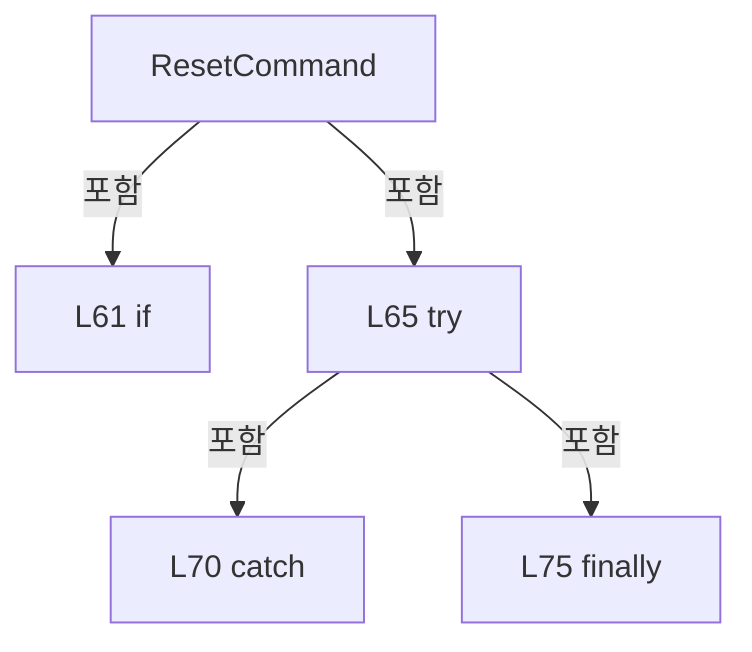
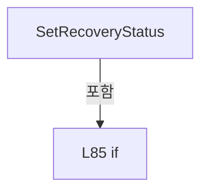
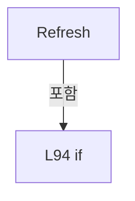

# Drilling.UI/Popup/CAlarmPopupDialog.xaml.cs

| 항목 | 내용 |
| --- | --- |
| 원본 저장소 | https://github.com/kjuws10-rgb/A3Drilling.git |
| 원본 Commit | 0219666f9053b907d96d7e0aa7d0c6c1be3a73d4 |
| 원본 SHA256 | e1ffed980afb9a56e23d8f6ebbe252a93a7eeaed75e9276537dddd3773fc62f9 |
| 파일 분류 | code |
| 원본 크기/행 | 4,395 bytes / 112 physical lines |
| 인코딩 | utf-8-sig |
| 검토 범위 | 구문/부분 의미 분석에서 추출한 사실. 동작·물리 단위·실장비 합격을 보증하지 않습니다. |
| 원본 링크 | [고정 Commit 원본](https://github.com/kjuws10-rgb/A3Drilling/blob/0219666f9053b907d96d7e0aa7d0c6c1be3a73d4/Drilling.UI/Popup/CAlarmPopupDialog.xaml.cs) |

## 파일의 역할과 읽는 순서

WPF 화면·사용자 명령·표시 상태를 구성합니다. XAML 이벤트와 코드 비하인드, RootView의 조립 경로를 함께 추적합니다.

## 네임스페이스·타입·상속

| 타입 | 구분 | 원본 범위 | 선언/상속 |
| --- | --- | --- | --- |
| CAlarmPopupDialog | ClassDeclaration | 10–49 | CAlarmPopupDialog: Window |
| CAlarmPopupPanel | ClassDeclaration | 51–109 | CAlarmPopupPanel: INotifyPropertyChanged |
| CAlarmPopupRow | RecordDeclaration | 111–111 | CAlarmPopupRow |

## 멤버 빠른 목록

| 이름 | 종류 | 범위 | 서명 |
| --- | --- | --- | --- |
| Panel | PropertyDeclaration | L12–12 | Drilling.UI.Popup.CAlarmPopupPanel Drilling.UI.Popup.CAlarmPopupDialog.Panel |
| get_Panel | GetAccessorDeclaration | L12–12 | Drilling.UI.Popup.CAlarmPopupPanel Drilling.UI.Popup.CAlarmPopupDialog.Panel.get |
| .ctor | ConstructorDeclaration | L14–23 | Drilling.UI.Popup.CAlarmPopupDialog.CAlarmPopupDialog(Drilling.UI.Popup.CAlarmPopupPanel) |
| ApplySeverityTheme | MethodDeclaration | L25–39 | void Drilling.UI.Popup.CAlarmPopupDialog.ApplySeverityTheme(Drilling.UI.Popup.CAlarmPopupPanel) |
| Brush | MethodDeclaration | L41–46 | SolidColorBrush Drilling.UI.Popup.CAlarmPopupDialog.Brush(byte, byte, byte) |
| CloseClicked | MethodDeclaration | L48–48 | void Drilling.UI.Popup.CAlarmPopupDialog.CloseClicked(object, RoutedEventArgs) |
| _revision | FieldDeclaration | L53–53 | long Drilling.UI.Popup.CAlarmPopupPanel._revision |
| _resetting | FieldDeclaration | L54–54 | bool Drilling.UI.Popup.CAlarmPopupPanel._resetting |
| PropertyChanged | EventFieldDeclaration | L55–55 | System.ComponentModel.PropertyChangedEventHandler? Drilling.UI.Popup.CAlarmPopupPanel.PropertyChanged |
| Rows | PropertyDeclaration | L56–56 | System.Collections.Generic.IReadOnlyList<Drilling.UI.Popup.CAlarmPopupRow> Drilling.UI.Popup.CAlarmPopupPanel.Rows |
| get_Rows | GetAccessorDeclaration | L56–56 | System.Collections.Generic.IReadOnlyList<Drilling.UI.Popup.CAlarmPopupRow> Drilling.UI.Popup.CAlarmPopupPanel.Rows.get |
| set_Rows | SetAccessorDeclaration | L56–56 | void Drilling.UI.Popup.CAlarmPopupPanel.Rows.set |
| Summary | PropertyDeclaration | L57–57 | string Drilling.UI.Popup.CAlarmPopupPanel.Summary |
| RecoveryStatus | PropertyDeclaration | L58–58 | string Drilling.UI.Popup.CAlarmPopupPanel.RecoveryStatus |
| get_RecoveryStatus | GetAccessorDeclaration | L58–58 | string Drilling.UI.Popup.CAlarmPopupPanel.RecoveryStatus.get |
| set_RecoveryStatus | SetAccessorDeclaration | L58–58 | void Drilling.UI.Popup.CAlarmPopupPanel.RecoveryStatus.set |
| ResetCommand | PropertyDeclaration | L59–80 | Drilling.UI.Menu.CButtonCommand Drilling.UI.Popup.CAlarmPopupPanel.ResetCommand |
| _resetCommand | FieldDeclaration | L82–82 | Drilling.UI.Menu.CButtonCommand? Drilling.UI.Popup.CAlarmPopupPanel._resetCommand |
| SetRecoveryStatus | MethodDeclaration | L83–89 | void Drilling.UI.Popup.CAlarmPopupPanel.SetRecoveryStatus(string) |
| Refresh | MethodDeclaration | L91–108 | void Drilling.UI.Popup.CAlarmPopupPanel.Refresh() |

## 멤버별 상세 계약·호출·처리 해설

### PropertyDeclaration `Panel` · L12–12

[Drilling.UI/Popup/CAlarmPopupDialog.xaml.cs:12–12](https://github.com/kjuws10-rgb/A3Drilling/blob/0219666f9053b907d96d7e0aa7d0c6c1be3a73d4/Drilling.UI/Popup/CAlarmPopupDialog.xaml.cs#L12-L12)

| 항목 | 실제 추출 값 |
| --- | --- |
| 서명 | Drilling.UI.Popup.CAlarmPopupPanel Drilling.UI.Popup.CAlarmPopupDialog.Panel |
| 접근/수식자 | Public / public |
| 반환/값 타입 | Drilling.UI.Popup.CAlarmPopupPanel |
| 소속 타입 | NamedType:Drilling.UI.Popup.CAlarmPopupDialog |

현재 부분 분석에서 직접 연결된 호출자는 없습니다. XAML/이벤트/인터페이스·델리게이트·외부 진입을 추가 확인해야 하며, 미사용으로 판정한 것이 아닙니다.

변경 전 점검: 입력/반환 타입, 위 호출자, 예외/취소 경로, 공유 상태와 저장·전송 소비자를 함께 확인합니다. 값의 단위나 물리 방향을 이름만으로 확정하지 않습니다.

### GetAccessorDeclaration `get_Panel` · L12–12

[Drilling.UI/Popup/CAlarmPopupDialog.xaml.cs:12–12](https://github.com/kjuws10-rgb/A3Drilling/blob/0219666f9053b907d96d7e0aa7d0c6c1be3a73d4/Drilling.UI/Popup/CAlarmPopupDialog.xaml.cs#L12-L12)

| 항목 | 실제 추출 값 |
| --- | --- |
| 서명 | Drilling.UI.Popup.CAlarmPopupPanel Drilling.UI.Popup.CAlarmPopupDialog.Panel.get |
| 접근/수식자 | Public / get |
| 반환/값 타입 | Drilling.UI.Popup.CAlarmPopupPanel |
| 소속 타입 | NamedType:Drilling.UI.Popup.CAlarmPopupDialog |

현재 부분 분석에서 직접 연결된 호출자는 없습니다. XAML/이벤트/인터페이스·델리게이트·외부 진입을 추가 확인해야 하며, 미사용으로 판정한 것이 아닙니다.

변경 전 점검: 입력/반환 타입, 위 호출자, 예외/취소 경로, 공유 상태와 저장·전송 소비자를 함께 확인합니다. 값의 단위나 물리 방향을 이름만으로 확정하지 않습니다.

### ConstructorDeclaration `.ctor` · L14–23

[Drilling.UI/Popup/CAlarmPopupDialog.xaml.cs:14–23](https://github.com/kjuws10-rgb/A3Drilling/blob/0219666f9053b907d96d7e0aa7d0c6c1be3a73d4/Drilling.UI/Popup/CAlarmPopupDialog.xaml.cs#L14-L23)

| 항목 | 실제 추출 값 |
| --- | --- |
| 서명 | Drilling.UI.Popup.CAlarmPopupDialog.CAlarmPopupDialog(Drilling.UI.Popup.CAlarmPopupPanel) |
| 접근/수식자 | Public / public |
| 반환/값 타입 | void |
| 소속 타입 | NamedType:Drilling.UI.Popup.CAlarmPopupDialog |

입력 계약:

| 이름 | 타입 | 전달 | 선택/기본값 |
| --- | --- | --- | --- |
| panel | Drilling.UI.Popup.CAlarmPopupPanel | None | False /  |

정적 호출자로 확인된 위치:

| 호출 파일/행 | 호출 표현식 | 런타임 분기 가능 |
| --- | --- | --- |
| [Drilling.UI/CRootView.cs:2988–2988](https://github.com/kjuws10-rgb/A3Drilling/blob/0219666f9053b907d96d7e0aa7d0c6c1be3a73d4/Drilling.UI/CRootView.cs#L2988-L2988) | new CAlarmPopupDialog | False |

호출하는 대상과 해석 범위:

| 원본 행 | 표현식 | 분석 상태 | 대상/소스 위치 |
| --- | --- | --- | --- |
| 16 | InitializeComponent | unresolved | None |
| 19 | panel.Refresh | resolved | void Drilling.UI.Popup.CAlarmPopupPanel.Refresh() · Drilling.UI/Popup/CAlarmPopupDialog.xaml.cs:91 |
| 20 | ApplySeverityTheme | resolved | void Drilling.UI.Popup.CAlarmPopupDialog.ApplySeverityTheme(Drilling.UI.Popup.CAlarmPopupPanel) · Drilling.UI/Popup/CAlarmPopupDialog.xaml.cs:25 |
| 21 | Math.Min | candidate | OverloadResolutionFailure |
| 22 | Math.Min | candidate | OverloadResolutionFailure |

본문의 실제 연산·분기·예외·반환 순서(원문 위치 순):

| 원본 행 | 종류 | 주석 해설 |
| --- | --- | --- |
| 16 | call | 함수·델리게이트 또는 객체 생성자를 호출합니다: InitializeComponent() |
| 17 | assignment | 값을 대상에 대입합니다: Panel = panel |
| 18 | assignment | 값을 대상에 대입합니다: DataContext = panel |
| 19 | call | 함수·델리게이트 또는 객체 생성자를 호출합니다: panel.Refresh() |
| 20 | call | 함수·델리게이트 또는 객체 생성자를 호출합니다: ApplySeverityTheme(panel) |
| 21 | assignment | 값을 대상에 대입합니다: Width = Math.Min(Width, SystemParameters.WorkArea.Width) |
| 21 | call | 함수·델리게이트 또는 객체 생성자를 호출합니다: Math.Min(Width, SystemParameters.WorkArea.Width) |
| 22 | assignment | 값을 대상에 대입합니다: Height = Math.Min(Height, SystemParameters.WorkArea.Height) |
| 22 | call | 함수·델리게이트 또는 객체 생성자를 호출합니다: Math.Min(Height, SystemParameters.WorkArea.Height) |

변경 전 점검: 입력/반환 타입, 위 호출자, 예외/취소 경로, 공유 상태와 저장·전송 소비자를 함께 확인합니다. 값의 단위나 물리 방향을 이름만으로 확정하지 않습니다.

### MethodDeclaration `ApplySeverityTheme` · L25–39

[Drilling.UI/Popup/CAlarmPopupDialog.xaml.cs:25–39](https://github.com/kjuws10-rgb/A3Drilling/blob/0219666f9053b907d96d7e0aa7d0c6c1be3a73d4/Drilling.UI/Popup/CAlarmPopupDialog.xaml.cs#L25-L39)

| 항목 | 실제 추출 값 |
| --- | --- |
| 서명 | void Drilling.UI.Popup.CAlarmPopupDialog.ApplySeverityTheme(Drilling.UI.Popup.CAlarmPopupPanel) |
| 접근/수식자 | Private / private |
| 반환/값 타입 | void |
| 소속 타입 | NamedType:Drilling.UI.Popup.CAlarmPopupDialog |

입력 계약:

| 이름 | 타입 | 전달 | 선택/기본값 |
| --- | --- | --- | --- |
| panel | Drilling.UI.Popup.CAlarmPopupPanel | None | False /  |

정적 호출자로 확인된 위치:

| 호출 파일/행 | 호출 표현식 | 런타임 분기 가능 |
| --- | --- | --- |
| [Drilling.UI/Popup/CAlarmPopupDialog.xaml.cs:20–20](https://github.com/kjuws10-rgb/A3Drilling/blob/0219666f9053b907d96d7e0aa7d0c6c1be3a73d4/Drilling.UI/Popup/CAlarmPopupDialog.xaml.cs#L20-L20) | ApplySeverityTheme | False |

호출하는 대상과 해석 범위:

| 원본 행 | 표현식 | 분석 상태 | 대상/소스 위치 |
| --- | --- | --- | --- |
| 27 | panel.Rows.Any | resolved | bool System.Collections.Generic.IEnumerable<Drilling.UI.Popup.CAlarmPopupRow>.Any<Drilling.UI.Popup.CAlarmPopupRow>(System.Func<Drilling.UI.Popup.CAlarmPopupRow, bool>) |
| 28 | panel.Rows.All | resolved | bool System.Collections.Generic.IEnumerable<Drilling.UI.Popup.CAlarmPopupRow>.All<Drilling.UI.Popup.CAlarmPopupRow>(System.Func<Drilling.UI.Popup.CAlarmPopupRow, bool>) |
| 32 | Brush | resolved | SolidColorBrush Drilling.UI.Popup.CAlarmPopupDialog.Brush(byte, byte, byte) · Drilling.UI/Popup/CAlarmPopupDialog.xaml.cs:41 |
| 33 | Brush | resolved | SolidColorBrush Drilling.UI.Popup.CAlarmPopupDialog.Brush(byte, byte, byte) · Drilling.UI/Popup/CAlarmPopupDialog.xaml.cs:41 |
| 34 | Brush | resolved | SolidColorBrush Drilling.UI.Popup.CAlarmPopupDialog.Brush(byte, byte, byte) · Drilling.UI/Popup/CAlarmPopupDialog.xaml.cs:41 |
| 35 | Brush | resolved | SolidColorBrush Drilling.UI.Popup.CAlarmPopupDialog.Brush(byte, byte, byte) · Drilling.UI/Popup/CAlarmPopupDialog.xaml.cs:41 |
| 36 | Brush | resolved | SolidColorBrush Drilling.UI.Popup.CAlarmPopupDialog.Brush(byte, byte, byte) · Drilling.UI/Popup/CAlarmPopupDialog.xaml.cs:41 |
| 37 | Brush | resolved | SolidColorBrush Drilling.UI.Popup.CAlarmPopupDialog.Brush(byte, byte, byte) · Drilling.UI/Popup/CAlarmPopupDialog.xaml.cs:41 |
| 38 | Brush | resolved | SolidColorBrush Drilling.UI.Popup.CAlarmPopupDialog.Brush(byte, byte, byte) · Drilling.UI/Popup/CAlarmPopupDialog.xaml.cs:41 |

본문의 실제 연산·분기·예외·반환 순서(원문 위치 순):

| 원본 행 | 종류 | 주석 해설 |
| --- | --- | --- |
| 27 | call | 함수·델리게이트 또는 객체 생성자를 호출합니다: panel.Rows.Any(row => row.Level == "LIGHT") |
| 27 | local-declaration | 지역 변수를 선언합니다: var lightOnly = panel.Rows.Any(row => row.Level == "LIGHT") && panel.Rows.All(row => row.Level != "HEAVY"); |
| 27 | variable-initializer | 변수의 초기값을 지정합니다: lightOnly = panel.Rows.Any(row => row.Level == "LIGHT") && panel.Rows.All(row => row.Level != "HEAVY") |
| 28 | call | 함수·델리게이트 또는 객체 생성자를 호출합니다: panel.Rows.All(row => row.Level != "HEAVY") |
| 29 | if | 조건에 따라 분기합니다: if (!lightOnly) |
| 30 | return | 호출자에게 값 또는 제어를 반환합니다: return; |
| 32 | assignment | 값을 대상에 대입합니다: Resources["AlarmSurfaceBrush"] = Brush(0xFF, 0xF7, 0xED) |
| 32 | call | 함수·델리게이트 또는 객체 생성자를 호출합니다: Brush(0xFF, 0xF7, 0xED) |
| 33 | assignment | 값을 대상에 대입합니다: Resources["GridAltBackgroundBrush"] = Brush(0xFF, 0xFB, 0xF5) |
| 33 | call | 함수·델리게이트 또는 객체 생성자를 호출합니다: Brush(0xFF, 0xFB, 0xF5) |
| 34 | assignment | 값을 대상에 대입합니다: Resources["GridHeaderBackgroundBrush"] = Brush(0xB4, 0x53, 0x09) |
| 34 | call | 함수·델리게이트 또는 객체 생성자를 호출합니다: Brush(0xB4, 0x53, 0x09) |
| 35 | assignment | 값을 대상에 대입합니다: Resources["GridLineBrush"] = Brush(0xF0, 0xC8, 0x9D) |
| 35 | call | 함수·델리게이트 또는 객체 생성자를 호출합니다: Brush(0xF0, 0xC8, 0x9D) |
| 36 | assignment | 값을 대상에 대입합니다: Resources["MenuItemSelectedBackgroundBrush"] = Brush(0xB4, 0x53, 0x09) |
| 36 | call | 함수·델리게이트 또는 객체 생성자를 호출합니다: Brush(0xB4, 0x53, 0x09) |
| 37 | assignment | 값을 대상에 대입합니다: Resources["AccentBrush"] = Brush(0xD9, 0x77, 0x06) |
| 37 | call | 함수·델리게이트 또는 객체 생성자를 호출합니다: Brush(0xD9, 0x77, 0x06) |
| 38 | assignment | 값을 대상에 대입합니다: Resources["AccentDarkBrush"] = Brush(0xB4, 0x53, 0x09) |
| 38 | call | 함수·델리게이트 또는 객체 생성자를 호출합니다: Brush(0xB4, 0x53, 0x09) |

제어 구문의 포함 구조(실제 실행 순서/CFG가 아닌 구문 탐색 그림):

변경 전 점검: 입력/반환 타입, 위 호출자, 예외/취소 경로, 공유 상태와 저장·전송 소비자를 함께 확인합니다. 값의 단위나 물리 방향을 이름만으로 확정하지 않습니다.

### MethodDeclaration `Brush` · L41–46

[Drilling.UI/Popup/CAlarmPopupDialog.xaml.cs:41–46](https://github.com/kjuws10-rgb/A3Drilling/blob/0219666f9053b907d96d7e0aa7d0c6c1be3a73d4/Drilling.UI/Popup/CAlarmPopupDialog.xaml.cs#L41-L46)

| 항목 | 실제 추출 값 |
| --- | --- |
| 서명 | SolidColorBrush Drilling.UI.Popup.CAlarmPopupDialog.Brush(byte, byte, byte) |
| 접근/수식자 | Private / private, static |
| 반환/값 타입 | SolidColorBrush |
| 소속 타입 | NamedType:Drilling.UI.Popup.CAlarmPopupDialog |

입력 계약:

| 이름 | 타입 | 전달 | 선택/기본값 |
| --- | --- | --- | --- |
| red | byte | None | False /  |
| green | byte | None | False /  |
| blue | byte | None | False /  |

정적 호출자로 확인된 위치:

| 호출 파일/행 | 호출 표현식 | 런타임 분기 가능 |
| --- | --- | --- |
| [Drilling.UI/Popup/CAlarmPopupDialog.xaml.cs:32–32](https://github.com/kjuws10-rgb/A3Drilling/blob/0219666f9053b907d96d7e0aa7d0c6c1be3a73d4/Drilling.UI/Popup/CAlarmPopupDialog.xaml.cs#L32-L32) | Brush | False |
| [Drilling.UI/Popup/CAlarmPopupDialog.xaml.cs:33–33](https://github.com/kjuws10-rgb/A3Drilling/blob/0219666f9053b907d96d7e0aa7d0c6c1be3a73d4/Drilling.UI/Popup/CAlarmPopupDialog.xaml.cs#L33-L33) | Brush | False |
| [Drilling.UI/Popup/CAlarmPopupDialog.xaml.cs:34–34](https://github.com/kjuws10-rgb/A3Drilling/blob/0219666f9053b907d96d7e0aa7d0c6c1be3a73d4/Drilling.UI/Popup/CAlarmPopupDialog.xaml.cs#L34-L34) | Brush | False |
| [Drilling.UI/Popup/CAlarmPopupDialog.xaml.cs:35–35](https://github.com/kjuws10-rgb/A3Drilling/blob/0219666f9053b907d96d7e0aa7d0c6c1be3a73d4/Drilling.UI/Popup/CAlarmPopupDialog.xaml.cs#L35-L35) | Brush | False |
| [Drilling.UI/Popup/CAlarmPopupDialog.xaml.cs:36–36](https://github.com/kjuws10-rgb/A3Drilling/blob/0219666f9053b907d96d7e0aa7d0c6c1be3a73d4/Drilling.UI/Popup/CAlarmPopupDialog.xaml.cs#L36-L36) | Brush | False |
| [Drilling.UI/Popup/CAlarmPopupDialog.xaml.cs:37–37](https://github.com/kjuws10-rgb/A3Drilling/blob/0219666f9053b907d96d7e0aa7d0c6c1be3a73d4/Drilling.UI/Popup/CAlarmPopupDialog.xaml.cs#L37-L37) | Brush | False |
| [Drilling.UI/Popup/CAlarmPopupDialog.xaml.cs:38–38](https://github.com/kjuws10-rgb/A3Drilling/blob/0219666f9053b907d96d7e0aa7d0c6c1be3a73d4/Drilling.UI/Popup/CAlarmPopupDialog.xaml.cs#L38-L38) | Brush | False |

호출하는 대상과 해석 범위:

| 원본 행 | 표현식 | 분석 상태 | 대상/소스 위치 |
| --- | --- | --- | --- |
| 43 | new SolidColorBrush | unresolved | None |
| 43 | Color.FromRgb | unresolved | None |
| 44 | brush.Freeze | unresolved | None |

본문의 실제 연산·분기·예외·반환 순서(원문 위치 순):

| 원본 행 | 종류 | 주석 해설 |
| --- | --- | --- |
| 43 | call | 함수·델리게이트 또는 객체 생성자를 호출합니다: new SolidColorBrush(Color.FromRgb(red, green, blue)) |
| 43 | call | 함수·델리게이트 또는 객체 생성자를 호출합니다: Color.FromRgb(red, green, blue) |
| 43 | local-declaration | 지역 변수를 선언합니다: var brush = new SolidColorBrush(Color.FromRgb(red, green, blue)); |
| 43 | variable-initializer | 변수의 초기값을 지정합니다: brush = new SolidColorBrush(Color.FromRgb(red, green, blue)) |
| 44 | call | 함수·델리게이트 또는 객체 생성자를 호출합니다: brush.Freeze() |
| 45 | return | 호출자에게 값 또는 제어를 반환합니다: return brush; |

변경 전 점검: 입력/반환 타입, 위 호출자, 예외/취소 경로, 공유 상태와 저장·전송 소비자를 함께 확인합니다. 값의 단위나 물리 방향을 이름만으로 확정하지 않습니다.

### MethodDeclaration `CloseClicked` · L48–48

[Drilling.UI/Popup/CAlarmPopupDialog.xaml.cs:48–48](https://github.com/kjuws10-rgb/A3Drilling/blob/0219666f9053b907d96d7e0aa7d0c6c1be3a73d4/Drilling.UI/Popup/CAlarmPopupDialog.xaml.cs#L48-L48)

| 항목 | 실제 추출 값 |
| --- | --- |
| 서명 | void Drilling.UI.Popup.CAlarmPopupDialog.CloseClicked(object, RoutedEventArgs) |
| 접근/수식자 | Private / private |
| 반환/값 타입 | void |
| 소속 타입 | NamedType:Drilling.UI.Popup.CAlarmPopupDialog |

입력 계약:

| 이름 | 타입 | 전달 | 선택/기본값 |
| --- | --- | --- | --- |
| sender | object | None | False /  |
| e | RoutedEventArgs | None | False /  |

현재 부분 분석에서 직접 연결된 호출자는 없습니다. XAML/이벤트/인터페이스·델리게이트·외부 진입을 추가 확인해야 하며, 미사용으로 판정한 것이 아닙니다.

호출하는 대상과 해석 범위:

| 원본 행 | 표현식 | 분석 상태 | 대상/소스 위치 |
| --- | --- | --- | --- |
| 48 | Close | unresolved | None |

본문의 실제 연산·분기·예외·반환 순서(원문 위치 순):

| 원본 행 | 종류 | 주석 해설 |
| --- | --- | --- |
| 48 | call | 함수·델리게이트 또는 객체 생성자를 호출합니다: Close() |

변경 전 점검: 입력/반환 타입, 위 호출자, 예외/취소 경로, 공유 상태와 저장·전송 소비자를 함께 확인합니다. 값의 단위나 물리 방향을 이름만으로 확정하지 않습니다.

### FieldDeclaration `_revision` · L53–53

[Drilling.UI/Popup/CAlarmPopupDialog.xaml.cs:53–53](https://github.com/kjuws10-rgb/A3Drilling/blob/0219666f9053b907d96d7e0aa7d0c6c1be3a73d4/Drilling.UI/Popup/CAlarmPopupDialog.xaml.cs#L53-L53)

| 항목 | 실제 추출 값 |
| --- | --- |
| 서명 | long Drilling.UI.Popup.CAlarmPopupPanel._revision |
| 접근/수식자 | Private / private |
| 반환/값 타입 | long |
| 소속 타입 | NamedType:Drilling.UI.Popup.CAlarmPopupPanel |

현재 부분 분석에서 직접 연결된 호출자는 없습니다. XAML/이벤트/인터페이스·델리게이트·외부 진입을 추가 확인해야 하며, 미사용으로 판정한 것이 아닙니다.

본문의 실제 연산·분기·예외·반환 순서(원문 위치 순):

| 원본 행 | 종류 | 주석 해설 |
| --- | --- | --- |
| 53 | variable-initializer | 변수의 초기값을 지정합니다: _revision = -1 |

변경 전 점검: 입력/반환 타입, 위 호출자, 예외/취소 경로, 공유 상태와 저장·전송 소비자를 함께 확인합니다. 값의 단위나 물리 방향을 이름만으로 확정하지 않습니다.

### FieldDeclaration `_resetting` · L54–54

[Drilling.UI/Popup/CAlarmPopupDialog.xaml.cs:54–54](https://github.com/kjuws10-rgb/A3Drilling/blob/0219666f9053b907d96d7e0aa7d0c6c1be3a73d4/Drilling.UI/Popup/CAlarmPopupDialog.xaml.cs#L54-L54)

| 항목 | 실제 추출 값 |
| --- | --- |
| 서명 | bool Drilling.UI.Popup.CAlarmPopupPanel._resetting |
| 접근/수식자 | Private / private |
| 반환/값 타입 | bool |
| 소속 타입 | NamedType:Drilling.UI.Popup.CAlarmPopupPanel |

현재 부분 분석에서 직접 연결된 호출자는 없습니다. XAML/이벤트/인터페이스·델리게이트·외부 진입을 추가 확인해야 하며, 미사용으로 판정한 것이 아닙니다.

변경 전 점검: 입력/반환 타입, 위 호출자, 예외/취소 경로, 공유 상태와 저장·전송 소비자를 함께 확인합니다. 값의 단위나 물리 방향을 이름만으로 확정하지 않습니다.

### EventFieldDeclaration `PropertyChanged` · L55–55

[Drilling.UI/Popup/CAlarmPopupDialog.xaml.cs:55–55](https://github.com/kjuws10-rgb/A3Drilling/blob/0219666f9053b907d96d7e0aa7d0c6c1be3a73d4/Drilling.UI/Popup/CAlarmPopupDialog.xaml.cs#L55-L55)

| 항목 | 실제 추출 값 |
| --- | --- |
| 서명 | System.ComponentModel.PropertyChangedEventHandler? Drilling.UI.Popup.CAlarmPopupPanel.PropertyChanged |
| 접근/수식자 | Public / public, event |
| 반환/값 타입 | System.ComponentModel.PropertyChangedEventHandler? |
| 소속 타입 | NamedType:Drilling.UI.Popup.CAlarmPopupPanel |

현재 부분 분석에서 직접 연결된 호출자는 없습니다. XAML/이벤트/인터페이스·델리게이트·외부 진입을 추가 확인해야 하며, 미사용으로 판정한 것이 아닙니다.

변경 전 점검: 입력/반환 타입, 위 호출자, 예외/취소 경로, 공유 상태와 저장·전송 소비자를 함께 확인합니다. 값의 단위나 물리 방향을 이름만으로 확정하지 않습니다.

### PropertyDeclaration `Rows` · L56–56

[Drilling.UI/Popup/CAlarmPopupDialog.xaml.cs:56–56](https://github.com/kjuws10-rgb/A3Drilling/blob/0219666f9053b907d96d7e0aa7d0c6c1be3a73d4/Drilling.UI/Popup/CAlarmPopupDialog.xaml.cs#L56-L56)

| 항목 | 실제 추출 값 |
| --- | --- |
| 서명 | System.Collections.Generic.IReadOnlyList<Drilling.UI.Popup.CAlarmPopupRow> Drilling.UI.Popup.CAlarmPopupPanel.Rows |
| 접근/수식자 | Public / public |
| 반환/값 타입 | System.Collections.Generic.IReadOnlyList<Drilling.UI.Popup.CAlarmPopupRow> |
| 소속 타입 | NamedType:Drilling.UI.Popup.CAlarmPopupPanel |

현재 부분 분석에서 직접 연결된 호출자는 없습니다. XAML/이벤트/인터페이스·델리게이트·외부 진입을 추가 확인해야 하며, 미사용으로 판정한 것이 아닙니다.

변경 전 점검: 입력/반환 타입, 위 호출자, 예외/취소 경로, 공유 상태와 저장·전송 소비자를 함께 확인합니다. 값의 단위나 물리 방향을 이름만으로 확정하지 않습니다.

### GetAccessorDeclaration `get_Rows` · L56–56

[Drilling.UI/Popup/CAlarmPopupDialog.xaml.cs:56–56](https://github.com/kjuws10-rgb/A3Drilling/blob/0219666f9053b907d96d7e0aa7d0c6c1be3a73d4/Drilling.UI/Popup/CAlarmPopupDialog.xaml.cs#L56-L56)

| 항목 | 실제 추출 값 |
| --- | --- |
| 서명 | System.Collections.Generic.IReadOnlyList<Drilling.UI.Popup.CAlarmPopupRow> Drilling.UI.Popup.CAlarmPopupPanel.Rows.get |
| 접근/수식자 | Public / get |
| 반환/값 타입 | System.Collections.Generic.IReadOnlyList<Drilling.UI.Popup.CAlarmPopupRow> |
| 소속 타입 | NamedType:Drilling.UI.Popup.CAlarmPopupPanel |

현재 부분 분석에서 직접 연결된 호출자는 없습니다. XAML/이벤트/인터페이스·델리게이트·외부 진입을 추가 확인해야 하며, 미사용으로 판정한 것이 아닙니다.

변경 전 점검: 입력/반환 타입, 위 호출자, 예외/취소 경로, 공유 상태와 저장·전송 소비자를 함께 확인합니다. 값의 단위나 물리 방향을 이름만으로 확정하지 않습니다.

### SetAccessorDeclaration `set_Rows` · L56–56

[Drilling.UI/Popup/CAlarmPopupDialog.xaml.cs:56–56](https://github.com/kjuws10-rgb/A3Drilling/blob/0219666f9053b907d96d7e0aa7d0c6c1be3a73d4/Drilling.UI/Popup/CAlarmPopupDialog.xaml.cs#L56-L56)

| 항목 | 실제 추출 값 |
| --- | --- |
| 서명 | void Drilling.UI.Popup.CAlarmPopupPanel.Rows.set |
| 접근/수식자 | Private / private, set |
| 반환/값 타입 | void |
| 소속 타입 | NamedType:Drilling.UI.Popup.CAlarmPopupPanel |

입력 계약:

| 이름 | 타입 | 전달 | 선택/기본값 |
| --- | --- | --- | --- |
| value | System.Collections.Generic.IReadOnlyList<Drilling.UI.Popup.CAlarmPopupRow> | None | False /  |

현재 부분 분석에서 직접 연결된 호출자는 없습니다. XAML/이벤트/인터페이스·델리게이트·외부 진입을 추가 확인해야 하며, 미사용으로 판정한 것이 아닙니다.

변경 전 점검: 입력/반환 타입, 위 호출자, 예외/취소 경로, 공유 상태와 저장·전송 소비자를 함께 확인합니다. 값의 단위나 물리 방향을 이름만으로 확정하지 않습니다.

### PropertyDeclaration `Summary` · L57–57

[Drilling.UI/Popup/CAlarmPopupDialog.xaml.cs:57–57](https://github.com/kjuws10-rgb/A3Drilling/blob/0219666f9053b907d96d7e0aa7d0c6c1be3a73d4/Drilling.UI/Popup/CAlarmPopupDialog.xaml.cs#L57-L57)

| 항목 | 실제 추출 값 |
| --- | --- |
| 서명 | string Drilling.UI.Popup.CAlarmPopupPanel.Summary |
| 접근/수식자 | Public / public |
| 반환/값 타입 | string |
| 소속 타입 | NamedType:Drilling.UI.Popup.CAlarmPopupPanel |

현재 부분 분석에서 직접 연결된 호출자는 없습니다. XAML/이벤트/인터페이스·델리게이트·외부 진입을 추가 확인해야 하며, 미사용으로 판정한 것이 아닙니다.

호출하는 대상과 해석 범위:

| 원본 행 | 표현식 | 분석 상태 | 대상/소스 위치 |
| --- | --- | --- | --- |
| 57 | Rows.Count | resolved | int System.Collections.Generic.IEnumerable<Drilling.UI.Popup.CAlarmPopupRow>.Count<Drilling.UI.Popup.CAlarmPopupRow>(System.Func<Drilling.UI.Popup.CAlarmPopupRow, bool>) |
| 57 | Rows.Count | resolved | int System.Collections.Generic.IEnumerable<Drilling.UI.Popup.CAlarmPopupRow>.Count<Drilling.UI.Popup.CAlarmPopupRow>(System.Func<Drilling.UI.Popup.CAlarmPopupRow, bool>) |

본문의 실제 연산·분기·예외·반환 순서(원문 위치 순):

| 원본 행 | 종류 | 주석 해설 |
| --- | --- | --- |
| 57 | call | 함수·델리게이트 또는 객체 생성자를 호출합니다: Rows.Count(row => row.Level == "HEAVY") |
| 57 | call | 함수·델리게이트 또는 객체 생성자를 호출합니다: Rows.Count(row => row.Level == "LIGHT") |

변경 전 점검: 입력/반환 타입, 위 호출자, 예외/취소 경로, 공유 상태와 저장·전송 소비자를 함께 확인합니다. 값의 단위나 물리 방향을 이름만으로 확정하지 않습니다.

### PropertyDeclaration `RecoveryStatus` · L58–58

[Drilling.UI/Popup/CAlarmPopupDialog.xaml.cs:58–58](https://github.com/kjuws10-rgb/A3Drilling/blob/0219666f9053b907d96d7e0aa7d0c6c1be3a73d4/Drilling.UI/Popup/CAlarmPopupDialog.xaml.cs#L58-L58)

| 항목 | 실제 추출 값 |
| --- | --- |
| 서명 | string Drilling.UI.Popup.CAlarmPopupPanel.RecoveryStatus |
| 접근/수식자 | Public / public |
| 반환/값 타입 | string |
| 소속 타입 | NamedType:Drilling.UI.Popup.CAlarmPopupPanel |

현재 부분 분석에서 직접 연결된 호출자는 없습니다. XAML/이벤트/인터페이스·델리게이트·외부 진입을 추가 확인해야 하며, 미사용으로 판정한 것이 아닙니다.

변경 전 점검: 입력/반환 타입, 위 호출자, 예외/취소 경로, 공유 상태와 저장·전송 소비자를 함께 확인합니다. 값의 단위나 물리 방향을 이름만으로 확정하지 않습니다.

### GetAccessorDeclaration `get_RecoveryStatus` · L58–58

[Drilling.UI/Popup/CAlarmPopupDialog.xaml.cs:58–58](https://github.com/kjuws10-rgb/A3Drilling/blob/0219666f9053b907d96d7e0aa7d0c6c1be3a73d4/Drilling.UI/Popup/CAlarmPopupDialog.xaml.cs#L58-L58)

| 항목 | 실제 추출 값 |
| --- | --- |
| 서명 | string Drilling.UI.Popup.CAlarmPopupPanel.RecoveryStatus.get |
| 접근/수식자 | Public / get |
| 반환/값 타입 | string |
| 소속 타입 | NamedType:Drilling.UI.Popup.CAlarmPopupPanel |

현재 부분 분석에서 직접 연결된 호출자는 없습니다. XAML/이벤트/인터페이스·델리게이트·외부 진입을 추가 확인해야 하며, 미사용으로 판정한 것이 아닙니다.

변경 전 점검: 입력/반환 타입, 위 호출자, 예외/취소 경로, 공유 상태와 저장·전송 소비자를 함께 확인합니다. 값의 단위나 물리 방향을 이름만으로 확정하지 않습니다.

### SetAccessorDeclaration `set_RecoveryStatus` · L58–58

[Drilling.UI/Popup/CAlarmPopupDialog.xaml.cs:58–58](https://github.com/kjuws10-rgb/A3Drilling/blob/0219666f9053b907d96d7e0aa7d0c6c1be3a73d4/Drilling.UI/Popup/CAlarmPopupDialog.xaml.cs#L58-L58)

| 항목 | 실제 추출 값 |
| --- | --- |
| 서명 | void Drilling.UI.Popup.CAlarmPopupPanel.RecoveryStatus.set |
| 접근/수식자 | Private / private, set |
| 반환/값 타입 | void |
| 소속 타입 | NamedType:Drilling.UI.Popup.CAlarmPopupPanel |

입력 계약:

| 이름 | 타입 | 전달 | 선택/기본값 |
| --- | --- | --- | --- |
| value | string | None | False /  |

현재 부분 분석에서 직접 연결된 호출자는 없습니다. XAML/이벤트/인터페이스·델리게이트·외부 진입을 추가 확인해야 하며, 미사용으로 판정한 것이 아닙니다.

변경 전 점검: 입력/반환 타입, 위 호출자, 예외/취소 경로, 공유 상태와 저장·전송 소비자를 함께 확인합니다. 값의 단위나 물리 방향을 이름만으로 확정하지 않습니다.

### PropertyDeclaration `ResetCommand` · L59–80

[Drilling.UI/Popup/CAlarmPopupDialog.xaml.cs:59–80](https://github.com/kjuws10-rgb/A3Drilling/blob/0219666f9053b907d96d7e0aa7d0c6c1be3a73d4/Drilling.UI/Popup/CAlarmPopupDialog.xaml.cs#L59-L80)

| 항목 | 실제 추출 값 |
| --- | --- |
| 서명 | Drilling.UI.Menu.CButtonCommand Drilling.UI.Popup.CAlarmPopupPanel.ResetCommand |
| 접근/수식자 | Public / public |
| 반환/값 타입 | Drilling.UI.Menu.CButtonCommand |
| 소속 타입 | NamedType:Drilling.UI.Popup.CAlarmPopupPanel |

현재 부분 분석에서 직접 연결된 호출자는 없습니다. XAML/이벤트/인터페이스·델리게이트·외부 진입을 추가 확인해야 하며, 미사용으로 판정한 것이 아닙니다.

호출하는 대상과 해석 범위:

| 원본 행 | 표현식 | 분석 상태 | 대상/소스 위치 |
| --- | --- | --- | --- |
| 59 | new | resolved | Drilling.UI.Menu.CButtonCommand.CButtonCommand(System.Action<object?>, System.Predicate<object?>?) · Drilling.UI/Menu/CButtonCommand.cs:9 |
| 64 | .NotifyCanExecuteChanged | resolved | void Drilling.UI.Menu.CButtonCommand.NotifyCanExecuteChanged() · Drilling.UI/Menu/CButtonCommand.cs:24 |
| 67 | reset | resolved · 동적 구현 선택 가능 | System.Threading.Tasks.Task System.Func<System.Threading.Tasks.Task>.Invoke() |
| 68 | Refresh | resolved | void Drilling.UI.Popup.CAlarmPopupPanel.Refresh() · Drilling.UI/Popup/CAlarmPopupDialog.xaml.cs:91 |
| 72 | SetRecoveryStatus | resolved | void Drilling.UI.Popup.CAlarmPopupPanel.SetRecoveryStatus(string) · Drilling.UI/Popup/CAlarmPopupDialog.xaml.cs:83 |
| 73 | Refresh | resolved | void Drilling.UI.Popup.CAlarmPopupPanel.Refresh() · Drilling.UI/Popup/CAlarmPopupDialog.xaml.cs:91 |
| 78 | .NotifyCanExecuteChanged | resolved | void Drilling.UI.Menu.CButtonCommand.NotifyCanExecuteChanged() · Drilling.UI/Menu/CButtonCommand.cs:24 |

본문의 실제 연산·분기·예외·반환 순서(원문 위치 순):

| 원본 행 | 종류 | 주석 해설 |
| --- | --- | --- |
| 59 | assignment | 값을 대상에 대입합니다: _resetCommand ??= new(async _ => { if (_resetting) return; _resetting = true; _resetCommand?.NotifyCanExecuteChanged(); try { await reset(); Refresh(); } catch (Exception error) { SetRecoveryStatus("ALARM RESET 실패: " + error.Messa |
| 59 | call | 함수·델리게이트 또는 객체 생성자를 호출합니다: new(async _ => { if (_resetting) return; _resetting = true; _resetCommand?.NotifyCanExecuteChanged(); try { await reset(); Refresh(); } catch (Exception error) { SetRecoveryStatus("ALARM RESET 실패: " + error.Message); Ref… |
| 61 | if | 조건에 따라 분기합니다: if (_resetting) |
| 62 | return | 호출자에게 값 또는 제어를 반환합니다: return; |
| 63 | assignment | 값을 대상에 대입합니다: _resetting = true |
| 64 | call | 함수·델리게이트 또는 객체 생성자를 호출합니다: .NotifyCanExecuteChanged() |
| 65 | try | 예외 처리 범위입니다: try |
| 67 | await | 비동기 완료를 기다립니다: await reset() |
| 67 | call | 함수·델리게이트 또는 객체 생성자를 호출합니다: reset() |
| 68 | call | 함수·델리게이트 또는 객체 생성자를 호출합니다: Refresh() |
| 70 | catch | 지정 예외를 처리합니다: catch (Exception error) |
| 72 | call | 함수·델리게이트 또는 객체 생성자를 호출합니다: SetRecoveryStatus("ALARM RESET 실패: " + error.Message) |
| 73 | call | 함수·델리게이트 또는 객체 생성자를 호출합니다: Refresh() |
| 75 | finally | 종료 정리 구간입니다: finally |
| 77 | assignment | 값을 대상에 대입합니다: _resetting = false |
| 78 | call | 함수·델리게이트 또는 객체 생성자를 호출합니다: .NotifyCanExecuteChanged() |

제어 구문의 포함 구조(실제 실행 순서/CFG가 아닌 구문 탐색 그림):

변경 전 점검: 입력/반환 타입, 위 호출자, 예외/취소 경로, 공유 상태와 저장·전송 소비자를 함께 확인합니다. 값의 단위나 물리 방향을 이름만으로 확정하지 않습니다.

### FieldDeclaration `_resetCommand` · L82–82

[Drilling.UI/Popup/CAlarmPopupDialog.xaml.cs:82–82](https://github.com/kjuws10-rgb/A3Drilling/blob/0219666f9053b907d96d7e0aa7d0c6c1be3a73d4/Drilling.UI/Popup/CAlarmPopupDialog.xaml.cs#L82-L82)

| 항목 | 실제 추출 값 |
| --- | --- |
| 서명 | Drilling.UI.Menu.CButtonCommand? Drilling.UI.Popup.CAlarmPopupPanel._resetCommand |
| 접근/수식자 | Private / private |
| 반환/값 타입 | Drilling.UI.Menu.CButtonCommand? |
| 소속 타입 | NamedType:Drilling.UI.Popup.CAlarmPopupPanel |

현재 부분 분석에서 직접 연결된 호출자는 없습니다. XAML/이벤트/인터페이스·델리게이트·외부 진입을 추가 확인해야 하며, 미사용으로 판정한 것이 아닙니다.

변경 전 점검: 입력/반환 타입, 위 호출자, 예외/취소 경로, 공유 상태와 저장·전송 소비자를 함께 확인합니다. 값의 단위나 물리 방향을 이름만으로 확정하지 않습니다.

### MethodDeclaration `SetRecoveryStatus` · L83–89

[Drilling.UI/Popup/CAlarmPopupDialog.xaml.cs:83–89](https://github.com/kjuws10-rgb/A3Drilling/blob/0219666f9053b907d96d7e0aa7d0c6c1be3a73d4/Drilling.UI/Popup/CAlarmPopupDialog.xaml.cs#L83-L89)

| 항목 | 실제 추출 값 |
| --- | --- |
| 서명 | void Drilling.UI.Popup.CAlarmPopupPanel.SetRecoveryStatus(string) |
| 접근/수식자 | Public / public |
| 반환/값 타입 | void |
| 소속 타입 | NamedType:Drilling.UI.Popup.CAlarmPopupPanel |

입력 계약:

| 이름 | 타입 | 전달 | 선택/기본값 |
| --- | --- | --- | --- |
| text | string | None | False /  |

정적 호출자로 확인된 위치:

| 호출 파일/행 | 호출 표현식 | 런타임 분기 가능 |
| --- | --- | --- |
| [Drilling.UI/CRootView.cs:2987–2987](https://github.com/kjuws10-rgb/A3Drilling/blob/0219666f9053b907d96d7e0aa7d0c6c1be3a73d4/Drilling.UI/CRootView.cs#L2987-L2987) | panel.SetRecoveryStatus | False |
| [Drilling.UI/CRootView.cs:3023–3023](https://github.com/kjuws10-rgb/A3Drilling/blob/0219666f9053b907d96d7e0aa7d0c6c1be3a73d4/Drilling.UI/CRootView.cs#L3023-L3023) | .Panel.SetRecoveryStatus | False |
| [Drilling.UI/Popup/CAlarmPopupDialog.xaml.cs:72–72](https://github.com/kjuws10-rgb/A3Drilling/blob/0219666f9053b907d96d7e0aa7d0c6c1be3a73d4/Drilling.UI/Popup/CAlarmPopupDialog.xaml.cs#L72-L72) | SetRecoveryStatus | False |

호출하는 대상과 해석 범위:

| 원본 행 | 표현식 | 분석 상태 | 대상/소스 위치 |
| --- | --- | --- | --- |
| 88 | .Invoke | resolved · 동적 구현 선택 가능 | void System.ComponentModel.PropertyChangedEventHandler.Invoke(object?, System.ComponentModel.PropertyChangedEventArgs) |
| 88 | new | resolved | System.ComponentModel.PropertyChangedEventArgs.PropertyChangedEventArgs(string?) |
| 88 | nameof | unresolved | None |

본문의 실제 연산·분기·예외·반환 순서(원문 위치 순):

| 원본 행 | 종류 | 주석 해설 |
| --- | --- | --- |
| 85 | if | 조건에 따라 분기합니다: if (RecoveryStatus == text) |
| 86 | return | 호출자에게 값 또는 제어를 반환합니다: return; |
| 87 | assignment | 값을 대상에 대입합니다: RecoveryStatus = text |
| 88 | call | 함수·델리게이트 또는 객체 생성자를 호출합니다: .Invoke(this, new(nameof(RecoveryStatus))) |
| 88 | call | 함수·델리게이트 또는 객체 생성자를 호출합니다: new(nameof(RecoveryStatus)) |
| 88 | call | 함수·델리게이트 또는 객체 생성자를 호출합니다: nameof(RecoveryStatus) |

제어 구문의 포함 구조(실제 실행 순서/CFG가 아닌 구문 탐색 그림):

변경 전 점검: 입력/반환 타입, 위 호출자, 예외/취소 경로, 공유 상태와 저장·전송 소비자를 함께 확인합니다. 값의 단위나 물리 방향을 이름만으로 확정하지 않습니다.

### MethodDeclaration `Refresh` · L91–108

[Drilling.UI/Popup/CAlarmPopupDialog.xaml.cs:91–108](https://github.com/kjuws10-rgb/A3Drilling/blob/0219666f9053b907d96d7e0aa7d0c6c1be3a73d4/Drilling.UI/Popup/CAlarmPopupDialog.xaml.cs#L91-L108)

| 항목 | 실제 추출 값 |
| --- | --- |
| 서명 | void Drilling.UI.Popup.CAlarmPopupPanel.Refresh() |
| 접근/수식자 | Public / public |
| 반환/값 타입 | void |
| 소속 타입 | NamedType:Drilling.UI.Popup.CAlarmPopupPanel |

정적 호출자로 확인된 위치:

| 호출 파일/행 | 호출 표현식 | 런타임 분기 가능 |
| --- | --- | --- |
| [Drilling.UI/CRootView.cs:2979–2979](https://github.com/kjuws10-rgb/A3Drilling/blob/0219666f9053b907d96d7e0aa7d0c6c1be3a73d4/Drilling.UI/CRootView.cs#L2979-L2979) | open.Panel.Refresh | False |
| [Drilling.UI/CRootView.cs:3012–3012](https://github.com/kjuws10-rgb/A3Drilling/blob/0219666f9053b907d96d7e0aa7d0c6c1be3a73d4/Drilling.UI/CRootView.cs#L3012-L3012) | .Panel.Refresh | False |
| [Drilling.UI/CRootView.cs:3143–3143](https://github.com/kjuws10-rgb/A3Drilling/blob/0219666f9053b907d96d7e0aa7d0c6c1be3a73d4/Drilling.UI/CRootView.cs#L3143-L3143) | .Panel.Refresh | False |
| [Drilling.UI/Popup/CAlarmPopupDialog.xaml.cs:19–19](https://github.com/kjuws10-rgb/A3Drilling/blob/0219666f9053b907d96d7e0aa7d0c6c1be3a73d4/Drilling.UI/Popup/CAlarmPopupDialog.xaml.cs#L19-L19) | panel.Refresh | False |
| [Drilling.UI/Popup/CAlarmPopupDialog.xaml.cs:68–68](https://github.com/kjuws10-rgb/A3Drilling/blob/0219666f9053b907d96d7e0aa7d0c6c1be3a73d4/Drilling.UI/Popup/CAlarmPopupDialog.xaml.cs#L68-L68) | Refresh | False |
| [Drilling.UI/Popup/CAlarmPopupDialog.xaml.cs:73–73](https://github.com/kjuws10-rgb/A3Drilling/blob/0219666f9053b907d96d7e0aa7d0c6c1be3a73d4/Drilling.UI/Popup/CAlarmPopupDialog.xaml.cs#L73-L73) | Refresh | False |

호출하는 대상과 해석 범위:

| 원본 행 | 표현식 | 분석 상태 | 대상/소스 위치 |
| --- | --- | --- | --- |
| 93 | alarms.GetCurrentSnapshot | resolved | Drilling.Common.Alarm.ST_CURRENT_ALARM_SNAPSHOT Drilling.Common.Alarm.CAlarmManager.GetCurrentSnapshot() · Drilling.Common/Alarm/CAlarmManager.cs:223 |
| 97 | snapshot.Rows.Select((row, index) => new CAlarmPopupRow( index + 1, row.Code, row.Severity == EN_ALARM_LEVEL.Critical ? "HEAVY" : row.Severity == EN_ALARM_LEVEL.Warning ? "LIGHT" : "INFO", row.Group, row.Message, row.RecoveryAction, row.OccurredAt.ToString("yyyy-MM-dd HH:mm:ss", CultureInfo.InvariantCulture) )).ToArray | resolved | Drilling.UI.Popup.CAlarmPopupRow[] System.Collections.Generic.IEnumerable<Drilling.UI.Popup.CAlarmPopupRow>.ToArray<Drilling.UI.Popup.CAlarmPopupRow>() |
| 97 | snapshot.Rows.Select | resolved | System.Collections.Generic.IEnumerable<Drilling.UI.Popup.CAlarmPopupRow> System.Collections.Generic.IEnumerable<Drilling.Common.Alarm.ST_ALARM_DATA>.Select<Drilling.Common.Alarm.ST_ALARM_DATA, Drilling.UI.Popup.CAlarmPopupRow>(System.Func<Drilling.Common.Alarm.ST_ALARM_DATA, int, Drilling.UI.Popup.CAlarmPopupRow>) |
| 97 | new CAlarmPopupRow | resolved | Drilling.UI.Popup.CAlarmPopupRow.CAlarmPopupRow(int, int, string, string, string, string, string) · Drilling.UI/Popup/CAlarmPopupDialog.xaml.cs:111 |
| 104 | row.OccurredAt.ToString | resolved | string System.DateTimeOffset.ToString(string?, System.IFormatProvider?) |
| 106 | .Invoke | resolved · 동적 구현 선택 가능 | void System.ComponentModel.PropertyChangedEventHandler.Invoke(object?, System.ComponentModel.PropertyChangedEventArgs) |
| 106 | new | resolved | System.ComponentModel.PropertyChangedEventArgs.PropertyChangedEventArgs(string?) |
| 107 | .NotifyCanExecuteChanged | resolved | void Drilling.UI.Menu.CButtonCommand.NotifyCanExecuteChanged() · Drilling.UI/Menu/CButtonCommand.cs:24 |

본문의 실제 연산·분기·예외·반환 순서(원문 위치 순):

| 원본 행 | 종류 | 주석 해설 |
| --- | --- | --- |
| 93 | call | 함수·델리게이트 또는 객체 생성자를 호출합니다: alarms.GetCurrentSnapshot() |
| 93 | local-declaration | 지역 변수를 선언합니다: var snapshot = alarms.GetCurrentSnapshot(); |
| 93 | variable-initializer | 변수의 초기값을 지정합니다: snapshot = alarms.GetCurrentSnapshot() |
| 94 | if | 조건에 따라 분기합니다: if (snapshot.Revision == _revision) |
| 95 | return | 호출자에게 값 또는 제어를 반환합니다: return; |
| 96 | assignment | 값을 대상에 대입합니다: _revision = snapshot.Revision |
| 97 | assignment | 값을 대상에 대입합니다: Rows = snapshot.Rows.Select((row, index) => new CAlarmPopupRow( index + 1, row.Code, row.Severity == EN_ALARM_LEVEL.Critical ? "HEAVY" : row.Severity == EN_ALARM_LEVEL.Warning ? "LIGHT" : "INFO", row.Group, row.Message, row.Recove |
| 97 | call | 함수·델리게이트 또는 객체 생성자를 호출합니다: snapshot.Rows.Select((row, index) => new CAlarmPopupRow( index + 1, row.Code, row.Severity == EN_ALARM_LEVEL.Critical ? "HEAVY" : row.Severity == EN_ALARM_LEVEL.Warning ? "LIGHT" : "INFO", row.Group, row.Message, row.Rec… |
| 97 | call | 함수·델리게이트 또는 객체 생성자를 호출합니다: snapshot.Rows.Select((row, index) => new CAlarmPopupRow( index + 1, row.Code, row.Severity == EN_ALARM_LEVEL.Critical ? "HEAVY" : row.Severity == EN_ALARM_LEVEL.Warning ? "LIGHT" : "INFO", row.Group, row.Message, row.Rec… |
| 97 | call | 함수·델리게이트 또는 객체 생성자를 호출합니다: new CAlarmPopupRow( index + 1, row.Code, row.Severity == EN_ALARM_LEVEL.Critical ? "HEAVY" : row.Severity == EN_ALARM_LEVEL.Warning ? "LIGHT" : "INFO", row.Group, row.Message, row.RecoveryAction, row.OccurredAt.ToString(… |
| 100 | conditional-expression | 조건에 따라 결과식을 선택합니다: row.Severity == EN_ALARM_LEVEL.Critical ? "HEAVY" : row.Severity == EN_ALARM_LEVEL.Warning ? "LIGHT" : "INFO" |
| 100 | conditional-expression | 조건에 따라 결과식을 선택합니다: row.Severity == EN_ALARM_LEVEL.Warning ? "LIGHT" : "INFO" |
| 104 | call | 함수·델리게이트 또는 객체 생성자를 호출합니다: row.OccurredAt.ToString("yyyy-MM-dd HH:mm:ss", CultureInfo.InvariantCulture) |
| 106 | call | 함수·델리게이트 또는 객체 생성자를 호출합니다: .Invoke(this, new(null)) |
| 106 | call | 함수·델리게이트 또는 객체 생성자를 호출합니다: new(null) |
| 107 | call | 함수·델리게이트 또는 객체 생성자를 호출합니다: .NotifyCanExecuteChanged() |

제어 구문의 포함 구조(실제 실행 순서/CFG가 아닌 구문 탐색 그림):

변경 전 점검: 입력/반환 타입, 위 호출자, 예외/취소 경로, 공유 상태와 저장·전송 소비자를 함께 확인합니다. 값의 단위나 물리 방향을 이름만으로 확정하지 않습니다.

## 구문·바인딩 한계

전체 WPF/벤더 SDK/프로젝트별 빌드 조건을 로드한 정식 빌드가 아닙니다. `resolved`는 이 부분 컴파일에서의 심볼 연결이며 virtual/interface/delegate/이벤트/Reflection/XAML의 실제 런타임 구현을 확정하지 않습니다. `candidate`와 `unresolved`는 후속 확인 대상으로 남깁니다.

## 원문 전체 주석 해설본

[원본 모든 행과 행별 해설 보기](../../../annotated/Drilling.UI/Popup/CAlarmPopupDialog.xaml.cs.annotated.txt)

원본을 빠뜨리거나 임의로 줄이지 않았습니다. `L000001 |` 표시는 원본 행 번호, `// 해설`은 별도 설명입니다. 실행용 소스가 아닌 문서입니다.

## 수정·재검증 체크

- 원본 Commit과 현재 작업 파일 SHA가 같은지 먼저 확인합니다. 다르면 이 문서를 과거 버전 자료로 취급합니다.
- 선언·직접 호출·이벤트/인터페이스 경계·설정 소비를 함께 확인합니다. 정적 연결의 빈 곳을 정상 경로로 추정하지 않습니다.
- 저장 형식/단위/식별자·재시도·취소·예외·롤백에 영향을 주는 변경은 상세 해설장과 호출자를 다시 검토합니다.
- 도구의 구문 추출과 별도 정적 추적 해설, 실제 빌드·시뮬레이션·실장비 검증 결과를 분리합니다.
