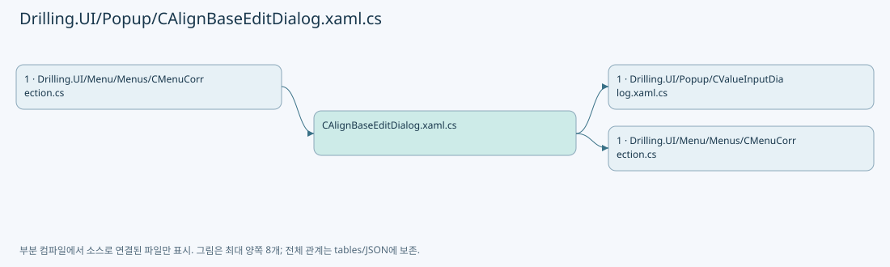
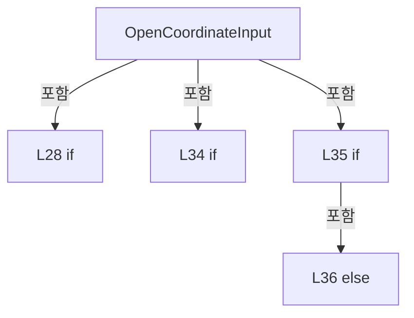
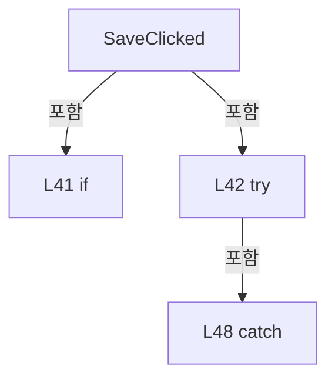
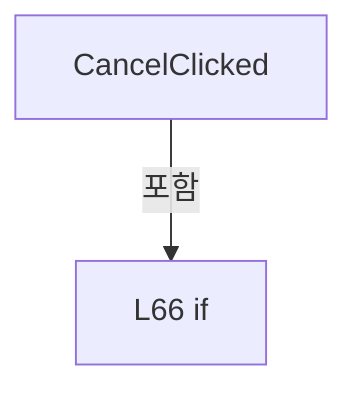
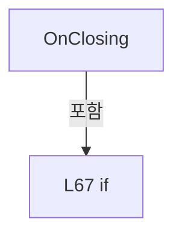
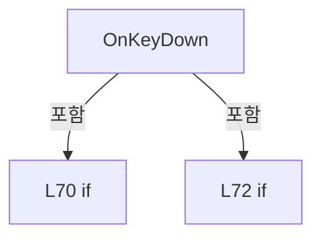

# Drilling.UI/Popup/CAlignBaseEditDialog.xaml.cs

| 항목 | 내용 |
| --- | --- |
| 원본 저장소 | https://github.com/kjuws10-rgb/A3Drilling.git |
| 원본 Commit | 5aee8e58439c9b455cae7c9593c9be986c3e682e |
| 원본 SHA256 | 2f5f3957d5333f8bda9392bb9df84a0be03e512cc7a7cf5f249ec07c955d9d3f |
| 파일 분류 | code |
| 원본 크기/행 | 2,621 bytes / 74 physical lines |
| 인코딩 | utf-8-sig |
| 검토 범위 | 구문/부분 의미 분석에서 추출한 사실. 동작·물리 단위·실장비 합격을 보증하지 않습니다. |
| 원본 링크 | [고정 Commit 원본](https://github.com/kjuws10-rgb/A3Drilling/blob/5aee8e58439c9b455cae7c9593c9be986c3e682e/Drilling.UI/Popup/CAlignBaseEditDialog.xaml.cs) |

## 파일의 역할과 읽는 순서

WPF 화면·사용자 명령·표시 상태를 구성합니다. XAML 이벤트와 코드 비하인드, RootView의 조립 경로를 함께 추적합니다.

## 네임스페이스·타입·상속

| 타입 | 구분 | 원본 범위 | 선언/상속 |
| --- | --- | --- | --- |
| CAlignBaseEditDialog | ClassDeclaration | 10–74 | CAlignBaseEditDialog: Window |

## 멤버 빠른 목록

| 이름 | 종류 | 범위 | 서명 |
| --- | --- | --- | --- |
| _panel | FieldDeclaration | L12–12 | Drilling.UI.Menu.Menus.CAlignBaseEditPanel Drilling.UI.Popup.CAlignBaseEditDialog._panel |
| _save | FieldDeclaration | L13–13 | System.Func<System.Collections.Generic.IReadOnlyDictionary<string, string>, System.Threading.Tasks.Task> Drilling.UI.Popup.CAlignBaseEditDialog._save |
| _saving | FieldDeclaration | L14–14 | bool Drilling.UI.Popup.CAlignBaseEditDialog._saving |
| .ctor | ConstructorDeclaration | L16–24 | Drilling.UI.Popup.CAlignBaseEditDialog.CAlignBaseEditDialog(Drilling.UI.Menu.Menus.CAlignBaseEditPanel, System.Func<System.Collections.Generic.IReadOnlyDictionary<string, string>, System.Threading.Tasks.Task>) |
| OpenCoordinateInput | MethodDeclaration | L26–37 | void Drilling.UI.Popup.CAlignBaseEditDialog.OpenCoordinateInput(object, MouseButtonEventArgs) |
| SaveClicked | MethodDeclaration | L39–56 | void Drilling.UI.Popup.CAlignBaseEditDialog.SaveClicked(object, RoutedEventArgs) |
| SetSaving | MethodDeclaration | L58–64 | void Drilling.UI.Popup.CAlignBaseEditDialog.SetSaving(bool) |
| CancelClicked | MethodDeclaration | L66–66 | void Drilling.UI.Popup.CAlignBaseEditDialog.CancelClicked(object, RoutedEventArgs) |
| OnClosing | MethodDeclaration | L67–67 | void Drilling.UI.Popup.CAlignBaseEditDialog.OnClosing(object?, System.ComponentModel.CancelEventArgs) |
| OnKeyDown | MethodDeclaration | L68–73 | void Drilling.UI.Popup.CAlignBaseEditDialog.OnKeyDown(object, KeyEventArgs) |

## 멤버별 상세 계약·호출·처리 해설

### FieldDeclaration `_panel` · L12–12

[Drilling.UI/Popup/CAlignBaseEditDialog.xaml.cs:12–12](https://github.com/kjuws10-rgb/A3Drilling/blob/5aee8e58439c9b455cae7c9593c9be986c3e682e/Drilling.UI/Popup/CAlignBaseEditDialog.xaml.cs#L12-L12)

| 항목 | 실제 추출 값 |
| --- | --- |
| 서명 | Drilling.UI.Menu.Menus.CAlignBaseEditPanel Drilling.UI.Popup.CAlignBaseEditDialog._panel |
| 접근/수식자 | Private / private, readonly |
| 반환/값 타입 | Drilling.UI.Menu.Menus.CAlignBaseEditPanel |
| 소속 타입 | NamedType:Drilling.UI.Popup.CAlignBaseEditDialog |

현재 부분 분석에서 직접 연결된 호출자는 없습니다. XAML/이벤트/인터페이스·델리게이트·외부 진입을 추가 확인해야 하며, 미사용으로 판정한 것이 아닙니다.

변경 전 점검: 입력/반환 타입, 위 호출자, 예외/취소 경로, 공유 상태와 저장·전송 소비자를 함께 확인합니다. 값의 단위나 물리 방향을 이름만으로 확정하지 않습니다.

### FieldDeclaration `_save` · L13–13

[Drilling.UI/Popup/CAlignBaseEditDialog.xaml.cs:13–13](https://github.com/kjuws10-rgb/A3Drilling/blob/5aee8e58439c9b455cae7c9593c9be986c3e682e/Drilling.UI/Popup/CAlignBaseEditDialog.xaml.cs#L13-L13)

| 항목 | 실제 추출 값 |
| --- | --- |
| 서명 | System.Func<System.Collections.Generic.IReadOnlyDictionary<string, string>, System.Threading.Tasks.Task> Drilling.UI.Popup.CAlignBaseEditDialog._save |
| 접근/수식자 | Private / private, readonly |
| 반환/값 타입 | System.Func<System.Collections.Generic.IReadOnlyDictionary<string, string>, System.Threading.Tasks.Task> |
| 소속 타입 | NamedType:Drilling.UI.Popup.CAlignBaseEditDialog |

현재 부분 분석에서 직접 연결된 호출자는 없습니다. XAML/이벤트/인터페이스·델리게이트·외부 진입을 추가 확인해야 하며, 미사용으로 판정한 것이 아닙니다.

변경 전 점검: 입력/반환 타입, 위 호출자, 예외/취소 경로, 공유 상태와 저장·전송 소비자를 함께 확인합니다. 값의 단위나 물리 방향을 이름만으로 확정하지 않습니다.

### FieldDeclaration `_saving` · L14–14

[Drilling.UI/Popup/CAlignBaseEditDialog.xaml.cs:14–14](https://github.com/kjuws10-rgb/A3Drilling/blob/5aee8e58439c9b455cae7c9593c9be986c3e682e/Drilling.UI/Popup/CAlignBaseEditDialog.xaml.cs#L14-L14)

| 항목 | 실제 추출 값 |
| --- | --- |
| 서명 | bool Drilling.UI.Popup.CAlignBaseEditDialog._saving |
| 접근/수식자 | Private / private |
| 반환/값 타입 | bool |
| 소속 타입 | NamedType:Drilling.UI.Popup.CAlignBaseEditDialog |

현재 부분 분석에서 직접 연결된 호출자는 없습니다. XAML/이벤트/인터페이스·델리게이트·외부 진입을 추가 확인해야 하며, 미사용으로 판정한 것이 아닙니다.

변경 전 점검: 입력/반환 타입, 위 호출자, 예외/취소 경로, 공유 상태와 저장·전송 소비자를 함께 확인합니다. 값의 단위나 물리 방향을 이름만으로 확정하지 않습니다.

### ConstructorDeclaration `.ctor` · L16–24

[Drilling.UI/Popup/CAlignBaseEditDialog.xaml.cs:16–24](https://github.com/kjuws10-rgb/A3Drilling/blob/5aee8e58439c9b455cae7c9593c9be986c3e682e/Drilling.UI/Popup/CAlignBaseEditDialog.xaml.cs#L16-L24)

| 항목 | 실제 추출 값 |
| --- | --- |
| 서명 | Drilling.UI.Popup.CAlignBaseEditDialog.CAlignBaseEditDialog(Drilling.UI.Menu.Menus.CAlignBaseEditPanel, System.Func<System.Collections.Generic.IReadOnlyDictionary<string, string>, System.Threading.Tasks.Task>) |
| 접근/수식자 | Public / public |
| 반환/값 타입 | void |
| 소속 타입 | NamedType:Drilling.UI.Popup.CAlignBaseEditDialog |

입력 계약:

| 이름 | 타입 | 전달 | 선택/기본값 |
| --- | --- | --- | --- |
| panel | Drilling.UI.Menu.Menus.CAlignBaseEditPanel | None | False /  |
| save | System.Func<System.Collections.Generic.IReadOnlyDictionary<string, string>, System.Threading.Tasks.Task> | None | False /  |

정적 호출자로 확인된 위치:

| 호출 파일/행 | 호출 표현식 | 런타임 분기 가능 |
| --- | --- | --- |
| [Drilling.UI/Menu/Menus/CMenuCorrection.cs:2597–2600](https://github.com/kjuws10-rgb/A3Drilling/blob/5aee8e58439c9b455cae7c9593c9be986c3e682e/Drilling.UI/Menu/Menus/CMenuCorrection.cs#L2597-L2600) | new CAlignBaseEditDialog | False |

호출하는 대상과 해석 범위:

| 원본 행 | 표현식 | 분석 상태 | 대상/소스 위치 |
| --- | --- | --- | --- |
| 18 | InitializeComponent | unresolved | None |
| 22 | Math.Min | candidate | OverloadResolutionFailure |
| 23 | Math.Min | candidate | OverloadResolutionFailure |

본문의 실제 연산·분기·예외·반환 순서(원문 위치 순):

| 원본 행 | 종류 | 주석 해설 |
| --- | --- | --- |
| 18 | call | 함수·델리게이트 또는 객체 생성자를 호출합니다: InitializeComponent() |
| 19 | assignment | 값을 대상에 대입합니다: _panel = panel |
| 20 | assignment | 값을 대상에 대입합니다: _save = save |
| 21 | assignment | 값을 대상에 대입합니다: DataContext = panel |
| 22 | assignment | 값을 대상에 대입합니다: Width = Math.Min(Width, SystemParameters.WorkArea.Width - 40) |
| 22 | call | 함수·델리게이트 또는 객체 생성자를 호출합니다: Math.Min(Width, SystemParameters.WorkArea.Width - 40) |
| 23 | assignment | 값을 대상에 대입합니다: Height = Math.Min(Height, SystemParameters.WorkArea.Height - 40) |
| 23 | call | 함수·델리게이트 또는 객체 생성자를 호출합니다: Math.Min(Height, SystemParameters.WorkArea.Height - 40) |

변경 전 점검: 입력/반환 타입, 위 호출자, 예외/취소 경로, 공유 상태와 저장·전송 소비자를 함께 확인합니다. 값의 단위나 물리 방향을 이름만으로 확정하지 않습니다.

### MethodDeclaration `OpenCoordinateInput` · L26–37

[Drilling.UI/Popup/CAlignBaseEditDialog.xaml.cs:26–37](https://github.com/kjuws10-rgb/A3Drilling/blob/5aee8e58439c9b455cae7c9593c9be986c3e682e/Drilling.UI/Popup/CAlignBaseEditDialog.xaml.cs#L26-L37)

| 항목 | 실제 추출 값 |
| --- | --- |
| 서명 | void Drilling.UI.Popup.CAlignBaseEditDialog.OpenCoordinateInput(object, MouseButtonEventArgs) |
| 접근/수식자 | Private / private |
| 반환/값 타입 | void |
| 소속 타입 | NamedType:Drilling.UI.Popup.CAlignBaseEditDialog |

입력 계약:

| 이름 | 타입 | 전달 | 선택/기본값 |
| --- | --- | --- | --- |
| sender | object | None | False /  |
| e | MouseButtonEventArgs | None | False /  |

현재 부분 분석에서 직접 연결된 호출자는 없습니다. XAML/이벤트/인터페이스·델리게이트·외부 진입을 추가 확인해야 하며, 미사용으로 판정한 것이 아닙니다.

호출하는 대상과 해석 범위:

| 원본 행 | 표현식 | 분석 상태 | 대상/소스 위치 |
| --- | --- | --- | --- |
| 32 | new CValueInputDialog | resolved | Drilling.UI.Popup.CValueInputDialog.CValueInputDialog(string, string, Drilling.Common.Managers.EN_RECIPE_DATA_TYPE, double, double) · Drilling.UI/Popup/CValueInputDialog.xaml.cs:13 |
| 34 | dialog.ShowDialog | unresolved | None |

본문의 실제 연산·분기·예외·반환 순서(원문 위치 순):

| 원본 행 | 종류 | 주석 해설 |
| --- | --- | --- |
| 28 | if | 조건에 따라 분기합니다: if (_saving &#124;&#124; sender is not TextBox { DataContext: CAlignBaseEditKey key } input) |
| 28 | return | 호출자에게 값 또는 제어를 반환합니다: return; |
| 29 | assignment | 값을 대상에 대입합니다: e.Handled = true |
| 30 | local-declaration | 지역 변수를 선언합니다: var isX = input.Tag as string == "X"; |
| 30 | variable-initializer | 변수의 초기값을 지정합니다: isX = input.Tag as string == "X" |
| 31 | conditional-expression | 조건에 따라 결과식을 선택합니다: isX ? key.ParameterX : key.ParameterY |
| 31 | local-declaration | 지역 변수를 선언합니다: var parameter = isX ? key.ParameterX : key.ParameterY; |
| 31 | variable-initializer | 변수의 초기값을 지정합니다: parameter = isX ? key.ParameterX : key.ParameterY |
| 32 | conditional-expression | 조건에 따라 결과식을 선택합니다: isX ? "X" : "Y" |
| 32 | call | 함수·델리게이트 또는 객체 생성자를 호출합니다: new CValueInputDialog($"{key.Name} Base{(isX ? "X" : "Y")} (mm)", isX ? key.BaseX : key.BaseY, EN_RECIPE_DATA_TYPE.Double, parameter.Min, parameter.Max) { Owner = this } |
| 32 | local-declaration | 지역 변수를 선언합니다: var dialog = new CValueInputDialog($"{key.Name} Base{(isX ? "X" : "Y")} (mm)", isX ? key.BaseX : key.BaseY, EN_RECIPE_DATA_TYPE.Double, parameter.Min, parameter.Max) { Owner = this }; |
| 32 | variable-initializer | 변수의 초기값을 지정합니다: dialog = new CValueInputDialog($"{key.Name} Base{(isX ? "X" : "Y")} (mm)", isX ? key.BaseX : key.BaseY, EN_RECIPE_DATA_TYPE.Double, parameter.Min, parameter.Max) { Owner = this } |
| 33 | assignment | 값을 대상에 대입합니다: Owner = this |
| 33 | conditional-expression | 조건에 따라 결과식을 선택합니다: isX ? key.BaseX : key.BaseY |
| 34 | call | 함수·델리게이트 또는 객체 생성자를 호출합니다: dialog.ShowDialog() |
| 34 | if | 조건에 따라 분기합니다: if (dialog.ShowDialog() != true) |
| 34 | return | 호출자에게 값 또는 제어를 반환합니다: return; |
| 35 | assignment | 값을 대상에 대입합니다: key.BaseX = dialog.ResultValue |
| 35 | if | 조건에 따라 분기합니다: if (isX) |
| 36 | assignment | 값을 대상에 대입합니다: key.BaseY = dialog.ResultValue |
| 36 | else | 앞 조건이 거짓인 경로입니다: else |

제어 구문의 포함 구조(실제 실행 순서/CFG가 아닌 구문 탐색 그림):

변경 전 점검: 입력/반환 타입, 위 호출자, 예외/취소 경로, 공유 상태와 저장·전송 소비자를 함께 확인합니다. 값의 단위나 물리 방향을 이름만으로 확정하지 않습니다.

### MethodDeclaration `SaveClicked` · L39–56

[Drilling.UI/Popup/CAlignBaseEditDialog.xaml.cs:39–56](https://github.com/kjuws10-rgb/A3Drilling/blob/5aee8e58439c9b455cae7c9593c9be986c3e682e/Drilling.UI/Popup/CAlignBaseEditDialog.xaml.cs#L39-L56)

| 항목 | 실제 추출 값 |
| --- | --- |
| 서명 | void Drilling.UI.Popup.CAlignBaseEditDialog.SaveClicked(object, RoutedEventArgs) |
| 접근/수식자 | Private / private, async |
| 반환/값 타입 | void |
| 소속 타입 | NamedType:Drilling.UI.Popup.CAlignBaseEditDialog |

입력 계약:

| 이름 | 타입 | 전달 | 선택/기본값 |
| --- | --- | --- | --- |
| sender | object | None | False /  |
| e | RoutedEventArgs | None | False /  |

현재 부분 분석에서 직접 연결된 호출자는 없습니다. XAML/이벤트/인터페이스·델리게이트·외부 진입을 추가 확인해야 하며, 미사용으로 판정한 것이 아닙니다.

호출하는 대상과 해석 범위:

| 원본 행 | 표현식 | 분석 상태 | 대상/소스 위치 |
| --- | --- | --- | --- |
| 44 | _panel.BuildValues | resolved | System.Collections.Generic.IReadOnlyDictionary<string, string> Drilling.UI.Menu.Menus.CAlignBaseEditPanel.BuildValues() · Drilling.UI/Menu/Menus/CMenuCorrection.cs:4283 |
| 45 | SetSaving | resolved | void Drilling.UI.Popup.CAlignBaseEditDialog.SetSaving(bool) · Drilling.UI/Popup/CAlignBaseEditDialog.xaml.cs:58 |
| 46 | _save | resolved · 동적 구현 선택 가능 | System.Threading.Tasks.Task System.Func<System.Collections.Generic.IReadOnlyDictionary<string, string>, System.Threading.Tasks.Task>.Invoke(System.Collections.Generic.IReadOnlyDictionary<string, string>) |
| 50 | SetSaving | resolved | void Drilling.UI.Popup.CAlignBaseEditDialog.SetSaving(bool) · Drilling.UI/Popup/CAlignBaseEditDialog.xaml.cs:58 |
| 51 | CRecipeConfirmDialog.ShowWarning | candidate | OverloadResolutionFailure |
| 54 | SetSaving | resolved | void Drilling.UI.Popup.CAlignBaseEditDialog.SetSaving(bool) · Drilling.UI/Popup/CAlignBaseEditDialog.xaml.cs:58 |

본문의 실제 연산·분기·예외·반환 순서(원문 위치 순):

| 원본 행 | 종류 | 주석 해설 |
| --- | --- | --- |
| 41 | if | 조건에 따라 분기합니다: if (_saving) |
| 41 | return | 호출자에게 값 또는 제어를 반환합니다: return; |
| 42 | try | 예외 처리 범위입니다: try |
| 44 | call | 함수·델리게이트 또는 객체 생성자를 호출합니다: _panel.BuildValues() |
| 44 | local-declaration | 지역 변수를 선언합니다: var values = _panel.BuildValues(); |
| 44 | variable-initializer | 변수의 초기값을 지정합니다: values = _panel.BuildValues() |
| 45 | call | 함수·델리게이트 또는 객체 생성자를 호출합니다: SetSaving(true) |
| 46 | await | 비동기 완료를 기다립니다: await _save(values) |
| 46 | call | 함수·델리게이트 또는 객체 생성자를 호출합니다: _save(values) |
| 48 | catch | 지정 예외를 처리합니다: catch (Exception exception) |
| 50 | call | 함수·델리게이트 또는 객체 생성자를 호출합니다: SetSaving(false) |
| 51 | call | 함수·델리게이트 또는 객체 생성자를 호출합니다: CRecipeConfirmDialog.ShowWarning("Base 저장 확인", exception.Message, this) |
| 52 | return | 호출자에게 값 또는 제어를 반환합니다: return; |
| 54 | call | 함수·델리게이트 또는 객체 생성자를 호출합니다: SetSaving(false) |
| 55 | assignment | 값을 대상에 대입합니다: DialogResult = true |

제어 구문의 포함 구조(실제 실행 순서/CFG가 아닌 구문 탐색 그림):

변경 전 점검: 입력/반환 타입, 위 호출자, 예외/취소 경로, 공유 상태와 저장·전송 소비자를 함께 확인합니다. 값의 단위나 물리 방향을 이름만으로 확정하지 않습니다.

### MethodDeclaration `SetSaving` · L58–64

[Drilling.UI/Popup/CAlignBaseEditDialog.xaml.cs:58–64](https://github.com/kjuws10-rgb/A3Drilling/blob/5aee8e58439c9b455cae7c9593c9be986c3e682e/Drilling.UI/Popup/CAlignBaseEditDialog.xaml.cs#L58-L64)

| 항목 | 실제 추출 값 |
| --- | --- |
| 서명 | void Drilling.UI.Popup.CAlignBaseEditDialog.SetSaving(bool) |
| 접근/수식자 | Private / private |
| 반환/값 타입 | void |
| 소속 타입 | NamedType:Drilling.UI.Popup.CAlignBaseEditDialog |

입력 계약:

| 이름 | 타입 | 전달 | 선택/기본값 |
| --- | --- | --- | --- |
| saving | bool | None | False /  |

정적 호출자로 확인된 위치:

| 호출 파일/행 | 호출 표현식 | 런타임 분기 가능 |
| --- | --- | --- |
| [Drilling.UI/Popup/CAlignBaseEditDialog.xaml.cs:45–45](https://github.com/kjuws10-rgb/A3Drilling/blob/5aee8e58439c9b455cae7c9593c9be986c3e682e/Drilling.UI/Popup/CAlignBaseEditDialog.xaml.cs#L45-L45) | SetSaving | False |
| [Drilling.UI/Popup/CAlignBaseEditDialog.xaml.cs:50–50](https://github.com/kjuws10-rgb/A3Drilling/blob/5aee8e58439c9b455cae7c9593c9be986c3e682e/Drilling.UI/Popup/CAlignBaseEditDialog.xaml.cs#L50-L50) | SetSaving | False |
| [Drilling.UI/Popup/CAlignBaseEditDialog.xaml.cs:54–54](https://github.com/kjuws10-rgb/A3Drilling/blob/5aee8e58439c9b455cae7c9593c9be986c3e682e/Drilling.UI/Popup/CAlignBaseEditDialog.xaml.cs#L54-L54) | SetSaving | False |

본문의 실제 연산·분기·예외·반환 순서(원문 위치 순):

| 원본 행 | 종류 | 주석 해설 |
| --- | --- | --- |
| 60 | assignment | 값을 대상에 대입합니다: _saving = saving |
| 61 | assignment | 값을 대상에 대입합니다: PreviewArea.IsEnabled = !saving |
| 62 | assignment | 값을 대상에 대입합니다: SaveButton.IsEnabled = !saving |
| 63 | assignment | 값을 대상에 대입합니다: CancelButton.IsEnabled = !saving |

변경 전 점검: 입력/반환 타입, 위 호출자, 예외/취소 경로, 공유 상태와 저장·전송 소비자를 함께 확인합니다. 값의 단위나 물리 방향을 이름만으로 확정하지 않습니다.

### MethodDeclaration `CancelClicked` · L66–66

[Drilling.UI/Popup/CAlignBaseEditDialog.xaml.cs:66–66](https://github.com/kjuws10-rgb/A3Drilling/blob/5aee8e58439c9b455cae7c9593c9be986c3e682e/Drilling.UI/Popup/CAlignBaseEditDialog.xaml.cs#L66-L66)

| 항목 | 실제 추출 값 |
| --- | --- |
| 서명 | void Drilling.UI.Popup.CAlignBaseEditDialog.CancelClicked(object, RoutedEventArgs) |
| 접근/수식자 | Private / private |
| 반환/값 타입 | void |
| 소속 타입 | NamedType:Drilling.UI.Popup.CAlignBaseEditDialog |

입력 계약:

| 이름 | 타입 | 전달 | 선택/기본값 |
| --- | --- | --- | --- |
| sender | object | None | False /  |
| e | RoutedEventArgs | None | False /  |

현재 부분 분석에서 직접 연결된 호출자는 없습니다. XAML/이벤트/인터페이스·델리게이트·외부 진입을 추가 확인해야 하며, 미사용으로 판정한 것이 아닙니다.

본문의 실제 연산·분기·예외·반환 순서(원문 위치 순):

| 원본 행 | 종류 | 주석 해설 |
| --- | --- | --- |
| 66 | assignment | 값을 대상에 대입합니다: DialogResult = false |
| 66 | if | 조건에 따라 분기합니다: if (!_saving) |

제어 구문의 포함 구조(실제 실행 순서/CFG가 아닌 구문 탐색 그림):

변경 전 점검: 입력/반환 타입, 위 호출자, 예외/취소 경로, 공유 상태와 저장·전송 소비자를 함께 확인합니다. 값의 단위나 물리 방향을 이름만으로 확정하지 않습니다.

### MethodDeclaration `OnClosing` · L67–67

[Drilling.UI/Popup/CAlignBaseEditDialog.xaml.cs:67–67](https://github.com/kjuws10-rgb/A3Drilling/blob/5aee8e58439c9b455cae7c9593c9be986c3e682e/Drilling.UI/Popup/CAlignBaseEditDialog.xaml.cs#L67-L67)

| 항목 | 실제 추출 값 |
| --- | --- |
| 서명 | void Drilling.UI.Popup.CAlignBaseEditDialog.OnClosing(object?, System.ComponentModel.CancelEventArgs) |
| 접근/수식자 | Private / private |
| 반환/값 타입 | void |
| 소속 타입 | NamedType:Drilling.UI.Popup.CAlignBaseEditDialog |

입력 계약:

| 이름 | 타입 | 전달 | 선택/기본값 |
| --- | --- | --- | --- |
| sender | object? | None | False /  |
| e | System.ComponentModel.CancelEventArgs | None | False /  |

현재 부분 분석에서 직접 연결된 호출자는 없습니다. XAML/이벤트/인터페이스·델리게이트·외부 진입을 추가 확인해야 하며, 미사용으로 판정한 것이 아닙니다.

본문의 실제 연산·분기·예외·반환 순서(원문 위치 순):

| 원본 행 | 종류 | 주석 해설 |
| --- | --- | --- |
| 67 | assignment | 값을 대상에 대입합니다: e.Cancel = true |
| 67 | if | 조건에 따라 분기합니다: if (_saving) |

제어 구문의 포함 구조(실제 실행 순서/CFG가 아닌 구문 탐색 그림):

변경 전 점검: 입력/반환 타입, 위 호출자, 예외/취소 경로, 공유 상태와 저장·전송 소비자를 함께 확인합니다. 값의 단위나 물리 방향을 이름만으로 확정하지 않습니다.

### MethodDeclaration `OnKeyDown` · L68–73

[Drilling.UI/Popup/CAlignBaseEditDialog.xaml.cs:68–73](https://github.com/kjuws10-rgb/A3Drilling/blob/5aee8e58439c9b455cae7c9593c9be986c3e682e/Drilling.UI/Popup/CAlignBaseEditDialog.xaml.cs#L68-L73)

| 항목 | 실제 추출 값 |
| --- | --- |
| 서명 | void Drilling.UI.Popup.CAlignBaseEditDialog.OnKeyDown(object, KeyEventArgs) |
| 접근/수식자 | Private / private |
| 반환/값 타입 | void |
| 소속 타입 | NamedType:Drilling.UI.Popup.CAlignBaseEditDialog |

입력 계약:

| 이름 | 타입 | 전달 | 선택/기본값 |
| --- | --- | --- | --- |
| sender | object | None | False /  |
| e | KeyEventArgs | None | False /  |

현재 부분 분석에서 직접 연결된 호출자는 없습니다. XAML/이벤트/인터페이스·델리게이트·외부 진입을 추가 확인해야 하며, 미사용으로 판정한 것이 아닙니다.

본문의 실제 연산·분기·예외·반환 순서(원문 위치 순):

| 원본 행 | 종류 | 주석 해설 |
| --- | --- | --- |
| 70 | if | 조건에 따라 분기합니다: if (e.Key != Key.Escape) |
| 70 | return | 호출자에게 값 또는 제어를 반환합니다: return; |
| 71 | assignment | 값을 대상에 대입합니다: e.Handled = true |
| 72 | assignment | 값을 대상에 대입합니다: DialogResult = false |
| 72 | if | 조건에 따라 분기합니다: if (!_saving) |

제어 구문의 포함 구조(실제 실행 순서/CFG가 아닌 구문 탐색 그림):

변경 전 점검: 입력/반환 타입, 위 호출자, 예외/취소 경로, 공유 상태와 저장·전송 소비자를 함께 확인합니다. 값의 단위나 물리 방향을 이름만으로 확정하지 않습니다.

## 구문·바인딩 한계

전체 WPF/벤더 SDK/프로젝트별 빌드 조건을 로드한 정식 빌드가 아닙니다. `resolved`는 이 부분 컴파일에서의 심볼 연결이며 virtual/interface/delegate/이벤트/Reflection/XAML의 실제 런타임 구현을 확정하지 않습니다. `candidate`와 `unresolved`는 후속 확인 대상으로 남깁니다.

## 원문 전체 주석 해설본

[원본 모든 행과 행별 해설 보기](../../../annotated/Drilling.UI/Popup/CAlignBaseEditDialog.xaml.cs.annotated.txt)

원본을 빠뜨리거나 임의로 줄이지 않았습니다. `L000001 |` 표시는 원본 행 번호, `// 해설`은 별도 설명입니다. 실행용 소스가 아닌 문서입니다.

## 수정·재검증 체크

- 원본 Commit과 현재 작업 파일 SHA가 같은지 먼저 확인합니다. 다르면 이 문서를 과거 버전 자료로 취급합니다.
- 선언·직접 호출·이벤트/인터페이스 경계·설정 소비를 함께 확인합니다. 정적 연결의 빈 곳을 정상 경로로 추정하지 않습니다.
- 저장 형식/단위/식별자·재시도·취소·예외·롤백에 영향을 주는 변경은 상세 해설장과 호출자를 다시 검토합니다.
- 도구의 구문 추출과 별도 정적 추적 해설, 실제 빌드·시뮬레이션·실장비 검증 결과를 분리합니다.
