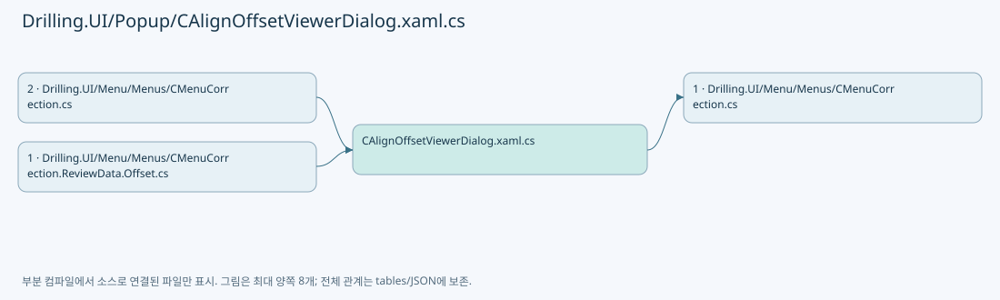
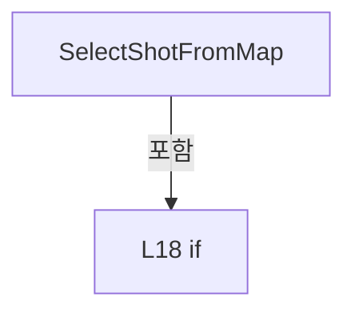
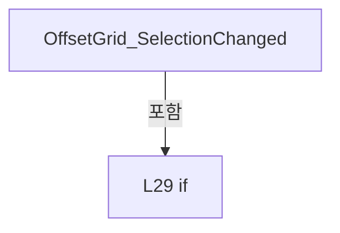
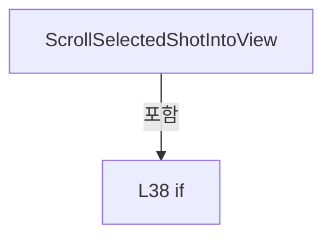
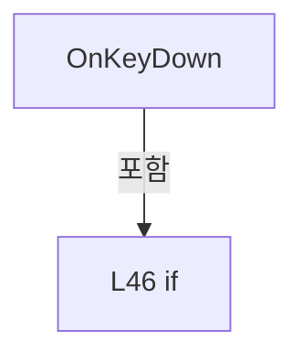

# Drilling.UI/Popup/CAlignOffsetViewerDialog.xaml.cs

| 항목 | 내용 |
| --- | --- |
| 원본 저장소 | https://github.com/kjuws10-rgb/A3Drilling.git |
| 원본 Commit | 5aee8e58439c9b455cae7c9593c9be986c3e682e |
| 원본 SHA256 | b8cdd252f3ef53e97d90b864b65703f45217b454dc59a437d2ef26317f7ff3af |
| 파일 분류 | code |
| 원본 크기/행 | 1,550 bytes / 47 physical lines |
| 인코딩 | utf-8-sig |
| 검토 범위 | 구문/부분 의미 분석에서 추출한 사실. 동작·물리 단위·실장비 합격을 보증하지 않습니다. |
| 원본 링크 | [고정 Commit 원본](https://github.com/kjuws10-rgb/A3Drilling/blob/5aee8e58439c9b455cae7c9593c9be986c3e682e/Drilling.UI/Popup/CAlignOffsetViewerDialog.xaml.cs) |

## 파일의 역할과 읽는 순서

WPF 화면·사용자 명령·표시 상태를 구성합니다. XAML 이벤트와 코드 비하인드, RootView의 조립 경로를 함께 추적합니다.

## 네임스페이스·타입·상속

| 타입 | 구분 | 원본 범위 | 선언/상속 |
| --- | --- | --- | --- |
| CAlignOffsetViewerDialog | ClassDeclaration | 8–47 | CAlignOffsetViewerDialog: Window |

## 멤버 빠른 목록

| 이름 | 종류 | 범위 | 서명 |
| --- | --- | --- | --- |
| .ctor | ConstructorDeclaration | L10–14 | Drilling.UI.Popup.CAlignOffsetViewerDialog.CAlignOffsetViewerDialog(Drilling.UI.Menu.Menus.CAlignOffsetViewerPanel) |
| SelectShotFromMap | MethodDeclaration | L16–25 | void Drilling.UI.Popup.CAlignOffsetViewerDialog.SelectShotFromMap(object, MouseButtonEventArgs) |
| OffsetGrid_SelectionChanged | MethodDeclaration | L27–34 | void Drilling.UI.Popup.CAlignOffsetViewerDialog.OffsetGrid_SelectionChanged(object, SelectionChangedEventArgs) |
| ScrollSelectedShotIntoView | MethodDeclaration | L36–43 | void Drilling.UI.Popup.CAlignOffsetViewerDialog.ScrollSelectedShotIntoView(Drilling.UI.Menu.Menus.ST_ALIGN_OFFSET_VIEW_ROW?) |
| OnCloseClicked | MethodDeclaration | L45–45 | void Drilling.UI.Popup.CAlignOffsetViewerDialog.OnCloseClicked(object, RoutedEventArgs) |
| OnKeyDown | MethodDeclaration | L46–46 | void Drilling.UI.Popup.CAlignOffsetViewerDialog.OnKeyDown(object, KeyEventArgs) |

## 멤버별 상세 계약·호출·처리 해설

### ConstructorDeclaration `.ctor` · L10–14

[Drilling.UI/Popup/CAlignOffsetViewerDialog.xaml.cs:10–14](https://github.com/kjuws10-rgb/A3Drilling/blob/5aee8e58439c9b455cae7c9593c9be986c3e682e/Drilling.UI/Popup/CAlignOffsetViewerDialog.xaml.cs#L10-L14)

| 항목 | 실제 추출 값 |
| --- | --- |
| 서명 | Drilling.UI.Popup.CAlignOffsetViewerDialog.CAlignOffsetViewerDialog(Drilling.UI.Menu.Menus.CAlignOffsetViewerPanel) |
| 접근/수식자 | Public / public |
| 반환/값 타입 | void |
| 소속 타입 | NamedType:Drilling.UI.Popup.CAlignOffsetViewerDialog |

입력 계약:

| 이름 | 타입 | 전달 | 선택/기본값 |
| --- | --- | --- | --- |
| panel | Drilling.UI.Menu.Menus.CAlignOffsetViewerPanel | None | False /  |

정적 호출자로 확인된 위치:

| 호출 파일/행 | 호출 표현식 | 런타임 분기 가능 |
| --- | --- | --- |
| [Drilling.UI/Menu/Menus/CMenuCorrection.ReviewData.Offset.cs:234–237](https://github.com/kjuws10-rgb/A3Drilling/blob/5aee8e58439c9b455cae7c9593c9be986c3e682e/Drilling.UI/Menu/Menus/CMenuCorrection.ReviewData.Offset.cs#L234-L237) | new CAlignOffsetViewerDialog | False |
| [Drilling.UI/Menu/Menus/CMenuCorrection.cs:2752–2755](https://github.com/kjuws10-rgb/A3Drilling/blob/5aee8e58439c9b455cae7c9593c9be986c3e682e/Drilling.UI/Menu/Menus/CMenuCorrection.cs#L2752-L2755) | new CAlignOffsetViewerDialog | False |
| [Drilling.UI/Menu/Menus/CMenuCorrection.cs:4134–4137](https://github.com/kjuws10-rgb/A3Drilling/blob/5aee8e58439c9b455cae7c9593c9be986c3e682e/Drilling.UI/Menu/Menus/CMenuCorrection.cs#L4134-L4137) | new CAlignOffsetViewerDialog | False |

호출하는 대상과 해석 범위:

| 원본 행 | 표현식 | 분석 상태 | 대상/소스 위치 |
| --- | --- | --- | --- |
| 12 | InitializeComponent | unresolved | None |

본문의 실제 연산·분기·예외·반환 순서(원문 위치 순):

| 원본 행 | 종류 | 주석 해설 |
| --- | --- | --- |
| 12 | call | 함수·델리게이트 또는 객체 생성자를 호출합니다: InitializeComponent() |
| 13 | assignment | 값을 대상에 대입합니다: DataContext = panel |

변경 전 점검: 입력/반환 타입, 위 호출자, 예외/취소 경로, 공유 상태와 저장·전송 소비자를 함께 확인합니다. 값의 단위나 물리 방향을 이름만으로 확정하지 않습니다.

### MethodDeclaration `SelectShotFromMap` · L16–25

[Drilling.UI/Popup/CAlignOffsetViewerDialog.xaml.cs:16–25](https://github.com/kjuws10-rgb/A3Drilling/blob/5aee8e58439c9b455cae7c9593c9be986c3e682e/Drilling.UI/Popup/CAlignOffsetViewerDialog.xaml.cs#L16-L25)

| 항목 | 실제 추출 값 |
| --- | --- |
| 서명 | void Drilling.UI.Popup.CAlignOffsetViewerDialog.SelectShotFromMap(object, MouseButtonEventArgs) |
| 접근/수식자 | Private / private |
| 반환/값 타입 | void |
| 소속 타입 | NamedType:Drilling.UI.Popup.CAlignOffsetViewerDialog |

입력 계약:

| 이름 | 타입 | 전달 | 선택/기본값 |
| --- | --- | --- | --- |
| sender | object | None | False /  |
| e | MouseButtonEventArgs | None | False /  |

현재 부분 분석에서 직접 연결된 호출자는 없습니다. XAML/이벤트/인터페이스·델리게이트·외부 진입을 추가 확인해야 하며, 미사용으로 판정한 것이 아닙니다.

호출하는 대상과 해석 범위:

| 원본 행 | 표현식 | 분석 상태 | 대상/소스 위치 |
| --- | --- | --- | --- |
| 21 | e.GetPosition | unresolved | None |
| 22 | panel.SelectShotAt | candidate | OverloadResolutionFailure |
| 23 | ScrollSelectedShotIntoView | resolved | void Drilling.UI.Popup.CAlignOffsetViewerDialog.ScrollSelectedShotIntoView(Drilling.UI.Menu.Menus.ST_ALIGN_OFFSET_VIEW_ROW?) · Drilling.UI/Popup/CAlignOffsetViewerDialog.xaml.cs:36 |

본문의 실제 연산·분기·예외·반환 순서(원문 위치 순):

| 원본 행 | 종류 | 주석 해설 |
| --- | --- | --- |
| 18 | if | 조건에 따라 분기합니다: if (sender is not FrameworkElement map &#124;&#124; DataContext is not CAlignOffsetViewerPanel panel) |
| 19 | return | 호출자에게 값 또는 제어를 반환합니다: return; |
| 21 | call | 함수·델리게이트 또는 객체 생성자를 호출합니다: e.GetPosition(map) |
| 21 | local-declaration | 지역 변수를 선언합니다: var point = e.GetPosition(map); |
| 21 | variable-initializer | 변수의 초기값을 지정합니다: point = e.GetPosition(map) |
| 22 | call | 함수·델리게이트 또는 객체 생성자를 호출합니다: panel.SelectShotAt(point.X, point.Y) |
| 23 | call | 함수·델리게이트 또는 객체 생성자를 호출합니다: ScrollSelectedShotIntoView(panel.SelectedRow) |
| 24 | assignment | 값을 대상에 대입합니다: e.Handled = true |

제어 구문의 포함 구조(실제 실행 순서/CFG가 아닌 구문 탐색 그림):

변경 전 점검: 입력/반환 타입, 위 호출자, 예외/취소 경로, 공유 상태와 저장·전송 소비자를 함께 확인합니다. 값의 단위나 물리 방향을 이름만으로 확정하지 않습니다.

### MethodDeclaration `OffsetGrid_SelectionChanged` · L27–34

[Drilling.UI/Popup/CAlignOffsetViewerDialog.xaml.cs:27–34](https://github.com/kjuws10-rgb/A3Drilling/blob/5aee8e58439c9b455cae7c9593c9be986c3e682e/Drilling.UI/Popup/CAlignOffsetViewerDialog.xaml.cs#L27-L34)

| 항목 | 실제 추출 값 |
| --- | --- |
| 서명 | void Drilling.UI.Popup.CAlignOffsetViewerDialog.OffsetGrid_SelectionChanged(object, SelectionChangedEventArgs) |
| 접근/수식자 | Private / private |
| 반환/값 타입 | void |
| 소속 타입 | NamedType:Drilling.UI.Popup.CAlignOffsetViewerDialog |

입력 계약:

| 이름 | 타입 | 전달 | 선택/기본값 |
| --- | --- | --- | --- |
| sender | object | None | False /  |
| e | SelectionChangedEventArgs | None | False /  |

현재 부분 분석에서 직접 연결된 호출자는 없습니다. XAML/이벤트/인터페이스·델리게이트·외부 진입을 추가 확인해야 하며, 미사용으로 판정한 것이 아닙니다.

호출하는 대상과 해석 범위:

| 원본 행 | 표현식 | 분석 상태 | 대상/소스 위치 |
| --- | --- | --- | --- |
| 33 | panel.SelectShotByKey | resolved | void Drilling.UI.Menu.Menus.CAlignOffsetViewerPanel.SelectShotByKey(string) · Drilling.UI/Menu/Menus/CMenuCorrection.cs:5577 |

본문의 실제 연산·분기·예외·반환 순서(원문 위치 순):

| 원본 행 | 종류 | 주석 해설 |
| --- | --- | --- |
| 29 | if | 조건에 따라 분기합니다: if (sender is not DataGrid { SelectedItem: ST_ALIGN_OFFSET_VIEW_ROW row } &#124;&#124; DataContext is not CAlignOffsetViewerPanel panel) |
| 31 | return | 호출자에게 값 또는 제어를 반환합니다: return; |
| 33 | call | 함수·델리게이트 또는 객체 생성자를 호출합니다: panel.SelectShotByKey(row.ShotKey) |

제어 구문의 포함 구조(실제 실행 순서/CFG가 아닌 구문 탐색 그림):

변경 전 점검: 입력/반환 타입, 위 호출자, 예외/취소 경로, 공유 상태와 저장·전송 소비자를 함께 확인합니다. 값의 단위나 물리 방향을 이름만으로 확정하지 않습니다.

### MethodDeclaration `ScrollSelectedShotIntoView` · L36–43

[Drilling.UI/Popup/CAlignOffsetViewerDialog.xaml.cs:36–43](https://github.com/kjuws10-rgb/A3Drilling/blob/5aee8e58439c9b455cae7c9593c9be986c3e682e/Drilling.UI/Popup/CAlignOffsetViewerDialog.xaml.cs#L36-L43)

| 항목 | 실제 추출 값 |
| --- | --- |
| 서명 | void Drilling.UI.Popup.CAlignOffsetViewerDialog.ScrollSelectedShotIntoView(Drilling.UI.Menu.Menus.ST_ALIGN_OFFSET_VIEW_ROW?) |
| 접근/수식자 | Private / private |
| 반환/값 타입 | void |
| 소속 타입 | NamedType:Drilling.UI.Popup.CAlignOffsetViewerDialog |

입력 계약:

| 이름 | 타입 | 전달 | 선택/기본값 |
| --- | --- | --- | --- |
| row | Drilling.UI.Menu.Menus.ST_ALIGN_OFFSET_VIEW_ROW? | None | False /  |

정적 호출자로 확인된 위치:

| 호출 파일/행 | 호출 표현식 | 런타임 분기 가능 |
| --- | --- | --- |
| [Drilling.UI/Popup/CAlignOffsetViewerDialog.xaml.cs:23–23](https://github.com/kjuws10-rgb/A3Drilling/blob/5aee8e58439c9b455cae7c9593c9be986c3e682e/Drilling.UI/Popup/CAlignOffsetViewerDialog.xaml.cs#L23-L23) | ScrollSelectedShotIntoView | False |

호출하는 대상과 해석 범위:

| 원본 행 | 표현식 | 분석 상태 | 대상/소스 위치 |
| --- | --- | --- | --- |
| 40 | OffsetGrid.Dispatcher.BeginInvoke | unresolved | None |
| 41 | OffsetGrid.ScrollIntoView | unresolved | None |

본문의 실제 연산·분기·예외·반환 순서(원문 위치 순):

| 원본 행 | 종류 | 주석 해설 |
| --- | --- | --- |
| 38 | if | 조건에 따라 분기합니다: if (row is null) |
| 39 | return | 호출자에게 값 또는 제어를 반환합니다: return; |
| 40 | assignment | 값을 대상에 대입합니다: _ = OffsetGrid.Dispatcher.BeginInvoke( () => OffsetGrid.ScrollIntoView(row), System.Windows.Threading.DispatcherPriority.Background) |
| 40 | call | 함수·델리게이트 또는 객체 생성자를 호출합니다: OffsetGrid.Dispatcher.BeginInvoke( () => OffsetGrid.ScrollIntoView(row), System.Windows.Threading.DispatcherPriority.Background) |
| 41 | call | 함수·델리게이트 또는 객체 생성자를 호출합니다: OffsetGrid.ScrollIntoView(row) |

제어 구문의 포함 구조(실제 실행 순서/CFG가 아닌 구문 탐색 그림):

변경 전 점검: 입력/반환 타입, 위 호출자, 예외/취소 경로, 공유 상태와 저장·전송 소비자를 함께 확인합니다. 값의 단위나 물리 방향을 이름만으로 확정하지 않습니다.

### MethodDeclaration `OnCloseClicked` · L45–45

[Drilling.UI/Popup/CAlignOffsetViewerDialog.xaml.cs:45–45](https://github.com/kjuws10-rgb/A3Drilling/blob/5aee8e58439c9b455cae7c9593c9be986c3e682e/Drilling.UI/Popup/CAlignOffsetViewerDialog.xaml.cs#L45-L45)

| 항목 | 실제 추출 값 |
| --- | --- |
| 서명 | void Drilling.UI.Popup.CAlignOffsetViewerDialog.OnCloseClicked(object, RoutedEventArgs) |
| 접근/수식자 | Private / private |
| 반환/값 타입 | void |
| 소속 타입 | NamedType:Drilling.UI.Popup.CAlignOffsetViewerDialog |

입력 계약:

| 이름 | 타입 | 전달 | 선택/기본값 |
| --- | --- | --- | --- |
| sender | object | None | False /  |
| e | RoutedEventArgs | None | False /  |

현재 부분 분석에서 직접 연결된 호출자는 없습니다. XAML/이벤트/인터페이스·델리게이트·외부 진입을 추가 확인해야 하며, 미사용으로 판정한 것이 아닙니다.

호출하는 대상과 해석 범위:

| 원본 행 | 표현식 | 분석 상태 | 대상/소스 위치 |
| --- | --- | --- | --- |
| 45 | Close | unresolved | None |

본문의 실제 연산·분기·예외·반환 순서(원문 위치 순):

| 원본 행 | 종류 | 주석 해설 |
| --- | --- | --- |
| 45 | call | 함수·델리게이트 또는 객체 생성자를 호출합니다: Close() |

변경 전 점검: 입력/반환 타입, 위 호출자, 예외/취소 경로, 공유 상태와 저장·전송 소비자를 함께 확인합니다. 값의 단위나 물리 방향을 이름만으로 확정하지 않습니다.

### MethodDeclaration `OnKeyDown` · L46–46

[Drilling.UI/Popup/CAlignOffsetViewerDialog.xaml.cs:46–46](https://github.com/kjuws10-rgb/A3Drilling/blob/5aee8e58439c9b455cae7c9593c9be986c3e682e/Drilling.UI/Popup/CAlignOffsetViewerDialog.xaml.cs#L46-L46)

| 항목 | 실제 추출 값 |
| --- | --- |
| 서명 | void Drilling.UI.Popup.CAlignOffsetViewerDialog.OnKeyDown(object, KeyEventArgs) |
| 접근/수식자 | Private / private |
| 반환/값 타입 | void |
| 소속 타입 | NamedType:Drilling.UI.Popup.CAlignOffsetViewerDialog |

입력 계약:

| 이름 | 타입 | 전달 | 선택/기본값 |
| --- | --- | --- | --- |
| sender | object | None | False /  |
| e | KeyEventArgs | None | False /  |

현재 부분 분석에서 직접 연결된 호출자는 없습니다. XAML/이벤트/인터페이스·델리게이트·외부 진입을 추가 확인해야 하며, 미사용으로 판정한 것이 아닙니다.

호출하는 대상과 해석 범위:

| 원본 행 | 표현식 | 분석 상태 | 대상/소스 위치 |
| --- | --- | --- | --- |
| 46 | Close | unresolved | None |

본문의 실제 연산·분기·예외·반환 순서(원문 위치 순):

| 원본 행 | 종류 | 주석 해설 |
| --- | --- | --- |
| 46 | call | 함수·델리게이트 또는 객체 생성자를 호출합니다: Close() |
| 46 | if | 조건에 따라 분기합니다: if (e.Key == Key.Escape) |

제어 구문의 포함 구조(실제 실행 순서/CFG가 아닌 구문 탐색 그림):

변경 전 점검: 입력/반환 타입, 위 호출자, 예외/취소 경로, 공유 상태와 저장·전송 소비자를 함께 확인합니다. 값의 단위나 물리 방향을 이름만으로 확정하지 않습니다.

## 구문·바인딩 한계

전체 WPF/벤더 SDK/프로젝트별 빌드 조건을 로드한 정식 빌드가 아닙니다. `resolved`는 이 부분 컴파일에서의 심볼 연결이며 virtual/interface/delegate/이벤트/Reflection/XAML의 실제 런타임 구현을 확정하지 않습니다. `candidate`와 `unresolved`는 후속 확인 대상으로 남깁니다.

## 원문 전체 주석 해설본

[원본 모든 행과 행별 해설 보기](../../../annotated/Drilling.UI/Popup/CAlignOffsetViewerDialog.xaml.cs.annotated.txt)

원본을 빠뜨리거나 임의로 줄이지 않았습니다. `L000001 |` 표시는 원본 행 번호, `// 해설`은 별도 설명입니다. 실행용 소스가 아닌 문서입니다.

## 수정·재검증 체크

- 원본 Commit과 현재 작업 파일 SHA가 같은지 먼저 확인합니다. 다르면 이 문서를 과거 버전 자료로 취급합니다.
- 선언·직접 호출·이벤트/인터페이스 경계·설정 소비를 함께 확인합니다. 정적 연결의 빈 곳을 정상 경로로 추정하지 않습니다.
- 저장 형식/단위/식별자·재시도·취소·예외·롤백에 영향을 주는 변경은 상세 해설장과 호출자를 다시 검토합니다.
- 도구의 구문 추출과 별도 정적 추적 해설, 실제 빌드·시뮬레이션·실장비 검증 결과를 분리합니다.
