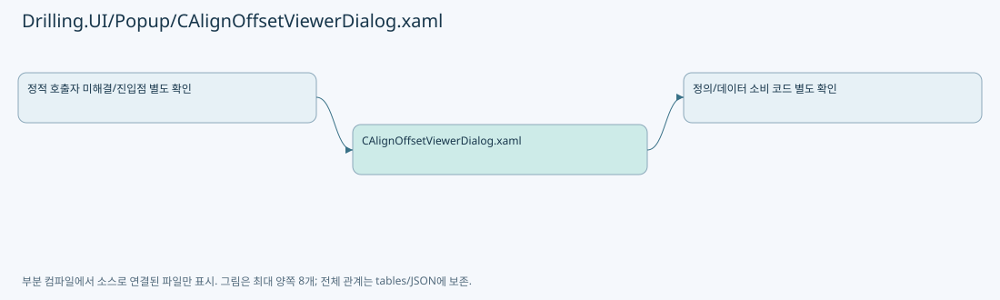

# Drilling.UI/Popup/CAlignOffsetViewerDialog.xaml

| 항목 | 내용 |
| --- | --- |
| 원본 저장소 | https://github.com/kjuws10-rgb/A3Drilling.git |
| 원본 Commit | 0219666f9053b907d96d7e0aa7d0c6c1be3a73d4 |
| 원본 SHA256 | 1c8c49e33729584a244fc635fcb170dece2268e4fa288f51f27df2e2764df711 |
| 파일 분류 | code |
| 원본 크기/행 | 26,222 bytes / 410 physical lines |
| 인코딩 | utf-8-sig |
| 검토 범위 | 구문/부분 의미 분석에서 추출한 사실. 동작·물리 단위·실장비 합격을 보증하지 않습니다. |
| 원본 링크 | [고정 Commit 원본](https://github.com/kjuws10-rgb/A3Drilling/blob/0219666f9053b907d96d7e0aa7d0c6c1be3a73d4/Drilling.UI/Popup/CAlignOffsetViewerDialog.xaml) |

## 파일의 역할과 읽는 순서

WPF 화면·사용자 명령·표시 상태를 구성합니다. XAML 이벤트와 코드 비하인드, RootView의 조립 경로를 함께 추적합니다.

## 화면 구성과 코드 비하인드 연결

| 항목 | 추출 값 |
| --- | --- |
| 코드 비하인드 후보 | Drilling.UI/Popup/CAlignOffsetViewerDialog.xaml.cs |
| 이름 있는 요소 | ShotMapSurface, OffsetGrid |
| 이벤트 개수 | 4 |
| Binding 표현 개수 | 40 |

이름 있는 요소는 WPF가 필드를 생성할 수 있는 XAML 선언입니다. 문서 추출기는 WPF 생성 코드를 만들거나 로드하지 않으므로 C# 원문 멤버 수에 합산하지 않습니다.

| 요소 이름 | 원본 범위 |
| --- | --- |
| ShotMapSurface | L214–214 |
| OffsetGrid | L305–305 |

| 이벤트 | 핸들러 이름 | 원본 범위 | 해석 |
| --- | --- | --- | --- |
| KeyDown | OnKeyDown | L11–11 | 코드 비하인드/이벤트 라우팅에서 실제 연결 확인 필요 |
| MouseLeftButtonDown | SelectShotFromMap | L219–219 | 코드 비하인드/이벤트 라우팅에서 실제 연결 확인 필요 |
| SelectionChanged | OffsetGrid_SelectionChanged | L324–324 | 코드 비하인드/이벤트 라우팅에서 실제 연결 확인 필요 |
| Click | OnCloseClicked | L407–407 | 코드 비하인드/이벤트 라우팅에서 실제 연결 확인 필요 |

| Binding 표현 | 원본 범위 |
| --- | --- |
| {Binding ViewerTitle} | L4–4 |
| {Binding IsSelected} | L39–39 |
| {Binding ViewerTitle} | L66–66 |
| {Binding RecipeName, StringFormat='CURRENT RECIPE : {0}'} | L67–67 |
| {Binding SelectedCellTitle} | L73–73 |
| {Binding SelectedShotName} | L78–78 |
| {Binding Summary} | L113–113 |
| {Binding HeadCards} | L121–121 |
| {Binding Background} | L131–131 |
| {Binding BorderBrush} | L132–132 |
| {Binding Name} | L135–135 |
| {Binding Foreground} | L136–136 |
| {Binding PreviewImage} | L152–152 |
| {Binding CellLabels} | L153–153 |
| {Binding Width} | L158–158 |
| {Binding Height} | L159–159 |
| {Binding CellNo} | L160–160 |
| {Binding DisplayText} | L162–162 |
| {Binding DataContext.SelectCellCommand, RelativeSource={RelativeSource AncestorType=Window}} | L163–163 |
| {Binding CellNo} | L164–164 |
| {Binding SelectedShotName} | L190–190 |
| {Binding ShotMapSurfaceWidth} | L215–215 |
| {Binding ShotMapSurfaceHeight} | L216–216 |
| {Binding ShotMapImage} | L220–220 |
| {Binding HasNoSelectedCell} | L234–234 |
| {Binding SelectedCellTitle} | L264–264 |
| {Binding SelectedShotDetail} | L269–269 |
| {Binding OffsetDescription} | L276–276 |
| {Binding HasNoSelectedCell} | L296–296 |
| {Binding Rows} | L306–306 |
| {Binding SelectedRow, Mode=OneWay} | L307–307 |
| {Binding HasNoSelectedCell} | L329–329 |
| {Binding CoordinateDetail} | L341–341 |
| {Binding RelativeSource={RelativeSource AncestorType=DataGridRow}, Path=Foreground} | L356–356 |
| {Binding ShotName} | L366–366 |
| {Binding Head} | L367–367 |
| {Binding DesignOffsetX} | L368–368 |
| {Binding DesignOffsetY} | L369–369 |
| {Binding ScannerOffsetGx} | L373–373 |
| {Binding ScannerOffsetGy} | L384–384 |

## 원문 전체 주석 해설본

[원본 모든 행과 행별 해설 보기](../../../annotated/Drilling.UI/Popup/CAlignOffsetViewerDialog.xaml.annotated.txt)

원본을 빠뜨리거나 임의로 줄이지 않았습니다. `L000001 |` 표시는 원본 행 번호, `// 해설`은 별도 설명입니다. 실행용 소스가 아닌 문서입니다.

## 수정·재검증 체크

- 원본 Commit과 현재 작업 파일 SHA가 같은지 먼저 확인합니다. 다르면 이 문서를 과거 버전 자료로 취급합니다.
- 선언·직접 호출·이벤트/인터페이스 경계·설정 소비를 함께 확인합니다. 정적 연결의 빈 곳을 정상 경로로 추정하지 않습니다.
- 저장 형식/단위/식별자·재시도·취소·예외·롤백에 영향을 주는 변경은 상세 해설장과 호출자를 다시 검토합니다.
- 도구의 구문 추출과 별도 정적 추적 해설, 실제 빌드·시뮬레이션·실장비 검증 결과를 분리합니다.
