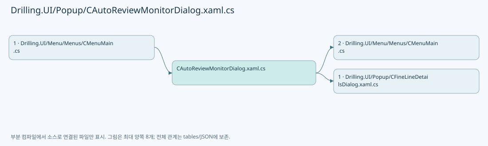
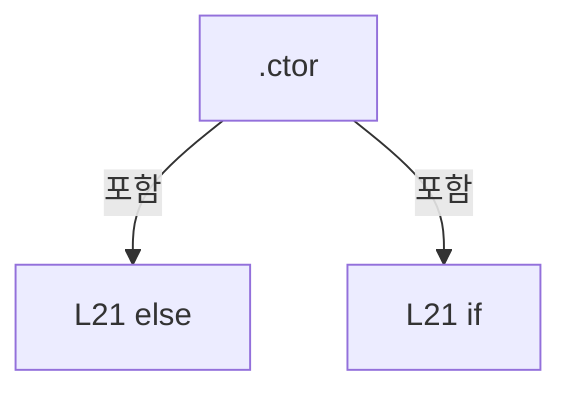
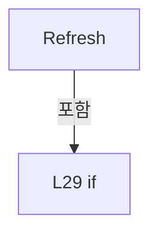
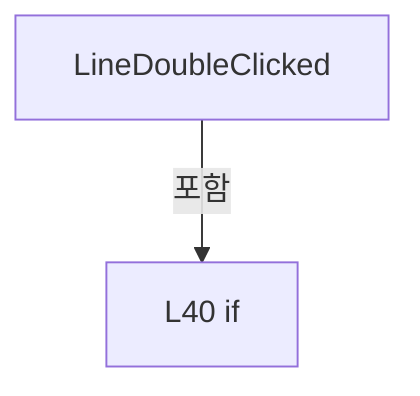

# Drilling.UI/Popup/CAutoReviewMonitorDialog.xaml.cs

| 항목 | 내용 |
| --- | --- |
| 원본 저장소 | https://github.com/kjuws10-rgb/A3Drilling.git |
| 원본 Commit | 5aee8e58439c9b455cae7c9593c9be986c3e682e |
| 원본 SHA256 | 29f6b45cf9d2ac3f7e5054dda47233a941d2ca4d00d5fba61ea30fd01a61c8ca |
| 파일 분류 | code |
| 원본 크기/행 | 1,806 bytes / 43 physical lines |
| 인코딩 | utf-8-sig |
| 검토 범위 | 구문/부분 의미 분석에서 추출한 사실. 동작·물리 단위·실장비 합격을 보증하지 않습니다. |
| 원본 링크 | [고정 Commit 원본](https://github.com/kjuws10-rgb/A3Drilling/blob/5aee8e58439c9b455cae7c9593c9be986c3e682e/Drilling.UI/Popup/CAutoReviewMonitorDialog.xaml.cs) |

## 파일의 역할과 읽는 순서

WPF 화면·사용자 명령·표시 상태를 구성합니다. XAML 이벤트와 코드 비하인드, RootView의 조립 경로를 함께 추적합니다.

## 네임스페이스·타입·상속

| 타입 | 구분 | 원본 범위 | 선언/상속 |
| --- | --- | --- | --- |
| CAutoReviewMonitorDialog | ClassDeclaration | 9–43 | CAutoReviewMonitorDialog: Window |

## 멤버 빠른 목록

| 이름 | 종류 | 범위 | 서명 |
| --- | --- | --- | --- |
| _timer | FieldDeclaration | L11–11 | DispatcherTimer Drilling.UI.Popup.CAutoReviewMonitorDialog._timer |
| _panel | FieldDeclaration | L12–12 | Drilling.UI.Menu.Menus.CAutoReviewMonitorPanel Drilling.UI.Popup.CAutoReviewMonitorDialog._panel |
| _lastResults | FieldDeclaration | L13–13 | long Drilling.UI.Popup.CAutoReviewMonitorDialog._lastResults |
| .ctor | ConstructorDeclaration | L14–23 | Drilling.UI.Popup.CAutoReviewMonitorDialog.CAutoReviewMonitorDialog(Drilling.UI.Menu.Menus.CAutoReviewMonitorPanel) |
| IsRefreshing | PropertyDeclaration | L24–24 | bool Drilling.UI.Popup.CAutoReviewMonitorDialog.IsRefreshing |
| Refresh | MethodDeclaration | L25–32 | void Drilling.UI.Popup.CAutoReviewMonitorDialog.Refresh(object?, System.EventArgs) |
| ShowLine | MethodDeclaration | L33–37 | void Drilling.UI.Popup.CAutoReviewMonitorDialog.ShowLine(Drilling.UI.Menu.Menus.CFineInspectionLine) |
| LineDoubleClicked | MethodDeclaration | L38–41 | void Drilling.UI.Popup.CAutoReviewMonitorDialog.LineDoubleClicked(object, MouseButtonEventArgs) |
| CloseClicked | MethodDeclaration | L42–42 | void Drilling.UI.Popup.CAutoReviewMonitorDialog.CloseClicked(object, RoutedEventArgs) |

## 멤버별 상세 계약·호출·처리 해설

### FieldDeclaration `_timer` · L11–11

[Drilling.UI/Popup/CAutoReviewMonitorDialog.xaml.cs:11–11](https://github.com/kjuws10-rgb/A3Drilling/blob/5aee8e58439c9b455cae7c9593c9be986c3e682e/Drilling.UI/Popup/CAutoReviewMonitorDialog.xaml.cs#L11-L11)

| 항목 | 실제 추출 값 |
| --- | --- |
| 서명 | DispatcherTimer Drilling.UI.Popup.CAutoReviewMonitorDialog._timer |
| 접근/수식자 | Private / private, readonly |
| 반환/값 타입 | DispatcherTimer |
| 소속 타입 | NamedType:Drilling.UI.Popup.CAutoReviewMonitorDialog |

현재 부분 분석에서 직접 연결된 호출자는 없습니다. XAML/이벤트/인터페이스·델리게이트·외부 진입을 추가 확인해야 하며, 미사용으로 판정한 것이 아닙니다.

호출하는 대상과 해석 범위:

| 원본 행 | 표현식 | 분석 상태 | 대상/소스 위치 |
| --- | --- | --- | --- |
| 11 | new | unresolved | None |
| 11 | TimeSpan.FromMilliseconds | resolved | System.TimeSpan System.TimeSpan.FromMilliseconds(long) |

본문의 실제 연산·분기·예외·반환 순서(원문 위치 순):

| 원본 행 | 종류 | 주석 해설 |
| --- | --- | --- |
| 11 | assignment | 값을 대상에 대입합니다: Interval = TimeSpan.FromMilliseconds(100) |
| 11 | call | 함수·델리게이트 또는 객체 생성자를 호출합니다: new(DispatcherPriority.Background) { Interval = TimeSpan.FromMilliseconds(100) } |
| 11 | call | 함수·델리게이트 또는 객체 생성자를 호출합니다: TimeSpan.FromMilliseconds(100) |
| 11 | variable-initializer | 변수의 초기값을 지정합니다: _timer = new(DispatcherPriority.Background) { Interval = TimeSpan.FromMilliseconds(100) } |

변경 전 점검: 입력/반환 타입, 위 호출자, 예외/취소 경로, 공유 상태와 저장·전송 소비자를 함께 확인합니다. 값의 단위나 물리 방향을 이름만으로 확정하지 않습니다.

### FieldDeclaration `_panel` · L12–12

[Drilling.UI/Popup/CAutoReviewMonitorDialog.xaml.cs:12–12](https://github.com/kjuws10-rgb/A3Drilling/blob/5aee8e58439c9b455cae7c9593c9be986c3e682e/Drilling.UI/Popup/CAutoReviewMonitorDialog.xaml.cs#L12-L12)

| 항목 | 실제 추출 값 |
| --- | --- |
| 서명 | Drilling.UI.Menu.Menus.CAutoReviewMonitorPanel Drilling.UI.Popup.CAutoReviewMonitorDialog._panel |
| 접근/수식자 | Private / private, readonly |
| 반환/값 타입 | Drilling.UI.Menu.Menus.CAutoReviewMonitorPanel |
| 소속 타입 | NamedType:Drilling.UI.Popup.CAutoReviewMonitorDialog |

현재 부분 분석에서 직접 연결된 호출자는 없습니다. XAML/이벤트/인터페이스·델리게이트·외부 진입을 추가 확인해야 하며, 미사용으로 판정한 것이 아닙니다.

변경 전 점검: 입력/반환 타입, 위 호출자, 예외/취소 경로, 공유 상태와 저장·전송 소비자를 함께 확인합니다. 값의 단위나 물리 방향을 이름만으로 확정하지 않습니다.

### FieldDeclaration `_lastResults` · L13–13

[Drilling.UI/Popup/CAutoReviewMonitorDialog.xaml.cs:13–13](https://github.com/kjuws10-rgb/A3Drilling/blob/5aee8e58439c9b455cae7c9593c9be986c3e682e/Drilling.UI/Popup/CAutoReviewMonitorDialog.xaml.cs#L13-L13)

| 항목 | 실제 추출 값 |
| --- | --- |
| 서명 | long Drilling.UI.Popup.CAutoReviewMonitorDialog._lastResults |
| 접근/수식자 | Private / private |
| 반환/값 타입 | long |
| 소속 타입 | NamedType:Drilling.UI.Popup.CAutoReviewMonitorDialog |

현재 부분 분석에서 직접 연결된 호출자는 없습니다. XAML/이벤트/인터페이스·델리게이트·외부 진입을 추가 확인해야 하며, 미사용으로 판정한 것이 아닙니다.

변경 전 점검: 입력/반환 타입, 위 호출자, 예외/취소 경로, 공유 상태와 저장·전송 소비자를 함께 확인합니다. 값의 단위나 물리 방향을 이름만으로 확정하지 않습니다.

### ConstructorDeclaration `.ctor` · L14–23

[Drilling.UI/Popup/CAutoReviewMonitorDialog.xaml.cs:14–23](https://github.com/kjuws10-rgb/A3Drilling/blob/5aee8e58439c9b455cae7c9593c9be986c3e682e/Drilling.UI/Popup/CAutoReviewMonitorDialog.xaml.cs#L14-L23)

| 항목 | 실제 추출 값 |
| --- | --- |
| 서명 | Drilling.UI.Popup.CAutoReviewMonitorDialog.CAutoReviewMonitorDialog(Drilling.UI.Menu.Menus.CAutoReviewMonitorPanel) |
| 접근/수식자 | Public / public |
| 반환/값 타입 | void |
| 소속 타입 | NamedType:Drilling.UI.Popup.CAutoReviewMonitorDialog |

입력 계약:

| 이름 | 타입 | 전달 | 선택/기본값 |
| --- | --- | --- | --- |
| panel | Drilling.UI.Menu.Menus.CAutoReviewMonitorPanel | None | False /  |

정적 호출자로 확인된 위치:

| 호출 파일/행 | 호출 표현식 | 런타임 분기 가능 |
| --- | --- | --- |
| [Drilling.UI/Menu/Menus/CMenuMain.cs:2333–2333](https://github.com/kjuws10-rgb/A3Drilling/blob/5aee8e58439c9b455cae7c9593c9be986c3e682e/Drilling.UI/Menu/Menus/CMenuMain.cs#L2333-L2333) | new CAutoReviewMonitorDialog | False |

호출하는 대상과 해석 범위:

| 원본 행 | 표현식 | 분석 상태 | 대상/소스 위치 |
| --- | --- | --- | --- |
| 16 | InitializeComponent | unresolved | None |
| 18 | Math.Min | candidate | OverloadResolutionFailure |
| 19 | Math.Min | candidate | OverloadResolutionFailure |
| 21 | Refresh | resolved | void Drilling.UI.Popup.CAutoReviewMonitorDialog.Refresh(object?, System.EventArgs) · Drilling.UI/Popup/CAutoReviewMonitorDialog.xaml.cs:25 |
| 21 | _timer.Start | unresolved | None |
| 21 | _timer.Stop | unresolved | None |
| 22 | _timer.Stop | unresolved | None |

본문의 실제 연산·분기·예외·반환 순서(원문 위치 순):

| 원본 행 | 종류 | 주석 해설 |
| --- | --- | --- |
| 16 | assignment | 값을 대상에 대입합니다: _panel = panel |
| 16 | assignment | 값을 대상에 대입합니다: DataContext = panel |
| 16 | call | 함수·델리게이트 또는 객체 생성자를 호출합니다: InitializeComponent() |
| 17 | assignment | 값을 대상에 대입합니다: panel.Preview.ShowLineDetails = ShowLine |
| 18 | assignment | 값을 대상에 대입합니다: Width = Math.Min(Width, SystemParameters.WorkArea.Width) |
| 18 | call | 함수·델리게이트 또는 객체 생성자를 호출합니다: Math.Min(Width, SystemParameters.WorkArea.Width) |
| 19 | assignment | 값을 대상에 대입합니다: Height = Math.Min(Height, SystemParameters.WorkArea.Height) |
| 19 | call | 함수·델리게이트 또는 객체 생성자를 호출합니다: Math.Min(Height, SystemParameters.WorkArea.Height) |
| 20 | compound-assignment-or-event-subscription | 복합 대입 또는 이벤트 구독/해지 표현입니다: _timer.Tick += Refresh |
| 21 | call | 함수·델리게이트 또는 객체 생성자를 호출합니다: Refresh(null, EventArgs.Empty) |
| 21 | call | 함수·델리게이트 또는 객체 생성자를 호출합니다: _timer.Start() |
| 21 | call | 함수·델리게이트 또는 객체 생성자를 호출합니다: _timer.Stop() |
| 21 | compound-assignment-or-event-subscription | 복합 대입 또는 이벤트 구독/해지 표현입니다: IsVisibleChanged += (_, _) => { if (IsVisible) { Refresh(null, EventArgs.Empty); _timer.Start(); } else _timer.Stop(); } |
| 21 | else | 앞 조건이 거짓인 경로입니다: else |
| 21 | if | 조건에 따라 분기합니다: if (IsVisible) |
| 22 | assignment | 값을 대상에 대입합니다: panel.Preview.ShowLineDetails = null |
| 22 | call | 함수·델리게이트 또는 객체 생성자를 호출합니다: _timer.Stop() |
| 22 | compound-assignment-or-event-subscription | 복합 대입 또는 이벤트 구독/해지 표현입니다: Closed += (_, _) => { _timer.Stop(); _timer.Tick -= Refresh; panel.Preview.ShowLineDetails = null; } |
| 22 | compound-assignment-or-event-subscription | 복합 대입 또는 이벤트 구독/해지 표현입니다: _timer.Tick -= Refresh |

제어 구문의 포함 구조(실제 실행 순서/CFG가 아닌 구문 탐색 그림):

변경 전 점검: 입력/반환 타입, 위 호출자, 예외/취소 경로, 공유 상태와 저장·전송 소비자를 함께 확인합니다. 값의 단위나 물리 방향을 이름만으로 확정하지 않습니다.

### PropertyDeclaration `IsRefreshing` · L24–24

[Drilling.UI/Popup/CAutoReviewMonitorDialog.xaml.cs:24–24](https://github.com/kjuws10-rgb/A3Drilling/blob/5aee8e58439c9b455cae7c9593c9be986c3e682e/Drilling.UI/Popup/CAutoReviewMonitorDialog.xaml.cs#L24-L24)

| 항목 | 실제 추출 값 |
| --- | --- |
| 서명 | bool Drilling.UI.Popup.CAutoReviewMonitorDialog.IsRefreshing |
| 접근/수식자 | Public / public |
| 반환/값 타입 | bool |
| 소속 타입 | NamedType:Drilling.UI.Popup.CAutoReviewMonitorDialog |

현재 부분 분석에서 직접 연결된 호출자는 없습니다. XAML/이벤트/인터페이스·델리게이트·외부 진입을 추가 확인해야 하며, 미사용으로 판정한 것이 아닙니다.

변경 전 점검: 입력/반환 타입, 위 호출자, 예외/취소 경로, 공유 상태와 저장·전송 소비자를 함께 확인합니다. 값의 단위나 물리 방향을 이름만으로 확정하지 않습니다.

### MethodDeclaration `Refresh` · L25–32

[Drilling.UI/Popup/CAutoReviewMonitorDialog.xaml.cs:25–32](https://github.com/kjuws10-rgb/A3Drilling/blob/5aee8e58439c9b455cae7c9593c9be986c3e682e/Drilling.UI/Popup/CAutoReviewMonitorDialog.xaml.cs#L25-L32)

| 항목 | 실제 추출 값 |
| --- | --- |
| 서명 | void Drilling.UI.Popup.CAutoReviewMonitorDialog.Refresh(object?, System.EventArgs) |
| 접근/수식자 | Private / private |
| 반환/값 타입 | void |
| 소속 타입 | NamedType:Drilling.UI.Popup.CAutoReviewMonitorDialog |

입력 계약:

| 이름 | 타입 | 전달 | 선택/기본값 |
| --- | --- | --- | --- |
| sender | object? | None | False /  |
| e | System.EventArgs | None | False /  |

정적 호출자로 확인된 위치:

| 호출 파일/행 | 호출 표현식 | 런타임 분기 가능 |
| --- | --- | --- |
| [Drilling.UI/Popup/CAutoReviewMonitorDialog.xaml.cs:21–21](https://github.com/kjuws10-rgb/A3Drilling/blob/5aee8e58439c9b455cae7c9593c9be986c3e682e/Drilling.UI/Popup/CAutoReviewMonitorDialog.xaml.cs#L21-L21) | Refresh | False |

호출하는 대상과 해석 범위:

| 원본 행 | 표현식 | 분석 상태 | 대상/소스 위치 |
| --- | --- | --- | --- |
| 27 | _panel.RefreshFeedback | resolved | void Drilling.UI.Menu.Menus.CAutoReviewMonitorPanel.RefreshFeedback() · Drilling.UI/Menu/Menus/CMenuMain.cs:2437 |
| 31 | _panel.RefreshResults | resolved | void Drilling.UI.Menu.Menus.CAutoReviewMonitorPanel.RefreshResults() · Drilling.UI/Menu/Menus/CMenuMain.cs:2438 |

본문의 실제 연산·분기·예외·반환 순서(원문 위치 순):

| 원본 행 | 종류 | 주석 해설 |
| --- | --- | --- |
| 27 | call | 함수·델리게이트 또는 객체 생성자를 호출합니다: _panel.RefreshFeedback() |
| 28 | local-declaration | 지역 변수를 선언합니다: var now = Environment.TickCount64; |
| 28 | variable-initializer | 변수의 초기값을 지정합니다: now = Environment.TickCount64 |
| 29 | if | 조건에 따라 분기합니다: if (now - _lastResults < 200) |
| 29 | return | 호출자에게 값 또는 제어를 반환합니다: return; |
| 30 | assignment | 값을 대상에 대입합니다: _lastResults = now |
| 31 | call | 함수·델리게이트 또는 객체 생성자를 호출합니다: _panel.RefreshResults() |

제어 구문의 포함 구조(실제 실행 순서/CFG가 아닌 구문 탐색 그림):

변경 전 점검: 입력/반환 타입, 위 호출자, 예외/취소 경로, 공유 상태와 저장·전송 소비자를 함께 확인합니다. 값의 단위나 물리 방향을 이름만으로 확정하지 않습니다.

### MethodDeclaration `ShowLine` · L33–37

[Drilling.UI/Popup/CAutoReviewMonitorDialog.xaml.cs:33–37](https://github.com/kjuws10-rgb/A3Drilling/blob/5aee8e58439c9b455cae7c9593c9be986c3e682e/Drilling.UI/Popup/CAutoReviewMonitorDialog.xaml.cs#L33-L37)

| 항목 | 실제 추출 값 |
| --- | --- |
| 서명 | void Drilling.UI.Popup.CAutoReviewMonitorDialog.ShowLine(Drilling.UI.Menu.Menus.CFineInspectionLine) |
| 접근/수식자 | Private / private |
| 반환/값 타입 | void |
| 소속 타입 | NamedType:Drilling.UI.Popup.CAutoReviewMonitorDialog |

입력 계약:

| 이름 | 타입 | 전달 | 선택/기본값 |
| --- | --- | --- | --- |
| line | Drilling.UI.Menu.Menus.CFineInspectionLine | None | False /  |

정적 호출자로 확인된 위치:

| 호출 파일/행 | 호출 표현식 | 런타임 분기 가능 |
| --- | --- | --- |
| [Drilling.UI/Popup/CAutoReviewMonitorDialog.xaml.cs:40–40](https://github.com/kjuws10-rgb/A3Drilling/blob/5aee8e58439c9b455cae7c9593c9be986c3e682e/Drilling.UI/Popup/CAutoReviewMonitorDialog.xaml.cs#L40-L40) | ShowLine | False |

호출하는 대상과 해석 범위:

| 원본 행 | 표현식 | 분석 상태 | 대상/소스 위치 |
| --- | --- | --- | --- |
| 35 | new CFineLineDetailsDialog | resolved | Drilling.UI.Popup.CFineLineDetailsDialog.CFineLineDetailsDialog(Drilling.UI.Menu.Menus.CFineInspectionLine) · Drilling.UI/Popup/CFineLineDetailsDialog.xaml.cs:8 |
| 36 | details.Show | candidate | OverloadResolutionFailure |

본문의 실제 연산·분기·예외·반환 순서(원문 위치 순):

| 원본 행 | 종류 | 주석 해설 |
| --- | --- | --- |
| 35 | assignment | 값을 대상에 대입합니다: Owner = this |
| 35 | call | 함수·델리게이트 또는 객체 생성자를 호출합니다: new CFineLineDetailsDialog(line) { Owner = this } |
| 35 | local-declaration | 지역 변수를 선언합니다: var details = new CFineLineDetailsDialog(line) { Owner = this }; |
| 35 | variable-initializer | 변수의 초기값을 지정합니다: details = new CFineLineDetailsDialog(line) { Owner = this } |
| 36 | call | 함수·델리게이트 또는 객체 생성자를 호출합니다: details.Show() |

변경 전 점검: 입력/반환 타입, 위 호출자, 예외/취소 경로, 공유 상태와 저장·전송 소비자를 함께 확인합니다. 값의 단위나 물리 방향을 이름만으로 확정하지 않습니다.

### MethodDeclaration `LineDoubleClicked` · L38–41

[Drilling.UI/Popup/CAutoReviewMonitorDialog.xaml.cs:38–41](https://github.com/kjuws10-rgb/A3Drilling/blob/5aee8e58439c9b455cae7c9593c9be986c3e682e/Drilling.UI/Popup/CAutoReviewMonitorDialog.xaml.cs#L38-L41)

| 항목 | 실제 추출 값 |
| --- | --- |
| 서명 | void Drilling.UI.Popup.CAutoReviewMonitorDialog.LineDoubleClicked(object, MouseButtonEventArgs) |
| 접근/수식자 | Private / private |
| 반환/값 타입 | void |
| 소속 타입 | NamedType:Drilling.UI.Popup.CAutoReviewMonitorDialog |

입력 계약:

| 이름 | 타입 | 전달 | 선택/기본값 |
| --- | --- | --- | --- |
| sender | object | None | False /  |
| e | MouseButtonEventArgs | None | False /  |

현재 부분 분석에서 직접 연결된 호출자는 없습니다. XAML/이벤트/인터페이스·델리게이트·외부 진입을 추가 확인해야 하며, 미사용으로 판정한 것이 아닙니다.

호출하는 대상과 해석 범위:

| 원본 행 | 표현식 | 분석 상태 | 대상/소스 위치 |
| --- | --- | --- | --- |
| 40 | ShowLine | resolved | void Drilling.UI.Popup.CAutoReviewMonitorDialog.ShowLine(Drilling.UI.Menu.Menus.CFineInspectionLine) · Drilling.UI/Popup/CAutoReviewMonitorDialog.xaml.cs:33 |

본문의 실제 연산·분기·예외·반환 순서(원문 위치 순):

| 원본 행 | 종류 | 주석 해설 |
| --- | --- | --- |
| 40 | call | 함수·델리게이트 또는 객체 생성자를 호출합니다: ShowLine(line) |
| 40 | if | 조건에 따라 분기합니다: if (sender is DataGrid { SelectedItem: CFineInspectionLine line }) |

제어 구문의 포함 구조(실제 실행 순서/CFG가 아닌 구문 탐색 그림):

변경 전 점검: 입력/반환 타입, 위 호출자, 예외/취소 경로, 공유 상태와 저장·전송 소비자를 함께 확인합니다. 값의 단위나 물리 방향을 이름만으로 확정하지 않습니다.

### MethodDeclaration `CloseClicked` · L42–42

[Drilling.UI/Popup/CAutoReviewMonitorDialog.xaml.cs:42–42](https://github.com/kjuws10-rgb/A3Drilling/blob/5aee8e58439c9b455cae7c9593c9be986c3e682e/Drilling.UI/Popup/CAutoReviewMonitorDialog.xaml.cs#L42-L42)

| 항목 | 실제 추출 값 |
| --- | --- |
| 서명 | void Drilling.UI.Popup.CAutoReviewMonitorDialog.CloseClicked(object, RoutedEventArgs) |
| 접근/수식자 | Private / private |
| 반환/값 타입 | void |
| 소속 타입 | NamedType:Drilling.UI.Popup.CAutoReviewMonitorDialog |

입력 계약:

| 이름 | 타입 | 전달 | 선택/기본값 |
| --- | --- | --- | --- |
| sender | object | None | False /  |
| e | RoutedEventArgs | None | False /  |

현재 부분 분석에서 직접 연결된 호출자는 없습니다. XAML/이벤트/인터페이스·델리게이트·외부 진입을 추가 확인해야 하며, 미사용으로 판정한 것이 아닙니다.

호출하는 대상과 해석 범위:

| 원본 행 | 표현식 | 분석 상태 | 대상/소스 위치 |
| --- | --- | --- | --- |
| 42 | Close | unresolved | None |

본문의 실제 연산·분기·예외·반환 순서(원문 위치 순):

| 원본 행 | 종류 | 주석 해설 |
| --- | --- | --- |
| 42 | call | 함수·델리게이트 또는 객체 생성자를 호출합니다: Close() |

변경 전 점검: 입력/반환 타입, 위 호출자, 예외/취소 경로, 공유 상태와 저장·전송 소비자를 함께 확인합니다. 값의 단위나 물리 방향을 이름만으로 확정하지 않습니다.

## 구문·바인딩 한계

전체 WPF/벤더 SDK/프로젝트별 빌드 조건을 로드한 정식 빌드가 아닙니다. `resolved`는 이 부분 컴파일에서의 심볼 연결이며 virtual/interface/delegate/이벤트/Reflection/XAML의 실제 런타임 구현을 확정하지 않습니다. `candidate`와 `unresolved`는 후속 확인 대상으로 남깁니다.

## 원문 전체 주석 해설본

[원본 모든 행과 행별 해설 보기](../../../annotated/Drilling.UI/Popup/CAutoReviewMonitorDialog.xaml.cs.annotated.txt)

원본을 빠뜨리거나 임의로 줄이지 않았습니다. `L000001 |` 표시는 원본 행 번호, `// 해설`은 별도 설명입니다. 실행용 소스가 아닌 문서입니다.

## 수정·재검증 체크

- 원본 Commit과 현재 작업 파일 SHA가 같은지 먼저 확인합니다. 다르면 이 문서를 과거 버전 자료로 취급합니다.
- 선언·직접 호출·이벤트/인터페이스 경계·설정 소비를 함께 확인합니다. 정적 연결의 빈 곳을 정상 경로로 추정하지 않습니다.
- 저장 형식/단위/식별자·재시도·취소·예외·롤백에 영향을 주는 변경은 상세 해설장과 호출자를 다시 검토합니다.
- 도구의 구문 추출과 별도 정적 추적 해설, 실제 빌드·시뮬레이션·실장비 검증 결과를 분리합니다.
