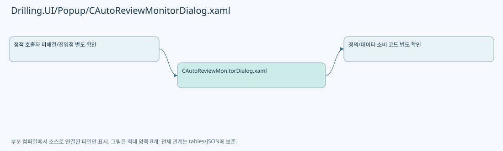

# Drilling.UI/Popup/CAutoReviewMonitorDialog.xaml

| 항목 | 내용 |
| --- | --- |
| 원본 저장소 | https://github.com/kjuws10-rgb/A3Drilling.git |
| 원본 Commit | 0219666f9053b907d96d7e0aa7d0c6c1be3a73d4 |
| 원본 SHA256 | ef6044d463c19a14d800f6e3690bc0851bb8a4e9eb761c6d3100543d4d0a98ce |
| 파일 분류 | code |
| 원본 크기/행 | 10,744 bytes / 126 physical lines |
| 인코딩 | utf-8-sig |
| 검토 범위 | 구문/부분 의미 분석에서 추출한 사실. 동작·물리 단위·실장비 합격을 보증하지 않습니다. |
| 원본 링크 | [고정 Commit 원본](https://github.com/kjuws10-rgb/A3Drilling/blob/0219666f9053b907d96d7e0aa7d0c6c1be3a73d4/Drilling.UI/Popup/CAutoReviewMonitorDialog.xaml) |

## 파일의 역할과 읽는 순서

WPF 화면·사용자 명령·표시 상태를 구성합니다. XAML 이벤트와 코드 비하인드, RootView의 조립 경로를 함께 추적합니다.

## 화면 구성과 코드 비하인드 연결

| 항목 | 추출 값 |
| --- | --- |
| 코드 비하인드 후보 | Drilling.UI/Popup/CAutoReviewMonitorDialog.xaml.cs |
| 이름 있는 요소 | MonitorPreview, MonitorTabs, NgGrid, LineGrid, FinalGrid |
| 이벤트 개수 | 2 |
| Binding 표현 개수 | 49 |

이름 있는 요소는 WPF가 필드를 생성할 수 있는 XAML 선언입니다. 문서 추출기는 WPF 생성 코드를 만들거나 로드하지 않으므로 C# 원문 멤버 수에 합산하지 않습니다.

| 요소 이름 | 원본 범위 |
| --- | --- |
| MonitorPreview | L71–71 |
| MonitorTabs | L75–75 |
| NgGrid | L76–76 |
| LineGrid | L89–89 |
| FinalGrid | L102–102 |

| 이벤트 | 핸들러 이름 | 원본 범위 | 해석 |
| --- | --- | --- | --- |
| Click | CloseClicked | L35–35 | 코드 비하인드/이벤트 라우팅에서 실제 연결 확인 필요 |
| MouseDoubleClick | LineDoubleClicked | L89–89 | 코드 비하인드/이벤트 라우팅에서 실제 연결 확인 필요 |

| Binding 표현 | 원본 범위 |
| --- | --- |
| {Binding LevelBrush} | L18–18 |
| {Binding Level} | L24–24 |
| {Binding LevelForeground} | L25–25 |
| {Binding Header} | L36–36 |
| {Binding ProgressText} | L37–37 |
| {Binding Status} | L38–38 |
| {Binding Tolerance} | L40–40 |
| {Binding Preview} | L41–41 |
| {Binding StageY} | L42–42 |
| {Binding ReviewX} | L43–43 |
| {Binding Mode} | L43–43 |
| {Binding ReviewLevelLegendItems} | L52–52 |
| {Binding ColorBrush} | L59–59 |
| {Binding Name} | L61–61 |
| {Binding RangeText} | L61–61 |
| {Binding Preview} | L71–71 |
| {Binding FocusText} | L74–74 |
| {Binding NgResults} | L76–76 |
| {Binding SelectedNg} | L76–76 |
| {Binding LineNo} | L78–78 |
| {Binding Head} | L79–79 |
| {Binding Cell} | L80–80 |
| {Binding Shot} | L81–81 |
| {Binding Beam} | L82–82 |
| {Binding Received} | L83–83 |
| {Binding Converted} | L84–84 |
| {Binding Excess} | L86–86 |
| {Binding Preview.Lines} | L89–89 |
| {Binding OrderNo} | L91–91 |
| {Binding StateText} | L92–92 |
| {Binding ResultSummary} | L93–93 |
| {Binding Statistics[0].Minimum} | L94–94 |
| {Binding Statistics[0].Maximum} | L95–95 |
| {Binding Statistics[0].Average} | L96–96 |
| {Binding Statistics[1].Minimum} | L97–97 |
| {Binding Statistics[1].Maximum} | L98–98 |
| {Binding Statistics[1].Average} | L99–99 |
| {Binding FinalVisibility} | L102–102 |
| {Binding FinalResults} | L102–102 |
| {Binding LineNo} | L104–104 |
| {Binding Head} | L105–105 |
| {Binding Cell} | L106–106 |
| {Binding Shot} | L107–107 |
| {Binding Beam} | L108–108 |
| {Binding Received} | L109–109 |
| {Binding Converted} | L110–110 |
| {Binding Judge} | L112–112 |
| {Binding OffsetStatus} | L120–120 |
| {Binding ResultFile} | L121–121 |

## 원문 전체 주석 해설본

[원본 모든 행과 행별 해설 보기](../../../annotated/Drilling.UI/Popup/CAutoReviewMonitorDialog.xaml.annotated.txt)

원본을 빠뜨리거나 임의로 줄이지 않았습니다. `L000001 |` 표시는 원본 행 번호, `// 해설`은 별도 설명입니다. 실행용 소스가 아닌 문서입니다.

## 수정·재검증 체크

- 원본 Commit과 현재 작업 파일 SHA가 같은지 먼저 확인합니다. 다르면 이 문서를 과거 버전 자료로 취급합니다.
- 선언·직접 호출·이벤트/인터페이스 경계·설정 소비를 함께 확인합니다. 정적 연결의 빈 곳을 정상 경로로 추정하지 않습니다.
- 저장 형식/단위/식별자·재시도·취소·예외·롤백에 영향을 주는 변경은 상세 해설장과 호출자를 다시 검토합니다.
- 도구의 구문 추출과 별도 정적 추적 해설, 실제 빌드·시뮬레이션·실장비 검증 결과를 분리합니다.
