# Drilling.UI/Popup/CCellPlacementWizardDialog.xaml.cs

| 항목 | 내용 |
| --- | --- |
| 원본 저장소 | https://github.com/kjuws10-rgb/A3Drilling.git |
| 원본 Commit | 5aee8e58439c9b455cae7c9593c9be986c3e682e |
| 원본 SHA256 | 9bb8fc8be490c371c1a9ac95f52c4de752d58cd48c9f7f903d197b3e0186e595 |
| 파일 분류 | code |
| 원본 크기/행 | 16,349 bytes / 479 physical lines |
| 인코딩 | utf-8-sig |
| 검토 범위 | 구문/부분 의미 분석에서 추출한 사실. 동작·물리 단위·실장비 합격을 보증하지 않습니다. |
| 원본 링크 | [고정 Commit 원본](https://github.com/kjuws10-rgb/A3Drilling/blob/5aee8e58439c9b455cae7c9593c9be986c3e682e/Drilling.UI/Popup/CCellPlacementWizardDialog.xaml.cs) |

## 파일의 역할과 읽는 순서

WPF 화면·사용자 명령·표시 상태를 구성합니다. XAML 이벤트와 코드 비하인드, RootView의 조립 경로를 함께 추적합니다.

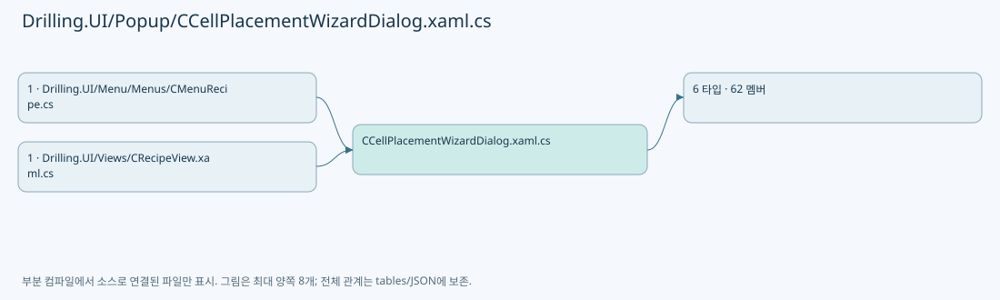

## 네임스페이스·타입·상속

| 타입 | 구분 | 원본 범위 | 선언/상속 |
| --- | --- | --- | --- |
| CCellPlacementWizardDialog | ClassDeclaration | 12–381 | CCellPlacementWizardDialog: Window |
| ST_CELL_PLACEMENT_WIZARD_CONTEXT | RecordDeclaration | 383–389 | ST_CELL_PLACEMENT_WIZARD_CONTEXT |
| ST_CELL_PLACEMENT_WIZARD_RESULT | RecordDeclaration | 391–417 | ST_CELL_PLACEMENT_WIZARD_RESULT |
| ST_CELL_PLACEMENT_MODEL_OVERRIDE | RecordDeclaration | 419–419 | ST_CELL_PLACEMENT_MODEL_OVERRIDE |
| ST_CELL_PLACEMENT_WIZARD_DIRECTION | RecordDeclaration | 421–436 | ST_CELL_PLACEMENT_WIZARD_DIRECTION |
| ST_CELL_PLACEMENT_MODEL_SELECTOR_ROW | ClassDeclaration | 438–479 | ST_CELL_PLACEMENT_MODEL_SELECTOR_ROW: INotifyPropertyChanged |

## 멤버 빠른 목록

| 이름 | 종류 | 범위 | 서명 |
| --- | --- | --- | --- |
| DefaultModelOption | FieldDeclaration | L14–14 | string Drilling.UI.Popup.CCellPlacementWizardDialog.DefaultModelOption |
| _lastAppliedResult | FieldDeclaration | L15–15 | Drilling.UI.Popup.ST_CELL_PLACEMENT_WIZARD_RESULT? Drilling.UI.Popup.CCellPlacementWizardDialog._lastAppliedResult |
| _maxCellCount | FieldDeclaration | L16–16 | int Drilling.UI.Popup.CCellPlacementWizardDialog._maxCellCount |
| _modelTypeCount | FieldDeclaration | L17–17 | int Drilling.UI.Popup.CCellPlacementWizardDialog._modelTypeCount |
| _glassSizeX | FieldDeclaration | L18–18 | double Drilling.UI.Popup.CCellPlacementWizardDialog._glassSizeX |
| _glassSizeY | FieldDeclaration | L19–19 | double Drilling.UI.Popup.CCellPlacementWizardDialog._glassSizeY |
| _akMarginX | FieldDeclaration | L20–20 | double Drilling.UI.Popup.CCellPlacementWizardDialog._akMarginX |
| _akMarginY | FieldDeclaration | L21–21 | double Drilling.UI.Popup.CCellPlacementWizardDialog._akMarginY |
| _defaultModelOptions | FieldDeclaration | L22–22 | string[] Drilling.UI.Popup.CCellPlacementWizardDialog._defaultModelOptions |
| _overrideModelOptions | FieldDeclaration | L23–23 | string[] Drilling.UI.Popup.CCellPlacementWizardDialog._overrideModelOptions |
| _isInitialized | FieldDeclaration | L24–24 | bool Drilling.UI.Popup.CCellPlacementWizardDialog._isInitialized |
| _modelApplySequence | FieldDeclaration | L25–25 | int Drilling.UI.Popup.CCellPlacementWizardDialog._modelApplySequence |
| .ctor | ConstructorDeclaration | L27–72 | Drilling.UI.Popup.CCellPlacementWizardDialog.CCellPlacementWizardDialog(Drilling.UI.Popup.ST_CELL_PLACEMENT_WIZARD_CONTEXT) |
| RowModelRows | PropertyDeclaration | L74–74 | System.Collections.ObjectModel.ObservableCollection<Drilling.UI.Popup.ST_CELL_PLACEMENT_MODEL_SELECTOR_ROW> Drilling.UI.Popup.CCellPlacementWizardDialog.RowModelRows |
| get_RowModelRows | GetAccessorDeclaration | L74–74 | System.Collections.ObjectModel.ObservableCollection<Drilling.UI.Popup.ST_CELL_PLACEMENT_MODEL_SELECTOR_ROW> Drilling.UI.Popup.CCellPlacementWizardDialog.RowModelRows.get |
| ColumnModelRows | PropertyDeclaration | L75–75 | System.Collections.ObjectModel.ObservableCollection<Drilling.UI.Popup.ST_CELL_PLACEMENT_MODEL_SELECTOR_ROW> Drilling.UI.Popup.CCellPlacementWizardDialog.ColumnModelRows |
| get_ColumnModelRows | GetAccessorDeclaration | L75–75 | System.Collections.ObjectModel.ObservableCollection<Drilling.UI.Popup.ST_CELL_PLACEMENT_MODEL_SELECTOR_ROW> Drilling.UI.Popup.CCellPlacementWizardDialog.ColumnModelRows.get |
| Result | PropertyDeclaration | L76–76 | Drilling.UI.Popup.ST_CELL_PLACEMENT_WIZARD_RESULT Drilling.UI.Popup.CCellPlacementWizardDialog.Result |
| get_Result | GetAccessorDeclaration | L76–76 | Drilling.UI.Popup.ST_CELL_PLACEMENT_WIZARD_RESULT Drilling.UI.Popup.CCellPlacementWizardDialog.Result.get |
| set_Result | SetAccessorDeclaration | L76–76 | void Drilling.UI.Popup.CCellPlacementWizardDialog.Result.set |
| GridCountTextChanged | MethodDeclaration | L78–86 | void Drilling.UI.Popup.CCellPlacementWizardDialog.GridCountTextChanged(object, System.Windows.Controls.TextChangedEventArgs) |
| RefreshModelRows | MethodDeclaration | L88–99 | void Drilling.UI.Popup.CCellPlacementWizardDialog.RefreshModelRows() |
| SyncModelRows | MethodDeclaration | L101–114 | void Drilling.UI.Popup.CCellPlacementWizardDialog.SyncModelRows(System.Collections.ObjectModel.ObservableCollection<Drilling.UI.Popup.ST_CELL_PLACEMENT_MODEL_SELECTOR_ROW>, int, string) |
| OnModelRuleChanged | MethodDeclaration | L116–121 | void Drilling.UI.Popup.CCellPlacementWizardDialog.OnModelRuleChanged(Drilling.UI.Popup.ST_CELL_PLACEMENT_MODEL_SELECTOR_ROW) |
| ApplyClick | MethodDeclaration | L123–134 | void Drilling.UI.Popup.CCellPlacementWizardDialog.ApplyClick(object, RoutedEventArgs) |
| ApplyInitialResult | MethodDeclaration | L136–169 | void Drilling.UI.Popup.CCellPlacementWizardDialog.ApplyInitialResult(Drilling.UI.Popup.ST_CELL_PLACEMENT_WIZARD_RESULT) |
| OpenWizardInputKeypad | MethodDeclaration | L171–188 | void Drilling.UI.Popup.CCellPlacementWizardDialog.OpenWizardInputKeypad(object, MouseButtonEventArgs) |
| GetInputKeypadInfo | MethodDeclaration | L190–219 | (string Parameter, Drilling.Common.Managers.EN_RECIPE_DATA_TYPE DataType, double Min, double Max) Drilling.UI.Popup.CCellPlacementWizardDialog.GetInputKeypadInfo(TextBox) |
| TryCreateResult | MethodDeclaration | L221–301 | bool Drilling.UI.Popup.CCellPlacementWizardDialog.TryCreateResult(out Drilling.UI.Popup.ST_CELL_PLACEMENT_WIZARD_RESULT, out string) |
| TryReadPositiveInt | MethodDeclaration | L303–306 | bool Drilling.UI.Popup.CCellPlacementWizardDialog.TryReadPositiveInt(string, out int) |
| TryReadDouble | MethodDeclaration | L308–311 | bool Drilling.UI.Popup.CCellPlacementWizardDialog.TryReadDouble(string, out double) |
| ReadModel | MethodDeclaration | L313–318 | int Drilling.UI.Popup.CCellPlacementWizardDialog.ReadModel(string?, int) |
| TryValidateGlassBounds | MethodDeclaration | L320–361 | bool Drilling.UI.Popup.CCellPlacementWizardDialog.TryValidateGlassBounds(int, int, double, double, double, double, out string) |
| FormatValidationDouble | MethodDeclaration | L363–366 | string Drilling.UI.Popup.CCellPlacementWizardDialog.FormatValidationDouble(double) |
| CancelClick | MethodDeclaration | L368–371 | void Drilling.UI.Popup.CCellPlacementWizardDialog.CancelClick(object, RoutedEventArgs) |
| WindowKeyDown | MethodDeclaration | L373–380 | void Drilling.UI.Popup.CCellPlacementWizardDialog.WindowKeyDown(object, KeyEventArgs) |
| Empty | PropertyDeclaration | L416–416 | Drilling.UI.Popup.ST_CELL_PLACEMENT_WIZARD_RESULT Drilling.UI.Popup.ST_CELL_PLACEMENT_WIZARD_RESULT.Empty |
| get_Empty | GetAccessorDeclaration | L416–416 | Drilling.UI.Popup.ST_CELL_PLACEMENT_WIZARD_RESULT Drilling.UI.Popup.ST_CELL_PLACEMENT_WIZARD_RESULT.Empty.get |
| HorizontalFirst | FieldDeclaration | L423–423 | string Drilling.UI.Popup.ST_CELL_PLACEMENT_WIZARD_DIRECTION.HorizontalFirst |
| VerticalFirst | FieldDeclaration | L424–424 | string Drilling.UI.Popup.ST_CELL_PLACEMENT_WIZARD_DIRECTION.VerticalFirst |
| Options | PropertyDeclaration | L426–430 | System.Collections.Generic.IReadOnlyList<Drilling.UI.Popup.ST_CELL_PLACEMENT_WIZARD_DIRECTION> Drilling.UI.Popup.ST_CELL_PLACEMENT_WIZARD_DIRECTION.Options |
| get_Options | GetAccessorDeclaration | L426–426 | System.Collections.Generic.IReadOnlyList<Drilling.UI.Popup.ST_CELL_PLACEMENT_WIZARD_DIRECTION> Drilling.UI.Popup.ST_CELL_PLACEMENT_WIZARD_DIRECTION.Options.get |
| ToString | MethodDeclaration | L432–435 | string Drilling.UI.Popup.ST_CELL_PLACEMENT_WIZARD_DIRECTION.ToString() |
| _selectedModel | FieldDeclaration | L440–440 | string Drilling.UI.Popup.ST_CELL_PLACEMENT_MODEL_SELECTOR_ROW._selectedModel |
| .ctor | ConstructorDeclaration | L442–449 | Drilling.UI.Popup.ST_CELL_PLACEMENT_MODEL_SELECTOR_ROW.ST_CELL_PLACEMENT_MODEL_SELECTOR_ROW(string, int, string, System.Collections.Generic.IReadOnlyList<string>) |
| PropertyChanged | EventFieldDeclaration | L451–451 | System.ComponentModel.PropertyChangedEventHandler? Drilling.UI.Popup.ST_CELL_PLACEMENT_MODEL_SELECTOR_ROW.PropertyChanged |
| ModelChanged | EventFieldDeclaration | L452–452 | System.Action<Drilling.UI.Popup.ST_CELL_PLACEMENT_MODEL_SELECTOR_ROW>? Drilling.UI.Popup.ST_CELL_PLACEMENT_MODEL_SELECTOR_ROW.ModelChanged |
| Scope | PropertyDeclaration | L453–453 | string Drilling.UI.Popup.ST_CELL_PLACEMENT_MODEL_SELECTOR_ROW.Scope |
| get_Scope | GetAccessorDeclaration | L453–453 | string Drilling.UI.Popup.ST_CELL_PLACEMENT_MODEL_SELECTOR_ROW.Scope.get |
| Index | PropertyDeclaration | L454–454 | int Drilling.UI.Popup.ST_CELL_PLACEMENT_MODEL_SELECTOR_ROW.Index |
| get_Index | GetAccessorDeclaration | L454–454 | int Drilling.UI.Popup.ST_CELL_PLACEMENT_MODEL_SELECTOR_ROW.Index.get |
| Label | PropertyDeclaration | L455–455 | string Drilling.UI.Popup.ST_CELL_PLACEMENT_MODEL_SELECTOR_ROW.Label |
| get_Label | GetAccessorDeclaration | L455–455 | string Drilling.UI.Popup.ST_CELL_PLACEMENT_MODEL_SELECTOR_ROW.Label.get |
| ModelOptions | PropertyDeclaration | L456–456 | System.Collections.Generic.IReadOnlyList<string> Drilling.UI.Popup.ST_CELL_PLACEMENT_MODEL_SELECTOR_ROW.ModelOptions |
| get_ModelOptions | GetAccessorDeclaration | L456–456 | System.Collections.Generic.IReadOnlyList<string> Drilling.UI.Popup.ST_CELL_PLACEMENT_MODEL_SELECTOR_ROW.ModelOptions.get |
| ApplyOrder | PropertyDeclaration | L457–457 | int Drilling.UI.Popup.ST_CELL_PLACEMENT_MODEL_SELECTOR_ROW.ApplyOrder |
| get_ApplyOrder | GetAccessorDeclaration | L457–457 | int Drilling.UI.Popup.ST_CELL_PLACEMENT_MODEL_SELECTOR_ROW.ApplyOrder.get |
| set_ApplyOrder | SetAccessorDeclaration | L457–457 | void Drilling.UI.Popup.ST_CELL_PLACEMENT_MODEL_SELECTOR_ROW.ApplyOrder.set |
| SelectedModel | PropertyDeclaration | L459–473 | string Drilling.UI.Popup.ST_CELL_PLACEMENT_MODEL_SELECTOR_ROW.SelectedModel |
| get_SelectedModel | GetAccessorDeclaration | L461–461 | string Drilling.UI.Popup.ST_CELL_PLACEMENT_MODEL_SELECTOR_ROW.SelectedModel.get |
| set_SelectedModel | SetAccessorDeclaration | L462–472 | void Drilling.UI.Popup.ST_CELL_PLACEMENT_MODEL_SELECTOR_ROW.SelectedModel.set |
| OnPropertyChanged | MethodDeclaration | L475–478 | void Drilling.UI.Popup.ST_CELL_PLACEMENT_MODEL_SELECTOR_ROW.OnPropertyChanged(string?) |

## 멤버별 상세 계약·호출·처리 해설

### FieldDeclaration `DefaultModelOption` · L14–14

[Drilling.UI/Popup/CCellPlacementWizardDialog.xaml.cs:14–14](https://github.com/kjuws10-rgb/A3Drilling/blob/5aee8e58439c9b455cae7c9593c9be986c3e682e/Drilling.UI/Popup/CCellPlacementWizardDialog.xaml.cs#L14-L14)

| 항목 | 실제 추출 값 |
| --- | --- |
| 서명 | string Drilling.UI.Popup.CCellPlacementWizardDialog.DefaultModelOption |
| 접근/수식자 | Private / private, const |
| 반환/값 타입 | string |
| 소속 타입 | NamedType:Drilling.UI.Popup.CCellPlacementWizardDialog |

현재 부분 분석에서 직접 연결된 호출자는 없습니다. XAML/이벤트/인터페이스·델리게이트·외부 진입을 추가 확인해야 하며, 미사용으로 판정한 것이 아닙니다.

본문의 실제 연산·분기·예외·반환 순서(원문 위치 순):

| 원본 행 | 종류 | 주석 해설 |
| --- | --- | --- |
| 14 | variable-initializer | 변수의 초기값을 지정합니다: DefaultModelOption = "DEFAULT" |

변경 전 점검: 입력/반환 타입, 위 호출자, 예외/취소 경로, 공유 상태와 저장·전송 소비자를 함께 확인합니다. 값의 단위나 물리 방향을 이름만으로 확정하지 않습니다.

### FieldDeclaration `_lastAppliedResult` · L15–15

[Drilling.UI/Popup/CCellPlacementWizardDialog.xaml.cs:15–15](https://github.com/kjuws10-rgb/A3Drilling/blob/5aee8e58439c9b455cae7c9593c9be986c3e682e/Drilling.UI/Popup/CCellPlacementWizardDialog.xaml.cs#L15-L15)

| 항목 | 실제 추출 값 |
| --- | --- |
| 서명 | Drilling.UI.Popup.ST_CELL_PLACEMENT_WIZARD_RESULT? Drilling.UI.Popup.CCellPlacementWizardDialog._lastAppliedResult |
| 접근/수식자 | Private / private, static |
| 반환/값 타입 | Drilling.UI.Popup.ST_CELL_PLACEMENT_WIZARD_RESULT? |
| 소속 타입 | NamedType:Drilling.UI.Popup.CCellPlacementWizardDialog |

현재 부분 분석에서 직접 연결된 호출자는 없습니다. XAML/이벤트/인터페이스·델리게이트·외부 진입을 추가 확인해야 하며, 미사용으로 판정한 것이 아닙니다.

변경 전 점검: 입력/반환 타입, 위 호출자, 예외/취소 경로, 공유 상태와 저장·전송 소비자를 함께 확인합니다. 값의 단위나 물리 방향을 이름만으로 확정하지 않습니다.

### FieldDeclaration `_maxCellCount` · L16–16

[Drilling.UI/Popup/CCellPlacementWizardDialog.xaml.cs:16–16](https://github.com/kjuws10-rgb/A3Drilling/blob/5aee8e58439c9b455cae7c9593c9be986c3e682e/Drilling.UI/Popup/CCellPlacementWizardDialog.xaml.cs#L16-L16)

| 항목 | 실제 추출 값 |
| --- | --- |
| 서명 | int Drilling.UI.Popup.CCellPlacementWizardDialog._maxCellCount |
| 접근/수식자 | Private / private, readonly |
| 반환/값 타입 | int |
| 소속 타입 | NamedType:Drilling.UI.Popup.CCellPlacementWizardDialog |

현재 부분 분석에서 직접 연결된 호출자는 없습니다. XAML/이벤트/인터페이스·델리게이트·외부 진입을 추가 확인해야 하며, 미사용으로 판정한 것이 아닙니다.

변경 전 점검: 입력/반환 타입, 위 호출자, 예외/취소 경로, 공유 상태와 저장·전송 소비자를 함께 확인합니다. 값의 단위나 물리 방향을 이름만으로 확정하지 않습니다.

### FieldDeclaration `_modelTypeCount` · L17–17

[Drilling.UI/Popup/CCellPlacementWizardDialog.xaml.cs:17–17](https://github.com/kjuws10-rgb/A3Drilling/blob/5aee8e58439c9b455cae7c9593c9be986c3e682e/Drilling.UI/Popup/CCellPlacementWizardDialog.xaml.cs#L17-L17)

| 항목 | 실제 추출 값 |
| --- | --- |
| 서명 | int Drilling.UI.Popup.CCellPlacementWizardDialog._modelTypeCount |
| 접근/수식자 | Private / private, readonly |
| 반환/값 타입 | int |
| 소속 타입 | NamedType:Drilling.UI.Popup.CCellPlacementWizardDialog |

현재 부분 분석에서 직접 연결된 호출자는 없습니다. XAML/이벤트/인터페이스·델리게이트·외부 진입을 추가 확인해야 하며, 미사용으로 판정한 것이 아닙니다.

변경 전 점검: 입력/반환 타입, 위 호출자, 예외/취소 경로, 공유 상태와 저장·전송 소비자를 함께 확인합니다. 값의 단위나 물리 방향을 이름만으로 확정하지 않습니다.

### FieldDeclaration `_glassSizeX` · L18–18

[Drilling.UI/Popup/CCellPlacementWizardDialog.xaml.cs:18–18](https://github.com/kjuws10-rgb/A3Drilling/blob/5aee8e58439c9b455cae7c9593c9be986c3e682e/Drilling.UI/Popup/CCellPlacementWizardDialog.xaml.cs#L18-L18)

| 항목 | 실제 추출 값 |
| --- | --- |
| 서명 | double Drilling.UI.Popup.CCellPlacementWizardDialog._glassSizeX |
| 접근/수식자 | Private / private, readonly |
| 반환/값 타입 | double |
| 소속 타입 | NamedType:Drilling.UI.Popup.CCellPlacementWizardDialog |

현재 부분 분석에서 직접 연결된 호출자는 없습니다. XAML/이벤트/인터페이스·델리게이트·외부 진입을 추가 확인해야 하며, 미사용으로 판정한 것이 아닙니다.

변경 전 점검: 입력/반환 타입, 위 호출자, 예외/취소 경로, 공유 상태와 저장·전송 소비자를 함께 확인합니다. 값의 단위나 물리 방향을 이름만으로 확정하지 않습니다.

### FieldDeclaration `_glassSizeY` · L19–19

[Drilling.UI/Popup/CCellPlacementWizardDialog.xaml.cs:19–19](https://github.com/kjuws10-rgb/A3Drilling/blob/5aee8e58439c9b455cae7c9593c9be986c3e682e/Drilling.UI/Popup/CCellPlacementWizardDialog.xaml.cs#L19-L19)

| 항목 | 실제 추출 값 |
| --- | --- |
| 서명 | double Drilling.UI.Popup.CCellPlacementWizardDialog._glassSizeY |
| 접근/수식자 | Private / private, readonly |
| 반환/값 타입 | double |
| 소속 타입 | NamedType:Drilling.UI.Popup.CCellPlacementWizardDialog |

현재 부분 분석에서 직접 연결된 호출자는 없습니다. XAML/이벤트/인터페이스·델리게이트·외부 진입을 추가 확인해야 하며, 미사용으로 판정한 것이 아닙니다.

변경 전 점검: 입력/반환 타입, 위 호출자, 예외/취소 경로, 공유 상태와 저장·전송 소비자를 함께 확인합니다. 값의 단위나 물리 방향을 이름만으로 확정하지 않습니다.

### FieldDeclaration `_akMarginX` · L20–20

[Drilling.UI/Popup/CCellPlacementWizardDialog.xaml.cs:20–20](https://github.com/kjuws10-rgb/A3Drilling/blob/5aee8e58439c9b455cae7c9593c9be986c3e682e/Drilling.UI/Popup/CCellPlacementWizardDialog.xaml.cs#L20-L20)

| 항목 | 실제 추출 값 |
| --- | --- |
| 서명 | double Drilling.UI.Popup.CCellPlacementWizardDialog._akMarginX |
| 접근/수식자 | Private / private, readonly |
| 반환/값 타입 | double |
| 소속 타입 | NamedType:Drilling.UI.Popup.CCellPlacementWizardDialog |

현재 부분 분석에서 직접 연결된 호출자는 없습니다. XAML/이벤트/인터페이스·델리게이트·외부 진입을 추가 확인해야 하며, 미사용으로 판정한 것이 아닙니다.

변경 전 점검: 입력/반환 타입, 위 호출자, 예외/취소 경로, 공유 상태와 저장·전송 소비자를 함께 확인합니다. 값의 단위나 물리 방향을 이름만으로 확정하지 않습니다.

### FieldDeclaration `_akMarginY` · L21–21

[Drilling.UI/Popup/CCellPlacementWizardDialog.xaml.cs:21–21](https://github.com/kjuws10-rgb/A3Drilling/blob/5aee8e58439c9b455cae7c9593c9be986c3e682e/Drilling.UI/Popup/CCellPlacementWizardDialog.xaml.cs#L21-L21)

| 항목 | 실제 추출 값 |
| --- | --- |
| 서명 | double Drilling.UI.Popup.CCellPlacementWizardDialog._akMarginY |
| 접근/수식자 | Private / private, readonly |
| 반환/값 타입 | double |
| 소속 타입 | NamedType:Drilling.UI.Popup.CCellPlacementWizardDialog |

현재 부분 분석에서 직접 연결된 호출자는 없습니다. XAML/이벤트/인터페이스·델리게이트·외부 진입을 추가 확인해야 하며, 미사용으로 판정한 것이 아닙니다.

변경 전 점검: 입력/반환 타입, 위 호출자, 예외/취소 경로, 공유 상태와 저장·전송 소비자를 함께 확인합니다. 값의 단위나 물리 방향을 이름만으로 확정하지 않습니다.

### FieldDeclaration `_defaultModelOptions` · L22–22

[Drilling.UI/Popup/CCellPlacementWizardDialog.xaml.cs:22–22](https://github.com/kjuws10-rgb/A3Drilling/blob/5aee8e58439c9b455cae7c9593c9be986c3e682e/Drilling.UI/Popup/CCellPlacementWizardDialog.xaml.cs#L22-L22)

| 항목 | 실제 추출 값 |
| --- | --- |
| 서명 | string[] Drilling.UI.Popup.CCellPlacementWizardDialog._defaultModelOptions |
| 접근/수식자 | Private / private, readonly |
| 반환/값 타입 | string[] |
| 소속 타입 | NamedType:Drilling.UI.Popup.CCellPlacementWizardDialog |

현재 부분 분석에서 직접 연결된 호출자는 없습니다. XAML/이벤트/인터페이스·델리게이트·외부 진입을 추가 확인해야 하며, 미사용으로 판정한 것이 아닙니다.

변경 전 점검: 입력/반환 타입, 위 호출자, 예외/취소 경로, 공유 상태와 저장·전송 소비자를 함께 확인합니다. 값의 단위나 물리 방향을 이름만으로 확정하지 않습니다.

### FieldDeclaration `_overrideModelOptions` · L23–23

[Drilling.UI/Popup/CCellPlacementWizardDialog.xaml.cs:23–23](https://github.com/kjuws10-rgb/A3Drilling/blob/5aee8e58439c9b455cae7c9593c9be986c3e682e/Drilling.UI/Popup/CCellPlacementWizardDialog.xaml.cs#L23-L23)

| 항목 | 실제 추출 값 |
| --- | --- |
| 서명 | string[] Drilling.UI.Popup.CCellPlacementWizardDialog._overrideModelOptions |
| 접근/수식자 | Private / private, readonly |
| 반환/값 타입 | string[] |
| 소속 타입 | NamedType:Drilling.UI.Popup.CCellPlacementWizardDialog |

현재 부분 분석에서 직접 연결된 호출자는 없습니다. XAML/이벤트/인터페이스·델리게이트·외부 진입을 추가 확인해야 하며, 미사용으로 판정한 것이 아닙니다.

변경 전 점검: 입력/반환 타입, 위 호출자, 예외/취소 경로, 공유 상태와 저장·전송 소비자를 함께 확인합니다. 값의 단위나 물리 방향을 이름만으로 확정하지 않습니다.

### FieldDeclaration `_isInitialized` · L24–24

[Drilling.UI/Popup/CCellPlacementWizardDialog.xaml.cs:24–24](https://github.com/kjuws10-rgb/A3Drilling/blob/5aee8e58439c9b455cae7c9593c9be986c3e682e/Drilling.UI/Popup/CCellPlacementWizardDialog.xaml.cs#L24-L24)

| 항목 | 실제 추출 값 |
| --- | --- |
| 서명 | bool Drilling.UI.Popup.CCellPlacementWizardDialog._isInitialized |
| 접근/수식자 | Private / private |
| 반환/값 타입 | bool |
| 소속 타입 | NamedType:Drilling.UI.Popup.CCellPlacementWizardDialog |

현재 부분 분석에서 직접 연결된 호출자는 없습니다. XAML/이벤트/인터페이스·델리게이트·외부 진입을 추가 확인해야 하며, 미사용으로 판정한 것이 아닙니다.

변경 전 점검: 입력/반환 타입, 위 호출자, 예외/취소 경로, 공유 상태와 저장·전송 소비자를 함께 확인합니다. 값의 단위나 물리 방향을 이름만으로 확정하지 않습니다.

### FieldDeclaration `_modelApplySequence` · L25–25

[Drilling.UI/Popup/CCellPlacementWizardDialog.xaml.cs:25–25](https://github.com/kjuws10-rgb/A3Drilling/blob/5aee8e58439c9b455cae7c9593c9be986c3e682e/Drilling.UI/Popup/CCellPlacementWizardDialog.xaml.cs#L25-L25)

| 항목 | 실제 추출 값 |
| --- | --- |
| 서명 | int Drilling.UI.Popup.CCellPlacementWizardDialog._modelApplySequence |
| 접근/수식자 | Private / private |
| 반환/값 타입 | int |
| 소속 타입 | NamedType:Drilling.UI.Popup.CCellPlacementWizardDialog |

현재 부분 분석에서 직접 연결된 호출자는 없습니다. XAML/이벤트/인터페이스·델리게이트·외부 진입을 추가 확인해야 하며, 미사용으로 판정한 것이 아닙니다.

변경 전 점검: 입력/반환 타입, 위 호출자, 예외/취소 경로, 공유 상태와 저장·전송 소비자를 함께 확인합니다. 값의 단위나 물리 방향을 이름만으로 확정하지 않습니다.

### ConstructorDeclaration `.ctor` · L27–72

[Drilling.UI/Popup/CCellPlacementWizardDialog.xaml.cs:27–72](https://github.com/kjuws10-rgb/A3Drilling/blob/5aee8e58439c9b455cae7c9593c9be986c3e682e/Drilling.UI/Popup/CCellPlacementWizardDialog.xaml.cs#L27-L72)

| 항목 | 실제 추출 값 |
| --- | --- |
| 서명 | Drilling.UI.Popup.CCellPlacementWizardDialog.CCellPlacementWizardDialog(Drilling.UI.Popup.ST_CELL_PLACEMENT_WIZARD_CONTEXT) |
| 접근/수식자 | Public / public |
| 반환/값 타입 | void |
| 소속 타입 | NamedType:Drilling.UI.Popup.CCellPlacementWizardDialog |

입력 계약:

| 이름 | 타입 | 전달 | 선택/기본값 |
| --- | --- | --- | --- |
| context | Drilling.UI.Popup.ST_CELL_PLACEMENT_WIZARD_CONTEXT | None | False /  |

정적 호출자로 확인된 위치:

| 호출 파일/행 | 호출 표현식 | 런타임 분기 가능 |
| --- | --- | --- |
| [Drilling.UI/Views/CRecipeView.xaml.cs:318–321](https://github.com/kjuws10-rgb/A3Drilling/blob/5aee8e58439c9b455cae7c9593c9be986c3e682e/Drilling.UI/Views/CRecipeView.xaml.cs#L318-L321) | new CCellPlacementWizardDialog | False |

호출하는 대상과 해석 범위:

| 원본 행 | 표현식 | 분석 상태 | 대상/소스 위치 |
| --- | --- | --- | --- |
| 29 | InitializeComponent | unresolved | None |
| 30 | Math.Max | resolved | int System.Math.Max(int, int) |
| 31 | Math.Clamp | resolved | int System.Math.Clamp(int, int, int) |
| 36 | Enumerable.Range(1, _modelTypeCount).Select(value => value.ToString(CultureInfo.InvariantCulture)).ToArray | resolved | string[] System.Collections.Generic.IEnumerable<string>.ToArray<string>() |
| 36 | Enumerable.Range(1, _modelTypeCount).Select | resolved | System.Collections.Generic.IEnumerable<string> System.Collections.Generic.IEnumerable<int>.Select<int, string>(System.Func<int, string>) |
| 36 | Enumerable.Range | resolved | System.Collections.Generic.IEnumerable<int> System.Linq.Enumerable.Range(int, int) |
| 36 | value.ToString | resolved | string int.ToString(System.IFormatProvider?) |
| 47 | Math.Min | resolved | int System.Math.Min(int, int) |
| 48 | Math.Max | resolved | int System.Math.Max(int, int) |
| 48 | Math.Ceiling | resolved | double System.Math.Ceiling(double) |
| 48 | Math.Max | resolved | int System.Math.Max(int, int) |
| 49 | _maxCellCount.ToString | resolved | string int.ToString(System.IFormatProvider?) |
| 50 | defaultColumnCount.ToString | resolved | string int.ToString(System.IFormatProvider?) |
| 51 | defaultRowCount.ToString | resolved | string int.ToString(System.IFormatProvider?) |
| 58 | ApplyInitialResult | resolved | void Drilling.UI.Popup.CCellPlacementWizardDialog.ApplyInitialResult(Drilling.UI.Popup.ST_CELL_PLACEMENT_WIZARD_RESULT) · Drilling.UI/Popup/CCellPlacementWizardDialog.xaml.cs:136 |
| 62 | RefreshModelRows | resolved | void Drilling.UI.Popup.CCellPlacementWizardDialog.RefreshModelRows() · Drilling.UI/Popup/CCellPlacementWizardDialog.xaml.cs:88 |
| 69 | ColumnCountTextBox.Focus | unresolved | None |
| 70 | ColumnCountTextBox.SelectAll | unresolved | None |

본문의 실제 연산·분기·예외·반환 순서(원문 위치 순):

| 원본 행 | 종류 | 주석 해설 |
| --- | --- | --- |
| 29 | call | 함수·델리게이트 또는 객체 생성자를 호출합니다: InitializeComponent() |
| 30 | assignment | 값을 대상에 대입합니다: _maxCellCount = Math.Max(1, context.CellCount) |
| 30 | call | 함수·델리게이트 또는 객체 생성자를 호출합니다: Math.Max(1, context.CellCount) |
| 31 | assignment | 값을 대상에 대입합니다: _modelTypeCount = Math.Clamp(context.ModelTypeCount, 1, 5) |
| 31 | call | 함수·델리게이트 또는 객체 생성자를 호출합니다: Math.Clamp(context.ModelTypeCount, 1, 5) |
| 32 | assignment | 값을 대상에 대입합니다: _glassSizeX = context.GlassSizeX |
| 33 | assignment | 값을 대상에 대입합니다: _glassSizeY = context.GlassSizeY |
| 34 | assignment | 값을 대상에 대입합니다: _akMarginX = context.AkMarginX |
| 35 | assignment | 값을 대상에 대입합니다: _akMarginY = context.AkMarginY |
| 36 | assignment | 값을 대상에 대입합니다: _defaultModelOptions = Enumerable.Range(1, _modelTypeCount).Select(value => value.ToString(CultureInfo.InvariantCulture)).ToArray() |
| 36 | call | 함수·델리게이트 또는 객체 생성자를 호출합니다: Enumerable.Range(1, _modelTypeCount).Select(value => value.ToString(CultureInfo.InvariantCulture)).ToArray() |
| 36 | call | 함수·델리게이트 또는 객체 생성자를 호출합니다: Enumerable.Range(1, _modelTypeCount).Select(value => value.ToString(CultureInfo.InvariantCulture)) |
| 36 | call | 함수·델리게이트 또는 객체 생성자를 호출합니다: Enumerable.Range(1, _modelTypeCount) |
| 36 | call | 함수·델리게이트 또는 객체 생성자를 호출합니다: value.ToString(CultureInfo.InvariantCulture) |
| 37 | assignment | 값을 대상에 대입합니다: _overrideModelOptions = [DefaultModelOption, .. _defaultModelOptions] |
| 38 | assignment | 값을 대상에 대입합니다: Result = ST_CELL_PLACEMENT_WIZARD_RESULT.Empty |
| 40 | assignment | 값을 대상에 대입합니다: DirectionComboBox.ItemsSource = ST_CELL_PLACEMENT_WIZARD_DIRECTION.Options |
| 41 | assignment | 값을 대상에 대입합니다: DirectionComboBox.SelectedIndex = 0 |
| 42 | assignment | 값을 대상에 대입합니다: DefaultModelComboBox.ItemsSource = _defaultModelOptions |
| 43 | assignment | 값을 대상에 대입합니다: DefaultModelComboBox.SelectedIndex = 0 |
| 44 | assignment | 값을 대상에 대입합니다: RowModelItemsControl.ItemsSource = RowModelRows |
| 45 | assignment | 값을 대상에 대입합니다: ColumnModelItemsControl.ItemsSource = ColumnModelRows |
| 47 | call | 함수·델리게이트 또는 객체 생성자를 호출합니다: Math.Min(30, _maxCellCount) |
| 47 | local-declaration | 지역 변수를 선언합니다: var defaultColumnCount = Math.Min(30, _maxCellCount); |
| 47 | variable-initializer | 변수의 초기값을 지정합니다: defaultColumnCount = Math.Min(30, _maxCellCount) |
| 48 | call | 함수·델리게이트 또는 객체 생성자를 호출합니다: Math.Max(1, (int)Math.Ceiling(_maxCellCount / (double)Math.Max(1, defaultColumnCount))) |
| 48 | call | 함수·델리게이트 또는 객체 생성자를 호출합니다: Math.Ceiling(_maxCellCount / (double)Math.Max(1, defaultColumnCount)) |
| 48 | call | 함수·델리게이트 또는 객체 생성자를 호출합니다: Math.Max(1, defaultColumnCount) |
| 48 | local-declaration | 지역 변수를 선언합니다: var defaultRowCount = Math.Max(1, (int)Math.Ceiling(_maxCellCount / (double)Math.Max(1, defaultColumnCount))); |
| 48 | variable-initializer | 변수의 초기값을 지정합니다: defaultRowCount = Math.Max(1, (int)Math.Ceiling(_maxCellCount / (double)Math.Max(1, defaultColumnCount))) |
| 49 | assignment | 값을 대상에 대입합니다: CellCountTextBox.Text = _maxCellCount.ToString(CultureInfo.InvariantCulture) |
| 49 | call | 함수·델리게이트 또는 객체 생성자를 호출합니다: _maxCellCount.ToString(CultureInfo.InvariantCulture) |
| 50 | assignment | 값을 대상에 대입합니다: ColumnCountTextBox.Text = defaultColumnCount.ToString(CultureInfo.InvariantCulture) |
| 50 | call | 함수·델리게이트 또는 객체 생성자를 호출합니다: defaultColumnCount.ToString(CultureInfo.InvariantCulture) |
| 51 | assignment | 값을 대상에 대입합니다: RowCountTextBox.Text = defaultRowCount.ToString(CultureInfo.InvariantCulture) |
| 51 | call | 함수·델리게이트 또는 객체 생성자를 호출합니다: defaultRowCount.ToString(CultureInfo.InvariantCulture) |
| 52 | assignment | 값을 대상에 대입합니다: StartXTextBox.Text = "0" |
| 53 | assignment | 값을 대상에 대입합니다: StartYTextBox.Text = "0" |
| 54 | assignment | 값을 대상에 대입합니다: PitchXTextBox.Text = "0" |
| 55 | assignment | 값을 대상에 대입합니다: PitchYTextBox.Text = "0" |
| 56 | if | 조건에 따라 분기합니다: if (_lastAppliedResult is { } lastResult && lastResult.CellCount == _maxCellCount) |
| 58 | call | 함수·델리게이트 또는 객체 생성자를 호출합니다: ApplyInitialResult(lastResult) |
| 60 | else | 앞 조건이 거짓인 경로입니다: else |
| 62 | call | 함수·델리게이트 또는 객체 생성자를 호출합니다: RefreshModelRows() |
| 65 | assignment | 값을 대상에 대입합니다: _isInitialized = true |
| 67 | compound-assignment-or-event-subscription | 복합 대입 또는 이벤트 구독/해지 표현입니다: Loaded += (_, _) => { ColumnCountTextBox.Focus(); ColumnCountTextBox.SelectAll(); } |
| 69 | call | 함수·델리게이트 또는 객체 생성자를 호출합니다: ColumnCountTextBox.Focus() |
| 70 | call | 함수·델리게이트 또는 객체 생성자를 호출합니다: ColumnCountTextBox.SelectAll() |

제어 구문의 포함 구조(실제 실행 순서/CFG가 아닌 구문 탐색 그림):

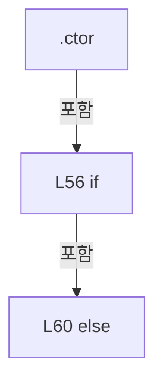

변경 전 점검: 입력/반환 타입, 위 호출자, 예외/취소 경로, 공유 상태와 저장·전송 소비자를 함께 확인합니다. 값의 단위나 물리 방향을 이름만으로 확정하지 않습니다.

### PropertyDeclaration `RowModelRows` · L74–74

[Drilling.UI/Popup/CCellPlacementWizardDialog.xaml.cs:74–74](https://github.com/kjuws10-rgb/A3Drilling/blob/5aee8e58439c9b455cae7c9593c9be986c3e682e/Drilling.UI/Popup/CCellPlacementWizardDialog.xaml.cs#L74-L74)

| 항목 | 실제 추출 값 |
| --- | --- |
| 서명 | System.Collections.ObjectModel.ObservableCollection<Drilling.UI.Popup.ST_CELL_PLACEMENT_MODEL_SELECTOR_ROW> Drilling.UI.Popup.CCellPlacementWizardDialog.RowModelRows |
| 접근/수식자 | Public / public |
| 반환/값 타입 | System.Collections.ObjectModel.ObservableCollection<Drilling.UI.Popup.ST_CELL_PLACEMENT_MODEL_SELECTOR_ROW> |
| 소속 타입 | NamedType:Drilling.UI.Popup.CCellPlacementWizardDialog |

현재 부분 분석에서 직접 연결된 호출자는 없습니다. XAML/이벤트/인터페이스·델리게이트·외부 진입을 추가 확인해야 하며, 미사용으로 판정한 것이 아닙니다.

변경 전 점검: 입력/반환 타입, 위 호출자, 예외/취소 경로, 공유 상태와 저장·전송 소비자를 함께 확인합니다. 값의 단위나 물리 방향을 이름만으로 확정하지 않습니다.

### GetAccessorDeclaration `get_RowModelRows` · L74–74

[Drilling.UI/Popup/CCellPlacementWizardDialog.xaml.cs:74–74](https://github.com/kjuws10-rgb/A3Drilling/blob/5aee8e58439c9b455cae7c9593c9be986c3e682e/Drilling.UI/Popup/CCellPlacementWizardDialog.xaml.cs#L74-L74)

| 항목 | 실제 추출 값 |
| --- | --- |
| 서명 | System.Collections.ObjectModel.ObservableCollection<Drilling.UI.Popup.ST_CELL_PLACEMENT_MODEL_SELECTOR_ROW> Drilling.UI.Popup.CCellPlacementWizardDialog.RowModelRows.get |
| 접근/수식자 | Public / get |
| 반환/값 타입 | System.Collections.ObjectModel.ObservableCollection<Drilling.UI.Popup.ST_CELL_PLACEMENT_MODEL_SELECTOR_ROW> |
| 소속 타입 | NamedType:Drilling.UI.Popup.CCellPlacementWizardDialog |

현재 부분 분석에서 직접 연결된 호출자는 없습니다. XAML/이벤트/인터페이스·델리게이트·외부 진입을 추가 확인해야 하며, 미사용으로 판정한 것이 아닙니다.

변경 전 점검: 입력/반환 타입, 위 호출자, 예외/취소 경로, 공유 상태와 저장·전송 소비자를 함께 확인합니다. 값의 단위나 물리 방향을 이름만으로 확정하지 않습니다.

### PropertyDeclaration `ColumnModelRows` · L75–75

[Drilling.UI/Popup/CCellPlacementWizardDialog.xaml.cs:75–75](https://github.com/kjuws10-rgb/A3Drilling/blob/5aee8e58439c9b455cae7c9593c9be986c3e682e/Drilling.UI/Popup/CCellPlacementWizardDialog.xaml.cs#L75-L75)

| 항목 | 실제 추출 값 |
| --- | --- |
| 서명 | System.Collections.ObjectModel.ObservableCollection<Drilling.UI.Popup.ST_CELL_PLACEMENT_MODEL_SELECTOR_ROW> Drilling.UI.Popup.CCellPlacementWizardDialog.ColumnModelRows |
| 접근/수식자 | Public / public |
| 반환/값 타입 | System.Collections.ObjectModel.ObservableCollection<Drilling.UI.Popup.ST_CELL_PLACEMENT_MODEL_SELECTOR_ROW> |
| 소속 타입 | NamedType:Drilling.UI.Popup.CCellPlacementWizardDialog |

현재 부분 분석에서 직접 연결된 호출자는 없습니다. XAML/이벤트/인터페이스·델리게이트·외부 진입을 추가 확인해야 하며, 미사용으로 판정한 것이 아닙니다.

변경 전 점검: 입력/반환 타입, 위 호출자, 예외/취소 경로, 공유 상태와 저장·전송 소비자를 함께 확인합니다. 값의 단위나 물리 방향을 이름만으로 확정하지 않습니다.

### GetAccessorDeclaration `get_ColumnModelRows` · L75–75

[Drilling.UI/Popup/CCellPlacementWizardDialog.xaml.cs:75–75](https://github.com/kjuws10-rgb/A3Drilling/blob/5aee8e58439c9b455cae7c9593c9be986c3e682e/Drilling.UI/Popup/CCellPlacementWizardDialog.xaml.cs#L75-L75)

| 항목 | 실제 추출 값 |
| --- | --- |
| 서명 | System.Collections.ObjectModel.ObservableCollection<Drilling.UI.Popup.ST_CELL_PLACEMENT_MODEL_SELECTOR_ROW> Drilling.UI.Popup.CCellPlacementWizardDialog.ColumnModelRows.get |
| 접근/수식자 | Public / get |
| 반환/값 타입 | System.Collections.ObjectModel.ObservableCollection<Drilling.UI.Popup.ST_CELL_PLACEMENT_MODEL_SELECTOR_ROW> |
| 소속 타입 | NamedType:Drilling.UI.Popup.CCellPlacementWizardDialog |

현재 부분 분석에서 직접 연결된 호출자는 없습니다. XAML/이벤트/인터페이스·델리게이트·외부 진입을 추가 확인해야 하며, 미사용으로 판정한 것이 아닙니다.

변경 전 점검: 입력/반환 타입, 위 호출자, 예외/취소 경로, 공유 상태와 저장·전송 소비자를 함께 확인합니다. 값의 단위나 물리 방향을 이름만으로 확정하지 않습니다.

### PropertyDeclaration `Result` · L76–76

[Drilling.UI/Popup/CCellPlacementWizardDialog.xaml.cs:76–76](https://github.com/kjuws10-rgb/A3Drilling/blob/5aee8e58439c9b455cae7c9593c9be986c3e682e/Drilling.UI/Popup/CCellPlacementWizardDialog.xaml.cs#L76-L76)

| 항목 | 실제 추출 값 |
| --- | --- |
| 서명 | Drilling.UI.Popup.ST_CELL_PLACEMENT_WIZARD_RESULT Drilling.UI.Popup.CCellPlacementWizardDialog.Result |
| 접근/수식자 | Public / public |
| 반환/값 타입 | Drilling.UI.Popup.ST_CELL_PLACEMENT_WIZARD_RESULT |
| 소속 타입 | NamedType:Drilling.UI.Popup.CCellPlacementWizardDialog |

현재 부분 분석에서 직접 연결된 호출자는 없습니다. XAML/이벤트/인터페이스·델리게이트·외부 진입을 추가 확인해야 하며, 미사용으로 판정한 것이 아닙니다.

변경 전 점검: 입력/반환 타입, 위 호출자, 예외/취소 경로, 공유 상태와 저장·전송 소비자를 함께 확인합니다. 값의 단위나 물리 방향을 이름만으로 확정하지 않습니다.

### GetAccessorDeclaration `get_Result` · L76–76

[Drilling.UI/Popup/CCellPlacementWizardDialog.xaml.cs:76–76](https://github.com/kjuws10-rgb/A3Drilling/blob/5aee8e58439c9b455cae7c9593c9be986c3e682e/Drilling.UI/Popup/CCellPlacementWizardDialog.xaml.cs#L76-L76)

| 항목 | 실제 추출 값 |
| --- | --- |
| 서명 | Drilling.UI.Popup.ST_CELL_PLACEMENT_WIZARD_RESULT Drilling.UI.Popup.CCellPlacementWizardDialog.Result.get |
| 접근/수식자 | Public / get |
| 반환/값 타입 | Drilling.UI.Popup.ST_CELL_PLACEMENT_WIZARD_RESULT |
| 소속 타입 | NamedType:Drilling.UI.Popup.CCellPlacementWizardDialog |

현재 부분 분석에서 직접 연결된 호출자는 없습니다. XAML/이벤트/인터페이스·델리게이트·외부 진입을 추가 확인해야 하며, 미사용으로 판정한 것이 아닙니다.

변경 전 점검: 입력/반환 타입, 위 호출자, 예외/취소 경로, 공유 상태와 저장·전송 소비자를 함께 확인합니다. 값의 단위나 물리 방향을 이름만으로 확정하지 않습니다.

### SetAccessorDeclaration `set_Result` · L76–76

[Drilling.UI/Popup/CCellPlacementWizardDialog.xaml.cs:76–76](https://github.com/kjuws10-rgb/A3Drilling/blob/5aee8e58439c9b455cae7c9593c9be986c3e682e/Drilling.UI/Popup/CCellPlacementWizardDialog.xaml.cs#L76-L76)

| 항목 | 실제 추출 값 |
| --- | --- |
| 서명 | void Drilling.UI.Popup.CCellPlacementWizardDialog.Result.set |
| 접근/수식자 | Private / private, set |
| 반환/값 타입 | void |
| 소속 타입 | NamedType:Drilling.UI.Popup.CCellPlacementWizardDialog |

입력 계약:

| 이름 | 타입 | 전달 | 선택/기본값 |
| --- | --- | --- | --- |
| value | Drilling.UI.Popup.ST_CELL_PLACEMENT_WIZARD_RESULT | None | False /  |

현재 부분 분석에서 직접 연결된 호출자는 없습니다. XAML/이벤트/인터페이스·델리게이트·외부 진입을 추가 확인해야 하며, 미사용으로 판정한 것이 아닙니다.

변경 전 점검: 입력/반환 타입, 위 호출자, 예외/취소 경로, 공유 상태와 저장·전송 소비자를 함께 확인합니다. 값의 단위나 물리 방향을 이름만으로 확정하지 않습니다.

### MethodDeclaration `GridCountTextChanged` · L78–86

[Drilling.UI/Popup/CCellPlacementWizardDialog.xaml.cs:78–86](https://github.com/kjuws10-rgb/A3Drilling/blob/5aee8e58439c9b455cae7c9593c9be986c3e682e/Drilling.UI/Popup/CCellPlacementWizardDialog.xaml.cs#L78-L86)

| 항목 | 실제 추출 값 |
| --- | --- |
| 서명 | void Drilling.UI.Popup.CCellPlacementWizardDialog.GridCountTextChanged(object, System.Windows.Controls.TextChangedEventArgs) |
| 접근/수식자 | Private / private |
| 반환/값 타입 | void |
| 소속 타입 | NamedType:Drilling.UI.Popup.CCellPlacementWizardDialog |

입력 계약:

| 이름 | 타입 | 전달 | 선택/기본값 |
| --- | --- | --- | --- |
| sender | object | None | False /  |
| e | System.Windows.Controls.TextChangedEventArgs | None | False /  |

현재 부분 분석에서 직접 연결된 호출자는 없습니다. XAML/이벤트/인터페이스·델리게이트·외부 진입을 추가 확인해야 하며, 미사용으로 판정한 것이 아닙니다.

호출하는 대상과 해석 범위:

| 원본 행 | 표현식 | 분석 상태 | 대상/소스 위치 |
| --- | --- | --- | --- |
| 85 | RefreshModelRows | resolved | void Drilling.UI.Popup.CCellPlacementWizardDialog.RefreshModelRows() · Drilling.UI/Popup/CCellPlacementWizardDialog.xaml.cs:88 |

본문의 실제 연산·분기·예외·반환 순서(원문 위치 순):

| 원본 행 | 종류 | 주석 해설 |
| --- | --- | --- |
| 80 | if | 조건에 따라 분기합니다: if (!_isInitialized) |
| 82 | return | 호출자에게 값 또는 제어를 반환합니다: return; |
| 85 | call | 함수·델리게이트 또는 객체 생성자를 호출합니다: RefreshModelRows() |

제어 구문의 포함 구조(실제 실행 순서/CFG가 아닌 구문 탐색 그림):

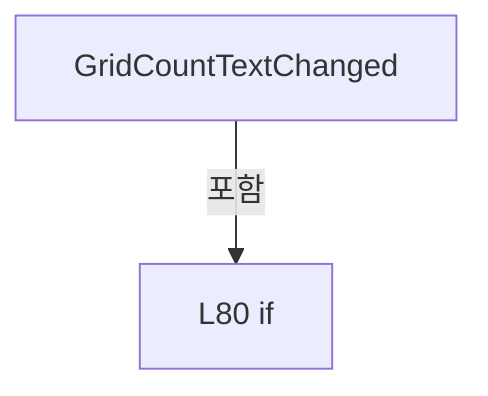

변경 전 점검: 입력/반환 타입, 위 호출자, 예외/취소 경로, 공유 상태와 저장·전송 소비자를 함께 확인합니다. 값의 단위나 물리 방향을 이름만으로 확정하지 않습니다.

### MethodDeclaration `RefreshModelRows` · L88–99

[Drilling.UI/Popup/CCellPlacementWizardDialog.xaml.cs:88–99](https://github.com/kjuws10-rgb/A3Drilling/blob/5aee8e58439c9b455cae7c9593c9be986c3e682e/Drilling.UI/Popup/CCellPlacementWizardDialog.xaml.cs#L88-L99)

| 항목 | 실제 추출 값 |
| --- | --- |
| 서명 | void Drilling.UI.Popup.CCellPlacementWizardDialog.RefreshModelRows() |
| 접근/수식자 | Private / private |
| 반환/값 타입 | void |
| 소속 타입 | NamedType:Drilling.UI.Popup.CCellPlacementWizardDialog |

정적 호출자로 확인된 위치:

| 호출 파일/행 | 호출 표현식 | 런타임 분기 가능 |
| --- | --- | --- |
| [Drilling.UI/Popup/CCellPlacementWizardDialog.xaml.cs:62–62](https://github.com/kjuws10-rgb/A3Drilling/blob/5aee8e58439c9b455cae7c9593c9be986c3e682e/Drilling.UI/Popup/CCellPlacementWizardDialog.xaml.cs#L62-L62) | RefreshModelRows | False |
| [Drilling.UI/Popup/CCellPlacementWizardDialog.xaml.cs:85–85](https://github.com/kjuws10-rgb/A3Drilling/blob/5aee8e58439c9b455cae7c9593c9be986c3e682e/Drilling.UI/Popup/CCellPlacementWizardDialog.xaml.cs#L85-L85) | RefreshModelRows | False |
| [Drilling.UI/Popup/CCellPlacementWizardDialog.xaml.cs:146–146](https://github.com/kjuws10-rgb/A3Drilling/blob/5aee8e58439c9b455cae7c9593c9be986c3e682e/Drilling.UI/Popup/CCellPlacementWizardDialog.xaml.cs#L146-L146) | RefreshModelRows | False |

호출하는 대상과 해석 범위:

| 원본 행 | 표현식 | 분석 상태 | 대상/소스 위치 |
| --- | --- | --- | --- |
| 90 | TryReadPositiveInt | candidate | OverloadResolutionFailure |
| 91 | Math.Clamp | resolved | int System.Math.Clamp(int, int, int) |
| 93 | TryReadPositiveInt | candidate | OverloadResolutionFailure |
| 94 | Math.Clamp | resolved | int System.Math.Clamp(int, int, int) |
| 97 | SyncModelRows | resolved | void Drilling.UI.Popup.CCellPlacementWizardDialog.SyncModelRows(System.Collections.ObjectModel.ObservableCollection<Drilling.UI.Popup.ST_CELL_PLACEMENT_MODEL_SELECTOR_ROW>, int, string) · Drilling.UI/Popup/CCellPlacementWizardDialog.xaml.cs:101 |
| 98 | SyncModelRows | resolved | void Drilling.UI.Popup.CCellPlacementWizardDialog.SyncModelRows(System.Collections.ObjectModel.ObservableCollection<Drilling.UI.Popup.ST_CELL_PLACEMENT_MODEL_SELECTOR_ROW>, int, string) · Drilling.UI/Popup/CCellPlacementWizardDialog.xaml.cs:101 |

본문의 실제 연산·분기·예외·반환 순서(원문 위치 순):

| 원본 행 | 종류 | 주석 해설 |
| --- | --- | --- |
| 90 | call | 함수·델리게이트 또는 객체 생성자를 호출합니다: TryReadPositiveInt(RowCountTextBox.Text, out var parsedRowCount) |
| 90 | conditional-expression | 조건에 따라 결과식을 선택합니다: TryReadPositiveInt(RowCountTextBox.Text, out var parsedRowCount) ? Math.Clamp(parsedRowCount, 1, _maxCellCount) : 1 |
| 90 | local-declaration | 지역 변수를 선언합니다: var rowCount = TryReadPositiveInt(RowCountTextBox.Text, out var parsedRowCount) ? Math.Clamp(parsedRowCount, 1, _maxCellCount) : 1; |
| 90 | variable-initializer | 변수의 초기값을 지정합니다: rowCount = TryReadPositiveInt(RowCountTextBox.Text, out var parsedRowCount) ? Math.Clamp(parsedRowCount, 1, _maxCellCount) : 1 |
| 91 | call | 함수·델리게이트 또는 객체 생성자를 호출합니다: Math.Clamp(parsedRowCount, 1, _maxCellCount) |
| 93 | call | 함수·델리게이트 또는 객체 생성자를 호출합니다: TryReadPositiveInt(ColumnCountTextBox.Text, out var parsedColumnCount) |
| 93 | conditional-expression | 조건에 따라 결과식을 선택합니다: TryReadPositiveInt(ColumnCountTextBox.Text, out var parsedColumnCount) ? Math.Clamp(parsedColumnCount, 1, _maxCellCount) : 1 |
| 93 | local-declaration | 지역 변수를 선언합니다: var columnCount = TryReadPositiveInt(ColumnCountTextBox.Text, out var parsedColumnCount) ? Math.Clamp(parsedColumnCount, 1, _maxCellCount) : 1; |
| 93 | variable-initializer | 변수의 초기값을 지정합니다: columnCount = TryReadPositiveInt(ColumnCountTextBox.Text, out var parsedColumnCount) ? Math.Clamp(parsedColumnCount, 1, _maxCellCount) : 1 |
| 94 | call | 함수·델리게이트 또는 객체 생성자를 호출합니다: Math.Clamp(parsedColumnCount, 1, _maxCellCount) |
| 97 | call | 함수·델리게이트 또는 객체 생성자를 호출합니다: SyncModelRows(RowModelRows, rowCount, "ROW") |
| 98 | call | 함수·델리게이트 또는 객체 생성자를 호출합니다: SyncModelRows(ColumnModelRows, columnCount, "COL") |

변경 전 점검: 입력/반환 타입, 위 호출자, 예외/취소 경로, 공유 상태와 저장·전송 소비자를 함께 확인합니다. 값의 단위나 물리 방향을 이름만으로 확정하지 않습니다.

### MethodDeclaration `SyncModelRows` · L101–114

[Drilling.UI/Popup/CCellPlacementWizardDialog.xaml.cs:101–114](https://github.com/kjuws10-rgb/A3Drilling/blob/5aee8e58439c9b455cae7c9593c9be986c3e682e/Drilling.UI/Popup/CCellPlacementWizardDialog.xaml.cs#L101-L114)

| 항목 | 실제 추출 값 |
| --- | --- |
| 서명 | void Drilling.UI.Popup.CCellPlacementWizardDialog.SyncModelRows(System.Collections.ObjectModel.ObservableCollection<Drilling.UI.Popup.ST_CELL_PLACEMENT_MODEL_SELECTOR_ROW>, int, string) |
| 접근/수식자 | Private / private |
| 반환/값 타입 | void |
| 소속 타입 | NamedType:Drilling.UI.Popup.CCellPlacementWizardDialog |

입력 계약:

| 이름 | 타입 | 전달 | 선택/기본값 |
| --- | --- | --- | --- |
| rows | System.Collections.ObjectModel.ObservableCollection<Drilling.UI.Popup.ST_CELL_PLACEMENT_MODEL_SELECTOR_ROW> | None | False /  |
| count | int | None | False /  |
| prefix | string | None | False /  |

정적 호출자로 확인된 위치:

| 호출 파일/행 | 호출 표현식 | 런타임 분기 가능 |
| --- | --- | --- |
| [Drilling.UI/Popup/CCellPlacementWizardDialog.xaml.cs:97–97](https://github.com/kjuws10-rgb/A3Drilling/blob/5aee8e58439c9b455cae7c9593c9be986c3e682e/Drilling.UI/Popup/CCellPlacementWizardDialog.xaml.cs#L97-L97) | SyncModelRows | False |
| [Drilling.UI/Popup/CCellPlacementWizardDialog.xaml.cs:98–98](https://github.com/kjuws10-rgb/A3Drilling/blob/5aee8e58439c9b455cae7c9593c9be986c3e682e/Drilling.UI/Popup/CCellPlacementWizardDialog.xaml.cs#L98-L98) | SyncModelRows | False |

호출하는 대상과 해석 범위:

| 원본 행 | 표현식 | 분석 상태 | 대상/소스 위치 |
| --- | --- | --- | --- |
| 105 | rows.RemoveAt | resolved | void System.Collections.ObjectModel.Collection<Drilling.UI.Popup.ST_CELL_PLACEMENT_MODEL_SELECTOR_ROW>.RemoveAt(int) |
| 110 | new ST_CELL_PLACEMENT_MODEL_SELECTOR_ROW | resolved | Drilling.UI.Popup.ST_CELL_PLACEMENT_MODEL_SELECTOR_ROW.ST_CELL_PLACEMENT_MODEL_SELECTOR_ROW(string, int, string, System.Collections.Generic.IReadOnlyList<string>) · Drilling.UI/Popup/CCellPlacementWizardDialog.xaml.cs:442 |
| 112 | rows.Add | resolved | void System.Collections.ObjectModel.Collection<Drilling.UI.Popup.ST_CELL_PLACEMENT_MODEL_SELECTOR_ROW>.Add(Drilling.UI.Popup.ST_CELL_PLACEMENT_MODEL_SELECTOR_ROW) |

본문의 실제 연산·분기·예외·반환 순서(원문 위치 순):

| 원본 행 | 종류 | 주석 해설 |
| --- | --- | --- |
| 103 | while | 조건을 먼저 확인하며 반복합니다: while (rows.Count > count) |
| 105 | call | 함수·델리게이트 또는 객체 생성자를 호출합니다: rows.RemoveAt(rows.Count - 1) |
| 108 | while | 조건을 먼저 확인하며 반복합니다: while (rows.Count < count) |
| 110 | call | 함수·델리게이트 또는 객체 생성자를 호출합니다: new ST_CELL_PLACEMENT_MODEL_SELECTOR_ROW(prefix, rows.Count + 1, $"{prefix} {rows.Count + 1}", _overrideModelOptions) |
| 110 | local-declaration | 지역 변수를 선언합니다: var row = new ST_CELL_PLACEMENT_MODEL_SELECTOR_ROW(prefix, rows.Count + 1, $"{prefix} {rows.Count + 1}", _overrideModelOptions); |
| 110 | variable-initializer | 변수의 초기값을 지정합니다: row = new ST_CELL_PLACEMENT_MODEL_SELECTOR_ROW(prefix, rows.Count + 1, $"{prefix} {rows.Count + 1}", _overrideModelOptions) |
| 111 | compound-assignment-or-event-subscription | 복합 대입 또는 이벤트 구독/해지 표현입니다: row.ModelChanged += OnModelRuleChanged |
| 112 | call | 함수·델리게이트 또는 객체 생성자를 호출합니다: rows.Add(row) |

제어 구문의 포함 구조(실제 실행 순서/CFG가 아닌 구문 탐색 그림):

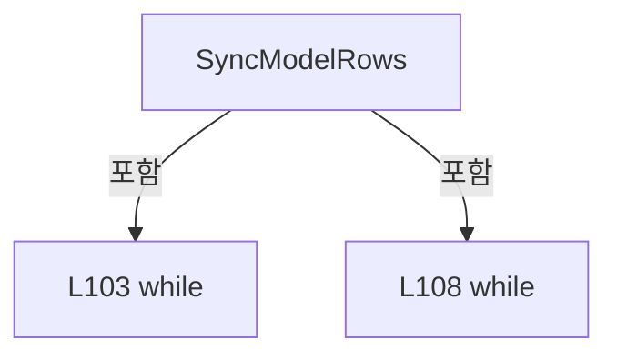

변경 전 점검: 입력/반환 타입, 위 호출자, 예외/취소 경로, 공유 상태와 저장·전송 소비자를 함께 확인합니다. 값의 단위나 물리 방향을 이름만으로 확정하지 않습니다.

### MethodDeclaration `OnModelRuleChanged` · L116–121

[Drilling.UI/Popup/CCellPlacementWizardDialog.xaml.cs:116–121](https://github.com/kjuws10-rgb/A3Drilling/blob/5aee8e58439c9b455cae7c9593c9be986c3e682e/Drilling.UI/Popup/CCellPlacementWizardDialog.xaml.cs#L116-L121)

| 항목 | 실제 추출 값 |
| --- | --- |
| 서명 | void Drilling.UI.Popup.CCellPlacementWizardDialog.OnModelRuleChanged(Drilling.UI.Popup.ST_CELL_PLACEMENT_MODEL_SELECTOR_ROW) |
| 접근/수식자 | Private / private |
| 반환/값 타입 | void |
| 소속 타입 | NamedType:Drilling.UI.Popup.CCellPlacementWizardDialog |

입력 계약:

| 이름 | 타입 | 전달 | 선택/기본값 |
| --- | --- | --- | --- |
| row | Drilling.UI.Popup.ST_CELL_PLACEMENT_MODEL_SELECTOR_ROW | None | False /  |

현재 부분 분석에서 직접 연결된 호출자는 없습니다. XAML/이벤트/인터페이스·델리게이트·외부 진입을 추가 확인해야 하며, 미사용으로 판정한 것이 아닙니다.

호출하는 대상과 해석 범위:

| 원본 행 | 표현식 | 분석 상태 | 대상/소스 위치 |
| --- | --- | --- | --- |
| 118 | ReadModel | resolved | int Drilling.UI.Popup.CCellPlacementWizardDialog.ReadModel(string?, int) · Drilling.UI/Popup/CCellPlacementWizardDialog.xaml.cs:313 |

본문의 실제 연산·분기·예외·반환 순서(원문 위치 순):

| 원본 행 | 종류 | 주석 해설 |
| --- | --- | --- |
| 118 | call | 함수·델리게이트 또는 객체 생성자를 호출합니다: ReadModel(row.SelectedModel, 0) |
| 118 | assignment | 값을 대상에 대입합니다: row.ApplyOrder = ReadModel(row.SelectedModel, 0) > 0 ? ++_modelApplySequence : 0 |
| 118 | conditional-expression | 조건에 따라 결과식을 선택합니다: ReadModel(row.SelectedModel, 0) > 0 ? ++_modelApplySequence : 0 |

변경 전 점검: 입력/반환 타입, 위 호출자, 예외/취소 경로, 공유 상태와 저장·전송 소비자를 함께 확인합니다. 값의 단위나 물리 방향을 이름만으로 확정하지 않습니다.

### MethodDeclaration `ApplyClick` · L123–134

[Drilling.UI/Popup/CCellPlacementWizardDialog.xaml.cs:123–134](https://github.com/kjuws10-rgb/A3Drilling/blob/5aee8e58439c9b455cae7c9593c9be986c3e682e/Drilling.UI/Popup/CCellPlacementWizardDialog.xaml.cs#L123-L134)

| 항목 | 실제 추출 값 |
| --- | --- |
| 서명 | void Drilling.UI.Popup.CCellPlacementWizardDialog.ApplyClick(object, RoutedEventArgs) |
| 접근/수식자 | Private / private |
| 반환/값 타입 | void |
| 소속 타입 | NamedType:Drilling.UI.Popup.CCellPlacementWizardDialog |

입력 계약:

| 이름 | 타입 | 전달 | 선택/기본값 |
| --- | --- | --- | --- |
| sender | object | None | False /  |
| e | RoutedEventArgs | None | False /  |

현재 부분 분석에서 직접 연결된 호출자는 없습니다. XAML/이벤트/인터페이스·델리게이트·외부 진입을 추가 확인해야 하며, 미사용으로 판정한 것이 아닙니다.

호출하는 대상과 해석 범위:

| 원본 행 | 표현식 | 분석 상태 | 대상/소스 위치 |
| --- | --- | --- | --- |
| 125 | TryCreateResult | resolved | bool Drilling.UI.Popup.CCellPlacementWizardDialog.TryCreateResult(out Drilling.UI.Popup.ST_CELL_PLACEMENT_WIZARD_RESULT, out string) · Drilling.UI/Popup/CCellPlacementWizardDialog.xaml.cs:221 |
| 127 | MessageBox.Show | unresolved | None |

본문의 실제 연산·분기·예외·반환 순서(원문 위치 순):

| 원본 행 | 종류 | 주석 해설 |
| --- | --- | --- |
| 125 | call | 함수·델리게이트 또는 객체 생성자를 호출합니다: TryCreateResult(out var result, out var error) |
| 125 | if | 조건에 따라 분기합니다: if (!TryCreateResult(out var result, out var error)) |
| 127 | call | 함수·델리게이트 또는 객체 생성자를 호출합니다: MessageBox.Show(this, error, "입력값 오류", MessageBoxButton.OK, MessageBoxImage.Warning) |
| 128 | return | 호출자에게 값 또는 제어를 반환합니다: return; |
| 131 | assignment | 값을 대상에 대입합니다: Result = result |
| 132 | assignment | 값을 대상에 대입합니다: _lastAppliedResult = result |
| 133 | assignment | 값을 대상에 대입합니다: DialogResult = true |

제어 구문의 포함 구조(실제 실행 순서/CFG가 아닌 구문 탐색 그림):

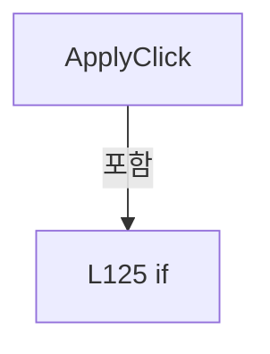

변경 전 점검: 입력/반환 타입, 위 호출자, 예외/취소 경로, 공유 상태와 저장·전송 소비자를 함께 확인합니다. 값의 단위나 물리 방향을 이름만으로 확정하지 않습니다.

### MethodDeclaration `ApplyInitialResult` · L136–169

[Drilling.UI/Popup/CCellPlacementWizardDialog.xaml.cs:136–169](https://github.com/kjuws10-rgb/A3Drilling/blob/5aee8e58439c9b455cae7c9593c9be986c3e682e/Drilling.UI/Popup/CCellPlacementWizardDialog.xaml.cs#L136-L169)

| 항목 | 실제 추출 값 |
| --- | --- |
| 서명 | void Drilling.UI.Popup.CCellPlacementWizardDialog.ApplyInitialResult(Drilling.UI.Popup.ST_CELL_PLACEMENT_WIZARD_RESULT) |
| 접근/수식자 | Private / private |
| 반환/값 타입 | void |
| 소속 타입 | NamedType:Drilling.UI.Popup.CCellPlacementWizardDialog |

입력 계약:

| 이름 | 타입 | 전달 | 선택/기본값 |
| --- | --- | --- | --- |
| result | Drilling.UI.Popup.ST_CELL_PLACEMENT_WIZARD_RESULT | None | False /  |

정적 호출자로 확인된 위치:

| 호출 파일/행 | 호출 표현식 | 런타임 분기 가능 |
| --- | --- | --- |
| [Drilling.UI/Popup/CCellPlacementWizardDialog.xaml.cs:58–58](https://github.com/kjuws10-rgb/A3Drilling/blob/5aee8e58439c9b455cae7c9593c9be986c3e682e/Drilling.UI/Popup/CCellPlacementWizardDialog.xaml.cs#L58-L58) | ApplyInitialResult | False |

호출하는 대상과 해석 범위:

| 원본 행 | 표현식 | 분석 상태 | 대상/소스 위치 |
| --- | --- | --- | --- |
| 138 | result.ColumnCount.ToString | resolved | string int.ToString(System.IFormatProvider?) |
| 139 | result.RowCount.ToString | resolved | string int.ToString(System.IFormatProvider?) |
| 140 | FormatValidationDouble | resolved | string Drilling.UI.Popup.CCellPlacementWizardDialog.FormatValidationDouble(double) · Drilling.UI/Popup/CCellPlacementWizardDialog.xaml.cs:363 |
| 140 | Math.Max | resolved | double System.Math.Max(double, double) |
| 141 | FormatValidationDouble | resolved | string Drilling.UI.Popup.CCellPlacementWizardDialog.FormatValidationDouble(double) · Drilling.UI/Popup/CCellPlacementWizardDialog.xaml.cs:363 |
| 141 | Math.Max | resolved | double System.Math.Max(double, double) |
| 142 | FormatValidationDouble | resolved | string Drilling.UI.Popup.CCellPlacementWizardDialog.FormatValidationDouble(double) · Drilling.UI/Popup/CCellPlacementWizardDialog.xaml.cs:363 |
| 142 | Math.Max | resolved | double System.Math.Max(double, double) |
| 143 | FormatValidationDouble | resolved | string Drilling.UI.Popup.CCellPlacementWizardDialog.FormatValidationDouble(double) · Drilling.UI/Popup/CCellPlacementWizardDialog.xaml.cs:363 |
| 143 | Math.Max | resolved | double System.Math.Max(double, double) |
| 144 | ST_CELL_PLACEMENT_WIZARD_DIRECTION.Options.FirstOrDefault | resolved | Drilling.UI.Popup.ST_CELL_PLACEMENT_WIZARD_DIRECTION? System.Collections.Generic.IEnumerable<Drilling.UI.Popup.ST_CELL_PLACEMENT_WIZARD_DIRECTION>.FirstOrDefault<Drilling.UI.Popup.ST_CELL_PLACEMENT_WIZARD_DIRECTION>(System.Func<Drilling.UI.Popup.ST_CELL_PLACEMENT_WIZARD_DIRECTION, bool>) |
| 144 | option.Key.Equals | resolved | bool string.Equals(string?, System.StringComparison) |
| 145 | Math.Clamp(result.DefaultModelType, 1, _modelTypeCount).ToString | resolved | string int.ToString(System.IFormatProvider?) |
| 145 | Math.Clamp | resolved | int System.Math.Clamp(int, int, int) |
| 146 | RefreshModelRows | resolved | void Drilling.UI.Popup.CCellPlacementWizardDialog.RefreshModelRows() · Drilling.UI/Popup/CCellPlacementWizardDialog.xaml.cs:88 |
| 156 | modelOverride.Scope.Equals | resolved | bool string.Equals(string?, System.StringComparison) |
| 158 | modelOverride.Scope.Equals | resolved | bool string.Equals(string?, System.StringComparison) |
| 167 | modelOverride.ModelType.ToString | resolved | string int.ToString(System.IFormatProvider?) |

본문의 실제 연산·분기·예외·반환 순서(원문 위치 순):

| 원본 행 | 종류 | 주석 해설 |
| --- | --- | --- |
| 138 | assignment | 값을 대상에 대입합니다: ColumnCountTextBox.Text = result.ColumnCount.ToString(CultureInfo.InvariantCulture) |
| 138 | call | 함수·델리게이트 또는 객체 생성자를 호출합니다: result.ColumnCount.ToString(CultureInfo.InvariantCulture) |
| 139 | assignment | 값을 대상에 대입합니다: RowCountTextBox.Text = result.RowCount.ToString(CultureInfo.InvariantCulture) |
| 139 | call | 함수·델리게이트 또는 객체 생성자를 호출합니다: result.RowCount.ToString(CultureInfo.InvariantCulture) |
| 140 | assignment | 값을 대상에 대입합니다: StartXTextBox.Text = FormatValidationDouble(Math.Max(0.0, result.StartX)) |
| 140 | call | 함수·델리게이트 또는 객체 생성자를 호출합니다: FormatValidationDouble(Math.Max(0.0, result.StartX)) |
| 140 | call | 함수·델리게이트 또는 객체 생성자를 호출합니다: Math.Max(0.0, result.StartX) |
| 141 | assignment | 값을 대상에 대입합니다: StartYTextBox.Text = FormatValidationDouble(Math.Max(0.0, result.StartY)) |
| 141 | call | 함수·델리게이트 또는 객체 생성자를 호출합니다: FormatValidationDouble(Math.Max(0.0, result.StartY)) |
| 141 | call | 함수·델리게이트 또는 객체 생성자를 호출합니다: Math.Max(0.0, result.StartY) |
| 142 | assignment | 값을 대상에 대입합니다: PitchXTextBox.Text = FormatValidationDouble(Math.Max(0.0, result.PitchX)) |
| 142 | call | 함수·델리게이트 또는 객체 생성자를 호출합니다: FormatValidationDouble(Math.Max(0.0, result.PitchX)) |
| 142 | call | 함수·델리게이트 또는 객체 생성자를 호출합니다: Math.Max(0.0, result.PitchX) |
| 143 | assignment | 값을 대상에 대입합니다: PitchYTextBox.Text = FormatValidationDouble(Math.Max(0.0, result.PitchY)) |
| 143 | call | 함수·델리게이트 또는 객체 생성자를 호출합니다: FormatValidationDouble(Math.Max(0.0, result.PitchY)) |
| 143 | call | 함수·델리게이트 또는 객체 생성자를 호출합니다: Math.Max(0.0, result.PitchY) |
| 144 | assignment | 값을 대상에 대입합니다: DirectionComboBox.SelectedItem = ST_CELL_PLACEMENT_WIZARD_DIRECTION.Options.FirstOrDefault(option => option.Key.Equals(result.Direction, StringComparison.OrdinalIgnoreCase)) ?? ST_CELL_PLACEMENT_WIZARD_DIRECTION.Options[0] |
| 144 | call | 함수·델리게이트 또는 객체 생성자를 호출합니다: ST_CELL_PLACEMENT_WIZARD_DIRECTION.Options.FirstOrDefault(option => option.Key.Equals(result.Direction, StringComparison.OrdinalIgnoreCase)) |
| 144 | call | 함수·델리게이트 또는 객체 생성자를 호출합니다: option.Key.Equals(result.Direction, StringComparison.OrdinalIgnoreCase) |
| 145 | assignment | 값을 대상에 대입합니다: DefaultModelComboBox.SelectedItem = Math.Clamp(result.DefaultModelType, 1, _modelTypeCount).ToString(CultureInfo.InvariantCulture) |
| 145 | call | 함수·델리게이트 또는 객체 생성자를 호출합니다: Math.Clamp(result.DefaultModelType, 1, _modelTypeCount).ToString(CultureInfo.InvariantCulture) |
| 145 | call | 함수·델리게이트 또는 객체 생성자를 호출합니다: Math.Clamp(result.DefaultModelType, 1, _modelTypeCount) |
| 146 | call | 함수·델리게이트 또는 객체 생성자를 호출합니다: RefreshModelRows() |
| 148 | assignment | 값을 대상에 대입합니다: _modelApplySequence = 0 |
| 149 | foreach | 컬렉션 요소를 순회합니다: foreach (var modelOverride in result.ModelOverrides) |
| 151 | if | 조건에 따라 분기합니다: if (modelOverride.ModelType < 1 &#124;&#124; modelOverride.ModelType > _modelTypeCount) |
| 153 | continue | 다음 반복으로 진행합니다: continue; |
| 156 | call | 함수·델리게이트 또는 객체 생성자를 호출합니다: modelOverride.Scope.Equals("ROW", StringComparison.OrdinalIgnoreCase) |
| 156 | conditional-expression | 조건에 따라 결과식을 선택합니다: modelOverride.Scope.Equals("ROW", StringComparison.OrdinalIgnoreCase) ? RowModelRows : modelOverride.Scope.Equals("COL", StringComparison.OrdinalIgnoreCase) ? ColumnModelRows : null |
| 156 | local-declaration | 지역 변수를 선언합니다: var rows = modelOverride.Scope.Equals("ROW", StringComparison.OrdinalIgnoreCase) ? RowModelRows : modelOverride.Scope.Equals("COL", StringComparison.OrdinalIgnoreCase) ? ColumnModelRows : null; |
| 156 | variable-initializer | 변수의 초기값을 지정합니다: rows = modelOverride.Scope.Equals("ROW", StringComparison.OrdinalIgnoreCase) ? RowModelRows : modelOverride.Scope.Equals("COL", StringComparison.OrdinalIgnoreCase) ? ColumnModelRows : null |
| 158 | call | 함수·델리게이트 또는 객체 생성자를 호출합니다: modelOverride.Scope.Equals("COL", StringComparison.OrdinalIgnoreCase) |
| 158 | conditional-expression | 조건에 따라 결과식을 선택합니다: modelOverride.Scope.Equals("COL", StringComparison.OrdinalIgnoreCase) ? ColumnModelRows : null |
| 161 | local-declaration | 지역 변수를 선언합니다: var rowIndex = modelOverride.Index - 1; |
| 161 | variable-initializer | 변수의 초기값을 지정합니다: rowIndex = modelOverride.Index - 1 |
| 162 | if | 조건에 따라 분기합니다: if (rows is null &#124;&#124; rowIndex < 0 &#124;&#124; rowIndex >= rows.Count) |
| 164 | continue | 다음 반복으로 진행합니다: continue; |
| 167 | assignment | 값을 대상에 대입합니다: rows[rowIndex].SelectedModel = modelOverride.ModelType.ToString(CultureInfo.InvariantCulture) |
| 167 | call | 함수·델리게이트 또는 객체 생성자를 호출합니다: modelOverride.ModelType.ToString(CultureInfo.InvariantCulture) |

제어 구문의 포함 구조(실제 실행 순서/CFG가 아닌 구문 탐색 그림):

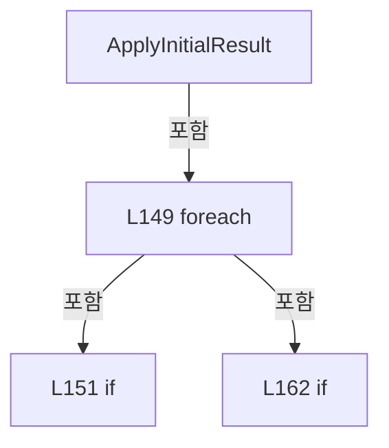

변경 전 점검: 입력/반환 타입, 위 호출자, 예외/취소 경로, 공유 상태와 저장·전송 소비자를 함께 확인합니다. 값의 단위나 물리 방향을 이름만으로 확정하지 않습니다.

### MethodDeclaration `OpenWizardInputKeypad` · L171–188

[Drilling.UI/Popup/CCellPlacementWizardDialog.xaml.cs:171–188](https://github.com/kjuws10-rgb/A3Drilling/blob/5aee8e58439c9b455cae7c9593c9be986c3e682e/Drilling.UI/Popup/CCellPlacementWizardDialog.xaml.cs#L171-L188)

| 항목 | 실제 추출 값 |
| --- | --- |
| 서명 | void Drilling.UI.Popup.CCellPlacementWizardDialog.OpenWizardInputKeypad(object, MouseButtonEventArgs) |
| 접근/수식자 | Private / private |
| 반환/값 타입 | void |
| 소속 타입 | NamedType:Drilling.UI.Popup.CCellPlacementWizardDialog |

입력 계약:

| 이름 | 타입 | 전달 | 선택/기본값 |
| --- | --- | --- | --- |
| sender | object | None | False /  |
| e | MouseButtonEventArgs | None | False /  |

현재 부분 분석에서 직접 연결된 호출자는 없습니다. XAML/이벤트/인터페이스·델리게이트·외부 진입을 추가 확인해야 하며, 미사용으로 판정한 것이 아닙니다.

호출하는 대상과 해석 범위:

| 원본 행 | 표현식 | 분석 상태 | 대상/소스 위치 |
| --- | --- | --- | --- |
| 179 | GetInputKeypadInfo | resolved | (string Parameter, Drilling.Common.Managers.EN_RECIPE_DATA_TYPE DataType, double Min, double Max) Drilling.UI.Popup.CCellPlacementWizardDialog.GetInputKeypadInfo(TextBox) · Drilling.UI/Popup/CCellPlacementWizardDialog.xaml.cs:190 |
| 180 | new CValueInputDialog | candidate | OverloadResolutionFailure |
| 184 | dialog.ShowDialog | unresolved | None |

본문의 실제 연산·분기·예외·반환 순서(원문 위치 순):

| 원본 행 | 종류 | 주석 해설 |
| --- | --- | --- |
| 173 | if | 조건에 따라 분기합니다: if (sender is not TextBox textBox) |
| 175 | return | 호출자에게 값 또는 제어를 반환합니다: return; |
| 178 | assignment | 값을 대상에 대입합니다: e.Handled = true |
| 179 | assignment | 값을 대상에 대입합니다: var (parameter, dataType, min, max) = GetInputKeypadInfo(textBox) |
| 179 | call | 함수·델리게이트 또는 객체 생성자를 호출합니다: GetInputKeypadInfo(textBox) |
| 180 | call | 함수·델리게이트 또는 객체 생성자를 호출합니다: new CValueInputDialog(parameter, textBox.Text, dataType, min, max) { Owner = this } |
| 180 | local-declaration | 지역 변수를 선언합니다: var dialog = new CValueInputDialog(parameter, textBox.Text, dataType, min, max) { Owner = this }; |
| 180 | variable-initializer | 변수의 초기값을 지정합니다: dialog = new CValueInputDialog(parameter, textBox.Text, dataType, min, max) { Owner = this } |
| 182 | assignment | 값을 대상에 대입합니다: Owner = this |
| 184 | call | 함수·델리게이트 또는 객체 생성자를 호출합니다: dialog.ShowDialog() |
| 184 | if | 조건에 따라 분기합니다: if (dialog.ShowDialog() == true) |
| 186 | assignment | 값을 대상에 대입합니다: textBox.Text = dialog.ResultValue |

제어 구문의 포함 구조(실제 실행 순서/CFG가 아닌 구문 탐색 그림):

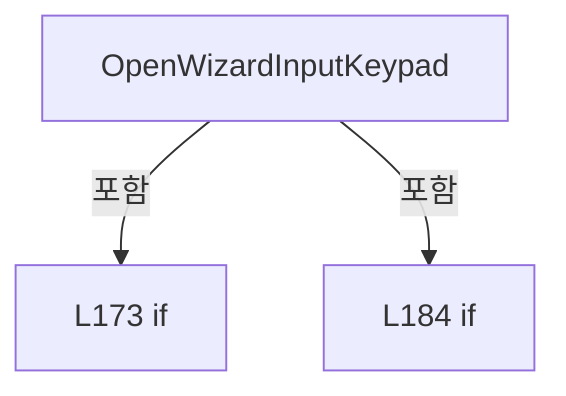

변경 전 점검: 입력/반환 타입, 위 호출자, 예외/취소 경로, 공유 상태와 저장·전송 소비자를 함께 확인합니다. 값의 단위나 물리 방향을 이름만으로 확정하지 않습니다.

### MethodDeclaration `GetInputKeypadInfo` · L190–219

[Drilling.UI/Popup/CCellPlacementWizardDialog.xaml.cs:190–219](https://github.com/kjuws10-rgb/A3Drilling/blob/5aee8e58439c9b455cae7c9593c9be986c3e682e/Drilling.UI/Popup/CCellPlacementWizardDialog.xaml.cs#L190-L219)

| 항목 | 실제 추출 값 |
| --- | --- |
| 서명 | (string Parameter, Drilling.Common.Managers.EN_RECIPE_DATA_TYPE DataType, double Min, double Max) Drilling.UI.Popup.CCellPlacementWizardDialog.GetInputKeypadInfo(TextBox) |
| 접근/수식자 | Private / private |
| 반환/값 타입 | (string Parameter, Drilling.Common.Managers.EN_RECIPE_DATA_TYPE DataType, double Min, double Max) |
| 소속 타입 | NamedType:Drilling.UI.Popup.CCellPlacementWizardDialog |

입력 계약:

| 이름 | 타입 | 전달 | 선택/기본값 |
| --- | --- | --- | --- |
| textBox | TextBox | None | False /  |

정적 호출자로 확인된 위치:

| 호출 파일/행 | 호출 표현식 | 런타임 분기 가능 |
| --- | --- | --- |
| [Drilling.UI/Popup/CCellPlacementWizardDialog.xaml.cs:179–179](https://github.com/kjuws10-rgb/A3Drilling/blob/5aee8e58439c9b455cae7c9593c9be986c3e682e/Drilling.UI/Popup/CCellPlacementWizardDialog.xaml.cs#L179-L179) | GetInputKeypadInfo | False |

호출하는 대상과 해석 범위:

| 원본 행 | 표현식 | 분석 상태 | 대상/소스 위치 |
| --- | --- | --- | --- |
| 193 | ReferenceEquals | candidate | OverloadResolutionFailure |
| 198 | ReferenceEquals | candidate | OverloadResolutionFailure |
| 203 | ReferenceEquals | candidate | OverloadResolutionFailure |
| 208 | ReferenceEquals | candidate | OverloadResolutionFailure |
| 213 | ReferenceEquals | candidate | OverloadResolutionFailure |

본문의 실제 연산·분기·예외·반환 순서(원문 위치 순):

| 원본 행 | 종류 | 주석 해설 |
| --- | --- | --- |
| 192 | local-declaration | 지역 변수를 선언합니다: const double nonNegativeMaximum = 1000000.0; |
| 192 | variable-initializer | 변수의 초기값을 지정합니다: nonNegativeMaximum = 1000000.0 |
| 193 | call | 함수·델리게이트 또는 객체 생성자를 호출합니다: ReferenceEquals(textBox, ColumnCountTextBox) |
| 193 | if | 조건에 따라 분기합니다: if (ReferenceEquals(textBox, ColumnCountTextBox)) |
| 195 | return | 호출자에게 값 또는 제어를 반환합니다: return ("COLUMN COUNT", EN_RECIPE_DATA_TYPE.Int, 1.0, _maxCellCount); |
| 198 | call | 함수·델리게이트 또는 객체 생성자를 호출합니다: ReferenceEquals(textBox, RowCountTextBox) |
| 198 | if | 조건에 따라 분기합니다: if (ReferenceEquals(textBox, RowCountTextBox)) |
| 200 | return | 호출자에게 값 또는 제어를 반환합니다: return ("ROW COUNT", EN_RECIPE_DATA_TYPE.Int, 1.0, _maxCellCount); |
| 203 | call | 함수·델리게이트 또는 객체 생성자를 호출합니다: ReferenceEquals(textBox, StartXTextBox) |
| 203 | if | 조건에 따라 분기합니다: if (ReferenceEquals(textBox, StartXTextBox)) |
| 205 | return | 호출자에게 값 또는 제어를 반환합니다: return ("START X", EN_RECIPE_DATA_TYPE.Double, 0.0, nonNegativeMaximum); |
| 208 | call | 함수·델리게이트 또는 객체 생성자를 호출합니다: ReferenceEquals(textBox, StartYTextBox) |
| 208 | if | 조건에 따라 분기합니다: if (ReferenceEquals(textBox, StartYTextBox)) |
| 210 | return | 호출자에게 값 또는 제어를 반환합니다: return ("START Y", EN_RECIPE_DATA_TYPE.Double, 0.0, nonNegativeMaximum); |
| 213 | call | 함수·델리게이트 또는 객체 생성자를 호출합니다: ReferenceEquals(textBox, PitchXTextBox) |
| 213 | if | 조건에 따라 분기합니다: if (ReferenceEquals(textBox, PitchXTextBox)) |
| 215 | return | 호출자에게 값 또는 제어를 반환합니다: return ("CELL PITCH X", EN_RECIPE_DATA_TYPE.Double, 0.0, nonNegativeMaximum); |
| 218 | return | 호출자에게 값 또는 제어를 반환합니다: return ("CELL PITCH Y", EN_RECIPE_DATA_TYPE.Double, 0.0, nonNegativeMaximum); |

제어 구문의 포함 구조(실제 실행 순서/CFG가 아닌 구문 탐색 그림):

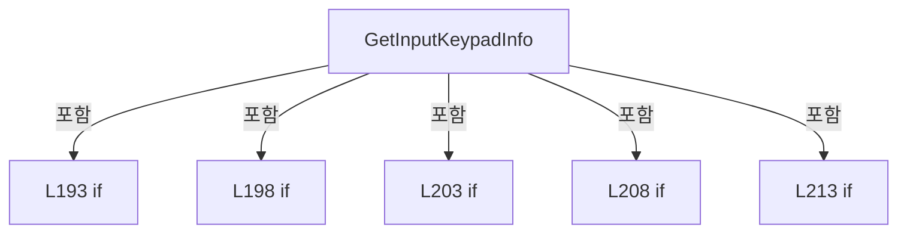

변경 전 점검: 입력/반환 타입, 위 호출자, 예외/취소 경로, 공유 상태와 저장·전송 소비자를 함께 확인합니다. 값의 단위나 물리 방향을 이름만으로 확정하지 않습니다.

### MethodDeclaration `TryCreateResult` · L221–301

[Drilling.UI/Popup/CCellPlacementWizardDialog.xaml.cs:221–301](https://github.com/kjuws10-rgb/A3Drilling/blob/5aee8e58439c9b455cae7c9593c9be986c3e682e/Drilling.UI/Popup/CCellPlacementWizardDialog.xaml.cs#L221-L301)

| 항목 | 실제 추출 값 |
| --- | --- |
| 서명 | bool Drilling.UI.Popup.CCellPlacementWizardDialog.TryCreateResult(out Drilling.UI.Popup.ST_CELL_PLACEMENT_WIZARD_RESULT, out string) |
| 접근/수식자 | Private / private |
| 반환/값 타입 | bool |
| 소속 타입 | NamedType:Drilling.UI.Popup.CCellPlacementWizardDialog |

입력 계약:

| 이름 | 타입 | 전달 | 선택/기본값 |
| --- | --- | --- | --- |
| result | Drilling.UI.Popup.ST_CELL_PLACEMENT_WIZARD_RESULT | Out | False /  |
| error | string | Out | False /  |

정적 호출자로 확인된 위치:

| 호출 파일/행 | 호출 표현식 | 런타임 분기 가능 |
| --- | --- | --- |
| [Drilling.UI/Popup/CCellPlacementWizardDialog.xaml.cs:125–125](https://github.com/kjuws10-rgb/A3Drilling/blob/5aee8e58439c9b455cae7c9593c9be986c3e682e/Drilling.UI/Popup/CCellPlacementWizardDialog.xaml.cs#L125-L125) | TryCreateResult | False |

호출하는 대상과 해석 범위:

| 원본 행 | 표현식 | 분석 상태 | 대상/소스 위치 |
| --- | --- | --- | --- |
| 229 | TryReadPositiveInt | candidate | OverloadResolutionFailure |
| 235 | TryReadPositiveInt | candidate | OverloadResolutionFailure |
| 241 | TryReadDouble | candidate | OverloadResolutionFailure |
| 242 | TryReadDouble | candidate | OverloadResolutionFailure |
| 243 | TryReadDouble | candidate | OverloadResolutionFailure |
| 244 | TryReadDouble | candidate | OverloadResolutionFailure |
| 263 | TryValidateGlassBounds | resolved | bool Drilling.UI.Popup.CCellPlacementWizardDialog.TryValidateGlassBounds(int, int, double, double, double, double, out string) · Drilling.UI/Popup/CCellPlacementWizardDialog.xaml.cs:320 |
| 268 | ReadModel | candidate | OverloadResolutionFailure |
| 268 | .ToString | unresolved | None |
| 271 | new ST_CELL_PLACEMENT_WIZARD_RESULT | candidate | OverloadResolutionFailure |
| 293 | RowModelRows .Concat(ColumnModelRows) .Where(row => row.ApplyOrder > 0 && ReadModel(row.SelectedModel, 0) > 0) .OrderBy(row => row.ApplyOrder) .Select(row => new ST_CELL_PLACEMENT_MODEL_OVERRIDE(row.Scope, row.Index, ReadModel(row.SelectedModel, 0))) .ToArray | resolved | Drilling.UI.Popup.ST_CELL_PLACEMENT_MODEL_OVERRIDE[] System.Collections.Generic.IEnumerable<Drilling.UI.Popup.ST_CELL_PLACEMENT_MODEL_OVERRIDE>.ToArray<Drilling.UI.Popup.ST_CELL_PLACEMENT_MODEL_OVERRIDE>() |
| 293 | RowModelRows .Concat(ColumnModelRows) .Where(row => row.ApplyOrder > 0 && ReadModel(row.SelectedModel, 0) > 0) .OrderBy(row => row.ApplyOrder) .Select | resolved | System.Collections.Generic.IEnumerable<Drilling.UI.Popup.ST_CELL_PLACEMENT_MODEL_OVERRIDE> System.Collections.Generic.IEnumerable<Drilling.UI.Popup.ST_CELL_PLACEMENT_MODEL_SELECTOR_ROW>.Select<Drilling.UI.Popup.ST_CELL_PLACEMENT_MODEL_SELECTOR_ROW, Drilling.UI.Popup.ST_CELL_PLACEMENT_MODEL_OVERRIDE>(System.Func<Drilling.UI.Popup.ST_CELL_PLACEMENT_MODEL_SELECTOR_ROW, Drilling.UI.Popup.ST_CELL_PLACEMENT_MODEL_OVERRIDE>) |
| 293 | RowModelRows .Concat(ColumnModelRows) .Where(row => row.ApplyOrder > 0 && ReadModel(row.SelectedModel, 0) > 0) .OrderBy | resolved | System.Linq.IOrderedEnumerable<Drilling.UI.Popup.ST_CELL_PLACEMENT_MODEL_SELECTOR_ROW> System.Collections.Generic.IEnumerable<Drilling.UI.Popup.ST_CELL_PLACEMENT_MODEL_SELECTOR_ROW>.OrderBy<Drilling.UI.Popup.ST_CELL_PLACEMENT_MODEL_SELECTOR_ROW, int>(System.Func<Drilling.UI.Popup.ST_CELL_PLACEMENT_MODEL_SELECTOR_ROW, int>) |
| 293 | RowModelRows .Concat(ColumnModelRows) .Where | resolved | System.Collections.Generic.IEnumerable<Drilling.UI.Popup.ST_CELL_PLACEMENT_MODEL_SELECTOR_ROW> System.Collections.Generic.IEnumerable<Drilling.UI.Popup.ST_CELL_PLACEMENT_MODEL_SELECTOR_ROW>.Where<Drilling.UI.Popup.ST_CELL_PLACEMENT_MODEL_SELECTOR_ROW>(System.Func<Drilling.UI.Popup.ST_CELL_PLACEMENT_MODEL_SELECTOR_ROW, bool>) |
| 293 | RowModelRows .Concat | resolved | System.Collections.Generic.IEnumerable<Drilling.UI.Popup.ST_CELL_PLACEMENT_MODEL_SELECTOR_ROW> System.Collections.Generic.IEnumerable<Drilling.UI.Popup.ST_CELL_PLACEMENT_MODEL_SELECTOR_ROW>.Concat<Drilling.UI.Popup.ST_CELL_PLACEMENT_MODEL_SELECTOR_ROW>(System.Collections.Generic.IEnumerable<Drilling.UI.Popup.ST_CELL_PLACEMENT_MODEL_SELECTOR_ROW>) |
| 295 | ReadModel | resolved | int Drilling.UI.Popup.CCellPlacementWizardDialog.ReadModel(string?, int) · Drilling.UI/Popup/CCellPlacementWizardDialog.xaml.cs:313 |
| 297 | new ST_CELL_PLACEMENT_MODEL_OVERRIDE | resolved | Drilling.UI.Popup.ST_CELL_PLACEMENT_MODEL_OVERRIDE.ST_CELL_PLACEMENT_MODEL_OVERRIDE(string, int, int) · Drilling.UI/Popup/CCellPlacementWizardDialog.xaml.cs:419 |
| 297 | ReadModel | resolved | int Drilling.UI.Popup.CCellPlacementWizardDialog.ReadModel(string?, int) · Drilling.UI/Popup/CCellPlacementWizardDialog.xaml.cs:313 |

본문의 실제 연산·분기·예외·반환 순서(원문 위치 순):

| 원본 행 | 종류 | 주석 해설 |
| --- | --- | --- |
| 223 | assignment | 값을 대상에 대입합니다: result = ST_CELL_PLACEMENT_WIZARD_RESULT.Empty |
| 224 | assignment | 값을 대상에 대입합니다: error = "" |
| 226 | local-declaration | 지역 변수를 선언합니다: const int startCell = 1; |
| 226 | variable-initializer | 변수의 초기값을 지정합니다: startCell = 1 |
| 227 | local-declaration | 지역 변수를 선언합니다: var cellCount = _maxCellCount; |
| 227 | variable-initializer | 변수의 초기값을 지정합니다: cellCount = _maxCellCount |
| 229 | call | 함수·델리게이트 또는 객체 생성자를 호출합니다: TryReadPositiveInt(ColumnCountTextBox.Text, out var columnCount) |
| 229 | if | 조건에 따라 분기합니다: if (!TryReadPositiveInt(ColumnCountTextBox.Text, out var columnCount)) |
| 231 | assignment | 값을 대상에 대입합니다: error = "COLUMN COUNT must be a positive integer." |
| 232 | return | 호출자에게 값 또는 제어를 반환합니다: return false; |
| 235 | call | 함수·델리게이트 또는 객체 생성자를 호출합니다: TryReadPositiveInt(RowCountTextBox.Text, out var rowCount) |
| 235 | if | 조건에 따라 분기합니다: if (!TryReadPositiveInt(RowCountTextBox.Text, out var rowCount)) |
| 237 | assignment | 값을 대상에 대입합니다: error = "ROW COUNT must be a positive integer." |
| 238 | return | 호출자에게 값 또는 제어를 반환합니다: return false; |
| 241 | call | 함수·델리게이트 또는 객체 생성자를 호출합니다: TryReadDouble(StartXTextBox.Text, out var startX) |
| 241 | if | 조건에 따라 분기합니다: if (!TryReadDouble(StartXTextBox.Text, out var startX) &#124;&#124; !TryReadDouble(StartYTextBox.Text, out var startY) &#124;&#124; !TryReadDouble(PitchXTextBox.Text, out var pitchX) &#124;&#124; !TryReadDouble(PitchYTextBox.Text, out var pitchY)) |
| 242 | call | 함수·델리게이트 또는 객체 생성자를 호출합니다: TryReadDouble(StartYTextBox.Text, out var startY) |
| 243 | call | 함수·델리게이트 또는 객체 생성자를 호출합니다: TryReadDouble(PitchXTextBox.Text, out var pitchX) |
| 244 | call | 함수·델리게이트 또는 객체 생성자를 호출합니다: TryReadDouble(PitchYTextBox.Text, out var pitchY) |
| 246 | assignment | 값을 대상에 대입합니다: error = "START X/Y and PITCH X/Y must be finite numbers." |
| 247 | return | 호출자에게 값 또는 제어를 반환합니다: return false; |
| 250 | if | 조건에 따라 분기합니다: if (startX < 0.0 &#124;&#124; startY < 0.0 &#124;&#124; pitchX < 0.0 &#124;&#124; pitchY < 0.0) |
| 252 | assignment | 값을 대상에 대입합니다: error = "START X/Y and CELL PITCH X/Y cannot be negative." |
| 253 | return | 호출자에게 값 또는 제어를 반환합니다: return false; |
| 256 | local-declaration | 지역 변수를 선언합니다: var layoutCellCount = (long)rowCount * columnCount; |
| 256 | variable-initializer | 변수의 초기값을 지정합니다: layoutCellCount = (long)rowCount * columnCount |
| 257 | if | 조건에 따라 분기합니다: if (layoutCellCount != cellCount) |
| 259 | assignment | 값을 대상에 대입합니다: error = $"ROW COUNT x COLUMN COUNT must match CELL COUNT.\nCurrent: {rowCount} x {columnCount} = {layoutCellCount}, CELL COUNT = {cellCount}." |
| 260 | return | 호출자에게 값 또는 제어를 반환합니다: return false; |
| 263 | call | 함수·델리게이트 또는 객체 생성자를 호출합니다: TryValidateGlassBounds(rowCount, columnCount, startX, startY, pitchX, pitchY, out error) |
| 263 | if | 조건에 따라 분기합니다: if (!TryValidateGlassBounds(rowCount, columnCount, startX, startY, pitchX, pitchY, out error)) |
| 265 | return | 호출자에게 값 또는 제어를 반환합니다: return false; |
| 268 | call | 함수·델리게이트 또는 객체 생성자를 호출합니다: ReadModel(DefaultModelComboBox.SelectedItem?.ToString(), 1) |
| 268 | call | 함수·델리게이트 또는 객체 생성자를 호출합니다: .ToString() |
| 268 | local-declaration | 지역 변수를 선언합니다: var defaultModelType = ReadModel(DefaultModelComboBox.SelectedItem?.ToString(), 1); |
| 268 | variable-initializer | 변수의 초기값을 지정합니다: defaultModelType = ReadModel(DefaultModelComboBox.SelectedItem?.ToString(), 1) |
| 269 | local-declaration | 지역 변수를 선언합니다: var direction = DirectionComboBox.SelectedItem as ST_CELL_PLACEMENT_WIZARD_DIRECTION ?? ST_CELL_PLACEMENT_WIZARD_DIRECTION.Options[0]; |
| 269 | variable-initializer | 변수의 초기값을 지정합니다: direction = DirectionComboBox.SelectedItem as ST_CELL_PLACEMENT_WIZARD_DIRECTION ?? ST_CELL_PLACEMENT_WIZARD_DIRECTION.Options[0] |
| 271 | assignment | 값을 대상에 대입합니다: result = new ST_CELL_PLACEMENT_WIZARD_RESULT( startCell, cellCount, rowCount, columnCount, startX, startY, pitchX, pitchY, direction.Key, defaultModelType, RowModelRows .Concat(ColumnModelRows) .Where(row => row.ApplyOrder > 0 &&  |
| 271 | call | 함수·델리게이트 또는 객체 생성자를 호출합니다: new ST_CELL_PLACEMENT_WIZARD_RESULT( startCell, cellCount, rowCount, columnCount, startX, startY, pitchX, pitchY, direction.Key, defaultModelType, RowModelRows .Concat(ColumnModelRows) .Where(row => row.ApplyOrder > 0 &&… |
| 293 | call | 함수·델리게이트 또는 객체 생성자를 호출합니다: RowModelRows .Concat(ColumnModelRows) |
| 293 | call | 함수·델리게이트 또는 객체 생성자를 호출합니다: RowModelRows .Concat(ColumnModelRows) .Where(row => row.ApplyOrder > 0 && ReadModel(row.SelectedModel, 0) > 0) |
| 293 | call | 함수·델리게이트 또는 객체 생성자를 호출합니다: RowModelRows .Concat(ColumnModelRows) .Where(row => row.ApplyOrder > 0 && ReadModel(row.SelectedModel, 0) > 0) .OrderBy(row => row.ApplyOrder) |
| 293 | call | 함수·델리게이트 또는 객체 생성자를 호출합니다: RowModelRows .Concat(ColumnModelRows) .Where(row => row.ApplyOrder > 0 && ReadModel(row.SelectedModel, 0) > 0) .OrderBy(row => row.ApplyOrder) .Select(row => new ST_CELL_PLACEMENT_MODEL_OVERRIDE(row.Scope, row.Index, Rea… |
| 293 | call | 함수·델리게이트 또는 객체 생성자를 호출합니다: RowModelRows .Concat(ColumnModelRows) .Where(row => row.ApplyOrder > 0 && ReadModel(row.SelectedModel, 0) > 0) .OrderBy(row => row.ApplyOrder) .Select(row => new ST_CELL_PLACEMENT_MODEL_OVERRIDE(row.Scope, row.Index, Rea… |
| 295 | call | 함수·델리게이트 또는 객체 생성자를 호출합니다: ReadModel(row.SelectedModel, 0) |
| 297 | call | 함수·델리게이트 또는 객체 생성자를 호출합니다: new ST_CELL_PLACEMENT_MODEL_OVERRIDE(row.Scope, row.Index, ReadModel(row.SelectedModel, 0)) |
| 297 | call | 함수·델리게이트 또는 객체 생성자를 호출합니다: ReadModel(row.SelectedModel, 0) |
| 300 | return | 호출자에게 값 또는 제어를 반환합니다: return true; |

제어 구문의 포함 구조(실제 실행 순서/CFG가 아닌 구문 탐색 그림):

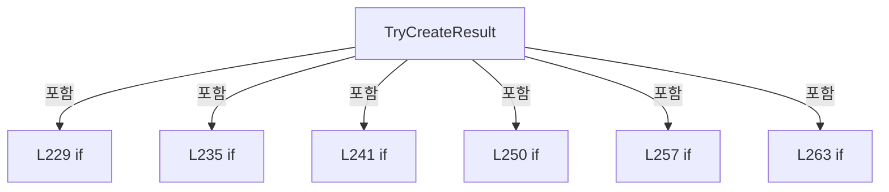

변경 전 점검: 입력/반환 타입, 위 호출자, 예외/취소 경로, 공유 상태와 저장·전송 소비자를 함께 확인합니다. 값의 단위나 물리 방향을 이름만으로 확정하지 않습니다.

### MethodDeclaration `TryReadPositiveInt` · L303–306

[Drilling.UI/Popup/CCellPlacementWizardDialog.xaml.cs:303–306](https://github.com/kjuws10-rgb/A3Drilling/blob/5aee8e58439c9b455cae7c9593c9be986c3e682e/Drilling.UI/Popup/CCellPlacementWizardDialog.xaml.cs#L303-L306)

| 항목 | 실제 추출 값 |
| --- | --- |
| 서명 | bool Drilling.UI.Popup.CCellPlacementWizardDialog.TryReadPositiveInt(string, out int) |
| 접근/수식자 | Private / private, static |
| 반환/값 타입 | bool |
| 소속 타입 | NamedType:Drilling.UI.Popup.CCellPlacementWizardDialog |

입력 계약:

| 이름 | 타입 | 전달 | 선택/기본값 |
| --- | --- | --- | --- |
| text | string | None | False /  |
| value | int | Out | False /  |

현재 부분 분석에서 직접 연결된 호출자는 없습니다. XAML/이벤트/인터페이스·델리게이트·외부 진입을 추가 확인해야 하며, 미사용으로 판정한 것이 아닙니다.

호출하는 대상과 해석 범위:

| 원본 행 | 표현식 | 분석 상태 | 대상/소스 위치 |
| --- | --- | --- | --- |
| 305 | int.TryParse | resolved | bool int.TryParse(string?, System.Globalization.NumberStyles, System.IFormatProvider?, out int) |
| 305 | text.Trim | resolved | string string.Trim() |

본문의 실제 연산·분기·예외·반환 순서(원문 위치 순):

| 원본 행 | 종류 | 주석 해설 |
| --- | --- | --- |
| 305 | call | 함수·델리게이트 또는 객체 생성자를 호출합니다: int.TryParse(text.Trim(), NumberStyles.Integer, CultureInfo.InvariantCulture, out value) |
| 305 | call | 함수·델리게이트 또는 객체 생성자를 호출합니다: text.Trim() |
| 305 | return | 호출자에게 값 또는 제어를 반환합니다: return int.TryParse(text.Trim(), NumberStyles.Integer, CultureInfo.InvariantCulture, out value) && value > 0; |

변경 전 점검: 입력/반환 타입, 위 호출자, 예외/취소 경로, 공유 상태와 저장·전송 소비자를 함께 확인합니다. 값의 단위나 물리 방향을 이름만으로 확정하지 않습니다.

### MethodDeclaration `TryReadDouble` · L308–311

[Drilling.UI/Popup/CCellPlacementWizardDialog.xaml.cs:308–311](https://github.com/kjuws10-rgb/A3Drilling/blob/5aee8e58439c9b455cae7c9593c9be986c3e682e/Drilling.UI/Popup/CCellPlacementWizardDialog.xaml.cs#L308-L311)

| 항목 | 실제 추출 값 |
| --- | --- |
| 서명 | bool Drilling.UI.Popup.CCellPlacementWizardDialog.TryReadDouble(string, out double) |
| 접근/수식자 | Private / private, static |
| 반환/값 타입 | bool |
| 소속 타입 | NamedType:Drilling.UI.Popup.CCellPlacementWizardDialog |

입력 계약:

| 이름 | 타입 | 전달 | 선택/기본값 |
| --- | --- | --- | --- |
| text | string | None | False /  |
| value | double | Out | False /  |

현재 부분 분석에서 직접 연결된 호출자는 없습니다. XAML/이벤트/인터페이스·델리게이트·외부 진입을 추가 확인해야 하며, 미사용으로 판정한 것이 아닙니다.

호출하는 대상과 해석 범위:

| 원본 행 | 표현식 | 분석 상태 | 대상/소스 위치 |
| --- | --- | --- | --- |
| 310 | double.TryParse | resolved | bool double.TryParse(string?, System.Globalization.NumberStyles, System.IFormatProvider?, out double) |
| 310 | text.Trim | resolved | string string.Trim() |
| 310 | double.IsFinite | resolved | bool double.IsFinite(double) |

본문의 실제 연산·분기·예외·반환 순서(원문 위치 순):

| 원본 행 | 종류 | 주석 해설 |
| --- | --- | --- |
| 310 | call | 함수·델리게이트 또는 객체 생성자를 호출합니다: double.TryParse(text.Trim(), NumberStyles.Float, CultureInfo.InvariantCulture, out value) |
| 310 | call | 함수·델리게이트 또는 객체 생성자를 호출합니다: text.Trim() |
| 310 | call | 함수·델리게이트 또는 객체 생성자를 호출합니다: double.IsFinite(value) |
| 310 | return | 호출자에게 값 또는 제어를 반환합니다: return double.TryParse(text.Trim(), NumberStyles.Float, CultureInfo.InvariantCulture, out value) && double.IsFinite(value); |

변경 전 점검: 입력/반환 타입, 위 호출자, 예외/취소 경로, 공유 상태와 저장·전송 소비자를 함께 확인합니다. 값의 단위나 물리 방향을 이름만으로 확정하지 않습니다.

### MethodDeclaration `ReadModel` · L313–318

[Drilling.UI/Popup/CCellPlacementWizardDialog.xaml.cs:313–318](https://github.com/kjuws10-rgb/A3Drilling/blob/5aee8e58439c9b455cae7c9593c9be986c3e682e/Drilling.UI/Popup/CCellPlacementWizardDialog.xaml.cs#L313-L318)

| 항목 | 실제 추출 값 |
| --- | --- |
| 서명 | int Drilling.UI.Popup.CCellPlacementWizardDialog.ReadModel(string?, int) |
| 접근/수식자 | Private / private, static |
| 반환/값 타입 | int |
| 소속 타입 | NamedType:Drilling.UI.Popup.CCellPlacementWizardDialog |

입력 계약:

| 이름 | 타입 | 전달 | 선택/기본값 |
| --- | --- | --- | --- |
| text | string? | None | False /  |
| defaultValue | int | None | False /  |

정적 호출자로 확인된 위치:

| 호출 파일/행 | 호출 표현식 | 런타임 분기 가능 |
| --- | --- | --- |
| [Drilling.UI/Popup/CCellPlacementWizardDialog.xaml.cs:118–118](https://github.com/kjuws10-rgb/A3Drilling/blob/5aee8e58439c9b455cae7c9593c9be986c3e682e/Drilling.UI/Popup/CCellPlacementWizardDialog.xaml.cs#L118-L118) | ReadModel | False |
| [Drilling.UI/Popup/CCellPlacementWizardDialog.xaml.cs:295–295](https://github.com/kjuws10-rgb/A3Drilling/blob/5aee8e58439c9b455cae7c9593c9be986c3e682e/Drilling.UI/Popup/CCellPlacementWizardDialog.xaml.cs#L295-L295) | ReadModel | False |
| [Drilling.UI/Popup/CCellPlacementWizardDialog.xaml.cs:297–297](https://github.com/kjuws10-rgb/A3Drilling/blob/5aee8e58439c9b455cae7c9593c9be986c3e682e/Drilling.UI/Popup/CCellPlacementWizardDialog.xaml.cs#L297-L297) | ReadModel | False |

호출하는 대상과 해석 범위:

| 원본 행 | 표현식 | 분석 상태 | 대상/소스 위치 |
| --- | --- | --- | --- |
| 315 | int.TryParse | resolved | bool int.TryParse(string?, System.Globalization.NumberStyles, System.IFormatProvider?, out int) |

본문의 실제 연산·분기·예외·반환 순서(원문 위치 순):

| 원본 행 | 종류 | 주석 해설 |
| --- | --- | --- |
| 315 | call | 함수·델리게이트 또는 객체 생성자를 호출합니다: int.TryParse(text, NumberStyles.Integer, CultureInfo.InvariantCulture, out var value) |
| 315 | conditional-expression | 조건에 따라 결과식을 선택합니다: int.TryParse(text, NumberStyles.Integer, CultureInfo.InvariantCulture, out var value) ? value : defaultValue |
| 315 | return | 호출자에게 값 또는 제어를 반환합니다: return int.TryParse(text, NumberStyles.Integer, CultureInfo.InvariantCulture, out var value) ? value : defaultValue; |

변경 전 점검: 입력/반환 타입, 위 호출자, 예외/취소 경로, 공유 상태와 저장·전송 소비자를 함께 확인합니다. 값의 단위나 물리 방향을 이름만으로 확정하지 않습니다.

### MethodDeclaration `TryValidateGlassBounds` · L320–361

[Drilling.UI/Popup/CCellPlacementWizardDialog.xaml.cs:320–361](https://github.com/kjuws10-rgb/A3Drilling/blob/5aee8e58439c9b455cae7c9593c9be986c3e682e/Drilling.UI/Popup/CCellPlacementWizardDialog.xaml.cs#L320-L361)

| 항목 | 실제 추출 값 |
| --- | --- |
| 서명 | bool Drilling.UI.Popup.CCellPlacementWizardDialog.TryValidateGlassBounds(int, int, double, double, double, double, out string) |
| 접근/수식자 | Private / private |
| 반환/값 타입 | bool |
| 소속 타입 | NamedType:Drilling.UI.Popup.CCellPlacementWizardDialog |

입력 계약:

| 이름 | 타입 | 전달 | 선택/기본값 |
| --- | --- | --- | --- |
| rowCount | int | None | False /  |
| columnCount | int | None | False /  |
| startX | double | None | False /  |
| startY | double | None | False /  |
| pitchX | double | None | False /  |
| pitchY | double | None | False /  |
| error | string | Out | False /  |

정적 호출자로 확인된 위치:

| 호출 파일/행 | 호출 표현식 | 런타임 분기 가능 |
| --- | --- | --- |
| [Drilling.UI/Popup/CCellPlacementWizardDialog.xaml.cs:263–263](https://github.com/kjuws10-rgb/A3Drilling/blob/5aee8e58439c9b455cae7c9593c9be986c3e682e/Drilling.UI/Popup/CCellPlacementWizardDialog.xaml.cs#L263-L263) | TryValidateGlassBounds | False |

호출하는 대상과 해석 범위:

| 원본 행 | 표현식 | 분석 상태 | 대상/소스 위치 |
| --- | --- | --- | --- |
| 347 | Math.Min | resolved | double System.Math.Min(double, double) |
| 348 | Math.Max | resolved | double System.Math.Max(double, double) |
| 349 | Math.Min | resolved | double System.Math.Min(double, double) |
| 350 | Math.Max | resolved | double System.Math.Max(double, double) |
| 358 | FormatValidationDouble | resolved | string Drilling.UI.Popup.CCellPlacementWizardDialog.FormatValidationDouble(double) · Drilling.UI/Popup/CCellPlacementWizardDialog.xaml.cs:363 |
| 358 | FormatValidationDouble | resolved | string Drilling.UI.Popup.CCellPlacementWizardDialog.FormatValidationDouble(double) · Drilling.UI/Popup/CCellPlacementWizardDialog.xaml.cs:363 |
| 358 | FormatValidationDouble | resolved | string Drilling.UI.Popup.CCellPlacementWizardDialog.FormatValidationDouble(double) · Drilling.UI/Popup/CCellPlacementWizardDialog.xaml.cs:363 |
| 359 | FormatValidationDouble | resolved | string Drilling.UI.Popup.CCellPlacementWizardDialog.FormatValidationDouble(double) · Drilling.UI/Popup/CCellPlacementWizardDialog.xaml.cs:363 |
| 359 | FormatValidationDouble | resolved | string Drilling.UI.Popup.CCellPlacementWizardDialog.FormatValidationDouble(double) · Drilling.UI/Popup/CCellPlacementWizardDialog.xaml.cs:363 |
| 359 | FormatValidationDouble | resolved | string Drilling.UI.Popup.CCellPlacementWizardDialog.FormatValidationDouble(double) · Drilling.UI/Popup/CCellPlacementWizardDialog.xaml.cs:363 |

본문의 실제 연산·분기·예외·반환 순서(원문 위치 순):

| 원본 행 | 종류 | 주석 해설 |
| --- | --- | --- |
| 337 | assignment | 값을 대상에 대입합니다: error = "" |
| 338 | if | 조건에 따라 분기합니다: if (_glassSizeX <= 0.0 &#124;&#124; _glassSizeY <= 0.0) |
| 340 | return | 호출자에게 값 또는 제어를 반환합니다: return true; |
| 343 | local-declaration | 지역 변수를 선언합니다: var firstX = _akMarginX + startX; |
| 343 | variable-initializer | 변수의 초기값을 지정합니다: firstX = _akMarginX + startX |
| 344 | local-declaration | 지역 변수를 선언합니다: var lastX = _akMarginX + startX + ((columnCount - 1) * pitchX); |
| 344 | variable-initializer | 변수의 초기값을 지정합니다: lastX = _akMarginX + startX + ((columnCount - 1) * pitchX) |
| 345 | local-declaration | 지역 변수를 선언합니다: var firstY = _akMarginY + startY; |
| 345 | variable-initializer | 변수의 초기값을 지정합니다: firstY = _akMarginY + startY |
| 346 | local-declaration | 지역 변수를 선언합니다: var lastY = _akMarginY + startY + ((rowCount - 1) * pitchY); |
| 346 | variable-initializer | 변수의 초기값을 지정합니다: lastY = _akMarginY + startY + ((rowCount - 1) * pitchY) |
| 347 | call | 함수·델리게이트 또는 객체 생성자를 호출합니다: Math.Min(firstX, lastX) |
| 347 | local-declaration | 지역 변수를 선언합니다: var minX = Math.Min(firstX, lastX); |
| 347 | variable-initializer | 변수의 초기값을 지정합니다: minX = Math.Min(firstX, lastX) |
| 348 | call | 함수·델리게이트 또는 객체 생성자를 호출합니다: Math.Max(firstX, lastX) |
| 348 | local-declaration | 지역 변수를 선언합니다: var maxX = Math.Max(firstX, lastX); |
| 348 | variable-initializer | 변수의 초기값을 지정합니다: maxX = Math.Max(firstX, lastX) |
| 349 | call | 함수·델리게이트 또는 객체 생성자를 호출합니다: Math.Min(firstY, lastY) |
| 349 | local-declaration | 지역 변수를 선언합니다: var minY = Math.Min(firstY, lastY); |
| 349 | variable-initializer | 변수의 초기값을 지정합니다: minY = Math.Min(firstY, lastY) |
| 350 | call | 함수·델리게이트 또는 객체 생성자를 호출합니다: Math.Max(firstY, lastY) |
| 350 | local-declaration | 지역 변수를 선언합니다: var maxY = Math.Max(firstY, lastY); |
| 350 | variable-initializer | 변수의 초기값을 지정합니다: maxY = Math.Max(firstY, lastY) |
| 351 | if | 조건에 따라 분기합니다: if (minX >= 0.0 && maxX <= _glassSizeX && minY >= 0.0 && maxY <= _glassSizeY) |
| 353 | return | 호출자에게 값 또는 제어를 반환합니다: return true; |
| 356 | assignment | 값을 대상에 대입합니다: error = "CELL PITCH placement exceeds GLASS SIZE.\n" + $"X range: {FormatValidationDouble(minX)} ~ {FormatValidationDouble(maxX)} / Glass X: {FormatValidationDouble(_glassSizeX)}\n" + $"Y range: {FormatValidationDouble(minY)} ~ {F |
| 358 | call | 함수·델리게이트 또는 객체 생성자를 호출합니다: FormatValidationDouble(minX) |
| 358 | call | 함수·델리게이트 또는 객체 생성자를 호출합니다: FormatValidationDouble(maxX) |
| 358 | call | 함수·델리게이트 또는 객체 생성자를 호출합니다: FormatValidationDouble(_glassSizeX) |
| 359 | call | 함수·델리게이트 또는 객체 생성자를 호출합니다: FormatValidationDouble(minY) |
| 359 | call | 함수·델리게이트 또는 객체 생성자를 호출합니다: FormatValidationDouble(maxY) |
| 359 | call | 함수·델리게이트 또는 객체 생성자를 호출합니다: FormatValidationDouble(_glassSizeY) |
| 360 | return | 호출자에게 값 또는 제어를 반환합니다: return false; |

제어 구문의 포함 구조(실제 실행 순서/CFG가 아닌 구문 탐색 그림):

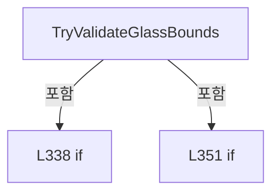

변경 전 점검: 입력/반환 타입, 위 호출자, 예외/취소 경로, 공유 상태와 저장·전송 소비자를 함께 확인합니다. 값의 단위나 물리 방향을 이름만으로 확정하지 않습니다.

### MethodDeclaration `FormatValidationDouble` · L363–366

[Drilling.UI/Popup/CCellPlacementWizardDialog.xaml.cs:363–366](https://github.com/kjuws10-rgb/A3Drilling/blob/5aee8e58439c9b455cae7c9593c9be986c3e682e/Drilling.UI/Popup/CCellPlacementWizardDialog.xaml.cs#L363-L366)

| 항목 | 실제 추출 값 |
| --- | --- |
| 서명 | string Drilling.UI.Popup.CCellPlacementWizardDialog.FormatValidationDouble(double) |
| 접근/수식자 | Private / private, static |
| 반환/값 타입 | string |
| 소속 타입 | NamedType:Drilling.UI.Popup.CCellPlacementWizardDialog |

입력 계약:

| 이름 | 타입 | 전달 | 선택/기본값 |
| --- | --- | --- | --- |
| value | double | None | False /  |

정적 호출자로 확인된 위치:

| 호출 파일/행 | 호출 표현식 | 런타임 분기 가능 |
| --- | --- | --- |
| [Drilling.UI/Popup/CCellPlacementWizardDialog.xaml.cs:140–140](https://github.com/kjuws10-rgb/A3Drilling/blob/5aee8e58439c9b455cae7c9593c9be986c3e682e/Drilling.UI/Popup/CCellPlacementWizardDialog.xaml.cs#L140-L140) | FormatValidationDouble | False |
| [Drilling.UI/Popup/CCellPlacementWizardDialog.xaml.cs:141–141](https://github.com/kjuws10-rgb/A3Drilling/blob/5aee8e58439c9b455cae7c9593c9be986c3e682e/Drilling.UI/Popup/CCellPlacementWizardDialog.xaml.cs#L141-L141) | FormatValidationDouble | False |
| [Drilling.UI/Popup/CCellPlacementWizardDialog.xaml.cs:142–142](https://github.com/kjuws10-rgb/A3Drilling/blob/5aee8e58439c9b455cae7c9593c9be986c3e682e/Drilling.UI/Popup/CCellPlacementWizardDialog.xaml.cs#L142-L142) | FormatValidationDouble | False |
| [Drilling.UI/Popup/CCellPlacementWizardDialog.xaml.cs:143–143](https://github.com/kjuws10-rgb/A3Drilling/blob/5aee8e58439c9b455cae7c9593c9be986c3e682e/Drilling.UI/Popup/CCellPlacementWizardDialog.xaml.cs#L143-L143) | FormatValidationDouble | False |
| [Drilling.UI/Popup/CCellPlacementWizardDialog.xaml.cs:358–358](https://github.com/kjuws10-rgb/A3Drilling/blob/5aee8e58439c9b455cae7c9593c9be986c3e682e/Drilling.UI/Popup/CCellPlacementWizardDialog.xaml.cs#L358-L358) | FormatValidationDouble | False |
| [Drilling.UI/Popup/CCellPlacementWizardDialog.xaml.cs:358–358](https://github.com/kjuws10-rgb/A3Drilling/blob/5aee8e58439c9b455cae7c9593c9be986c3e682e/Drilling.UI/Popup/CCellPlacementWizardDialog.xaml.cs#L358-L358) | FormatValidationDouble | False |
| [Drilling.UI/Popup/CCellPlacementWizardDialog.xaml.cs:358–358](https://github.com/kjuws10-rgb/A3Drilling/blob/5aee8e58439c9b455cae7c9593c9be986c3e682e/Drilling.UI/Popup/CCellPlacementWizardDialog.xaml.cs#L358-L358) | FormatValidationDouble | False |
| [Drilling.UI/Popup/CCellPlacementWizardDialog.xaml.cs:359–359](https://github.com/kjuws10-rgb/A3Drilling/blob/5aee8e58439c9b455cae7c9593c9be986c3e682e/Drilling.UI/Popup/CCellPlacementWizardDialog.xaml.cs#L359-L359) | FormatValidationDouble | False |
| [Drilling.UI/Popup/CCellPlacementWizardDialog.xaml.cs:359–359](https://github.com/kjuws10-rgb/A3Drilling/blob/5aee8e58439c9b455cae7c9593c9be986c3e682e/Drilling.UI/Popup/CCellPlacementWizardDialog.xaml.cs#L359-L359) | FormatValidationDouble | False |
| [Drilling.UI/Popup/CCellPlacementWizardDialog.xaml.cs:359–359](https://github.com/kjuws10-rgb/A3Drilling/blob/5aee8e58439c9b455cae7c9593c9be986c3e682e/Drilling.UI/Popup/CCellPlacementWizardDialog.xaml.cs#L359-L359) | FormatValidationDouble | False |

호출하는 대상과 해석 범위:

| 원본 행 | 표현식 | 분석 상태 | 대상/소스 위치 |
| --- | --- | --- | --- |
| 365 | value.ToString | resolved | string double.ToString(string?, System.IFormatProvider?) |

본문의 실제 연산·분기·예외·반환 순서(원문 위치 순):

| 원본 행 | 종류 | 주석 해설 |
| --- | --- | --- |
| 365 | call | 함수·델리게이트 또는 객체 생성자를 호출합니다: value.ToString("0.######", CultureInfo.InvariantCulture) |
| 365 | return | 호출자에게 값 또는 제어를 반환합니다: return value.ToString("0.######", CultureInfo.InvariantCulture); |

변경 전 점검: 입력/반환 타입, 위 호출자, 예외/취소 경로, 공유 상태와 저장·전송 소비자를 함께 확인합니다. 값의 단위나 물리 방향을 이름만으로 확정하지 않습니다.

### MethodDeclaration `CancelClick` · L368–371

[Drilling.UI/Popup/CCellPlacementWizardDialog.xaml.cs:368–371](https://github.com/kjuws10-rgb/A3Drilling/blob/5aee8e58439c9b455cae7c9593c9be986c3e682e/Drilling.UI/Popup/CCellPlacementWizardDialog.xaml.cs#L368-L371)

| 항목 | 실제 추출 값 |
| --- | --- |
| 서명 | void Drilling.UI.Popup.CCellPlacementWizardDialog.CancelClick(object, RoutedEventArgs) |
| 접근/수식자 | Private / private |
| 반환/값 타입 | void |
| 소속 타입 | NamedType:Drilling.UI.Popup.CCellPlacementWizardDialog |

입력 계약:

| 이름 | 타입 | 전달 | 선택/기본값 |
| --- | --- | --- | --- |
| sender | object | None | False /  |
| e | RoutedEventArgs | None | False /  |

현재 부분 분석에서 직접 연결된 호출자는 없습니다. XAML/이벤트/인터페이스·델리게이트·외부 진입을 추가 확인해야 하며, 미사용으로 판정한 것이 아닙니다.

본문의 실제 연산·분기·예외·반환 순서(원문 위치 순):

| 원본 행 | 종류 | 주석 해설 |
| --- | --- | --- |
| 370 | assignment | 값을 대상에 대입합니다: DialogResult = false |

변경 전 점검: 입력/반환 타입, 위 호출자, 예외/취소 경로, 공유 상태와 저장·전송 소비자를 함께 확인합니다. 값의 단위나 물리 방향을 이름만으로 확정하지 않습니다.

### MethodDeclaration `WindowKeyDown` · L373–380

[Drilling.UI/Popup/CCellPlacementWizardDialog.xaml.cs:373–380](https://github.com/kjuws10-rgb/A3Drilling/blob/5aee8e58439c9b455cae7c9593c9be986c3e682e/Drilling.UI/Popup/CCellPlacementWizardDialog.xaml.cs#L373-L380)

| 항목 | 실제 추출 값 |
| --- | --- |
| 서명 | void Drilling.UI.Popup.CCellPlacementWizardDialog.WindowKeyDown(object, KeyEventArgs) |
| 접근/수식자 | Private / private |
| 반환/값 타입 | void |
| 소속 타입 | NamedType:Drilling.UI.Popup.CCellPlacementWizardDialog |

입력 계약:

| 이름 | 타입 | 전달 | 선택/기본값 |
| --- | --- | --- | --- |
| sender | object | None | False /  |
| e | KeyEventArgs | None | False /  |

현재 부분 분석에서 직접 연결된 호출자는 없습니다. XAML/이벤트/인터페이스·델리게이트·외부 진입을 추가 확인해야 하며, 미사용으로 판정한 것이 아닙니다.

본문의 실제 연산·분기·예외·반환 순서(원문 위치 순):

| 원본 행 | 종류 | 주석 해설 |
| --- | --- | --- |
| 375 | if | 조건에 따라 분기합니다: if (e.Key == Key.Escape) |
| 377 | assignment | 값을 대상에 대입합니다: e.Handled = true |
| 378 | assignment | 값을 대상에 대입합니다: DialogResult = false |

제어 구문의 포함 구조(실제 실행 순서/CFG가 아닌 구문 탐색 그림):

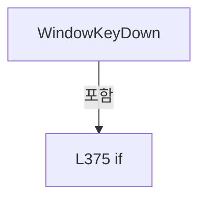

변경 전 점검: 입력/반환 타입, 위 호출자, 예외/취소 경로, 공유 상태와 저장·전송 소비자를 함께 확인합니다. 값의 단위나 물리 방향을 이름만으로 확정하지 않습니다.

### PropertyDeclaration `Empty` · L416–416

[Drilling.UI/Popup/CCellPlacementWizardDialog.xaml.cs:416–416](https://github.com/kjuws10-rgb/A3Drilling/blob/5aee8e58439c9b455cae7c9593c9be986c3e682e/Drilling.UI/Popup/CCellPlacementWizardDialog.xaml.cs#L416-L416)

| 항목 | 실제 추출 값 |
| --- | --- |
| 서명 | Drilling.UI.Popup.ST_CELL_PLACEMENT_WIZARD_RESULT Drilling.UI.Popup.ST_CELL_PLACEMENT_WIZARD_RESULT.Empty |
| 접근/수식자 | Public / public, static |
| 반환/값 타입 | Drilling.UI.Popup.ST_CELL_PLACEMENT_WIZARD_RESULT |
| 소속 타입 | NamedType:Drilling.UI.Popup.ST_CELL_PLACEMENT_WIZARD_RESULT |

현재 부분 분석에서 직접 연결된 호출자는 없습니다. XAML/이벤트/인터페이스·델리게이트·외부 진입을 추가 확인해야 하며, 미사용으로 판정한 것이 아닙니다.

호출하는 대상과 해석 범위:

| 원본 행 | 표현식 | 분석 상태 | 대상/소스 위치 |
| --- | --- | --- | --- |
| 416 | new | resolved | Drilling.UI.Popup.ST_CELL_PLACEMENT_WIZARD_RESULT.ST_CELL_PLACEMENT_WIZARD_RESULT(int, int, int, int, double, double, double, double, string, int, System.Collections.Generic.IReadOnlyList<Drilling.UI.Popup.ST_CELL_PLACEMENT_MODEL_OVERRIDE>) · Drilling.UI/Popup/CCellPlacementWizardDialog.xaml.cs:391 |

본문의 실제 연산·분기·예외·반환 순서(원문 위치 순):

| 원본 행 | 종류 | 주석 해설 |
| --- | --- | --- |
| 416 | call | 함수·델리게이트 또는 객체 생성자를 호출합니다: new(1, 0, 1, 1, 0.0, 0.0, 0.0, 0.0, ST_CELL_PLACEMENT_WIZARD_DIRECTION.HorizontalFirst, 1, []) |

변경 전 점검: 입력/반환 타입, 위 호출자, 예외/취소 경로, 공유 상태와 저장·전송 소비자를 함께 확인합니다. 값의 단위나 물리 방향을 이름만으로 확정하지 않습니다.

### GetAccessorDeclaration `get_Empty` · L416–416

[Drilling.UI/Popup/CCellPlacementWizardDialog.xaml.cs:416–416](https://github.com/kjuws10-rgb/A3Drilling/blob/5aee8e58439c9b455cae7c9593c9be986c3e682e/Drilling.UI/Popup/CCellPlacementWizardDialog.xaml.cs#L416-L416)

| 항목 | 실제 추출 값 |
| --- | --- |
| 서명 | Drilling.UI.Popup.ST_CELL_PLACEMENT_WIZARD_RESULT Drilling.UI.Popup.ST_CELL_PLACEMENT_WIZARD_RESULT.Empty.get |
| 접근/수식자 | Public / get |
| 반환/값 타입 | Drilling.UI.Popup.ST_CELL_PLACEMENT_WIZARD_RESULT |
| 소속 타입 | NamedType:Drilling.UI.Popup.ST_CELL_PLACEMENT_WIZARD_RESULT |

현재 부분 분석에서 직접 연결된 호출자는 없습니다. XAML/이벤트/인터페이스·델리게이트·외부 진입을 추가 확인해야 하며, 미사용으로 판정한 것이 아닙니다.

변경 전 점검: 입력/반환 타입, 위 호출자, 예외/취소 경로, 공유 상태와 저장·전송 소비자를 함께 확인합니다. 값의 단위나 물리 방향을 이름만으로 확정하지 않습니다.

### FieldDeclaration `HorizontalFirst` · L423–423

[Drilling.UI/Popup/CCellPlacementWizardDialog.xaml.cs:423–423](https://github.com/kjuws10-rgb/A3Drilling/blob/5aee8e58439c9b455cae7c9593c9be986c3e682e/Drilling.UI/Popup/CCellPlacementWizardDialog.xaml.cs#L423-L423)

| 항목 | 실제 추출 값 |
| --- | --- |
| 서명 | string Drilling.UI.Popup.ST_CELL_PLACEMENT_WIZARD_DIRECTION.HorizontalFirst |
| 접근/수식자 | Public / public, const |
| 반환/값 타입 | string |
| 소속 타입 | NamedType:Drilling.UI.Popup.ST_CELL_PLACEMENT_WIZARD_DIRECTION |

현재 부분 분석에서 직접 연결된 호출자는 없습니다. XAML/이벤트/인터페이스·델리게이트·외부 진입을 추가 확인해야 하며, 미사용으로 판정한 것이 아닙니다.

본문의 실제 연산·분기·예외·반환 순서(원문 위치 순):

| 원본 행 | 종류 | 주석 해설 |
| --- | --- | --- |
| 423 | variable-initializer | 변수의 초기값을 지정합니다: HorizontalFirst = "HORIZONTAL_FIRST" |

변경 전 점검: 입력/반환 타입, 위 호출자, 예외/취소 경로, 공유 상태와 저장·전송 소비자를 함께 확인합니다. 값의 단위나 물리 방향을 이름만으로 확정하지 않습니다.

### FieldDeclaration `VerticalFirst` · L424–424

[Drilling.UI/Popup/CCellPlacementWizardDialog.xaml.cs:424–424](https://github.com/kjuws10-rgb/A3Drilling/blob/5aee8e58439c9b455cae7c9593c9be986c3e682e/Drilling.UI/Popup/CCellPlacementWizardDialog.xaml.cs#L424-L424)

| 항목 | 실제 추출 값 |
| --- | --- |
| 서명 | string Drilling.UI.Popup.ST_CELL_PLACEMENT_WIZARD_DIRECTION.VerticalFirst |
| 접근/수식자 | Public / public, const |
| 반환/값 타입 | string |
| 소속 타입 | NamedType:Drilling.UI.Popup.ST_CELL_PLACEMENT_WIZARD_DIRECTION |

현재 부분 분석에서 직접 연결된 호출자는 없습니다. XAML/이벤트/인터페이스·델리게이트·외부 진입을 추가 확인해야 하며, 미사용으로 판정한 것이 아닙니다.

본문의 실제 연산·분기·예외·반환 순서(원문 위치 순):

| 원본 행 | 종류 | 주석 해설 |
| --- | --- | --- |
| 424 | variable-initializer | 변수의 초기값을 지정합니다: VerticalFirst = "VERTICAL_FIRST" |

변경 전 점검: 입력/반환 타입, 위 호출자, 예외/취소 경로, 공유 상태와 저장·전송 소비자를 함께 확인합니다. 값의 단위나 물리 방향을 이름만으로 확정하지 않습니다.

### PropertyDeclaration `Options` · L426–430

[Drilling.UI/Popup/CCellPlacementWizardDialog.xaml.cs:426–430](https://github.com/kjuws10-rgb/A3Drilling/blob/5aee8e58439c9b455cae7c9593c9be986c3e682e/Drilling.UI/Popup/CCellPlacementWizardDialog.xaml.cs#L426-L430)

| 항목 | 실제 추출 값 |
| --- | --- |
| 서명 | System.Collections.Generic.IReadOnlyList<Drilling.UI.Popup.ST_CELL_PLACEMENT_WIZARD_DIRECTION> Drilling.UI.Popup.ST_CELL_PLACEMENT_WIZARD_DIRECTION.Options |
| 접근/수식자 | Public / public, static |
| 반환/값 타입 | System.Collections.Generic.IReadOnlyList<Drilling.UI.Popup.ST_CELL_PLACEMENT_WIZARD_DIRECTION> |
| 소속 타입 | NamedType:Drilling.UI.Popup.ST_CELL_PLACEMENT_WIZARD_DIRECTION |

현재 부분 분석에서 직접 연결된 호출자는 없습니다. XAML/이벤트/인터페이스·델리게이트·외부 진입을 추가 확인해야 하며, 미사용으로 판정한 것이 아닙니다.

호출하는 대상과 해석 범위:

| 원본 행 | 표현식 | 분석 상태 | 대상/소스 위치 |
| --- | --- | --- | --- |
| 428 | new | resolved | Drilling.UI.Popup.ST_CELL_PLACEMENT_WIZARD_DIRECTION.ST_CELL_PLACEMENT_WIZARD_DIRECTION(string, string) · Drilling.UI/Popup/CCellPlacementWizardDialog.xaml.cs:421 |
| 429 | new | resolved | Drilling.UI.Popup.ST_CELL_PLACEMENT_WIZARD_DIRECTION.ST_CELL_PLACEMENT_WIZARD_DIRECTION(string, string) · Drilling.UI/Popup/CCellPlacementWizardDialog.xaml.cs:421 |

본문의 실제 연산·분기·예외·반환 순서(원문 위치 순):

| 원본 행 | 종류 | 주석 해설 |
| --- | --- | --- |
| 428 | call | 함수·델리게이트 또는 객체 생성자를 호출합니다: new(HorizontalFirst, "HORIZONTAL FIRST") |
| 429 | call | 함수·델리게이트 또는 객체 생성자를 호출합니다: new(VerticalFirst, "VERTICAL FIRST") |

변경 전 점검: 입력/반환 타입, 위 호출자, 예외/취소 경로, 공유 상태와 저장·전송 소비자를 함께 확인합니다. 값의 단위나 물리 방향을 이름만으로 확정하지 않습니다.

### GetAccessorDeclaration `get_Options` · L426–426

[Drilling.UI/Popup/CCellPlacementWizardDialog.xaml.cs:426–426](https://github.com/kjuws10-rgb/A3Drilling/blob/5aee8e58439c9b455cae7c9593c9be986c3e682e/Drilling.UI/Popup/CCellPlacementWizardDialog.xaml.cs#L426-L426)

| 항목 | 실제 추출 값 |
| --- | --- |
| 서명 | System.Collections.Generic.IReadOnlyList<Drilling.UI.Popup.ST_CELL_PLACEMENT_WIZARD_DIRECTION> Drilling.UI.Popup.ST_CELL_PLACEMENT_WIZARD_DIRECTION.Options.get |
| 접근/수식자 | Public / get |
| 반환/값 타입 | System.Collections.Generic.IReadOnlyList<Drilling.UI.Popup.ST_CELL_PLACEMENT_WIZARD_DIRECTION> |
| 소속 타입 | NamedType:Drilling.UI.Popup.ST_CELL_PLACEMENT_WIZARD_DIRECTION |

현재 부분 분석에서 직접 연결된 호출자는 없습니다. XAML/이벤트/인터페이스·델리게이트·외부 진입을 추가 확인해야 하며, 미사용으로 판정한 것이 아닙니다.

변경 전 점검: 입력/반환 타입, 위 호출자, 예외/취소 경로, 공유 상태와 저장·전송 소비자를 함께 확인합니다. 값의 단위나 물리 방향을 이름만으로 확정하지 않습니다.

### MethodDeclaration `ToString` · L432–435

[Drilling.UI/Popup/CCellPlacementWizardDialog.xaml.cs:432–435](https://github.com/kjuws10-rgb/A3Drilling/blob/5aee8e58439c9b455cae7c9593c9be986c3e682e/Drilling.UI/Popup/CCellPlacementWizardDialog.xaml.cs#L432-L435)

| 항목 | 실제 추출 값 |
| --- | --- |
| 서명 | string Drilling.UI.Popup.ST_CELL_PLACEMENT_WIZARD_DIRECTION.ToString() |
| 접근/수식자 | Public / public, override |
| 반환/값 타입 | string |
| 소속 타입 | NamedType:Drilling.UI.Popup.ST_CELL_PLACEMENT_WIZARD_DIRECTION |

현재 부분 분석에서 직접 연결된 호출자는 없습니다. XAML/이벤트/인터페이스·델리게이트·외부 진입을 추가 확인해야 하며, 미사용으로 판정한 것이 아닙니다.

본문의 실제 연산·분기·예외·반환 순서(원문 위치 순):

| 원본 행 | 종류 | 주석 해설 |
| --- | --- | --- |
| 434 | return | 호출자에게 값 또는 제어를 반환합니다: return DisplayName; |

변경 전 점검: 입력/반환 타입, 위 호출자, 예외/취소 경로, 공유 상태와 저장·전송 소비자를 함께 확인합니다. 값의 단위나 물리 방향을 이름만으로 확정하지 않습니다.

### FieldDeclaration `_selectedModel` · L440–440

[Drilling.UI/Popup/CCellPlacementWizardDialog.xaml.cs:440–440](https://github.com/kjuws10-rgb/A3Drilling/blob/5aee8e58439c9b455cae7c9593c9be986c3e682e/Drilling.UI/Popup/CCellPlacementWizardDialog.xaml.cs#L440-L440)

| 항목 | 실제 추출 값 |
| --- | --- |
| 서명 | string Drilling.UI.Popup.ST_CELL_PLACEMENT_MODEL_SELECTOR_ROW._selectedModel |
| 접근/수식자 | Private / private |
| 반환/값 타입 | string |
| 소속 타입 | NamedType:Drilling.UI.Popup.ST_CELL_PLACEMENT_MODEL_SELECTOR_ROW |

현재 부분 분석에서 직접 연결된 호출자는 없습니다. XAML/이벤트/인터페이스·델리게이트·외부 진입을 추가 확인해야 하며, 미사용으로 판정한 것이 아닙니다.

변경 전 점검: 입력/반환 타입, 위 호출자, 예외/취소 경로, 공유 상태와 저장·전송 소비자를 함께 확인합니다. 값의 단위나 물리 방향을 이름만으로 확정하지 않습니다.

### ConstructorDeclaration `.ctor` · L442–449

[Drilling.UI/Popup/CCellPlacementWizardDialog.xaml.cs:442–449](https://github.com/kjuws10-rgb/A3Drilling/blob/5aee8e58439c9b455cae7c9593c9be986c3e682e/Drilling.UI/Popup/CCellPlacementWizardDialog.xaml.cs#L442-L449)

| 항목 | 실제 추출 값 |
| --- | --- |
| 서명 | Drilling.UI.Popup.ST_CELL_PLACEMENT_MODEL_SELECTOR_ROW.ST_CELL_PLACEMENT_MODEL_SELECTOR_ROW(string, int, string, System.Collections.Generic.IReadOnlyList<string>) |
| 접근/수식자 | Public / public |
| 반환/값 타입 | void |
| 소속 타입 | NamedType:Drilling.UI.Popup.ST_CELL_PLACEMENT_MODEL_SELECTOR_ROW |

입력 계약:

| 이름 | 타입 | 전달 | 선택/기본값 |
| --- | --- | --- | --- |
| scope | string | None | False /  |
| index | int | None | False /  |
| label | string | None | False /  |
| modelOptions | System.Collections.Generic.IReadOnlyList<string> | None | False /  |

정적 호출자로 확인된 위치:

| 호출 파일/행 | 호출 표현식 | 런타임 분기 가능 |
| --- | --- | --- |
| [Drilling.UI/Popup/CCellPlacementWizardDialog.xaml.cs:110–110](https://github.com/kjuws10-rgb/A3Drilling/blob/5aee8e58439c9b455cae7c9593c9be986c3e682e/Drilling.UI/Popup/CCellPlacementWizardDialog.xaml.cs#L110-L110) | new ST_CELL_PLACEMENT_MODEL_SELECTOR_ROW | False |

호출하는 대상과 해석 범위:

| 원본 행 | 표현식 | 분석 상태 | 대상/소스 위치 |
| --- | --- | --- | --- |
| 448 | modelOptions.FirstOrDefault | resolved | string? System.Collections.Generic.IEnumerable<string>.FirstOrDefault<string>() |

본문의 실제 연산·분기·예외·반환 순서(원문 위치 순):

| 원본 행 | 종류 | 주석 해설 |
| --- | --- | --- |
| 444 | assignment | 값을 대상에 대입합니다: Scope = scope |
| 445 | assignment | 값을 대상에 대입합니다: Index = index |
| 446 | assignment | 값을 대상에 대입합니다: Label = label |
| 447 | assignment | 값을 대상에 대입합니다: ModelOptions = modelOptions |
| 448 | assignment | 값을 대상에 대입합니다: _selectedModel = modelOptions.FirstOrDefault() ?? "DEFAULT" |
| 448 | call | 함수·델리게이트 또는 객체 생성자를 호출합니다: modelOptions.FirstOrDefault() |

변경 전 점검: 입력/반환 타입, 위 호출자, 예외/취소 경로, 공유 상태와 저장·전송 소비자를 함께 확인합니다. 값의 단위나 물리 방향을 이름만으로 확정하지 않습니다.

### EventFieldDeclaration `PropertyChanged` · L451–451

[Drilling.UI/Popup/CCellPlacementWizardDialog.xaml.cs:451–451](https://github.com/kjuws10-rgb/A3Drilling/blob/5aee8e58439c9b455cae7c9593c9be986c3e682e/Drilling.UI/Popup/CCellPlacementWizardDialog.xaml.cs#L451-L451)

| 항목 | 실제 추출 값 |
| --- | --- |
| 서명 | System.ComponentModel.PropertyChangedEventHandler? Drilling.UI.Popup.ST_CELL_PLACEMENT_MODEL_SELECTOR_ROW.PropertyChanged |
| 접근/수식자 | Public / public, event |
| 반환/값 타입 | System.ComponentModel.PropertyChangedEventHandler? |
| 소속 타입 | NamedType:Drilling.UI.Popup.ST_CELL_PLACEMENT_MODEL_SELECTOR_ROW |

현재 부분 분석에서 직접 연결된 호출자는 없습니다. XAML/이벤트/인터페이스·델리게이트·외부 진입을 추가 확인해야 하며, 미사용으로 판정한 것이 아닙니다.

변경 전 점검: 입력/반환 타입, 위 호출자, 예외/취소 경로, 공유 상태와 저장·전송 소비자를 함께 확인합니다. 값의 단위나 물리 방향을 이름만으로 확정하지 않습니다.

### EventFieldDeclaration `ModelChanged` · L452–452

[Drilling.UI/Popup/CCellPlacementWizardDialog.xaml.cs:452–452](https://github.com/kjuws10-rgb/A3Drilling/blob/5aee8e58439c9b455cae7c9593c9be986c3e682e/Drilling.UI/Popup/CCellPlacementWizardDialog.xaml.cs#L452-L452)

| 항목 | 실제 추출 값 |
| --- | --- |
| 서명 | System.Action<Drilling.UI.Popup.ST_CELL_PLACEMENT_MODEL_SELECTOR_ROW>? Drilling.UI.Popup.ST_CELL_PLACEMENT_MODEL_SELECTOR_ROW.ModelChanged |
| 접근/수식자 | Public / public, event |
| 반환/값 타입 | System.Action<Drilling.UI.Popup.ST_CELL_PLACEMENT_MODEL_SELECTOR_ROW>? |
| 소속 타입 | NamedType:Drilling.UI.Popup.ST_CELL_PLACEMENT_MODEL_SELECTOR_ROW |

현재 부분 분석에서 직접 연결된 호출자는 없습니다. XAML/이벤트/인터페이스·델리게이트·외부 진입을 추가 확인해야 하며, 미사용으로 판정한 것이 아닙니다.

변경 전 점검: 입력/반환 타입, 위 호출자, 예외/취소 경로, 공유 상태와 저장·전송 소비자를 함께 확인합니다. 값의 단위나 물리 방향을 이름만으로 확정하지 않습니다.

### PropertyDeclaration `Scope` · L453–453

[Drilling.UI/Popup/CCellPlacementWizardDialog.xaml.cs:453–453](https://github.com/kjuws10-rgb/A3Drilling/blob/5aee8e58439c9b455cae7c9593c9be986c3e682e/Drilling.UI/Popup/CCellPlacementWizardDialog.xaml.cs#L453-L453)

| 항목 | 실제 추출 값 |
| --- | --- |
| 서명 | string Drilling.UI.Popup.ST_CELL_PLACEMENT_MODEL_SELECTOR_ROW.Scope |
| 접근/수식자 | Public / public |
| 반환/값 타입 | string |
| 소속 타입 | NamedType:Drilling.UI.Popup.ST_CELL_PLACEMENT_MODEL_SELECTOR_ROW |

현재 부분 분석에서 직접 연결된 호출자는 없습니다. XAML/이벤트/인터페이스·델리게이트·외부 진입을 추가 확인해야 하며, 미사용으로 판정한 것이 아닙니다.

변경 전 점검: 입력/반환 타입, 위 호출자, 예외/취소 경로, 공유 상태와 저장·전송 소비자를 함께 확인합니다. 값의 단위나 물리 방향을 이름만으로 확정하지 않습니다.

### GetAccessorDeclaration `get_Scope` · L453–453

[Drilling.UI/Popup/CCellPlacementWizardDialog.xaml.cs:453–453](https://github.com/kjuws10-rgb/A3Drilling/blob/5aee8e58439c9b455cae7c9593c9be986c3e682e/Drilling.UI/Popup/CCellPlacementWizardDialog.xaml.cs#L453-L453)

| 항목 | 실제 추출 값 |
| --- | --- |
| 서명 | string Drilling.UI.Popup.ST_CELL_PLACEMENT_MODEL_SELECTOR_ROW.Scope.get |
| 접근/수식자 | Public / get |
| 반환/값 타입 | string |
| 소속 타입 | NamedType:Drilling.UI.Popup.ST_CELL_PLACEMENT_MODEL_SELECTOR_ROW |

현재 부분 분석에서 직접 연결된 호출자는 없습니다. XAML/이벤트/인터페이스·델리게이트·외부 진입을 추가 확인해야 하며, 미사용으로 판정한 것이 아닙니다.

변경 전 점검: 입력/반환 타입, 위 호출자, 예외/취소 경로, 공유 상태와 저장·전송 소비자를 함께 확인합니다. 값의 단위나 물리 방향을 이름만으로 확정하지 않습니다.

### PropertyDeclaration `Index` · L454–454

[Drilling.UI/Popup/CCellPlacementWizardDialog.xaml.cs:454–454](https://github.com/kjuws10-rgb/A3Drilling/blob/5aee8e58439c9b455cae7c9593c9be986c3e682e/Drilling.UI/Popup/CCellPlacementWizardDialog.xaml.cs#L454-L454)

| 항목 | 실제 추출 값 |
| --- | --- |
| 서명 | int Drilling.UI.Popup.ST_CELL_PLACEMENT_MODEL_SELECTOR_ROW.Index |
| 접근/수식자 | Public / public |
| 반환/값 타입 | int |
| 소속 타입 | NamedType:Drilling.UI.Popup.ST_CELL_PLACEMENT_MODEL_SELECTOR_ROW |

현재 부분 분석에서 직접 연결된 호출자는 없습니다. XAML/이벤트/인터페이스·델리게이트·외부 진입을 추가 확인해야 하며, 미사용으로 판정한 것이 아닙니다.

변경 전 점검: 입력/반환 타입, 위 호출자, 예외/취소 경로, 공유 상태와 저장·전송 소비자를 함께 확인합니다. 값의 단위나 물리 방향을 이름만으로 확정하지 않습니다.

### GetAccessorDeclaration `get_Index` · L454–454

[Drilling.UI/Popup/CCellPlacementWizardDialog.xaml.cs:454–454](https://github.com/kjuws10-rgb/A3Drilling/blob/5aee8e58439c9b455cae7c9593c9be986c3e682e/Drilling.UI/Popup/CCellPlacementWizardDialog.xaml.cs#L454-L454)

| 항목 | 실제 추출 값 |
| --- | --- |
| 서명 | int Drilling.UI.Popup.ST_CELL_PLACEMENT_MODEL_SELECTOR_ROW.Index.get |
| 접근/수식자 | Public / get |
| 반환/값 타입 | int |
| 소속 타입 | NamedType:Drilling.UI.Popup.ST_CELL_PLACEMENT_MODEL_SELECTOR_ROW |

현재 부분 분석에서 직접 연결된 호출자는 없습니다. XAML/이벤트/인터페이스·델리게이트·외부 진입을 추가 확인해야 하며, 미사용으로 판정한 것이 아닙니다.

변경 전 점검: 입력/반환 타입, 위 호출자, 예외/취소 경로, 공유 상태와 저장·전송 소비자를 함께 확인합니다. 값의 단위나 물리 방향을 이름만으로 확정하지 않습니다.

### PropertyDeclaration `Label` · L455–455

[Drilling.UI/Popup/CCellPlacementWizardDialog.xaml.cs:455–455](https://github.com/kjuws10-rgb/A3Drilling/blob/5aee8e58439c9b455cae7c9593c9be986c3e682e/Drilling.UI/Popup/CCellPlacementWizardDialog.xaml.cs#L455-L455)

| 항목 | 실제 추출 값 |
| --- | --- |
| 서명 | string Drilling.UI.Popup.ST_CELL_PLACEMENT_MODEL_SELECTOR_ROW.Label |
| 접근/수식자 | Public / public |
| 반환/값 타입 | string |
| 소속 타입 | NamedType:Drilling.UI.Popup.ST_CELL_PLACEMENT_MODEL_SELECTOR_ROW |

현재 부분 분석에서 직접 연결된 호출자는 없습니다. XAML/이벤트/인터페이스·델리게이트·외부 진입을 추가 확인해야 하며, 미사용으로 판정한 것이 아닙니다.

변경 전 점검: 입력/반환 타입, 위 호출자, 예외/취소 경로, 공유 상태와 저장·전송 소비자를 함께 확인합니다. 값의 단위나 물리 방향을 이름만으로 확정하지 않습니다.

### GetAccessorDeclaration `get_Label` · L455–455

[Drilling.UI/Popup/CCellPlacementWizardDialog.xaml.cs:455–455](https://github.com/kjuws10-rgb/A3Drilling/blob/5aee8e58439c9b455cae7c9593c9be986c3e682e/Drilling.UI/Popup/CCellPlacementWizardDialog.xaml.cs#L455-L455)

| 항목 | 실제 추출 값 |
| --- | --- |
| 서명 | string Drilling.UI.Popup.ST_CELL_PLACEMENT_MODEL_SELECTOR_ROW.Label.get |
| 접근/수식자 | Public / get |
| 반환/값 타입 | string |
| 소속 타입 | NamedType:Drilling.UI.Popup.ST_CELL_PLACEMENT_MODEL_SELECTOR_ROW |

현재 부분 분석에서 직접 연결된 호출자는 없습니다. XAML/이벤트/인터페이스·델리게이트·외부 진입을 추가 확인해야 하며, 미사용으로 판정한 것이 아닙니다.

변경 전 점검: 입력/반환 타입, 위 호출자, 예외/취소 경로, 공유 상태와 저장·전송 소비자를 함께 확인합니다. 값의 단위나 물리 방향을 이름만으로 확정하지 않습니다.

### PropertyDeclaration `ModelOptions` · L456–456

[Drilling.UI/Popup/CCellPlacementWizardDialog.xaml.cs:456–456](https://github.com/kjuws10-rgb/A3Drilling/blob/5aee8e58439c9b455cae7c9593c9be986c3e682e/Drilling.UI/Popup/CCellPlacementWizardDialog.xaml.cs#L456-L456)

| 항목 | 실제 추출 값 |
| --- | --- |
| 서명 | System.Collections.Generic.IReadOnlyList<string> Drilling.UI.Popup.ST_CELL_PLACEMENT_MODEL_SELECTOR_ROW.ModelOptions |
| 접근/수식자 | Public / public |
| 반환/값 타입 | System.Collections.Generic.IReadOnlyList<string> |
| 소속 타입 | NamedType:Drilling.UI.Popup.ST_CELL_PLACEMENT_MODEL_SELECTOR_ROW |

현재 부분 분석에서 직접 연결된 호출자는 없습니다. XAML/이벤트/인터페이스·델리게이트·외부 진입을 추가 확인해야 하며, 미사용으로 판정한 것이 아닙니다.

변경 전 점검: 입력/반환 타입, 위 호출자, 예외/취소 경로, 공유 상태와 저장·전송 소비자를 함께 확인합니다. 값의 단위나 물리 방향을 이름만으로 확정하지 않습니다.

### GetAccessorDeclaration `get_ModelOptions` · L456–456

[Drilling.UI/Popup/CCellPlacementWizardDialog.xaml.cs:456–456](https://github.com/kjuws10-rgb/A3Drilling/blob/5aee8e58439c9b455cae7c9593c9be986c3e682e/Drilling.UI/Popup/CCellPlacementWizardDialog.xaml.cs#L456-L456)

| 항목 | 실제 추출 값 |
| --- | --- |
| 서명 | System.Collections.Generic.IReadOnlyList<string> Drilling.UI.Popup.ST_CELL_PLACEMENT_MODEL_SELECTOR_ROW.ModelOptions.get |
| 접근/수식자 | Public / get |
| 반환/값 타입 | System.Collections.Generic.IReadOnlyList<string> |
| 소속 타입 | NamedType:Drilling.UI.Popup.ST_CELL_PLACEMENT_MODEL_SELECTOR_ROW |

현재 부분 분석에서 직접 연결된 호출자는 없습니다. XAML/이벤트/인터페이스·델리게이트·외부 진입을 추가 확인해야 하며, 미사용으로 판정한 것이 아닙니다.

변경 전 점검: 입력/반환 타입, 위 호출자, 예외/취소 경로, 공유 상태와 저장·전송 소비자를 함께 확인합니다. 값의 단위나 물리 방향을 이름만으로 확정하지 않습니다.

### PropertyDeclaration `ApplyOrder` · L457–457

[Drilling.UI/Popup/CCellPlacementWizardDialog.xaml.cs:457–457](https://github.com/kjuws10-rgb/A3Drilling/blob/5aee8e58439c9b455cae7c9593c9be986c3e682e/Drilling.UI/Popup/CCellPlacementWizardDialog.xaml.cs#L457-L457)

| 항목 | 실제 추출 값 |
| --- | --- |
| 서명 | int Drilling.UI.Popup.ST_CELL_PLACEMENT_MODEL_SELECTOR_ROW.ApplyOrder |
| 접근/수식자 | Public / public |
| 반환/값 타입 | int |
| 소속 타입 | NamedType:Drilling.UI.Popup.ST_CELL_PLACEMENT_MODEL_SELECTOR_ROW |

현재 부분 분석에서 직접 연결된 호출자는 없습니다. XAML/이벤트/인터페이스·델리게이트·외부 진입을 추가 확인해야 하며, 미사용으로 판정한 것이 아닙니다.

변경 전 점검: 입력/반환 타입, 위 호출자, 예외/취소 경로, 공유 상태와 저장·전송 소비자를 함께 확인합니다. 값의 단위나 물리 방향을 이름만으로 확정하지 않습니다.

### GetAccessorDeclaration `get_ApplyOrder` · L457–457

[Drilling.UI/Popup/CCellPlacementWizardDialog.xaml.cs:457–457](https://github.com/kjuws10-rgb/A3Drilling/blob/5aee8e58439c9b455cae7c9593c9be986c3e682e/Drilling.UI/Popup/CCellPlacementWizardDialog.xaml.cs#L457-L457)

| 항목 | 실제 추출 값 |
| --- | --- |
| 서명 | int Drilling.UI.Popup.ST_CELL_PLACEMENT_MODEL_SELECTOR_ROW.ApplyOrder.get |
| 접근/수식자 | Public / get |
| 반환/값 타입 | int |
| 소속 타입 | NamedType:Drilling.UI.Popup.ST_CELL_PLACEMENT_MODEL_SELECTOR_ROW |

현재 부분 분석에서 직접 연결된 호출자는 없습니다. XAML/이벤트/인터페이스·델리게이트·외부 진입을 추가 확인해야 하며, 미사용으로 판정한 것이 아닙니다.

변경 전 점검: 입력/반환 타입, 위 호출자, 예외/취소 경로, 공유 상태와 저장·전송 소비자를 함께 확인합니다. 값의 단위나 물리 방향을 이름만으로 확정하지 않습니다.

### SetAccessorDeclaration `set_ApplyOrder` · L457–457

[Drilling.UI/Popup/CCellPlacementWizardDialog.xaml.cs:457–457](https://github.com/kjuws10-rgb/A3Drilling/blob/5aee8e58439c9b455cae7c9593c9be986c3e682e/Drilling.UI/Popup/CCellPlacementWizardDialog.xaml.cs#L457-L457)

| 항목 | 실제 추출 값 |
| --- | --- |
| 서명 | void Drilling.UI.Popup.ST_CELL_PLACEMENT_MODEL_SELECTOR_ROW.ApplyOrder.set |
| 접근/수식자 | Public / set |
| 반환/값 타입 | void |
| 소속 타입 | NamedType:Drilling.UI.Popup.ST_CELL_PLACEMENT_MODEL_SELECTOR_ROW |

입력 계약:

| 이름 | 타입 | 전달 | 선택/기본값 |
| --- | --- | --- | --- |
| value | int | None | False /  |

현재 부분 분석에서 직접 연결된 호출자는 없습니다. XAML/이벤트/인터페이스·델리게이트·외부 진입을 추가 확인해야 하며, 미사용으로 판정한 것이 아닙니다.

변경 전 점검: 입력/반환 타입, 위 호출자, 예외/취소 경로, 공유 상태와 저장·전송 소비자를 함께 확인합니다. 값의 단위나 물리 방향을 이름만으로 확정하지 않습니다.

### PropertyDeclaration `SelectedModel` · L459–473

[Drilling.UI/Popup/CCellPlacementWizardDialog.xaml.cs:459–473](https://github.com/kjuws10-rgb/A3Drilling/blob/5aee8e58439c9b455cae7c9593c9be986c3e682e/Drilling.UI/Popup/CCellPlacementWizardDialog.xaml.cs#L459-L473)

| 항목 | 실제 추출 값 |
| --- | --- |
| 서명 | string Drilling.UI.Popup.ST_CELL_PLACEMENT_MODEL_SELECTOR_ROW.SelectedModel |
| 접근/수식자 | Public / public |
| 반환/값 타입 | string |
| 소속 타입 | NamedType:Drilling.UI.Popup.ST_CELL_PLACEMENT_MODEL_SELECTOR_ROW |

현재 부분 분석에서 직접 연결된 호출자는 없습니다. XAML/이벤트/인터페이스·델리게이트·외부 진입을 추가 확인해야 하며, 미사용으로 판정한 것이 아닙니다.

변경 전 점검: 입력/반환 타입, 위 호출자, 예외/취소 경로, 공유 상태와 저장·전송 소비자를 함께 확인합니다. 값의 단위나 물리 방향을 이름만으로 확정하지 않습니다.

### GetAccessorDeclaration `get_SelectedModel` · L461–461

[Drilling.UI/Popup/CCellPlacementWizardDialog.xaml.cs:461–461](https://github.com/kjuws10-rgb/A3Drilling/blob/5aee8e58439c9b455cae7c9593c9be986c3e682e/Drilling.UI/Popup/CCellPlacementWizardDialog.xaml.cs#L461-L461)

| 항목 | 실제 추출 값 |
| --- | --- |
| 서명 | string Drilling.UI.Popup.ST_CELL_PLACEMENT_MODEL_SELECTOR_ROW.SelectedModel.get |
| 접근/수식자 | Public / get |
| 반환/값 타입 | string |
| 소속 타입 | NamedType:Drilling.UI.Popup.ST_CELL_PLACEMENT_MODEL_SELECTOR_ROW |

현재 부분 분석에서 직접 연결된 호출자는 없습니다. XAML/이벤트/인터페이스·델리게이트·외부 진입을 추가 확인해야 하며, 미사용으로 판정한 것이 아닙니다.

변경 전 점검: 입력/반환 타입, 위 호출자, 예외/취소 경로, 공유 상태와 저장·전송 소비자를 함께 확인합니다. 값의 단위나 물리 방향을 이름만으로 확정하지 않습니다.

### SetAccessorDeclaration `set_SelectedModel` · L462–472

[Drilling.UI/Popup/CCellPlacementWizardDialog.xaml.cs:462–472](https://github.com/kjuws10-rgb/A3Drilling/blob/5aee8e58439c9b455cae7c9593c9be986c3e682e/Drilling.UI/Popup/CCellPlacementWizardDialog.xaml.cs#L462-L472)

| 항목 | 실제 추출 값 |
| --- | --- |
| 서명 | void Drilling.UI.Popup.ST_CELL_PLACEMENT_MODEL_SELECTOR_ROW.SelectedModel.set |
| 접근/수식자 | Public / set |
| 반환/값 타입 | void |
| 소속 타입 | NamedType:Drilling.UI.Popup.ST_CELL_PLACEMENT_MODEL_SELECTOR_ROW |

입력 계약:

| 이름 | 타입 | 전달 | 선택/기본값 |
| --- | --- | --- | --- |
| value | string | None | False /  |

현재 부분 분석에서 직접 연결된 호출자는 없습니다. XAML/이벤트/인터페이스·델리게이트·외부 진입을 추가 확인해야 하며, 미사용으로 판정한 것이 아닙니다.

호출하는 대상과 해석 범위:

| 원본 행 | 표현식 | 분석 상태 | 대상/소스 위치 |
| --- | --- | --- | --- |
| 470 | OnPropertyChanged | resolved | void Drilling.UI.Popup.ST_CELL_PLACEMENT_MODEL_SELECTOR_ROW.OnPropertyChanged(string?) · Drilling.UI/Popup/CCellPlacementWizardDialog.xaml.cs:475 |
| 471 | .Invoke | resolved · 동적 구현 선택 가능 | void System.Action<Drilling.UI.Popup.ST_CELL_PLACEMENT_MODEL_SELECTOR_ROW>.Invoke(Drilling.UI.Popup.ST_CELL_PLACEMENT_MODEL_SELECTOR_ROW) |

본문의 실제 연산·분기·예외·반환 순서(원문 위치 순):

| 원본 행 | 종류 | 주석 해설 |
| --- | --- | --- |
| 464 | if | 조건에 따라 분기합니다: if (_selectedModel == value) |
| 466 | return | 호출자에게 값 또는 제어를 반환합니다: return; |
| 469 | assignment | 값을 대상에 대입합니다: _selectedModel = value |
| 470 | call | 함수·델리게이트 또는 객체 생성자를 호출합니다: OnPropertyChanged() |
| 471 | call | 함수·델리게이트 또는 객체 생성자를 호출합니다: .Invoke(this) |

제어 구문의 포함 구조(실제 실행 순서/CFG가 아닌 구문 탐색 그림):

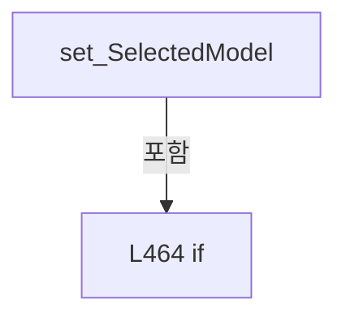

변경 전 점검: 입력/반환 타입, 위 호출자, 예외/취소 경로, 공유 상태와 저장·전송 소비자를 함께 확인합니다. 값의 단위나 물리 방향을 이름만으로 확정하지 않습니다.

### MethodDeclaration `OnPropertyChanged` · L475–478

[Drilling.UI/Popup/CCellPlacementWizardDialog.xaml.cs:475–478](https://github.com/kjuws10-rgb/A3Drilling/blob/5aee8e58439c9b455cae7c9593c9be986c3e682e/Drilling.UI/Popup/CCellPlacementWizardDialog.xaml.cs#L475-L478)

| 항목 | 실제 추출 값 |
| --- | --- |
| 서명 | void Drilling.UI.Popup.ST_CELL_PLACEMENT_MODEL_SELECTOR_ROW.OnPropertyChanged(string?) |
| 접근/수식자 | Private / private |
| 반환/값 타입 | void |
| 소속 타입 | NamedType:Drilling.UI.Popup.ST_CELL_PLACEMENT_MODEL_SELECTOR_ROW |

입력 계약:

| 이름 | 타입 | 전달 | 선택/기본값 |
| --- | --- | --- | --- |
| propertyName | string? | None | True / null |

정적 호출자로 확인된 위치:

| 호출 파일/행 | 호출 표현식 | 런타임 분기 가능 |
| --- | --- | --- |
| [Drilling.UI/Popup/CCellPlacementWizardDialog.xaml.cs:470–470](https://github.com/kjuws10-rgb/A3Drilling/blob/5aee8e58439c9b455cae7c9593c9be986c3e682e/Drilling.UI/Popup/CCellPlacementWizardDialog.xaml.cs#L470-L470) | OnPropertyChanged | False |

호출하는 대상과 해석 범위:

| 원본 행 | 표현식 | 분석 상태 | 대상/소스 위치 |
| --- | --- | --- | --- |
| 477 | .Invoke | resolved · 동적 구현 선택 가능 | void System.ComponentModel.PropertyChangedEventHandler.Invoke(object?, System.ComponentModel.PropertyChangedEventArgs) |
| 477 | new PropertyChangedEventArgs | resolved | System.ComponentModel.PropertyChangedEventArgs.PropertyChangedEventArgs(string?) |

본문의 실제 연산·분기·예외·반환 순서(원문 위치 순):

| 원본 행 | 종류 | 주석 해설 |
| --- | --- | --- |
| 477 | call | 함수·델리게이트 또는 객체 생성자를 호출합니다: .Invoke(this, new PropertyChangedEventArgs(propertyName)) |
| 477 | call | 함수·델리게이트 또는 객체 생성자를 호출합니다: new PropertyChangedEventArgs(propertyName) |

변경 전 점검: 입력/반환 타입, 위 호출자, 예외/취소 경로, 공유 상태와 저장·전송 소비자를 함께 확인합니다. 값의 단위나 물리 방향을 이름만으로 확정하지 않습니다.

## 구문·바인딩 한계

전체 WPF/벤더 SDK/프로젝트별 빌드 조건을 로드한 정식 빌드가 아닙니다. `resolved`는 이 부분 컴파일에서의 심볼 연결이며 virtual/interface/delegate/이벤트/Reflection/XAML의 실제 런타임 구현을 확정하지 않습니다. `candidate`와 `unresolved`는 후속 확인 대상으로 남깁니다.

## 원문 전체 주석 해설본

[원본 모든 행과 행별 해설 보기](../../../annotated/Drilling.UI/Popup/CCellPlacementWizardDialog.xaml.cs.annotated.txt)

원본을 빠뜨리거나 임의로 줄이지 않았습니다. `L000001 |` 표시는 원본 행 번호, `// 해설`은 별도 설명입니다. 실행용 소스가 아닌 문서입니다.

## 수정·재검증 체크

- 원본 Commit과 현재 작업 파일 SHA가 같은지 먼저 확인합니다. 다르면 이 문서를 과거 버전 자료로 취급합니다.
- 선언·직접 호출·이벤트/인터페이스 경계·설정 소비를 함께 확인합니다. 정적 연결의 빈 곳을 정상 경로로 추정하지 않습니다.
- 저장 형식/단위/식별자·재시도·취소·예외·롤백에 영향을 주는 변경은 상세 해설장과 호출자를 다시 검토합니다.
- 도구의 구문 추출과 별도 정적 추적 해설, 실제 빌드·시뮬레이션·실장비 검증 결과를 분리합니다.
