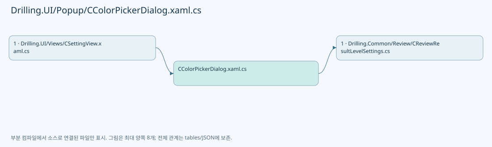
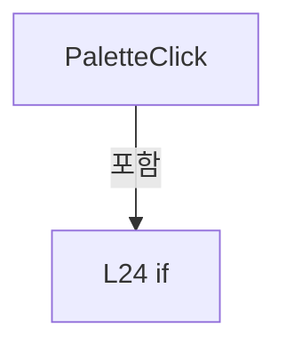
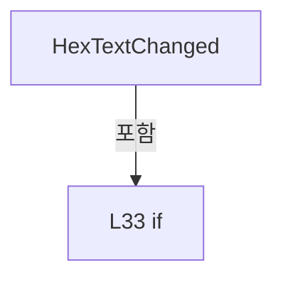
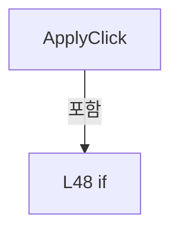
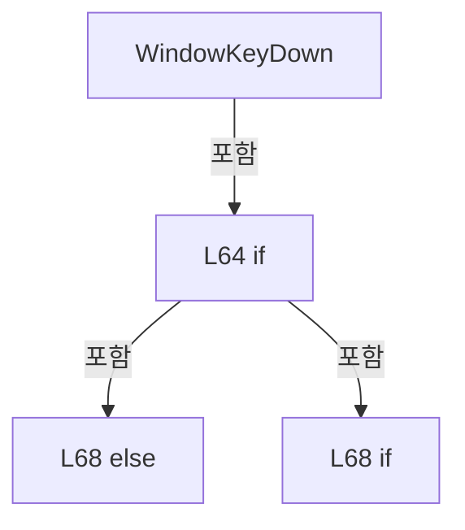
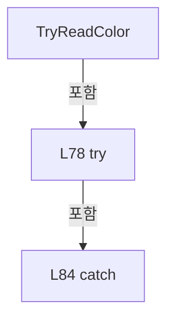

# Drilling.UI/Popup/CColorPickerDialog.xaml.cs

| 항목 | 내용 |
| --- | --- |
| 원본 저장소 | https://github.com/kjuws10-rgb/A3Drilling.git |
| 원본 Commit | 28764c91d521777b8ee068dd7aaf2d3902ce9fe2 |
| 원본 SHA256 | 208deb9d594a450aecd78fe90dfd57632bb00b6efad605e65c78c0b6d976bd9e |
| 파일 분류 | code |
| 원본 크기/행 | 2,669 bytes / 89 physical lines |
| 인코딩 | utf-8-sig |
| 검토 범위 | 구문/부분 의미 분석에서 추출한 사실. 동작·물리 단위·실장비 합격을 보증하지 않습니다. |
| 원본 링크 | [고정 Commit 원본](https://github.com/kjuws10-rgb/A3Drilling/blob/28764c91d521777b8ee068dd7aaf2d3902ce9fe2/Drilling.UI/Popup/CColorPickerDialog.xaml.cs) |

## 파일의 역할과 읽는 순서

WPF 화면·사용자 명령·표시 상태를 구성합니다. XAML 이벤트와 코드 비하인드, RootView의 조립 경로를 함께 추적합니다.

## 네임스페이스·타입·상속

| 타입 | 구분 | 원본 범위 | 선언/상속 |
| --- | --- | --- | --- |
| CColorPickerDialog | ClassDeclaration | 9–89 | CColorPickerDialog: Window |

## 멤버 빠른 목록

| 이름 | 종류 | 범위 | 서명 |
| --- | --- | --- | --- |
| .ctor | ConstructorDeclaration | L11–18 | Drilling.UI.Popup.CColorPickerDialog.CColorPickerDialog(string, string) |
| ResultColor | PropertyDeclaration | L20–20 | string Drilling.UI.Popup.CColorPickerDialog.ResultColor |
| get_ResultColor | GetAccessorDeclaration | L20–20 | string Drilling.UI.Popup.CColorPickerDialog.ResultColor.get |
| set_ResultColor | SetAccessorDeclaration | L20–20 | void Drilling.UI.Popup.CColorPickerDialog.ResultColor.set |
| PaletteClick | MethodDeclaration | L22–29 | void Drilling.UI.Popup.CColorPickerDialog.PaletteClick(object, RoutedEventArgs) |
| HexTextChanged | MethodDeclaration | L31–44 | void Drilling.UI.Popup.CColorPickerDialog.HexTextChanged(object, TextChangedEventArgs) |
| ApplyClick | MethodDeclaration | L46–55 | void Drilling.UI.Popup.CColorPickerDialog.ApplyClick(object, RoutedEventArgs) |
| CancelClick | MethodDeclaration | L57–60 | void Drilling.UI.Popup.CColorPickerDialog.CancelClick(object, RoutedEventArgs) |
| WindowKeyDown | MethodDeclaration | L62–72 | void Drilling.UI.Popup.CColorPickerDialog.WindowKeyDown(object, KeyEventArgs) |
| TryReadColor | MethodDeclaration | L74–88 | bool Drilling.UI.Popup.CColorPickerDialog.TryReadColor(out Color, out string) |

## 멤버별 상세 계약·호출·처리 해설

### ConstructorDeclaration `.ctor` · L11–18

[Drilling.UI/Popup/CColorPickerDialog.xaml.cs:11–18](https://github.com/kjuws10-rgb/A3Drilling/blob/28764c91d521777b8ee068dd7aaf2d3902ce9fe2/Drilling.UI/Popup/CColorPickerDialog.xaml.cs#L11-L18)

| 항목 | 실제 추출 값 |
| --- | --- |
| 서명 | Drilling.UI.Popup.CColorPickerDialog.CColorPickerDialog(string, string) |
| 접근/수식자 | Public / public |
| 반환/값 타입 | void |
| 소속 타입 | NamedType:Drilling.UI.Popup.CColorPickerDialog |

입력 계약:

| 이름 | 타입 | 전달 | 선택/기본값 |
| --- | --- | --- | --- |
| parameter | string | None | False /  |
| value | string | None | False /  |

정적 호출자로 확인된 위치:

| 호출 파일/행 | 호출 표현식 | 런타임 분기 가능 |
| --- | --- | --- |
| [Drilling.UI/Views/CSettingView.xaml.cs:56–59](https://github.com/kjuws10-rgb/A3Drilling/blob/28764c91d521777b8ee068dd7aaf2d3902ce9fe2/Drilling.UI/Views/CSettingView.xaml.cs#L56-L59) | new CColorPickerDialog | False |

호출하는 대상과 해석 범위:

| 원본 행 | 표현식 | 분석 상태 | 대상/소스 위치 |
| --- | --- | --- | --- |
| 13 | InitializeComponent | unresolved | None |
| 15 | CReviewResultLevelSettings.NormalizeColor | resolved | string Drilling.Common.Review.CReviewResultLevelSettings.NormalizeColor(string) · Drilling.Common/Review/CReviewResultLevelSettings.cs:136 |
| 16 | HexTextBox.SelectAll | unresolved | None |
| 17 | HexTextBox.Focus | unresolved | None |

본문의 실제 연산·분기·예외·반환 순서(원문 위치 순):

| 원본 행 | 종류 | 주석 해설 |
| --- | --- | --- |
| 13 | call | 함수·델리게이트 또는 객체 생성자를 호출합니다: InitializeComponent() |
| 14 | assignment | 값을 대상에 대입합니다: PromptText.Text = parameter |
| 15 | assignment | 값을 대상에 대입합니다: HexTextBox.Text = CReviewResultLevelSettings.NormalizeColor(value) |
| 15 | call | 함수·델리게이트 또는 객체 생성자를 호출합니다: CReviewResultLevelSettings.NormalizeColor(value) |
| 16 | call | 함수·델리게이트 또는 객체 생성자를 호출합니다: HexTextBox.SelectAll() |
| 17 | call | 함수·델리게이트 또는 객체 생성자를 호출합니다: HexTextBox.Focus() |

변경 전 점검: 입력/반환 타입, 위 호출자, 예외/취소 경로, 공유 상태와 저장·전송 소비자를 함께 확인합니다. 값의 단위나 물리 방향을 이름만으로 확정하지 않습니다.

### PropertyDeclaration `ResultColor` · L20–20

[Drilling.UI/Popup/CColorPickerDialog.xaml.cs:20–20](https://github.com/kjuws10-rgb/A3Drilling/blob/28764c91d521777b8ee068dd7aaf2d3902ce9fe2/Drilling.UI/Popup/CColorPickerDialog.xaml.cs#L20-L20)

| 항목 | 실제 추출 값 |
| --- | --- |
| 서명 | string Drilling.UI.Popup.CColorPickerDialog.ResultColor |
| 접근/수식자 | Public / public |
| 반환/값 타입 | string |
| 소속 타입 | NamedType:Drilling.UI.Popup.CColorPickerDialog |

현재 부분 분석에서 직접 연결된 호출자는 없습니다. XAML/이벤트/인터페이스·델리게이트·외부 진입을 추가 확인해야 하며, 미사용으로 판정한 것이 아닙니다.

변경 전 점검: 입력/반환 타입, 위 호출자, 예외/취소 경로, 공유 상태와 저장·전송 소비자를 함께 확인합니다. 값의 단위나 물리 방향을 이름만으로 확정하지 않습니다.

### GetAccessorDeclaration `get_ResultColor` · L20–20

[Drilling.UI/Popup/CColorPickerDialog.xaml.cs:20–20](https://github.com/kjuws10-rgb/A3Drilling/blob/28764c91d521777b8ee068dd7aaf2d3902ce9fe2/Drilling.UI/Popup/CColorPickerDialog.xaml.cs#L20-L20)

| 항목 | 실제 추출 값 |
| --- | --- |
| 서명 | string Drilling.UI.Popup.CColorPickerDialog.ResultColor.get |
| 접근/수식자 | Public / get |
| 반환/값 타입 | string |
| 소속 타입 | NamedType:Drilling.UI.Popup.CColorPickerDialog |

현재 부분 분석에서 직접 연결된 호출자는 없습니다. XAML/이벤트/인터페이스·델리게이트·외부 진입을 추가 확인해야 하며, 미사용으로 판정한 것이 아닙니다.

변경 전 점검: 입력/반환 타입, 위 호출자, 예외/취소 경로, 공유 상태와 저장·전송 소비자를 함께 확인합니다. 값의 단위나 물리 방향을 이름만으로 확정하지 않습니다.

### SetAccessorDeclaration `set_ResultColor` · L20–20

[Drilling.UI/Popup/CColorPickerDialog.xaml.cs:20–20](https://github.com/kjuws10-rgb/A3Drilling/blob/28764c91d521777b8ee068dd7aaf2d3902ce9fe2/Drilling.UI/Popup/CColorPickerDialog.xaml.cs#L20-L20)

| 항목 | 실제 추출 값 |
| --- | --- |
| 서명 | void Drilling.UI.Popup.CColorPickerDialog.ResultColor.set |
| 접근/수식자 | Private / private, set |
| 반환/값 타입 | void |
| 소속 타입 | NamedType:Drilling.UI.Popup.CColorPickerDialog |

입력 계약:

| 이름 | 타입 | 전달 | 선택/기본값 |
| --- | --- | --- | --- |
| value | string | None | False /  |

현재 부분 분석에서 직접 연결된 호출자는 없습니다. XAML/이벤트/인터페이스·델리게이트·외부 진입을 추가 확인해야 하며, 미사용으로 판정한 것이 아닙니다.

변경 전 점검: 입력/반환 타입, 위 호출자, 예외/취소 경로, 공유 상태와 저장·전송 소비자를 함께 확인합니다. 값의 단위나 물리 방향을 이름만으로 확정하지 않습니다.

### MethodDeclaration `PaletteClick` · L22–29

[Drilling.UI/Popup/CColorPickerDialog.xaml.cs:22–29](https://github.com/kjuws10-rgb/A3Drilling/blob/28764c91d521777b8ee068dd7aaf2d3902ce9fe2/Drilling.UI/Popup/CColorPickerDialog.xaml.cs#L22-L29)

| 항목 | 실제 추출 값 |
| --- | --- |
| 서명 | void Drilling.UI.Popup.CColorPickerDialog.PaletteClick(object, RoutedEventArgs) |
| 접근/수식자 | Private / private |
| 반환/값 타입 | void |
| 소속 타입 | NamedType:Drilling.UI.Popup.CColorPickerDialog |

입력 계약:

| 이름 | 타입 | 전달 | 선택/기본값 |
| --- | --- | --- | --- |
| sender | object | None | False /  |
| eventArgs | RoutedEventArgs | None | False /  |

현재 부분 분석에서 직접 연결된 호출자는 없습니다. XAML/이벤트/인터페이스·델리게이트·외부 진입을 추가 확인해야 하며, 미사용으로 판정한 것이 아닙니다.

호출하는 대상과 해석 범위:

| 원본 행 | 표현식 | 분석 상태 | 대상/소스 위치 |
| --- | --- | --- | --- |
| 27 | HexTextBox.SelectAll | unresolved | None |

본문의 실제 연산·분기·예외·반환 순서(원문 위치 순):

| 원본 행 | 종류 | 주석 해설 |
| --- | --- | --- |
| 24 | if | 조건에 따라 분기합니다: if (sender is Button { Tag: string color }) |
| 26 | assignment | 값을 대상에 대입합니다: HexTextBox.Text = color |
| 27 | call | 함수·델리게이트 또는 객체 생성자를 호출합니다: HexTextBox.SelectAll() |

제어 구문의 포함 구조(실제 실행 순서/CFG가 아닌 구문 탐색 그림):

변경 전 점검: 입력/반환 타입, 위 호출자, 예외/취소 경로, 공유 상태와 저장·전송 소비자를 함께 확인합니다. 값의 단위나 물리 방향을 이름만으로 확정하지 않습니다.

### MethodDeclaration `HexTextChanged` · L31–44

[Drilling.UI/Popup/CColorPickerDialog.xaml.cs:31–44](https://github.com/kjuws10-rgb/A3Drilling/blob/28764c91d521777b8ee068dd7aaf2d3902ce9fe2/Drilling.UI/Popup/CColorPickerDialog.xaml.cs#L31-L44)

| 항목 | 실제 추출 값 |
| --- | --- |
| 서명 | void Drilling.UI.Popup.CColorPickerDialog.HexTextChanged(object, TextChangedEventArgs) |
| 접근/수식자 | Private / private |
| 반환/값 타입 | void |
| 소속 타입 | NamedType:Drilling.UI.Popup.CColorPickerDialog |

입력 계약:

| 이름 | 타입 | 전달 | 선택/기본값 |
| --- | --- | --- | --- |
| sender | object | None | False /  |
| eventArgs | TextChangedEventArgs | None | False /  |

현재 부분 분석에서 직접 연결된 호출자는 없습니다. XAML/이벤트/인터페이스·델리게이트·외부 진입을 추가 확인해야 하며, 미사용으로 판정한 것이 아닙니다.

호출하는 대상과 해석 범위:

| 원본 행 | 표현식 | 분석 상태 | 대상/소스 위치 |
| --- | --- | --- | --- |
| 33 | TryReadColor | resolved | bool Drilling.UI.Popup.CColorPickerDialog.TryReadColor(out Color, out string) · Drilling.UI/Popup/CColorPickerDialog.xaml.cs:74 |
| 35 | new SolidColorBrush | unresolved | None |
| 37 | FindResource | unresolved | None |
| 43 | FindResource | unresolved | None |

본문의 실제 연산·분기·예외·반환 순서(원문 위치 순):

| 원본 행 | 종류 | 주석 해설 |
| --- | --- | --- |
| 33 | call | 함수·델리게이트 또는 객체 생성자를 호출합니다: TryReadColor(out var color, out _) |
| 33 | if | 조건에 따라 분기합니다: if (TryReadColor(out var color, out _)) |
| 35 | assignment | 값을 대상에 대입합니다: PreviewBorder.Background = new SolidColorBrush(color) |
| 35 | call | 함수·델리게이트 또는 객체 생성자를 호출합니다: new SolidColorBrush(color) |
| 36 | assignment | 값을 대상에 대입합니다: ValidationText.Text = "사용할 색상을 확인한 뒤 APPLY를 누르세요." |
| 37 | assignment | 값을 대상에 대입합니다: ValidationText.Foreground = FindResource("TextSecondaryBrush") as Brush ?? Brushes.Gray |
| 37 | call | 함수·델리게이트 또는 객체 생성자를 호출합니다: FindResource("TextSecondaryBrush") |
| 38 | return | 호출자에게 값 또는 제어를 반환합니다: return; |
| 41 | assignment | 값을 대상에 대입합니다: PreviewBorder.Background = Brushes.Transparent |
| 42 | assignment | 값을 대상에 대입합니다: ValidationText.Text = "#RRGGBB 형식의 색상값을 입력하세요." |
| 43 | assignment | 값을 대상에 대입합니다: ValidationText.Foreground = FindResource("ButtonDangerBrush") as Brush ?? Brushes.Red |
| 43 | call | 함수·델리게이트 또는 객체 생성자를 호출합니다: FindResource("ButtonDangerBrush") |

제어 구문의 포함 구조(실제 실행 순서/CFG가 아닌 구문 탐색 그림):

변경 전 점검: 입력/반환 타입, 위 호출자, 예외/취소 경로, 공유 상태와 저장·전송 소비자를 함께 확인합니다. 값의 단위나 물리 방향을 이름만으로 확정하지 않습니다.

### MethodDeclaration `ApplyClick` · L46–55

[Drilling.UI/Popup/CColorPickerDialog.xaml.cs:46–55](https://github.com/kjuws10-rgb/A3Drilling/blob/28764c91d521777b8ee068dd7aaf2d3902ce9fe2/Drilling.UI/Popup/CColorPickerDialog.xaml.cs#L46-L55)

| 항목 | 실제 추출 값 |
| --- | --- |
| 서명 | void Drilling.UI.Popup.CColorPickerDialog.ApplyClick(object, RoutedEventArgs) |
| 접근/수식자 | Private / private |
| 반환/값 타입 | void |
| 소속 타입 | NamedType:Drilling.UI.Popup.CColorPickerDialog |

입력 계약:

| 이름 | 타입 | 전달 | 선택/기본값 |
| --- | --- | --- | --- |
| sender | object | None | False /  |
| eventArgs | RoutedEventArgs | None | False /  |

현재 부분 분석에서 직접 연결된 호출자는 없습니다. XAML/이벤트/인터페이스·델리게이트·외부 진입을 추가 확인해야 하며, 미사용으로 판정한 것이 아닙니다.

호출하는 대상과 해석 범위:

| 원본 행 | 표현식 | 분석 상태 | 대상/소스 위치 |
| --- | --- | --- | --- |
| 48 | TryReadColor | resolved | bool Drilling.UI.Popup.CColorPickerDialog.TryReadColor(out Color, out string) · Drilling.UI/Popup/CColorPickerDialog.xaml.cs:74 |

본문의 실제 연산·분기·예외·반환 순서(원문 위치 순):

| 원본 행 | 종류 | 주석 해설 |
| --- | --- | --- |
| 48 | call | 함수·델리게이트 또는 객체 생성자를 호출합니다: TryReadColor(out _, out var normalized) |
| 48 | if | 조건에 따라 분기합니다: if (!TryReadColor(out _, out var normalized)) |
| 50 | return | 호출자에게 값 또는 제어를 반환합니다: return; |
| 53 | assignment | 값을 대상에 대입합니다: ResultColor = normalized |
| 54 | assignment | 값을 대상에 대입합니다: DialogResult = true |

제어 구문의 포함 구조(실제 실행 순서/CFG가 아닌 구문 탐색 그림):

변경 전 점검: 입력/반환 타입, 위 호출자, 예외/취소 경로, 공유 상태와 저장·전송 소비자를 함께 확인합니다. 값의 단위나 물리 방향을 이름만으로 확정하지 않습니다.

### MethodDeclaration `CancelClick` · L57–60

[Drilling.UI/Popup/CColorPickerDialog.xaml.cs:57–60](https://github.com/kjuws10-rgb/A3Drilling/blob/28764c91d521777b8ee068dd7aaf2d3902ce9fe2/Drilling.UI/Popup/CColorPickerDialog.xaml.cs#L57-L60)

| 항목 | 실제 추출 값 |
| --- | --- |
| 서명 | void Drilling.UI.Popup.CColorPickerDialog.CancelClick(object, RoutedEventArgs) |
| 접근/수식자 | Private / private |
| 반환/값 타입 | void |
| 소속 타입 | NamedType:Drilling.UI.Popup.CColorPickerDialog |

입력 계약:

| 이름 | 타입 | 전달 | 선택/기본값 |
| --- | --- | --- | --- |
| sender | object | None | False /  |
| eventArgs | RoutedEventArgs | None | False /  |

현재 부분 분석에서 직접 연결된 호출자는 없습니다. XAML/이벤트/인터페이스·델리게이트·외부 진입을 추가 확인해야 하며, 미사용으로 판정한 것이 아닙니다.

본문의 실제 연산·분기·예외·반환 순서(원문 위치 순):

| 원본 행 | 종류 | 주석 해설 |
| --- | --- | --- |
| 59 | assignment | 값을 대상에 대입합니다: DialogResult = false |

변경 전 점검: 입력/반환 타입, 위 호출자, 예외/취소 경로, 공유 상태와 저장·전송 소비자를 함께 확인합니다. 값의 단위나 물리 방향을 이름만으로 확정하지 않습니다.

### MethodDeclaration `WindowKeyDown` · L62–72

[Drilling.UI/Popup/CColorPickerDialog.xaml.cs:62–72](https://github.com/kjuws10-rgb/A3Drilling/blob/28764c91d521777b8ee068dd7aaf2d3902ce9fe2/Drilling.UI/Popup/CColorPickerDialog.xaml.cs#L62-L72)

| 항목 | 실제 추출 값 |
| --- | --- |
| 서명 | void Drilling.UI.Popup.CColorPickerDialog.WindowKeyDown(object, KeyEventArgs) |
| 접근/수식자 | Private / private |
| 반환/값 타입 | void |
| 소속 타입 | NamedType:Drilling.UI.Popup.CColorPickerDialog |

입력 계약:

| 이름 | 타입 | 전달 | 선택/기본값 |
| --- | --- | --- | --- |
| sender | object | None | False /  |
| eventArgs | KeyEventArgs | None | False /  |

현재 부분 분석에서 직접 연결된 호출자는 없습니다. XAML/이벤트/인터페이스·델리게이트·외부 진입을 추가 확인해야 하며, 미사용으로 판정한 것이 아닙니다.

호출하는 대상과 해석 범위:

| 원본 행 | 표현식 | 분석 상태 | 대상/소스 위치 |
| --- | --- | --- | --- |
| 70 | ApplyClick | candidate | OverloadResolutionFailure |

본문의 실제 연산·분기·예외·반환 순서(원문 위치 순):

| 원본 행 | 종류 | 주석 해설 |
| --- | --- | --- |
| 64 | if | 조건에 따라 분기합니다: if (eventArgs.Key == Key.Escape) |
| 66 | assignment | 값을 대상에 대입합니다: DialogResult = false |
| 68 | else | 앞 조건이 거짓인 경로입니다: else |
| 68 | if | 조건에 따라 분기합니다: if (eventArgs.Key == Key.Enter) |
| 70 | call | 함수·델리게이트 또는 객체 생성자를 호출합니다: ApplyClick(sender, eventArgs) |

제어 구문의 포함 구조(실제 실행 순서/CFG가 아닌 구문 탐색 그림):

변경 전 점검: 입력/반환 타입, 위 호출자, 예외/취소 경로, 공유 상태와 저장·전송 소비자를 함께 확인합니다. 값의 단위나 물리 방향을 이름만으로 확정하지 않습니다.

### MethodDeclaration `TryReadColor` · L74–88

[Drilling.UI/Popup/CColorPickerDialog.xaml.cs:74–88](https://github.com/kjuws10-rgb/A3Drilling/blob/28764c91d521777b8ee068dd7aaf2d3902ce9fe2/Drilling.UI/Popup/CColorPickerDialog.xaml.cs#L74-L88)

| 항목 | 실제 추출 값 |
| --- | --- |
| 서명 | bool Drilling.UI.Popup.CColorPickerDialog.TryReadColor(out Color, out string) |
| 접근/수식자 | Private / private |
| 반환/값 타입 | bool |
| 소속 타입 | NamedType:Drilling.UI.Popup.CColorPickerDialog |

입력 계약:

| 이름 | 타입 | 전달 | 선택/기본값 |
| --- | --- | --- | --- |
| color | Color | Out | False /  |
| normalized | string | Out | False /  |

정적 호출자로 확인된 위치:

| 호출 파일/행 | 호출 표현식 | 런타임 분기 가능 |
| --- | --- | --- |
| [Drilling.UI/Popup/CColorPickerDialog.xaml.cs:33–33](https://github.com/kjuws10-rgb/A3Drilling/blob/28764c91d521777b8ee068dd7aaf2d3902ce9fe2/Drilling.UI/Popup/CColorPickerDialog.xaml.cs#L33-L33) | TryReadColor | False |
| [Drilling.UI/Popup/CColorPickerDialog.xaml.cs:48–48](https://github.com/kjuws10-rgb/A3Drilling/blob/28764c91d521777b8ee068dd7aaf2d3902ce9fe2/Drilling.UI/Popup/CColorPickerDialog.xaml.cs#L48-L48) | TryReadColor | False |

호출하는 대상과 해석 범위:

| 원본 행 | 표현식 | 분석 상태 | 대상/소스 위치 |
| --- | --- | --- | --- |
| 80 | CReviewResultLevelSettings.NormalizeColor | candidate | OverloadResolutionFailure |
| 81 | ColorConverter.ConvertFromString | unresolved | None |

본문의 실제 연산·분기·예외·반환 순서(원문 위치 순):

| 원본 행 | 종류 | 주석 해설 |
| --- | --- | --- |
| 76 | assignment | 값을 대상에 대입합니다: color = Colors.Transparent |
| 77 | assignment | 값을 대상에 대입합니다: normalized = "" |
| 78 | try | 예외 처리 범위입니다: try |
| 80 | assignment | 값을 대상에 대입합니다: normalized = CReviewResultLevelSettings.NormalizeColor(HexTextBox.Text) |
| 80 | call | 함수·델리게이트 또는 객체 생성자를 호출합니다: CReviewResultLevelSettings.NormalizeColor(HexTextBox.Text) |
| 81 | assignment | 값을 대상에 대입합니다: color = (Color)ColorConverter.ConvertFromString(normalized) |
| 81 | call | 함수·델리게이트 또는 객체 생성자를 호출합니다: ColorConverter.ConvertFromString(normalized) |
| 82 | return | 호출자에게 값 또는 제어를 반환합니다: return true; |
| 84 | catch | 지정 예외를 처리합니다: catch (Exception) |
| 86 | return | 호출자에게 값 또는 제어를 반환합니다: return false; |

제어 구문의 포함 구조(실제 실행 순서/CFG가 아닌 구문 탐색 그림):

변경 전 점검: 입력/반환 타입, 위 호출자, 예외/취소 경로, 공유 상태와 저장·전송 소비자를 함께 확인합니다. 값의 단위나 물리 방향을 이름만으로 확정하지 않습니다.

## 구문·바인딩 한계

전체 WPF/벤더 SDK/프로젝트별 빌드 조건을 로드한 정식 빌드가 아닙니다. `resolved`는 이 부분 컴파일에서의 심볼 연결이며 virtual/interface/delegate/이벤트/Reflection/XAML의 실제 런타임 구현을 확정하지 않습니다. `candidate`와 `unresolved`는 후속 확인 대상으로 남깁니다.

## 원문 전체 주석 해설본

[원본 모든 행과 행별 해설 보기](../../../annotated/Drilling.UI/Popup/CColorPickerDialog.xaml.cs.annotated.txt)

원본을 빠뜨리거나 임의로 줄이지 않았습니다. `L000001 |` 표시는 원본 행 번호, `// 해설`은 별도 설명입니다. 실행용 소스가 아닌 문서입니다.

## 수정·재검증 체크

- 원본 Commit과 현재 작업 파일 SHA가 같은지 먼저 확인합니다. 다르면 이 문서를 과거 버전 자료로 취급합니다.
- 선언·직접 호출·이벤트/인터페이스 경계·설정 소비를 함께 확인합니다. 정적 연결의 빈 곳을 정상 경로로 추정하지 않습니다.
- 저장 형식/단위/식별자·재시도·취소·예외·롤백에 영향을 주는 변경은 상세 해설장과 호출자를 다시 검토합니다.
- 도구의 구문 추출과 별도 정적 추적 해설, 실제 빌드·시뮬레이션·실장비 검증 결과를 분리합니다.
