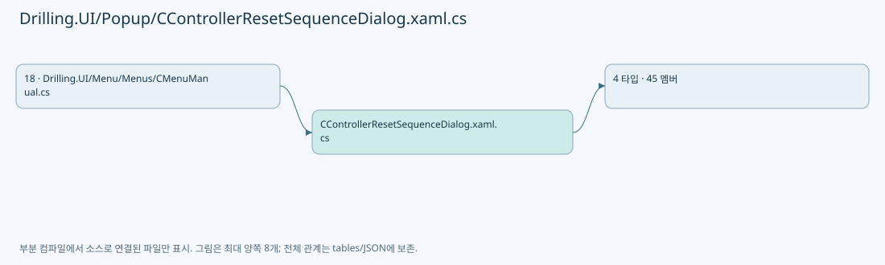
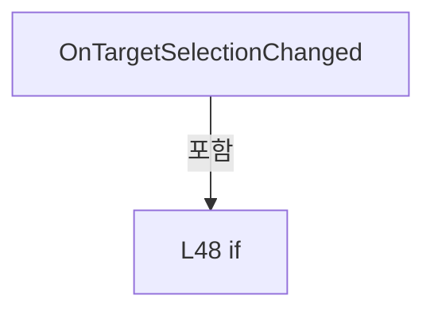
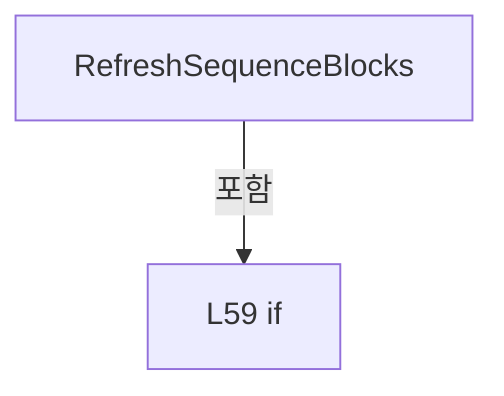
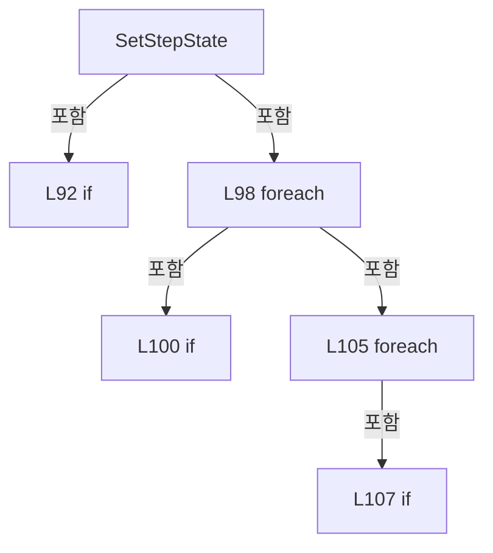
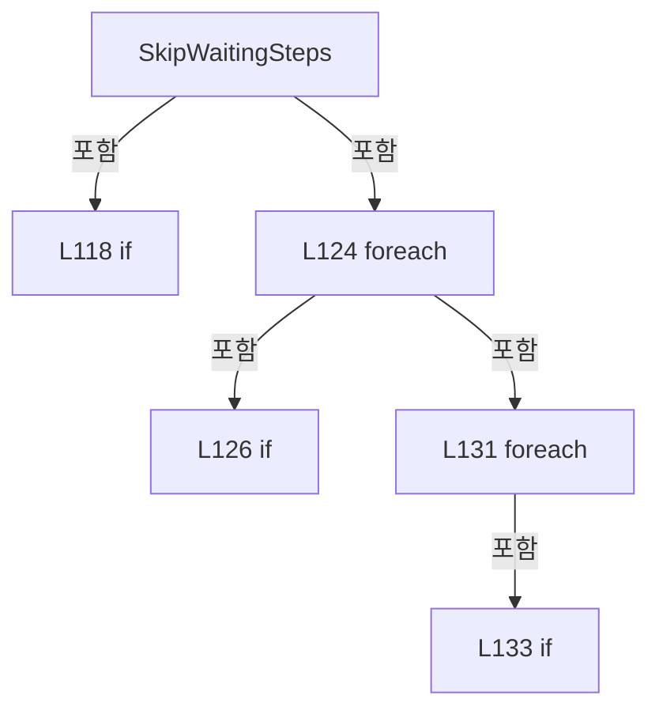
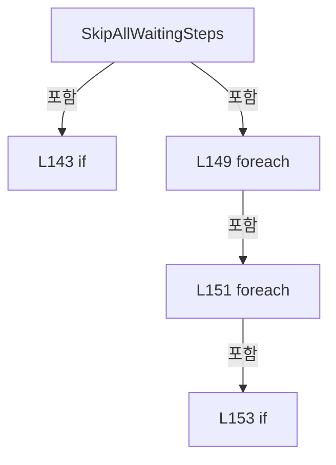
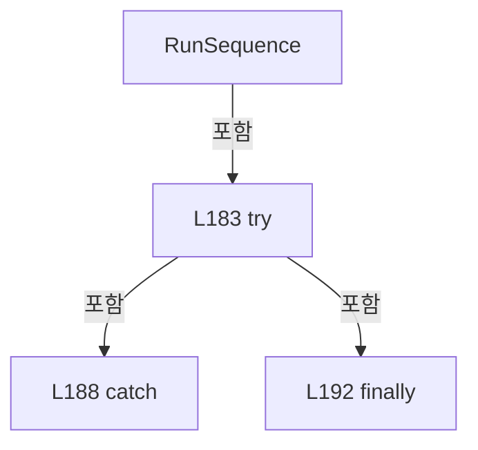
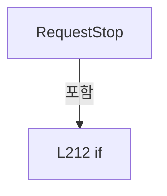
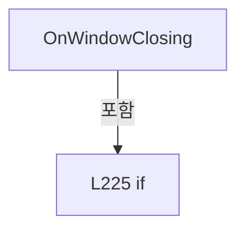
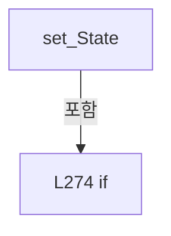

# Drilling.UI/Popup/CControllerResetSequenceDialog.xaml.cs

| 항목 | 내용 |
| --- | --- |
| 원본 저장소 | https://github.com/kjuws10-rgb/A3Drilling.git |
| 원본 Commit | 5aee8e58439c9b455cae7c9593c9be986c3e682e |
| 원본 SHA256 | cc146b6aaeadced9e271f13f370eb4d120ece8b9b948570b6e009c83c5dedcb9 |
| 파일 분류 | code |
| 원본 크기/행 | 9,160 bytes / 283 physical lines |
| 인코딩 | utf-8-sig |
| 검토 범위 | 구문/부분 의미 분석에서 추출한 사실. 동작·물리 단위·실장비 합격을 보증하지 않습니다. |
| 원본 링크 | [고정 Commit 원본](https://github.com/kjuws10-rgb/A3Drilling/blob/5aee8e58439c9b455cae7c9593c9be986c3e682e/Drilling.UI/Popup/CControllerResetSequenceDialog.xaml.cs) |

## 파일의 역할과 읽는 순서

WPF 화면·사용자 명령·표시 상태를 구성합니다. XAML 이벤트와 코드 비하인드, RootView의 조립 경로를 함께 추적합니다.

## 네임스페이스·타입·상속

| 타입 | 구분 | 원본 범위 | 선언/상속 |
| --- | --- | --- | --- |
| CControllerResetSequenceDialog | ClassDeclaration | 7–234 | CControllerResetSequenceDialog: Window |
| ST_CONTROLLER_RESET_SEQUENCE_TARGET_OPTION | RecordDeclaration | 236–236 | ST_CONTROLLER_RESET_SEQUENCE_TARGET_OPTION |
| ST_CONTROLLER_RESET_SEQUENCE_BLOCK | ClassDeclaration | 237–249 | ST_CONTROLLER_RESET_SEQUENCE_BLOCK |
| ST_CONTROLLER_RESET_SEQUENCE_STEP | ClassDeclaration | 251–283 | ST_CONTROLLER_RESET_SEQUENCE_STEP: INotifyPropertyChanged |

## 멤버 빠른 목록

| 이름 | 종류 | 범위 | 서명 |
| --- | --- | --- | --- |
| _controllerOptions | FieldDeclaration | L9–9 | System.Collections.Generic.IReadOnlyList<Drilling.UI.Popup.ST_CONTROLLER_RESET_SEQUENCE_TARGET_OPTION> Drilling.UI.Popup.CControllerResetSequenceDialog._controllerOptions |
| _targetOptions | FieldDeclaration | L10–10 | System.Collections.Generic.IReadOnlyList<Drilling.UI.Popup.ST_CONTROLLER_RESET_SEQUENCE_TARGET_OPTION> Drilling.UI.Popup.CControllerResetSequenceDialog._targetOptions |
| _executeSequence | FieldDeclaration | L11–11 | System.Func<Drilling.UI.Popup.CControllerResetSequenceDialog, System.Collections.Generic.IReadOnlyList<Drilling.UI.Popup.ST_CONTROLLER_RESET_SEQUENCE_TARGET_OPTION>, System.Func<bool>, System.Threading.CancellationToken, System.Threading.Tasks.Task> Drilling.UI.Popup.CControllerResetSequenceDialog._executeSequence |
| _sequenceBlocks | FieldDeclaration | L12–12 | System.Collections.Generic.IReadOnlyList<Drilling.UI.Popup.ST_CONTROLLER_RESET_SEQUENCE_BLOCK> Drilling.UI.Popup.CControllerResetSequenceDialog._sequenceBlocks |
| _runCancellation | FieldDeclaration | L13–13 | System.Threading.CancellationTokenSource? Drilling.UI.Popup.CControllerResetSequenceDialog._runCancellation |
| _isRunning | FieldDeclaration | L14–14 | bool Drilling.UI.Popup.CControllerResetSequenceDialog._isRunning |
| _stopRequested | FieldDeclaration | L15–15 | bool Drilling.UI.Popup.CControllerResetSequenceDialog._stopRequested |
| .ctor | ConstructorDeclaration | L16–26 | Drilling.UI.Popup.CControllerResetSequenceDialog.CControllerResetSequenceDialog(System.Collections.Generic.IReadOnlyList<Drilling.UI.Popup.ST_CONTROLLER_RESET_SEQUENCE_TARGET_OPTION>, System.Func<Drilling.UI.Popup.CControllerResetSequenceDialog, System.Collections.Generic.IReadOnlyList<Drilling.UI.Popup.ST_CONTROLLER_RESET_SEQUENCE_TARGET_OPTION>, System.Func<bool>, System.Threading.CancellationToken, System.Threading.Tasks.Task>) |
| SelectedTarget | PropertyDeclaration | L28–28 | Drilling.UI.Popup.ST_CONTROLLER_RESET_SEQUENCE_TARGET_OPTION Drilling.UI.Popup.CControllerResetSequenceDialog.SelectedTarget |
| get_SelectedTarget | GetAccessorDeclaration | L28–28 | Drilling.UI.Popup.ST_CONTROLLER_RESET_SEQUENCE_TARGET_OPTION Drilling.UI.Popup.CControllerResetSequenceDialog.SelectedTarget.get |
| set_SelectedTarget | SetAccessorDeclaration | L28–28 | void Drilling.UI.Popup.CControllerResetSequenceDialog.SelectedTarget.set |
| IsStopRequested | PropertyDeclaration | L30–36 | bool Drilling.UI.Popup.CControllerResetSequenceDialog.IsStopRequested |
| get_IsStopRequested | GetAccessorDeclaration | L32–35 | bool Drilling.UI.Popup.CControllerResetSequenceDialog.IsStopRequested.get |
| CreateTargetOptions | MethodDeclaration | L38–44 | System.Collections.Generic.IReadOnlyList<Drilling.UI.Popup.ST_CONTROLLER_RESET_SEQUENCE_TARGET_OPTION> Drilling.UI.Popup.CControllerResetSequenceDialog.CreateTargetOptions(System.Collections.Generic.IReadOnlyList<Drilling.UI.Popup.ST_CONTROLLER_RESET_SEQUENCE_TARGET_OPTION>) |
| OnTargetSelectionChanged | MethodDeclaration | L46–55 | void Drilling.UI.Popup.CControllerResetSequenceDialog.OnTargetSelectionChanged(object, SelectionChangedEventArgs) |
| RefreshSequenceBlocks | MethodDeclaration | L57–67 | void Drilling.UI.Popup.CControllerResetSequenceDialog.RefreshSequenceBlocks() |
| CreateSteps | MethodDeclaration | L69–72 | System.Collections.Generic.IReadOnlyList<Drilling.UI.Popup.ST_CONTROLLER_RESET_SEQUENCE_STEP> Drilling.UI.Popup.CControllerResetSequenceDialog.CreateSteps() |
| GetSelectedControllers | MethodDeclaration | L74–77 | System.Collections.Generic.IReadOnlyList<Drilling.UI.Popup.ST_CONTROLLER_RESET_SEQUENCE_TARGET_OPTION> Drilling.UI.Popup.CControllerResetSequenceDialog.GetSelectedControllers() |
| SetStatusMessage | MethodDeclaration | L79–88 | void Drilling.UI.Popup.CControllerResetSequenceDialog.SetStatusMessage(string) |
| SetStepState | MethodDeclaration | L90–114 | void Drilling.UI.Popup.CControllerResetSequenceDialog.SetStepState(int, int, string) |
| SkipWaitingSteps | MethodDeclaration | L116–139 | void Drilling.UI.Popup.CControllerResetSequenceDialog.SkipWaitingSteps(int) |
| SkipAllWaitingSteps | MethodDeclaration | L141–159 | void Drilling.UI.Popup.CControllerResetSequenceDialog.SkipAllWaitingSteps() |
| OnStartClicked | MethodDeclaration | L161–164 | void Drilling.UI.Popup.CControllerResetSequenceDialog.OnStartClicked(object, RoutedEventArgs) |
| OnStopClicked | MethodDeclaration | L166–169 | void Drilling.UI.Popup.CControllerResetSequenceDialog.OnStopClicked(object, RoutedEventArgs) |
| RunSequence | MethodDeclaration | L171–203 | System.Threading.Tasks.Task Drilling.UI.Popup.CControllerResetSequenceDialog.RunSequence() |
| OnCloseClicked | MethodDeclaration | L205–208 | void Drilling.UI.Popup.CControllerResetSequenceDialog.OnCloseClicked(object, RoutedEventArgs) |
| RequestStop | MethodDeclaration | L210–221 | void Drilling.UI.Popup.CControllerResetSequenceDialog.RequestStop() |
| OnWindowClosing | MethodDeclaration | L223–233 | void Drilling.UI.Popup.CControllerResetSequenceDialog.OnWindowClosing(object, System.ComponentModel.CancelEventArgs) |
| .ctor | ConstructorDeclaration | L239–244 | Drilling.UI.Popup.ST_CONTROLLER_RESET_SEQUENCE_BLOCK.ST_CONTROLLER_RESET_SEQUENCE_BLOCK(int, string, System.Collections.Generic.IReadOnlyList<Drilling.UI.Popup.ST_CONTROLLER_RESET_SEQUENCE_STEP>) |
| AutomationNo | PropertyDeclaration | L246–246 | int Drilling.UI.Popup.ST_CONTROLLER_RESET_SEQUENCE_BLOCK.AutomationNo |
| get_AutomationNo | GetAccessorDeclaration | L246–246 | int Drilling.UI.Popup.ST_CONTROLLER_RESET_SEQUENCE_BLOCK.AutomationNo.get |
| Title | PropertyDeclaration | L247–247 | string Drilling.UI.Popup.ST_CONTROLLER_RESET_SEQUENCE_BLOCK.Title |
| get_Title | GetAccessorDeclaration | L247–247 | string Drilling.UI.Popup.ST_CONTROLLER_RESET_SEQUENCE_BLOCK.Title.get |
| Steps | PropertyDeclaration | L248–248 | System.Collections.Generic.IReadOnlyList<Drilling.UI.Popup.ST_CONTROLLER_RESET_SEQUENCE_STEP> Drilling.UI.Popup.ST_CONTROLLER_RESET_SEQUENCE_BLOCK.Steps |
| get_Steps | GetAccessorDeclaration | L248–248 | System.Collections.Generic.IReadOnlyList<Drilling.UI.Popup.ST_CONTROLLER_RESET_SEQUENCE_STEP> Drilling.UI.Popup.ST_CONTROLLER_RESET_SEQUENCE_BLOCK.Steps.get |
| _state | FieldDeclaration | L253–253 | string Drilling.UI.Popup.ST_CONTROLLER_RESET_SEQUENCE_STEP._state |
| .ctor | ConstructorDeclaration | L254–259 | Drilling.UI.Popup.ST_CONTROLLER_RESET_SEQUENCE_STEP.ST_CONTROLLER_RESET_SEQUENCE_STEP(int, string, string) |
| PropertyChanged | EventFieldDeclaration | L261–261 | System.ComponentModel.PropertyChangedEventHandler? Drilling.UI.Popup.ST_CONTROLLER_RESET_SEQUENCE_STEP.PropertyChanged |
| No | PropertyDeclaration | L262–262 | int Drilling.UI.Popup.ST_CONTROLLER_RESET_SEQUENCE_STEP.No |
| get_No | GetAccessorDeclaration | L262–262 | int Drilling.UI.Popup.ST_CONTROLLER_RESET_SEQUENCE_STEP.No.get |
| Name | PropertyDeclaration | L263–263 | string Drilling.UI.Popup.ST_CONTROLLER_RESET_SEQUENCE_STEP.Name |
| get_Name | GetAccessorDeclaration | L263–263 | string Drilling.UI.Popup.ST_CONTROLLER_RESET_SEQUENCE_STEP.Name.get |
| State | PropertyDeclaration | L265–282 | string Drilling.UI.Popup.ST_CONTROLLER_RESET_SEQUENCE_STEP.State |
| get_State | GetAccessorDeclaration | L267–270 | string Drilling.UI.Popup.ST_CONTROLLER_RESET_SEQUENCE_STEP.State.get |
| set_State | SetAccessorDeclaration | L272–281 | void Drilling.UI.Popup.ST_CONTROLLER_RESET_SEQUENCE_STEP.State.set |

## 멤버별 상세 계약·호출·처리 해설

### FieldDeclaration `_controllerOptions` · L9–9

[Drilling.UI/Popup/CControllerResetSequenceDialog.xaml.cs:9–9](https://github.com/kjuws10-rgb/A3Drilling/blob/5aee8e58439c9b455cae7c9593c9be986c3e682e/Drilling.UI/Popup/CControllerResetSequenceDialog.xaml.cs#L9-L9)

| 항목 | 실제 추출 값 |
| --- | --- |
| 서명 | System.Collections.Generic.IReadOnlyList<Drilling.UI.Popup.ST_CONTROLLER_RESET_SEQUENCE_TARGET_OPTION> Drilling.UI.Popup.CControllerResetSequenceDialog._controllerOptions |
| 접근/수식자 | Private / private, readonly |
| 반환/값 타입 | System.Collections.Generic.IReadOnlyList<Drilling.UI.Popup.ST_CONTROLLER_RESET_SEQUENCE_TARGET_OPTION> |
| 소속 타입 | NamedType:Drilling.UI.Popup.CControllerResetSequenceDialog |

현재 부분 분석에서 직접 연결된 호출자는 없습니다. XAML/이벤트/인터페이스·델리게이트·외부 진입을 추가 확인해야 하며, 미사용으로 판정한 것이 아닙니다.

변경 전 점검: 입력/반환 타입, 위 호출자, 예외/취소 경로, 공유 상태와 저장·전송 소비자를 함께 확인합니다. 값의 단위나 물리 방향을 이름만으로 확정하지 않습니다.

### FieldDeclaration `_targetOptions` · L10–10

[Drilling.UI/Popup/CControllerResetSequenceDialog.xaml.cs:10–10](https://github.com/kjuws10-rgb/A3Drilling/blob/5aee8e58439c9b455cae7c9593c9be986c3e682e/Drilling.UI/Popup/CControllerResetSequenceDialog.xaml.cs#L10-L10)

| 항목 | 실제 추출 값 |
| --- | --- |
| 서명 | System.Collections.Generic.IReadOnlyList<Drilling.UI.Popup.ST_CONTROLLER_RESET_SEQUENCE_TARGET_OPTION> Drilling.UI.Popup.CControllerResetSequenceDialog._targetOptions |
| 접근/수식자 | Private / private, readonly |
| 반환/값 타입 | System.Collections.Generic.IReadOnlyList<Drilling.UI.Popup.ST_CONTROLLER_RESET_SEQUENCE_TARGET_OPTION> |
| 소속 타입 | NamedType:Drilling.UI.Popup.CControllerResetSequenceDialog |

현재 부분 분석에서 직접 연결된 호출자는 없습니다. XAML/이벤트/인터페이스·델리게이트·외부 진입을 추가 확인해야 하며, 미사용으로 판정한 것이 아닙니다.

변경 전 점검: 입력/반환 타입, 위 호출자, 예외/취소 경로, 공유 상태와 저장·전송 소비자를 함께 확인합니다. 값의 단위나 물리 방향을 이름만으로 확정하지 않습니다.

### FieldDeclaration `_executeSequence` · L11–11

[Drilling.UI/Popup/CControllerResetSequenceDialog.xaml.cs:11–11](https://github.com/kjuws10-rgb/A3Drilling/blob/5aee8e58439c9b455cae7c9593c9be986c3e682e/Drilling.UI/Popup/CControllerResetSequenceDialog.xaml.cs#L11-L11)

| 항목 | 실제 추출 값 |
| --- | --- |
| 서명 | System.Func<Drilling.UI.Popup.CControllerResetSequenceDialog, System.Collections.Generic.IReadOnlyList<Drilling.UI.Popup.ST_CONTROLLER_RESET_SEQUENCE_TARGET_OPTION>, System.Func<bool>, System.Threading.CancellationToken, System.Threading.Tasks.Task> Drilling.UI.Popup.CControllerResetSequenceDialog._executeSequence |
| 접근/수식자 | Private / private, readonly |
| 반환/값 타입 | System.Func<Drilling.UI.Popup.CControllerResetSequenceDialog, System.Collections.Generic.IReadOnlyList<Drilling.UI.Popup.ST_CONTROLLER_RESET_SEQUENCE_TARGET_OPTION>, System.Func<bool>, System.Threading.CancellationToken, System.Threading.Tasks.Task> |
| 소속 타입 | NamedType:Drilling.UI.Popup.CControllerResetSequenceDialog |

현재 부분 분석에서 직접 연결된 호출자는 없습니다. XAML/이벤트/인터페이스·델리게이트·외부 진입을 추가 확인해야 하며, 미사용으로 판정한 것이 아닙니다.

변경 전 점검: 입력/반환 타입, 위 호출자, 예외/취소 경로, 공유 상태와 저장·전송 소비자를 함께 확인합니다. 값의 단위나 물리 방향을 이름만으로 확정하지 않습니다.

### FieldDeclaration `_sequenceBlocks` · L12–12

[Drilling.UI/Popup/CControllerResetSequenceDialog.xaml.cs:12–12](https://github.com/kjuws10-rgb/A3Drilling/blob/5aee8e58439c9b455cae7c9593c9be986c3e682e/Drilling.UI/Popup/CControllerResetSequenceDialog.xaml.cs#L12-L12)

| 항목 | 실제 추출 값 |
| --- | --- |
| 서명 | System.Collections.Generic.IReadOnlyList<Drilling.UI.Popup.ST_CONTROLLER_RESET_SEQUENCE_BLOCK> Drilling.UI.Popup.CControllerResetSequenceDialog._sequenceBlocks |
| 접근/수식자 | Private / private |
| 반환/값 타입 | System.Collections.Generic.IReadOnlyList<Drilling.UI.Popup.ST_CONTROLLER_RESET_SEQUENCE_BLOCK> |
| 소속 타입 | NamedType:Drilling.UI.Popup.CControllerResetSequenceDialog |

현재 부분 분석에서 직접 연결된 호출자는 없습니다. XAML/이벤트/인터페이스·델리게이트·외부 진입을 추가 확인해야 하며, 미사용으로 판정한 것이 아닙니다.

본문의 실제 연산·분기·예외·반환 순서(원문 위치 순):

| 원본 행 | 종류 | 주석 해설 |
| --- | --- | --- |
| 12 | variable-initializer | 변수의 초기값을 지정합니다: _sequenceBlocks = [] |

변경 전 점검: 입력/반환 타입, 위 호출자, 예외/취소 경로, 공유 상태와 저장·전송 소비자를 함께 확인합니다. 값의 단위나 물리 방향을 이름만으로 확정하지 않습니다.

### FieldDeclaration `_runCancellation` · L13–13

[Drilling.UI/Popup/CControllerResetSequenceDialog.xaml.cs:13–13](https://github.com/kjuws10-rgb/A3Drilling/blob/5aee8e58439c9b455cae7c9593c9be986c3e682e/Drilling.UI/Popup/CControllerResetSequenceDialog.xaml.cs#L13-L13)

| 항목 | 실제 추출 값 |
| --- | --- |
| 서명 | System.Threading.CancellationTokenSource? Drilling.UI.Popup.CControllerResetSequenceDialog._runCancellation |
| 접근/수식자 | Private / private |
| 반환/값 타입 | System.Threading.CancellationTokenSource? |
| 소속 타입 | NamedType:Drilling.UI.Popup.CControllerResetSequenceDialog |

현재 부분 분석에서 직접 연결된 호출자는 없습니다. XAML/이벤트/인터페이스·델리게이트·외부 진입을 추가 확인해야 하며, 미사용으로 판정한 것이 아닙니다.

변경 전 점검: 입력/반환 타입, 위 호출자, 예외/취소 경로, 공유 상태와 저장·전송 소비자를 함께 확인합니다. 값의 단위나 물리 방향을 이름만으로 확정하지 않습니다.

### FieldDeclaration `_isRunning` · L14–14

[Drilling.UI/Popup/CControllerResetSequenceDialog.xaml.cs:14–14](https://github.com/kjuws10-rgb/A3Drilling/blob/5aee8e58439c9b455cae7c9593c9be986c3e682e/Drilling.UI/Popup/CControllerResetSequenceDialog.xaml.cs#L14-L14)

| 항목 | 실제 추출 값 |
| --- | --- |
| 서명 | bool Drilling.UI.Popup.CControllerResetSequenceDialog._isRunning |
| 접근/수식자 | Private / private |
| 반환/값 타입 | bool |
| 소속 타입 | NamedType:Drilling.UI.Popup.CControllerResetSequenceDialog |

현재 부분 분석에서 직접 연결된 호출자는 없습니다. XAML/이벤트/인터페이스·델리게이트·외부 진입을 추가 확인해야 하며, 미사용으로 판정한 것이 아닙니다.

변경 전 점검: 입력/반환 타입, 위 호출자, 예외/취소 경로, 공유 상태와 저장·전송 소비자를 함께 확인합니다. 값의 단위나 물리 방향을 이름만으로 확정하지 않습니다.

### FieldDeclaration `_stopRequested` · L15–15

[Drilling.UI/Popup/CControllerResetSequenceDialog.xaml.cs:15–15](https://github.com/kjuws10-rgb/A3Drilling/blob/5aee8e58439c9b455cae7c9593c9be986c3e682e/Drilling.UI/Popup/CControllerResetSequenceDialog.xaml.cs#L15-L15)

| 항목 | 실제 추출 값 |
| --- | --- |
| 서명 | bool Drilling.UI.Popup.CControllerResetSequenceDialog._stopRequested |
| 접근/수식자 | Private / private |
| 반환/값 타입 | bool |
| 소속 타입 | NamedType:Drilling.UI.Popup.CControllerResetSequenceDialog |

현재 부분 분석에서 직접 연결된 호출자는 없습니다. XAML/이벤트/인터페이스·델리게이트·외부 진입을 추가 확인해야 하며, 미사용으로 판정한 것이 아닙니다.

변경 전 점검: 입력/반환 타입, 위 호출자, 예외/취소 경로, 공유 상태와 저장·전송 소비자를 함께 확인합니다. 값의 단위나 물리 방향을 이름만으로 확정하지 않습니다.

### ConstructorDeclaration `.ctor` · L16–26

[Drilling.UI/Popup/CControllerResetSequenceDialog.xaml.cs:16–26](https://github.com/kjuws10-rgb/A3Drilling/blob/5aee8e58439c9b455cae7c9593c9be986c3e682e/Drilling.UI/Popup/CControllerResetSequenceDialog.xaml.cs#L16-L26)

| 항목 | 실제 추출 값 |
| --- | --- |
| 서명 | Drilling.UI.Popup.CControllerResetSequenceDialog.CControllerResetSequenceDialog(System.Collections.Generic.IReadOnlyList<Drilling.UI.Popup.ST_CONTROLLER_RESET_SEQUENCE_TARGET_OPTION>, System.Func<Drilling.UI.Popup.CControllerResetSequenceDialog, System.Collections.Generic.IReadOnlyList<Drilling.UI.Popup.ST_CONTROLLER_RESET_SEQUENCE_TARGET_OPTION>, System.Func<bool>, System.Threading.CancellationToken, System.Threading.Tasks.Task>) |
| 접근/수식자 | Public / public |
| 반환/값 타입 | void |
| 소속 타입 | NamedType:Drilling.UI.Popup.CControllerResetSequenceDialog |

입력 계약:

| 이름 | 타입 | 전달 | 선택/기본값 |
| --- | --- | --- | --- |
| controllerOptions | System.Collections.Generic.IReadOnlyList<Drilling.UI.Popup.ST_CONTROLLER_RESET_SEQUENCE_TARGET_OPTION> | None | False /  |
| executeSequence | System.Func<Drilling.UI.Popup.CControllerResetSequenceDialog, System.Collections.Generic.IReadOnlyList<Drilling.UI.Popup.ST_CONTROLLER_RESET_SEQUENCE_TARGET_OPTION>, System.Func<bool>, System.Threading.CancellationToken, System.Threading.Tasks.Task> | None | False /  |

정적 호출자로 확인된 위치:

| 호출 파일/행 | 호출 표현식 | 런타임 분기 가능 |
| --- | --- | --- |
| [Drilling.UI/Menu/Menus/CMenuManual.cs:2171–2174](https://github.com/kjuws10-rgb/A3Drilling/blob/5aee8e58439c9b455cae7c9593c9be986c3e682e/Drilling.UI/Menu/Menus/CMenuManual.cs#L2171-L2174) | new CControllerResetSequenceDialog | False |

호출하는 대상과 해석 범위:

| 원본 행 | 표현식 | 분석 상태 | 대상/소스 위치 |
| --- | --- | --- | --- |
| 18 | InitializeComponent | unresolved | None |
| 20 | new ST_CONTROLLER_RESET_SEQUENCE_TARGET_OPTION | resolved | Drilling.UI.Popup.ST_CONTROLLER_RESET_SEQUENCE_TARGET_OPTION.ST_CONTROLLER_RESET_SEQUENCE_TARGET_OPTION(string, int, bool) · Drilling.UI/Popup/CControllerResetSequenceDialog.xaml.cs:236 |
| 21 | CreateTargetOptions | resolved | System.Collections.Generic.IReadOnlyList<Drilling.UI.Popup.ST_CONTROLLER_RESET_SEQUENCE_TARGET_OPTION> Drilling.UI.Popup.CControllerResetSequenceDialog.CreateTargetOptions(System.Collections.Generic.IReadOnlyList<Drilling.UI.Popup.ST_CONTROLLER_RESET_SEQUENCE_TARGET_OPTION>) · Drilling.UI/Popup/CControllerResetSequenceDialog.xaml.cs:38 |
| 25 | RefreshSequenceBlocks | resolved | void Drilling.UI.Popup.CControllerResetSequenceDialog.RefreshSequenceBlocks() · Drilling.UI/Popup/CControllerResetSequenceDialog.xaml.cs:57 |

본문의 실제 연산·분기·예외·반환 순서(원문 위치 순):

| 원본 행 | 종류 | 주석 해설 |
| --- | --- | --- |
| 18 | call | 함수·델리게이트 또는 객체 생성자를 호출합니다: InitializeComponent() |
| 19 | assignment | 값을 대상에 대입합니다: _executeSequence = executeSequence |
| 20 | assignment | 값을 대상에 대입합니다: _controllerOptions = controllerOptions.Count == 0 ? [new ST_CONTROLLER_RESET_SEQUENCE_TARGET_OPTION("CONTROLLER 1", 0, false)] : controllerOptions |
| 20 | call | 함수·델리게이트 또는 객체 생성자를 호출합니다: new ST_CONTROLLER_RESET_SEQUENCE_TARGET_OPTION("CONTROLLER 1", 0, false) |
| 20 | conditional-expression | 조건에 따라 결과식을 선택합니다: controllerOptions.Count == 0 ? [new ST_CONTROLLER_RESET_SEQUENCE_TARGET_OPTION("CONTROLLER 1", 0, false)] : controllerOptions |
| 21 | assignment | 값을 대상에 대입합니다: _targetOptions = CreateTargetOptions(_controllerOptions) |
| 21 | call | 함수·델리게이트 또는 객체 생성자를 호출합니다: CreateTargetOptions(_controllerOptions) |
| 22 | assignment | 값을 대상에 대입합니다: TargetComboBox.ItemsSource = _targetOptions |
| 23 | assignment | 값을 대상에 대입합니다: TargetComboBox.SelectedIndex = 0 |
| 24 | assignment | 값을 대상에 대입합니다: SelectedTarget = _targetOptions[0] |
| 25 | call | 함수·델리게이트 또는 객체 생성자를 호출합니다: RefreshSequenceBlocks() |

변경 전 점검: 입력/반환 타입, 위 호출자, 예외/취소 경로, 공유 상태와 저장·전송 소비자를 함께 확인합니다. 값의 단위나 물리 방향을 이름만으로 확정하지 않습니다.

### PropertyDeclaration `SelectedTarget` · L28–28

[Drilling.UI/Popup/CControllerResetSequenceDialog.xaml.cs:28–28](https://github.com/kjuws10-rgb/A3Drilling/blob/5aee8e58439c9b455cae7c9593c9be986c3e682e/Drilling.UI/Popup/CControllerResetSequenceDialog.xaml.cs#L28-L28)

| 항목 | 실제 추출 값 |
| --- | --- |
| 서명 | Drilling.UI.Popup.ST_CONTROLLER_RESET_SEQUENCE_TARGET_OPTION Drilling.UI.Popup.CControllerResetSequenceDialog.SelectedTarget |
| 접근/수식자 | Public / public |
| 반환/값 타입 | Drilling.UI.Popup.ST_CONTROLLER_RESET_SEQUENCE_TARGET_OPTION |
| 소속 타입 | NamedType:Drilling.UI.Popup.CControllerResetSequenceDialog |

현재 부분 분석에서 직접 연결된 호출자는 없습니다. XAML/이벤트/인터페이스·델리게이트·외부 진입을 추가 확인해야 하며, 미사용으로 판정한 것이 아닙니다.

변경 전 점검: 입력/반환 타입, 위 호출자, 예외/취소 경로, 공유 상태와 저장·전송 소비자를 함께 확인합니다. 값의 단위나 물리 방향을 이름만으로 확정하지 않습니다.

### GetAccessorDeclaration `get_SelectedTarget` · L28–28

[Drilling.UI/Popup/CControllerResetSequenceDialog.xaml.cs:28–28](https://github.com/kjuws10-rgb/A3Drilling/blob/5aee8e58439c9b455cae7c9593c9be986c3e682e/Drilling.UI/Popup/CControllerResetSequenceDialog.xaml.cs#L28-L28)

| 항목 | 실제 추출 값 |
| --- | --- |
| 서명 | Drilling.UI.Popup.ST_CONTROLLER_RESET_SEQUENCE_TARGET_OPTION Drilling.UI.Popup.CControllerResetSequenceDialog.SelectedTarget.get |
| 접근/수식자 | Public / get |
| 반환/값 타입 | Drilling.UI.Popup.ST_CONTROLLER_RESET_SEQUENCE_TARGET_OPTION |
| 소속 타입 | NamedType:Drilling.UI.Popup.CControllerResetSequenceDialog |

현재 부분 분석에서 직접 연결된 호출자는 없습니다. XAML/이벤트/인터페이스·델리게이트·외부 진입을 추가 확인해야 하며, 미사용으로 판정한 것이 아닙니다.

변경 전 점검: 입력/반환 타입, 위 호출자, 예외/취소 경로, 공유 상태와 저장·전송 소비자를 함께 확인합니다. 값의 단위나 물리 방향을 이름만으로 확정하지 않습니다.

### SetAccessorDeclaration `set_SelectedTarget` · L28–28

[Drilling.UI/Popup/CControllerResetSequenceDialog.xaml.cs:28–28](https://github.com/kjuws10-rgb/A3Drilling/blob/5aee8e58439c9b455cae7c9593c9be986c3e682e/Drilling.UI/Popup/CControllerResetSequenceDialog.xaml.cs#L28-L28)

| 항목 | 실제 추출 값 |
| --- | --- |
| 서명 | void Drilling.UI.Popup.CControllerResetSequenceDialog.SelectedTarget.set |
| 접근/수식자 | Private / private, set |
| 반환/값 타입 | void |
| 소속 타입 | NamedType:Drilling.UI.Popup.CControllerResetSequenceDialog |

입력 계약:

| 이름 | 타입 | 전달 | 선택/기본값 |
| --- | --- | --- | --- |
| value | Drilling.UI.Popup.ST_CONTROLLER_RESET_SEQUENCE_TARGET_OPTION | None | False /  |

현재 부분 분석에서 직접 연결된 호출자는 없습니다. XAML/이벤트/인터페이스·델리게이트·외부 진입을 추가 확인해야 하며, 미사용으로 판정한 것이 아닙니다.

변경 전 점검: 입력/반환 타입, 위 호출자, 예외/취소 경로, 공유 상태와 저장·전송 소비자를 함께 확인합니다. 값의 단위나 물리 방향을 이름만으로 확정하지 않습니다.

### PropertyDeclaration `IsStopRequested` · L30–36

[Drilling.UI/Popup/CControllerResetSequenceDialog.xaml.cs:30–36](https://github.com/kjuws10-rgb/A3Drilling/blob/5aee8e58439c9b455cae7c9593c9be986c3e682e/Drilling.UI/Popup/CControllerResetSequenceDialog.xaml.cs#L30-L36)

| 항목 | 실제 추출 값 |
| --- | --- |
| 서명 | bool Drilling.UI.Popup.CControllerResetSequenceDialog.IsStopRequested |
| 접근/수식자 | Public / public |
| 반환/값 타입 | bool |
| 소속 타입 | NamedType:Drilling.UI.Popup.CControllerResetSequenceDialog |

현재 부분 분석에서 직접 연결된 호출자는 없습니다. XAML/이벤트/인터페이스·델리게이트·외부 진입을 추가 확인해야 하며, 미사용으로 판정한 것이 아닙니다.

변경 전 점검: 입력/반환 타입, 위 호출자, 예외/취소 경로, 공유 상태와 저장·전송 소비자를 함께 확인합니다. 값의 단위나 물리 방향을 이름만으로 확정하지 않습니다.

### GetAccessorDeclaration `get_IsStopRequested` · L32–35

[Drilling.UI/Popup/CControllerResetSequenceDialog.xaml.cs:32–35](https://github.com/kjuws10-rgb/A3Drilling/blob/5aee8e58439c9b455cae7c9593c9be986c3e682e/Drilling.UI/Popup/CControllerResetSequenceDialog.xaml.cs#L32-L35)

| 항목 | 실제 추출 값 |
| --- | --- |
| 서명 | bool Drilling.UI.Popup.CControllerResetSequenceDialog.IsStopRequested.get |
| 접근/수식자 | Public / get |
| 반환/값 타입 | bool |
| 소속 타입 | NamedType:Drilling.UI.Popup.CControllerResetSequenceDialog |

현재 부분 분석에서 직접 연결된 호출자는 없습니다. XAML/이벤트/인터페이스·델리게이트·외부 진입을 추가 확인해야 하며, 미사용으로 판정한 것이 아닙니다.

본문의 실제 연산·분기·예외·반환 순서(원문 위치 순):

| 원본 행 | 종류 | 주석 해설 |
| --- | --- | --- |
| 34 | return | 호출자에게 값 또는 제어를 반환합니다: return _stopRequested; |

변경 전 점검: 입력/반환 타입, 위 호출자, 예외/취소 경로, 공유 상태와 저장·전송 소비자를 함께 확인합니다. 값의 단위나 물리 방향을 이름만으로 확정하지 않습니다.

### MethodDeclaration `CreateTargetOptions` · L38–44

[Drilling.UI/Popup/CControllerResetSequenceDialog.xaml.cs:38–44](https://github.com/kjuws10-rgb/A3Drilling/blob/5aee8e58439c9b455cae7c9593c9be986c3e682e/Drilling.UI/Popup/CControllerResetSequenceDialog.xaml.cs#L38-L44)

| 항목 | 실제 추출 값 |
| --- | --- |
| 서명 | System.Collections.Generic.IReadOnlyList<Drilling.UI.Popup.ST_CONTROLLER_RESET_SEQUENCE_TARGET_OPTION> Drilling.UI.Popup.CControllerResetSequenceDialog.CreateTargetOptions(System.Collections.Generic.IReadOnlyList<Drilling.UI.Popup.ST_CONTROLLER_RESET_SEQUENCE_TARGET_OPTION>) |
| 접근/수식자 | Private / private, static |
| 반환/값 타입 | System.Collections.Generic.IReadOnlyList<Drilling.UI.Popup.ST_CONTROLLER_RESET_SEQUENCE_TARGET_OPTION> |
| 소속 타입 | NamedType:Drilling.UI.Popup.CControllerResetSequenceDialog |

입력 계약:

| 이름 | 타입 | 전달 | 선택/기본값 |
| --- | --- | --- | --- |
| controllerOptions | System.Collections.Generic.IReadOnlyList<Drilling.UI.Popup.ST_CONTROLLER_RESET_SEQUENCE_TARGET_OPTION> | None | False /  |

정적 호출자로 확인된 위치:

| 호출 파일/행 | 호출 표현식 | 런타임 분기 가능 |
| --- | --- | --- |
| [Drilling.UI/Popup/CControllerResetSequenceDialog.xaml.cs:21–21](https://github.com/kjuws10-rgb/A3Drilling/blob/5aee8e58439c9b455cae7c9593c9be986c3e682e/Drilling.UI/Popup/CControllerResetSequenceDialog.xaml.cs#L21-L21) | CreateTargetOptions | False |

호출하는 대상과 해석 범위:

| 원본 행 | 표현식 | 분석 상태 | 대상/소스 위치 |
| --- | --- | --- | --- |
| 40 | new List<ST_CONTROLLER_RESET_SEQUENCE_TARGET_OPTION> | resolved | System.Collections.Generic.List<Drilling.UI.Popup.ST_CONTROLLER_RESET_SEQUENCE_TARGET_OPTION>.List(int) |
| 41 | targets.AddRange | resolved | void System.Collections.Generic.List<Drilling.UI.Popup.ST_CONTROLLER_RESET_SEQUENCE_TARGET_OPTION>.AddRange(System.Collections.Generic.IEnumerable<Drilling.UI.Popup.ST_CONTROLLER_RESET_SEQUENCE_TARGET_OPTION>) |
| 42 | targets.Add | resolved | void System.Collections.Generic.List<Drilling.UI.Popup.ST_CONTROLLER_RESET_SEQUENCE_TARGET_OPTION>.Add(Drilling.UI.Popup.ST_CONTROLLER_RESET_SEQUENCE_TARGET_OPTION) |
| 42 | new ST_CONTROLLER_RESET_SEQUENCE_TARGET_OPTION | resolved | Drilling.UI.Popup.ST_CONTROLLER_RESET_SEQUENCE_TARGET_OPTION.ST_CONTROLLER_RESET_SEQUENCE_TARGET_OPTION(string, int, bool) · Drilling.UI/Popup/CControllerResetSequenceDialog.xaml.cs:236 |

본문의 실제 연산·분기·예외·반환 순서(원문 위치 순):

| 원본 행 | 종류 | 주석 해설 |
| --- | --- | --- |
| 40 | call | 함수·델리게이트 또는 객체 생성자를 호출합니다: new List<ST_CONTROLLER_RESET_SEQUENCE_TARGET_OPTION>(controllerOptions.Count + 1) |
| 40 | local-declaration | 지역 변수를 선언합니다: var targets = new List<ST_CONTROLLER_RESET_SEQUENCE_TARGET_OPTION>(controllerOptions.Count + 1); |
| 40 | variable-initializer | 변수의 초기값을 지정합니다: targets = new List<ST_CONTROLLER_RESET_SEQUENCE_TARGET_OPTION>(controllerOptions.Count + 1) |
| 41 | call | 함수·델리게이트 또는 객체 생성자를 호출합니다: targets.AddRange(controllerOptions) |
| 42 | call | 함수·델리게이트 또는 객체 생성자를 호출합니다: targets.Add(new ST_CONTROLLER_RESET_SEQUENCE_TARGET_OPTION("ALL CONTROLLER", -1, true)) |
| 42 | call | 함수·델리게이트 또는 객체 생성자를 호출합니다: new ST_CONTROLLER_RESET_SEQUENCE_TARGET_OPTION("ALL CONTROLLER", -1, true) |
| 43 | return | 호출자에게 값 또는 제어를 반환합니다: return targets; |

변경 전 점검: 입력/반환 타입, 위 호출자, 예외/취소 경로, 공유 상태와 저장·전송 소비자를 함께 확인합니다. 값의 단위나 물리 방향을 이름만으로 확정하지 않습니다.

### MethodDeclaration `OnTargetSelectionChanged` · L46–55

[Drilling.UI/Popup/CControllerResetSequenceDialog.xaml.cs:46–55](https://github.com/kjuws10-rgb/A3Drilling/blob/5aee8e58439c9b455cae7c9593c9be986c3e682e/Drilling.UI/Popup/CControllerResetSequenceDialog.xaml.cs#L46-L55)

| 항목 | 실제 추출 값 |
| --- | --- |
| 서명 | void Drilling.UI.Popup.CControllerResetSequenceDialog.OnTargetSelectionChanged(object, SelectionChangedEventArgs) |
| 접근/수식자 | Private / private |
| 반환/값 타입 | void |
| 소속 타입 | NamedType:Drilling.UI.Popup.CControllerResetSequenceDialog |

입력 계약:

| 이름 | 타입 | 전달 | 선택/기본값 |
| --- | --- | --- | --- |
| sender | object | None | False /  |
| e | SelectionChangedEventArgs | None | False /  |

현재 부분 분석에서 직접 연결된 호출자는 없습니다. XAML/이벤트/인터페이스·델리게이트·외부 진입을 추가 확인해야 하며, 미사용으로 판정한 것이 아닙니다.

호출하는 대상과 해석 범위:

| 원본 행 | 표현식 | 분석 상태 | 대상/소스 위치 |
| --- | --- | --- | --- |
| 54 | RefreshSequenceBlocks | resolved | void Drilling.UI.Popup.CControllerResetSequenceDialog.RefreshSequenceBlocks() · Drilling.UI/Popup/CControllerResetSequenceDialog.xaml.cs:57 |

본문의 실제 연산·분기·예외·반환 순서(원문 위치 순):

| 원본 행 | 종류 | 주석 해설 |
| --- | --- | --- |
| 48 | if | 조건에 따라 분기합니다: if (TargetComboBox.SelectedItem is not ST_CONTROLLER_RESET_SEQUENCE_TARGET_OPTION target) |
| 50 | return | 호출자에게 값 또는 제어를 반환합니다: return; |
| 53 | assignment | 값을 대상에 대입합니다: SelectedTarget = target |
| 54 | call | 함수·델리게이트 또는 객체 생성자를 호출합니다: RefreshSequenceBlocks() |

제어 구문의 포함 구조(실제 실행 순서/CFG가 아닌 구문 탐색 그림):

변경 전 점검: 입력/반환 타입, 위 호출자, 예외/취소 경로, 공유 상태와 저장·전송 소비자를 함께 확인합니다. 값의 단위나 물리 방향을 이름만으로 확정하지 않습니다.

### MethodDeclaration `RefreshSequenceBlocks` · L57–67

[Drilling.UI/Popup/CControllerResetSequenceDialog.xaml.cs:57–67](https://github.com/kjuws10-rgb/A3Drilling/blob/5aee8e58439c9b455cae7c9593c9be986c3e682e/Drilling.UI/Popup/CControllerResetSequenceDialog.xaml.cs#L57-L67)

| 항목 | 실제 추출 값 |
| --- | --- |
| 서명 | void Drilling.UI.Popup.CControllerResetSequenceDialog.RefreshSequenceBlocks() |
| 접근/수식자 | Private / private |
| 반환/값 타입 | void |
| 소속 타입 | NamedType:Drilling.UI.Popup.CControllerResetSequenceDialog |

정적 호출자로 확인된 위치:

| 호출 파일/행 | 호출 표현식 | 런타임 분기 가능 |
| --- | --- | --- |
| [Drilling.UI/Popup/CControllerResetSequenceDialog.xaml.cs:25–25](https://github.com/kjuws10-rgb/A3Drilling/blob/5aee8e58439c9b455cae7c9593c9be986c3e682e/Drilling.UI/Popup/CControllerResetSequenceDialog.xaml.cs#L25-L25) | RefreshSequenceBlocks | False |
| [Drilling.UI/Popup/CControllerResetSequenceDialog.xaml.cs:54–54](https://github.com/kjuws10-rgb/A3Drilling/blob/5aee8e58439c9b455cae7c9593c9be986c3e682e/Drilling.UI/Popup/CControllerResetSequenceDialog.xaml.cs#L54-L54) | RefreshSequenceBlocks | False |
| [Drilling.UI/Popup/CControllerResetSequenceDialog.xaml.cs:173–173](https://github.com/kjuws10-rgb/A3Drilling/blob/5aee8e58439c9b455cae7c9593c9be986c3e682e/Drilling.UI/Popup/CControllerResetSequenceDialog.xaml.cs#L173-L173) | RefreshSequenceBlocks | False |

호출하는 대상과 해석 범위:

| 원본 행 | 표현식 | 분석 상태 | 대상/소스 위치 |
| --- | --- | --- | --- |
| 64 | GetSelectedControllers().Select(controller => new ST_CONTROLLER_RESET_SEQUENCE_BLOCK(controller.AutomationNo, controller.DisplayName, CreateSteps())).ToArray | resolved | Drilling.UI.Popup.ST_CONTROLLER_RESET_SEQUENCE_BLOCK[] System.Collections.Generic.IEnumerable<Drilling.UI.Popup.ST_CONTROLLER_RESET_SEQUENCE_BLOCK>.ToArray<Drilling.UI.Popup.ST_CONTROLLER_RESET_SEQUENCE_BLOCK>() |
| 64 | GetSelectedControllers().Select | resolved | System.Collections.Generic.IEnumerable<Drilling.UI.Popup.ST_CONTROLLER_RESET_SEQUENCE_BLOCK> System.Collections.Generic.IEnumerable<Drilling.UI.Popup.ST_CONTROLLER_RESET_SEQUENCE_TARGET_OPTION>.Select<Drilling.UI.Popup.ST_CONTROLLER_RESET_SEQUENCE_TARGET_OPTION, Drilling.UI.Popup.ST_CONTROLLER_RESET_SEQUENCE_BLOCK>(System.Func<Drilling.UI.Popup.ST_CONTROLLER_RESET_SEQUENCE_TARGET_OPTION, Drilling.UI.Popup.ST_CONTROLLER_RESET_SEQUENCE_BLOCK>) |
| 64 | GetSelectedControllers | resolved | System.Collections.Generic.IReadOnlyList<Drilling.UI.Popup.ST_CONTROLLER_RESET_SEQUENCE_TARGET_OPTION> Drilling.UI.Popup.CControllerResetSequenceDialog.GetSelectedControllers() · Drilling.UI/Popup/CControllerResetSequenceDialog.xaml.cs:74 |
| 64 | new ST_CONTROLLER_RESET_SEQUENCE_BLOCK | resolved | Drilling.UI.Popup.ST_CONTROLLER_RESET_SEQUENCE_BLOCK.ST_CONTROLLER_RESET_SEQUENCE_BLOCK(int, string, System.Collections.Generic.IReadOnlyList<Drilling.UI.Popup.ST_CONTROLLER_RESET_SEQUENCE_STEP>) · Drilling.UI/Popup/CControllerResetSequenceDialog.xaml.cs:239 |
| 64 | CreateSteps | resolved | System.Collections.Generic.IReadOnlyList<Drilling.UI.Popup.ST_CONTROLLER_RESET_SEQUENCE_STEP> Drilling.UI.Popup.CControllerResetSequenceDialog.CreateSteps() · Drilling.UI/Popup/CControllerResetSequenceDialog.xaml.cs:69 |

본문의 실제 연산·분기·예외·반환 순서(원문 위치 순):

| 원본 행 | 종류 | 주석 해설 |
| --- | --- | --- |
| 59 | if | 조건에 따라 분기합니다: if (_isRunning) |
| 61 | return | 호출자에게 값 또는 제어를 반환합니다: return; |
| 64 | assignment | 값을 대상에 대입합니다: _sequenceBlocks = GetSelectedControllers().Select(controller => new ST_CONTROLLER_RESET_SEQUENCE_BLOCK(controller.AutomationNo, controller.DisplayName, CreateSteps())).ToArray() |
| 64 | call | 함수·델리게이트 또는 객체 생성자를 호출합니다: GetSelectedControllers().Select(controller => new ST_CONTROLLER_RESET_SEQUENCE_BLOCK(controller.AutomationNo, controller.DisplayName, CreateSteps())).ToArray() |
| 64 | call | 함수·델리게이트 또는 객체 생성자를 호출합니다: GetSelectedControllers().Select(controller => new ST_CONTROLLER_RESET_SEQUENCE_BLOCK(controller.AutomationNo, controller.DisplayName, CreateSteps())) |
| 64 | call | 함수·델리게이트 또는 객체 생성자를 호출합니다: GetSelectedControllers() |
| 64 | call | 함수·델리게이트 또는 객체 생성자를 호출합니다: new ST_CONTROLLER_RESET_SEQUENCE_BLOCK(controller.AutomationNo, controller.DisplayName, CreateSteps()) |
| 64 | call | 함수·델리게이트 또는 객체 생성자를 호출합니다: CreateSteps() |
| 65 | assignment | 값을 대상에 대입합니다: SequenceBlocksControl.ItemsSource = _sequenceBlocks |
| 66 | assignment | 값을 대상에 대입합니다: StatusText.Text = "Ready" |

제어 구문의 포함 구조(실제 실행 순서/CFG가 아닌 구문 탐색 그림):

변경 전 점검: 입력/반환 타입, 위 호출자, 예외/취소 경로, 공유 상태와 저장·전송 소비자를 함께 확인합니다. 값의 단위나 물리 방향을 이름만으로 확정하지 않습니다.

### MethodDeclaration `CreateSteps` · L69–72

[Drilling.UI/Popup/CControllerResetSequenceDialog.xaml.cs:69–72](https://github.com/kjuws10-rgb/A3Drilling/blob/5aee8e58439c9b455cae7c9593c9be986c3e682e/Drilling.UI/Popup/CControllerResetSequenceDialog.xaml.cs#L69-L72)

| 항목 | 실제 추출 값 |
| --- | --- |
| 서명 | System.Collections.Generic.IReadOnlyList<Drilling.UI.Popup.ST_CONTROLLER_RESET_SEQUENCE_STEP> Drilling.UI.Popup.CControllerResetSequenceDialog.CreateSteps() |
| 접근/수식자 | Private / private, static |
| 반환/값 타입 | System.Collections.Generic.IReadOnlyList<Drilling.UI.Popup.ST_CONTROLLER_RESET_SEQUENCE_STEP> |
| 소속 타입 | NamedType:Drilling.UI.Popup.CControllerResetSequenceDialog |

정적 호출자로 확인된 위치:

| 호출 파일/행 | 호출 표현식 | 런타임 분기 가능 |
| --- | --- | --- |
| [Drilling.UI/Popup/CControllerResetSequenceDialog.xaml.cs:64–64](https://github.com/kjuws10-rgb/A3Drilling/blob/5aee8e58439c9b455cae7c9593c9be986c3e682e/Drilling.UI/Popup/CControllerResetSequenceDialog.xaml.cs#L64-L64) | CreateSteps | False |

호출하는 대상과 해석 범위:

| 원본 행 | 표현식 | 분석 상태 | 대상/소스 위치 |
| --- | --- | --- | --- |
| 71 | new | resolved | Drilling.UI.Popup.ST_CONTROLLER_RESET_SEQUENCE_STEP.ST_CONTROLLER_RESET_SEQUENCE_STEP(int, string, string) · Drilling.UI/Popup/CControllerResetSequenceDialog.xaml.cs:254 |
| 71 | new | resolved | Drilling.UI.Popup.ST_CONTROLLER_RESET_SEQUENCE_STEP.ST_CONTROLLER_RESET_SEQUENCE_STEP(int, string, string) · Drilling.UI/Popup/CControllerResetSequenceDialog.xaml.cs:254 |
| 71 | new | resolved | Drilling.UI.Popup.ST_CONTROLLER_RESET_SEQUENCE_STEP.ST_CONTROLLER_RESET_SEQUENCE_STEP(int, string, string) · Drilling.UI/Popup/CControllerResetSequenceDialog.xaml.cs:254 |
| 71 | new | resolved | Drilling.UI.Popup.ST_CONTROLLER_RESET_SEQUENCE_STEP.ST_CONTROLLER_RESET_SEQUENCE_STEP(int, string, string) · Drilling.UI/Popup/CControllerResetSequenceDialog.xaml.cs:254 |
| 71 | new | resolved | Drilling.UI.Popup.ST_CONTROLLER_RESET_SEQUENCE_STEP.ST_CONTROLLER_RESET_SEQUENCE_STEP(int, string, string) · Drilling.UI/Popup/CControllerResetSequenceDialog.xaml.cs:254 |

본문의 실제 연산·분기·예외·반환 순서(원문 위치 순):

| 원본 행 | 종류 | 주석 해설 |
| --- | --- | --- |
| 71 | call | 함수·델리게이트 또는 객체 생성자를 호출합니다: new(1, "Controller Reset", "WAIT") |
| 71 | call | 함수·델리게이트 또는 객체 생성자를 호출합니다: new(2, "All Axis Enable", "WAIT") |
| 71 | call | 함수·델리게이트 또는 객체 생성자를 호출합니다: new(3, "All Axis Home", "WAIT") |
| 71 | call | 함수·델리게이트 또는 객체 생성자를 호출합니다: new(4, "DIO ON", "WAIT") |
| 71 | call | 함수·델리게이트 또는 객체 생성자를 호출합니다: new(5, "DOE Z Recipe Position Move", "WAIT") |
| 71 | return | 호출자에게 값 또는 제어를 반환합니다: return[new(1, "Controller Reset", "WAIT"), new(2, "All Axis Enable", "WAIT"), new(3, "All Axis Home", "WAIT"), new(4, "DIO ON", "WAIT"), new(5, "DOE Z Recipe Position Move", "WAIT")]; |

변경 전 점검: 입력/반환 타입, 위 호출자, 예외/취소 경로, 공유 상태와 저장·전송 소비자를 함께 확인합니다. 값의 단위나 물리 방향을 이름만으로 확정하지 않습니다.

### MethodDeclaration `GetSelectedControllers` · L74–77

[Drilling.UI/Popup/CControllerResetSequenceDialog.xaml.cs:74–77](https://github.com/kjuws10-rgb/A3Drilling/blob/5aee8e58439c9b455cae7c9593c9be986c3e682e/Drilling.UI/Popup/CControllerResetSequenceDialog.xaml.cs#L74-L77)

| 항목 | 실제 추출 값 |
| --- | --- |
| 서명 | System.Collections.Generic.IReadOnlyList<Drilling.UI.Popup.ST_CONTROLLER_RESET_SEQUENCE_TARGET_OPTION> Drilling.UI.Popup.CControllerResetSequenceDialog.GetSelectedControllers() |
| 접근/수식자 | Private / private |
| 반환/값 타입 | System.Collections.Generic.IReadOnlyList<Drilling.UI.Popup.ST_CONTROLLER_RESET_SEQUENCE_TARGET_OPTION> |
| 소속 타입 | NamedType:Drilling.UI.Popup.CControllerResetSequenceDialog |

정적 호출자로 확인된 위치:

| 호출 파일/행 | 호출 표현식 | 런타임 분기 가능 |
| --- | --- | --- |
| [Drilling.UI/Popup/CControllerResetSequenceDialog.xaml.cs:64–64](https://github.com/kjuws10-rgb/A3Drilling/blob/5aee8e58439c9b455cae7c9593c9be986c3e682e/Drilling.UI/Popup/CControllerResetSequenceDialog.xaml.cs#L64-L64) | GetSelectedControllers | False |
| [Drilling.UI/Popup/CControllerResetSequenceDialog.xaml.cs:182–182](https://github.com/kjuws10-rgb/A3Drilling/blob/5aee8e58439c9b455cae7c9593c9be986c3e682e/Drilling.UI/Popup/CControllerResetSequenceDialog.xaml.cs#L182-L182) | GetSelectedControllers | False |

본문의 실제 연산·분기·예외·반환 순서(원문 위치 순):

| 원본 행 | 종류 | 주석 해설 |
| --- | --- | --- |
| 76 | conditional-expression | 조건에 따라 결과식을 선택합니다: SelectedTarget.IsAll ? _controllerOptions : [SelectedTarget] |
| 76 | return | 호출자에게 값 또는 제어를 반환합니다: return SelectedTarget.IsAll ? _controllerOptions : [SelectedTarget]; |

변경 전 점검: 입력/반환 타입, 위 호출자, 예외/취소 경로, 공유 상태와 저장·전송 소비자를 함께 확인합니다. 값의 단위나 물리 방향을 이름만으로 확정하지 않습니다.

### MethodDeclaration `SetStatusMessage` · L79–88

[Drilling.UI/Popup/CControllerResetSequenceDialog.xaml.cs:79–88](https://github.com/kjuws10-rgb/A3Drilling/blob/5aee8e58439c9b455cae7c9593c9be986c3e682e/Drilling.UI/Popup/CControllerResetSequenceDialog.xaml.cs#L79-L88)

| 항목 | 실제 추출 값 |
| --- | --- |
| 서명 | void Drilling.UI.Popup.CControllerResetSequenceDialog.SetStatusMessage(string) |
| 접근/수식자 | Public / public |
| 반환/값 타입 | void |
| 소속 타입 | NamedType:Drilling.UI.Popup.CControllerResetSequenceDialog |

입력 계약:

| 이름 | 타입 | 전달 | 선택/기본값 |
| --- | --- | --- | --- |
| message | string | None | False /  |

정적 호출자로 확인된 위치:

| 호출 파일/행 | 호출 표현식 | 런타임 분기 가능 |
| --- | --- | --- |
| [Drilling.UI/Menu/Menus/CMenuManual.cs:2313–2313](https://github.com/kjuws10-rgb/A3Drilling/blob/5aee8e58439c9b455cae7c9593c9be986c3e682e/Drilling.UI/Menu/Menus/CMenuManual.cs#L2313-L2313) | dialog.SetStatusMessage | False |
| [Drilling.UI/Menu/Menus/CMenuManual.cs:2328–2328](https://github.com/kjuws10-rgb/A3Drilling/blob/5aee8e58439c9b455cae7c9593c9be986c3e682e/Drilling.UI/Menu/Menus/CMenuManual.cs#L2328-L2328) | dialog.SetStatusMessage | False |
| [Drilling.UI/Menu/Menus/CMenuManual.cs:2334–2334](https://github.com/kjuws10-rgb/A3Drilling/blob/5aee8e58439c9b455cae7c9593c9be986c3e682e/Drilling.UI/Menu/Menus/CMenuManual.cs#L2334-L2334) | dialog.SetStatusMessage | False |
| [Drilling.UI/Popup/CControllerResetSequenceDialog.xaml.cs:83–83](https://github.com/kjuws10-rgb/A3Drilling/blob/5aee8e58439c9b455cae7c9593c9be986c3e682e/Drilling.UI/Popup/CControllerResetSequenceDialog.xaml.cs#L83-L83) | SetStatusMessage | False |
| [Drilling.UI/Popup/CControllerResetSequenceDialog.xaml.cs:180–180](https://github.com/kjuws10-rgb/A3Drilling/blob/5aee8e58439c9b455cae7c9593c9be986c3e682e/Drilling.UI/Popup/CControllerResetSequenceDialog.xaml.cs#L180-L180) | SetStatusMessage | False |
| [Drilling.UI/Popup/CControllerResetSequenceDialog.xaml.cs:186–186](https://github.com/kjuws10-rgb/A3Drilling/blob/5aee8e58439c9b455cae7c9593c9be986c3e682e/Drilling.UI/Popup/CControllerResetSequenceDialog.xaml.cs#L186-L186) | SetStatusMessage | False |
| [Drilling.UI/Popup/CControllerResetSequenceDialog.xaml.cs:190–190](https://github.com/kjuws10-rgb/A3Drilling/blob/5aee8e58439c9b455cae7c9593c9be986c3e682e/Drilling.UI/Popup/CControllerResetSequenceDialog.xaml.cs#L190-L190) | SetStatusMessage | False |
| [Drilling.UI/Popup/CControllerResetSequenceDialog.xaml.cs:220–220](https://github.com/kjuws10-rgb/A3Drilling/blob/5aee8e58439c9b455cae7c9593c9be986c3e682e/Drilling.UI/Popup/CControllerResetSequenceDialog.xaml.cs#L220-L220) | SetStatusMessage | False |
| [Drilling.UI/Popup/CControllerResetSequenceDialog.xaml.cs:232–232](https://github.com/kjuws10-rgb/A3Drilling/blob/5aee8e58439c9b455cae7c9593c9be986c3e682e/Drilling.UI/Popup/CControllerResetSequenceDialog.xaml.cs#L232-L232) | SetStatusMessage | False |

호출하는 대상과 해석 범위:

| 원본 행 | 표현식 | 분석 상태 | 대상/소스 위치 |
| --- | --- | --- | --- |
| 81 | Dispatcher.CheckAccess | unresolved | None |
| 83 | Dispatcher.Invoke | unresolved | None |
| 83 | SetStatusMessage | resolved | void Drilling.UI.Popup.CControllerResetSequenceDialog.SetStatusMessage(string) · Drilling.UI/Popup/CControllerResetSequenceDialog.xaml.cs:79 |

본문의 실제 연산·분기·예외·반환 순서(원문 위치 순):

| 원본 행 | 종류 | 주석 해설 |
| --- | --- | --- |
| 81 | call | 함수·델리게이트 또는 객체 생성자를 호출합니다: Dispatcher.CheckAccess() |
| 81 | if | 조건에 따라 분기합니다: if (!Dispatcher.CheckAccess()) |
| 83 | call | 함수·델리게이트 또는 객체 생성자를 호출합니다: Dispatcher.Invoke(() => SetStatusMessage(message)) |
| 83 | call | 함수·델리게이트 또는 객체 생성자를 호출합니다: SetStatusMessage(message) |
| 84 | return | 호출자에게 값 또는 제어를 반환합니다: return; |
| 87 | assignment | 값을 대상에 대입합니다: StatusText.Text = message |

제어 구문의 포함 구조(실제 실행 순서/CFG가 아닌 구문 탐색 그림):

변경 전 점검: 입력/반환 타입, 위 호출자, 예외/취소 경로, 공유 상태와 저장·전송 소비자를 함께 확인합니다. 값의 단위나 물리 방향을 이름만으로 확정하지 않습니다.

### MethodDeclaration `SetStepState` · L90–114

[Drilling.UI/Popup/CControllerResetSequenceDialog.xaml.cs:90–114](https://github.com/kjuws10-rgb/A3Drilling/blob/5aee8e58439c9b455cae7c9593c9be986c3e682e/Drilling.UI/Popup/CControllerResetSequenceDialog.xaml.cs#L90-L114)

| 항목 | 실제 추출 값 |
| --- | --- |
| 서명 | void Drilling.UI.Popup.CControllerResetSequenceDialog.SetStepState(int, int, string) |
| 접근/수식자 | Public / public |
| 반환/값 타입 | void |
| 소속 타입 | NamedType:Drilling.UI.Popup.CControllerResetSequenceDialog |

입력 계약:

| 이름 | 타입 | 전달 | 선택/기본값 |
| --- | --- | --- | --- |
| automationNo | int | None | False /  |
| stepNo | int | None | False /  |
| state | string | None | False /  |

정적 호출자로 확인된 위치:

| 호출 파일/행 | 호출 표현식 | 런타임 분기 가능 |
| --- | --- | --- |
| [Drilling.UI/Menu/Menus/CMenuManual.cs:2312–2312](https://github.com/kjuws10-rgb/A3Drilling/blob/5aee8e58439c9b455cae7c9593c9be986c3e682e/Drilling.UI/Menu/Menus/CMenuManual.cs#L2312-L2312) | dialog.SetStepState | False |
| [Drilling.UI/Menu/Menus/CMenuManual.cs:2329–2329](https://github.com/kjuws10-rgb/A3Drilling/blob/5aee8e58439c9b455cae7c9593c9be986c3e682e/Drilling.UI/Menu/Menus/CMenuManual.cs#L2329-L2329) | dialog.SetStepState | False |
| [Drilling.UI/Menu/Menus/CMenuManual.cs:2333–2333](https://github.com/kjuws10-rgb/A3Drilling/blob/5aee8e58439c9b455cae7c9593c9be986c3e682e/Drilling.UI/Menu/Menus/CMenuManual.cs#L2333-L2333) | dialog.SetStepState | False |
| [Drilling.UI/Menu/Menus/CMenuManual.cs:2338–2338](https://github.com/kjuws10-rgb/A3Drilling/blob/5aee8e58439c9b455cae7c9593c9be986c3e682e/Drilling.UI/Menu/Menus/CMenuManual.cs#L2338-L2338) | dialog.SetStepState | False |
| [Drilling.UI/Popup/CControllerResetSequenceDialog.xaml.cs:94–94](https://github.com/kjuws10-rgb/A3Drilling/blob/5aee8e58439c9b455cae7c9593c9be986c3e682e/Drilling.UI/Popup/CControllerResetSequenceDialog.xaml.cs#L94-L94) | SetStepState | False |

호출하는 대상과 해석 범위:

| 원본 행 | 표현식 | 분석 상태 | 대상/소스 위치 |
| --- | --- | --- | --- |
| 92 | Dispatcher.CheckAccess | unresolved | None |
| 94 | Dispatcher.Invoke | unresolved | None |
| 94 | SetStepState | resolved | void Drilling.UI.Popup.CControllerResetSequenceDialog.SetStepState(int, int, string) · Drilling.UI/Popup/CControllerResetSequenceDialog.xaml.cs:90 |

본문의 실제 연산·분기·예외·반환 순서(원문 위치 순):

| 원본 행 | 종류 | 주석 해설 |
| --- | --- | --- |
| 92 | call | 함수·델리게이트 또는 객체 생성자를 호출합니다: Dispatcher.CheckAccess() |
| 92 | if | 조건에 따라 분기합니다: if (!Dispatcher.CheckAccess()) |
| 94 | call | 함수·델리게이트 또는 객체 생성자를 호출합니다: Dispatcher.Invoke(() => SetStepState(automationNo, stepNo, state)) |
| 94 | call | 함수·델리게이트 또는 객체 생성자를 호출합니다: SetStepState(automationNo, stepNo, state) |
| 95 | return | 호출자에게 값 또는 제어를 반환합니다: return; |
| 98 | foreach | 컬렉션 요소를 순회합니다: foreach (var block in _sequenceBlocks) |
| 100 | if | 조건에 따라 분기합니다: if (block.AutomationNo != automationNo) |
| 102 | continue | 다음 반복으로 진행합니다: continue; |
| 105 | foreach | 컬렉션 요소를 순회합니다: foreach (var step in block.Steps) |
| 107 | if | 조건에 따라 분기합니다: if (step.No == stepNo) |
| 109 | assignment | 값을 대상에 대입합니다: step.State = state |
| 110 | return | 호출자에게 값 또는 제어를 반환합니다: return; |

제어 구문의 포함 구조(실제 실행 순서/CFG가 아닌 구문 탐색 그림):

변경 전 점검: 입력/반환 타입, 위 호출자, 예외/취소 경로, 공유 상태와 저장·전송 소비자를 함께 확인합니다. 값의 단위나 물리 방향을 이름만으로 확정하지 않습니다.

### MethodDeclaration `SkipWaitingSteps` · L116–139

[Drilling.UI/Popup/CControllerResetSequenceDialog.xaml.cs:116–139](https://github.com/kjuws10-rgb/A3Drilling/blob/5aee8e58439c9b455cae7c9593c9be986c3e682e/Drilling.UI/Popup/CControllerResetSequenceDialog.xaml.cs#L116-L139)

| 항목 | 실제 추출 값 |
| --- | --- |
| 서명 | void Drilling.UI.Popup.CControllerResetSequenceDialog.SkipWaitingSteps(int) |
| 접근/수식자 | Public / public |
| 반환/값 타입 | void |
| 소속 타입 | NamedType:Drilling.UI.Popup.CControllerResetSequenceDialog |

입력 계약:

| 이름 | 타입 | 전달 | 선택/기본값 |
| --- | --- | --- | --- |
| automationNo | int | None | False /  |

정적 호출자로 확인된 위치:

| 호출 파일/행 | 호출 표현식 | 런타임 분기 가능 |
| --- | --- | --- |
| [Drilling.UI/Menu/Menus/CMenuManual.cs:2279–2279](https://github.com/kjuws10-rgb/A3Drilling/blob/5aee8e58439c9b455cae7c9593c9be986c3e682e/Drilling.UI/Menu/Menus/CMenuManual.cs#L2279-L2279) | dialog.SkipWaitingSteps | False |
| [Drilling.UI/Menu/Menus/CMenuManual.cs:2288–2288](https://github.com/kjuws10-rgb/A3Drilling/blob/5aee8e58439c9b455cae7c9593c9be986c3e682e/Drilling.UI/Menu/Menus/CMenuManual.cs#L2288-L2288) | dialog.SkipWaitingSteps | False |
| [Drilling.UI/Menu/Menus/CMenuManual.cs:2296–2296](https://github.com/kjuws10-rgb/A3Drilling/blob/5aee8e58439c9b455cae7c9593c9be986c3e682e/Drilling.UI/Menu/Menus/CMenuManual.cs#L2296-L2296) | dialog.SkipWaitingSteps | False |
| [Drilling.UI/Popup/CControllerResetSequenceDialog.xaml.cs:120–120](https://github.com/kjuws10-rgb/A3Drilling/blob/5aee8e58439c9b455cae7c9593c9be986c3e682e/Drilling.UI/Popup/CControllerResetSequenceDialog.xaml.cs#L120-L120) | SkipWaitingSteps | False |

호출하는 대상과 해석 범위:

| 원본 행 | 표현식 | 분석 상태 | 대상/소스 위치 |
| --- | --- | --- | --- |
| 118 | Dispatcher.CheckAccess | unresolved | None |
| 120 | Dispatcher.Invoke | unresolved | None |
| 120 | SkipWaitingSteps | resolved | void Drilling.UI.Popup.CControllerResetSequenceDialog.SkipWaitingSteps(int) · Drilling.UI/Popup/CControllerResetSequenceDialog.xaml.cs:116 |
| 133 | step.State.Equals | resolved | bool string.Equals(string?, System.StringComparison) |

본문의 실제 연산·분기·예외·반환 순서(원문 위치 순):

| 원본 행 | 종류 | 주석 해설 |
| --- | --- | --- |
| 118 | call | 함수·델리게이트 또는 객체 생성자를 호출합니다: Dispatcher.CheckAccess() |
| 118 | if | 조건에 따라 분기합니다: if (!Dispatcher.CheckAccess()) |
| 120 | call | 함수·델리게이트 또는 객체 생성자를 호출합니다: Dispatcher.Invoke(() => SkipWaitingSteps(automationNo)) |
| 120 | call | 함수·델리게이트 또는 객체 생성자를 호출합니다: SkipWaitingSteps(automationNo) |
| 121 | return | 호출자에게 값 또는 제어를 반환합니다: return; |
| 124 | foreach | 컬렉션 요소를 순회합니다: foreach (var block in _sequenceBlocks) |
| 126 | if | 조건에 따라 분기합니다: if (block.AutomationNo != automationNo) |
| 128 | continue | 다음 반복으로 진행합니다: continue; |
| 131 | foreach | 컬렉션 요소를 순회합니다: foreach (var step in block.Steps) |
| 133 | call | 함수·델리게이트 또는 객체 생성자를 호출합니다: step.State.Equals("WAIT", StringComparison.OrdinalIgnoreCase) |
| 133 | if | 조건에 따라 분기합니다: if (step.State.Equals("WAIT", StringComparison.OrdinalIgnoreCase)) |
| 135 | assignment | 값을 대상에 대입합니다: step.State = "SKIP" |

제어 구문의 포함 구조(실제 실행 순서/CFG가 아닌 구문 탐색 그림):

변경 전 점검: 입력/반환 타입, 위 호출자, 예외/취소 경로, 공유 상태와 저장·전송 소비자를 함께 확인합니다. 값의 단위나 물리 방향을 이름만으로 확정하지 않습니다.

### MethodDeclaration `SkipAllWaitingSteps` · L141–159

[Drilling.UI/Popup/CControllerResetSequenceDialog.xaml.cs:141–159](https://github.com/kjuws10-rgb/A3Drilling/blob/5aee8e58439c9b455cae7c9593c9be986c3e682e/Drilling.UI/Popup/CControllerResetSequenceDialog.xaml.cs#L141-L159)

| 항목 | 실제 추출 값 |
| --- | --- |
| 서명 | void Drilling.UI.Popup.CControllerResetSequenceDialog.SkipAllWaitingSteps() |
| 접근/수식자 | Public / public |
| 반환/값 타입 | void |
| 소속 타입 | NamedType:Drilling.UI.Popup.CControllerResetSequenceDialog |

정적 호출자로 확인된 위치:

| 호출 파일/행 | 호출 표현식 | 런타임 분기 가능 |
| --- | --- | --- |
| [Drilling.UI/Menu/Menus/CMenuManual.cs:2272–2272](https://github.com/kjuws10-rgb/A3Drilling/blob/5aee8e58439c9b455cae7c9593c9be986c3e682e/Drilling.UI/Menu/Menus/CMenuManual.cs#L2272-L2272) | dialog.SkipAllWaitingSteps | False |
| [Drilling.UI/Menu/Menus/CMenuManual.cs:2280–2280](https://github.com/kjuws10-rgb/A3Drilling/blob/5aee8e58439c9b455cae7c9593c9be986c3e682e/Drilling.UI/Menu/Menus/CMenuManual.cs#L2280-L2280) | dialog.SkipAllWaitingSteps | False |
| [Drilling.UI/Menu/Menus/CMenuManual.cs:2289–2289](https://github.com/kjuws10-rgb/A3Drilling/blob/5aee8e58439c9b455cae7c9593c9be986c3e682e/Drilling.UI/Menu/Menus/CMenuManual.cs#L2289-L2289) | dialog.SkipAllWaitingSteps | False |
| [Drilling.UI/Menu/Menus/CMenuManual.cs:2297–2297](https://github.com/kjuws10-rgb/A3Drilling/blob/5aee8e58439c9b455cae7c9593c9be986c3e682e/Drilling.UI/Menu/Menus/CMenuManual.cs#L2297-L2297) | dialog.SkipAllWaitingSteps | False |
| [Drilling.UI/Menu/Menus/CMenuManual.cs:2305–2305](https://github.com/kjuws10-rgb/A3Drilling/blob/5aee8e58439c9b455cae7c9593c9be986c3e682e/Drilling.UI/Menu/Menus/CMenuManual.cs#L2305-L2305) | dialog.SkipAllWaitingSteps | False |
| [Drilling.UI/Menu/Menus/CMenuManual.cs:2339–2339](https://github.com/kjuws10-rgb/A3Drilling/blob/5aee8e58439c9b455cae7c9593c9be986c3e682e/Drilling.UI/Menu/Menus/CMenuManual.cs#L2339-L2339) | dialog.SkipAllWaitingSteps | False |

호출하는 대상과 해석 범위:

| 원본 행 | 표현식 | 분석 상태 | 대상/소스 위치 |
| --- | --- | --- | --- |
| 143 | Dispatcher.CheckAccess | unresolved | None |
| 145 | Dispatcher.Invoke | unresolved | None |
| 153 | step.State.Equals | resolved | bool string.Equals(string?, System.StringComparison) |

본문의 실제 연산·분기·예외·반환 순서(원문 위치 순):

| 원본 행 | 종류 | 주석 해설 |
| --- | --- | --- |
| 143 | call | 함수·델리게이트 또는 객체 생성자를 호출합니다: Dispatcher.CheckAccess() |
| 143 | if | 조건에 따라 분기합니다: if (!Dispatcher.CheckAccess()) |
| 145 | call | 함수·델리게이트 또는 객체 생성자를 호출합니다: Dispatcher.Invoke(SkipAllWaitingSteps) |
| 146 | return | 호출자에게 값 또는 제어를 반환합니다: return; |
| 149 | foreach | 컬렉션 요소를 순회합니다: foreach (var block in _sequenceBlocks) |
| 151 | foreach | 컬렉션 요소를 순회합니다: foreach (var step in block.Steps) |
| 153 | call | 함수·델리게이트 또는 객체 생성자를 호출합니다: step.State.Equals("WAIT", StringComparison.OrdinalIgnoreCase) |
| 153 | if | 조건에 따라 분기합니다: if (step.State.Equals("WAIT", StringComparison.OrdinalIgnoreCase)) |
| 155 | assignment | 값을 대상에 대입합니다: step.State = "SKIP" |

제어 구문의 포함 구조(실제 실행 순서/CFG가 아닌 구문 탐색 그림):

변경 전 점검: 입력/반환 타입, 위 호출자, 예외/취소 경로, 공유 상태와 저장·전송 소비자를 함께 확인합니다. 값의 단위나 물리 방향을 이름만으로 확정하지 않습니다.

### MethodDeclaration `OnStartClicked` · L161–164

[Drilling.UI/Popup/CControllerResetSequenceDialog.xaml.cs:161–164](https://github.com/kjuws10-rgb/A3Drilling/blob/5aee8e58439c9b455cae7c9593c9be986c3e682e/Drilling.UI/Popup/CControllerResetSequenceDialog.xaml.cs#L161-L164)

| 항목 | 실제 추출 값 |
| --- | --- |
| 서명 | void Drilling.UI.Popup.CControllerResetSequenceDialog.OnStartClicked(object, RoutedEventArgs) |
| 접근/수식자 | Private / private, async |
| 반환/값 타입 | void |
| 소속 타입 | NamedType:Drilling.UI.Popup.CControllerResetSequenceDialog |

입력 계약:

| 이름 | 타입 | 전달 | 선택/기본값 |
| --- | --- | --- | --- |
| sender | object | None | False /  |
| e | RoutedEventArgs | None | False /  |

현재 부분 분석에서 직접 연결된 호출자는 없습니다. XAML/이벤트/인터페이스·델리게이트·외부 진입을 추가 확인해야 하며, 미사용으로 판정한 것이 아닙니다.

호출하는 대상과 해석 범위:

| 원본 행 | 표현식 | 분석 상태 | 대상/소스 위치 |
| --- | --- | --- | --- |
| 163 | RunSequence | resolved | System.Threading.Tasks.Task Drilling.UI.Popup.CControllerResetSequenceDialog.RunSequence() · Drilling.UI/Popup/CControllerResetSequenceDialog.xaml.cs:171 |

본문의 실제 연산·분기·예외·반환 순서(원문 위치 순):

| 원본 행 | 종류 | 주석 해설 |
| --- | --- | --- |
| 163 | await | 비동기 완료를 기다립니다: await RunSequence() |
| 163 | call | 함수·델리게이트 또는 객체 생성자를 호출합니다: RunSequence() |

변경 전 점검: 입력/반환 타입, 위 호출자, 예외/취소 경로, 공유 상태와 저장·전송 소비자를 함께 확인합니다. 값의 단위나 물리 방향을 이름만으로 확정하지 않습니다.

### MethodDeclaration `OnStopClicked` · L166–169

[Drilling.UI/Popup/CControllerResetSequenceDialog.xaml.cs:166–169](https://github.com/kjuws10-rgb/A3Drilling/blob/5aee8e58439c9b455cae7c9593c9be986c3e682e/Drilling.UI/Popup/CControllerResetSequenceDialog.xaml.cs#L166-L169)

| 항목 | 실제 추출 값 |
| --- | --- |
| 서명 | void Drilling.UI.Popup.CControllerResetSequenceDialog.OnStopClicked(object, RoutedEventArgs) |
| 접근/수식자 | Private / private |
| 반환/값 타입 | void |
| 소속 타입 | NamedType:Drilling.UI.Popup.CControllerResetSequenceDialog |

입력 계약:

| 이름 | 타입 | 전달 | 선택/기본값 |
| --- | --- | --- | --- |
| sender | object | None | False /  |
| e | RoutedEventArgs | None | False /  |

현재 부분 분석에서 직접 연결된 호출자는 없습니다. XAML/이벤트/인터페이스·델리게이트·외부 진입을 추가 확인해야 하며, 미사용으로 판정한 것이 아닙니다.

호출하는 대상과 해석 범위:

| 원본 행 | 표현식 | 분석 상태 | 대상/소스 위치 |
| --- | --- | --- | --- |
| 168 | RequestStop | resolved | void Drilling.UI.Popup.CControllerResetSequenceDialog.RequestStop() · Drilling.UI/Popup/CControllerResetSequenceDialog.xaml.cs:210 |

본문의 실제 연산·분기·예외·반환 순서(원문 위치 순):

| 원본 행 | 종류 | 주석 해설 |
| --- | --- | --- |
| 168 | call | 함수·델리게이트 또는 객체 생성자를 호출합니다: RequestStop() |

변경 전 점검: 입력/반환 타입, 위 호출자, 예외/취소 경로, 공유 상태와 저장·전송 소비자를 함께 확인합니다. 값의 단위나 물리 방향을 이름만으로 확정하지 않습니다.

### MethodDeclaration `RunSequence` · L171–203

[Drilling.UI/Popup/CControllerResetSequenceDialog.xaml.cs:171–203](https://github.com/kjuws10-rgb/A3Drilling/blob/5aee8e58439c9b455cae7c9593c9be986c3e682e/Drilling.UI/Popup/CControllerResetSequenceDialog.xaml.cs#L171-L203)

| 항목 | 실제 추출 값 |
| --- | --- |
| 서명 | System.Threading.Tasks.Task Drilling.UI.Popup.CControllerResetSequenceDialog.RunSequence() |
| 접근/수식자 | Private / private, async |
| 반환/값 타입 | System.Threading.Tasks.Task |
| 소속 타입 | NamedType:Drilling.UI.Popup.CControllerResetSequenceDialog |

정적 호출자로 확인된 위치:

| 호출 파일/행 | 호출 표현식 | 런타임 분기 가능 |
| --- | --- | --- |
| [Drilling.UI/Popup/CControllerResetSequenceDialog.xaml.cs:163–163](https://github.com/kjuws10-rgb/A3Drilling/blob/5aee8e58439c9b455cae7c9593c9be986c3e682e/Drilling.UI/Popup/CControllerResetSequenceDialog.xaml.cs#L163-L163) | RunSequence | False |

호출하는 대상과 해석 범위:

| 원본 행 | 표현식 | 분석 상태 | 대상/소스 위치 |
| --- | --- | --- | --- |
| 173 | RefreshSequenceBlocks | resolved | void Drilling.UI.Popup.CControllerResetSequenceDialog.RefreshSequenceBlocks() · Drilling.UI/Popup/CControllerResetSequenceDialog.xaml.cs:57 |
| 180 | SetStatusMessage | resolved | void Drilling.UI.Popup.CControllerResetSequenceDialog.SetStatusMessage(string) · Drilling.UI/Popup/CControllerResetSequenceDialog.xaml.cs:79 |
| 181 | new CancellationTokenSource | resolved | System.Threading.CancellationTokenSource.CancellationTokenSource() |
| 182 | GetSelectedControllers | resolved | System.Collections.Generic.IReadOnlyList<Drilling.UI.Popup.ST_CONTROLLER_RESET_SEQUENCE_TARGET_OPTION> Drilling.UI.Popup.CControllerResetSequenceDialog.GetSelectedControllers() · Drilling.UI/Popup/CControllerResetSequenceDialog.xaml.cs:74 |
| 185 | _executeSequence | resolved · 동적 구현 선택 가능 | System.Threading.Tasks.Task System.Func<Drilling.UI.Popup.CControllerResetSequenceDialog, System.Collections.Generic.IReadOnlyList<Drilling.UI.Popup.ST_CONTROLLER_RESET_SEQUENCE_TARGET_OPTION>, System.Func<bool>, System.Threading.CancellationToken, System.Threading.Tasks.Task>.Invoke(Drilling.UI.Popup.CControllerResetSequenceDialog, System.Collections.Generic.IReadOnlyList<Drilling.UI.Popup.ST_CONTROLLER_RESET_SEQUENCE_TARGET_OPTION>, System.Func<bool>, System.Threading.CancellationToken) |
| 186 | SetStatusMessage | resolved | void Drilling.UI.Popup.CControllerResetSequenceDialog.SetStatusMessage(string) · Drilling.UI/Popup/CControllerResetSequenceDialog.xaml.cs:79 |
| 190 | SetStatusMessage | resolved | void Drilling.UI.Popup.CControllerResetSequenceDialog.SetStatusMessage(string) · Drilling.UI/Popup/CControllerResetSequenceDialog.xaml.cs:79 |
| 194 | .Dispose | resolved | void System.Threading.CancellationTokenSource.Dispose() |

본문의 실제 연산·분기·예외·반환 순서(원문 위치 순):

| 원본 행 | 종류 | 주석 해설 |
| --- | --- | --- |
| 173 | call | 함수·델리게이트 또는 객체 생성자를 호출합니다: RefreshSequenceBlocks() |
| 174 | assignment | 값을 대상에 대입합니다: _isRunning = true |
| 175 | assignment | 값을 대상에 대입합니다: _stopRequested = false |
| 176 | assignment | 값을 대상에 대입합니다: TargetComboBox.IsEnabled = false |
| 177 | assignment | 값을 대상에 대입합니다: StartButton.IsEnabled = false |
| 178 | assignment | 값을 대상에 대입합니다: StopButton.IsEnabled = true |
| 179 | assignment | 값을 대상에 대입합니다: CloseButton.IsEnabled = false |
| 180 | call | 함수·델리게이트 또는 객체 생성자를 호출합니다: SetStatusMessage("Running") |
| 181 | assignment | 값을 대상에 대입합니다: _runCancellation = new CancellationTokenSource() |
| 181 | call | 함수·델리게이트 또는 객체 생성자를 호출합니다: new CancellationTokenSource() |
| 182 | call | 함수·델리게이트 또는 객체 생성자를 호출합니다: GetSelectedControllers() |
| 182 | local-declaration | 지역 변수를 선언합니다: var controllers = GetSelectedControllers(); |
| 182 | variable-initializer | 변수의 초기값을 지정합니다: controllers = GetSelectedControllers() |
| 183 | try | 예외 처리 범위입니다: try |
| 185 | await | 비동기 완료를 기다립니다: await _executeSequence(this, controllers, () => _stopRequested, _runCancellation.Token) |
| 185 | call | 함수·델리게이트 또는 객체 생성자를 호출합니다: _executeSequence(this, controllers, () => _stopRequested, _runCancellation.Token) |
| 186 | call | 함수·델리게이트 또는 객체 생성자를 호출합니다: SetStatusMessage(_stopRequested ? "Stopped after current step." : "Completed.") |
| 186 | conditional-expression | 조건에 따라 결과식을 선택합니다: _stopRequested ? "Stopped after current step." : "Completed." |
| 188 | catch | 지정 예외를 처리합니다: catch (Exception exception) when (exception is InvalidOperationException or IOException or TimeoutException or OperationCanceledException) |
| 190 | call | 함수·델리게이트 또는 객체 생성자를 호출합니다: SetStatusMessage($"Failed. {exception.Message}") |
| 192 | finally | 종료 정리 구간입니다: finally |
| 194 | call | 함수·델리게이트 또는 객체 생성자를 호출합니다: .Dispose() |
| 195 | assignment | 값을 대상에 대입합니다: _runCancellation = null |
| 196 | assignment | 값을 대상에 대입합니다: _isRunning = false |
| 197 | assignment | 값을 대상에 대입합니다: TargetComboBox.IsEnabled = true |
| 198 | assignment | 값을 대상에 대입합니다: StartButton.IsEnabled = true |
| 199 | assignment | 값을 대상에 대입합니다: StopButton.IsEnabled = false |
| 200 | assignment | 값을 대상에 대입합니다: StopButton.Content = "STOP" |
| 201 | assignment | 값을 대상에 대입합니다: CloseButton.IsEnabled = true |

제어 구문의 포함 구조(실제 실행 순서/CFG가 아닌 구문 탐색 그림):

변경 전 점검: 입력/반환 타입, 위 호출자, 예외/취소 경로, 공유 상태와 저장·전송 소비자를 함께 확인합니다. 값의 단위나 물리 방향을 이름만으로 확정하지 않습니다.

### MethodDeclaration `OnCloseClicked` · L205–208

[Drilling.UI/Popup/CControllerResetSequenceDialog.xaml.cs:205–208](https://github.com/kjuws10-rgb/A3Drilling/blob/5aee8e58439c9b455cae7c9593c9be986c3e682e/Drilling.UI/Popup/CControllerResetSequenceDialog.xaml.cs#L205-L208)

| 항목 | 실제 추출 값 |
| --- | --- |
| 서명 | void Drilling.UI.Popup.CControllerResetSequenceDialog.OnCloseClicked(object, RoutedEventArgs) |
| 접근/수식자 | Private / private |
| 반환/값 타입 | void |
| 소속 타입 | NamedType:Drilling.UI.Popup.CControllerResetSequenceDialog |

입력 계약:

| 이름 | 타입 | 전달 | 선택/기본값 |
| --- | --- | --- | --- |
| sender | object | None | False /  |
| e | RoutedEventArgs | None | False /  |

현재 부분 분석에서 직접 연결된 호출자는 없습니다. XAML/이벤트/인터페이스·델리게이트·외부 진입을 추가 확인해야 하며, 미사용으로 판정한 것이 아닙니다.

본문의 실제 연산·분기·예외·반환 순서(원문 위치 순):

| 원본 행 | 종류 | 주석 해설 |
| --- | --- | --- |
| 207 | assignment | 값을 대상에 대입합니다: DialogResult = false |

변경 전 점검: 입력/반환 타입, 위 호출자, 예외/취소 경로, 공유 상태와 저장·전송 소비자를 함께 확인합니다. 값의 단위나 물리 방향을 이름만으로 확정하지 않습니다.

### MethodDeclaration `RequestStop` · L210–221

[Drilling.UI/Popup/CControllerResetSequenceDialog.xaml.cs:210–221](https://github.com/kjuws10-rgb/A3Drilling/blob/5aee8e58439c9b455cae7c9593c9be986c3e682e/Drilling.UI/Popup/CControllerResetSequenceDialog.xaml.cs#L210-L221)

| 항목 | 실제 추출 값 |
| --- | --- |
| 서명 | void Drilling.UI.Popup.CControllerResetSequenceDialog.RequestStop() |
| 접근/수식자 | Private / private |
| 반환/값 타입 | void |
| 소속 타입 | NamedType:Drilling.UI.Popup.CControllerResetSequenceDialog |

정적 호출자로 확인된 위치:

| 호출 파일/행 | 호출 표현식 | 런타임 분기 가능 |
| --- | --- | --- |
| [Drilling.UI/Popup/CControllerResetSequenceDialog.xaml.cs:168–168](https://github.com/kjuws10-rgb/A3Drilling/blob/5aee8e58439c9b455cae7c9593c9be986c3e682e/Drilling.UI/Popup/CControllerResetSequenceDialog.xaml.cs#L168-L168) | RequestStop | False |
| [Drilling.UI/Popup/CControllerResetSequenceDialog.xaml.cs:231–231](https://github.com/kjuws10-rgb/A3Drilling/blob/5aee8e58439c9b455cae7c9593c9be986c3e682e/Drilling.UI/Popup/CControllerResetSequenceDialog.xaml.cs#L231-L231) | RequestStop | False |

호출하는 대상과 해석 범위:

| 원본 행 | 표현식 | 분석 상태 | 대상/소스 위치 |
| --- | --- | --- | --- |
| 220 | SetStatusMessage | resolved | void Drilling.UI.Popup.CControllerResetSequenceDialog.SetStatusMessage(string) · Drilling.UI/Popup/CControllerResetSequenceDialog.xaml.cs:79 |

본문의 실제 연산·분기·예외·반환 순서(원문 위치 순):

| 원본 행 | 종류 | 주석 해설 |
| --- | --- | --- |
| 212 | if | 조건에 따라 분기합니다: if (!_isRunning &#124;&#124; _stopRequested) |
| 214 | return | 호출자에게 값 또는 제어를 반환합니다: return; |
| 217 | assignment | 값을 대상에 대입합니다: _stopRequested = true |
| 218 | assignment | 값을 대상에 대입합니다: StopButton.Content = "STOP REQUESTED" |
| 219 | assignment | 값을 대상에 대입합니다: StopButton.IsEnabled = false |
| 220 | call | 함수·델리게이트 또는 객체 생성자를 호출합니다: SetStatusMessage("Stop requested. The current step will finish, then remaining steps will be skipped.") |

제어 구문의 포함 구조(실제 실행 순서/CFG가 아닌 구문 탐색 그림):

변경 전 점검: 입력/반환 타입, 위 호출자, 예외/취소 경로, 공유 상태와 저장·전송 소비자를 함께 확인합니다. 값의 단위나 물리 방향을 이름만으로 확정하지 않습니다.

### MethodDeclaration `OnWindowClosing` · L223–233

[Drilling.UI/Popup/CControllerResetSequenceDialog.xaml.cs:223–233](https://github.com/kjuws10-rgb/A3Drilling/blob/5aee8e58439c9b455cae7c9593c9be986c3e682e/Drilling.UI/Popup/CControllerResetSequenceDialog.xaml.cs#L223-L233)

| 항목 | 실제 추출 값 |
| --- | --- |
| 서명 | void Drilling.UI.Popup.CControllerResetSequenceDialog.OnWindowClosing(object, System.ComponentModel.CancelEventArgs) |
| 접근/수식자 | Private / private |
| 반환/값 타입 | void |
| 소속 타입 | NamedType:Drilling.UI.Popup.CControllerResetSequenceDialog |

입력 계약:

| 이름 | 타입 | 전달 | 선택/기본값 |
| --- | --- | --- | --- |
| sender | object | None | False /  |
| e | System.ComponentModel.CancelEventArgs | None | False /  |

현재 부분 분석에서 직접 연결된 호출자는 없습니다. XAML/이벤트/인터페이스·델리게이트·외부 진입을 추가 확인해야 하며, 미사용으로 판정한 것이 아닙니다.

호출하는 대상과 해석 범위:

| 원본 행 | 표현식 | 분석 상태 | 대상/소스 위치 |
| --- | --- | --- | --- |
| 231 | RequestStop | resolved | void Drilling.UI.Popup.CControllerResetSequenceDialog.RequestStop() · Drilling.UI/Popup/CControllerResetSequenceDialog.xaml.cs:210 |
| 232 | SetStatusMessage | resolved | void Drilling.UI.Popup.CControllerResetSequenceDialog.SetStatusMessage(string) · Drilling.UI/Popup/CControllerResetSequenceDialog.xaml.cs:79 |

본문의 실제 연산·분기·예외·반환 순서(원문 위치 순):

| 원본 행 | 종류 | 주석 해설 |
| --- | --- | --- |
| 225 | if | 조건에 따라 분기합니다: if (!_isRunning) |
| 227 | return | 호출자에게 값 또는 제어를 반환합니다: return; |
| 230 | assignment | 값을 대상에 대입합니다: e.Cancel = true |
| 231 | call | 함수·델리게이트 또는 객체 생성자를 호출합니다: RequestStop() |
| 232 | call | 함수·델리게이트 또는 객체 생성자를 호출합니다: SetStatusMessage("Stop requested. Wait for the current step to finish.") |

제어 구문의 포함 구조(실제 실행 순서/CFG가 아닌 구문 탐색 그림):

변경 전 점검: 입력/반환 타입, 위 호출자, 예외/취소 경로, 공유 상태와 저장·전송 소비자를 함께 확인합니다. 값의 단위나 물리 방향을 이름만으로 확정하지 않습니다.

### ConstructorDeclaration `.ctor` · L239–244

[Drilling.UI/Popup/CControllerResetSequenceDialog.xaml.cs:239–244](https://github.com/kjuws10-rgb/A3Drilling/blob/5aee8e58439c9b455cae7c9593c9be986c3e682e/Drilling.UI/Popup/CControllerResetSequenceDialog.xaml.cs#L239-L244)

| 항목 | 실제 추출 값 |
| --- | --- |
| 서명 | Drilling.UI.Popup.ST_CONTROLLER_RESET_SEQUENCE_BLOCK.ST_CONTROLLER_RESET_SEQUENCE_BLOCK(int, string, System.Collections.Generic.IReadOnlyList<Drilling.UI.Popup.ST_CONTROLLER_RESET_SEQUENCE_STEP>) |
| 접근/수식자 | Public / public |
| 반환/값 타입 | void |
| 소속 타입 | NamedType:Drilling.UI.Popup.ST_CONTROLLER_RESET_SEQUENCE_BLOCK |

입력 계약:

| 이름 | 타입 | 전달 | 선택/기본값 |
| --- | --- | --- | --- |
| AutomationNo | int | None | False /  |
| Title | string | None | False /  |
| Steps | System.Collections.Generic.IReadOnlyList<Drilling.UI.Popup.ST_CONTROLLER_RESET_SEQUENCE_STEP> | None | False /  |

정적 호출자로 확인된 위치:

| 호출 파일/행 | 호출 표현식 | 런타임 분기 가능 |
| --- | --- | --- |
| [Drilling.UI/Popup/CControllerResetSequenceDialog.xaml.cs:64–64](https://github.com/kjuws10-rgb/A3Drilling/blob/5aee8e58439c9b455cae7c9593c9be986c3e682e/Drilling.UI/Popup/CControllerResetSequenceDialog.xaml.cs#L64-L64) | new ST_CONTROLLER_RESET_SEQUENCE_BLOCK | False |

본문의 실제 연산·분기·예외·반환 순서(원문 위치 순):

| 원본 행 | 종류 | 주석 해설 |
| --- | --- | --- |
| 241 | assignment | 값을 대상에 대입합니다: this.AutomationNo = AutomationNo |
| 242 | assignment | 값을 대상에 대입합니다: this.Title = Title |
| 243 | assignment | 값을 대상에 대입합니다: this.Steps = Steps |

변경 전 점검: 입력/반환 타입, 위 호출자, 예외/취소 경로, 공유 상태와 저장·전송 소비자를 함께 확인합니다. 값의 단위나 물리 방향을 이름만으로 확정하지 않습니다.

### PropertyDeclaration `AutomationNo` · L246–246

[Drilling.UI/Popup/CControllerResetSequenceDialog.xaml.cs:246–246](https://github.com/kjuws10-rgb/A3Drilling/blob/5aee8e58439c9b455cae7c9593c9be986c3e682e/Drilling.UI/Popup/CControllerResetSequenceDialog.xaml.cs#L246-L246)

| 항목 | 실제 추출 값 |
| --- | --- |
| 서명 | int Drilling.UI.Popup.ST_CONTROLLER_RESET_SEQUENCE_BLOCK.AutomationNo |
| 접근/수식자 | Public / public |
| 반환/값 타입 | int |
| 소속 타입 | NamedType:Drilling.UI.Popup.ST_CONTROLLER_RESET_SEQUENCE_BLOCK |

현재 부분 분석에서 직접 연결된 호출자는 없습니다. XAML/이벤트/인터페이스·델리게이트·외부 진입을 추가 확인해야 하며, 미사용으로 판정한 것이 아닙니다.

변경 전 점검: 입력/반환 타입, 위 호출자, 예외/취소 경로, 공유 상태와 저장·전송 소비자를 함께 확인합니다. 값의 단위나 물리 방향을 이름만으로 확정하지 않습니다.

### GetAccessorDeclaration `get_AutomationNo` · L246–246

[Drilling.UI/Popup/CControllerResetSequenceDialog.xaml.cs:246–246](https://github.com/kjuws10-rgb/A3Drilling/blob/5aee8e58439c9b455cae7c9593c9be986c3e682e/Drilling.UI/Popup/CControllerResetSequenceDialog.xaml.cs#L246-L246)

| 항목 | 실제 추출 값 |
| --- | --- |
| 서명 | int Drilling.UI.Popup.ST_CONTROLLER_RESET_SEQUENCE_BLOCK.AutomationNo.get |
| 접근/수식자 | Public / get |
| 반환/값 타입 | int |
| 소속 타입 | NamedType:Drilling.UI.Popup.ST_CONTROLLER_RESET_SEQUENCE_BLOCK |

현재 부분 분석에서 직접 연결된 호출자는 없습니다. XAML/이벤트/인터페이스·델리게이트·외부 진입을 추가 확인해야 하며, 미사용으로 판정한 것이 아닙니다.

변경 전 점검: 입력/반환 타입, 위 호출자, 예외/취소 경로, 공유 상태와 저장·전송 소비자를 함께 확인합니다. 값의 단위나 물리 방향을 이름만으로 확정하지 않습니다.

### PropertyDeclaration `Title` · L247–247

[Drilling.UI/Popup/CControllerResetSequenceDialog.xaml.cs:247–247](https://github.com/kjuws10-rgb/A3Drilling/blob/5aee8e58439c9b455cae7c9593c9be986c3e682e/Drilling.UI/Popup/CControllerResetSequenceDialog.xaml.cs#L247-L247)

| 항목 | 실제 추출 값 |
| --- | --- |
| 서명 | string Drilling.UI.Popup.ST_CONTROLLER_RESET_SEQUENCE_BLOCK.Title |
| 접근/수식자 | Public / public |
| 반환/값 타입 | string |
| 소속 타입 | NamedType:Drilling.UI.Popup.ST_CONTROLLER_RESET_SEQUENCE_BLOCK |

현재 부분 분석에서 직접 연결된 호출자는 없습니다. XAML/이벤트/인터페이스·델리게이트·외부 진입을 추가 확인해야 하며, 미사용으로 판정한 것이 아닙니다.

변경 전 점검: 입력/반환 타입, 위 호출자, 예외/취소 경로, 공유 상태와 저장·전송 소비자를 함께 확인합니다. 값의 단위나 물리 방향을 이름만으로 확정하지 않습니다.

### GetAccessorDeclaration `get_Title` · L247–247

[Drilling.UI/Popup/CControllerResetSequenceDialog.xaml.cs:247–247](https://github.com/kjuws10-rgb/A3Drilling/blob/5aee8e58439c9b455cae7c9593c9be986c3e682e/Drilling.UI/Popup/CControllerResetSequenceDialog.xaml.cs#L247-L247)

| 항목 | 실제 추출 값 |
| --- | --- |
| 서명 | string Drilling.UI.Popup.ST_CONTROLLER_RESET_SEQUENCE_BLOCK.Title.get |
| 접근/수식자 | Public / get |
| 반환/값 타입 | string |
| 소속 타입 | NamedType:Drilling.UI.Popup.ST_CONTROLLER_RESET_SEQUENCE_BLOCK |

현재 부분 분석에서 직접 연결된 호출자는 없습니다. XAML/이벤트/인터페이스·델리게이트·외부 진입을 추가 확인해야 하며, 미사용으로 판정한 것이 아닙니다.

변경 전 점검: 입력/반환 타입, 위 호출자, 예외/취소 경로, 공유 상태와 저장·전송 소비자를 함께 확인합니다. 값의 단위나 물리 방향을 이름만으로 확정하지 않습니다.

### PropertyDeclaration `Steps` · L248–248

[Drilling.UI/Popup/CControllerResetSequenceDialog.xaml.cs:248–248](https://github.com/kjuws10-rgb/A3Drilling/blob/5aee8e58439c9b455cae7c9593c9be986c3e682e/Drilling.UI/Popup/CControllerResetSequenceDialog.xaml.cs#L248-L248)

| 항목 | 실제 추출 값 |
| --- | --- |
| 서명 | System.Collections.Generic.IReadOnlyList<Drilling.UI.Popup.ST_CONTROLLER_RESET_SEQUENCE_STEP> Drilling.UI.Popup.ST_CONTROLLER_RESET_SEQUENCE_BLOCK.Steps |
| 접근/수식자 | Public / public |
| 반환/값 타입 | System.Collections.Generic.IReadOnlyList<Drilling.UI.Popup.ST_CONTROLLER_RESET_SEQUENCE_STEP> |
| 소속 타입 | NamedType:Drilling.UI.Popup.ST_CONTROLLER_RESET_SEQUENCE_BLOCK |

현재 부분 분석에서 직접 연결된 호출자는 없습니다. XAML/이벤트/인터페이스·델리게이트·외부 진입을 추가 확인해야 하며, 미사용으로 판정한 것이 아닙니다.

변경 전 점검: 입력/반환 타입, 위 호출자, 예외/취소 경로, 공유 상태와 저장·전송 소비자를 함께 확인합니다. 값의 단위나 물리 방향을 이름만으로 확정하지 않습니다.

### GetAccessorDeclaration `get_Steps` · L248–248

[Drilling.UI/Popup/CControllerResetSequenceDialog.xaml.cs:248–248](https://github.com/kjuws10-rgb/A3Drilling/blob/5aee8e58439c9b455cae7c9593c9be986c3e682e/Drilling.UI/Popup/CControllerResetSequenceDialog.xaml.cs#L248-L248)

| 항목 | 실제 추출 값 |
| --- | --- |
| 서명 | System.Collections.Generic.IReadOnlyList<Drilling.UI.Popup.ST_CONTROLLER_RESET_SEQUENCE_STEP> Drilling.UI.Popup.ST_CONTROLLER_RESET_SEQUENCE_BLOCK.Steps.get |
| 접근/수식자 | Public / get |
| 반환/값 타입 | System.Collections.Generic.IReadOnlyList<Drilling.UI.Popup.ST_CONTROLLER_RESET_SEQUENCE_STEP> |
| 소속 타입 | NamedType:Drilling.UI.Popup.ST_CONTROLLER_RESET_SEQUENCE_BLOCK |

현재 부분 분석에서 직접 연결된 호출자는 없습니다. XAML/이벤트/인터페이스·델리게이트·외부 진입을 추가 확인해야 하며, 미사용으로 판정한 것이 아닙니다.

변경 전 점검: 입력/반환 타입, 위 호출자, 예외/취소 경로, 공유 상태와 저장·전송 소비자를 함께 확인합니다. 값의 단위나 물리 방향을 이름만으로 확정하지 않습니다.

### FieldDeclaration `_state` · L253–253

[Drilling.UI/Popup/CControllerResetSequenceDialog.xaml.cs:253–253](https://github.com/kjuws10-rgb/A3Drilling/blob/5aee8e58439c9b455cae7c9593c9be986c3e682e/Drilling.UI/Popup/CControllerResetSequenceDialog.xaml.cs#L253-L253)

| 항목 | 실제 추출 값 |
| --- | --- |
| 서명 | string Drilling.UI.Popup.ST_CONTROLLER_RESET_SEQUENCE_STEP._state |
| 접근/수식자 | Private / private |
| 반환/값 타입 | string |
| 소속 타입 | NamedType:Drilling.UI.Popup.ST_CONTROLLER_RESET_SEQUENCE_STEP |

현재 부분 분석에서 직접 연결된 호출자는 없습니다. XAML/이벤트/인터페이스·델리게이트·외부 진입을 추가 확인해야 하며, 미사용으로 판정한 것이 아닙니다.

변경 전 점검: 입력/반환 타입, 위 호출자, 예외/취소 경로, 공유 상태와 저장·전송 소비자를 함께 확인합니다. 값의 단위나 물리 방향을 이름만으로 확정하지 않습니다.

### ConstructorDeclaration `.ctor` · L254–259

[Drilling.UI/Popup/CControllerResetSequenceDialog.xaml.cs:254–259](https://github.com/kjuws10-rgb/A3Drilling/blob/5aee8e58439c9b455cae7c9593c9be986c3e682e/Drilling.UI/Popup/CControllerResetSequenceDialog.xaml.cs#L254-L259)

| 항목 | 실제 추출 값 |
| --- | --- |
| 서명 | Drilling.UI.Popup.ST_CONTROLLER_RESET_SEQUENCE_STEP.ST_CONTROLLER_RESET_SEQUENCE_STEP(int, string, string) |
| 접근/수식자 | Public / public |
| 반환/값 타입 | void |
| 소속 타입 | NamedType:Drilling.UI.Popup.ST_CONTROLLER_RESET_SEQUENCE_STEP |

입력 계약:

| 이름 | 타입 | 전달 | 선택/기본값 |
| --- | --- | --- | --- |
| No | int | None | False /  |
| Name | string | None | False /  |
| State | string | None | False /  |

정적 호출자로 확인된 위치:

| 호출 파일/행 | 호출 표현식 | 런타임 분기 가능 |
| --- | --- | --- |
| [Drilling.UI/Popup/CControllerResetSequenceDialog.xaml.cs:71–71](https://github.com/kjuws10-rgb/A3Drilling/blob/5aee8e58439c9b455cae7c9593c9be986c3e682e/Drilling.UI/Popup/CControllerResetSequenceDialog.xaml.cs#L71-L71) | new | False |
| [Drilling.UI/Popup/CControllerResetSequenceDialog.xaml.cs:71–71](https://github.com/kjuws10-rgb/A3Drilling/blob/5aee8e58439c9b455cae7c9593c9be986c3e682e/Drilling.UI/Popup/CControllerResetSequenceDialog.xaml.cs#L71-L71) | new | False |
| [Drilling.UI/Popup/CControllerResetSequenceDialog.xaml.cs:71–71](https://github.com/kjuws10-rgb/A3Drilling/blob/5aee8e58439c9b455cae7c9593c9be986c3e682e/Drilling.UI/Popup/CControllerResetSequenceDialog.xaml.cs#L71-L71) | new | False |
| [Drilling.UI/Popup/CControllerResetSequenceDialog.xaml.cs:71–71](https://github.com/kjuws10-rgb/A3Drilling/blob/5aee8e58439c9b455cae7c9593c9be986c3e682e/Drilling.UI/Popup/CControllerResetSequenceDialog.xaml.cs#L71-L71) | new | False |
| [Drilling.UI/Popup/CControllerResetSequenceDialog.xaml.cs:71–71](https://github.com/kjuws10-rgb/A3Drilling/blob/5aee8e58439c9b455cae7c9593c9be986c3e682e/Drilling.UI/Popup/CControllerResetSequenceDialog.xaml.cs#L71-L71) | new | False |

본문의 실제 연산·분기·예외·반환 순서(원문 위치 순):

| 원본 행 | 종류 | 주석 해설 |
| --- | --- | --- |
| 256 | assignment | 값을 대상에 대입합니다: this.No = No |
| 257 | assignment | 값을 대상에 대입합니다: this.Name = Name |
| 258 | assignment | 값을 대상에 대입합니다: _state = State |

변경 전 점검: 입력/반환 타입, 위 호출자, 예외/취소 경로, 공유 상태와 저장·전송 소비자를 함께 확인합니다. 값의 단위나 물리 방향을 이름만으로 확정하지 않습니다.

### EventFieldDeclaration `PropertyChanged` · L261–261

[Drilling.UI/Popup/CControllerResetSequenceDialog.xaml.cs:261–261](https://github.com/kjuws10-rgb/A3Drilling/blob/5aee8e58439c9b455cae7c9593c9be986c3e682e/Drilling.UI/Popup/CControllerResetSequenceDialog.xaml.cs#L261-L261)

| 항목 | 실제 추출 값 |
| --- | --- |
| 서명 | System.ComponentModel.PropertyChangedEventHandler? Drilling.UI.Popup.ST_CONTROLLER_RESET_SEQUENCE_STEP.PropertyChanged |
| 접근/수식자 | Public / public, event |
| 반환/값 타입 | System.ComponentModel.PropertyChangedEventHandler? |
| 소속 타입 | NamedType:Drilling.UI.Popup.ST_CONTROLLER_RESET_SEQUENCE_STEP |

현재 부분 분석에서 직접 연결된 호출자는 없습니다. XAML/이벤트/인터페이스·델리게이트·외부 진입을 추가 확인해야 하며, 미사용으로 판정한 것이 아닙니다.

변경 전 점검: 입력/반환 타입, 위 호출자, 예외/취소 경로, 공유 상태와 저장·전송 소비자를 함께 확인합니다. 값의 단위나 물리 방향을 이름만으로 확정하지 않습니다.

### PropertyDeclaration `No` · L262–262

[Drilling.UI/Popup/CControllerResetSequenceDialog.xaml.cs:262–262](https://github.com/kjuws10-rgb/A3Drilling/blob/5aee8e58439c9b455cae7c9593c9be986c3e682e/Drilling.UI/Popup/CControllerResetSequenceDialog.xaml.cs#L262-L262)

| 항목 | 실제 추출 값 |
| --- | --- |
| 서명 | int Drilling.UI.Popup.ST_CONTROLLER_RESET_SEQUENCE_STEP.No |
| 접근/수식자 | Public / public |
| 반환/값 타입 | int |
| 소속 타입 | NamedType:Drilling.UI.Popup.ST_CONTROLLER_RESET_SEQUENCE_STEP |

현재 부분 분석에서 직접 연결된 호출자는 없습니다. XAML/이벤트/인터페이스·델리게이트·외부 진입을 추가 확인해야 하며, 미사용으로 판정한 것이 아닙니다.

변경 전 점검: 입력/반환 타입, 위 호출자, 예외/취소 경로, 공유 상태와 저장·전송 소비자를 함께 확인합니다. 값의 단위나 물리 방향을 이름만으로 확정하지 않습니다.

### GetAccessorDeclaration `get_No` · L262–262

[Drilling.UI/Popup/CControllerResetSequenceDialog.xaml.cs:262–262](https://github.com/kjuws10-rgb/A3Drilling/blob/5aee8e58439c9b455cae7c9593c9be986c3e682e/Drilling.UI/Popup/CControllerResetSequenceDialog.xaml.cs#L262-L262)

| 항목 | 실제 추출 값 |
| --- | --- |
| 서명 | int Drilling.UI.Popup.ST_CONTROLLER_RESET_SEQUENCE_STEP.No.get |
| 접근/수식자 | Public / get |
| 반환/값 타입 | int |
| 소속 타입 | NamedType:Drilling.UI.Popup.ST_CONTROLLER_RESET_SEQUENCE_STEP |

현재 부분 분석에서 직접 연결된 호출자는 없습니다. XAML/이벤트/인터페이스·델리게이트·외부 진입을 추가 확인해야 하며, 미사용으로 판정한 것이 아닙니다.

변경 전 점검: 입력/반환 타입, 위 호출자, 예외/취소 경로, 공유 상태와 저장·전송 소비자를 함께 확인합니다. 값의 단위나 물리 방향을 이름만으로 확정하지 않습니다.

### PropertyDeclaration `Name` · L263–263

[Drilling.UI/Popup/CControllerResetSequenceDialog.xaml.cs:263–263](https://github.com/kjuws10-rgb/A3Drilling/blob/5aee8e58439c9b455cae7c9593c9be986c3e682e/Drilling.UI/Popup/CControllerResetSequenceDialog.xaml.cs#L263-L263)

| 항목 | 실제 추출 값 |
| --- | --- |
| 서명 | string Drilling.UI.Popup.ST_CONTROLLER_RESET_SEQUENCE_STEP.Name |
| 접근/수식자 | Public / public |
| 반환/값 타입 | string |
| 소속 타입 | NamedType:Drilling.UI.Popup.ST_CONTROLLER_RESET_SEQUENCE_STEP |

현재 부분 분석에서 직접 연결된 호출자는 없습니다. XAML/이벤트/인터페이스·델리게이트·외부 진입을 추가 확인해야 하며, 미사용으로 판정한 것이 아닙니다.

변경 전 점검: 입력/반환 타입, 위 호출자, 예외/취소 경로, 공유 상태와 저장·전송 소비자를 함께 확인합니다. 값의 단위나 물리 방향을 이름만으로 확정하지 않습니다.

### GetAccessorDeclaration `get_Name` · L263–263

[Drilling.UI/Popup/CControllerResetSequenceDialog.xaml.cs:263–263](https://github.com/kjuws10-rgb/A3Drilling/blob/5aee8e58439c9b455cae7c9593c9be986c3e682e/Drilling.UI/Popup/CControllerResetSequenceDialog.xaml.cs#L263-L263)

| 항목 | 실제 추출 값 |
| --- | --- |
| 서명 | string Drilling.UI.Popup.ST_CONTROLLER_RESET_SEQUENCE_STEP.Name.get |
| 접근/수식자 | Public / get |
| 반환/값 타입 | string |
| 소속 타입 | NamedType:Drilling.UI.Popup.ST_CONTROLLER_RESET_SEQUENCE_STEP |

현재 부분 분석에서 직접 연결된 호출자는 없습니다. XAML/이벤트/인터페이스·델리게이트·외부 진입을 추가 확인해야 하며, 미사용으로 판정한 것이 아닙니다.

변경 전 점검: 입력/반환 타입, 위 호출자, 예외/취소 경로, 공유 상태와 저장·전송 소비자를 함께 확인합니다. 값의 단위나 물리 방향을 이름만으로 확정하지 않습니다.

### PropertyDeclaration `State` · L265–282

[Drilling.UI/Popup/CControllerResetSequenceDialog.xaml.cs:265–282](https://github.com/kjuws10-rgb/A3Drilling/blob/5aee8e58439c9b455cae7c9593c9be986c3e682e/Drilling.UI/Popup/CControllerResetSequenceDialog.xaml.cs#L265-L282)

| 항목 | 실제 추출 값 |
| --- | --- |
| 서명 | string Drilling.UI.Popup.ST_CONTROLLER_RESET_SEQUENCE_STEP.State |
| 접근/수식자 | Public / public |
| 반환/값 타입 | string |
| 소속 타입 | NamedType:Drilling.UI.Popup.ST_CONTROLLER_RESET_SEQUENCE_STEP |

현재 부분 분석에서 직접 연결된 호출자는 없습니다. XAML/이벤트/인터페이스·델리게이트·외부 진입을 추가 확인해야 하며, 미사용으로 판정한 것이 아닙니다.

변경 전 점검: 입력/반환 타입, 위 호출자, 예외/취소 경로, 공유 상태와 저장·전송 소비자를 함께 확인합니다. 값의 단위나 물리 방향을 이름만으로 확정하지 않습니다.

### GetAccessorDeclaration `get_State` · L267–270

[Drilling.UI/Popup/CControllerResetSequenceDialog.xaml.cs:267–270](https://github.com/kjuws10-rgb/A3Drilling/blob/5aee8e58439c9b455cae7c9593c9be986c3e682e/Drilling.UI/Popup/CControllerResetSequenceDialog.xaml.cs#L267-L270)

| 항목 | 실제 추출 값 |
| --- | --- |
| 서명 | string Drilling.UI.Popup.ST_CONTROLLER_RESET_SEQUENCE_STEP.State.get |
| 접근/수식자 | Public / get |
| 반환/값 타입 | string |
| 소속 타입 | NamedType:Drilling.UI.Popup.ST_CONTROLLER_RESET_SEQUENCE_STEP |

현재 부분 분석에서 직접 연결된 호출자는 없습니다. XAML/이벤트/인터페이스·델리게이트·외부 진입을 추가 확인해야 하며, 미사용으로 판정한 것이 아닙니다.

본문의 실제 연산·분기·예외·반환 순서(원문 위치 순):

| 원본 행 | 종류 | 주석 해설 |
| --- | --- | --- |
| 269 | return | 호출자에게 값 또는 제어를 반환합니다: return _state; |

변경 전 점검: 입력/반환 타입, 위 호출자, 예외/취소 경로, 공유 상태와 저장·전송 소비자를 함께 확인합니다. 값의 단위나 물리 방향을 이름만으로 확정하지 않습니다.

### SetAccessorDeclaration `set_State` · L272–281

[Drilling.UI/Popup/CControllerResetSequenceDialog.xaml.cs:272–281](https://github.com/kjuws10-rgb/A3Drilling/blob/5aee8e58439c9b455cae7c9593c9be986c3e682e/Drilling.UI/Popup/CControllerResetSequenceDialog.xaml.cs#L272-L281)

| 항목 | 실제 추출 값 |
| --- | --- |
| 서명 | void Drilling.UI.Popup.ST_CONTROLLER_RESET_SEQUENCE_STEP.State.set |
| 접근/수식자 | Public / set |
| 반환/값 타입 | void |
| 소속 타입 | NamedType:Drilling.UI.Popup.ST_CONTROLLER_RESET_SEQUENCE_STEP |

입력 계약:

| 이름 | 타입 | 전달 | 선택/기본값 |
| --- | --- | --- | --- |
| value | string | None | False /  |

현재 부분 분석에서 직접 연결된 호출자는 없습니다. XAML/이벤트/인터페이스·델리게이트·외부 진입을 추가 확인해야 하며, 미사용으로 판정한 것이 아닙니다.

호출하는 대상과 해석 범위:

| 원본 행 | 표현식 | 분석 상태 | 대상/소스 위치 |
| --- | --- | --- | --- |
| 274 | _state.Equals | resolved | bool string.Equals(string?, System.StringComparison) |
| 280 | .Invoke | resolved · 동적 구현 선택 가능 | void System.ComponentModel.PropertyChangedEventHandler.Invoke(object?, System.ComponentModel.PropertyChangedEventArgs) |
| 280 | new PropertyChangedEventArgs | resolved | System.ComponentModel.PropertyChangedEventArgs.PropertyChangedEventArgs(string?) |
| 280 | nameof | unresolved | None |

본문의 실제 연산·분기·예외·반환 순서(원문 위치 순):

| 원본 행 | 종류 | 주석 해설 |
| --- | --- | --- |
| 274 | call | 함수·델리게이트 또는 객체 생성자를 호출합니다: _state.Equals(value, StringComparison.Ordinal) |
| 274 | if | 조건에 따라 분기합니다: if (_state.Equals(value, StringComparison.Ordinal)) |
| 276 | return | 호출자에게 값 또는 제어를 반환합니다: return; |
| 279 | assignment | 값을 대상에 대입합니다: _state = value |
| 280 | call | 함수·델리게이트 또는 객체 생성자를 호출합니다: .Invoke(this, new PropertyChangedEventArgs(nameof(State))) |
| 280 | call | 함수·델리게이트 또는 객체 생성자를 호출합니다: new PropertyChangedEventArgs(nameof(State)) |
| 280 | call | 함수·델리게이트 또는 객체 생성자를 호출합니다: nameof(State) |

제어 구문의 포함 구조(실제 실행 순서/CFG가 아닌 구문 탐색 그림):

변경 전 점검: 입력/반환 타입, 위 호출자, 예외/취소 경로, 공유 상태와 저장·전송 소비자를 함께 확인합니다. 값의 단위나 물리 방향을 이름만으로 확정하지 않습니다.

## 구문·바인딩 한계

전체 WPF/벤더 SDK/프로젝트별 빌드 조건을 로드한 정식 빌드가 아닙니다. `resolved`는 이 부분 컴파일에서의 심볼 연결이며 virtual/interface/delegate/이벤트/Reflection/XAML의 실제 런타임 구현을 확정하지 않습니다. `candidate`와 `unresolved`는 후속 확인 대상으로 남깁니다.

## 원문 전체 주석 해설본

[원본 모든 행과 행별 해설 보기](../../../annotated/Drilling.UI/Popup/CControllerResetSequenceDialog.xaml.cs.annotated.txt)

원본을 빠뜨리거나 임의로 줄이지 않았습니다. `L000001 |` 표시는 원본 행 번호, `// 해설`은 별도 설명입니다. 실행용 소스가 아닌 문서입니다.

## 수정·재검증 체크

- 원본 Commit과 현재 작업 파일 SHA가 같은지 먼저 확인합니다. 다르면 이 문서를 과거 버전 자료로 취급합니다.
- 선언·직접 호출·이벤트/인터페이스 경계·설정 소비를 함께 확인합니다. 정적 연결의 빈 곳을 정상 경로로 추정하지 않습니다.
- 저장 형식/단위/식별자·재시도·취소·예외·롤백에 영향을 주는 변경은 상세 해설장과 호출자를 다시 검토합니다.
- 도구의 구문 추출과 별도 정적 추적 해설, 실제 빌드·시뮬레이션·실장비 검증 결과를 분리합니다.
