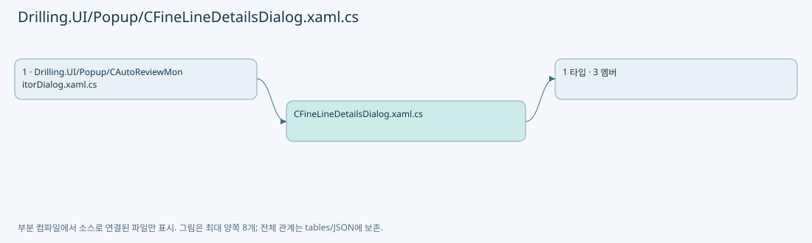
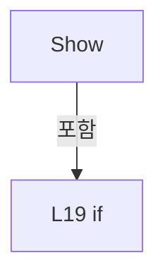

# Drilling.UI/Popup/CFineLineDetailsDialog.xaml.cs

| 항목 | 내용 |
| --- | --- |
| 원본 저장소 | https://github.com/kjuws10-rgb/A3Drilling.git |
| 원본 Commit | 5aee8e58439c9b455cae7c9593c9be986c3e682e |
| 원본 SHA256 | d7e937843f35c4c2564b40485fecae44f968cf7f84d59337807737768a37d510 |
| 파일 분류 | code |
| 원본 크기/행 | 761 bytes / 23 physical lines |
| 인코딩 | utf-8-sig |
| 검토 범위 | 구문/부분 의미 분석에서 추출한 사실. 동작·물리 단위·실장비 합격을 보증하지 않습니다. |
| 원본 링크 | [고정 Commit 원본](https://github.com/kjuws10-rgb/A3Drilling/blob/5aee8e58439c9b455cae7c9593c9be986c3e682e/Drilling.UI/Popup/CFineLineDetailsDialog.xaml.cs) |

## 파일의 역할과 읽는 순서

WPF 화면·사용자 명령·표시 상태를 구성합니다. XAML 이벤트와 코드 비하인드, RootView의 조립 경로를 함께 추적합니다.

## 네임스페이스·타입·상속

| 타입 | 구분 | 원본 범위 | 선언/상속 |
| --- | --- | --- | --- |
| CFineLineDetailsDialog | ClassDeclaration | 6–23 | CFineLineDetailsDialog: Window |

## 멤버 빠른 목록

| 이름 | 종류 | 범위 | 서명 |
| --- | --- | --- | --- |
| .ctor | ConstructorDeclaration | L8–14 | Drilling.UI.Popup.CFineLineDetailsDialog.CFineLineDetailsDialog(Drilling.UI.Menu.Menus.CFineInspectionLine) |
| Show | MethodDeclaration | L15–21 | void Drilling.UI.Popup.CFineLineDetailsDialog.Show(Drilling.UI.Menu.Menus.CFineInspectionLine) |
| CloseClicked | MethodDeclaration | L22–22 | void Drilling.UI.Popup.CFineLineDetailsDialog.CloseClicked(object, RoutedEventArgs) |

## 멤버별 상세 계약·호출·처리 해설

### ConstructorDeclaration `.ctor` · L8–14

[Drilling.UI/Popup/CFineLineDetailsDialog.xaml.cs:8–14](https://github.com/kjuws10-rgb/A3Drilling/blob/5aee8e58439c9b455cae7c9593c9be986c3e682e/Drilling.UI/Popup/CFineLineDetailsDialog.xaml.cs#L8-L14)

| 항목 | 실제 추출 값 |
| --- | --- |
| 서명 | Drilling.UI.Popup.CFineLineDetailsDialog.CFineLineDetailsDialog(Drilling.UI.Menu.Menus.CFineInspectionLine) |
| 접근/수식자 | Public / public |
| 반환/값 타입 | void |
| 소속 타입 | NamedType:Drilling.UI.Popup.CFineLineDetailsDialog |

입력 계약:

| 이름 | 타입 | 전달 | 선택/기본값 |
| --- | --- | --- | --- |
| line | Drilling.UI.Menu.Menus.CFineInspectionLine | None | False /  |

정적 호출자로 확인된 위치:

| 호출 파일/행 | 호출 표현식 | 런타임 분기 가능 |
| --- | --- | --- |
| [Drilling.UI/Popup/CAutoReviewMonitorDialog.xaml.cs:35–35](https://github.com/kjuws10-rgb/A3Drilling/blob/5aee8e58439c9b455cae7c9593c9be986c3e682e/Drilling.UI/Popup/CAutoReviewMonitorDialog.xaml.cs#L35-L35) | new CFineLineDetailsDialog | False |
| [Drilling.UI/Popup/CFineLineDetailsDialog.xaml.cs:18–18](https://github.com/kjuws10-rgb/A3Drilling/blob/5aee8e58439c9b455cae7c9593c9be986c3e682e/Drilling.UI/Popup/CFineLineDetailsDialog.xaml.cs#L18-L18) | new CFineLineDetailsDialog | False |

호출하는 대상과 해석 범위:

| 원본 행 | 표현식 | 분석 상태 | 대상/소스 위치 |
| --- | --- | --- | --- |
| 10 | InitializeComponent | unresolved | None |
| 12 | Math.Min | candidate | OverloadResolutionFailure |
| 13 | Math.Min | candidate | OverloadResolutionFailure |

본문의 실제 연산·분기·예외·반환 순서(원문 위치 순):

| 원본 행 | 종류 | 주석 해설 |
| --- | --- | --- |
| 10 | call | 함수·델리게이트 또는 객체 생성자를 호출합니다: InitializeComponent() |
| 11 | assignment | 값을 대상에 대입합니다: DataContext = line |
| 12 | assignment | 값을 대상에 대입합니다: Width = Math.Min(Width, SystemParameters.WorkArea.Width) |
| 12 | call | 함수·델리게이트 또는 객체 생성자를 호출합니다: Math.Min(Width, SystemParameters.WorkArea.Width) |
| 13 | assignment | 값을 대상에 대입합니다: Height = Math.Min(Height, SystemParameters.WorkArea.Height) |
| 13 | call | 함수·델리게이트 또는 객체 생성자를 호출합니다: Math.Min(Height, SystemParameters.WorkArea.Height) |

변경 전 점검: 입력/반환 타입, 위 호출자, 예외/취소 경로, 공유 상태와 저장·전송 소비자를 함께 확인합니다. 값의 단위나 물리 방향을 이름만으로 확정하지 않습니다.

### MethodDeclaration `Show` · L15–21

[Drilling.UI/Popup/CFineLineDetailsDialog.xaml.cs:15–21](https://github.com/kjuws10-rgb/A3Drilling/blob/5aee8e58439c9b455cae7c9593c9be986c3e682e/Drilling.UI/Popup/CFineLineDetailsDialog.xaml.cs#L15-L21)

| 항목 | 실제 추출 값 |
| --- | --- |
| 서명 | void Drilling.UI.Popup.CFineLineDetailsDialog.Show(Drilling.UI.Menu.Menus.CFineInspectionLine) |
| 접근/수식자 | Public / public, static |
| 반환/값 타입 | void |
| 소속 타입 | NamedType:Drilling.UI.Popup.CFineLineDetailsDialog |

입력 계약:

| 이름 | 타입 | 전달 | 선택/기본값 |
| --- | --- | --- | --- |
| line | Drilling.UI.Menu.Menus.CFineInspectionLine | None | False /  |

현재 부분 분석에서 직접 연결된 호출자는 없습니다. XAML/이벤트/인터페이스·델리게이트·외부 진입을 추가 확인해야 하며, 미사용으로 판정한 것이 아닙니다.

호출하는 대상과 해석 범위:

| 원본 행 | 표현식 | 분석 상태 | 대상/소스 위치 |
| --- | --- | --- | --- |
| 18 | new CFineLineDetailsDialog | resolved | Drilling.UI.Popup.CFineLineDetailsDialog.CFineLineDetailsDialog(Drilling.UI.Menu.Menus.CFineInspectionLine) · Drilling.UI/Popup/CFineLineDetailsDialog.xaml.cs:8 |
| 20 | dialog.ShowDialog | unresolved | None |

본문의 실제 연산·분기·예외·반환 순서(원문 위치 순):

| 원본 행 | 종류 | 주석 해설 |
| --- | --- | --- |
| 17 | local-declaration | 지역 변수를 선언합니다: var owner = Application.Current?.MainWindow; |
| 17 | variable-initializer | 변수의 초기값을 지정합니다: owner = Application.Current?.MainWindow |
| 18 | call | 함수·델리게이트 또는 객체 생성자를 호출합니다: new CFineLineDetailsDialog(line) |
| 18 | local-declaration | 지역 변수를 선언합니다: var dialog = new CFineLineDetailsDialog(line); |
| 18 | variable-initializer | 변수의 초기값을 지정합니다: dialog = new CFineLineDetailsDialog(line) |
| 19 | assignment | 값을 대상에 대입합니다: dialog.Owner = owner |
| 19 | if | 조건에 따라 분기합니다: if (owner is not null) |
| 20 | call | 함수·델리게이트 또는 객체 생성자를 호출합니다: dialog.ShowDialog() |

제어 구문의 포함 구조(실제 실행 순서/CFG가 아닌 구문 탐색 그림):

변경 전 점검: 입력/반환 타입, 위 호출자, 예외/취소 경로, 공유 상태와 저장·전송 소비자를 함께 확인합니다. 값의 단위나 물리 방향을 이름만으로 확정하지 않습니다.

### MethodDeclaration `CloseClicked` · L22–22

[Drilling.UI/Popup/CFineLineDetailsDialog.xaml.cs:22–22](https://github.com/kjuws10-rgb/A3Drilling/blob/5aee8e58439c9b455cae7c9593c9be986c3e682e/Drilling.UI/Popup/CFineLineDetailsDialog.xaml.cs#L22-L22)

| 항목 | 실제 추출 값 |
| --- | --- |
| 서명 | void Drilling.UI.Popup.CFineLineDetailsDialog.CloseClicked(object, RoutedEventArgs) |
| 접근/수식자 | Private / private |
| 반환/값 타입 | void |
| 소속 타입 | NamedType:Drilling.UI.Popup.CFineLineDetailsDialog |

입력 계약:

| 이름 | 타입 | 전달 | 선택/기본값 |
| --- | --- | --- | --- |
| sender | object | None | False /  |
| e | RoutedEventArgs | None | False /  |

현재 부분 분석에서 직접 연결된 호출자는 없습니다. XAML/이벤트/인터페이스·델리게이트·외부 진입을 추가 확인해야 하며, 미사용으로 판정한 것이 아닙니다.

호출하는 대상과 해석 범위:

| 원본 행 | 표현식 | 분석 상태 | 대상/소스 위치 |
| --- | --- | --- | --- |
| 22 | Close | unresolved | None |

본문의 실제 연산·분기·예외·반환 순서(원문 위치 순):

| 원본 행 | 종류 | 주석 해설 |
| --- | --- | --- |
| 22 | call | 함수·델리게이트 또는 객체 생성자를 호출합니다: Close() |

변경 전 점검: 입력/반환 타입, 위 호출자, 예외/취소 경로, 공유 상태와 저장·전송 소비자를 함께 확인합니다. 값의 단위나 물리 방향을 이름만으로 확정하지 않습니다.

## 구문·바인딩 한계

전체 WPF/벤더 SDK/프로젝트별 빌드 조건을 로드한 정식 빌드가 아닙니다. `resolved`는 이 부분 컴파일에서의 심볼 연결이며 virtual/interface/delegate/이벤트/Reflection/XAML의 실제 런타임 구현을 확정하지 않습니다. `candidate`와 `unresolved`는 후속 확인 대상으로 남깁니다.

## 원문 전체 주석 해설본

[원본 모든 행과 행별 해설 보기](../../../annotated/Drilling.UI/Popup/CFineLineDetailsDialog.xaml.cs.annotated.txt)

원본을 빠뜨리거나 임의로 줄이지 않았습니다. `L000001 |` 표시는 원본 행 번호, `// 해설`은 별도 설명입니다. 실행용 소스가 아닌 문서입니다.

## 수정·재검증 체크

- 원본 Commit과 현재 작업 파일 SHA가 같은지 먼저 확인합니다. 다르면 이 문서를 과거 버전 자료로 취급합니다.
- 선언·직접 호출·이벤트/인터페이스 경계·설정 소비를 함께 확인합니다. 정적 연결의 빈 곳을 정상 경로로 추정하지 않습니다.
- 저장 형식/단위/식별자·재시도·취소·예외·롤백에 영향을 주는 변경은 상세 해설장과 호출자를 다시 검토합니다.
- 도구의 구문 추출과 별도 정적 추적 해설, 실제 빌드·시뮬레이션·실장비 검증 결과를 분리합니다.
