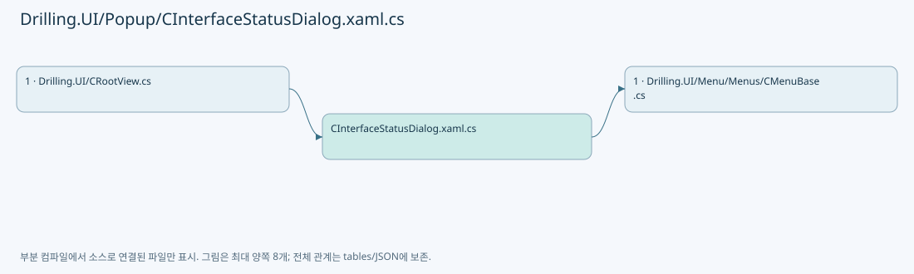
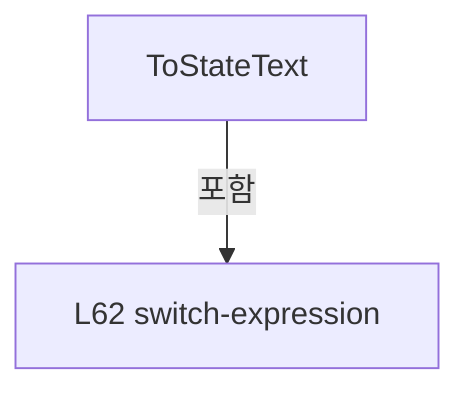

# Drilling.UI/Popup/CInterfaceStatusDialog.xaml.cs

| 항목 | 내용 |
| --- | --- |
| 원본 저장소 | https://github.com/kjuws10-rgb/A3Drilling.git |
| 원본 Commit | 5aee8e58439c9b455cae7c9593c9be986c3e682e |
| 원본 SHA256 | 0bc80bb0e523800765696d6ba42266ec811ac3406ac211aba5a6dec104a7e1b4 |
| 파일 분류 | code |
| 원본 크기/행 | 2,597 bytes / 70 physical lines |
| 인코딩 | utf-8-sig |
| 검토 범위 | 구문/부분 의미 분석에서 추출한 사실. 동작·물리 단위·실장비 합격을 보증하지 않습니다. |
| 원본 링크 | [고정 Commit 원본](https://github.com/kjuws10-rgb/A3Drilling/blob/5aee8e58439c9b455cae7c9593c9be986c3e682e/Drilling.UI/Popup/CInterfaceStatusDialog.xaml.cs) |

## 파일의 역할과 읽는 순서

WPF 화면·사용자 명령·표시 상태를 구성합니다. XAML 이벤트와 코드 비하인드, RootView의 조립 경로를 함께 추적합니다.

## 네임스페이스·타입·상속

| 타입 | 구분 | 원본 범위 | 선언/상속 |
| --- | --- | --- | --- |
| CInterfaceStatusDialog | ClassDeclaration | 7–70 | CInterfaceStatusDialog: Window |
| CInterfaceStatusRow | ClassDeclaration | 39–69 | CInterfaceStatusRow |

## 멤버 빠른 목록

| 이름 | 종류 | 범위 | 서명 |
| --- | --- | --- | --- |
| .ctor | ConstructorDeclaration | L9–32 | Drilling.UI.Popup.CInterfaceStatusDialog.CInterfaceStatusDialog(string, System.Collections.Generic.IReadOnlyList<Drilling.Common.Interface.ST_INTERFACE_COMM_STATUS>) |
| SelectNumber | LocalFunctionStatement | L12–15 | int SelectNumber(Drilling.Common.Interface.ST_INTERFACE_COMM_STATUS) |
| SelectNickName | LocalFunctionStatement | L17–20 | string SelectNickName(Drilling.Common.Interface.ST_INTERFACE_COMM_STATUS) |
| BuildCInterfaceStatusRow | LocalFunctionStatement | L22–25 | Drilling.UI.Popup.CInterfaceStatusDialog.CInterfaceStatusRow BuildCInterfaceStatusRow(Drilling.Common.Interface.ST_INTERFACE_COMM_STATUS) |
| OnCloseClicked | MethodDeclaration | L34–37 | void Drilling.UI.Popup.CInterfaceStatusDialog.OnCloseClicked(object, RoutedEventArgs) |
| .ctor | ConstructorDeclaration | L41–50 | Drilling.UI.Popup.CInterfaceStatusDialog.CInterfaceStatusRow.CInterfaceStatusRow(Drilling.Common.Interface.ST_INTERFACE_COMM_STATUS) |
| No | PropertyDeclaration | L52–52 | int Drilling.UI.Popup.CInterfaceStatusDialog.CInterfaceStatusRow.No |
| get_No | GetAccessorDeclaration | L52–52 | int Drilling.UI.Popup.CInterfaceStatusDialog.CInterfaceStatusRow.No.get |
| NickName | PropertyDeclaration | L53–53 | string Drilling.UI.Popup.CInterfaceStatusDialog.CInterfaceStatusRow.NickName |
| get_NickName | GetAccessorDeclaration | L53–53 | string Drilling.UI.Popup.CInterfaceStatusDialog.CInterfaceStatusRow.NickName.get |
| InterfaceType | PropertyDeclaration | L54–54 | string Drilling.UI.Popup.CInterfaceStatusDialog.CInterfaceStatusRow.InterfaceType |
| get_InterfaceType | GetAccessorDeclaration | L54–54 | string Drilling.UI.Popup.CInterfaceStatusDialog.CInterfaceStatusRow.InterfaceType.get |
| State | PropertyDeclaration | L55–55 | string Drilling.UI.Popup.CInterfaceStatusDialog.CInterfaceStatusRow.State |
| get_State | GetAccessorDeclaration | L55–55 | string Drilling.UI.Popup.CInterfaceStatusDialog.CInterfaceStatusRow.State.get |
| Endpoint | PropertyDeclaration | L56–56 | string Drilling.UI.Popup.CInterfaceStatusDialog.CInterfaceStatusRow.Endpoint |
| get_Endpoint | GetAccessorDeclaration | L56–56 | string Drilling.UI.Popup.CInterfaceStatusDialog.CInterfaceStatusRow.Endpoint.get |
| LastChangedText | PropertyDeclaration | L57–57 | string Drilling.UI.Popup.CInterfaceStatusDialog.CInterfaceStatusRow.LastChangedText |
| get_LastChangedText | GetAccessorDeclaration | L57–57 | string Drilling.UI.Popup.CInterfaceStatusDialog.CInterfaceStatusRow.LastChangedText.get |
| StateBrush | PropertyDeclaration | L58–58 | Brush Drilling.UI.Popup.CInterfaceStatusDialog.CInterfaceStatusRow.StateBrush |
| get_StateBrush | GetAccessorDeclaration | L58–58 | Brush Drilling.UI.Popup.CInterfaceStatusDialog.CInterfaceStatusRow.StateBrush.get |
| ToStateText | MethodDeclaration | L60–68 | string Drilling.UI.Popup.CInterfaceStatusDialog.CInterfaceStatusRow.ToStateText(Drilling.Common.Interface.EN_COMM_STATE) |

## 멤버별 상세 계약·호출·처리 해설

### ConstructorDeclaration `.ctor` · L9–32

[Drilling.UI/Popup/CInterfaceStatusDialog.xaml.cs:9–32](https://github.com/kjuws10-rgb/A3Drilling/blob/5aee8e58439c9b455cae7c9593c9be986c3e682e/Drilling.UI/Popup/CInterfaceStatusDialog.xaml.cs#L9-L32)

| 항목 | 실제 추출 값 |
| --- | --- |
| 서명 | Drilling.UI.Popup.CInterfaceStatusDialog.CInterfaceStatusDialog(string, System.Collections.Generic.IReadOnlyList<Drilling.Common.Interface.ST_INTERFACE_COMM_STATUS>) |
| 접근/수식자 | Public / public |
| 반환/값 타입 | void |
| 소속 타입 | NamedType:Drilling.UI.Popup.CInterfaceStatusDialog |

입력 계약:

| 이름 | 타입 | 전달 | 선택/기본값 |
| --- | --- | --- | --- |
| title | string | None | False /  |
| statuses | System.Collections.Generic.IReadOnlyList<Drilling.Common.Interface.ST_INTERFACE_COMM_STATUS> | None | False /  |

정적 호출자로 확인된 위치:

| 호출 파일/행 | 호출 표현식 | 런타임 분기 가능 |
| --- | --- | --- |
| [Drilling.UI/CRootView.cs:2494–2494](https://github.com/kjuws10-rgb/A3Drilling/blob/5aee8e58439c9b455cae7c9593c9be986c3e682e/Drilling.UI/CRootView.cs#L2494-L2494) | new CInterfaceStatusDialog | False |

호출하는 대상과 해석 범위:

| 원본 행 | 표현식 | 분석 상태 | 대상/소스 위치 |
| --- | --- | --- | --- |
| 11 | InitializeComponent | unresolved | None |
| 27 | statuses.OrderBy(SelectNumber).ThenBy(SelectNickName, StringComparer.OrdinalIgnoreCase).Select(BuildCInterfaceStatusRow).ToArray | resolved | Drilling.UI.Popup.CInterfaceStatusDialog.CInterfaceStatusRow[] System.Collections.Generic.IEnumerable<Drilling.UI.Popup.CInterfaceStatusDialog.CInterfaceStatusRow>.ToArray<Drilling.UI.Popup.CInterfaceStatusDialog.CInterfaceStatusRow>() |
| 27 | statuses.OrderBy(SelectNumber).ThenBy(SelectNickName, StringComparer.OrdinalIgnoreCase).Select | resolved | System.Collections.Generic.IEnumerable<Drilling.UI.Popup.CInterfaceStatusDialog.CInterfaceStatusRow> System.Collections.Generic.IEnumerable<Drilling.Common.Interface.ST_INTERFACE_COMM_STATUS>.Select<Drilling.Common.Interface.ST_INTERFACE_COMM_STATUS, Drilling.UI.Popup.CInterfaceStatusDialog.CInterfaceStatusRow>(System.Func<Drilling.Common.Interface.ST_INTERFACE_COMM_STATUS, Drilling.UI.Popup.CInterfaceStatusDialog.CInterfaceStatusRow>) |
| 27 | statuses.OrderBy(SelectNumber).ThenBy | resolved | System.Linq.IOrderedEnumerable<Drilling.Common.Interface.ST_INTERFACE_COMM_STATUS> System.Linq.IOrderedEnumerable<Drilling.Common.Interface.ST_INTERFACE_COMM_STATUS>.ThenBy<Drilling.Common.Interface.ST_INTERFACE_COMM_STATUS, string>(System.Func<Drilling.Common.Interface.ST_INTERFACE_COMM_STATUS, string>, System.Collections.Generic.IComparer<string>?) |
| 27 | statuses.OrderBy | resolved | System.Linq.IOrderedEnumerable<Drilling.Common.Interface.ST_INTERFACE_COMM_STATUS> System.Collections.Generic.IEnumerable<Drilling.Common.Interface.ST_INTERFACE_COMM_STATUS>.OrderBy<Drilling.Common.Interface.ST_INTERFACE_COMM_STATUS, int>(System.Func<Drilling.Common.Interface.ST_INTERFACE_COMM_STATUS, int>) |

본문의 실제 연산·분기·예외·반환 순서(원문 위치 순):

| 원본 행 | 종류 | 주석 해설 |
| --- | --- | --- |
| 11 | call | 함수·델리게이트 또는 객체 생성자를 호출합니다: InitializeComponent() |
| 27 | call | 함수·델리게이트 또는 객체 생성자를 호출합니다: statuses.OrderBy(SelectNumber).ThenBy(SelectNickName, StringComparer.OrdinalIgnoreCase).Select(BuildCInterfaceStatusRow).ToArray() |
| 27 | call | 함수·델리게이트 또는 객체 생성자를 호출합니다: statuses.OrderBy(SelectNumber).ThenBy(SelectNickName, StringComparer.OrdinalIgnoreCase).Select(BuildCInterfaceStatusRow) |
| 27 | call | 함수·델리게이트 또는 객체 생성자를 호출합니다: statuses.OrderBy(SelectNumber).ThenBy(SelectNickName, StringComparer.OrdinalIgnoreCase) |
| 27 | call | 함수·델리게이트 또는 객체 생성자를 호출합니다: statuses.OrderBy(SelectNumber) |
| 27 | local-declaration | 지역 변수를 선언합니다: var rows = statuses.OrderBy(SelectNumber).ThenBy(SelectNickName, StringComparer.OrdinalIgnoreCase).Select(BuildCInterfaceStatusRow).ToArray(); |
| 27 | variable-initializer | 변수의 초기값을 지정합니다: rows = statuses.OrderBy(SelectNumber).ThenBy(SelectNickName, StringComparer.OrdinalIgnoreCase).Select(BuildCInterfaceStatusRow).ToArray() |
| 28 | assignment | 값을 대상에 대입합니다: Title = $"{title} Status" |
| 29 | assignment | 값을 대상에 대입합니다: TitleText.Text = title |
| 30 | assignment | 값을 대상에 대입합니다: SummaryText.Text = $"{rows.Length} interface item(s)" |
| 31 | assignment | 값을 대상에 대입합니다: StatusGrid.ItemsSource = rows |

변경 전 점검: 입력/반환 타입, 위 호출자, 예외/취소 경로, 공유 상태와 저장·전송 소비자를 함께 확인합니다. 값의 단위나 물리 방향을 이름만으로 확정하지 않습니다.

### LocalFunctionStatement `SelectNumber` · L12–15

[Drilling.UI/Popup/CInterfaceStatusDialog.xaml.cs:12–15](https://github.com/kjuws10-rgb/A3Drilling/blob/5aee8e58439c9b455cae7c9593c9be986c3e682e/Drilling.UI/Popup/CInterfaceStatusDialog.xaml.cs#L12-L15)

| 항목 | 실제 추출 값 |
| --- | --- |
| 서명 | int SelectNumber(Drilling.Common.Interface.ST_INTERFACE_COMM_STATUS) |
| 접근/수식자 | Private /  |
| 반환/값 타입 | int |
| 소속 타입 | NamedType:Drilling.UI.Popup.CInterfaceStatusDialog |

입력 계약:

| 이름 | 타입 | 전달 | 선택/기본값 |
| --- | --- | --- | --- |
| status | Drilling.Common.Interface.ST_INTERFACE_COMM_STATUS | None | False /  |

현재 부분 분석에서 직접 연결된 호출자는 없습니다. XAML/이벤트/인터페이스·델리게이트·외부 진입을 추가 확인해야 하며, 미사용으로 판정한 것이 아닙니다.

본문의 실제 연산·분기·예외·반환 순서(원문 위치 순):

| 원본 행 | 종류 | 주석 해설 |
| --- | --- | --- |
| 14 | return | 호출자에게 값 또는 제어를 반환합니다: return status.Number; |

변경 전 점검: 입력/반환 타입, 위 호출자, 예외/취소 경로, 공유 상태와 저장·전송 소비자를 함께 확인합니다. 값의 단위나 물리 방향을 이름만으로 확정하지 않습니다.

### LocalFunctionStatement `SelectNickName` · L17–20

[Drilling.UI/Popup/CInterfaceStatusDialog.xaml.cs:17–20](https://github.com/kjuws10-rgb/A3Drilling/blob/5aee8e58439c9b455cae7c9593c9be986c3e682e/Drilling.UI/Popup/CInterfaceStatusDialog.xaml.cs#L17-L20)

| 항목 | 실제 추출 값 |
| --- | --- |
| 서명 | string SelectNickName(Drilling.Common.Interface.ST_INTERFACE_COMM_STATUS) |
| 접근/수식자 | Private /  |
| 반환/값 타입 | string |
| 소속 타입 | NamedType:Drilling.UI.Popup.CInterfaceStatusDialog |

입력 계약:

| 이름 | 타입 | 전달 | 선택/기본값 |
| --- | --- | --- | --- |
| status | Drilling.Common.Interface.ST_INTERFACE_COMM_STATUS | None | False /  |

현재 부분 분석에서 직접 연결된 호출자는 없습니다. XAML/이벤트/인터페이스·델리게이트·외부 진입을 추가 확인해야 하며, 미사용으로 판정한 것이 아닙니다.

본문의 실제 연산·분기·예외·반환 순서(원문 위치 순):

| 원본 행 | 종류 | 주석 해설 |
| --- | --- | --- |
| 19 | return | 호출자에게 값 또는 제어를 반환합니다: return status.NickName; |

변경 전 점검: 입력/반환 타입, 위 호출자, 예외/취소 경로, 공유 상태와 저장·전송 소비자를 함께 확인합니다. 값의 단위나 물리 방향을 이름만으로 확정하지 않습니다.

### LocalFunctionStatement `BuildCInterfaceStatusRow` · L22–25

[Drilling.UI/Popup/CInterfaceStatusDialog.xaml.cs:22–25](https://github.com/kjuws10-rgb/A3Drilling/blob/5aee8e58439c9b455cae7c9593c9be986c3e682e/Drilling.UI/Popup/CInterfaceStatusDialog.xaml.cs#L22-L25)

| 항목 | 실제 추출 값 |
| --- | --- |
| 서명 | Drilling.UI.Popup.CInterfaceStatusDialog.CInterfaceStatusRow BuildCInterfaceStatusRow(Drilling.Common.Interface.ST_INTERFACE_COMM_STATUS) |
| 접근/수식자 | Private /  |
| 반환/값 타입 | Drilling.UI.Popup.CInterfaceStatusDialog.CInterfaceStatusRow |
| 소속 타입 | NamedType:Drilling.UI.Popup.CInterfaceStatusDialog |

입력 계약:

| 이름 | 타입 | 전달 | 선택/기본값 |
| --- | --- | --- | --- |
| status | Drilling.Common.Interface.ST_INTERFACE_COMM_STATUS | None | False /  |

현재 부분 분석에서 직접 연결된 호출자는 없습니다. XAML/이벤트/인터페이스·델리게이트·외부 진입을 추가 확인해야 하며, 미사용으로 판정한 것이 아닙니다.

호출하는 대상과 해석 범위:

| 원본 행 | 표현식 | 분석 상태 | 대상/소스 위치 |
| --- | --- | --- | --- |
| 24 | new CInterfaceStatusRow | resolved | Drilling.UI.Popup.CInterfaceStatusDialog.CInterfaceStatusRow.CInterfaceStatusRow(Drilling.Common.Interface.ST_INTERFACE_COMM_STATUS) · Drilling.UI/Popup/CInterfaceStatusDialog.xaml.cs:41 |

본문의 실제 연산·분기·예외·반환 순서(원문 위치 순):

| 원본 행 | 종류 | 주석 해설 |
| --- | --- | --- |
| 24 | call | 함수·델리게이트 또는 객체 생성자를 호출합니다: new CInterfaceStatusRow(status) |
| 24 | return | 호출자에게 값 또는 제어를 반환합니다: return new CInterfaceStatusRow(status); |

변경 전 점검: 입력/반환 타입, 위 호출자, 예외/취소 경로, 공유 상태와 저장·전송 소비자를 함께 확인합니다. 값의 단위나 물리 방향을 이름만으로 확정하지 않습니다.

### MethodDeclaration `OnCloseClicked` · L34–37

[Drilling.UI/Popup/CInterfaceStatusDialog.xaml.cs:34–37](https://github.com/kjuws10-rgb/A3Drilling/blob/5aee8e58439c9b455cae7c9593c9be986c3e682e/Drilling.UI/Popup/CInterfaceStatusDialog.xaml.cs#L34-L37)

| 항목 | 실제 추출 값 |
| --- | --- |
| 서명 | void Drilling.UI.Popup.CInterfaceStatusDialog.OnCloseClicked(object, RoutedEventArgs) |
| 접근/수식자 | Private / private |
| 반환/값 타입 | void |
| 소속 타입 | NamedType:Drilling.UI.Popup.CInterfaceStatusDialog |

입력 계약:

| 이름 | 타입 | 전달 | 선택/기본값 |
| --- | --- | --- | --- |
| sender | object | None | False /  |
| e | RoutedEventArgs | None | False /  |

현재 부분 분석에서 직접 연결된 호출자는 없습니다. XAML/이벤트/인터페이스·델리게이트·외부 진입을 추가 확인해야 하며, 미사용으로 판정한 것이 아닙니다.

호출하는 대상과 해석 범위:

| 원본 행 | 표현식 | 분석 상태 | 대상/소스 위치 |
| --- | --- | --- | --- |
| 36 | Close | unresolved | None |

본문의 실제 연산·분기·예외·반환 순서(원문 위치 순):

| 원본 행 | 종류 | 주석 해설 |
| --- | --- | --- |
| 36 | call | 함수·델리게이트 또는 객체 생성자를 호출합니다: Close() |

변경 전 점검: 입력/반환 타입, 위 호출자, 예외/취소 경로, 공유 상태와 저장·전송 소비자를 함께 확인합니다. 값의 단위나 물리 방향을 이름만으로 확정하지 않습니다.

### ConstructorDeclaration `.ctor` · L41–50

[Drilling.UI/Popup/CInterfaceStatusDialog.xaml.cs:41–50](https://github.com/kjuws10-rgb/A3Drilling/blob/5aee8e58439c9b455cae7c9593c9be986c3e682e/Drilling.UI/Popup/CInterfaceStatusDialog.xaml.cs#L41-L50)

| 항목 | 실제 추출 값 |
| --- | --- |
| 서명 | Drilling.UI.Popup.CInterfaceStatusDialog.CInterfaceStatusRow.CInterfaceStatusRow(Drilling.Common.Interface.ST_INTERFACE_COMM_STATUS) |
| 접근/수식자 | Public / public |
| 반환/값 타입 | void |
| 소속 타입 | NamedType:Drilling.UI.Popup.CInterfaceStatusDialog.CInterfaceStatusRow |

입력 계약:

| 이름 | 타입 | 전달 | 선택/기본값 |
| --- | --- | --- | --- |
| status | Drilling.Common.Interface.ST_INTERFACE_COMM_STATUS | None | False /  |

정적 호출자로 확인된 위치:

| 호출 파일/행 | 호출 표현식 | 런타임 분기 가능 |
| --- | --- | --- |
| [Drilling.UI/Popup/CInterfaceStatusDialog.xaml.cs:24–24](https://github.com/kjuws10-rgb/A3Drilling/blob/5aee8e58439c9b455cae7c9593c9be986c3e682e/Drilling.UI/Popup/CInterfaceStatusDialog.xaml.cs#L24-L24) | new CInterfaceStatusRow | False |

호출하는 대상과 해석 범위:

| 원본 행 | 표현식 | 분석 상태 | 대상/소스 위치 |
| --- | --- | --- | --- |
| 44 | string.IsNullOrWhiteSpace | resolved | bool string.IsNullOrWhiteSpace(string?) |
| 45 | status.InterfaceType.ToString | resolved · 동적 구현 선택 가능 | string System.Enum.ToString() |
| 47 | string.IsNullOrWhiteSpace | resolved | bool string.IsNullOrWhiteSpace(string?) |
| 48 | .ToLocalTime().ToString | resolved | string System.DateTimeOffset.ToString(string?) |
| 48 | .ToLocalTime | resolved | System.DateTimeOffset System.DateTimeOffset.ToLocalTime() |
| 49 | CStatusBrush.ForHeaderState | resolved | Brush Drilling.UI.Menu.Menus.CStatusBrush.ForHeaderState(string) · Drilling.UI/Menu/Menus/CMenuBase.cs:280 |
| 49 | ToStateText | resolved | string Drilling.UI.Popup.CInterfaceStatusDialog.CInterfaceStatusRow.ToStateText(Drilling.Common.Interface.EN_COMM_STATE) · Drilling.UI/Popup/CInterfaceStatusDialog.xaml.cs:60 |

본문의 실제 연산·분기·예외·반환 순서(원문 위치 순):

| 원본 행 | 종류 | 주석 해설 |
| --- | --- | --- |
| 43 | assignment | 값을 대상에 대입합니다: No = status.Number + 1 |
| 44 | assignment | 값을 대상에 대입합니다: NickName = string.IsNullOrWhiteSpace(status.NickName) ? "-" : status.NickName |
| 44 | call | 함수·델리게이트 또는 객체 생성자를 호출합니다: string.IsNullOrWhiteSpace(status.NickName) |
| 44 | conditional-expression | 조건에 따라 결과식을 선택합니다: string.IsNullOrWhiteSpace(status.NickName) ? "-" : status.NickName |
| 45 | assignment | 값을 대상에 대입합니다: InterfaceType = status.InterfaceType.ToString() |
| 45 | call | 함수·델리게이트 또는 객체 생성자를 호출합니다: status.InterfaceType.ToString() |
| 46 | assignment | 값을 대상에 대입합니다: State = status.ConnectionText |
| 47 | assignment | 값을 대상에 대입합니다: Endpoint = string.IsNullOrWhiteSpace(status.Endpoint) ? "-" : status.Endpoint |
| 47 | call | 함수·델리게이트 또는 객체 생성자를 호출합니다: string.IsNullOrWhiteSpace(status.Endpoint) |
| 47 | conditional-expression | 조건에 따라 결과식을 선택합니다: string.IsNullOrWhiteSpace(status.Endpoint) ? "-" : status.Endpoint |
| 48 | assignment | 값을 대상에 대입합니다: LastChangedText = status.LastChangedAt?.ToLocalTime().ToString("yyyy-MM-dd HH:mm:ss") ?? "-" |
| 48 | call | 함수·델리게이트 또는 객체 생성자를 호출합니다: .ToLocalTime().ToString("yyyy-MM-dd HH:mm:ss") |
| 48 | call | 함수·델리게이트 또는 객체 생성자를 호출합니다: .ToLocalTime() |
| 49 | assignment | 값을 대상에 대입합니다: StateBrush = CStatusBrush.ForHeaderState(ToStateText(status.ConnectionState)) |
| 49 | call | 함수·델리게이트 또는 객체 생성자를 호출합니다: CStatusBrush.ForHeaderState(ToStateText(status.ConnectionState)) |
| 49 | call | 함수·델리게이트 또는 객체 생성자를 호출합니다: ToStateText(status.ConnectionState) |

변경 전 점검: 입력/반환 타입, 위 호출자, 예외/취소 경로, 공유 상태와 저장·전송 소비자를 함께 확인합니다. 값의 단위나 물리 방향을 이름만으로 확정하지 않습니다.

### PropertyDeclaration `No` · L52–52

[Drilling.UI/Popup/CInterfaceStatusDialog.xaml.cs:52–52](https://github.com/kjuws10-rgb/A3Drilling/blob/5aee8e58439c9b455cae7c9593c9be986c3e682e/Drilling.UI/Popup/CInterfaceStatusDialog.xaml.cs#L52-L52)

| 항목 | 실제 추출 값 |
| --- | --- |
| 서명 | int Drilling.UI.Popup.CInterfaceStatusDialog.CInterfaceStatusRow.No |
| 접근/수식자 | Public / public |
| 반환/값 타입 | int |
| 소속 타입 | NamedType:Drilling.UI.Popup.CInterfaceStatusDialog.CInterfaceStatusRow |

현재 부분 분석에서 직접 연결된 호출자는 없습니다. XAML/이벤트/인터페이스·델리게이트·외부 진입을 추가 확인해야 하며, 미사용으로 판정한 것이 아닙니다.

변경 전 점검: 입력/반환 타입, 위 호출자, 예외/취소 경로, 공유 상태와 저장·전송 소비자를 함께 확인합니다. 값의 단위나 물리 방향을 이름만으로 확정하지 않습니다.

### GetAccessorDeclaration `get_No` · L52–52

[Drilling.UI/Popup/CInterfaceStatusDialog.xaml.cs:52–52](https://github.com/kjuws10-rgb/A3Drilling/blob/5aee8e58439c9b455cae7c9593c9be986c3e682e/Drilling.UI/Popup/CInterfaceStatusDialog.xaml.cs#L52-L52)

| 항목 | 실제 추출 값 |
| --- | --- |
| 서명 | int Drilling.UI.Popup.CInterfaceStatusDialog.CInterfaceStatusRow.No.get |
| 접근/수식자 | Public / get |
| 반환/값 타입 | int |
| 소속 타입 | NamedType:Drilling.UI.Popup.CInterfaceStatusDialog.CInterfaceStatusRow |

현재 부분 분석에서 직접 연결된 호출자는 없습니다. XAML/이벤트/인터페이스·델리게이트·외부 진입을 추가 확인해야 하며, 미사용으로 판정한 것이 아닙니다.

변경 전 점검: 입력/반환 타입, 위 호출자, 예외/취소 경로, 공유 상태와 저장·전송 소비자를 함께 확인합니다. 값의 단위나 물리 방향을 이름만으로 확정하지 않습니다.

### PropertyDeclaration `NickName` · L53–53

[Drilling.UI/Popup/CInterfaceStatusDialog.xaml.cs:53–53](https://github.com/kjuws10-rgb/A3Drilling/blob/5aee8e58439c9b455cae7c9593c9be986c3e682e/Drilling.UI/Popup/CInterfaceStatusDialog.xaml.cs#L53-L53)

| 항목 | 실제 추출 값 |
| --- | --- |
| 서명 | string Drilling.UI.Popup.CInterfaceStatusDialog.CInterfaceStatusRow.NickName |
| 접근/수식자 | Public / public |
| 반환/값 타입 | string |
| 소속 타입 | NamedType:Drilling.UI.Popup.CInterfaceStatusDialog.CInterfaceStatusRow |

현재 부분 분석에서 직접 연결된 호출자는 없습니다. XAML/이벤트/인터페이스·델리게이트·외부 진입을 추가 확인해야 하며, 미사용으로 판정한 것이 아닙니다.

변경 전 점검: 입력/반환 타입, 위 호출자, 예외/취소 경로, 공유 상태와 저장·전송 소비자를 함께 확인합니다. 값의 단위나 물리 방향을 이름만으로 확정하지 않습니다.

### GetAccessorDeclaration `get_NickName` · L53–53

[Drilling.UI/Popup/CInterfaceStatusDialog.xaml.cs:53–53](https://github.com/kjuws10-rgb/A3Drilling/blob/5aee8e58439c9b455cae7c9593c9be986c3e682e/Drilling.UI/Popup/CInterfaceStatusDialog.xaml.cs#L53-L53)

| 항목 | 실제 추출 값 |
| --- | --- |
| 서명 | string Drilling.UI.Popup.CInterfaceStatusDialog.CInterfaceStatusRow.NickName.get |
| 접근/수식자 | Public / get |
| 반환/값 타입 | string |
| 소속 타입 | NamedType:Drilling.UI.Popup.CInterfaceStatusDialog.CInterfaceStatusRow |

현재 부분 분석에서 직접 연결된 호출자는 없습니다. XAML/이벤트/인터페이스·델리게이트·외부 진입을 추가 확인해야 하며, 미사용으로 판정한 것이 아닙니다.

변경 전 점검: 입력/반환 타입, 위 호출자, 예외/취소 경로, 공유 상태와 저장·전송 소비자를 함께 확인합니다. 값의 단위나 물리 방향을 이름만으로 확정하지 않습니다.

### PropertyDeclaration `InterfaceType` · L54–54

[Drilling.UI/Popup/CInterfaceStatusDialog.xaml.cs:54–54](https://github.com/kjuws10-rgb/A3Drilling/blob/5aee8e58439c9b455cae7c9593c9be986c3e682e/Drilling.UI/Popup/CInterfaceStatusDialog.xaml.cs#L54-L54)

| 항목 | 실제 추출 값 |
| --- | --- |
| 서명 | string Drilling.UI.Popup.CInterfaceStatusDialog.CInterfaceStatusRow.InterfaceType |
| 접근/수식자 | Public / public |
| 반환/값 타입 | string |
| 소속 타입 | NamedType:Drilling.UI.Popup.CInterfaceStatusDialog.CInterfaceStatusRow |

현재 부분 분석에서 직접 연결된 호출자는 없습니다. XAML/이벤트/인터페이스·델리게이트·외부 진입을 추가 확인해야 하며, 미사용으로 판정한 것이 아닙니다.

변경 전 점검: 입력/반환 타입, 위 호출자, 예외/취소 경로, 공유 상태와 저장·전송 소비자를 함께 확인합니다. 값의 단위나 물리 방향을 이름만으로 확정하지 않습니다.

### GetAccessorDeclaration `get_InterfaceType` · L54–54

[Drilling.UI/Popup/CInterfaceStatusDialog.xaml.cs:54–54](https://github.com/kjuws10-rgb/A3Drilling/blob/5aee8e58439c9b455cae7c9593c9be986c3e682e/Drilling.UI/Popup/CInterfaceStatusDialog.xaml.cs#L54-L54)

| 항목 | 실제 추출 값 |
| --- | --- |
| 서명 | string Drilling.UI.Popup.CInterfaceStatusDialog.CInterfaceStatusRow.InterfaceType.get |
| 접근/수식자 | Public / get |
| 반환/값 타입 | string |
| 소속 타입 | NamedType:Drilling.UI.Popup.CInterfaceStatusDialog.CInterfaceStatusRow |

현재 부분 분석에서 직접 연결된 호출자는 없습니다. XAML/이벤트/인터페이스·델리게이트·외부 진입을 추가 확인해야 하며, 미사용으로 판정한 것이 아닙니다.

변경 전 점검: 입력/반환 타입, 위 호출자, 예외/취소 경로, 공유 상태와 저장·전송 소비자를 함께 확인합니다. 값의 단위나 물리 방향을 이름만으로 확정하지 않습니다.

### PropertyDeclaration `State` · L55–55

[Drilling.UI/Popup/CInterfaceStatusDialog.xaml.cs:55–55](https://github.com/kjuws10-rgb/A3Drilling/blob/5aee8e58439c9b455cae7c9593c9be986c3e682e/Drilling.UI/Popup/CInterfaceStatusDialog.xaml.cs#L55-L55)

| 항목 | 실제 추출 값 |
| --- | --- |
| 서명 | string Drilling.UI.Popup.CInterfaceStatusDialog.CInterfaceStatusRow.State |
| 접근/수식자 | Public / public |
| 반환/값 타입 | string |
| 소속 타입 | NamedType:Drilling.UI.Popup.CInterfaceStatusDialog.CInterfaceStatusRow |

현재 부분 분석에서 직접 연결된 호출자는 없습니다. XAML/이벤트/인터페이스·델리게이트·외부 진입을 추가 확인해야 하며, 미사용으로 판정한 것이 아닙니다.

변경 전 점검: 입력/반환 타입, 위 호출자, 예외/취소 경로, 공유 상태와 저장·전송 소비자를 함께 확인합니다. 값의 단위나 물리 방향을 이름만으로 확정하지 않습니다.

### GetAccessorDeclaration `get_State` · L55–55

[Drilling.UI/Popup/CInterfaceStatusDialog.xaml.cs:55–55](https://github.com/kjuws10-rgb/A3Drilling/blob/5aee8e58439c9b455cae7c9593c9be986c3e682e/Drilling.UI/Popup/CInterfaceStatusDialog.xaml.cs#L55-L55)

| 항목 | 실제 추출 값 |
| --- | --- |
| 서명 | string Drilling.UI.Popup.CInterfaceStatusDialog.CInterfaceStatusRow.State.get |
| 접근/수식자 | Public / get |
| 반환/값 타입 | string |
| 소속 타입 | NamedType:Drilling.UI.Popup.CInterfaceStatusDialog.CInterfaceStatusRow |

현재 부분 분석에서 직접 연결된 호출자는 없습니다. XAML/이벤트/인터페이스·델리게이트·외부 진입을 추가 확인해야 하며, 미사용으로 판정한 것이 아닙니다.

변경 전 점검: 입력/반환 타입, 위 호출자, 예외/취소 경로, 공유 상태와 저장·전송 소비자를 함께 확인합니다. 값의 단위나 물리 방향을 이름만으로 확정하지 않습니다.

### PropertyDeclaration `Endpoint` · L56–56

[Drilling.UI/Popup/CInterfaceStatusDialog.xaml.cs:56–56](https://github.com/kjuws10-rgb/A3Drilling/blob/5aee8e58439c9b455cae7c9593c9be986c3e682e/Drilling.UI/Popup/CInterfaceStatusDialog.xaml.cs#L56-L56)

| 항목 | 실제 추출 값 |
| --- | --- |
| 서명 | string Drilling.UI.Popup.CInterfaceStatusDialog.CInterfaceStatusRow.Endpoint |
| 접근/수식자 | Public / public |
| 반환/값 타입 | string |
| 소속 타입 | NamedType:Drilling.UI.Popup.CInterfaceStatusDialog.CInterfaceStatusRow |

현재 부분 분석에서 직접 연결된 호출자는 없습니다. XAML/이벤트/인터페이스·델리게이트·외부 진입을 추가 확인해야 하며, 미사용으로 판정한 것이 아닙니다.

변경 전 점검: 입력/반환 타입, 위 호출자, 예외/취소 경로, 공유 상태와 저장·전송 소비자를 함께 확인합니다. 값의 단위나 물리 방향을 이름만으로 확정하지 않습니다.

### GetAccessorDeclaration `get_Endpoint` · L56–56

[Drilling.UI/Popup/CInterfaceStatusDialog.xaml.cs:56–56](https://github.com/kjuws10-rgb/A3Drilling/blob/5aee8e58439c9b455cae7c9593c9be986c3e682e/Drilling.UI/Popup/CInterfaceStatusDialog.xaml.cs#L56-L56)

| 항목 | 실제 추출 값 |
| --- | --- |
| 서명 | string Drilling.UI.Popup.CInterfaceStatusDialog.CInterfaceStatusRow.Endpoint.get |
| 접근/수식자 | Public / get |
| 반환/값 타입 | string |
| 소속 타입 | NamedType:Drilling.UI.Popup.CInterfaceStatusDialog.CInterfaceStatusRow |

현재 부분 분석에서 직접 연결된 호출자는 없습니다. XAML/이벤트/인터페이스·델리게이트·외부 진입을 추가 확인해야 하며, 미사용으로 판정한 것이 아닙니다.

변경 전 점검: 입력/반환 타입, 위 호출자, 예외/취소 경로, 공유 상태와 저장·전송 소비자를 함께 확인합니다. 값의 단위나 물리 방향을 이름만으로 확정하지 않습니다.

### PropertyDeclaration `LastChangedText` · L57–57

[Drilling.UI/Popup/CInterfaceStatusDialog.xaml.cs:57–57](https://github.com/kjuws10-rgb/A3Drilling/blob/5aee8e58439c9b455cae7c9593c9be986c3e682e/Drilling.UI/Popup/CInterfaceStatusDialog.xaml.cs#L57-L57)

| 항목 | 실제 추출 값 |
| --- | --- |
| 서명 | string Drilling.UI.Popup.CInterfaceStatusDialog.CInterfaceStatusRow.LastChangedText |
| 접근/수식자 | Public / public |
| 반환/값 타입 | string |
| 소속 타입 | NamedType:Drilling.UI.Popup.CInterfaceStatusDialog.CInterfaceStatusRow |

현재 부분 분석에서 직접 연결된 호출자는 없습니다. XAML/이벤트/인터페이스·델리게이트·외부 진입을 추가 확인해야 하며, 미사용으로 판정한 것이 아닙니다.

변경 전 점검: 입력/반환 타입, 위 호출자, 예외/취소 경로, 공유 상태와 저장·전송 소비자를 함께 확인합니다. 값의 단위나 물리 방향을 이름만으로 확정하지 않습니다.

### GetAccessorDeclaration `get_LastChangedText` · L57–57

[Drilling.UI/Popup/CInterfaceStatusDialog.xaml.cs:57–57](https://github.com/kjuws10-rgb/A3Drilling/blob/5aee8e58439c9b455cae7c9593c9be986c3e682e/Drilling.UI/Popup/CInterfaceStatusDialog.xaml.cs#L57-L57)

| 항목 | 실제 추출 값 |
| --- | --- |
| 서명 | string Drilling.UI.Popup.CInterfaceStatusDialog.CInterfaceStatusRow.LastChangedText.get |
| 접근/수식자 | Public / get |
| 반환/값 타입 | string |
| 소속 타입 | NamedType:Drilling.UI.Popup.CInterfaceStatusDialog.CInterfaceStatusRow |

현재 부분 분석에서 직접 연결된 호출자는 없습니다. XAML/이벤트/인터페이스·델리게이트·외부 진입을 추가 확인해야 하며, 미사용으로 판정한 것이 아닙니다.

변경 전 점검: 입력/반환 타입, 위 호출자, 예외/취소 경로, 공유 상태와 저장·전송 소비자를 함께 확인합니다. 값의 단위나 물리 방향을 이름만으로 확정하지 않습니다.

### PropertyDeclaration `StateBrush` · L58–58

[Drilling.UI/Popup/CInterfaceStatusDialog.xaml.cs:58–58](https://github.com/kjuws10-rgb/A3Drilling/blob/5aee8e58439c9b455cae7c9593c9be986c3e682e/Drilling.UI/Popup/CInterfaceStatusDialog.xaml.cs#L58-L58)

| 항목 | 실제 추출 값 |
| --- | --- |
| 서명 | Brush Drilling.UI.Popup.CInterfaceStatusDialog.CInterfaceStatusRow.StateBrush |
| 접근/수식자 | Public / public |
| 반환/값 타입 | Brush |
| 소속 타입 | NamedType:Drilling.UI.Popup.CInterfaceStatusDialog.CInterfaceStatusRow |

현재 부분 분석에서 직접 연결된 호출자는 없습니다. XAML/이벤트/인터페이스·델리게이트·외부 진입을 추가 확인해야 하며, 미사용으로 판정한 것이 아닙니다.

변경 전 점검: 입력/반환 타입, 위 호출자, 예외/취소 경로, 공유 상태와 저장·전송 소비자를 함께 확인합니다. 값의 단위나 물리 방향을 이름만으로 확정하지 않습니다.

### GetAccessorDeclaration `get_StateBrush` · L58–58

[Drilling.UI/Popup/CInterfaceStatusDialog.xaml.cs:58–58](https://github.com/kjuws10-rgb/A3Drilling/blob/5aee8e58439c9b455cae7c9593c9be986c3e682e/Drilling.UI/Popup/CInterfaceStatusDialog.xaml.cs#L58-L58)

| 항목 | 실제 추출 값 |
| --- | --- |
| 서명 | Brush Drilling.UI.Popup.CInterfaceStatusDialog.CInterfaceStatusRow.StateBrush.get |
| 접근/수식자 | Public / get |
| 반환/값 타입 | Brush |
| 소속 타입 | NamedType:Drilling.UI.Popup.CInterfaceStatusDialog.CInterfaceStatusRow |

현재 부분 분석에서 직접 연결된 호출자는 없습니다. XAML/이벤트/인터페이스·델리게이트·외부 진입을 추가 확인해야 하며, 미사용으로 판정한 것이 아닙니다.

변경 전 점검: 입력/반환 타입, 위 호출자, 예외/취소 경로, 공유 상태와 저장·전송 소비자를 함께 확인합니다. 값의 단위나 물리 방향을 이름만으로 확정하지 않습니다.

### MethodDeclaration `ToStateText` · L60–68

[Drilling.UI/Popup/CInterfaceStatusDialog.xaml.cs:60–68](https://github.com/kjuws10-rgb/A3Drilling/blob/5aee8e58439c9b455cae7c9593c9be986c3e682e/Drilling.UI/Popup/CInterfaceStatusDialog.xaml.cs#L60-L68)

| 항목 | 실제 추출 값 |
| --- | --- |
| 서명 | string Drilling.UI.Popup.CInterfaceStatusDialog.CInterfaceStatusRow.ToStateText(Drilling.Common.Interface.EN_COMM_STATE) |
| 접근/수식자 | Private / private, static |
| 반환/값 타입 | string |
| 소속 타입 | NamedType:Drilling.UI.Popup.CInterfaceStatusDialog.CInterfaceStatusRow |

입력 계약:

| 이름 | 타입 | 전달 | 선택/기본값 |
| --- | --- | --- | --- |
| state | Drilling.Common.Interface.EN_COMM_STATE | None | False /  |

정적 호출자로 확인된 위치:

| 호출 파일/행 | 호출 표현식 | 런타임 분기 가능 |
| --- | --- | --- |
| [Drilling.UI/Popup/CInterfaceStatusDialog.xaml.cs:49–49](https://github.com/kjuws10-rgb/A3Drilling/blob/5aee8e58439c9b455cae7c9593c9be986c3e682e/Drilling.UI/Popup/CInterfaceStatusDialog.xaml.cs#L49-L49) | ToStateText | False |

본문의 실제 연산·분기·예외·반환 순서(원문 위치 순):

| 원본 행 | 종류 | 주석 해설 |
| --- | --- | --- |
| 62 | return | 호출자에게 값 또는 제어를 반환합니다: return state switch { EN_COMM_STATE.Online => "ONLINE", EN_COMM_STATE.Offline => "OFFLINE", _ => "SIMULATION" }; |
| 62 | switch-expression | 값별 결과식을 선택합니다: state switch { EN_COMM_STATE.Online => "ONLINE", EN_COMM_STATE.Offline => "OFFLINE", _ => "SIMULATION" } |

제어 구문의 포함 구조(실제 실행 순서/CFG가 아닌 구문 탐색 그림):

변경 전 점검: 입력/반환 타입, 위 호출자, 예외/취소 경로, 공유 상태와 저장·전송 소비자를 함께 확인합니다. 값의 단위나 물리 방향을 이름만으로 확정하지 않습니다.

## 구문·바인딩 한계

전체 WPF/벤더 SDK/프로젝트별 빌드 조건을 로드한 정식 빌드가 아닙니다. `resolved`는 이 부분 컴파일에서의 심볼 연결이며 virtual/interface/delegate/이벤트/Reflection/XAML의 실제 런타임 구현을 확정하지 않습니다. `candidate`와 `unresolved`는 후속 확인 대상으로 남깁니다.

## 원문 전체 주석 해설본

[원본 모든 행과 행별 해설 보기](../../../annotated/Drilling.UI/Popup/CInterfaceStatusDialog.xaml.cs.annotated.txt)

원본을 빠뜨리거나 임의로 줄이지 않았습니다. `L000001 |` 표시는 원본 행 번호, `// 해설`은 별도 설명입니다. 실행용 소스가 아닌 문서입니다.

## 수정·재검증 체크

- 원본 Commit과 현재 작업 파일 SHA가 같은지 먼저 확인합니다. 다르면 이 문서를 과거 버전 자료로 취급합니다.
- 선언·직접 호출·이벤트/인터페이스 경계·설정 소비를 함께 확인합니다. 정적 연결의 빈 곳을 정상 경로로 추정하지 않습니다.
- 저장 형식/단위/식별자·재시도·취소·예외·롤백에 영향을 주는 변경은 상세 해설장과 호출자를 다시 검토합니다.
- 도구의 구문 추출과 별도 정적 추적 해설, 실제 빌드·시뮬레이션·실장비 검증 결과를 분리합니다.
