# Drilling.UI/Popup/CMelsecStageSimulationDialog.xaml.cs

| 항목 | 내용 |
| --- | --- |
| 원본 저장소 | https://github.com/kjuws10-rgb/A3Drilling.git |
| 원본 Commit | 5aee8e58439c9b455cae7c9593c9be986c3e682e |
| 원본 SHA256 | b75bcb130de52c566f7614c506f2f4dbee49d2c4c9a2146420c8d1a76599698f |
| 파일 분류 | code |
| 원본 크기/행 | 20,622 bytes / 419 physical lines |
| 인코딩 | utf-8-sig |
| 검토 범위 | 구문/부분 의미 분석에서 추출한 사실. 동작·물리 단위·실장비 합격을 보증하지 않습니다. |
| 원본 링크 | [고정 Commit 원본](https://github.com/kjuws10-rgb/A3Drilling/blob/5aee8e58439c9b455cae7c9593c9be986c3e682e/Drilling.UI/Popup/CMelsecStageSimulationDialog.xaml.cs) |

## 파일의 역할과 읽는 순서

WPF 화면·사용자 명령·표시 상태를 구성합니다. XAML 이벤트와 코드 비하인드, RootView의 조립 경로를 함께 추적합니다.

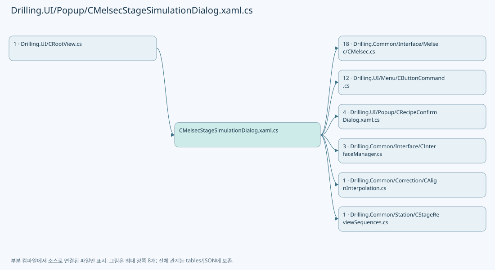

## 네임스페이스·타입·상속

| 타입 | 구분 | 원본 범위 | 선언/상속 |
| --- | --- | --- | --- |
| CMelsecStageSimulationDialog | ClassDeclaration | 15–47 | CMelsecStageSimulationDialog: Window |
| CMelsecStageSimulationPanel | ClassDeclaration | 49–232 | CMelsecStageSimulationPanel: INotifyPropertyChanged |
| CMelsecStageSimulationRow | ClassDeclaration | 234–418 | CMelsecStageSimulationRow: INotifyPropertyChanged |

## 멤버 빠른 목록

| 이름 | 종류 | 범위 | 서명 |
| --- | --- | --- | --- |
| _timer | FieldDeclaration | L17–17 | DispatcherTimer Drilling.UI.Popup.CMelsecStageSimulationDialog._timer |
| Panel | PropertyDeclaration | L18–18 | Drilling.UI.Popup.CMelsecStageSimulationPanel Drilling.UI.Popup.CMelsecStageSimulationDialog.Panel |
| get_Panel | GetAccessorDeclaration | L18–18 | Drilling.UI.Popup.CMelsecStageSimulationPanel Drilling.UI.Popup.CMelsecStageSimulationDialog.Panel.get |
| .ctor | ConstructorDeclaration | L20–42 | Drilling.UI.Popup.CMelsecStageSimulationDialog.CMelsecStageSimulationDialog(Drilling.Common.Interface.CInterfaceManager, System.Func<System.Threading.CancellationToken, System.Threading.Tasks.Task<Drilling.Common.Managers.ST_RECIPE_DEFINITION?>>?) |
| RefreshSnapshot | MethodDeclaration | L45–45 | void Drilling.UI.Popup.CMelsecStageSimulationDialog.RefreshSnapshot(object?, System.EventArgs) |
| CloseClicked | MethodDeclaration | L46–46 | void Drilling.UI.Popup.CMelsecStageSimulationDialog.CloseClicked(object, RoutedEventArgs) |
| _map | FieldDeclaration | L51–51 | System.Collections.Generic.IReadOnlyList<Drilling.Common.Interface.ST_MELSEC_MAP_DATA> Drilling.UI.Popup.CMelsecStageSimulationPanel._map |
| _connectionText | FieldDeclaration | L52–52 | string Drilling.UI.Popup.CMelsecStageSimulationPanel._connectionText |
| _lastCanChangeReplies | FieldDeclaration | L53–53 | bool Drilling.UI.Popup.CMelsecStageSimulationPanel._lastCanChangeReplies |
| _lastAutomaticReplies | FieldDeclaration | L53–53 | bool Drilling.UI.Popup.CMelsecStageSimulationPanel._lastAutomaticReplies |
| _lastCanSetZeroSegments | FieldDeclaration | L53–53 | bool Drilling.UI.Popup.CMelsecStageSimulationPanel._lastCanSetZeroSegments |
| _zeroSegmentInput | FieldDeclaration | L54–54 | string Drilling.UI.Popup.CMelsecStageSimulationPanel._zeroSegmentInput |
| _lastZeroSegmentState | FieldDeclaration | L54–54 | string Drilling.UI.Popup.CMelsecStageSimulationPanel._lastZeroSegmentState |
| _setZeroSegments | FieldDeclaration | L55–55 | Drilling.UI.Menu.CButtonCommand? Drilling.UI.Popup.CMelsecStageSimulationPanel._setZeroSegments |
| _seedMeasurements | FieldDeclaration | L56–56 | Drilling.UI.Menu.CButtonCommand? Drilling.UI.Popup.CMelsecStageSimulationPanel._seedMeasurements |
| _seeding | FieldDeclaration | L57–57 | bool Drilling.UI.Popup.CMelsecStageSimulationPanel._seeding |
| _lastCanSeed | FieldDeclaration | L57–57 | bool Drilling.UI.Popup.CMelsecStageSimulationPanel._lastCanSeed |
| _measurementStatus | FieldDeclaration | L58–58 | string Drilling.UI.Popup.CMelsecStageSimulationPanel._measurementStatus |
| MeasurementStatus | PropertyDeclaration | L59–59 | string Drilling.UI.Popup.CMelsecStageSimulationPanel.MeasurementStatus |
| CanSeedMeasurements | PropertyDeclaration | L60–61 | bool Drilling.UI.Popup.CMelsecStageSimulationPanel.CanSeedMeasurements |
| SeedMeasurementsCommand | PropertyDeclaration | L62–87 | Drilling.UI.Menu.CButtonCommand Drilling.UI.Popup.CMelsecStageSimulationPanel.SeedMeasurementsCommand |
| ZeroSegmentInput | PropertyDeclaration | L89–99 | string Drilling.UI.Popup.CMelsecStageSimulationPanel.ZeroSegmentInput |
| get_ZeroSegmentInput | GetAccessorDeclaration | L91–91 | string Drilling.UI.Popup.CMelsecStageSimulationPanel.ZeroSegmentInput.get |
| set_ZeroSegmentInput | SetAccessorDeclaration | L92–98 | void Drilling.UI.Popup.CMelsecStageSimulationPanel.ZeroSegmentInput.set |
| ZeroSegmentState | PropertyDeclaration | L101–101 | string Drilling.UI.Popup.CMelsecStageSimulationPanel.ZeroSegmentState |
| CanSetZeroSegments | PropertyDeclaration | L102–102 | bool Drilling.UI.Popup.CMelsecStageSimulationPanel.CanSetZeroSegments |
| SetZeroSegmentsCommand | PropertyDeclaration | L103–115 | Drilling.UI.Menu.CButtonCommand Drilling.UI.Popup.CMelsecStageSimulationPanel.SetZeroSegmentsCommand |
| PropertyChanged | EventFieldDeclaration | L117–117 | System.ComponentModel.PropertyChangedEventHandler? Drilling.UI.Popup.CMelsecStageSimulationPanel.PropertyChanged |
| Rows | PropertyDeclaration | L118–118 | System.Collections.ObjectModel.ObservableCollection<Drilling.UI.Popup.CMelsecStageSimulationRow> Drilling.UI.Popup.CMelsecStageSimulationPanel.Rows |
| get_Rows | GetAccessorDeclaration | L118–118 | System.Collections.ObjectModel.ObservableCollection<Drilling.UI.Popup.CMelsecStageSimulationRow> Drilling.UI.Popup.CMelsecStageSimulationPanel.Rows.get |
| ConnectionText | PropertyDeclaration | L119–119 | string Drilling.UI.Popup.CMelsecStageSimulationPanel.ConnectionText |
| CanChangeAutomaticReplies | PropertyDeclaration | L120–120 | bool Drilling.UI.Popup.CMelsecStageSimulationPanel.CanChangeAutomaticReplies |
| AutomaticReplies | PropertyDeclaration | L122–141 | bool Drilling.UI.Popup.CMelsecStageSimulationPanel.AutomaticReplies |
| get_AutomaticReplies | GetAccessorDeclaration | L124–124 | bool Drilling.UI.Popup.CMelsecStageSimulationPanel.AutomaticReplies.get |
| set_AutomaticReplies | SetAccessorDeclaration | L125–140 | void Drilling.UI.Popup.CMelsecStageSimulationPanel.AutomaticReplies.set |
| Refresh | MethodDeclaration | L143–215 | void Drilling.UI.Popup.CMelsecStageSimulationPanel.Refresh() |
| ScenarioOrder | MethodDeclaration | L217–230 | int Drilling.UI.Popup.CMelsecStageSimulationPanel.ScenarioOrder(string) |
| SignalOrder | MethodDeclaration | L231–231 | int Drilling.UI.Popup.CMelsecStageSimulationPanel.SignalOrder(string) |
| _canSet | FieldDeclaration | L236–236 | bool Drilling.UI.Popup.CMelsecStageSimulationRow._canSet |
| _currentValue | FieldDeclaration | L237–237 | string Drilling.UI.Popup.CMelsecStageSimulationRow._currentValue |
| _inputValue | FieldDeclaration | L238–238 | string Drilling.UI.Popup.CMelsecStageSimulationRow._inputValue |
| _readScale | FieldDeclaration | L239–239 | double Drilling.UI.Popup.CMelsecStageSimulationRow._readScale |
| _stateBrush | FieldDeclaration | L240–240 | Brush Drilling.UI.Popup.CMelsecStageSimulationRow._stateBrush |
| PropertyChanged | EventFieldDeclaration | L241–241 | System.ComponentModel.PropertyChangedEventHandler? Drilling.UI.Popup.CMelsecStageSimulationRow.PropertyChanged |
| Id | PropertyDeclaration | L242–242 | string Drilling.UI.Popup.CMelsecStageSimulationRow.Id |
| get_Id | GetAccessorDeclaration | L242–242 | string Drilling.UI.Popup.CMelsecStageSimulationRow.Id.get |
| DeviceNo | PropertyDeclaration | L243–243 | int Drilling.UI.Popup.CMelsecStageSimulationRow.DeviceNo |
| get_DeviceNo | GetAccessorDeclaration | L243–243 | int Drilling.UI.Popup.CMelsecStageSimulationRow.DeviceNo.get |
| Scenario | PropertyDeclaration | L244–244 | string Drilling.UI.Popup.CMelsecStageSimulationRow.Scenario |
| get_Scenario | GetAccessorDeclaration | L244–244 | string Drilling.UI.Popup.CMelsecStageSimulationRow.Scenario.get |
| Name | PropertyDeclaration | L245–245 | string Drilling.UI.Popup.CMelsecStageSimulationRow.Name |
| get_Name | GetAccessorDeclaration | L245–245 | string Drilling.UI.Popup.CMelsecStageSimulationRow.Name.get |
| Address | PropertyDeclaration | L246–246 | string Drilling.UI.Popup.CMelsecStageSimulationRow.Address |
| get_Address | GetAccessorDeclaration | L246–246 | string Drilling.UI.Popup.CMelsecStageSimulationRow.Address.get |
| Description | PropertyDeclaration | L247–247 | string Drilling.UI.Popup.CMelsecStageSimulationRow.Description |
| get_Description | GetAccessorDeclaration | L247–247 | string Drilling.UI.Popup.CMelsecStageSimulationRow.Description.get |
| CurrentValue | PropertyDeclaration | L248–248 | string Drilling.UI.Popup.CMelsecStageSimulationRow.CurrentValue |
| StateBrush | PropertyDeclaration | L249–249 | Brush Drilling.UI.Popup.CMelsecStageSimulationRow.StateBrush |
| CanSet | PropertyDeclaration | L250–250 | bool Drilling.UI.Popup.CMelsecStageSimulationRow.CanSet |
| IsNumeric | PropertyDeclaration | L251–251 | bool Drilling.UI.Popup.CMelsecStageSimulationRow.IsNumeric |
| get_IsNumeric | GetAccessorDeclaration | L251–251 | bool Drilling.UI.Popup.CMelsecStageSimulationRow.IsNumeric.get |
| IsCount | PropertyDeclaration | L252–252 | bool Drilling.UI.Popup.CMelsecStageSimulationRow.IsCount |
| get_IsCount | GetAccessorDeclaration | L252–252 | bool Drilling.UI.Popup.CMelsecStageSimulationRow.IsCount.get |
| IsMeasurement | PropertyDeclaration | L253–253 | bool Drilling.UI.Popup.CMelsecStageSimulationRow.IsMeasurement |
| get_IsMeasurement | GetAccessorDeclaration | L253–253 | bool Drilling.UI.Popup.CMelsecStageSimulationRow.IsMeasurement.get |
| InputHint | PropertyDeclaration | L254–254 | string Drilling.UI.Popup.CMelsecStageSimulationRow.InputHint |
| IsAlignBusyWord | PropertyDeclaration | L255–255 | bool Drilling.UI.Popup.CMelsecStageSimulationRow.IsAlignBusyWord |
| get_IsAlignBusyWord | GetAccessorDeclaration | L255–255 | bool Drilling.UI.Popup.CMelsecStageSimulationRow.IsAlignBusyWord.get |
| InputValue | PropertyDeclaration | L257–267 | string Drilling.UI.Popup.CMelsecStageSimulationRow.InputValue |
| get_InputValue | GetAccessorDeclaration | L259–259 | string Drilling.UI.Popup.CMelsecStageSimulationRow.InputValue.get |
| set_InputValue | SetAccessorDeclaration | L260–266 | void Drilling.UI.Popup.CMelsecStageSimulationRow.InputValue.set |
| SetOnCommand | PropertyDeclaration | L269–269 | Drilling.UI.Menu.CButtonCommand Drilling.UI.Popup.CMelsecStageSimulationRow.SetOnCommand |
| get_SetOnCommand | GetAccessorDeclaration | L269–269 | Drilling.UI.Menu.CButtonCommand Drilling.UI.Popup.CMelsecStageSimulationRow.SetOnCommand.get |
| SetOffCommand | PropertyDeclaration | L270–270 | Drilling.UI.Menu.CButtonCommand Drilling.UI.Popup.CMelsecStageSimulationRow.SetOffCommand |
| get_SetOffCommand | GetAccessorDeclaration | L270–270 | Drilling.UI.Menu.CButtonCommand Drilling.UI.Popup.CMelsecStageSimulationRow.SetOffCommand.get |
| SetValueCommand | PropertyDeclaration | L271–271 | Drilling.UI.Menu.CButtonCommand Drilling.UI.Popup.CMelsecStageSimulationRow.SetValueCommand |
| get_SetValueCommand | GetAccessorDeclaration | L271–271 | Drilling.UI.Menu.CButtonCommand Drilling.UI.Popup.CMelsecStageSimulationRow.SetValueCommand.get |
| .ctor | ConstructorDeclaration | L273–357 | Drilling.UI.Popup.CMelsecStageSimulationRow.CMelsecStageSimulationRow(Drilling.Common.Interface.ST_MELSEC_MAP_DATA, System.Action<int>, System.Action<string>?, System.Action<double>?) |
| Set | LocalFunctionStatement | L317–329 | void Set(int) |
| Refresh | MethodDeclaration | L359–415 | void Drilling.UI.Popup.CMelsecStageSimulationRow.Refresh(Drilling.Common.Interface.ST_MELSEC_CACHED_VALUE?, bool) |
| Changed | MethodDeclaration | L417–417 | void Drilling.UI.Popup.CMelsecStageSimulationRow.Changed(string?) |

## 멤버별 상세 계약·호출·처리 해설

### FieldDeclaration `_timer` · L17–17

[Drilling.UI/Popup/CMelsecStageSimulationDialog.xaml.cs:17–17](https://github.com/kjuws10-rgb/A3Drilling/blob/5aee8e58439c9b455cae7c9593c9be986c3e682e/Drilling.UI/Popup/CMelsecStageSimulationDialog.xaml.cs#L17-L17)

| 항목 | 실제 추출 값 |
| --- | --- |
| 서명 | DispatcherTimer Drilling.UI.Popup.CMelsecStageSimulationDialog._timer |
| 접근/수식자 | Private / private, readonly |
| 반환/값 타입 | DispatcherTimer |
| 소속 타입 | NamedType:Drilling.UI.Popup.CMelsecStageSimulationDialog |

현재 부분 분석에서 직접 연결된 호출자는 없습니다. XAML/이벤트/인터페이스·델리게이트·외부 진입을 추가 확인해야 하며, 미사용으로 판정한 것이 아닙니다.

변경 전 점검: 입력/반환 타입, 위 호출자, 예외/취소 경로, 공유 상태와 저장·전송 소비자를 함께 확인합니다. 값의 단위나 물리 방향을 이름만으로 확정하지 않습니다.

### PropertyDeclaration `Panel` · L18–18

[Drilling.UI/Popup/CMelsecStageSimulationDialog.xaml.cs:18–18](https://github.com/kjuws10-rgb/A3Drilling/blob/5aee8e58439c9b455cae7c9593c9be986c3e682e/Drilling.UI/Popup/CMelsecStageSimulationDialog.xaml.cs#L18-L18)

| 항목 | 실제 추출 값 |
| --- | --- |
| 서명 | Drilling.UI.Popup.CMelsecStageSimulationPanel Drilling.UI.Popup.CMelsecStageSimulationDialog.Panel |
| 접근/수식자 | Public / public |
| 반환/값 타입 | Drilling.UI.Popup.CMelsecStageSimulationPanel |
| 소속 타입 | NamedType:Drilling.UI.Popup.CMelsecStageSimulationDialog |

현재 부분 분석에서 직접 연결된 호출자는 없습니다. XAML/이벤트/인터페이스·델리게이트·외부 진입을 추가 확인해야 하며, 미사용으로 판정한 것이 아닙니다.

변경 전 점검: 입력/반환 타입, 위 호출자, 예외/취소 경로, 공유 상태와 저장·전송 소비자를 함께 확인합니다. 값의 단위나 물리 방향을 이름만으로 확정하지 않습니다.

### GetAccessorDeclaration `get_Panel` · L18–18

[Drilling.UI/Popup/CMelsecStageSimulationDialog.xaml.cs:18–18](https://github.com/kjuws10-rgb/A3Drilling/blob/5aee8e58439c9b455cae7c9593c9be986c3e682e/Drilling.UI/Popup/CMelsecStageSimulationDialog.xaml.cs#L18-L18)

| 항목 | 실제 추출 값 |
| --- | --- |
| 서명 | Drilling.UI.Popup.CMelsecStageSimulationPanel Drilling.UI.Popup.CMelsecStageSimulationDialog.Panel.get |
| 접근/수식자 | Public / get |
| 반환/값 타입 | Drilling.UI.Popup.CMelsecStageSimulationPanel |
| 소속 타입 | NamedType:Drilling.UI.Popup.CMelsecStageSimulationDialog |

현재 부분 분석에서 직접 연결된 호출자는 없습니다. XAML/이벤트/인터페이스·델리게이트·외부 진입을 추가 확인해야 하며, 미사용으로 판정한 것이 아닙니다.

변경 전 점검: 입력/반환 타입, 위 호출자, 예외/취소 경로, 공유 상태와 저장·전송 소비자를 함께 확인합니다. 값의 단위나 물리 방향을 이름만으로 확정하지 않습니다.

### ConstructorDeclaration `.ctor` · L20–42

[Drilling.UI/Popup/CMelsecStageSimulationDialog.xaml.cs:20–42](https://github.com/kjuws10-rgb/A3Drilling/blob/5aee8e58439c9b455cae7c9593c9be986c3e682e/Drilling.UI/Popup/CMelsecStageSimulationDialog.xaml.cs#L20-L42)

| 항목 | 실제 추출 값 |
| --- | --- |
| 서명 | Drilling.UI.Popup.CMelsecStageSimulationDialog.CMelsecStageSimulationDialog(Drilling.Common.Interface.CInterfaceManager, System.Func<System.Threading.CancellationToken, System.Threading.Tasks.Task<Drilling.Common.Managers.ST_RECIPE_DEFINITION?>>?) |
| 접근/수식자 | Public / public |
| 반환/값 타입 | void |
| 소속 타입 | NamedType:Drilling.UI.Popup.CMelsecStageSimulationDialog |

입력 계약:

| 이름 | 타입 | 전달 | 선택/기본값 |
| --- | --- | --- | --- |
| interfaces | Drilling.Common.Interface.CInterfaceManager | None | False /  |
| readRecipe | System.Func<System.Threading.CancellationToken, System.Threading.Tasks.Task<Drilling.Common.Managers.ST_RECIPE_DEFINITION?>>? | None | True / null |

정적 호출자로 확인된 위치:

| 호출 파일/행 | 호출 표현식 | 런타임 분기 가능 |
| --- | --- | --- |
| [Drilling.UI/CRootView.cs:2935–2938](https://github.com/kjuws10-rgb/A3Drilling/blob/5aee8e58439c9b455cae7c9593c9be986c3e682e/Drilling.UI/CRootView.cs#L2935-L2938) | new CMelsecStageSimulationDialog | False |

호출하는 대상과 해석 범위:

| 원본 행 | 표현식 | 분석 상태 | 대상/소스 위치 |
| --- | --- | --- | --- |
| 22 | InitializeComponent | unresolved | None |
| 23 | new | resolved | Drilling.UI.Popup.CMelsecStageSimulationPanel.CMelsecStageSimulationPanel(Drilling.Common.Interface.CInterfaceManager, System.Func<System.Threading.CancellationToken, System.Threading.Tasks.Task<Drilling.Common.Managers.ST_RECIPE_DEFINITION?>>?) · Drilling.UI/Popup/CMelsecStageSimulationDialog.xaml.cs:49 |
| 25 | Math.Min | candidate | OverloadResolutionFailure |
| 26 | new | unresolved | None |
| 28 | TimeSpan.FromMilliseconds | resolved | System.TimeSpan System.TimeSpan.FromMilliseconds(long) |
| 33 | Panel.Refresh | resolved | void Drilling.UI.Popup.CMelsecStageSimulationPanel.Refresh() · Drilling.UI/Popup/CMelsecStageSimulationDialog.xaml.cs:143 |
| 34 | _timer.Start | unresolved | None |
| 38 | _timer.Stop | unresolved | None |
| 41 | Panel.Refresh | resolved | void Drilling.UI.Popup.CMelsecStageSimulationPanel.Refresh() · Drilling.UI/Popup/CMelsecStageSimulationDialog.xaml.cs:143 |

본문의 실제 연산·분기·예외·반환 순서(원문 위치 순):

| 원본 행 | 종류 | 주석 해설 |
| --- | --- | --- |
| 22 | call | 함수·델리게이트 또는 객체 생성자를 호출합니다: InitializeComponent() |
| 23 | assignment | 값을 대상에 대입합니다: Panel = new(interfaces, readRecipe) |
| 23 | call | 함수·델리게이트 또는 객체 생성자를 호출합니다: new(interfaces, readRecipe) |
| 24 | assignment | 값을 대상에 대입합니다: DataContext = Panel |
| 25 | assignment | 값을 대상에 대입합니다: Height = Math.Min(Height, SystemParameters.WorkArea.Height * 0.9) |
| 25 | call | 함수·델리게이트 또는 객체 생성자를 호출합니다: Math.Min(Height, SystemParameters.WorkArea.Height * 0.9) |
| 26 | assignment | 값을 대상에 대입합니다: _timer = new(DispatcherPriority.Background, Dispatcher) { Interval = TimeSpan.FromMilliseconds(500) } |
| 26 | call | 함수·델리게이트 또는 객체 생성자를 호출합니다: new(DispatcherPriority.Background, Dispatcher) { Interval = TimeSpan.FromMilliseconds(500) } |
| 28 | assignment | 값을 대상에 대입합니다: Interval = TimeSpan.FromMilliseconds(500) |
| 28 | call | 함수·델리게이트 또는 객체 생성자를 호출합니다: TimeSpan.FromMilliseconds(500) |
| 30 | compound-assignment-or-event-subscription | 복합 대입 또는 이벤트 구독/해지 표현입니다: _timer.Tick += RefreshSnapshot |
| 31 | compound-assignment-or-event-subscription | 복합 대입 또는 이벤트 구독/해지 표현입니다: Loaded += (_, _) => { Panel.Refresh(); _timer.Start(); } |
| 33 | call | 함수·델리게이트 또는 객체 생성자를 호출합니다: Panel.Refresh() |
| 34 | call | 함수·델리게이트 또는 객체 생성자를 호출합니다: _timer.Start() |
| 36 | compound-assignment-or-event-subscription | 복합 대입 또는 이벤트 구독/해지 표현입니다: Closed += (_, _) => { _timer.Stop(); _timer.Tick -= RefreshSnapshot; } |
| 38 | call | 함수·델리게이트 또는 객체 생성자를 호출합니다: _timer.Stop() |
| 39 | compound-assignment-or-event-subscription | 복합 대입 또는 이벤트 구독/해지 표현입니다: _timer.Tick -= RefreshSnapshot |
| 41 | call | 함수·델리게이트 또는 객체 생성자를 호출합니다: Panel.Refresh() |

변경 전 점검: 입력/반환 타입, 위 호출자, 예외/취소 경로, 공유 상태와 저장·전송 소비자를 함께 확인합니다. 값의 단위나 물리 방향을 이름만으로 확정하지 않습니다.

### MethodDeclaration `RefreshSnapshot` · L45–45

[Drilling.UI/Popup/CMelsecStageSimulationDialog.xaml.cs:45–45](https://github.com/kjuws10-rgb/A3Drilling/blob/5aee8e58439c9b455cae7c9593c9be986c3e682e/Drilling.UI/Popup/CMelsecStageSimulationDialog.xaml.cs#L45-L45)

| 항목 | 실제 추출 값 |
| --- | --- |
| 서명 | void Drilling.UI.Popup.CMelsecStageSimulationDialog.RefreshSnapshot(object?, System.EventArgs) |
| 접근/수식자 | Private / private |
| 반환/값 타입 | void |
| 소속 타입 | NamedType:Drilling.UI.Popup.CMelsecStageSimulationDialog |

입력 계약:

| 이름 | 타입 | 전달 | 선택/기본값 |
| --- | --- | --- | --- |
| sender | object? | None | False /  |
| e | System.EventArgs | None | False /  |

현재 부분 분석에서 직접 연결된 호출자는 없습니다. XAML/이벤트/인터페이스·델리게이트·외부 진입을 추가 확인해야 하며, 미사용으로 판정한 것이 아닙니다.

호출하는 대상과 해석 범위:

| 원본 행 | 표현식 | 분석 상태 | 대상/소스 위치 |
| --- | --- | --- | --- |
| 45 | Panel.Refresh | resolved | void Drilling.UI.Popup.CMelsecStageSimulationPanel.Refresh() · Drilling.UI/Popup/CMelsecStageSimulationDialog.xaml.cs:143 |

본문의 실제 연산·분기·예외·반환 순서(원문 위치 순):

| 원본 행 | 종류 | 주석 해설 |
| --- | --- | --- |
| 45 | call | 함수·델리게이트 또는 객체 생성자를 호출합니다: Panel.Refresh() |

변경 전 점검: 입력/반환 타입, 위 호출자, 예외/취소 경로, 공유 상태와 저장·전송 소비자를 함께 확인합니다. 값의 단위나 물리 방향을 이름만으로 확정하지 않습니다.

### MethodDeclaration `CloseClicked` · L46–46

[Drilling.UI/Popup/CMelsecStageSimulationDialog.xaml.cs:46–46](https://github.com/kjuws10-rgb/A3Drilling/blob/5aee8e58439c9b455cae7c9593c9be986c3e682e/Drilling.UI/Popup/CMelsecStageSimulationDialog.xaml.cs#L46-L46)

| 항목 | 실제 추출 값 |
| --- | --- |
| 서명 | void Drilling.UI.Popup.CMelsecStageSimulationDialog.CloseClicked(object, RoutedEventArgs) |
| 접근/수식자 | Private / private |
| 반환/값 타입 | void |
| 소속 타입 | NamedType:Drilling.UI.Popup.CMelsecStageSimulationDialog |

입력 계약:

| 이름 | 타입 | 전달 | 선택/기본값 |
| --- | --- | --- | --- |
| sender | object | None | False /  |
| e | RoutedEventArgs | None | False /  |

현재 부분 분석에서 직접 연결된 호출자는 없습니다. XAML/이벤트/인터페이스·델리게이트·외부 진입을 추가 확인해야 하며, 미사용으로 판정한 것이 아닙니다.

호출하는 대상과 해석 범위:

| 원본 행 | 표현식 | 분석 상태 | 대상/소스 위치 |
| --- | --- | --- | --- |
| 46 | Close | unresolved | None |

본문의 실제 연산·분기·예외·반환 순서(원문 위치 순):

| 원본 행 | 종류 | 주석 해설 |
| --- | --- | --- |
| 46 | call | 함수·델리게이트 또는 객체 생성자를 호출합니다: Close() |

변경 전 점검: 입력/반환 타입, 위 호출자, 예외/취소 경로, 공유 상태와 저장·전송 소비자를 함께 확인합니다. 값의 단위나 물리 방향을 이름만으로 확정하지 않습니다.

### FieldDeclaration `_map` · L51–51

[Drilling.UI/Popup/CMelsecStageSimulationDialog.xaml.cs:51–51](https://github.com/kjuws10-rgb/A3Drilling/blob/5aee8e58439c9b455cae7c9593c9be986c3e682e/Drilling.UI/Popup/CMelsecStageSimulationDialog.xaml.cs#L51-L51)

| 항목 | 실제 추출 값 |
| --- | --- |
| 서명 | System.Collections.Generic.IReadOnlyList<Drilling.Common.Interface.ST_MELSEC_MAP_DATA> Drilling.UI.Popup.CMelsecStageSimulationPanel._map |
| 접근/수식자 | Private / private |
| 반환/값 타입 | System.Collections.Generic.IReadOnlyList<Drilling.Common.Interface.ST_MELSEC_MAP_DATA> |
| 소속 타입 | NamedType:Drilling.UI.Popup.CMelsecStageSimulationPanel |

현재 부분 분석에서 직접 연결된 호출자는 없습니다. XAML/이벤트/인터페이스·델리게이트·외부 진입을 추가 확인해야 하며, 미사용으로 판정한 것이 아닙니다.

본문의 실제 연산·분기·예외·반환 순서(원문 위치 순):

| 원본 행 | 종류 | 주석 해설 |
| --- | --- | --- |
| 51 | variable-initializer | 변수의 초기값을 지정합니다: _map = [] |

변경 전 점검: 입력/반환 타입, 위 호출자, 예외/취소 경로, 공유 상태와 저장·전송 소비자를 함께 확인합니다. 값의 단위나 물리 방향을 이름만으로 확정하지 않습니다.

### FieldDeclaration `_connectionText` · L52–52

[Drilling.UI/Popup/CMelsecStageSimulationDialog.xaml.cs:52–52](https://github.com/kjuws10-rgb/A3Drilling/blob/5aee8e58439c9b455cae7c9593c9be986c3e682e/Drilling.UI/Popup/CMelsecStageSimulationDialog.xaml.cs#L52-L52)

| 항목 | 실제 추출 값 |
| --- | --- |
| 서명 | string Drilling.UI.Popup.CMelsecStageSimulationPanel._connectionText |
| 접근/수식자 | Private / private |
| 반환/값 타입 | string |
| 소속 타입 | NamedType:Drilling.UI.Popup.CMelsecStageSimulationPanel |

현재 부분 분석에서 직접 연결된 호출자는 없습니다. XAML/이벤트/인터페이스·델리게이트·외부 진입을 추가 확인해야 하며, 미사용으로 판정한 것이 아닙니다.

본문의 실제 연산·분기·예외·반환 순서(원문 위치 순):

| 원본 행 | 종류 | 주석 해설 |
| --- | --- | --- |
| 52 | variable-initializer | 변수의 초기값을 지정합니다: _connectionText = "" |

변경 전 점검: 입력/반환 타입, 위 호출자, 예외/취소 경로, 공유 상태와 저장·전송 소비자를 함께 확인합니다. 값의 단위나 물리 방향을 이름만으로 확정하지 않습니다.

### FieldDeclaration `_lastCanChangeReplies` · L53–53

[Drilling.UI/Popup/CMelsecStageSimulationDialog.xaml.cs:53–53](https://github.com/kjuws10-rgb/A3Drilling/blob/5aee8e58439c9b455cae7c9593c9be986c3e682e/Drilling.UI/Popup/CMelsecStageSimulationDialog.xaml.cs#L53-L53)

| 항목 | 실제 추출 값 |
| --- | --- |
| 서명 | bool Drilling.UI.Popup.CMelsecStageSimulationPanel._lastCanChangeReplies |
| 접근/수식자 | Private / private |
| 반환/값 타입 | bool |
| 소속 타입 | NamedType:Drilling.UI.Popup.CMelsecStageSimulationPanel |

현재 부분 분석에서 직접 연결된 호출자는 없습니다. XAML/이벤트/인터페이스·델리게이트·외부 진입을 추가 확인해야 하며, 미사용으로 판정한 것이 아닙니다.

본문의 실제 연산·분기·예외·반환 순서(원문 위치 순):

| 원본 행 | 종류 | 주석 해설 |
| --- | --- | --- |
| 53 | variable-initializer | 변수의 초기값을 지정합니다: _lastCanChangeReplies = true |
| 53 | variable-initializer | 변수의 초기값을 지정합니다: _lastAutomaticReplies = true |

변경 전 점검: 입력/반환 타입, 위 호출자, 예외/취소 경로, 공유 상태와 저장·전송 소비자를 함께 확인합니다. 값의 단위나 물리 방향을 이름만으로 확정하지 않습니다.

### FieldDeclaration `_lastAutomaticReplies` · L53–53

[Drilling.UI/Popup/CMelsecStageSimulationDialog.xaml.cs:53–53](https://github.com/kjuws10-rgb/A3Drilling/blob/5aee8e58439c9b455cae7c9593c9be986c3e682e/Drilling.UI/Popup/CMelsecStageSimulationDialog.xaml.cs#L53-L53)

| 항목 | 실제 추출 값 |
| --- | --- |
| 서명 | bool Drilling.UI.Popup.CMelsecStageSimulationPanel._lastAutomaticReplies |
| 접근/수식자 | Private / private |
| 반환/값 타입 | bool |
| 소속 타입 | NamedType:Drilling.UI.Popup.CMelsecStageSimulationPanel |

현재 부분 분석에서 직접 연결된 호출자는 없습니다. XAML/이벤트/인터페이스·델리게이트·외부 진입을 추가 확인해야 하며, 미사용으로 판정한 것이 아닙니다.

변경 전 점검: 입력/반환 타입, 위 호출자, 예외/취소 경로, 공유 상태와 저장·전송 소비자를 함께 확인합니다. 값의 단위나 물리 방향을 이름만으로 확정하지 않습니다.

### FieldDeclaration `_lastCanSetZeroSegments` · L53–53

[Drilling.UI/Popup/CMelsecStageSimulationDialog.xaml.cs:53–53](https://github.com/kjuws10-rgb/A3Drilling/blob/5aee8e58439c9b455cae7c9593c9be986c3e682e/Drilling.UI/Popup/CMelsecStageSimulationDialog.xaml.cs#L53-L53)

| 항목 | 실제 추출 값 |
| --- | --- |
| 서명 | bool Drilling.UI.Popup.CMelsecStageSimulationPanel._lastCanSetZeroSegments |
| 접근/수식자 | Private / private |
| 반환/값 타입 | bool |
| 소속 타입 | NamedType:Drilling.UI.Popup.CMelsecStageSimulationPanel |

현재 부분 분석에서 직접 연결된 호출자는 없습니다. XAML/이벤트/인터페이스·델리게이트·외부 진입을 추가 확인해야 하며, 미사용으로 판정한 것이 아닙니다.

변경 전 점검: 입력/반환 타입, 위 호출자, 예외/취소 경로, 공유 상태와 저장·전송 소비자를 함께 확인합니다. 값의 단위나 물리 방향을 이름만으로 확정하지 않습니다.

### FieldDeclaration `_zeroSegmentInput` · L54–54

[Drilling.UI/Popup/CMelsecStageSimulationDialog.xaml.cs:54–54](https://github.com/kjuws10-rgb/A3Drilling/blob/5aee8e58439c9b455cae7c9593c9be986c3e682e/Drilling.UI/Popup/CMelsecStageSimulationDialog.xaml.cs#L54-L54)

| 항목 | 실제 추출 값 |
| --- | --- |
| 서명 | string Drilling.UI.Popup.CMelsecStageSimulationPanel._zeroSegmentInput |
| 접근/수식자 | Private / private |
| 반환/값 타입 | string |
| 소속 타입 | NamedType:Drilling.UI.Popup.CMelsecStageSimulationPanel |

현재 부분 분석에서 직접 연결된 호출자는 없습니다. XAML/이벤트/인터페이스·델리게이트·외부 진입을 추가 확인해야 하며, 미사용으로 판정한 것이 아닙니다.

본문의 실제 연산·분기·예외·반환 순서(원문 위치 순):

| 원본 행 | 종류 | 주석 해설 |
| --- | --- | --- |
| 54 | variable-initializer | 변수의 초기값을 지정합니다: _zeroSegmentInput = "0" |
| 54 | variable-initializer | 변수의 초기값을 지정합니다: _lastZeroSegmentState = "" |

변경 전 점검: 입력/반환 타입, 위 호출자, 예외/취소 경로, 공유 상태와 저장·전송 소비자를 함께 확인합니다. 값의 단위나 물리 방향을 이름만으로 확정하지 않습니다.

### FieldDeclaration `_lastZeroSegmentState` · L54–54

[Drilling.UI/Popup/CMelsecStageSimulationDialog.xaml.cs:54–54](https://github.com/kjuws10-rgb/A3Drilling/blob/5aee8e58439c9b455cae7c9593c9be986c3e682e/Drilling.UI/Popup/CMelsecStageSimulationDialog.xaml.cs#L54-L54)

| 항목 | 실제 추출 값 |
| --- | --- |
| 서명 | string Drilling.UI.Popup.CMelsecStageSimulationPanel._lastZeroSegmentState |
| 접근/수식자 | Private / private |
| 반환/값 타입 | string |
| 소속 타입 | NamedType:Drilling.UI.Popup.CMelsecStageSimulationPanel |

현재 부분 분석에서 직접 연결된 호출자는 없습니다. XAML/이벤트/인터페이스·델리게이트·외부 진입을 추가 확인해야 하며, 미사용으로 판정한 것이 아닙니다.

변경 전 점검: 입력/반환 타입, 위 호출자, 예외/취소 경로, 공유 상태와 저장·전송 소비자를 함께 확인합니다. 값의 단위나 물리 방향을 이름만으로 확정하지 않습니다.

### FieldDeclaration `_setZeroSegments` · L55–55

[Drilling.UI/Popup/CMelsecStageSimulationDialog.xaml.cs:55–55](https://github.com/kjuws10-rgb/A3Drilling/blob/5aee8e58439c9b455cae7c9593c9be986c3e682e/Drilling.UI/Popup/CMelsecStageSimulationDialog.xaml.cs#L55-L55)

| 항목 | 실제 추출 값 |
| --- | --- |
| 서명 | Drilling.UI.Menu.CButtonCommand? Drilling.UI.Popup.CMelsecStageSimulationPanel._setZeroSegments |
| 접근/수식자 | Private / private |
| 반환/값 타입 | Drilling.UI.Menu.CButtonCommand? |
| 소속 타입 | NamedType:Drilling.UI.Popup.CMelsecStageSimulationPanel |

현재 부분 분석에서 직접 연결된 호출자는 없습니다. XAML/이벤트/인터페이스·델리게이트·외부 진입을 추가 확인해야 하며, 미사용으로 판정한 것이 아닙니다.

변경 전 점검: 입력/반환 타입, 위 호출자, 예외/취소 경로, 공유 상태와 저장·전송 소비자를 함께 확인합니다. 값의 단위나 물리 방향을 이름만으로 확정하지 않습니다.

### FieldDeclaration `_seedMeasurements` · L56–56

[Drilling.UI/Popup/CMelsecStageSimulationDialog.xaml.cs:56–56](https://github.com/kjuws10-rgb/A3Drilling/blob/5aee8e58439c9b455cae7c9593c9be986c3e682e/Drilling.UI/Popup/CMelsecStageSimulationDialog.xaml.cs#L56-L56)

| 항목 | 실제 추출 값 |
| --- | --- |
| 서명 | Drilling.UI.Menu.CButtonCommand? Drilling.UI.Popup.CMelsecStageSimulationPanel._seedMeasurements |
| 접근/수식자 | Private / private |
| 반환/값 타입 | Drilling.UI.Menu.CButtonCommand? |
| 소속 타입 | NamedType:Drilling.UI.Popup.CMelsecStageSimulationPanel |

현재 부분 분석에서 직접 연결된 호출자는 없습니다. XAML/이벤트/인터페이스·델리게이트·외부 진입을 추가 확인해야 하며, 미사용으로 판정한 것이 아닙니다.

변경 전 점검: 입력/반환 타입, 위 호출자, 예외/취소 경로, 공유 상태와 저장·전송 소비자를 함께 확인합니다. 값의 단위나 물리 방향을 이름만으로 확정하지 않습니다.

### FieldDeclaration `_seeding` · L57–57

[Drilling.UI/Popup/CMelsecStageSimulationDialog.xaml.cs:57–57](https://github.com/kjuws10-rgb/A3Drilling/blob/5aee8e58439c9b455cae7c9593c9be986c3e682e/Drilling.UI/Popup/CMelsecStageSimulationDialog.xaml.cs#L57-L57)

| 항목 | 실제 추출 값 |
| --- | --- |
| 서명 | bool Drilling.UI.Popup.CMelsecStageSimulationPanel._seeding |
| 접근/수식자 | Private / private |
| 반환/값 타입 | bool |
| 소속 타입 | NamedType:Drilling.UI.Popup.CMelsecStageSimulationPanel |

현재 부분 분석에서 직접 연결된 호출자는 없습니다. XAML/이벤트/인터페이스·델리게이트·외부 진입을 추가 확인해야 하며, 미사용으로 판정한 것이 아닙니다.

변경 전 점검: 입력/반환 타입, 위 호출자, 예외/취소 경로, 공유 상태와 저장·전송 소비자를 함께 확인합니다. 값의 단위나 물리 방향을 이름만으로 확정하지 않습니다.

### FieldDeclaration `_lastCanSeed` · L57–57

[Drilling.UI/Popup/CMelsecStageSimulationDialog.xaml.cs:57–57](https://github.com/kjuws10-rgb/A3Drilling/blob/5aee8e58439c9b455cae7c9593c9be986c3e682e/Drilling.UI/Popup/CMelsecStageSimulationDialog.xaml.cs#L57-L57)

| 항목 | 실제 추출 값 |
| --- | --- |
| 서명 | bool Drilling.UI.Popup.CMelsecStageSimulationPanel._lastCanSeed |
| 접근/수식자 | Private / private |
| 반환/값 타입 | bool |
| 소속 타입 | NamedType:Drilling.UI.Popup.CMelsecStageSimulationPanel |

현재 부분 분석에서 직접 연결된 호출자는 없습니다. XAML/이벤트/인터페이스·델리게이트·외부 진입을 추가 확인해야 하며, 미사용으로 판정한 것이 아닙니다.

변경 전 점검: 입력/반환 타입, 위 호출자, 예외/취소 경로, 공유 상태와 저장·전송 소비자를 함께 확인합니다. 값의 단위나 물리 방향을 이름만으로 확정하지 않습니다.

### FieldDeclaration `_measurementStatus` · L58–58

[Drilling.UI/Popup/CMelsecStageSimulationDialog.xaml.cs:58–58](https://github.com/kjuws10-rgb/A3Drilling/blob/5aee8e58439c9b455cae7c9593c9be986c3e682e/Drilling.UI/Popup/CMelsecStageSimulationDialog.xaml.cs#L58-L58)

| 항목 | 실제 추출 값 |
| --- | --- |
| 서명 | string Drilling.UI.Popup.CMelsecStageSimulationPanel._measurementStatus |
| 접근/수식자 | Private / private |
| 반환/값 타입 | string |
| 소속 타입 | NamedType:Drilling.UI.Popup.CMelsecStageSimulationPanel |

현재 부분 분석에서 직접 연결된 호출자는 없습니다. XAML/이벤트/인터페이스·델리게이트·외부 진입을 추가 확인해야 하며, 미사용으로 판정한 것이 아닙니다.

본문의 실제 연산·분기·예외·반환 순서(원문 위치 순):

| 원본 행 | 종류 | 주석 해설 |
| --- | --- | --- |
| 58 | variable-initializer | 변수의 초기값을 지정합니다: _measurementStatus = "Distortion 측정값: mm 단위로 입력하세요. BASE 복사 후 일부 값만 바꿔서 시험할 수 있습니다." |

변경 전 점검: 입력/반환 타입, 위 호출자, 예외/취소 경로, 공유 상태와 저장·전송 소비자를 함께 확인합니다. 값의 단위나 물리 방향을 이름만으로 확정하지 않습니다.

### PropertyDeclaration `MeasurementStatus` · L59–59

[Drilling.UI/Popup/CMelsecStageSimulationDialog.xaml.cs:59–59](https://github.com/kjuws10-rgb/A3Drilling/blob/5aee8e58439c9b455cae7c9593c9be986c3e682e/Drilling.UI/Popup/CMelsecStageSimulationDialog.xaml.cs#L59-L59)

| 항목 | 실제 추출 값 |
| --- | --- |
| 서명 | string Drilling.UI.Popup.CMelsecStageSimulationPanel.MeasurementStatus |
| 접근/수식자 | Public / public |
| 반환/값 타입 | string |
| 소속 타입 | NamedType:Drilling.UI.Popup.CMelsecStageSimulationPanel |

현재 부분 분석에서 직접 연결된 호출자는 없습니다. XAML/이벤트/인터페이스·델리게이트·외부 진입을 추가 확인해야 하며, 미사용으로 판정한 것이 아닙니다.

변경 전 점검: 입력/반환 타입, 위 호출자, 예외/취소 경로, 공유 상태와 저장·전송 소비자를 함께 확인합니다. 값의 단위나 물리 방향을 이름만으로 확정하지 않습니다.

### PropertyDeclaration `CanSeedMeasurements` · L60–61

[Drilling.UI/Popup/CMelsecStageSimulationDialog.xaml.cs:60–61](https://github.com/kjuws10-rgb/A3Drilling/blob/5aee8e58439c9b455cae7c9593c9be986c3e682e/Drilling.UI/Popup/CMelsecStageSimulationDialog.xaml.cs#L60-L61)

| 항목 | 실제 추출 값 |
| --- | --- |
| 서명 | bool Drilling.UI.Popup.CMelsecStageSimulationPanel.CanSeedMeasurements |
| 접근/수식자 | Public / public |
| 반환/값 타입 | bool |
| 소속 타입 | NamedType:Drilling.UI.Popup.CMelsecStageSimulationPanel |

현재 부분 분석에서 직접 연결된 호출자는 없습니다. XAML/이벤트/인터페이스·델리게이트·외부 진입을 추가 확인해야 하며, 미사용으로 판정한 것이 아닙니다.

호출하는 대상과 해석 범위:

| 원본 행 | 표현식 | 분석 상태 | 대상/소스 위치 |
| --- | --- | --- | --- |
| 61 | Rows.Count | resolved | int System.Collections.Generic.IEnumerable<Drilling.UI.Popup.CMelsecStageSimulationRow>.Count<Drilling.UI.Popup.CMelsecStageSimulationRow>(System.Func<Drilling.UI.Popup.CMelsecStageSimulationRow, bool>) |
| 61 | Rows.Where(row => row.IsMeasurement).All | resolved | bool System.Collections.Generic.IEnumerable<Drilling.UI.Popup.CMelsecStageSimulationRow>.All<Drilling.UI.Popup.CMelsecStageSimulationRow>(System.Func<Drilling.UI.Popup.CMelsecStageSimulationRow, bool>) |
| 61 | Rows.Where | resolved | System.Collections.Generic.IEnumerable<Drilling.UI.Popup.CMelsecStageSimulationRow> System.Collections.Generic.IEnumerable<Drilling.UI.Popup.CMelsecStageSimulationRow>.Where<Drilling.UI.Popup.CMelsecStageSimulationRow>(System.Func<Drilling.UI.Popup.CMelsecStageSimulationRow, bool>) |

본문의 실제 연산·분기·예외·반환 순서(원문 위치 순):

| 원본 행 | 종류 | 주석 해설 |
| --- | --- | --- |
| 61 | call | 함수·델리게이트 또는 객체 생성자를 호출합니다: Rows.Count(row => row.IsMeasurement) |
| 61 | call | 함수·델리게이트 또는 객체 생성자를 호출합니다: Rows.Where(row => row.IsMeasurement).All(row => row.CanSet) |
| 61 | call | 함수·델리게이트 또는 객체 생성자를 호출합니다: Rows.Where(row => row.IsMeasurement) |

변경 전 점검: 입력/반환 타입, 위 호출자, 예외/취소 경로, 공유 상태와 저장·전송 소비자를 함께 확인합니다. 값의 단위나 물리 방향을 이름만으로 확정하지 않습니다.

### PropertyDeclaration `SeedMeasurementsCommand` · L62–87

[Drilling.UI/Popup/CMelsecStageSimulationDialog.xaml.cs:62–87](https://github.com/kjuws10-rgb/A3Drilling/blob/5aee8e58439c9b455cae7c9593c9be986c3e682e/Drilling.UI/Popup/CMelsecStageSimulationDialog.xaml.cs#L62-L87)

| 항목 | 실제 추출 값 |
| --- | --- |
| 서명 | Drilling.UI.Menu.CButtonCommand Drilling.UI.Popup.CMelsecStageSimulationPanel.SeedMeasurementsCommand |
| 접근/수식자 | Public / public |
| 반환/값 타입 | Drilling.UI.Menu.CButtonCommand |
| 소속 타입 | NamedType:Drilling.UI.Popup.CMelsecStageSimulationPanel |

현재 부분 분석에서 직접 연결된 호출자는 없습니다. XAML/이벤트/인터페이스·델리게이트·외부 진입을 추가 확인해야 하며, 미사용으로 판정한 것이 아닙니다.

호출하는 대상과 해석 범위:

| 원본 행 | 표현식 | 분석 상태 | 대상/소스 위치 |
| --- | --- | --- | --- |
| 62 | new | resolved | Drilling.UI.Menu.CButtonCommand.CButtonCommand(System.Action<object?>, System.Predicate<object?>?) · Drilling.UI/Menu/CButtonCommand.cs:9 |
| 65 | .NotifyCanExecuteChanged | resolved | void Drilling.UI.Menu.CButtonCommand.NotifyCanExecuteChanged() · Drilling.UI/Menu/CButtonCommand.cs:24 |
| 68 | readRecipe! | resolved · 동적 구현 선택 가능 | System.Threading.Tasks.Task<Drilling.Common.Managers.ST_RECIPE_DEFINITION?> System.Func<System.Threading.CancellationToken, System.Threading.Tasks.Task<Drilling.Common.Managers.ST_RECIPE_DEFINITION?>>.Invoke(System.Threading.CancellationToken) |
| 68 | new InvalidOperationException | resolved | System.InvalidOperationException.InvalidOperationException(string?) |
| 69 | new Dictionary<string, double> | resolved | System.Collections.Generic.Dictionary<string, double>.Dictionary(System.Collections.Generic.IEqualityComparer<string>?) |
| 74 | recipe.Parameters.SingleOrDefault | resolved | Drilling.Common.Managers.ST_RECIPE_PARAMETER? System.Collections.Generic.IEnumerable<Drilling.Common.Managers.ST_RECIPE_PARAMETER>.SingleOrDefault<Drilling.Common.Managers.ST_RECIPE_PARAMETER>(System.Func<Drilling.Common.Managers.ST_RECIPE_PARAMETER, bool>) |
| 74 | p.Key.Equals | resolved | bool string.Equals(string?, System.StringComparison) |
| 75 | double.TryParse | resolved | bool double.TryParse(string?, System.Globalization.NumberStyles, System.IFormatProvider?, out double) |
| 75 | double.IsFinite | resolved | bool double.IsFinite(double) |
| 76 | new InvalidOperationException | resolved | System.InvalidOperationException.InvalidOperationException(string?) |
| 77 | CAlignDistortionCycle.ResultId | resolved | string Drilling.Common.Correction.CAlignDistortionCycle.ResultId(string) · Drilling.Common/Correction/CAlignInterpolation.cs:237 |
| 79 | interfaces.Melsec.SetDistortionMeasurementSimulationValues | resolved | void Drilling.Common.Interface.CMelsec.SetDistortionMeasurementSimulationValues(System.Collections.Generic.IReadOnlyDictionary<string, double>) · Drilling.Common/Interface/Melsec/CMelsec.cs:3062 |
| 80 | Rows.Where | resolved | System.Collections.Generic.IEnumerable<Drilling.UI.Popup.CMelsecStageSimulationRow> System.Collections.Generic.IEnumerable<Drilling.UI.Popup.CMelsecStageSimulationRow>.Where<Drilling.UI.Popup.CMelsecStageSimulationRow>(System.Func<Drilling.UI.Popup.CMelsecStageSimulationRow, bool>) |
| 80 | values[row.Id].ToString | resolved | string double.ToString(string?, System.IFormatProvider?) |
| 82 | .Invoke | resolved · 동적 구현 선택 가능 | void System.ComponentModel.PropertyChangedEventHandler.Invoke(object?, System.ComponentModel.PropertyChangedEventArgs) |
| 82 | new | resolved | System.ComponentModel.PropertyChangedEventArgs.PropertyChangedEventArgs(string?) |
| 82 | nameof | unresolved | None |
| 83 | Refresh | resolved | void Drilling.UI.Popup.CMelsecStageSimulationPanel.Refresh() · Drilling.UI/Popup/CMelsecStageSimulationDialog.xaml.cs:143 |
| 85 | CRecipeConfirmDialog.ShowWarning | resolved | void Drilling.UI.Popup.CRecipeConfirmDialog.ShowWarning(string, string, Window?) · Drilling.UI/Popup/CRecipeConfirmDialog.xaml.cs:86 |
| 86 | .NotifyCanExecuteChanged | resolved | void Drilling.UI.Menu.CButtonCommand.NotifyCanExecuteChanged() · Drilling.UI/Menu/CButtonCommand.cs:24 |

본문의 실제 연산·분기·예외·반환 순서(원문 위치 순):

| 원본 행 | 종류 | 주석 해설 |
| --- | --- | --- |
| 62 | assignment | 값을 대상에 대입합니다: _seedMeasurements ??= new(async _ => { if (!CanSeedMeasurements) return; _seeding = true; _seedMeasurements?.NotifyCanExecuteChanged(); try { var recipe = await readRecipe!(CancellationToken.None) ?? throw new InvalidOperationExce |
| 62 | call | 함수·델리게이트 또는 객체 생성자를 호출합니다: new(async _ => { if (!CanSeedMeasurements) return; _seeding = true; _seedMeasurements?.NotifyCanExecuteChanged(); try { var recipe = await readRecipe!(CancellationToken.None) ?? throw new InvalidOperationException("선택된 R… |
| 64 | if | 조건에 따라 분기합니다: if (!CanSeedMeasurements) |
| 64 | return | 호출자에게 값 또는 제어를 반환합니다: return; |
| 65 | assignment | 값을 대상에 대입합니다: _seeding = true |
| 65 | call | 함수·델리게이트 또는 객체 생성자를 호출합니다: .NotifyCanExecuteChanged() |
| 66 | try | 예외 처리 범위입니다: try |
| 68 | await | 비동기 완료를 기다립니다: await readRecipe!(CancellationToken.None) |
| 68 | call | 함수·델리게이트 또는 객체 생성자를 호출합니다: readRecipe!(CancellationToken.None) |
| 68 | call | 함수·델리게이트 또는 객체 생성자를 호출합니다: new InvalidOperationException("선택된 Recipe가 없습니다.") |
| 68 | local-declaration | 지역 변수를 선언합니다: var recipe = await readRecipe!(CancellationToken.None) ?? throw new InvalidOperationException("선택된 Recipe가 없습니다."); |
| 68 | throw | 예외를 발생/전달합니다: throw new InvalidOperationException("선택된 Recipe가 없습니다.") |
| 68 | variable-initializer | 변수의 초기값을 지정합니다: recipe = await readRecipe!(CancellationToken.None) ?? throw new InvalidOperationException("선택된 Recipe가 없습니다.") |
| 69 | call | 함수·델리게이트 또는 객체 생성자를 호출합니다: new Dictionary<string, double>(StringComparer.OrdinalIgnoreCase) |
| 69 | local-declaration | 지역 변수를 선언합니다: var values = new Dictionary<string, double>(StringComparer.OrdinalIgnoreCase); |
| 69 | variable-initializer | 변수의 초기값을 지정합니다: values = new Dictionary<string, double>(StringComparer.OrdinalIgnoreCase) |
| 70 | variable-initializer | 변수의 초기값을 지정합니다: index = 0 |
| 70 | for | 초기화·조건·증감이 있는 반복입니다: for (var index = 0; index < 10; index++) |
| 71 | foreach | 컬렉션 요소를 순회합니다: foreach (var axis in new[] { "X", "Y" }) |
| 73 | conditional-expression | 조건에 따라 결과식을 선택합니다: index < 4 ? "AK" + (index + 1) : "DK" + (index - 3) |
| 73 | local-declaration | 지역 변수를 선언합니다: var key = $"ALIGNBASE_{(index < 4 ? "AK" + (index + 1) : "DK" + (index - 3))}_{axis}"; |
| 73 | variable-initializer | 변수의 초기값을 지정합니다: key = $"ALIGNBASE_{(index < 4 ? "AK" + (index + 1) : "DK" + (index - 3))}_{axis}" |
| 74 | call | 함수·델리게이트 또는 객체 생성자를 호출합니다: recipe.Parameters.SingleOrDefault(p => p.Key.Equals(key, StringComparison.OrdinalIgnoreCase)) |
| 74 | call | 함수·델리게이트 또는 객체 생성자를 호출합니다: p.Key.Equals(key, StringComparison.OrdinalIgnoreCase) |
| 74 | local-declaration | 지역 변수를 선언합니다: var text = recipe.Parameters.SingleOrDefault(p => p.Key.Equals(key, StringComparison.OrdinalIgnoreCase))?.Value; |
| 74 | variable-initializer | 변수의 초기값을 지정합니다: text = recipe.Parameters.SingleOrDefault(p => p.Key.Equals(key, StringComparison.OrdinalIgnoreCase))?.Value |
| 75 | call | 함수·델리게이트 또는 객체 생성자를 호출합니다: double.TryParse(text, NumberStyles.Float, CultureInfo.InvariantCulture, out var value) |
| 75 | call | 함수·델리게이트 또는 객체 생성자를 호출합니다: double.IsFinite(value) |
| 75 | if | 조건에 따라 분기합니다: if (!double.TryParse(text, NumberStyles.Float, CultureInfo.InvariantCulture, out var value) &#124;&#124; !double.IsFinite(value)) |
| 76 | call | 함수·델리게이트 또는 객체 생성자를 호출합니다: new InvalidOperationException($"Recipe {recipe.Name}의 {key} 값을 확인하세요.") |
| 76 | throw | 예외를 발생/전달합니다: throw new InvalidOperationException($"Recipe {recipe.Name}의 {key} 값을 확인하세요."); |
| 77 | assignment | 값을 대상에 대입합니다: values[CAlignDistortionCycle.ResultId(key)] = value |
| 77 | call | 함수·델리게이트 또는 객체 생성자를 호출합니다: CAlignDistortionCycle.ResultId(key) |
| 79 | call | 함수·델리게이트 또는 객체 생성자를 호출합니다: interfaces.Melsec.SetDistortionMeasurementSimulationValues(values) |
| 80 | assignment | 값을 대상에 대입합니다: row.InputValue = values[row.Id].ToString("0.000", CultureInfo.InvariantCulture) |
| 80 | call | 함수·델리게이트 또는 객체 생성자를 호출합니다: Rows.Where(row => row.IsMeasurement) |
| 80 | call | 함수·델리게이트 또는 객체 생성자를 호출합니다: values[row.Id].ToString("0.000", CultureInfo.InvariantCulture) |
| 80 | foreach | 컬렉션 요소를 순회합니다: foreach (var row in Rows.Where(row => row.IsMeasurement)) |
| 81 | assignment | 값을 대상에 대입합니다: _measurementStatus = $"Recipe {recipe.Name} BASE → 시뮬레이션 측정값 20개 반영 완료 (mm)" |
| 82 | call | 함수·델리게이트 또는 객체 생성자를 호출합니다: .Invoke(this, new(nameof(MeasurementStatus))) |
| 82 | call | 함수·델리게이트 또는 객체 생성자를 호출합니다: new(nameof(MeasurementStatus)) |
| 82 | call | 함수·델리게이트 또는 객체 생성자를 호출합니다: nameof(MeasurementStatus) |
| 83 | call | 함수·델리게이트 또는 객체 생성자를 호출합니다: Refresh() |
| 85 | call | 함수·델리게이트 또는 객체 생성자를 호출합니다: CRecipeConfirmDialog.ShowWarning("Distortion 시뮬 측정값", error.Message) |
| 85 | catch | 지정 예외를 처리합니다: catch (Exception error) |
| 86 | assignment | 값을 대상에 대입합니다: _seeding = false |
| 86 | call | 함수·델리게이트 또는 객체 생성자를 호출합니다: .NotifyCanExecuteChanged() |
| 86 | finally | 종료 정리 구간입니다: finally |

제어 구문의 포함 구조(실제 실행 순서/CFG가 아닌 구문 탐색 그림):

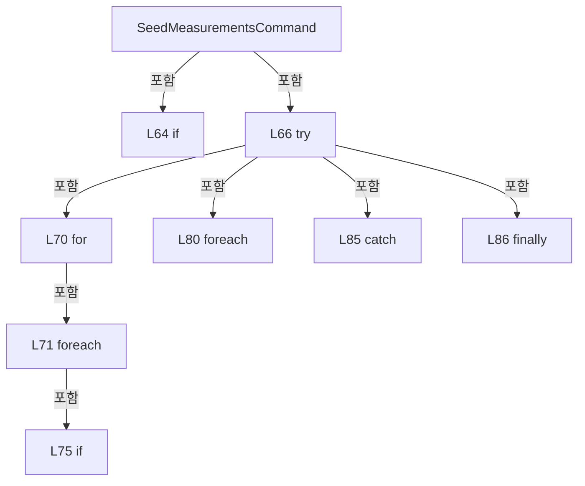

변경 전 점검: 입력/반환 타입, 위 호출자, 예외/취소 경로, 공유 상태와 저장·전송 소비자를 함께 확인합니다. 값의 단위나 물리 방향을 이름만으로 확정하지 않습니다.

### PropertyDeclaration `ZeroSegmentInput` · L89–99

[Drilling.UI/Popup/CMelsecStageSimulationDialog.xaml.cs:89–99](https://github.com/kjuws10-rgb/A3Drilling/blob/5aee8e58439c9b455cae7c9593c9be986c3e682e/Drilling.UI/Popup/CMelsecStageSimulationDialog.xaml.cs#L89-L99)

| 항목 | 실제 추출 값 |
| --- | --- |
| 서명 | string Drilling.UI.Popup.CMelsecStageSimulationPanel.ZeroSegmentInput |
| 접근/수식자 | Public / public |
| 반환/값 타입 | string |
| 소속 타입 | NamedType:Drilling.UI.Popup.CMelsecStageSimulationPanel |

현재 부분 분석에서 직접 연결된 호출자는 없습니다. XAML/이벤트/인터페이스·델리게이트·외부 진입을 추가 확인해야 하며, 미사용으로 판정한 것이 아닙니다.

변경 전 점검: 입력/반환 타입, 위 호출자, 예외/취소 경로, 공유 상태와 저장·전송 소비자를 함께 확인합니다. 값의 단위나 물리 방향을 이름만으로 확정하지 않습니다.

### GetAccessorDeclaration `get_ZeroSegmentInput` · L91–91

[Drilling.UI/Popup/CMelsecStageSimulationDialog.xaml.cs:91–91](https://github.com/kjuws10-rgb/A3Drilling/blob/5aee8e58439c9b455cae7c9593c9be986c3e682e/Drilling.UI/Popup/CMelsecStageSimulationDialog.xaml.cs#L91-L91)

| 항목 | 실제 추출 값 |
| --- | --- |
| 서명 | string Drilling.UI.Popup.CMelsecStageSimulationPanel.ZeroSegmentInput.get |
| 접근/수식자 | Public / get |
| 반환/값 타입 | string |
| 소속 타입 | NamedType:Drilling.UI.Popup.CMelsecStageSimulationPanel |

현재 부분 분석에서 직접 연결된 호출자는 없습니다. XAML/이벤트/인터페이스·델리게이트·외부 진입을 추가 확인해야 하며, 미사용으로 판정한 것이 아닙니다.

변경 전 점검: 입력/반환 타입, 위 호출자, 예외/취소 경로, 공유 상태와 저장·전송 소비자를 함께 확인합니다. 값의 단위나 물리 방향을 이름만으로 확정하지 않습니다.

### SetAccessorDeclaration `set_ZeroSegmentInput` · L92–98

[Drilling.UI/Popup/CMelsecStageSimulationDialog.xaml.cs:92–98](https://github.com/kjuws10-rgb/A3Drilling/blob/5aee8e58439c9b455cae7c9593c9be986c3e682e/Drilling.UI/Popup/CMelsecStageSimulationDialog.xaml.cs#L92-L98)

| 항목 | 실제 추출 값 |
| --- | --- |
| 서명 | void Drilling.UI.Popup.CMelsecStageSimulationPanel.ZeroSegmentInput.set |
| 접근/수식자 | Public / set |
| 반환/값 타입 | void |
| 소속 타입 | NamedType:Drilling.UI.Popup.CMelsecStageSimulationPanel |

입력 계약:

| 이름 | 타입 | 전달 | 선택/기본값 |
| --- | --- | --- | --- |
| value | string | None | False /  |

현재 부분 분석에서 직접 연결된 호출자는 없습니다. XAML/이벤트/인터페이스·델리게이트·외부 진입을 추가 확인해야 하며, 미사용으로 판정한 것이 아닙니다.

호출하는 대상과 해석 범위:

| 원본 행 | 표현식 | 분석 상태 | 대상/소스 위치 |
| --- | --- | --- | --- |
| 97 | .Invoke | resolved · 동적 구현 선택 가능 | void System.ComponentModel.PropertyChangedEventHandler.Invoke(object?, System.ComponentModel.PropertyChangedEventArgs) |
| 97 | new | resolved | System.ComponentModel.PropertyChangedEventArgs.PropertyChangedEventArgs(string?) |
| 97 | nameof | unresolved | None |

본문의 실제 연산·분기·예외·반환 순서(원문 위치 순):

| 원본 행 | 종류 | 주석 해설 |
| --- | --- | --- |
| 94 | if | 조건에 따라 분기합니다: if (_zeroSegmentInput == value) |
| 95 | return | 호출자에게 값 또는 제어를 반환합니다: return; |
| 96 | assignment | 값을 대상에 대입합니다: _zeroSegmentInput = value |
| 97 | call | 함수·델리게이트 또는 객체 생성자를 호출합니다: .Invoke(this, new(nameof(ZeroSegmentInput))) |
| 97 | call | 함수·델리게이트 또는 객체 생성자를 호출합니다: new(nameof(ZeroSegmentInput)) |
| 97 | call | 함수·델리게이트 또는 객체 생성자를 호출합니다: nameof(ZeroSegmentInput) |

제어 구문의 포함 구조(실제 실행 순서/CFG가 아닌 구문 탐색 그림):

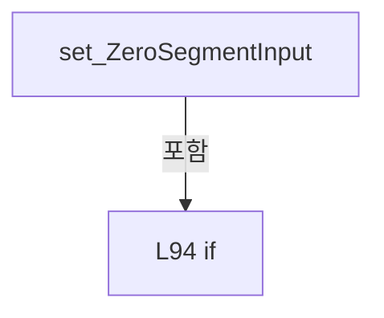

변경 전 점검: 입력/반환 타입, 위 호출자, 예외/취소 경로, 공유 상태와 저장·전송 소비자를 함께 확인합니다. 값의 단위나 물리 방향을 이름만으로 확정하지 않습니다.

### PropertyDeclaration `ZeroSegmentState` · L101–101

[Drilling.UI/Popup/CMelsecStageSimulationDialog.xaml.cs:101–101](https://github.com/kjuws10-rgb/A3Drilling/blob/5aee8e58439c9b455cae7c9593c9be986c3e682e/Drilling.UI/Popup/CMelsecStageSimulationDialog.xaml.cs#L101-L101)

| 항목 | 실제 추출 값 |
| --- | --- |
| 서명 | string Drilling.UI.Popup.CMelsecStageSimulationPanel.ZeroSegmentState |
| 접근/수식자 | Public / public |
| 반환/값 타입 | string |
| 소속 타입 | NamedType:Drilling.UI.Popup.CMelsecStageSimulationPanel |

현재 부분 분석에서 직접 연결된 호출자는 없습니다. XAML/이벤트/인터페이스·델리게이트·외부 진입을 추가 확인해야 하며, 미사용으로 판정한 것이 아닙니다.

본문의 실제 연산·분기·예외·반환 순서(원문 위치 순):

| 원본 행 | 종류 | 주석 해설 |
| --- | --- | --- |
| 101 | conditional-expression | 조건에 따라 결과식을 선택합니다: interfaces.StageReviewSequences.LastIofPlan is { ZeroLine: true } plan ? $"{interfaces.StageReviewSequences.SimulatedZeroLineCompletedSegments} / {plan.Points.Count} 구간 완료" : "0선 계획 없음" |

변경 전 점검: 입력/반환 타입, 위 호출자, 예외/취소 경로, 공유 상태와 저장·전송 소비자를 함께 확인합니다. 값의 단위나 물리 방향을 이름만으로 확정하지 않습니다.

### PropertyDeclaration `CanSetZeroSegments` · L102–102

[Drilling.UI/Popup/CMelsecStageSimulationDialog.xaml.cs:102–102](https://github.com/kjuws10-rgb/A3Drilling/blob/5aee8e58439c9b455cae7c9593c9be986c3e682e/Drilling.UI/Popup/CMelsecStageSimulationDialog.xaml.cs#L102-L102)

| 항목 | 실제 추출 값 |
| --- | --- |
| 서명 | bool Drilling.UI.Popup.CMelsecStageSimulationPanel.CanSetZeroSegments |
| 접근/수식자 | Public / public |
| 반환/값 타입 | bool |
| 소속 타입 | NamedType:Drilling.UI.Popup.CMelsecStageSimulationPanel |

현재 부분 분석에서 직접 연결된 호출자는 없습니다. XAML/이벤트/인터페이스·델리게이트·외부 진입을 추가 확인해야 하며, 미사용으로 판정한 것이 아닙니다.

호출하는 대상과 해석 범위:

| 원본 행 | 표현식 | 분석 상태 | 대상/소스 위치 |
| --- | --- | --- | --- |
| 102 | interfaces.IsSimul | resolved | bool Drilling.Common.Interface.CInterfaceManager.IsSimul(Drilling.Common.Interface.EN_EQP_MODULE, int) · Drilling.Common/Interface/CInterfaceManager.cs:343 |
| 102 | interfaces.Melsec.Map.Single | resolved | Drilling.Common.Interface.ST_MELSEC_MAP_DATA System.Collections.Generic.IEnumerable<Drilling.Common.Interface.ST_MELSEC_MAP_DATA>.Single<Drilling.Common.Interface.ST_MELSEC_MAP_DATA>(System.Func<Drilling.Common.Interface.ST_MELSEC_MAP_DATA, bool>) |

본문의 실제 연산·분기·예외·반환 순서(원문 위치 순):

| 원본 행 | 종류 | 주석 해설 |
| --- | --- | --- |
| 102 | call | 함수·델리게이트 또는 객체 생성자를 호출합니다: interfaces.IsSimul(EN_EQP_MODULE.Melsec, interfaces.Melsec.Map.Single(row => row.Id == "IOF_SETTING").DeviceNo) |
| 102 | call | 함수·델리게이트 또는 객체 생성자를 호출합니다: interfaces.Melsec.Map.Single(row => row.Id == "IOF_SETTING") |

변경 전 점검: 입력/반환 타입, 위 호출자, 예외/취소 경로, 공유 상태와 저장·전송 소비자를 함께 확인합니다. 값의 단위나 물리 방향을 이름만으로 확정하지 않습니다.

### PropertyDeclaration `SetZeroSegmentsCommand` · L103–115

[Drilling.UI/Popup/CMelsecStageSimulationDialog.xaml.cs:103–115](https://github.com/kjuws10-rgb/A3Drilling/blob/5aee8e58439c9b455cae7c9593c9be986c3e682e/Drilling.UI/Popup/CMelsecStageSimulationDialog.xaml.cs#L103-L115)

| 항목 | 실제 추출 값 |
| --- | --- |
| 서명 | Drilling.UI.Menu.CButtonCommand Drilling.UI.Popup.CMelsecStageSimulationPanel.SetZeroSegmentsCommand |
| 접근/수식자 | Public / public |
| 반환/값 타입 | Drilling.UI.Menu.CButtonCommand |
| 소속 타입 | NamedType:Drilling.UI.Popup.CMelsecStageSimulationPanel |

현재 부분 분석에서 직접 연결된 호출자는 없습니다. XAML/이벤트/인터페이스·델리게이트·외부 진입을 추가 확인해야 하며, 미사용으로 판정한 것이 아닙니다.

호출하는 대상과 해석 범위:

| 원본 행 | 표현식 | 분석 상태 | 대상/소스 위치 |
| --- | --- | --- | --- |
| 103 | new | resolved | Drilling.UI.Menu.CButtonCommand.CButtonCommand(System.Action<object?>, System.Predicate<object?>?) · Drilling.UI/Menu/CButtonCommand.cs:9 |
| 107 | int.TryParse | resolved | bool int.TryParse(string?, System.Globalization.NumberStyles, System.IFormatProvider?, out int) |
| 108 | new InvalidOperationException | resolved | System.InvalidOperationException.InvalidOperationException(string?) |
| 109 | interfaces.StageReviewSequences.SetSimulatedZeroLineCompletedSegments | resolved | void Drilling.Common.Station.CStageReviewSequences.SetSimulatedZeroLineCompletedSegments(int) · Drilling.Common/Station/CStageReviewSequences.cs:36 |
| 113 | CRecipeConfirmDialog.ShowWarning | resolved | void Drilling.UI.Popup.CRecipeConfirmDialog.ShowWarning(string, string, Window?) · Drilling.UI/Popup/CRecipeConfirmDialog.xaml.cs:86 |

본문의 실제 연산·분기·예외·반환 순서(원문 위치 순):

| 원본 행 | 종류 | 주석 해설 |
| --- | --- | --- |
| 103 | assignment | 값을 대상에 대입합니다: _setZeroSegments ??= new(_ => { try { if (!int.TryParse(ZeroSegmentInput, NumberStyles.Integer, CultureInfo.InvariantCulture, out var number)) throw new InvalidOperationException("0~N의 정수를 입력해 주세요."); interfaces.StageReviewSequenc |
| 103 | call | 함수·델리게이트 또는 객체 생성자를 호출합니다: new(_ => { try { if (!int.TryParse(ZeroSegmentInput, NumberStyles.Integer, CultureInfo.InvariantCulture, out var number)) throw new InvalidOperationException("0~N의 정수를 입력해 주세요."); interfaces.StageReviewSequences.SetSimul… |
| 105 | try | 예외 처리 범위입니다: try |
| 107 | call | 함수·델리게이트 또는 객체 생성자를 호출합니다: int.TryParse(ZeroSegmentInput, NumberStyles.Integer, CultureInfo.InvariantCulture, out var number) |
| 107 | if | 조건에 따라 분기합니다: if (!int.TryParse(ZeroSegmentInput, NumberStyles.Integer, CultureInfo.InvariantCulture, out var number)) |
| 108 | call | 함수·델리게이트 또는 객체 생성자를 호출합니다: new InvalidOperationException("0~N의 정수를 입력해 주세요.") |
| 108 | throw | 예외를 발생/전달합니다: throw new InvalidOperationException("0~N의 정수를 입력해 주세요."); |
| 109 | call | 함수·델리게이트 또는 객체 생성자를 호출합니다: interfaces.StageReviewSequences.SetSimulatedZeroLineCompletedSegments(number) |
| 111 | catch | 지정 예외를 처리합니다: catch (Exception error) |
| 113 | call | 함수·델리게이트 또는 객체 생성자를 호출합니다: CRecipeConfirmDialog.ShowWarning("0선 촬영구간", error.Message) |

제어 구문의 포함 구조(실제 실행 순서/CFG가 아닌 구문 탐색 그림):

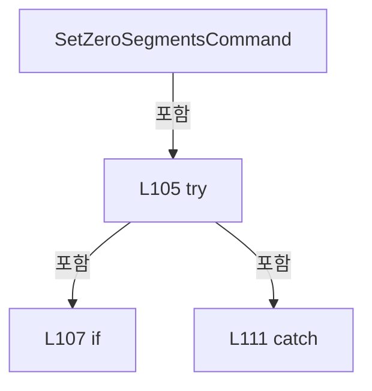

변경 전 점검: 입력/반환 타입, 위 호출자, 예외/취소 경로, 공유 상태와 저장·전송 소비자를 함께 확인합니다. 값의 단위나 물리 방향을 이름만으로 확정하지 않습니다.

### EventFieldDeclaration `PropertyChanged` · L117–117

[Drilling.UI/Popup/CMelsecStageSimulationDialog.xaml.cs:117–117](https://github.com/kjuws10-rgb/A3Drilling/blob/5aee8e58439c9b455cae7c9593c9be986c3e682e/Drilling.UI/Popup/CMelsecStageSimulationDialog.xaml.cs#L117-L117)

| 항목 | 실제 추출 값 |
| --- | --- |
| 서명 | System.ComponentModel.PropertyChangedEventHandler? Drilling.UI.Popup.CMelsecStageSimulationPanel.PropertyChanged |
| 접근/수식자 | Public / public, event |
| 반환/값 타입 | System.ComponentModel.PropertyChangedEventHandler? |
| 소속 타입 | NamedType:Drilling.UI.Popup.CMelsecStageSimulationPanel |

현재 부분 분석에서 직접 연결된 호출자는 없습니다. XAML/이벤트/인터페이스·델리게이트·외부 진입을 추가 확인해야 하며, 미사용으로 판정한 것이 아닙니다.

변경 전 점검: 입력/반환 타입, 위 호출자, 예외/취소 경로, 공유 상태와 저장·전송 소비자를 함께 확인합니다. 값의 단위나 물리 방향을 이름만으로 확정하지 않습니다.

### PropertyDeclaration `Rows` · L118–118

[Drilling.UI/Popup/CMelsecStageSimulationDialog.xaml.cs:118–118](https://github.com/kjuws10-rgb/A3Drilling/blob/5aee8e58439c9b455cae7c9593c9be986c3e682e/Drilling.UI/Popup/CMelsecStageSimulationDialog.xaml.cs#L118-L118)

| 항목 | 실제 추출 값 |
| --- | --- |
| 서명 | System.Collections.ObjectModel.ObservableCollection<Drilling.UI.Popup.CMelsecStageSimulationRow> Drilling.UI.Popup.CMelsecStageSimulationPanel.Rows |
| 접근/수식자 | Public / public |
| 반환/값 타입 | System.Collections.ObjectModel.ObservableCollection<Drilling.UI.Popup.CMelsecStageSimulationRow> |
| 소속 타입 | NamedType:Drilling.UI.Popup.CMelsecStageSimulationPanel |

현재 부분 분석에서 직접 연결된 호출자는 없습니다. XAML/이벤트/인터페이스·델리게이트·외부 진입을 추가 확인해야 하며, 미사용으로 판정한 것이 아닙니다.

변경 전 점검: 입력/반환 타입, 위 호출자, 예외/취소 경로, 공유 상태와 저장·전송 소비자를 함께 확인합니다. 값의 단위나 물리 방향을 이름만으로 확정하지 않습니다.

### GetAccessorDeclaration `get_Rows` · L118–118

[Drilling.UI/Popup/CMelsecStageSimulationDialog.xaml.cs:118–118](https://github.com/kjuws10-rgb/A3Drilling/blob/5aee8e58439c9b455cae7c9593c9be986c3e682e/Drilling.UI/Popup/CMelsecStageSimulationDialog.xaml.cs#L118-L118)

| 항목 | 실제 추출 값 |
| --- | --- |
| 서명 | System.Collections.ObjectModel.ObservableCollection<Drilling.UI.Popup.CMelsecStageSimulationRow> Drilling.UI.Popup.CMelsecStageSimulationPanel.Rows.get |
| 접근/수식자 | Public / get |
| 반환/값 타입 | System.Collections.ObjectModel.ObservableCollection<Drilling.UI.Popup.CMelsecStageSimulationRow> |
| 소속 타입 | NamedType:Drilling.UI.Popup.CMelsecStageSimulationPanel |

현재 부분 분석에서 직접 연결된 호출자는 없습니다. XAML/이벤트/인터페이스·델리게이트·외부 진입을 추가 확인해야 하며, 미사용으로 판정한 것이 아닙니다.

변경 전 점검: 입력/반환 타입, 위 호출자, 예외/취소 경로, 공유 상태와 저장·전송 소비자를 함께 확인합니다. 값의 단위나 물리 방향을 이름만으로 확정하지 않습니다.

### PropertyDeclaration `ConnectionText` · L119–119

[Drilling.UI/Popup/CMelsecStageSimulationDialog.xaml.cs:119–119](https://github.com/kjuws10-rgb/A3Drilling/blob/5aee8e58439c9b455cae7c9593c9be986c3e682e/Drilling.UI/Popup/CMelsecStageSimulationDialog.xaml.cs#L119-L119)

| 항목 | 실제 추출 값 |
| --- | --- |
| 서명 | string Drilling.UI.Popup.CMelsecStageSimulationPanel.ConnectionText |
| 접근/수식자 | Public / public |
| 반환/값 타입 | string |
| 소속 타입 | NamedType:Drilling.UI.Popup.CMelsecStageSimulationPanel |

현재 부분 분석에서 직접 연결된 호출자는 없습니다. XAML/이벤트/인터페이스·델리게이트·외부 진입을 추가 확인해야 하며, 미사용으로 판정한 것이 아닙니다.

변경 전 점검: 입력/반환 타입, 위 호출자, 예외/취소 경로, 공유 상태와 저장·전송 소비자를 함께 확인합니다. 값의 단위나 물리 방향을 이름만으로 확정하지 않습니다.

### PropertyDeclaration `CanChangeAutomaticReplies` · L120–120

[Drilling.UI/Popup/CMelsecStageSimulationDialog.xaml.cs:120–120](https://github.com/kjuws10-rgb/A3Drilling/blob/5aee8e58439c9b455cae7c9593c9be986c3e682e/Drilling.UI/Popup/CMelsecStageSimulationDialog.xaml.cs#L120-L120)

| 항목 | 실제 추출 값 |
| --- | --- |
| 서명 | bool Drilling.UI.Popup.CMelsecStageSimulationPanel.CanChangeAutomaticReplies |
| 접근/수식자 | Public / public |
| 반환/값 타입 | bool |
| 소속 타입 | NamedType:Drilling.UI.Popup.CMelsecStageSimulationPanel |

현재 부분 분석에서 직접 연결된 호출자는 없습니다. XAML/이벤트/인터페이스·델리게이트·외부 진입을 추가 확인해야 하며, 미사용으로 판정한 것이 아닙니다.

변경 전 점검: 입력/반환 타입, 위 호출자, 예외/취소 경로, 공유 상태와 저장·전송 소비자를 함께 확인합니다. 값의 단위나 물리 방향을 이름만으로 확정하지 않습니다.

### PropertyDeclaration `AutomaticReplies` · L122–141

[Drilling.UI/Popup/CMelsecStageSimulationDialog.xaml.cs:122–141](https://github.com/kjuws10-rgb/A3Drilling/blob/5aee8e58439c9b455cae7c9593c9be986c3e682e/Drilling.UI/Popup/CMelsecStageSimulationDialog.xaml.cs#L122-L141)

| 항목 | 실제 추출 값 |
| --- | --- |
| 서명 | bool Drilling.UI.Popup.CMelsecStageSimulationPanel.AutomaticReplies |
| 접근/수식자 | Public / public |
| 반환/값 타입 | bool |
| 소속 타입 | NamedType:Drilling.UI.Popup.CMelsecStageSimulationPanel |

현재 부분 분석에서 직접 연결된 호출자는 없습니다. XAML/이벤트/인터페이스·델리게이트·외부 진입을 추가 확인해야 하며, 미사용으로 판정한 것이 아닙니다.

변경 전 점검: 입력/반환 타입, 위 호출자, 예외/취소 경로, 공유 상태와 저장·전송 소비자를 함께 확인합니다. 값의 단위나 물리 방향을 이름만으로 확정하지 않습니다.

### GetAccessorDeclaration `get_AutomaticReplies` · L124–124

[Drilling.UI/Popup/CMelsecStageSimulationDialog.xaml.cs:124–124](https://github.com/kjuws10-rgb/A3Drilling/blob/5aee8e58439c9b455cae7c9593c9be986c3e682e/Drilling.UI/Popup/CMelsecStageSimulationDialog.xaml.cs#L124-L124)

| 항목 | 실제 추출 값 |
| --- | --- |
| 서명 | bool Drilling.UI.Popup.CMelsecStageSimulationPanel.AutomaticReplies.get |
| 접근/수식자 | Public / get |
| 반환/값 타입 | bool |
| 소속 타입 | NamedType:Drilling.UI.Popup.CMelsecStageSimulationPanel |

현재 부분 분석에서 직접 연결된 호출자는 없습니다. XAML/이벤트/인터페이스·델리게이트·외부 진입을 추가 확인해야 하며, 미사용으로 판정한 것이 아닙니다.

변경 전 점검: 입력/반환 타입, 위 호출자, 예외/취소 경로, 공유 상태와 저장·전송 소비자를 함께 확인합니다. 값의 단위나 물리 방향을 이름만으로 확정하지 않습니다.

### SetAccessorDeclaration `set_AutomaticReplies` · L125–140

[Drilling.UI/Popup/CMelsecStageSimulationDialog.xaml.cs:125–140](https://github.com/kjuws10-rgb/A3Drilling/blob/5aee8e58439c9b455cae7c9593c9be986c3e682e/Drilling.UI/Popup/CMelsecStageSimulationDialog.xaml.cs#L125-L140)

| 항목 | 실제 추출 값 |
| --- | --- |
| 서명 | void Drilling.UI.Popup.CMelsecStageSimulationPanel.AutomaticReplies.set |
| 접근/수식자 | Public / set |
| 반환/값 타입 | void |
| 소속 타입 | NamedType:Drilling.UI.Popup.CMelsecStageSimulationPanel |

입력 계약:

| 이름 | 타입 | 전달 | 선택/기본값 |
| --- | --- | --- | --- |
| value | bool | None | False /  |

현재 부분 분석에서 직접 연결된 호출자는 없습니다. XAML/이벤트/인터페이스·델리게이트·외부 진입을 추가 확인해야 하며, 미사용으로 판정한 것이 아닙니다.

호출하는 대상과 해석 범위:

| 원본 행 | 표현식 | 분석 상태 | 대상/소스 위치 |
| --- | --- | --- | --- |
| 135 | CRecipeConfirmDialog.ShowWarning | resolved | void Drilling.UI.Popup.CRecipeConfirmDialog.ShowWarning(string, string, Window?) · Drilling.UI/Popup/CRecipeConfirmDialog.xaml.cs:86 |
| 139 | .Invoke | resolved · 동적 구현 선택 가능 | void System.ComponentModel.PropertyChangedEventHandler.Invoke(object?, System.ComponentModel.PropertyChangedEventArgs) |
| 139 | new | resolved | System.ComponentModel.PropertyChangedEventArgs.PropertyChangedEventArgs(string?) |
| 139 | nameof | unresolved | None |

본문의 실제 연산·분기·예외·반환 순서(원문 위치 순):

| 원본 행 | 종류 | 주석 해설 |
| --- | --- | --- |
| 127 | if | 조건에 따라 분기합니다: if (value == AutomaticReplies) |
| 128 | return | 호출자에게 값 또는 제어를 반환합니다: return; |
| 129 | try | 예외 처리 범위입니다: try |
| 131 | assignment | 값을 대상에 대입합니다: interfaces.StageReviewSequences.AutomaticSimulationReplies = value |
| 133 | catch | 지정 예외를 처리합니다: catch (Exception error) |
| 135 | call | 함수·델리게이트 또는 객체 생성자를 호출합니다: CRecipeConfirmDialog.ShowWarning("Stage 자동 응답", error.Message) |
| 138 | assignment | 값을 대상에 대입합니다: _lastAutomaticReplies = AutomaticReplies |
| 139 | call | 함수·델리게이트 또는 객체 생성자를 호출합니다: .Invoke(this, new(nameof(AutomaticReplies))) |
| 139 | call | 함수·델리게이트 또는 객체 생성자를 호출합니다: new(nameof(AutomaticReplies)) |
| 139 | call | 함수·델리게이트 또는 객체 생성자를 호출합니다: nameof(AutomaticReplies) |

제어 구문의 포함 구조(실제 실행 순서/CFG가 아닌 구문 탐색 그림):

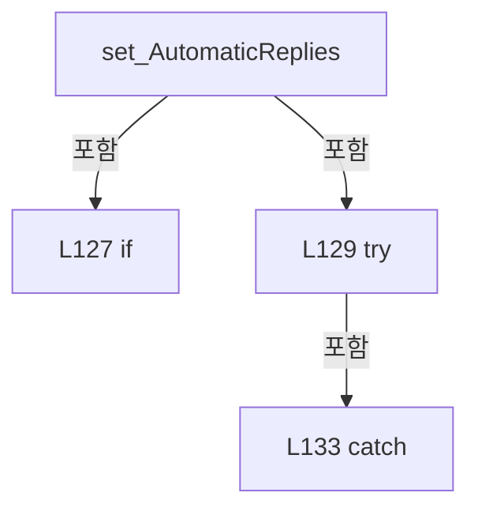

변경 전 점검: 입력/반환 타입, 위 호출자, 예외/취소 경로, 공유 상태와 저장·전송 소비자를 함께 확인합니다. 값의 단위나 물리 방향을 이름만으로 확정하지 않습니다.

### MethodDeclaration `Refresh` · L143–215

[Drilling.UI/Popup/CMelsecStageSimulationDialog.xaml.cs:143–215](https://github.com/kjuws10-rgb/A3Drilling/blob/5aee8e58439c9b455cae7c9593c9be986c3e682e/Drilling.UI/Popup/CMelsecStageSimulationDialog.xaml.cs#L143-L215)

| 항목 | 실제 추출 값 |
| --- | --- |
| 서명 | void Drilling.UI.Popup.CMelsecStageSimulationPanel.Refresh() |
| 접근/수식자 | Public / public |
| 반환/값 타입 | void |
| 소속 타입 | NamedType:Drilling.UI.Popup.CMelsecStageSimulationPanel |

정적 호출자로 확인된 위치:

| 호출 파일/행 | 호출 표현식 | 런타임 분기 가능 |
| --- | --- | --- |
| [Drilling.UI/Popup/CMelsecStageSimulationDialog.xaml.cs:33–33](https://github.com/kjuws10-rgb/A3Drilling/blob/5aee8e58439c9b455cae7c9593c9be986c3e682e/Drilling.UI/Popup/CMelsecStageSimulationDialog.xaml.cs#L33-L33) | Panel.Refresh | False |
| [Drilling.UI/Popup/CMelsecStageSimulationDialog.xaml.cs:41–41](https://github.com/kjuws10-rgb/A3Drilling/blob/5aee8e58439c9b455cae7c9593c9be986c3e682e/Drilling.UI/Popup/CMelsecStageSimulationDialog.xaml.cs#L41-L41) | Panel.Refresh | False |
| [Drilling.UI/Popup/CMelsecStageSimulationDialog.xaml.cs:45–45](https://github.com/kjuws10-rgb/A3Drilling/blob/5aee8e58439c9b455cae7c9593c9be986c3e682e/Drilling.UI/Popup/CMelsecStageSimulationDialog.xaml.cs#L45-L45) | Panel.Refresh | False |
| [Drilling.UI/Popup/CMelsecStageSimulationDialog.xaml.cs:83–83](https://github.com/kjuws10-rgb/A3Drilling/blob/5aee8e58439c9b455cae7c9593c9be986c3e682e/Drilling.UI/Popup/CMelsecStageSimulationDialog.xaml.cs#L83-L83) | Refresh | False |

호출하는 대상과 해석 범위:

| 원본 행 | 표현식 | 분석 상태 | 대상/소스 위치 |
| --- | --- | --- | --- |
| 148 | .Invoke | resolved · 동적 구현 선택 가능 | void System.ComponentModel.PropertyChangedEventHandler.Invoke(object?, System.ComponentModel.PropertyChangedEventArgs) |
| 148 | new | resolved | System.ComponentModel.PropertyChangedEventArgs.PropertyChangedEventArgs(string?) |
| 148 | nameof | unresolved | None |
| 154 | .Invoke | resolved · 동적 구현 선택 가능 | void System.ComponentModel.PropertyChangedEventHandler.Invoke(object?, System.ComponentModel.PropertyChangedEventArgs) |
| 154 | new | resolved | System.ComponentModel.PropertyChangedEventArgs.PropertyChangedEventArgs(string?) |
| 154 | nameof | unresolved | None |
| 155 | .NotifyCanExecuteChanged | resolved | void Drilling.UI.Menu.CButtonCommand.NotifyCanExecuteChanged() · Drilling.UI/Menu/CButtonCommand.cs:24 |
| 158 | interfaces.Melsec.GetCachedSnapshot | resolved | System.Collections.Generic.IReadOnlyDictionary<string, Drilling.Common.Interface.ST_MELSEC_CACHED_VALUE> Drilling.Common.Interface.CMelsec.GetCachedSnapshot(out System.Collections.Generic.IReadOnlyList<Drilling.Common.Interface.ST_MELSEC_MAP_DATA>) · Drilling.Common/Interface/Melsec/CMelsec.cs:2538 |
| 159 | map.Where(row => CMelsec.IsStageFlowSimulationSignal(row) &#124;&#124; CMelsec.IsStageSimulationSignal(row) &#124;&#124; CMelsec.IsStageAlignSimulationSignal(row) &#124;&#124; CMelsec.IsStageProtectWindowSimulationSignal(row) &#124;&#124; CMelsec.IsDistortionMeasurementSimulationValue(row)).OrderBy(row => ScenarioOrder(row.Group)).ThenBy(row => row.DeviceNo).ThenBy(row => SignalOrder(row… | resolved | Drilling.Common.Interface.ST_MELSEC_MAP_DATA[] System.Collections.Generic.IEnumerable<Drilling.Common.Interface.ST_MELSEC_MAP_DATA>.ToArray<Drilling.Common.Interface.ST_MELSEC_MAP_DATA>() |
| 159 | map.Where(row => CMelsec.IsStageFlowSimulationSignal(row) &#124;&#124; CMelsec.IsStageSimulationSignal(row) &#124;&#124; CMelsec.IsStageAlignSimulationSignal(row) &#124;&#124; CMelsec.IsStageProtectWindowSimulationSignal(row) &#124;&#124; CMelsec.IsDistortionMeasurementSimulationValue(row)).OrderBy(row => ScenarioOrder(row.Group)).ThenBy(row => row.DeviceNo).ThenBy(row => SignalOrder(row… | resolved | System.Linq.IOrderedEnumerable<Drilling.Common.Interface.ST_MELSEC_MAP_DATA> System.Linq.IOrderedEnumerable<Drilling.Common.Interface.ST_MELSEC_MAP_DATA>.ThenBy<Drilling.Common.Interface.ST_MELSEC_MAP_DATA, string>(System.Func<Drilling.Common.Interface.ST_MELSEC_MAP_DATA, string>) |
| 159 | map.Where(row => CMelsec.IsStageFlowSimulationSignal(row) &#124;&#124; CMelsec.IsStageSimulationSignal(row) &#124;&#124; CMelsec.IsStageAlignSimulationSignal(row) &#124;&#124; CMelsec.IsStageProtectWindowSimulationSignal(row) &#124;&#124; CMelsec.IsDistortionMeasurementSimulationValue(row)).OrderBy(row => ScenarioOrder(row.Group)).ThenBy(row => row.DeviceNo).ThenBy | resolved | System.Linq.IOrderedEnumerable<Drilling.Common.Interface.ST_MELSEC_MAP_DATA> System.Linq.IOrderedEnumerable<Drilling.Common.Interface.ST_MELSEC_MAP_DATA>.ThenBy<Drilling.Common.Interface.ST_MELSEC_MAP_DATA, int>(System.Func<Drilling.Common.Interface.ST_MELSEC_MAP_DATA, int>) |
| 159 | map.Where(row => CMelsec.IsStageFlowSimulationSignal(row) &#124;&#124; CMelsec.IsStageSimulationSignal(row) &#124;&#124; CMelsec.IsStageAlignSimulationSignal(row) &#124;&#124; CMelsec.IsStageProtectWindowSimulationSignal(row) &#124;&#124; CMelsec.IsDistortionMeasurementSimulationValue(row)).OrderBy(row => ScenarioOrder(row.Group)).ThenBy | resolved | System.Linq.IOrderedEnumerable<Drilling.Common.Interface.ST_MELSEC_MAP_DATA> System.Linq.IOrderedEnumerable<Drilling.Common.Interface.ST_MELSEC_MAP_DATA>.ThenBy<Drilling.Common.Interface.ST_MELSEC_MAP_DATA, int>(System.Func<Drilling.Common.Interface.ST_MELSEC_MAP_DATA, int>) |
| 159 | map.Where(row => CMelsec.IsStageFlowSimulationSignal(row) &#124;&#124; CMelsec.IsStageSimulationSignal(row) &#124;&#124; CMelsec.IsStageAlignSimulationSignal(row) &#124;&#124; CMelsec.IsStageProtectWindowSimulationSignal(row) &#124;&#124; CMelsec.IsDistortionMeasurementSimulationValue(row)).OrderBy | resolved | System.Linq.IOrderedEnumerable<Drilling.Common.Interface.ST_MELSEC_MAP_DATA> System.Collections.Generic.IEnumerable<Drilling.Common.Interface.ST_MELSEC_MAP_DATA>.OrderBy<Drilling.Common.Interface.ST_MELSEC_MAP_DATA, int>(System.Func<Drilling.Common.Interface.ST_MELSEC_MAP_DATA, int>) |
| 159 | map.Where | resolved | System.Collections.Generic.IEnumerable<Drilling.Common.Interface.ST_MELSEC_MAP_DATA> System.Collections.Generic.IEnumerable<Drilling.Common.Interface.ST_MELSEC_MAP_DATA>.Where<Drilling.Common.Interface.ST_MELSEC_MAP_DATA>(System.Func<Drilling.Common.Interface.ST_MELSEC_MAP_DATA, bool>) |
| 159 | CMelsec.IsStageFlowSimulationSignal | resolved | bool Drilling.Common.Interface.CMelsec.IsStageFlowSimulationSignal(Drilling.Common.Interface.ST_MELSEC_MAP_DATA) · Drilling.Common/Interface/Melsec/CMelsec.cs:3091 |
| 159 | CMelsec.IsStageSimulationSignal | resolved | bool Drilling.Common.Interface.CMelsec.IsStageSimulationSignal(Drilling.Common.Interface.ST_MELSEC_MAP_DATA) · Drilling.Common/Interface/Melsec/CMelsec.cs:3128 |
| 159 | CMelsec.IsStageAlignSimulationSignal | resolved | bool Drilling.Common.Interface.CMelsec.IsStageAlignSimulationSignal(Drilling.Common.Interface.ST_MELSEC_MAP_DATA) · Drilling.Common/Interface/Melsec/CMelsec.cs:3129 |
| 159 | CMelsec.IsStageProtectWindowSimulationSignal | resolved | bool Drilling.Common.Interface.CMelsec.IsStageProtectWindowSimulationSignal(Drilling.Common.Interface.ST_MELSEC_MAP_DATA) · Drilling.Common/Interface/Melsec/CMelsec.cs:3108 |
| 159 | CMelsec.IsDistortionMeasurementSimulationValue | resolved | bool Drilling.Common.Interface.CMelsec.IsDistortionMeasurementSimulationValue(Drilling.Common.Interface.ST_MELSEC_MAP_DATA) · Drilling.Common/Interface/Melsec/CMelsec.cs:3059 |
| 159 | ScenarioOrder | resolved | int Drilling.UI.Popup.CMelsecStageSimulationPanel.ScenarioOrder(string) · Drilling.UI/Popup/CMelsecStageSimulationDialog.xaml.cs:217 |
| 159 | SignalOrder | resolved | int Drilling.UI.Popup.CMelsecStageSimulationPanel.SignalOrder(string) · Drilling.UI/Popup/CMelsecStageSimulationDialog.xaml.cs:231 |
| 160 | _map.SequenceEqual | resolved | bool System.Collections.Generic.IEnumerable<Drilling.Common.Interface.ST_MELSEC_MAP_DATA>.SequenceEqual<Drilling.Common.Interface.ST_MELSEC_MAP_DATA>(System.Collections.Generic.IEnumerable<Drilling.Common.Interface.ST_MELSEC_MAP_DATA>) |
| 163 | Rows.Clear | resolved | void System.Collections.ObjectModel.Collection<Drilling.UI.Popup.CMelsecStageSimulationRow>.Clear() |
| 165 | Rows.Add | resolved | void System.Collections.ObjectModel.Collection<Drilling.UI.Popup.CMelsecStageSimulationRow>.Add(Drilling.UI.Popup.CMelsecStageSimulationRow) |
| 165 | new | resolved | Drilling.UI.Popup.CMelsecStageSimulationRow.CMelsecStageSimulationRow(Drilling.Common.Interface.ST_MELSEC_MAP_DATA, System.Action<int>, System.Action<string>?, System.Action<double>?) · Drilling.UI/Popup/CMelsecStageSimulationDialog.xaml.cs:273 |
| 167 | CMelsec.IsStageAlignSimulationSignal | resolved | bool Drilling.Common.Interface.CMelsec.IsStageAlignSimulationSignal(Drilling.Common.Interface.ST_MELSEC_MAP_DATA) · Drilling.Common/Interface/Melsec/CMelsec.cs:3129 |
| 168 | interfaces.Melsec.SetStageAlignSimulationValue | resolved | void Drilling.Common.Interface.CMelsec.SetStageAlignSimulationValue(string, int) · Drilling.Common/Interface/Melsec/CMelsec.cs:3131 |
| 169 | CMelsec.IsStageProtectWindowSimulationSignal | resolved | bool Drilling.Common.Interface.CMelsec.IsStageProtectWindowSimulationSignal(Drilling.Common.Interface.ST_MELSEC_MAP_DATA) · Drilling.Common/Interface/Melsec/CMelsec.cs:3108 |
| 170 | interfaces.Melsec.SetStageProtectWindowSimulationValue | resolved | void Drilling.Common.Interface.CMelsec.SetStageProtectWindowSimulationValue(string, int) · Drilling.Common/Interface/Melsec/CMelsec.cs:3110 |
| 171 | CMelsec.IsStageFlowSimulationSignal | resolved | bool Drilling.Common.Interface.CMelsec.IsStageFlowSimulationSignal(Drilling.Common.Interface.ST_MELSEC_MAP_DATA) · Drilling.Common/Interface/Melsec/CMelsec.cs:3091 |
| 172 | interfaces.Melsec.SetStageFlowSimulationValue | resolved | void Drilling.Common.Interface.CMelsec.SetStageFlowSimulationValue(string, int) · Drilling.Common/Interface/Melsec/CMelsec.cs:3092 |
| 174 | interfaces.Melsec.SetStageSimulationSignal | resolved | void Drilling.Common.Interface.CMelsec.SetStageSimulationSignal(string, bool) · Drilling.Common/Interface/Melsec/CMelsec.cs:3152 |
| 175 | interfaces.Melsec.SetDistortionMeasurementSimulationValue | resolved | void Drilling.Common.Interface.CMelsec.SetDistortionMeasurementSimulationValue(string, double) · Drilling.Common/Interface/Melsec/CMelsec.cs:3061 |
| 178 | interfaces.GetInterfaceCommunicationList(EN_EQP_MODULE.Melsec).ToDictionary | resolved | System.Collections.Generic.Dictionary<int, Drilling.Common.Interface.ST_INTERFACE_COMM_STATUS> System.Collections.Generic.IEnumerable<Drilling.Common.Interface.ST_INTERFACE_COMM_STATUS>.ToDictionary<Drilling.Common.Interface.ST_INTERFACE_COMM_STATUS, int>(System.Func<Drilling.Common.Interface.ST_INTERFACE_COMM_STATUS, int>) |
| 178 | interfaces.GetInterfaceCommunicationList | resolved | System.Collections.Generic.IReadOnlyList<Drilling.Common.Interface.ST_INTERFACE_COMM_STATUS> Drilling.Common.Interface.CInterfaceManager.GetInterfaceCommunicationList(Drilling.Common.Interface.EN_EQP_MODULE?) · Drilling.Common/Interface/CInterfaceManager.cs:472 |
| 179 | string.Join | resolved | string string.Join(string?, System.Collections.Generic.IEnumerable<string?>) |
| 179 | signals.Select(row => row.DeviceNo).Distinct().Select | resolved | System.Collections.Generic.IEnumerable<string> System.Collections.Generic.IEnumerable<int>.Select<int, string>(System.Func<int, string>) |
| 179 | signals.Select(row => row.DeviceNo).Distinct | resolved | System.Collections.Generic.IEnumerable<int> System.Collections.Generic.IEnumerable<int>.Distinct<int>() |
| 179 | signals.Select | resolved | System.Collections.Generic.IEnumerable<int> System.Collections.Generic.IEnumerable<Drilling.Common.Interface.ST_MELSEC_MAP_DATA>.Select<Drilling.Common.Interface.ST_MELSEC_MAP_DATA, int>(System.Func<Drilling.Common.Interface.ST_MELSEC_MAP_DATA, int>) |
| 181 | connections.TryGetValue | resolved | bool System.Collections.Generic.Dictionary<int, Drilling.Common.Interface.ST_INTERFACE_COMM_STATUS>.TryGetValue(int, out Drilling.Common.Interface.ST_INTERFACE_COMM_STATUS) |
| 181 | status.ConnectionState.ToString().ToUpperInvariant | resolved | string string.ToUpperInvariant() |
| 181 | status.ConnectionState.ToString | resolved · 동적 구현 선택 가능 | string System.Enum.ToString() |
| 189 | .Invoke | resolved · 동적 구현 선택 가능 | void System.ComponentModel.PropertyChangedEventHandler.Invoke(object?, System.ComponentModel.PropertyChangedEventArgs) |
| 189 | new | resolved | System.ComponentModel.PropertyChangedEventArgs.PropertyChangedEventArgs(string?) |
| 189 | nameof | unresolved | None |
| 194 | values.TryGetValue | resolved · 동적 구현 선택 가능 | bool System.Collections.Generic.IReadOnlyDictionary<string, Drilling.Common.Interface.ST_MELSEC_CACHED_VALUE>.TryGetValue(string, out Drilling.Common.Interface.ST_MELSEC_CACHED_VALUE) |
| 195 | row.Refresh | resolved | void Drilling.UI.Popup.CMelsecStageSimulationRow.Refresh(Drilling.Common.Interface.ST_MELSEC_CACHED_VALUE?, bool) · Drilling.UI/Popup/CMelsecStageSimulationDialog.xaml.cs:359 |
| 195 | interfaces.IsSimul | resolved | bool Drilling.Common.Interface.CInterfaceManager.IsSimul(Drilling.Common.Interface.EN_EQP_MODULE, int) · Drilling.Common/Interface/CInterfaceManager.cs:343 |
| 201 | .Invoke | resolved · 동적 구현 선택 가능 | void System.ComponentModel.PropertyChangedEventHandler.Invoke(object?, System.ComponentModel.PropertyChangedEventArgs) |
| 201 | new | resolved | System.ComponentModel.PropertyChangedEventArgs.PropertyChangedEventArgs(string?) |
| 201 | nameof | unresolved | None |
| 202 | .NotifyCanExecuteChanged | resolved | void Drilling.UI.Menu.CButtonCommand.NotifyCanExecuteChanged() · Drilling.UI/Menu/CButtonCommand.cs:24 |
| 207 | .Invoke | resolved · 동적 구현 선택 가능 | void System.ComponentModel.PropertyChangedEventHandler.Invoke(object?, System.ComponentModel.PropertyChangedEventArgs) |
| 207 | new | resolved | System.ComponentModel.PropertyChangedEventArgs.PropertyChangedEventArgs(string?) |
| 207 | nameof | unresolved | None |
| 213 | .Invoke | resolved · 동적 구현 선택 가능 | void System.ComponentModel.PropertyChangedEventHandler.Invoke(object?, System.ComponentModel.PropertyChangedEventArgs) |
| 213 | new | resolved | System.ComponentModel.PropertyChangedEventArgs.PropertyChangedEventArgs(string?) |
| 213 | nameof | unresolved | None |

본문의 실제 연산·분기·예외·반환 순서(원문 위치 순):

| 원본 행 | 종류 | 주석 해설 |
| --- | --- | --- |
| 145 | if | 조건에 따라 분기합니다: if (_lastZeroSegmentState != ZeroSegmentState) |
| 147 | assignment | 값을 대상에 대입합니다: _lastZeroSegmentState = ZeroSegmentState |
| 148 | call | 함수·델리게이트 또는 객체 생성자를 호출합니다: .Invoke(this, new(nameof(ZeroSegmentState))) |
| 148 | call | 함수·델리게이트 또는 객체 생성자를 호출합니다: new(nameof(ZeroSegmentState)) |
| 148 | call | 함수·델리게이트 또는 객체 생성자를 호출합니다: nameof(ZeroSegmentState) |
| 151 | if | 조건에 따라 분기합니다: if (_lastCanSetZeroSegments != CanSetZeroSegments) |
| 153 | assignment | 값을 대상에 대입합니다: _lastCanSetZeroSegments = CanSetZeroSegments |
| 154 | call | 함수·델리게이트 또는 객체 생성자를 호출합니다: .Invoke(this, new(nameof(CanSetZeroSegments))) |
| 154 | call | 함수·델리게이트 또는 객체 생성자를 호출합니다: new(nameof(CanSetZeroSegments)) |
| 154 | call | 함수·델리게이트 또는 객체 생성자를 호출합니다: nameof(CanSetZeroSegments) |
| 155 | call | 함수·델리게이트 또는 객체 생성자를 호출합니다: .NotifyCanExecuteChanged() |
| 158 | call | 함수·델리게이트 또는 객체 생성자를 호출합니다: interfaces.Melsec.GetCachedSnapshot(out var map) |
| 158 | local-declaration | 지역 변수를 선언합니다: var values = interfaces.Melsec.GetCachedSnapshot(out var map); |
| 158 | variable-initializer | 변수의 초기값을 지정합니다: values = interfaces.Melsec.GetCachedSnapshot(out var map) |
| 159 | call | 함수·델리게이트 또는 객체 생성자를 호출합니다: map.Where(row => CMelsec.IsStageFlowSimulationSignal(row) &#124;&#124; CMelsec.IsStageSimulationSignal(row) &#124;&#124; CMelsec.IsStageAlignSimulationSignal(row) &#124;&#124; CMelsec.IsStageProtectWindowSimulationSignal(row) &#124;&#124; CMelsec.IsDistortionM… |
| 159 | call | 함수·델리게이트 또는 객체 생성자를 호출합니다: map.Where(row => CMelsec.IsStageFlowSimulationSignal(row) &#124;&#124; CMelsec.IsStageSimulationSignal(row) &#124;&#124; CMelsec.IsStageAlignSimulationSignal(row) &#124;&#124; CMelsec.IsStageProtectWindowSimulationSignal(row) &#124;&#124; CMelsec.IsDistortionM… |
| 159 | call | 함수·델리게이트 또는 객체 생성자를 호출합니다: map.Where(row => CMelsec.IsStageFlowSimulationSignal(row) &#124;&#124; CMelsec.IsStageSimulationSignal(row) &#124;&#124; CMelsec.IsStageAlignSimulationSignal(row) &#124;&#124; CMelsec.IsStageProtectWindowSimulationSignal(row) &#124;&#124; CMelsec.IsDistortionM… |
| 159 | call | 함수·델리게이트 또는 객체 생성자를 호출합니다: map.Where(row => CMelsec.IsStageFlowSimulationSignal(row) &#124;&#124; CMelsec.IsStageSimulationSignal(row) &#124;&#124; CMelsec.IsStageAlignSimulationSignal(row) &#124;&#124; CMelsec.IsStageProtectWindowSimulationSignal(row) &#124;&#124; CMelsec.IsDistortionM… |
| 159 | call | 함수·델리게이트 또는 객체 생성자를 호출합니다: map.Where(row => CMelsec.IsStageFlowSimulationSignal(row) &#124;&#124; CMelsec.IsStageSimulationSignal(row) &#124;&#124; CMelsec.IsStageAlignSimulationSignal(row) &#124;&#124; CMelsec.IsStageProtectWindowSimulationSignal(row) &#124;&#124; CMelsec.IsDistortionM… |
| 159 | call | 함수·델리게이트 또는 객체 생성자를 호출합니다: map.Where(row => CMelsec.IsStageFlowSimulationSignal(row) &#124;&#124; CMelsec.IsStageSimulationSignal(row) &#124;&#124; CMelsec.IsStageAlignSimulationSignal(row) &#124;&#124; CMelsec.IsStageProtectWindowSimulationSignal(row) &#124;&#124; CMelsec.IsDistortionM… |
| 159 | call | 함수·델리게이트 또는 객체 생성자를 호출합니다: CMelsec.IsStageFlowSimulationSignal(row) |
| 159 | call | 함수·델리게이트 또는 객체 생성자를 호출합니다: CMelsec.IsStageSimulationSignal(row) |
| 159 | call | 함수·델리게이트 또는 객체 생성자를 호출합니다: CMelsec.IsStageAlignSimulationSignal(row) |
| 159 | call | 함수·델리게이트 또는 객체 생성자를 호출합니다: CMelsec.IsStageProtectWindowSimulationSignal(row) |
| 159 | call | 함수·델리게이트 또는 객체 생성자를 호출합니다: CMelsec.IsDistortionMeasurementSimulationValue(row) |
| 159 | call | 함수·델리게이트 또는 객체 생성자를 호출합니다: ScenarioOrder(row.Group) |
| 159 | call | 함수·델리게이트 또는 객체 생성자를 호출합니다: SignalOrder(row.Id) |
| 159 | local-declaration | 지역 변수를 선언합니다: var signals = map.Where(row => CMelsec.IsStageFlowSimulationSignal(row) &#124;&#124; CMelsec.IsStageSimulationSignal(row) &#124;&#124; CMelsec.IsStageAlignSimulationSignal(row) &#124;&#124; CMelsec.IsStageProtectWindowSimulationSignal(row) &#124;&#124; CMelsec.IsDistort |
| 159 | variable-initializer | 변수의 초기값을 지정합니다: signals = map.Where(row => CMelsec.IsStageFlowSimulationSignal(row) &#124;&#124; CMelsec.IsStageSimulationSignal(row) &#124;&#124; CMelsec.IsStageAlignSimulationSignal(row) &#124;&#124; CMelsec.IsStageProtectWindowSimulationSignal(row) &#124;&#124; CMelsec.IsDistortionM |
| 160 | call | 함수·델리게이트 또는 객체 생성자를 호출합니다: _map.SequenceEqual(signals) |
| 160 | if | 조건에 따라 분기합니다: if (!_map.SequenceEqual(signals)) |
| 162 | assignment | 값을 대상에 대입합니다: _map = signals |
| 163 | call | 함수·델리게이트 또는 객체 생성자를 호출합니다: Rows.Clear() |
| 164 | foreach | 컬렉션 요소를 순회합니다: foreach (var signal in signals) |
| 165 | call | 함수·델리게이트 또는 객체 생성자를 호출합니다: Rows.Add(new(signal, value => { if (CMelsec.IsStageAlignSimulationSignal(signal)) interfaces.Melsec.SetStageAlignSimulationValue(signal.Id, value); else if (CMelsec.IsStageProtectWindowSimulationSignal(signal)) interface… |
| 165 | call | 함수·델리게이트 또는 객체 생성자를 호출합니다: new(signal, value => { if (CMelsec.IsStageAlignSimulationSignal(signal)) interfaces.Melsec.SetStageAlignSimulationValue(signal.Id, value); else if (CMelsec.IsStageProtectWindowSimulationSignal(signal)) interfaces.Melsec.… |
| 167 | call | 함수·델리게이트 또는 객체 생성자를 호출합니다: CMelsec.IsStageAlignSimulationSignal(signal) |
| 167 | if | 조건에 따라 분기합니다: if (CMelsec.IsStageAlignSimulationSignal(signal)) |
| 168 | call | 함수·델리게이트 또는 객체 생성자를 호출합니다: interfaces.Melsec.SetStageAlignSimulationValue(signal.Id, value) |
| 169 | call | 함수·델리게이트 또는 객체 생성자를 호출합니다: CMelsec.IsStageProtectWindowSimulationSignal(signal) |
| 169 | else | 앞 조건이 거짓인 경로입니다: else |
| 169 | if | 조건에 따라 분기합니다: if (CMelsec.IsStageProtectWindowSimulationSignal(signal)) |
| 170 | call | 함수·델리게이트 또는 객체 생성자를 호출합니다: interfaces.Melsec.SetStageProtectWindowSimulationValue(signal.Id, value) |
| 171 | call | 함수·델리게이트 또는 객체 생성자를 호출합니다: CMelsec.IsStageFlowSimulationSignal(signal) |
| 171 | else | 앞 조건이 거짓인 경로입니다: else |
| 171 | if | 조건에 따라 분기합니다: if (CMelsec.IsStageFlowSimulationSignal(signal)) |
| 172 | call | 함수·델리게이트 또는 객체 생성자를 호출합니다: interfaces.Melsec.SetStageFlowSimulationValue(signal.Id, value) |
| 173 | else | 앞 조건이 거짓인 경로입니다: else |
| 174 | call | 함수·델리게이트 또는 객체 생성자를 호출합니다: interfaces.Melsec.SetStageSimulationSignal(signal.Id, value == 1) |
| 175 | call | 함수·델리게이트 또는 객체 생성자를 호출합니다: interfaces.Melsec.SetDistortionMeasurementSimulationValue(signal.Id, value) |
| 178 | call | 함수·델리게이트 또는 객체 생성자를 호출합니다: interfaces.GetInterfaceCommunicationList(EN_EQP_MODULE.Melsec).ToDictionary(row => row.Number) |
| 178 | call | 함수·델리게이트 또는 객체 생성자를 호출합니다: interfaces.GetInterfaceCommunicationList(EN_EQP_MODULE.Melsec) |
| 178 | local-declaration | 지역 변수를 선언합니다: var connections = interfaces.GetInterfaceCommunicationList(EN_EQP_MODULE.Melsec).ToDictionary(row => row.Number); |
| 178 | variable-initializer | 변수의 초기값을 지정합니다: connections = interfaces.GetInterfaceCommunicationList(EN_EQP_MODULE.Melsec).ToDictionary(row => row.Number) |
| 179 | call | 함수·델리게이트 또는 객체 생성자를 호출합니다: signals.Select(row => row.DeviceNo).Distinct() |
| 179 | call | 함수·델리게이트 또는 객체 생성자를 호출합니다: signals.Select(row => row.DeviceNo) |
| 179 | call | 함수·델리게이트 또는 객체 생성자를 호출합니다: string.Join(" &#124; ", signals.Select(row => row.DeviceNo).Distinct().Select(number => { var state = connections.TryGetValue(number, out var status) ? status.IsSimulation ? "SIMULATION" : status.ConnectionState.ToString().To… |
| 179 | call | 함수·델리게이트 또는 객체 생성자를 호출합니다: signals.Select(row => row.DeviceNo).Distinct().Select(number => { var state = connections.TryGetValue(number, out var status) ? status.IsSimulation ? "SIMULATION" : status.ConnectionState.ToString().ToUpperInvariant() : … |
| 179 | local-declaration | 지역 변수를 선언합니다: var text = string.Join(" &#124; ", signals.Select(row => row.DeviceNo).Distinct().Select(number => { var state = connections.TryGetValue(number, out var status) ? status.IsSimulation ? "SIMULATION" : status.ConnectionState.ToString().T |
| 179 | variable-initializer | 변수의 초기값을 지정합니다: text = string.Join(" &#124; ", signals.Select(row => row.DeviceNo).Distinct().Select(number => { var state = connections.TryGetValue(number, out var status) ? status.IsSimulation ? "SIMULATION" : status.ConnectionState.ToString().ToUpp |
| 181 | call | 함수·델리게이트 또는 객체 생성자를 호출합니다: connections.TryGetValue(number, out var status) |
| 181 | call | 함수·델리게이트 또는 객체 생성자를 호출합니다: status.ConnectionState.ToString().ToUpperInvariant() |
| 181 | call | 함수·델리게이트 또는 객체 생성자를 호출합니다: status.ConnectionState.ToString() |
| 181 | conditional-expression | 조건에 따라 결과식을 선택합니다: connections.TryGetValue(number, out var status) ? status.IsSimulation ? "SIMULATION" : status.ConnectionState.ToString().ToUpperInvariant() : "OFFLINE" |
| 181 | conditional-expression | 조건에 따라 결과식을 선택합니다: status.IsSimulation ? "SIMULATION" : status.ConnectionState.ToString().ToUpperInvariant() |
| 181 | local-declaration | 지역 변수를 선언합니다: var state = connections.TryGetValue(number, out var status) ? status.IsSimulation ? "SIMULATION" : status.ConnectionState.ToString().ToUpperInvariant() : "OFFLINE"; |
| 181 | variable-initializer | 변수의 초기값을 지정합니다: state = connections.TryGetValue(number, out var status) ? status.IsSimulation ? "SIMULATION" : status.ConnectionState.ToString().ToUpperInvariant() : "OFFLINE" |
| 182 | return | 호출자에게 값 또는 제어를 반환합니다: return $"MELSEC_{number} : {state}"; |
| 184 | if | 조건에 따라 분기합니다: if (text.Length == 0) |
| 185 | assignment | 값을 대상에 대입합니다: text = "등록된 Stage 수신 신호가 없습니다." |
| 186 | if | 조건에 따라 분기합니다: if (_connectionText != text) |
| 188 | assignment | 값을 대상에 대입합니다: _connectionText = text |
| 189 | call | 함수·델리게이트 또는 객체 생성자를 호출합니다: .Invoke(this, new(nameof(ConnectionText))) |
| 189 | call | 함수·델리게이트 또는 객체 생성자를 호출합니다: new(nameof(ConnectionText)) |
| 189 | call | 함수·델리게이트 또는 객체 생성자를 호출합니다: nameof(ConnectionText) |
| 192 | foreach | 컬렉션 요소를 순회합니다: foreach (var row in Rows) |
| 194 | call | 함수·델리게이트 또는 객체 생성자를 호출합니다: values.TryGetValue(row.Id, out var sample) |
| 195 | call | 함수·델리게이트 또는 객체 생성자를 호출합니다: row.Refresh(sample, interfaces.IsSimul(EN_EQP_MODULE.Melsec, row.DeviceNo)) |
| 195 | call | 함수·델리게이트 또는 객체 생성자를 호출합니다: interfaces.IsSimul(EN_EQP_MODULE.Melsec, row.DeviceNo) |
| 198 | if | 조건에 따라 분기합니다: if (_lastCanSeed != CanSeedMeasurements) |
| 200 | assignment | 값을 대상에 대입합니다: _lastCanSeed = CanSeedMeasurements |
| 201 | call | 함수·델리게이트 또는 객체 생성자를 호출합니다: .Invoke(this, new(nameof(CanSeedMeasurements))) |
| 201 | call | 함수·델리게이트 또는 객체 생성자를 호출합니다: new(nameof(CanSeedMeasurements)) |
| 201 | call | 함수·델리게이트 또는 객체 생성자를 호출합니다: nameof(CanSeedMeasurements) |
| 202 | call | 함수·델리게이트 또는 객체 생성자를 호출합니다: .NotifyCanExecuteChanged() |
| 204 | if | 조건에 따라 분기합니다: if (_lastCanChangeReplies != CanChangeAutomaticReplies) |
| 206 | assignment | 값을 대상에 대입합니다: _lastCanChangeReplies = CanChangeAutomaticReplies |
| 207 | call | 함수·델리게이트 또는 객체 생성자를 호출합니다: .Invoke(this, new(nameof(CanChangeAutomaticReplies))) |
| 207 | call | 함수·델리게이트 또는 객체 생성자를 호출합니다: new(nameof(CanChangeAutomaticReplies)) |
| 207 | call | 함수·델리게이트 또는 객체 생성자를 호출합니다: nameof(CanChangeAutomaticReplies) |
| 210 | if | 조건에 따라 분기합니다: if (_lastAutomaticReplies != AutomaticReplies) |
| 212 | assignment | 값을 대상에 대입합니다: _lastAutomaticReplies = AutomaticReplies |
| 213 | call | 함수·델리게이트 또는 객체 생성자를 호출합니다: .Invoke(this, new(nameof(AutomaticReplies))) |
| 213 | call | 함수·델리게이트 또는 객체 생성자를 호출합니다: new(nameof(AutomaticReplies)) |
| 213 | call | 함수·델리게이트 또는 객체 생성자를 호출합니다: nameof(AutomaticReplies) |

제어 구문의 포함 구조(실제 실행 순서/CFG가 아닌 구문 탐색 그림):

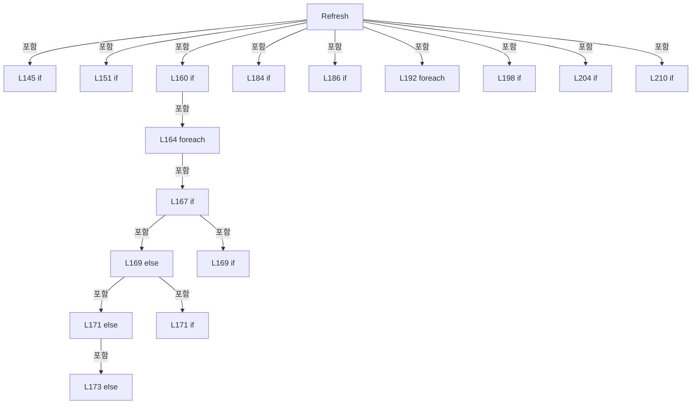

변경 전 점검: 입력/반환 타입, 위 호출자, 예외/취소 경로, 공유 상태와 저장·전송 소비자를 함께 확인합니다. 값의 단위나 물리 방향을 이름만으로 확정하지 않습니다.

### MethodDeclaration `ScenarioOrder` · L217–230

[Drilling.UI/Popup/CMelsecStageSimulationDialog.xaml.cs:217–230](https://github.com/kjuws10-rgb/A3Drilling/blob/5aee8e58439c9b455cae7c9593c9be986c3e682e/Drilling.UI/Popup/CMelsecStageSimulationDialog.xaml.cs#L217-L230)

| 항목 | 실제 추출 값 |
| --- | --- |
| 서명 | int Drilling.UI.Popup.CMelsecStageSimulationPanel.ScenarioOrder(string) |
| 접근/수식자 | Private / private, static |
| 반환/값 타입 | int |
| 소속 타입 | NamedType:Drilling.UI.Popup.CMelsecStageSimulationPanel |

입력 계약:

| 이름 | 타입 | 전달 | 선택/기본값 |
| --- | --- | --- | --- |
| group | string | None | False /  |

정적 호출자로 확인된 위치:

| 호출 파일/행 | 호출 표현식 | 런타임 분기 가능 |
| --- | --- | --- |
| [Drilling.UI/Popup/CMelsecStageSimulationDialog.xaml.cs:159–159](https://github.com/kjuws10-rgb/A3Drilling/blob/5aee8e58439c9b455cae7c9593c9be986c3e682e/Drilling.UI/Popup/CMelsecStageSimulationDialog.xaml.cs#L159-L159) | ScenarioOrder | False |

호출하는 대상과 해석 범위:

| 원본 행 | 표현식 | 분석 상태 | 대상/소스 위치 |
| --- | --- | --- | --- |
| 217 | group.ToUpperInvariant | resolved | string string.ToUpperInvariant() |

본문의 실제 연산·분기·예외·반환 순서(원문 위치 순):

| 원본 행 | 종류 | 주석 해설 |
| --- | --- | --- |
| 217 | call | 함수·델리게이트 또는 객체 생성자를 호출합니다: group.ToUpperInvariant() |
| 217 | switch-expression | 값별 결과식을 선택합니다: group.ToUpperInvariant() switch { "DISTORTION" => -2, "VISION_DISTORTION_DATA" => -1, "IF_DOREADY" => 0, "IF_PROCESS" => 1, "IF_REVIEW" => 2, "IF_TOP_POWERMETER" => 3, "IF_PROCESS_MOVE" => 4, "IF_IOF" => 5, "IF_ALIGN" => 6, "IF_PT |

제어 구문의 포함 구조(실제 실행 순서/CFG가 아닌 구문 탐색 그림):

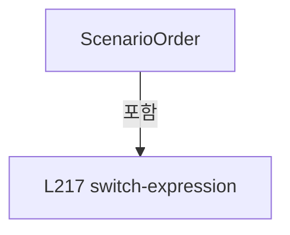

변경 전 점검: 입력/반환 타입, 위 호출자, 예외/취소 경로, 공유 상태와 저장·전송 소비자를 함께 확인합니다. 값의 단위나 물리 방향을 이름만으로 확정하지 않습니다.

### MethodDeclaration `SignalOrder` · L231–231

[Drilling.UI/Popup/CMelsecStageSimulationDialog.xaml.cs:231–231](https://github.com/kjuws10-rgb/A3Drilling/blob/5aee8e58439c9b455cae7c9593c9be986c3e682e/Drilling.UI/Popup/CMelsecStageSimulationDialog.xaml.cs#L231-L231)

| 항목 | 실제 추출 값 |
| --- | --- |
| 서명 | int Drilling.UI.Popup.CMelsecStageSimulationPanel.SignalOrder(string) |
| 접근/수식자 | Private / private, static |
| 반환/값 타입 | int |
| 소속 타입 | NamedType:Drilling.UI.Popup.CMelsecStageSimulationPanel |

입력 계약:

| 이름 | 타입 | 전달 | 선택/기본값 |
| --- | --- | --- | --- |
| id | string | None | False /  |

정적 호출자로 확인된 위치:

| 호출 파일/행 | 호출 표현식 | 런타임 분기 가능 |
| --- | --- | --- |
| [Drilling.UI/Popup/CMelsecStageSimulationDialog.xaml.cs:159–159](https://github.com/kjuws10-rgb/A3Drilling/blob/5aee8e58439c9b455cae7c9593c9be986c3e682e/Drilling.UI/Popup/CMelsecStageSimulationDialog.xaml.cs#L159-L159) | SignalOrder | False |

호출하는 대상과 해석 범위:

| 원본 행 | 표현식 | 분석 상태 | 대상/소스 위치 |
| --- | --- | --- | --- |
| 231 | id.Equals | resolved | bool string.Equals(string?, System.StringComparison) |
| 231 | id.Equals | resolved | bool string.Equals(string?, System.StringComparison) |
| 231 | id.Contains | resolved | bool string.Contains(string, System.StringComparison) |
| 231 | id.Contains | resolved | bool string.Contains(string, System.StringComparison) |

본문의 실제 연산·분기·예외·반환 순서(원문 위치 순):

| 원본 행 | 종류 | 주석 해설 |
| --- | --- | --- |
| 231 | call | 함수·델리게이트 또는 객체 생성자를 호출합니다: id.Equals("SDC_DO_ALIGN_STATUS", StringComparison.OrdinalIgnoreCase) |
| 231 | call | 함수·델리게이트 또는 객체 생성자를 호출합니다: id.Equals("SDC_DO_ALIGN_COMPLETE", StringComparison.OrdinalIgnoreCase) |
| 231 | call | 함수·델리게이트 또는 객체 생성자를 호출합니다: id.Contains("_ABLE", StringComparison.OrdinalIgnoreCase) |
| 231 | call | 함수·델리게이트 또는 객체 생성자를 호출합니다: id.Contains("_START", StringComparison.OrdinalIgnoreCase) |
| 231 | conditional-expression | 조건에 따라 결과식을 선택합니다: id.Equals("SDC_DO_ALIGN_STATUS", StringComparison.OrdinalIgnoreCase) ? 0 : id.Equals("SDC_DO_ALIGN_COMPLETE", StringComparison.OrdinalIgnoreCase) ? 1 : id.Contains("_ABLE", StringComparison.OrdinalIgnoreCase) ? 0 : id.Contains("_S |
| 231 | conditional-expression | 조건에 따라 결과식을 선택합니다: id.Equals("SDC_DO_ALIGN_COMPLETE", StringComparison.OrdinalIgnoreCase) ? 1 : id.Contains("_ABLE", StringComparison.OrdinalIgnoreCase) ? 0 : id.Contains("_START", StringComparison.OrdinalIgnoreCase) ? 1 : 2 |
| 231 | conditional-expression | 조건에 따라 결과식을 선택합니다: id.Contains("_ABLE", StringComparison.OrdinalIgnoreCase) ? 0 : id.Contains("_START", StringComparison.OrdinalIgnoreCase) ? 1 : 2 |
| 231 | conditional-expression | 조건에 따라 결과식을 선택합니다: id.Contains("_START", StringComparison.OrdinalIgnoreCase) ? 1 : 2 |

변경 전 점검: 입력/반환 타입, 위 호출자, 예외/취소 경로, 공유 상태와 저장·전송 소비자를 함께 확인합니다. 값의 단위나 물리 방향을 이름만으로 확정하지 않습니다.

### FieldDeclaration `_canSet` · L236–236

[Drilling.UI/Popup/CMelsecStageSimulationDialog.xaml.cs:236–236](https://github.com/kjuws10-rgb/A3Drilling/blob/5aee8e58439c9b455cae7c9593c9be986c3e682e/Drilling.UI/Popup/CMelsecStageSimulationDialog.xaml.cs#L236-L236)

| 항목 | 실제 추출 값 |
| --- | --- |
| 서명 | bool Drilling.UI.Popup.CMelsecStageSimulationRow._canSet |
| 접근/수식자 | Private / private |
| 반환/값 타입 | bool |
| 소속 타입 | NamedType:Drilling.UI.Popup.CMelsecStageSimulationRow |

현재 부분 분석에서 직접 연결된 호출자는 없습니다. XAML/이벤트/인터페이스·델리게이트·외부 진입을 추가 확인해야 하며, 미사용으로 판정한 것이 아닙니다.

변경 전 점검: 입력/반환 타입, 위 호출자, 예외/취소 경로, 공유 상태와 저장·전송 소비자를 함께 확인합니다. 값의 단위나 물리 방향을 이름만으로 확정하지 않습니다.

### FieldDeclaration `_currentValue` · L237–237

[Drilling.UI/Popup/CMelsecStageSimulationDialog.xaml.cs:237–237](https://github.com/kjuws10-rgb/A3Drilling/blob/5aee8e58439c9b455cae7c9593c9be986c3e682e/Drilling.UI/Popup/CMelsecStageSimulationDialog.xaml.cs#L237-L237)

| 항목 | 실제 추출 값 |
| --- | --- |
| 서명 | string Drilling.UI.Popup.CMelsecStageSimulationRow._currentValue |
| 접근/수식자 | Private / private |
| 반환/값 타입 | string |
| 소속 타입 | NamedType:Drilling.UI.Popup.CMelsecStageSimulationRow |

현재 부분 분석에서 직접 연결된 호출자는 없습니다. XAML/이벤트/인터페이스·델리게이트·외부 진입을 추가 확인해야 하며, 미사용으로 판정한 것이 아닙니다.

본문의 실제 연산·분기·예외·반환 순서(원문 위치 순):

| 원본 행 | 종류 | 주석 해설 |
| --- | --- | --- |
| 237 | variable-initializer | 변수의 초기값을 지정합니다: _currentValue = "—" |

변경 전 점검: 입력/반환 타입, 위 호출자, 예외/취소 경로, 공유 상태와 저장·전송 소비자를 함께 확인합니다. 값의 단위나 물리 방향을 이름만으로 확정하지 않습니다.

### FieldDeclaration `_inputValue` · L238–238

[Drilling.UI/Popup/CMelsecStageSimulationDialog.xaml.cs:238–238](https://github.com/kjuws10-rgb/A3Drilling/blob/5aee8e58439c9b455cae7c9593c9be986c3e682e/Drilling.UI/Popup/CMelsecStageSimulationDialog.xaml.cs#L238-L238)

| 항목 | 실제 추출 값 |
| --- | --- |
| 서명 | string Drilling.UI.Popup.CMelsecStageSimulationRow._inputValue |
| 접근/수식자 | Private / private |
| 반환/값 타입 | string |
| 소속 타입 | NamedType:Drilling.UI.Popup.CMelsecStageSimulationRow |

현재 부분 분석에서 직접 연결된 호출자는 없습니다. XAML/이벤트/인터페이스·델리게이트·외부 진입을 추가 확인해야 하며, 미사용으로 판정한 것이 아닙니다.

변경 전 점검: 입력/반환 타입, 위 호출자, 예외/취소 경로, 공유 상태와 저장·전송 소비자를 함께 확인합니다. 값의 단위나 물리 방향을 이름만으로 확정하지 않습니다.

### FieldDeclaration `_readScale` · L239–239

[Drilling.UI/Popup/CMelsecStageSimulationDialog.xaml.cs:239–239](https://github.com/kjuws10-rgb/A3Drilling/blob/5aee8e58439c9b455cae7c9593c9be986c3e682e/Drilling.UI/Popup/CMelsecStageSimulationDialog.xaml.cs#L239-L239)

| 항목 | 실제 추출 값 |
| --- | --- |
| 서명 | double Drilling.UI.Popup.CMelsecStageSimulationRow._readScale |
| 접근/수식자 | Private / private, readonly |
| 반환/값 타입 | double |
| 소속 타입 | NamedType:Drilling.UI.Popup.CMelsecStageSimulationRow |

현재 부분 분석에서 직접 연결된 호출자는 없습니다. XAML/이벤트/인터페이스·델리게이트·외부 진입을 추가 확인해야 하며, 미사용으로 판정한 것이 아닙니다.

변경 전 점검: 입력/반환 타입, 위 호출자, 예외/취소 경로, 공유 상태와 저장·전송 소비자를 함께 확인합니다. 값의 단위나 물리 방향을 이름만으로 확정하지 않습니다.

### FieldDeclaration `_stateBrush` · L240–240

[Drilling.UI/Popup/CMelsecStageSimulationDialog.xaml.cs:240–240](https://github.com/kjuws10-rgb/A3Drilling/blob/5aee8e58439c9b455cae7c9593c9be986c3e682e/Drilling.UI/Popup/CMelsecStageSimulationDialog.xaml.cs#L240-L240)

| 항목 | 실제 추출 값 |
| --- | --- |
| 서명 | Brush Drilling.UI.Popup.CMelsecStageSimulationRow._stateBrush |
| 접근/수식자 | Private / private |
| 반환/값 타입 | Brush |
| 소속 타입 | NamedType:Drilling.UI.Popup.CMelsecStageSimulationRow |

현재 부분 분석에서 직접 연결된 호출자는 없습니다. XAML/이벤트/인터페이스·델리게이트·외부 진입을 추가 확인해야 하며, 미사용으로 판정한 것이 아닙니다.

본문의 실제 연산·분기·예외·반환 순서(원문 위치 순):

| 원본 행 | 종류 | 주석 해설 |
| --- | --- | --- |
| 240 | variable-initializer | 변수의 초기값을 지정합니다: _stateBrush = Brushes.Gray |

변경 전 점검: 입력/반환 타입, 위 호출자, 예외/취소 경로, 공유 상태와 저장·전송 소비자를 함께 확인합니다. 값의 단위나 물리 방향을 이름만으로 확정하지 않습니다.

### EventFieldDeclaration `PropertyChanged` · L241–241

[Drilling.UI/Popup/CMelsecStageSimulationDialog.xaml.cs:241–241](https://github.com/kjuws10-rgb/A3Drilling/blob/5aee8e58439c9b455cae7c9593c9be986c3e682e/Drilling.UI/Popup/CMelsecStageSimulationDialog.xaml.cs#L241-L241)

| 항목 | 실제 추출 값 |
| --- | --- |
| 서명 | System.ComponentModel.PropertyChangedEventHandler? Drilling.UI.Popup.CMelsecStageSimulationRow.PropertyChanged |
| 접근/수식자 | Public / public, event |
| 반환/값 타입 | System.ComponentModel.PropertyChangedEventHandler? |
| 소속 타입 | NamedType:Drilling.UI.Popup.CMelsecStageSimulationRow |

현재 부분 분석에서 직접 연결된 호출자는 없습니다. XAML/이벤트/인터페이스·델리게이트·외부 진입을 추가 확인해야 하며, 미사용으로 판정한 것이 아닙니다.

변경 전 점검: 입력/반환 타입, 위 호출자, 예외/취소 경로, 공유 상태와 저장·전송 소비자를 함께 확인합니다. 값의 단위나 물리 방향을 이름만으로 확정하지 않습니다.

### PropertyDeclaration `Id` · L242–242

[Drilling.UI/Popup/CMelsecStageSimulationDialog.xaml.cs:242–242](https://github.com/kjuws10-rgb/A3Drilling/blob/5aee8e58439c9b455cae7c9593c9be986c3e682e/Drilling.UI/Popup/CMelsecStageSimulationDialog.xaml.cs#L242-L242)

| 항목 | 실제 추출 값 |
| --- | --- |
| 서명 | string Drilling.UI.Popup.CMelsecStageSimulationRow.Id |
| 접근/수식자 | Public / public |
| 반환/값 타입 | string |
| 소속 타입 | NamedType:Drilling.UI.Popup.CMelsecStageSimulationRow |

현재 부분 분석에서 직접 연결된 호출자는 없습니다. XAML/이벤트/인터페이스·델리게이트·외부 진입을 추가 확인해야 하며, 미사용으로 판정한 것이 아닙니다.

변경 전 점검: 입력/반환 타입, 위 호출자, 예외/취소 경로, 공유 상태와 저장·전송 소비자를 함께 확인합니다. 값의 단위나 물리 방향을 이름만으로 확정하지 않습니다.

### GetAccessorDeclaration `get_Id` · L242–242

[Drilling.UI/Popup/CMelsecStageSimulationDialog.xaml.cs:242–242](https://github.com/kjuws10-rgb/A3Drilling/blob/5aee8e58439c9b455cae7c9593c9be986c3e682e/Drilling.UI/Popup/CMelsecStageSimulationDialog.xaml.cs#L242-L242)

| 항목 | 실제 추출 값 |
| --- | --- |
| 서명 | string Drilling.UI.Popup.CMelsecStageSimulationRow.Id.get |
| 접근/수식자 | Public / get |
| 반환/값 타입 | string |
| 소속 타입 | NamedType:Drilling.UI.Popup.CMelsecStageSimulationRow |

현재 부분 분석에서 직접 연결된 호출자는 없습니다. XAML/이벤트/인터페이스·델리게이트·외부 진입을 추가 확인해야 하며, 미사용으로 판정한 것이 아닙니다.

변경 전 점검: 입력/반환 타입, 위 호출자, 예외/취소 경로, 공유 상태와 저장·전송 소비자를 함께 확인합니다. 값의 단위나 물리 방향을 이름만으로 확정하지 않습니다.

### PropertyDeclaration `DeviceNo` · L243–243

[Drilling.UI/Popup/CMelsecStageSimulationDialog.xaml.cs:243–243](https://github.com/kjuws10-rgb/A3Drilling/blob/5aee8e58439c9b455cae7c9593c9be986c3e682e/Drilling.UI/Popup/CMelsecStageSimulationDialog.xaml.cs#L243-L243)

| 항목 | 실제 추출 값 |
| --- | --- |
| 서명 | int Drilling.UI.Popup.CMelsecStageSimulationRow.DeviceNo |
| 접근/수식자 | Public / public |
| 반환/값 타입 | int |
| 소속 타입 | NamedType:Drilling.UI.Popup.CMelsecStageSimulationRow |

현재 부분 분석에서 직접 연결된 호출자는 없습니다. XAML/이벤트/인터페이스·델리게이트·외부 진입을 추가 확인해야 하며, 미사용으로 판정한 것이 아닙니다.

변경 전 점검: 입력/반환 타입, 위 호출자, 예외/취소 경로, 공유 상태와 저장·전송 소비자를 함께 확인합니다. 값의 단위나 물리 방향을 이름만으로 확정하지 않습니다.

### GetAccessorDeclaration `get_DeviceNo` · L243–243

[Drilling.UI/Popup/CMelsecStageSimulationDialog.xaml.cs:243–243](https://github.com/kjuws10-rgb/A3Drilling/blob/5aee8e58439c9b455cae7c9593c9be986c3e682e/Drilling.UI/Popup/CMelsecStageSimulationDialog.xaml.cs#L243-L243)

| 항목 | 실제 추출 값 |
| --- | --- |
| 서명 | int Drilling.UI.Popup.CMelsecStageSimulationRow.DeviceNo.get |
| 접근/수식자 | Public / get |
| 반환/값 타입 | int |
| 소속 타입 | NamedType:Drilling.UI.Popup.CMelsecStageSimulationRow |

현재 부분 분석에서 직접 연결된 호출자는 없습니다. XAML/이벤트/인터페이스·델리게이트·외부 진입을 추가 확인해야 하며, 미사용으로 판정한 것이 아닙니다.

변경 전 점검: 입력/반환 타입, 위 호출자, 예외/취소 경로, 공유 상태와 저장·전송 소비자를 함께 확인합니다. 값의 단위나 물리 방향을 이름만으로 확정하지 않습니다.

### PropertyDeclaration `Scenario` · L244–244

[Drilling.UI/Popup/CMelsecStageSimulationDialog.xaml.cs:244–244](https://github.com/kjuws10-rgb/A3Drilling/blob/5aee8e58439c9b455cae7c9593c9be986c3e682e/Drilling.UI/Popup/CMelsecStageSimulationDialog.xaml.cs#L244-L244)

| 항목 | 실제 추출 값 |
| --- | --- |
| 서명 | string Drilling.UI.Popup.CMelsecStageSimulationRow.Scenario |
| 접근/수식자 | Public / public |
| 반환/값 타입 | string |
| 소속 타입 | NamedType:Drilling.UI.Popup.CMelsecStageSimulationRow |

현재 부분 분석에서 직접 연결된 호출자는 없습니다. XAML/이벤트/인터페이스·델리게이트·외부 진입을 추가 확인해야 하며, 미사용으로 판정한 것이 아닙니다.

변경 전 점검: 입력/반환 타입, 위 호출자, 예외/취소 경로, 공유 상태와 저장·전송 소비자를 함께 확인합니다. 값의 단위나 물리 방향을 이름만으로 확정하지 않습니다.

### GetAccessorDeclaration `get_Scenario` · L244–244

[Drilling.UI/Popup/CMelsecStageSimulationDialog.xaml.cs:244–244](https://github.com/kjuws10-rgb/A3Drilling/blob/5aee8e58439c9b455cae7c9593c9be986c3e682e/Drilling.UI/Popup/CMelsecStageSimulationDialog.xaml.cs#L244-L244)

| 항목 | 실제 추출 값 |
| --- | --- |
| 서명 | string Drilling.UI.Popup.CMelsecStageSimulationRow.Scenario.get |
| 접근/수식자 | Public / get |
| 반환/값 타입 | string |
| 소속 타입 | NamedType:Drilling.UI.Popup.CMelsecStageSimulationRow |

현재 부분 분석에서 직접 연결된 호출자는 없습니다. XAML/이벤트/인터페이스·델리게이트·외부 진입을 추가 확인해야 하며, 미사용으로 판정한 것이 아닙니다.

변경 전 점검: 입력/반환 타입, 위 호출자, 예외/취소 경로, 공유 상태와 저장·전송 소비자를 함께 확인합니다. 값의 단위나 물리 방향을 이름만으로 확정하지 않습니다.

### PropertyDeclaration `Name` · L245–245

[Drilling.UI/Popup/CMelsecStageSimulationDialog.xaml.cs:245–245](https://github.com/kjuws10-rgb/A3Drilling/blob/5aee8e58439c9b455cae7c9593c9be986c3e682e/Drilling.UI/Popup/CMelsecStageSimulationDialog.xaml.cs#L245-L245)

| 항목 | 실제 추출 값 |
| --- | --- |
| 서명 | string Drilling.UI.Popup.CMelsecStageSimulationRow.Name |
| 접근/수식자 | Public / public |
| 반환/값 타입 | string |
| 소속 타입 | NamedType:Drilling.UI.Popup.CMelsecStageSimulationRow |

현재 부분 분석에서 직접 연결된 호출자는 없습니다. XAML/이벤트/인터페이스·델리게이트·외부 진입을 추가 확인해야 하며, 미사용으로 판정한 것이 아닙니다.

변경 전 점검: 입력/반환 타입, 위 호출자, 예외/취소 경로, 공유 상태와 저장·전송 소비자를 함께 확인합니다. 값의 단위나 물리 방향을 이름만으로 확정하지 않습니다.

### GetAccessorDeclaration `get_Name` · L245–245

[Drilling.UI/Popup/CMelsecStageSimulationDialog.xaml.cs:245–245](https://github.com/kjuws10-rgb/A3Drilling/blob/5aee8e58439c9b455cae7c9593c9be986c3e682e/Drilling.UI/Popup/CMelsecStageSimulationDialog.xaml.cs#L245-L245)

| 항목 | 실제 추출 값 |
| --- | --- |
| 서명 | string Drilling.UI.Popup.CMelsecStageSimulationRow.Name.get |
| 접근/수식자 | Public / get |
| 반환/값 타입 | string |
| 소속 타입 | NamedType:Drilling.UI.Popup.CMelsecStageSimulationRow |

현재 부분 분석에서 직접 연결된 호출자는 없습니다. XAML/이벤트/인터페이스·델리게이트·외부 진입을 추가 확인해야 하며, 미사용으로 판정한 것이 아닙니다.

변경 전 점검: 입력/반환 타입, 위 호출자, 예외/취소 경로, 공유 상태와 저장·전송 소비자를 함께 확인합니다. 값의 단위나 물리 방향을 이름만으로 확정하지 않습니다.

### PropertyDeclaration `Address` · L246–246

[Drilling.UI/Popup/CMelsecStageSimulationDialog.xaml.cs:246–246](https://github.com/kjuws10-rgb/A3Drilling/blob/5aee8e58439c9b455cae7c9593c9be986c3e682e/Drilling.UI/Popup/CMelsecStageSimulationDialog.xaml.cs#L246-L246)

| 항목 | 실제 추출 값 |
| --- | --- |
| 서명 | string Drilling.UI.Popup.CMelsecStageSimulationRow.Address |
| 접근/수식자 | Public / public |
| 반환/값 타입 | string |
| 소속 타입 | NamedType:Drilling.UI.Popup.CMelsecStageSimulationRow |

현재 부분 분석에서 직접 연결된 호출자는 없습니다. XAML/이벤트/인터페이스·델리게이트·외부 진입을 추가 확인해야 하며, 미사용으로 판정한 것이 아닙니다.

변경 전 점검: 입력/반환 타입, 위 호출자, 예외/취소 경로, 공유 상태와 저장·전송 소비자를 함께 확인합니다. 값의 단위나 물리 방향을 이름만으로 확정하지 않습니다.

### GetAccessorDeclaration `get_Address` · L246–246

[Drilling.UI/Popup/CMelsecStageSimulationDialog.xaml.cs:246–246](https://github.com/kjuws10-rgb/A3Drilling/blob/5aee8e58439c9b455cae7c9593c9be986c3e682e/Drilling.UI/Popup/CMelsecStageSimulationDialog.xaml.cs#L246-L246)

| 항목 | 실제 추출 값 |
| --- | --- |
| 서명 | string Drilling.UI.Popup.CMelsecStageSimulationRow.Address.get |
| 접근/수식자 | Public / get |
| 반환/값 타입 | string |
| 소속 타입 | NamedType:Drilling.UI.Popup.CMelsecStageSimulationRow |

현재 부분 분석에서 직접 연결된 호출자는 없습니다. XAML/이벤트/인터페이스·델리게이트·외부 진입을 추가 확인해야 하며, 미사용으로 판정한 것이 아닙니다.

변경 전 점검: 입력/반환 타입, 위 호출자, 예외/취소 경로, 공유 상태와 저장·전송 소비자를 함께 확인합니다. 값의 단위나 물리 방향을 이름만으로 확정하지 않습니다.

### PropertyDeclaration `Description` · L247–247

[Drilling.UI/Popup/CMelsecStageSimulationDialog.xaml.cs:247–247](https://github.com/kjuws10-rgb/A3Drilling/blob/5aee8e58439c9b455cae7c9593c9be986c3e682e/Drilling.UI/Popup/CMelsecStageSimulationDialog.xaml.cs#L247-L247)

| 항목 | 실제 추출 값 |
| --- | --- |
| 서명 | string Drilling.UI.Popup.CMelsecStageSimulationRow.Description |
| 접근/수식자 | Public / public |
| 반환/값 타입 | string |
| 소속 타입 | NamedType:Drilling.UI.Popup.CMelsecStageSimulationRow |

현재 부분 분석에서 직접 연결된 호출자는 없습니다. XAML/이벤트/인터페이스·델리게이트·외부 진입을 추가 확인해야 하며, 미사용으로 판정한 것이 아닙니다.

변경 전 점검: 입력/반환 타입, 위 호출자, 예외/취소 경로, 공유 상태와 저장·전송 소비자를 함께 확인합니다. 값의 단위나 물리 방향을 이름만으로 확정하지 않습니다.

### GetAccessorDeclaration `get_Description` · L247–247

[Drilling.UI/Popup/CMelsecStageSimulationDialog.xaml.cs:247–247](https://github.com/kjuws10-rgb/A3Drilling/blob/5aee8e58439c9b455cae7c9593c9be986c3e682e/Drilling.UI/Popup/CMelsecStageSimulationDialog.xaml.cs#L247-L247)

| 항목 | 실제 추출 값 |
| --- | --- |
| 서명 | string Drilling.UI.Popup.CMelsecStageSimulationRow.Description.get |
| 접근/수식자 | Public / get |
| 반환/값 타입 | string |
| 소속 타입 | NamedType:Drilling.UI.Popup.CMelsecStageSimulationRow |

현재 부분 분석에서 직접 연결된 호출자는 없습니다. XAML/이벤트/인터페이스·델리게이트·외부 진입을 추가 확인해야 하며, 미사용으로 판정한 것이 아닙니다.

변경 전 점검: 입력/반환 타입, 위 호출자, 예외/취소 경로, 공유 상태와 저장·전송 소비자를 함께 확인합니다. 값의 단위나 물리 방향을 이름만으로 확정하지 않습니다.

### PropertyDeclaration `CurrentValue` · L248–248

[Drilling.UI/Popup/CMelsecStageSimulationDialog.xaml.cs:248–248](https://github.com/kjuws10-rgb/A3Drilling/blob/5aee8e58439c9b455cae7c9593c9be986c3e682e/Drilling.UI/Popup/CMelsecStageSimulationDialog.xaml.cs#L248-L248)

| 항목 | 실제 추출 값 |
| --- | --- |
| 서명 | string Drilling.UI.Popup.CMelsecStageSimulationRow.CurrentValue |
| 접근/수식자 | Public / public |
| 반환/값 타입 | string |
| 소속 타입 | NamedType:Drilling.UI.Popup.CMelsecStageSimulationRow |

현재 부분 분석에서 직접 연결된 호출자는 없습니다. XAML/이벤트/인터페이스·델리게이트·외부 진입을 추가 확인해야 하며, 미사용으로 판정한 것이 아닙니다.

변경 전 점검: 입력/반환 타입, 위 호출자, 예외/취소 경로, 공유 상태와 저장·전송 소비자를 함께 확인합니다. 값의 단위나 물리 방향을 이름만으로 확정하지 않습니다.

### PropertyDeclaration `StateBrush` · L249–249

[Drilling.UI/Popup/CMelsecStageSimulationDialog.xaml.cs:249–249](https://github.com/kjuws10-rgb/A3Drilling/blob/5aee8e58439c9b455cae7c9593c9be986c3e682e/Drilling.UI/Popup/CMelsecStageSimulationDialog.xaml.cs#L249-L249)

| 항목 | 실제 추출 값 |
| --- | --- |
| 서명 | Brush Drilling.UI.Popup.CMelsecStageSimulationRow.StateBrush |
| 접근/수식자 | Public / public |
| 반환/값 타입 | Brush |
| 소속 타입 | NamedType:Drilling.UI.Popup.CMelsecStageSimulationRow |

현재 부분 분석에서 직접 연결된 호출자는 없습니다. XAML/이벤트/인터페이스·델리게이트·외부 진입을 추가 확인해야 하며, 미사용으로 판정한 것이 아닙니다.

변경 전 점검: 입력/반환 타입, 위 호출자, 예외/취소 경로, 공유 상태와 저장·전송 소비자를 함께 확인합니다. 값의 단위나 물리 방향을 이름만으로 확정하지 않습니다.

### PropertyDeclaration `CanSet` · L250–250

[Drilling.UI/Popup/CMelsecStageSimulationDialog.xaml.cs:250–250](https://github.com/kjuws10-rgb/A3Drilling/blob/5aee8e58439c9b455cae7c9593c9be986c3e682e/Drilling.UI/Popup/CMelsecStageSimulationDialog.xaml.cs#L250-L250)

| 항목 | 실제 추출 값 |
| --- | --- |
| 서명 | bool Drilling.UI.Popup.CMelsecStageSimulationRow.CanSet |
| 접근/수식자 | Public / public |
| 반환/값 타입 | bool |
| 소속 타입 | NamedType:Drilling.UI.Popup.CMelsecStageSimulationRow |

현재 부분 분석에서 직접 연결된 호출자는 없습니다. XAML/이벤트/인터페이스·델리게이트·외부 진입을 추가 확인해야 하며, 미사용으로 판정한 것이 아닙니다.

변경 전 점검: 입력/반환 타입, 위 호출자, 예외/취소 경로, 공유 상태와 저장·전송 소비자를 함께 확인합니다. 값의 단위나 물리 방향을 이름만으로 확정하지 않습니다.

### PropertyDeclaration `IsNumeric` · L251–251

[Drilling.UI/Popup/CMelsecStageSimulationDialog.xaml.cs:251–251](https://github.com/kjuws10-rgb/A3Drilling/blob/5aee8e58439c9b455cae7c9593c9be986c3e682e/Drilling.UI/Popup/CMelsecStageSimulationDialog.xaml.cs#L251-L251)

| 항목 | 실제 추출 값 |
| --- | --- |
| 서명 | bool Drilling.UI.Popup.CMelsecStageSimulationRow.IsNumeric |
| 접근/수식자 | Public / public |
| 반환/값 타입 | bool |
| 소속 타입 | NamedType:Drilling.UI.Popup.CMelsecStageSimulationRow |

현재 부분 분석에서 직접 연결된 호출자는 없습니다. XAML/이벤트/인터페이스·델리게이트·외부 진입을 추가 확인해야 하며, 미사용으로 판정한 것이 아닙니다.

변경 전 점검: 입력/반환 타입, 위 호출자, 예외/취소 경로, 공유 상태와 저장·전송 소비자를 함께 확인합니다. 값의 단위나 물리 방향을 이름만으로 확정하지 않습니다.

### GetAccessorDeclaration `get_IsNumeric` · L251–251

[Drilling.UI/Popup/CMelsecStageSimulationDialog.xaml.cs:251–251](https://github.com/kjuws10-rgb/A3Drilling/blob/5aee8e58439c9b455cae7c9593c9be986c3e682e/Drilling.UI/Popup/CMelsecStageSimulationDialog.xaml.cs#L251-L251)

| 항목 | 실제 추출 값 |
| --- | --- |
| 서명 | bool Drilling.UI.Popup.CMelsecStageSimulationRow.IsNumeric.get |
| 접근/수식자 | Public / get |
| 반환/값 타입 | bool |
| 소속 타입 | NamedType:Drilling.UI.Popup.CMelsecStageSimulationRow |

현재 부분 분석에서 직접 연결된 호출자는 없습니다. XAML/이벤트/인터페이스·델리게이트·외부 진입을 추가 확인해야 하며, 미사용으로 판정한 것이 아닙니다.

변경 전 점검: 입력/반환 타입, 위 호출자, 예외/취소 경로, 공유 상태와 저장·전송 소비자를 함께 확인합니다. 값의 단위나 물리 방향을 이름만으로 확정하지 않습니다.

### PropertyDeclaration `IsCount` · L252–252

[Drilling.UI/Popup/CMelsecStageSimulationDialog.xaml.cs:252–252](https://github.com/kjuws10-rgb/A3Drilling/blob/5aee8e58439c9b455cae7c9593c9be986c3e682e/Drilling.UI/Popup/CMelsecStageSimulationDialog.xaml.cs#L252-L252)

| 항목 | 실제 추출 값 |
| --- | --- |
| 서명 | bool Drilling.UI.Popup.CMelsecStageSimulationRow.IsCount |
| 접근/수식자 | Public / public |
| 반환/값 타입 | bool |
| 소속 타입 | NamedType:Drilling.UI.Popup.CMelsecStageSimulationRow |

현재 부분 분석에서 직접 연결된 호출자는 없습니다. XAML/이벤트/인터페이스·델리게이트·외부 진입을 추가 확인해야 하며, 미사용으로 판정한 것이 아닙니다.

변경 전 점검: 입력/반환 타입, 위 호출자, 예외/취소 경로, 공유 상태와 저장·전송 소비자를 함께 확인합니다. 값의 단위나 물리 방향을 이름만으로 확정하지 않습니다.

### GetAccessorDeclaration `get_IsCount` · L252–252

[Drilling.UI/Popup/CMelsecStageSimulationDialog.xaml.cs:252–252](https://github.com/kjuws10-rgb/A3Drilling/blob/5aee8e58439c9b455cae7c9593c9be986c3e682e/Drilling.UI/Popup/CMelsecStageSimulationDialog.xaml.cs#L252-L252)

| 항목 | 실제 추출 값 |
| --- | --- |
| 서명 | bool Drilling.UI.Popup.CMelsecStageSimulationRow.IsCount.get |
| 접근/수식자 | Public / get |
| 반환/값 타입 | bool |
| 소속 타입 | NamedType:Drilling.UI.Popup.CMelsecStageSimulationRow |

현재 부분 분석에서 직접 연결된 호출자는 없습니다. XAML/이벤트/인터페이스·델리게이트·외부 진입을 추가 확인해야 하며, 미사용으로 판정한 것이 아닙니다.

변경 전 점검: 입력/반환 타입, 위 호출자, 예외/취소 경로, 공유 상태와 저장·전송 소비자를 함께 확인합니다. 값의 단위나 물리 방향을 이름만으로 확정하지 않습니다.

### PropertyDeclaration `IsMeasurement` · L253–253

[Drilling.UI/Popup/CMelsecStageSimulationDialog.xaml.cs:253–253](https://github.com/kjuws10-rgb/A3Drilling/blob/5aee8e58439c9b455cae7c9593c9be986c3e682e/Drilling.UI/Popup/CMelsecStageSimulationDialog.xaml.cs#L253-L253)

| 항목 | 실제 추출 값 |
| --- | --- |
| 서명 | bool Drilling.UI.Popup.CMelsecStageSimulationRow.IsMeasurement |
| 접근/수식자 | Public / public |
| 반환/값 타입 | bool |
| 소속 타입 | NamedType:Drilling.UI.Popup.CMelsecStageSimulationRow |

현재 부분 분석에서 직접 연결된 호출자는 없습니다. XAML/이벤트/인터페이스·델리게이트·외부 진입을 추가 확인해야 하며, 미사용으로 판정한 것이 아닙니다.

변경 전 점검: 입력/반환 타입, 위 호출자, 예외/취소 경로, 공유 상태와 저장·전송 소비자를 함께 확인합니다. 값의 단위나 물리 방향을 이름만으로 확정하지 않습니다.

### GetAccessorDeclaration `get_IsMeasurement` · L253–253

[Drilling.UI/Popup/CMelsecStageSimulationDialog.xaml.cs:253–253](https://github.com/kjuws10-rgb/A3Drilling/blob/5aee8e58439c9b455cae7c9593c9be986c3e682e/Drilling.UI/Popup/CMelsecStageSimulationDialog.xaml.cs#L253-L253)

| 항목 | 실제 추출 값 |
| --- | --- |
| 서명 | bool Drilling.UI.Popup.CMelsecStageSimulationRow.IsMeasurement.get |
| 접근/수식자 | Public / get |
| 반환/값 타입 | bool |
| 소속 타입 | NamedType:Drilling.UI.Popup.CMelsecStageSimulationRow |

현재 부분 분석에서 직접 연결된 호출자는 없습니다. XAML/이벤트/인터페이스·델리게이트·외부 진입을 추가 확인해야 하며, 미사용으로 판정한 것이 아닙니다.

변경 전 점검: 입력/반환 타입, 위 호출자, 예외/취소 경로, 공유 상태와 저장·전송 소비자를 함께 확인합니다. 값의 단위나 물리 방향을 이름만으로 확정하지 않습니다.

### PropertyDeclaration `InputHint` · L254–254

[Drilling.UI/Popup/CMelsecStageSimulationDialog.xaml.cs:254–254](https://github.com/kjuws10-rgb/A3Drilling/blob/5aee8e58439c9b455cae7c9593c9be986c3e682e/Drilling.UI/Popup/CMelsecStageSimulationDialog.xaml.cs#L254-L254)

| 항목 | 실제 추출 값 |
| --- | --- |
| 서명 | string Drilling.UI.Popup.CMelsecStageSimulationRow.InputHint |
| 접근/수식자 | Public / public |
| 반환/값 타입 | string |
| 소속 타입 | NamedType:Drilling.UI.Popup.CMelsecStageSimulationRow |

현재 부분 분석에서 직접 연결된 호출자는 없습니다. XAML/이벤트/인터페이스·델리게이트·외부 진입을 추가 확인해야 하며, 미사용으로 판정한 것이 아닙니다.

본문의 실제 연산·분기·예외·반환 순서(원문 위치 순):

| 원본 행 | 종류 | 주석 해설 |
| --- | --- | --- |
| 254 | conditional-expression | 조건에 따라 결과식을 선택합니다: IsMeasurement ? "mm 단위의 부호 포함 숫자 (소수 입력 가능)" : "원시 정수: 0~65535" |

변경 전 점검: 입력/반환 타입, 위 호출자, 예외/취소 경로, 공유 상태와 저장·전송 소비자를 함께 확인합니다. 값의 단위나 물리 방향을 이름만으로 확정하지 않습니다.

### PropertyDeclaration `IsAlignBusyWord` · L255–255

[Drilling.UI/Popup/CMelsecStageSimulationDialog.xaml.cs:255–255](https://github.com/kjuws10-rgb/A3Drilling/blob/5aee8e58439c9b455cae7c9593c9be986c3e682e/Drilling.UI/Popup/CMelsecStageSimulationDialog.xaml.cs#L255-L255)

| 항목 | 실제 추출 값 |
| --- | --- |
| 서명 | bool Drilling.UI.Popup.CMelsecStageSimulationRow.IsAlignBusyWord |
| 접근/수식자 | Public / public |
| 반환/값 타입 | bool |
| 소속 타입 | NamedType:Drilling.UI.Popup.CMelsecStageSimulationRow |

현재 부분 분석에서 직접 연결된 호출자는 없습니다. XAML/이벤트/인터페이스·델리게이트·외부 진입을 추가 확인해야 하며, 미사용으로 판정한 것이 아닙니다.

변경 전 점검: 입력/반환 타입, 위 호출자, 예외/취소 경로, 공유 상태와 저장·전송 소비자를 함께 확인합니다. 값의 단위나 물리 방향을 이름만으로 확정하지 않습니다.

### GetAccessorDeclaration `get_IsAlignBusyWord` · L255–255

[Drilling.UI/Popup/CMelsecStageSimulationDialog.xaml.cs:255–255](https://github.com/kjuws10-rgb/A3Drilling/blob/5aee8e58439c9b455cae7c9593c9be986c3e682e/Drilling.UI/Popup/CMelsecStageSimulationDialog.xaml.cs#L255-L255)

| 항목 | 실제 추출 값 |
| --- | --- |
| 서명 | bool Drilling.UI.Popup.CMelsecStageSimulationRow.IsAlignBusyWord.get |
| 접근/수식자 | Public / get |
| 반환/값 타입 | bool |
| 소속 타입 | NamedType:Drilling.UI.Popup.CMelsecStageSimulationRow |

현재 부분 분석에서 직접 연결된 호출자는 없습니다. XAML/이벤트/인터페이스·델리게이트·외부 진입을 추가 확인해야 하며, 미사용으로 판정한 것이 아닙니다.

변경 전 점검: 입력/반환 타입, 위 호출자, 예외/취소 경로, 공유 상태와 저장·전송 소비자를 함께 확인합니다. 값의 단위나 물리 방향을 이름만으로 확정하지 않습니다.

### PropertyDeclaration `InputValue` · L257–267

[Drilling.UI/Popup/CMelsecStageSimulationDialog.xaml.cs:257–267](https://github.com/kjuws10-rgb/A3Drilling/blob/5aee8e58439c9b455cae7c9593c9be986c3e682e/Drilling.UI/Popup/CMelsecStageSimulationDialog.xaml.cs#L257-L267)

| 항목 | 실제 추출 값 |
| --- | --- |
| 서명 | string Drilling.UI.Popup.CMelsecStageSimulationRow.InputValue |
| 접근/수식자 | Public / public |
| 반환/값 타입 | string |
| 소속 타입 | NamedType:Drilling.UI.Popup.CMelsecStageSimulationRow |

현재 부분 분석에서 직접 연결된 호출자는 없습니다. XAML/이벤트/인터페이스·델리게이트·외부 진입을 추가 확인해야 하며, 미사용으로 판정한 것이 아닙니다.

변경 전 점검: 입력/반환 타입, 위 호출자, 예외/취소 경로, 공유 상태와 저장·전송 소비자를 함께 확인합니다. 값의 단위나 물리 방향을 이름만으로 확정하지 않습니다.

### GetAccessorDeclaration `get_InputValue` · L259–259

[Drilling.UI/Popup/CMelsecStageSimulationDialog.xaml.cs:259–259](https://github.com/kjuws10-rgb/A3Drilling/blob/5aee8e58439c9b455cae7c9593c9be986c3e682e/Drilling.UI/Popup/CMelsecStageSimulationDialog.xaml.cs#L259-L259)

| 항목 | 실제 추출 값 |
| --- | --- |
| 서명 | string Drilling.UI.Popup.CMelsecStageSimulationRow.InputValue.get |
| 접근/수식자 | Public / get |
| 반환/값 타입 | string |
| 소속 타입 | NamedType:Drilling.UI.Popup.CMelsecStageSimulationRow |

현재 부분 분석에서 직접 연결된 호출자는 없습니다. XAML/이벤트/인터페이스·델리게이트·외부 진입을 추가 확인해야 하며, 미사용으로 판정한 것이 아닙니다.

변경 전 점검: 입력/반환 타입, 위 호출자, 예외/취소 경로, 공유 상태와 저장·전송 소비자를 함께 확인합니다. 값의 단위나 물리 방향을 이름만으로 확정하지 않습니다.

### SetAccessorDeclaration `set_InputValue` · L260–266

[Drilling.UI/Popup/CMelsecStageSimulationDialog.xaml.cs:260–266](https://github.com/kjuws10-rgb/A3Drilling/blob/5aee8e58439c9b455cae7c9593c9be986c3e682e/Drilling.UI/Popup/CMelsecStageSimulationDialog.xaml.cs#L260-L266)

| 항목 | 실제 추출 값 |
| --- | --- |
| 서명 | void Drilling.UI.Popup.CMelsecStageSimulationRow.InputValue.set |
| 접근/수식자 | Public / set |
| 반환/값 타입 | void |
| 소속 타입 | NamedType:Drilling.UI.Popup.CMelsecStageSimulationRow |

입력 계약:

| 이름 | 타입 | 전달 | 선택/기본값 |
| --- | --- | --- | --- |
| value | string | None | False /  |

현재 부분 분석에서 직접 연결된 호출자는 없습니다. XAML/이벤트/인터페이스·델리게이트·외부 진입을 추가 확인해야 하며, 미사용으로 판정한 것이 아닙니다.

호출하는 대상과 해석 범위:

| 원본 행 | 표현식 | 분석 상태 | 대상/소스 위치 |
| --- | --- | --- | --- |
| 265 | Changed | resolved | void Drilling.UI.Popup.CMelsecStageSimulationRow.Changed(string?) · Drilling.UI/Popup/CMelsecStageSimulationDialog.xaml.cs:417 |

본문의 실제 연산·분기·예외·반환 순서(원문 위치 순):

| 원본 행 | 종류 | 주석 해설 |
| --- | --- | --- |
| 262 | if | 조건에 따라 분기합니다: if (_inputValue == value) |
| 263 | return | 호출자에게 값 또는 제어를 반환합니다: return; |
| 264 | assignment | 값을 대상에 대입합니다: _inputValue = value |
| 265 | call | 함수·델리게이트 또는 객체 생성자를 호출합니다: Changed() |

제어 구문의 포함 구조(실제 실행 순서/CFG가 아닌 구문 탐색 그림):

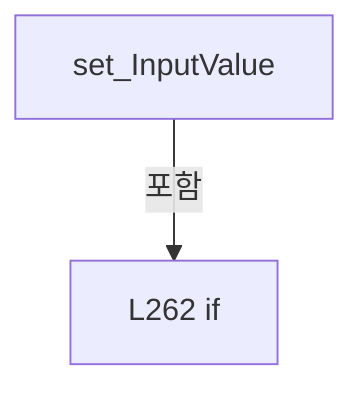

변경 전 점검: 입력/반환 타입, 위 호출자, 예외/취소 경로, 공유 상태와 저장·전송 소비자를 함께 확인합니다. 값의 단위나 물리 방향을 이름만으로 확정하지 않습니다.

### PropertyDeclaration `SetOnCommand` · L269–269

[Drilling.UI/Popup/CMelsecStageSimulationDialog.xaml.cs:269–269](https://github.com/kjuws10-rgb/A3Drilling/blob/5aee8e58439c9b455cae7c9593c9be986c3e682e/Drilling.UI/Popup/CMelsecStageSimulationDialog.xaml.cs#L269-L269)

| 항목 | 실제 추출 값 |
| --- | --- |
| 서명 | Drilling.UI.Menu.CButtonCommand Drilling.UI.Popup.CMelsecStageSimulationRow.SetOnCommand |
| 접근/수식자 | Public / public |
| 반환/값 타입 | Drilling.UI.Menu.CButtonCommand |
| 소속 타입 | NamedType:Drilling.UI.Popup.CMelsecStageSimulationRow |

현재 부분 분석에서 직접 연결된 호출자는 없습니다. XAML/이벤트/인터페이스·델리게이트·외부 진입을 추가 확인해야 하며, 미사용으로 판정한 것이 아닙니다.

변경 전 점검: 입력/반환 타입, 위 호출자, 예외/취소 경로, 공유 상태와 저장·전송 소비자를 함께 확인합니다. 값의 단위나 물리 방향을 이름만으로 확정하지 않습니다.

### GetAccessorDeclaration `get_SetOnCommand` · L269–269

[Drilling.UI/Popup/CMelsecStageSimulationDialog.xaml.cs:269–269](https://github.com/kjuws10-rgb/A3Drilling/blob/5aee8e58439c9b455cae7c9593c9be986c3e682e/Drilling.UI/Popup/CMelsecStageSimulationDialog.xaml.cs#L269-L269)

| 항목 | 실제 추출 값 |
| --- | --- |
| 서명 | Drilling.UI.Menu.CButtonCommand Drilling.UI.Popup.CMelsecStageSimulationRow.SetOnCommand.get |
| 접근/수식자 | Public / get |
| 반환/값 타입 | Drilling.UI.Menu.CButtonCommand |
| 소속 타입 | NamedType:Drilling.UI.Popup.CMelsecStageSimulationRow |

현재 부분 분석에서 직접 연결된 호출자는 없습니다. XAML/이벤트/인터페이스·델리게이트·외부 진입을 추가 확인해야 하며, 미사용으로 판정한 것이 아닙니다.

변경 전 점검: 입력/반환 타입, 위 호출자, 예외/취소 경로, 공유 상태와 저장·전송 소비자를 함께 확인합니다. 값의 단위나 물리 방향을 이름만으로 확정하지 않습니다.

### PropertyDeclaration `SetOffCommand` · L270–270

[Drilling.UI/Popup/CMelsecStageSimulationDialog.xaml.cs:270–270](https://github.com/kjuws10-rgb/A3Drilling/blob/5aee8e58439c9b455cae7c9593c9be986c3e682e/Drilling.UI/Popup/CMelsecStageSimulationDialog.xaml.cs#L270-L270)

| 항목 | 실제 추출 값 |
| --- | --- |
| 서명 | Drilling.UI.Menu.CButtonCommand Drilling.UI.Popup.CMelsecStageSimulationRow.SetOffCommand |
| 접근/수식자 | Public / public |
| 반환/값 타입 | Drilling.UI.Menu.CButtonCommand |
| 소속 타입 | NamedType:Drilling.UI.Popup.CMelsecStageSimulationRow |

현재 부분 분석에서 직접 연결된 호출자는 없습니다. XAML/이벤트/인터페이스·델리게이트·외부 진입을 추가 확인해야 하며, 미사용으로 판정한 것이 아닙니다.

변경 전 점검: 입력/반환 타입, 위 호출자, 예외/취소 경로, 공유 상태와 저장·전송 소비자를 함께 확인합니다. 값의 단위나 물리 방향을 이름만으로 확정하지 않습니다.

### GetAccessorDeclaration `get_SetOffCommand` · L270–270

[Drilling.UI/Popup/CMelsecStageSimulationDialog.xaml.cs:270–270](https://github.com/kjuws10-rgb/A3Drilling/blob/5aee8e58439c9b455cae7c9593c9be986c3e682e/Drilling.UI/Popup/CMelsecStageSimulationDialog.xaml.cs#L270-L270)

| 항목 | 실제 추출 값 |
| --- | --- |
| 서명 | Drilling.UI.Menu.CButtonCommand Drilling.UI.Popup.CMelsecStageSimulationRow.SetOffCommand.get |
| 접근/수식자 | Public / get |
| 반환/값 타입 | Drilling.UI.Menu.CButtonCommand |
| 소속 타입 | NamedType:Drilling.UI.Popup.CMelsecStageSimulationRow |

현재 부분 분석에서 직접 연결된 호출자는 없습니다. XAML/이벤트/인터페이스·델리게이트·외부 진입을 추가 확인해야 하며, 미사용으로 판정한 것이 아닙니다.

변경 전 점검: 입력/반환 타입, 위 호출자, 예외/취소 경로, 공유 상태와 저장·전송 소비자를 함께 확인합니다. 값의 단위나 물리 방향을 이름만으로 확정하지 않습니다.

### PropertyDeclaration `SetValueCommand` · L271–271

[Drilling.UI/Popup/CMelsecStageSimulationDialog.xaml.cs:271–271](https://github.com/kjuws10-rgb/A3Drilling/blob/5aee8e58439c9b455cae7c9593c9be986c3e682e/Drilling.UI/Popup/CMelsecStageSimulationDialog.xaml.cs#L271-L271)

| 항목 | 실제 추출 값 |
| --- | --- |
| 서명 | Drilling.UI.Menu.CButtonCommand Drilling.UI.Popup.CMelsecStageSimulationRow.SetValueCommand |
| 접근/수식자 | Public / public |
| 반환/값 타입 | Drilling.UI.Menu.CButtonCommand |
| 소속 타입 | NamedType:Drilling.UI.Popup.CMelsecStageSimulationRow |

현재 부분 분석에서 직접 연결된 호출자는 없습니다. XAML/이벤트/인터페이스·델리게이트·외부 진입을 추가 확인해야 하며, 미사용으로 판정한 것이 아닙니다.

변경 전 점검: 입력/반환 타입, 위 호출자, 예외/취소 경로, 공유 상태와 저장·전송 소비자를 함께 확인합니다. 값의 단위나 물리 방향을 이름만으로 확정하지 않습니다.

### GetAccessorDeclaration `get_SetValueCommand` · L271–271

[Drilling.UI/Popup/CMelsecStageSimulationDialog.xaml.cs:271–271](https://github.com/kjuws10-rgb/A3Drilling/blob/5aee8e58439c9b455cae7c9593c9be986c3e682e/Drilling.UI/Popup/CMelsecStageSimulationDialog.xaml.cs#L271-L271)

| 항목 | 실제 추출 값 |
| --- | --- |
| 서명 | Drilling.UI.Menu.CButtonCommand Drilling.UI.Popup.CMelsecStageSimulationRow.SetValueCommand.get |
| 접근/수식자 | Public / get |
| 반환/값 타입 | Drilling.UI.Menu.CButtonCommand |
| 소속 타입 | NamedType:Drilling.UI.Popup.CMelsecStageSimulationRow |

현재 부분 분석에서 직접 연결된 호출자는 없습니다. XAML/이벤트/인터페이스·델리게이트·외부 진입을 추가 확인해야 하며, 미사용으로 판정한 것이 아닙니다.

변경 전 점검: 입력/반환 타입, 위 호출자, 예외/취소 경로, 공유 상태와 저장·전송 소비자를 함께 확인합니다. 값의 단위나 물리 방향을 이름만으로 확정하지 않습니다.

### ConstructorDeclaration `.ctor` · L273–357

[Drilling.UI/Popup/CMelsecStageSimulationDialog.xaml.cs:273–357](https://github.com/kjuws10-rgb/A3Drilling/blob/5aee8e58439c9b455cae7c9593c9be986c3e682e/Drilling.UI/Popup/CMelsecStageSimulationDialog.xaml.cs#L273-L357)

| 항목 | 실제 추출 값 |
| --- | --- |
| 서명 | Drilling.UI.Popup.CMelsecStageSimulationRow.CMelsecStageSimulationRow(Drilling.Common.Interface.ST_MELSEC_MAP_DATA, System.Action<int>, System.Action<string>?, System.Action<double>?) |
| 접근/수식자 | Public / public |
| 반환/값 타입 | void |
| 소속 타입 | NamedType:Drilling.UI.Popup.CMelsecStageSimulationRow |

입력 계약:

| 이름 | 타입 | 전달 | 선택/기본값 |
| --- | --- | --- | --- |
| data | Drilling.Common.Interface.ST_MELSEC_MAP_DATA | None | False /  |
| set | System.Action<int> | None | False /  |
| showWarning | System.Action<string>? | None | True / null |
| setMeasurement | System.Action<double>? | None | True / null |

정적 호출자로 확인된 위치:

| 호출 파일/행 | 호출 표현식 | 런타임 분기 가능 |
| --- | --- | --- |
| [Drilling.UI/Popup/CMelsecStageSimulationDialog.xaml.cs:165–175](https://github.com/kjuws10-rgb/A3Drilling/blob/5aee8e58439c9b455cae7c9593c9be986c3e682e/Drilling.UI/Popup/CMelsecStageSimulationDialog.xaml.cs#L165-L175) | new | False |

호출하는 대상과 해석 범위:

| 원본 행 | 표현식 | 분석 상태 | 대상/소스 위치 |
| --- | --- | --- | --- |
| 276 | CMelsec.IsDistortionMeasurementSimulationValue | resolved | bool Drilling.Common.Interface.CMelsec.IsDistortionMeasurementSimulationValue(Drilling.Common.Interface.ST_MELSEC_MAP_DATA) · Drilling.Common/Interface/Melsec/CMelsec.cs:3059 |
| 278 | data.Group.ToUpperInvariant | resolved | string string.ToUpperInvariant() |
| 292 | data.Id.Equals | resolved | bool string.Equals(string?, System.StringComparison) |
| 293 | data.Id.Equals | resolved | bool string.Equals(string?, System.StringComparison) |
| 307 | data.Id.Split | resolved | string[] string.Split(char, System.StringSplitOptions) |
| 307 | int.Parse | resolved | int int.Parse(System.ReadOnlySpan<char>, System.IFormatProvider?) |
| 307 | parts[1].AsSpan | resolved | System.ReadOnlySpan<char> string?.AsSpan(int) |
| 308 | int.Parse | resolved | int int.Parse(System.ReadOnlySpan<char>, System.IFormatProvider?) |
| 308 | parts[2].AsSpan | resolved | System.ReadOnlySpan<char> string?.AsSpan(int, int) |
| 311 | CMelsec.IsSimulationOnlyRoute | resolved | bool Drilling.Common.Interface.CMelsec.IsSimulationOnlyRoute(Drilling.Common.Interface.ST_MELSEC_MAP_DATA) · Drilling.Common/Interface/Melsec/CMelsec.cs:3055 |
| 313 | CMelsec.IsStageAlignSimulationSignal | resolved | bool Drilling.Common.Interface.CMelsec.IsStageAlignSimulationSignal(Drilling.Common.Interface.ST_MELSEC_MAP_DATA) · Drilling.Common/Interface/Melsec/CMelsec.cs:3129 |
| 316 | CRecipeConfirmDialog.ShowWarning | resolved | void Drilling.UI.Popup.CRecipeConfirmDialog.ShowWarning(string, string, Window?) · Drilling.UI/Popup/CRecipeConfirmDialog.xaml.cs:86 |
| 331 | new | resolved | Drilling.UI.Menu.CButtonCommand.CButtonCommand(System.Action<object?>, System.Predicate<object?>?) · Drilling.UI/Menu/CButtonCommand.cs:9 |
| 331 | Set | resolved | void Set(int) · Drilling.UI/Popup/CMelsecStageSimulationDialog.xaml.cs:317 |
| 332 | new | resolved | Drilling.UI.Menu.CButtonCommand.CButtonCommand(System.Action<object?>, System.Predicate<object?>?) · Drilling.UI/Menu/CButtonCommand.cs:9 |
| 332 | Set | resolved | void Set(int) · Drilling.UI/Popup/CMelsecStageSimulationDialog.xaml.cs:317 |
| 333 | new | resolved | Drilling.UI.Menu.CButtonCommand.CButtonCommand(System.Action<object?>, System.Predicate<object?>?) · Drilling.UI/Menu/CButtonCommand.cs:9 |
| 341 | double.TryParse | resolved | bool double.TryParse(string?, System.Globalization.NumberStyles, System.IFormatProvider?, out double) |
| 341 | double.IsFinite | resolved | bool double.IsFinite(double) |
| 342 | new InvalidOperationException | resolved | System.InvalidOperationException.InvalidOperationException(string?) |
| 343 | new InvalidOperationException | resolved | System.InvalidOperationException.InvalidOperationException(string?) |
| 344 | setMeasurement | resolved · 동적 구현 선택 가능 | void System.Action<double>.Invoke(double) |
| 346 | warn | resolved · 동적 구현 선택 가능 | void System.Action<string>.Invoke(string) |
| 349 | int.TryParse | resolved | bool int.TryParse(string?, System.Globalization.NumberStyles, System.IFormatProvider?, out int) |
| 351 | warn | resolved · 동적 구현 선택 가능 | void System.Action<string>.Invoke(string) |
| 355 | Set | resolved | void Set(int) · Drilling.UI/Popup/CMelsecStageSimulationDialog.xaml.cs:317 |

본문의 실제 연산·분기·예외·반환 순서(원문 위치 순):

| 원본 행 | 종류 | 주석 해설 |
| --- | --- | --- |
| 275 | assignment | 값을 대상에 대입합니다: Id = data.Id |
| 276 | assignment | 값을 대상에 대입합니다: IsMeasurement = CMelsec.IsDistortionMeasurementSimulationValue(data) |
| 276 | call | 함수·델리게이트 또는 객체 생성자를 호출합니다: CMelsec.IsDistortionMeasurementSimulationValue(data) |
| 277 | assignment | 값을 대상에 대입합니다: DeviceNo = data.DeviceNo |
| 278 | call | 함수·델리게이트 또는 객체 생성자를 호출합니다: data.Group.ToUpperInvariant() |
| 278 | assignment | 값을 대상에 대입합니다: Scenario = data.Group.ToUpperInvariant() switch { "DISTORTION" => "Distortion", "VISION_DISTORTION_DATA" => "Distortion Data", "IF_DOREADY" => "DoReady", "IF_PROCESS" => "Process", "IF_REVIEW" => "Review", "IF_TOP_POWERMETER" => " |
| 278 | switch-expression | 값별 결과식을 선택합니다: data.Group.ToUpperInvariant() switch { "DISTORTION" => "Distortion", "VISION_DISTORTION_DATA" => "Distortion Data", "IF_DOREADY" => "DoReady", "IF_PROCESS" => "Process", "IF_REVIEW" => "Review", "IF_TOP_POWERMETER" => "TPM", "IF_P |
| 292 | assignment | 값을 대상에 대입합니다: IsCount = data.Id.Equals(CMelsec.StageProtectWindowCountId, StringComparison.OrdinalIgnoreCase) |
| 292 | call | 함수·델리게이트 또는 객체 생성자를 호출합니다: data.Id.Equals(CMelsec.StageProtectWindowCountId, StringComparison.OrdinalIgnoreCase) |
| 293 | assignment | 값을 대상에 대입합니다: IsAlignBusyWord = data.Id.Equals(CMelsec.StageAlignBusyWordId, StringComparison.OrdinalIgnoreCase) |
| 293 | call | 함수·델리게이트 또는 객체 생성자를 호출합니다: data.Id.Equals(CMelsec.StageAlignBusyWordId, StringComparison.OrdinalIgnoreCase) |
| 294 | assignment | 값을 대상에 대입합니다: Name = data.Id switch { "IPS_REVIEW_CONTROL_MODE_X" => "Review X Permit", "IPS_REVIEW_CONTROL_MODE_Y" => "Stage Y Permit", "IPS_IOF_READ_COMPLETE" => "IOF Read Done", "IPS_IOF_BUFFER_RUN_COMPLETE" => "IOF Buffer Done", CMelsec.Sta |
| 294 | switch-expression | 값별 결과식을 선택합니다: data.Id switch { "IPS_REVIEW_CONTROL_MODE_X" => "Review X Permit", "IPS_REVIEW_CONTROL_MODE_Y" => "Stage Y Permit", "IPS_IOF_READ_COMPLETE" => "IOF Read Done", "IPS_IOF_BUFFER_RUN_COMPLETE" => "IOF Buffer Done", CMelsec.StageAlign |
| 305 | if | 조건에 따라 분기합니다: if (IsMeasurement) |
| 307 | call | 함수·델리게이트 또는 객체 생성자를 호출합니다: data.Id.Split('_') |
| 307 | call | 함수·델리게이트 또는 객체 생성자를 호출합니다: int.Parse(parts[1].AsSpan(3), CultureInfo.InvariantCulture) |
| 307 | call | 함수·델리게이트 또는 객체 생성자를 호출합니다: parts[1].AsSpan(3) |
| 307 | local-declaration | 지역 변수를 선언합니다: var parts = data.Id.Split('_'); |
| 307 | local-declaration | 지역 변수를 선언합니다: var position = int.Parse(parts[1].AsSpan(3), CultureInfo.InvariantCulture); |
| 307 | variable-initializer | 변수의 초기값을 지정합니다: parts = data.Id.Split('_') |
| 307 | variable-initializer | 변수의 초기값을 지정합니다: position = int.Parse(parts[1].AsSpan(3), CultureInfo.InvariantCulture) |
| 308 | call | 함수·델리게이트 또는 객체 생성자를 호출합니다: int.Parse(parts[2].AsSpan(3, 1), CultureInfo.InvariantCulture) |
| 308 | call | 함수·델리게이트 또는 객체 생성자를 호출합니다: parts[2].AsSpan(3, 1) |
| 308 | local-declaration | 지역 변수를 선언합니다: var camera = int.Parse(parts[2].AsSpan(3, 1), CultureInfo.InvariantCulture); |
| 308 | local-declaration | 지역 변수를 선언합니다: var axis = data.Id[^1]; |
| 308 | variable-initializer | 변수의 초기값을 지정합니다: camera = int.Parse(parts[2].AsSpan(3, 1), CultureInfo.InvariantCulture) |
| 308 | variable-initializer | 변수의 초기값을 지정합니다: axis = data.Id[^1] |
| 309 | assignment | 값을 대상에 대입합니다: Name = position == 0 ? $"AK{camera} {axis} (mm)" : $"Group {position - 1} / DK{(position - 1) * 2 + (camera == 2 ? 1 : 2)} {axis} (mm)" |
| 309 | conditional-expression | 조건에 따라 결과식을 선택합니다: position == 0 ? $"AK{camera} {axis} (mm)" : $"Group {position - 1} / DK{(position - 1) * 2 + (camera == 2 ? 1 : 2)} {axis} (mm)" |
| 309 | conditional-expression | 조건에 따라 결과식을 선택합니다: camera == 2 ? 1 : 2 |
| 311 | assignment | 값을 대상에 대입합니다: Address = CMelsec.IsSimulationOnlyRoute(data) ? $"MELSEC_{data.DeviceNo} / SIM ONLY" : $"MELSEC_{data.DeviceNo} / {data.Address}" |
| 311 | call | 함수·델리게이트 또는 객체 생성자를 호출합니다: CMelsec.IsSimulationOnlyRoute(data) |
| 311 | conditional-expression | 조건에 따라 결과식을 선택합니다: CMelsec.IsSimulationOnlyRoute(data) ? $"MELSEC_{data.DeviceNo} / SIM ONLY" : $"MELSEC_{data.DeviceNo} / {data.Address}" |
| 312 | assignment | 값을 대상에 대입합니다: Description = data.Description |
| 313 | assignment | 값을 대상에 대입합니다: IsNumeric = CMelsec.IsStageAlignSimulationSignal(data) &#124;&#124; IsCount &#124;&#124; IsMeasurement |
| 313 | call | 함수·델리게이트 또는 객체 생성자를 호출합니다: CMelsec.IsStageAlignSimulationSignal(data) |
| 314 | assignment | 값을 대상에 대입합니다: _inputValue = IsMeasurement ? "0" : IsAlignBusyWord ? "2" : IsNumeric && !IsCount ? "10000" : "0" |
| 314 | conditional-expression | 조건에 따라 결과식을 선택합니다: IsMeasurement ? "0" : IsAlignBusyWord ? "2" : IsNumeric && !IsCount ? "10000" : "0" |
| 314 | conditional-expression | 조건에 따라 결과식을 선택합니다: IsAlignBusyWord ? "2" : IsNumeric && !IsCount ? "10000" : "0" |
| 314 | conditional-expression | 조건에 따라 결과식을 선택합니다: IsNumeric && !IsCount ? "10000" : "0" |
| 315 | assignment | 값을 대상에 대입합니다: _readScale = data.ReadScale |
| 316 | call | 함수·델리게이트 또는 객체 생성자를 호출합니다: CRecipeConfirmDialog.ShowWarning("Stage 신호 변경 실패", message) |
| 316 | local-declaration | 지역 변수를 선언합니다: var warn = showWarning ?? (message => CRecipeConfirmDialog.ShowWarning("Stage 신호 변경 실패", message)); |
| 316 | variable-initializer | 변수의 초기값을 지정합니다: warn = showWarning ?? (message => CRecipeConfirmDialog.ShowWarning("Stage 신호 변경 실패", message)) |
| 331 | assignment | 값을 대상에 대입합니다: SetOnCommand = new(_ => Set(1), _ => _canSet && !IsNumeric) |
| 331 | call | 함수·델리게이트 또는 객체 생성자를 호출합니다: new(_ => Set(1), _ => _canSet && !IsNumeric) |
| 331 | call | 함수·델리게이트 또는 객체 생성자를 호출합니다: Set(1) |
| 332 | assignment | 값을 대상에 대입합니다: SetOffCommand = new(_ => Set(0), _ => _canSet && !IsNumeric) |
| 332 | call | 함수·델리게이트 또는 객체 생성자를 호출합니다: new(_ => Set(0), _ => _canSet && !IsNumeric) |
| 332 | call | 함수·델리게이트 또는 객체 생성자를 호출합니다: Set(0) |
| 333 | assignment | 값을 대상에 대입합니다: SetValueCommand = new(_ => { if (!_canSet &#124;&#124; !IsNumeric) return; if (IsMeasurement) { try { if (!double.TryParse(InputValue, NumberStyles.Float, CultureInfo.InvariantCulture, out var mm) &#124;&#124; !double.IsFinite(mm)) throw new InvalidO |
| 333 | call | 함수·델리게이트 또는 객체 생성자를 호출합니다: new(_ => { if (!_canSet &#124;&#124; !IsNumeric) return; if (IsMeasurement) { try { if (!double.TryParse(InputValue, NumberStyles.Float, CultureInfo.InvariantCulture, out var mm) &#124;&#124; !double.IsFinite(mm)) throw new InvalidOperation… |
| 335 | if | 조건에 따라 분기합니다: if (!_canSet &#124;&#124; !IsNumeric) |
| 336 | return | 호출자에게 값 또는 제어를 반환합니다: return; |
| 337 | if | 조건에 따라 분기합니다: if (IsMeasurement) |
| 339 | try | 예외 처리 범위입니다: try |
| 341 | call | 함수·델리게이트 또는 객체 생성자를 호출합니다: double.TryParse(InputValue, NumberStyles.Float, CultureInfo.InvariantCulture, out var mm) |
| 341 | call | 함수·델리게이트 또는 객체 생성자를 호출합니다: double.IsFinite(mm) |
| 341 | if | 조건에 따라 분기합니다: if (!double.TryParse(InputValue, NumberStyles.Float, CultureInfo.InvariantCulture, out var mm) &#124;&#124; !double.IsFinite(mm)) |
| 342 | call | 함수·델리게이트 또는 객체 생성자를 호출합니다: new InvalidOperationException("유효한 mm 숫자를 입력하세요. 음수와 소수 입력이 가능합니다.") |
| 342 | throw | 예외를 발생/전달합니다: throw new InvalidOperationException("유효한 mm 숫자를 입력하세요. 음수와 소수 입력이 가능합니다."); |
| 343 | call | 함수·델리게이트 또는 객체 생성자를 호출합니다: new InvalidOperationException("측정값 입력이 연결되어 있지 않습니다.") |
| 343 | if | 조건에 따라 분기합니다: if (setMeasurement is null) |
| 343 | throw | 예외를 발생/전달합니다: throw new InvalidOperationException("측정값 입력이 연결되어 있지 않습니다."); |
| 344 | call | 함수·델리게이트 또는 객체 생성자를 호출합니다: setMeasurement(mm) |
| 346 | call | 함수·델리게이트 또는 객체 생성자를 호출합니다: warn(error.Message) |
| 346 | catch | 지정 예외를 처리합니다: catch (Exception error) |
| 347 | return | 호출자에게 값 또는 제어를 반환합니다: return; |
| 349 | call | 함수·델리게이트 또는 객체 생성자를 호출합니다: int.TryParse(InputValue, NumberStyles.Integer, CultureInfo.InvariantCulture, out var value) |
| 349 | if | 조건에 따라 분기합니다: if (!int.TryParse(InputValue, NumberStyles.Integer, CultureInfo.InvariantCulture, out var value) &#124;&#124; value is < 0 or > ushort.MaxValue) |
| 351 | call | 함수·델리게이트 또는 객체 생성자를 호출합니다: warn("0~65535의 원시 정수를 입력하세요.") |
| 352 | return | 호출자에게 값 또는 제어를 반환합니다: return; |
| 355 | call | 함수·델리게이트 또는 객체 생성자를 호출합니다: Set(value) |

제어 구문의 포함 구조(실제 실행 순서/CFG가 아닌 구문 탐색 그림):

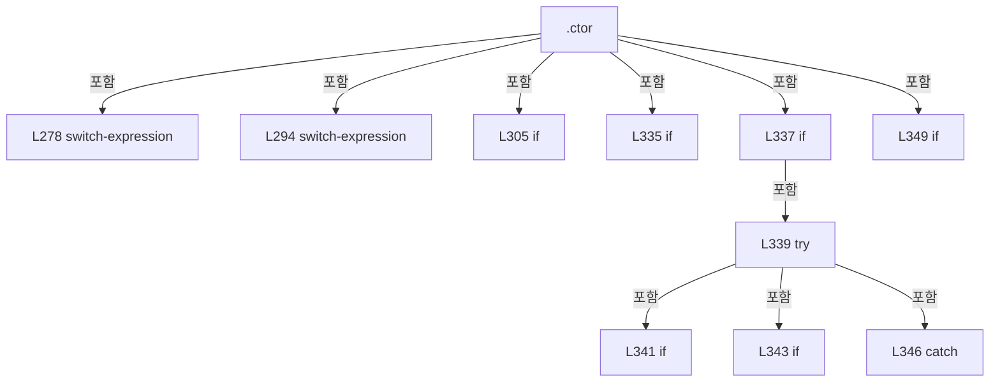

변경 전 점검: 입력/반환 타입, 위 호출자, 예외/취소 경로, 공유 상태와 저장·전송 소비자를 함께 확인합니다. 값의 단위나 물리 방향을 이름만으로 확정하지 않습니다.

### LocalFunctionStatement `Set` · L317–329

[Drilling.UI/Popup/CMelsecStageSimulationDialog.xaml.cs:317–329](https://github.com/kjuws10-rgb/A3Drilling/blob/5aee8e58439c9b455cae7c9593c9be986c3e682e/Drilling.UI/Popup/CMelsecStageSimulationDialog.xaml.cs#L317-L329)

| 항목 | 실제 추출 값 |
| --- | --- |
| 서명 | void Set(int) |
| 접근/수식자 | Private /  |
| 반환/값 타입 | void |
| 소속 타입 | NamedType:Drilling.UI.Popup.CMelsecStageSimulationRow |

입력 계약:

| 이름 | 타입 | 전달 | 선택/기본값 |
| --- | --- | --- | --- |
| value | int | None | False /  |

정적 호출자로 확인된 위치:

| 호출 파일/행 | 호출 표현식 | 런타임 분기 가능 |
| --- | --- | --- |
| [Drilling.UI/Popup/CMelsecStageSimulationDialog.xaml.cs:331–331](https://github.com/kjuws10-rgb/A3Drilling/blob/5aee8e58439c9b455cae7c9593c9be986c3e682e/Drilling.UI/Popup/CMelsecStageSimulationDialog.xaml.cs#L331-L331) | Set | False |
| [Drilling.UI/Popup/CMelsecStageSimulationDialog.xaml.cs:332–332](https://github.com/kjuws10-rgb/A3Drilling/blob/5aee8e58439c9b455cae7c9593c9be986c3e682e/Drilling.UI/Popup/CMelsecStageSimulationDialog.xaml.cs#L332-L332) | Set | False |
| [Drilling.UI/Popup/CMelsecStageSimulationDialog.xaml.cs:355–355](https://github.com/kjuws10-rgb/A3Drilling/blob/5aee8e58439c9b455cae7c9593c9be986c3e682e/Drilling.UI/Popup/CMelsecStageSimulationDialog.xaml.cs#L355-L355) | Set | False |

호출하는 대상과 해석 범위:

| 원본 행 | 표현식 | 분석 상태 | 대상/소스 위치 |
| --- | --- | --- | --- |
| 323 | set | resolved · 동적 구현 선택 가능 | void System.Action<int>.Invoke(int) |
| 327 | warn | resolved · 동적 구현 선택 가능 | void System.Action<string>.Invoke(string) |

본문의 실제 연산·분기·예외·반환 순서(원문 위치 순):

| 원본 행 | 종류 | 주석 해설 |
| --- | --- | --- |
| 319 | if | 조건에 따라 분기합니다: if (!_canSet) |
| 320 | return | 호출자에게 값 또는 제어를 반환합니다: return; |
| 321 | try | 예외 처리 범위입니다: try |
| 323 | call | 함수·델리게이트 또는 객체 생성자를 호출합니다: set(value) |
| 325 | catch | 지정 예외를 처리합니다: catch (Exception exception) |
| 327 | call | 함수·델리게이트 또는 객체 생성자를 호출합니다: warn(exception.Message) |

제어 구문의 포함 구조(실제 실행 순서/CFG가 아닌 구문 탐색 그림):

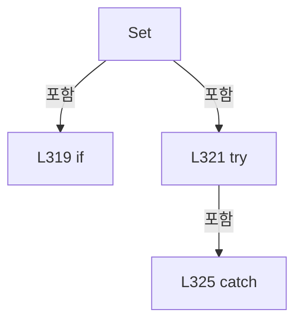

변경 전 점검: 입력/반환 타입, 위 호출자, 예외/취소 경로, 공유 상태와 저장·전송 소비자를 함께 확인합니다. 값의 단위나 물리 방향을 이름만으로 확정하지 않습니다.

### MethodDeclaration `Refresh` · L359–415

[Drilling.UI/Popup/CMelsecStageSimulationDialog.xaml.cs:359–415](https://github.com/kjuws10-rgb/A3Drilling/blob/5aee8e58439c9b455cae7c9593c9be986c3e682e/Drilling.UI/Popup/CMelsecStageSimulationDialog.xaml.cs#L359-L415)

| 항목 | 실제 추출 값 |
| --- | --- |
| 서명 | void Drilling.UI.Popup.CMelsecStageSimulationRow.Refresh(Drilling.Common.Interface.ST_MELSEC_CACHED_VALUE?, bool) |
| 접근/수식자 | Public / public |
| 반환/값 타입 | void |
| 소속 타입 | NamedType:Drilling.UI.Popup.CMelsecStageSimulationRow |

입력 계약:

| 이름 | 타입 | 전달 | 선택/기본값 |
| --- | --- | --- | --- |
| sample | Drilling.Common.Interface.ST_MELSEC_CACHED_VALUE? | None | False /  |
| simulation | bool | None | False /  |

정적 호출자로 확인된 위치:

| 호출 파일/행 | 호출 표현식 | 런타임 분기 가능 |
| --- | --- | --- |
| [Drilling.UI/Popup/CMelsecStageSimulationDialog.xaml.cs:195–195](https://github.com/kjuws10-rgb/A3Drilling/blob/5aee8e58439c9b455cae7c9593c9be986c3e682e/Drilling.UI/Popup/CMelsecStageSimulationDialog.xaml.cs#L195-L195) | row.Refresh | False |

호출하는 대상과 해석 범위:

| 원본 행 | 표현식 | 분석 상태 | 대상/소스 위치 |
| --- | --- | --- | --- |
| 364 | Changed | resolved | void Drilling.UI.Popup.CMelsecStageSimulationRow.Changed(string?) · Drilling.UI/Popup/CMelsecStageSimulationDialog.xaml.cs:417 |
| 364 | nameof | unresolved | None |
| 365 | SetOnCommand.NotifyCanExecuteChanged | resolved | void Drilling.UI.Menu.CButtonCommand.NotifyCanExecuteChanged() · Drilling.UI/Menu/CButtonCommand.cs:24 |
| 366 | SetOffCommand.NotifyCanExecuteChanged | resolved | void Drilling.UI.Menu.CButtonCommand.NotifyCanExecuteChanged() · Drilling.UI/Menu/CButtonCommand.cs:24 |
| 367 | SetValueCommand.NotifyCanExecuteChanged | resolved | void Drilling.UI.Menu.CButtonCommand.NotifyCanExecuteChanged() · Drilling.UI/Menu/CButtonCommand.cs:24 |
| 370 | Convert.ToString | resolved | string? System.Convert.ToString(object?, System.IFormatProvider?) |
| 387 | Convert.ToDouble(sample!.Value, CultureInfo.InvariantCulture).ToString | resolved | string double.ToString(string?, System.IFormatProvider?) |
| 387 | Convert.ToDouble | resolved | double System.Convert.ToDouble(object?, System.IFormatProvider?) |
| 392 | Convert.ToDouble | resolved | double System.Convert.ToDouble(object?, System.IFormatProvider?) |
| 394 | scaled.ToString | resolved | string double.ToString(string?, System.IFormatProvider?) |
| 394 | rawValue.ToString | resolved | string double.ToString(string?, System.IFormatProvider?) |
| 394 | scaled.ToString | resolved | string double.ToString(string?, System.IFormatProvider?) |
| 407 | Changed | resolved | void Drilling.UI.Popup.CMelsecStageSimulationRow.Changed(string?) · Drilling.UI/Popup/CMelsecStageSimulationDialog.xaml.cs:417 |
| 407 | nameof | unresolved | None |
| 413 | Changed | resolved | void Drilling.UI.Popup.CMelsecStageSimulationRow.Changed(string?) · Drilling.UI/Popup/CMelsecStageSimulationDialog.xaml.cs:417 |
| 413 | nameof | unresolved | None |

본문의 실제 연산·분기·예외·반환 순서(원문 위치 순):

| 원본 행 | 종류 | 주석 해설 |
| --- | --- | --- |
| 361 | if | 조건에 따라 분기합니다: if (_canSet != simulation) |
| 363 | assignment | 값을 대상에 대입합니다: _canSet = simulation |
| 364 | call | 함수·델리게이트 또는 객체 생성자를 호출합니다: Changed(nameof(CanSet)) |
| 364 | call | 함수·델리게이트 또는 객체 생성자를 호출합니다: nameof(CanSet) |
| 365 | call | 함수·델리게이트 또는 객체 생성자를 호출합니다: SetOnCommand.NotifyCanExecuteChanged() |
| 366 | call | 함수·델리게이트 또는 객체 생성자를 호출합니다: SetOffCommand.NotifyCanExecuteChanged() |
| 367 | call | 함수·델리게이트 또는 객체 생성자를 호출합니다: SetValueCommand.NotifyCanExecuteChanged() |
| 370 | call | 함수·델리게이트 또는 객체 생성자를 호출합니다: Convert.ToString(sample.Value, System.Globalization.CultureInfo.InvariantCulture) |
| 370 | conditional-expression | 조건에 따라 결과식을 선택합니다: sample is { IsValid: true } ? Convert.ToString(sample.Value, System.Globalization.CultureInfo.InvariantCulture) : null |
| 370 | local-declaration | 지역 변수를 선언합니다: var raw = sample is { IsValid: true } ? Convert.ToString(sample.Value, System.Globalization.CultureInfo.InvariantCulture) : null; |
| 370 | variable-initializer | 변수의 초기값을 지정합니다: raw = sample is { IsValid: true } ? Convert.ToString(sample.Value, System.Globalization.CultureInfo.InvariantCulture) : null |
| 371 | local-declaration | 지역 변수를 선언합니다: var text = raw switch { "1" => "ON (1)", "0" => "OFF (0)", null => "—", _ => raw }; |
| 371 | switch-expression | 값별 결과식을 선택합니다: raw switch { "1" => "ON (1)", "0" => "OFF (0)", null => "—", _ => raw } |
| 371 | variable-initializer | 변수의 초기값을 지정합니다: text = raw switch { "1" => "ON (1)", "0" => "OFF (0)", null => "—", _ => raw } |
| 378 | local-declaration | 지역 변수를 선언합니다: var brush = raw switch { "1" => Brushes.ForestGreen, "0" => Brushes.DarkGoldenrod, null => Brushes.Gray, _ => Brushes.Firebrick }; |
| 378 | switch-expression | 값별 결과식을 선택합니다: raw switch { "1" => Brushes.ForestGreen, "0" => Brushes.DarkGoldenrod, null => Brushes.Gray, _ => Brushes.Firebrick } |
| 378 | variable-initializer | 변수의 초기값을 지정합니다: brush = raw switch { "1" => Brushes.ForestGreen, "0" => Brushes.DarkGoldenrod, null => Brushes.Gray, _ => Brushes.Firebrick } |
| 385 | if | 조건에 따라 분기합니다: if (IsMeasurement && raw is not null) |
| 387 | assignment | 값을 대상에 대입합니다: text = Convert.ToDouble(sample!.Value, CultureInfo.InvariantCulture).ToString("0.####", CultureInfo.InvariantCulture) + " mm" |
| 387 | call | 함수·델리게이트 또는 객체 생성자를 호출합니다: Convert.ToDouble(sample!.Value, CultureInfo.InvariantCulture).ToString("0.####", CultureInfo.InvariantCulture) |
| 387 | call | 함수·델리게이트 또는 객체 생성자를 호출합니다: Convert.ToDouble(sample!.Value, CultureInfo.InvariantCulture) |
| 388 | assignment | 값을 대상에 대입합니다: brush = Brushes.SteelBlue |
| 390 | else | 앞 조건이 거짓인 경로입니다: else |
| 390 | if | 조건에 따라 분기합니다: if (IsNumeric && raw is not null) |
| 392 | call | 함수·델리게이트 또는 객체 생성자를 호출합니다: Convert.ToDouble(sample!.Value, CultureInfo.InvariantCulture) |
| 392 | local-declaration | 지역 변수를 선언합니다: var scaled = Convert.ToDouble(sample!.Value, CultureInfo.InvariantCulture); |
| 392 | variable-initializer | 변수의 초기값을 지정합니다: scaled = Convert.ToDouble(sample!.Value, CultureInfo.InvariantCulture) |
| 393 | local-declaration | 지역 변수를 선언합니다: var rawValue = scaled / _readScale; |
| 393 | variable-initializer | 변수의 초기값을 지정합니다: rawValue = scaled / _readScale |
| 394 | assignment | 값을 대상에 대입합니다: text = IsCount ? scaled.ToString("0.########", CultureInfo.InvariantCulture) : $"{rawValue.ToString("0", CultureInfo.InvariantCulture)} → {scaled.ToString("0.########", CultureInfo.InvariantCulture)}" |
| 394 | call | 함수·델리게이트 또는 객체 생성자를 호출합니다: scaled.ToString("0.########", CultureInfo.InvariantCulture) |
| 394 | call | 함수·델리게이트 또는 객체 생성자를 호출합니다: rawValue.ToString("0", CultureInfo.InvariantCulture) |
| 394 | call | 함수·델리게이트 또는 객체 생성자를 호출합니다: scaled.ToString("0.########", CultureInfo.InvariantCulture) |
| 394 | conditional-expression | 조건에 따라 결과식을 선택합니다: IsCount ? scaled.ToString("0.########", CultureInfo.InvariantCulture) : $"{rawValue.ToString("0", CultureInfo.InvariantCulture)} → {scaled.ToString("0.########", CultureInfo.InvariantCulture)}" |
| 395 | assignment | 값을 대상에 대입합니다: brush = IsCount ? Brushes.SteelBlue : scaled == 1 ? Brushes.ForestGreen : Brushes.Firebrick |
| 395 | conditional-expression | 조건에 따라 결과식을 선택합니다: IsCount ? Brushes.SteelBlue : scaled == 1 ? Brushes.ForestGreen : Brushes.Firebrick |
| 395 | conditional-expression | 조건에 따라 결과식을 선택합니다: scaled == 1 ? Brushes.ForestGreen : Brushes.Firebrick |
| 396 | if | 조건에 따라 분기합니다: if (IsAlignBusyWord) |
| 398 | local-declaration | 지역 변수를 선언합니다: var active = ((int)rawValue & 2) != 0; |
| 398 | variable-initializer | 변수의 초기값을 지정합니다: active = ((int)rawValue & 2) != 0 |
| 399 | assignment | 값을 대상에 대입합니다: text = $"{rawValue:0} · ALIGN {(active ? "ON" : "OFF")}" |
| 399 | conditional-expression | 조건에 따라 결과식을 선택합니다: active ? "ON" : "OFF" |
| 400 | assignment | 값을 대상에 대입합니다: brush = active ? Brushes.ForestGreen : Brushes.DarkGoldenrod |
| 400 | conditional-expression | 조건에 따라 결과식을 선택합니다: active ? Brushes.ForestGreen : Brushes.DarkGoldenrod |
| 404 | if | 조건에 따라 분기합니다: if (_currentValue != text) |
| 406 | assignment | 값을 대상에 대입합니다: _currentValue = text |
| 407 | call | 함수·델리게이트 또는 객체 생성자를 호출합니다: Changed(nameof(CurrentValue)) |
| 407 | call | 함수·델리게이트 또는 객체 생성자를 호출합니다: nameof(CurrentValue) |
| 410 | if | 조건에 따라 분기합니다: if (_stateBrush != brush) |
| 412 | assignment | 값을 대상에 대입합니다: _stateBrush = brush |
| 413 | call | 함수·델리게이트 또는 객체 생성자를 호출합니다: Changed(nameof(StateBrush)) |
| 413 | call | 함수·델리게이트 또는 객체 생성자를 호출합니다: nameof(StateBrush) |

제어 구문의 포함 구조(실제 실행 순서/CFG가 아닌 구문 탐색 그림):

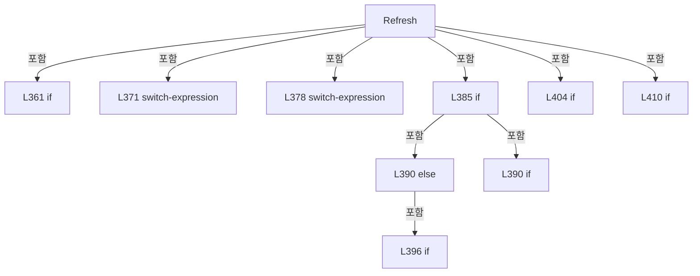

변경 전 점검: 입력/반환 타입, 위 호출자, 예외/취소 경로, 공유 상태와 저장·전송 소비자를 함께 확인합니다. 값의 단위나 물리 방향을 이름만으로 확정하지 않습니다.

### MethodDeclaration `Changed` · L417–417

[Drilling.UI/Popup/CMelsecStageSimulationDialog.xaml.cs:417–417](https://github.com/kjuws10-rgb/A3Drilling/blob/5aee8e58439c9b455cae7c9593c9be986c3e682e/Drilling.UI/Popup/CMelsecStageSimulationDialog.xaml.cs#L417-L417)

| 항목 | 실제 추출 값 |
| --- | --- |
| 서명 | void Drilling.UI.Popup.CMelsecStageSimulationRow.Changed(string?) |
| 접근/수식자 | Private / private |
| 반환/값 타입 | void |
| 소속 타입 | NamedType:Drilling.UI.Popup.CMelsecStageSimulationRow |

입력 계약:

| 이름 | 타입 | 전달 | 선택/기본값 |
| --- | --- | --- | --- |
| name | string? | None | True / null |

정적 호출자로 확인된 위치:

| 호출 파일/행 | 호출 표현식 | 런타임 분기 가능 |
| --- | --- | --- |
| [Drilling.UI/Popup/CMelsecStageSimulationDialog.xaml.cs:265–265](https://github.com/kjuws10-rgb/A3Drilling/blob/5aee8e58439c9b455cae7c9593c9be986c3e682e/Drilling.UI/Popup/CMelsecStageSimulationDialog.xaml.cs#L265-L265) | Changed | False |
| [Drilling.UI/Popup/CMelsecStageSimulationDialog.xaml.cs:364–364](https://github.com/kjuws10-rgb/A3Drilling/blob/5aee8e58439c9b455cae7c9593c9be986c3e682e/Drilling.UI/Popup/CMelsecStageSimulationDialog.xaml.cs#L364-L364) | Changed | False |
| [Drilling.UI/Popup/CMelsecStageSimulationDialog.xaml.cs:407–407](https://github.com/kjuws10-rgb/A3Drilling/blob/5aee8e58439c9b455cae7c9593c9be986c3e682e/Drilling.UI/Popup/CMelsecStageSimulationDialog.xaml.cs#L407-L407) | Changed | False |
| [Drilling.UI/Popup/CMelsecStageSimulationDialog.xaml.cs:413–413](https://github.com/kjuws10-rgb/A3Drilling/blob/5aee8e58439c9b455cae7c9593c9be986c3e682e/Drilling.UI/Popup/CMelsecStageSimulationDialog.xaml.cs#L413-L413) | Changed | False |

호출하는 대상과 해석 범위:

| 원본 행 | 표현식 | 분석 상태 | 대상/소스 위치 |
| --- | --- | --- | --- |
| 417 | .Invoke | resolved · 동적 구현 선택 가능 | void System.ComponentModel.PropertyChangedEventHandler.Invoke(object?, System.ComponentModel.PropertyChangedEventArgs) |
| 417 | new | resolved | System.ComponentModel.PropertyChangedEventArgs.PropertyChangedEventArgs(string?) |

본문의 실제 연산·분기·예외·반환 순서(원문 위치 순):

| 원본 행 | 종류 | 주석 해설 |
| --- | --- | --- |
| 417 | call | 함수·델리게이트 또는 객체 생성자를 호출합니다: .Invoke(this, new(name)) |
| 417 | call | 함수·델리게이트 또는 객체 생성자를 호출합니다: new(name) |

변경 전 점검: 입력/반환 타입, 위 호출자, 예외/취소 경로, 공유 상태와 저장·전송 소비자를 함께 확인합니다. 값의 단위나 물리 방향을 이름만으로 확정하지 않습니다.

## 구문·바인딩 한계

전체 WPF/벤더 SDK/프로젝트별 빌드 조건을 로드한 정식 빌드가 아닙니다. `resolved`는 이 부분 컴파일에서의 심볼 연결이며 virtual/interface/delegate/이벤트/Reflection/XAML의 실제 런타임 구현을 확정하지 않습니다. `candidate`와 `unresolved`는 후속 확인 대상으로 남깁니다.

## 원문 전체 주석 해설본

[원본 모든 행과 행별 해설 보기](../../../annotated/Drilling.UI/Popup/CMelsecStageSimulationDialog.xaml.cs.annotated.txt)

원본을 빠뜨리거나 임의로 줄이지 않았습니다. `L000001 |` 표시는 원본 행 번호, `// 해설`은 별도 설명입니다. 실행용 소스가 아닌 문서입니다.

## 수정·재검증 체크

- 원본 Commit과 현재 작업 파일 SHA가 같은지 먼저 확인합니다. 다르면 이 문서를 과거 버전 자료로 취급합니다.
- 선언·직접 호출·이벤트/인터페이스 경계·설정 소비를 함께 확인합니다. 정적 연결의 빈 곳을 정상 경로로 추정하지 않습니다.
- 저장 형식/단위/식별자·재시도·취소·예외·롤백에 영향을 주는 변경은 상세 해설장과 호출자를 다시 검토합니다.
- 도구의 구문 추출과 별도 정적 추적 해설, 실제 빌드·시뮬레이션·실장비 검증 결과를 분리합니다.
