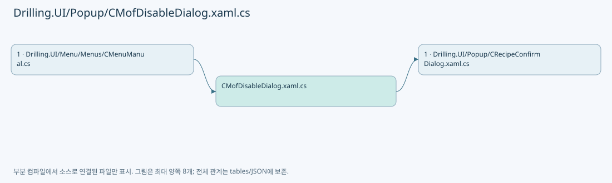
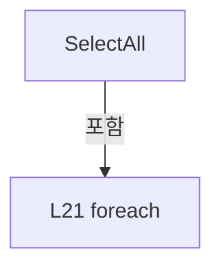
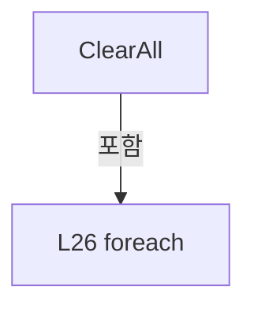
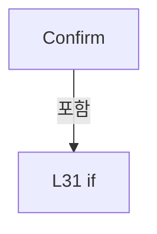
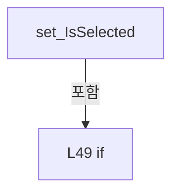

# Drilling.UI/Popup/CMofDisableDialog.xaml.cs

| 항목 | 내용 |
| --- | --- |
| 원본 저장소 | https://github.com/kjuws10-rgb/A3Drilling.git |
| 원본 Commit | 5aee8e58439c9b455cae7c9593c9be986c3e682e |
| 원본 SHA256 | 5ca1c0079a53dde13cdc4bbc7d920d0d3d82d1f9d6842fadfa64c389ecd93db6 |
| 파일 분류 | code |
| 원본 크기/행 | 1,733 bytes / 55 physical lines |
| 인코딩 | utf-8-sig |
| 검토 범위 | 구문/부분 의미 분석에서 추출한 사실. 동작·물리 단위·실장비 합격을 보증하지 않습니다. |
| 원본 링크 | [고정 Commit 원본](https://github.com/kjuws10-rgb/A3Drilling/blob/5aee8e58439c9b455cae7c9593c9be986c3e682e/Drilling.UI/Popup/CMofDisableDialog.xaml.cs) |

## 파일의 역할과 읽는 순서

WPF 화면·사용자 명령·표시 상태를 구성합니다. XAML 이벤트와 코드 비하인드, RootView의 조립 경로를 함께 추적합니다.

## 네임스페이스·타입·상속

| 타입 | 구분 | 원본 범위 | 선언/상속 |
| --- | --- | --- | --- |
| CMofDisableDialog | ClassDeclaration | 6–38 | CMofDisableDialog: Window |
| CMofAxisSelection | ClassDeclaration | 40–55 | CMofAxisSelection: INotifyPropertyChanged |

## 멤버 빠른 목록

| 이름 | 종류 | 범위 | 서명 |
| --- | --- | --- | --- |
| _axes | FieldDeclaration | L8–8 | System.Collections.Generic.IReadOnlyList<Drilling.UI.Popup.CMofAxisSelection> Drilling.UI.Popup.CMofDisableDialog._axes |
| SelectedAxes | PropertyDeclaration | L9–9 | System.Collections.Generic.IReadOnlyList<string> Drilling.UI.Popup.CMofDisableDialog.SelectedAxes |
| .ctor | ConstructorDeclaration | L11–17 | Drilling.UI.Popup.CMofDisableDialog.CMofDisableDialog(string, System.Collections.Generic.IReadOnlyList<string>) |
| SelectAll | MethodDeclaration | L19–22 | void Drilling.UI.Popup.CMofDisableDialog.SelectAll(object, RoutedEventArgs) |
| ClearAll | MethodDeclaration | L24–27 | void Drilling.UI.Popup.CMofDisableDialog.ClearAll(object, RoutedEventArgs) |
| Confirm | MethodDeclaration | L29–37 | void Drilling.UI.Popup.CMofDisableDialog.Confirm(object, RoutedEventArgs) |
| Name | PropertyDeclaration | L42–42 | string Drilling.UI.Popup.CMofAxisSelection.Name |
| get_Name | GetAccessorDeclaration | L42–42 | string Drilling.UI.Popup.CMofAxisSelection.Name.get |
| _isSelected | FieldDeclaration | L43–43 | bool Drilling.UI.Popup.CMofAxisSelection._isSelected |
| IsSelected | PropertyDeclaration | L44–53 | bool Drilling.UI.Popup.CMofAxisSelection.IsSelected |
| get_IsSelected | GetAccessorDeclaration | L46–46 | bool Drilling.UI.Popup.CMofAxisSelection.IsSelected.get |
| set_IsSelected | SetAccessorDeclaration | L47–52 | void Drilling.UI.Popup.CMofAxisSelection.IsSelected.set |
| PropertyChanged | EventFieldDeclaration | L54–54 | System.ComponentModel.PropertyChangedEventHandler? Drilling.UI.Popup.CMofAxisSelection.PropertyChanged |

## 멤버별 상세 계약·호출·처리 해설

### FieldDeclaration `_axes` · L8–8

[Drilling.UI/Popup/CMofDisableDialog.xaml.cs:8–8](https://github.com/kjuws10-rgb/A3Drilling/blob/5aee8e58439c9b455cae7c9593c9be986c3e682e/Drilling.UI/Popup/CMofDisableDialog.xaml.cs#L8-L8)

| 항목 | 실제 추출 값 |
| --- | --- |
| 서명 | System.Collections.Generic.IReadOnlyList<Drilling.UI.Popup.CMofAxisSelection> Drilling.UI.Popup.CMofDisableDialog._axes |
| 접근/수식자 | Private / private, readonly |
| 반환/값 타입 | System.Collections.Generic.IReadOnlyList<Drilling.UI.Popup.CMofAxisSelection> |
| 소속 타입 | NamedType:Drilling.UI.Popup.CMofDisableDialog |

현재 부분 분석에서 직접 연결된 호출자는 없습니다. XAML/이벤트/인터페이스·델리게이트·외부 진입을 추가 확인해야 하며, 미사용으로 판정한 것이 아닙니다.

변경 전 점검: 입력/반환 타입, 위 호출자, 예외/취소 경로, 공유 상태와 저장·전송 소비자를 함께 확인합니다. 값의 단위나 물리 방향을 이름만으로 확정하지 않습니다.

### PropertyDeclaration `SelectedAxes` · L9–9

[Drilling.UI/Popup/CMofDisableDialog.xaml.cs:9–9](https://github.com/kjuws10-rgb/A3Drilling/blob/5aee8e58439c9b455cae7c9593c9be986c3e682e/Drilling.UI/Popup/CMofDisableDialog.xaml.cs#L9-L9)

| 항목 | 실제 추출 값 |
| --- | --- |
| 서명 | System.Collections.Generic.IReadOnlyList<string> Drilling.UI.Popup.CMofDisableDialog.SelectedAxes |
| 접근/수식자 | Public / public |
| 반환/값 타입 | System.Collections.Generic.IReadOnlyList<string> |
| 소속 타입 | NamedType:Drilling.UI.Popup.CMofDisableDialog |

현재 부분 분석에서 직접 연결된 호출자는 없습니다. XAML/이벤트/인터페이스·델리게이트·외부 진입을 추가 확인해야 하며, 미사용으로 판정한 것이 아닙니다.

호출하는 대상과 해석 범위:

| 원본 행 | 표현식 | 분석 상태 | 대상/소스 위치 |
| --- | --- | --- | --- |
| 9 | _axes.Where(axis => axis.IsSelected).Select(axis => axis.Name).ToArray | resolved | string[] System.Collections.Generic.IEnumerable<string>.ToArray<string>() |
| 9 | _axes.Where(axis => axis.IsSelected).Select | resolved | System.Collections.Generic.IEnumerable<string> System.Collections.Generic.IEnumerable<Drilling.UI.Popup.CMofAxisSelection>.Select<Drilling.UI.Popup.CMofAxisSelection, string>(System.Func<Drilling.UI.Popup.CMofAxisSelection, string>) |
| 9 | _axes.Where | resolved | System.Collections.Generic.IEnumerable<Drilling.UI.Popup.CMofAxisSelection> System.Collections.Generic.IEnumerable<Drilling.UI.Popup.CMofAxisSelection>.Where<Drilling.UI.Popup.CMofAxisSelection>(System.Func<Drilling.UI.Popup.CMofAxisSelection, bool>) |

본문의 실제 연산·분기·예외·반환 순서(원문 위치 순):

| 원본 행 | 종류 | 주석 해설 |
| --- | --- | --- |
| 9 | call | 함수·델리게이트 또는 객체 생성자를 호출합니다: _axes.Where(axis => axis.IsSelected).Select(axis => axis.Name).ToArray() |
| 9 | call | 함수·델리게이트 또는 객체 생성자를 호출합니다: _axes.Where(axis => axis.IsSelected).Select(axis => axis.Name) |
| 9 | call | 함수·델리게이트 또는 객체 생성자를 호출합니다: _axes.Where(axis => axis.IsSelected) |

변경 전 점검: 입력/반환 타입, 위 호출자, 예외/취소 경로, 공유 상태와 저장·전송 소비자를 함께 확인합니다. 값의 단위나 물리 방향을 이름만으로 확정하지 않습니다.

### ConstructorDeclaration `.ctor` · L11–17

[Drilling.UI/Popup/CMofDisableDialog.xaml.cs:11–17](https://github.com/kjuws10-rgb/A3Drilling/blob/5aee8e58439c9b455cae7c9593c9be986c3e682e/Drilling.UI/Popup/CMofDisableDialog.xaml.cs#L11-L17)

| 항목 | 실제 추출 값 |
| --- | --- |
| 서명 | Drilling.UI.Popup.CMofDisableDialog.CMofDisableDialog(string, System.Collections.Generic.IReadOnlyList<string>) |
| 접근/수식자 | Public / public |
| 반환/값 타입 | void |
| 소속 타입 | NamedType:Drilling.UI.Popup.CMofDisableDialog |

입력 계약:

| 이름 | 타입 | 전달 | 선택/기본값 |
| --- | --- | --- | --- |
| controllerTitle | string | None | False /  |
| axes | System.Collections.Generic.IReadOnlyList<string> | None | False /  |

정적 호출자로 확인된 위치:

| 호출 파일/행 | 호출 표현식 | 런타임 분기 가능 |
| --- | --- | --- |
| [Drilling.UI/Menu/Menus/CMenuManual.cs:1996–1999](https://github.com/kjuws10-rgb/A3Drilling/blob/5aee8e58439c9b455cae7c9593c9be986c3e682e/Drilling.UI/Menu/Menus/CMenuManual.cs#L1996-L1999) | new CMofDisableDialog | False |

호출하는 대상과 해석 범위:

| 원본 행 | 표현식 | 분석 상태 | 대상/소스 위치 |
| --- | --- | --- | --- |
| 13 | InitializeComponent | unresolved | None |
| 15 | axes.Select(axis => new CMofAxisSelection(axis)).ToArray | resolved | Drilling.UI.Popup.CMofAxisSelection[] System.Collections.Generic.IEnumerable<Drilling.UI.Popup.CMofAxisSelection>.ToArray<Drilling.UI.Popup.CMofAxisSelection>() |
| 15 | axes.Select | resolved | System.Collections.Generic.IEnumerable<Drilling.UI.Popup.CMofAxisSelection> System.Collections.Generic.IEnumerable<string>.Select<string, Drilling.UI.Popup.CMofAxisSelection>(System.Func<string, Drilling.UI.Popup.CMofAxisSelection>) |
| 15 | new CMofAxisSelection | resolved | Drilling.UI.Popup.CMofAxisSelection.CMofAxisSelection(string) · Drilling.UI/Popup/CMofDisableDialog.xaml.cs:40 |

본문의 실제 연산·분기·예외·반환 순서(원문 위치 순):

| 원본 행 | 종류 | 주석 해설 |
| --- | --- | --- |
| 13 | call | 함수·델리게이트 또는 객체 생성자를 호출합니다: InitializeComponent() |
| 14 | assignment | 값을 대상에 대입합니다: ControllerTitle.Text = $"{controllerTitle} · MOF Disable" |
| 15 | assignment | 값을 대상에 대입합니다: _axes = axes.Select(axis => new CMofAxisSelection(axis)).ToArray() |
| 15 | call | 함수·델리게이트 또는 객체 생성자를 호출합니다: axes.Select(axis => new CMofAxisSelection(axis)).ToArray() |
| 15 | call | 함수·델리게이트 또는 객체 생성자를 호출합니다: axes.Select(axis => new CMofAxisSelection(axis)) |
| 15 | call | 함수·델리게이트 또는 객체 생성자를 호출합니다: new CMofAxisSelection(axis) |
| 16 | assignment | 값을 대상에 대입합니다: AxisItems.ItemsSource = _axes |

변경 전 점검: 입력/반환 타입, 위 호출자, 예외/취소 경로, 공유 상태와 저장·전송 소비자를 함께 확인합니다. 값의 단위나 물리 방향을 이름만으로 확정하지 않습니다.

### MethodDeclaration `SelectAll` · L19–22

[Drilling.UI/Popup/CMofDisableDialog.xaml.cs:19–22](https://github.com/kjuws10-rgb/A3Drilling/blob/5aee8e58439c9b455cae7c9593c9be986c3e682e/Drilling.UI/Popup/CMofDisableDialog.xaml.cs#L19-L22)

| 항목 | 실제 추출 값 |
| --- | --- |
| 서명 | void Drilling.UI.Popup.CMofDisableDialog.SelectAll(object, RoutedEventArgs) |
| 접근/수식자 | Private / private |
| 반환/값 타입 | void |
| 소속 타입 | NamedType:Drilling.UI.Popup.CMofDisableDialog |

입력 계약:

| 이름 | 타입 | 전달 | 선택/기본값 |
| --- | --- | --- | --- |
| sender | object | None | False /  |
| e | RoutedEventArgs | None | False /  |

현재 부분 분석에서 직접 연결된 호출자는 없습니다. XAML/이벤트/인터페이스·델리게이트·외부 진입을 추가 확인해야 하며, 미사용으로 판정한 것이 아닙니다.

본문의 실제 연산·분기·예외·반환 순서(원문 위치 순):

| 원본 행 | 종류 | 주석 해설 |
| --- | --- | --- |
| 21 | assignment | 값을 대상에 대입합니다: axis.IsSelected = true |
| 21 | foreach | 컬렉션 요소를 순회합니다: foreach (var axis in _axes) |

제어 구문의 포함 구조(실제 실행 순서/CFG가 아닌 구문 탐색 그림):

변경 전 점검: 입력/반환 타입, 위 호출자, 예외/취소 경로, 공유 상태와 저장·전송 소비자를 함께 확인합니다. 값의 단위나 물리 방향을 이름만으로 확정하지 않습니다.

### MethodDeclaration `ClearAll` · L24–27

[Drilling.UI/Popup/CMofDisableDialog.xaml.cs:24–27](https://github.com/kjuws10-rgb/A3Drilling/blob/5aee8e58439c9b455cae7c9593c9be986c3e682e/Drilling.UI/Popup/CMofDisableDialog.xaml.cs#L24-L27)

| 항목 | 실제 추출 값 |
| --- | --- |
| 서명 | void Drilling.UI.Popup.CMofDisableDialog.ClearAll(object, RoutedEventArgs) |
| 접근/수식자 | Private / private |
| 반환/값 타입 | void |
| 소속 타입 | NamedType:Drilling.UI.Popup.CMofDisableDialog |

입력 계약:

| 이름 | 타입 | 전달 | 선택/기본값 |
| --- | --- | --- | --- |
| sender | object | None | False /  |
| e | RoutedEventArgs | None | False /  |

현재 부분 분석에서 직접 연결된 호출자는 없습니다. XAML/이벤트/인터페이스·델리게이트·외부 진입을 추가 확인해야 하며, 미사용으로 판정한 것이 아닙니다.

본문의 실제 연산·분기·예외·반환 순서(원문 위치 순):

| 원본 행 | 종류 | 주석 해설 |
| --- | --- | --- |
| 26 | assignment | 값을 대상에 대입합니다: axis.IsSelected = false |
| 26 | foreach | 컬렉션 요소를 순회합니다: foreach (var axis in _axes) |

제어 구문의 포함 구조(실제 실행 순서/CFG가 아닌 구문 탐색 그림):

변경 전 점검: 입력/반환 타입, 위 호출자, 예외/취소 경로, 공유 상태와 저장·전송 소비자를 함께 확인합니다. 값의 단위나 물리 방향을 이름만으로 확정하지 않습니다.

### MethodDeclaration `Confirm` · L29–37

[Drilling.UI/Popup/CMofDisableDialog.xaml.cs:29–37](https://github.com/kjuws10-rgb/A3Drilling/blob/5aee8e58439c9b455cae7c9593c9be986c3e682e/Drilling.UI/Popup/CMofDisableDialog.xaml.cs#L29-L37)

| 항목 | 실제 추출 값 |
| --- | --- |
| 서명 | void Drilling.UI.Popup.CMofDisableDialog.Confirm(object, RoutedEventArgs) |
| 접근/수식자 | Private / private |
| 반환/값 타입 | void |
| 소속 타입 | NamedType:Drilling.UI.Popup.CMofDisableDialog |

입력 계약:

| 이름 | 타입 | 전달 | 선택/기본값 |
| --- | --- | --- | --- |
| sender | object | None | False /  |
| e | RoutedEventArgs | None | False /  |

현재 부분 분석에서 직접 연결된 호출자는 없습니다. XAML/이벤트/인터페이스·델리게이트·외부 진입을 추가 확인해야 하며, 미사용으로 판정한 것이 아닙니다.

호출하는 대상과 해석 범위:

| 원본 행 | 표현식 | 분석 상태 | 대상/소스 위치 |
| --- | --- | --- | --- |
| 33 | CRecipeConfirmDialog.ShowWarning | resolved | void Drilling.UI.Popup.CRecipeConfirmDialog.ShowWarning(string, string, Window?) · Drilling.UI/Popup/CRecipeConfirmDialog.xaml.cs:86 |

본문의 실제 연산·분기·예외·반환 순서(원문 위치 순):

| 원본 행 | 종류 | 주석 해설 |
| --- | --- | --- |
| 31 | if | 조건에 따라 분기합니다: if (SelectedAxes.Count == 0) |
| 33 | call | 함수·델리게이트 또는 객체 생성자를 호출합니다: CRecipeConfirmDialog.ShowWarning("MOF Disable", "MOF를 해제할 축을 하나 이상 선택하세요.") |
| 34 | return | 호출자에게 값 또는 제어를 반환합니다: return; |
| 36 | assignment | 값을 대상에 대입합니다: DialogResult = true |

제어 구문의 포함 구조(실제 실행 순서/CFG가 아닌 구문 탐색 그림):

변경 전 점검: 입력/반환 타입, 위 호출자, 예외/취소 경로, 공유 상태와 저장·전송 소비자를 함께 확인합니다. 값의 단위나 물리 방향을 이름만으로 확정하지 않습니다.

### PropertyDeclaration `Name` · L42–42

[Drilling.UI/Popup/CMofDisableDialog.xaml.cs:42–42](https://github.com/kjuws10-rgb/A3Drilling/blob/5aee8e58439c9b455cae7c9593c9be986c3e682e/Drilling.UI/Popup/CMofDisableDialog.xaml.cs#L42-L42)

| 항목 | 실제 추출 값 |
| --- | --- |
| 서명 | string Drilling.UI.Popup.CMofAxisSelection.Name |
| 접근/수식자 | Public / public |
| 반환/값 타입 | string |
| 소속 타입 | NamedType:Drilling.UI.Popup.CMofAxisSelection |

현재 부분 분석에서 직접 연결된 호출자는 없습니다. XAML/이벤트/인터페이스·델리게이트·외부 진입을 추가 확인해야 하며, 미사용으로 판정한 것이 아닙니다.

변경 전 점검: 입력/반환 타입, 위 호출자, 예외/취소 경로, 공유 상태와 저장·전송 소비자를 함께 확인합니다. 값의 단위나 물리 방향을 이름만으로 확정하지 않습니다.

### GetAccessorDeclaration `get_Name` · L42–42

[Drilling.UI/Popup/CMofDisableDialog.xaml.cs:42–42](https://github.com/kjuws10-rgb/A3Drilling/blob/5aee8e58439c9b455cae7c9593c9be986c3e682e/Drilling.UI/Popup/CMofDisableDialog.xaml.cs#L42-L42)

| 항목 | 실제 추출 값 |
| --- | --- |
| 서명 | string Drilling.UI.Popup.CMofAxisSelection.Name.get |
| 접근/수식자 | Public / get |
| 반환/값 타입 | string |
| 소속 타입 | NamedType:Drilling.UI.Popup.CMofAxisSelection |

현재 부분 분석에서 직접 연결된 호출자는 없습니다. XAML/이벤트/인터페이스·델리게이트·외부 진입을 추가 확인해야 하며, 미사용으로 판정한 것이 아닙니다.

변경 전 점검: 입력/반환 타입, 위 호출자, 예외/취소 경로, 공유 상태와 저장·전송 소비자를 함께 확인합니다. 값의 단위나 물리 방향을 이름만으로 확정하지 않습니다.

### FieldDeclaration `_isSelected` · L43–43

[Drilling.UI/Popup/CMofDisableDialog.xaml.cs:43–43](https://github.com/kjuws10-rgb/A3Drilling/blob/5aee8e58439c9b455cae7c9593c9be986c3e682e/Drilling.UI/Popup/CMofDisableDialog.xaml.cs#L43-L43)

| 항목 | 실제 추출 값 |
| --- | --- |
| 서명 | bool Drilling.UI.Popup.CMofAxisSelection._isSelected |
| 접근/수식자 | Private / private |
| 반환/값 타입 | bool |
| 소속 타입 | NamedType:Drilling.UI.Popup.CMofAxisSelection |

현재 부분 분석에서 직접 연결된 호출자는 없습니다. XAML/이벤트/인터페이스·델리게이트·외부 진입을 추가 확인해야 하며, 미사용으로 판정한 것이 아닙니다.

변경 전 점검: 입력/반환 타입, 위 호출자, 예외/취소 경로, 공유 상태와 저장·전송 소비자를 함께 확인합니다. 값의 단위나 물리 방향을 이름만으로 확정하지 않습니다.

### PropertyDeclaration `IsSelected` · L44–53

[Drilling.UI/Popup/CMofDisableDialog.xaml.cs:44–53](https://github.com/kjuws10-rgb/A3Drilling/blob/5aee8e58439c9b455cae7c9593c9be986c3e682e/Drilling.UI/Popup/CMofDisableDialog.xaml.cs#L44-L53)

| 항목 | 실제 추출 값 |
| --- | --- |
| 서명 | bool Drilling.UI.Popup.CMofAxisSelection.IsSelected |
| 접근/수식자 | Public / public |
| 반환/값 타입 | bool |
| 소속 타입 | NamedType:Drilling.UI.Popup.CMofAxisSelection |

현재 부분 분석에서 직접 연결된 호출자는 없습니다. XAML/이벤트/인터페이스·델리게이트·외부 진입을 추가 확인해야 하며, 미사용으로 판정한 것이 아닙니다.

변경 전 점검: 입력/반환 타입, 위 호출자, 예외/취소 경로, 공유 상태와 저장·전송 소비자를 함께 확인합니다. 값의 단위나 물리 방향을 이름만으로 확정하지 않습니다.

### GetAccessorDeclaration `get_IsSelected` · L46–46

[Drilling.UI/Popup/CMofDisableDialog.xaml.cs:46–46](https://github.com/kjuws10-rgb/A3Drilling/blob/5aee8e58439c9b455cae7c9593c9be986c3e682e/Drilling.UI/Popup/CMofDisableDialog.xaml.cs#L46-L46)

| 항목 | 실제 추출 값 |
| --- | --- |
| 서명 | bool Drilling.UI.Popup.CMofAxisSelection.IsSelected.get |
| 접근/수식자 | Public / get |
| 반환/값 타입 | bool |
| 소속 타입 | NamedType:Drilling.UI.Popup.CMofAxisSelection |

현재 부분 분석에서 직접 연결된 호출자는 없습니다. XAML/이벤트/인터페이스·델리게이트·외부 진입을 추가 확인해야 하며, 미사용으로 판정한 것이 아닙니다.

변경 전 점검: 입력/반환 타입, 위 호출자, 예외/취소 경로, 공유 상태와 저장·전송 소비자를 함께 확인합니다. 값의 단위나 물리 방향을 이름만으로 확정하지 않습니다.

### SetAccessorDeclaration `set_IsSelected` · L47–52

[Drilling.UI/Popup/CMofDisableDialog.xaml.cs:47–52](https://github.com/kjuws10-rgb/A3Drilling/blob/5aee8e58439c9b455cae7c9593c9be986c3e682e/Drilling.UI/Popup/CMofDisableDialog.xaml.cs#L47-L52)

| 항목 | 실제 추출 값 |
| --- | --- |
| 서명 | void Drilling.UI.Popup.CMofAxisSelection.IsSelected.set |
| 접근/수식자 | Public / set |
| 반환/값 타입 | void |
| 소속 타입 | NamedType:Drilling.UI.Popup.CMofAxisSelection |

입력 계약:

| 이름 | 타입 | 전달 | 선택/기본값 |
| --- | --- | --- | --- |
| value | bool | None | False /  |

현재 부분 분석에서 직접 연결된 호출자는 없습니다. XAML/이벤트/인터페이스·델리게이트·외부 진입을 추가 확인해야 하며, 미사용으로 판정한 것이 아닙니다.

호출하는 대상과 해석 범위:

| 원본 행 | 표현식 | 분석 상태 | 대상/소스 위치 |
| --- | --- | --- | --- |
| 51 | .Invoke | resolved · 동적 구현 선택 가능 | void System.ComponentModel.PropertyChangedEventHandler.Invoke(object?, System.ComponentModel.PropertyChangedEventArgs) |
| 51 | new PropertyChangedEventArgs | resolved | System.ComponentModel.PropertyChangedEventArgs.PropertyChangedEventArgs(string?) |
| 51 | nameof | unresolved | None |

본문의 실제 연산·분기·예외·반환 순서(원문 위치 순):

| 원본 행 | 종류 | 주석 해설 |
| --- | --- | --- |
| 49 | if | 조건에 따라 분기합니다: if (_isSelected == value) |
| 49 | return | 호출자에게 값 또는 제어를 반환합니다: return; |
| 50 | assignment | 값을 대상에 대입합니다: _isSelected = value |
| 51 | call | 함수·델리게이트 또는 객체 생성자를 호출합니다: .Invoke(this, new PropertyChangedEventArgs(nameof(IsSelected))) |
| 51 | call | 함수·델리게이트 또는 객체 생성자를 호출합니다: new PropertyChangedEventArgs(nameof(IsSelected)) |
| 51 | call | 함수·델리게이트 또는 객체 생성자를 호출합니다: nameof(IsSelected) |

제어 구문의 포함 구조(실제 실행 순서/CFG가 아닌 구문 탐색 그림):

변경 전 점검: 입력/반환 타입, 위 호출자, 예외/취소 경로, 공유 상태와 저장·전송 소비자를 함께 확인합니다. 값의 단위나 물리 방향을 이름만으로 확정하지 않습니다.

### EventFieldDeclaration `PropertyChanged` · L54–54

[Drilling.UI/Popup/CMofDisableDialog.xaml.cs:54–54](https://github.com/kjuws10-rgb/A3Drilling/blob/5aee8e58439c9b455cae7c9593c9be986c3e682e/Drilling.UI/Popup/CMofDisableDialog.xaml.cs#L54-L54)

| 항목 | 실제 추출 값 |
| --- | --- |
| 서명 | System.ComponentModel.PropertyChangedEventHandler? Drilling.UI.Popup.CMofAxisSelection.PropertyChanged |
| 접근/수식자 | Public / public, event |
| 반환/값 타입 | System.ComponentModel.PropertyChangedEventHandler? |
| 소속 타입 | NamedType:Drilling.UI.Popup.CMofAxisSelection |

현재 부분 분석에서 직접 연결된 호출자는 없습니다. XAML/이벤트/인터페이스·델리게이트·외부 진입을 추가 확인해야 하며, 미사용으로 판정한 것이 아닙니다.

변경 전 점검: 입력/반환 타입, 위 호출자, 예외/취소 경로, 공유 상태와 저장·전송 소비자를 함께 확인합니다. 값의 단위나 물리 방향을 이름만으로 확정하지 않습니다.

## 구문·바인딩 한계

전체 WPF/벤더 SDK/프로젝트별 빌드 조건을 로드한 정식 빌드가 아닙니다. `resolved`는 이 부분 컴파일에서의 심볼 연결이며 virtual/interface/delegate/이벤트/Reflection/XAML의 실제 런타임 구현을 확정하지 않습니다. `candidate`와 `unresolved`는 후속 확인 대상으로 남깁니다.

## 원문 전체 주석 해설본

[원본 모든 행과 행별 해설 보기](../../../annotated/Drilling.UI/Popup/CMofDisableDialog.xaml.cs.annotated.txt)

원본을 빠뜨리거나 임의로 줄이지 않았습니다. `L000001 |` 표시는 원본 행 번호, `// 해설`은 별도 설명입니다. 실행용 소스가 아닌 문서입니다.

## 수정·재검증 체크

- 원본 Commit과 현재 작업 파일 SHA가 같은지 먼저 확인합니다. 다르면 이 문서를 과거 버전 자료로 취급합니다.
- 선언·직접 호출·이벤트/인터페이스 경계·설정 소비를 함께 확인합니다. 정적 연결의 빈 곳을 정상 경로로 추정하지 않습니다.
- 저장 형식/단위/식별자·재시도·취소·예외·롤백에 영향을 주는 변경은 상세 해설장과 호출자를 다시 검토합니다.
- 도구의 구문 추출과 별도 정적 추적 해설, 실제 빌드·시뮬레이션·실장비 검증 결과를 분리합니다.
