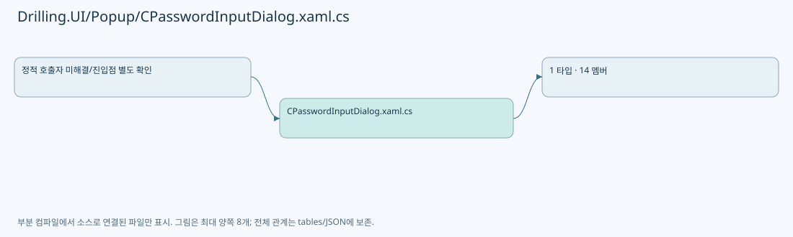
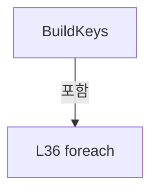
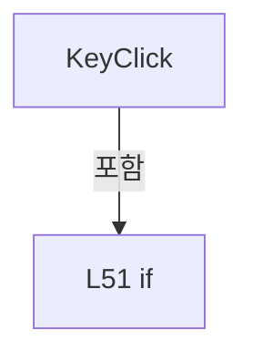
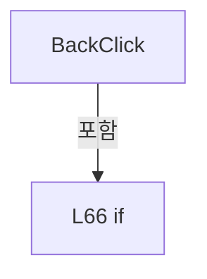
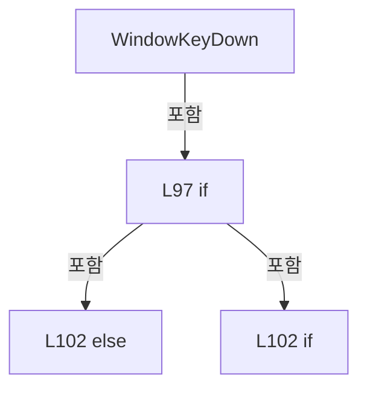

# Drilling.UI/Popup/CPasswordInputDialog.xaml.cs

| 항목 | 내용 |
| --- | --- |
| 원본 저장소 | https://github.com/kjuws10-rgb/A3Drilling.git |
| 원본 Commit | 5aee8e58439c9b455cae7c9593c9be986c3e682e |
| 원본 SHA256 | 605f668c0559885fd5eeff71c6db76017f29a2b8ed3aadc0175ebeb4c3b0576b |
| 파일 분류 | code |
| 원본 크기/행 | 2,730 bytes / 108 physical lines |
| 인코딩 | utf-8-sig |
| 검토 범위 | 구문/부분 의미 분석에서 추출한 사실. 동작·물리 단위·실장비 합격을 보증하지 않습니다. |
| 원본 링크 | [고정 Commit 원본](https://github.com/kjuws10-rgb/A3Drilling/blob/5aee8e58439c9b455cae7c9593c9be986c3e682e/Drilling.UI/Popup/CPasswordInputDialog.xaml.cs) |

## 파일의 역할과 읽는 순서

WPF 화면·사용자 명령·표시 상태를 구성합니다. XAML 이벤트와 코드 비하인드, RootView의 조립 경로를 함께 추적합니다.

## 네임스페이스·타입·상속

| 타입 | 구분 | 원본 범위 | 선언/상속 |
| --- | --- | --- | --- |
| CPasswordInputDialog | ClassDeclaration | 7–108 | CPasswordInputDialog: Window |

## 멤버 빠른 목록

| 이름 | 종류 | 범위 | 서명 |
| --- | --- | --- | --- |
| SelectPasswordText | FieldDeclaration | L9–11 | System.Reflection.MethodInfo? Drilling.UI.Popup.CPasswordInputDialog.SelectPasswordText |
| .ctor | ConstructorDeclaration | L13–19 | Drilling.UI.Popup.CPasswordInputDialog.CPasswordInputDialog(string) |
| ResultPassword | PropertyDeclaration | L21–27 | string Drilling.UI.Popup.CPasswordInputDialog.ResultPassword |
| get_ResultPassword | GetAccessorDeclaration | L23–26 | string Drilling.UI.Popup.CPasswordInputDialog.ResultPassword.get |
| BuildKeys | MethodDeclaration | L29–47 | void Drilling.UI.Popup.CPasswordInputDialog.BuildKeys() |
| SelectItem | LocalFunctionStatement | L31–34 | string SelectItem(char) |
| KeyClick | MethodDeclaration | L49–56 | void Drilling.UI.Popup.CPasswordInputDialog.KeyClick(object, RoutedEventArgs) |
| SpaceClick | MethodDeclaration | L58–62 | void Drilling.UI.Popup.CPasswordInputDialog.SpaceClick(object, RoutedEventArgs) |
| BackClick | MethodDeclaration | L64–71 | void Drilling.UI.Popup.CPasswordInputDialog.BackClick(object, RoutedEventArgs) |
| ClearClick | MethodDeclaration | L73–77 | void Drilling.UI.Popup.CPasswordInputDialog.ClearClick(object, RoutedEventArgs) |
| MoveCaretToEnd | MethodDeclaration | L79–83 | void Drilling.UI.Popup.CPasswordInputDialog.MoveCaretToEnd() |
| CancelClick | MethodDeclaration | L85–88 | void Drilling.UI.Popup.CPasswordInputDialog.CancelClick(object, RoutedEventArgs) |
| OkClick | MethodDeclaration | L90–93 | void Drilling.UI.Popup.CPasswordInputDialog.OkClick(object, RoutedEventArgs) |
| WindowKeyDown | MethodDeclaration | L95–107 | void Drilling.UI.Popup.CPasswordInputDialog.WindowKeyDown(object, KeyEventArgs) |

## 멤버별 상세 계약·호출·처리 해설

### FieldDeclaration `SelectPasswordText` · L9–11

[Drilling.UI/Popup/CPasswordInputDialog.xaml.cs:9–11](https://github.com/kjuws10-rgb/A3Drilling/blob/5aee8e58439c9b455cae7c9593c9be986c3e682e/Drilling.UI/Popup/CPasswordInputDialog.xaml.cs#L9-L11)

| 항목 | 실제 추출 값 |
| --- | --- |
| 서명 | System.Reflection.MethodInfo? Drilling.UI.Popup.CPasswordInputDialog.SelectPasswordText |
| 접근/수식자 | Private / private, static, readonly |
| 반환/값 타입 | System.Reflection.MethodInfo? |
| 소속 타입 | NamedType:Drilling.UI.Popup.CPasswordInputDialog |

현재 부분 분석에서 직접 연결된 호출자는 없습니다. XAML/이벤트/인터페이스·델리게이트·외부 진입을 추가 확인해야 하며, 미사용으로 판정한 것이 아닙니다.

호출하는 대상과 해석 범위:

| 원본 행 | 표현식 | 분석 상태 | 대상/소스 위치 |
| --- | --- | --- | --- |
| 9 | typeof(PasswordBox).GetMethod | resolved | System.Reflection.MethodInfo? System.Type.GetMethod(string, System.Reflection.BindingFlags) |

본문의 실제 연산·분기·예외·반환 순서(원문 위치 순):

| 원본 행 | 종류 | 주석 해설 |
| --- | --- | --- |
| 9 | call | 함수·델리게이트 또는 객체 생성자를 호출합니다: typeof(PasswordBox).GetMethod( "Select", BindingFlags.Instance &#124; BindingFlags.NonPublic) |
| 9 | variable-initializer | 변수의 초기값을 지정합니다: SelectPasswordText = typeof(PasswordBox).GetMethod( "Select", BindingFlags.Instance &#124; BindingFlags.NonPublic) |

변경 전 점검: 입력/반환 타입, 위 호출자, 예외/취소 경로, 공유 상태와 저장·전송 소비자를 함께 확인합니다. 값의 단위나 물리 방향을 이름만으로 확정하지 않습니다.

### ConstructorDeclaration `.ctor` · L13–19

[Drilling.UI/Popup/CPasswordInputDialog.xaml.cs:13–19](https://github.com/kjuws10-rgb/A3Drilling/blob/5aee8e58439c9b455cae7c9593c9be986c3e682e/Drilling.UI/Popup/CPasswordInputDialog.xaml.cs#L13-L19)

| 항목 | 실제 추출 값 |
| --- | --- |
| 서명 | Drilling.UI.Popup.CPasswordInputDialog.CPasswordInputDialog(string) |
| 접근/수식자 | Public / public |
| 반환/값 타입 | void |
| 소속 타입 | NamedType:Drilling.UI.Popup.CPasswordInputDialog |

입력 계약:

| 이름 | 타입 | 전달 | 선택/기본값 |
| --- | --- | --- | --- |
| password | string | None | True / "" |

현재 부분 분석에서 직접 연결된 호출자는 없습니다. XAML/이벤트/인터페이스·델리게이트·외부 진입을 추가 확인해야 하며, 미사용으로 판정한 것이 아닙니다.

호출하는 대상과 해석 범위:

| 원본 행 | 표현식 | 분석 상태 | 대상/소스 위치 |
| --- | --- | --- | --- |
| 15 | InitializeComponent | unresolved | None |
| 17 | BuildKeys | resolved | void Drilling.UI.Popup.CPasswordInputDialog.BuildKeys() · Drilling.UI/Popup/CPasswordInputDialog.xaml.cs:29 |
| 18 | MoveCaretToEnd | resolved | void Drilling.UI.Popup.CPasswordInputDialog.MoveCaretToEnd() · Drilling.UI/Popup/CPasswordInputDialog.xaml.cs:79 |

본문의 실제 연산·분기·예외·반환 순서(원문 위치 순):

| 원본 행 | 종류 | 주석 해설 |
| --- | --- | --- |
| 15 | call | 함수·델리게이트 또는 객체 생성자를 호출합니다: InitializeComponent() |
| 16 | assignment | 값을 대상에 대입합니다: PasswordInput.Password = password |
| 17 | call | 함수·델리게이트 또는 객체 생성자를 호출합니다: BuildKeys() |
| 18 | call | 함수·델리게이트 또는 객체 생성자를 호출합니다: MoveCaretToEnd() |
| 18 | compound-assignment-or-event-subscription | 복합 대입 또는 이벤트 구독/해지 표현입니다: Loaded += (_, _) => MoveCaretToEnd() |

변경 전 점검: 입력/반환 타입, 위 호출자, 예외/취소 경로, 공유 상태와 저장·전송 소비자를 함께 확인합니다. 값의 단위나 물리 방향을 이름만으로 확정하지 않습니다.

### PropertyDeclaration `ResultPassword` · L21–27

[Drilling.UI/Popup/CPasswordInputDialog.xaml.cs:21–27](https://github.com/kjuws10-rgb/A3Drilling/blob/5aee8e58439c9b455cae7c9593c9be986c3e682e/Drilling.UI/Popup/CPasswordInputDialog.xaml.cs#L21-L27)

| 항목 | 실제 추출 값 |
| --- | --- |
| 서명 | string Drilling.UI.Popup.CPasswordInputDialog.ResultPassword |
| 접근/수식자 | Public / public |
| 반환/값 타입 | string |
| 소속 타입 | NamedType:Drilling.UI.Popup.CPasswordInputDialog |

현재 부분 분석에서 직접 연결된 호출자는 없습니다. XAML/이벤트/인터페이스·델리게이트·외부 진입을 추가 확인해야 하며, 미사용으로 판정한 것이 아닙니다.

변경 전 점검: 입력/반환 타입, 위 호출자, 예외/취소 경로, 공유 상태와 저장·전송 소비자를 함께 확인합니다. 값의 단위나 물리 방향을 이름만으로 확정하지 않습니다.

### GetAccessorDeclaration `get_ResultPassword` · L23–26

[Drilling.UI/Popup/CPasswordInputDialog.xaml.cs:23–26](https://github.com/kjuws10-rgb/A3Drilling/blob/5aee8e58439c9b455cae7c9593c9be986c3e682e/Drilling.UI/Popup/CPasswordInputDialog.xaml.cs#L23-L26)

| 항목 | 실제 추출 값 |
| --- | --- |
| 서명 | string Drilling.UI.Popup.CPasswordInputDialog.ResultPassword.get |
| 접근/수식자 | Public / get |
| 반환/값 타입 | string |
| 소속 타입 | NamedType:Drilling.UI.Popup.CPasswordInputDialog |

현재 부분 분석에서 직접 연결된 호출자는 없습니다. XAML/이벤트/인터페이스·델리게이트·외부 진입을 추가 확인해야 하며, 미사용으로 판정한 것이 아닙니다.

본문의 실제 연산·분기·예외·반환 순서(원문 위치 순):

| 원본 행 | 종류 | 주석 해설 |
| --- | --- | --- |
| 25 | return | 호출자에게 값 또는 제어를 반환합니다: return PasswordInput.Password; |

변경 전 점검: 입력/반환 타입, 위 호출자, 예외/취소 경로, 공유 상태와 저장·전송 소비자를 함께 확인합니다. 값의 단위나 물리 방향을 이름만으로 확정하지 않습니다.

### MethodDeclaration `BuildKeys` · L29–47

[Drilling.UI/Popup/CPasswordInputDialog.xaml.cs:29–47](https://github.com/kjuws10-rgb/A3Drilling/blob/5aee8e58439c9b455cae7c9593c9be986c3e682e/Drilling.UI/Popup/CPasswordInputDialog.xaml.cs#L29-L47)

| 항목 | 실제 추출 값 |
| --- | --- |
| 서명 | void Drilling.UI.Popup.CPasswordInputDialog.BuildKeys() |
| 접근/수식자 | Private / private |
| 반환/값 타입 | void |
| 소속 타입 | NamedType:Drilling.UI.Popup.CPasswordInputDialog |

정적 호출자로 확인된 위치:

| 호출 파일/행 | 호출 표현식 | 런타임 분기 가능 |
| --- | --- | --- |
| [Drilling.UI/Popup/CPasswordInputDialog.xaml.cs:17–17](https://github.com/kjuws10-rgb/A3Drilling/blob/5aee8e58439c9b455cae7c9593c9be986c3e682e/Drilling.UI/Popup/CPasswordInputDialog.xaml.cs#L17-L17) | BuildKeys | False |

호출하는 대상과 해석 범위:

| 원본 행 | 표현식 | 분석 상태 | 대상/소스 위치 |
| --- | --- | --- | --- |
| 36 | "1234567890QWERTYUIOPASDFGHJKLZXCVBNM_-./:".Select | resolved | System.Collections.Generic.IEnumerable<string> System.Collections.Generic.IEnumerable<char>.Select<char, string>(System.Func<char, string>) |
| 38 | new Button | unresolved | None |
| 42 | FindResource | unresolved | None |
| 45 | KeyGrid.Children.Add | unresolved | None |

본문의 실제 연산·분기·예외·반환 순서(원문 위치 순):

| 원본 행 | 종류 | 주석 해설 |
| --- | --- | --- |
| 36 | call | 함수·델리게이트 또는 객체 생성자를 호출합니다: "1234567890QWERTYUIOPASDFGHJKLZXCVBNM_-./:".Select(SelectItem) |
| 36 | foreach | 컬렉션 요소를 순회합니다: foreach (var key in "1234567890QWERTYUIOPASDFGHJKLZXCVBNM_-./:".Select(SelectItem)) |
| 38 | call | 함수·델리게이트 또는 객체 생성자를 호출합니다: new Button { Content = key, Tag = key, Style = (Style)FindResource("KeyButton") } |
| 38 | local-declaration | 지역 변수를 선언합니다: var button = new Button { Content = key, Tag = key, Style = (Style)FindResource("KeyButton") }; |
| 38 | variable-initializer | 변수의 초기값을 지정합니다: button = new Button { Content = key, Tag = key, Style = (Style)FindResource("KeyButton") } |
| 40 | assignment | 값을 대상에 대입합니다: Content = key |
| 41 | assignment | 값을 대상에 대입합니다: Tag = key |
| 42 | assignment | 값을 대상에 대입합니다: Style = (Style)FindResource("KeyButton") |
| 42 | call | 함수·델리게이트 또는 객체 생성자를 호출합니다: FindResource("KeyButton") |
| 44 | compound-assignment-or-event-subscription | 복합 대입 또는 이벤트 구독/해지 표현입니다: button.Click += KeyClick |
| 45 | call | 함수·델리게이트 또는 객체 생성자를 호출합니다: KeyGrid.Children.Add(button) |

제어 구문의 포함 구조(실제 실행 순서/CFG가 아닌 구문 탐색 그림):

변경 전 점검: 입력/반환 타입, 위 호출자, 예외/취소 경로, 공유 상태와 저장·전송 소비자를 함께 확인합니다. 값의 단위나 물리 방향을 이름만으로 확정하지 않습니다.

### LocalFunctionStatement `SelectItem` · L31–34

[Drilling.UI/Popup/CPasswordInputDialog.xaml.cs:31–34](https://github.com/kjuws10-rgb/A3Drilling/blob/5aee8e58439c9b455cae7c9593c9be986c3e682e/Drilling.UI/Popup/CPasswordInputDialog.xaml.cs#L31-L34)

| 항목 | 실제 추출 값 |
| --- | --- |
| 서명 | string SelectItem(char) |
| 접근/수식자 | Private /  |
| 반환/값 타입 | string |
| 소속 타입 | NamedType:Drilling.UI.Popup.CPasswordInputDialog |

입력 계약:

| 이름 | 타입 | 전달 | 선택/기본값 |
| --- | --- | --- | --- |
| value | char | None | False /  |

현재 부분 분석에서 직접 연결된 호출자는 없습니다. XAML/이벤트/인터페이스·델리게이트·외부 진입을 추가 확인해야 하며, 미사용으로 판정한 것이 아닙니다.

호출하는 대상과 해석 범위:

| 원본 행 | 표현식 | 분석 상태 | 대상/소스 위치 |
| --- | --- | --- | --- |
| 33 | value.ToString | resolved · 동적 구현 선택 가능 | string char.ToString() |

본문의 실제 연산·분기·예외·반환 순서(원문 위치 순):

| 원본 행 | 종류 | 주석 해설 |
| --- | --- | --- |
| 33 | call | 함수·델리게이트 또는 객체 생성자를 호출합니다: value.ToString() |
| 33 | return | 호출자에게 값 또는 제어를 반환합니다: return value.ToString(); |

변경 전 점검: 입력/반환 타입, 위 호출자, 예외/취소 경로, 공유 상태와 저장·전송 소비자를 함께 확인합니다. 값의 단위나 물리 방향을 이름만으로 확정하지 않습니다.

### MethodDeclaration `KeyClick` · L49–56

[Drilling.UI/Popup/CPasswordInputDialog.xaml.cs:49–56](https://github.com/kjuws10-rgb/A3Drilling/blob/5aee8e58439c9b455cae7c9593c9be986c3e682e/Drilling.UI/Popup/CPasswordInputDialog.xaml.cs#L49-L56)

| 항목 | 실제 추출 값 |
| --- | --- |
| 서명 | void Drilling.UI.Popup.CPasswordInputDialog.KeyClick(object, RoutedEventArgs) |
| 접근/수식자 | Private / private |
| 반환/값 타입 | void |
| 소속 타입 | NamedType:Drilling.UI.Popup.CPasswordInputDialog |

입력 계약:

| 이름 | 타입 | 전달 | 선택/기본값 |
| --- | --- | --- | --- |
| sender | object | None | False /  |
| e | RoutedEventArgs | None | False /  |

현재 부분 분석에서 직접 연결된 호출자는 없습니다. XAML/이벤트/인터페이스·델리게이트·외부 진입을 추가 확인해야 하며, 미사용으로 판정한 것이 아닙니다.

호출하는 대상과 해석 범위:

| 원본 행 | 표현식 | 분석 상태 | 대상/소스 위치 |
| --- | --- | --- | --- |
| 54 | MoveCaretToEnd | resolved | void Drilling.UI.Popup.CPasswordInputDialog.MoveCaretToEnd() · Drilling.UI/Popup/CPasswordInputDialog.xaml.cs:79 |

본문의 실제 연산·분기·예외·반환 순서(원문 위치 순):

| 원본 행 | 종류 | 주석 해설 |
| --- | --- | --- |
| 51 | if | 조건에 따라 분기합니다: if (sender is Button { Tag: string key }) |
| 53 | compound-assignment-or-event-subscription | 복합 대입 또는 이벤트 구독/해지 표현입니다: PasswordInput.Password += key |
| 54 | call | 함수·델리게이트 또는 객체 생성자를 호출합니다: MoveCaretToEnd() |

제어 구문의 포함 구조(실제 실행 순서/CFG가 아닌 구문 탐색 그림):

변경 전 점검: 입력/반환 타입, 위 호출자, 예외/취소 경로, 공유 상태와 저장·전송 소비자를 함께 확인합니다. 값의 단위나 물리 방향을 이름만으로 확정하지 않습니다.

### MethodDeclaration `SpaceClick` · L58–62

[Drilling.UI/Popup/CPasswordInputDialog.xaml.cs:58–62](https://github.com/kjuws10-rgb/A3Drilling/blob/5aee8e58439c9b455cae7c9593c9be986c3e682e/Drilling.UI/Popup/CPasswordInputDialog.xaml.cs#L58-L62)

| 항목 | 실제 추출 값 |
| --- | --- |
| 서명 | void Drilling.UI.Popup.CPasswordInputDialog.SpaceClick(object, RoutedEventArgs) |
| 접근/수식자 | Private / private |
| 반환/값 타입 | void |
| 소속 타입 | NamedType:Drilling.UI.Popup.CPasswordInputDialog |

입력 계약:

| 이름 | 타입 | 전달 | 선택/기본값 |
| --- | --- | --- | --- |
| sender | object | None | False /  |
| e | RoutedEventArgs | None | False /  |

현재 부분 분석에서 직접 연결된 호출자는 없습니다. XAML/이벤트/인터페이스·델리게이트·외부 진입을 추가 확인해야 하며, 미사용으로 판정한 것이 아닙니다.

호출하는 대상과 해석 범위:

| 원본 행 | 표현식 | 분석 상태 | 대상/소스 위치 |
| --- | --- | --- | --- |
| 61 | MoveCaretToEnd | resolved | void Drilling.UI.Popup.CPasswordInputDialog.MoveCaretToEnd() · Drilling.UI/Popup/CPasswordInputDialog.xaml.cs:79 |

본문의 실제 연산·분기·예외·반환 순서(원문 위치 순):

| 원본 행 | 종류 | 주석 해설 |
| --- | --- | --- |
| 60 | compound-assignment-or-event-subscription | 복합 대입 또는 이벤트 구독/해지 표현입니다: PasswordInput.Password += " " |
| 61 | call | 함수·델리게이트 또는 객체 생성자를 호출합니다: MoveCaretToEnd() |

변경 전 점검: 입력/반환 타입, 위 호출자, 예외/취소 경로, 공유 상태와 저장·전송 소비자를 함께 확인합니다. 값의 단위나 물리 방향을 이름만으로 확정하지 않습니다.

### MethodDeclaration `BackClick` · L64–71

[Drilling.UI/Popup/CPasswordInputDialog.xaml.cs:64–71](https://github.com/kjuws10-rgb/A3Drilling/blob/5aee8e58439c9b455cae7c9593c9be986c3e682e/Drilling.UI/Popup/CPasswordInputDialog.xaml.cs#L64-L71)

| 항목 | 실제 추출 값 |
| --- | --- |
| 서명 | void Drilling.UI.Popup.CPasswordInputDialog.BackClick(object, RoutedEventArgs) |
| 접근/수식자 | Private / private |
| 반환/값 타입 | void |
| 소속 타입 | NamedType:Drilling.UI.Popup.CPasswordInputDialog |

입력 계약:

| 이름 | 타입 | 전달 | 선택/기본값 |
| --- | --- | --- | --- |
| sender | object | None | False /  |
| e | RoutedEventArgs | None | False /  |

현재 부분 분석에서 직접 연결된 호출자는 없습니다. XAML/이벤트/인터페이스·델리게이트·외부 진입을 추가 확인해야 하며, 미사용으로 판정한 것이 아닙니다.

호출하는 대상과 해석 범위:

| 원본 행 | 표현식 | 분석 상태 | 대상/소스 위치 |
| --- | --- | --- | --- |
| 69 | MoveCaretToEnd | resolved | void Drilling.UI.Popup.CPasswordInputDialog.MoveCaretToEnd() · Drilling.UI/Popup/CPasswordInputDialog.xaml.cs:79 |

본문의 실제 연산·분기·예외·반환 순서(원문 위치 순):

| 원본 행 | 종류 | 주석 해설 |
| --- | --- | --- |
| 66 | if | 조건에 따라 분기합니다: if (PasswordInput.Password.Length > 0) |
| 68 | assignment | 값을 대상에 대입합니다: PasswordInput.Password = PasswordInput.Password[..^1] |
| 69 | call | 함수·델리게이트 또는 객체 생성자를 호출합니다: MoveCaretToEnd() |

제어 구문의 포함 구조(실제 실행 순서/CFG가 아닌 구문 탐색 그림):

변경 전 점검: 입력/반환 타입, 위 호출자, 예외/취소 경로, 공유 상태와 저장·전송 소비자를 함께 확인합니다. 값의 단위나 물리 방향을 이름만으로 확정하지 않습니다.

### MethodDeclaration `ClearClick` · L73–77

[Drilling.UI/Popup/CPasswordInputDialog.xaml.cs:73–77](https://github.com/kjuws10-rgb/A3Drilling/blob/5aee8e58439c9b455cae7c9593c9be986c3e682e/Drilling.UI/Popup/CPasswordInputDialog.xaml.cs#L73-L77)

| 항목 | 실제 추출 값 |
| --- | --- |
| 서명 | void Drilling.UI.Popup.CPasswordInputDialog.ClearClick(object, RoutedEventArgs) |
| 접근/수식자 | Private / private |
| 반환/값 타입 | void |
| 소속 타입 | NamedType:Drilling.UI.Popup.CPasswordInputDialog |

입력 계약:

| 이름 | 타입 | 전달 | 선택/기본값 |
| --- | --- | --- | --- |
| sender | object | None | False /  |
| e | RoutedEventArgs | None | False /  |

현재 부분 분석에서 직접 연결된 호출자는 없습니다. XAML/이벤트/인터페이스·델리게이트·외부 진입을 추가 확인해야 하며, 미사용으로 판정한 것이 아닙니다.

호출하는 대상과 해석 범위:

| 원본 행 | 표현식 | 분석 상태 | 대상/소스 위치 |
| --- | --- | --- | --- |
| 75 | PasswordInput.Clear | unresolved | None |
| 76 | MoveCaretToEnd | resolved | void Drilling.UI.Popup.CPasswordInputDialog.MoveCaretToEnd() · Drilling.UI/Popup/CPasswordInputDialog.xaml.cs:79 |

본문의 실제 연산·분기·예외·반환 순서(원문 위치 순):

| 원본 행 | 종류 | 주석 해설 |
| --- | --- | --- |
| 75 | call | 함수·델리게이트 또는 객체 생성자를 호출합니다: PasswordInput.Clear() |
| 76 | call | 함수·델리게이트 또는 객체 생성자를 호출합니다: MoveCaretToEnd() |

변경 전 점검: 입력/반환 타입, 위 호출자, 예외/취소 경로, 공유 상태와 저장·전송 소비자를 함께 확인합니다. 값의 단위나 물리 방향을 이름만으로 확정하지 않습니다.

### MethodDeclaration `MoveCaretToEnd` · L79–83

[Drilling.UI/Popup/CPasswordInputDialog.xaml.cs:79–83](https://github.com/kjuws10-rgb/A3Drilling/blob/5aee8e58439c9b455cae7c9593c9be986c3e682e/Drilling.UI/Popup/CPasswordInputDialog.xaml.cs#L79-L83)

| 항목 | 실제 추출 값 |
| --- | --- |
| 서명 | void Drilling.UI.Popup.CPasswordInputDialog.MoveCaretToEnd() |
| 접근/수식자 | Private / private |
| 반환/값 타입 | void |
| 소속 타입 | NamedType:Drilling.UI.Popup.CPasswordInputDialog |

정적 호출자로 확인된 위치:

| 호출 파일/행 | 호출 표현식 | 런타임 분기 가능 |
| --- | --- | --- |
| [Drilling.UI/Popup/CPasswordInputDialog.xaml.cs:18–18](https://github.com/kjuws10-rgb/A3Drilling/blob/5aee8e58439c9b455cae7c9593c9be986c3e682e/Drilling.UI/Popup/CPasswordInputDialog.xaml.cs#L18-L18) | MoveCaretToEnd | False |
| [Drilling.UI/Popup/CPasswordInputDialog.xaml.cs:54–54](https://github.com/kjuws10-rgb/A3Drilling/blob/5aee8e58439c9b455cae7c9593c9be986c3e682e/Drilling.UI/Popup/CPasswordInputDialog.xaml.cs#L54-L54) | MoveCaretToEnd | False |
| [Drilling.UI/Popup/CPasswordInputDialog.xaml.cs:61–61](https://github.com/kjuws10-rgb/A3Drilling/blob/5aee8e58439c9b455cae7c9593c9be986c3e682e/Drilling.UI/Popup/CPasswordInputDialog.xaml.cs#L61-L61) | MoveCaretToEnd | False |
| [Drilling.UI/Popup/CPasswordInputDialog.xaml.cs:69–69](https://github.com/kjuws10-rgb/A3Drilling/blob/5aee8e58439c9b455cae7c9593c9be986c3e682e/Drilling.UI/Popup/CPasswordInputDialog.xaml.cs#L69-L69) | MoveCaretToEnd | False |
| [Drilling.UI/Popup/CPasswordInputDialog.xaml.cs:76–76](https://github.com/kjuws10-rgb/A3Drilling/blob/5aee8e58439c9b455cae7c9593c9be986c3e682e/Drilling.UI/Popup/CPasswordInputDialog.xaml.cs#L76-L76) | MoveCaretToEnd | False |

호출하는 대상과 해석 범위:

| 원본 행 | 표현식 | 분석 상태 | 대상/소스 위치 |
| --- | --- | --- | --- |
| 81 | PasswordInput.Focus | unresolved | None |
| 82 | .Invoke | candidate | OverloadResolutionFailure |

본문의 실제 연산·분기·예외·반환 순서(원문 위치 순):

| 원본 행 | 종류 | 주석 해설 |
| --- | --- | --- |
| 81 | call | 함수·델리게이트 또는 객체 생성자를 호출합니다: PasswordInput.Focus() |
| 82 | call | 함수·델리게이트 또는 객체 생성자를 호출합니다: .Invoke(PasswordInput, new object[] { PasswordInput.Password.Length, 0 }) |

변경 전 점검: 입력/반환 타입, 위 호출자, 예외/취소 경로, 공유 상태와 저장·전송 소비자를 함께 확인합니다. 값의 단위나 물리 방향을 이름만으로 확정하지 않습니다.

### MethodDeclaration `CancelClick` · L85–88

[Drilling.UI/Popup/CPasswordInputDialog.xaml.cs:85–88](https://github.com/kjuws10-rgb/A3Drilling/blob/5aee8e58439c9b455cae7c9593c9be986c3e682e/Drilling.UI/Popup/CPasswordInputDialog.xaml.cs#L85-L88)

| 항목 | 실제 추출 값 |
| --- | --- |
| 서명 | void Drilling.UI.Popup.CPasswordInputDialog.CancelClick(object, RoutedEventArgs) |
| 접근/수식자 | Private / private |
| 반환/값 타입 | void |
| 소속 타입 | NamedType:Drilling.UI.Popup.CPasswordInputDialog |

입력 계약:

| 이름 | 타입 | 전달 | 선택/기본값 |
| --- | --- | --- | --- |
| sender | object | None | False /  |
| e | RoutedEventArgs | None | False /  |

현재 부분 분석에서 직접 연결된 호출자는 없습니다. XAML/이벤트/인터페이스·델리게이트·외부 진입을 추가 확인해야 하며, 미사용으로 판정한 것이 아닙니다.

본문의 실제 연산·분기·예외·반환 순서(원문 위치 순):

| 원본 행 | 종류 | 주석 해설 |
| --- | --- | --- |
| 87 | assignment | 값을 대상에 대입합니다: DialogResult = false |

변경 전 점검: 입력/반환 타입, 위 호출자, 예외/취소 경로, 공유 상태와 저장·전송 소비자를 함께 확인합니다. 값의 단위나 물리 방향을 이름만으로 확정하지 않습니다.

### MethodDeclaration `OkClick` · L90–93

[Drilling.UI/Popup/CPasswordInputDialog.xaml.cs:90–93](https://github.com/kjuws10-rgb/A3Drilling/blob/5aee8e58439c9b455cae7c9593c9be986c3e682e/Drilling.UI/Popup/CPasswordInputDialog.xaml.cs#L90-L93)

| 항목 | 실제 추출 값 |
| --- | --- |
| 서명 | void Drilling.UI.Popup.CPasswordInputDialog.OkClick(object, RoutedEventArgs) |
| 접근/수식자 | Private / private |
| 반환/값 타입 | void |
| 소속 타입 | NamedType:Drilling.UI.Popup.CPasswordInputDialog |

입력 계약:

| 이름 | 타입 | 전달 | 선택/기본값 |
| --- | --- | --- | --- |
| sender | object | None | False /  |
| e | RoutedEventArgs | None | False /  |

현재 부분 분석에서 직접 연결된 호출자는 없습니다. XAML/이벤트/인터페이스·델리게이트·외부 진입을 추가 확인해야 하며, 미사용으로 판정한 것이 아닙니다.

본문의 실제 연산·분기·예외·반환 순서(원문 위치 순):

| 원본 행 | 종류 | 주석 해설 |
| --- | --- | --- |
| 92 | assignment | 값을 대상에 대입합니다: DialogResult = true |

변경 전 점검: 입력/반환 타입, 위 호출자, 예외/취소 경로, 공유 상태와 저장·전송 소비자를 함께 확인합니다. 값의 단위나 물리 방향을 이름만으로 확정하지 않습니다.

### MethodDeclaration `WindowKeyDown` · L95–107

[Drilling.UI/Popup/CPasswordInputDialog.xaml.cs:95–107](https://github.com/kjuws10-rgb/A3Drilling/blob/5aee8e58439c9b455cae7c9593c9be986c3e682e/Drilling.UI/Popup/CPasswordInputDialog.xaml.cs#L95-L107)

| 항목 | 실제 추출 값 |
| --- | --- |
| 서명 | void Drilling.UI.Popup.CPasswordInputDialog.WindowKeyDown(object, KeyEventArgs) |
| 접근/수식자 | Private / private |
| 반환/값 타입 | void |
| 소속 타입 | NamedType:Drilling.UI.Popup.CPasswordInputDialog |

입력 계약:

| 이름 | 타입 | 전달 | 선택/기본값 |
| --- | --- | --- | --- |
| sender | object | None | False /  |
| e | KeyEventArgs | None | False /  |

현재 부분 분석에서 직접 연결된 호출자는 없습니다. XAML/이벤트/인터페이스·델리게이트·외부 진입을 추가 확인해야 하며, 미사용으로 판정한 것이 아닙니다.

본문의 실제 연산·분기·예외·반환 순서(원문 위치 순):

| 원본 행 | 종류 | 주석 해설 |
| --- | --- | --- |
| 97 | if | 조건에 따라 분기합니다: if (e.Key == Key.Enter) |
| 99 | assignment | 값을 대상에 대입합니다: e.Handled = true |
| 100 | assignment | 값을 대상에 대입합니다: DialogResult = true |
| 102 | else | 앞 조건이 거짓인 경로입니다: else |
| 102 | if | 조건에 따라 분기합니다: if (e.Key == Key.Escape) |
| 104 | assignment | 값을 대상에 대입합니다: e.Handled = true |
| 105 | assignment | 값을 대상에 대입합니다: DialogResult = false |

제어 구문의 포함 구조(실제 실행 순서/CFG가 아닌 구문 탐색 그림):

변경 전 점검: 입력/반환 타입, 위 호출자, 예외/취소 경로, 공유 상태와 저장·전송 소비자를 함께 확인합니다. 값의 단위나 물리 방향을 이름만으로 확정하지 않습니다.

## 구문·바인딩 한계

전체 WPF/벤더 SDK/프로젝트별 빌드 조건을 로드한 정식 빌드가 아닙니다. `resolved`는 이 부분 컴파일에서의 심볼 연결이며 virtual/interface/delegate/이벤트/Reflection/XAML의 실제 런타임 구현을 확정하지 않습니다. `candidate`와 `unresolved`는 후속 확인 대상으로 남깁니다.

## 원문 전체 주석 해설본

[원본 모든 행과 행별 해설 보기](../../../annotated/Drilling.UI/Popup/CPasswordInputDialog.xaml.cs.annotated.txt)

원본을 빠뜨리거나 임의로 줄이지 않았습니다. `L000001 |` 표시는 원본 행 번호, `// 해설`은 별도 설명입니다. 실행용 소스가 아닌 문서입니다.

## 수정·재검증 체크

- 원본 Commit과 현재 작업 파일 SHA가 같은지 먼저 확인합니다. 다르면 이 문서를 과거 버전 자료로 취급합니다.
- 선언·직접 호출·이벤트/인터페이스 경계·설정 소비를 함께 확인합니다. 정적 연결의 빈 곳을 정상 경로로 추정하지 않습니다.
- 저장 형식/단위/식별자·재시도·취소·예외·롤백에 영향을 주는 변경은 상세 해설장과 호출자를 다시 검토합니다.
- 도구의 구문 추출과 별도 정적 추적 해설, 실제 빌드·시뮬레이션·실장비 검증 결과를 분리합니다.
