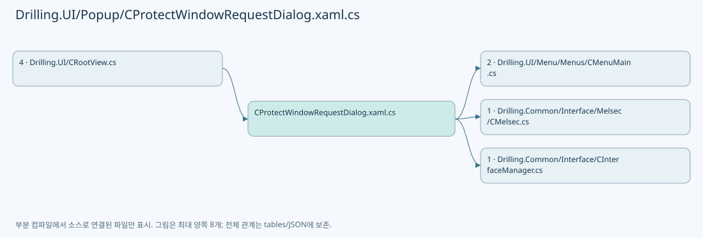
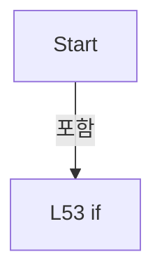
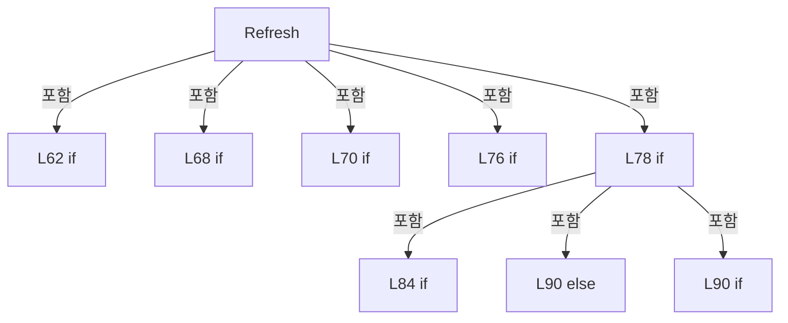
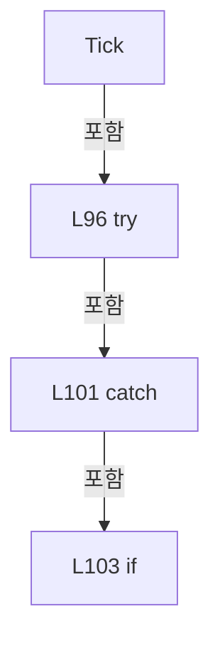
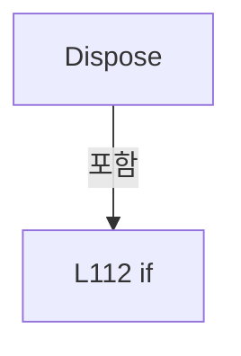

# Drilling.UI/Popup/CProtectWindowRequestDialog.xaml.cs

| 항목 | 내용 |
| --- | --- |
| 원본 저장소 | https://github.com/kjuws10-rgb/A3Drilling.git |
| 원본 Commit | 5aee8e58439c9b455cae7c9593c9be986c3e682e |
| 원본 SHA256 | 01b6fb02245335c153d26ac244fda71d7d2b56e74ffde769294ca6d5f435719d |
| 파일 분류 | code |
| 원본 크기/행 | 4,685 bytes / 122 physical lines |
| 인코딩 | utf-8-sig |
| 검토 범위 | 구문/부분 의미 분석에서 추출한 사실. 동작·물리 단위·실장비 합격을 보증하지 않습니다. |
| 원본 링크 | [고정 Commit 원본](https://github.com/kjuws10-rgb/A3Drilling/blob/5aee8e58439c9b455cae7c9593c9be986c3e682e/Drilling.UI/Popup/CProtectWindowRequestDialog.xaml.cs) |

## 파일의 역할과 읽는 순서

WPF 화면·사용자 명령·표시 상태를 구성합니다. XAML 이벤트와 코드 비하인드, RootView의 조립 경로를 함께 추적합니다.

## 네임스페이스·타입·상속

| 타입 | 구분 | 원본 범위 | 선언/상속 |
| --- | --- | --- | --- |
| CProtectWindowRequestDialog | ClassDeclaration | 9–20 | CProtectWindowRequestDialog: Window |
| CProtectWindowRequestNotice | ClassDeclaration | 23–121 | CProtectWindowRequestNotice: IDisposable |

## 멤버 빠른 목록

| 이름 | 종류 | 범위 | 서명 |
| --- | --- | --- | --- |
| .ctor | ConstructorDeclaration | L11–17 | Drilling.UI.Popup.CProtectWindowRequestDialog.CProtectWindowRequestDialog(Drilling.UI.Menu.Menus.CMainProtectWindowPanel) |
| CloseClicked | MethodDeclaration | L19–19 | void Drilling.UI.Popup.CProtectWindowRequestDialog.CloseClicked(object, RoutedEventArgs) |
| _interfaces | FieldDeclaration | L25–25 | Drilling.Common.Interface.CInterfaceManager Drilling.UI.Popup.CProtectWindowRequestNotice._interfaces |
| _owner | FieldDeclaration | L26–26 | Window Drilling.UI.Popup.CProtectWindowRequestNotice._owner |
| _createDialog | FieldDeclaration | L27–27 | System.Func<Drilling.UI.Menu.Menus.CMainProtectWindowPanel, Drilling.UI.Popup.CProtectWindowRequestDialog> Drilling.UI.Popup.CProtectWindowRequestNotice._createDialog |
| _timer | FieldDeclaration | L28–28 | DispatcherTimer Drilling.UI.Popup.CProtectWindowRequestNotice._timer |
| _dialog | FieldDeclaration | L29–29 | Drilling.UI.Popup.CProtectWindowRequestDialog? Drilling.UI.Popup.CProtectWindowRequestNotice._dialog |
| _pending | FieldDeclaration | L30–30 | bool Drilling.UI.Popup.CProtectWindowRequestNotice._pending |
| _disposed | FieldDeclaration | L31–31 | bool Drilling.UI.Popup.CProtectWindowRequestNotice._disposed |
| _lastError | FieldDeclaration | L32–32 | string Drilling.UI.Popup.CProtectWindowRequestNotice._lastError |
| Status | PropertyDeclaration | L33–33 | Drilling.UI.Menu.Menus.CMainProtectWindowPanel Drilling.UI.Popup.CProtectWindowRequestNotice.Status |
| get_Status | GetAccessorDeclaration | L33–33 | Drilling.UI.Menu.Menus.CMainProtectWindowPanel Drilling.UI.Popup.CProtectWindowRequestNotice.Status.get |
| CurrentDialog | PropertyDeclaration | L34–34 | Drilling.UI.Popup.CProtectWindowRequestDialog? Drilling.UI.Popup.CProtectWindowRequestNotice.CurrentDialog |
| RefreshInterval | PropertyDeclaration | L35–35 | System.TimeSpan Drilling.UI.Popup.CProtectWindowRequestNotice.RefreshInterval |
| .ctor | ConstructorDeclaration | L37–48 | Drilling.UI.Popup.CProtectWindowRequestNotice.CProtectWindowRequestNotice(Drilling.Common.Interface.CInterfaceManager, Window, System.Func<Drilling.UI.Menu.Menus.CMainProtectWindowPanel, Drilling.UI.Popup.CProtectWindowRequestDialog>?) |
| Start | MethodDeclaration | L50–57 | void Drilling.UI.Popup.CProtectWindowRequestNotice.Start() |
| Refresh | MethodDeclaration | L59–92 | void Drilling.UI.Popup.CProtectWindowRequestNotice.Refresh() |
| Tick | MethodDeclaration | L94–107 | void Drilling.UI.Popup.CProtectWindowRequestNotice.Tick(object?, System.EventArgs) |
| OwnerClosed | MethodDeclaration | L109–109 | void Drilling.UI.Popup.CProtectWindowRequestNotice.OwnerClosed(object?, System.EventArgs) |
| Dispose | MethodDeclaration | L110–120 | void Drilling.UI.Popup.CProtectWindowRequestNotice.Dispose() |

## 멤버별 상세 계약·호출·처리 해설

### ConstructorDeclaration `.ctor` · L11–17

[Drilling.UI/Popup/CProtectWindowRequestDialog.xaml.cs:11–17](https://github.com/kjuws10-rgb/A3Drilling/blob/5aee8e58439c9b455cae7c9593c9be986c3e682e/Drilling.UI/Popup/CProtectWindowRequestDialog.xaml.cs#L11-L17)

| 항목 | 실제 추출 값 |
| --- | --- |
| 서명 | Drilling.UI.Popup.CProtectWindowRequestDialog.CProtectWindowRequestDialog(Drilling.UI.Menu.Menus.CMainProtectWindowPanel) |
| 접근/수식자 | Public / public |
| 반환/값 타입 | void |
| 소속 타입 | NamedType:Drilling.UI.Popup.CProtectWindowRequestDialog |

입력 계약:

| 이름 | 타입 | 전달 | 선택/기본값 |
| --- | --- | --- | --- |
| status | Drilling.UI.Menu.Menus.CMainProtectWindowPanel | None | False /  |

정적 호출자로 확인된 위치:

| 호출 파일/행 | 호출 표현식 | 런타임 분기 가능 |
| --- | --- | --- |
| [Drilling.UI/Popup/CProtectWindowRequestDialog.xaml.cs:41–41](https://github.com/kjuws10-rgb/A3Drilling/blob/5aee8e58439c9b455cae7c9593c9be986c3e682e/Drilling.UI/Popup/CProtectWindowRequestDialog.xaml.cs#L41-L41) | new | False |

호출하는 대상과 해석 범위:

| 원본 행 | 표현식 | 분석 상태 | 대상/소스 위치 |
| --- | --- | --- | --- |
| 13 | InitializeComponent | unresolved | None |
| 15 | Math.Min | candidate | OverloadResolutionFailure |
| 16 | Math.Min | candidate | OverloadResolutionFailure |

본문의 실제 연산·분기·예외·반환 순서(원문 위치 순):

| 원본 행 | 종류 | 주석 해설 |
| --- | --- | --- |
| 13 | call | 함수·델리게이트 또는 객체 생성자를 호출합니다: InitializeComponent() |
| 14 | assignment | 값을 대상에 대입합니다: DataContext = status |
| 15 | assignment | 값을 대상에 대입합니다: Width = Math.Min(Width, SystemParameters.WorkArea.Width * 0.95) |
| 15 | call | 함수·델리게이트 또는 객체 생성자를 호출합니다: Math.Min(Width, SystemParameters.WorkArea.Width * 0.95) |
| 16 | assignment | 값을 대상에 대입합니다: Height = Math.Min(Height, SystemParameters.WorkArea.Height * 0.9) |
| 16 | call | 함수·델리게이트 또는 객체 생성자를 호출합니다: Math.Min(Height, SystemParameters.WorkArea.Height * 0.9) |

변경 전 점검: 입력/반환 타입, 위 호출자, 예외/취소 경로, 공유 상태와 저장·전송 소비자를 함께 확인합니다. 값의 단위나 물리 방향을 이름만으로 확정하지 않습니다.

### MethodDeclaration `CloseClicked` · L19–19

[Drilling.UI/Popup/CProtectWindowRequestDialog.xaml.cs:19–19](https://github.com/kjuws10-rgb/A3Drilling/blob/5aee8e58439c9b455cae7c9593c9be986c3e682e/Drilling.UI/Popup/CProtectWindowRequestDialog.xaml.cs#L19-L19)

| 항목 | 실제 추출 값 |
| --- | --- |
| 서명 | void Drilling.UI.Popup.CProtectWindowRequestDialog.CloseClicked(object, RoutedEventArgs) |
| 접근/수식자 | Private / private |
| 반환/값 타입 | void |
| 소속 타입 | NamedType:Drilling.UI.Popup.CProtectWindowRequestDialog |

입력 계약:

| 이름 | 타입 | 전달 | 선택/기본값 |
| --- | --- | --- | --- |
| sender | object | None | False /  |
| e | RoutedEventArgs | None | False /  |

현재 부분 분석에서 직접 연결된 호출자는 없습니다. XAML/이벤트/인터페이스·델리게이트·외부 진입을 추가 확인해야 하며, 미사용으로 판정한 것이 아닙니다.

호출하는 대상과 해석 범위:

| 원본 행 | 표현식 | 분석 상태 | 대상/소스 위치 |
| --- | --- | --- | --- |
| 19 | Close | unresolved | None |

본문의 실제 연산·분기·예외·반환 순서(원문 위치 순):

| 원본 행 | 종류 | 주석 해설 |
| --- | --- | --- |
| 19 | call | 함수·델리게이트 또는 객체 생성자를 호출합니다: Close() |

변경 전 점검: 입력/반환 타입, 위 호출자, 예외/취소 경로, 공유 상태와 저장·전송 소비자를 함께 확인합니다. 값의 단위나 물리 방향을 이름만으로 확정하지 않습니다.

### FieldDeclaration `_interfaces` · L25–25

[Drilling.UI/Popup/CProtectWindowRequestDialog.xaml.cs:25–25](https://github.com/kjuws10-rgb/A3Drilling/blob/5aee8e58439c9b455cae7c9593c9be986c3e682e/Drilling.UI/Popup/CProtectWindowRequestDialog.xaml.cs#L25-L25)

| 항목 | 실제 추출 값 |
| --- | --- |
| 서명 | Drilling.Common.Interface.CInterfaceManager Drilling.UI.Popup.CProtectWindowRequestNotice._interfaces |
| 접근/수식자 | Private / private, readonly |
| 반환/값 타입 | Drilling.Common.Interface.CInterfaceManager |
| 소속 타입 | NamedType:Drilling.UI.Popup.CProtectWindowRequestNotice |

현재 부분 분석에서 직접 연결된 호출자는 없습니다. XAML/이벤트/인터페이스·델리게이트·외부 진입을 추가 확인해야 하며, 미사용으로 판정한 것이 아닙니다.

변경 전 점검: 입력/반환 타입, 위 호출자, 예외/취소 경로, 공유 상태와 저장·전송 소비자를 함께 확인합니다. 값의 단위나 물리 방향을 이름만으로 확정하지 않습니다.

### FieldDeclaration `_owner` · L26–26

[Drilling.UI/Popup/CProtectWindowRequestDialog.xaml.cs:26–26](https://github.com/kjuws10-rgb/A3Drilling/blob/5aee8e58439c9b455cae7c9593c9be986c3e682e/Drilling.UI/Popup/CProtectWindowRequestDialog.xaml.cs#L26-L26)

| 항목 | 실제 추출 값 |
| --- | --- |
| 서명 | Window Drilling.UI.Popup.CProtectWindowRequestNotice._owner |
| 접근/수식자 | Private / private, readonly |
| 반환/값 타입 | Window |
| 소속 타입 | NamedType:Drilling.UI.Popup.CProtectWindowRequestNotice |

현재 부분 분석에서 직접 연결된 호출자는 없습니다. XAML/이벤트/인터페이스·델리게이트·외부 진입을 추가 확인해야 하며, 미사용으로 판정한 것이 아닙니다.

변경 전 점검: 입력/반환 타입, 위 호출자, 예외/취소 경로, 공유 상태와 저장·전송 소비자를 함께 확인합니다. 값의 단위나 물리 방향을 이름만으로 확정하지 않습니다.

### FieldDeclaration `_createDialog` · L27–27

[Drilling.UI/Popup/CProtectWindowRequestDialog.xaml.cs:27–27](https://github.com/kjuws10-rgb/A3Drilling/blob/5aee8e58439c9b455cae7c9593c9be986c3e682e/Drilling.UI/Popup/CProtectWindowRequestDialog.xaml.cs#L27-L27)

| 항목 | 실제 추출 값 |
| --- | --- |
| 서명 | System.Func<Drilling.UI.Menu.Menus.CMainProtectWindowPanel, Drilling.UI.Popup.CProtectWindowRequestDialog> Drilling.UI.Popup.CProtectWindowRequestNotice._createDialog |
| 접근/수식자 | Private / private, readonly |
| 반환/값 타입 | System.Func<Drilling.UI.Menu.Menus.CMainProtectWindowPanel, Drilling.UI.Popup.CProtectWindowRequestDialog> |
| 소속 타입 | NamedType:Drilling.UI.Popup.CProtectWindowRequestNotice |

현재 부분 분석에서 직접 연결된 호출자는 없습니다. XAML/이벤트/인터페이스·델리게이트·외부 진입을 추가 확인해야 하며, 미사용으로 판정한 것이 아닙니다.

변경 전 점검: 입력/반환 타입, 위 호출자, 예외/취소 경로, 공유 상태와 저장·전송 소비자를 함께 확인합니다. 값의 단위나 물리 방향을 이름만으로 확정하지 않습니다.

### FieldDeclaration `_timer` · L28–28

[Drilling.UI/Popup/CProtectWindowRequestDialog.xaml.cs:28–28](https://github.com/kjuws10-rgb/A3Drilling/blob/5aee8e58439c9b455cae7c9593c9be986c3e682e/Drilling.UI/Popup/CProtectWindowRequestDialog.xaml.cs#L28-L28)

| 항목 | 실제 추출 값 |
| --- | --- |
| 서명 | DispatcherTimer Drilling.UI.Popup.CProtectWindowRequestNotice._timer |
| 접근/수식자 | Private / private, readonly |
| 반환/값 타입 | DispatcherTimer |
| 소속 타입 | NamedType:Drilling.UI.Popup.CProtectWindowRequestNotice |

현재 부분 분석에서 직접 연결된 호출자는 없습니다. XAML/이벤트/인터페이스·델리게이트·외부 진입을 추가 확인해야 하며, 미사용으로 판정한 것이 아닙니다.

변경 전 점검: 입력/반환 타입, 위 호출자, 예외/취소 경로, 공유 상태와 저장·전송 소비자를 함께 확인합니다. 값의 단위나 물리 방향을 이름만으로 확정하지 않습니다.

### FieldDeclaration `_dialog` · L29–29

[Drilling.UI/Popup/CProtectWindowRequestDialog.xaml.cs:29–29](https://github.com/kjuws10-rgb/A3Drilling/blob/5aee8e58439c9b455cae7c9593c9be986c3e682e/Drilling.UI/Popup/CProtectWindowRequestDialog.xaml.cs#L29-L29)

| 항목 | 실제 추출 값 |
| --- | --- |
| 서명 | Drilling.UI.Popup.CProtectWindowRequestDialog? Drilling.UI.Popup.CProtectWindowRequestNotice._dialog |
| 접근/수식자 | Private / private |
| 반환/값 타입 | Drilling.UI.Popup.CProtectWindowRequestDialog? |
| 소속 타입 | NamedType:Drilling.UI.Popup.CProtectWindowRequestNotice |

현재 부분 분석에서 직접 연결된 호출자는 없습니다. XAML/이벤트/인터페이스·델리게이트·외부 진입을 추가 확인해야 하며, 미사용으로 판정한 것이 아닙니다.

변경 전 점검: 입력/반환 타입, 위 호출자, 예외/취소 경로, 공유 상태와 저장·전송 소비자를 함께 확인합니다. 값의 단위나 물리 방향을 이름만으로 확정하지 않습니다.

### FieldDeclaration `_pending` · L30–30

[Drilling.UI/Popup/CProtectWindowRequestDialog.xaml.cs:30–30](https://github.com/kjuws10-rgb/A3Drilling/blob/5aee8e58439c9b455cae7c9593c9be986c3e682e/Drilling.UI/Popup/CProtectWindowRequestDialog.xaml.cs#L30-L30)

| 항목 | 실제 추출 값 |
| --- | --- |
| 서명 | bool Drilling.UI.Popup.CProtectWindowRequestNotice._pending |
| 접근/수식자 | Private / private |
| 반환/값 타입 | bool |
| 소속 타입 | NamedType:Drilling.UI.Popup.CProtectWindowRequestNotice |

현재 부분 분석에서 직접 연결된 호출자는 없습니다. XAML/이벤트/인터페이스·델리게이트·외부 진입을 추가 확인해야 하며, 미사용으로 판정한 것이 아닙니다.

변경 전 점검: 입력/반환 타입, 위 호출자, 예외/취소 경로, 공유 상태와 저장·전송 소비자를 함께 확인합니다. 값의 단위나 물리 방향을 이름만으로 확정하지 않습니다.

### FieldDeclaration `_disposed` · L31–31

[Drilling.UI/Popup/CProtectWindowRequestDialog.xaml.cs:31–31](https://github.com/kjuws10-rgb/A3Drilling/blob/5aee8e58439c9b455cae7c9593c9be986c3e682e/Drilling.UI/Popup/CProtectWindowRequestDialog.xaml.cs#L31-L31)

| 항목 | 실제 추출 값 |
| --- | --- |
| 서명 | bool Drilling.UI.Popup.CProtectWindowRequestNotice._disposed |
| 접근/수식자 | Private / private |
| 반환/값 타입 | bool |
| 소속 타입 | NamedType:Drilling.UI.Popup.CProtectWindowRequestNotice |

현재 부분 분석에서 직접 연결된 호출자는 없습니다. XAML/이벤트/인터페이스·델리게이트·외부 진입을 추가 확인해야 하며, 미사용으로 판정한 것이 아닙니다.

변경 전 점검: 입력/반환 타입, 위 호출자, 예외/취소 경로, 공유 상태와 저장·전송 소비자를 함께 확인합니다. 값의 단위나 물리 방향을 이름만으로 확정하지 않습니다.

### FieldDeclaration `_lastError` · L32–32

[Drilling.UI/Popup/CProtectWindowRequestDialog.xaml.cs:32–32](https://github.com/kjuws10-rgb/A3Drilling/blob/5aee8e58439c9b455cae7c9593c9be986c3e682e/Drilling.UI/Popup/CProtectWindowRequestDialog.xaml.cs#L32-L32)

| 항목 | 실제 추출 값 |
| --- | --- |
| 서명 | string Drilling.UI.Popup.CProtectWindowRequestNotice._lastError |
| 접근/수식자 | Private / private |
| 반환/값 타입 | string |
| 소속 타입 | NamedType:Drilling.UI.Popup.CProtectWindowRequestNotice |

현재 부분 분석에서 직접 연결된 호출자는 없습니다. XAML/이벤트/인터페이스·델리게이트·외부 진입을 추가 확인해야 하며, 미사용으로 판정한 것이 아닙니다.

본문의 실제 연산·분기·예외·반환 순서(원문 위치 순):

| 원본 행 | 종류 | 주석 해설 |
| --- | --- | --- |
| 32 | variable-initializer | 변수의 초기값을 지정합니다: _lastError = "" |

변경 전 점검: 입력/반환 타입, 위 호출자, 예외/취소 경로, 공유 상태와 저장·전송 소비자를 함께 확인합니다. 값의 단위나 물리 방향을 이름만으로 확정하지 않습니다.

### PropertyDeclaration `Status` · L33–33

[Drilling.UI/Popup/CProtectWindowRequestDialog.xaml.cs:33–33](https://github.com/kjuws10-rgb/A3Drilling/blob/5aee8e58439c9b455cae7c9593c9be986c3e682e/Drilling.UI/Popup/CProtectWindowRequestDialog.xaml.cs#L33-L33)

| 항목 | 실제 추출 값 |
| --- | --- |
| 서명 | Drilling.UI.Menu.Menus.CMainProtectWindowPanel Drilling.UI.Popup.CProtectWindowRequestNotice.Status |
| 접근/수식자 | Public / public |
| 반환/값 타입 | Drilling.UI.Menu.Menus.CMainProtectWindowPanel |
| 소속 타입 | NamedType:Drilling.UI.Popup.CProtectWindowRequestNotice |

현재 부분 분석에서 직접 연결된 호출자는 없습니다. XAML/이벤트/인터페이스·델리게이트·외부 진입을 추가 확인해야 하며, 미사용으로 판정한 것이 아닙니다.

호출하는 대상과 해석 범위:

| 원본 행 | 표현식 | 분석 상태 | 대상/소스 위치 |
| --- | --- | --- | --- |
| 33 | new | resolved | Drilling.UI.Menu.Menus.CMainProtectWindowPanel.CMainProtectWindowPanel() · Drilling.UI/Menu/Menus/CMenuMain.cs:2634 |

본문의 실제 연산·분기·예외·반환 순서(원문 위치 순):

| 원본 행 | 종류 | 주석 해설 |
| --- | --- | --- |
| 33 | call | 함수·델리게이트 또는 객체 생성자를 호출합니다: new() |

변경 전 점검: 입력/반환 타입, 위 호출자, 예외/취소 경로, 공유 상태와 저장·전송 소비자를 함께 확인합니다. 값의 단위나 물리 방향을 이름만으로 확정하지 않습니다.

### GetAccessorDeclaration `get_Status` · L33–33

[Drilling.UI/Popup/CProtectWindowRequestDialog.xaml.cs:33–33](https://github.com/kjuws10-rgb/A3Drilling/blob/5aee8e58439c9b455cae7c9593c9be986c3e682e/Drilling.UI/Popup/CProtectWindowRequestDialog.xaml.cs#L33-L33)

| 항목 | 실제 추출 값 |
| --- | --- |
| 서명 | Drilling.UI.Menu.Menus.CMainProtectWindowPanel Drilling.UI.Popup.CProtectWindowRequestNotice.Status.get |
| 접근/수식자 | Public / get |
| 반환/값 타입 | Drilling.UI.Menu.Menus.CMainProtectWindowPanel |
| 소속 타입 | NamedType:Drilling.UI.Popup.CProtectWindowRequestNotice |

현재 부분 분석에서 직접 연결된 호출자는 없습니다. XAML/이벤트/인터페이스·델리게이트·외부 진입을 추가 확인해야 하며, 미사용으로 판정한 것이 아닙니다.

변경 전 점검: 입력/반환 타입, 위 호출자, 예외/취소 경로, 공유 상태와 저장·전송 소비자를 함께 확인합니다. 값의 단위나 물리 방향을 이름만으로 확정하지 않습니다.

### PropertyDeclaration `CurrentDialog` · L34–34

[Drilling.UI/Popup/CProtectWindowRequestDialog.xaml.cs:34–34](https://github.com/kjuws10-rgb/A3Drilling/blob/5aee8e58439c9b455cae7c9593c9be986c3e682e/Drilling.UI/Popup/CProtectWindowRequestDialog.xaml.cs#L34-L34)

| 항목 | 실제 추출 값 |
| --- | --- |
| 서명 | Drilling.UI.Popup.CProtectWindowRequestDialog? Drilling.UI.Popup.CProtectWindowRequestNotice.CurrentDialog |
| 접근/수식자 | Public / public |
| 반환/값 타입 | Drilling.UI.Popup.CProtectWindowRequestDialog? |
| 소속 타입 | NamedType:Drilling.UI.Popup.CProtectWindowRequestNotice |

현재 부분 분석에서 직접 연결된 호출자는 없습니다. XAML/이벤트/인터페이스·델리게이트·외부 진입을 추가 확인해야 하며, 미사용으로 판정한 것이 아닙니다.

변경 전 점검: 입력/반환 타입, 위 호출자, 예외/취소 경로, 공유 상태와 저장·전송 소비자를 함께 확인합니다. 값의 단위나 물리 방향을 이름만으로 확정하지 않습니다.

### PropertyDeclaration `RefreshInterval` · L35–35

[Drilling.UI/Popup/CProtectWindowRequestDialog.xaml.cs:35–35](https://github.com/kjuws10-rgb/A3Drilling/blob/5aee8e58439c9b455cae7c9593c9be986c3e682e/Drilling.UI/Popup/CProtectWindowRequestDialog.xaml.cs#L35-L35)

| 항목 | 실제 추출 값 |
| --- | --- |
| 서명 | System.TimeSpan Drilling.UI.Popup.CProtectWindowRequestNotice.RefreshInterval |
| 접근/수식자 | Public / public |
| 반환/값 타입 | System.TimeSpan |
| 소속 타입 | NamedType:Drilling.UI.Popup.CProtectWindowRequestNotice |

현재 부분 분석에서 직접 연결된 호출자는 없습니다. XAML/이벤트/인터페이스·델리게이트·외부 진입을 추가 확인해야 하며, 미사용으로 판정한 것이 아닙니다.

변경 전 점검: 입력/반환 타입, 위 호출자, 예외/취소 경로, 공유 상태와 저장·전송 소비자를 함께 확인합니다. 값의 단위나 물리 방향을 이름만으로 확정하지 않습니다.

### ConstructorDeclaration `.ctor` · L37–48

[Drilling.UI/Popup/CProtectWindowRequestDialog.xaml.cs:37–48](https://github.com/kjuws10-rgb/A3Drilling/blob/5aee8e58439c9b455cae7c9593c9be986c3e682e/Drilling.UI/Popup/CProtectWindowRequestDialog.xaml.cs#L37-L48)

| 항목 | 실제 추출 값 |
| --- | --- |
| 서명 | Drilling.UI.Popup.CProtectWindowRequestNotice.CProtectWindowRequestNotice(Drilling.Common.Interface.CInterfaceManager, Window, System.Func<Drilling.UI.Menu.Menus.CMainProtectWindowPanel, Drilling.UI.Popup.CProtectWindowRequestDialog>?) |
| 접근/수식자 | Public / public |
| 반환/값 타입 | void |
| 소속 타입 | NamedType:Drilling.UI.Popup.CProtectWindowRequestNotice |

입력 계약:

| 이름 | 타입 | 전달 | 선택/기본값 |
| --- | --- | --- | --- |
| interfaces | Drilling.Common.Interface.CInterfaceManager | None | False /  |
| owner | Window | None | False /  |
| createDialog | System.Func<Drilling.UI.Menu.Menus.CMainProtectWindowPanel, Drilling.UI.Popup.CProtectWindowRequestDialog>? | None | True / null |

정적 호출자로 확인된 위치:

| 호출 파일/행 | 호출 표현식 | 런타임 분기 가능 |
| --- | --- | --- |
| [Drilling.UI/CRootView.cs:2770–2770](https://github.com/kjuws10-rgb/A3Drilling/blob/5aee8e58439c9b455cae7c9593c9be986c3e682e/Drilling.UI/CRootView.cs#L2770-L2770) | new | False |

호출하는 대상과 해석 범위:

| 원본 행 | 표현식 | 분석 상태 | 대상/소스 위치 |
| --- | --- | --- | --- |
| 41 | new | resolved | Drilling.UI.Popup.CProtectWindowRequestDialog.CProtectWindowRequestDialog(Drilling.UI.Menu.Menus.CMainProtectWindowPanel) · Drilling.UI/Popup/CProtectWindowRequestDialog.xaml.cs:11 |
| 42 | new | unresolved | None |
| 44 | TimeSpan.FromSeconds | resolved | System.TimeSpan System.TimeSpan.FromSeconds(long) |

본문의 실제 연산·분기·예외·반환 순서(원문 위치 순):

| 원본 행 | 종류 | 주석 해설 |
| --- | --- | --- |
| 39 | assignment | 값을 대상에 대입합니다: _interfaces = interfaces |
| 40 | assignment | 값을 대상에 대입합니다: _owner = owner |
| 41 | assignment | 값을 대상에 대입합니다: _createDialog = createDialog ?? (status => new(status)) |
| 41 | call | 함수·델리게이트 또는 객체 생성자를 호출합니다: new(status) |
| 42 | assignment | 값을 대상에 대입합니다: _timer = new(DispatcherPriority.Background, owner.Dispatcher) { Interval = TimeSpan.FromSeconds(1) } |
| 42 | call | 함수·델리게이트 또는 객체 생성자를 호출합니다: new(DispatcherPriority.Background, owner.Dispatcher) { Interval = TimeSpan.FromSeconds(1) } |
| 44 | assignment | 값을 대상에 대입합니다: Interval = TimeSpan.FromSeconds(1) |
| 44 | call | 함수·델리게이트 또는 객체 생성자를 호출합니다: TimeSpan.FromSeconds(1) |
| 46 | compound-assignment-or-event-subscription | 복합 대입 또는 이벤트 구독/해지 표현입니다: _timer.Tick += Tick |
| 47 | compound-assignment-or-event-subscription | 복합 대입 또는 이벤트 구독/해지 표현입니다: _owner.Closed += OwnerClosed |

변경 전 점검: 입력/반환 타입, 위 호출자, 예외/취소 경로, 공유 상태와 저장·전송 소비자를 함께 확인합니다. 값의 단위나 물리 방향을 이름만으로 확정하지 않습니다.

### MethodDeclaration `Start` · L50–57

[Drilling.UI/Popup/CProtectWindowRequestDialog.xaml.cs:50–57](https://github.com/kjuws10-rgb/A3Drilling/blob/5aee8e58439c9b455cae7c9593c9be986c3e682e/Drilling.UI/Popup/CProtectWindowRequestDialog.xaml.cs#L50-L57)

| 항목 | 실제 추출 값 |
| --- | --- |
| 서명 | void Drilling.UI.Popup.CProtectWindowRequestNotice.Start() |
| 접근/수식자 | Public / public |
| 반환/값 타입 | void |
| 소속 타입 | NamedType:Drilling.UI.Popup.CProtectWindowRequestNotice |

정적 호출자로 확인된 위치:

| 호출 파일/행 | 호출 표현식 | 런타임 분기 가능 |
| --- | --- | --- |
| [Drilling.UI/CRootView.cs:2771–2771](https://github.com/kjuws10-rgb/A3Drilling/blob/5aee8e58439c9b455cae7c9593c9be986c3e682e/Drilling.UI/CRootView.cs#L2771-L2771) | _protectWindowNotice.Start | False |

호출하는 대상과 해석 범위:

| 원본 행 | 표현식 | 분석 상태 | 대상/소스 위치 |
| --- | --- | --- | --- |
| 52 | _owner.Dispatcher.VerifyAccess | unresolved | None |
| 55 | Refresh | resolved | void Drilling.UI.Popup.CProtectWindowRequestNotice.Refresh() · Drilling.UI/Popup/CProtectWindowRequestDialog.xaml.cs:59 |
| 56 | _timer.Start | unresolved | None |

본문의 실제 연산·분기·예외·반환 순서(원문 위치 순):

| 원본 행 | 종류 | 주석 해설 |
| --- | --- | --- |
| 52 | call | 함수·델리게이트 또는 객체 생성자를 호출합니다: _owner.Dispatcher.VerifyAccess() |
| 53 | if | 조건에 따라 분기합니다: if (_disposed) |
| 54 | return | 호출자에게 값 또는 제어를 반환합니다: return; |
| 55 | call | 함수·델리게이트 또는 객체 생성자를 호출합니다: Refresh() |
| 56 | call | 함수·델리게이트 또는 객체 생성자를 호출합니다: _timer.Start() |

제어 구문의 포함 구조(실제 실행 순서/CFG가 아닌 구문 탐색 그림):

변경 전 점검: 입력/반환 타입, 위 호출자, 예외/취소 경로, 공유 상태와 저장·전송 소비자를 함께 확인합니다. 값의 단위나 물리 방향을 이름만으로 확정하지 않습니다.

### MethodDeclaration `Refresh` · L59–92

[Drilling.UI/Popup/CProtectWindowRequestDialog.xaml.cs:59–92](https://github.com/kjuws10-rgb/A3Drilling/blob/5aee8e58439c9b455cae7c9593c9be986c3e682e/Drilling.UI/Popup/CProtectWindowRequestDialog.xaml.cs#L59-L92)

| 항목 | 실제 추출 값 |
| --- | --- |
| 서명 | void Drilling.UI.Popup.CProtectWindowRequestNotice.Refresh() |
| 접근/수식자 | Public / public |
| 반환/값 타입 | void |
| 소속 타입 | NamedType:Drilling.UI.Popup.CProtectWindowRequestNotice |

정적 호출자로 확인된 위치:

| 호출 파일/행 | 호출 표현식 | 런타임 분기 가능 |
| --- | --- | --- |
| [Drilling.UI/Popup/CProtectWindowRequestDialog.xaml.cs:55–55](https://github.com/kjuws10-rgb/A3Drilling/blob/5aee8e58439c9b455cae7c9593c9be986c3e682e/Drilling.UI/Popup/CProtectWindowRequestDialog.xaml.cs#L55-L55) | Refresh | False |
| [Drilling.UI/Popup/CProtectWindowRequestDialog.xaml.cs:98–98](https://github.com/kjuws10-rgb/A3Drilling/blob/5aee8e58439c9b455cae7c9593c9be986c3e682e/Drilling.UI/Popup/CProtectWindowRequestDialog.xaml.cs#L98-L98) | Refresh | False |

호출하는 대상과 해석 범위:

| 원본 행 | 표현식 | 분석 상태 | 대상/소스 위치 |
| --- | --- | --- | --- |
| 61 | _owner.Dispatcher.VerifyAccess | unresolved | None |
| 64 | _interfaces.Melsec.GetCachedSnapshot | resolved | System.Collections.Generic.IReadOnlyDictionary<string, Drilling.Common.Interface.ST_MELSEC_CACHED_VALUE> Drilling.Common.Interface.CMelsec.GetCachedSnapshot(System.Collections.Generic.IEnumerable<string>, out System.Collections.Generic.IReadOnlyList<Drilling.Common.Interface.ST_MELSEC_MAP_DATA>) · Drilling.Common/Interface/Melsec/CMelsec.cs:2550 |
| 65 | _interfaces.GetInterfaceCommunicationList(EN_EQP_MODULE.Melsec).ToDictionary | resolved | System.Collections.Generic.Dictionary<int, Drilling.Common.Interface.EN_COMM_STATE> System.Collections.Generic.IEnumerable<Drilling.Common.Interface.ST_INTERFACE_COMM_STATUS>.ToDictionary<Drilling.Common.Interface.ST_INTERFACE_COMM_STATUS, int, Drilling.Common.Interface.EN_COMM_STATE>(System.Func<Drilling.Common.Interface.ST_INTERFACE_COMM_STATUS, int>, System.Func<Drilling.Common.Interface.ST_INTERFACE_COMM_STATUS, Drilling.Common.Interface.EN_COMM_STATE>) |
| 65 | _interfaces.GetInterfaceCommunicationList | resolved | System.Collections.Generic.IReadOnlyList<Drilling.Common.Interface.ST_INTERFACE_COMM_STATUS> Drilling.Common.Interface.CInterfaceManager.GetInterfaceCommunicationList(Drilling.Common.Interface.EN_EQP_MODULE?) · Drilling.Common/Interface/CInterfaceManager.cs:472 |
| 66 | Status.RefreshSignals | resolved | void Drilling.UI.Menu.Menus.CMainProtectWindowPanel.RefreshSignals(System.Collections.Generic.IReadOnlyDictionary<string, Drilling.Common.Interface.ST_MELSEC_CACHED_VALUE>, System.Collections.Generic.IReadOnlyList<Drilling.Common.Interface.ST_MELSEC_MAP_DATA>, System.Collections.Generic.IReadOnlyDictionary<int, Drilling.Common.Interface.EN_COMM_STATE>) · Drilling.UI/Menu/Menus/CMenuMain.cs:2685 |
| 72 | .Close | unresolved | None |
| 80 | _createDialog | resolved · 동적 구현 선택 가능 | Drilling.UI.Popup.CProtectWindowRequestDialog System.Func<Drilling.UI.Menu.Menus.CMainProtectWindowPanel, Drilling.UI.Popup.CProtectWindowRequestDialog>.Invoke(Drilling.UI.Menu.Menus.CMainProtectWindowPanel) |
| 84 | ReferenceEquals | resolved | bool object.ReferenceEquals(object?, object?) |
| 88 | dialog.Show | unresolved | None |
| 91 | _dialog.Show | unresolved | None |

본문의 실제 연산·분기·예외·반환 순서(원문 위치 순):

| 원본 행 | 종류 | 주석 해설 |
| --- | --- | --- |
| 61 | call | 함수·델리게이트 또는 객체 생성자를 호출합니다: _owner.Dispatcher.VerifyAccess() |
| 62 | if | 조건에 따라 분기합니다: if (_disposed) |
| 63 | return | 호출자에게 값 또는 제어를 반환합니다: return; |
| 64 | call | 함수·델리게이트 또는 객체 생성자를 호출합니다: _interfaces.Melsec.GetCachedSnapshot([CMainProtectWindowPanel.CurrentCountId, CMainProtectWindowPanel.RequestId, CMainProtectWindowPanel.CompleteId, CMainProtectWindowPanel.TrayCountId], out var map) |
| 64 | local-declaration | 지역 변수를 선언합니다: var values = _interfaces.Melsec.GetCachedSnapshot([CMainProtectWindowPanel.CurrentCountId, CMainProtectWindowPanel.RequestId, CMainProtectWindowPanel.CompleteId, CMainProtectWindowPanel.TrayCountId], out var map); |
| 64 | variable-initializer | 변수의 초기값을 지정합니다: values = _interfaces.Melsec.GetCachedSnapshot([CMainProtectWindowPanel.CurrentCountId, CMainProtectWindowPanel.RequestId, CMainProtectWindowPanel.CompleteId, CMainProtectWindowPanel.TrayCountId], out var map) |
| 65 | call | 함수·델리게이트 또는 객체 생성자를 호출합니다: _interfaces.GetInterfaceCommunicationList(EN_EQP_MODULE.Melsec).ToDictionary(device => device.Number, device => device.IsSimulation ? EN_COMM_STATE.Simulation : device.ConnectionState) |
| 65 | call | 함수·델리게이트 또는 객체 생성자를 호출합니다: _interfaces.GetInterfaceCommunicationList(EN_EQP_MODULE.Melsec) |
| 65 | conditional-expression | 조건에 따라 결과식을 선택합니다: device.IsSimulation ? EN_COMM_STATE.Simulation : device.ConnectionState |
| 65 | local-declaration | 지역 변수를 선언합니다: var connections = _interfaces.GetInterfaceCommunicationList(EN_EQP_MODULE.Melsec).ToDictionary(device => device.Number, device => device.IsSimulation ? EN_COMM_STATE.Simulation : device.ConnectionState); |
| 65 | variable-initializer | 변수의 초기값을 지정합니다: connections = _interfaces.GetInterfaceCommunicationList(EN_EQP_MODULE.Melsec).ToDictionary(device => device.Number, device => device.IsSimulation ? EN_COMM_STATE.Simulation : device.ConnectionState) |
| 66 | call | 함수·델리게이트 또는 객체 생성자를 호출합니다: Status.RefreshSignals(values, map, connections) |
| 68 | if | 조건에 따라 분기합니다: if (Status.Request.IsActive is { } active) |
| 69 | assignment | 값을 대상에 대입합니다: _pending = active |
| 70 | if | 조건에 따라 분기합니다: if (!_pending) |
| 72 | call | 함수·델리게이트 또는 객체 생성자를 호출합니다: .Close() |
| 73 | return | 호출자에게 값 또는 제어를 반환합니다: return; |
| 76 | if | 조건에 따라 분기합니다: if (!_owner.IsVisible) |
| 77 | return | 호출자에게 값 또는 제어를 반환합니다: return; |
| 78 | if | 조건에 따라 분기합니다: if (_dialog is null) |
| 80 | call | 함수·델리게이트 또는 객체 생성자를 호출합니다: _createDialog(Status) |
| 80 | local-declaration | 지역 변수를 선언합니다: var dialog = _createDialog(Status); |
| 80 | variable-initializer | 변수의 초기값을 지정합니다: dialog = _createDialog(Status) |
| 81 | assignment | 값을 대상에 대입합니다: dialog.Owner = _owner |
| 82 | compound-assignment-or-event-subscription | 복합 대입 또는 이벤트 구독/해지 표현입니다: dialog.Closed += (_, _) => { if (ReferenceEquals(_dialog, dialog)) _dialog = null; } |
| 84 | call | 함수·델리게이트 또는 객체 생성자를 호출합니다: ReferenceEquals(_dialog, dialog) |
| 84 | if | 조건에 따라 분기합니다: if (ReferenceEquals(_dialog, dialog)) |
| 85 | assignment | 값을 대상에 대입합니다: _dialog = null |
| 87 | assignment | 값을 대상에 대입합니다: _dialog = dialog |
| 88 | call | 함수·델리게이트 또는 객체 생성자를 호출합니다: dialog.Show() |
| 90 | else | 앞 조건이 거짓인 경로입니다: else |
| 90 | if | 조건에 따라 분기합니다: if (!_dialog.IsVisible) |
| 91 | call | 함수·델리게이트 또는 객체 생성자를 호출합니다: _dialog.Show() |

제어 구문의 포함 구조(실제 실행 순서/CFG가 아닌 구문 탐색 그림):

변경 전 점검: 입력/반환 타입, 위 호출자, 예외/취소 경로, 공유 상태와 저장·전송 소비자를 함께 확인합니다. 값의 단위나 물리 방향을 이름만으로 확정하지 않습니다.

### MethodDeclaration `Tick` · L94–107

[Drilling.UI/Popup/CProtectWindowRequestDialog.xaml.cs:94–107](https://github.com/kjuws10-rgb/A3Drilling/blob/5aee8e58439c9b455cae7c9593c9be986c3e682e/Drilling.UI/Popup/CProtectWindowRequestDialog.xaml.cs#L94-L107)

| 항목 | 실제 추출 값 |
| --- | --- |
| 서명 | void Drilling.UI.Popup.CProtectWindowRequestNotice.Tick(object?, System.EventArgs) |
| 접근/수식자 | Private / private |
| 반환/값 타입 | void |
| 소속 타입 | NamedType:Drilling.UI.Popup.CProtectWindowRequestNotice |

입력 계약:

| 이름 | 타입 | 전달 | 선택/기본값 |
| --- | --- | --- | --- |
| sender | object? | None | False /  |
| e | System.EventArgs | None | False /  |

현재 부분 분석에서 직접 연결된 호출자는 없습니다. XAML/이벤트/인터페이스·델리게이트·외부 진입을 추가 확인해야 하며, 미사용으로 판정한 것이 아닙니다.

호출하는 대상과 해석 범위:

| 원본 행 | 표현식 | 분석 상태 | 대상/소스 위치 |
| --- | --- | --- | --- |
| 98 | Refresh | resolved | void Drilling.UI.Popup.CProtectWindowRequestNotice.Refresh() · Drilling.UI/Popup/CProtectWindowRequestDialog.xaml.cs:59 |
| 104 | Trace.TraceError | resolved | void System.Diagnostics.Trace.TraceError(string?) |

본문의 실제 연산·분기·예외·반환 순서(원문 위치 순):

| 원본 행 | 종류 | 주석 해설 |
| --- | --- | --- |
| 96 | try | 예외 처리 범위입니다: try |
| 98 | call | 함수·델리게이트 또는 객체 생성자를 호출합니다: Refresh() |
| 99 | assignment | 값을 대상에 대입합니다: _lastError = "" |
| 101 | catch | 지정 예외를 처리합니다: catch (Exception error) |
| 103 | if | 조건에 따라 분기합니다: if (_lastError != error.Message) |
| 104 | call | 함수·델리게이트 또는 객체 생성자를 호출합니다: Trace.TraceError($"Protect Window notice refresh failed: {error}") |
| 105 | assignment | 값을 대상에 대입합니다: _lastError = error.Message |

제어 구문의 포함 구조(실제 실행 순서/CFG가 아닌 구문 탐색 그림):

변경 전 점검: 입력/반환 타입, 위 호출자, 예외/취소 경로, 공유 상태와 저장·전송 소비자를 함께 확인합니다. 값의 단위나 물리 방향을 이름만으로 확정하지 않습니다.

### MethodDeclaration `OwnerClosed` · L109–109

[Drilling.UI/Popup/CProtectWindowRequestDialog.xaml.cs:109–109](https://github.com/kjuws10-rgb/A3Drilling/blob/5aee8e58439c9b455cae7c9593c9be986c3e682e/Drilling.UI/Popup/CProtectWindowRequestDialog.xaml.cs#L109-L109)

| 항목 | 실제 추출 값 |
| --- | --- |
| 서명 | void Drilling.UI.Popup.CProtectWindowRequestNotice.OwnerClosed(object?, System.EventArgs) |
| 접근/수식자 | Private / private |
| 반환/값 타입 | void |
| 소속 타입 | NamedType:Drilling.UI.Popup.CProtectWindowRequestNotice |

입력 계약:

| 이름 | 타입 | 전달 | 선택/기본값 |
| --- | --- | --- | --- |
| sender | object? | None | False /  |
| e | System.EventArgs | None | False /  |

현재 부분 분석에서 직접 연결된 호출자는 없습니다. XAML/이벤트/인터페이스·델리게이트·외부 진입을 추가 확인해야 하며, 미사용으로 판정한 것이 아닙니다.

호출하는 대상과 해석 범위:

| 원본 행 | 표현식 | 분석 상태 | 대상/소스 위치 |
| --- | --- | --- | --- |
| 109 | Dispose | resolved | void Drilling.UI.Popup.CProtectWindowRequestNotice.Dispose() · Drilling.UI/Popup/CProtectWindowRequestDialog.xaml.cs:110 |

본문의 실제 연산·분기·예외·반환 순서(원문 위치 순):

| 원본 행 | 종류 | 주석 해설 |
| --- | --- | --- |
| 109 | call | 함수·델리게이트 또는 객체 생성자를 호출합니다: Dispose() |

변경 전 점검: 입력/반환 타입, 위 호출자, 예외/취소 경로, 공유 상태와 저장·전송 소비자를 함께 확인합니다. 값의 단위나 물리 방향을 이름만으로 확정하지 않습니다.

### MethodDeclaration `Dispose` · L110–120

[Drilling.UI/Popup/CProtectWindowRequestDialog.xaml.cs:110–120](https://github.com/kjuws10-rgb/A3Drilling/blob/5aee8e58439c9b455cae7c9593c9be986c3e682e/Drilling.UI/Popup/CProtectWindowRequestDialog.xaml.cs#L110-L120)

| 항목 | 실제 추출 값 |
| --- | --- |
| 서명 | void Drilling.UI.Popup.CProtectWindowRequestNotice.Dispose() |
| 접근/수식자 | Public / public |
| 반환/값 타입 | void |
| 소속 타입 | NamedType:Drilling.UI.Popup.CProtectWindowRequestNotice |

정적 호출자로 확인된 위치:

| 호출 파일/행 | 호출 표현식 | 런타임 분기 가능 |
| --- | --- | --- |
| [Drilling.UI/CRootView.cs:250–250](https://github.com/kjuws10-rgb/A3Drilling/blob/5aee8e58439c9b455cae7c9593c9be986c3e682e/Drilling.UI/CRootView.cs#L250-L250) | .Dispose | False |
| [Drilling.UI/CRootView.cs:2769–2769](https://github.com/kjuws10-rgb/A3Drilling/blob/5aee8e58439c9b455cae7c9593c9be986c3e682e/Drilling.UI/CRootView.cs#L2769-L2769) | .Dispose | False |
| [Drilling.UI/Popup/CProtectWindowRequestDialog.xaml.cs:109–109](https://github.com/kjuws10-rgb/A3Drilling/blob/5aee8e58439c9b455cae7c9593c9be986c3e682e/Drilling.UI/Popup/CProtectWindowRequestDialog.xaml.cs#L109-L109) | Dispose | False |

호출하는 대상과 해석 범위:

| 원본 행 | 표현식 | 분석 상태 | 대상/소스 위치 |
| --- | --- | --- | --- |
| 115 | _timer.Stop | unresolved | None |
| 118 | .Close | unresolved | None |

본문의 실제 연산·분기·예외·반환 순서(원문 위치 순):

| 원본 행 | 종류 | 주석 해설 |
| --- | --- | --- |
| 112 | if | 조건에 따라 분기합니다: if (_disposed) |
| 113 | return | 호출자에게 값 또는 제어를 반환합니다: return; |
| 114 | assignment | 값을 대상에 대입합니다: _disposed = true |
| 115 | call | 함수·델리게이트 또는 객체 생성자를 호출합니다: _timer.Stop() |
| 116 | compound-assignment-or-event-subscription | 복합 대입 또는 이벤트 구독/해지 표현입니다: _timer.Tick -= Tick |
| 117 | compound-assignment-or-event-subscription | 복합 대입 또는 이벤트 구독/해지 표현입니다: _owner.Closed -= OwnerClosed |
| 118 | call | 함수·델리게이트 또는 객체 생성자를 호출합니다: .Close() |
| 119 | assignment | 값을 대상에 대입합니다: _dialog = null |

제어 구문의 포함 구조(실제 실행 순서/CFG가 아닌 구문 탐색 그림):

변경 전 점검: 입력/반환 타입, 위 호출자, 예외/취소 경로, 공유 상태와 저장·전송 소비자를 함께 확인합니다. 값의 단위나 물리 방향을 이름만으로 확정하지 않습니다.

## 구문·바인딩 한계

전체 WPF/벤더 SDK/프로젝트별 빌드 조건을 로드한 정식 빌드가 아닙니다. `resolved`는 이 부분 컴파일에서의 심볼 연결이며 virtual/interface/delegate/이벤트/Reflection/XAML의 실제 런타임 구현을 확정하지 않습니다. `candidate`와 `unresolved`는 후속 확인 대상으로 남깁니다.

## 원문 전체 주석 해설본

[원본 모든 행과 행별 해설 보기](../../../annotated/Drilling.UI/Popup/CProtectWindowRequestDialog.xaml.cs.annotated.txt)

원본을 빠뜨리거나 임의로 줄이지 않았습니다. `L000001 |` 표시는 원본 행 번호, `// 해설`은 별도 설명입니다. 실행용 소스가 아닌 문서입니다.

## 수정·재검증 체크

- 원본 Commit과 현재 작업 파일 SHA가 같은지 먼저 확인합니다. 다르면 이 문서를 과거 버전 자료로 취급합니다.
- 선언·직접 호출·이벤트/인터페이스 경계·설정 소비를 함께 확인합니다. 정적 연결의 빈 곳을 정상 경로로 추정하지 않습니다.
- 저장 형식/단위/식별자·재시도·취소·예외·롤백에 영향을 주는 변경은 상세 해설장과 호출자를 다시 검토합니다.
- 도구의 구문 추출과 별도 정적 추적 해설, 실제 빌드·시뮬레이션·실장비 검증 결과를 분리합니다.
