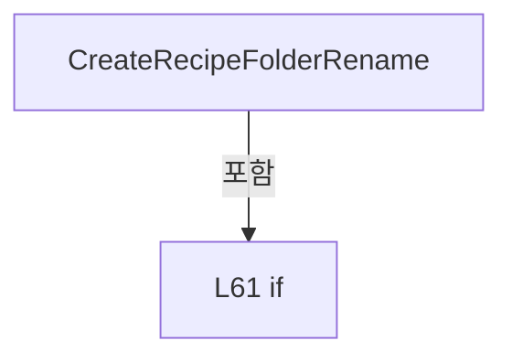
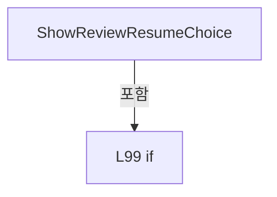
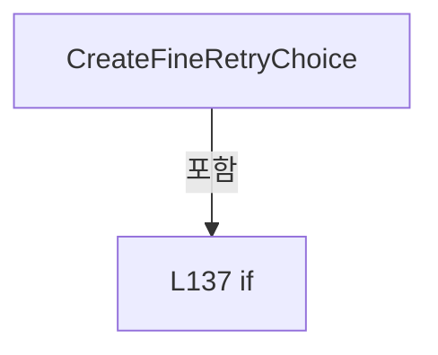
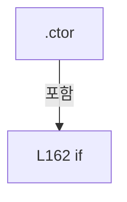
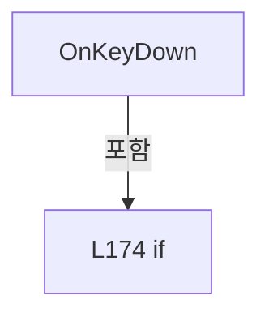

# Drilling.UI/Popup/CRecipeConfirmDialog.xaml.cs

| 항목 | 내용 |
| --- | --- |
| 원본 저장소 | https://github.com/kjuws10-rgb/A3Drilling.git |
| 원본 Commit | 96e22cd027c84bf302b23f2949b98985d7f301bb |
| 원본 SHA256 | 0c8e4dde3d973c0dc0c46013c41c9c0fc259e7c6b28729f41fc622c66ce275df |
| 파일 분류 | code |
| 원본 크기/행 | 7,829 bytes / 204 physical lines |
| 인코딩 | utf-8-sig |
| 검토 범위 | 구문/부분 의미 분석에서 추출한 사실. 동작·물리 단위·실장비 합격을 보증하지 않습니다. |
| 원본 링크 | [고정 Commit 원본](https://github.com/kjuws10-rgb/A3Drilling/blob/96e22cd027c84bf302b23f2949b98985d7f301bb/Drilling.UI/Popup/CRecipeConfirmDialog.xaml.cs) |

## 파일의 역할과 읽는 순서

WPF 화면·사용자 명령·표시 상태를 구성합니다. XAML 이벤트와 코드 비하인드, RootView의 조립 경로를 함께 추적합니다.

## 네임스페이스·타입·상속

| 타입 | 구분 | 원본 범위 | 선언/상속 |
| --- | --- | --- | --- |
| EN_DEFAULT_RESTART_CHOICE | EnumDeclaration | 6–6 | EN_DEFAULT_RESTART_CHOICE |
| CRecipeConfirmDialog | ClassDeclaration | 8–197 | CRecipeConfirmDialog: Window |
| EN_REVIEW_RESUME_CHOICE | EnumDeclaration | 199–204 | EN_REVIEW_RESUME_CHOICE |

## 멤버 빠른 목록

| 이름 | 종류 | 범위 | 서명 |
| --- | --- | --- | --- |
| Cancel | EnumMemberDeclaration | L6–6 | Drilling.UI.Popup.EN_DEFAULT_RESTART_CHOICE.Cancel |
| AllFromStart | EnumMemberDeclaration | L6–6 | Drilling.UI.Popup.EN_DEFAULT_RESTART_CHOICE.AllFromStart |
| InspectionFromStart | EnumMemberDeclaration | L6–6 | Drilling.UI.Popup.EN_DEFAULT_RESTART_CHOICE.InspectionFromStart |
| _alternateSelected | FieldDeclaration | L10–10 | bool Drilling.UI.Popup.CRecipeConfirmDialog._alternateSelected |
| ShowConfirmation | MethodDeclaration | L11–18 | bool Drilling.UI.Popup.CRecipeConfirmDialog.ShowConfirmation(string, string, string, bool) |
| ShowDuplicateOffsetConfirmation | MethodDeclaration | L20–28 | bool Drilling.UI.Popup.CRecipeConfirmDialog.ShowDuplicateOffsetConfirmation(string, string) |
| ShowSavedResultLoadConfirmation | MethodDeclaration | L30–38 | bool Drilling.UI.Popup.CRecipeConfirmDialog.ShowSavedResultLoadConfirmation(string, string) |
| ShowRecipeFolderCopy | MethodDeclaration | L40–48 | bool Drilling.UI.Popup.CRecipeConfirmDialog.ShowRecipeFolderCopy(string, string) |
| ShowRecipeFolderRename | MethodDeclaration | L51–55 | bool? Drilling.UI.Popup.CRecipeConfirmDialog.ShowRecipeFolderRename(string, string) |
| CreateRecipeFolderRename | MethodDeclaration | L57–68 | Drilling.UI.Popup.CRecipeConfirmDialog Drilling.UI.Popup.CRecipeConfirmDialog.CreateRecipeFolderRename(string, string) |
| ShowRecipeFolderDelete | MethodDeclaration | L70–70 | bool Drilling.UI.Popup.CRecipeConfirmDialog.ShowRecipeFolderDelete(string, string) |
| ShowRecipeFolderAction | MethodDeclaration | L71–79 | bool Drilling.UI.Popup.CRecipeConfirmDialog.ShowRecipeFolderAction(string, string, string, bool) |
| ShowCompletion | MethodDeclaration | L81–84 | void Drilling.UI.Popup.CRecipeConfirmDialog.ShowCompletion(string, string, Window?) |
| ShowWarning | MethodDeclaration | L86–89 | void Drilling.UI.Popup.CRecipeConfirmDialog.ShowWarning(string, string, Window?) |
| ShowReviewResumeChoice | MethodDeclaration | L91–105 | Drilling.UI.Popup.EN_REVIEW_RESUME_CHOICE Drilling.UI.Popup.CRecipeConfirmDialog.ShowReviewResumeChoice(string) |
| ShowFineRetryChoice | MethodDeclaration | L107–112 | Drilling.UI.Popup.EN_REVIEW_RESUME_CHOICE Drilling.UI.Popup.CRecipeConfirmDialog.ShowFineRetryChoice(string) |
| ShowDefaultRestartChoice | MethodDeclaration | L114–119 | Drilling.UI.Popup.EN_DEFAULT_RESTART_CHOICE Drilling.UI.Popup.CRecipeConfirmDialog.ShowDefaultRestartChoice(string) |
| CreateDefaultRestartChoice | MethodDeclaration | L121–131 | Drilling.UI.Popup.CRecipeConfirmDialog Drilling.UI.Popup.CRecipeConfirmDialog.CreateDefaultRestartChoice(string) |
| CreateFineRetryChoice | MethodDeclaration | L133–141 | Drilling.UI.Popup.CRecipeConfirmDialog Drilling.UI.Popup.CRecipeConfirmDialog.CreateFineRetryChoice(string) |
| ShowMessage | MethodDeclaration | L143–152 | void Drilling.UI.Popup.CRecipeConfirmDialog.ShowMessage(string, string, bool, Window?) |
| .ctor | ConstructorDeclaration | L154–169 | Drilling.UI.Popup.CRecipeConfirmDialog.CRecipeConfirmDialog(string, string, string, bool) |
| OnKeyDown | MethodDeclaration | L171–179 | void Drilling.UI.Popup.CRecipeConfirmDialog.OnKeyDown(KeyEventArgs) |
| OnConfirmClicked | MethodDeclaration | L181–184 | void Drilling.UI.Popup.CRecipeConfirmDialog.OnConfirmClicked(object, RoutedEventArgs) |
| OnCancelClicked | MethodDeclaration | L186–190 | void Drilling.UI.Popup.CRecipeConfirmDialog.OnCancelClicked(object, RoutedEventArgs) |
| OnAbortClicked | MethodDeclaration | L192–196 | void Drilling.UI.Popup.CRecipeConfirmDialog.OnAbortClicked(object, RoutedEventArgs) |
| Cancel | EnumMemberDeclaration | L201–201 | Drilling.UI.Popup.EN_REVIEW_RESUME_CHOICE.Cancel |
| Resume | EnumMemberDeclaration | L202–202 | Drilling.UI.Popup.EN_REVIEW_RESUME_CHOICE.Resume |
| Restart | EnumMemberDeclaration | L203–203 | Drilling.UI.Popup.EN_REVIEW_RESUME_CHOICE.Restart |

## 멤버별 상세 계약·호출·처리 해설

### EnumMemberDeclaration `Cancel` · L6–6

[Drilling.UI/Popup/CRecipeConfirmDialog.xaml.cs:6–6](https://github.com/kjuws10-rgb/A3Drilling/blob/96e22cd027c84bf302b23f2949b98985d7f301bb/Drilling.UI/Popup/CRecipeConfirmDialog.xaml.cs#L6-L6)

| 항목 | 실제 추출 값 |
| --- | --- |
| 서명 | Drilling.UI.Popup.EN_DEFAULT_RESTART_CHOICE.Cancel |
| 접근/수식자 | Public /  |
| 반환/값 타입 | Drilling.UI.Popup.EN_DEFAULT_RESTART_CHOICE |
| 소속 타입 | NamedType:Drilling.UI.Popup.EN_DEFAULT_RESTART_CHOICE |

현재 부분 분석에서 직접 연결된 호출자는 없습니다. XAML/이벤트/인터페이스·델리게이트·외부 진입을 추가 확인해야 하며, 미사용으로 판정한 것이 아닙니다.

변경 전 점검: 입력/반환 타입, 위 호출자, 예외/취소 경로, 공유 상태와 저장·전송 소비자를 함께 확인합니다. 값의 단위나 물리 방향을 이름만으로 확정하지 않습니다.

### EnumMemberDeclaration `AllFromStart` · L6–6

[Drilling.UI/Popup/CRecipeConfirmDialog.xaml.cs:6–6](https://github.com/kjuws10-rgb/A3Drilling/blob/96e22cd027c84bf302b23f2949b98985d7f301bb/Drilling.UI/Popup/CRecipeConfirmDialog.xaml.cs#L6-L6)

| 항목 | 실제 추출 값 |
| --- | --- |
| 서명 | Drilling.UI.Popup.EN_DEFAULT_RESTART_CHOICE.AllFromStart |
| 접근/수식자 | Public /  |
| 반환/값 타입 | Drilling.UI.Popup.EN_DEFAULT_RESTART_CHOICE |
| 소속 타입 | NamedType:Drilling.UI.Popup.EN_DEFAULT_RESTART_CHOICE |

현재 부분 분석에서 직접 연결된 호출자는 없습니다. XAML/이벤트/인터페이스·델리게이트·외부 진입을 추가 확인해야 하며, 미사용으로 판정한 것이 아닙니다.

변경 전 점검: 입력/반환 타입, 위 호출자, 예외/취소 경로, 공유 상태와 저장·전송 소비자를 함께 확인합니다. 값의 단위나 물리 방향을 이름만으로 확정하지 않습니다.

### EnumMemberDeclaration `InspectionFromStart` · L6–6

[Drilling.UI/Popup/CRecipeConfirmDialog.xaml.cs:6–6](https://github.com/kjuws10-rgb/A3Drilling/blob/96e22cd027c84bf302b23f2949b98985d7f301bb/Drilling.UI/Popup/CRecipeConfirmDialog.xaml.cs#L6-L6)

| 항목 | 실제 추출 값 |
| --- | --- |
| 서명 | Drilling.UI.Popup.EN_DEFAULT_RESTART_CHOICE.InspectionFromStart |
| 접근/수식자 | Public /  |
| 반환/값 타입 | Drilling.UI.Popup.EN_DEFAULT_RESTART_CHOICE |
| 소속 타입 | NamedType:Drilling.UI.Popup.EN_DEFAULT_RESTART_CHOICE |

현재 부분 분석에서 직접 연결된 호출자는 없습니다. XAML/이벤트/인터페이스·델리게이트·외부 진입을 추가 확인해야 하며, 미사용으로 판정한 것이 아닙니다.

변경 전 점검: 입력/반환 타입, 위 호출자, 예외/취소 경로, 공유 상태와 저장·전송 소비자를 함께 확인합니다. 값의 단위나 물리 방향을 이름만으로 확정하지 않습니다.

### FieldDeclaration `_alternateSelected` · L10–10

[Drilling.UI/Popup/CRecipeConfirmDialog.xaml.cs:10–10](https://github.com/kjuws10-rgb/A3Drilling/blob/96e22cd027c84bf302b23f2949b98985d7f301bb/Drilling.UI/Popup/CRecipeConfirmDialog.xaml.cs#L10-L10)

| 항목 | 실제 추출 값 |
| --- | --- |
| 서명 | bool Drilling.UI.Popup.CRecipeConfirmDialog._alternateSelected |
| 접근/수식자 | Private / private |
| 반환/값 타입 | bool |
| 소속 타입 | NamedType:Drilling.UI.Popup.CRecipeConfirmDialog |

현재 부분 분석에서 직접 연결된 호출자는 없습니다. XAML/이벤트/인터페이스·델리게이트·외부 진입을 추가 확인해야 하며, 미사용으로 판정한 것이 아닙니다.

변경 전 점검: 입력/반환 타입, 위 호출자, 예외/취소 경로, 공유 상태와 저장·전송 소비자를 함께 확인합니다. 값의 단위나 물리 방향을 이름만으로 확정하지 않습니다.

### MethodDeclaration `ShowConfirmation` · L11–18

[Drilling.UI/Popup/CRecipeConfirmDialog.xaml.cs:11–18](https://github.com/kjuws10-rgb/A3Drilling/blob/96e22cd027c84bf302b23f2949b98985d7f301bb/Drilling.UI/Popup/CRecipeConfirmDialog.xaml.cs#L11-L18)

| 항목 | 실제 추출 값 |
| --- | --- |
| 서명 | bool Drilling.UI.Popup.CRecipeConfirmDialog.ShowConfirmation(string, string, string, bool) |
| 접근/수식자 | Public / public, static |
| 반환/값 타입 | bool |
| 소속 타입 | NamedType:Drilling.UI.Popup.CRecipeConfirmDialog |

입력 계약:

| 이름 | 타입 | 전달 | 선택/기본값 |
| --- | --- | --- | --- |
| title | string | None | False /  |
| message | string | None | False /  |
| confirmText | string | None | True / "\uD655\uC778" |
| useDangerStyle | bool | None | True / false |

정적 호출자로 확인된 위치:

| 호출 파일/행 | 호출 표현식 | 런타임 분기 가능 |
| --- | --- | --- |
| [Drilling.UI/CRootView.cs:586–586](https://github.com/kjuws10-rgb/A3Drilling/blob/96e22cd027c84bf302b23f2949b98985d7f301bb/Drilling.UI/CRootView.cs#L586-L586) | CRecipeConfirmDialog.ShowConfirmation | False |
| [Drilling.UI/CRootView.cs:1601–1601](https://github.com/kjuws10-rgb/A3Drilling/blob/96e22cd027c84bf302b23f2949b98985d7f301bb/Drilling.UI/CRootView.cs#L1601-L1601) | CRecipeConfirmDialog.ShowConfirmation | False |
| [Drilling.UI/CRootView.cs:2610–2610](https://github.com/kjuws10-rgb/A3Drilling/blob/96e22cd027c84bf302b23f2949b98985d7f301bb/Drilling.UI/CRootView.cs#L2610-L2610) | CRecipeConfirmDialog.ShowConfirmation | False |
| [Drilling.UI/Menu/Menus/CMenuCorrection.ReviewData.Edit.cs:459–464](https://github.com/kjuws10-rgb/A3Drilling/blob/96e22cd027c84bf302b23f2949b98985d7f301bb/Drilling.UI/Menu/Menus/CMenuCorrection.ReviewData.Edit.cs#L459-L464) | CRecipeConfirmDialog.ShowConfirmation | False |
| [Drilling.UI/Menu/Menus/CMenuCorrection.ReviewData.Offset.cs:153–157](https://github.com/kjuws10-rgb/A3Drilling/blob/96e22cd027c84bf302b23f2949b98985d7f301bb/Drilling.UI/Menu/Menus/CMenuCorrection.ReviewData.Offset.cs#L153-L157) | CRecipeConfirmDialog.ShowConfirmation | False |
| [Drilling.UI/Menu/Menus/CMenuCorrection.ReviewData.Reinspection.cs:368–373](https://github.com/kjuws10-rgb/A3Drilling/blob/96e22cd027c84bf302b23f2949b98985d7f301bb/Drilling.UI/Menu/Menus/CMenuCorrection.ReviewData.Reinspection.cs#L368-L373) | CRecipeConfirmDialog.ShowConfirmation | False |
| [Drilling.UI/Menu/Menus/CMenuCorrection.cs:108–108](https://github.com/kjuws10-rgb/A3Drilling/blob/96e22cd027c84bf302b23f2949b98985d7f301bb/Drilling.UI/Menu/Menus/CMenuCorrection.cs#L108-L108) | CRecipeConfirmDialog.ShowConfirmation | False |
| [Drilling.UI/Menu/Menus/CMenuCorrection.cs:196–199](https://github.com/kjuws10-rgb/A3Drilling/blob/96e22cd027c84bf302b23f2949b98985d7f301bb/Drilling.UI/Menu/Menus/CMenuCorrection.cs#L196-L199) | CRecipeConfirmDialog.ShowConfirmation | False |
| [Drilling.UI/Menu/Menus/CMenuCorrection.cs:1305–1305](https://github.com/kjuws10-rgb/A3Drilling/blob/96e22cd027c84bf302b23f2949b98985d7f301bb/Drilling.UI/Menu/Menus/CMenuCorrection.cs#L1305-L1305) | CRecipeConfirmDialog.ShowConfirmation | False |
| [Drilling.UI/Menu/Menus/CMenuCorrection.cs:1313–1313](https://github.com/kjuws10-rgb/A3Drilling/blob/96e22cd027c84bf302b23f2949b98985d7f301bb/Drilling.UI/Menu/Menus/CMenuCorrection.cs#L1313-L1313) | CRecipeConfirmDialog.ShowConfirmation | False |
| [Drilling.UI/Menu/Menus/CMenuCorrection.cs:1323–1323](https://github.com/kjuws10-rgb/A3Drilling/blob/96e22cd027c84bf302b23f2949b98985d7f301bb/Drilling.UI/Menu/Menus/CMenuCorrection.cs#L1323-L1323) | CRecipeConfirmDialog.ShowConfirmation | False |
| [Drilling.UI/Menu/Menus/CMenuCorrection.cs:1392–1392](https://github.com/kjuws10-rgb/A3Drilling/blob/96e22cd027c84bf302b23f2949b98985d7f301bb/Drilling.UI/Menu/Menus/CMenuCorrection.cs#L1392-L1392) | CRecipeConfirmDialog.ShowConfirmation | False |
| [Drilling.UI/Menu/Menus/CMenuCorrection.cs:1571–1571](https://github.com/kjuws10-rgb/A3Drilling/blob/96e22cd027c84bf302b23f2949b98985d7f301bb/Drilling.UI/Menu/Menus/CMenuCorrection.cs#L1571-L1571) | CRecipeConfirmDialog.ShowConfirmation | False |
| [Drilling.UI/Menu/Menus/CMenuCorrection.cs:1583–1583](https://github.com/kjuws10-rgb/A3Drilling/blob/96e22cd027c84bf302b23f2949b98985d7f301bb/Drilling.UI/Menu/Menus/CMenuCorrection.cs#L1583-L1583) | CRecipeConfirmDialog.ShowConfirmation | False |
| [Drilling.UI/Menu/Menus/CMenuCorrection.cs:2640–2640](https://github.com/kjuws10-rgb/A3Drilling/blob/96e22cd027c84bf302b23f2949b98985d7f301bb/Drilling.UI/Menu/Menus/CMenuCorrection.cs#L2640-L2640) | CRecipeConfirmDialog.ShowConfirmation | False |
| [Drilling.UI/Menu/Menus/CMenuCorrection.cs:2657–2662](https://github.com/kjuws10-rgb/A3Drilling/blob/96e22cd027c84bf302b23f2949b98985d7f301bb/Drilling.UI/Menu/Menus/CMenuCorrection.cs#L2657-L2662) | CRecipeConfirmDialog.ShowConfirmation | False |
| [Drilling.UI/Menu/Menus/CMenuCorrection.cs:2706–2706](https://github.com/kjuws10-rgb/A3Drilling/blob/96e22cd027c84bf302b23f2949b98985d7f301bb/Drilling.UI/Menu/Menus/CMenuCorrection.cs#L2706-L2706) | CRecipeConfirmDialog.ShowConfirmation | False |
| [Drilling.UI/Menu/Menus/CMenuCorrection.cs:2717–2717](https://github.com/kjuws10-rgb/A3Drilling/blob/96e22cd027c84bf302b23f2949b98985d7f301bb/Drilling.UI/Menu/Menus/CMenuCorrection.cs#L2717-L2717) | CRecipeConfirmDialog.ShowConfirmation | False |
| [Drilling.UI/Menu/Menus/CMenuCorrection.cs:2728–2728](https://github.com/kjuws10-rgb/A3Drilling/blob/96e22cd027c84bf302b23f2949b98985d7f301bb/Drilling.UI/Menu/Menus/CMenuCorrection.cs#L2728-L2728) | CRecipeConfirmDialog.ShowConfirmation | False |
| [Drilling.UI/Menu/Menus/CMenuCorrection.cs:2784–2784](https://github.com/kjuws10-rgb/A3Drilling/blob/96e22cd027c84bf302b23f2949b98985d7f301bb/Drilling.UI/Menu/Menus/CMenuCorrection.cs#L2784-L2784) | CRecipeConfirmDialog.ShowConfirmation | False |
| [Drilling.UI/Menu/Menus/CMenuCorrection.cs:2942–2942](https://github.com/kjuws10-rgb/A3Drilling/blob/96e22cd027c84bf302b23f2949b98985d7f301bb/Drilling.UI/Menu/Menus/CMenuCorrection.cs#L2942-L2942) | CRecipeConfirmDialog.ShowConfirmation | False |
| [Drilling.UI/Menu/Menus/CMenuCorrection.cs:3054–3054](https://github.com/kjuws10-rgb/A3Drilling/blob/96e22cd027c84bf302b23f2949b98985d7f301bb/Drilling.UI/Menu/Menus/CMenuCorrection.cs#L3054-L3054) | CRecipeConfirmDialog.ShowConfirmation | False |
| [Drilling.UI/Menu/Menus/CMenuCorrection.cs:3914–3914](https://github.com/kjuws10-rgb/A3Drilling/blob/96e22cd027c84bf302b23f2949b98985d7f301bb/Drilling.UI/Menu/Menus/CMenuCorrection.cs#L3914-L3914) | CRecipeConfirmDialog.ShowConfirmation | False |
| [Drilling.UI/Menu/Menus/CMenuCorrection.cs:4063–4067](https://github.com/kjuws10-rgb/A3Drilling/blob/96e22cd027c84bf302b23f2949b98985d7f301bb/Drilling.UI/Menu/Menus/CMenuCorrection.cs#L4063-L4067) | CRecipeConfirmDialog.ShowConfirmation | False |
| [Drilling.UI/Menu/Menus/CMenuCorrection.cs:4162–4162](https://github.com/kjuws10-rgb/A3Drilling/blob/96e22cd027c84bf302b23f2949b98985d7f301bb/Drilling.UI/Menu/Menus/CMenuCorrection.cs#L4162-L4162) | CRecipeConfirmDialog.ShowConfirmation | False |
| [Drilling.UI/Menu/Menus/CMenuManual.cs:1780–1780](https://github.com/kjuws10-rgb/A3Drilling/blob/96e22cd027c84bf302b23f2949b98985d7f301bb/Drilling.UI/Menu/Menus/CMenuManual.cs#L1780-L1780) | CRecipeConfirmDialog.ShowConfirmation | False |
| [Drilling.UI/Menu/Menus/CMenuManual.cs:2190–2190](https://github.com/kjuws10-rgb/A3Drilling/blob/96e22cd027c84bf302b23f2949b98985d7f301bb/Drilling.UI/Menu/Menus/CMenuManual.cs#L2190-L2190) | CRecipeConfirmDialog.ShowConfirmation | False |
| [Drilling.UI/Menu/Menus/CMenuManual.cs:2614–2614](https://github.com/kjuws10-rgb/A3Drilling/blob/96e22cd027c84bf302b23f2949b98985d7f301bb/Drilling.UI/Menu/Menus/CMenuManual.cs#L2614-L2614) | CRecipeConfirmDialog.ShowConfirmation | False |
| [Drilling.UI/Menu/Menus/CMenuManual.cs:2723–2723](https://github.com/kjuws10-rgb/A3Drilling/blob/96e22cd027c84bf302b23f2949b98985d7f301bb/Drilling.UI/Menu/Menus/CMenuManual.cs#L2723-L2723) | CRecipeConfirmDialog.ShowConfirmation | False |
| [Drilling.UI/Menu/Menus/CMenuManual.cs:3255–3255](https://github.com/kjuws10-rgb/A3Drilling/blob/96e22cd027c84bf302b23f2949b98985d7f301bb/Drilling.UI/Menu/Menus/CMenuManual.cs#L3255-L3255) | CRecipeConfirmDialog.ShowConfirmation | False |
| [Drilling.UI/Menu/Menus/CMenuManual.cs:3295–3295](https://github.com/kjuws10-rgb/A3Drilling/blob/96e22cd027c84bf302b23f2949b98985d7f301bb/Drilling.UI/Menu/Menus/CMenuManual.cs#L3295-L3295) | CRecipeConfirmDialog.ShowConfirmation | False |
| [Drilling.UI/Menu/Menus/CMenuManual.cs:3355–3355](https://github.com/kjuws10-rgb/A3Drilling/blob/96e22cd027c84bf302b23f2949b98985d7f301bb/Drilling.UI/Menu/Menus/CMenuManual.cs#L3355-L3355) | CRecipeConfirmDialog.ShowConfirmation | False |
| [Drilling.UI/Menu/Menus/CMenuManual.cs:3516–3516](https://github.com/kjuws10-rgb/A3Drilling/blob/96e22cd027c84bf302b23f2949b98985d7f301bb/Drilling.UI/Menu/Menus/CMenuManual.cs#L3516-L3516) | CRecipeConfirmDialog.ShowConfirmation | False |
| [Drilling.UI/Menu/Menus/CMenuManual.cs:3898–3898](https://github.com/kjuws10-rgb/A3Drilling/blob/96e22cd027c84bf302b23f2949b98985d7f301bb/Drilling.UI/Menu/Menus/CMenuManual.cs#L3898-L3898) | CRecipeConfirmDialog.ShowConfirmation | False |
| [Drilling.UI/Menu/Menus/CMenuManual.cs:3943–3943](https://github.com/kjuws10-rgb/A3Drilling/blob/96e22cd027c84bf302b23f2949b98985d7f301bb/Drilling.UI/Menu/Menus/CMenuManual.cs#L3943-L3943) | CRecipeConfirmDialog.ShowConfirmation | False |
| [Drilling.UI/Menu/Menus/CMenuManual.cs:3962–3962](https://github.com/kjuws10-rgb/A3Drilling/blob/96e22cd027c84bf302b23f2949b98985d7f301bb/Drilling.UI/Menu/Menus/CMenuManual.cs#L3962-L3962) | CRecipeConfirmDialog.ShowConfirmation | False |
| [Drilling.UI/Menu/Menus/CMenuManual.cs:3994–3994](https://github.com/kjuws10-rgb/A3Drilling/blob/96e22cd027c84bf302b23f2949b98985d7f301bb/Drilling.UI/Menu/Menus/CMenuManual.cs#L3994-L3994) | CRecipeConfirmDialog.ShowConfirmation | False |
| [Drilling.UI/Menu/Menus/CMenuManual.cs:4063–4063](https://github.com/kjuws10-rgb/A3Drilling/blob/96e22cd027c84bf302b23f2949b98985d7f301bb/Drilling.UI/Menu/Menus/CMenuManual.cs#L4063-L4063) | CRecipeConfirmDialog.ShowConfirmation | False |
| [Drilling.UI/Menu/Menus/CMenuManual.cs:4289–4289](https://github.com/kjuws10-rgb/A3Drilling/blob/96e22cd027c84bf302b23f2949b98985d7f301bb/Drilling.UI/Menu/Menus/CMenuManual.cs#L4289-L4289) | CRecipeConfirmDialog.ShowConfirmation | False |
| [Drilling.UI/Menu/Menus/CMenuManual.cs:4627–4627](https://github.com/kjuws10-rgb/A3Drilling/blob/96e22cd027c84bf302b23f2949b98985d7f301bb/Drilling.UI/Menu/Menus/CMenuManual.cs#L4627-L4627) | CRecipeConfirmDialog.ShowConfirmation | False |
| [Drilling.UI/Menu/Menus/CMenuManual.cs:5040–5040](https://github.com/kjuws10-rgb/A3Drilling/blob/96e22cd027c84bf302b23f2949b98985d7f301bb/Drilling.UI/Menu/Menus/CMenuManual.cs#L5040-L5040) | CRecipeConfirmDialog.ShowConfirmation | False |
| [Drilling.UI/Menu/Menus/CMenuManual.cs:5244–5244](https://github.com/kjuws10-rgb/A3Drilling/blob/96e22cd027c84bf302b23f2949b98985d7f301bb/Drilling.UI/Menu/Menus/CMenuManual.cs#L5244-L5244) | CRecipeConfirmDialog.ShowConfirmation | False |
| [Drilling.UI/Menu/Menus/CMenuManual.cs:6287–6287](https://github.com/kjuws10-rgb/A3Drilling/blob/96e22cd027c84bf302b23f2949b98985d7f301bb/Drilling.UI/Menu/Menus/CMenuManual.cs#L6287-L6287) | CRecipeConfirmDialog.ShowConfirmation | False |
| [Drilling.UI/Menu/Menus/CMenuMonitor.cs:1295–1295](https://github.com/kjuws10-rgb/A3Drilling/blob/96e22cd027c84bf302b23f2949b98985d7f301bb/Drilling.UI/Menu/Menus/CMenuMonitor.cs#L1295-L1295) | CRecipeConfirmDialog.ShowConfirmation | False |
| [Drilling.UI/Menu/Menus/CMenuMonitor.cs:2941–2941](https://github.com/kjuws10-rgb/A3Drilling/blob/96e22cd027c84bf302b23f2949b98985d7f301bb/Drilling.UI/Menu/Menus/CMenuMonitor.cs#L2941-L2941) | CRecipeConfirmDialog.ShowConfirmation | False |
| [Drilling.UI/Menu/Menus/CMenuMonitor.cs:4441–4441](https://github.com/kjuws10-rgb/A3Drilling/blob/96e22cd027c84bf302b23f2949b98985d7f301bb/Drilling.UI/Menu/Menus/CMenuMonitor.cs#L4441-L4441) | CRecipeConfirmDialog.ShowConfirmation | False |
| [Drilling.UI/Menu/Menus/CMenuRecipe.cs:735–735](https://github.com/kjuws10-rgb/A3Drilling/blob/96e22cd027c84bf302b23f2949b98985d7f301bb/Drilling.UI/Menu/Menus/CMenuRecipe.cs#L735-L735) | CRecipeConfirmDialog.ShowConfirmation | False |
| [Drilling.UI/Menu/Menus/CMenuRecipe.cs:761–761](https://github.com/kjuws10-rgb/A3Drilling/blob/96e22cd027c84bf302b23f2949b98985d7f301bb/Drilling.UI/Menu/Menus/CMenuRecipe.cs#L761-L761) | CRecipeConfirmDialog.ShowConfirmation | False |
| [Drilling.UI/Menu/Menus/CMenuRecipe.cs:1033–1033](https://github.com/kjuws10-rgb/A3Drilling/blob/96e22cd027c84bf302b23f2949b98985d7f301bb/Drilling.UI/Menu/Menus/CMenuRecipe.cs#L1033-L1033) | CRecipeConfirmDialog.ShowConfirmation | False |
| [Drilling.UI/Menu/Menus/CMenuReview.cs:2350–2350](https://github.com/kjuws10-rgb/A3Drilling/blob/96e22cd027c84bf302b23f2949b98985d7f301bb/Drilling.UI/Menu/Menus/CMenuReview.cs#L2350-L2350) | CRecipeConfirmDialog.ShowConfirmation | False |
| [Drilling.UI/Menu/Menus/CMenuReview.cs:2383–2386](https://github.com/kjuws10-rgb/A3Drilling/blob/96e22cd027c84bf302b23f2949b98985d7f301bb/Drilling.UI/Menu/Menus/CMenuReview.cs#L2383-L2386) | CRecipeConfirmDialog.ShowConfirmation | False |
| [Drilling.UI/Menu/Menus/CMenuReview.cs:2400–2400](https://github.com/kjuws10-rgb/A3Drilling/blob/96e22cd027c84bf302b23f2949b98985d7f301bb/Drilling.UI/Menu/Menus/CMenuReview.cs#L2400-L2400) | CRecipeConfirmDialog.ShowConfirmation | False |
| [Drilling.UI/Menu/Menus/CMenuReview.cs:2460–2460](https://github.com/kjuws10-rgb/A3Drilling/blob/96e22cd027c84bf302b23f2949b98985d7f301bb/Drilling.UI/Menu/Menus/CMenuReview.cs#L2460-L2460) | CRecipeConfirmDialog.ShowConfirmation | False |
| [Drilling.UI/Menu/Menus/CMenuReview.cs:2476–2476](https://github.com/kjuws10-rgb/A3Drilling/blob/96e22cd027c84bf302b23f2949b98985d7f301bb/Drilling.UI/Menu/Menus/CMenuReview.cs#L2476-L2476) | CRecipeConfirmDialog.ShowConfirmation | False |
| [Drilling.UI/Menu/Menus/CMenuReview.cs:3147–3147](https://github.com/kjuws10-rgb/A3Drilling/blob/96e22cd027c84bf302b23f2949b98985d7f301bb/Drilling.UI/Menu/Menus/CMenuReview.cs#L3147-L3147) | CRecipeConfirmDialog.ShowConfirmation | False |
| [Drilling.UI/Menu/Menus/CMenuReview.cs:3271–3271](https://github.com/kjuws10-rgb/A3Drilling/blob/96e22cd027c84bf302b23f2949b98985d7f301bb/Drilling.UI/Menu/Menus/CMenuReview.cs#L3271-L3271) | CRecipeConfirmDialog.ShowConfirmation | False |
| [Drilling.UI/Menu/Menus/CMenuReview.cs:3287–3287](https://github.com/kjuws10-rgb/A3Drilling/blob/96e22cd027c84bf302b23f2949b98985d7f301bb/Drilling.UI/Menu/Menus/CMenuReview.cs#L3287-L3287) | CRecipeConfirmDialog.ShowConfirmation | False |
| [Drilling.UI/Menu/Menus/CMenuReview.cs:3579–3579](https://github.com/kjuws10-rgb/A3Drilling/blob/96e22cd027c84bf302b23f2949b98985d7f301bb/Drilling.UI/Menu/Menus/CMenuReview.cs#L3579-L3579) | CRecipeConfirmDialog.ShowConfirmation | False |
| [Drilling.UI/Menu/Menus/CMenuSetting.cs:340–340](https://github.com/kjuws10-rgb/A3Drilling/blob/96e22cd027c84bf302b23f2949b98985d7f301bb/Drilling.UI/Menu/Menus/CMenuSetting.cs#L340-L340) | CRecipeConfirmDialog.ShowConfirmation | False |
| [Drilling.UI/Menu/Menus/CMenuSetting.cs:382–382](https://github.com/kjuws10-rgb/A3Drilling/blob/96e22cd027c84bf302b23f2949b98985d7f301bb/Drilling.UI/Menu/Menus/CMenuSetting.cs#L382-L382) | CRecipeConfirmDialog.ShowConfirmation | False |
| [Drilling.UI/Menu/Menus/CMenuSetting.cs:406–406](https://github.com/kjuws10-rgb/A3Drilling/blob/96e22cd027c84bf302b23f2949b98985d7f301bb/Drilling.UI/Menu/Menus/CMenuSetting.cs#L406-L406) | CRecipeConfirmDialog.ShowConfirmation | False |
| [Drilling.UI/Menu/Menus/CMenuSetting.cs:470–470](https://github.com/kjuws10-rgb/A3Drilling/blob/96e22cd027c84bf302b23f2949b98985d7f301bb/Drilling.UI/Menu/Menus/CMenuSetting.cs#L470-L470) | CRecipeConfirmDialog.ShowConfirmation | False |
| [Drilling.UI/Menu/Menus/CMenuSetting.cs:489–489](https://github.com/kjuws10-rgb/A3Drilling/blob/96e22cd027c84bf302b23f2949b98985d7f301bb/Drilling.UI/Menu/Menus/CMenuSetting.cs#L489-L489) | CRecipeConfirmDialog.ShowConfirmation | False |

호출하는 대상과 해석 범위:

| 원본 행 | 표현식 | 분석 상태 | 대상/소스 위치 |
| --- | --- | --- | --- |
| 13 | new CRecipeConfirmDialog | resolved | Drilling.UI.Popup.CRecipeConfirmDialog.CRecipeConfirmDialog(string, string, string, bool) · Drilling.UI/Popup/CRecipeConfirmDialog.xaml.cs:154 |
| 17 | dialog.ShowDialog | unresolved | None |

본문의 실제 연산·분기·예외·반환 순서(원문 위치 순):

| 원본 행 | 종류 | 주석 해설 |
| --- | --- | --- |
| 13 | call | 함수·델리게이트 또는 객체 생성자를 호출합니다: new CRecipeConfirmDialog(title, message, confirmText, useDangerStyle) { Owner = Application.Current?.MainWindow } |
| 13 | local-declaration | 지역 변수를 선언합니다: var dialog = new CRecipeConfirmDialog(title, message, confirmText, useDangerStyle) { Owner = Application.Current?.MainWindow }; |
| 13 | variable-initializer | 변수의 초기값을 지정합니다: dialog = new CRecipeConfirmDialog(title, message, confirmText, useDangerStyle) { Owner = Application.Current?.MainWindow } |
| 15 | assignment | 값을 대상에 대입합니다: Owner = Application.Current?.MainWindow |
| 17 | call | 함수·델리게이트 또는 객체 생성자를 호출합니다: dialog.ShowDialog() |
| 17 | return | 호출자에게 값 또는 제어를 반환합니다: return dialog.ShowDialog() == true; |

변경 전 점검: 입력/반환 타입, 위 호출자, 예외/취소 경로, 공유 상태와 저장·전송 소비자를 함께 확인합니다. 값의 단위나 물리 방향을 이름만으로 확정하지 않습니다.

### MethodDeclaration `ShowDuplicateOffsetConfirmation` · L20–28

[Drilling.UI/Popup/CRecipeConfirmDialog.xaml.cs:20–28](https://github.com/kjuws10-rgb/A3Drilling/blob/96e22cd027c84bf302b23f2949b98985d7f301bb/Drilling.UI/Popup/CRecipeConfirmDialog.xaml.cs#L20-L28)

| 항목 | 실제 추출 값 |
| --- | --- |
| 서명 | bool Drilling.UI.Popup.CRecipeConfirmDialog.ShowDuplicateOffsetConfirmation(string, string) |
| 접근/수식자 | Public / public, static |
| 반환/값 타입 | bool |
| 소속 타입 | NamedType:Drilling.UI.Popup.CRecipeConfirmDialog |

입력 계약:

| 이름 | 타입 | 전달 | 선택/기본값 |
| --- | --- | --- | --- |
| title | string | None | False /  |
| message | string | None | False /  |

현재 부분 분석에서 직접 연결된 호출자는 없습니다. XAML/이벤트/인터페이스·델리게이트·외부 진입을 추가 확인해야 하며, 미사용으로 판정한 것이 아닙니다.

호출하는 대상과 해석 범위:

| 원본 행 | 표현식 | 분석 상태 | 대상/소스 위치 |
| --- | --- | --- | --- |
| 22 | new CRecipeConfirmDialog | resolved | Drilling.UI.Popup.CRecipeConfirmDialog.CRecipeConfirmDialog(string, string, string, bool) · Drilling.UI/Popup/CRecipeConfirmDialog.xaml.cs:154 |
| 27 | dialog.ShowDialog | unresolved | None |

본문의 실제 연산·분기·예외·반환 순서(원문 위치 순):

| 원본 행 | 종류 | 주석 해설 |
| --- | --- | --- |
| 22 | call | 함수·델리게이트 또는 객체 생성자를 호출합니다: new CRecipeConfirmDialog(title, message, "중복 적용", useDangerStyle: true) { Owner = Application.Current?.MainWindow } |
| 22 | local-declaration | 지역 변수를 선언합니다: var dialog = new CRecipeConfirmDialog(title, message, "중복 적용", useDangerStyle: true) { Owner = Application.Current?.MainWindow }; |
| 22 | variable-initializer | 변수의 초기값을 지정합니다: dialog = new CRecipeConfirmDialog(title, message, "중복 적용", useDangerStyle: true) { Owner = Application.Current?.MainWindow } |
| 24 | assignment | 값을 대상에 대입합니다: Owner = Application.Current?.MainWindow |
| 26 | assignment | 값을 대상에 대입합니다: dialog.CancelButton.Content = "아니오" |
| 27 | call | 함수·델리게이트 또는 객체 생성자를 호출합니다: dialog.ShowDialog() |
| 27 | return | 호출자에게 값 또는 제어를 반환합니다: return dialog.ShowDialog() == true; |

변경 전 점검: 입력/반환 타입, 위 호출자, 예외/취소 경로, 공유 상태와 저장·전송 소비자를 함께 확인합니다. 값의 단위나 물리 방향을 이름만으로 확정하지 않습니다.

### MethodDeclaration `ShowSavedResultLoadConfirmation` · L30–38

[Drilling.UI/Popup/CRecipeConfirmDialog.xaml.cs:30–38](https://github.com/kjuws10-rgb/A3Drilling/blob/96e22cd027c84bf302b23f2949b98985d7f301bb/Drilling.UI/Popup/CRecipeConfirmDialog.xaml.cs#L30-L38)

| 항목 | 실제 추출 값 |
| --- | --- |
| 서명 | bool Drilling.UI.Popup.CRecipeConfirmDialog.ShowSavedResultLoadConfirmation(string, string) |
| 접근/수식자 | Public / public, static |
| 반환/값 타입 | bool |
| 소속 타입 | NamedType:Drilling.UI.Popup.CRecipeConfirmDialog |

입력 계약:

| 이름 | 타입 | 전달 | 선택/기본값 |
| --- | --- | --- | --- |
| title | string | None | False /  |
| message | string | None | False /  |

정적 호출자로 확인된 위치:

| 호출 파일/행 | 호출 표현식 | 런타임 분기 가능 |
| --- | --- | --- |
| [Drilling.UI/Menu/Menus/CMenuCorrection.ReviewData.Edit.cs:497–499](https://github.com/kjuws10-rgb/A3Drilling/blob/96e22cd027c84bf302b23f2949b98985d7f301bb/Drilling.UI/Menu/Menus/CMenuCorrection.ReviewData.Edit.cs#L497-L499) | CRecipeConfirmDialog.ShowSavedResultLoadConfirmation | False |
| [Drilling.UI/Menu/Menus/CMenuCorrection.ReviewData.Reinspection.cs:427–429](https://github.com/kjuws10-rgb/A3Drilling/blob/96e22cd027c84bf302b23f2949b98985d7f301bb/Drilling.UI/Menu/Menus/CMenuCorrection.ReviewData.Reinspection.cs#L427-L429) | CRecipeConfirmDialog.ShowSavedResultLoadConfirmation | False |

호출하는 대상과 해석 범위:

| 원본 행 | 표현식 | 분석 상태 | 대상/소스 위치 |
| --- | --- | --- | --- |
| 32 | new CRecipeConfirmDialog | resolved | Drilling.UI.Popup.CRecipeConfirmDialog.CRecipeConfirmDialog(string, string, string, bool) · Drilling.UI/Popup/CRecipeConfirmDialog.xaml.cs:154 |
| 37 | dialog.ShowDialog | unresolved | None |

본문의 실제 연산·분기·예외·반환 순서(원문 위치 순):

| 원본 행 | 종류 | 주석 해설 |
| --- | --- | --- |
| 32 | call | 함수·델리게이트 또는 객체 생성자를 호출합니다: new CRecipeConfirmDialog(title, message, "예, LOAD", useDangerStyle: false) { Owner = Application.Current?.MainWindow } |
| 32 | local-declaration | 지역 변수를 선언합니다: var dialog = new CRecipeConfirmDialog(title, message, "예, LOAD", useDangerStyle: false) { Owner = Application.Current?.MainWindow }; |
| 32 | variable-initializer | 변수의 초기값을 지정합니다: dialog = new CRecipeConfirmDialog(title, message, "예, LOAD", useDangerStyle: false) { Owner = Application.Current?.MainWindow } |
| 34 | assignment | 값을 대상에 대입합니다: Owner = Application.Current?.MainWindow |
| 36 | assignment | 값을 대상에 대입합니다: dialog.CancelButton.Content = "아니오" |
| 37 | call | 함수·델리게이트 또는 객체 생성자를 호출합니다: dialog.ShowDialog() |
| 37 | return | 호출자에게 값 또는 제어를 반환합니다: return dialog.ShowDialog() == true; |

변경 전 점검: 입력/반환 타입, 위 호출자, 예외/취소 경로, 공유 상태와 저장·전송 소비자를 함께 확인합니다. 값의 단위나 물리 방향을 이름만으로 확정하지 않습니다.

### MethodDeclaration `ShowRecipeFolderCopy` · L40–48

[Drilling.UI/Popup/CRecipeConfirmDialog.xaml.cs:40–48](https://github.com/kjuws10-rgb/A3Drilling/blob/96e22cd027c84bf302b23f2949b98985d7f301bb/Drilling.UI/Popup/CRecipeConfirmDialog.xaml.cs#L40-L48)

| 항목 | 실제 추출 값 |
| --- | --- |
| 서명 | bool Drilling.UI.Popup.CRecipeConfirmDialog.ShowRecipeFolderCopy(string, string) |
| 접근/수식자 | Public / public, static |
| 반환/값 타입 | bool |
| 소속 타입 | NamedType:Drilling.UI.Popup.CRecipeConfirmDialog |

입력 계약:

| 이름 | 타입 | 전달 | 선택/기본값 |
| --- | --- | --- | --- |
| title | string | None | False /  |
| message | string | None | False /  |

현재 부분 분석에서 직접 연결된 호출자는 없습니다. XAML/이벤트/인터페이스·델리게이트·외부 진입을 추가 확인해야 하며, 미사용으로 판정한 것이 아닙니다.

호출하는 대상과 해석 범위:

| 원본 행 | 표현식 | 분석 상태 | 대상/소스 위치 |
| --- | --- | --- | --- |
| 42 | new CRecipeConfirmDialog | resolved | Drilling.UI.Popup.CRecipeConfirmDialog.CRecipeConfirmDialog(string, string, string, bool) · Drilling.UI/Popup/CRecipeConfirmDialog.xaml.cs:154 |
| 47 | dialog.ShowDialog | unresolved | None |

본문의 실제 연산·분기·예외·반환 순서(원문 위치 순):

| 원본 행 | 종류 | 주석 해설 |
| --- | --- | --- |
| 42 | call | 함수·델리게이트 또는 객체 생성자를 호출합니다: new CRecipeConfirmDialog(title, message, "복사", useDangerStyle: false) { Owner = Application.Current?.MainWindow } |
| 42 | local-declaration | 지역 변수를 선언합니다: var dialog = new CRecipeConfirmDialog(title, message, "복사", useDangerStyle: false) { Owner = Application.Current?.MainWindow }; |
| 42 | variable-initializer | 변수의 초기값을 지정합니다: dialog = new CRecipeConfirmDialog(title, message, "복사", useDangerStyle: false) { Owner = Application.Current?.MainWindow } |
| 44 | assignment | 값을 대상에 대입합니다: Owner = Application.Current?.MainWindow |
| 46 | assignment | 값을 대상에 대입합니다: dialog.CancelButton.Content = "복사 안 함" |
| 47 | call | 함수·델리게이트 또는 객체 생성자를 호출합니다: dialog.ShowDialog() |
| 47 | return | 호출자에게 값 또는 제어를 반환합니다: return dialog.ShowDialog() == true; |

변경 전 점검: 입력/반환 타입, 위 호출자, 예외/취소 경로, 공유 상태와 저장·전송 소비자를 함께 확인합니다. 값의 단위나 물리 방향을 이름만으로 확정하지 않습니다.

### MethodDeclaration `ShowRecipeFolderRename` · L51–55

[Drilling.UI/Popup/CRecipeConfirmDialog.xaml.cs:51–55](https://github.com/kjuws10-rgb/A3Drilling/blob/96e22cd027c84bf302b23f2949b98985d7f301bb/Drilling.UI/Popup/CRecipeConfirmDialog.xaml.cs#L51-L55)

| 항목 | 실제 추출 값 |
| --- | --- |
| 서명 | bool? Drilling.UI.Popup.CRecipeConfirmDialog.ShowRecipeFolderRename(string, string) |
| 접근/수식자 | Public / public, static |
| 반환/값 타입 | bool? |
| 소속 타입 | NamedType:Drilling.UI.Popup.CRecipeConfirmDialog |

입력 계약:

| 이름 | 타입 | 전달 | 선택/기본값 |
| --- | --- | --- | --- |
| title | string | None | False /  |
| message | string | None | False /  |

현재 부분 분석에서 직접 연결된 호출자는 없습니다. XAML/이벤트/인터페이스·델리게이트·외부 진입을 추가 확인해야 하며, 미사용으로 판정한 것이 아닙니다.

호출하는 대상과 해석 범위:

| 원본 행 | 표현식 | 분석 상태 | 대상/소스 위치 |
| --- | --- | --- | --- |
| 53 | CreateRecipeFolderRename | resolved | Drilling.UI.Popup.CRecipeConfirmDialog Drilling.UI.Popup.CRecipeConfirmDialog.CreateRecipeFolderRename(string, string) · Drilling.UI/Popup/CRecipeConfirmDialog.xaml.cs:57 |
| 54 | dialog.ShowDialog | unresolved | None |

본문의 실제 연산·분기·예외·반환 순서(원문 위치 순):

| 원본 행 | 종류 | 주석 해설 |
| --- | --- | --- |
| 53 | call | 함수·델리게이트 또는 객체 생성자를 호출합니다: CreateRecipeFolderRename(title, message) |
| 53 | local-declaration | 지역 변수를 선언합니다: var dialog = CreateRecipeFolderRename(title, message); |
| 53 | variable-initializer | 변수의 초기값을 지정합니다: dialog = CreateRecipeFolderRename(title, message) |
| 54 | call | 함수·델리게이트 또는 객체 생성자를 호출합니다: dialog.ShowDialog() |
| 54 | conditional-expression | 조건에 따라 결과식을 선택합니다: dialog.ShowDialog() == true ? true : dialog._alternateSelected ? false : null |
| 54 | conditional-expression | 조건에 따라 결과식을 선택합니다: dialog._alternateSelected ? false : null |
| 54 | return | 호출자에게 값 또는 제어를 반환합니다: return dialog.ShowDialog() == true ? true : dialog._alternateSelected ? false : null; |

변경 전 점검: 입력/반환 타입, 위 호출자, 예외/취소 경로, 공유 상태와 저장·전송 소비자를 함께 확인합니다. 값의 단위나 물리 방향을 이름만으로 확정하지 않습니다.

### MethodDeclaration `CreateRecipeFolderRename` · L57–68

[Drilling.UI/Popup/CRecipeConfirmDialog.xaml.cs:57–68](https://github.com/kjuws10-rgb/A3Drilling/blob/96e22cd027c84bf302b23f2949b98985d7f301bb/Drilling.UI/Popup/CRecipeConfirmDialog.xaml.cs#L57-L68)

| 항목 | 실제 추출 값 |
| --- | --- |
| 서명 | Drilling.UI.Popup.CRecipeConfirmDialog Drilling.UI.Popup.CRecipeConfirmDialog.CreateRecipeFolderRename(string, string) |
| 접근/수식자 | Internal / internal, static |
| 반환/값 타입 | Drilling.UI.Popup.CRecipeConfirmDialog |
| 소속 타입 | NamedType:Drilling.UI.Popup.CRecipeConfirmDialog |

입력 계약:

| 이름 | 타입 | 전달 | 선택/기본값 |
| --- | --- | --- | --- |
| title | string | None | False /  |
| message | string | None | False /  |

정적 호출자로 확인된 위치:

| 호출 파일/행 | 호출 표현식 | 런타임 분기 가능 |
| --- | --- | --- |
| [Drilling.UI/Popup/CRecipeConfirmDialog.xaml.cs:53–53](https://github.com/kjuws10-rgb/A3Drilling/blob/96e22cd027c84bf302b23f2949b98985d7f301bb/Drilling.UI/Popup/CRecipeConfirmDialog.xaml.cs#L53-L53) | CreateRecipeFolderRename | False |

호출하는 대상과 해석 범위:

| 원본 행 | 표현식 | 분석 상태 | 대상/소스 위치 |
| --- | --- | --- | --- |
| 60 | new CRecipeConfirmDialog | resolved | Drilling.UI.Popup.CRecipeConfirmDialog.CRecipeConfirmDialog(string, string, string, bool) · Drilling.UI/Popup/CRecipeConfirmDialog.xaml.cs:154 |
| 64 | new GridLength | unresolved | None |
| 65 | new GridLength | unresolved | None |

본문의 실제 연산·분기·예외·반환 순서(원문 위치 순):

| 원본 행 | 종류 | 주석 해설 |
| --- | --- | --- |
| 59 | local-declaration | 지역 변수를 선언합니다: var owner = Application.Current?.MainWindow; |
| 59 | variable-initializer | 변수의 초기값을 지정합니다: owner = Application.Current?.MainWindow |
| 60 | call | 함수·델리게이트 또는 객체 생성자를 호출합니다: new CRecipeConfirmDialog(title, message, "함께 변경", useDangerStyle: false) |
| 60 | local-declaration | 지역 변수를 선언합니다: var dialog = new CRecipeConfirmDialog(title, message, "함께 변경", useDangerStyle: false); |
| 60 | variable-initializer | 변수의 초기값을 지정합니다: dialog = new CRecipeConfirmDialog(title, message, "함께 변경", useDangerStyle: false) |
| 61 | if | 조건에 따라 분기합니다: if (owner is not null) |
| 62 | assignment | 값을 대상에 대입합니다: dialog.Owner = owner |
| 63 | assignment | 값을 대상에 대입합니다: dialog.CancelButton.Content = "폴더 유지" |
| 64 | assignment | 값을 대상에 대입합니다: dialog.AbortGap.Width = new GridLength(12) |
| 64 | call | 함수·델리게이트 또는 객체 생성자를 호출합니다: new GridLength(12) |
| 65 | assignment | 값을 대상에 대입합니다: dialog.AbortColumn.Width = new GridLength(1, GridUnitType.Star) |
| 65 | call | 함수·델리게이트 또는 객체 생성자를 호출합니다: new GridLength(1, GridUnitType.Star) |
| 66 | assignment | 값을 대상에 대입합니다: dialog.AbortButton.Visibility = Visibility.Visible |
| 67 | return | 호출자에게 값 또는 제어를 반환합니다: return dialog; |

제어 구문의 포함 구조(실제 실행 순서/CFG가 아닌 구문 탐색 그림):

변경 전 점검: 입력/반환 타입, 위 호출자, 예외/취소 경로, 공유 상태와 저장·전송 소비자를 함께 확인합니다. 값의 단위나 물리 방향을 이름만으로 확정하지 않습니다.

### MethodDeclaration `ShowRecipeFolderDelete` · L70–70

[Drilling.UI/Popup/CRecipeConfirmDialog.xaml.cs:70–70](https://github.com/kjuws10-rgb/A3Drilling/blob/96e22cd027c84bf302b23f2949b98985d7f301bb/Drilling.UI/Popup/CRecipeConfirmDialog.xaml.cs#L70-L70)

| 항목 | 실제 추출 값 |
| --- | --- |
| 서명 | bool Drilling.UI.Popup.CRecipeConfirmDialog.ShowRecipeFolderDelete(string, string) |
| 접근/수식자 | Public / public, static |
| 반환/값 타입 | bool |
| 소속 타입 | NamedType:Drilling.UI.Popup.CRecipeConfirmDialog |

입력 계약:

| 이름 | 타입 | 전달 | 선택/기본값 |
| --- | --- | --- | --- |
| title | string | None | False /  |
| message | string | None | False /  |

현재 부분 분석에서 직접 연결된 호출자는 없습니다. XAML/이벤트/인터페이스·델리게이트·외부 진입을 추가 확인해야 하며, 미사용으로 판정한 것이 아닙니다.

호출하는 대상과 해석 범위:

| 원본 행 | 표현식 | 분석 상태 | 대상/소스 위치 |
| --- | --- | --- | --- |
| 70 | ShowRecipeFolderAction | resolved | bool Drilling.UI.Popup.CRecipeConfirmDialog.ShowRecipeFolderAction(string, string, string, bool) · Drilling.UI/Popup/CRecipeConfirmDialog.xaml.cs:71 |

본문의 실제 연산·분기·예외·반환 순서(원문 위치 순):

| 원본 행 | 종류 | 주석 해설 |
| --- | --- | --- |
| 70 | call | 함수·델리게이트 또는 객체 생성자를 호출합니다: ShowRecipeFolderAction(title, message, "함께 삭제", true) |

변경 전 점검: 입력/반환 타입, 위 호출자, 예외/취소 경로, 공유 상태와 저장·전송 소비자를 함께 확인합니다. 값의 단위나 물리 방향을 이름만으로 확정하지 않습니다.

### MethodDeclaration `ShowRecipeFolderAction` · L71–79

[Drilling.UI/Popup/CRecipeConfirmDialog.xaml.cs:71–79](https://github.com/kjuws10-rgb/A3Drilling/blob/96e22cd027c84bf302b23f2949b98985d7f301bb/Drilling.UI/Popup/CRecipeConfirmDialog.xaml.cs#L71-L79)

| 항목 | 실제 추출 값 |
| --- | --- |
| 서명 | bool Drilling.UI.Popup.CRecipeConfirmDialog.ShowRecipeFolderAction(string, string, string, bool) |
| 접근/수식자 | Private / private, static |
| 반환/값 타입 | bool |
| 소속 타입 | NamedType:Drilling.UI.Popup.CRecipeConfirmDialog |

입력 계약:

| 이름 | 타입 | 전달 | 선택/기본값 |
| --- | --- | --- | --- |
| title | string | None | False /  |
| message | string | None | False /  |
| action | string | None | False /  |
| danger | bool | None | False /  |

정적 호출자로 확인된 위치:

| 호출 파일/행 | 호출 표현식 | 런타임 분기 가능 |
| --- | --- | --- |
| [Drilling.UI/Popup/CRecipeConfirmDialog.xaml.cs:70–70](https://github.com/kjuws10-rgb/A3Drilling/blob/96e22cd027c84bf302b23f2949b98985d7f301bb/Drilling.UI/Popup/CRecipeConfirmDialog.xaml.cs#L70-L70) | ShowRecipeFolderAction | False |

호출하는 대상과 해석 범위:

| 원본 행 | 표현식 | 분석 상태 | 대상/소스 위치 |
| --- | --- | --- | --- |
| 73 | new CRecipeConfirmDialog | resolved | Drilling.UI.Popup.CRecipeConfirmDialog.CRecipeConfirmDialog(string, string, string, bool) · Drilling.UI/Popup/CRecipeConfirmDialog.xaml.cs:154 |
| 78 | dialog.ShowDialog | unresolved | None |

본문의 실제 연산·분기·예외·반환 순서(원문 위치 순):

| 원본 행 | 종류 | 주석 해설 |
| --- | --- | --- |
| 73 | call | 함수·델리게이트 또는 객체 생성자를 호출합니다: new CRecipeConfirmDialog(title, message, action, danger) { Owner = Application.Current?.MainWindow } |
| 73 | local-declaration | 지역 변수를 선언합니다: var dialog = new CRecipeConfirmDialog(title, message, action, danger) { Owner = Application.Current?.MainWindow }; |
| 73 | variable-initializer | 변수의 초기값을 지정합니다: dialog = new CRecipeConfirmDialog(title, message, action, danger) { Owner = Application.Current?.MainWindow } |
| 75 | assignment | 값을 대상에 대입합니다: Owner = Application.Current?.MainWindow |
| 77 | assignment | 값을 대상에 대입합니다: dialog.CancelButton.Content = "폴더 유지" |
| 78 | call | 함수·델리게이트 또는 객체 생성자를 호출합니다: dialog.ShowDialog() |
| 78 | return | 호출자에게 값 또는 제어를 반환합니다: return dialog.ShowDialog() == true; |

변경 전 점검: 입력/반환 타입, 위 호출자, 예외/취소 경로, 공유 상태와 저장·전송 소비자를 함께 확인합니다. 값의 단위나 물리 방향을 이름만으로 확정하지 않습니다.

### MethodDeclaration `ShowCompletion` · L81–84

[Drilling.UI/Popup/CRecipeConfirmDialog.xaml.cs:81–84](https://github.com/kjuws10-rgb/A3Drilling/blob/96e22cd027c84bf302b23f2949b98985d7f301bb/Drilling.UI/Popup/CRecipeConfirmDialog.xaml.cs#L81-L84)

| 항목 | 실제 추출 값 |
| --- | --- |
| 서명 | void Drilling.UI.Popup.CRecipeConfirmDialog.ShowCompletion(string, string, Window?) |
| 접근/수식자 | Public / public, static |
| 반환/값 타입 | void |
| 소속 타입 | NamedType:Drilling.UI.Popup.CRecipeConfirmDialog |

입력 계약:

| 이름 | 타입 | 전달 | 선택/기본값 |
| --- | --- | --- | --- |
| title | string | None | False /  |
| message | string | None | False /  |
| owner | Window? | None | True / null |

정적 호출자로 확인된 위치:

| 호출 파일/행 | 호출 표현식 | 런타임 분기 가능 |
| --- | --- | --- |
| [Drilling.UI/Menu/Menus/CMenuCorrection.ReviewData.Offset.cs:120–120](https://github.com/kjuws10-rgb/A3Drilling/blob/96e22cd027c84bf302b23f2949b98985d7f301bb/Drilling.UI/Menu/Menus/CMenuCorrection.ReviewData.Offset.cs#L120-L120) | CRecipeConfirmDialog.ShowCompletion | False |
| [Drilling.UI/Menu/Menus/CMenuCorrection.ReviewData.Offset.cs:194–194](https://github.com/kjuws10-rgb/A3Drilling/blob/96e22cd027c84bf302b23f2949b98985d7f301bb/Drilling.UI/Menu/Menus/CMenuCorrection.ReviewData.Offset.cs#L194-L194) | CRecipeConfirmDialog.ShowCompletion | False |
| [Drilling.UI/Menu/Menus/CMenuCorrection.cs:1432–1432](https://github.com/kjuws10-rgb/A3Drilling/blob/96e22cd027c84bf302b23f2949b98985d7f301bb/Drilling.UI/Menu/Menus/CMenuCorrection.cs#L1432-L1432) | CRecipeConfirmDialog.ShowCompletion | False |
| [Drilling.UI/Menu/Menus/CMenuCorrection.cs:1757–1757](https://github.com/kjuws10-rgb/A3Drilling/blob/96e22cd027c84bf302b23f2949b98985d7f301bb/Drilling.UI/Menu/Menus/CMenuCorrection.cs#L1757-L1757) | CRecipeConfirmDialog.ShowCompletion | False |
| [Drilling.UI/Menu/Menus/CMenuCorrection.cs:2643–2643](https://github.com/kjuws10-rgb/A3Drilling/blob/96e22cd027c84bf302b23f2949b98985d7f301bb/Drilling.UI/Menu/Menus/CMenuCorrection.cs#L2643-L2643) | CRecipeConfirmDialog.ShowCompletion | False |
| [Drilling.UI/Menu/Menus/CMenuCorrection.cs:2652–2652](https://github.com/kjuws10-rgb/A3Drilling/blob/96e22cd027c84bf302b23f2949b98985d7f301bb/Drilling.UI/Menu/Menus/CMenuCorrection.cs#L2652-L2652) | CRecipeConfirmDialog.ShowCompletion | False |
| [Drilling.UI/Menu/Menus/CMenuCorrection.cs:2665–2665](https://github.com/kjuws10-rgb/A3Drilling/blob/96e22cd027c84bf302b23f2949b98985d7f301bb/Drilling.UI/Menu/Menus/CMenuCorrection.cs#L2665-L2665) | CRecipeConfirmDialog.ShowCompletion | False |
| [Drilling.UI/Menu/Menus/CMenuCorrection.cs:2785–2785](https://github.com/kjuws10-rgb/A3Drilling/blob/96e22cd027c84bf302b23f2949b98985d7f301bb/Drilling.UI/Menu/Menus/CMenuCorrection.cs#L2785-L2785) | CRecipeConfirmDialog.ShowCompletion | False |
| [Drilling.UI/Menu/Menus/CMenuCorrection.cs:3055–3055](https://github.com/kjuws10-rgb/A3Drilling/blob/96e22cd027c84bf302b23f2949b98985d7f301bb/Drilling.UI/Menu/Menus/CMenuCorrection.cs#L3055-L3055) | CRecipeConfirmDialog.ShowCompletion | False |
| [Drilling.UI/Menu/Menus/CMenuCorrection.cs:3915–3915](https://github.com/kjuws10-rgb/A3Drilling/blob/96e22cd027c84bf302b23f2949b98985d7f301bb/Drilling.UI/Menu/Menus/CMenuCorrection.cs#L3915-L3915) | CRecipeConfirmDialog.ShowCompletion | False |
| [Drilling.UI/Menu/Menus/CMenuCorrection.cs:4068–4068](https://github.com/kjuws10-rgb/A3Drilling/blob/96e22cd027c84bf302b23f2949b98985d7f301bb/Drilling.UI/Menu/Menus/CMenuCorrection.cs#L4068-L4068) | CRecipeConfirmDialog.ShowCompletion | False |
| [Drilling.UI/Menu/Menus/CMenuCorrection.cs:4163–4163](https://github.com/kjuws10-rgb/A3Drilling/blob/96e22cd027c84bf302b23f2949b98985d7f301bb/Drilling.UI/Menu/Menus/CMenuCorrection.cs#L4163-L4163) | CRecipeConfirmDialog.ShowCompletion | False |
| [Drilling.UI/Menu/Menus/CMenuManual.cs:2031–2031](https://github.com/kjuws10-rgb/A3Drilling/blob/96e22cd027c84bf302b23f2949b98985d7f301bb/Drilling.UI/Menu/Menus/CMenuManual.cs#L2031-L2031) | CRecipeConfirmDialog.ShowCompletion | False |
| [Drilling.UI/Menu/Menus/CMenuManual.cs:5061–5061](https://github.com/kjuws10-rgb/A3Drilling/blob/96e22cd027c84bf302b23f2949b98985d7f301bb/Drilling.UI/Menu/Menus/CMenuManual.cs#L5061-L5061) | CRecipeConfirmDialog.ShowCompletion | False |
| [Drilling.UI/Menu/Menus/CMenuManual.cs:5169–5169](https://github.com/kjuws10-rgb/A3Drilling/blob/96e22cd027c84bf302b23f2949b98985d7f301bb/Drilling.UI/Menu/Menus/CMenuManual.cs#L5169-L5169) | CRecipeConfirmDialog.ShowCompletion | False |
| [Drilling.UI/Menu/Menus/CMenuRecipe.cs:774–774](https://github.com/kjuws10-rgb/A3Drilling/blob/96e22cd027c84bf302b23f2949b98985d7f301bb/Drilling.UI/Menu/Menus/CMenuRecipe.cs#L774-L774) | CRecipeConfirmDialog.ShowCompletion | False |
| [Drilling.UI/Menu/Menus/CMenuRecipe.cs:1035–1035](https://github.com/kjuws10-rgb/A3Drilling/blob/96e22cd027c84bf302b23f2949b98985d7f301bb/Drilling.UI/Menu/Menus/CMenuRecipe.cs#L1035-L1035) | CRecipeConfirmDialog.ShowCompletion | False |
| [Drilling.UI/Menu/Menus/CMenuRecipe.cs:1246–1246](https://github.com/kjuws10-rgb/A3Drilling/blob/96e22cd027c84bf302b23f2949b98985d7f301bb/Drilling.UI/Menu/Menus/CMenuRecipe.cs#L1246-L1246) | CRecipeConfirmDialog.ShowCompletion | False |
| [Drilling.UI/Menu/Menus/CMenuReview.cs:2825–2825](https://github.com/kjuws10-rgb/A3Drilling/blob/96e22cd027c84bf302b23f2949b98985d7f301bb/Drilling.UI/Menu/Menus/CMenuReview.cs#L2825-L2825) | CRecipeConfirmDialog.ShowCompletion | False |
| [Drilling.UI/Menu/Menus/CMenuReview.cs:3167–3167](https://github.com/kjuws10-rgb/A3Drilling/blob/96e22cd027c84bf302b23f2949b98985d7f301bb/Drilling.UI/Menu/Menus/CMenuReview.cs#L3167-L3167) | CRecipeConfirmDialog.ShowCompletion | False |
| [Drilling.UI/Menu/Menus/CMenuSetting.cs:432–432](https://github.com/kjuws10-rgb/A3Drilling/blob/96e22cd027c84bf302b23f2949b98985d7f301bb/Drilling.UI/Menu/Menus/CMenuSetting.cs#L432-L432) | CRecipeConfirmDialog.ShowCompletion | False |
| [Drilling.UI/Menu/Menus/CMenuSetting.cs:465–465](https://github.com/kjuws10-rgb/A3Drilling/blob/96e22cd027c84bf302b23f2949b98985d7f301bb/Drilling.UI/Menu/Menus/CMenuSetting.cs#L465-L465) | CRecipeConfirmDialog.ShowCompletion | False |

호출하는 대상과 해석 범위:

| 원본 행 | 표현식 | 분석 상태 | 대상/소스 위치 |
| --- | --- | --- | --- |
| 83 | ShowMessage | resolved | void Drilling.UI.Popup.CRecipeConfirmDialog.ShowMessage(string, string, bool, Window?) · Drilling.UI/Popup/CRecipeConfirmDialog.xaml.cs:143 |

본문의 실제 연산·분기·예외·반환 순서(원문 위치 순):

| 원본 행 | 종류 | 주석 해설 |
| --- | --- | --- |
| 83 | call | 함수·델리게이트 또는 객체 생성자를 호출합니다: ShowMessage(title, message, useDangerStyle: false, owner) |

변경 전 점검: 입력/반환 타입, 위 호출자, 예외/취소 경로, 공유 상태와 저장·전송 소비자를 함께 확인합니다. 값의 단위나 물리 방향을 이름만으로 확정하지 않습니다.

### MethodDeclaration `ShowWarning` · L86–89

[Drilling.UI/Popup/CRecipeConfirmDialog.xaml.cs:86–89](https://github.com/kjuws10-rgb/A3Drilling/blob/96e22cd027c84bf302b23f2949b98985d7f301bb/Drilling.UI/Popup/CRecipeConfirmDialog.xaml.cs#L86-L89)

| 항목 | 실제 추출 값 |
| --- | --- |
| 서명 | void Drilling.UI.Popup.CRecipeConfirmDialog.ShowWarning(string, string, Window?) |
| 접근/수식자 | Public / public, static |
| 반환/값 타입 | void |
| 소속 타입 | NamedType:Drilling.UI.Popup.CRecipeConfirmDialog |

입력 계약:

| 이름 | 타입 | 전달 | 선택/기본값 |
| --- | --- | --- | --- |
| title | string | None | False /  |
| message | string | None | False /  |
| owner | Window? | None | True / null |

정적 호출자로 확인된 위치:

| 호출 파일/행 | 호출 표현식 | 런타임 분기 가능 |
| --- | --- | --- |
| [Drilling.UI/CRootView.cs:276–276](https://github.com/kjuws10-rgb/A3Drilling/blob/96e22cd027c84bf302b23f2949b98985d7f301bb/Drilling.UI/CRootView.cs#L276-L276) | CRecipeConfirmDialog.ShowWarning | False |
| [Drilling.UI/CRootView.cs:285–285](https://github.com/kjuws10-rgb/A3Drilling/blob/96e22cd027c84bf302b23f2949b98985d7f301bb/Drilling.UI/CRootView.cs#L285-L285) | CRecipeConfirmDialog.ShowWarning | False |
| [Drilling.UI/CRootView.cs:587–587](https://github.com/kjuws10-rgb/A3Drilling/blob/96e22cd027c84bf302b23f2949b98985d7f301bb/Drilling.UI/CRootView.cs#L587-L587) | CRecipeConfirmDialog.ShowWarning | False |
| [Drilling.UI/CRootView.cs:1245–1245](https://github.com/kjuws10-rgb/A3Drilling/blob/96e22cd027c84bf302b23f2949b98985d7f301bb/Drilling.UI/CRootView.cs#L1245-L1245) | CRecipeConfirmDialog.ShowWarning | False |
| [Drilling.UI/CRootView.cs:1382–1382](https://github.com/kjuws10-rgb/A3Drilling/blob/96e22cd027c84bf302b23f2949b98985d7f301bb/Drilling.UI/CRootView.cs#L1382-L1382) | CRecipeConfirmDialog.ShowWarning | False |
| [Drilling.UI/CRootView.cs:1596–1596](https://github.com/kjuws10-rgb/A3Drilling/blob/96e22cd027c84bf302b23f2949b98985d7f301bb/Drilling.UI/CRootView.cs#L1596-L1596) | CRecipeConfirmDialog.ShowWarning | False |
| [Drilling.UI/CRootView.cs:1605–1605](https://github.com/kjuws10-rgb/A3Drilling/blob/96e22cd027c84bf302b23f2949b98985d7f301bb/Drilling.UI/CRootView.cs#L1605-L1605) | CRecipeConfirmDialog.ShowWarning | False |
| [Drilling.UI/CRootView.cs:1617–1617](https://github.com/kjuws10-rgb/A3Drilling/blob/96e22cd027c84bf302b23f2949b98985d7f301bb/Drilling.UI/CRootView.cs#L1617-L1617) | CRecipeConfirmDialog.ShowWarning | False |
| [Drilling.UI/CRootView.cs:1635–1635](https://github.com/kjuws10-rgb/A3Drilling/blob/96e22cd027c84bf302b23f2949b98985d7f301bb/Drilling.UI/CRootView.cs#L1635-L1635) | CRecipeConfirmDialog.ShowWarning | False |
| [Drilling.UI/CRootView.cs:1648–1648](https://github.com/kjuws10-rgb/A3Drilling/blob/96e22cd027c84bf302b23f2949b98985d7f301bb/Drilling.UI/CRootView.cs#L1648-L1648) | CRecipeConfirmDialog.ShowWarning | False |
| [Drilling.UI/CRootView.cs:1672–1672](https://github.com/kjuws10-rgb/A3Drilling/blob/96e22cd027c84bf302b23f2949b98985d7f301bb/Drilling.UI/CRootView.cs#L1672-L1672) | CRecipeConfirmDialog.ShowWarning | False |
| [Drilling.UI/Menu/Menus/CMenuCorrection.ReviewData.Edit.cs:307–311](https://github.com/kjuws10-rgb/A3Drilling/blob/96e22cd027c84bf302b23f2949b98985d7f301bb/Drilling.UI/Menu/Menus/CMenuCorrection.ReviewData.Edit.cs#L307-L311) | CRecipeConfirmDialog.ShowWarning | False |
| [Drilling.UI/Menu/Menus/CMenuCorrection.ReviewData.Edit.cs:326–326](https://github.com/kjuws10-rgb/A3Drilling/blob/96e22cd027c84bf302b23f2949b98985d7f301bb/Drilling.UI/Menu/Menus/CMenuCorrection.ReviewData.Edit.cs#L326-L326) | CRecipeConfirmDialog.ShowWarning | False |
| [Drilling.UI/Menu/Menus/CMenuCorrection.ReviewData.Edit.cs:425–427](https://github.com/kjuws10-rgb/A3Drilling/blob/96e22cd027c84bf302b23f2949b98985d7f301bb/Drilling.UI/Menu/Menus/CMenuCorrection.ReviewData.Edit.cs#L425-L427) | CRecipeConfirmDialog.ShowWarning | False |
| [Drilling.UI/Menu/Menus/CMenuCorrection.ReviewData.Edit.cs:453–455](https://github.com/kjuws10-rgb/A3Drilling/blob/96e22cd027c84bf302b23f2949b98985d7f301bb/Drilling.UI/Menu/Menus/CMenuCorrection.ReviewData.Edit.cs#L453-L455) | CRecipeConfirmDialog.ShowWarning | False |
| [Drilling.UI/Menu/Menus/CMenuCorrection.ReviewData.Edit.cs:488–488](https://github.com/kjuws10-rgb/A3Drilling/blob/96e22cd027c84bf302b23f2949b98985d7f301bb/Drilling.UI/Menu/Menus/CMenuCorrection.ReviewData.Edit.cs#L488-L488) | CRecipeConfirmDialog.ShowWarning | False |
| [Drilling.UI/Menu/Menus/CMenuCorrection.ReviewData.Edit.cs:508–510](https://github.com/kjuws10-rgb/A3Drilling/blob/96e22cd027c84bf302b23f2949b98985d7f301bb/Drilling.UI/Menu/Menus/CMenuCorrection.ReviewData.Edit.cs#L508-L510) | CRecipeConfirmDialog.ShowWarning | False |
| [Drilling.UI/Menu/Menus/CMenuCorrection.ReviewData.Offset.cs:125–125](https://github.com/kjuws10-rgb/A3Drilling/blob/96e22cd027c84bf302b23f2949b98985d7f301bb/Drilling.UI/Menu/Menus/CMenuCorrection.ReviewData.Offset.cs#L125-L125) | CRecipeConfirmDialog.ShowWarning | False |
| [Drilling.UI/Menu/Menus/CMenuCorrection.ReviewData.Offset.cs:199–199](https://github.com/kjuws10-rgb/A3Drilling/blob/96e22cd027c84bf302b23f2949b98985d7f301bb/Drilling.UI/Menu/Menus/CMenuCorrection.ReviewData.Offset.cs#L199-L199) | CRecipeConfirmDialog.ShowWarning | False |
| [Drilling.UI/Menu/Menus/CMenuCorrection.ReviewData.Offset.cs:242–242](https://github.com/kjuws10-rgb/A3Drilling/blob/96e22cd027c84bf302b23f2949b98985d7f301bb/Drilling.UI/Menu/Menus/CMenuCorrection.ReviewData.Offset.cs#L242-L242) | CRecipeConfirmDialog.ShowWarning | False |
| [Drilling.UI/Menu/Menus/CMenuCorrection.ReviewData.Reinspection.cs:362–364](https://github.com/kjuws10-rgb/A3Drilling/blob/96e22cd027c84bf302b23f2949b98985d7f301bb/Drilling.UI/Menu/Menus/CMenuCorrection.ReviewData.Reinspection.cs#L362-L364) | CRecipeConfirmDialog.ShowWarning | False |
| [Drilling.UI/Menu/Menus/CMenuCorrection.ReviewData.Reinspection.cs:409–411](https://github.com/kjuws10-rgb/A3Drilling/blob/96e22cd027c84bf302b23f2949b98985d7f301bb/Drilling.UI/Menu/Menus/CMenuCorrection.ReviewData.Reinspection.cs#L409-L411) | CRecipeConfirmDialog.ShowWarning | False |
| [Drilling.UI/Menu/Menus/CMenuCorrection.ReviewData.Reinspection.cs:439–441](https://github.com/kjuws10-rgb/A3Drilling/blob/96e22cd027c84bf302b23f2949b98985d7f301bb/Drilling.UI/Menu/Menus/CMenuCorrection.ReviewData.Reinspection.cs#L439-L441) | CRecipeConfirmDialog.ShowWarning | False |
| [Drilling.UI/Menu/Menus/CMenuCorrection.cs:92–92](https://github.com/kjuws10-rgb/A3Drilling/blob/96e22cd027c84bf302b23f2949b98985d7f301bb/Drilling.UI/Menu/Menus/CMenuCorrection.cs#L92-L92) | CRecipeConfirmDialog.ShowWarning | False |
| [Drilling.UI/Menu/Menus/CMenuCorrection.cs:110–110](https://github.com/kjuws10-rgb/A3Drilling/blob/96e22cd027c84bf302b23f2949b98985d7f301bb/Drilling.UI/Menu/Menus/CMenuCorrection.cs#L110-L110) | CRecipeConfirmDialog.ShowWarning | False |
| [Drilling.UI/Menu/Menus/CMenuCorrection.cs:2683–2683](https://github.com/kjuws10-rgb/A3Drilling/blob/96e22cd027c84bf302b23f2949b98985d7f301bb/Drilling.UI/Menu/Menus/CMenuCorrection.cs#L2683-L2683) | CRecipeConfirmDialog.ShowWarning | False |
| [Drilling.UI/Menu/Menus/CMenuCorrection.cs:2729–2729](https://github.com/kjuws10-rgb/A3Drilling/blob/96e22cd027c84bf302b23f2949b98985d7f301bb/Drilling.UI/Menu/Menus/CMenuCorrection.cs#L2729-L2729) | CRecipeConfirmDialog.ShowWarning | False |
| [Drilling.UI/Menu/Menus/CMenuCorrection.cs:2943–2943](https://github.com/kjuws10-rgb/A3Drilling/blob/96e22cd027c84bf302b23f2949b98985d7f301bb/Drilling.UI/Menu/Menus/CMenuCorrection.cs#L2943-L2943) | CRecipeConfirmDialog.ShowWarning | False |
| [Drilling.UI/Menu/Menus/CMenuCorrection.cs:3056–3056](https://github.com/kjuws10-rgb/A3Drilling/blob/96e22cd027c84bf302b23f2949b98985d7f301bb/Drilling.UI/Menu/Menus/CMenuCorrection.cs#L3056-L3056) | CRecipeConfirmDialog.ShowWarning | False |
| [Drilling.UI/Menu/Menus/CMenuCorrection.cs:3916–3916](https://github.com/kjuws10-rgb/A3Drilling/blob/96e22cd027c84bf302b23f2949b98985d7f301bb/Drilling.UI/Menu/Menus/CMenuCorrection.cs#L3916-L3916) | CRecipeConfirmDialog.ShowWarning | False |
| [Drilling.UI/Menu/Menus/CMenuCorrection.cs:4069–4069](https://github.com/kjuws10-rgb/A3Drilling/blob/96e22cd027c84bf302b23f2949b98985d7f301bb/Drilling.UI/Menu/Menus/CMenuCorrection.cs#L4069-L4069) | CRecipeConfirmDialog.ShowWarning | False |
| [Drilling.UI/Menu/Menus/CMenuCorrection.cs:4164–4164](https://github.com/kjuws10-rgb/A3Drilling/blob/96e22cd027c84bf302b23f2949b98985d7f301bb/Drilling.UI/Menu/Menus/CMenuCorrection.cs#L4164-L4164) | CRecipeConfirmDialog.ShowWarning | False |
| [Drilling.UI/Menu/Menus/CMenuManual.cs:1809–1809](https://github.com/kjuws10-rgb/A3Drilling/blob/96e22cd027c84bf302b23f2949b98985d7f301bb/Drilling.UI/Menu/Menus/CMenuManual.cs#L1809-L1809) | CRecipeConfirmDialog.ShowWarning | False |
| [Drilling.UI/Menu/Menus/CMenuManual.cs:2042–2042](https://github.com/kjuws10-rgb/A3Drilling/blob/96e22cd027c84bf302b23f2949b98985d7f301bb/Drilling.UI/Menu/Menus/CMenuManual.cs#L2042-L2042) | CRecipeConfirmDialog.ShowWarning | False |
| [Drilling.UI/Menu/Menus/CMenuManual.cs:2186–2186](https://github.com/kjuws10-rgb/A3Drilling/blob/96e22cd027c84bf302b23f2949b98985d7f301bb/Drilling.UI/Menu/Menus/CMenuManual.cs#L2186-L2186) | CRecipeConfirmDialog.ShowWarning | False |
| [Drilling.UI/Menu/Menus/CMenuManual.cs:2216–2216](https://github.com/kjuws10-rgb/A3Drilling/blob/96e22cd027c84bf302b23f2949b98985d7f301bb/Drilling.UI/Menu/Menus/CMenuManual.cs#L2216-L2216) | CRecipeConfirmDialog.ShowWarning | False |
| [Drilling.UI/Menu/Menus/CMenuManual.cs:2575–2575](https://github.com/kjuws10-rgb/A3Drilling/blob/96e22cd027c84bf302b23f2949b98985d7f301bb/Drilling.UI/Menu/Menus/CMenuManual.cs#L2575-L2575) | CRecipeConfirmDialog.ShowWarning | False |
| [Drilling.UI/Menu/Menus/CMenuManual.cs:2592–2592](https://github.com/kjuws10-rgb/A3Drilling/blob/96e22cd027c84bf302b23f2949b98985d7f301bb/Drilling.UI/Menu/Menus/CMenuManual.cs#L2592-L2592) | CRecipeConfirmDialog.ShowWarning | False |
| [Drilling.UI/Menu/Menus/CMenuManual.cs:2603–2603](https://github.com/kjuws10-rgb/A3Drilling/blob/96e22cd027c84bf302b23f2949b98985d7f301bb/Drilling.UI/Menu/Menus/CMenuManual.cs#L2603-L2603) | CRecipeConfirmDialog.ShowWarning | False |
| [Drilling.UI/Menu/Menus/CMenuManual.cs:2678–2678](https://github.com/kjuws10-rgb/A3Drilling/blob/96e22cd027c84bf302b23f2949b98985d7f301bb/Drilling.UI/Menu/Menus/CMenuManual.cs#L2678-L2678) | CRecipeConfirmDialog.ShowWarning | False |
| [Drilling.UI/Menu/Menus/CMenuManual.cs:2696–2696](https://github.com/kjuws10-rgb/A3Drilling/blob/96e22cd027c84bf302b23f2949b98985d7f301bb/Drilling.UI/Menu/Menus/CMenuManual.cs#L2696-L2696) | CRecipeConfirmDialog.ShowWarning | False |
| [Drilling.UI/Menu/Menus/CMenuManual.cs:2719–2719](https://github.com/kjuws10-rgb/A3Drilling/blob/96e22cd027c84bf302b23f2949b98985d7f301bb/Drilling.UI/Menu/Menus/CMenuManual.cs#L2719-L2719) | CRecipeConfirmDialog.ShowWarning | False |
| [Drilling.UI/Menu/Menus/CMenuManual.cs:2765–2765](https://github.com/kjuws10-rgb/A3Drilling/blob/96e22cd027c84bf302b23f2949b98985d7f301bb/Drilling.UI/Menu/Menus/CMenuManual.cs#L2765-L2765) | CRecipeConfirmDialog.ShowWarning | False |
| [Drilling.UI/Menu/Menus/CMenuManual.cs:3256–3256](https://github.com/kjuws10-rgb/A3Drilling/blob/96e22cd027c84bf302b23f2949b98985d7f301bb/Drilling.UI/Menu/Menus/CMenuManual.cs#L3256-L3256) | CRecipeConfirmDialog.ShowWarning | False |
| [Drilling.UI/Menu/Menus/CMenuManual.cs:3296–3296](https://github.com/kjuws10-rgb/A3Drilling/blob/96e22cd027c84bf302b23f2949b98985d7f301bb/Drilling.UI/Menu/Menus/CMenuManual.cs#L3296-L3296) | CRecipeConfirmDialog.ShowWarning | False |
| [Drilling.UI/Menu/Menus/CMenuManual.cs:3371–3371](https://github.com/kjuws10-rgb/A3Drilling/blob/96e22cd027c84bf302b23f2949b98985d7f301bb/Drilling.UI/Menu/Menus/CMenuManual.cs#L3371-L3371) | CRecipeConfirmDialog.ShowWarning | False |
| [Drilling.UI/Menu/Menus/CMenuManual.cs:3376–3376](https://github.com/kjuws10-rgb/A3Drilling/blob/96e22cd027c84bf302b23f2949b98985d7f301bb/Drilling.UI/Menu/Menus/CMenuManual.cs#L3376-L3376) | CRecipeConfirmDialog.ShowWarning | False |
| [Drilling.UI/Menu/Menus/CMenuManual.cs:3396–3396](https://github.com/kjuws10-rgb/A3Drilling/blob/96e22cd027c84bf302b23f2949b98985d7f301bb/Drilling.UI/Menu/Menus/CMenuManual.cs#L3396-L3396) | CRecipeConfirmDialog.ShowWarning | False |
| [Drilling.UI/Menu/Menus/CMenuManual.cs:3444–3444](https://github.com/kjuws10-rgb/A3Drilling/blob/96e22cd027c84bf302b23f2949b98985d7f301bb/Drilling.UI/Menu/Menus/CMenuManual.cs#L3444-L3444) | CRecipeConfirmDialog.ShowWarning | False |
| [Drilling.UI/Menu/Menus/CMenuManual.cs:4048–4048](https://github.com/kjuws10-rgb/A3Drilling/blob/96e22cd027c84bf302b23f2949b98985d7f301bb/Drilling.UI/Menu/Menus/CMenuManual.cs#L4048-L4048) | CRecipeConfirmDialog.ShowWarning | False |
| [Drilling.UI/Menu/Menus/CMenuManual.cs:4059–4059](https://github.com/kjuws10-rgb/A3Drilling/blob/96e22cd027c84bf302b23f2949b98985d7f301bb/Drilling.UI/Menu/Menus/CMenuManual.cs#L4059-L4059) | CRecipeConfirmDialog.ShowWarning | False |
| [Drilling.UI/Menu/Menus/CMenuManual.cs:4126–4126](https://github.com/kjuws10-rgb/A3Drilling/blob/96e22cd027c84bf302b23f2949b98985d7f301bb/Drilling.UI/Menu/Menus/CMenuManual.cs#L4126-L4126) | CRecipeConfirmDialog.ShowWarning | False |
| [Drilling.UI/Menu/Menus/CMenuManual.cs:4277–4277](https://github.com/kjuws10-rgb/A3Drilling/blob/96e22cd027c84bf302b23f2949b98985d7f301bb/Drilling.UI/Menu/Menus/CMenuManual.cs#L4277-L4277) | CRecipeConfirmDialog.ShowWarning | False |
| [Drilling.UI/Menu/Menus/CMenuManual.cs:4313–4313](https://github.com/kjuws10-rgb/A3Drilling/blob/96e22cd027c84bf302b23f2949b98985d7f301bb/Drilling.UI/Menu/Menus/CMenuManual.cs#L4313-L4313) | CRecipeConfirmDialog.ShowWarning | False |
| [Drilling.UI/Menu/Menus/CMenuManual.cs:4356–4356](https://github.com/kjuws10-rgb/A3Drilling/blob/96e22cd027c84bf302b23f2949b98985d7f301bb/Drilling.UI/Menu/Menus/CMenuManual.cs#L4356-L4356) | CRecipeConfirmDialog.ShowWarning | False |
| [Drilling.UI/Menu/Menus/CMenuManual.cs:4615–4615](https://github.com/kjuws10-rgb/A3Drilling/blob/96e22cd027c84bf302b23f2949b98985d7f301bb/Drilling.UI/Menu/Menus/CMenuManual.cs#L4615-L4615) | CRecipeConfirmDialog.ShowWarning | False |
| [Drilling.UI/Menu/Menus/CMenuManual.cs:4650–4650](https://github.com/kjuws10-rgb/A3Drilling/blob/96e22cd027c84bf302b23f2949b98985d7f301bb/Drilling.UI/Menu/Menus/CMenuManual.cs#L4650-L4650) | CRecipeConfirmDialog.ShowWarning | False |
| [Drilling.UI/Menu/Menus/CMenuManual.cs:4815–4815](https://github.com/kjuws10-rgb/A3Drilling/blob/96e22cd027c84bf302b23f2949b98985d7f301bb/Drilling.UI/Menu/Menus/CMenuManual.cs#L4815-L4815) | CRecipeConfirmDialog.ShowWarning | False |
| [Drilling.UI/Menu/Menus/CMenuManual.cs:5345–5345](https://github.com/kjuws10-rgb/A3Drilling/blob/96e22cd027c84bf302b23f2949b98985d7f301bb/Drilling.UI/Menu/Menus/CMenuManual.cs#L5345-L5345) | CRecipeConfirmDialog.ShowWarning | False |
| [Drilling.UI/Menu/Menus/CMenuManual.cs:5399–5399](https://github.com/kjuws10-rgb/A3Drilling/blob/96e22cd027c84bf302b23f2949b98985d7f301bb/Drilling.UI/Menu/Menus/CMenuManual.cs#L5399-L5399) | CRecipeConfirmDialog.ShowWarning | False |
| [Drilling.UI/Menu/Menus/CMenuManual.cs:5436–5436](https://github.com/kjuws10-rgb/A3Drilling/blob/96e22cd027c84bf302b23f2949b98985d7f301bb/Drilling.UI/Menu/Menus/CMenuManual.cs#L5436-L5436) | CRecipeConfirmDialog.ShowWarning | False |
| [Drilling.UI/Menu/Menus/CMenuManual.cs:6286–6286](https://github.com/kjuws10-rgb/A3Drilling/blob/96e22cd027c84bf302b23f2949b98985d7f301bb/Drilling.UI/Menu/Menus/CMenuManual.cs#L6286-L6286) | CRecipeConfirmDialog.ShowWarning | False |
| [Drilling.UI/Menu/Menus/CMenuMonitor.cs:1238–1238](https://github.com/kjuws10-rgb/A3Drilling/blob/96e22cd027c84bf302b23f2949b98985d7f301bb/Drilling.UI/Menu/Menus/CMenuMonitor.cs#L1238-L1238) | CRecipeConfirmDialog.ShowWarning | False |
| [Drilling.UI/Menu/Menus/CMenuMonitor.cs:2930–2930](https://github.com/kjuws10-rgb/A3Drilling/blob/96e22cd027c84bf302b23f2949b98985d7f301bb/Drilling.UI/Menu/Menus/CMenuMonitor.cs#L2930-L2930) | CRecipeConfirmDialog.ShowWarning | False |
| [Drilling.UI/Menu/Menus/CMenuMonitor.cs:5119–5119](https://github.com/kjuws10-rgb/A3Drilling/blob/96e22cd027c84bf302b23f2949b98985d7f301bb/Drilling.UI/Menu/Menus/CMenuMonitor.cs#L5119-L5119) | CRecipeConfirmDialog.ShowWarning | False |
| [Drilling.UI/Menu/Menus/CMenuRecipe.cs:1034–1034](https://github.com/kjuws10-rgb/A3Drilling/blob/96e22cd027c84bf302b23f2949b98985d7f301bb/Drilling.UI/Menu/Menus/CMenuRecipe.cs#L1034-L1034) | CRecipeConfirmDialog.ShowWarning | False |
| [Drilling.UI/Menu/Menus/CMenuRecipe.cs:1078–1078](https://github.com/kjuws10-rgb/A3Drilling/blob/96e22cd027c84bf302b23f2949b98985d7f301bb/Drilling.UI/Menu/Menus/CMenuRecipe.cs#L1078-L1078) | CRecipeConfirmDialog.ShowWarning | False |
| [Drilling.UI/Menu/Menus/CMenuRecipe.cs:1178–1178](https://github.com/kjuws10-rgb/A3Drilling/blob/96e22cd027c84bf302b23f2949b98985d7f301bb/Drilling.UI/Menu/Menus/CMenuRecipe.cs#L1178-L1178) | CRecipeConfirmDialog.ShowWarning | False |
| [Drilling.UI/Menu/Menus/CMenuRecipe.cs:1245–1245](https://github.com/kjuws10-rgb/A3Drilling/blob/96e22cd027c84bf302b23f2949b98985d7f301bb/Drilling.UI/Menu/Menus/CMenuRecipe.cs#L1245-L1245) | CRecipeConfirmDialog.ShowWarning | False |
| [Drilling.UI/Menu/Menus/CMenuRecipe.cs:1466–1466](https://github.com/kjuws10-rgb/A3Drilling/blob/96e22cd027c84bf302b23f2949b98985d7f301bb/Drilling.UI/Menu/Menus/CMenuRecipe.cs#L1466-L1466) | CRecipeConfirmDialog.ShowWarning | False |
| [Drilling.UI/Menu/Menus/CMenuReview.cs:696–696](https://github.com/kjuws10-rgb/A3Drilling/blob/96e22cd027c84bf302b23f2949b98985d7f301bb/Drilling.UI/Menu/Menus/CMenuReview.cs#L696-L696) | CRecipeConfirmDialog.ShowWarning | False |
| [Drilling.UI/Menu/Menus/CMenuReview.cs:2430–2432](https://github.com/kjuws10-rgb/A3Drilling/blob/96e22cd027c84bf302b23f2949b98985d7f301bb/Drilling.UI/Menu/Menus/CMenuReview.cs#L2430-L2432) | CRecipeConfirmDialog.ShowWarning | False |
| [Drilling.UI/Menu/Menus/CMenuReview.cs:2511–2511](https://github.com/kjuws10-rgb/A3Drilling/blob/96e22cd027c84bf302b23f2949b98985d7f301bb/Drilling.UI/Menu/Menus/CMenuReview.cs#L2511-L2511) | CRecipeConfirmDialog.ShowWarning | False |
| [Drilling.UI/Menu/Menus/CMenuReview.cs:2524–2524](https://github.com/kjuws10-rgb/A3Drilling/blob/96e22cd027c84bf302b23f2949b98985d7f301bb/Drilling.UI/Menu/Menus/CMenuReview.cs#L2524-L2524) | CRecipeConfirmDialog.ShowWarning | False |
| [Drilling.UI/Menu/Menus/CMenuReview.cs:2817–2817](https://github.com/kjuws10-rgb/A3Drilling/blob/96e22cd027c84bf302b23f2949b98985d7f301bb/Drilling.UI/Menu/Menus/CMenuReview.cs#L2817-L2817) | CRecipeConfirmDialog.ShowWarning | False |
| [Drilling.UI/Menu/Menus/CMenuReview.cs:2823–2823](https://github.com/kjuws10-rgb/A3Drilling/blob/96e22cd027c84bf302b23f2949b98985d7f301bb/Drilling.UI/Menu/Menus/CMenuReview.cs#L2823-L2823) | CRecipeConfirmDialog.ShowWarning | False |
| [Drilling.UI/Menu/Menus/CMenuReview.cs:2833–2833](https://github.com/kjuws10-rgb/A3Drilling/blob/96e22cd027c84bf302b23f2949b98985d7f301bb/Drilling.UI/Menu/Menus/CMenuReview.cs#L2833-L2833) | CRecipeConfirmDialog.ShowWarning | False |
| [Drilling.UI/Menu/Menus/CMenuReview.cs:3217–3217](https://github.com/kjuws10-rgb/A3Drilling/blob/96e22cd027c84bf302b23f2949b98985d7f301bb/Drilling.UI/Menu/Menus/CMenuReview.cs#L3217-L3217) | CRecipeConfirmDialog.ShowWarning | False |
| [Drilling.UI/Menu/Menus/CMenuReview.cs:3232–3232](https://github.com/kjuws10-rgb/A3Drilling/blob/96e22cd027c84bf302b23f2949b98985d7f301bb/Drilling.UI/Menu/Menus/CMenuReview.cs#L3232-L3232) | CRecipeConfirmDialog.ShowWarning | False |
| [Drilling.UI/Menu/Menus/CMenuReview.cs:3245–3245](https://github.com/kjuws10-rgb/A3Drilling/blob/96e22cd027c84bf302b23f2949b98985d7f301bb/Drilling.UI/Menu/Menus/CMenuReview.cs#L3245-L3245) | CRecipeConfirmDialog.ShowWarning | False |
| [Drilling.UI/Menu/Menus/CMenuReview.cs:3315–3315](https://github.com/kjuws10-rgb/A3Drilling/blob/96e22cd027c84bf302b23f2949b98985d7f301bb/Drilling.UI/Menu/Menus/CMenuReview.cs#L3315-L3315) | CRecipeConfirmDialog.ShowWarning | False |
| [Drilling.UI/Menu/Menus/CMenuReview.cs:3328–3328](https://github.com/kjuws10-rgb/A3Drilling/blob/96e22cd027c84bf302b23f2949b98985d7f301bb/Drilling.UI/Menu/Menus/CMenuReview.cs#L3328-L3328) | CRecipeConfirmDialog.ShowWarning | False |
| [Drilling.UI/Menu/Menus/CMenuReview.cs:3580–3580](https://github.com/kjuws10-rgb/A3Drilling/blob/96e22cd027c84bf302b23f2949b98985d7f301bb/Drilling.UI/Menu/Menus/CMenuReview.cs#L3580-L3580) | CRecipeConfirmDialog.ShowWarning | False |
| [Drilling.UI/Menu/Menus/CMenuReview.cs:4027–4027](https://github.com/kjuws10-rgb/A3Drilling/blob/96e22cd027c84bf302b23f2949b98985d7f301bb/Drilling.UI/Menu/Menus/CMenuReview.cs#L4027-L4027) | CRecipeConfirmDialog.ShowWarning | False |
| [Drilling.UI/Menu/Menus/CMenuReview.cs:4233–4233](https://github.com/kjuws10-rgb/A3Drilling/blob/96e22cd027c84bf302b23f2949b98985d7f301bb/Drilling.UI/Menu/Menus/CMenuReview.cs#L4233-L4233) | CRecipeConfirmDialog.ShowWarning | False |
| [Drilling.UI/Menu/Menus/CMenuSetting.cs:450–452](https://github.com/kjuws10-rgb/A3Drilling/blob/96e22cd027c84bf302b23f2949b98985d7f301bb/Drilling.UI/Menu/Menus/CMenuSetting.cs#L450-L452) | CRecipeConfirmDialog.ShowWarning | False |
| [Drilling.UI/Popup/CMelsecStageSimulationDialog.xaml.cs:85–85](https://github.com/kjuws10-rgb/A3Drilling/blob/96e22cd027c84bf302b23f2949b98985d7f301bb/Drilling.UI/Popup/CMelsecStageSimulationDialog.xaml.cs#L85-L85) | CRecipeConfirmDialog.ShowWarning | False |
| [Drilling.UI/Popup/CMelsecStageSimulationDialog.xaml.cs:113–113](https://github.com/kjuws10-rgb/A3Drilling/blob/96e22cd027c84bf302b23f2949b98985d7f301bb/Drilling.UI/Popup/CMelsecStageSimulationDialog.xaml.cs#L113-L113) | CRecipeConfirmDialog.ShowWarning | False |
| [Drilling.UI/Popup/CMelsecStageSimulationDialog.xaml.cs:135–135](https://github.com/kjuws10-rgb/A3Drilling/blob/96e22cd027c84bf302b23f2949b98985d7f301bb/Drilling.UI/Popup/CMelsecStageSimulationDialog.xaml.cs#L135-L135) | CRecipeConfirmDialog.ShowWarning | False |
| [Drilling.UI/Popup/CMelsecStageSimulationDialog.xaml.cs:316–316](https://github.com/kjuws10-rgb/A3Drilling/blob/96e22cd027c84bf302b23f2949b98985d7f301bb/Drilling.UI/Popup/CMelsecStageSimulationDialog.xaml.cs#L316-L316) | CRecipeConfirmDialog.ShowWarning | False |
| [Drilling.UI/Popup/CMofDisableDialog.xaml.cs:33–33](https://github.com/kjuws10-rgb/A3Drilling/blob/96e22cd027c84bf302b23f2949b98985d7f301bb/Drilling.UI/Popup/CMofDisableDialog.xaml.cs#L33-L33) | CRecipeConfirmDialog.ShowWarning | False |
| [Drilling.UI/Views/CCorrectionView.xaml.cs:33–33](https://github.com/kjuws10-rgb/A3Drilling/blob/96e22cd027c84bf302b23f2949b98985d7f301bb/Drilling.UI/Views/CCorrectionView.xaml.cs#L33-L33) | CRecipeConfirmDialog.ShowWarning | False |
| [Drilling.UI/Views/CDefaultOffsetView.xaml.cs:182–182](https://github.com/kjuws10-rgb/A3Drilling/blob/96e22cd027c84bf302b23f2949b98985d7f301bb/Drilling.UI/Views/CDefaultOffsetView.xaml.cs#L182-L182) | Popup.CRecipeConfirmDialog.ShowWarning | False |
| [Drilling.UI/Views/CDefaultOffsetView.xaml.cs:183–183](https://github.com/kjuws10-rgb/A3Drilling/blob/96e22cd027c84bf302b23f2949b98985d7f301bb/Drilling.UI/Views/CDefaultOffsetView.xaml.cs#L183-L183) | Popup.CRecipeConfirmDialog.ShowWarning | False |
| [Drilling.UI/Views/CDefaultOffsetView.xaml.cs:184–184](https://github.com/kjuws10-rgb/A3Drilling/blob/96e22cd027c84bf302b23f2949b98985d7f301bb/Drilling.UI/Views/CDefaultOffsetView.xaml.cs#L184-L184) | Popup.CRecipeConfirmDialog.ShowWarning | False |
| [Drilling.UI/Views/CDefaultOffsetView.xaml.cs:185–185](https://github.com/kjuws10-rgb/A3Drilling/blob/96e22cd027c84bf302b23f2949b98985d7f301bb/Drilling.UI/Views/CDefaultOffsetView.xaml.cs#L185-L185) | Popup.CRecipeConfirmDialog.ShowWarning | False |
| [Drilling.UI/Views/CDefaultOffsetView.xaml.cs:188–188](https://github.com/kjuws10-rgb/A3Drilling/blob/96e22cd027c84bf302b23f2949b98985d7f301bb/Drilling.UI/Views/CDefaultOffsetView.xaml.cs#L188-L188) | Popup.CRecipeConfirmDialog.ShowWarning | False |
| [Drilling.UI/Views/CDefaultOffsetView.xaml.cs:191–191](https://github.com/kjuws10-rgb/A3Drilling/blob/96e22cd027c84bf302b23f2949b98985d7f301bb/Drilling.UI/Views/CDefaultOffsetView.xaml.cs#L191-L191) | Popup.CRecipeConfirmDialog.ShowWarning | False |

호출하는 대상과 해석 범위:

| 원본 행 | 표현식 | 분석 상태 | 대상/소스 위치 |
| --- | --- | --- | --- |
| 88 | ShowMessage | resolved | void Drilling.UI.Popup.CRecipeConfirmDialog.ShowMessage(string, string, bool, Window?) · Drilling.UI/Popup/CRecipeConfirmDialog.xaml.cs:143 |

본문의 실제 연산·분기·예외·반환 순서(원문 위치 순):

| 원본 행 | 종류 | 주석 해설 |
| --- | --- | --- |
| 88 | call | 함수·델리게이트 또는 객체 생성자를 호출합니다: ShowMessage(title, message, useDangerStyle: true, owner) |

변경 전 점검: 입력/반환 타입, 위 호출자, 예외/취소 경로, 공유 상태와 저장·전송 소비자를 함께 확인합니다. 값의 단위나 물리 방향을 이름만으로 확정하지 않습니다.

### MethodDeclaration `ShowReviewResumeChoice` · L91–105

[Drilling.UI/Popup/CRecipeConfirmDialog.xaml.cs:91–105](https://github.com/kjuws10-rgb/A3Drilling/blob/96e22cd027c84bf302b23f2949b98985d7f301bb/Drilling.UI/Popup/CRecipeConfirmDialog.xaml.cs#L91-L105)

| 항목 | 실제 추출 값 |
| --- | --- |
| 서명 | Drilling.UI.Popup.EN_REVIEW_RESUME_CHOICE Drilling.UI.Popup.CRecipeConfirmDialog.ShowReviewResumeChoice(string) |
| 접근/수식자 | Public / public, static |
| 반환/값 타입 | Drilling.UI.Popup.EN_REVIEW_RESUME_CHOICE |
| 소속 타입 | NamedType:Drilling.UI.Popup.CRecipeConfirmDialog |

입력 계약:

| 이름 | 타입 | 전달 | 선택/기본값 |
| --- | --- | --- | --- |
| message | string | None | False /  |

정적 호출자로 확인된 위치:

| 호출 파일/행 | 호출 표현식 | 런타임 분기 가능 |
| --- | --- | --- |
| [Drilling.UI/Menu/Menus/CMenuReview.cs:4036–4036](https://github.com/kjuws10-rgb/A3Drilling/blob/96e22cd027c84bf302b23f2949b98985d7f301bb/Drilling.UI/Menu/Menus/CMenuReview.cs#L4036-L4036) | CRecipeConfirmDialog.ShowReviewResumeChoice | False |

호출하는 대상과 해석 범위:

| 원본 행 | 표현식 | 분석 상태 | 대상/소스 위치 |
| --- | --- | --- | --- |
| 93 | new CRecipeConfirmDialog | resolved | Drilling.UI.Popup.CRecipeConfirmDialog.CRecipeConfirmDialog(string, string, string, bool) · Drilling.UI/Popup/CRecipeConfirmDialog.xaml.cs:154 |
| 98 | dialog.ShowDialog | unresolved | None |

본문의 실제 연산·분기·예외·반환 순서(원문 위치 순):

| 원본 행 | 종류 | 주석 해설 |
| --- | --- | --- |
| 93 | call | 함수·델리게이트 또는 객체 생성자를 호출합니다: new CRecipeConfirmDialog("미완료 Review 확인", message, "이어서 검사", useDangerStyle: false) { Owner = Application.Current?.MainWindow } |
| 93 | local-declaration | 지역 변수를 선언합니다: var dialog = new CRecipeConfirmDialog("미완료 Review 확인", message, "이어서 검사", useDangerStyle: false) { Owner = Application.Current?.MainWindow }; |
| 93 | variable-initializer | 변수의 초기값을 지정합니다: dialog = new CRecipeConfirmDialog("미완료 Review 확인", message, "이어서 검사", useDangerStyle: false) { Owner = Application.Current?.MainWindow } |
| 95 | assignment | 값을 대상에 대입합니다: Owner = Application.Current?.MainWindow |
| 97 | assignment | 값을 대상에 대입합니다: dialog.CancelButton.Content = "처음부터" |
| 98 | call | 함수·델리게이트 또는 객체 생성자를 호출합니다: dialog.ShowDialog() |
| 98 | local-declaration | 지역 변수를 선언합니다: var result = dialog.ShowDialog(); |
| 98 | variable-initializer | 변수의 초기값을 지정합니다: result = dialog.ShowDialog() |
| 99 | if | 조건에 따라 분기합니다: if (result == true) |
| 101 | return | 호출자에게 값 또는 제어를 반환합니다: return EN_REVIEW_RESUME_CHOICE.Resume; |
| 104 | conditional-expression | 조건에 따라 결과식을 선택합니다: dialog._alternateSelected ? EN_REVIEW_RESUME_CHOICE.Restart : EN_REVIEW_RESUME_CHOICE.Cancel |
| 104 | return | 호출자에게 값 또는 제어를 반환합니다: return dialog._alternateSelected ? EN_REVIEW_RESUME_CHOICE.Restart : EN_REVIEW_RESUME_CHOICE.Cancel; |

제어 구문의 포함 구조(실제 실행 순서/CFG가 아닌 구문 탐색 그림):

변경 전 점검: 입력/반환 타입, 위 호출자, 예외/취소 경로, 공유 상태와 저장·전송 소비자를 함께 확인합니다. 값의 단위나 물리 방향을 이름만으로 확정하지 않습니다.

### MethodDeclaration `ShowFineRetryChoice` · L107–112

[Drilling.UI/Popup/CRecipeConfirmDialog.xaml.cs:107–112](https://github.com/kjuws10-rgb/A3Drilling/blob/96e22cd027c84bf302b23f2949b98985d7f301bb/Drilling.UI/Popup/CRecipeConfirmDialog.xaml.cs#L107-L112)

| 항목 | 실제 추출 값 |
| --- | --- |
| 서명 | Drilling.UI.Popup.EN_REVIEW_RESUME_CHOICE Drilling.UI.Popup.CRecipeConfirmDialog.ShowFineRetryChoice(string) |
| 접근/수식자 | Public / public, static |
| 반환/값 타입 | Drilling.UI.Popup.EN_REVIEW_RESUME_CHOICE |
| 소속 타입 | NamedType:Drilling.UI.Popup.CRecipeConfirmDialog |

입력 계약:

| 이름 | 타입 | 전달 | 선택/기본값 |
| --- | --- | --- | --- |
| message | string | None | False /  |

현재 부분 분석에서 직접 연결된 호출자는 없습니다. XAML/이벤트/인터페이스·델리게이트·외부 진입을 추가 확인해야 하며, 미사용으로 판정한 것이 아닙니다.

호출하는 대상과 해석 범위:

| 원본 행 | 표현식 | 분석 상태 | 대상/소스 위치 |
| --- | --- | --- | --- |
| 109 | CreateFineRetryChoice | resolved | Drilling.UI.Popup.CRecipeConfirmDialog Drilling.UI.Popup.CRecipeConfirmDialog.CreateFineRetryChoice(string) · Drilling.UI/Popup/CRecipeConfirmDialog.xaml.cs:133 |
| 110 | dialog.ShowDialog | unresolved | None |

본문의 실제 연산·분기·예외·반환 순서(원문 위치 순):

| 원본 행 | 종류 | 주석 해설 |
| --- | --- | --- |
| 109 | call | 함수·델리게이트 또는 객체 생성자를 호출합니다: CreateFineRetryChoice(message) |
| 109 | local-declaration | 지역 변수를 선언합니다: var dialog = CreateFineRetryChoice(message); |
| 109 | variable-initializer | 변수의 초기값을 지정합니다: dialog = CreateFineRetryChoice(message) |
| 110 | call | 함수·델리게이트 또는 객체 생성자를 호출합니다: dialog.ShowDialog() |
| 110 | local-declaration | 지역 변수를 선언합니다: var result = dialog.ShowDialog(); |
| 110 | variable-initializer | 변수의 초기값을 지정합니다: result = dialog.ShowDialog() |
| 111 | conditional-expression | 조건에 따라 결과식을 선택합니다: result == true ? EN_REVIEW_RESUME_CHOICE.Resume : dialog._alternateSelected ? EN_REVIEW_RESUME_CHOICE.Restart : EN_REVIEW_RESUME_CHOICE.Cancel |
| 111 | conditional-expression | 조건에 따라 결과식을 선택합니다: dialog._alternateSelected ? EN_REVIEW_RESUME_CHOICE.Restart : EN_REVIEW_RESUME_CHOICE.Cancel |
| 111 | return | 호출자에게 값 또는 제어를 반환합니다: return result == true ? EN_REVIEW_RESUME_CHOICE.Resume : dialog._alternateSelected ? EN_REVIEW_RESUME_CHOICE.Restart : EN_REVIEW_RESUME_CHOICE.Cancel; |

변경 전 점검: 입력/반환 타입, 위 호출자, 예외/취소 경로, 공유 상태와 저장·전송 소비자를 함께 확인합니다. 값의 단위나 물리 방향을 이름만으로 확정하지 않습니다.

### MethodDeclaration `ShowDefaultRestartChoice` · L114–119

[Drilling.UI/Popup/CRecipeConfirmDialog.xaml.cs:114–119](https://github.com/kjuws10-rgb/A3Drilling/blob/96e22cd027c84bf302b23f2949b98985d7f301bb/Drilling.UI/Popup/CRecipeConfirmDialog.xaml.cs#L114-L119)

| 항목 | 실제 추출 값 |
| --- | --- |
| 서명 | Drilling.UI.Popup.EN_DEFAULT_RESTART_CHOICE Drilling.UI.Popup.CRecipeConfirmDialog.ShowDefaultRestartChoice(string) |
| 접근/수식자 | Public / public, static |
| 반환/값 타입 | Drilling.UI.Popup.EN_DEFAULT_RESTART_CHOICE |
| 소속 타입 | NamedType:Drilling.UI.Popup.CRecipeConfirmDialog |

입력 계약:

| 이름 | 타입 | 전달 | 선택/기본값 |
| --- | --- | --- | --- |
| message | string | None | False /  |

현재 부분 분석에서 직접 연결된 호출자는 없습니다. XAML/이벤트/인터페이스·델리게이트·외부 진입을 추가 확인해야 하며, 미사용으로 판정한 것이 아닙니다.

호출하는 대상과 해석 범위:

| 원본 행 | 표현식 | 분석 상태 | 대상/소스 위치 |
| --- | --- | --- | --- |
| 116 | CreateDefaultRestartChoice | resolved | Drilling.UI.Popup.CRecipeConfirmDialog Drilling.UI.Popup.CRecipeConfirmDialog.CreateDefaultRestartChoice(string) · Drilling.UI/Popup/CRecipeConfirmDialog.xaml.cs:121 |
| 117 | dialog.ShowDialog | unresolved | None |

본문의 실제 연산·분기·예외·반환 순서(원문 위치 순):

| 원본 행 | 종류 | 주석 해설 |
| --- | --- | --- |
| 116 | call | 함수·델리게이트 또는 객체 생성자를 호출합니다: CreateDefaultRestartChoice(message) |
| 116 | local-declaration | 지역 변수를 선언합니다: var dialog = CreateDefaultRestartChoice(message); |
| 116 | variable-initializer | 변수의 초기값을 지정합니다: dialog = CreateDefaultRestartChoice(message) |
| 117 | call | 함수·델리게이트 또는 객체 생성자를 호출합니다: dialog.ShowDialog() |
| 117 | local-declaration | 지역 변수를 선언합니다: var result = dialog.ShowDialog(); |
| 117 | variable-initializer | 변수의 초기값을 지정합니다: result = dialog.ShowDialog() |
| 118 | conditional-expression | 조건에 따라 결과식을 선택합니다: result == true ? EN_DEFAULT_RESTART_CHOICE.InspectionFromStart : dialog._alternateSelected ? EN_DEFAULT_RESTART_CHOICE.AllFromStart : EN_DEFAULT_RESTART_CHOICE.Cancel |
| 118 | conditional-expression | 조건에 따라 결과식을 선택합니다: dialog._alternateSelected ? EN_DEFAULT_RESTART_CHOICE.AllFromStart : EN_DEFAULT_RESTART_CHOICE.Cancel |
| 118 | return | 호출자에게 값 또는 제어를 반환합니다: return result == true ? EN_DEFAULT_RESTART_CHOICE.InspectionFromStart : dialog._alternateSelected ? EN_DEFAULT_RESTART_CHOICE.AllFromStart : EN_DEFAULT_RESTART_CHOICE.Cancel; |

변경 전 점검: 입력/반환 타입, 위 호출자, 예외/취소 경로, 공유 상태와 저장·전송 소비자를 함께 확인합니다. 값의 단위나 물리 방향을 이름만으로 확정하지 않습니다.

### MethodDeclaration `CreateDefaultRestartChoice` · L121–131

[Drilling.UI/Popup/CRecipeConfirmDialog.xaml.cs:121–131](https://github.com/kjuws10-rgb/A3Drilling/blob/96e22cd027c84bf302b23f2949b98985d7f301bb/Drilling.UI/Popup/CRecipeConfirmDialog.xaml.cs#L121-L131)

| 항목 | 실제 추출 값 |
| --- | --- |
| 서명 | Drilling.UI.Popup.CRecipeConfirmDialog Drilling.UI.Popup.CRecipeConfirmDialog.CreateDefaultRestartChoice(string) |
| 접근/수식자 | Internal / internal, static |
| 반환/값 타입 | Drilling.UI.Popup.CRecipeConfirmDialog |
| 소속 타입 | NamedType:Drilling.UI.Popup.CRecipeConfirmDialog |

입력 계약:

| 이름 | 타입 | 전달 | 선택/기본값 |
| --- | --- | --- | --- |
| message | string | None | False /  |

정적 호출자로 확인된 위치:

| 호출 파일/행 | 호출 표현식 | 런타임 분기 가능 |
| --- | --- | --- |
| [Drilling.UI/Popup/CRecipeConfirmDialog.xaml.cs:116–116](https://github.com/kjuws10-rgb/A3Drilling/blob/96e22cd027c84bf302b23f2949b98985d7f301bb/Drilling.UI/Popup/CRecipeConfirmDialog.xaml.cs#L116-L116) | CreateDefaultRestartChoice | False |

호출하는 대상과 해석 범위:

| 원본 행 | 표현식 | 분석 상태 | 대상/소스 위치 |
| --- | --- | --- | --- |
| 124 | new CRecipeConfirmDialog | resolved | Drilling.UI.Popup.CRecipeConfirmDialog.CRecipeConfirmDialog(string, string, string, bool) · Drilling.UI/Popup/CRecipeConfirmDialog.xaml.cs:154 |
| 127 | new GridLength | unresolved | None |
| 128 | new GridLength | unresolved | None |

본문의 실제 연산·분기·예외·반환 순서(원문 위치 순):

| 원본 행 | 종류 | 주석 해설 |
| --- | --- | --- |
| 123 | local-declaration | 지역 변수를 선언합니다: var owner = Application.Current?.MainWindow; |
| 123 | variable-initializer | 변수의 초기값을 지정합니다: owner = Application.Current?.MainWindow |
| 124 | call | 함수·델리게이트 또는 객체 생성자를 호출합니다: new CRecipeConfirmDialog("Default 전체 실행 재시작", message, "검사부터 다시", useDangerStyle: false) |
| 124 | local-declaration | 지역 변수를 선언합니다: var dialog = new CRecipeConfirmDialog("Default 전체 실행 재시작", message, "검사부터 다시", useDangerStyle: false); |
| 124 | variable-initializer | 변수의 초기값을 지정합니다: dialog = new CRecipeConfirmDialog("Default 전체 실행 재시작", message, "검사부터 다시", useDangerStyle: false) |
| 125 | assignment | 값을 대상에 대입합니다: dialog.Owner = owner |
| 125 | if | 조건에 따라 분기합니다: if (owner is not null) |
| 126 | assignment | 값을 대상에 대입합니다: dialog.CancelButton.Content = "처음부터" |
| 127 | assignment | 값을 대상에 대입합니다: dialog.AbortGap.Width = new GridLength(12) |
| 127 | call | 함수·델리게이트 또는 객체 생성자를 호출합니다: new GridLength(12) |
| 128 | assignment | 값을 대상에 대입합니다: dialog.AbortColumn.Width = new GridLength(1, GridUnitType.Star) |
| 128 | call | 함수·델리게이트 또는 객체 생성자를 호출합니다: new GridLength(1, GridUnitType.Star) |
| 129 | assignment | 값을 대상에 대입합니다: dialog.AbortButton.Visibility = Visibility.Visible |
| 130 | return | 호출자에게 값 또는 제어를 반환합니다: return dialog; |

제어 구문의 포함 구조(실제 실행 순서/CFG가 아닌 구문 탐색 그림):

변경 전 점검: 입력/반환 타입, 위 호출자, 예외/취소 경로, 공유 상태와 저장·전송 소비자를 함께 확인합니다. 값의 단위나 물리 방향을 이름만으로 확정하지 않습니다.

### MethodDeclaration `CreateFineRetryChoice` · L133–141

[Drilling.UI/Popup/CRecipeConfirmDialog.xaml.cs:133–141](https://github.com/kjuws10-rgb/A3Drilling/blob/96e22cd027c84bf302b23f2949b98985d7f301bb/Drilling.UI/Popup/CRecipeConfirmDialog.xaml.cs#L133-L141)

| 항목 | 실제 추출 값 |
| --- | --- |
| 서명 | Drilling.UI.Popup.CRecipeConfirmDialog Drilling.UI.Popup.CRecipeConfirmDialog.CreateFineRetryChoice(string) |
| 접근/수식자 | Internal / internal, static |
| 반환/값 타입 | Drilling.UI.Popup.CRecipeConfirmDialog |
| 소속 타입 | NamedType:Drilling.UI.Popup.CRecipeConfirmDialog |

입력 계약:

| 이름 | 타입 | 전달 | 선택/기본값 |
| --- | --- | --- | --- |
| message | string | None | False /  |

정적 호출자로 확인된 위치:

| 호출 파일/행 | 호출 표현식 | 런타임 분기 가능 |
| --- | --- | --- |
| [Drilling.UI/Popup/CRecipeConfirmDialog.xaml.cs:109–109](https://github.com/kjuws10-rgb/A3Drilling/blob/96e22cd027c84bf302b23f2949b98985d7f301bb/Drilling.UI/Popup/CRecipeConfirmDialog.xaml.cs#L109-L109) | CreateFineRetryChoice | False |

호출하는 대상과 해석 범위:

| 원본 행 | 표현식 | 분석 상태 | 대상/소스 위치 |
| --- | --- | --- | --- |
| 136 | new CRecipeConfirmDialog | resolved | Drilling.UI.Popup.CRecipeConfirmDialog.CRecipeConfirmDialog(string, string, string, bool) · Drilling.UI/Popup/CRecipeConfirmDialog.xaml.cs:154 |

본문의 실제 연산·분기·예외·반환 순서(원문 위치 순):

| 원본 행 | 종류 | 주석 해설 |
| --- | --- | --- |
| 135 | local-declaration | 지역 변수를 선언합니다: var owner = Application.Current?.MainWindow; |
| 135 | variable-initializer | 변수의 초기값을 지정합니다: owner = Application.Current?.MainWindow |
| 136 | call | 함수·델리게이트 또는 객체 생성자를 호출합니다: new CRecipeConfirmDialog("FINE NG 재검사", message, "NG 라인부터", useDangerStyle: false) |
| 136 | local-declaration | 지역 변수를 선언합니다: var dialog = new CRecipeConfirmDialog("FINE NG 재검사", message, "NG 라인부터", useDangerStyle: false); |
| 136 | variable-initializer | 변수의 초기값을 지정합니다: dialog = new CRecipeConfirmDialog("FINE NG 재검사", message, "NG 라인부터", useDangerStyle: false) |
| 137 | if | 조건에 따라 분기합니다: if (owner is not null) |
| 138 | assignment | 값을 대상에 대입합니다: dialog.Owner = owner |
| 139 | assignment | 값을 대상에 대입합니다: dialog.CancelButton.Content = "처음부터" |
| 140 | return | 호출자에게 값 또는 제어를 반환합니다: return dialog; |

제어 구문의 포함 구조(실제 실행 순서/CFG가 아닌 구문 탐색 그림):

변경 전 점검: 입력/반환 타입, 위 호출자, 예외/취소 경로, 공유 상태와 저장·전송 소비자를 함께 확인합니다. 값의 단위나 물리 방향을 이름만으로 확정하지 않습니다.

### MethodDeclaration `ShowMessage` · L143–152

[Drilling.UI/Popup/CRecipeConfirmDialog.xaml.cs:143–152](https://github.com/kjuws10-rgb/A3Drilling/blob/96e22cd027c84bf302b23f2949b98985d7f301bb/Drilling.UI/Popup/CRecipeConfirmDialog.xaml.cs#L143-L152)

| 항목 | 실제 추출 값 |
| --- | --- |
| 서명 | void Drilling.UI.Popup.CRecipeConfirmDialog.ShowMessage(string, string, bool, Window?) |
| 접근/수식자 | Private / private, static |
| 반환/값 타입 | void |
| 소속 타입 | NamedType:Drilling.UI.Popup.CRecipeConfirmDialog |

입력 계약:

| 이름 | 타입 | 전달 | 선택/기본값 |
| --- | --- | --- | --- |
| title | string | None | False /  |
| message | string | None | False /  |
| useDangerStyle | bool | None | False /  |
| owner | Window? | None | False /  |

정적 호출자로 확인된 위치:

| 호출 파일/행 | 호출 표현식 | 런타임 분기 가능 |
| --- | --- | --- |
| [Drilling.UI/Popup/CRecipeConfirmDialog.xaml.cs:83–83](https://github.com/kjuws10-rgb/A3Drilling/blob/96e22cd027c84bf302b23f2949b98985d7f301bb/Drilling.UI/Popup/CRecipeConfirmDialog.xaml.cs#L83-L83) | ShowMessage | False |
| [Drilling.UI/Popup/CRecipeConfirmDialog.xaml.cs:88–88](https://github.com/kjuws10-rgb/A3Drilling/blob/96e22cd027c84bf302b23f2949b98985d7f301bb/Drilling.UI/Popup/CRecipeConfirmDialog.xaml.cs#L88-L88) | ShowMessage | False |

호출하는 대상과 해석 범위:

| 원본 행 | 표현식 | 분석 상태 | 대상/소스 위치 |
| --- | --- | --- | --- |
| 145 | new CRecipeConfirmDialog | resolved | Drilling.UI.Popup.CRecipeConfirmDialog.CRecipeConfirmDialog(string, string, string, bool) · Drilling.UI/Popup/CRecipeConfirmDialog.xaml.cs:154 |
| 150 | Grid.SetColumnSpan | unresolved | None |
| 151 | dialog.ShowDialog | unresolved | None |

본문의 실제 연산·분기·예외·반환 순서(원문 위치 순):

| 원본 행 | 종류 | 주석 해설 |
| --- | --- | --- |
| 145 | call | 함수·델리게이트 또는 객체 생성자를 호출합니다: new CRecipeConfirmDialog(title, message, "확인", useDangerStyle) { Owner = owner ?? Application.Current?.MainWindow } |
| 145 | local-declaration | 지역 변수를 선언합니다: var dialog = new CRecipeConfirmDialog(title, message, "확인", useDangerStyle) { Owner = owner ?? Application.Current?.MainWindow }; |
| 145 | variable-initializer | 변수의 초기값을 지정합니다: dialog = new CRecipeConfirmDialog(title, message, "확인", useDangerStyle) { Owner = owner ?? Application.Current?.MainWindow } |
| 147 | assignment | 값을 대상에 대입합니다: Owner = owner ?? Application.Current?.MainWindow |
| 149 | assignment | 값을 대상에 대입합니다: dialog.CancelButton.Visibility = Visibility.Collapsed |
| 150 | call | 함수·델리게이트 또는 객체 생성자를 호출합니다: Grid.SetColumnSpan(dialog.ConfirmButton, 3) |
| 151 | call | 함수·델리게이트 또는 객체 생성자를 호출합니다: dialog.ShowDialog() |

변경 전 점검: 입력/반환 타입, 위 호출자, 예외/취소 경로, 공유 상태와 저장·전송 소비자를 함께 확인합니다. 값의 단위나 물리 방향을 이름만으로 확정하지 않습니다.

### ConstructorDeclaration `.ctor` · L154–169

[Drilling.UI/Popup/CRecipeConfirmDialog.xaml.cs:154–169](https://github.com/kjuws10-rgb/A3Drilling/blob/96e22cd027c84bf302b23f2949b98985d7f301bb/Drilling.UI/Popup/CRecipeConfirmDialog.xaml.cs#L154-L169)

| 항목 | 실제 추출 값 |
| --- | --- |
| 서명 | Drilling.UI.Popup.CRecipeConfirmDialog.CRecipeConfirmDialog(string, string, string, bool) |
| 접근/수식자 | Public / public |
| 반환/값 타입 | void |
| 소속 타입 | NamedType:Drilling.UI.Popup.CRecipeConfirmDialog |

입력 계약:

| 이름 | 타입 | 전달 | 선택/기본값 |
| --- | --- | --- | --- |
| title | string | None | False /  |
| message | string | None | False /  |
| confirmText | string | None | True / "\uD655\uC778" |
| useDangerStyle | bool | None | True / true |

정적 호출자로 확인된 위치:

| 호출 파일/행 | 호출 표현식 | 런타임 분기 가능 |
| --- | --- | --- |
| [Drilling.UI/Menu/Menus/CMenuManual.cs:6059–6062](https://github.com/kjuws10-rgb/A3Drilling/blob/96e22cd027c84bf302b23f2949b98985d7f301bb/Drilling.UI/Menu/Menus/CMenuManual.cs#L6059-L6062) | new CRecipeConfirmDialog | False |
| [Drilling.UI/Menu/Menus/CMenuRecipe.cs:3111–3114](https://github.com/kjuws10-rgb/A3Drilling/blob/96e22cd027c84bf302b23f2949b98985d7f301bb/Drilling.UI/Menu/Menus/CMenuRecipe.cs#L3111-L3114) | new CRecipeConfirmDialog | False |
| [Drilling.UI/Popup/CRecipeConfirmDialog.xaml.cs:13–16](https://github.com/kjuws10-rgb/A3Drilling/blob/96e22cd027c84bf302b23f2949b98985d7f301bb/Drilling.UI/Popup/CRecipeConfirmDialog.xaml.cs#L13-L16) | new CRecipeConfirmDialog | False |
| [Drilling.UI/Popup/CRecipeConfirmDialog.xaml.cs:22–25](https://github.com/kjuws10-rgb/A3Drilling/blob/96e22cd027c84bf302b23f2949b98985d7f301bb/Drilling.UI/Popup/CRecipeConfirmDialog.xaml.cs#L22-L25) | new CRecipeConfirmDialog | False |
| [Drilling.UI/Popup/CRecipeConfirmDialog.xaml.cs:32–35](https://github.com/kjuws10-rgb/A3Drilling/blob/96e22cd027c84bf302b23f2949b98985d7f301bb/Drilling.UI/Popup/CRecipeConfirmDialog.xaml.cs#L32-L35) | new CRecipeConfirmDialog | False |
| [Drilling.UI/Popup/CRecipeConfirmDialog.xaml.cs:42–45](https://github.com/kjuws10-rgb/A3Drilling/blob/96e22cd027c84bf302b23f2949b98985d7f301bb/Drilling.UI/Popup/CRecipeConfirmDialog.xaml.cs#L42-L45) | new CRecipeConfirmDialog | False |
| [Drilling.UI/Popup/CRecipeConfirmDialog.xaml.cs:60–60](https://github.com/kjuws10-rgb/A3Drilling/blob/96e22cd027c84bf302b23f2949b98985d7f301bb/Drilling.UI/Popup/CRecipeConfirmDialog.xaml.cs#L60-L60) | new CRecipeConfirmDialog | False |
| [Drilling.UI/Popup/CRecipeConfirmDialog.xaml.cs:73–76](https://github.com/kjuws10-rgb/A3Drilling/blob/96e22cd027c84bf302b23f2949b98985d7f301bb/Drilling.UI/Popup/CRecipeConfirmDialog.xaml.cs#L73-L76) | new CRecipeConfirmDialog | False |
| [Drilling.UI/Popup/CRecipeConfirmDialog.xaml.cs:93–96](https://github.com/kjuws10-rgb/A3Drilling/blob/96e22cd027c84bf302b23f2949b98985d7f301bb/Drilling.UI/Popup/CRecipeConfirmDialog.xaml.cs#L93-L96) | new CRecipeConfirmDialog | False |
| [Drilling.UI/Popup/CRecipeConfirmDialog.xaml.cs:124–124](https://github.com/kjuws10-rgb/A3Drilling/blob/96e22cd027c84bf302b23f2949b98985d7f301bb/Drilling.UI/Popup/CRecipeConfirmDialog.xaml.cs#L124-L124) | new CRecipeConfirmDialog | False |
| [Drilling.UI/Popup/CRecipeConfirmDialog.xaml.cs:136–136](https://github.com/kjuws10-rgb/A3Drilling/blob/96e22cd027c84bf302b23f2949b98985d7f301bb/Drilling.UI/Popup/CRecipeConfirmDialog.xaml.cs#L136-L136) | new CRecipeConfirmDialog | False |
| [Drilling.UI/Popup/CRecipeConfirmDialog.xaml.cs:145–148](https://github.com/kjuws10-rgb/A3Drilling/blob/96e22cd027c84bf302b23f2949b98985d7f301bb/Drilling.UI/Popup/CRecipeConfirmDialog.xaml.cs#L145-L148) | new CRecipeConfirmDialog | False |

호출하는 대상과 해석 범위:

| 원본 행 | 표현식 | 분석 상태 | 대상/소스 위치 |
| --- | --- | --- | --- |
| 156 | InitializeComponent | unresolved | None |
| 157 | Math.Max | candidate | OverloadResolutionFailure |
| 164 | ConfirmButton.SetResourceReference | unresolved | None |
| 165 | ConfirmButton.SetResourceReference | unresolved | None |
| 168 | ConfirmButton.Focus | unresolved | None |

본문의 실제 연산·분기·예외·반환 순서(원문 위치 순):

| 원본 행 | 종류 | 주석 해설 |
| --- | --- | --- |
| 156 | call | 함수·델리게이트 또는 객체 생성자를 호출합니다: InitializeComponent() |
| 157 | assignment | 값을 대상에 대입합니다: MaxHeight = Math.Max(MinHeight, SystemParameters.WorkArea.Height - 40) |
| 157 | call | 함수·델리게이트 또는 객체 생성자를 호출합니다: Math.Max(MinHeight, SystemParameters.WorkArea.Height - 40) |
| 158 | assignment | 값을 대상에 대입합니다: Title = title |
| 159 | assignment | 값을 대상에 대입합니다: TitleText.Text = title |
| 160 | assignment | 값을 대상에 대입합니다: MessageText.Text = message |
| 161 | assignment | 값을 대상에 대입합니다: ConfirmButton.Content = confirmText |
| 162 | if | 조건에 따라 분기합니다: if (!useDangerStyle) |
| 164 | call | 함수·델리게이트 또는 객체 생성자를 호출합니다: ConfirmButton.SetResourceReference(Control.BackgroundProperty, "ButtonSuccessBrush") |
| 165 | call | 함수·델리게이트 또는 객체 생성자를 호출합니다: ConfirmButton.SetResourceReference(Control.BorderBrushProperty, "ButtonSuccessBorderBrush") |
| 168 | call | 함수·델리게이트 또는 객체 생성자를 호출합니다: ConfirmButton.Focus() |

제어 구문의 포함 구조(실제 실행 순서/CFG가 아닌 구문 탐색 그림):

변경 전 점검: 입력/반환 타입, 위 호출자, 예외/취소 경로, 공유 상태와 저장·전송 소비자를 함께 확인합니다. 값의 단위나 물리 방향을 이름만으로 확정하지 않습니다.

### MethodDeclaration `OnKeyDown` · L171–179

[Drilling.UI/Popup/CRecipeConfirmDialog.xaml.cs:171–179](https://github.com/kjuws10-rgb/A3Drilling/blob/96e22cd027c84bf302b23f2949b98985d7f301bb/Drilling.UI/Popup/CRecipeConfirmDialog.xaml.cs#L171-L179)

| 항목 | 실제 추출 값 |
| --- | --- |
| 서명 | void Drilling.UI.Popup.CRecipeConfirmDialog.OnKeyDown(KeyEventArgs) |
| 접근/수식자 | Protected / protected, override |
| 반환/값 타입 | void |
| 소속 타입 | NamedType:Drilling.UI.Popup.CRecipeConfirmDialog |

입력 계약:

| 이름 | 타입 | 전달 | 선택/기본값 |
| --- | --- | --- | --- |
| e | KeyEventArgs | None | False /  |

현재 부분 분석에서 직접 연결된 호출자는 없습니다. XAML/이벤트/인터페이스·델리게이트·외부 진입을 추가 확인해야 하며, 미사용으로 판정한 것이 아닙니다.

호출하는 대상과 해석 범위:

| 원본 행 | 표현식 | 분석 상태 | 대상/소스 위치 |
| --- | --- | --- | --- |
| 173 | base.OnKeyDown | unresolved | None |

본문의 실제 연산·분기·예외·반환 순서(원문 위치 순):

| 원본 행 | 종류 | 주석 해설 |
| --- | --- | --- |
| 173 | call | 함수·델리게이트 또는 객체 생성자를 호출합니다: base.OnKeyDown(e) |
| 174 | if | 조건에 따라 분기합니다: if (e.Key == Key.Escape) |
| 176 | assignment | 값을 대상에 대입합니다: _alternateSelected = false |
| 177 | assignment | 값을 대상에 대입합니다: DialogResult = false |

제어 구문의 포함 구조(실제 실행 순서/CFG가 아닌 구문 탐색 그림):

변경 전 점검: 입력/반환 타입, 위 호출자, 예외/취소 경로, 공유 상태와 저장·전송 소비자를 함께 확인합니다. 값의 단위나 물리 방향을 이름만으로 확정하지 않습니다.

### MethodDeclaration `OnConfirmClicked` · L181–184

[Drilling.UI/Popup/CRecipeConfirmDialog.xaml.cs:181–184](https://github.com/kjuws10-rgb/A3Drilling/blob/96e22cd027c84bf302b23f2949b98985d7f301bb/Drilling.UI/Popup/CRecipeConfirmDialog.xaml.cs#L181-L184)

| 항목 | 실제 추출 값 |
| --- | --- |
| 서명 | void Drilling.UI.Popup.CRecipeConfirmDialog.OnConfirmClicked(object, RoutedEventArgs) |
| 접근/수식자 | Private / private |
| 반환/값 타입 | void |
| 소속 타입 | NamedType:Drilling.UI.Popup.CRecipeConfirmDialog |

입력 계약:

| 이름 | 타입 | 전달 | 선택/기본값 |
| --- | --- | --- | --- |
| sender | object | None | False /  |
| e | RoutedEventArgs | None | False /  |

현재 부분 분석에서 직접 연결된 호출자는 없습니다. XAML/이벤트/인터페이스·델리게이트·외부 진입을 추가 확인해야 하며, 미사용으로 판정한 것이 아닙니다.

본문의 실제 연산·분기·예외·반환 순서(원문 위치 순):

| 원본 행 | 종류 | 주석 해설 |
| --- | --- | --- |
| 183 | assignment | 값을 대상에 대입합니다: DialogResult = true |

변경 전 점검: 입력/반환 타입, 위 호출자, 예외/취소 경로, 공유 상태와 저장·전송 소비자를 함께 확인합니다. 값의 단위나 물리 방향을 이름만으로 확정하지 않습니다.

### MethodDeclaration `OnCancelClicked` · L186–190

[Drilling.UI/Popup/CRecipeConfirmDialog.xaml.cs:186–190](https://github.com/kjuws10-rgb/A3Drilling/blob/96e22cd027c84bf302b23f2949b98985d7f301bb/Drilling.UI/Popup/CRecipeConfirmDialog.xaml.cs#L186-L190)

| 항목 | 실제 추출 값 |
| --- | --- |
| 서명 | void Drilling.UI.Popup.CRecipeConfirmDialog.OnCancelClicked(object, RoutedEventArgs) |
| 접근/수식자 | Private / private |
| 반환/값 타입 | void |
| 소속 타입 | NamedType:Drilling.UI.Popup.CRecipeConfirmDialog |

입력 계약:

| 이름 | 타입 | 전달 | 선택/기본값 |
| --- | --- | --- | --- |
| sender | object | None | False /  |
| e | RoutedEventArgs | None | False /  |

현재 부분 분석에서 직접 연결된 호출자는 없습니다. XAML/이벤트/인터페이스·델리게이트·외부 진입을 추가 확인해야 하며, 미사용으로 판정한 것이 아닙니다.

본문의 실제 연산·분기·예외·반환 순서(원문 위치 순):

| 원본 행 | 종류 | 주석 해설 |
| --- | --- | --- |
| 188 | assignment | 값을 대상에 대입합니다: _alternateSelected = true |
| 189 | assignment | 값을 대상에 대입합니다: DialogResult = false |

변경 전 점검: 입력/반환 타입, 위 호출자, 예외/취소 경로, 공유 상태와 저장·전송 소비자를 함께 확인합니다. 값의 단위나 물리 방향을 이름만으로 확정하지 않습니다.

### MethodDeclaration `OnAbortClicked` · L192–196

[Drilling.UI/Popup/CRecipeConfirmDialog.xaml.cs:192–196](https://github.com/kjuws10-rgb/A3Drilling/blob/96e22cd027c84bf302b23f2949b98985d7f301bb/Drilling.UI/Popup/CRecipeConfirmDialog.xaml.cs#L192-L196)

| 항목 | 실제 추출 값 |
| --- | --- |
| 서명 | void Drilling.UI.Popup.CRecipeConfirmDialog.OnAbortClicked(object, RoutedEventArgs) |
| 접근/수식자 | Private / private |
| 반환/값 타입 | void |
| 소속 타입 | NamedType:Drilling.UI.Popup.CRecipeConfirmDialog |

입력 계약:

| 이름 | 타입 | 전달 | 선택/기본값 |
| --- | --- | --- | --- |
| sender | object | None | False /  |
| e | RoutedEventArgs | None | False /  |

현재 부분 분석에서 직접 연결된 호출자는 없습니다. XAML/이벤트/인터페이스·델리게이트·외부 진입을 추가 확인해야 하며, 미사용으로 판정한 것이 아닙니다.

본문의 실제 연산·분기·예외·반환 순서(원문 위치 순):

| 원본 행 | 종류 | 주석 해설 |
| --- | --- | --- |
| 194 | assignment | 값을 대상에 대입합니다: _alternateSelected = false |
| 195 | assignment | 값을 대상에 대입합니다: DialogResult = false |

변경 전 점검: 입력/반환 타입, 위 호출자, 예외/취소 경로, 공유 상태와 저장·전송 소비자를 함께 확인합니다. 값의 단위나 물리 방향을 이름만으로 확정하지 않습니다.

### EnumMemberDeclaration `Cancel` · L201–201

[Drilling.UI/Popup/CRecipeConfirmDialog.xaml.cs:201–201](https://github.com/kjuws10-rgb/A3Drilling/blob/96e22cd027c84bf302b23f2949b98985d7f301bb/Drilling.UI/Popup/CRecipeConfirmDialog.xaml.cs#L201-L201)

| 항목 | 실제 추출 값 |
| --- | --- |
| 서명 | Drilling.UI.Popup.EN_REVIEW_RESUME_CHOICE.Cancel |
| 접근/수식자 | Public /  |
| 반환/값 타입 | Drilling.UI.Popup.EN_REVIEW_RESUME_CHOICE |
| 소속 타입 | NamedType:Drilling.UI.Popup.EN_REVIEW_RESUME_CHOICE |

현재 부분 분석에서 직접 연결된 호출자는 없습니다. XAML/이벤트/인터페이스·델리게이트·외부 진입을 추가 확인해야 하며, 미사용으로 판정한 것이 아닙니다.

변경 전 점검: 입력/반환 타입, 위 호출자, 예외/취소 경로, 공유 상태와 저장·전송 소비자를 함께 확인합니다. 값의 단위나 물리 방향을 이름만으로 확정하지 않습니다.

### EnumMemberDeclaration `Resume` · L202–202

[Drilling.UI/Popup/CRecipeConfirmDialog.xaml.cs:202–202](https://github.com/kjuws10-rgb/A3Drilling/blob/96e22cd027c84bf302b23f2949b98985d7f301bb/Drilling.UI/Popup/CRecipeConfirmDialog.xaml.cs#L202-L202)

| 항목 | 실제 추출 값 |
| --- | --- |
| 서명 | Drilling.UI.Popup.EN_REVIEW_RESUME_CHOICE.Resume |
| 접근/수식자 | Public /  |
| 반환/값 타입 | Drilling.UI.Popup.EN_REVIEW_RESUME_CHOICE |
| 소속 타입 | NamedType:Drilling.UI.Popup.EN_REVIEW_RESUME_CHOICE |

현재 부분 분석에서 직접 연결된 호출자는 없습니다. XAML/이벤트/인터페이스·델리게이트·외부 진입을 추가 확인해야 하며, 미사용으로 판정한 것이 아닙니다.

변경 전 점검: 입력/반환 타입, 위 호출자, 예외/취소 경로, 공유 상태와 저장·전송 소비자를 함께 확인합니다. 값의 단위나 물리 방향을 이름만으로 확정하지 않습니다.

### EnumMemberDeclaration `Restart` · L203–203

[Drilling.UI/Popup/CRecipeConfirmDialog.xaml.cs:203–203](https://github.com/kjuws10-rgb/A3Drilling/blob/96e22cd027c84bf302b23f2949b98985d7f301bb/Drilling.UI/Popup/CRecipeConfirmDialog.xaml.cs#L203-L203)

| 항목 | 실제 추출 값 |
| --- | --- |
| 서명 | Drilling.UI.Popup.EN_REVIEW_RESUME_CHOICE.Restart |
| 접근/수식자 | Public /  |
| 반환/값 타입 | Drilling.UI.Popup.EN_REVIEW_RESUME_CHOICE |
| 소속 타입 | NamedType:Drilling.UI.Popup.EN_REVIEW_RESUME_CHOICE |

현재 부분 분석에서 직접 연결된 호출자는 없습니다. XAML/이벤트/인터페이스·델리게이트·외부 진입을 추가 확인해야 하며, 미사용으로 판정한 것이 아닙니다.

변경 전 점검: 입력/반환 타입, 위 호출자, 예외/취소 경로, 공유 상태와 저장·전송 소비자를 함께 확인합니다. 값의 단위나 물리 방향을 이름만으로 확정하지 않습니다.

## 구문·바인딩 한계

전체 WPF/벤더 SDK/프로젝트별 빌드 조건을 로드한 정식 빌드가 아닙니다. `resolved`는 이 부분 컴파일에서의 심볼 연결이며 virtual/interface/delegate/이벤트/Reflection/XAML의 실제 런타임 구현을 확정하지 않습니다. `candidate`와 `unresolved`는 후속 확인 대상으로 남깁니다.

## 원문 전체 주석 해설본

[원본 모든 행과 행별 해설 보기](../../../annotated/Drilling.UI/Popup/CRecipeConfirmDialog.xaml.cs.annotated.txt)

원본을 빠뜨리거나 임의로 줄이지 않았습니다. `L000001 |` 표시는 원본 행 번호, `// 해설`은 별도 설명입니다. 실행용 소스가 아닌 문서입니다.

## 수정·재검증 체크

- 원본 Commit과 현재 작업 파일 SHA가 같은지 먼저 확인합니다. 다르면 이 문서를 과거 버전 자료로 취급합니다.
- 선언·직접 호출·이벤트/인터페이스 경계·설정 소비를 함께 확인합니다. 정적 연결의 빈 곳을 정상 경로로 추정하지 않습니다.
- 저장 형식/단위/식별자·재시도·취소·예외·롤백에 영향을 주는 변경은 상세 해설장과 호출자를 다시 검토합니다.
- 도구의 구문 추출과 별도 정적 추적 해설, 실제 빌드·시뮬레이션·실장비 검증 결과를 분리합니다.
