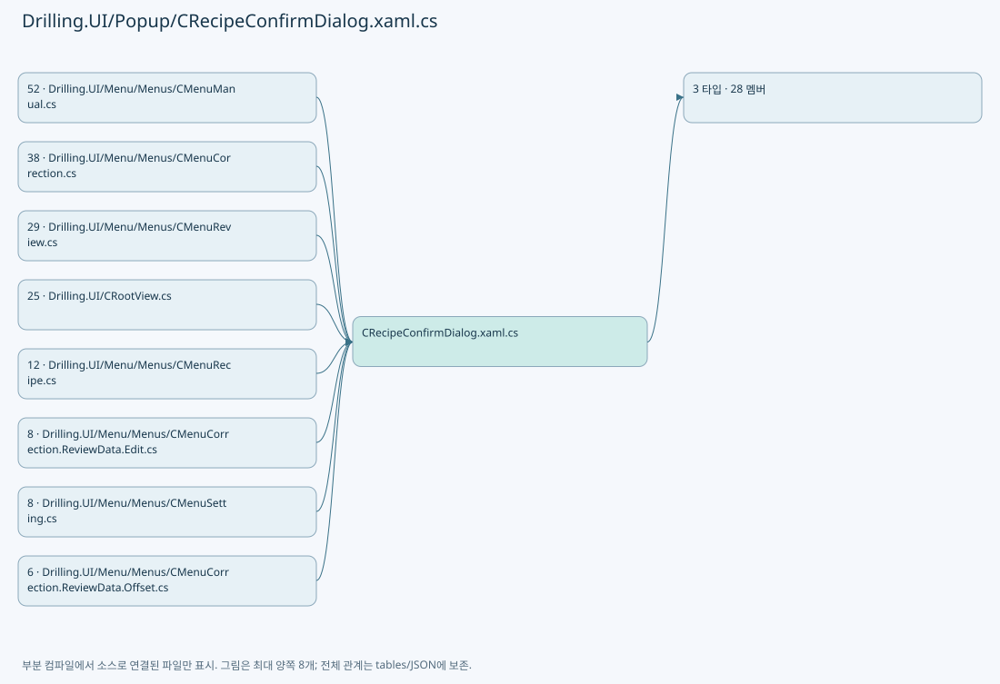
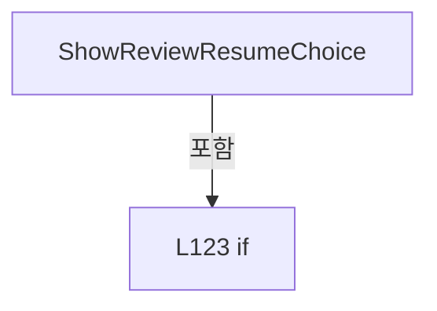
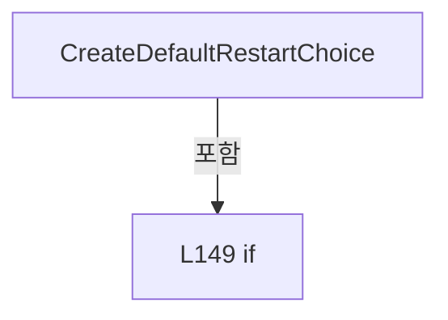
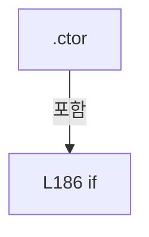
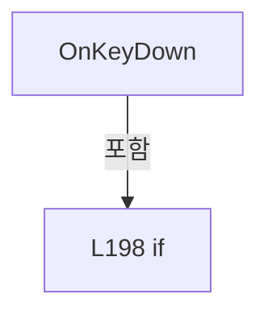

# Drilling.UI/Popup/CRecipeConfirmDialog.xaml.cs

| 항목 | 내용 |
| --- | --- |
| 원본 저장소 | https://github.com/kjuws10-rgb/A3Drilling.git |
| 원본 Commit | 0219666f9053b907d96d7e0aa7d0c6c1be3a73d4 |
| 원본 SHA256 | 7a383ef12d6fda215d2a83a04258002665f40ce18f8bd5caca61fbaaf93210b6 |
| 파일 분류 | code |
| 원본 크기/행 | 8,982 bytes / 228 physical lines |
| 인코딩 | utf-8-sig |
| 검토 범위 | 구문/부분 의미 분석에서 추출한 사실. 동작·물리 단위·실장비 합격을 보증하지 않습니다. |
| 원본 링크 | [고정 Commit 원본](https://github.com/kjuws10-rgb/A3Drilling/blob/0219666f9053b907d96d7e0aa7d0c6c1be3a73d4/Drilling.UI/Popup/CRecipeConfirmDialog.xaml.cs) |

## 파일의 역할과 읽는 순서

WPF 화면·사용자 명령·표시 상태를 구성합니다. XAML 이벤트와 코드 비하인드, RootView의 조립 경로를 함께 추적합니다.

## 네임스페이스·타입·상속

| 타입 | 구분 | 원본 범위 | 선언/상속 |
| --- | --- | --- | --- |
| EN_DEFAULT_RESTART_CHOICE | EnumDeclaration | 6–6 | EN_DEFAULT_RESTART_CHOICE |
| EN_GLASS_DATA_SOURCE_CHOICE | EnumDeclaration | 7–7 | EN_GLASS_DATA_SOURCE_CHOICE |
| CRecipeConfirmDialog | ClassDeclaration | 9–221 | CRecipeConfirmDialog: Window |
| EN_REVIEW_RESUME_CHOICE | EnumDeclaration | 223–228 | EN_REVIEW_RESUME_CHOICE |

## 멤버 빠른 목록

| 이름 | 종류 | 범위 | 서명 |
| --- | --- | --- | --- |
| Cancel | EnumMemberDeclaration | L6–6 | Drilling.UI.Popup.EN_DEFAULT_RESTART_CHOICE.Cancel |
| AllFromStart | EnumMemberDeclaration | L6–6 | Drilling.UI.Popup.EN_DEFAULT_RESTART_CHOICE.AllFromStart |
| InspectionFromStart | EnumMemberDeclaration | L6–6 | Drilling.UI.Popup.EN_DEFAULT_RESTART_CHOICE.InspectionFromStart |
| Cancel | EnumMemberDeclaration | L7–7 | Drilling.UI.Popup.EN_GLASS_DATA_SOURCE_CHOICE.Cancel |
| Dummy | EnumMemberDeclaration | L7–7 | Drilling.UI.Popup.EN_GLASS_DATA_SOURCE_CHOICE.Dummy |
| StagePcData | EnumMemberDeclaration | L7–7 | Drilling.UI.Popup.EN_GLASS_DATA_SOURCE_CHOICE.StagePcData |
| _alternateSelected | FieldDeclaration | L11–11 | bool Drilling.UI.Popup.CRecipeConfirmDialog._alternateSelected |
| ShowConfirmation | MethodDeclaration | L12–19 | bool Drilling.UI.Popup.CRecipeConfirmDialog.ShowConfirmation(string, string, string, bool) |
| ShowDuplicateOffsetConfirmation | MethodDeclaration | L21–29 | bool Drilling.UI.Popup.CRecipeConfirmDialog.ShowDuplicateOffsetConfirmation(string, string) |
| ShowSavedResultLoadConfirmation | MethodDeclaration | L31–39 | bool Drilling.UI.Popup.CRecipeConfirmDialog.ShowSavedResultLoadConfirmation(string, string) |
| ShowRecipeFolderCopy | MethodDeclaration | L41–49 | bool Drilling.UI.Popup.CRecipeConfirmDialog.ShowRecipeFolderCopy(string, string) |
| ShowGlassDataSourceChoice | MethodDeclaration | L51–72 | Drilling.UI.Popup.EN_GLASS_DATA_SOURCE_CHOICE Drilling.UI.Popup.CRecipeConfirmDialog.ShowGlassDataSourceChoice() |
| ShowRecipeFolderRename | MethodDeclaration | L75–79 | bool? Drilling.UI.Popup.CRecipeConfirmDialog.ShowRecipeFolderRename(string, string) |
| CreateRecipeFolderRename | MethodDeclaration | L81–92 | Drilling.UI.Popup.CRecipeConfirmDialog Drilling.UI.Popup.CRecipeConfirmDialog.CreateRecipeFolderRename(string, string) |
| ShowRecipeFolderDelete | MethodDeclaration | L94–94 | bool Drilling.UI.Popup.CRecipeConfirmDialog.ShowRecipeFolderDelete(string, string) |
| ShowRecipeFolderAction | MethodDeclaration | L95–103 | bool Drilling.UI.Popup.CRecipeConfirmDialog.ShowRecipeFolderAction(string, string, string, bool) |
| ShowCompletion | MethodDeclaration | L105–108 | void Drilling.UI.Popup.CRecipeConfirmDialog.ShowCompletion(string, string, Window?) |
| ShowWarning | MethodDeclaration | L110–113 | void Drilling.UI.Popup.CRecipeConfirmDialog.ShowWarning(string, string, Window?) |
| ShowReviewResumeChoice | MethodDeclaration | L115–129 | Drilling.UI.Popup.EN_REVIEW_RESUME_CHOICE Drilling.UI.Popup.CRecipeConfirmDialog.ShowReviewResumeChoice(string) |
| ShowFineRetryChoice | MethodDeclaration | L131–136 | Drilling.UI.Popup.EN_REVIEW_RESUME_CHOICE Drilling.UI.Popup.CRecipeConfirmDialog.ShowFineRetryChoice(string) |
| ShowDefaultRestartChoice | MethodDeclaration | L138–143 | Drilling.UI.Popup.EN_DEFAULT_RESTART_CHOICE Drilling.UI.Popup.CRecipeConfirmDialog.ShowDefaultRestartChoice(string) |
| CreateDefaultRestartChoice | MethodDeclaration | L145–155 | Drilling.UI.Popup.CRecipeConfirmDialog Drilling.UI.Popup.CRecipeConfirmDialog.CreateDefaultRestartChoice(string) |
| CreateFineRetryChoice | MethodDeclaration | L157–165 | Drilling.UI.Popup.CRecipeConfirmDialog Drilling.UI.Popup.CRecipeConfirmDialog.CreateFineRetryChoice(string) |
| ShowMessage | MethodDeclaration | L167–176 | void Drilling.UI.Popup.CRecipeConfirmDialog.ShowMessage(string, string, bool, Window?) |
| .ctor | ConstructorDeclaration | L178–193 | Drilling.UI.Popup.CRecipeConfirmDialog.CRecipeConfirmDialog(string, string, string, bool) |
| OnKeyDown | MethodDeclaration | L195–203 | void Drilling.UI.Popup.CRecipeConfirmDialog.OnKeyDown(KeyEventArgs) |
| OnConfirmClicked | MethodDeclaration | L205–208 | void Drilling.UI.Popup.CRecipeConfirmDialog.OnConfirmClicked(object, RoutedEventArgs) |
| OnCancelClicked | MethodDeclaration | L210–214 | void Drilling.UI.Popup.CRecipeConfirmDialog.OnCancelClicked(object, RoutedEventArgs) |
| OnAbortClicked | MethodDeclaration | L216–220 | void Drilling.UI.Popup.CRecipeConfirmDialog.OnAbortClicked(object, RoutedEventArgs) |
| Cancel | EnumMemberDeclaration | L225–225 | Drilling.UI.Popup.EN_REVIEW_RESUME_CHOICE.Cancel |
| Resume | EnumMemberDeclaration | L226–226 | Drilling.UI.Popup.EN_REVIEW_RESUME_CHOICE.Resume |
| Restart | EnumMemberDeclaration | L227–227 | Drilling.UI.Popup.EN_REVIEW_RESUME_CHOICE.Restart |

## 멤버별 상세 계약·호출·처리 해설

### EnumMemberDeclaration `Cancel` · L6–6

[Drilling.UI/Popup/CRecipeConfirmDialog.xaml.cs:6–6](https://github.com/kjuws10-rgb/A3Drilling/blob/0219666f9053b907d96d7e0aa7d0c6c1be3a73d4/Drilling.UI/Popup/CRecipeConfirmDialog.xaml.cs#L6-L6)

| 항목 | 실제 추출 값 |
| --- | --- |
| 서명 | Drilling.UI.Popup.EN_DEFAULT_RESTART_CHOICE.Cancel |
| 접근/수식자 | Public /  |
| 반환/값 타입 | Drilling.UI.Popup.EN_DEFAULT_RESTART_CHOICE |
| 소속 타입 | NamedType:Drilling.UI.Popup.EN_DEFAULT_RESTART_CHOICE |

현재 부분 분석에서 직접 연결된 호출자는 없습니다. XAML/이벤트/인터페이스·델리게이트·외부 진입을 추가 확인해야 하며, 미사용으로 판정한 것이 아닙니다.

변경 전 점검: 입력/반환 타입, 위 호출자, 예외/취소 경로, 공유 상태와 저장·전송 소비자를 함께 확인합니다. 값의 단위나 물리 방향을 이름만으로 확정하지 않습니다.

### EnumMemberDeclaration `AllFromStart` · L6–6

[Drilling.UI/Popup/CRecipeConfirmDialog.xaml.cs:6–6](https://github.com/kjuws10-rgb/A3Drilling/blob/0219666f9053b907d96d7e0aa7d0c6c1be3a73d4/Drilling.UI/Popup/CRecipeConfirmDialog.xaml.cs#L6-L6)

| 항목 | 실제 추출 값 |
| --- | --- |
| 서명 | Drilling.UI.Popup.EN_DEFAULT_RESTART_CHOICE.AllFromStart |
| 접근/수식자 | Public /  |
| 반환/값 타입 | Drilling.UI.Popup.EN_DEFAULT_RESTART_CHOICE |
| 소속 타입 | NamedType:Drilling.UI.Popup.EN_DEFAULT_RESTART_CHOICE |

현재 부분 분석에서 직접 연결된 호출자는 없습니다. XAML/이벤트/인터페이스·델리게이트·외부 진입을 추가 확인해야 하며, 미사용으로 판정한 것이 아닙니다.

변경 전 점검: 입력/반환 타입, 위 호출자, 예외/취소 경로, 공유 상태와 저장·전송 소비자를 함께 확인합니다. 값의 단위나 물리 방향을 이름만으로 확정하지 않습니다.

### EnumMemberDeclaration `InspectionFromStart` · L6–6

[Drilling.UI/Popup/CRecipeConfirmDialog.xaml.cs:6–6](https://github.com/kjuws10-rgb/A3Drilling/blob/0219666f9053b907d96d7e0aa7d0c6c1be3a73d4/Drilling.UI/Popup/CRecipeConfirmDialog.xaml.cs#L6-L6)

| 항목 | 실제 추출 값 |
| --- | --- |
| 서명 | Drilling.UI.Popup.EN_DEFAULT_RESTART_CHOICE.InspectionFromStart |
| 접근/수식자 | Public /  |
| 반환/값 타입 | Drilling.UI.Popup.EN_DEFAULT_RESTART_CHOICE |
| 소속 타입 | NamedType:Drilling.UI.Popup.EN_DEFAULT_RESTART_CHOICE |

현재 부분 분석에서 직접 연결된 호출자는 없습니다. XAML/이벤트/인터페이스·델리게이트·외부 진입을 추가 확인해야 하며, 미사용으로 판정한 것이 아닙니다.

변경 전 점검: 입력/반환 타입, 위 호출자, 예외/취소 경로, 공유 상태와 저장·전송 소비자를 함께 확인합니다. 값의 단위나 물리 방향을 이름만으로 확정하지 않습니다.

### EnumMemberDeclaration `Cancel` · L7–7

[Drilling.UI/Popup/CRecipeConfirmDialog.xaml.cs:7–7](https://github.com/kjuws10-rgb/A3Drilling/blob/0219666f9053b907d96d7e0aa7d0c6c1be3a73d4/Drilling.UI/Popup/CRecipeConfirmDialog.xaml.cs#L7-L7)

| 항목 | 실제 추출 값 |
| --- | --- |
| 서명 | Drilling.UI.Popup.EN_GLASS_DATA_SOURCE_CHOICE.Cancel |
| 접근/수식자 | Public /  |
| 반환/값 타입 | Drilling.UI.Popup.EN_GLASS_DATA_SOURCE_CHOICE |
| 소속 타입 | NamedType:Drilling.UI.Popup.EN_GLASS_DATA_SOURCE_CHOICE |

현재 부분 분석에서 직접 연결된 호출자는 없습니다. XAML/이벤트/인터페이스·델리게이트·외부 진입을 추가 확인해야 하며, 미사용으로 판정한 것이 아닙니다.

변경 전 점검: 입력/반환 타입, 위 호출자, 예외/취소 경로, 공유 상태와 저장·전송 소비자를 함께 확인합니다. 값의 단위나 물리 방향을 이름만으로 확정하지 않습니다.

### EnumMemberDeclaration `Dummy` · L7–7

[Drilling.UI/Popup/CRecipeConfirmDialog.xaml.cs:7–7](https://github.com/kjuws10-rgb/A3Drilling/blob/0219666f9053b907d96d7e0aa7d0c6c1be3a73d4/Drilling.UI/Popup/CRecipeConfirmDialog.xaml.cs#L7-L7)

| 항목 | 실제 추출 값 |
| --- | --- |
| 서명 | Drilling.UI.Popup.EN_GLASS_DATA_SOURCE_CHOICE.Dummy |
| 접근/수식자 | Public /  |
| 반환/값 타입 | Drilling.UI.Popup.EN_GLASS_DATA_SOURCE_CHOICE |
| 소속 타입 | NamedType:Drilling.UI.Popup.EN_GLASS_DATA_SOURCE_CHOICE |

현재 부분 분석에서 직접 연결된 호출자는 없습니다. XAML/이벤트/인터페이스·델리게이트·외부 진입을 추가 확인해야 하며, 미사용으로 판정한 것이 아닙니다.

변경 전 점검: 입력/반환 타입, 위 호출자, 예외/취소 경로, 공유 상태와 저장·전송 소비자를 함께 확인합니다. 값의 단위나 물리 방향을 이름만으로 확정하지 않습니다.

### EnumMemberDeclaration `StagePcData` · L7–7

[Drilling.UI/Popup/CRecipeConfirmDialog.xaml.cs:7–7](https://github.com/kjuws10-rgb/A3Drilling/blob/0219666f9053b907d96d7e0aa7d0c6c1be3a73d4/Drilling.UI/Popup/CRecipeConfirmDialog.xaml.cs#L7-L7)

| 항목 | 실제 추출 값 |
| --- | --- |
| 서명 | Drilling.UI.Popup.EN_GLASS_DATA_SOURCE_CHOICE.StagePcData |
| 접근/수식자 | Public /  |
| 반환/값 타입 | Drilling.UI.Popup.EN_GLASS_DATA_SOURCE_CHOICE |
| 소속 타입 | NamedType:Drilling.UI.Popup.EN_GLASS_DATA_SOURCE_CHOICE |

현재 부분 분석에서 직접 연결된 호출자는 없습니다. XAML/이벤트/인터페이스·델리게이트·외부 진입을 추가 확인해야 하며, 미사용으로 판정한 것이 아닙니다.

변경 전 점검: 입력/반환 타입, 위 호출자, 예외/취소 경로, 공유 상태와 저장·전송 소비자를 함께 확인합니다. 값의 단위나 물리 방향을 이름만으로 확정하지 않습니다.

### FieldDeclaration `_alternateSelected` · L11–11

[Drilling.UI/Popup/CRecipeConfirmDialog.xaml.cs:11–11](https://github.com/kjuws10-rgb/A3Drilling/blob/0219666f9053b907d96d7e0aa7d0c6c1be3a73d4/Drilling.UI/Popup/CRecipeConfirmDialog.xaml.cs#L11-L11)

| 항목 | 실제 추출 값 |
| --- | --- |
| 서명 | bool Drilling.UI.Popup.CRecipeConfirmDialog._alternateSelected |
| 접근/수식자 | Private / private |
| 반환/값 타입 | bool |
| 소속 타입 | NamedType:Drilling.UI.Popup.CRecipeConfirmDialog |

현재 부분 분석에서 직접 연결된 호출자는 없습니다. XAML/이벤트/인터페이스·델리게이트·외부 진입을 추가 확인해야 하며, 미사용으로 판정한 것이 아닙니다.

변경 전 점검: 입력/반환 타입, 위 호출자, 예외/취소 경로, 공유 상태와 저장·전송 소비자를 함께 확인합니다. 값의 단위나 물리 방향을 이름만으로 확정하지 않습니다.

### MethodDeclaration `ShowConfirmation` · L12–19

[Drilling.UI/Popup/CRecipeConfirmDialog.xaml.cs:12–19](https://github.com/kjuws10-rgb/A3Drilling/blob/0219666f9053b907d96d7e0aa7d0c6c1be3a73d4/Drilling.UI/Popup/CRecipeConfirmDialog.xaml.cs#L12-L19)

| 항목 | 실제 추출 값 |
| --- | --- |
| 서명 | bool Drilling.UI.Popup.CRecipeConfirmDialog.ShowConfirmation(string, string, string, bool) |
| 접근/수식자 | Public / public, static |
| 반환/값 타입 | bool |
| 소속 타입 | NamedType:Drilling.UI.Popup.CRecipeConfirmDialog |

입력 계약:

| 이름 | 타입 | 전달 | 선택/기본값 |
| --- | --- | --- | --- |
| title | string | None | False /  |
| message | string | None | False /  |
| confirmText | string | None | True / "\uD655\uC778" |
| useDangerStyle | bool | None | True / false |

정적 호출자로 확인된 위치:

| 호출 파일/행 | 호출 표현식 | 런타임 분기 가능 |
| --- | --- | --- |
| [Drilling.UI/CRootView.cs:699–699](https://github.com/kjuws10-rgb/A3Drilling/blob/0219666f9053b907d96d7e0aa7d0c6c1be3a73d4/Drilling.UI/CRootView.cs#L699-L699) | CRecipeConfirmDialog.ShowConfirmation | False |
| [Drilling.UI/CRootView.cs:769–769](https://github.com/kjuws10-rgb/A3Drilling/blob/0219666f9053b907d96d7e0aa7d0c6c1be3a73d4/Drilling.UI/CRootView.cs#L769-L769) | CRecipeConfirmDialog.ShowConfirmation | False |
| [Drilling.UI/CRootView.cs:1979–1979](https://github.com/kjuws10-rgb/A3Drilling/blob/0219666f9053b907d96d7e0aa7d0c6c1be3a73d4/Drilling.UI/CRootView.cs#L1979-L1979) | CRecipeConfirmDialog.ShowConfirmation | False |
| [Drilling.UI/CRootView.cs:3003–3003](https://github.com/kjuws10-rgb/A3Drilling/blob/0219666f9053b907d96d7e0aa7d0c6c1be3a73d4/Drilling.UI/CRootView.cs#L3003-L3003) | CRecipeConfirmDialog.ShowConfirmation | False |
| [Drilling.UI/Menu/Menus/CMenuCorrection.ReviewData.Edit.cs:470–475](https://github.com/kjuws10-rgb/A3Drilling/blob/0219666f9053b907d96d7e0aa7d0c6c1be3a73d4/Drilling.UI/Menu/Menus/CMenuCorrection.ReviewData.Edit.cs#L470-L475) | CRecipeConfirmDialog.ShowConfirmation | False |
| [Drilling.UI/Menu/Menus/CMenuCorrection.ReviewData.Offset.cs:163–167](https://github.com/kjuws10-rgb/A3Drilling/blob/0219666f9053b907d96d7e0aa7d0c6c1be3a73d4/Drilling.UI/Menu/Menus/CMenuCorrection.ReviewData.Offset.cs#L163-L167) | CRecipeConfirmDialog.ShowConfirmation | False |
| [Drilling.UI/Menu/Menus/CMenuCorrection.ReviewData.Reinspection.cs:368–373](https://github.com/kjuws10-rgb/A3Drilling/blob/0219666f9053b907d96d7e0aa7d0c6c1be3a73d4/Drilling.UI/Menu/Menus/CMenuCorrection.ReviewData.Reinspection.cs#L368-L373) | CRecipeConfirmDialog.ShowConfirmation | False |
| [Drilling.UI/Menu/Menus/CMenuCorrection.cs:110–110](https://github.com/kjuws10-rgb/A3Drilling/blob/0219666f9053b907d96d7e0aa7d0c6c1be3a73d4/Drilling.UI/Menu/Menus/CMenuCorrection.cs#L110-L110) | CRecipeConfirmDialog.ShowConfirmation | False |
| [Drilling.UI/Menu/Menus/CMenuCorrection.cs:210–213](https://github.com/kjuws10-rgb/A3Drilling/blob/0219666f9053b907d96d7e0aa7d0c6c1be3a73d4/Drilling.UI/Menu/Menus/CMenuCorrection.cs#L210-L213) | CRecipeConfirmDialog.ShowConfirmation | False |
| [Drilling.UI/Menu/Menus/CMenuCorrection.cs:1409–1409](https://github.com/kjuws10-rgb/A3Drilling/blob/0219666f9053b907d96d7e0aa7d0c6c1be3a73d4/Drilling.UI/Menu/Menus/CMenuCorrection.cs#L1409-L1409) | CRecipeConfirmDialog.ShowConfirmation | False |
| [Drilling.UI/Menu/Menus/CMenuCorrection.cs:1417–1417](https://github.com/kjuws10-rgb/A3Drilling/blob/0219666f9053b907d96d7e0aa7d0c6c1be3a73d4/Drilling.UI/Menu/Menus/CMenuCorrection.cs#L1417-L1417) | CRecipeConfirmDialog.ShowConfirmation | False |
| [Drilling.UI/Menu/Menus/CMenuCorrection.cs:1427–1427](https://github.com/kjuws10-rgb/A3Drilling/blob/0219666f9053b907d96d7e0aa7d0c6c1be3a73d4/Drilling.UI/Menu/Menus/CMenuCorrection.cs#L1427-L1427) | CRecipeConfirmDialog.ShowConfirmation | False |
| [Drilling.UI/Menu/Menus/CMenuCorrection.cs:1496–1496](https://github.com/kjuws10-rgb/A3Drilling/blob/0219666f9053b907d96d7e0aa7d0c6c1be3a73d4/Drilling.UI/Menu/Menus/CMenuCorrection.cs#L1496-L1496) | CRecipeConfirmDialog.ShowConfirmation | False |
| [Drilling.UI/Menu/Menus/CMenuCorrection.cs:1675–1675](https://github.com/kjuws10-rgb/A3Drilling/blob/0219666f9053b907d96d7e0aa7d0c6c1be3a73d4/Drilling.UI/Menu/Menus/CMenuCorrection.cs#L1675-L1675) | CRecipeConfirmDialog.ShowConfirmation | False |
| [Drilling.UI/Menu/Menus/CMenuCorrection.cs:1687–1687](https://github.com/kjuws10-rgb/A3Drilling/blob/0219666f9053b907d96d7e0aa7d0c6c1be3a73d4/Drilling.UI/Menu/Menus/CMenuCorrection.cs#L1687-L1687) | CRecipeConfirmDialog.ShowConfirmation | False |
| [Drilling.UI/Menu/Menus/CMenuCorrection.cs:2745–2745](https://github.com/kjuws10-rgb/A3Drilling/blob/0219666f9053b907d96d7e0aa7d0c6c1be3a73d4/Drilling.UI/Menu/Menus/CMenuCorrection.cs#L2745-L2745) | CRecipeConfirmDialog.ShowConfirmation | False |
| [Drilling.UI/Menu/Menus/CMenuCorrection.cs:2762–2767](https://github.com/kjuws10-rgb/A3Drilling/blob/0219666f9053b907d96d7e0aa7d0c6c1be3a73d4/Drilling.UI/Menu/Menus/CMenuCorrection.cs#L2762-L2767) | CRecipeConfirmDialog.ShowConfirmation | False |
| [Drilling.UI/Menu/Menus/CMenuCorrection.cs:2811–2811](https://github.com/kjuws10-rgb/A3Drilling/blob/0219666f9053b907d96d7e0aa7d0c6c1be3a73d4/Drilling.UI/Menu/Menus/CMenuCorrection.cs#L2811-L2811) | CRecipeConfirmDialog.ShowConfirmation | False |
| [Drilling.UI/Menu/Menus/CMenuCorrection.cs:2822–2822](https://github.com/kjuws10-rgb/A3Drilling/blob/0219666f9053b907d96d7e0aa7d0c6c1be3a73d4/Drilling.UI/Menu/Menus/CMenuCorrection.cs#L2822-L2822) | CRecipeConfirmDialog.ShowConfirmation | False |
| [Drilling.UI/Menu/Menus/CMenuCorrection.cs:2833–2833](https://github.com/kjuws10-rgb/A3Drilling/blob/0219666f9053b907d96d7e0aa7d0c6c1be3a73d4/Drilling.UI/Menu/Menus/CMenuCorrection.cs#L2833-L2833) | CRecipeConfirmDialog.ShowConfirmation | False |
| [Drilling.UI/Menu/Menus/CMenuCorrection.cs:2889–2889](https://github.com/kjuws10-rgb/A3Drilling/blob/0219666f9053b907d96d7e0aa7d0c6c1be3a73d4/Drilling.UI/Menu/Menus/CMenuCorrection.cs#L2889-L2889) | CRecipeConfirmDialog.ShowConfirmation | False |
| [Drilling.UI/Menu/Menus/CMenuCorrection.cs:3052–3052](https://github.com/kjuws10-rgb/A3Drilling/blob/0219666f9053b907d96d7e0aa7d0c6c1be3a73d4/Drilling.UI/Menu/Menus/CMenuCorrection.cs#L3052-L3052) | CRecipeConfirmDialog.ShowConfirmation | False |
| [Drilling.UI/Menu/Menus/CMenuCorrection.cs:3164–3164](https://github.com/kjuws10-rgb/A3Drilling/blob/0219666f9053b907d96d7e0aa7d0c6c1be3a73d4/Drilling.UI/Menu/Menus/CMenuCorrection.cs#L3164-L3164) | CRecipeConfirmDialog.ShowConfirmation | False |
| [Drilling.UI/Menu/Menus/CMenuCorrection.cs:4024–4024](https://github.com/kjuws10-rgb/A3Drilling/blob/0219666f9053b907d96d7e0aa7d0c6c1be3a73d4/Drilling.UI/Menu/Menus/CMenuCorrection.cs#L4024-L4024) | CRecipeConfirmDialog.ShowConfirmation | False |
| [Drilling.UI/Menu/Menus/CMenuCorrection.cs:4173–4177](https://github.com/kjuws10-rgb/A3Drilling/blob/0219666f9053b907d96d7e0aa7d0c6c1be3a73d4/Drilling.UI/Menu/Menus/CMenuCorrection.cs#L4173-L4177) | CRecipeConfirmDialog.ShowConfirmation | False |
| [Drilling.UI/Menu/Menus/CMenuCorrection.cs:4273–4273](https://github.com/kjuws10-rgb/A3Drilling/blob/0219666f9053b907d96d7e0aa7d0c6c1be3a73d4/Drilling.UI/Menu/Menus/CMenuCorrection.cs#L4273-L4273) | CRecipeConfirmDialog.ShowConfirmation | False |
| [Drilling.UI/Menu/Menus/CMenuManual.cs:1788–1788](https://github.com/kjuws10-rgb/A3Drilling/blob/0219666f9053b907d96d7e0aa7d0c6c1be3a73d4/Drilling.UI/Menu/Menus/CMenuManual.cs#L1788-L1788) | CRecipeConfirmDialog.ShowConfirmation | False |
| [Drilling.UI/Menu/Menus/CMenuManual.cs:2198–2198](https://github.com/kjuws10-rgb/A3Drilling/blob/0219666f9053b907d96d7e0aa7d0c6c1be3a73d4/Drilling.UI/Menu/Menus/CMenuManual.cs#L2198-L2198) | CRecipeConfirmDialog.ShowConfirmation | False |
| [Drilling.UI/Menu/Menus/CMenuManual.cs:2622–2622](https://github.com/kjuws10-rgb/A3Drilling/blob/0219666f9053b907d96d7e0aa7d0c6c1be3a73d4/Drilling.UI/Menu/Menus/CMenuManual.cs#L2622-L2622) | CRecipeConfirmDialog.ShowConfirmation | False |
| [Drilling.UI/Menu/Menus/CMenuManual.cs:2731–2731](https://github.com/kjuws10-rgb/A3Drilling/blob/0219666f9053b907d96d7e0aa7d0c6c1be3a73d4/Drilling.UI/Menu/Menus/CMenuManual.cs#L2731-L2731) | CRecipeConfirmDialog.ShowConfirmation | False |
| [Drilling.UI/Menu/Menus/CMenuManual.cs:3263–3263](https://github.com/kjuws10-rgb/A3Drilling/blob/0219666f9053b907d96d7e0aa7d0c6c1be3a73d4/Drilling.UI/Menu/Menus/CMenuManual.cs#L3263-L3263) | CRecipeConfirmDialog.ShowConfirmation | False |
| [Drilling.UI/Menu/Menus/CMenuManual.cs:3303–3303](https://github.com/kjuws10-rgb/A3Drilling/blob/0219666f9053b907d96d7e0aa7d0c6c1be3a73d4/Drilling.UI/Menu/Menus/CMenuManual.cs#L3303-L3303) | CRecipeConfirmDialog.ShowConfirmation | False |
| [Drilling.UI/Menu/Menus/CMenuManual.cs:3363–3363](https://github.com/kjuws10-rgb/A3Drilling/blob/0219666f9053b907d96d7e0aa7d0c6c1be3a73d4/Drilling.UI/Menu/Menus/CMenuManual.cs#L3363-L3363) | CRecipeConfirmDialog.ShowConfirmation | False |
| [Drilling.UI/Menu/Menus/CMenuManual.cs:3524–3524](https://github.com/kjuws10-rgb/A3Drilling/blob/0219666f9053b907d96d7e0aa7d0c6c1be3a73d4/Drilling.UI/Menu/Menus/CMenuManual.cs#L3524-L3524) | CRecipeConfirmDialog.ShowConfirmation | False |
| [Drilling.UI/Menu/Menus/CMenuManual.cs:3906–3906](https://github.com/kjuws10-rgb/A3Drilling/blob/0219666f9053b907d96d7e0aa7d0c6c1be3a73d4/Drilling.UI/Menu/Menus/CMenuManual.cs#L3906-L3906) | CRecipeConfirmDialog.ShowConfirmation | False |
| [Drilling.UI/Menu/Menus/CMenuManual.cs:3951–3951](https://github.com/kjuws10-rgb/A3Drilling/blob/0219666f9053b907d96d7e0aa7d0c6c1be3a73d4/Drilling.UI/Menu/Menus/CMenuManual.cs#L3951-L3951) | CRecipeConfirmDialog.ShowConfirmation | False |
| [Drilling.UI/Menu/Menus/CMenuManual.cs:3970–3970](https://github.com/kjuws10-rgb/A3Drilling/blob/0219666f9053b907d96d7e0aa7d0c6c1be3a73d4/Drilling.UI/Menu/Menus/CMenuManual.cs#L3970-L3970) | CRecipeConfirmDialog.ShowConfirmation | False |
| [Drilling.UI/Menu/Menus/CMenuManual.cs:4002–4002](https://github.com/kjuws10-rgb/A3Drilling/blob/0219666f9053b907d96d7e0aa7d0c6c1be3a73d4/Drilling.UI/Menu/Menus/CMenuManual.cs#L4002-L4002) | CRecipeConfirmDialog.ShowConfirmation | False |
| [Drilling.UI/Menu/Menus/CMenuManual.cs:4071–4071](https://github.com/kjuws10-rgb/A3Drilling/blob/0219666f9053b907d96d7e0aa7d0c6c1be3a73d4/Drilling.UI/Menu/Menus/CMenuManual.cs#L4071-L4071) | CRecipeConfirmDialog.ShowConfirmation | False |
| [Drilling.UI/Menu/Menus/CMenuManual.cs:4297–4297](https://github.com/kjuws10-rgb/A3Drilling/blob/0219666f9053b907d96d7e0aa7d0c6c1be3a73d4/Drilling.UI/Menu/Menus/CMenuManual.cs#L4297-L4297) | CRecipeConfirmDialog.ShowConfirmation | False |
| [Drilling.UI/Menu/Menus/CMenuManual.cs:4635–4635](https://github.com/kjuws10-rgb/A3Drilling/blob/0219666f9053b907d96d7e0aa7d0c6c1be3a73d4/Drilling.UI/Menu/Menus/CMenuManual.cs#L4635-L4635) | CRecipeConfirmDialog.ShowConfirmation | False |
| [Drilling.UI/Menu/Menus/CMenuManual.cs:5048–5048](https://github.com/kjuws10-rgb/A3Drilling/blob/0219666f9053b907d96d7e0aa7d0c6c1be3a73d4/Drilling.UI/Menu/Menus/CMenuManual.cs#L5048-L5048) | CRecipeConfirmDialog.ShowConfirmation | False |
| [Drilling.UI/Menu/Menus/CMenuManual.cs:5252–5252](https://github.com/kjuws10-rgb/A3Drilling/blob/0219666f9053b907d96d7e0aa7d0c6c1be3a73d4/Drilling.UI/Menu/Menus/CMenuManual.cs#L5252-L5252) | CRecipeConfirmDialog.ShowConfirmation | False |
| [Drilling.UI/Menu/Menus/CMenuManual.cs:6295–6295](https://github.com/kjuws10-rgb/A3Drilling/blob/0219666f9053b907d96d7e0aa7d0c6c1be3a73d4/Drilling.UI/Menu/Menus/CMenuManual.cs#L6295-L6295) | CRecipeConfirmDialog.ShowConfirmation | False |
| [Drilling.UI/Menu/Menus/CMenuMonitor.cs:1311–1311](https://github.com/kjuws10-rgb/A3Drilling/blob/0219666f9053b907d96d7e0aa7d0c6c1be3a73d4/Drilling.UI/Menu/Menus/CMenuMonitor.cs#L1311-L1311) | CRecipeConfirmDialog.ShowConfirmation | False |
| [Drilling.UI/Menu/Menus/CMenuMonitor.cs:2968–2968](https://github.com/kjuws10-rgb/A3Drilling/blob/0219666f9053b907d96d7e0aa7d0c6c1be3a73d4/Drilling.UI/Menu/Menus/CMenuMonitor.cs#L2968-L2968) | CRecipeConfirmDialog.ShowConfirmation | False |
| [Drilling.UI/Menu/Menus/CMenuMonitor.cs:4515–4515](https://github.com/kjuws10-rgb/A3Drilling/blob/0219666f9053b907d96d7e0aa7d0c6c1be3a73d4/Drilling.UI/Menu/Menus/CMenuMonitor.cs#L4515-L4515) | CRecipeConfirmDialog.ShowConfirmation | False |
| [Drilling.UI/Menu/Menus/CMenuRecipe.cs:741–741](https://github.com/kjuws10-rgb/A3Drilling/blob/0219666f9053b907d96d7e0aa7d0c6c1be3a73d4/Drilling.UI/Menu/Menus/CMenuRecipe.cs#L741-L741) | CRecipeConfirmDialog.ShowConfirmation | False |
| [Drilling.UI/Menu/Menus/CMenuRecipe.cs:767–767](https://github.com/kjuws10-rgb/A3Drilling/blob/0219666f9053b907d96d7e0aa7d0c6c1be3a73d4/Drilling.UI/Menu/Menus/CMenuRecipe.cs#L767-L767) | CRecipeConfirmDialog.ShowConfirmation | False |
| [Drilling.UI/Menu/Menus/CMenuRecipe.cs:1039–1039](https://github.com/kjuws10-rgb/A3Drilling/blob/0219666f9053b907d96d7e0aa7d0c6c1be3a73d4/Drilling.UI/Menu/Menus/CMenuRecipe.cs#L1039-L1039) | CRecipeConfirmDialog.ShowConfirmation | False |
| [Drilling.UI/Menu/Menus/CMenuReview.cs:2499–2499](https://github.com/kjuws10-rgb/A3Drilling/blob/0219666f9053b907d96d7e0aa7d0c6c1be3a73d4/Drilling.UI/Menu/Menus/CMenuReview.cs#L2499-L2499) | CRecipeConfirmDialog.ShowConfirmation | False |
| [Drilling.UI/Menu/Menus/CMenuReview.cs:2553–2556](https://github.com/kjuws10-rgb/A3Drilling/blob/0219666f9053b907d96d7e0aa7d0c6c1be3a73d4/Drilling.UI/Menu/Menus/CMenuReview.cs#L2553-L2556) | CRecipeConfirmDialog.ShowConfirmation | False |
| [Drilling.UI/Menu/Menus/CMenuReview.cs:2570–2570](https://github.com/kjuws10-rgb/A3Drilling/blob/0219666f9053b907d96d7e0aa7d0c6c1be3a73d4/Drilling.UI/Menu/Menus/CMenuReview.cs#L2570-L2570) | CRecipeConfirmDialog.ShowConfirmation | False |
| [Drilling.UI/Menu/Menus/CMenuReview.cs:2630–2630](https://github.com/kjuws10-rgb/A3Drilling/blob/0219666f9053b907d96d7e0aa7d0c6c1be3a73d4/Drilling.UI/Menu/Menus/CMenuReview.cs#L2630-L2630) | CRecipeConfirmDialog.ShowConfirmation | False |
| [Drilling.UI/Menu/Menus/CMenuReview.cs:2646–2646](https://github.com/kjuws10-rgb/A3Drilling/blob/0219666f9053b907d96d7e0aa7d0c6c1be3a73d4/Drilling.UI/Menu/Menus/CMenuReview.cs#L2646-L2646) | CRecipeConfirmDialog.ShowConfirmation | False |
| [Drilling.UI/Menu/Menus/CMenuReview.cs:3415–3415](https://github.com/kjuws10-rgb/A3Drilling/blob/0219666f9053b907d96d7e0aa7d0c6c1be3a73d4/Drilling.UI/Menu/Menus/CMenuReview.cs#L3415-L3415) | CRecipeConfirmDialog.ShowConfirmation | False |
| [Drilling.UI/Menu/Menus/CMenuReview.cs:3539–3539](https://github.com/kjuws10-rgb/A3Drilling/blob/0219666f9053b907d96d7e0aa7d0c6c1be3a73d4/Drilling.UI/Menu/Menus/CMenuReview.cs#L3539-L3539) | CRecipeConfirmDialog.ShowConfirmation | False |
| [Drilling.UI/Menu/Menus/CMenuReview.cs:3555–3555](https://github.com/kjuws10-rgb/A3Drilling/blob/0219666f9053b907d96d7e0aa7d0c6c1be3a73d4/Drilling.UI/Menu/Menus/CMenuReview.cs#L3555-L3555) | CRecipeConfirmDialog.ShowConfirmation | False |
| [Drilling.UI/Menu/Menus/CMenuReview.cs:3847–3847](https://github.com/kjuws10-rgb/A3Drilling/blob/0219666f9053b907d96d7e0aa7d0c6c1be3a73d4/Drilling.UI/Menu/Menus/CMenuReview.cs#L3847-L3847) | CRecipeConfirmDialog.ShowConfirmation | False |
| [Drilling.UI/Menu/Menus/CMenuSetting.cs:340–340](https://github.com/kjuws10-rgb/A3Drilling/blob/0219666f9053b907d96d7e0aa7d0c6c1be3a73d4/Drilling.UI/Menu/Menus/CMenuSetting.cs#L340-L340) | CRecipeConfirmDialog.ShowConfirmation | False |
| [Drilling.UI/Menu/Menus/CMenuSetting.cs:382–382](https://github.com/kjuws10-rgb/A3Drilling/blob/0219666f9053b907d96d7e0aa7d0c6c1be3a73d4/Drilling.UI/Menu/Menus/CMenuSetting.cs#L382-L382) | CRecipeConfirmDialog.ShowConfirmation | False |
| [Drilling.UI/Menu/Menus/CMenuSetting.cs:406–406](https://github.com/kjuws10-rgb/A3Drilling/blob/0219666f9053b907d96d7e0aa7d0c6c1be3a73d4/Drilling.UI/Menu/Menus/CMenuSetting.cs#L406-L406) | CRecipeConfirmDialog.ShowConfirmation | False |
| [Drilling.UI/Menu/Menus/CMenuSetting.cs:470–470](https://github.com/kjuws10-rgb/A3Drilling/blob/0219666f9053b907d96d7e0aa7d0c6c1be3a73d4/Drilling.UI/Menu/Menus/CMenuSetting.cs#L470-L470) | CRecipeConfirmDialog.ShowConfirmation | False |
| [Drilling.UI/Menu/Menus/CMenuSetting.cs:489–489](https://github.com/kjuws10-rgb/A3Drilling/blob/0219666f9053b907d96d7e0aa7d0c6c1be3a73d4/Drilling.UI/Menu/Menus/CMenuSetting.cs#L489-L489) | CRecipeConfirmDialog.ShowConfirmation | False |

호출하는 대상과 해석 범위:

| 원본 행 | 표현식 | 분석 상태 | 대상/소스 위치 |
| --- | --- | --- | --- |
| 14 | new CRecipeConfirmDialog | resolved | Drilling.UI.Popup.CRecipeConfirmDialog.CRecipeConfirmDialog(string, string, string, bool) · Drilling.UI/Popup/CRecipeConfirmDialog.xaml.cs:178 |
| 18 | dialog.ShowDialog | unresolved | None |

본문의 실제 연산·분기·예외·반환 순서(원문 위치 순):

| 원본 행 | 종류 | 주석 해설 |
| --- | --- | --- |
| 14 | call | 함수·델리게이트 또는 객체 생성자를 호출합니다: new CRecipeConfirmDialog(title, message, confirmText, useDangerStyle) { Owner = Application.Current?.MainWindow } |
| 14 | local-declaration | 지역 변수를 선언합니다: var dialog = new CRecipeConfirmDialog(title, message, confirmText, useDangerStyle) { Owner = Application.Current?.MainWindow }; |
| 14 | variable-initializer | 변수의 초기값을 지정합니다: dialog = new CRecipeConfirmDialog(title, message, confirmText, useDangerStyle) { Owner = Application.Current?.MainWindow } |
| 16 | assignment | 값을 대상에 대입합니다: Owner = Application.Current?.MainWindow |
| 18 | call | 함수·델리게이트 또는 객체 생성자를 호출합니다: dialog.ShowDialog() |
| 18 | return | 호출자에게 값 또는 제어를 반환합니다: return dialog.ShowDialog() == true; |

변경 전 점검: 입력/반환 타입, 위 호출자, 예외/취소 경로, 공유 상태와 저장·전송 소비자를 함께 확인합니다. 값의 단위나 물리 방향을 이름만으로 확정하지 않습니다.

### MethodDeclaration `ShowDuplicateOffsetConfirmation` · L21–29

[Drilling.UI/Popup/CRecipeConfirmDialog.xaml.cs:21–29](https://github.com/kjuws10-rgb/A3Drilling/blob/0219666f9053b907d96d7e0aa7d0c6c1be3a73d4/Drilling.UI/Popup/CRecipeConfirmDialog.xaml.cs#L21-L29)

| 항목 | 실제 추출 값 |
| --- | --- |
| 서명 | bool Drilling.UI.Popup.CRecipeConfirmDialog.ShowDuplicateOffsetConfirmation(string, string) |
| 접근/수식자 | Public / public, static |
| 반환/값 타입 | bool |
| 소속 타입 | NamedType:Drilling.UI.Popup.CRecipeConfirmDialog |

입력 계약:

| 이름 | 타입 | 전달 | 선택/기본값 |
| --- | --- | --- | --- |
| title | string | None | False /  |
| message | string | None | False /  |

현재 부분 분석에서 직접 연결된 호출자는 없습니다. XAML/이벤트/인터페이스·델리게이트·외부 진입을 추가 확인해야 하며, 미사용으로 판정한 것이 아닙니다.

호출하는 대상과 해석 범위:

| 원본 행 | 표현식 | 분석 상태 | 대상/소스 위치 |
| --- | --- | --- | --- |
| 23 | new CRecipeConfirmDialog | resolved | Drilling.UI.Popup.CRecipeConfirmDialog.CRecipeConfirmDialog(string, string, string, bool) · Drilling.UI/Popup/CRecipeConfirmDialog.xaml.cs:178 |
| 28 | dialog.ShowDialog | unresolved | None |

본문의 실제 연산·분기·예외·반환 순서(원문 위치 순):

| 원본 행 | 종류 | 주석 해설 |
| --- | --- | --- |
| 23 | call | 함수·델리게이트 또는 객체 생성자를 호출합니다: new CRecipeConfirmDialog(title, message, "중복 적용", useDangerStyle: true) { Owner = Application.Current?.MainWindow } |
| 23 | local-declaration | 지역 변수를 선언합니다: var dialog = new CRecipeConfirmDialog(title, message, "중복 적용", useDangerStyle: true) { Owner = Application.Current?.MainWindow }; |
| 23 | variable-initializer | 변수의 초기값을 지정합니다: dialog = new CRecipeConfirmDialog(title, message, "중복 적용", useDangerStyle: true) { Owner = Application.Current?.MainWindow } |
| 25 | assignment | 값을 대상에 대입합니다: Owner = Application.Current?.MainWindow |
| 27 | assignment | 값을 대상에 대입합니다: dialog.CancelButton.Content = "아니오" |
| 28 | call | 함수·델리게이트 또는 객체 생성자를 호출합니다: dialog.ShowDialog() |
| 28 | return | 호출자에게 값 또는 제어를 반환합니다: return dialog.ShowDialog() == true; |

변경 전 점검: 입력/반환 타입, 위 호출자, 예외/취소 경로, 공유 상태와 저장·전송 소비자를 함께 확인합니다. 값의 단위나 물리 방향을 이름만으로 확정하지 않습니다.

### MethodDeclaration `ShowSavedResultLoadConfirmation` · L31–39

[Drilling.UI/Popup/CRecipeConfirmDialog.xaml.cs:31–39](https://github.com/kjuws10-rgb/A3Drilling/blob/0219666f9053b907d96d7e0aa7d0c6c1be3a73d4/Drilling.UI/Popup/CRecipeConfirmDialog.xaml.cs#L31-L39)

| 항목 | 실제 추출 값 |
| --- | --- |
| 서명 | bool Drilling.UI.Popup.CRecipeConfirmDialog.ShowSavedResultLoadConfirmation(string, string) |
| 접근/수식자 | Public / public, static |
| 반환/값 타입 | bool |
| 소속 타입 | NamedType:Drilling.UI.Popup.CRecipeConfirmDialog |

입력 계약:

| 이름 | 타입 | 전달 | 선택/기본값 |
| --- | --- | --- | --- |
| title | string | None | False /  |
| message | string | None | False /  |

정적 호출자로 확인된 위치:

| 호출 파일/행 | 호출 표현식 | 런타임 분기 가능 |
| --- | --- | --- |
| [Drilling.UI/Menu/Menus/CMenuCorrection.ReviewData.Edit.cs:508–510](https://github.com/kjuws10-rgb/A3Drilling/blob/0219666f9053b907d96d7e0aa7d0c6c1be3a73d4/Drilling.UI/Menu/Menus/CMenuCorrection.ReviewData.Edit.cs#L508-L510) | CRecipeConfirmDialog.ShowSavedResultLoadConfirmation | False |
| [Drilling.UI/Menu/Menus/CMenuCorrection.ReviewData.Reinspection.cs:427–429](https://github.com/kjuws10-rgb/A3Drilling/blob/0219666f9053b907d96d7e0aa7d0c6c1be3a73d4/Drilling.UI/Menu/Menus/CMenuCorrection.ReviewData.Reinspection.cs#L427-L429) | CRecipeConfirmDialog.ShowSavedResultLoadConfirmation | False |

호출하는 대상과 해석 범위:

| 원본 행 | 표현식 | 분석 상태 | 대상/소스 위치 |
| --- | --- | --- | --- |
| 33 | new CRecipeConfirmDialog | resolved | Drilling.UI.Popup.CRecipeConfirmDialog.CRecipeConfirmDialog(string, string, string, bool) · Drilling.UI/Popup/CRecipeConfirmDialog.xaml.cs:178 |
| 38 | dialog.ShowDialog | unresolved | None |

본문의 실제 연산·분기·예외·반환 순서(원문 위치 순):

| 원본 행 | 종류 | 주석 해설 |
| --- | --- | --- |
| 33 | call | 함수·델리게이트 또는 객체 생성자를 호출합니다: new CRecipeConfirmDialog(title, message, "예, LOAD", useDangerStyle: false) { Owner = Application.Current?.MainWindow } |
| 33 | local-declaration | 지역 변수를 선언합니다: var dialog = new CRecipeConfirmDialog(title, message, "예, LOAD", useDangerStyle: false) { Owner = Application.Current?.MainWindow }; |
| 33 | variable-initializer | 변수의 초기값을 지정합니다: dialog = new CRecipeConfirmDialog(title, message, "예, LOAD", useDangerStyle: false) { Owner = Application.Current?.MainWindow } |
| 35 | assignment | 값을 대상에 대입합니다: Owner = Application.Current?.MainWindow |
| 37 | assignment | 값을 대상에 대입합니다: dialog.CancelButton.Content = "아니오" |
| 38 | call | 함수·델리게이트 또는 객체 생성자를 호출합니다: dialog.ShowDialog() |
| 38 | return | 호출자에게 값 또는 제어를 반환합니다: return dialog.ShowDialog() == true; |

변경 전 점검: 입력/반환 타입, 위 호출자, 예외/취소 경로, 공유 상태와 저장·전송 소비자를 함께 확인합니다. 값의 단위나 물리 방향을 이름만으로 확정하지 않습니다.

### MethodDeclaration `ShowRecipeFolderCopy` · L41–49

[Drilling.UI/Popup/CRecipeConfirmDialog.xaml.cs:41–49](https://github.com/kjuws10-rgb/A3Drilling/blob/0219666f9053b907d96d7e0aa7d0c6c1be3a73d4/Drilling.UI/Popup/CRecipeConfirmDialog.xaml.cs#L41-L49)

| 항목 | 실제 추출 값 |
| --- | --- |
| 서명 | bool Drilling.UI.Popup.CRecipeConfirmDialog.ShowRecipeFolderCopy(string, string) |
| 접근/수식자 | Public / public, static |
| 반환/값 타입 | bool |
| 소속 타입 | NamedType:Drilling.UI.Popup.CRecipeConfirmDialog |

입력 계약:

| 이름 | 타입 | 전달 | 선택/기본값 |
| --- | --- | --- | --- |
| title | string | None | False /  |
| message | string | None | False /  |

현재 부분 분석에서 직접 연결된 호출자는 없습니다. XAML/이벤트/인터페이스·델리게이트·외부 진입을 추가 확인해야 하며, 미사용으로 판정한 것이 아닙니다.

호출하는 대상과 해석 범위:

| 원본 행 | 표현식 | 분석 상태 | 대상/소스 위치 |
| --- | --- | --- | --- |
| 43 | new CRecipeConfirmDialog | resolved | Drilling.UI.Popup.CRecipeConfirmDialog.CRecipeConfirmDialog(string, string, string, bool) · Drilling.UI/Popup/CRecipeConfirmDialog.xaml.cs:178 |
| 48 | dialog.ShowDialog | unresolved | None |

본문의 실제 연산·분기·예외·반환 순서(원문 위치 순):

| 원본 행 | 종류 | 주석 해설 |
| --- | --- | --- |
| 43 | call | 함수·델리게이트 또는 객체 생성자를 호출합니다: new CRecipeConfirmDialog(title, message, "복사", useDangerStyle: false) { Owner = Application.Current?.MainWindow } |
| 43 | local-declaration | 지역 변수를 선언합니다: var dialog = new CRecipeConfirmDialog(title, message, "복사", useDangerStyle: false) { Owner = Application.Current?.MainWindow }; |
| 43 | variable-initializer | 변수의 초기값을 지정합니다: dialog = new CRecipeConfirmDialog(title, message, "복사", useDangerStyle: false) { Owner = Application.Current?.MainWindow } |
| 45 | assignment | 값을 대상에 대입합니다: Owner = Application.Current?.MainWindow |
| 47 | assignment | 값을 대상에 대입합니다: dialog.CancelButton.Content = "복사 안 함" |
| 48 | call | 함수·델리게이트 또는 객체 생성자를 호출합니다: dialog.ShowDialog() |
| 48 | return | 호출자에게 값 또는 제어를 반환합니다: return dialog.ShowDialog() == true; |

변경 전 점검: 입력/반환 타입, 위 호출자, 예외/취소 경로, 공유 상태와 저장·전송 소비자를 함께 확인합니다. 값의 단위나 물리 방향을 이름만으로 확정하지 않습니다.

### MethodDeclaration `ShowGlassDataSourceChoice` · L51–72

[Drilling.UI/Popup/CRecipeConfirmDialog.xaml.cs:51–72](https://github.com/kjuws10-rgb/A3Drilling/blob/0219666f9053b907d96d7e0aa7d0c6c1be3a73d4/Drilling.UI/Popup/CRecipeConfirmDialog.xaml.cs#L51-L72)

| 항목 | 실제 추출 값 |
| --- | --- |
| 서명 | Drilling.UI.Popup.EN_GLASS_DATA_SOURCE_CHOICE Drilling.UI.Popup.CRecipeConfirmDialog.ShowGlassDataSourceChoice() |
| 접근/수식자 | Public / public, static |
| 반환/값 타입 | Drilling.UI.Popup.EN_GLASS_DATA_SOURCE_CHOICE |
| 소속 타입 | NamedType:Drilling.UI.Popup.CRecipeConfirmDialog |

정적 호출자로 확인된 위치:

| 호출 파일/행 | 호출 표현식 | 런타임 분기 가능 |
| --- | --- | --- |
| [Drilling.UI/Menu/Menus/CMenuMonitor.cs:4448–4448](https://github.com/kjuws10-rgb/A3Drilling/blob/0219666f9053b907d96d7e0aa7d0c6c1be3a73d4/Drilling.UI/Menu/Menus/CMenuMonitor.cs#L4448-L4448) | CRecipeConfirmDialog.ShowGlassDataSourceChoice | False |

호출하는 대상과 해석 범위:

| 원본 행 | 표현식 | 분석 상태 | 대상/소스 위치 |
| --- | --- | --- | --- |
| 53 | new CRecipeConfirmDialog | resolved | Drilling.UI.Popup.CRecipeConfirmDialog.CRecipeConfirmDialog(string, string, string, bool) · Drilling.UI/Popup/CRecipeConfirmDialog.xaml.cs:178 |
| 62 | new GridLength | unresolved | None |
| 63 | new GridLength | unresolved | None |
| 66 | dialog.ShowDialog | unresolved | None |

본문의 실제 연산·분기·예외·반환 순서(원문 위치 순):

| 원본 행 | 종류 | 주석 해설 |
| --- | --- | --- |
| 53 | call | 함수·델리게이트 또는 객체 생성자를 호출합니다: new CRecipeConfirmDialog( "Glass 생성", "생성할 Glass Data의 원본을 선택하세요.\n\nSTAGE PC DATA는 MELSEC WF600 Glass Data를 새로 읽습니다.\nDUMMY는 로컬 ID를 생성하고 나머지 항목을 비워 둡니다.", "STAGE PC DATA", useDangerStyle: false) { Owner = Application.Cu… |
| 53 | local-declaration | 지역 변수를 선언합니다: var dialog = new CRecipeConfirmDialog( "Glass 생성", "생성할 Glass Data의 원본을 선택하세요.\n\nSTAGE PC DATA는 MELSEC WF600 Glass Data를 새로 읽습니다.\nDUMMY는 로컬 ID를 생성하고 나머지 항목을 비워 둡니다.", "STAGE PC DATA", useDangerStyle: false) { Owner = Application |
| 53 | variable-initializer | 변수의 초기값을 지정합니다: dialog = new CRecipeConfirmDialog( "Glass 생성", "생성할 Glass Data의 원본을 선택하세요.\n\nSTAGE PC DATA는 MELSEC WF600 Glass Data를 새로 읽습니다.\nDUMMY는 로컬 ID를 생성하고 나머지 항목을 비워 둡니다.", "STAGE PC DATA", useDangerStyle: false) { Owner = Application.Cur |
| 59 | assignment | 값을 대상에 대입합니다: Owner = Application.Current?.MainWindow |
| 61 | assignment | 값을 대상에 대입합니다: dialog.CancelButton.Content = "DUMMY" |
| 62 | assignment | 값을 대상에 대입합니다: dialog.AbortGap.Width = new GridLength(12) |
| 62 | call | 함수·델리게이트 또는 객체 생성자를 호출합니다: new GridLength(12) |
| 63 | assignment | 값을 대상에 대입합니다: dialog.AbortColumn.Width = new GridLength(1, GridUnitType.Star) |
| 63 | call | 함수·델리게이트 또는 객체 생성자를 호출합니다: new GridLength(1, GridUnitType.Star) |
| 64 | assignment | 값을 대상에 대입합니다: dialog.AbortButton.Content = "취소" |
| 65 | assignment | 값을 대상에 대입합니다: dialog.AbortButton.Visibility = Visibility.Visible |
| 66 | call | 함수·델리게이트 또는 객체 생성자를 호출합니다: dialog.ShowDialog() |
| 66 | local-declaration | 지역 변수를 선언합니다: var result = dialog.ShowDialog(); |
| 66 | variable-initializer | 변수의 초기값을 지정합니다: result = dialog.ShowDialog() |
| 67 | conditional-expression | 조건에 따라 결과식을 선택합니다: result == true ? EN_GLASS_DATA_SOURCE_CHOICE.StagePcData : dialog._alternateSelected ? EN_GLASS_DATA_SOURCE_CHOICE.Dummy : EN_GLASS_DATA_SOURCE_CHOICE.Cancel |
| 67 | return | 호출자에게 값 또는 제어를 반환합니다: return result == true ? EN_GLASS_DATA_SOURCE_CHOICE.StagePcData : dialog._alternateSelected ? EN_GLASS_DATA_SOURCE_CHOICE.Dummy : EN_GLASS_DATA_SOURCE_CHOICE.Cancel; |
| 69 | conditional-expression | 조건에 따라 결과식을 선택합니다: dialog._alternateSelected ? EN_GLASS_DATA_SOURCE_CHOICE.Dummy : EN_GLASS_DATA_SOURCE_CHOICE.Cancel |

변경 전 점검: 입력/반환 타입, 위 호출자, 예외/취소 경로, 공유 상태와 저장·전송 소비자를 함께 확인합니다. 값의 단위나 물리 방향을 이름만으로 확정하지 않습니다.

### MethodDeclaration `ShowRecipeFolderRename` · L75–79

[Drilling.UI/Popup/CRecipeConfirmDialog.xaml.cs:75–79](https://github.com/kjuws10-rgb/A3Drilling/blob/0219666f9053b907d96d7e0aa7d0c6c1be3a73d4/Drilling.UI/Popup/CRecipeConfirmDialog.xaml.cs#L75-L79)

| 항목 | 실제 추출 값 |
| --- | --- |
| 서명 | bool? Drilling.UI.Popup.CRecipeConfirmDialog.ShowRecipeFolderRename(string, string) |
| 접근/수식자 | Public / public, static |
| 반환/값 타입 | bool? |
| 소속 타입 | NamedType:Drilling.UI.Popup.CRecipeConfirmDialog |

입력 계약:

| 이름 | 타입 | 전달 | 선택/기본값 |
| --- | --- | --- | --- |
| title | string | None | False /  |
| message | string | None | False /  |

현재 부분 분석에서 직접 연결된 호출자는 없습니다. XAML/이벤트/인터페이스·델리게이트·외부 진입을 추가 확인해야 하며, 미사용으로 판정한 것이 아닙니다.

호출하는 대상과 해석 범위:

| 원본 행 | 표현식 | 분석 상태 | 대상/소스 위치 |
| --- | --- | --- | --- |
| 77 | CreateRecipeFolderRename | resolved | Drilling.UI.Popup.CRecipeConfirmDialog Drilling.UI.Popup.CRecipeConfirmDialog.CreateRecipeFolderRename(string, string) · Drilling.UI/Popup/CRecipeConfirmDialog.xaml.cs:81 |
| 78 | dialog.ShowDialog | unresolved | None |

본문의 실제 연산·분기·예외·반환 순서(원문 위치 순):

| 원본 행 | 종류 | 주석 해설 |
| --- | --- | --- |
| 77 | call | 함수·델리게이트 또는 객체 생성자를 호출합니다: CreateRecipeFolderRename(title, message) |
| 77 | local-declaration | 지역 변수를 선언합니다: var dialog = CreateRecipeFolderRename(title, message); |
| 77 | variable-initializer | 변수의 초기값을 지정합니다: dialog = CreateRecipeFolderRename(title, message) |
| 78 | call | 함수·델리게이트 또는 객체 생성자를 호출합니다: dialog.ShowDialog() |
| 78 | conditional-expression | 조건에 따라 결과식을 선택합니다: dialog.ShowDialog() == true ? true : dialog._alternateSelected ? false : null |
| 78 | conditional-expression | 조건에 따라 결과식을 선택합니다: dialog._alternateSelected ? false : null |
| 78 | return | 호출자에게 값 또는 제어를 반환합니다: return dialog.ShowDialog() == true ? true : dialog._alternateSelected ? false : null; |

변경 전 점검: 입력/반환 타입, 위 호출자, 예외/취소 경로, 공유 상태와 저장·전송 소비자를 함께 확인합니다. 값의 단위나 물리 방향을 이름만으로 확정하지 않습니다.

### MethodDeclaration `CreateRecipeFolderRename` · L81–92

[Drilling.UI/Popup/CRecipeConfirmDialog.xaml.cs:81–92](https://github.com/kjuws10-rgb/A3Drilling/blob/0219666f9053b907d96d7e0aa7d0c6c1be3a73d4/Drilling.UI/Popup/CRecipeConfirmDialog.xaml.cs#L81-L92)

| 항목 | 실제 추출 값 |
| --- | --- |
| 서명 | Drilling.UI.Popup.CRecipeConfirmDialog Drilling.UI.Popup.CRecipeConfirmDialog.CreateRecipeFolderRename(string, string) |
| 접근/수식자 | Internal / internal, static |
| 반환/값 타입 | Drilling.UI.Popup.CRecipeConfirmDialog |
| 소속 타입 | NamedType:Drilling.UI.Popup.CRecipeConfirmDialog |

입력 계약:

| 이름 | 타입 | 전달 | 선택/기본값 |
| --- | --- | --- | --- |
| title | string | None | False /  |
| message | string | None | False /  |

정적 호출자로 확인된 위치:

| 호출 파일/행 | 호출 표현식 | 런타임 분기 가능 |
| --- | --- | --- |
| [Drilling.UI/Popup/CRecipeConfirmDialog.xaml.cs:77–77](https://github.com/kjuws10-rgb/A3Drilling/blob/0219666f9053b907d96d7e0aa7d0c6c1be3a73d4/Drilling.UI/Popup/CRecipeConfirmDialog.xaml.cs#L77-L77) | CreateRecipeFolderRename | False |

호출하는 대상과 해석 범위:

| 원본 행 | 표현식 | 분석 상태 | 대상/소스 위치 |
| --- | --- | --- | --- |
| 84 | new CRecipeConfirmDialog | resolved | Drilling.UI.Popup.CRecipeConfirmDialog.CRecipeConfirmDialog(string, string, string, bool) · Drilling.UI/Popup/CRecipeConfirmDialog.xaml.cs:178 |
| 88 | new GridLength | unresolved | None |
| 89 | new GridLength | unresolved | None |

본문의 실제 연산·분기·예외·반환 순서(원문 위치 순):

| 원본 행 | 종류 | 주석 해설 |
| --- | --- | --- |
| 83 | local-declaration | 지역 변수를 선언합니다: var owner = Application.Current?.MainWindow; |
| 83 | variable-initializer | 변수의 초기값을 지정합니다: owner = Application.Current?.MainWindow |
| 84 | call | 함수·델리게이트 또는 객체 생성자를 호출합니다: new CRecipeConfirmDialog(title, message, "함께 변경", useDangerStyle: false) |
| 84 | local-declaration | 지역 변수를 선언합니다: var dialog = new CRecipeConfirmDialog(title, message, "함께 변경", useDangerStyle: false); |
| 84 | variable-initializer | 변수의 초기값을 지정합니다: dialog = new CRecipeConfirmDialog(title, message, "함께 변경", useDangerStyle: false) |
| 85 | if | 조건에 따라 분기합니다: if (owner is not null) |
| 86 | assignment | 값을 대상에 대입합니다: dialog.Owner = owner |
| 87 | assignment | 값을 대상에 대입합니다: dialog.CancelButton.Content = "폴더 유지" |
| 88 | assignment | 값을 대상에 대입합니다: dialog.AbortGap.Width = new GridLength(12) |
| 88 | call | 함수·델리게이트 또는 객체 생성자를 호출합니다: new GridLength(12) |
| 89 | assignment | 값을 대상에 대입합니다: dialog.AbortColumn.Width = new GridLength(1, GridUnitType.Star) |
| 89 | call | 함수·델리게이트 또는 객체 생성자를 호출합니다: new GridLength(1, GridUnitType.Star) |
| 90 | assignment | 값을 대상에 대입합니다: dialog.AbortButton.Visibility = Visibility.Visible |
| 91 | return | 호출자에게 값 또는 제어를 반환합니다: return dialog; |

제어 구문의 포함 구조(실제 실행 순서/CFG가 아닌 구문 탐색 그림):

변경 전 점검: 입력/반환 타입, 위 호출자, 예외/취소 경로, 공유 상태와 저장·전송 소비자를 함께 확인합니다. 값의 단위나 물리 방향을 이름만으로 확정하지 않습니다.

### MethodDeclaration `ShowRecipeFolderDelete` · L94–94

[Drilling.UI/Popup/CRecipeConfirmDialog.xaml.cs:94–94](https://github.com/kjuws10-rgb/A3Drilling/blob/0219666f9053b907d96d7e0aa7d0c6c1be3a73d4/Drilling.UI/Popup/CRecipeConfirmDialog.xaml.cs#L94-L94)

| 항목 | 실제 추출 값 |
| --- | --- |
| 서명 | bool Drilling.UI.Popup.CRecipeConfirmDialog.ShowRecipeFolderDelete(string, string) |
| 접근/수식자 | Public / public, static |
| 반환/값 타입 | bool |
| 소속 타입 | NamedType:Drilling.UI.Popup.CRecipeConfirmDialog |

입력 계약:

| 이름 | 타입 | 전달 | 선택/기본값 |
| --- | --- | --- | --- |
| title | string | None | False /  |
| message | string | None | False /  |

현재 부분 분석에서 직접 연결된 호출자는 없습니다. XAML/이벤트/인터페이스·델리게이트·외부 진입을 추가 확인해야 하며, 미사용으로 판정한 것이 아닙니다.

호출하는 대상과 해석 범위:

| 원본 행 | 표현식 | 분석 상태 | 대상/소스 위치 |
| --- | --- | --- | --- |
| 94 | ShowRecipeFolderAction | resolved | bool Drilling.UI.Popup.CRecipeConfirmDialog.ShowRecipeFolderAction(string, string, string, bool) · Drilling.UI/Popup/CRecipeConfirmDialog.xaml.cs:95 |

본문의 실제 연산·분기·예외·반환 순서(원문 위치 순):

| 원본 행 | 종류 | 주석 해설 |
| --- | --- | --- |
| 94 | call | 함수·델리게이트 또는 객체 생성자를 호출합니다: ShowRecipeFolderAction(title, message, "함께 삭제", true) |

변경 전 점검: 입력/반환 타입, 위 호출자, 예외/취소 경로, 공유 상태와 저장·전송 소비자를 함께 확인합니다. 값의 단위나 물리 방향을 이름만으로 확정하지 않습니다.

### MethodDeclaration `ShowRecipeFolderAction` · L95–103

[Drilling.UI/Popup/CRecipeConfirmDialog.xaml.cs:95–103](https://github.com/kjuws10-rgb/A3Drilling/blob/0219666f9053b907d96d7e0aa7d0c6c1be3a73d4/Drilling.UI/Popup/CRecipeConfirmDialog.xaml.cs#L95-L103)

| 항목 | 실제 추출 값 |
| --- | --- |
| 서명 | bool Drilling.UI.Popup.CRecipeConfirmDialog.ShowRecipeFolderAction(string, string, string, bool) |
| 접근/수식자 | Private / private, static |
| 반환/값 타입 | bool |
| 소속 타입 | NamedType:Drilling.UI.Popup.CRecipeConfirmDialog |

입력 계약:

| 이름 | 타입 | 전달 | 선택/기본값 |
| --- | --- | --- | --- |
| title | string | None | False /  |
| message | string | None | False /  |
| action | string | None | False /  |
| danger | bool | None | False /  |

정적 호출자로 확인된 위치:

| 호출 파일/행 | 호출 표현식 | 런타임 분기 가능 |
| --- | --- | --- |
| [Drilling.UI/Popup/CRecipeConfirmDialog.xaml.cs:94–94](https://github.com/kjuws10-rgb/A3Drilling/blob/0219666f9053b907d96d7e0aa7d0c6c1be3a73d4/Drilling.UI/Popup/CRecipeConfirmDialog.xaml.cs#L94-L94) | ShowRecipeFolderAction | False |

호출하는 대상과 해석 범위:

| 원본 행 | 표현식 | 분석 상태 | 대상/소스 위치 |
| --- | --- | --- | --- |
| 97 | new CRecipeConfirmDialog | resolved | Drilling.UI.Popup.CRecipeConfirmDialog.CRecipeConfirmDialog(string, string, string, bool) · Drilling.UI/Popup/CRecipeConfirmDialog.xaml.cs:178 |
| 102 | dialog.ShowDialog | unresolved | None |

본문의 실제 연산·분기·예외·반환 순서(원문 위치 순):

| 원본 행 | 종류 | 주석 해설 |
| --- | --- | --- |
| 97 | call | 함수·델리게이트 또는 객체 생성자를 호출합니다: new CRecipeConfirmDialog(title, message, action, danger) { Owner = Application.Current?.MainWindow } |
| 97 | local-declaration | 지역 변수를 선언합니다: var dialog = new CRecipeConfirmDialog(title, message, action, danger) { Owner = Application.Current?.MainWindow }; |
| 97 | variable-initializer | 변수의 초기값을 지정합니다: dialog = new CRecipeConfirmDialog(title, message, action, danger) { Owner = Application.Current?.MainWindow } |
| 99 | assignment | 값을 대상에 대입합니다: Owner = Application.Current?.MainWindow |
| 101 | assignment | 값을 대상에 대입합니다: dialog.CancelButton.Content = "폴더 유지" |
| 102 | call | 함수·델리게이트 또는 객체 생성자를 호출합니다: dialog.ShowDialog() |
| 102 | return | 호출자에게 값 또는 제어를 반환합니다: return dialog.ShowDialog() == true; |

변경 전 점검: 입력/반환 타입, 위 호출자, 예외/취소 경로, 공유 상태와 저장·전송 소비자를 함께 확인합니다. 값의 단위나 물리 방향을 이름만으로 확정하지 않습니다.

### MethodDeclaration `ShowCompletion` · L105–108

[Drilling.UI/Popup/CRecipeConfirmDialog.xaml.cs:105–108](https://github.com/kjuws10-rgb/A3Drilling/blob/0219666f9053b907d96d7e0aa7d0c6c1be3a73d4/Drilling.UI/Popup/CRecipeConfirmDialog.xaml.cs#L105-L108)

| 항목 | 실제 추출 값 |
| --- | --- |
| 서명 | void Drilling.UI.Popup.CRecipeConfirmDialog.ShowCompletion(string, string, Window?) |
| 접근/수식자 | Public / public, static |
| 반환/값 타입 | void |
| 소속 타입 | NamedType:Drilling.UI.Popup.CRecipeConfirmDialog |

입력 계약:

| 이름 | 타입 | 전달 | 선택/기본값 |
| --- | --- | --- | --- |
| title | string | None | False /  |
| message | string | None | False /  |
| owner | Window? | None | True / null |

정적 호출자로 확인된 위치:

| 호출 파일/행 | 호출 표현식 | 런타임 분기 가능 |
| --- | --- | --- |
| [Drilling.UI/Menu/Menus/CMenuCorrection.ReviewData.Offset.cs:130–130](https://github.com/kjuws10-rgb/A3Drilling/blob/0219666f9053b907d96d7e0aa7d0c6c1be3a73d4/Drilling.UI/Menu/Menus/CMenuCorrection.ReviewData.Offset.cs#L130-L130) | CRecipeConfirmDialog.ShowCompletion | False |
| [Drilling.UI/Menu/Menus/CMenuCorrection.ReviewData.Offset.cs:204–204](https://github.com/kjuws10-rgb/A3Drilling/blob/0219666f9053b907d96d7e0aa7d0c6c1be3a73d4/Drilling.UI/Menu/Menus/CMenuCorrection.ReviewData.Offset.cs#L204-L204) | CRecipeConfirmDialog.ShowCompletion | False |
| [Drilling.UI/Menu/Menus/CMenuCorrection.cs:1536–1536](https://github.com/kjuws10-rgb/A3Drilling/blob/0219666f9053b907d96d7e0aa7d0c6c1be3a73d4/Drilling.UI/Menu/Menus/CMenuCorrection.cs#L1536-L1536) | CRecipeConfirmDialog.ShowCompletion | False |
| [Drilling.UI/Menu/Menus/CMenuCorrection.cs:1861–1861](https://github.com/kjuws10-rgb/A3Drilling/blob/0219666f9053b907d96d7e0aa7d0c6c1be3a73d4/Drilling.UI/Menu/Menus/CMenuCorrection.cs#L1861-L1861) | CRecipeConfirmDialog.ShowCompletion | False |
| [Drilling.UI/Menu/Menus/CMenuCorrection.cs:2748–2748](https://github.com/kjuws10-rgb/A3Drilling/blob/0219666f9053b907d96d7e0aa7d0c6c1be3a73d4/Drilling.UI/Menu/Menus/CMenuCorrection.cs#L2748-L2748) | CRecipeConfirmDialog.ShowCompletion | False |
| [Drilling.UI/Menu/Menus/CMenuCorrection.cs:2757–2757](https://github.com/kjuws10-rgb/A3Drilling/blob/0219666f9053b907d96d7e0aa7d0c6c1be3a73d4/Drilling.UI/Menu/Menus/CMenuCorrection.cs#L2757-L2757) | CRecipeConfirmDialog.ShowCompletion | False |
| [Drilling.UI/Menu/Menus/CMenuCorrection.cs:2770–2770](https://github.com/kjuws10-rgb/A3Drilling/blob/0219666f9053b907d96d7e0aa7d0c6c1be3a73d4/Drilling.UI/Menu/Menus/CMenuCorrection.cs#L2770-L2770) | CRecipeConfirmDialog.ShowCompletion | False |
| [Drilling.UI/Menu/Menus/CMenuCorrection.cs:2890–2890](https://github.com/kjuws10-rgb/A3Drilling/blob/0219666f9053b907d96d7e0aa7d0c6c1be3a73d4/Drilling.UI/Menu/Menus/CMenuCorrection.cs#L2890-L2890) | CRecipeConfirmDialog.ShowCompletion | False |
| [Drilling.UI/Menu/Menus/CMenuCorrection.cs:3165–3165](https://github.com/kjuws10-rgb/A3Drilling/blob/0219666f9053b907d96d7e0aa7d0c6c1be3a73d4/Drilling.UI/Menu/Menus/CMenuCorrection.cs#L3165-L3165) | CRecipeConfirmDialog.ShowCompletion | False |
| [Drilling.UI/Menu/Menus/CMenuCorrection.cs:4025–4025](https://github.com/kjuws10-rgb/A3Drilling/blob/0219666f9053b907d96d7e0aa7d0c6c1be3a73d4/Drilling.UI/Menu/Menus/CMenuCorrection.cs#L4025-L4025) | CRecipeConfirmDialog.ShowCompletion | False |
| [Drilling.UI/Menu/Menus/CMenuCorrection.cs:4178–4178](https://github.com/kjuws10-rgb/A3Drilling/blob/0219666f9053b907d96d7e0aa7d0c6c1be3a73d4/Drilling.UI/Menu/Menus/CMenuCorrection.cs#L4178-L4178) | CRecipeConfirmDialog.ShowCompletion | False |
| [Drilling.UI/Menu/Menus/CMenuCorrection.cs:4274–4274](https://github.com/kjuws10-rgb/A3Drilling/blob/0219666f9053b907d96d7e0aa7d0c6c1be3a73d4/Drilling.UI/Menu/Menus/CMenuCorrection.cs#L4274-L4274) | CRecipeConfirmDialog.ShowCompletion | False |
| [Drilling.UI/Menu/Menus/CMenuManual.cs:2039–2039](https://github.com/kjuws10-rgb/A3Drilling/blob/0219666f9053b907d96d7e0aa7d0c6c1be3a73d4/Drilling.UI/Menu/Menus/CMenuManual.cs#L2039-L2039) | CRecipeConfirmDialog.ShowCompletion | False |
| [Drilling.UI/Menu/Menus/CMenuManual.cs:5069–5069](https://github.com/kjuws10-rgb/A3Drilling/blob/0219666f9053b907d96d7e0aa7d0c6c1be3a73d4/Drilling.UI/Menu/Menus/CMenuManual.cs#L5069-L5069) | CRecipeConfirmDialog.ShowCompletion | False |
| [Drilling.UI/Menu/Menus/CMenuManual.cs:5177–5177](https://github.com/kjuws10-rgb/A3Drilling/blob/0219666f9053b907d96d7e0aa7d0c6c1be3a73d4/Drilling.UI/Menu/Menus/CMenuManual.cs#L5177-L5177) | CRecipeConfirmDialog.ShowCompletion | False |
| [Drilling.UI/Menu/Menus/CMenuRecipe.cs:780–780](https://github.com/kjuws10-rgb/A3Drilling/blob/0219666f9053b907d96d7e0aa7d0c6c1be3a73d4/Drilling.UI/Menu/Menus/CMenuRecipe.cs#L780-L780) | CRecipeConfirmDialog.ShowCompletion | False |
| [Drilling.UI/Menu/Menus/CMenuRecipe.cs:1041–1041](https://github.com/kjuws10-rgb/A3Drilling/blob/0219666f9053b907d96d7e0aa7d0c6c1be3a73d4/Drilling.UI/Menu/Menus/CMenuRecipe.cs#L1041-L1041) | CRecipeConfirmDialog.ShowCompletion | False |
| [Drilling.UI/Menu/Menus/CMenuRecipe.cs:1252–1252](https://github.com/kjuws10-rgb/A3Drilling/blob/0219666f9053b907d96d7e0aa7d0c6c1be3a73d4/Drilling.UI/Menu/Menus/CMenuRecipe.cs#L1252-L1252) | CRecipeConfirmDialog.ShowCompletion | False |
| [Drilling.UI/Menu/Menus/CMenuReview.cs:3091–3091](https://github.com/kjuws10-rgb/A3Drilling/blob/0219666f9053b907d96d7e0aa7d0c6c1be3a73d4/Drilling.UI/Menu/Menus/CMenuReview.cs#L3091-L3091) | CRecipeConfirmDialog.ShowCompletion | False |
| [Drilling.UI/Menu/Menus/CMenuReview.cs:3435–3435](https://github.com/kjuws10-rgb/A3Drilling/blob/0219666f9053b907d96d7e0aa7d0c6c1be3a73d4/Drilling.UI/Menu/Menus/CMenuReview.cs#L3435-L3435) | CRecipeConfirmDialog.ShowCompletion | False |
| [Drilling.UI/Menu/Menus/CMenuSetting.cs:432–432](https://github.com/kjuws10-rgb/A3Drilling/blob/0219666f9053b907d96d7e0aa7d0c6c1be3a73d4/Drilling.UI/Menu/Menus/CMenuSetting.cs#L432-L432) | CRecipeConfirmDialog.ShowCompletion | False |
| [Drilling.UI/Menu/Menus/CMenuSetting.cs:465–465](https://github.com/kjuws10-rgb/A3Drilling/blob/0219666f9053b907d96d7e0aa7d0c6c1be3a73d4/Drilling.UI/Menu/Menus/CMenuSetting.cs#L465-L465) | CRecipeConfirmDialog.ShowCompletion | False |

호출하는 대상과 해석 범위:

| 원본 행 | 표현식 | 분석 상태 | 대상/소스 위치 |
| --- | --- | --- | --- |
| 107 | ShowMessage | resolved | void Drilling.UI.Popup.CRecipeConfirmDialog.ShowMessage(string, string, bool, Window?) · Drilling.UI/Popup/CRecipeConfirmDialog.xaml.cs:167 |

본문의 실제 연산·분기·예외·반환 순서(원문 위치 순):

| 원본 행 | 종류 | 주석 해설 |
| --- | --- | --- |
| 107 | call | 함수·델리게이트 또는 객체 생성자를 호출합니다: ShowMessage(title, message, useDangerStyle: false, owner) |

변경 전 점검: 입력/반환 타입, 위 호출자, 예외/취소 경로, 공유 상태와 저장·전송 소비자를 함께 확인합니다. 값의 단위나 물리 방향을 이름만으로 확정하지 않습니다.

### MethodDeclaration `ShowWarning` · L110–113

[Drilling.UI/Popup/CRecipeConfirmDialog.xaml.cs:110–113](https://github.com/kjuws10-rgb/A3Drilling/blob/0219666f9053b907d96d7e0aa7d0c6c1be3a73d4/Drilling.UI/Popup/CRecipeConfirmDialog.xaml.cs#L110-L113)

| 항목 | 실제 추출 값 |
| --- | --- |
| 서명 | void Drilling.UI.Popup.CRecipeConfirmDialog.ShowWarning(string, string, Window?) |
| 접근/수식자 | Public / public, static |
| 반환/값 타입 | void |
| 소속 타입 | NamedType:Drilling.UI.Popup.CRecipeConfirmDialog |

입력 계약:

| 이름 | 타입 | 전달 | 선택/기본값 |
| --- | --- | --- | --- |
| title | string | None | False /  |
| message | string | None | False /  |
| owner | Window? | None | True / null |

정적 호출자로 확인된 위치:

| 호출 파일/행 | 호출 표현식 | 런타임 분기 가능 |
| --- | --- | --- |
| [Drilling.UI/CRootView.cs:322–322](https://github.com/kjuws10-rgb/A3Drilling/blob/0219666f9053b907d96d7e0aa7d0c6c1be3a73d4/Drilling.UI/CRootView.cs#L322-L322) | CRecipeConfirmDialog.ShowWarning | False |
| [Drilling.UI/CRootView.cs:331–331](https://github.com/kjuws10-rgb/A3Drilling/blob/0219666f9053b907d96d7e0aa7d0c6c1be3a73d4/Drilling.UI/CRootView.cs#L331-L331) | CRecipeConfirmDialog.ShowWarning | False |
| [Drilling.UI/CRootView.cs:700–700](https://github.com/kjuws10-rgb/A3Drilling/blob/0219666f9053b907d96d7e0aa7d0c6c1be3a73d4/Drilling.UI/CRootView.cs#L700-L700) | CRecipeConfirmDialog.ShowWarning | False |
| [Drilling.UI/CRootView.cs:791–791](https://github.com/kjuws10-rgb/A3Drilling/blob/0219666f9053b907d96d7e0aa7d0c6c1be3a73d4/Drilling.UI/CRootView.cs#L791-L791) | CRecipeConfirmDialog.ShowWarning | False |
| [Drilling.UI/CRootView.cs:1277–1277](https://github.com/kjuws10-rgb/A3Drilling/blob/0219666f9053b907d96d7e0aa7d0c6c1be3a73d4/Drilling.UI/CRootView.cs#L1277-L1277) | CRecipeConfirmDialog.ShowWarning | False |
| [Drilling.UI/CRootView.cs:1284–1284](https://github.com/kjuws10-rgb/A3Drilling/blob/0219666f9053b907d96d7e0aa7d0c6c1be3a73d4/Drilling.UI/CRootView.cs#L1284-L1284) | CRecipeConfirmDialog.ShowWarning | False |
| [Drilling.UI/CRootView.cs:1303–1303](https://github.com/kjuws10-rgb/A3Drilling/blob/0219666f9053b907d96d7e0aa7d0c6c1be3a73d4/Drilling.UI/CRootView.cs#L1303-L1303) | CRecipeConfirmDialog.ShowWarning | False |
| [Drilling.UI/CRootView.cs:1319–1319](https://github.com/kjuws10-rgb/A3Drilling/blob/0219666f9053b907d96d7e0aa7d0c6c1be3a73d4/Drilling.UI/CRootView.cs#L1319-L1319) | CRecipeConfirmDialog.ShowWarning | False |
| [Drilling.UI/CRootView.cs:1458–1458](https://github.com/kjuws10-rgb/A3Drilling/blob/0219666f9053b907d96d7e0aa7d0c6c1be3a73d4/Drilling.UI/CRootView.cs#L1458-L1458) | CRecipeConfirmDialog.ShowWarning | False |
| [Drilling.UI/CRootView.cs:1464–1464](https://github.com/kjuws10-rgb/A3Drilling/blob/0219666f9053b907d96d7e0aa7d0c6c1be3a73d4/Drilling.UI/CRootView.cs#L1464-L1464) | CRecipeConfirmDialog.ShowWarning | False |
| [Drilling.UI/CRootView.cs:1469–1469](https://github.com/kjuws10-rgb/A3Drilling/blob/0219666f9053b907d96d7e0aa7d0c6c1be3a73d4/Drilling.UI/CRootView.cs#L1469-L1469) | CRecipeConfirmDialog.ShowWarning | False |
| [Drilling.UI/CRootView.cs:1488–1488](https://github.com/kjuws10-rgb/A3Drilling/blob/0219666f9053b907d96d7e0aa7d0c6c1be3a73d4/Drilling.UI/CRootView.cs#L1488-L1488) | CRecipeConfirmDialog.ShowWarning | False |
| [Drilling.UI/CRootView.cs:1623–1623](https://github.com/kjuws10-rgb/A3Drilling/blob/0219666f9053b907d96d7e0aa7d0c6c1be3a73d4/Drilling.UI/CRootView.cs#L1623-L1623) | CRecipeConfirmDialog.ShowWarning | False |
| [Drilling.UI/CRootView.cs:1760–1760](https://github.com/kjuws10-rgb/A3Drilling/blob/0219666f9053b907d96d7e0aa7d0c6c1be3a73d4/Drilling.UI/CRootView.cs#L1760-L1760) | CRecipeConfirmDialog.ShowWarning | False |
| [Drilling.UI/CRootView.cs:1974–1974](https://github.com/kjuws10-rgb/A3Drilling/blob/0219666f9053b907d96d7e0aa7d0c6c1be3a73d4/Drilling.UI/CRootView.cs#L1974-L1974) | CRecipeConfirmDialog.ShowWarning | False |
| [Drilling.UI/CRootView.cs:1983–1983](https://github.com/kjuws10-rgb/A3Drilling/blob/0219666f9053b907d96d7e0aa7d0c6c1be3a73d4/Drilling.UI/CRootView.cs#L1983-L1983) | CRecipeConfirmDialog.ShowWarning | False |
| [Drilling.UI/CRootView.cs:1995–1995](https://github.com/kjuws10-rgb/A3Drilling/blob/0219666f9053b907d96d7e0aa7d0c6c1be3a73d4/Drilling.UI/CRootView.cs#L1995-L1995) | CRecipeConfirmDialog.ShowWarning | False |
| [Drilling.UI/CRootView.cs:2013–2013](https://github.com/kjuws10-rgb/A3Drilling/blob/0219666f9053b907d96d7e0aa7d0c6c1be3a73d4/Drilling.UI/CRootView.cs#L2013-L2013) | CRecipeConfirmDialog.ShowWarning | False |
| [Drilling.UI/CRootView.cs:2026–2026](https://github.com/kjuws10-rgb/A3Drilling/blob/0219666f9053b907d96d7e0aa7d0c6c1be3a73d4/Drilling.UI/CRootView.cs#L2026-L2026) | CRecipeConfirmDialog.ShowWarning | False |
| [Drilling.UI/CRootView.cs:2050–2050](https://github.com/kjuws10-rgb/A3Drilling/blob/0219666f9053b907d96d7e0aa7d0c6c1be3a73d4/Drilling.UI/CRootView.cs#L2050-L2050) | CRecipeConfirmDialog.ShowWarning | False |
| [Drilling.UI/CRootView.cs:2965–2965](https://github.com/kjuws10-rgb/A3Drilling/blob/0219666f9053b907d96d7e0aa7d0c6c1be3a73d4/Drilling.UI/CRootView.cs#L2965-L2965) | CRecipeConfirmDialog.ShowWarning | False |
| [Drilling.UI/Menu/Menus/CMenuCorrection.ReviewData.Edit.cs:309–313](https://github.com/kjuws10-rgb/A3Drilling/blob/0219666f9053b907d96d7e0aa7d0c6c1be3a73d4/Drilling.UI/Menu/Menus/CMenuCorrection.ReviewData.Edit.cs#L309-L313) | CRecipeConfirmDialog.ShowWarning | False |
| [Drilling.UI/Menu/Menus/CMenuCorrection.ReviewData.Edit.cs:328–328](https://github.com/kjuws10-rgb/A3Drilling/blob/0219666f9053b907d96d7e0aa7d0c6c1be3a73d4/Drilling.UI/Menu/Menus/CMenuCorrection.ReviewData.Edit.cs#L328-L328) | CRecipeConfirmDialog.ShowWarning | False |
| [Drilling.UI/Menu/Menus/CMenuCorrection.ReviewData.Edit.cs:436–438](https://github.com/kjuws10-rgb/A3Drilling/blob/0219666f9053b907d96d7e0aa7d0c6c1be3a73d4/Drilling.UI/Menu/Menus/CMenuCorrection.ReviewData.Edit.cs#L436-L438) | CRecipeConfirmDialog.ShowWarning | False |
| [Drilling.UI/Menu/Menus/CMenuCorrection.ReviewData.Edit.cs:464–466](https://github.com/kjuws10-rgb/A3Drilling/blob/0219666f9053b907d96d7e0aa7d0c6c1be3a73d4/Drilling.UI/Menu/Menus/CMenuCorrection.ReviewData.Edit.cs#L464-L466) | CRecipeConfirmDialog.ShowWarning | False |
| [Drilling.UI/Menu/Menus/CMenuCorrection.ReviewData.Edit.cs:499–499](https://github.com/kjuws10-rgb/A3Drilling/blob/0219666f9053b907d96d7e0aa7d0c6c1be3a73d4/Drilling.UI/Menu/Menus/CMenuCorrection.ReviewData.Edit.cs#L499-L499) | CRecipeConfirmDialog.ShowWarning | False |
| [Drilling.UI/Menu/Menus/CMenuCorrection.ReviewData.Edit.cs:519–521](https://github.com/kjuws10-rgb/A3Drilling/blob/0219666f9053b907d96d7e0aa7d0c6c1be3a73d4/Drilling.UI/Menu/Menus/CMenuCorrection.ReviewData.Edit.cs#L519-L521) | CRecipeConfirmDialog.ShowWarning | False |
| [Drilling.UI/Menu/Menus/CMenuCorrection.ReviewData.Offset.cs:135–135](https://github.com/kjuws10-rgb/A3Drilling/blob/0219666f9053b907d96d7e0aa7d0c6c1be3a73d4/Drilling.UI/Menu/Menus/CMenuCorrection.ReviewData.Offset.cs#L135-L135) | CRecipeConfirmDialog.ShowWarning | False |
| [Drilling.UI/Menu/Menus/CMenuCorrection.ReviewData.Offset.cs:209–209](https://github.com/kjuws10-rgb/A3Drilling/blob/0219666f9053b907d96d7e0aa7d0c6c1be3a73d4/Drilling.UI/Menu/Menus/CMenuCorrection.ReviewData.Offset.cs#L209-L209) | CRecipeConfirmDialog.ShowWarning | False |
| [Drilling.UI/Menu/Menus/CMenuCorrection.ReviewData.Offset.cs:252–252](https://github.com/kjuws10-rgb/A3Drilling/blob/0219666f9053b907d96d7e0aa7d0c6c1be3a73d4/Drilling.UI/Menu/Menus/CMenuCorrection.ReviewData.Offset.cs#L252-L252) | CRecipeConfirmDialog.ShowWarning | False |
| [Drilling.UI/Menu/Menus/CMenuCorrection.ReviewData.Reinspection.cs:362–364](https://github.com/kjuws10-rgb/A3Drilling/blob/0219666f9053b907d96d7e0aa7d0c6c1be3a73d4/Drilling.UI/Menu/Menus/CMenuCorrection.ReviewData.Reinspection.cs#L362-L364) | CRecipeConfirmDialog.ShowWarning | False |
| [Drilling.UI/Menu/Menus/CMenuCorrection.ReviewData.Reinspection.cs:409–411](https://github.com/kjuws10-rgb/A3Drilling/blob/0219666f9053b907d96d7e0aa7d0c6c1be3a73d4/Drilling.UI/Menu/Menus/CMenuCorrection.ReviewData.Reinspection.cs#L409-L411) | CRecipeConfirmDialog.ShowWarning | False |
| [Drilling.UI/Menu/Menus/CMenuCorrection.ReviewData.Reinspection.cs:439–441](https://github.com/kjuws10-rgb/A3Drilling/blob/0219666f9053b907d96d7e0aa7d0c6c1be3a73d4/Drilling.UI/Menu/Menus/CMenuCorrection.ReviewData.Reinspection.cs#L439-L441) | CRecipeConfirmDialog.ShowWarning | False |
| [Drilling.UI/Menu/Menus/CMenuCorrection.cs:93–93](https://github.com/kjuws10-rgb/A3Drilling/blob/0219666f9053b907d96d7e0aa7d0c6c1be3a73d4/Drilling.UI/Menu/Menus/CMenuCorrection.cs#L93-L93) | CRecipeConfirmDialog.ShowWarning | False |
| [Drilling.UI/Menu/Menus/CMenuCorrection.cs:112–112](https://github.com/kjuws10-rgb/A3Drilling/blob/0219666f9053b907d96d7e0aa7d0c6c1be3a73d4/Drilling.UI/Menu/Menus/CMenuCorrection.cs#L112-L112) | CRecipeConfirmDialog.ShowWarning | False |
| [Drilling.UI/Menu/Menus/CMenuCorrection.cs:2788–2788](https://github.com/kjuws10-rgb/A3Drilling/blob/0219666f9053b907d96d7e0aa7d0c6c1be3a73d4/Drilling.UI/Menu/Menus/CMenuCorrection.cs#L2788-L2788) | CRecipeConfirmDialog.ShowWarning | False |
| [Drilling.UI/Menu/Menus/CMenuCorrection.cs:2834–2834](https://github.com/kjuws10-rgb/A3Drilling/blob/0219666f9053b907d96d7e0aa7d0c6c1be3a73d4/Drilling.UI/Menu/Menus/CMenuCorrection.cs#L2834-L2834) | CRecipeConfirmDialog.ShowWarning | False |
| [Drilling.UI/Menu/Menus/CMenuCorrection.cs:3053–3053](https://github.com/kjuws10-rgb/A3Drilling/blob/0219666f9053b907d96d7e0aa7d0c6c1be3a73d4/Drilling.UI/Menu/Menus/CMenuCorrection.cs#L3053-L3053) | CRecipeConfirmDialog.ShowWarning | False |
| [Drilling.UI/Menu/Menus/CMenuCorrection.cs:3166–3166](https://github.com/kjuws10-rgb/A3Drilling/blob/0219666f9053b907d96d7e0aa7d0c6c1be3a73d4/Drilling.UI/Menu/Menus/CMenuCorrection.cs#L3166-L3166) | CRecipeConfirmDialog.ShowWarning | False |
| [Drilling.UI/Menu/Menus/CMenuCorrection.cs:4026–4026](https://github.com/kjuws10-rgb/A3Drilling/blob/0219666f9053b907d96d7e0aa7d0c6c1be3a73d4/Drilling.UI/Menu/Menus/CMenuCorrection.cs#L4026-L4026) | CRecipeConfirmDialog.ShowWarning | False |
| [Drilling.UI/Menu/Menus/CMenuCorrection.cs:4179–4179](https://github.com/kjuws10-rgb/A3Drilling/blob/0219666f9053b907d96d7e0aa7d0c6c1be3a73d4/Drilling.UI/Menu/Menus/CMenuCorrection.cs#L4179-L4179) | CRecipeConfirmDialog.ShowWarning | False |
| [Drilling.UI/Menu/Menus/CMenuCorrection.cs:4275–4275](https://github.com/kjuws10-rgb/A3Drilling/blob/0219666f9053b907d96d7e0aa7d0c6c1be3a73d4/Drilling.UI/Menu/Menus/CMenuCorrection.cs#L4275-L4275) | CRecipeConfirmDialog.ShowWarning | False |
| [Drilling.UI/Menu/Menus/CMenuManual.cs:1817–1817](https://github.com/kjuws10-rgb/A3Drilling/blob/0219666f9053b907d96d7e0aa7d0c6c1be3a73d4/Drilling.UI/Menu/Menus/CMenuManual.cs#L1817-L1817) | CRecipeConfirmDialog.ShowWarning | False |
| [Drilling.UI/Menu/Menus/CMenuManual.cs:2050–2050](https://github.com/kjuws10-rgb/A3Drilling/blob/0219666f9053b907d96d7e0aa7d0c6c1be3a73d4/Drilling.UI/Menu/Menus/CMenuManual.cs#L2050-L2050) | CRecipeConfirmDialog.ShowWarning | False |
| [Drilling.UI/Menu/Menus/CMenuManual.cs:2194–2194](https://github.com/kjuws10-rgb/A3Drilling/blob/0219666f9053b907d96d7e0aa7d0c6c1be3a73d4/Drilling.UI/Menu/Menus/CMenuManual.cs#L2194-L2194) | CRecipeConfirmDialog.ShowWarning | False |
| [Drilling.UI/Menu/Menus/CMenuManual.cs:2224–2224](https://github.com/kjuws10-rgb/A3Drilling/blob/0219666f9053b907d96d7e0aa7d0c6c1be3a73d4/Drilling.UI/Menu/Menus/CMenuManual.cs#L2224-L2224) | CRecipeConfirmDialog.ShowWarning | False |
| [Drilling.UI/Menu/Menus/CMenuManual.cs:2583–2583](https://github.com/kjuws10-rgb/A3Drilling/blob/0219666f9053b907d96d7e0aa7d0c6c1be3a73d4/Drilling.UI/Menu/Menus/CMenuManual.cs#L2583-L2583) | CRecipeConfirmDialog.ShowWarning | False |
| [Drilling.UI/Menu/Menus/CMenuManual.cs:2600–2600](https://github.com/kjuws10-rgb/A3Drilling/blob/0219666f9053b907d96d7e0aa7d0c6c1be3a73d4/Drilling.UI/Menu/Menus/CMenuManual.cs#L2600-L2600) | CRecipeConfirmDialog.ShowWarning | False |
| [Drilling.UI/Menu/Menus/CMenuManual.cs:2611–2611](https://github.com/kjuws10-rgb/A3Drilling/blob/0219666f9053b907d96d7e0aa7d0c6c1be3a73d4/Drilling.UI/Menu/Menus/CMenuManual.cs#L2611-L2611) | CRecipeConfirmDialog.ShowWarning | False |
| [Drilling.UI/Menu/Menus/CMenuManual.cs:2686–2686](https://github.com/kjuws10-rgb/A3Drilling/blob/0219666f9053b907d96d7e0aa7d0c6c1be3a73d4/Drilling.UI/Menu/Menus/CMenuManual.cs#L2686-L2686) | CRecipeConfirmDialog.ShowWarning | False |
| [Drilling.UI/Menu/Menus/CMenuManual.cs:2704–2704](https://github.com/kjuws10-rgb/A3Drilling/blob/0219666f9053b907d96d7e0aa7d0c6c1be3a73d4/Drilling.UI/Menu/Menus/CMenuManual.cs#L2704-L2704) | CRecipeConfirmDialog.ShowWarning | False |
| [Drilling.UI/Menu/Menus/CMenuManual.cs:2727–2727](https://github.com/kjuws10-rgb/A3Drilling/blob/0219666f9053b907d96d7e0aa7d0c6c1be3a73d4/Drilling.UI/Menu/Menus/CMenuManual.cs#L2727-L2727) | CRecipeConfirmDialog.ShowWarning | False |
| [Drilling.UI/Menu/Menus/CMenuManual.cs:2773–2773](https://github.com/kjuws10-rgb/A3Drilling/blob/0219666f9053b907d96d7e0aa7d0c6c1be3a73d4/Drilling.UI/Menu/Menus/CMenuManual.cs#L2773-L2773) | CRecipeConfirmDialog.ShowWarning | False |
| [Drilling.UI/Menu/Menus/CMenuManual.cs:3264–3264](https://github.com/kjuws10-rgb/A3Drilling/blob/0219666f9053b907d96d7e0aa7d0c6c1be3a73d4/Drilling.UI/Menu/Menus/CMenuManual.cs#L3264-L3264) | CRecipeConfirmDialog.ShowWarning | False |
| [Drilling.UI/Menu/Menus/CMenuManual.cs:3304–3304](https://github.com/kjuws10-rgb/A3Drilling/blob/0219666f9053b907d96d7e0aa7d0c6c1be3a73d4/Drilling.UI/Menu/Menus/CMenuManual.cs#L3304-L3304) | CRecipeConfirmDialog.ShowWarning | False |
| [Drilling.UI/Menu/Menus/CMenuManual.cs:3379–3379](https://github.com/kjuws10-rgb/A3Drilling/blob/0219666f9053b907d96d7e0aa7d0c6c1be3a73d4/Drilling.UI/Menu/Menus/CMenuManual.cs#L3379-L3379) | CRecipeConfirmDialog.ShowWarning | False |
| [Drilling.UI/Menu/Menus/CMenuManual.cs:3384–3384](https://github.com/kjuws10-rgb/A3Drilling/blob/0219666f9053b907d96d7e0aa7d0c6c1be3a73d4/Drilling.UI/Menu/Menus/CMenuManual.cs#L3384-L3384) | CRecipeConfirmDialog.ShowWarning | False |
| [Drilling.UI/Menu/Menus/CMenuManual.cs:3404–3404](https://github.com/kjuws10-rgb/A3Drilling/blob/0219666f9053b907d96d7e0aa7d0c6c1be3a73d4/Drilling.UI/Menu/Menus/CMenuManual.cs#L3404-L3404) | CRecipeConfirmDialog.ShowWarning | False |
| [Drilling.UI/Menu/Menus/CMenuManual.cs:3452–3452](https://github.com/kjuws10-rgb/A3Drilling/blob/0219666f9053b907d96d7e0aa7d0c6c1be3a73d4/Drilling.UI/Menu/Menus/CMenuManual.cs#L3452-L3452) | CRecipeConfirmDialog.ShowWarning | False |
| [Drilling.UI/Menu/Menus/CMenuManual.cs:4056–4056](https://github.com/kjuws10-rgb/A3Drilling/blob/0219666f9053b907d96d7e0aa7d0c6c1be3a73d4/Drilling.UI/Menu/Menus/CMenuManual.cs#L4056-L4056) | CRecipeConfirmDialog.ShowWarning | False |
| [Drilling.UI/Menu/Menus/CMenuManual.cs:4067–4067](https://github.com/kjuws10-rgb/A3Drilling/blob/0219666f9053b907d96d7e0aa7d0c6c1be3a73d4/Drilling.UI/Menu/Menus/CMenuManual.cs#L4067-L4067) | CRecipeConfirmDialog.ShowWarning | False |
| [Drilling.UI/Menu/Menus/CMenuManual.cs:4134–4134](https://github.com/kjuws10-rgb/A3Drilling/blob/0219666f9053b907d96d7e0aa7d0c6c1be3a73d4/Drilling.UI/Menu/Menus/CMenuManual.cs#L4134-L4134) | CRecipeConfirmDialog.ShowWarning | False |
| [Drilling.UI/Menu/Menus/CMenuManual.cs:4285–4285](https://github.com/kjuws10-rgb/A3Drilling/blob/0219666f9053b907d96d7e0aa7d0c6c1be3a73d4/Drilling.UI/Menu/Menus/CMenuManual.cs#L4285-L4285) | CRecipeConfirmDialog.ShowWarning | False |
| [Drilling.UI/Menu/Menus/CMenuManual.cs:4321–4321](https://github.com/kjuws10-rgb/A3Drilling/blob/0219666f9053b907d96d7e0aa7d0c6c1be3a73d4/Drilling.UI/Menu/Menus/CMenuManual.cs#L4321-L4321) | CRecipeConfirmDialog.ShowWarning | False |
| [Drilling.UI/Menu/Menus/CMenuManual.cs:4364–4364](https://github.com/kjuws10-rgb/A3Drilling/blob/0219666f9053b907d96d7e0aa7d0c6c1be3a73d4/Drilling.UI/Menu/Menus/CMenuManual.cs#L4364-L4364) | CRecipeConfirmDialog.ShowWarning | False |
| [Drilling.UI/Menu/Menus/CMenuManual.cs:4623–4623](https://github.com/kjuws10-rgb/A3Drilling/blob/0219666f9053b907d96d7e0aa7d0c6c1be3a73d4/Drilling.UI/Menu/Menus/CMenuManual.cs#L4623-L4623) | CRecipeConfirmDialog.ShowWarning | False |
| [Drilling.UI/Menu/Menus/CMenuManual.cs:4658–4658](https://github.com/kjuws10-rgb/A3Drilling/blob/0219666f9053b907d96d7e0aa7d0c6c1be3a73d4/Drilling.UI/Menu/Menus/CMenuManual.cs#L4658-L4658) | CRecipeConfirmDialog.ShowWarning | False |
| [Drilling.UI/Menu/Menus/CMenuManual.cs:4823–4823](https://github.com/kjuws10-rgb/A3Drilling/blob/0219666f9053b907d96d7e0aa7d0c6c1be3a73d4/Drilling.UI/Menu/Menus/CMenuManual.cs#L4823-L4823) | CRecipeConfirmDialog.ShowWarning | False |
| [Drilling.UI/Menu/Menus/CMenuManual.cs:5353–5353](https://github.com/kjuws10-rgb/A3Drilling/blob/0219666f9053b907d96d7e0aa7d0c6c1be3a73d4/Drilling.UI/Menu/Menus/CMenuManual.cs#L5353-L5353) | CRecipeConfirmDialog.ShowWarning | False |
| [Drilling.UI/Menu/Menus/CMenuManual.cs:5407–5407](https://github.com/kjuws10-rgb/A3Drilling/blob/0219666f9053b907d96d7e0aa7d0c6c1be3a73d4/Drilling.UI/Menu/Menus/CMenuManual.cs#L5407-L5407) | CRecipeConfirmDialog.ShowWarning | False |
| [Drilling.UI/Menu/Menus/CMenuManual.cs:5444–5444](https://github.com/kjuws10-rgb/A3Drilling/blob/0219666f9053b907d96d7e0aa7d0c6c1be3a73d4/Drilling.UI/Menu/Menus/CMenuManual.cs#L5444-L5444) | CRecipeConfirmDialog.ShowWarning | False |
| [Drilling.UI/Menu/Menus/CMenuManual.cs:6294–6294](https://github.com/kjuws10-rgb/A3Drilling/blob/0219666f9053b907d96d7e0aa7d0c6c1be3a73d4/Drilling.UI/Menu/Menus/CMenuManual.cs#L6294-L6294) | CRecipeConfirmDialog.ShowWarning | False |
| [Drilling.UI/Menu/Menus/CMenuMonitor.cs:1254–1254](https://github.com/kjuws10-rgb/A3Drilling/blob/0219666f9053b907d96d7e0aa7d0c6c1be3a73d4/Drilling.UI/Menu/Menus/CMenuMonitor.cs#L1254-L1254) | CRecipeConfirmDialog.ShowWarning | False |
| [Drilling.UI/Menu/Menus/CMenuMonitor.cs:2957–2957](https://github.com/kjuws10-rgb/A3Drilling/blob/0219666f9053b907d96d7e0aa7d0c6c1be3a73d4/Drilling.UI/Menu/Menus/CMenuMonitor.cs#L2957-L2957) | CRecipeConfirmDialog.ShowWarning | False |
| [Drilling.UI/Menu/Menus/CMenuMonitor.cs:5189–5189](https://github.com/kjuws10-rgb/A3Drilling/blob/0219666f9053b907d96d7e0aa7d0c6c1be3a73d4/Drilling.UI/Menu/Menus/CMenuMonitor.cs#L5189-L5189) | CRecipeConfirmDialog.ShowWarning | False |
| [Drilling.UI/Menu/Menus/CMenuRecipe.cs:1040–1040](https://github.com/kjuws10-rgb/A3Drilling/blob/0219666f9053b907d96d7e0aa7d0c6c1be3a73d4/Drilling.UI/Menu/Menus/CMenuRecipe.cs#L1040-L1040) | CRecipeConfirmDialog.ShowWarning | False |
| [Drilling.UI/Menu/Menus/CMenuRecipe.cs:1084–1084](https://github.com/kjuws10-rgb/A3Drilling/blob/0219666f9053b907d96d7e0aa7d0c6c1be3a73d4/Drilling.UI/Menu/Menus/CMenuRecipe.cs#L1084-L1084) | CRecipeConfirmDialog.ShowWarning | False |
| [Drilling.UI/Menu/Menus/CMenuRecipe.cs:1184–1184](https://github.com/kjuws10-rgb/A3Drilling/blob/0219666f9053b907d96d7e0aa7d0c6c1be3a73d4/Drilling.UI/Menu/Menus/CMenuRecipe.cs#L1184-L1184) | CRecipeConfirmDialog.ShowWarning | False |
| [Drilling.UI/Menu/Menus/CMenuRecipe.cs:1251–1251](https://github.com/kjuws10-rgb/A3Drilling/blob/0219666f9053b907d96d7e0aa7d0c6c1be3a73d4/Drilling.UI/Menu/Menus/CMenuRecipe.cs#L1251-L1251) | CRecipeConfirmDialog.ShowWarning | False |
| [Drilling.UI/Menu/Menus/CMenuRecipe.cs:1472–1472](https://github.com/kjuws10-rgb/A3Drilling/blob/0219666f9053b907d96d7e0aa7d0c6c1be3a73d4/Drilling.UI/Menu/Menus/CMenuRecipe.cs#L1472-L1472) | CRecipeConfirmDialog.ShowWarning | False |
| [Drilling.UI/Menu/Menus/CMenuReview.cs:729–729](https://github.com/kjuws10-rgb/A3Drilling/blob/0219666f9053b907d96d7e0aa7d0c6c1be3a73d4/Drilling.UI/Menu/Menus/CMenuReview.cs#L729-L729) | CRecipeConfirmDialog.ShowWarning | False |
| [Drilling.UI/Menu/Menus/CMenuReview.cs:763–763](https://github.com/kjuws10-rgb/A3Drilling/blob/0219666f9053b907d96d7e0aa7d0c6c1be3a73d4/Drilling.UI/Menu/Menus/CMenuReview.cs#L763-L763) | CRecipeConfirmDialog.ShowWarning | False |
| [Drilling.UI/Menu/Menus/CMenuReview.cs:2518–2520](https://github.com/kjuws10-rgb/A3Drilling/blob/0219666f9053b907d96d7e0aa7d0c6c1be3a73d4/Drilling.UI/Menu/Menus/CMenuReview.cs#L2518-L2520) | CRecipeConfirmDialog.ShowWarning | False |
| [Drilling.UI/Menu/Menus/CMenuReview.cs:2600–2602](https://github.com/kjuws10-rgb/A3Drilling/blob/0219666f9053b907d96d7e0aa7d0c6c1be3a73d4/Drilling.UI/Menu/Menus/CMenuReview.cs#L2600-L2602) | CRecipeConfirmDialog.ShowWarning | False |
| [Drilling.UI/Menu/Menus/CMenuReview.cs:2681–2681](https://github.com/kjuws10-rgb/A3Drilling/blob/0219666f9053b907d96d7e0aa7d0c6c1be3a73d4/Drilling.UI/Menu/Menus/CMenuReview.cs#L2681-L2681) | CRecipeConfirmDialog.ShowWarning | False |
| [Drilling.UI/Menu/Menus/CMenuReview.cs:2717–2717](https://github.com/kjuws10-rgb/A3Drilling/blob/0219666f9053b907d96d7e0aa7d0c6c1be3a73d4/Drilling.UI/Menu/Menus/CMenuReview.cs#L2717-L2717) | CRecipeConfirmDialog.ShowWarning | False |
| [Drilling.UI/Menu/Menus/CMenuReview.cs:3082–3082](https://github.com/kjuws10-rgb/A3Drilling/blob/0219666f9053b907d96d7e0aa7d0c6c1be3a73d4/Drilling.UI/Menu/Menus/CMenuReview.cs#L3082-L3082) | CRecipeConfirmDialog.ShowWarning | False |
| [Drilling.UI/Menu/Menus/CMenuReview.cs:3088–3088](https://github.com/kjuws10-rgb/A3Drilling/blob/0219666f9053b907d96d7e0aa7d0c6c1be3a73d4/Drilling.UI/Menu/Menus/CMenuReview.cs#L3088-L3088) | CRecipeConfirmDialog.ShowWarning | False |
| [Drilling.UI/Menu/Menus/CMenuReview.cs:3101–3101](https://github.com/kjuws10-rgb/A3Drilling/blob/0219666f9053b907d96d7e0aa7d0c6c1be3a73d4/Drilling.UI/Menu/Menus/CMenuReview.cs#L3101-L3101) | CRecipeConfirmDialog.ShowWarning | False |
| [Drilling.UI/Menu/Menus/CMenuReview.cs:3485–3485](https://github.com/kjuws10-rgb/A3Drilling/blob/0219666f9053b907d96d7e0aa7d0c6c1be3a73d4/Drilling.UI/Menu/Menus/CMenuReview.cs#L3485-L3485) | CRecipeConfirmDialog.ShowWarning | False |
| [Drilling.UI/Menu/Menus/CMenuReview.cs:3500–3500](https://github.com/kjuws10-rgb/A3Drilling/blob/0219666f9053b907d96d7e0aa7d0c6c1be3a73d4/Drilling.UI/Menu/Menus/CMenuReview.cs#L3500-L3500) | CRecipeConfirmDialog.ShowWarning | False |
| [Drilling.UI/Menu/Menus/CMenuReview.cs:3513–3513](https://github.com/kjuws10-rgb/A3Drilling/blob/0219666f9053b907d96d7e0aa7d0c6c1be3a73d4/Drilling.UI/Menu/Menus/CMenuReview.cs#L3513-L3513) | CRecipeConfirmDialog.ShowWarning | False |
| [Drilling.UI/Menu/Menus/CMenuReview.cs:3583–3583](https://github.com/kjuws10-rgb/A3Drilling/blob/0219666f9053b907d96d7e0aa7d0c6c1be3a73d4/Drilling.UI/Menu/Menus/CMenuReview.cs#L3583-L3583) | CRecipeConfirmDialog.ShowWarning | False |
| [Drilling.UI/Menu/Menus/CMenuReview.cs:3596–3596](https://github.com/kjuws10-rgb/A3Drilling/blob/0219666f9053b907d96d7e0aa7d0c6c1be3a73d4/Drilling.UI/Menu/Menus/CMenuReview.cs#L3596-L3596) | CRecipeConfirmDialog.ShowWarning | False |
| [Drilling.UI/Menu/Menus/CMenuReview.cs:3848–3848](https://github.com/kjuws10-rgb/A3Drilling/blob/0219666f9053b907d96d7e0aa7d0c6c1be3a73d4/Drilling.UI/Menu/Menus/CMenuReview.cs#L3848-L3848) | CRecipeConfirmDialog.ShowWarning | False |
| [Drilling.UI/Menu/Menus/CMenuReview.cs:4299–4299](https://github.com/kjuws10-rgb/A3Drilling/blob/0219666f9053b907d96d7e0aa7d0c6c1be3a73d4/Drilling.UI/Menu/Menus/CMenuReview.cs#L4299-L4299) | CRecipeConfirmDialog.ShowWarning | False |
| [Drilling.UI/Menu/Menus/CMenuReview.cs:4513–4513](https://github.com/kjuws10-rgb/A3Drilling/blob/0219666f9053b907d96d7e0aa7d0c6c1be3a73d4/Drilling.UI/Menu/Menus/CMenuReview.cs#L4513-L4513) | CRecipeConfirmDialog.ShowWarning | False |
| [Drilling.UI/Menu/Menus/CMenuSetting.cs:450–452](https://github.com/kjuws10-rgb/A3Drilling/blob/0219666f9053b907d96d7e0aa7d0c6c1be3a73d4/Drilling.UI/Menu/Menus/CMenuSetting.cs#L450-L452) | CRecipeConfirmDialog.ShowWarning | False |
| [Drilling.UI/Popup/CMelsecStageSimulationDialog.xaml.cs:85–85](https://github.com/kjuws10-rgb/A3Drilling/blob/0219666f9053b907d96d7e0aa7d0c6c1be3a73d4/Drilling.UI/Popup/CMelsecStageSimulationDialog.xaml.cs#L85-L85) | CRecipeConfirmDialog.ShowWarning | False |
| [Drilling.UI/Popup/CMelsecStageSimulationDialog.xaml.cs:113–113](https://github.com/kjuws10-rgb/A3Drilling/blob/0219666f9053b907d96d7e0aa7d0c6c1be3a73d4/Drilling.UI/Popup/CMelsecStageSimulationDialog.xaml.cs#L113-L113) | CRecipeConfirmDialog.ShowWarning | False |
| [Drilling.UI/Popup/CMelsecStageSimulationDialog.xaml.cs:135–135](https://github.com/kjuws10-rgb/A3Drilling/blob/0219666f9053b907d96d7e0aa7d0c6c1be3a73d4/Drilling.UI/Popup/CMelsecStageSimulationDialog.xaml.cs#L135-L135) | CRecipeConfirmDialog.ShowWarning | False |
| [Drilling.UI/Popup/CMelsecStageSimulationDialog.xaml.cs:325–325](https://github.com/kjuws10-rgb/A3Drilling/blob/0219666f9053b907d96d7e0aa7d0c6c1be3a73d4/Drilling.UI/Popup/CMelsecStageSimulationDialog.xaml.cs#L325-L325) | CRecipeConfirmDialog.ShowWarning | False |
| [Drilling.UI/Popup/CMofDisableDialog.xaml.cs:33–33](https://github.com/kjuws10-rgb/A3Drilling/blob/0219666f9053b907d96d7e0aa7d0c6c1be3a73d4/Drilling.UI/Popup/CMofDisableDialog.xaml.cs#L33-L33) | CRecipeConfirmDialog.ShowWarning | False |
| [Drilling.UI/Views/CCorrectionView.xaml.cs:33–33](https://github.com/kjuws10-rgb/A3Drilling/blob/0219666f9053b907d96d7e0aa7d0c6c1be3a73d4/Drilling.UI/Views/CCorrectionView.xaml.cs#L33-L33) | CRecipeConfirmDialog.ShowWarning | False |
| [Drilling.UI/Views/CDefaultOffsetView.xaml.cs:182–182](https://github.com/kjuws10-rgb/A3Drilling/blob/0219666f9053b907d96d7e0aa7d0c6c1be3a73d4/Drilling.UI/Views/CDefaultOffsetView.xaml.cs#L182-L182) | Popup.CRecipeConfirmDialog.ShowWarning | False |
| [Drilling.UI/Views/CDefaultOffsetView.xaml.cs:183–183](https://github.com/kjuws10-rgb/A3Drilling/blob/0219666f9053b907d96d7e0aa7d0c6c1be3a73d4/Drilling.UI/Views/CDefaultOffsetView.xaml.cs#L183-L183) | Popup.CRecipeConfirmDialog.ShowWarning | False |
| [Drilling.UI/Views/CDefaultOffsetView.xaml.cs:184–184](https://github.com/kjuws10-rgb/A3Drilling/blob/0219666f9053b907d96d7e0aa7d0c6c1be3a73d4/Drilling.UI/Views/CDefaultOffsetView.xaml.cs#L184-L184) | Popup.CRecipeConfirmDialog.ShowWarning | False |
| [Drilling.UI/Views/CDefaultOffsetView.xaml.cs:185–185](https://github.com/kjuws10-rgb/A3Drilling/blob/0219666f9053b907d96d7e0aa7d0c6c1be3a73d4/Drilling.UI/Views/CDefaultOffsetView.xaml.cs#L185-L185) | Popup.CRecipeConfirmDialog.ShowWarning | False |
| [Drilling.UI/Views/CDefaultOffsetView.xaml.cs:188–188](https://github.com/kjuws10-rgb/A3Drilling/blob/0219666f9053b907d96d7e0aa7d0c6c1be3a73d4/Drilling.UI/Views/CDefaultOffsetView.xaml.cs#L188-L188) | Popup.CRecipeConfirmDialog.ShowWarning | False |
| [Drilling.UI/Views/CDefaultOffsetView.xaml.cs:191–191](https://github.com/kjuws10-rgb/A3Drilling/blob/0219666f9053b907d96d7e0aa7d0c6c1be3a73d4/Drilling.UI/Views/CDefaultOffsetView.xaml.cs#L191-L191) | Popup.CRecipeConfirmDialog.ShowWarning | False |

호출하는 대상과 해석 범위:

| 원본 행 | 표현식 | 분석 상태 | 대상/소스 위치 |
| --- | --- | --- | --- |
| 112 | ShowMessage | resolved | void Drilling.UI.Popup.CRecipeConfirmDialog.ShowMessage(string, string, bool, Window?) · Drilling.UI/Popup/CRecipeConfirmDialog.xaml.cs:167 |

본문의 실제 연산·분기·예외·반환 순서(원문 위치 순):

| 원본 행 | 종류 | 주석 해설 |
| --- | --- | --- |
| 112 | call | 함수·델리게이트 또는 객체 생성자를 호출합니다: ShowMessage(title, message, useDangerStyle: true, owner) |

변경 전 점검: 입력/반환 타입, 위 호출자, 예외/취소 경로, 공유 상태와 저장·전송 소비자를 함께 확인합니다. 값의 단위나 물리 방향을 이름만으로 확정하지 않습니다.

### MethodDeclaration `ShowReviewResumeChoice` · L115–129

[Drilling.UI/Popup/CRecipeConfirmDialog.xaml.cs:115–129](https://github.com/kjuws10-rgb/A3Drilling/blob/0219666f9053b907d96d7e0aa7d0c6c1be3a73d4/Drilling.UI/Popup/CRecipeConfirmDialog.xaml.cs#L115-L129)

| 항목 | 실제 추출 값 |
| --- | --- |
| 서명 | Drilling.UI.Popup.EN_REVIEW_RESUME_CHOICE Drilling.UI.Popup.CRecipeConfirmDialog.ShowReviewResumeChoice(string) |
| 접근/수식자 | Public / public, static |
| 반환/값 타입 | Drilling.UI.Popup.EN_REVIEW_RESUME_CHOICE |
| 소속 타입 | NamedType:Drilling.UI.Popup.CRecipeConfirmDialog |

입력 계약:

| 이름 | 타입 | 전달 | 선택/기본값 |
| --- | --- | --- | --- |
| message | string | None | False /  |

정적 호출자로 확인된 위치:

| 호출 파일/행 | 호출 표현식 | 런타임 분기 가능 |
| --- | --- | --- |
| [Drilling.UI/Menu/Menus/CMenuReview.cs:4308–4308](https://github.com/kjuws10-rgb/A3Drilling/blob/0219666f9053b907d96d7e0aa7d0c6c1be3a73d4/Drilling.UI/Menu/Menus/CMenuReview.cs#L4308-L4308) | CRecipeConfirmDialog.ShowReviewResumeChoice | False |

호출하는 대상과 해석 범위:

| 원본 행 | 표현식 | 분석 상태 | 대상/소스 위치 |
| --- | --- | --- | --- |
| 117 | new CRecipeConfirmDialog | resolved | Drilling.UI.Popup.CRecipeConfirmDialog.CRecipeConfirmDialog(string, string, string, bool) · Drilling.UI/Popup/CRecipeConfirmDialog.xaml.cs:178 |
| 122 | dialog.ShowDialog | unresolved | None |

본문의 실제 연산·분기·예외·반환 순서(원문 위치 순):

| 원본 행 | 종류 | 주석 해설 |
| --- | --- | --- |
| 117 | call | 함수·델리게이트 또는 객체 생성자를 호출합니다: new CRecipeConfirmDialog("미완료 Review 확인", message, "이어서 검사", useDangerStyle: false) { Owner = Application.Current?.MainWindow } |
| 117 | local-declaration | 지역 변수를 선언합니다: var dialog = new CRecipeConfirmDialog("미완료 Review 확인", message, "이어서 검사", useDangerStyle: false) { Owner = Application.Current?.MainWindow }; |
| 117 | variable-initializer | 변수의 초기값을 지정합니다: dialog = new CRecipeConfirmDialog("미완료 Review 확인", message, "이어서 검사", useDangerStyle: false) { Owner = Application.Current?.MainWindow } |
| 119 | assignment | 값을 대상에 대입합니다: Owner = Application.Current?.MainWindow |
| 121 | assignment | 값을 대상에 대입합니다: dialog.CancelButton.Content = "처음부터" |
| 122 | call | 함수·델리게이트 또는 객체 생성자를 호출합니다: dialog.ShowDialog() |
| 122 | local-declaration | 지역 변수를 선언합니다: var result = dialog.ShowDialog(); |
| 122 | variable-initializer | 변수의 초기값을 지정합니다: result = dialog.ShowDialog() |
| 123 | if | 조건에 따라 분기합니다: if (result == true) |
| 125 | return | 호출자에게 값 또는 제어를 반환합니다: return EN_REVIEW_RESUME_CHOICE.Resume; |
| 128 | conditional-expression | 조건에 따라 결과식을 선택합니다: dialog._alternateSelected ? EN_REVIEW_RESUME_CHOICE.Restart : EN_REVIEW_RESUME_CHOICE.Cancel |
| 128 | return | 호출자에게 값 또는 제어를 반환합니다: return dialog._alternateSelected ? EN_REVIEW_RESUME_CHOICE.Restart : EN_REVIEW_RESUME_CHOICE.Cancel; |

제어 구문의 포함 구조(실제 실행 순서/CFG가 아닌 구문 탐색 그림):

변경 전 점검: 입력/반환 타입, 위 호출자, 예외/취소 경로, 공유 상태와 저장·전송 소비자를 함께 확인합니다. 값의 단위나 물리 방향을 이름만으로 확정하지 않습니다.

### MethodDeclaration `ShowFineRetryChoice` · L131–136

[Drilling.UI/Popup/CRecipeConfirmDialog.xaml.cs:131–136](https://github.com/kjuws10-rgb/A3Drilling/blob/0219666f9053b907d96d7e0aa7d0c6c1be3a73d4/Drilling.UI/Popup/CRecipeConfirmDialog.xaml.cs#L131-L136)

| 항목 | 실제 추출 값 |
| --- | --- |
| 서명 | Drilling.UI.Popup.EN_REVIEW_RESUME_CHOICE Drilling.UI.Popup.CRecipeConfirmDialog.ShowFineRetryChoice(string) |
| 접근/수식자 | Public / public, static |
| 반환/값 타입 | Drilling.UI.Popup.EN_REVIEW_RESUME_CHOICE |
| 소속 타입 | NamedType:Drilling.UI.Popup.CRecipeConfirmDialog |

입력 계약:

| 이름 | 타입 | 전달 | 선택/기본값 |
| --- | --- | --- | --- |
| message | string | None | False /  |

현재 부분 분석에서 직접 연결된 호출자는 없습니다. XAML/이벤트/인터페이스·델리게이트·외부 진입을 추가 확인해야 하며, 미사용으로 판정한 것이 아닙니다.

호출하는 대상과 해석 범위:

| 원본 행 | 표현식 | 분석 상태 | 대상/소스 위치 |
| --- | --- | --- | --- |
| 133 | CreateFineRetryChoice | resolved | Drilling.UI.Popup.CRecipeConfirmDialog Drilling.UI.Popup.CRecipeConfirmDialog.CreateFineRetryChoice(string) · Drilling.UI/Popup/CRecipeConfirmDialog.xaml.cs:157 |
| 134 | dialog.ShowDialog | unresolved | None |

본문의 실제 연산·분기·예외·반환 순서(원문 위치 순):

| 원본 행 | 종류 | 주석 해설 |
| --- | --- | --- |
| 133 | call | 함수·델리게이트 또는 객체 생성자를 호출합니다: CreateFineRetryChoice(message) |
| 133 | local-declaration | 지역 변수를 선언합니다: var dialog = CreateFineRetryChoice(message); |
| 133 | variable-initializer | 변수의 초기값을 지정합니다: dialog = CreateFineRetryChoice(message) |
| 134 | call | 함수·델리게이트 또는 객체 생성자를 호출합니다: dialog.ShowDialog() |
| 134 | local-declaration | 지역 변수를 선언합니다: var result = dialog.ShowDialog(); |
| 134 | variable-initializer | 변수의 초기값을 지정합니다: result = dialog.ShowDialog() |
| 135 | conditional-expression | 조건에 따라 결과식을 선택합니다: result == true ? EN_REVIEW_RESUME_CHOICE.Resume : dialog._alternateSelected ? EN_REVIEW_RESUME_CHOICE.Restart : EN_REVIEW_RESUME_CHOICE.Cancel |
| 135 | conditional-expression | 조건에 따라 결과식을 선택합니다: dialog._alternateSelected ? EN_REVIEW_RESUME_CHOICE.Restart : EN_REVIEW_RESUME_CHOICE.Cancel |
| 135 | return | 호출자에게 값 또는 제어를 반환합니다: return result == true ? EN_REVIEW_RESUME_CHOICE.Resume : dialog._alternateSelected ? EN_REVIEW_RESUME_CHOICE.Restart : EN_REVIEW_RESUME_CHOICE.Cancel; |

변경 전 점검: 입력/반환 타입, 위 호출자, 예외/취소 경로, 공유 상태와 저장·전송 소비자를 함께 확인합니다. 값의 단위나 물리 방향을 이름만으로 확정하지 않습니다.

### MethodDeclaration `ShowDefaultRestartChoice` · L138–143

[Drilling.UI/Popup/CRecipeConfirmDialog.xaml.cs:138–143](https://github.com/kjuws10-rgb/A3Drilling/blob/0219666f9053b907d96d7e0aa7d0c6c1be3a73d4/Drilling.UI/Popup/CRecipeConfirmDialog.xaml.cs#L138-L143)

| 항목 | 실제 추출 값 |
| --- | --- |
| 서명 | Drilling.UI.Popup.EN_DEFAULT_RESTART_CHOICE Drilling.UI.Popup.CRecipeConfirmDialog.ShowDefaultRestartChoice(string) |
| 접근/수식자 | Public / public, static |
| 반환/값 타입 | Drilling.UI.Popup.EN_DEFAULT_RESTART_CHOICE |
| 소속 타입 | NamedType:Drilling.UI.Popup.CRecipeConfirmDialog |

입력 계약:

| 이름 | 타입 | 전달 | 선택/기본값 |
| --- | --- | --- | --- |
| message | string | None | False /  |

현재 부분 분석에서 직접 연결된 호출자는 없습니다. XAML/이벤트/인터페이스·델리게이트·외부 진입을 추가 확인해야 하며, 미사용으로 판정한 것이 아닙니다.

호출하는 대상과 해석 범위:

| 원본 행 | 표현식 | 분석 상태 | 대상/소스 위치 |
| --- | --- | --- | --- |
| 140 | CreateDefaultRestartChoice | resolved | Drilling.UI.Popup.CRecipeConfirmDialog Drilling.UI.Popup.CRecipeConfirmDialog.CreateDefaultRestartChoice(string) · Drilling.UI/Popup/CRecipeConfirmDialog.xaml.cs:145 |
| 141 | dialog.ShowDialog | unresolved | None |

본문의 실제 연산·분기·예외·반환 순서(원문 위치 순):

| 원본 행 | 종류 | 주석 해설 |
| --- | --- | --- |
| 140 | call | 함수·델리게이트 또는 객체 생성자를 호출합니다: CreateDefaultRestartChoice(message) |
| 140 | local-declaration | 지역 변수를 선언합니다: var dialog = CreateDefaultRestartChoice(message); |
| 140 | variable-initializer | 변수의 초기값을 지정합니다: dialog = CreateDefaultRestartChoice(message) |
| 141 | call | 함수·델리게이트 또는 객체 생성자를 호출합니다: dialog.ShowDialog() |
| 141 | local-declaration | 지역 변수를 선언합니다: var result = dialog.ShowDialog(); |
| 141 | variable-initializer | 변수의 초기값을 지정합니다: result = dialog.ShowDialog() |
| 142 | conditional-expression | 조건에 따라 결과식을 선택합니다: result == true ? EN_DEFAULT_RESTART_CHOICE.InspectionFromStart : dialog._alternateSelected ? EN_DEFAULT_RESTART_CHOICE.AllFromStart : EN_DEFAULT_RESTART_CHOICE.Cancel |
| 142 | conditional-expression | 조건에 따라 결과식을 선택합니다: dialog._alternateSelected ? EN_DEFAULT_RESTART_CHOICE.AllFromStart : EN_DEFAULT_RESTART_CHOICE.Cancel |
| 142 | return | 호출자에게 값 또는 제어를 반환합니다: return result == true ? EN_DEFAULT_RESTART_CHOICE.InspectionFromStart : dialog._alternateSelected ? EN_DEFAULT_RESTART_CHOICE.AllFromStart : EN_DEFAULT_RESTART_CHOICE.Cancel; |

변경 전 점검: 입력/반환 타입, 위 호출자, 예외/취소 경로, 공유 상태와 저장·전송 소비자를 함께 확인합니다. 값의 단위나 물리 방향을 이름만으로 확정하지 않습니다.

### MethodDeclaration `CreateDefaultRestartChoice` · L145–155

[Drilling.UI/Popup/CRecipeConfirmDialog.xaml.cs:145–155](https://github.com/kjuws10-rgb/A3Drilling/blob/0219666f9053b907d96d7e0aa7d0c6c1be3a73d4/Drilling.UI/Popup/CRecipeConfirmDialog.xaml.cs#L145-L155)

| 항목 | 실제 추출 값 |
| --- | --- |
| 서명 | Drilling.UI.Popup.CRecipeConfirmDialog Drilling.UI.Popup.CRecipeConfirmDialog.CreateDefaultRestartChoice(string) |
| 접근/수식자 | Internal / internal, static |
| 반환/값 타입 | Drilling.UI.Popup.CRecipeConfirmDialog |
| 소속 타입 | NamedType:Drilling.UI.Popup.CRecipeConfirmDialog |

입력 계약:

| 이름 | 타입 | 전달 | 선택/기본값 |
| --- | --- | --- | --- |
| message | string | None | False /  |

정적 호출자로 확인된 위치:

| 호출 파일/행 | 호출 표현식 | 런타임 분기 가능 |
| --- | --- | --- |
| [Drilling.UI/Popup/CRecipeConfirmDialog.xaml.cs:140–140](https://github.com/kjuws10-rgb/A3Drilling/blob/0219666f9053b907d96d7e0aa7d0c6c1be3a73d4/Drilling.UI/Popup/CRecipeConfirmDialog.xaml.cs#L140-L140) | CreateDefaultRestartChoice | False |

호출하는 대상과 해석 범위:

| 원본 행 | 표현식 | 분석 상태 | 대상/소스 위치 |
| --- | --- | --- | --- |
| 148 | new CRecipeConfirmDialog | resolved | Drilling.UI.Popup.CRecipeConfirmDialog.CRecipeConfirmDialog(string, string, string, bool) · Drilling.UI/Popup/CRecipeConfirmDialog.xaml.cs:178 |
| 151 | new GridLength | unresolved | None |
| 152 | new GridLength | unresolved | None |

본문의 실제 연산·분기·예외·반환 순서(원문 위치 순):

| 원본 행 | 종류 | 주석 해설 |
| --- | --- | --- |
| 147 | local-declaration | 지역 변수를 선언합니다: var owner = Application.Current?.MainWindow; |
| 147 | variable-initializer | 변수의 초기값을 지정합니다: owner = Application.Current?.MainWindow |
| 148 | call | 함수·델리게이트 또는 객체 생성자를 호출합니다: new CRecipeConfirmDialog("Default 전체 실행 재시작", message, "검사부터 다시", useDangerStyle: false) |
| 148 | local-declaration | 지역 변수를 선언합니다: var dialog = new CRecipeConfirmDialog("Default 전체 실행 재시작", message, "검사부터 다시", useDangerStyle: false); |
| 148 | variable-initializer | 변수의 초기값을 지정합니다: dialog = new CRecipeConfirmDialog("Default 전체 실행 재시작", message, "검사부터 다시", useDangerStyle: false) |
| 149 | assignment | 값을 대상에 대입합니다: dialog.Owner = owner |
| 149 | if | 조건에 따라 분기합니다: if (owner is not null) |
| 150 | assignment | 값을 대상에 대입합니다: dialog.CancelButton.Content = "처음부터" |
| 151 | assignment | 값을 대상에 대입합니다: dialog.AbortGap.Width = new GridLength(12) |
| 151 | call | 함수·델리게이트 또는 객체 생성자를 호출합니다: new GridLength(12) |
| 152 | assignment | 값을 대상에 대입합니다: dialog.AbortColumn.Width = new GridLength(1, GridUnitType.Star) |
| 152 | call | 함수·델리게이트 또는 객체 생성자를 호출합니다: new GridLength(1, GridUnitType.Star) |
| 153 | assignment | 값을 대상에 대입합니다: dialog.AbortButton.Visibility = Visibility.Visible |
| 154 | return | 호출자에게 값 또는 제어를 반환합니다: return dialog; |

제어 구문의 포함 구조(실제 실행 순서/CFG가 아닌 구문 탐색 그림):

변경 전 점검: 입력/반환 타입, 위 호출자, 예외/취소 경로, 공유 상태와 저장·전송 소비자를 함께 확인합니다. 값의 단위나 물리 방향을 이름만으로 확정하지 않습니다.

### MethodDeclaration `CreateFineRetryChoice` · L157–165

[Drilling.UI/Popup/CRecipeConfirmDialog.xaml.cs:157–165](https://github.com/kjuws10-rgb/A3Drilling/blob/0219666f9053b907d96d7e0aa7d0c6c1be3a73d4/Drilling.UI/Popup/CRecipeConfirmDialog.xaml.cs#L157-L165)

| 항목 | 실제 추출 값 |
| --- | --- |
| 서명 | Drilling.UI.Popup.CRecipeConfirmDialog Drilling.UI.Popup.CRecipeConfirmDialog.CreateFineRetryChoice(string) |
| 접근/수식자 | Internal / internal, static |
| 반환/값 타입 | Drilling.UI.Popup.CRecipeConfirmDialog |
| 소속 타입 | NamedType:Drilling.UI.Popup.CRecipeConfirmDialog |

입력 계약:

| 이름 | 타입 | 전달 | 선택/기본값 |
| --- | --- | --- | --- |
| message | string | None | False /  |

정적 호출자로 확인된 위치:

| 호출 파일/행 | 호출 표현식 | 런타임 분기 가능 |
| --- | --- | --- |
| [Drilling.UI/Popup/CRecipeConfirmDialog.xaml.cs:133–133](https://github.com/kjuws10-rgb/A3Drilling/blob/0219666f9053b907d96d7e0aa7d0c6c1be3a73d4/Drilling.UI/Popup/CRecipeConfirmDialog.xaml.cs#L133-L133) | CreateFineRetryChoice | False |

호출하는 대상과 해석 범위:

| 원본 행 | 표현식 | 분석 상태 | 대상/소스 위치 |
| --- | --- | --- | --- |
| 160 | new CRecipeConfirmDialog | resolved | Drilling.UI.Popup.CRecipeConfirmDialog.CRecipeConfirmDialog(string, string, string, bool) · Drilling.UI/Popup/CRecipeConfirmDialog.xaml.cs:178 |

본문의 실제 연산·분기·예외·반환 순서(원문 위치 순):

| 원본 행 | 종류 | 주석 해설 |
| --- | --- | --- |
| 159 | local-declaration | 지역 변수를 선언합니다: var owner = Application.Current?.MainWindow; |
| 159 | variable-initializer | 변수의 초기값을 지정합니다: owner = Application.Current?.MainWindow |
| 160 | call | 함수·델리게이트 또는 객체 생성자를 호출합니다: new CRecipeConfirmDialog("FINE NG 재검사", message, "NG 라인부터", useDangerStyle: false) |
| 160 | local-declaration | 지역 변수를 선언합니다: var dialog = new CRecipeConfirmDialog("FINE NG 재검사", message, "NG 라인부터", useDangerStyle: false); |
| 160 | variable-initializer | 변수의 초기값을 지정합니다: dialog = new CRecipeConfirmDialog("FINE NG 재검사", message, "NG 라인부터", useDangerStyle: false) |
| 161 | if | 조건에 따라 분기합니다: if (owner is not null) |
| 162 | assignment | 값을 대상에 대입합니다: dialog.Owner = owner |
| 163 | assignment | 값을 대상에 대입합니다: dialog.CancelButton.Content = "처음부터" |
| 164 | return | 호출자에게 값 또는 제어를 반환합니다: return dialog; |

제어 구문의 포함 구조(실제 실행 순서/CFG가 아닌 구문 탐색 그림):

변경 전 점검: 입력/반환 타입, 위 호출자, 예외/취소 경로, 공유 상태와 저장·전송 소비자를 함께 확인합니다. 값의 단위나 물리 방향을 이름만으로 확정하지 않습니다.

### MethodDeclaration `ShowMessage` · L167–176

[Drilling.UI/Popup/CRecipeConfirmDialog.xaml.cs:167–176](https://github.com/kjuws10-rgb/A3Drilling/blob/0219666f9053b907d96d7e0aa7d0c6c1be3a73d4/Drilling.UI/Popup/CRecipeConfirmDialog.xaml.cs#L167-L176)

| 항목 | 실제 추출 값 |
| --- | --- |
| 서명 | void Drilling.UI.Popup.CRecipeConfirmDialog.ShowMessage(string, string, bool, Window?) |
| 접근/수식자 | Private / private, static |
| 반환/값 타입 | void |
| 소속 타입 | NamedType:Drilling.UI.Popup.CRecipeConfirmDialog |

입력 계약:

| 이름 | 타입 | 전달 | 선택/기본값 |
| --- | --- | --- | --- |
| title | string | None | False /  |
| message | string | None | False /  |
| useDangerStyle | bool | None | False /  |
| owner | Window? | None | False /  |

정적 호출자로 확인된 위치:

| 호출 파일/행 | 호출 표현식 | 런타임 분기 가능 |
| --- | --- | --- |
| [Drilling.UI/Popup/CRecipeConfirmDialog.xaml.cs:107–107](https://github.com/kjuws10-rgb/A3Drilling/blob/0219666f9053b907d96d7e0aa7d0c6c1be3a73d4/Drilling.UI/Popup/CRecipeConfirmDialog.xaml.cs#L107-L107) | ShowMessage | False |
| [Drilling.UI/Popup/CRecipeConfirmDialog.xaml.cs:112–112](https://github.com/kjuws10-rgb/A3Drilling/blob/0219666f9053b907d96d7e0aa7d0c6c1be3a73d4/Drilling.UI/Popup/CRecipeConfirmDialog.xaml.cs#L112-L112) | ShowMessage | False |

호출하는 대상과 해석 범위:

| 원본 행 | 표현식 | 분석 상태 | 대상/소스 위치 |
| --- | --- | --- | --- |
| 169 | new CRecipeConfirmDialog | resolved | Drilling.UI.Popup.CRecipeConfirmDialog.CRecipeConfirmDialog(string, string, string, bool) · Drilling.UI/Popup/CRecipeConfirmDialog.xaml.cs:178 |
| 174 | Grid.SetColumnSpan | unresolved | None |
| 175 | dialog.ShowDialog | unresolved | None |

본문의 실제 연산·분기·예외·반환 순서(원문 위치 순):

| 원본 행 | 종류 | 주석 해설 |
| --- | --- | --- |
| 169 | call | 함수·델리게이트 또는 객체 생성자를 호출합니다: new CRecipeConfirmDialog(title, message, "확인", useDangerStyle) { Owner = owner ?? Application.Current?.MainWindow } |
| 169 | local-declaration | 지역 변수를 선언합니다: var dialog = new CRecipeConfirmDialog(title, message, "확인", useDangerStyle) { Owner = owner ?? Application.Current?.MainWindow }; |
| 169 | variable-initializer | 변수의 초기값을 지정합니다: dialog = new CRecipeConfirmDialog(title, message, "확인", useDangerStyle) { Owner = owner ?? Application.Current?.MainWindow } |
| 171 | assignment | 값을 대상에 대입합니다: Owner = owner ?? Application.Current?.MainWindow |
| 173 | assignment | 값을 대상에 대입합니다: dialog.CancelButton.Visibility = Visibility.Collapsed |
| 174 | call | 함수·델리게이트 또는 객체 생성자를 호출합니다: Grid.SetColumnSpan(dialog.ConfirmButton, 3) |
| 175 | call | 함수·델리게이트 또는 객체 생성자를 호출합니다: dialog.ShowDialog() |

변경 전 점검: 입력/반환 타입, 위 호출자, 예외/취소 경로, 공유 상태와 저장·전송 소비자를 함께 확인합니다. 값의 단위나 물리 방향을 이름만으로 확정하지 않습니다.

### ConstructorDeclaration `.ctor` · L178–193

[Drilling.UI/Popup/CRecipeConfirmDialog.xaml.cs:178–193](https://github.com/kjuws10-rgb/A3Drilling/blob/0219666f9053b907d96d7e0aa7d0c6c1be3a73d4/Drilling.UI/Popup/CRecipeConfirmDialog.xaml.cs#L178-L193)

| 항목 | 실제 추출 값 |
| --- | --- |
| 서명 | Drilling.UI.Popup.CRecipeConfirmDialog.CRecipeConfirmDialog(string, string, string, bool) |
| 접근/수식자 | Public / public |
| 반환/값 타입 | void |
| 소속 타입 | NamedType:Drilling.UI.Popup.CRecipeConfirmDialog |

입력 계약:

| 이름 | 타입 | 전달 | 선택/기본값 |
| --- | --- | --- | --- |
| title | string | None | False /  |
| message | string | None | False /  |
| confirmText | string | None | True / "\uD655\uC778" |
| useDangerStyle | bool | None | True / true |

정적 호출자로 확인된 위치:

| 호출 파일/행 | 호출 표현식 | 런타임 분기 가능 |
| --- | --- | --- |
| [Drilling.UI/Menu/Menus/CMenuManual.cs:6067–6070](https://github.com/kjuws10-rgb/A3Drilling/blob/0219666f9053b907d96d7e0aa7d0c6c1be3a73d4/Drilling.UI/Menu/Menus/CMenuManual.cs#L6067-L6070) | new CRecipeConfirmDialog | False |
| [Drilling.UI/Menu/Menus/CMenuRecipe.cs:3128–3131](https://github.com/kjuws10-rgb/A3Drilling/blob/0219666f9053b907d96d7e0aa7d0c6c1be3a73d4/Drilling.UI/Menu/Menus/CMenuRecipe.cs#L3128-L3131) | new CRecipeConfirmDialog | False |
| [Drilling.UI/Popup/CRecipeConfirmDialog.xaml.cs:14–17](https://github.com/kjuws10-rgb/A3Drilling/blob/0219666f9053b907d96d7e0aa7d0c6c1be3a73d4/Drilling.UI/Popup/CRecipeConfirmDialog.xaml.cs#L14-L17) | new CRecipeConfirmDialog | False |
| [Drilling.UI/Popup/CRecipeConfirmDialog.xaml.cs:23–26](https://github.com/kjuws10-rgb/A3Drilling/blob/0219666f9053b907d96d7e0aa7d0c6c1be3a73d4/Drilling.UI/Popup/CRecipeConfirmDialog.xaml.cs#L23-L26) | new CRecipeConfirmDialog | False |
| [Drilling.UI/Popup/CRecipeConfirmDialog.xaml.cs:33–36](https://github.com/kjuws10-rgb/A3Drilling/blob/0219666f9053b907d96d7e0aa7d0c6c1be3a73d4/Drilling.UI/Popup/CRecipeConfirmDialog.xaml.cs#L33-L36) | new CRecipeConfirmDialog | False |
| [Drilling.UI/Popup/CRecipeConfirmDialog.xaml.cs:43–46](https://github.com/kjuws10-rgb/A3Drilling/blob/0219666f9053b907d96d7e0aa7d0c6c1be3a73d4/Drilling.UI/Popup/CRecipeConfirmDialog.xaml.cs#L43-L46) | new CRecipeConfirmDialog | False |
| [Drilling.UI/Popup/CRecipeConfirmDialog.xaml.cs:53–60](https://github.com/kjuws10-rgb/A3Drilling/blob/0219666f9053b907d96d7e0aa7d0c6c1be3a73d4/Drilling.UI/Popup/CRecipeConfirmDialog.xaml.cs#L53-L60) | new CRecipeConfirmDialog | False |
| [Drilling.UI/Popup/CRecipeConfirmDialog.xaml.cs:84–84](https://github.com/kjuws10-rgb/A3Drilling/blob/0219666f9053b907d96d7e0aa7d0c6c1be3a73d4/Drilling.UI/Popup/CRecipeConfirmDialog.xaml.cs#L84-L84) | new CRecipeConfirmDialog | False |
| [Drilling.UI/Popup/CRecipeConfirmDialog.xaml.cs:97–100](https://github.com/kjuws10-rgb/A3Drilling/blob/0219666f9053b907d96d7e0aa7d0c6c1be3a73d4/Drilling.UI/Popup/CRecipeConfirmDialog.xaml.cs#L97-L100) | new CRecipeConfirmDialog | False |
| [Drilling.UI/Popup/CRecipeConfirmDialog.xaml.cs:117–120](https://github.com/kjuws10-rgb/A3Drilling/blob/0219666f9053b907d96d7e0aa7d0c6c1be3a73d4/Drilling.UI/Popup/CRecipeConfirmDialog.xaml.cs#L117-L120) | new CRecipeConfirmDialog | False |
| [Drilling.UI/Popup/CRecipeConfirmDialog.xaml.cs:148–148](https://github.com/kjuws10-rgb/A3Drilling/blob/0219666f9053b907d96d7e0aa7d0c6c1be3a73d4/Drilling.UI/Popup/CRecipeConfirmDialog.xaml.cs#L148-L148) | new CRecipeConfirmDialog | False |
| [Drilling.UI/Popup/CRecipeConfirmDialog.xaml.cs:160–160](https://github.com/kjuws10-rgb/A3Drilling/blob/0219666f9053b907d96d7e0aa7d0c6c1be3a73d4/Drilling.UI/Popup/CRecipeConfirmDialog.xaml.cs#L160-L160) | new CRecipeConfirmDialog | False |
| [Drilling.UI/Popup/CRecipeConfirmDialog.xaml.cs:169–172](https://github.com/kjuws10-rgb/A3Drilling/blob/0219666f9053b907d96d7e0aa7d0c6c1be3a73d4/Drilling.UI/Popup/CRecipeConfirmDialog.xaml.cs#L169-L172) | new CRecipeConfirmDialog | False |

호출하는 대상과 해석 범위:

| 원본 행 | 표현식 | 분석 상태 | 대상/소스 위치 |
| --- | --- | --- | --- |
| 180 | InitializeComponent | unresolved | None |
| 181 | Math.Max | candidate | OverloadResolutionFailure |
| 188 | ConfirmButton.SetResourceReference | unresolved | None |
| 189 | ConfirmButton.SetResourceReference | unresolved | None |
| 192 | ConfirmButton.Focus | unresolved | None |

본문의 실제 연산·분기·예외·반환 순서(원문 위치 순):

| 원본 행 | 종류 | 주석 해설 |
| --- | --- | --- |
| 180 | call | 함수·델리게이트 또는 객체 생성자를 호출합니다: InitializeComponent() |
| 181 | assignment | 값을 대상에 대입합니다: MaxHeight = Math.Max(MinHeight, SystemParameters.WorkArea.Height - 40) |
| 181 | call | 함수·델리게이트 또는 객체 생성자를 호출합니다: Math.Max(MinHeight, SystemParameters.WorkArea.Height - 40) |
| 182 | assignment | 값을 대상에 대입합니다: Title = title |
| 183 | assignment | 값을 대상에 대입합니다: TitleText.Text = title |
| 184 | assignment | 값을 대상에 대입합니다: MessageText.Text = message |
| 185 | assignment | 값을 대상에 대입합니다: ConfirmButton.Content = confirmText |
| 186 | if | 조건에 따라 분기합니다: if (!useDangerStyle) |
| 188 | call | 함수·델리게이트 또는 객체 생성자를 호출합니다: ConfirmButton.SetResourceReference(Control.BackgroundProperty, "ButtonSuccessBrush") |
| 189 | call | 함수·델리게이트 또는 객체 생성자를 호출합니다: ConfirmButton.SetResourceReference(Control.BorderBrushProperty, "ButtonSuccessBorderBrush") |
| 192 | call | 함수·델리게이트 또는 객체 생성자를 호출합니다: ConfirmButton.Focus() |

제어 구문의 포함 구조(실제 실행 순서/CFG가 아닌 구문 탐색 그림):

변경 전 점검: 입력/반환 타입, 위 호출자, 예외/취소 경로, 공유 상태와 저장·전송 소비자를 함께 확인합니다. 값의 단위나 물리 방향을 이름만으로 확정하지 않습니다.

### MethodDeclaration `OnKeyDown` · L195–203

[Drilling.UI/Popup/CRecipeConfirmDialog.xaml.cs:195–203](https://github.com/kjuws10-rgb/A3Drilling/blob/0219666f9053b907d96d7e0aa7d0c6c1be3a73d4/Drilling.UI/Popup/CRecipeConfirmDialog.xaml.cs#L195-L203)

| 항목 | 실제 추출 값 |
| --- | --- |
| 서명 | void Drilling.UI.Popup.CRecipeConfirmDialog.OnKeyDown(KeyEventArgs) |
| 접근/수식자 | Protected / protected, override |
| 반환/값 타입 | void |
| 소속 타입 | NamedType:Drilling.UI.Popup.CRecipeConfirmDialog |

입력 계약:

| 이름 | 타입 | 전달 | 선택/기본값 |
| --- | --- | --- | --- |
| e | KeyEventArgs | None | False /  |

현재 부분 분석에서 직접 연결된 호출자는 없습니다. XAML/이벤트/인터페이스·델리게이트·외부 진입을 추가 확인해야 하며, 미사용으로 판정한 것이 아닙니다.

호출하는 대상과 해석 범위:

| 원본 행 | 표현식 | 분석 상태 | 대상/소스 위치 |
| --- | --- | --- | --- |
| 197 | base.OnKeyDown | unresolved | None |

본문의 실제 연산·분기·예외·반환 순서(원문 위치 순):

| 원본 행 | 종류 | 주석 해설 |
| --- | --- | --- |
| 197 | call | 함수·델리게이트 또는 객체 생성자를 호출합니다: base.OnKeyDown(e) |
| 198 | if | 조건에 따라 분기합니다: if (e.Key == Key.Escape) |
| 200 | assignment | 값을 대상에 대입합니다: _alternateSelected = false |
| 201 | assignment | 값을 대상에 대입합니다: DialogResult = false |

제어 구문의 포함 구조(실제 실행 순서/CFG가 아닌 구문 탐색 그림):

변경 전 점검: 입력/반환 타입, 위 호출자, 예외/취소 경로, 공유 상태와 저장·전송 소비자를 함께 확인합니다. 값의 단위나 물리 방향을 이름만으로 확정하지 않습니다.

### MethodDeclaration `OnConfirmClicked` · L205–208

[Drilling.UI/Popup/CRecipeConfirmDialog.xaml.cs:205–208](https://github.com/kjuws10-rgb/A3Drilling/blob/0219666f9053b907d96d7e0aa7d0c6c1be3a73d4/Drilling.UI/Popup/CRecipeConfirmDialog.xaml.cs#L205-L208)

| 항목 | 실제 추출 값 |
| --- | --- |
| 서명 | void Drilling.UI.Popup.CRecipeConfirmDialog.OnConfirmClicked(object, RoutedEventArgs) |
| 접근/수식자 | Private / private |
| 반환/값 타입 | void |
| 소속 타입 | NamedType:Drilling.UI.Popup.CRecipeConfirmDialog |

입력 계약:

| 이름 | 타입 | 전달 | 선택/기본값 |
| --- | --- | --- | --- |
| sender | object | None | False /  |
| e | RoutedEventArgs | None | False /  |

현재 부분 분석에서 직접 연결된 호출자는 없습니다. XAML/이벤트/인터페이스·델리게이트·외부 진입을 추가 확인해야 하며, 미사용으로 판정한 것이 아닙니다.

본문의 실제 연산·분기·예외·반환 순서(원문 위치 순):

| 원본 행 | 종류 | 주석 해설 |
| --- | --- | --- |
| 207 | assignment | 값을 대상에 대입합니다: DialogResult = true |

변경 전 점검: 입력/반환 타입, 위 호출자, 예외/취소 경로, 공유 상태와 저장·전송 소비자를 함께 확인합니다. 값의 단위나 물리 방향을 이름만으로 확정하지 않습니다.

### MethodDeclaration `OnCancelClicked` · L210–214

[Drilling.UI/Popup/CRecipeConfirmDialog.xaml.cs:210–214](https://github.com/kjuws10-rgb/A3Drilling/blob/0219666f9053b907d96d7e0aa7d0c6c1be3a73d4/Drilling.UI/Popup/CRecipeConfirmDialog.xaml.cs#L210-L214)

| 항목 | 실제 추출 값 |
| --- | --- |
| 서명 | void Drilling.UI.Popup.CRecipeConfirmDialog.OnCancelClicked(object, RoutedEventArgs) |
| 접근/수식자 | Private / private |
| 반환/값 타입 | void |
| 소속 타입 | NamedType:Drilling.UI.Popup.CRecipeConfirmDialog |

입력 계약:

| 이름 | 타입 | 전달 | 선택/기본값 |
| --- | --- | --- | --- |
| sender | object | None | False /  |
| e | RoutedEventArgs | None | False /  |

현재 부분 분석에서 직접 연결된 호출자는 없습니다. XAML/이벤트/인터페이스·델리게이트·외부 진입을 추가 확인해야 하며, 미사용으로 판정한 것이 아닙니다.

본문의 실제 연산·분기·예외·반환 순서(원문 위치 순):

| 원본 행 | 종류 | 주석 해설 |
| --- | --- | --- |
| 212 | assignment | 값을 대상에 대입합니다: _alternateSelected = true |
| 213 | assignment | 값을 대상에 대입합니다: DialogResult = false |

변경 전 점검: 입력/반환 타입, 위 호출자, 예외/취소 경로, 공유 상태와 저장·전송 소비자를 함께 확인합니다. 값의 단위나 물리 방향을 이름만으로 확정하지 않습니다.

### MethodDeclaration `OnAbortClicked` · L216–220

[Drilling.UI/Popup/CRecipeConfirmDialog.xaml.cs:216–220](https://github.com/kjuws10-rgb/A3Drilling/blob/0219666f9053b907d96d7e0aa7d0c6c1be3a73d4/Drilling.UI/Popup/CRecipeConfirmDialog.xaml.cs#L216-L220)

| 항목 | 실제 추출 값 |
| --- | --- |
| 서명 | void Drilling.UI.Popup.CRecipeConfirmDialog.OnAbortClicked(object, RoutedEventArgs) |
| 접근/수식자 | Private / private |
| 반환/값 타입 | void |
| 소속 타입 | NamedType:Drilling.UI.Popup.CRecipeConfirmDialog |

입력 계약:

| 이름 | 타입 | 전달 | 선택/기본값 |
| --- | --- | --- | --- |
| sender | object | None | False /  |
| e | RoutedEventArgs | None | False /  |

현재 부분 분석에서 직접 연결된 호출자는 없습니다. XAML/이벤트/인터페이스·델리게이트·외부 진입을 추가 확인해야 하며, 미사용으로 판정한 것이 아닙니다.

본문의 실제 연산·분기·예외·반환 순서(원문 위치 순):

| 원본 행 | 종류 | 주석 해설 |
| --- | --- | --- |
| 218 | assignment | 값을 대상에 대입합니다: _alternateSelected = false |
| 219 | assignment | 값을 대상에 대입합니다: DialogResult = false |

변경 전 점검: 입력/반환 타입, 위 호출자, 예외/취소 경로, 공유 상태와 저장·전송 소비자를 함께 확인합니다. 값의 단위나 물리 방향을 이름만으로 확정하지 않습니다.

### EnumMemberDeclaration `Cancel` · L225–225

[Drilling.UI/Popup/CRecipeConfirmDialog.xaml.cs:225–225](https://github.com/kjuws10-rgb/A3Drilling/blob/0219666f9053b907d96d7e0aa7d0c6c1be3a73d4/Drilling.UI/Popup/CRecipeConfirmDialog.xaml.cs#L225-L225)

| 항목 | 실제 추출 값 |
| --- | --- |
| 서명 | Drilling.UI.Popup.EN_REVIEW_RESUME_CHOICE.Cancel |
| 접근/수식자 | Public /  |
| 반환/값 타입 | Drilling.UI.Popup.EN_REVIEW_RESUME_CHOICE |
| 소속 타입 | NamedType:Drilling.UI.Popup.EN_REVIEW_RESUME_CHOICE |

현재 부분 분석에서 직접 연결된 호출자는 없습니다. XAML/이벤트/인터페이스·델리게이트·외부 진입을 추가 확인해야 하며, 미사용으로 판정한 것이 아닙니다.

변경 전 점검: 입력/반환 타입, 위 호출자, 예외/취소 경로, 공유 상태와 저장·전송 소비자를 함께 확인합니다. 값의 단위나 물리 방향을 이름만으로 확정하지 않습니다.

### EnumMemberDeclaration `Resume` · L226–226

[Drilling.UI/Popup/CRecipeConfirmDialog.xaml.cs:226–226](https://github.com/kjuws10-rgb/A3Drilling/blob/0219666f9053b907d96d7e0aa7d0c6c1be3a73d4/Drilling.UI/Popup/CRecipeConfirmDialog.xaml.cs#L226-L226)

| 항목 | 실제 추출 값 |
| --- | --- |
| 서명 | Drilling.UI.Popup.EN_REVIEW_RESUME_CHOICE.Resume |
| 접근/수식자 | Public /  |
| 반환/값 타입 | Drilling.UI.Popup.EN_REVIEW_RESUME_CHOICE |
| 소속 타입 | NamedType:Drilling.UI.Popup.EN_REVIEW_RESUME_CHOICE |

현재 부분 분석에서 직접 연결된 호출자는 없습니다. XAML/이벤트/인터페이스·델리게이트·외부 진입을 추가 확인해야 하며, 미사용으로 판정한 것이 아닙니다.

변경 전 점검: 입력/반환 타입, 위 호출자, 예외/취소 경로, 공유 상태와 저장·전송 소비자를 함께 확인합니다. 값의 단위나 물리 방향을 이름만으로 확정하지 않습니다.

### EnumMemberDeclaration `Restart` · L227–227

[Drilling.UI/Popup/CRecipeConfirmDialog.xaml.cs:227–227](https://github.com/kjuws10-rgb/A3Drilling/blob/0219666f9053b907d96d7e0aa7d0c6c1be3a73d4/Drilling.UI/Popup/CRecipeConfirmDialog.xaml.cs#L227-L227)

| 항목 | 실제 추출 값 |
| --- | --- |
| 서명 | Drilling.UI.Popup.EN_REVIEW_RESUME_CHOICE.Restart |
| 접근/수식자 | Public /  |
| 반환/값 타입 | Drilling.UI.Popup.EN_REVIEW_RESUME_CHOICE |
| 소속 타입 | NamedType:Drilling.UI.Popup.EN_REVIEW_RESUME_CHOICE |

현재 부분 분석에서 직접 연결된 호출자는 없습니다. XAML/이벤트/인터페이스·델리게이트·외부 진입을 추가 확인해야 하며, 미사용으로 판정한 것이 아닙니다.

변경 전 점검: 입력/반환 타입, 위 호출자, 예외/취소 경로, 공유 상태와 저장·전송 소비자를 함께 확인합니다. 값의 단위나 물리 방향을 이름만으로 확정하지 않습니다.

## 구문·바인딩 한계

전체 WPF/벤더 SDK/프로젝트별 빌드 조건을 로드한 정식 빌드가 아닙니다. `resolved`는 이 부분 컴파일에서의 심볼 연결이며 virtual/interface/delegate/이벤트/Reflection/XAML의 실제 런타임 구현을 확정하지 않습니다. `candidate`와 `unresolved`는 후속 확인 대상으로 남깁니다.

## 원문 전체 주석 해설본

[원본 모든 행과 행별 해설 보기](../../../annotated/Drilling.UI/Popup/CRecipeConfirmDialog.xaml.cs.annotated.txt)

원본을 빠뜨리거나 임의로 줄이지 않았습니다. `L000001 |` 표시는 원본 행 번호, `// 해설`은 별도 설명입니다. 실행용 소스가 아닌 문서입니다.

## 수정·재검증 체크

- 원본 Commit과 현재 작업 파일 SHA가 같은지 먼저 확인합니다. 다르면 이 문서를 과거 버전 자료로 취급합니다.
- 선언·직접 호출·이벤트/인터페이스 경계·설정 소비를 함께 확인합니다. 정적 연결의 빈 곳을 정상 경로로 추정하지 않습니다.
- 저장 형식/단위/식별자·재시도·취소·예외·롤백에 영향을 주는 변경은 상세 해설장과 호출자를 다시 검토합니다.
- 도구의 구문 추출과 별도 정적 추적 해설, 실제 빌드·시뮬레이션·실장비 검증 결과를 분리합니다.
