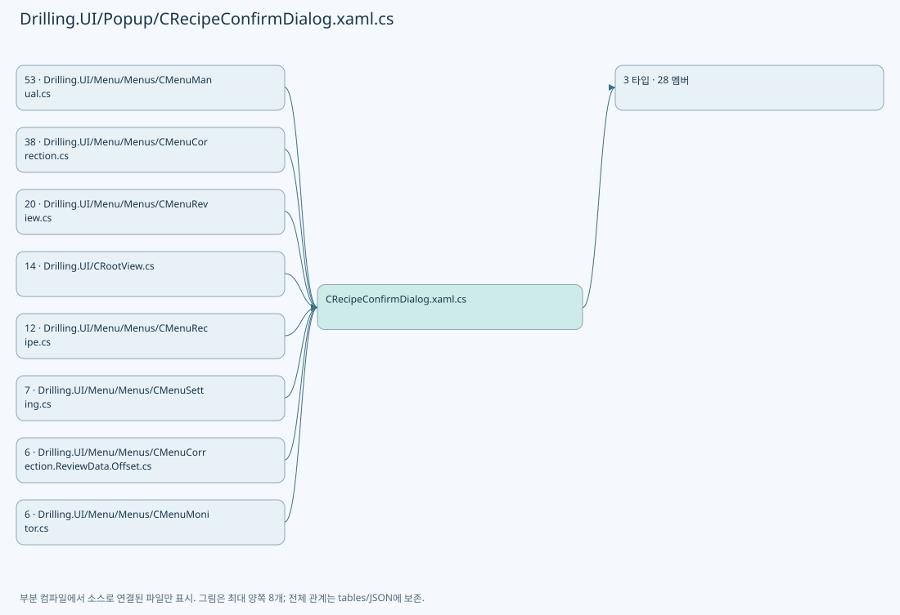
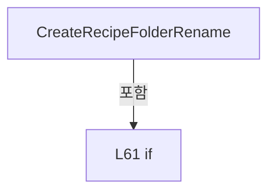
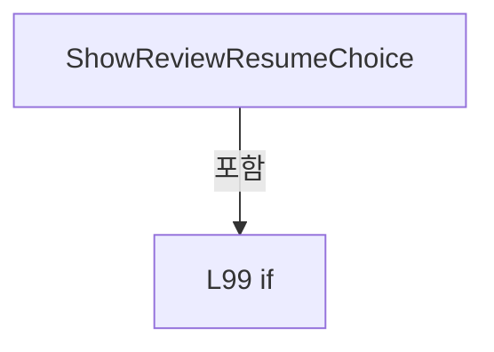
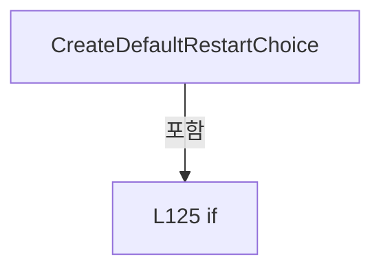
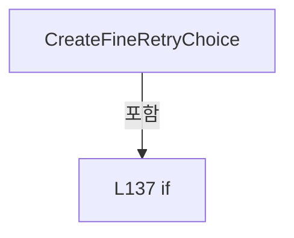
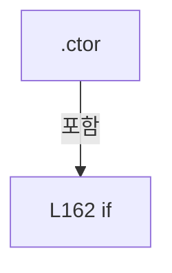
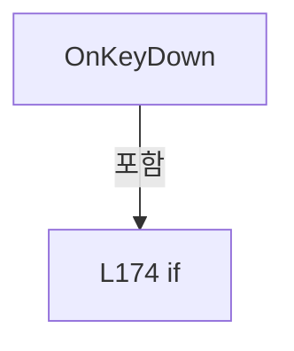

# Drilling.UI/Popup/CRecipeConfirmDialog.xaml.cs

| 항목 | 내용 |
| --- | --- |
| 원본 저장소 | https://github.com/kjuws10-rgb/A3Drilling.git |
| 원본 Commit | 5aee8e58439c9b455cae7c9593c9be986c3e682e |
| 원본 SHA256 | 0c8e4dde3d973c0dc0c46013c41c9c0fc259e7c6b28729f41fc622c66ce275df |
| 파일 분류 | code |
| 원본 크기/행 | 7,829 bytes / 204 physical lines |
| 인코딩 | utf-8-sig |
| 검토 범위 | 구문/부분 의미 분석에서 추출한 사실. 동작·물리 단위·실장비 합격을 보증하지 않습니다. |
| 원본 링크 | [고정 Commit 원본](https://github.com/kjuws10-rgb/A3Drilling/blob/5aee8e58439c9b455cae7c9593c9be986c3e682e/Drilling.UI/Popup/CRecipeConfirmDialog.xaml.cs) |

## 파일의 역할과 읽는 순서

WPF 화면·사용자 명령·표시 상태를 구성합니다. XAML 이벤트와 코드 비하인드, RootView의 조립 경로를 함께 추적합니다.

## 네임스페이스·타입·상속

| 타입 | 구분 | 원본 범위 | 선언/상속 |
| --- | --- | --- | --- |
| EN_DEFAULT_RESTART_CHOICE | EnumDeclaration | 6–6 | EN_DEFAULT_RESTART_CHOICE |
| CRecipeConfirmDialog | ClassDeclaration | 8–197 | CRecipeConfirmDialog: Window |
| EN_REVIEW_RESUME_CHOICE | EnumDeclaration | 199–204 | EN_REVIEW_RESUME_CHOICE |

## 멤버 빠른 목록

| 이름 | 종류 | 범위 | 서명 |
| --- | --- | --- | --- |
| Cancel | EnumMemberDeclaration | L6–6 | Drilling.UI.Popup.EN_DEFAULT_RESTART_CHOICE.Cancel |
| AllFromStart | EnumMemberDeclaration | L6–6 | Drilling.UI.Popup.EN_DEFAULT_RESTART_CHOICE.AllFromStart |
| InspectionFromStart | EnumMemberDeclaration | L6–6 | Drilling.UI.Popup.EN_DEFAULT_RESTART_CHOICE.InspectionFromStart |
| _alternateSelected | FieldDeclaration | L10–10 | bool Drilling.UI.Popup.CRecipeConfirmDialog._alternateSelected |
| ShowConfirmation | MethodDeclaration | L11–18 | bool Drilling.UI.Popup.CRecipeConfirmDialog.ShowConfirmation(string, string, string, bool) |
| ShowDuplicateOffsetConfirmation | MethodDeclaration | L20–28 | bool Drilling.UI.Popup.CRecipeConfirmDialog.ShowDuplicateOffsetConfirmation(string, string) |
| ShowSavedResultLoadConfirmation | MethodDeclaration | L30–38 | bool Drilling.UI.Popup.CRecipeConfirmDialog.ShowSavedResultLoadConfirmation(string, string) |
| ShowRecipeFolderCopy | MethodDeclaration | L40–48 | bool Drilling.UI.Popup.CRecipeConfirmDialog.ShowRecipeFolderCopy(string, string) |
| ShowRecipeFolderRename | MethodDeclaration | L51–55 | bool? Drilling.UI.Popup.CRecipeConfirmDialog.ShowRecipeFolderRename(string, string) |
| CreateRecipeFolderRename | MethodDeclaration | L57–68 | Drilling.UI.Popup.CRecipeConfirmDialog Drilling.UI.Popup.CRecipeConfirmDialog.CreateRecipeFolderRename(string, string) |
| ShowRecipeFolderDelete | MethodDeclaration | L70–70 | bool Drilling.UI.Popup.CRecipeConfirmDialog.ShowRecipeFolderDelete(string, string) |
| ShowRecipeFolderAction | MethodDeclaration | L71–79 | bool Drilling.UI.Popup.CRecipeConfirmDialog.ShowRecipeFolderAction(string, string, string, bool) |
| ShowCompletion | MethodDeclaration | L81–84 | void Drilling.UI.Popup.CRecipeConfirmDialog.ShowCompletion(string, string, Window?) |
| ShowWarning | MethodDeclaration | L86–89 | void Drilling.UI.Popup.CRecipeConfirmDialog.ShowWarning(string, string, Window?) |
| ShowReviewResumeChoice | MethodDeclaration | L91–105 | Drilling.UI.Popup.EN_REVIEW_RESUME_CHOICE Drilling.UI.Popup.CRecipeConfirmDialog.ShowReviewResumeChoice(string) |
| ShowFineRetryChoice | MethodDeclaration | L107–112 | Drilling.UI.Popup.EN_REVIEW_RESUME_CHOICE Drilling.UI.Popup.CRecipeConfirmDialog.ShowFineRetryChoice(string) |
| ShowDefaultRestartChoice | MethodDeclaration | L114–119 | Drilling.UI.Popup.EN_DEFAULT_RESTART_CHOICE Drilling.UI.Popup.CRecipeConfirmDialog.ShowDefaultRestartChoice(string) |
| CreateDefaultRestartChoice | MethodDeclaration | L121–131 | Drilling.UI.Popup.CRecipeConfirmDialog Drilling.UI.Popup.CRecipeConfirmDialog.CreateDefaultRestartChoice(string) |
| CreateFineRetryChoice | MethodDeclaration | L133–141 | Drilling.UI.Popup.CRecipeConfirmDialog Drilling.UI.Popup.CRecipeConfirmDialog.CreateFineRetryChoice(string) |
| ShowMessage | MethodDeclaration | L143–152 | void Drilling.UI.Popup.CRecipeConfirmDialog.ShowMessage(string, string, bool, Window?) |
| .ctor | ConstructorDeclaration | L154–169 | Drilling.UI.Popup.CRecipeConfirmDialog.CRecipeConfirmDialog(string, string, string, bool) |
| OnKeyDown | MethodDeclaration | L171–179 | void Drilling.UI.Popup.CRecipeConfirmDialog.OnKeyDown(KeyEventArgs) |
| OnConfirmClicked | MethodDeclaration | L181–184 | void Drilling.UI.Popup.CRecipeConfirmDialog.OnConfirmClicked(object, RoutedEventArgs) |
| OnCancelClicked | MethodDeclaration | L186–190 | void Drilling.UI.Popup.CRecipeConfirmDialog.OnCancelClicked(object, RoutedEventArgs) |
| OnAbortClicked | MethodDeclaration | L192–196 | void Drilling.UI.Popup.CRecipeConfirmDialog.OnAbortClicked(object, RoutedEventArgs) |
| Cancel | EnumMemberDeclaration | L201–201 | Drilling.UI.Popup.EN_REVIEW_RESUME_CHOICE.Cancel |
| Resume | EnumMemberDeclaration | L202–202 | Drilling.UI.Popup.EN_REVIEW_RESUME_CHOICE.Resume |
| Restart | EnumMemberDeclaration | L203–203 | Drilling.UI.Popup.EN_REVIEW_RESUME_CHOICE.Restart |

## 멤버별 상세 계약·호출·처리 해설

### EnumMemberDeclaration `Cancel` · L6–6

[Drilling.UI/Popup/CRecipeConfirmDialog.xaml.cs:6–6](https://github.com/kjuws10-rgb/A3Drilling/blob/5aee8e58439c9b455cae7c9593c9be986c3e682e/Drilling.UI/Popup/CRecipeConfirmDialog.xaml.cs#L6-L6)

| 항목 | 실제 추출 값 |
| --- | --- |
| 서명 | Drilling.UI.Popup.EN_DEFAULT_RESTART_CHOICE.Cancel |
| 접근/수식자 | Public /  |
| 반환/값 타입 | Drilling.UI.Popup.EN_DEFAULT_RESTART_CHOICE |
| 소속 타입 | NamedType:Drilling.UI.Popup.EN_DEFAULT_RESTART_CHOICE |

현재 부분 분석에서 직접 연결된 호출자는 없습니다. XAML/이벤트/인터페이스·델리게이트·외부 진입을 추가 확인해야 하며, 미사용으로 판정한 것이 아닙니다.

변경 전 점검: 입력/반환 타입, 위 호출자, 예외/취소 경로, 공유 상태와 저장·전송 소비자를 함께 확인합니다. 값의 단위나 물리 방향을 이름만으로 확정하지 않습니다.

### EnumMemberDeclaration `AllFromStart` · L6–6

[Drilling.UI/Popup/CRecipeConfirmDialog.xaml.cs:6–6](https://github.com/kjuws10-rgb/A3Drilling/blob/5aee8e58439c9b455cae7c9593c9be986c3e682e/Drilling.UI/Popup/CRecipeConfirmDialog.xaml.cs#L6-L6)

| 항목 | 실제 추출 값 |
| --- | --- |
| 서명 | Drilling.UI.Popup.EN_DEFAULT_RESTART_CHOICE.AllFromStart |
| 접근/수식자 | Public /  |
| 반환/값 타입 | Drilling.UI.Popup.EN_DEFAULT_RESTART_CHOICE |
| 소속 타입 | NamedType:Drilling.UI.Popup.EN_DEFAULT_RESTART_CHOICE |

현재 부분 분석에서 직접 연결된 호출자는 없습니다. XAML/이벤트/인터페이스·델리게이트·외부 진입을 추가 확인해야 하며, 미사용으로 판정한 것이 아닙니다.

변경 전 점검: 입력/반환 타입, 위 호출자, 예외/취소 경로, 공유 상태와 저장·전송 소비자를 함께 확인합니다. 값의 단위나 물리 방향을 이름만으로 확정하지 않습니다.

### EnumMemberDeclaration `InspectionFromStart` · L6–6

[Drilling.UI/Popup/CRecipeConfirmDialog.xaml.cs:6–6](https://github.com/kjuws10-rgb/A3Drilling/blob/5aee8e58439c9b455cae7c9593c9be986c3e682e/Drilling.UI/Popup/CRecipeConfirmDialog.xaml.cs#L6-L6)

| 항목 | 실제 추출 값 |
| --- | --- |
| 서명 | Drilling.UI.Popup.EN_DEFAULT_RESTART_CHOICE.InspectionFromStart |
| 접근/수식자 | Public /  |
| 반환/값 타입 | Drilling.UI.Popup.EN_DEFAULT_RESTART_CHOICE |
| 소속 타입 | NamedType:Drilling.UI.Popup.EN_DEFAULT_RESTART_CHOICE |

현재 부분 분석에서 직접 연결된 호출자는 없습니다. XAML/이벤트/인터페이스·델리게이트·외부 진입을 추가 확인해야 하며, 미사용으로 판정한 것이 아닙니다.

변경 전 점검: 입력/반환 타입, 위 호출자, 예외/취소 경로, 공유 상태와 저장·전송 소비자를 함께 확인합니다. 값의 단위나 물리 방향을 이름만으로 확정하지 않습니다.

### FieldDeclaration `_alternateSelected` · L10–10

[Drilling.UI/Popup/CRecipeConfirmDialog.xaml.cs:10–10](https://github.com/kjuws10-rgb/A3Drilling/blob/5aee8e58439c9b455cae7c9593c9be986c3e682e/Drilling.UI/Popup/CRecipeConfirmDialog.xaml.cs#L10-L10)

| 항목 | 실제 추출 값 |
| --- | --- |
| 서명 | bool Drilling.UI.Popup.CRecipeConfirmDialog._alternateSelected |
| 접근/수식자 | Private / private |
| 반환/값 타입 | bool |
| 소속 타입 | NamedType:Drilling.UI.Popup.CRecipeConfirmDialog |

현재 부분 분석에서 직접 연결된 호출자는 없습니다. XAML/이벤트/인터페이스·델리게이트·외부 진입을 추가 확인해야 하며, 미사용으로 판정한 것이 아닙니다.

변경 전 점검: 입력/반환 타입, 위 호출자, 예외/취소 경로, 공유 상태와 저장·전송 소비자를 함께 확인합니다. 값의 단위나 물리 방향을 이름만으로 확정하지 않습니다.

### MethodDeclaration `ShowConfirmation` · L11–18

[Drilling.UI/Popup/CRecipeConfirmDialog.xaml.cs:11–18](https://github.com/kjuws10-rgb/A3Drilling/blob/5aee8e58439c9b455cae7c9593c9be986c3e682e/Drilling.UI/Popup/CRecipeConfirmDialog.xaml.cs#L11-L18)

| 항목 | 실제 추출 값 |
| --- | --- |
| 서명 | bool Drilling.UI.Popup.CRecipeConfirmDialog.ShowConfirmation(string, string, string, bool) |
| 접근/수식자 | Public / public, static |
| 반환/값 타입 | bool |
| 소속 타입 | NamedType:Drilling.UI.Popup.CRecipeConfirmDialog |

입력 계약:

| 이름 | 타입 | 전달 | 선택/기본값 |
| --- | --- | --- | --- |
| title | string | None | False /  |
| message | string | None | False /  |
| confirmText | string | None | True / "\uD655\uC778" |
| useDangerStyle | bool | None | True / false |

정적 호출자로 확인된 위치:

| 호출 파일/행 | 호출 표현식 | 런타임 분기 가능 |
| --- | --- | --- |
| [Drilling.UI/CRootView.cs:583–583](https://github.com/kjuws10-rgb/A3Drilling/blob/5aee8e58439c9b455cae7c9593c9be986c3e682e/Drilling.UI/CRootView.cs#L583-L583) | CRecipeConfirmDialog.ShowConfirmation | False |
| [Drilling.UI/CRootView.cs:1608–1608](https://github.com/kjuws10-rgb/A3Drilling/blob/5aee8e58439c9b455cae7c9593c9be986c3e682e/Drilling.UI/CRootView.cs#L1608-L1608) | CRecipeConfirmDialog.ShowConfirmation | False |
| [Drilling.UI/CRootView.cs:2616–2616](https://github.com/kjuws10-rgb/A3Drilling/blob/5aee8e58439c9b455cae7c9593c9be986c3e682e/Drilling.UI/CRootView.cs#L2616-L2616) | CRecipeConfirmDialog.ShowConfirmation | False |
| [Drilling.UI/Menu/Menus/CMenuCorrection.ReviewData.Offset.cs:153–157](https://github.com/kjuws10-rgb/A3Drilling/blob/5aee8e58439c9b455cae7c9593c9be986c3e682e/Drilling.UI/Menu/Menus/CMenuCorrection.ReviewData.Offset.cs#L153-L157) | CRecipeConfirmDialog.ShowConfirmation | False |
| [Drilling.UI/Menu/Menus/CMenuCorrection.ReviewData.Reinspection.cs:366–371](https://github.com/kjuws10-rgb/A3Drilling/blob/5aee8e58439c9b455cae7c9593c9be986c3e682e/Drilling.UI/Menu/Menus/CMenuCorrection.ReviewData.Reinspection.cs#L366-L371) | CRecipeConfirmDialog.ShowConfirmation | False |
| [Drilling.UI/Menu/Menus/CMenuCorrection.cs:105–105](https://github.com/kjuws10-rgb/A3Drilling/blob/5aee8e58439c9b455cae7c9593c9be986c3e682e/Drilling.UI/Menu/Menus/CMenuCorrection.cs#L105-L105) | CRecipeConfirmDialog.ShowConfirmation | False |
| [Drilling.UI/Menu/Menus/CMenuCorrection.cs:193–196](https://github.com/kjuws10-rgb/A3Drilling/blob/5aee8e58439c9b455cae7c9593c9be986c3e682e/Drilling.UI/Menu/Menus/CMenuCorrection.cs#L193-L196) | CRecipeConfirmDialog.ShowConfirmation | False |
| [Drilling.UI/Menu/Menus/CMenuCorrection.cs:1257–1257](https://github.com/kjuws10-rgb/A3Drilling/blob/5aee8e58439c9b455cae7c9593c9be986c3e682e/Drilling.UI/Menu/Menus/CMenuCorrection.cs#L1257-L1257) | CRecipeConfirmDialog.ShowConfirmation | False |
| [Drilling.UI/Menu/Menus/CMenuCorrection.cs:1265–1265](https://github.com/kjuws10-rgb/A3Drilling/blob/5aee8e58439c9b455cae7c9593c9be986c3e682e/Drilling.UI/Menu/Menus/CMenuCorrection.cs#L1265-L1265) | CRecipeConfirmDialog.ShowConfirmation | False |
| [Drilling.UI/Menu/Menus/CMenuCorrection.cs:1275–1275](https://github.com/kjuws10-rgb/A3Drilling/blob/5aee8e58439c9b455cae7c9593c9be986c3e682e/Drilling.UI/Menu/Menus/CMenuCorrection.cs#L1275-L1275) | CRecipeConfirmDialog.ShowConfirmation | False |
| [Drilling.UI/Menu/Menus/CMenuCorrection.cs:1344–1344](https://github.com/kjuws10-rgb/A3Drilling/blob/5aee8e58439c9b455cae7c9593c9be986c3e682e/Drilling.UI/Menu/Menus/CMenuCorrection.cs#L1344-L1344) | CRecipeConfirmDialog.ShowConfirmation | False |
| [Drilling.UI/Menu/Menus/CMenuCorrection.cs:1523–1523](https://github.com/kjuws10-rgb/A3Drilling/blob/5aee8e58439c9b455cae7c9593c9be986c3e682e/Drilling.UI/Menu/Menus/CMenuCorrection.cs#L1523-L1523) | CRecipeConfirmDialog.ShowConfirmation | False |
| [Drilling.UI/Menu/Menus/CMenuCorrection.cs:1535–1535](https://github.com/kjuws10-rgb/A3Drilling/blob/5aee8e58439c9b455cae7c9593c9be986c3e682e/Drilling.UI/Menu/Menus/CMenuCorrection.cs#L1535-L1535) | CRecipeConfirmDialog.ShowConfirmation | False |
| [Drilling.UI/Menu/Menus/CMenuCorrection.cs:2590–2590](https://github.com/kjuws10-rgb/A3Drilling/blob/5aee8e58439c9b455cae7c9593c9be986c3e682e/Drilling.UI/Menu/Menus/CMenuCorrection.cs#L2590-L2590) | CRecipeConfirmDialog.ShowConfirmation | False |
| [Drilling.UI/Menu/Menus/CMenuCorrection.cs:2607–2612](https://github.com/kjuws10-rgb/A3Drilling/blob/5aee8e58439c9b455cae7c9593c9be986c3e682e/Drilling.UI/Menu/Menus/CMenuCorrection.cs#L2607-L2612) | CRecipeConfirmDialog.ShowConfirmation | False |
| [Drilling.UI/Menu/Menus/CMenuCorrection.cs:2656–2656](https://github.com/kjuws10-rgb/A3Drilling/blob/5aee8e58439c9b455cae7c9593c9be986c3e682e/Drilling.UI/Menu/Menus/CMenuCorrection.cs#L2656-L2656) | CRecipeConfirmDialog.ShowConfirmation | False |
| [Drilling.UI/Menu/Menus/CMenuCorrection.cs:2667–2667](https://github.com/kjuws10-rgb/A3Drilling/blob/5aee8e58439c9b455cae7c9593c9be986c3e682e/Drilling.UI/Menu/Menus/CMenuCorrection.cs#L2667-L2667) | CRecipeConfirmDialog.ShowConfirmation | False |
| [Drilling.UI/Menu/Menus/CMenuCorrection.cs:2678–2678](https://github.com/kjuws10-rgb/A3Drilling/blob/5aee8e58439c9b455cae7c9593c9be986c3e682e/Drilling.UI/Menu/Menus/CMenuCorrection.cs#L2678-L2678) | CRecipeConfirmDialog.ShowConfirmation | False |
| [Drilling.UI/Menu/Menus/CMenuCorrection.cs:2734–2734](https://github.com/kjuws10-rgb/A3Drilling/blob/5aee8e58439c9b455cae7c9593c9be986c3e682e/Drilling.UI/Menu/Menus/CMenuCorrection.cs#L2734-L2734) | CRecipeConfirmDialog.ShowConfirmation | False |
| [Drilling.UI/Menu/Menus/CMenuCorrection.cs:2892–2892](https://github.com/kjuws10-rgb/A3Drilling/blob/5aee8e58439c9b455cae7c9593c9be986c3e682e/Drilling.UI/Menu/Menus/CMenuCorrection.cs#L2892-L2892) | CRecipeConfirmDialog.ShowConfirmation | False |
| [Drilling.UI/Menu/Menus/CMenuCorrection.cs:3004–3004](https://github.com/kjuws10-rgb/A3Drilling/blob/5aee8e58439c9b455cae7c9593c9be986c3e682e/Drilling.UI/Menu/Menus/CMenuCorrection.cs#L3004-L3004) | CRecipeConfirmDialog.ShowConfirmation | False |
| [Drilling.UI/Menu/Menus/CMenuCorrection.cs:3864–3864](https://github.com/kjuws10-rgb/A3Drilling/blob/5aee8e58439c9b455cae7c9593c9be986c3e682e/Drilling.UI/Menu/Menus/CMenuCorrection.cs#L3864-L3864) | CRecipeConfirmDialog.ShowConfirmation | False |
| [Drilling.UI/Menu/Menus/CMenuCorrection.cs:4013–4017](https://github.com/kjuws10-rgb/A3Drilling/blob/5aee8e58439c9b455cae7c9593c9be986c3e682e/Drilling.UI/Menu/Menus/CMenuCorrection.cs#L4013-L4017) | CRecipeConfirmDialog.ShowConfirmation | False |
| [Drilling.UI/Menu/Menus/CMenuCorrection.cs:4112–4112](https://github.com/kjuws10-rgb/A3Drilling/blob/5aee8e58439c9b455cae7c9593c9be986c3e682e/Drilling.UI/Menu/Menus/CMenuCorrection.cs#L4112-L4112) | CRecipeConfirmDialog.ShowConfirmation | False |
| [Drilling.UI/Menu/Menus/CMenuManual.cs:1790–1790](https://github.com/kjuws10-rgb/A3Drilling/blob/5aee8e58439c9b455cae7c9593c9be986c3e682e/Drilling.UI/Menu/Menus/CMenuManual.cs#L1790-L1790) | CRecipeConfirmDialog.ShowConfirmation | False |
| [Drilling.UI/Menu/Menus/CMenuManual.cs:2202–2202](https://github.com/kjuws10-rgb/A3Drilling/blob/5aee8e58439c9b455cae7c9593c9be986c3e682e/Drilling.UI/Menu/Menus/CMenuManual.cs#L2202-L2202) | CRecipeConfirmDialog.ShowConfirmation | False |
| [Drilling.UI/Menu/Menus/CMenuManual.cs:2626–2626](https://github.com/kjuws10-rgb/A3Drilling/blob/5aee8e58439c9b455cae7c9593c9be986c3e682e/Drilling.UI/Menu/Menus/CMenuManual.cs#L2626-L2626) | CRecipeConfirmDialog.ShowConfirmation | False |
| [Drilling.UI/Menu/Menus/CMenuManual.cs:2735–2735](https://github.com/kjuws10-rgb/A3Drilling/blob/5aee8e58439c9b455cae7c9593c9be986c3e682e/Drilling.UI/Menu/Menus/CMenuManual.cs#L2735-L2735) | CRecipeConfirmDialog.ShowConfirmation | False |
| [Drilling.UI/Menu/Menus/CMenuManual.cs:3267–3267](https://github.com/kjuws10-rgb/A3Drilling/blob/5aee8e58439c9b455cae7c9593c9be986c3e682e/Drilling.UI/Menu/Menus/CMenuManual.cs#L3267-L3267) | CRecipeConfirmDialog.ShowConfirmation | False |
| [Drilling.UI/Menu/Menus/CMenuManual.cs:3307–3307](https://github.com/kjuws10-rgb/A3Drilling/blob/5aee8e58439c9b455cae7c9593c9be986c3e682e/Drilling.UI/Menu/Menus/CMenuManual.cs#L3307-L3307) | CRecipeConfirmDialog.ShowConfirmation | False |
| [Drilling.UI/Menu/Menus/CMenuManual.cs:3367–3367](https://github.com/kjuws10-rgb/A3Drilling/blob/5aee8e58439c9b455cae7c9593c9be986c3e682e/Drilling.UI/Menu/Menus/CMenuManual.cs#L3367-L3367) | CRecipeConfirmDialog.ShowConfirmation | False |
| [Drilling.UI/Menu/Menus/CMenuManual.cs:3528–3528](https://github.com/kjuws10-rgb/A3Drilling/blob/5aee8e58439c9b455cae7c9593c9be986c3e682e/Drilling.UI/Menu/Menus/CMenuManual.cs#L3528-L3528) | CRecipeConfirmDialog.ShowConfirmation | False |
| [Drilling.UI/Menu/Menus/CMenuManual.cs:3910–3910](https://github.com/kjuws10-rgb/A3Drilling/blob/5aee8e58439c9b455cae7c9593c9be986c3e682e/Drilling.UI/Menu/Menus/CMenuManual.cs#L3910-L3910) | CRecipeConfirmDialog.ShowConfirmation | False |
| [Drilling.UI/Menu/Menus/CMenuManual.cs:3955–3955](https://github.com/kjuws10-rgb/A3Drilling/blob/5aee8e58439c9b455cae7c9593c9be986c3e682e/Drilling.UI/Menu/Menus/CMenuManual.cs#L3955-L3955) | CRecipeConfirmDialog.ShowConfirmation | False |
| [Drilling.UI/Menu/Menus/CMenuManual.cs:3974–3974](https://github.com/kjuws10-rgb/A3Drilling/blob/5aee8e58439c9b455cae7c9593c9be986c3e682e/Drilling.UI/Menu/Menus/CMenuManual.cs#L3974-L3974) | CRecipeConfirmDialog.ShowConfirmation | False |
| [Drilling.UI/Menu/Menus/CMenuManual.cs:4006–4006](https://github.com/kjuws10-rgb/A3Drilling/blob/5aee8e58439c9b455cae7c9593c9be986c3e682e/Drilling.UI/Menu/Menus/CMenuManual.cs#L4006-L4006) | CRecipeConfirmDialog.ShowConfirmation | False |
| [Drilling.UI/Menu/Menus/CMenuManual.cs:4075–4075](https://github.com/kjuws10-rgb/A3Drilling/blob/5aee8e58439c9b455cae7c9593c9be986c3e682e/Drilling.UI/Menu/Menus/CMenuManual.cs#L4075-L4075) | CRecipeConfirmDialog.ShowConfirmation | False |
| [Drilling.UI/Menu/Menus/CMenuManual.cs:4301–4301](https://github.com/kjuws10-rgb/A3Drilling/blob/5aee8e58439c9b455cae7c9593c9be986c3e682e/Drilling.UI/Menu/Menus/CMenuManual.cs#L4301-L4301) | CRecipeConfirmDialog.ShowConfirmation | False |
| [Drilling.UI/Menu/Menus/CMenuManual.cs:4639–4639](https://github.com/kjuws10-rgb/A3Drilling/blob/5aee8e58439c9b455cae7c9593c9be986c3e682e/Drilling.UI/Menu/Menus/CMenuManual.cs#L4639-L4639) | CRecipeConfirmDialog.ShowConfirmation | False |
| [Drilling.UI/Menu/Menus/CMenuManual.cs:5052–5052](https://github.com/kjuws10-rgb/A3Drilling/blob/5aee8e58439c9b455cae7c9593c9be986c3e682e/Drilling.UI/Menu/Menus/CMenuManual.cs#L5052-L5052) | CRecipeConfirmDialog.ShowConfirmation | False |
| [Drilling.UI/Menu/Menus/CMenuManual.cs:5256–5256](https://github.com/kjuws10-rgb/A3Drilling/blob/5aee8e58439c9b455cae7c9593c9be986c3e682e/Drilling.UI/Menu/Menus/CMenuManual.cs#L5256-L5256) | CRecipeConfirmDialog.ShowConfirmation | False |
| [Drilling.UI/Menu/Menus/CMenuManual.cs:6299–6299](https://github.com/kjuws10-rgb/A3Drilling/blob/5aee8e58439c9b455cae7c9593c9be986c3e682e/Drilling.UI/Menu/Menus/CMenuManual.cs#L6299-L6299) | CRecipeConfirmDialog.ShowConfirmation | False |
| [Drilling.UI/Menu/Menus/CMenuMonitor.cs:1220–1220](https://github.com/kjuws10-rgb/A3Drilling/blob/5aee8e58439c9b455cae7c9593c9be986c3e682e/Drilling.UI/Menu/Menus/CMenuMonitor.cs#L1220-L1220) | CRecipeConfirmDialog.ShowConfirmation | False |
| [Drilling.UI/Menu/Menus/CMenuMonitor.cs:2767–2767](https://github.com/kjuws10-rgb/A3Drilling/blob/5aee8e58439c9b455cae7c9593c9be986c3e682e/Drilling.UI/Menu/Menus/CMenuMonitor.cs#L2767-L2767) | CRecipeConfirmDialog.ShowConfirmation | False |
| [Drilling.UI/Menu/Menus/CMenuMonitor.cs:3970–3970](https://github.com/kjuws10-rgb/A3Drilling/blob/5aee8e58439c9b455cae7c9593c9be986c3e682e/Drilling.UI/Menu/Menus/CMenuMonitor.cs#L3970-L3970) | CRecipeConfirmDialog.ShowConfirmation | False |
| [Drilling.UI/Menu/Menus/CMenuRecipe.cs:735–735](https://github.com/kjuws10-rgb/A3Drilling/blob/5aee8e58439c9b455cae7c9593c9be986c3e682e/Drilling.UI/Menu/Menus/CMenuRecipe.cs#L735-L735) | CRecipeConfirmDialog.ShowConfirmation | False |
| [Drilling.UI/Menu/Menus/CMenuRecipe.cs:761–761](https://github.com/kjuws10-rgb/A3Drilling/blob/5aee8e58439c9b455cae7c9593c9be986c3e682e/Drilling.UI/Menu/Menus/CMenuRecipe.cs#L761-L761) | CRecipeConfirmDialog.ShowConfirmation | False |
| [Drilling.UI/Menu/Menus/CMenuRecipe.cs:1033–1033](https://github.com/kjuws10-rgb/A3Drilling/blob/5aee8e58439c9b455cae7c9593c9be986c3e682e/Drilling.UI/Menu/Menus/CMenuRecipe.cs#L1033-L1033) | CRecipeConfirmDialog.ShowConfirmation | False |
| [Drilling.UI/Menu/Menus/CMenuReview.cs:2022–2022](https://github.com/kjuws10-rgb/A3Drilling/blob/5aee8e58439c9b455cae7c9593c9be986c3e682e/Drilling.UI/Menu/Menus/CMenuReview.cs#L2022-L2022) | CRecipeConfirmDialog.ShowConfirmation | False |
| [Drilling.UI/Menu/Menus/CMenuReview.cs:2048–2051](https://github.com/kjuws10-rgb/A3Drilling/blob/5aee8e58439c9b455cae7c9593c9be986c3e682e/Drilling.UI/Menu/Menus/CMenuReview.cs#L2048-L2051) | CRecipeConfirmDialog.ShowConfirmation | False |
| [Drilling.UI/Menu/Menus/CMenuReview.cs:2065–2065](https://github.com/kjuws10-rgb/A3Drilling/blob/5aee8e58439c9b455cae7c9593c9be986c3e682e/Drilling.UI/Menu/Menus/CMenuReview.cs#L2065-L2065) | CRecipeConfirmDialog.ShowConfirmation | False |
| [Drilling.UI/Menu/Menus/CMenuReview.cs:2288–2288](https://github.com/kjuws10-rgb/A3Drilling/blob/5aee8e58439c9b455cae7c9593c9be986c3e682e/Drilling.UI/Menu/Menus/CMenuReview.cs#L2288-L2288) | CRecipeConfirmDialog.ShowConfirmation | False |
| [Drilling.UI/Menu/Menus/CMenuReview.cs:2624–2624](https://github.com/kjuws10-rgb/A3Drilling/blob/5aee8e58439c9b455cae7c9593c9be986c3e682e/Drilling.UI/Menu/Menus/CMenuReview.cs#L2624-L2624) | CRecipeConfirmDialog.ShowConfirmation | False |
| [Drilling.UI/Menu/Menus/CMenuSetting.cs:339–339](https://github.com/kjuws10-rgb/A3Drilling/blob/5aee8e58439c9b455cae7c9593c9be986c3e682e/Drilling.UI/Menu/Menus/CMenuSetting.cs#L339-L339) | CRecipeConfirmDialog.ShowConfirmation | False |
| [Drilling.UI/Menu/Menus/CMenuSetting.cs:381–381](https://github.com/kjuws10-rgb/A3Drilling/blob/5aee8e58439c9b455cae7c9593c9be986c3e682e/Drilling.UI/Menu/Menus/CMenuSetting.cs#L381-L381) | CRecipeConfirmDialog.ShowConfirmation | False |
| [Drilling.UI/Menu/Menus/CMenuSetting.cs:405–405](https://github.com/kjuws10-rgb/A3Drilling/blob/5aee8e58439c9b455cae7c9593c9be986c3e682e/Drilling.UI/Menu/Menus/CMenuSetting.cs#L405-L405) | CRecipeConfirmDialog.ShowConfirmation | False |
| [Drilling.UI/Menu/Menus/CMenuSetting.cs:466–466](https://github.com/kjuws10-rgb/A3Drilling/blob/5aee8e58439c9b455cae7c9593c9be986c3e682e/Drilling.UI/Menu/Menus/CMenuSetting.cs#L466-L466) | CRecipeConfirmDialog.ShowConfirmation | False |
| [Drilling.UI/Menu/Menus/CMenuSetting.cs:485–485](https://github.com/kjuws10-rgb/A3Drilling/blob/5aee8e58439c9b455cae7c9593c9be986c3e682e/Drilling.UI/Menu/Menus/CMenuSetting.cs#L485-L485) | CRecipeConfirmDialog.ShowConfirmation | False |

호출하는 대상과 해석 범위:

| 원본 행 | 표현식 | 분석 상태 | 대상/소스 위치 |
| --- | --- | --- | --- |
| 13 | new CRecipeConfirmDialog | resolved | Drilling.UI.Popup.CRecipeConfirmDialog.CRecipeConfirmDialog(string, string, string, bool) · Drilling.UI/Popup/CRecipeConfirmDialog.xaml.cs:154 |
| 17 | dialog.ShowDialog | unresolved | None |

본문의 실제 연산·분기·예외·반환 순서(원문 위치 순):

| 원본 행 | 종류 | 주석 해설 |
| --- | --- | --- |
| 13 | call | 함수·델리게이트 또는 객체 생성자를 호출합니다: new CRecipeConfirmDialog(title, message, confirmText, useDangerStyle) { Owner = Application.Current?.MainWindow } |
| 13 | local-declaration | 지역 변수를 선언합니다: var dialog = new CRecipeConfirmDialog(title, message, confirmText, useDangerStyle) { Owner = Application.Current?.MainWindow }; |
| 13 | variable-initializer | 변수의 초기값을 지정합니다: dialog = new CRecipeConfirmDialog(title, message, confirmText, useDangerStyle) { Owner = Application.Current?.MainWindow } |
| 15 | assignment | 값을 대상에 대입합니다: Owner = Application.Current?.MainWindow |
| 17 | call | 함수·델리게이트 또는 객체 생성자를 호출합니다: dialog.ShowDialog() |
| 17 | return | 호출자에게 값 또는 제어를 반환합니다: return dialog.ShowDialog() == true; |

변경 전 점검: 입력/반환 타입, 위 호출자, 예외/취소 경로, 공유 상태와 저장·전송 소비자를 함께 확인합니다. 값의 단위나 물리 방향을 이름만으로 확정하지 않습니다.

### MethodDeclaration `ShowDuplicateOffsetConfirmation` · L20–28

[Drilling.UI/Popup/CRecipeConfirmDialog.xaml.cs:20–28](https://github.com/kjuws10-rgb/A3Drilling/blob/5aee8e58439c9b455cae7c9593c9be986c3e682e/Drilling.UI/Popup/CRecipeConfirmDialog.xaml.cs#L20-L28)

| 항목 | 실제 추출 값 |
| --- | --- |
| 서명 | bool Drilling.UI.Popup.CRecipeConfirmDialog.ShowDuplicateOffsetConfirmation(string, string) |
| 접근/수식자 | Public / public, static |
| 반환/값 타입 | bool |
| 소속 타입 | NamedType:Drilling.UI.Popup.CRecipeConfirmDialog |

입력 계약:

| 이름 | 타입 | 전달 | 선택/기본값 |
| --- | --- | --- | --- |
| title | string | None | False /  |
| message | string | None | False /  |

현재 부분 분석에서 직접 연결된 호출자는 없습니다. XAML/이벤트/인터페이스·델리게이트·외부 진입을 추가 확인해야 하며, 미사용으로 판정한 것이 아닙니다.

호출하는 대상과 해석 범위:

| 원본 행 | 표현식 | 분석 상태 | 대상/소스 위치 |
| --- | --- | --- | --- |
| 22 | new CRecipeConfirmDialog | resolved | Drilling.UI.Popup.CRecipeConfirmDialog.CRecipeConfirmDialog(string, string, string, bool) · Drilling.UI/Popup/CRecipeConfirmDialog.xaml.cs:154 |
| 27 | dialog.ShowDialog | unresolved | None |

본문의 실제 연산·분기·예외·반환 순서(원문 위치 순):

| 원본 행 | 종류 | 주석 해설 |
| --- | --- | --- |
| 22 | call | 함수·델리게이트 또는 객체 생성자를 호출합니다: new CRecipeConfirmDialog(title, message, "중복 적용", useDangerStyle: true) { Owner = Application.Current?.MainWindow } |
| 22 | local-declaration | 지역 변수를 선언합니다: var dialog = new CRecipeConfirmDialog(title, message, "중복 적용", useDangerStyle: true) { Owner = Application.Current?.MainWindow }; |
| 22 | variable-initializer | 변수의 초기값을 지정합니다: dialog = new CRecipeConfirmDialog(title, message, "중복 적용", useDangerStyle: true) { Owner = Application.Current?.MainWindow } |
| 24 | assignment | 값을 대상에 대입합니다: Owner = Application.Current?.MainWindow |
| 26 | assignment | 값을 대상에 대입합니다: dialog.CancelButton.Content = "아니오" |
| 27 | call | 함수·델리게이트 또는 객체 생성자를 호출합니다: dialog.ShowDialog() |
| 27 | return | 호출자에게 값 또는 제어를 반환합니다: return dialog.ShowDialog() == true; |

변경 전 점검: 입력/반환 타입, 위 호출자, 예외/취소 경로, 공유 상태와 저장·전송 소비자를 함께 확인합니다. 값의 단위나 물리 방향을 이름만으로 확정하지 않습니다.

### MethodDeclaration `ShowSavedResultLoadConfirmation` · L30–38

[Drilling.UI/Popup/CRecipeConfirmDialog.xaml.cs:30–38](https://github.com/kjuws10-rgb/A3Drilling/blob/5aee8e58439c9b455cae7c9593c9be986c3e682e/Drilling.UI/Popup/CRecipeConfirmDialog.xaml.cs#L30-L38)

| 항목 | 실제 추출 값 |
| --- | --- |
| 서명 | bool Drilling.UI.Popup.CRecipeConfirmDialog.ShowSavedResultLoadConfirmation(string, string) |
| 접근/수식자 | Public / public, static |
| 반환/값 타입 | bool |
| 소속 타입 | NamedType:Drilling.UI.Popup.CRecipeConfirmDialog |

입력 계약:

| 이름 | 타입 | 전달 | 선택/기본값 |
| --- | --- | --- | --- |
| title | string | None | False /  |
| message | string | None | False /  |

정적 호출자로 확인된 위치:

| 호출 파일/행 | 호출 표현식 | 런타임 분기 가능 |
| --- | --- | --- |
| [Drilling.UI/Menu/Menus/CMenuCorrection.ReviewData.Reinspection.cs:425–427](https://github.com/kjuws10-rgb/A3Drilling/blob/5aee8e58439c9b455cae7c9593c9be986c3e682e/Drilling.UI/Menu/Menus/CMenuCorrection.ReviewData.Reinspection.cs#L425-L427) | CRecipeConfirmDialog.ShowSavedResultLoadConfirmation | False |

호출하는 대상과 해석 범위:

| 원본 행 | 표현식 | 분석 상태 | 대상/소스 위치 |
| --- | --- | --- | --- |
| 32 | new CRecipeConfirmDialog | resolved | Drilling.UI.Popup.CRecipeConfirmDialog.CRecipeConfirmDialog(string, string, string, bool) · Drilling.UI/Popup/CRecipeConfirmDialog.xaml.cs:154 |
| 37 | dialog.ShowDialog | unresolved | None |

본문의 실제 연산·분기·예외·반환 순서(원문 위치 순):

| 원본 행 | 종류 | 주석 해설 |
| --- | --- | --- |
| 32 | call | 함수·델리게이트 또는 객체 생성자를 호출합니다: new CRecipeConfirmDialog(title, message, "예, LOAD", useDangerStyle: false) { Owner = Application.Current?.MainWindow } |
| 32 | local-declaration | 지역 변수를 선언합니다: var dialog = new CRecipeConfirmDialog(title, message, "예, LOAD", useDangerStyle: false) { Owner = Application.Current?.MainWindow }; |
| 32 | variable-initializer | 변수의 초기값을 지정합니다: dialog = new CRecipeConfirmDialog(title, message, "예, LOAD", useDangerStyle: false) { Owner = Application.Current?.MainWindow } |
| 34 | assignment | 값을 대상에 대입합니다: Owner = Application.Current?.MainWindow |
| 36 | assignment | 값을 대상에 대입합니다: dialog.CancelButton.Content = "아니오" |
| 37 | call | 함수·델리게이트 또는 객체 생성자를 호출합니다: dialog.ShowDialog() |
| 37 | return | 호출자에게 값 또는 제어를 반환합니다: return dialog.ShowDialog() == true; |

변경 전 점검: 입력/반환 타입, 위 호출자, 예외/취소 경로, 공유 상태와 저장·전송 소비자를 함께 확인합니다. 값의 단위나 물리 방향을 이름만으로 확정하지 않습니다.

### MethodDeclaration `ShowRecipeFolderCopy` · L40–48

[Drilling.UI/Popup/CRecipeConfirmDialog.xaml.cs:40–48](https://github.com/kjuws10-rgb/A3Drilling/blob/5aee8e58439c9b455cae7c9593c9be986c3e682e/Drilling.UI/Popup/CRecipeConfirmDialog.xaml.cs#L40-L48)

| 항목 | 실제 추출 값 |
| --- | --- |
| 서명 | bool Drilling.UI.Popup.CRecipeConfirmDialog.ShowRecipeFolderCopy(string, string) |
| 접근/수식자 | Public / public, static |
| 반환/값 타입 | bool |
| 소속 타입 | NamedType:Drilling.UI.Popup.CRecipeConfirmDialog |

입력 계약:

| 이름 | 타입 | 전달 | 선택/기본값 |
| --- | --- | --- | --- |
| title | string | None | False /  |
| message | string | None | False /  |

현재 부분 분석에서 직접 연결된 호출자는 없습니다. XAML/이벤트/인터페이스·델리게이트·외부 진입을 추가 확인해야 하며, 미사용으로 판정한 것이 아닙니다.

호출하는 대상과 해석 범위:

| 원본 행 | 표현식 | 분석 상태 | 대상/소스 위치 |
| --- | --- | --- | --- |
| 42 | new CRecipeConfirmDialog | resolved | Drilling.UI.Popup.CRecipeConfirmDialog.CRecipeConfirmDialog(string, string, string, bool) · Drilling.UI/Popup/CRecipeConfirmDialog.xaml.cs:154 |
| 47 | dialog.ShowDialog | unresolved | None |

본문의 실제 연산·분기·예외·반환 순서(원문 위치 순):

| 원본 행 | 종류 | 주석 해설 |
| --- | --- | --- |
| 42 | call | 함수·델리게이트 또는 객체 생성자를 호출합니다: new CRecipeConfirmDialog(title, message, "복사", useDangerStyle: false) { Owner = Application.Current?.MainWindow } |
| 42 | local-declaration | 지역 변수를 선언합니다: var dialog = new CRecipeConfirmDialog(title, message, "복사", useDangerStyle: false) { Owner = Application.Current?.MainWindow }; |
| 42 | variable-initializer | 변수의 초기값을 지정합니다: dialog = new CRecipeConfirmDialog(title, message, "복사", useDangerStyle: false) { Owner = Application.Current?.MainWindow } |
| 44 | assignment | 값을 대상에 대입합니다: Owner = Application.Current?.MainWindow |
| 46 | assignment | 값을 대상에 대입합니다: dialog.CancelButton.Content = "복사 안 함" |
| 47 | call | 함수·델리게이트 또는 객체 생성자를 호출합니다: dialog.ShowDialog() |
| 47 | return | 호출자에게 값 또는 제어를 반환합니다: return dialog.ShowDialog() == true; |

변경 전 점검: 입력/반환 타입, 위 호출자, 예외/취소 경로, 공유 상태와 저장·전송 소비자를 함께 확인합니다. 값의 단위나 물리 방향을 이름만으로 확정하지 않습니다.

### MethodDeclaration `ShowRecipeFolderRename` · L51–55

[Drilling.UI/Popup/CRecipeConfirmDialog.xaml.cs:51–55](https://github.com/kjuws10-rgb/A3Drilling/blob/5aee8e58439c9b455cae7c9593c9be986c3e682e/Drilling.UI/Popup/CRecipeConfirmDialog.xaml.cs#L51-L55)

| 항목 | 실제 추출 값 |
| --- | --- |
| 서명 | bool? Drilling.UI.Popup.CRecipeConfirmDialog.ShowRecipeFolderRename(string, string) |
| 접근/수식자 | Public / public, static |
| 반환/값 타입 | bool? |
| 소속 타입 | NamedType:Drilling.UI.Popup.CRecipeConfirmDialog |

입력 계약:

| 이름 | 타입 | 전달 | 선택/기본값 |
| --- | --- | --- | --- |
| title | string | None | False /  |
| message | string | None | False /  |

현재 부분 분석에서 직접 연결된 호출자는 없습니다. XAML/이벤트/인터페이스·델리게이트·외부 진입을 추가 확인해야 하며, 미사용으로 판정한 것이 아닙니다.

호출하는 대상과 해석 범위:

| 원본 행 | 표현식 | 분석 상태 | 대상/소스 위치 |
| --- | --- | --- | --- |
| 53 | CreateRecipeFolderRename | resolved | Drilling.UI.Popup.CRecipeConfirmDialog Drilling.UI.Popup.CRecipeConfirmDialog.CreateRecipeFolderRename(string, string) · Drilling.UI/Popup/CRecipeConfirmDialog.xaml.cs:57 |
| 54 | dialog.ShowDialog | unresolved | None |

본문의 실제 연산·분기·예외·반환 순서(원문 위치 순):

| 원본 행 | 종류 | 주석 해설 |
| --- | --- | --- |
| 53 | call | 함수·델리게이트 또는 객체 생성자를 호출합니다: CreateRecipeFolderRename(title, message) |
| 53 | local-declaration | 지역 변수를 선언합니다: var dialog = CreateRecipeFolderRename(title, message); |
| 53 | variable-initializer | 변수의 초기값을 지정합니다: dialog = CreateRecipeFolderRename(title, message) |
| 54 | call | 함수·델리게이트 또는 객체 생성자를 호출합니다: dialog.ShowDialog() |
| 54 | conditional-expression | 조건에 따라 결과식을 선택합니다: dialog.ShowDialog() == true ? true : dialog._alternateSelected ? false : null |
| 54 | conditional-expression | 조건에 따라 결과식을 선택합니다: dialog._alternateSelected ? false : null |
| 54 | return | 호출자에게 값 또는 제어를 반환합니다: return dialog.ShowDialog() == true ? true : dialog._alternateSelected ? false : null; |

변경 전 점검: 입력/반환 타입, 위 호출자, 예외/취소 경로, 공유 상태와 저장·전송 소비자를 함께 확인합니다. 값의 단위나 물리 방향을 이름만으로 확정하지 않습니다.

### MethodDeclaration `CreateRecipeFolderRename` · L57–68

[Drilling.UI/Popup/CRecipeConfirmDialog.xaml.cs:57–68](https://github.com/kjuws10-rgb/A3Drilling/blob/5aee8e58439c9b455cae7c9593c9be986c3e682e/Drilling.UI/Popup/CRecipeConfirmDialog.xaml.cs#L57-L68)

| 항목 | 실제 추출 값 |
| --- | --- |
| 서명 | Drilling.UI.Popup.CRecipeConfirmDialog Drilling.UI.Popup.CRecipeConfirmDialog.CreateRecipeFolderRename(string, string) |
| 접근/수식자 | Internal / internal, static |
| 반환/값 타입 | Drilling.UI.Popup.CRecipeConfirmDialog |
| 소속 타입 | NamedType:Drilling.UI.Popup.CRecipeConfirmDialog |

입력 계약:

| 이름 | 타입 | 전달 | 선택/기본값 |
| --- | --- | --- | --- |
| title | string | None | False /  |
| message | string | None | False /  |

정적 호출자로 확인된 위치:

| 호출 파일/행 | 호출 표현식 | 런타임 분기 가능 |
| --- | --- | --- |
| [Drilling.UI/Popup/CRecipeConfirmDialog.xaml.cs:53–53](https://github.com/kjuws10-rgb/A3Drilling/blob/5aee8e58439c9b455cae7c9593c9be986c3e682e/Drilling.UI/Popup/CRecipeConfirmDialog.xaml.cs#L53-L53) | CreateRecipeFolderRename | False |

호출하는 대상과 해석 범위:

| 원본 행 | 표현식 | 분석 상태 | 대상/소스 위치 |
| --- | --- | --- | --- |
| 60 | new CRecipeConfirmDialog | resolved | Drilling.UI.Popup.CRecipeConfirmDialog.CRecipeConfirmDialog(string, string, string, bool) · Drilling.UI/Popup/CRecipeConfirmDialog.xaml.cs:154 |
| 64 | new GridLength | unresolved | None |
| 65 | new GridLength | unresolved | None |

본문의 실제 연산·분기·예외·반환 순서(원문 위치 순):

| 원본 행 | 종류 | 주석 해설 |
| --- | --- | --- |
| 59 | local-declaration | 지역 변수를 선언합니다: var owner = Application.Current?.MainWindow; |
| 59 | variable-initializer | 변수의 초기값을 지정합니다: owner = Application.Current?.MainWindow |
| 60 | call | 함수·델리게이트 또는 객체 생성자를 호출합니다: new CRecipeConfirmDialog(title, message, "함께 변경", useDangerStyle: false) |
| 60 | local-declaration | 지역 변수를 선언합니다: var dialog = new CRecipeConfirmDialog(title, message, "함께 변경", useDangerStyle: false); |
| 60 | variable-initializer | 변수의 초기값을 지정합니다: dialog = new CRecipeConfirmDialog(title, message, "함께 변경", useDangerStyle: false) |
| 61 | if | 조건에 따라 분기합니다: if (owner is not null) |
| 62 | assignment | 값을 대상에 대입합니다: dialog.Owner = owner |
| 63 | assignment | 값을 대상에 대입합니다: dialog.CancelButton.Content = "폴더 유지" |
| 64 | assignment | 값을 대상에 대입합니다: dialog.AbortGap.Width = new GridLength(12) |
| 64 | call | 함수·델리게이트 또는 객체 생성자를 호출합니다: new GridLength(12) |
| 65 | assignment | 값을 대상에 대입합니다: dialog.AbortColumn.Width = new GridLength(1, GridUnitType.Star) |
| 65 | call | 함수·델리게이트 또는 객체 생성자를 호출합니다: new GridLength(1, GridUnitType.Star) |
| 66 | assignment | 값을 대상에 대입합니다: dialog.AbortButton.Visibility = Visibility.Visible |
| 67 | return | 호출자에게 값 또는 제어를 반환합니다: return dialog; |

제어 구문의 포함 구조(실제 실행 순서/CFG가 아닌 구문 탐색 그림):

변경 전 점검: 입력/반환 타입, 위 호출자, 예외/취소 경로, 공유 상태와 저장·전송 소비자를 함께 확인합니다. 값의 단위나 물리 방향을 이름만으로 확정하지 않습니다.

### MethodDeclaration `ShowRecipeFolderDelete` · L70–70

[Drilling.UI/Popup/CRecipeConfirmDialog.xaml.cs:70–70](https://github.com/kjuws10-rgb/A3Drilling/blob/5aee8e58439c9b455cae7c9593c9be986c3e682e/Drilling.UI/Popup/CRecipeConfirmDialog.xaml.cs#L70-L70)

| 항목 | 실제 추출 값 |
| --- | --- |
| 서명 | bool Drilling.UI.Popup.CRecipeConfirmDialog.ShowRecipeFolderDelete(string, string) |
| 접근/수식자 | Public / public, static |
| 반환/값 타입 | bool |
| 소속 타입 | NamedType:Drilling.UI.Popup.CRecipeConfirmDialog |

입력 계약:

| 이름 | 타입 | 전달 | 선택/기본값 |
| --- | --- | --- | --- |
| title | string | None | False /  |
| message | string | None | False /  |

현재 부분 분석에서 직접 연결된 호출자는 없습니다. XAML/이벤트/인터페이스·델리게이트·외부 진입을 추가 확인해야 하며, 미사용으로 판정한 것이 아닙니다.

호출하는 대상과 해석 범위:

| 원본 행 | 표현식 | 분석 상태 | 대상/소스 위치 |
| --- | --- | --- | --- |
| 70 | ShowRecipeFolderAction | resolved | bool Drilling.UI.Popup.CRecipeConfirmDialog.ShowRecipeFolderAction(string, string, string, bool) · Drilling.UI/Popup/CRecipeConfirmDialog.xaml.cs:71 |

본문의 실제 연산·분기·예외·반환 순서(원문 위치 순):

| 원본 행 | 종류 | 주석 해설 |
| --- | --- | --- |
| 70 | call | 함수·델리게이트 또는 객체 생성자를 호출합니다: ShowRecipeFolderAction(title, message, "함께 삭제", true) |

변경 전 점검: 입력/반환 타입, 위 호출자, 예외/취소 경로, 공유 상태와 저장·전송 소비자를 함께 확인합니다. 값의 단위나 물리 방향을 이름만으로 확정하지 않습니다.

### MethodDeclaration `ShowRecipeFolderAction` · L71–79

[Drilling.UI/Popup/CRecipeConfirmDialog.xaml.cs:71–79](https://github.com/kjuws10-rgb/A3Drilling/blob/5aee8e58439c9b455cae7c9593c9be986c3e682e/Drilling.UI/Popup/CRecipeConfirmDialog.xaml.cs#L71-L79)

| 항목 | 실제 추출 값 |
| --- | --- |
| 서명 | bool Drilling.UI.Popup.CRecipeConfirmDialog.ShowRecipeFolderAction(string, string, string, bool) |
| 접근/수식자 | Private / private, static |
| 반환/값 타입 | bool |
| 소속 타입 | NamedType:Drilling.UI.Popup.CRecipeConfirmDialog |

입력 계약:

| 이름 | 타입 | 전달 | 선택/기본값 |
| --- | --- | --- | --- |
| title | string | None | False /  |
| message | string | None | False /  |
| action | string | None | False /  |
| danger | bool | None | False /  |

정적 호출자로 확인된 위치:

| 호출 파일/행 | 호출 표현식 | 런타임 분기 가능 |
| --- | --- | --- |
| [Drilling.UI/Popup/CRecipeConfirmDialog.xaml.cs:70–70](https://github.com/kjuws10-rgb/A3Drilling/blob/5aee8e58439c9b455cae7c9593c9be986c3e682e/Drilling.UI/Popup/CRecipeConfirmDialog.xaml.cs#L70-L70) | ShowRecipeFolderAction | False |

호출하는 대상과 해석 범위:

| 원본 행 | 표현식 | 분석 상태 | 대상/소스 위치 |
| --- | --- | --- | --- |
| 73 | new CRecipeConfirmDialog | resolved | Drilling.UI.Popup.CRecipeConfirmDialog.CRecipeConfirmDialog(string, string, string, bool) · Drilling.UI/Popup/CRecipeConfirmDialog.xaml.cs:154 |
| 78 | dialog.ShowDialog | unresolved | None |

본문의 실제 연산·분기·예외·반환 순서(원문 위치 순):

| 원본 행 | 종류 | 주석 해설 |
| --- | --- | --- |
| 73 | call | 함수·델리게이트 또는 객체 생성자를 호출합니다: new CRecipeConfirmDialog(title, message, action, danger) { Owner = Application.Current?.MainWindow } |
| 73 | local-declaration | 지역 변수를 선언합니다: var dialog = new CRecipeConfirmDialog(title, message, action, danger) { Owner = Application.Current?.MainWindow }; |
| 73 | variable-initializer | 변수의 초기값을 지정합니다: dialog = new CRecipeConfirmDialog(title, message, action, danger) { Owner = Application.Current?.MainWindow } |
| 75 | assignment | 값을 대상에 대입합니다: Owner = Application.Current?.MainWindow |
| 77 | assignment | 값을 대상에 대입합니다: dialog.CancelButton.Content = "폴더 유지" |
| 78 | call | 함수·델리게이트 또는 객체 생성자를 호출합니다: dialog.ShowDialog() |
| 78 | return | 호출자에게 값 또는 제어를 반환합니다: return dialog.ShowDialog() == true; |

변경 전 점검: 입력/반환 타입, 위 호출자, 예외/취소 경로, 공유 상태와 저장·전송 소비자를 함께 확인합니다. 값의 단위나 물리 방향을 이름만으로 확정하지 않습니다.

### MethodDeclaration `ShowCompletion` · L81–84

[Drilling.UI/Popup/CRecipeConfirmDialog.xaml.cs:81–84](https://github.com/kjuws10-rgb/A3Drilling/blob/5aee8e58439c9b455cae7c9593c9be986c3e682e/Drilling.UI/Popup/CRecipeConfirmDialog.xaml.cs#L81-L84)

| 항목 | 실제 추출 값 |
| --- | --- |
| 서명 | void Drilling.UI.Popup.CRecipeConfirmDialog.ShowCompletion(string, string, Window?) |
| 접근/수식자 | Public / public, static |
| 반환/값 타입 | void |
| 소속 타입 | NamedType:Drilling.UI.Popup.CRecipeConfirmDialog |

입력 계약:

| 이름 | 타입 | 전달 | 선택/기본값 |
| --- | --- | --- | --- |
| title | string | None | False /  |
| message | string | None | False /  |
| owner | Window? | None | True / null |

정적 호출자로 확인된 위치:

| 호출 파일/행 | 호출 표현식 | 런타임 분기 가능 |
| --- | --- | --- |
| [Drilling.UI/Menu/Menus/CMenuCorrection.ReviewData.Offset.cs:120–120](https://github.com/kjuws10-rgb/A3Drilling/blob/5aee8e58439c9b455cae7c9593c9be986c3e682e/Drilling.UI/Menu/Menus/CMenuCorrection.ReviewData.Offset.cs#L120-L120) | CRecipeConfirmDialog.ShowCompletion | False |
| [Drilling.UI/Menu/Menus/CMenuCorrection.ReviewData.Offset.cs:194–194](https://github.com/kjuws10-rgb/A3Drilling/blob/5aee8e58439c9b455cae7c9593c9be986c3e682e/Drilling.UI/Menu/Menus/CMenuCorrection.ReviewData.Offset.cs#L194-L194) | CRecipeConfirmDialog.ShowCompletion | False |
| [Drilling.UI/Menu/Menus/CMenuCorrection.cs:1384–1384](https://github.com/kjuws10-rgb/A3Drilling/blob/5aee8e58439c9b455cae7c9593c9be986c3e682e/Drilling.UI/Menu/Menus/CMenuCorrection.cs#L1384-L1384) | CRecipeConfirmDialog.ShowCompletion | False |
| [Drilling.UI/Menu/Menus/CMenuCorrection.cs:1709–1709](https://github.com/kjuws10-rgb/A3Drilling/blob/5aee8e58439c9b455cae7c9593c9be986c3e682e/Drilling.UI/Menu/Menus/CMenuCorrection.cs#L1709-L1709) | CRecipeConfirmDialog.ShowCompletion | False |
| [Drilling.UI/Menu/Menus/CMenuCorrection.cs:2593–2593](https://github.com/kjuws10-rgb/A3Drilling/blob/5aee8e58439c9b455cae7c9593c9be986c3e682e/Drilling.UI/Menu/Menus/CMenuCorrection.cs#L2593-L2593) | CRecipeConfirmDialog.ShowCompletion | False |
| [Drilling.UI/Menu/Menus/CMenuCorrection.cs:2602–2602](https://github.com/kjuws10-rgb/A3Drilling/blob/5aee8e58439c9b455cae7c9593c9be986c3e682e/Drilling.UI/Menu/Menus/CMenuCorrection.cs#L2602-L2602) | CRecipeConfirmDialog.ShowCompletion | False |
| [Drilling.UI/Menu/Menus/CMenuCorrection.cs:2615–2615](https://github.com/kjuws10-rgb/A3Drilling/blob/5aee8e58439c9b455cae7c9593c9be986c3e682e/Drilling.UI/Menu/Menus/CMenuCorrection.cs#L2615-L2615) | CRecipeConfirmDialog.ShowCompletion | False |
| [Drilling.UI/Menu/Menus/CMenuCorrection.cs:2735–2735](https://github.com/kjuws10-rgb/A3Drilling/blob/5aee8e58439c9b455cae7c9593c9be986c3e682e/Drilling.UI/Menu/Menus/CMenuCorrection.cs#L2735-L2735) | CRecipeConfirmDialog.ShowCompletion | False |
| [Drilling.UI/Menu/Menus/CMenuCorrection.cs:3005–3005](https://github.com/kjuws10-rgb/A3Drilling/blob/5aee8e58439c9b455cae7c9593c9be986c3e682e/Drilling.UI/Menu/Menus/CMenuCorrection.cs#L3005-L3005) | CRecipeConfirmDialog.ShowCompletion | False |
| [Drilling.UI/Menu/Menus/CMenuCorrection.cs:3865–3865](https://github.com/kjuws10-rgb/A3Drilling/blob/5aee8e58439c9b455cae7c9593c9be986c3e682e/Drilling.UI/Menu/Menus/CMenuCorrection.cs#L3865-L3865) | CRecipeConfirmDialog.ShowCompletion | False |
| [Drilling.UI/Menu/Menus/CMenuCorrection.cs:4018–4018](https://github.com/kjuws10-rgb/A3Drilling/blob/5aee8e58439c9b455cae7c9593c9be986c3e682e/Drilling.UI/Menu/Menus/CMenuCorrection.cs#L4018-L4018) | CRecipeConfirmDialog.ShowCompletion | False |
| [Drilling.UI/Menu/Menus/CMenuCorrection.cs:4113–4113](https://github.com/kjuws10-rgb/A3Drilling/blob/5aee8e58439c9b455cae7c9593c9be986c3e682e/Drilling.UI/Menu/Menus/CMenuCorrection.cs#L4113-L4113) | CRecipeConfirmDialog.ShowCompletion | False |
| [Drilling.UI/Menu/Menus/CMenuManual.cs:2041–2041](https://github.com/kjuws10-rgb/A3Drilling/blob/5aee8e58439c9b455cae7c9593c9be986c3e682e/Drilling.UI/Menu/Menus/CMenuManual.cs#L2041-L2041) | CRecipeConfirmDialog.ShowCompletion | False |
| [Drilling.UI/Menu/Menus/CMenuManual.cs:5073–5073](https://github.com/kjuws10-rgb/A3Drilling/blob/5aee8e58439c9b455cae7c9593c9be986c3e682e/Drilling.UI/Menu/Menus/CMenuManual.cs#L5073-L5073) | CRecipeConfirmDialog.ShowCompletion | False |
| [Drilling.UI/Menu/Menus/CMenuManual.cs:5181–5181](https://github.com/kjuws10-rgb/A3Drilling/blob/5aee8e58439c9b455cae7c9593c9be986c3e682e/Drilling.UI/Menu/Menus/CMenuManual.cs#L5181-L5181) | CRecipeConfirmDialog.ShowCompletion | False |
| [Drilling.UI/Menu/Menus/CMenuRecipe.cs:774–774](https://github.com/kjuws10-rgb/A3Drilling/blob/5aee8e58439c9b455cae7c9593c9be986c3e682e/Drilling.UI/Menu/Menus/CMenuRecipe.cs#L774-L774) | CRecipeConfirmDialog.ShowCompletion | False |
| [Drilling.UI/Menu/Menus/CMenuRecipe.cs:1035–1035](https://github.com/kjuws10-rgb/A3Drilling/blob/5aee8e58439c9b455cae7c9593c9be986c3e682e/Drilling.UI/Menu/Menus/CMenuRecipe.cs#L1035-L1035) | CRecipeConfirmDialog.ShowCompletion | False |
| [Drilling.UI/Menu/Menus/CMenuRecipe.cs:1246–1246](https://github.com/kjuws10-rgb/A3Drilling/blob/5aee8e58439c9b455cae7c9593c9be986c3e682e/Drilling.UI/Menu/Menus/CMenuRecipe.cs#L1246-L1246) | CRecipeConfirmDialog.ShowCompletion | False |
| [Drilling.UI/Menu/Menus/CMenuReview.cs:2229–2229](https://github.com/kjuws10-rgb/A3Drilling/blob/5aee8e58439c9b455cae7c9593c9be986c3e682e/Drilling.UI/Menu/Menus/CMenuReview.cs#L2229-L2229) | CRecipeConfirmDialog.ShowCompletion | False |
| [Drilling.UI/Menu/Menus/CMenuReview.cs:2304–2304](https://github.com/kjuws10-rgb/A3Drilling/blob/5aee8e58439c9b455cae7c9593c9be986c3e682e/Drilling.UI/Menu/Menus/CMenuReview.cs#L2304-L2304) | CRecipeConfirmDialog.ShowCompletion | False |
| [Drilling.UI/Menu/Menus/CMenuSetting.cs:431–431](https://github.com/kjuws10-rgb/A3Drilling/blob/5aee8e58439c9b455cae7c9593c9be986c3e682e/Drilling.UI/Menu/Menus/CMenuSetting.cs#L431-L431) | CRecipeConfirmDialog.ShowCompletion | False |
| [Drilling.UI/Menu/Menus/CMenuSetting.cs:461–461](https://github.com/kjuws10-rgb/A3Drilling/blob/5aee8e58439c9b455cae7c9593c9be986c3e682e/Drilling.UI/Menu/Menus/CMenuSetting.cs#L461-L461) | CRecipeConfirmDialog.ShowCompletion | False |

호출하는 대상과 해석 범위:

| 원본 행 | 표현식 | 분석 상태 | 대상/소스 위치 |
| --- | --- | --- | --- |
| 83 | ShowMessage | resolved | void Drilling.UI.Popup.CRecipeConfirmDialog.ShowMessage(string, string, bool, Window?) · Drilling.UI/Popup/CRecipeConfirmDialog.xaml.cs:143 |

본문의 실제 연산·분기·예외·반환 순서(원문 위치 순):

| 원본 행 | 종류 | 주석 해설 |
| --- | --- | --- |
| 83 | call | 함수·델리게이트 또는 객체 생성자를 호출합니다: ShowMessage(title, message, useDangerStyle: false, owner) |

변경 전 점검: 입력/반환 타입, 위 호출자, 예외/취소 경로, 공유 상태와 저장·전송 소비자를 함께 확인합니다. 값의 단위나 물리 방향을 이름만으로 확정하지 않습니다.

### MethodDeclaration `ShowWarning` · L86–89

[Drilling.UI/Popup/CRecipeConfirmDialog.xaml.cs:86–89](https://github.com/kjuws10-rgb/A3Drilling/blob/5aee8e58439c9b455cae7c9593c9be986c3e682e/Drilling.UI/Popup/CRecipeConfirmDialog.xaml.cs#L86-L89)

| 항목 | 실제 추출 값 |
| --- | --- |
| 서명 | void Drilling.UI.Popup.CRecipeConfirmDialog.ShowWarning(string, string, Window?) |
| 접근/수식자 | Public / public, static |
| 반환/값 타입 | void |
| 소속 타입 | NamedType:Drilling.UI.Popup.CRecipeConfirmDialog |

입력 계약:

| 이름 | 타입 | 전달 | 선택/기본값 |
| --- | --- | --- | --- |
| title | string | None | False /  |
| message | string | None | False /  |
| owner | Window? | None | True / null |

정적 호출자로 확인된 위치:

| 호출 파일/행 | 호출 표현식 | 런타임 분기 가능 |
| --- | --- | --- |
| [Drilling.UI/CRootView.cs:276–276](https://github.com/kjuws10-rgb/A3Drilling/blob/5aee8e58439c9b455cae7c9593c9be986c3e682e/Drilling.UI/CRootView.cs#L276-L276) | CRecipeConfirmDialog.ShowWarning | False |
| [Drilling.UI/CRootView.cs:285–285](https://github.com/kjuws10-rgb/A3Drilling/blob/5aee8e58439c9b455cae7c9593c9be986c3e682e/Drilling.UI/CRootView.cs#L285-L285) | CRecipeConfirmDialog.ShowWarning | False |
| [Drilling.UI/CRootView.cs:584–584](https://github.com/kjuws10-rgb/A3Drilling/blob/5aee8e58439c9b455cae7c9593c9be986c3e682e/Drilling.UI/CRootView.cs#L584-L584) | CRecipeConfirmDialog.ShowWarning | False |
| [Drilling.UI/CRootView.cs:1244–1244](https://github.com/kjuws10-rgb/A3Drilling/blob/5aee8e58439c9b455cae7c9593c9be986c3e682e/Drilling.UI/CRootView.cs#L1244-L1244) | CRecipeConfirmDialog.ShowWarning | False |
| [Drilling.UI/CRootView.cs:1381–1381](https://github.com/kjuws10-rgb/A3Drilling/blob/5aee8e58439c9b455cae7c9593c9be986c3e682e/Drilling.UI/CRootView.cs#L1381-L1381) | CRecipeConfirmDialog.ShowWarning | False |
| [Drilling.UI/CRootView.cs:1603–1603](https://github.com/kjuws10-rgb/A3Drilling/blob/5aee8e58439c9b455cae7c9593c9be986c3e682e/Drilling.UI/CRootView.cs#L1603-L1603) | CRecipeConfirmDialog.ShowWarning | False |
| [Drilling.UI/CRootView.cs:1612–1612](https://github.com/kjuws10-rgb/A3Drilling/blob/5aee8e58439c9b455cae7c9593c9be986c3e682e/Drilling.UI/CRootView.cs#L1612-L1612) | CRecipeConfirmDialog.ShowWarning | False |
| [Drilling.UI/CRootView.cs:1624–1624](https://github.com/kjuws10-rgb/A3Drilling/blob/5aee8e58439c9b455cae7c9593c9be986c3e682e/Drilling.UI/CRootView.cs#L1624-L1624) | CRecipeConfirmDialog.ShowWarning | False |
| [Drilling.UI/CRootView.cs:1642–1642](https://github.com/kjuws10-rgb/A3Drilling/blob/5aee8e58439c9b455cae7c9593c9be986c3e682e/Drilling.UI/CRootView.cs#L1642-L1642) | CRecipeConfirmDialog.ShowWarning | False |
| [Drilling.UI/CRootView.cs:1655–1655](https://github.com/kjuws10-rgb/A3Drilling/blob/5aee8e58439c9b455cae7c9593c9be986c3e682e/Drilling.UI/CRootView.cs#L1655-L1655) | CRecipeConfirmDialog.ShowWarning | False |
| [Drilling.UI/CRootView.cs:1679–1679](https://github.com/kjuws10-rgb/A3Drilling/blob/5aee8e58439c9b455cae7c9593c9be986c3e682e/Drilling.UI/CRootView.cs#L1679-L1679) | CRecipeConfirmDialog.ShowWarning | False |
| [Drilling.UI/Menu/Menus/CMenuCorrection.ReviewData.Offset.cs:125–125](https://github.com/kjuws10-rgb/A3Drilling/blob/5aee8e58439c9b455cae7c9593c9be986c3e682e/Drilling.UI/Menu/Menus/CMenuCorrection.ReviewData.Offset.cs#L125-L125) | CRecipeConfirmDialog.ShowWarning | False |
| [Drilling.UI/Menu/Menus/CMenuCorrection.ReviewData.Offset.cs:199–199](https://github.com/kjuws10-rgb/A3Drilling/blob/5aee8e58439c9b455cae7c9593c9be986c3e682e/Drilling.UI/Menu/Menus/CMenuCorrection.ReviewData.Offset.cs#L199-L199) | CRecipeConfirmDialog.ShowWarning | False |
| [Drilling.UI/Menu/Menus/CMenuCorrection.ReviewData.Offset.cs:242–242](https://github.com/kjuws10-rgb/A3Drilling/blob/5aee8e58439c9b455cae7c9593c9be986c3e682e/Drilling.UI/Menu/Menus/CMenuCorrection.ReviewData.Offset.cs#L242-L242) | CRecipeConfirmDialog.ShowWarning | False |
| [Drilling.UI/Menu/Menus/CMenuCorrection.ReviewData.Reinspection.cs:360–362](https://github.com/kjuws10-rgb/A3Drilling/blob/5aee8e58439c9b455cae7c9593c9be986c3e682e/Drilling.UI/Menu/Menus/CMenuCorrection.ReviewData.Reinspection.cs#L360-L362) | CRecipeConfirmDialog.ShowWarning | False |
| [Drilling.UI/Menu/Menus/CMenuCorrection.ReviewData.Reinspection.cs:407–409](https://github.com/kjuws10-rgb/A3Drilling/blob/5aee8e58439c9b455cae7c9593c9be986c3e682e/Drilling.UI/Menu/Menus/CMenuCorrection.ReviewData.Reinspection.cs#L407-L409) | CRecipeConfirmDialog.ShowWarning | False |
| [Drilling.UI/Menu/Menus/CMenuCorrection.ReviewData.Reinspection.cs:437–439](https://github.com/kjuws10-rgb/A3Drilling/blob/5aee8e58439c9b455cae7c9593c9be986c3e682e/Drilling.UI/Menu/Menus/CMenuCorrection.ReviewData.Reinspection.cs#L437-L439) | CRecipeConfirmDialog.ShowWarning | False |
| [Drilling.UI/Menu/Menus/CMenuCorrection.cs:90–90](https://github.com/kjuws10-rgb/A3Drilling/blob/5aee8e58439c9b455cae7c9593c9be986c3e682e/Drilling.UI/Menu/Menus/CMenuCorrection.cs#L90-L90) | CRecipeConfirmDialog.ShowWarning | False |
| [Drilling.UI/Menu/Menus/CMenuCorrection.cs:107–107](https://github.com/kjuws10-rgb/A3Drilling/blob/5aee8e58439c9b455cae7c9593c9be986c3e682e/Drilling.UI/Menu/Menus/CMenuCorrection.cs#L107-L107) | CRecipeConfirmDialog.ShowWarning | False |
| [Drilling.UI/Menu/Menus/CMenuCorrection.cs:2633–2633](https://github.com/kjuws10-rgb/A3Drilling/blob/5aee8e58439c9b455cae7c9593c9be986c3e682e/Drilling.UI/Menu/Menus/CMenuCorrection.cs#L2633-L2633) | CRecipeConfirmDialog.ShowWarning | False |
| [Drilling.UI/Menu/Menus/CMenuCorrection.cs:2679–2679](https://github.com/kjuws10-rgb/A3Drilling/blob/5aee8e58439c9b455cae7c9593c9be986c3e682e/Drilling.UI/Menu/Menus/CMenuCorrection.cs#L2679-L2679) | CRecipeConfirmDialog.ShowWarning | False |
| [Drilling.UI/Menu/Menus/CMenuCorrection.cs:2893–2893](https://github.com/kjuws10-rgb/A3Drilling/blob/5aee8e58439c9b455cae7c9593c9be986c3e682e/Drilling.UI/Menu/Menus/CMenuCorrection.cs#L2893-L2893) | CRecipeConfirmDialog.ShowWarning | False |
| [Drilling.UI/Menu/Menus/CMenuCorrection.cs:3006–3006](https://github.com/kjuws10-rgb/A3Drilling/blob/5aee8e58439c9b455cae7c9593c9be986c3e682e/Drilling.UI/Menu/Menus/CMenuCorrection.cs#L3006-L3006) | CRecipeConfirmDialog.ShowWarning | False |
| [Drilling.UI/Menu/Menus/CMenuCorrection.cs:3866–3866](https://github.com/kjuws10-rgb/A3Drilling/blob/5aee8e58439c9b455cae7c9593c9be986c3e682e/Drilling.UI/Menu/Menus/CMenuCorrection.cs#L3866-L3866) | CRecipeConfirmDialog.ShowWarning | False |
| [Drilling.UI/Menu/Menus/CMenuCorrection.cs:4019–4019](https://github.com/kjuws10-rgb/A3Drilling/blob/5aee8e58439c9b455cae7c9593c9be986c3e682e/Drilling.UI/Menu/Menus/CMenuCorrection.cs#L4019-L4019) | CRecipeConfirmDialog.ShowWarning | False |
| [Drilling.UI/Menu/Menus/CMenuCorrection.cs:4114–4114](https://github.com/kjuws10-rgb/A3Drilling/blob/5aee8e58439c9b455cae7c9593c9be986c3e682e/Drilling.UI/Menu/Menus/CMenuCorrection.cs#L4114-L4114) | CRecipeConfirmDialog.ShowWarning | False |
| [Drilling.UI/Menu/Menus/CMenuManual.cs:1819–1819](https://github.com/kjuws10-rgb/A3Drilling/blob/5aee8e58439c9b455cae7c9593c9be986c3e682e/Drilling.UI/Menu/Menus/CMenuManual.cs#L1819-L1819) | CRecipeConfirmDialog.ShowWarning | False |
| [Drilling.UI/Menu/Menus/CMenuManual.cs:2052–2052](https://github.com/kjuws10-rgb/A3Drilling/blob/5aee8e58439c9b455cae7c9593c9be986c3e682e/Drilling.UI/Menu/Menus/CMenuManual.cs#L2052-L2052) | CRecipeConfirmDialog.ShowWarning | False |
| [Drilling.UI/Menu/Menus/CMenuManual.cs:2198–2198](https://github.com/kjuws10-rgb/A3Drilling/blob/5aee8e58439c9b455cae7c9593c9be986c3e682e/Drilling.UI/Menu/Menus/CMenuManual.cs#L2198-L2198) | CRecipeConfirmDialog.ShowWarning | False |
| [Drilling.UI/Menu/Menus/CMenuManual.cs:2228–2228](https://github.com/kjuws10-rgb/A3Drilling/blob/5aee8e58439c9b455cae7c9593c9be986c3e682e/Drilling.UI/Menu/Menus/CMenuManual.cs#L2228-L2228) | CRecipeConfirmDialog.ShowWarning | False |
| [Drilling.UI/Menu/Menus/CMenuManual.cs:2587–2587](https://github.com/kjuws10-rgb/A3Drilling/blob/5aee8e58439c9b455cae7c9593c9be986c3e682e/Drilling.UI/Menu/Menus/CMenuManual.cs#L2587-L2587) | CRecipeConfirmDialog.ShowWarning | False |
| [Drilling.UI/Menu/Menus/CMenuManual.cs:2604–2604](https://github.com/kjuws10-rgb/A3Drilling/blob/5aee8e58439c9b455cae7c9593c9be986c3e682e/Drilling.UI/Menu/Menus/CMenuManual.cs#L2604-L2604) | CRecipeConfirmDialog.ShowWarning | False |
| [Drilling.UI/Menu/Menus/CMenuManual.cs:2615–2615](https://github.com/kjuws10-rgb/A3Drilling/blob/5aee8e58439c9b455cae7c9593c9be986c3e682e/Drilling.UI/Menu/Menus/CMenuManual.cs#L2615-L2615) | CRecipeConfirmDialog.ShowWarning | False |
| [Drilling.UI/Menu/Menus/CMenuManual.cs:2690–2690](https://github.com/kjuws10-rgb/A3Drilling/blob/5aee8e58439c9b455cae7c9593c9be986c3e682e/Drilling.UI/Menu/Menus/CMenuManual.cs#L2690-L2690) | CRecipeConfirmDialog.ShowWarning | False |
| [Drilling.UI/Menu/Menus/CMenuManual.cs:2708–2708](https://github.com/kjuws10-rgb/A3Drilling/blob/5aee8e58439c9b455cae7c9593c9be986c3e682e/Drilling.UI/Menu/Menus/CMenuManual.cs#L2708-L2708) | CRecipeConfirmDialog.ShowWarning | False |
| [Drilling.UI/Menu/Menus/CMenuManual.cs:2731–2731](https://github.com/kjuws10-rgb/A3Drilling/blob/5aee8e58439c9b455cae7c9593c9be986c3e682e/Drilling.UI/Menu/Menus/CMenuManual.cs#L2731-L2731) | CRecipeConfirmDialog.ShowWarning | False |
| [Drilling.UI/Menu/Menus/CMenuManual.cs:2777–2777](https://github.com/kjuws10-rgb/A3Drilling/blob/5aee8e58439c9b455cae7c9593c9be986c3e682e/Drilling.UI/Menu/Menus/CMenuManual.cs#L2777-L2777) | CRecipeConfirmDialog.ShowWarning | False |
| [Drilling.UI/Menu/Menus/CMenuManual.cs:3268–3268](https://github.com/kjuws10-rgb/A3Drilling/blob/5aee8e58439c9b455cae7c9593c9be986c3e682e/Drilling.UI/Menu/Menus/CMenuManual.cs#L3268-L3268) | CRecipeConfirmDialog.ShowWarning | False |
| [Drilling.UI/Menu/Menus/CMenuManual.cs:3308–3308](https://github.com/kjuws10-rgb/A3Drilling/blob/5aee8e58439c9b455cae7c9593c9be986c3e682e/Drilling.UI/Menu/Menus/CMenuManual.cs#L3308-L3308) | CRecipeConfirmDialog.ShowWarning | False |
| [Drilling.UI/Menu/Menus/CMenuManual.cs:3383–3383](https://github.com/kjuws10-rgb/A3Drilling/blob/5aee8e58439c9b455cae7c9593c9be986c3e682e/Drilling.UI/Menu/Menus/CMenuManual.cs#L3383-L3383) | CRecipeConfirmDialog.ShowWarning | False |
| [Drilling.UI/Menu/Menus/CMenuManual.cs:3388–3388](https://github.com/kjuws10-rgb/A3Drilling/blob/5aee8e58439c9b455cae7c9593c9be986c3e682e/Drilling.UI/Menu/Menus/CMenuManual.cs#L3388-L3388) | CRecipeConfirmDialog.ShowWarning | False |
| [Drilling.UI/Menu/Menus/CMenuManual.cs:3408–3408](https://github.com/kjuws10-rgb/A3Drilling/blob/5aee8e58439c9b455cae7c9593c9be986c3e682e/Drilling.UI/Menu/Menus/CMenuManual.cs#L3408-L3408) | CRecipeConfirmDialog.ShowWarning | False |
| [Drilling.UI/Menu/Menus/CMenuManual.cs:3456–3456](https://github.com/kjuws10-rgb/A3Drilling/blob/5aee8e58439c9b455cae7c9593c9be986c3e682e/Drilling.UI/Menu/Menus/CMenuManual.cs#L3456-L3456) | CRecipeConfirmDialog.ShowWarning | False |
| [Drilling.UI/Menu/Menus/CMenuManual.cs:4060–4060](https://github.com/kjuws10-rgb/A3Drilling/blob/5aee8e58439c9b455cae7c9593c9be986c3e682e/Drilling.UI/Menu/Menus/CMenuManual.cs#L4060-L4060) | CRecipeConfirmDialog.ShowWarning | False |
| [Drilling.UI/Menu/Menus/CMenuManual.cs:4071–4071](https://github.com/kjuws10-rgb/A3Drilling/blob/5aee8e58439c9b455cae7c9593c9be986c3e682e/Drilling.UI/Menu/Menus/CMenuManual.cs#L4071-L4071) | CRecipeConfirmDialog.ShowWarning | False |
| [Drilling.UI/Menu/Menus/CMenuManual.cs:4138–4138](https://github.com/kjuws10-rgb/A3Drilling/blob/5aee8e58439c9b455cae7c9593c9be986c3e682e/Drilling.UI/Menu/Menus/CMenuManual.cs#L4138-L4138) | CRecipeConfirmDialog.ShowWarning | False |
| [Drilling.UI/Menu/Menus/CMenuManual.cs:4289–4289](https://github.com/kjuws10-rgb/A3Drilling/blob/5aee8e58439c9b455cae7c9593c9be986c3e682e/Drilling.UI/Menu/Menus/CMenuManual.cs#L4289-L4289) | CRecipeConfirmDialog.ShowWarning | False |
| [Drilling.UI/Menu/Menus/CMenuManual.cs:4325–4325](https://github.com/kjuws10-rgb/A3Drilling/blob/5aee8e58439c9b455cae7c9593c9be986c3e682e/Drilling.UI/Menu/Menus/CMenuManual.cs#L4325-L4325) | CRecipeConfirmDialog.ShowWarning | False |
| [Drilling.UI/Menu/Menus/CMenuManual.cs:4368–4368](https://github.com/kjuws10-rgb/A3Drilling/blob/5aee8e58439c9b455cae7c9593c9be986c3e682e/Drilling.UI/Menu/Menus/CMenuManual.cs#L4368-L4368) | CRecipeConfirmDialog.ShowWarning | False |
| [Drilling.UI/Menu/Menus/CMenuManual.cs:4627–4627](https://github.com/kjuws10-rgb/A3Drilling/blob/5aee8e58439c9b455cae7c9593c9be986c3e682e/Drilling.UI/Menu/Menus/CMenuManual.cs#L4627-L4627) | CRecipeConfirmDialog.ShowWarning | False |
| [Drilling.UI/Menu/Menus/CMenuManual.cs:4662–4662](https://github.com/kjuws10-rgb/A3Drilling/blob/5aee8e58439c9b455cae7c9593c9be986c3e682e/Drilling.UI/Menu/Menus/CMenuManual.cs#L4662-L4662) | CRecipeConfirmDialog.ShowWarning | False |
| [Drilling.UI/Menu/Menus/CMenuManual.cs:4827–4827](https://github.com/kjuws10-rgb/A3Drilling/blob/5aee8e58439c9b455cae7c9593c9be986c3e682e/Drilling.UI/Menu/Menus/CMenuManual.cs#L4827-L4827) | CRecipeConfirmDialog.ShowWarning | False |
| [Drilling.UI/Menu/Menus/CMenuManual.cs:5357–5357](https://github.com/kjuws10-rgb/A3Drilling/blob/5aee8e58439c9b455cae7c9593c9be986c3e682e/Drilling.UI/Menu/Menus/CMenuManual.cs#L5357-L5357) | CRecipeConfirmDialog.ShowWarning | False |
| [Drilling.UI/Menu/Menus/CMenuManual.cs:5411–5411](https://github.com/kjuws10-rgb/A3Drilling/blob/5aee8e58439c9b455cae7c9593c9be986c3e682e/Drilling.UI/Menu/Menus/CMenuManual.cs#L5411-L5411) | CRecipeConfirmDialog.ShowWarning | False |
| [Drilling.UI/Menu/Menus/CMenuManual.cs:5448–5448](https://github.com/kjuws10-rgb/A3Drilling/blob/5aee8e58439c9b455cae7c9593c9be986c3e682e/Drilling.UI/Menu/Menus/CMenuManual.cs#L5448-L5448) | CRecipeConfirmDialog.ShowWarning | False |
| [Drilling.UI/Menu/Menus/CMenuManual.cs:6298–6298](https://github.com/kjuws10-rgb/A3Drilling/blob/5aee8e58439c9b455cae7c9593c9be986c3e682e/Drilling.UI/Menu/Menus/CMenuManual.cs#L6298-L6298) | CRecipeConfirmDialog.ShowWarning | False |
| [Drilling.UI/Menu/Menus/CMenuManual.cs:6403–6403](https://github.com/kjuws10-rgb/A3Drilling/blob/5aee8e58439c9b455cae7c9593c9be986c3e682e/Drilling.UI/Menu/Menus/CMenuManual.cs#L6403-L6403) | CRecipeConfirmDialog.ShowWarning | False |
| [Drilling.UI/Menu/Menus/CMenuMonitor.cs:1163–1163](https://github.com/kjuws10-rgb/A3Drilling/blob/5aee8e58439c9b455cae7c9593c9be986c3e682e/Drilling.UI/Menu/Menus/CMenuMonitor.cs#L1163-L1163) | CRecipeConfirmDialog.ShowWarning | False |
| [Drilling.UI/Menu/Menus/CMenuMonitor.cs:2756–2756](https://github.com/kjuws10-rgb/A3Drilling/blob/5aee8e58439c9b455cae7c9593c9be986c3e682e/Drilling.UI/Menu/Menus/CMenuMonitor.cs#L2756-L2756) | CRecipeConfirmDialog.ShowWarning | False |
| [Drilling.UI/Menu/Menus/CMenuMonitor.cs:4648–4648](https://github.com/kjuws10-rgb/A3Drilling/blob/5aee8e58439c9b455cae7c9593c9be986c3e682e/Drilling.UI/Menu/Menus/CMenuMonitor.cs#L4648-L4648) | CRecipeConfirmDialog.ShowWarning | False |
| [Drilling.UI/Menu/Menus/CMenuRecipe.cs:1034–1034](https://github.com/kjuws10-rgb/A3Drilling/blob/5aee8e58439c9b455cae7c9593c9be986c3e682e/Drilling.UI/Menu/Menus/CMenuRecipe.cs#L1034-L1034) | CRecipeConfirmDialog.ShowWarning | False |
| [Drilling.UI/Menu/Menus/CMenuRecipe.cs:1078–1078](https://github.com/kjuws10-rgb/A3Drilling/blob/5aee8e58439c9b455cae7c9593c9be986c3e682e/Drilling.UI/Menu/Menus/CMenuRecipe.cs#L1078-L1078) | CRecipeConfirmDialog.ShowWarning | False |
| [Drilling.UI/Menu/Menus/CMenuRecipe.cs:1178–1178](https://github.com/kjuws10-rgb/A3Drilling/blob/5aee8e58439c9b455cae7c9593c9be986c3e682e/Drilling.UI/Menu/Menus/CMenuRecipe.cs#L1178-L1178) | CRecipeConfirmDialog.ShowWarning | False |
| [Drilling.UI/Menu/Menus/CMenuRecipe.cs:1245–1245](https://github.com/kjuws10-rgb/A3Drilling/blob/5aee8e58439c9b455cae7c9593c9be986c3e682e/Drilling.UI/Menu/Menus/CMenuRecipe.cs#L1245-L1245) | CRecipeConfirmDialog.ShowWarning | False |
| [Drilling.UI/Menu/Menus/CMenuRecipe.cs:1466–1466](https://github.com/kjuws10-rgb/A3Drilling/blob/5aee8e58439c9b455cae7c9593c9be986c3e682e/Drilling.UI/Menu/Menus/CMenuRecipe.cs#L1466-L1466) | CRecipeConfirmDialog.ShowWarning | False |
| [Drilling.UI/Menu/Menus/CMenuReview.cs:591–591](https://github.com/kjuws10-rgb/A3Drilling/blob/5aee8e58439c9b455cae7c9593c9be986c3e682e/Drilling.UI/Menu/Menus/CMenuReview.cs#L591-L591) | CRecipeConfirmDialog.ShowWarning | False |
| [Drilling.UI/Menu/Menus/CMenuReview.cs:2221–2221](https://github.com/kjuws10-rgb/A3Drilling/blob/5aee8e58439c9b455cae7c9593c9be986c3e682e/Drilling.UI/Menu/Menus/CMenuReview.cs#L2221-L2221) | CRecipeConfirmDialog.ShowWarning | False |
| [Drilling.UI/Menu/Menus/CMenuReview.cs:2227–2227](https://github.com/kjuws10-rgb/A3Drilling/blob/5aee8e58439c9b455cae7c9593c9be986c3e682e/Drilling.UI/Menu/Menus/CMenuReview.cs#L2227-L2227) | CRecipeConfirmDialog.ShowWarning | False |
| [Drilling.UI/Menu/Menus/CMenuReview.cs:2237–2237](https://github.com/kjuws10-rgb/A3Drilling/blob/5aee8e58439c9b455cae7c9593c9be986c3e682e/Drilling.UI/Menu/Menus/CMenuReview.cs#L2237-L2237) | CRecipeConfirmDialog.ShowWarning | False |
| [Drilling.UI/Menu/Menus/CMenuReview.cs:2342–2342](https://github.com/kjuws10-rgb/A3Drilling/blob/5aee8e58439c9b455cae7c9593c9be986c3e682e/Drilling.UI/Menu/Menus/CMenuReview.cs#L2342-L2342) | CRecipeConfirmDialog.ShowWarning | False |
| [Drilling.UI/Menu/Menus/CMenuReview.cs:2357–2357](https://github.com/kjuws10-rgb/A3Drilling/blob/5aee8e58439c9b455cae7c9593c9be986c3e682e/Drilling.UI/Menu/Menus/CMenuReview.cs#L2357-L2357) | CRecipeConfirmDialog.ShowWarning | False |
| [Drilling.UI/Menu/Menus/CMenuReview.cs:2370–2370](https://github.com/kjuws10-rgb/A3Drilling/blob/5aee8e58439c9b455cae7c9593c9be986c3e682e/Drilling.UI/Menu/Menus/CMenuReview.cs#L2370-L2370) | CRecipeConfirmDialog.ShowWarning | False |
| [Drilling.UI/Menu/Menus/CMenuReview.cs:2405–2405](https://github.com/kjuws10-rgb/A3Drilling/blob/5aee8e58439c9b455cae7c9593c9be986c3e682e/Drilling.UI/Menu/Menus/CMenuReview.cs#L2405-L2405) | CRecipeConfirmDialog.ShowWarning | False |
| [Drilling.UI/Menu/Menus/CMenuReview.cs:2418–2418](https://github.com/kjuws10-rgb/A3Drilling/blob/5aee8e58439c9b455cae7c9593c9be986c3e682e/Drilling.UI/Menu/Menus/CMenuReview.cs#L2418-L2418) | CRecipeConfirmDialog.ShowWarning | False |
| [Drilling.UI/Menu/Menus/CMenuReview.cs:2625–2625](https://github.com/kjuws10-rgb/A3Drilling/blob/5aee8e58439c9b455cae7c9593c9be986c3e682e/Drilling.UI/Menu/Menus/CMenuReview.cs#L2625-L2625) | CRecipeConfirmDialog.ShowWarning | False |
| [Drilling.UI/Menu/Menus/CMenuReview.cs:3028–3028](https://github.com/kjuws10-rgb/A3Drilling/blob/5aee8e58439c9b455cae7c9593c9be986c3e682e/Drilling.UI/Menu/Menus/CMenuReview.cs#L3028-L3028) | CRecipeConfirmDialog.ShowWarning | False |
| [Drilling.UI/Menu/Menus/CMenuReview.cs:3217–3217](https://github.com/kjuws10-rgb/A3Drilling/blob/5aee8e58439c9b455cae7c9593c9be986c3e682e/Drilling.UI/Menu/Menus/CMenuReview.cs#L3217-L3217) | CRecipeConfirmDialog.ShowWarning | False |
| [Drilling.UI/Popup/CMelsecStageSimulationDialog.xaml.cs:85–85](https://github.com/kjuws10-rgb/A3Drilling/blob/5aee8e58439c9b455cae7c9593c9be986c3e682e/Drilling.UI/Popup/CMelsecStageSimulationDialog.xaml.cs#L85-L85) | CRecipeConfirmDialog.ShowWarning | False |
| [Drilling.UI/Popup/CMelsecStageSimulationDialog.xaml.cs:113–113](https://github.com/kjuws10-rgb/A3Drilling/blob/5aee8e58439c9b455cae7c9593c9be986c3e682e/Drilling.UI/Popup/CMelsecStageSimulationDialog.xaml.cs#L113-L113) | CRecipeConfirmDialog.ShowWarning | False |
| [Drilling.UI/Popup/CMelsecStageSimulationDialog.xaml.cs:135–135](https://github.com/kjuws10-rgb/A3Drilling/blob/5aee8e58439c9b455cae7c9593c9be986c3e682e/Drilling.UI/Popup/CMelsecStageSimulationDialog.xaml.cs#L135-L135) | CRecipeConfirmDialog.ShowWarning | False |
| [Drilling.UI/Popup/CMelsecStageSimulationDialog.xaml.cs:316–316](https://github.com/kjuws10-rgb/A3Drilling/blob/5aee8e58439c9b455cae7c9593c9be986c3e682e/Drilling.UI/Popup/CMelsecStageSimulationDialog.xaml.cs#L316-L316) | CRecipeConfirmDialog.ShowWarning | False |
| [Drilling.UI/Popup/CMofDisableDialog.xaml.cs:33–33](https://github.com/kjuws10-rgb/A3Drilling/blob/5aee8e58439c9b455cae7c9593c9be986c3e682e/Drilling.UI/Popup/CMofDisableDialog.xaml.cs#L33-L33) | CRecipeConfirmDialog.ShowWarning | False |
| [Drilling.UI/Views/CDefaultOffsetView.xaml.cs:135–135](https://github.com/kjuws10-rgb/A3Drilling/blob/5aee8e58439c9b455cae7c9593c9be986c3e682e/Drilling.UI/Views/CDefaultOffsetView.xaml.cs#L135-L135) | Popup.CRecipeConfirmDialog.ShowWarning | False |
| [Drilling.UI/Views/CDefaultOffsetView.xaml.cs:136–136](https://github.com/kjuws10-rgb/A3Drilling/blob/5aee8e58439c9b455cae7c9593c9be986c3e682e/Drilling.UI/Views/CDefaultOffsetView.xaml.cs#L136-L136) | Popup.CRecipeConfirmDialog.ShowWarning | False |
| [Drilling.UI/Views/CDefaultOffsetView.xaml.cs:139–139](https://github.com/kjuws10-rgb/A3Drilling/blob/5aee8e58439c9b455cae7c9593c9be986c3e682e/Drilling.UI/Views/CDefaultOffsetView.xaml.cs#L139-L139) | Popup.CRecipeConfirmDialog.ShowWarning | False |
| [Drilling.UI/Views/CDefaultOffsetView.xaml.cs:142–142](https://github.com/kjuws10-rgb/A3Drilling/blob/5aee8e58439c9b455cae7c9593c9be986c3e682e/Drilling.UI/Views/CDefaultOffsetView.xaml.cs#L142-L142) | Popup.CRecipeConfirmDialog.ShowWarning | False |

호출하는 대상과 해석 범위:

| 원본 행 | 표현식 | 분석 상태 | 대상/소스 위치 |
| --- | --- | --- | --- |
| 88 | ShowMessage | resolved | void Drilling.UI.Popup.CRecipeConfirmDialog.ShowMessage(string, string, bool, Window?) · Drilling.UI/Popup/CRecipeConfirmDialog.xaml.cs:143 |

본문의 실제 연산·분기·예외·반환 순서(원문 위치 순):

| 원본 행 | 종류 | 주석 해설 |
| --- | --- | --- |
| 88 | call | 함수·델리게이트 또는 객체 생성자를 호출합니다: ShowMessage(title, message, useDangerStyle: true, owner) |

변경 전 점검: 입력/반환 타입, 위 호출자, 예외/취소 경로, 공유 상태와 저장·전송 소비자를 함께 확인합니다. 값의 단위나 물리 방향을 이름만으로 확정하지 않습니다.

### MethodDeclaration `ShowReviewResumeChoice` · L91–105

[Drilling.UI/Popup/CRecipeConfirmDialog.xaml.cs:91–105](https://github.com/kjuws10-rgb/A3Drilling/blob/5aee8e58439c9b455cae7c9593c9be986c3e682e/Drilling.UI/Popup/CRecipeConfirmDialog.xaml.cs#L91-L105)

| 항목 | 실제 추출 값 |
| --- | --- |
| 서명 | Drilling.UI.Popup.EN_REVIEW_RESUME_CHOICE Drilling.UI.Popup.CRecipeConfirmDialog.ShowReviewResumeChoice(string) |
| 접근/수식자 | Public / public, static |
| 반환/값 타입 | Drilling.UI.Popup.EN_REVIEW_RESUME_CHOICE |
| 소속 타입 | NamedType:Drilling.UI.Popup.CRecipeConfirmDialog |

입력 계약:

| 이름 | 타입 | 전달 | 선택/기본값 |
| --- | --- | --- | --- |
| message | string | None | False /  |

정적 호출자로 확인된 위치:

| 호출 파일/행 | 호출 표현식 | 런타임 분기 가능 |
| --- | --- | --- |
| [Drilling.UI/Menu/Menus/CMenuReview.cs:3037–3037](https://github.com/kjuws10-rgb/A3Drilling/blob/5aee8e58439c9b455cae7c9593c9be986c3e682e/Drilling.UI/Menu/Menus/CMenuReview.cs#L3037-L3037) | CRecipeConfirmDialog.ShowReviewResumeChoice | False |

호출하는 대상과 해석 범위:

| 원본 행 | 표현식 | 분석 상태 | 대상/소스 위치 |
| --- | --- | --- | --- |
| 93 | new CRecipeConfirmDialog | resolved | Drilling.UI.Popup.CRecipeConfirmDialog.CRecipeConfirmDialog(string, string, string, bool) · Drilling.UI/Popup/CRecipeConfirmDialog.xaml.cs:154 |
| 98 | dialog.ShowDialog | unresolved | None |

본문의 실제 연산·분기·예외·반환 순서(원문 위치 순):

| 원본 행 | 종류 | 주석 해설 |
| --- | --- | --- |
| 93 | call | 함수·델리게이트 또는 객체 생성자를 호출합니다: new CRecipeConfirmDialog("미완료 Review 확인", message, "이어서 검사", useDangerStyle: false) { Owner = Application.Current?.MainWindow } |
| 93 | local-declaration | 지역 변수를 선언합니다: var dialog = new CRecipeConfirmDialog("미완료 Review 확인", message, "이어서 검사", useDangerStyle: false) { Owner = Application.Current?.MainWindow }; |
| 93 | variable-initializer | 변수의 초기값을 지정합니다: dialog = new CRecipeConfirmDialog("미완료 Review 확인", message, "이어서 검사", useDangerStyle: false) { Owner = Application.Current?.MainWindow } |
| 95 | assignment | 값을 대상에 대입합니다: Owner = Application.Current?.MainWindow |
| 97 | assignment | 값을 대상에 대입합니다: dialog.CancelButton.Content = "처음부터" |
| 98 | call | 함수·델리게이트 또는 객체 생성자를 호출합니다: dialog.ShowDialog() |
| 98 | local-declaration | 지역 변수를 선언합니다: var result = dialog.ShowDialog(); |
| 98 | variable-initializer | 변수의 초기값을 지정합니다: result = dialog.ShowDialog() |
| 99 | if | 조건에 따라 분기합니다: if (result == true) |
| 101 | return | 호출자에게 값 또는 제어를 반환합니다: return EN_REVIEW_RESUME_CHOICE.Resume; |
| 104 | conditional-expression | 조건에 따라 결과식을 선택합니다: dialog._alternateSelected ? EN_REVIEW_RESUME_CHOICE.Restart : EN_REVIEW_RESUME_CHOICE.Cancel |
| 104 | return | 호출자에게 값 또는 제어를 반환합니다: return dialog._alternateSelected ? EN_REVIEW_RESUME_CHOICE.Restart : EN_REVIEW_RESUME_CHOICE.Cancel; |

제어 구문의 포함 구조(실제 실행 순서/CFG가 아닌 구문 탐색 그림):

변경 전 점검: 입력/반환 타입, 위 호출자, 예외/취소 경로, 공유 상태와 저장·전송 소비자를 함께 확인합니다. 값의 단위나 물리 방향을 이름만으로 확정하지 않습니다.

### MethodDeclaration `ShowFineRetryChoice` · L107–112

[Drilling.UI/Popup/CRecipeConfirmDialog.xaml.cs:107–112](https://github.com/kjuws10-rgb/A3Drilling/blob/5aee8e58439c9b455cae7c9593c9be986c3e682e/Drilling.UI/Popup/CRecipeConfirmDialog.xaml.cs#L107-L112)

| 항목 | 실제 추출 값 |
| --- | --- |
| 서명 | Drilling.UI.Popup.EN_REVIEW_RESUME_CHOICE Drilling.UI.Popup.CRecipeConfirmDialog.ShowFineRetryChoice(string) |
| 접근/수식자 | Public / public, static |
| 반환/값 타입 | Drilling.UI.Popup.EN_REVIEW_RESUME_CHOICE |
| 소속 타입 | NamedType:Drilling.UI.Popup.CRecipeConfirmDialog |

입력 계약:

| 이름 | 타입 | 전달 | 선택/기본값 |
| --- | --- | --- | --- |
| message | string | None | False /  |

현재 부분 분석에서 직접 연결된 호출자는 없습니다. XAML/이벤트/인터페이스·델리게이트·외부 진입을 추가 확인해야 하며, 미사용으로 판정한 것이 아닙니다.

호출하는 대상과 해석 범위:

| 원본 행 | 표현식 | 분석 상태 | 대상/소스 위치 |
| --- | --- | --- | --- |
| 109 | CreateFineRetryChoice | resolved | Drilling.UI.Popup.CRecipeConfirmDialog Drilling.UI.Popup.CRecipeConfirmDialog.CreateFineRetryChoice(string) · Drilling.UI/Popup/CRecipeConfirmDialog.xaml.cs:133 |
| 110 | dialog.ShowDialog | unresolved | None |

본문의 실제 연산·분기·예외·반환 순서(원문 위치 순):

| 원본 행 | 종류 | 주석 해설 |
| --- | --- | --- |
| 109 | call | 함수·델리게이트 또는 객체 생성자를 호출합니다: CreateFineRetryChoice(message) |
| 109 | local-declaration | 지역 변수를 선언합니다: var dialog = CreateFineRetryChoice(message); |
| 109 | variable-initializer | 변수의 초기값을 지정합니다: dialog = CreateFineRetryChoice(message) |
| 110 | call | 함수·델리게이트 또는 객체 생성자를 호출합니다: dialog.ShowDialog() |
| 110 | local-declaration | 지역 변수를 선언합니다: var result = dialog.ShowDialog(); |
| 110 | variable-initializer | 변수의 초기값을 지정합니다: result = dialog.ShowDialog() |
| 111 | conditional-expression | 조건에 따라 결과식을 선택합니다: result == true ? EN_REVIEW_RESUME_CHOICE.Resume : dialog._alternateSelected ? EN_REVIEW_RESUME_CHOICE.Restart : EN_REVIEW_RESUME_CHOICE.Cancel |
| 111 | conditional-expression | 조건에 따라 결과식을 선택합니다: dialog._alternateSelected ? EN_REVIEW_RESUME_CHOICE.Restart : EN_REVIEW_RESUME_CHOICE.Cancel |
| 111 | return | 호출자에게 값 또는 제어를 반환합니다: return result == true ? EN_REVIEW_RESUME_CHOICE.Resume : dialog._alternateSelected ? EN_REVIEW_RESUME_CHOICE.Restart : EN_REVIEW_RESUME_CHOICE.Cancel; |

변경 전 점검: 입력/반환 타입, 위 호출자, 예외/취소 경로, 공유 상태와 저장·전송 소비자를 함께 확인합니다. 값의 단위나 물리 방향을 이름만으로 확정하지 않습니다.

### MethodDeclaration `ShowDefaultRestartChoice` · L114–119

[Drilling.UI/Popup/CRecipeConfirmDialog.xaml.cs:114–119](https://github.com/kjuws10-rgb/A3Drilling/blob/5aee8e58439c9b455cae7c9593c9be986c3e682e/Drilling.UI/Popup/CRecipeConfirmDialog.xaml.cs#L114-L119)

| 항목 | 실제 추출 값 |
| --- | --- |
| 서명 | Drilling.UI.Popup.EN_DEFAULT_RESTART_CHOICE Drilling.UI.Popup.CRecipeConfirmDialog.ShowDefaultRestartChoice(string) |
| 접근/수식자 | Public / public, static |
| 반환/값 타입 | Drilling.UI.Popup.EN_DEFAULT_RESTART_CHOICE |
| 소속 타입 | NamedType:Drilling.UI.Popup.CRecipeConfirmDialog |

입력 계약:

| 이름 | 타입 | 전달 | 선택/기본값 |
| --- | --- | --- | --- |
| message | string | None | False /  |

현재 부분 분석에서 직접 연결된 호출자는 없습니다. XAML/이벤트/인터페이스·델리게이트·외부 진입을 추가 확인해야 하며, 미사용으로 판정한 것이 아닙니다.

호출하는 대상과 해석 범위:

| 원본 행 | 표현식 | 분석 상태 | 대상/소스 위치 |
| --- | --- | --- | --- |
| 116 | CreateDefaultRestartChoice | resolved | Drilling.UI.Popup.CRecipeConfirmDialog Drilling.UI.Popup.CRecipeConfirmDialog.CreateDefaultRestartChoice(string) · Drilling.UI/Popup/CRecipeConfirmDialog.xaml.cs:121 |
| 117 | dialog.ShowDialog | unresolved | None |

본문의 실제 연산·분기·예외·반환 순서(원문 위치 순):

| 원본 행 | 종류 | 주석 해설 |
| --- | --- | --- |
| 116 | call | 함수·델리게이트 또는 객체 생성자를 호출합니다: CreateDefaultRestartChoice(message) |
| 116 | local-declaration | 지역 변수를 선언합니다: var dialog = CreateDefaultRestartChoice(message); |
| 116 | variable-initializer | 변수의 초기값을 지정합니다: dialog = CreateDefaultRestartChoice(message) |
| 117 | call | 함수·델리게이트 또는 객체 생성자를 호출합니다: dialog.ShowDialog() |
| 117 | local-declaration | 지역 변수를 선언합니다: var result = dialog.ShowDialog(); |
| 117 | variable-initializer | 변수의 초기값을 지정합니다: result = dialog.ShowDialog() |
| 118 | conditional-expression | 조건에 따라 결과식을 선택합니다: result == true ? EN_DEFAULT_RESTART_CHOICE.InspectionFromStart : dialog._alternateSelected ? EN_DEFAULT_RESTART_CHOICE.AllFromStart : EN_DEFAULT_RESTART_CHOICE.Cancel |
| 118 | conditional-expression | 조건에 따라 결과식을 선택합니다: dialog._alternateSelected ? EN_DEFAULT_RESTART_CHOICE.AllFromStart : EN_DEFAULT_RESTART_CHOICE.Cancel |
| 118 | return | 호출자에게 값 또는 제어를 반환합니다: return result == true ? EN_DEFAULT_RESTART_CHOICE.InspectionFromStart : dialog._alternateSelected ? EN_DEFAULT_RESTART_CHOICE.AllFromStart : EN_DEFAULT_RESTART_CHOICE.Cancel; |

변경 전 점검: 입력/반환 타입, 위 호출자, 예외/취소 경로, 공유 상태와 저장·전송 소비자를 함께 확인합니다. 값의 단위나 물리 방향을 이름만으로 확정하지 않습니다.

### MethodDeclaration `CreateDefaultRestartChoice` · L121–131

[Drilling.UI/Popup/CRecipeConfirmDialog.xaml.cs:121–131](https://github.com/kjuws10-rgb/A3Drilling/blob/5aee8e58439c9b455cae7c9593c9be986c3e682e/Drilling.UI/Popup/CRecipeConfirmDialog.xaml.cs#L121-L131)

| 항목 | 실제 추출 값 |
| --- | --- |
| 서명 | Drilling.UI.Popup.CRecipeConfirmDialog Drilling.UI.Popup.CRecipeConfirmDialog.CreateDefaultRestartChoice(string) |
| 접근/수식자 | Internal / internal, static |
| 반환/값 타입 | Drilling.UI.Popup.CRecipeConfirmDialog |
| 소속 타입 | NamedType:Drilling.UI.Popup.CRecipeConfirmDialog |

입력 계약:

| 이름 | 타입 | 전달 | 선택/기본값 |
| --- | --- | --- | --- |
| message | string | None | False /  |

정적 호출자로 확인된 위치:

| 호출 파일/행 | 호출 표현식 | 런타임 분기 가능 |
| --- | --- | --- |
| [Drilling.UI/Popup/CRecipeConfirmDialog.xaml.cs:116–116](https://github.com/kjuws10-rgb/A3Drilling/blob/5aee8e58439c9b455cae7c9593c9be986c3e682e/Drilling.UI/Popup/CRecipeConfirmDialog.xaml.cs#L116-L116) | CreateDefaultRestartChoice | False |

호출하는 대상과 해석 범위:

| 원본 행 | 표현식 | 분석 상태 | 대상/소스 위치 |
| --- | --- | --- | --- |
| 124 | new CRecipeConfirmDialog | resolved | Drilling.UI.Popup.CRecipeConfirmDialog.CRecipeConfirmDialog(string, string, string, bool) · Drilling.UI/Popup/CRecipeConfirmDialog.xaml.cs:154 |
| 127 | new GridLength | unresolved | None |
| 128 | new GridLength | unresolved | None |

본문의 실제 연산·분기·예외·반환 순서(원문 위치 순):

| 원본 행 | 종류 | 주석 해설 |
| --- | --- | --- |
| 123 | local-declaration | 지역 변수를 선언합니다: var owner = Application.Current?.MainWindow; |
| 123 | variable-initializer | 변수의 초기값을 지정합니다: owner = Application.Current?.MainWindow |
| 124 | call | 함수·델리게이트 또는 객체 생성자를 호출합니다: new CRecipeConfirmDialog("Default 전체 실행 재시작", message, "검사부터 다시", useDangerStyle: false) |
| 124 | local-declaration | 지역 변수를 선언합니다: var dialog = new CRecipeConfirmDialog("Default 전체 실행 재시작", message, "검사부터 다시", useDangerStyle: false); |
| 124 | variable-initializer | 변수의 초기값을 지정합니다: dialog = new CRecipeConfirmDialog("Default 전체 실행 재시작", message, "검사부터 다시", useDangerStyle: false) |
| 125 | assignment | 값을 대상에 대입합니다: dialog.Owner = owner |
| 125 | if | 조건에 따라 분기합니다: if (owner is not null) |
| 126 | assignment | 값을 대상에 대입합니다: dialog.CancelButton.Content = "처음부터" |
| 127 | assignment | 값을 대상에 대입합니다: dialog.AbortGap.Width = new GridLength(12) |
| 127 | call | 함수·델리게이트 또는 객체 생성자를 호출합니다: new GridLength(12) |
| 128 | assignment | 값을 대상에 대입합니다: dialog.AbortColumn.Width = new GridLength(1, GridUnitType.Star) |
| 128 | call | 함수·델리게이트 또는 객체 생성자를 호출합니다: new GridLength(1, GridUnitType.Star) |
| 129 | assignment | 값을 대상에 대입합니다: dialog.AbortButton.Visibility = Visibility.Visible |
| 130 | return | 호출자에게 값 또는 제어를 반환합니다: return dialog; |

제어 구문의 포함 구조(실제 실행 순서/CFG가 아닌 구문 탐색 그림):

변경 전 점검: 입력/반환 타입, 위 호출자, 예외/취소 경로, 공유 상태와 저장·전송 소비자를 함께 확인합니다. 값의 단위나 물리 방향을 이름만으로 확정하지 않습니다.

### MethodDeclaration `CreateFineRetryChoice` · L133–141

[Drilling.UI/Popup/CRecipeConfirmDialog.xaml.cs:133–141](https://github.com/kjuws10-rgb/A3Drilling/blob/5aee8e58439c9b455cae7c9593c9be986c3e682e/Drilling.UI/Popup/CRecipeConfirmDialog.xaml.cs#L133-L141)

| 항목 | 실제 추출 값 |
| --- | --- |
| 서명 | Drilling.UI.Popup.CRecipeConfirmDialog Drilling.UI.Popup.CRecipeConfirmDialog.CreateFineRetryChoice(string) |
| 접근/수식자 | Internal / internal, static |
| 반환/값 타입 | Drilling.UI.Popup.CRecipeConfirmDialog |
| 소속 타입 | NamedType:Drilling.UI.Popup.CRecipeConfirmDialog |

입력 계약:

| 이름 | 타입 | 전달 | 선택/기본값 |
| --- | --- | --- | --- |
| message | string | None | False /  |

정적 호출자로 확인된 위치:

| 호출 파일/행 | 호출 표현식 | 런타임 분기 가능 |
| --- | --- | --- |
| [Drilling.UI/Popup/CRecipeConfirmDialog.xaml.cs:109–109](https://github.com/kjuws10-rgb/A3Drilling/blob/5aee8e58439c9b455cae7c9593c9be986c3e682e/Drilling.UI/Popup/CRecipeConfirmDialog.xaml.cs#L109-L109) | CreateFineRetryChoice | False |

호출하는 대상과 해석 범위:

| 원본 행 | 표현식 | 분석 상태 | 대상/소스 위치 |
| --- | --- | --- | --- |
| 136 | new CRecipeConfirmDialog | resolved | Drilling.UI.Popup.CRecipeConfirmDialog.CRecipeConfirmDialog(string, string, string, bool) · Drilling.UI/Popup/CRecipeConfirmDialog.xaml.cs:154 |

본문의 실제 연산·분기·예외·반환 순서(원문 위치 순):

| 원본 행 | 종류 | 주석 해설 |
| --- | --- | --- |
| 135 | local-declaration | 지역 변수를 선언합니다: var owner = Application.Current?.MainWindow; |
| 135 | variable-initializer | 변수의 초기값을 지정합니다: owner = Application.Current?.MainWindow |
| 136 | call | 함수·델리게이트 또는 객체 생성자를 호출합니다: new CRecipeConfirmDialog("FINE NG 재검사", message, "NG 라인부터", useDangerStyle: false) |
| 136 | local-declaration | 지역 변수를 선언합니다: var dialog = new CRecipeConfirmDialog("FINE NG 재검사", message, "NG 라인부터", useDangerStyle: false); |
| 136 | variable-initializer | 변수의 초기값을 지정합니다: dialog = new CRecipeConfirmDialog("FINE NG 재검사", message, "NG 라인부터", useDangerStyle: false) |
| 137 | if | 조건에 따라 분기합니다: if (owner is not null) |
| 138 | assignment | 값을 대상에 대입합니다: dialog.Owner = owner |
| 139 | assignment | 값을 대상에 대입합니다: dialog.CancelButton.Content = "처음부터" |
| 140 | return | 호출자에게 값 또는 제어를 반환합니다: return dialog; |

제어 구문의 포함 구조(실제 실행 순서/CFG가 아닌 구문 탐색 그림):

변경 전 점검: 입력/반환 타입, 위 호출자, 예외/취소 경로, 공유 상태와 저장·전송 소비자를 함께 확인합니다. 값의 단위나 물리 방향을 이름만으로 확정하지 않습니다.

### MethodDeclaration `ShowMessage` · L143–152

[Drilling.UI/Popup/CRecipeConfirmDialog.xaml.cs:143–152](https://github.com/kjuws10-rgb/A3Drilling/blob/5aee8e58439c9b455cae7c9593c9be986c3e682e/Drilling.UI/Popup/CRecipeConfirmDialog.xaml.cs#L143-L152)

| 항목 | 실제 추출 값 |
| --- | --- |
| 서명 | void Drilling.UI.Popup.CRecipeConfirmDialog.ShowMessage(string, string, bool, Window?) |
| 접근/수식자 | Private / private, static |
| 반환/값 타입 | void |
| 소속 타입 | NamedType:Drilling.UI.Popup.CRecipeConfirmDialog |

입력 계약:

| 이름 | 타입 | 전달 | 선택/기본값 |
| --- | --- | --- | --- |
| title | string | None | False /  |
| message | string | None | False /  |
| useDangerStyle | bool | None | False /  |
| owner | Window? | None | False /  |

정적 호출자로 확인된 위치:

| 호출 파일/행 | 호출 표현식 | 런타임 분기 가능 |
| --- | --- | --- |
| [Drilling.UI/Popup/CRecipeConfirmDialog.xaml.cs:83–83](https://github.com/kjuws10-rgb/A3Drilling/blob/5aee8e58439c9b455cae7c9593c9be986c3e682e/Drilling.UI/Popup/CRecipeConfirmDialog.xaml.cs#L83-L83) | ShowMessage | False |
| [Drilling.UI/Popup/CRecipeConfirmDialog.xaml.cs:88–88](https://github.com/kjuws10-rgb/A3Drilling/blob/5aee8e58439c9b455cae7c9593c9be986c3e682e/Drilling.UI/Popup/CRecipeConfirmDialog.xaml.cs#L88-L88) | ShowMessage | False |

호출하는 대상과 해석 범위:

| 원본 행 | 표현식 | 분석 상태 | 대상/소스 위치 |
| --- | --- | --- | --- |
| 145 | new CRecipeConfirmDialog | resolved | Drilling.UI.Popup.CRecipeConfirmDialog.CRecipeConfirmDialog(string, string, string, bool) · Drilling.UI/Popup/CRecipeConfirmDialog.xaml.cs:154 |
| 150 | Grid.SetColumnSpan | unresolved | None |
| 151 | dialog.ShowDialog | unresolved | None |

본문의 실제 연산·분기·예외·반환 순서(원문 위치 순):

| 원본 행 | 종류 | 주석 해설 |
| --- | --- | --- |
| 145 | call | 함수·델리게이트 또는 객체 생성자를 호출합니다: new CRecipeConfirmDialog(title, message, "확인", useDangerStyle) { Owner = owner ?? Application.Current?.MainWindow } |
| 145 | local-declaration | 지역 변수를 선언합니다: var dialog = new CRecipeConfirmDialog(title, message, "확인", useDangerStyle) { Owner = owner ?? Application.Current?.MainWindow }; |
| 145 | variable-initializer | 변수의 초기값을 지정합니다: dialog = new CRecipeConfirmDialog(title, message, "확인", useDangerStyle) { Owner = owner ?? Application.Current?.MainWindow } |
| 147 | assignment | 값을 대상에 대입합니다: Owner = owner ?? Application.Current?.MainWindow |
| 149 | assignment | 값을 대상에 대입합니다: dialog.CancelButton.Visibility = Visibility.Collapsed |
| 150 | call | 함수·델리게이트 또는 객체 생성자를 호출합니다: Grid.SetColumnSpan(dialog.ConfirmButton, 3) |
| 151 | call | 함수·델리게이트 또는 객체 생성자를 호출합니다: dialog.ShowDialog() |

변경 전 점검: 입력/반환 타입, 위 호출자, 예외/취소 경로, 공유 상태와 저장·전송 소비자를 함께 확인합니다. 값의 단위나 물리 방향을 이름만으로 확정하지 않습니다.

### ConstructorDeclaration `.ctor` · L154–169

[Drilling.UI/Popup/CRecipeConfirmDialog.xaml.cs:154–169](https://github.com/kjuws10-rgb/A3Drilling/blob/5aee8e58439c9b455cae7c9593c9be986c3e682e/Drilling.UI/Popup/CRecipeConfirmDialog.xaml.cs#L154-L169)

| 항목 | 실제 추출 값 |
| --- | --- |
| 서명 | Drilling.UI.Popup.CRecipeConfirmDialog.CRecipeConfirmDialog(string, string, string, bool) |
| 접근/수식자 | Public / public |
| 반환/값 타입 | void |
| 소속 타입 | NamedType:Drilling.UI.Popup.CRecipeConfirmDialog |

입력 계약:

| 이름 | 타입 | 전달 | 선택/기본값 |
| --- | --- | --- | --- |
| title | string | None | False /  |
| message | string | None | False /  |
| confirmText | string | None | True / "\uD655\uC778" |
| useDangerStyle | bool | None | True / true |

정적 호출자로 확인된 위치:

| 호출 파일/행 | 호출 표현식 | 런타임 분기 가능 |
| --- | --- | --- |
| [Drilling.UI/Menu/Menus/CMenuManual.cs:6071–6074](https://github.com/kjuws10-rgb/A3Drilling/blob/5aee8e58439c9b455cae7c9593c9be986c3e682e/Drilling.UI/Menu/Menus/CMenuManual.cs#L6071-L6074) | new CRecipeConfirmDialog | False |
| [Drilling.UI/Menu/Menus/CMenuRecipe.cs:3111–3114](https://github.com/kjuws10-rgb/A3Drilling/blob/5aee8e58439c9b455cae7c9593c9be986c3e682e/Drilling.UI/Menu/Menus/CMenuRecipe.cs#L3111-L3114) | new CRecipeConfirmDialog | False |
| [Drilling.UI/Popup/CRecipeConfirmDialog.xaml.cs:13–16](https://github.com/kjuws10-rgb/A3Drilling/blob/5aee8e58439c9b455cae7c9593c9be986c3e682e/Drilling.UI/Popup/CRecipeConfirmDialog.xaml.cs#L13-L16) | new CRecipeConfirmDialog | False |
| [Drilling.UI/Popup/CRecipeConfirmDialog.xaml.cs:22–25](https://github.com/kjuws10-rgb/A3Drilling/blob/5aee8e58439c9b455cae7c9593c9be986c3e682e/Drilling.UI/Popup/CRecipeConfirmDialog.xaml.cs#L22-L25) | new CRecipeConfirmDialog | False |
| [Drilling.UI/Popup/CRecipeConfirmDialog.xaml.cs:32–35](https://github.com/kjuws10-rgb/A3Drilling/blob/5aee8e58439c9b455cae7c9593c9be986c3e682e/Drilling.UI/Popup/CRecipeConfirmDialog.xaml.cs#L32-L35) | new CRecipeConfirmDialog | False |
| [Drilling.UI/Popup/CRecipeConfirmDialog.xaml.cs:42–45](https://github.com/kjuws10-rgb/A3Drilling/blob/5aee8e58439c9b455cae7c9593c9be986c3e682e/Drilling.UI/Popup/CRecipeConfirmDialog.xaml.cs#L42-L45) | new CRecipeConfirmDialog | False |
| [Drilling.UI/Popup/CRecipeConfirmDialog.xaml.cs:60–60](https://github.com/kjuws10-rgb/A3Drilling/blob/5aee8e58439c9b455cae7c9593c9be986c3e682e/Drilling.UI/Popup/CRecipeConfirmDialog.xaml.cs#L60-L60) | new CRecipeConfirmDialog | False |
| [Drilling.UI/Popup/CRecipeConfirmDialog.xaml.cs:73–76](https://github.com/kjuws10-rgb/A3Drilling/blob/5aee8e58439c9b455cae7c9593c9be986c3e682e/Drilling.UI/Popup/CRecipeConfirmDialog.xaml.cs#L73-L76) | new CRecipeConfirmDialog | False |
| [Drilling.UI/Popup/CRecipeConfirmDialog.xaml.cs:93–96](https://github.com/kjuws10-rgb/A3Drilling/blob/5aee8e58439c9b455cae7c9593c9be986c3e682e/Drilling.UI/Popup/CRecipeConfirmDialog.xaml.cs#L93-L96) | new CRecipeConfirmDialog | False |
| [Drilling.UI/Popup/CRecipeConfirmDialog.xaml.cs:124–124](https://github.com/kjuws10-rgb/A3Drilling/blob/5aee8e58439c9b455cae7c9593c9be986c3e682e/Drilling.UI/Popup/CRecipeConfirmDialog.xaml.cs#L124-L124) | new CRecipeConfirmDialog | False |
| [Drilling.UI/Popup/CRecipeConfirmDialog.xaml.cs:136–136](https://github.com/kjuws10-rgb/A3Drilling/blob/5aee8e58439c9b455cae7c9593c9be986c3e682e/Drilling.UI/Popup/CRecipeConfirmDialog.xaml.cs#L136-L136) | new CRecipeConfirmDialog | False |
| [Drilling.UI/Popup/CRecipeConfirmDialog.xaml.cs:145–148](https://github.com/kjuws10-rgb/A3Drilling/blob/5aee8e58439c9b455cae7c9593c9be986c3e682e/Drilling.UI/Popup/CRecipeConfirmDialog.xaml.cs#L145-L148) | new CRecipeConfirmDialog | False |

호출하는 대상과 해석 범위:

| 원본 행 | 표현식 | 분석 상태 | 대상/소스 위치 |
| --- | --- | --- | --- |
| 156 | InitializeComponent | unresolved | None |
| 157 | Math.Max | candidate | OverloadResolutionFailure |
| 164 | ConfirmButton.SetResourceReference | unresolved | None |
| 165 | ConfirmButton.SetResourceReference | unresolved | None |
| 168 | ConfirmButton.Focus | unresolved | None |

본문의 실제 연산·분기·예외·반환 순서(원문 위치 순):

| 원본 행 | 종류 | 주석 해설 |
| --- | --- | --- |
| 156 | call | 함수·델리게이트 또는 객체 생성자를 호출합니다: InitializeComponent() |
| 157 | assignment | 값을 대상에 대입합니다: MaxHeight = Math.Max(MinHeight, SystemParameters.WorkArea.Height - 40) |
| 157 | call | 함수·델리게이트 또는 객체 생성자를 호출합니다: Math.Max(MinHeight, SystemParameters.WorkArea.Height - 40) |
| 158 | assignment | 값을 대상에 대입합니다: Title = title |
| 159 | assignment | 값을 대상에 대입합니다: TitleText.Text = title |
| 160 | assignment | 값을 대상에 대입합니다: MessageText.Text = message |
| 161 | assignment | 값을 대상에 대입합니다: ConfirmButton.Content = confirmText |
| 162 | if | 조건에 따라 분기합니다: if (!useDangerStyle) |
| 164 | call | 함수·델리게이트 또는 객체 생성자를 호출합니다: ConfirmButton.SetResourceReference(Control.BackgroundProperty, "ButtonSuccessBrush") |
| 165 | call | 함수·델리게이트 또는 객체 생성자를 호출합니다: ConfirmButton.SetResourceReference(Control.BorderBrushProperty, "ButtonSuccessBorderBrush") |
| 168 | call | 함수·델리게이트 또는 객체 생성자를 호출합니다: ConfirmButton.Focus() |

제어 구문의 포함 구조(실제 실행 순서/CFG가 아닌 구문 탐색 그림):

변경 전 점검: 입력/반환 타입, 위 호출자, 예외/취소 경로, 공유 상태와 저장·전송 소비자를 함께 확인합니다. 값의 단위나 물리 방향을 이름만으로 확정하지 않습니다.

### MethodDeclaration `OnKeyDown` · L171–179

[Drilling.UI/Popup/CRecipeConfirmDialog.xaml.cs:171–179](https://github.com/kjuws10-rgb/A3Drilling/blob/5aee8e58439c9b455cae7c9593c9be986c3e682e/Drilling.UI/Popup/CRecipeConfirmDialog.xaml.cs#L171-L179)

| 항목 | 실제 추출 값 |
| --- | --- |
| 서명 | void Drilling.UI.Popup.CRecipeConfirmDialog.OnKeyDown(KeyEventArgs) |
| 접근/수식자 | Protected / protected, override |
| 반환/값 타입 | void |
| 소속 타입 | NamedType:Drilling.UI.Popup.CRecipeConfirmDialog |

입력 계약:

| 이름 | 타입 | 전달 | 선택/기본값 |
| --- | --- | --- | --- |
| e | KeyEventArgs | None | False /  |

현재 부분 분석에서 직접 연결된 호출자는 없습니다. XAML/이벤트/인터페이스·델리게이트·외부 진입을 추가 확인해야 하며, 미사용으로 판정한 것이 아닙니다.

호출하는 대상과 해석 범위:

| 원본 행 | 표현식 | 분석 상태 | 대상/소스 위치 |
| --- | --- | --- | --- |
| 173 | base.OnKeyDown | unresolved | None |

본문의 실제 연산·분기·예외·반환 순서(원문 위치 순):

| 원본 행 | 종류 | 주석 해설 |
| --- | --- | --- |
| 173 | call | 함수·델리게이트 또는 객체 생성자를 호출합니다: base.OnKeyDown(e) |
| 174 | if | 조건에 따라 분기합니다: if (e.Key == Key.Escape) |
| 176 | assignment | 값을 대상에 대입합니다: _alternateSelected = false |
| 177 | assignment | 값을 대상에 대입합니다: DialogResult = false |

제어 구문의 포함 구조(실제 실행 순서/CFG가 아닌 구문 탐색 그림):

변경 전 점검: 입력/반환 타입, 위 호출자, 예외/취소 경로, 공유 상태와 저장·전송 소비자를 함께 확인합니다. 값의 단위나 물리 방향을 이름만으로 확정하지 않습니다.

### MethodDeclaration `OnConfirmClicked` · L181–184

[Drilling.UI/Popup/CRecipeConfirmDialog.xaml.cs:181–184](https://github.com/kjuws10-rgb/A3Drilling/blob/5aee8e58439c9b455cae7c9593c9be986c3e682e/Drilling.UI/Popup/CRecipeConfirmDialog.xaml.cs#L181-L184)

| 항목 | 실제 추출 값 |
| --- | --- |
| 서명 | void Drilling.UI.Popup.CRecipeConfirmDialog.OnConfirmClicked(object, RoutedEventArgs) |
| 접근/수식자 | Private / private |
| 반환/값 타입 | void |
| 소속 타입 | NamedType:Drilling.UI.Popup.CRecipeConfirmDialog |

입력 계약:

| 이름 | 타입 | 전달 | 선택/기본값 |
| --- | --- | --- | --- |
| sender | object | None | False /  |
| e | RoutedEventArgs | None | False /  |

현재 부분 분석에서 직접 연결된 호출자는 없습니다. XAML/이벤트/인터페이스·델리게이트·외부 진입을 추가 확인해야 하며, 미사용으로 판정한 것이 아닙니다.

본문의 실제 연산·분기·예외·반환 순서(원문 위치 순):

| 원본 행 | 종류 | 주석 해설 |
| --- | --- | --- |
| 183 | assignment | 값을 대상에 대입합니다: DialogResult = true |

변경 전 점검: 입력/반환 타입, 위 호출자, 예외/취소 경로, 공유 상태와 저장·전송 소비자를 함께 확인합니다. 값의 단위나 물리 방향을 이름만으로 확정하지 않습니다.

### MethodDeclaration `OnCancelClicked` · L186–190

[Drilling.UI/Popup/CRecipeConfirmDialog.xaml.cs:186–190](https://github.com/kjuws10-rgb/A3Drilling/blob/5aee8e58439c9b455cae7c9593c9be986c3e682e/Drilling.UI/Popup/CRecipeConfirmDialog.xaml.cs#L186-L190)

| 항목 | 실제 추출 값 |
| --- | --- |
| 서명 | void Drilling.UI.Popup.CRecipeConfirmDialog.OnCancelClicked(object, RoutedEventArgs) |
| 접근/수식자 | Private / private |
| 반환/값 타입 | void |
| 소속 타입 | NamedType:Drilling.UI.Popup.CRecipeConfirmDialog |

입력 계약:

| 이름 | 타입 | 전달 | 선택/기본값 |
| --- | --- | --- | --- |
| sender | object | None | False /  |
| e | RoutedEventArgs | None | False /  |

현재 부분 분석에서 직접 연결된 호출자는 없습니다. XAML/이벤트/인터페이스·델리게이트·외부 진입을 추가 확인해야 하며, 미사용으로 판정한 것이 아닙니다.

본문의 실제 연산·분기·예외·반환 순서(원문 위치 순):

| 원본 행 | 종류 | 주석 해설 |
| --- | --- | --- |
| 188 | assignment | 값을 대상에 대입합니다: _alternateSelected = true |
| 189 | assignment | 값을 대상에 대입합니다: DialogResult = false |

변경 전 점검: 입력/반환 타입, 위 호출자, 예외/취소 경로, 공유 상태와 저장·전송 소비자를 함께 확인합니다. 값의 단위나 물리 방향을 이름만으로 확정하지 않습니다.

### MethodDeclaration `OnAbortClicked` · L192–196

[Drilling.UI/Popup/CRecipeConfirmDialog.xaml.cs:192–196](https://github.com/kjuws10-rgb/A3Drilling/blob/5aee8e58439c9b455cae7c9593c9be986c3e682e/Drilling.UI/Popup/CRecipeConfirmDialog.xaml.cs#L192-L196)

| 항목 | 실제 추출 값 |
| --- | --- |
| 서명 | void Drilling.UI.Popup.CRecipeConfirmDialog.OnAbortClicked(object, RoutedEventArgs) |
| 접근/수식자 | Private / private |
| 반환/값 타입 | void |
| 소속 타입 | NamedType:Drilling.UI.Popup.CRecipeConfirmDialog |

입력 계약:

| 이름 | 타입 | 전달 | 선택/기본값 |
| --- | --- | --- | --- |
| sender | object | None | False /  |
| e | RoutedEventArgs | None | False /  |

현재 부분 분석에서 직접 연결된 호출자는 없습니다. XAML/이벤트/인터페이스·델리게이트·외부 진입을 추가 확인해야 하며, 미사용으로 판정한 것이 아닙니다.

본문의 실제 연산·분기·예외·반환 순서(원문 위치 순):

| 원본 행 | 종류 | 주석 해설 |
| --- | --- | --- |
| 194 | assignment | 값을 대상에 대입합니다: _alternateSelected = false |
| 195 | assignment | 값을 대상에 대입합니다: DialogResult = false |

변경 전 점검: 입력/반환 타입, 위 호출자, 예외/취소 경로, 공유 상태와 저장·전송 소비자를 함께 확인합니다. 값의 단위나 물리 방향을 이름만으로 확정하지 않습니다.

### EnumMemberDeclaration `Cancel` · L201–201

[Drilling.UI/Popup/CRecipeConfirmDialog.xaml.cs:201–201](https://github.com/kjuws10-rgb/A3Drilling/blob/5aee8e58439c9b455cae7c9593c9be986c3e682e/Drilling.UI/Popup/CRecipeConfirmDialog.xaml.cs#L201-L201)

| 항목 | 실제 추출 값 |
| --- | --- |
| 서명 | Drilling.UI.Popup.EN_REVIEW_RESUME_CHOICE.Cancel |
| 접근/수식자 | Public /  |
| 반환/값 타입 | Drilling.UI.Popup.EN_REVIEW_RESUME_CHOICE |
| 소속 타입 | NamedType:Drilling.UI.Popup.EN_REVIEW_RESUME_CHOICE |

현재 부분 분석에서 직접 연결된 호출자는 없습니다. XAML/이벤트/인터페이스·델리게이트·외부 진입을 추가 확인해야 하며, 미사용으로 판정한 것이 아닙니다.

변경 전 점검: 입력/반환 타입, 위 호출자, 예외/취소 경로, 공유 상태와 저장·전송 소비자를 함께 확인합니다. 값의 단위나 물리 방향을 이름만으로 확정하지 않습니다.

### EnumMemberDeclaration `Resume` · L202–202

[Drilling.UI/Popup/CRecipeConfirmDialog.xaml.cs:202–202](https://github.com/kjuws10-rgb/A3Drilling/blob/5aee8e58439c9b455cae7c9593c9be986c3e682e/Drilling.UI/Popup/CRecipeConfirmDialog.xaml.cs#L202-L202)

| 항목 | 실제 추출 값 |
| --- | --- |
| 서명 | Drilling.UI.Popup.EN_REVIEW_RESUME_CHOICE.Resume |
| 접근/수식자 | Public /  |
| 반환/값 타입 | Drilling.UI.Popup.EN_REVIEW_RESUME_CHOICE |
| 소속 타입 | NamedType:Drilling.UI.Popup.EN_REVIEW_RESUME_CHOICE |

현재 부분 분석에서 직접 연결된 호출자는 없습니다. XAML/이벤트/인터페이스·델리게이트·외부 진입을 추가 확인해야 하며, 미사용으로 판정한 것이 아닙니다.

변경 전 점검: 입력/반환 타입, 위 호출자, 예외/취소 경로, 공유 상태와 저장·전송 소비자를 함께 확인합니다. 값의 단위나 물리 방향을 이름만으로 확정하지 않습니다.

### EnumMemberDeclaration `Restart` · L203–203

[Drilling.UI/Popup/CRecipeConfirmDialog.xaml.cs:203–203](https://github.com/kjuws10-rgb/A3Drilling/blob/5aee8e58439c9b455cae7c9593c9be986c3e682e/Drilling.UI/Popup/CRecipeConfirmDialog.xaml.cs#L203-L203)

| 항목 | 실제 추출 값 |
| --- | --- |
| 서명 | Drilling.UI.Popup.EN_REVIEW_RESUME_CHOICE.Restart |
| 접근/수식자 | Public /  |
| 반환/값 타입 | Drilling.UI.Popup.EN_REVIEW_RESUME_CHOICE |
| 소속 타입 | NamedType:Drilling.UI.Popup.EN_REVIEW_RESUME_CHOICE |

현재 부분 분석에서 직접 연결된 호출자는 없습니다. XAML/이벤트/인터페이스·델리게이트·외부 진입을 추가 확인해야 하며, 미사용으로 판정한 것이 아닙니다.

변경 전 점검: 입력/반환 타입, 위 호출자, 예외/취소 경로, 공유 상태와 저장·전송 소비자를 함께 확인합니다. 값의 단위나 물리 방향을 이름만으로 확정하지 않습니다.

## 구문·바인딩 한계

전체 WPF/벤더 SDK/프로젝트별 빌드 조건을 로드한 정식 빌드가 아닙니다. `resolved`는 이 부분 컴파일에서의 심볼 연결이며 virtual/interface/delegate/이벤트/Reflection/XAML의 실제 런타임 구현을 확정하지 않습니다. `candidate`와 `unresolved`는 후속 확인 대상으로 남깁니다.

## 원문 전체 주석 해설본

[원본 모든 행과 행별 해설 보기](../../../annotated/Drilling.UI/Popup/CRecipeConfirmDialog.xaml.cs.annotated.txt)

원본을 빠뜨리거나 임의로 줄이지 않았습니다. `L000001 |` 표시는 원본 행 번호, `// 해설`은 별도 설명입니다. 실행용 소스가 아닌 문서입니다.

## 수정·재검증 체크

- 원본 Commit과 현재 작업 파일 SHA가 같은지 먼저 확인합니다. 다르면 이 문서를 과거 버전 자료로 취급합니다.
- 선언·직접 호출·이벤트/인터페이스 경계·설정 소비를 함께 확인합니다. 정적 연결의 빈 곳을 정상 경로로 추정하지 않습니다.
- 저장 형식/단위/식별자·재시도·취소·예외·롤백에 영향을 주는 변경은 상세 해설장과 호출자를 다시 검토합니다.
- 도구의 구문 추출과 별도 정적 추적 해설, 실제 빌드·시뮬레이션·실장비 검증 결과를 분리합니다.
