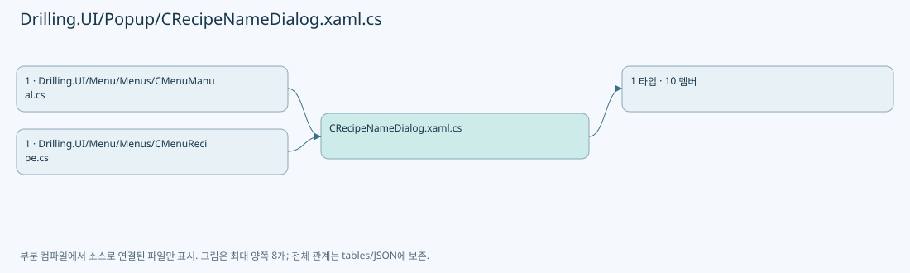
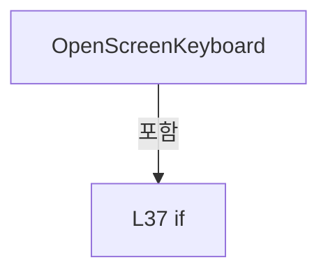
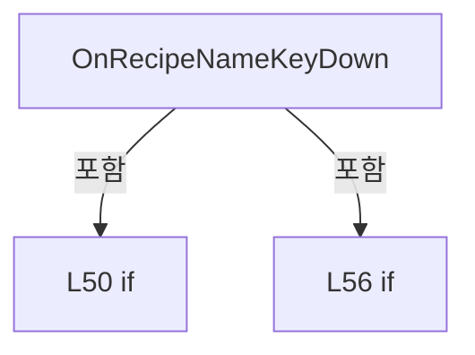

# Drilling.UI/Popup/CRecipeNameDialog.xaml.cs

| 항목 | 내용 |
| --- | --- |
| 원본 저장소 | https://github.com/kjuws10-rgb/A3Drilling.git |
| 원본 Commit | 5aee8e58439c9b455cae7c9593c9be986c3e682e |
| 원본 SHA256 | 07e9020cb1b26dcf10c4d0cb82ab83adfe413dc34237bd8668e954e2ed1d025b |
| 파일 분류 | code |
| 원본 크기/행 | 2,381 bytes / 79 physical lines |
| 인코딩 | utf-8-sig |
| 검토 범위 | 구문/부분 의미 분석에서 추출한 사실. 동작·물리 단위·실장비 합격을 보증하지 않습니다. |
| 원본 링크 | [고정 Commit 원본](https://github.com/kjuws10-rgb/A3Drilling/blob/5aee8e58439c9b455cae7c9593c9be986c3e682e/Drilling.UI/Popup/CRecipeNameDialog.xaml.cs) |

## 파일의 역할과 읽는 순서

WPF 화면·사용자 명령·표시 상태를 구성합니다. XAML 이벤트와 코드 비하인드, RootView의 조립 경로를 함께 추적합니다.

## 네임스페이스·타입·상속

| 타입 | 구분 | 원본 범위 | 선언/상속 |
| --- | --- | --- | --- |
| CRecipeNameDialog | ClassDeclaration | 6–79 | CRecipeNameDialog: Window |

## 멤버 빠른 목록

| 이름 | 종류 | 범위 | 서명 |
| --- | --- | --- | --- |
| _validate | FieldDeclaration | L8–8 | System.Func<string, string>? Drilling.UI.Popup.CRecipeNameDialog._validate |
| .ctor | ConstructorDeclaration | L9–20 | Drilling.UI.Popup.CRecipeNameDialog.CRecipeNameDialog(string, string, string, System.Func<string, string>?) |
| RecipeName | PropertyDeclaration | L22–28 | string Drilling.UI.Popup.CRecipeNameDialog.RecipeName |
| get_RecipeName | GetAccessorDeclaration | L24–27 | string Drilling.UI.Popup.CRecipeNameDialog.RecipeName.get |
| OpenScreenKeyboard | MethodDeclaration | L30–41 | void Drilling.UI.Popup.CRecipeNameDialog.OpenScreenKeyboard(object, MouseButtonEventArgs) |
| OnRecipeNameTextChanged | MethodDeclaration | L43–46 | void Drilling.UI.Popup.CRecipeNameDialog.OnRecipeNameTextChanged(object, System.Windows.Controls.TextChangedEventArgs) |
| OnRecipeNameKeyDown | MethodDeclaration | L48–60 | void Drilling.UI.Popup.CRecipeNameDialog.OnRecipeNameKeyDown(object, KeyEventArgs) |
| OnOkClicked | MethodDeclaration | L62–65 | void Drilling.UI.Popup.CRecipeNameDialog.OnOkClicked(object, RoutedEventArgs) |
| OnCancelClicked | MethodDeclaration | L67–70 | void Drilling.UI.Popup.CRecipeNameDialog.OnCancelClicked(object, RoutedEventArgs) |
| UpdateOkState | MethodDeclaration | L72–78 | void Drilling.UI.Popup.CRecipeNameDialog.UpdateOkState() |

## 멤버별 상세 계약·호출·처리 해설

### FieldDeclaration `_validate` · L8–8

[Drilling.UI/Popup/CRecipeNameDialog.xaml.cs:8–8](https://github.com/kjuws10-rgb/A3Drilling/blob/5aee8e58439c9b455cae7c9593c9be986c3e682e/Drilling.UI/Popup/CRecipeNameDialog.xaml.cs#L8-L8)

| 항목 | 실제 추출 값 |
| --- | --- |
| 서명 | System.Func<string, string>? Drilling.UI.Popup.CRecipeNameDialog._validate |
| 접근/수식자 | Private / private, readonly |
| 반환/값 타입 | System.Func<string, string>? |
| 소속 타입 | NamedType:Drilling.UI.Popup.CRecipeNameDialog |

현재 부분 분석에서 직접 연결된 호출자는 없습니다. XAML/이벤트/인터페이스·델리게이트·외부 진입을 추가 확인해야 하며, 미사용으로 판정한 것이 아닙니다.

변경 전 점검: 입력/반환 타입, 위 호출자, 예외/취소 경로, 공유 상태와 저장·전송 소비자를 함께 확인합니다. 값의 단위나 물리 방향을 이름만으로 확정하지 않습니다.

### ConstructorDeclaration `.ctor` · L9–20

[Drilling.UI/Popup/CRecipeNameDialog.xaml.cs:9–20](https://github.com/kjuws10-rgb/A3Drilling/blob/5aee8e58439c9b455cae7c9593c9be986c3e682e/Drilling.UI/Popup/CRecipeNameDialog.xaml.cs#L9-L20)

| 항목 | 실제 추출 값 |
| --- | --- |
| 서명 | Drilling.UI.Popup.CRecipeNameDialog.CRecipeNameDialog(string, string, string, System.Func<string, string>?) |
| 접근/수식자 | Public / public |
| 반환/값 타입 | void |
| 소속 타입 | NamedType:Drilling.UI.Popup.CRecipeNameDialog |

입력 계약:

| 이름 | 타입 | 전달 | 선택/기본값 |
| --- | --- | --- | --- |
| title | string | None | False /  |
| message | string | None | False /  |
| initialName | string | None | False /  |
| validate | System.Func<string, string>? | None | True / null |

정적 호출자로 확인된 위치:

| 호출 파일/행 | 호출 표현식 | 런타임 분기 가능 |
| --- | --- | --- |
| [Drilling.UI/Menu/Menus/CMenuManual.cs:6062–6065](https://github.com/kjuws10-rgb/A3Drilling/blob/5aee8e58439c9b455cae7c9593c9be986c3e682e/Drilling.UI/Menu/Menus/CMenuManual.cs#L6062-L6065) | new CRecipeNameDialog | False |
| [Drilling.UI/Menu/Menus/CMenuRecipe.cs:3102–3105](https://github.com/kjuws10-rgb/A3Drilling/blob/5aee8e58439c9b455cae7c9593c9be986c3e682e/Drilling.UI/Menu/Menus/CMenuRecipe.cs#L3102-L3105) | new CRecipeNameDialog | False |

호출하는 대상과 해석 범위:

| 원본 행 | 표현식 | 분석 상태 | 대상/소스 위치 |
| --- | --- | --- | --- |
| 11 | InitializeComponent | unresolved | None |
| 17 | RecipeNameTextBox.SelectAll | unresolved | None |
| 18 | RecipeNameTextBox.Focus | unresolved | None |
| 19 | UpdateOkState | resolved | void Drilling.UI.Popup.CRecipeNameDialog.UpdateOkState() · Drilling.UI/Popup/CRecipeNameDialog.xaml.cs:72 |

본문의 실제 연산·분기·예외·반환 순서(원문 위치 순):

| 원본 행 | 종류 | 주석 해설 |
| --- | --- | --- |
| 11 | call | 함수·델리게이트 또는 객체 생성자를 호출합니다: InitializeComponent() |
| 12 | assignment | 값을 대상에 대입합니다: _validate = validate |
| 13 | assignment | 값을 대상에 대입합니다: Title = title |
| 14 | assignment | 값을 대상에 대입합니다: TitleText.Text = title |
| 15 | assignment | 값을 대상에 대입합니다: MessageText.Text = message |
| 16 | assignment | 값을 대상에 대입합니다: RecipeNameTextBox.Text = initialName |
| 17 | call | 함수·델리게이트 또는 객체 생성자를 호출합니다: RecipeNameTextBox.SelectAll() |
| 18 | call | 함수·델리게이트 또는 객체 생성자를 호출합니다: RecipeNameTextBox.Focus() |
| 19 | call | 함수·델리게이트 또는 객체 생성자를 호출합니다: UpdateOkState() |

변경 전 점검: 입력/반환 타입, 위 호출자, 예외/취소 경로, 공유 상태와 저장·전송 소비자를 함께 확인합니다. 값의 단위나 물리 방향을 이름만으로 확정하지 않습니다.

### PropertyDeclaration `RecipeName` · L22–28

[Drilling.UI/Popup/CRecipeNameDialog.xaml.cs:22–28](https://github.com/kjuws10-rgb/A3Drilling/blob/5aee8e58439c9b455cae7c9593c9be986c3e682e/Drilling.UI/Popup/CRecipeNameDialog.xaml.cs#L22-L28)

| 항목 | 실제 추출 값 |
| --- | --- |
| 서명 | string Drilling.UI.Popup.CRecipeNameDialog.RecipeName |
| 접근/수식자 | Public / public |
| 반환/값 타입 | string |
| 소속 타입 | NamedType:Drilling.UI.Popup.CRecipeNameDialog |

현재 부분 분석에서 직접 연결된 호출자는 없습니다. XAML/이벤트/인터페이스·델리게이트·외부 진입을 추가 확인해야 하며, 미사용으로 판정한 것이 아닙니다.

변경 전 점검: 입력/반환 타입, 위 호출자, 예외/취소 경로, 공유 상태와 저장·전송 소비자를 함께 확인합니다. 값의 단위나 물리 방향을 이름만으로 확정하지 않습니다.

### GetAccessorDeclaration `get_RecipeName` · L24–27

[Drilling.UI/Popup/CRecipeNameDialog.xaml.cs:24–27](https://github.com/kjuws10-rgb/A3Drilling/blob/5aee8e58439c9b455cae7c9593c9be986c3e682e/Drilling.UI/Popup/CRecipeNameDialog.xaml.cs#L24-L27)

| 항목 | 실제 추출 값 |
| --- | --- |
| 서명 | string Drilling.UI.Popup.CRecipeNameDialog.RecipeName.get |
| 접근/수식자 | Public / get |
| 반환/값 타입 | string |
| 소속 타입 | NamedType:Drilling.UI.Popup.CRecipeNameDialog |

현재 부분 분석에서 직접 연결된 호출자는 없습니다. XAML/이벤트/인터페이스·델리게이트·외부 진입을 추가 확인해야 하며, 미사용으로 판정한 것이 아닙니다.

호출하는 대상과 해석 범위:

| 원본 행 | 표현식 | 분석 상태 | 대상/소스 위치 |
| --- | --- | --- | --- |
| 26 | RecipeNameTextBox.Text.Trim | unresolved | None |

본문의 실제 연산·분기·예외·반환 순서(원문 위치 순):

| 원본 행 | 종류 | 주석 해설 |
| --- | --- | --- |
| 26 | call | 함수·델리게이트 또는 객체 생성자를 호출합니다: RecipeNameTextBox.Text.Trim() |
| 26 | return | 호출자에게 값 또는 제어를 반환합니다: return RecipeNameTextBox.Text.Trim(); |

변경 전 점검: 입력/반환 타입, 위 호출자, 예외/취소 경로, 공유 상태와 저장·전송 소비자를 함께 확인합니다. 값의 단위나 물리 방향을 이름만으로 확정하지 않습니다.

### MethodDeclaration `OpenScreenKeyboard` · L30–41

[Drilling.UI/Popup/CRecipeNameDialog.xaml.cs:30–41](https://github.com/kjuws10-rgb/A3Drilling/blob/5aee8e58439c9b455cae7c9593c9be986c3e682e/Drilling.UI/Popup/CRecipeNameDialog.xaml.cs#L30-L41)

| 항목 | 실제 추출 값 |
| --- | --- |
| 서명 | void Drilling.UI.Popup.CRecipeNameDialog.OpenScreenKeyboard(object, MouseButtonEventArgs) |
| 접근/수식자 | Private / private |
| 반환/값 타입 | void |
| 소속 타입 | NamedType:Drilling.UI.Popup.CRecipeNameDialog |

입력 계약:

| 이름 | 타입 | 전달 | 선택/기본값 |
| --- | --- | --- | --- |
| sender | object | None | False /  |
| e | MouseButtonEventArgs | None | False /  |

현재 부분 분석에서 직접 연결된 호출자는 없습니다. XAML/이벤트/인터페이스·델리게이트·외부 진입을 추가 확인해야 하며, 미사용으로 판정한 것이 아닙니다.

호출하는 대상과 해석 범위:

| 원본 행 | 표현식 | 분석 상태 | 대상/소스 위치 |
| --- | --- | --- | --- |
| 33 | new CValueInputDialog | candidate | OverloadResolutionFailure |
| 37 | dialog.ShowDialog | unresolved | None |

본문의 실제 연산·분기·예외·반환 순서(원문 위치 순):

| 원본 행 | 종류 | 주석 해설 |
| --- | --- | --- |
| 32 | assignment | 값을 대상에 대입합니다: e.Handled = true |
| 33 | call | 함수·델리게이트 또는 객체 생성자를 호출합니다: new CValueInputDialog(TitleText.Text, RecipeNameTextBox.Text, EN_RECIPE_DATA_TYPE.String, 0, 0) { Owner = this } |
| 33 | local-declaration | 지역 변수를 선언합니다: var dialog = new CValueInputDialog(TitleText.Text, RecipeNameTextBox.Text, EN_RECIPE_DATA_TYPE.String, 0, 0) { Owner = this }; |
| 33 | variable-initializer | 변수의 초기값을 지정합니다: dialog = new CValueInputDialog(TitleText.Text, RecipeNameTextBox.Text, EN_RECIPE_DATA_TYPE.String, 0, 0) { Owner = this } |
| 35 | assignment | 값을 대상에 대입합니다: Owner = this |
| 37 | call | 함수·델리게이트 또는 객체 생성자를 호출합니다: dialog.ShowDialog() |
| 37 | if | 조건에 따라 분기합니다: if (dialog.ShowDialog() != true) |
| 38 | return | 호출자에게 값 또는 제어를 반환합니다: return; |
| 39 | assignment | 값을 대상에 대입합니다: RecipeNameTextBox.Text = dialog.ResultValue |
| 40 | assignment | 값을 대상에 대입합니다: RecipeNameTextBox.CaretIndex = RecipeNameTextBox.Text.Length |

제어 구문의 포함 구조(실제 실행 순서/CFG가 아닌 구문 탐색 그림):

변경 전 점검: 입력/반환 타입, 위 호출자, 예외/취소 경로, 공유 상태와 저장·전송 소비자를 함께 확인합니다. 값의 단위나 물리 방향을 이름만으로 확정하지 않습니다.

### MethodDeclaration `OnRecipeNameTextChanged` · L43–46

[Drilling.UI/Popup/CRecipeNameDialog.xaml.cs:43–46](https://github.com/kjuws10-rgb/A3Drilling/blob/5aee8e58439c9b455cae7c9593c9be986c3e682e/Drilling.UI/Popup/CRecipeNameDialog.xaml.cs#L43-L46)

| 항목 | 실제 추출 값 |
| --- | --- |
| 서명 | void Drilling.UI.Popup.CRecipeNameDialog.OnRecipeNameTextChanged(object, System.Windows.Controls.TextChangedEventArgs) |
| 접근/수식자 | Private / private |
| 반환/값 타입 | void |
| 소속 타입 | NamedType:Drilling.UI.Popup.CRecipeNameDialog |

입력 계약:

| 이름 | 타입 | 전달 | 선택/기본값 |
| --- | --- | --- | --- |
| sender | object | None | False /  |
| e | System.Windows.Controls.TextChangedEventArgs | None | False /  |

현재 부분 분석에서 직접 연결된 호출자는 없습니다. XAML/이벤트/인터페이스·델리게이트·외부 진입을 추가 확인해야 하며, 미사용으로 판정한 것이 아닙니다.

호출하는 대상과 해석 범위:

| 원본 행 | 표현식 | 분석 상태 | 대상/소스 위치 |
| --- | --- | --- | --- |
| 45 | UpdateOkState | resolved | void Drilling.UI.Popup.CRecipeNameDialog.UpdateOkState() · Drilling.UI/Popup/CRecipeNameDialog.xaml.cs:72 |

본문의 실제 연산·분기·예외·반환 순서(원문 위치 순):

| 원본 행 | 종류 | 주석 해설 |
| --- | --- | --- |
| 45 | call | 함수·델리게이트 또는 객체 생성자를 호출합니다: UpdateOkState() |

변경 전 점검: 입력/반환 타입, 위 호출자, 예외/취소 경로, 공유 상태와 저장·전송 소비자를 함께 확인합니다. 값의 단위나 물리 방향을 이름만으로 확정하지 않습니다.

### MethodDeclaration `OnRecipeNameKeyDown` · L48–60

[Drilling.UI/Popup/CRecipeNameDialog.xaml.cs:48–60](https://github.com/kjuws10-rgb/A3Drilling/blob/5aee8e58439c9b455cae7c9593c9be986c3e682e/Drilling.UI/Popup/CRecipeNameDialog.xaml.cs#L48-L60)

| 항목 | 실제 추출 값 |
| --- | --- |
| 서명 | void Drilling.UI.Popup.CRecipeNameDialog.OnRecipeNameKeyDown(object, KeyEventArgs) |
| 접근/수식자 | Private / private |
| 반환/값 타입 | void |
| 소속 타입 | NamedType:Drilling.UI.Popup.CRecipeNameDialog |

입력 계약:

| 이름 | 타입 | 전달 | 선택/기본값 |
| --- | --- | --- | --- |
| sender | object | None | False /  |
| e | KeyEventArgs | None | False /  |

현재 부분 분석에서 직접 연결된 호출자는 없습니다. XAML/이벤트/인터페이스·델리게이트·외부 진입을 추가 확인해야 하며, 미사용으로 판정한 것이 아닙니다.

본문의 실제 연산·분기·예외·반환 순서(원문 위치 순):

| 원본 행 | 종류 | 주석 해설 |
| --- | --- | --- |
| 50 | if | 조건에 따라 분기합니다: if (e.Key == Key.Enter && OkButton.IsEnabled) |
| 52 | assignment | 값을 대상에 대입합니다: DialogResult = true |
| 53 | return | 호출자에게 값 또는 제어를 반환합니다: return; |
| 56 | if | 조건에 따라 분기합니다: if (e.Key == Key.Escape) |
| 58 | assignment | 값을 대상에 대입합니다: DialogResult = false |

제어 구문의 포함 구조(실제 실행 순서/CFG가 아닌 구문 탐색 그림):

변경 전 점검: 입력/반환 타입, 위 호출자, 예외/취소 경로, 공유 상태와 저장·전송 소비자를 함께 확인합니다. 값의 단위나 물리 방향을 이름만으로 확정하지 않습니다.

### MethodDeclaration `OnOkClicked` · L62–65

[Drilling.UI/Popup/CRecipeNameDialog.xaml.cs:62–65](https://github.com/kjuws10-rgb/A3Drilling/blob/5aee8e58439c9b455cae7c9593c9be986c3e682e/Drilling.UI/Popup/CRecipeNameDialog.xaml.cs#L62-L65)

| 항목 | 실제 추출 값 |
| --- | --- |
| 서명 | void Drilling.UI.Popup.CRecipeNameDialog.OnOkClicked(object, RoutedEventArgs) |
| 접근/수식자 | Private / private |
| 반환/값 타입 | void |
| 소속 타입 | NamedType:Drilling.UI.Popup.CRecipeNameDialog |

입력 계약:

| 이름 | 타입 | 전달 | 선택/기본값 |
| --- | --- | --- | --- |
| sender | object | None | False /  |
| e | RoutedEventArgs | None | False /  |

현재 부분 분석에서 직접 연결된 호출자는 없습니다. XAML/이벤트/인터페이스·델리게이트·외부 진입을 추가 확인해야 하며, 미사용으로 판정한 것이 아닙니다.

본문의 실제 연산·분기·예외·반환 순서(원문 위치 순):

| 원본 행 | 종류 | 주석 해설 |
| --- | --- | --- |
| 64 | assignment | 값을 대상에 대입합니다: DialogResult = true |

변경 전 점검: 입력/반환 타입, 위 호출자, 예외/취소 경로, 공유 상태와 저장·전송 소비자를 함께 확인합니다. 값의 단위나 물리 방향을 이름만으로 확정하지 않습니다.

### MethodDeclaration `OnCancelClicked` · L67–70

[Drilling.UI/Popup/CRecipeNameDialog.xaml.cs:67–70](https://github.com/kjuws10-rgb/A3Drilling/blob/5aee8e58439c9b455cae7c9593c9be986c3e682e/Drilling.UI/Popup/CRecipeNameDialog.xaml.cs#L67-L70)

| 항목 | 실제 추출 값 |
| --- | --- |
| 서명 | void Drilling.UI.Popup.CRecipeNameDialog.OnCancelClicked(object, RoutedEventArgs) |
| 접근/수식자 | Private / private |
| 반환/값 타입 | void |
| 소속 타입 | NamedType:Drilling.UI.Popup.CRecipeNameDialog |

입력 계약:

| 이름 | 타입 | 전달 | 선택/기본값 |
| --- | --- | --- | --- |
| sender | object | None | False /  |
| e | RoutedEventArgs | None | False /  |

현재 부분 분석에서 직접 연결된 호출자는 없습니다. XAML/이벤트/인터페이스·델리게이트·외부 진입을 추가 확인해야 하며, 미사용으로 판정한 것이 아닙니다.

본문의 실제 연산·분기·예외·반환 순서(원문 위치 순):

| 원본 행 | 종류 | 주석 해설 |
| --- | --- | --- |
| 69 | assignment | 값을 대상에 대입합니다: DialogResult = false |

변경 전 점검: 입력/반환 타입, 위 호출자, 예외/취소 경로, 공유 상태와 저장·전송 소비자를 함께 확인합니다. 값의 단위나 물리 방향을 이름만으로 확정하지 않습니다.

### MethodDeclaration `UpdateOkState` · L72–78

[Drilling.UI/Popup/CRecipeNameDialog.xaml.cs:72–78](https://github.com/kjuws10-rgb/A3Drilling/blob/5aee8e58439c9b455cae7c9593c9be986c3e682e/Drilling.UI/Popup/CRecipeNameDialog.xaml.cs#L72-L78)

| 항목 | 실제 추출 값 |
| --- | --- |
| 서명 | void Drilling.UI.Popup.CRecipeNameDialog.UpdateOkState() |
| 접근/수식자 | Private / private |
| 반환/값 타입 | void |
| 소속 타입 | NamedType:Drilling.UI.Popup.CRecipeNameDialog |

정적 호출자로 확인된 위치:

| 호출 파일/행 | 호출 표현식 | 런타임 분기 가능 |
| --- | --- | --- |
| [Drilling.UI/Popup/CRecipeNameDialog.xaml.cs:19–19](https://github.com/kjuws10-rgb/A3Drilling/blob/5aee8e58439c9b455cae7c9593c9be986c3e682e/Drilling.UI/Popup/CRecipeNameDialog.xaml.cs#L19-L19) | UpdateOkState | False |
| [Drilling.UI/Popup/CRecipeNameDialog.xaml.cs:45–45](https://github.com/kjuws10-rgb/A3Drilling/blob/5aee8e58439c9b455cae7c9593c9be986c3e682e/Drilling.UI/Popup/CRecipeNameDialog.xaml.cs#L45-L45) | UpdateOkState | False |

호출하는 대상과 해석 범위:

| 원본 행 | 표현식 | 분석 상태 | 대상/소스 위치 |
| --- | --- | --- | --- |
| 74 | .Invoke | candidate | OverloadResolutionFailure |
| 74 | RecipeNameTextBox.Text.Trim | unresolved | None |
| 74 | string.IsNullOrWhiteSpace | candidate | OverloadResolutionFailure |
| 76 | string.IsNullOrWhiteSpace | candidate | OverloadResolutionFailure |
| 77 | string.IsNullOrWhiteSpace | candidate | OverloadResolutionFailure |

본문의 실제 연산·분기·예외·반환 순서(원문 위치 순):

| 원본 행 | 종류 | 주석 해설 |
| --- | --- | --- |
| 74 | call | 함수·델리게이트 또는 객체 생성자를 호출합니다: .Invoke(RecipeNameTextBox.Text.Trim()) |
| 74 | call | 함수·델리게이트 또는 객체 생성자를 호출합니다: RecipeNameTextBox.Text.Trim() |
| 74 | call | 함수·델리게이트 또는 객체 생성자를 호출합니다: string.IsNullOrWhiteSpace(RecipeNameTextBox.Text) |
| 74 | conditional-expression | 조건에 따라 결과식을 선택합니다: string.IsNullOrWhiteSpace(RecipeNameTextBox.Text) ? "이름을 입력하세요." : "" |
| 74 | local-declaration | 지역 변수를 선언합니다: var message = _validate?.Invoke(RecipeNameTextBox.Text.Trim()) ?? (string.IsNullOrWhiteSpace(RecipeNameTextBox.Text) ? "이름을 입력하세요." : ""); |
| 74 | variable-initializer | 변수의 초기값을 지정합니다: message = _validate?.Invoke(RecipeNameTextBox.Text.Trim()) ?? (string.IsNullOrWhiteSpace(RecipeNameTextBox.Text) ? "이름을 입력하세요." : "") |
| 75 | assignment | 값을 대상에 대입합니다: ErrorText.Text = message |
| 76 | assignment | 값을 대상에 대입합니다: ErrorText.Visibility = string.IsNullOrWhiteSpace(message) ? Visibility.Collapsed : Visibility.Visible |
| 76 | call | 함수·델리게이트 또는 객체 생성자를 호출합니다: string.IsNullOrWhiteSpace(message) |
| 76 | conditional-expression | 조건에 따라 결과식을 선택합니다: string.IsNullOrWhiteSpace(message) ? Visibility.Collapsed : Visibility.Visible |
| 77 | assignment | 값을 대상에 대입합니다: OkButton.IsEnabled = string.IsNullOrWhiteSpace(message) |
| 77 | call | 함수·델리게이트 또는 객체 생성자를 호출합니다: string.IsNullOrWhiteSpace(message) |

변경 전 점검: 입력/반환 타입, 위 호출자, 예외/취소 경로, 공유 상태와 저장·전송 소비자를 함께 확인합니다. 값의 단위나 물리 방향을 이름만으로 확정하지 않습니다.

## 구문·바인딩 한계

전체 WPF/벤더 SDK/프로젝트별 빌드 조건을 로드한 정식 빌드가 아닙니다. `resolved`는 이 부분 컴파일에서의 심볼 연결이며 virtual/interface/delegate/이벤트/Reflection/XAML의 실제 런타임 구현을 확정하지 않습니다. `candidate`와 `unresolved`는 후속 확인 대상으로 남깁니다.

## 원문 전체 주석 해설본

[원본 모든 행과 행별 해설 보기](../../../annotated/Drilling.UI/Popup/CRecipeNameDialog.xaml.cs.annotated.txt)

원본을 빠뜨리거나 임의로 줄이지 않았습니다. `L000001 |` 표시는 원본 행 번호, `// 해설`은 별도 설명입니다. 실행용 소스가 아닌 문서입니다.

## 수정·재검증 체크

- 원본 Commit과 현재 작업 파일 SHA가 같은지 먼저 확인합니다. 다르면 이 문서를 과거 버전 자료로 취급합니다.
- 선언·직접 호출·이벤트/인터페이스 경계·설정 소비를 함께 확인합니다. 정적 연결의 빈 곳을 정상 경로로 추정하지 않습니다.
- 저장 형식/단위/식별자·재시도·취소·예외·롤백에 영향을 주는 변경은 상세 해설장과 호출자를 다시 검토합니다.
- 도구의 구문 추출과 별도 정적 추적 해설, 실제 빌드·시뮬레이션·실장비 검증 결과를 분리합니다.
