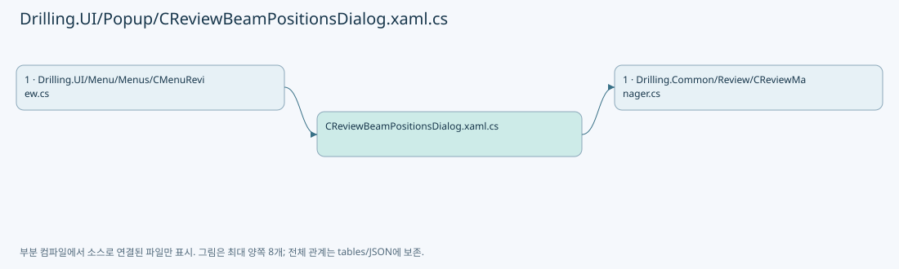

# Drilling.UI/Popup/CReviewBeamPositionsDialog.xaml.cs

| 항목 | 내용 |
| --- | --- |
| 원본 저장소 | https://github.com/kjuws10-rgb/A3Drilling.git |
| 원본 Commit | 5aee8e58439c9b455cae7c9593c9be986c3e682e |
| 원본 SHA256 | 025172aa31a59f231db8dfa4b13a88f8bc31075b8683c145a8784a2471839c97 |
| 파일 분류 | code |
| 원본 크기/행 | 1,261 bytes / 29 physical lines |
| 인코딩 | utf-8-sig |
| 검토 범위 | 구문/부분 의미 분석에서 추출한 사실. 동작·물리 단위·실장비 합격을 보증하지 않습니다. |
| 원본 링크 | [고정 Commit 원본](https://github.com/kjuws10-rgb/A3Drilling/blob/5aee8e58439c9b455cae7c9593c9be986c3e682e/Drilling.UI/Popup/CReviewBeamPositionsDialog.xaml.cs) |

## 파일의 역할과 읽는 순서

WPF 화면·사용자 명령·표시 상태를 구성합니다. XAML 이벤트와 코드 비하인드, RootView의 조립 경로를 함께 추적합니다.

## 네임스페이스·타입·상속

| 타입 | 구분 | 원본 범위 | 선언/상속 |
| --- | --- | --- | --- |
| CReviewBeamPositionsDialog | ClassDeclaration | 7–22 | CReviewBeamPositionsDialog: Window |
| ST_REVIEW_BEAM_POSITION_ITEM | ClassDeclaration | 24–29 | ST_REVIEW_BEAM_POSITION_ITEM |

## 멤버 빠른 목록

| 이름 | 종류 | 범위 | 서명 |
| --- | --- | --- | --- |
| GridSize | PropertyDeclaration | L9–9 | int Drilling.UI.Popup.CReviewBeamPositionsDialog.GridSize |
| get_GridSize | GetAccessorDeclaration | L9–9 | int Drilling.UI.Popup.CReviewBeamPositionsDialog.GridSize.get |
| .ctor | ConstructorDeclaration | L11–19 | Drilling.UI.Popup.CReviewBeamPositionsDialog.CReviewBeamPositionsDialog(Drilling.Common.Review.ST_REVIEW_PLAN_POINT, System.Collections.Generic.IReadOnlyList<Drilling.Common.Review.ST_REVIEW_BEAM_POSITION>) |
| OnCloseClicked | MethodDeclaration | L21–21 | void Drilling.UI.Popup.CReviewBeamPositionsDialog.OnCloseClicked(object, RoutedEventArgs) |
| BeamNo | PropertyDeclaration | L26–26 | int Drilling.UI.Popup.ST_REVIEW_BEAM_POSITION_ITEM.BeamNo |
| StageYText | PropertyDeclaration | L27–27 | string Drilling.UI.Popup.ST_REVIEW_BEAM_POSITION_ITEM.StageYText |
| ReviewXText | PropertyDeclaration | L28–28 | string Drilling.UI.Popup.ST_REVIEW_BEAM_POSITION_ITEM.ReviewXText |

## 멤버별 상세 계약·호출·처리 해설

### PropertyDeclaration `GridSize` · L9–9

[Drilling.UI/Popup/CReviewBeamPositionsDialog.xaml.cs:9–9](https://github.com/kjuws10-rgb/A3Drilling/blob/5aee8e58439c9b455cae7c9593c9be986c3e682e/Drilling.UI/Popup/CReviewBeamPositionsDialog.xaml.cs#L9-L9)

| 항목 | 실제 추출 값 |
| --- | --- |
| 서명 | int Drilling.UI.Popup.CReviewBeamPositionsDialog.GridSize |
| 접근/수식자 | Public / public |
| 반환/값 타입 | int |
| 소속 타입 | NamedType:Drilling.UI.Popup.CReviewBeamPositionsDialog |

현재 부분 분석에서 직접 연결된 호출자는 없습니다. XAML/이벤트/인터페이스·델리게이트·외부 진입을 추가 확인해야 하며, 미사용으로 판정한 것이 아닙니다.

변경 전 점검: 입력/반환 타입, 위 호출자, 예외/취소 경로, 공유 상태와 저장·전송 소비자를 함께 확인합니다. 값의 단위나 물리 방향을 이름만으로 확정하지 않습니다.

### GetAccessorDeclaration `get_GridSize` · L9–9

[Drilling.UI/Popup/CReviewBeamPositionsDialog.xaml.cs:9–9](https://github.com/kjuws10-rgb/A3Drilling/blob/5aee8e58439c9b455cae7c9593c9be986c3e682e/Drilling.UI/Popup/CReviewBeamPositionsDialog.xaml.cs#L9-L9)

| 항목 | 실제 추출 값 |
| --- | --- |
| 서명 | int Drilling.UI.Popup.CReviewBeamPositionsDialog.GridSize.get |
| 접근/수식자 | Public / get |
| 반환/값 타입 | int |
| 소속 타입 | NamedType:Drilling.UI.Popup.CReviewBeamPositionsDialog |

현재 부분 분석에서 직접 연결된 호출자는 없습니다. XAML/이벤트/인터페이스·델리게이트·외부 진입을 추가 확인해야 하며, 미사용으로 판정한 것이 아닙니다.

변경 전 점검: 입력/반환 타입, 위 호출자, 예외/취소 경로, 공유 상태와 저장·전송 소비자를 함께 확인합니다. 값의 단위나 물리 방향을 이름만으로 확정하지 않습니다.

### ConstructorDeclaration `.ctor` · L11–19

[Drilling.UI/Popup/CReviewBeamPositionsDialog.xaml.cs:11–19](https://github.com/kjuws10-rgb/A3Drilling/blob/5aee8e58439c9b455cae7c9593c9be986c3e682e/Drilling.UI/Popup/CReviewBeamPositionsDialog.xaml.cs#L11-L19)

| 항목 | 실제 추출 값 |
| --- | --- |
| 서명 | Drilling.UI.Popup.CReviewBeamPositionsDialog.CReviewBeamPositionsDialog(Drilling.Common.Review.ST_REVIEW_PLAN_POINT, System.Collections.Generic.IReadOnlyList<Drilling.Common.Review.ST_REVIEW_BEAM_POSITION>) |
| 접근/수식자 | Public / public |
| 반환/값 타입 | void |
| 소속 타입 | NamedType:Drilling.UI.Popup.CReviewBeamPositionsDialog |

입력 계약:

| 이름 | 타입 | 전달 | 선택/기본값 |
| --- | --- | --- | --- |
| point | Drilling.Common.Review.ST_REVIEW_PLAN_POINT | None | False /  |
| positions | System.Collections.Generic.IReadOnlyList<Drilling.Common.Review.ST_REVIEW_BEAM_POSITION> | None | False /  |

정적 호출자로 확인된 위치:

| 호출 파일/행 | 호출 표현식 | 런타임 분기 가능 |
| --- | --- | --- |
| [Drilling.UI/Menu/Menus/CMenuReview.cs:2349–2352](https://github.com/kjuws10-rgb/A3Drilling/blob/5aee8e58439c9b455cae7c9593c9be986c3e682e/Drilling.UI/Menu/Menus/CMenuReview.cs#L2349-L2352) | new CReviewBeamPositionsDialog | False |

호출하는 대상과 해석 범위:

| 원본 행 | 표현식 | 분석 상태 | 대상/소스 위치 |
| --- | --- | --- | --- |
| 13 | Math.Ceiling | resolved | double System.Math.Ceiling(double) |
| 13 | Math.Sqrt | resolved | double System.Math.Sqrt(double) |
| 14 | InitializeComponent | unresolved | None |
| 17 | CReviewShotNameFormatter.ToMatrixName | resolved | string Drilling.Common.Review.CReviewShotNameFormatter.ToMatrixName(int, int) · Drilling.Common/Review/CReviewManager.cs:3897 |
| 18 | positions.Select(position => new ST_REVIEW_BEAM_POSITION_ITEM(position)).ToArray | resolved | Drilling.UI.Popup.ST_REVIEW_BEAM_POSITION_ITEM[] System.Collections.Generic.IEnumerable<Drilling.UI.Popup.ST_REVIEW_BEAM_POSITION_ITEM>.ToArray<Drilling.UI.Popup.ST_REVIEW_BEAM_POSITION_ITEM>() |
| 18 | positions.Select | resolved | System.Collections.Generic.IEnumerable<Drilling.UI.Popup.ST_REVIEW_BEAM_POSITION_ITEM> System.Collections.Generic.IEnumerable<Drilling.Common.Review.ST_REVIEW_BEAM_POSITION>.Select<Drilling.Common.Review.ST_REVIEW_BEAM_POSITION, Drilling.UI.Popup.ST_REVIEW_BEAM_POSITION_ITEM>(System.Func<Drilling.Common.Review.ST_REVIEW_BEAM_POSITION, Drilling.UI.Popup.ST_REVIEW_BEAM_POSITION_ITEM>) |
| 18 | new ST_REVIEW_BEAM_POSITION_ITEM | resolved | Drilling.UI.Popup.ST_REVIEW_BEAM_POSITION_ITEM.ST_REVIEW_BEAM_POSITION_ITEM(Drilling.Common.Review.ST_REVIEW_BEAM_POSITION) · Drilling.UI/Popup/CReviewBeamPositionsDialog.xaml.cs:24 |

본문의 실제 연산·분기·예외·반환 순서(원문 위치 순):

| 원본 행 | 종류 | 주석 해설 |
| --- | --- | --- |
| 13 | assignment | 값을 대상에 대입합니다: GridSize = (int)Math.Ceiling(Math.Sqrt(positions.Count)) |
| 13 | call | 함수·델리게이트 또는 객체 생성자를 호출합니다: Math.Ceiling(Math.Sqrt(positions.Count)) |
| 13 | call | 함수·델리게이트 또는 객체 생성자를 호출합니다: Math.Sqrt(positions.Count) |
| 14 | call | 함수·델리게이트 또는 객체 생성자를 호출합니다: InitializeComponent() |
| 15 | assignment | 값을 대상에 대입합니다: DataContext = this |
| 16 | conditional-expression | 조건에 따라 결과식을 선택합니다: point.HeadNo > 0 ? $"HEAD {point.HeadNo:00}" : "HEAD 미할당" |
| 16 | local-declaration | 지역 변수를 선언합니다: var head = point.HeadNo > 0 ? $"HEAD {point.HeadNo:00}" : "HEAD 미할당"; |
| 16 | variable-initializer | 변수의 초기값을 지정합니다: head = point.HeadNo > 0 ? $"HEAD {point.HeadNo:00}" : "HEAD 미할당" |
| 17 | assignment | 값을 대상에 대입합니다: ShotSummaryText.Text = $"{head} · CELL {point.CellNo:00} · Shot {CReviewShotNameFormatter.ToMatrixName(point.ShotNo, point.PixelCountX)} · 목표 위치" |
| 17 | call | 함수·델리게이트 또는 객체 생성자를 호출합니다: CReviewShotNameFormatter.ToMatrixName(point.ShotNo, point.PixelCountX) |
| 18 | assignment | 값을 대상에 대입합니다: BeamItems.ItemsSource = positions.Select(position => new ST_REVIEW_BEAM_POSITION_ITEM(position)).ToArray() |
| 18 | call | 함수·델리게이트 또는 객체 생성자를 호출합니다: positions.Select(position => new ST_REVIEW_BEAM_POSITION_ITEM(position)).ToArray() |
| 18 | call | 함수·델리게이트 또는 객체 생성자를 호출합니다: positions.Select(position => new ST_REVIEW_BEAM_POSITION_ITEM(position)) |
| 18 | call | 함수·델리게이트 또는 객체 생성자를 호출합니다: new ST_REVIEW_BEAM_POSITION_ITEM(position) |

변경 전 점검: 입력/반환 타입, 위 호출자, 예외/취소 경로, 공유 상태와 저장·전송 소비자를 함께 확인합니다. 값의 단위나 물리 방향을 이름만으로 확정하지 않습니다.

### MethodDeclaration `OnCloseClicked` · L21–21

[Drilling.UI/Popup/CReviewBeamPositionsDialog.xaml.cs:21–21](https://github.com/kjuws10-rgb/A3Drilling/blob/5aee8e58439c9b455cae7c9593c9be986c3e682e/Drilling.UI/Popup/CReviewBeamPositionsDialog.xaml.cs#L21-L21)

| 항목 | 실제 추출 값 |
| --- | --- |
| 서명 | void Drilling.UI.Popup.CReviewBeamPositionsDialog.OnCloseClicked(object, RoutedEventArgs) |
| 접근/수식자 | Private / private |
| 반환/값 타입 | void |
| 소속 타입 | NamedType:Drilling.UI.Popup.CReviewBeamPositionsDialog |

입력 계약:

| 이름 | 타입 | 전달 | 선택/기본값 |
| --- | --- | --- | --- |
| sender | object | None | False /  |
| e | RoutedEventArgs | None | False /  |

현재 부분 분석에서 직접 연결된 호출자는 없습니다. XAML/이벤트/인터페이스·델리게이트·외부 진입을 추가 확인해야 하며, 미사용으로 판정한 것이 아닙니다.

호출하는 대상과 해석 범위:

| 원본 행 | 표현식 | 분석 상태 | 대상/소스 위치 |
| --- | --- | --- | --- |
| 21 | Close | unresolved | None |

본문의 실제 연산·분기·예외·반환 순서(원문 위치 순):

| 원본 행 | 종류 | 주석 해설 |
| --- | --- | --- |
| 21 | call | 함수·델리게이트 또는 객체 생성자를 호출합니다: Close() |

변경 전 점검: 입력/반환 타입, 위 호출자, 예외/취소 경로, 공유 상태와 저장·전송 소비자를 함께 확인합니다. 값의 단위나 물리 방향을 이름만으로 확정하지 않습니다.

### PropertyDeclaration `BeamNo` · L26–26

[Drilling.UI/Popup/CReviewBeamPositionsDialog.xaml.cs:26–26](https://github.com/kjuws10-rgb/A3Drilling/blob/5aee8e58439c9b455cae7c9593c9be986c3e682e/Drilling.UI/Popup/CReviewBeamPositionsDialog.xaml.cs#L26-L26)

| 항목 | 실제 추출 값 |
| --- | --- |
| 서명 | int Drilling.UI.Popup.ST_REVIEW_BEAM_POSITION_ITEM.BeamNo |
| 접근/수식자 | Public / public |
| 반환/값 타입 | int |
| 소속 타입 | NamedType:Drilling.UI.Popup.ST_REVIEW_BEAM_POSITION_ITEM |

현재 부분 분석에서 직접 연결된 호출자는 없습니다. XAML/이벤트/인터페이스·델리게이트·외부 진입을 추가 확인해야 하며, 미사용으로 판정한 것이 아닙니다.

변경 전 점검: 입력/반환 타입, 위 호출자, 예외/취소 경로, 공유 상태와 저장·전송 소비자를 함께 확인합니다. 값의 단위나 물리 방향을 이름만으로 확정하지 않습니다.

### PropertyDeclaration `StageYText` · L27–27

[Drilling.UI/Popup/CReviewBeamPositionsDialog.xaml.cs:27–27](https://github.com/kjuws10-rgb/A3Drilling/blob/5aee8e58439c9b455cae7c9593c9be986c3e682e/Drilling.UI/Popup/CReviewBeamPositionsDialog.xaml.cs#L27-L27)

| 항목 | 실제 추출 값 |
| --- | --- |
| 서명 | string Drilling.UI.Popup.ST_REVIEW_BEAM_POSITION_ITEM.StageYText |
| 접근/수식자 | Public / public |
| 반환/값 타입 | string |
| 소속 타입 | NamedType:Drilling.UI.Popup.ST_REVIEW_BEAM_POSITION_ITEM |

현재 부분 분석에서 직접 연결된 호출자는 없습니다. XAML/이벤트/인터페이스·델리게이트·외부 진입을 추가 확인해야 하며, 미사용으로 판정한 것이 아닙니다.

호출하는 대상과 해석 범위:

| 원본 행 | 표현식 | 분석 상태 | 대상/소스 위치 |
| --- | --- | --- | --- |
| 27 | position.StageY.ToString | resolved | string double.ToString(string?, System.IFormatProvider?) |

본문의 실제 연산·분기·예외·반환 순서(원문 위치 순):

| 원본 행 | 종류 | 주석 해설 |
| --- | --- | --- |
| 27 | call | 함수·델리게이트 또는 객체 생성자를 호출합니다: position.StageY.ToString("0.0000", CultureInfo.InvariantCulture) |

변경 전 점검: 입력/반환 타입, 위 호출자, 예외/취소 경로, 공유 상태와 저장·전송 소비자를 함께 확인합니다. 값의 단위나 물리 방향을 이름만으로 확정하지 않습니다.

### PropertyDeclaration `ReviewXText` · L28–28

[Drilling.UI/Popup/CReviewBeamPositionsDialog.xaml.cs:28–28](https://github.com/kjuws10-rgb/A3Drilling/blob/5aee8e58439c9b455cae7c9593c9be986c3e682e/Drilling.UI/Popup/CReviewBeamPositionsDialog.xaml.cs#L28-L28)

| 항목 | 실제 추출 값 |
| --- | --- |
| 서명 | string Drilling.UI.Popup.ST_REVIEW_BEAM_POSITION_ITEM.ReviewXText |
| 접근/수식자 | Public / public |
| 반환/값 타입 | string |
| 소속 타입 | NamedType:Drilling.UI.Popup.ST_REVIEW_BEAM_POSITION_ITEM |

현재 부분 분석에서 직접 연결된 호출자는 없습니다. XAML/이벤트/인터페이스·델리게이트·외부 진입을 추가 확인해야 하며, 미사용으로 판정한 것이 아닙니다.

호출하는 대상과 해석 범위:

| 원본 행 | 표현식 | 분석 상태 | 대상/소스 위치 |
| --- | --- | --- | --- |
| 28 | position.ReviewX.ToString | resolved | string double.ToString(string?, System.IFormatProvider?) |

본문의 실제 연산·분기·예외·반환 순서(원문 위치 순):

| 원본 행 | 종류 | 주석 해설 |
| --- | --- | --- |
| 28 | call | 함수·델리게이트 또는 객체 생성자를 호출합니다: position.ReviewX.ToString("0.0000", CultureInfo.InvariantCulture) |

변경 전 점검: 입력/반환 타입, 위 호출자, 예외/취소 경로, 공유 상태와 저장·전송 소비자를 함께 확인합니다. 값의 단위나 물리 방향을 이름만으로 확정하지 않습니다.

## 구문·바인딩 한계

전체 WPF/벤더 SDK/프로젝트별 빌드 조건을 로드한 정식 빌드가 아닙니다. `resolved`는 이 부분 컴파일에서의 심볼 연결이며 virtual/interface/delegate/이벤트/Reflection/XAML의 실제 런타임 구현을 확정하지 않습니다. `candidate`와 `unresolved`는 후속 확인 대상으로 남깁니다.

## 원문 전체 주석 해설본

[원본 모든 행과 행별 해설 보기](../../../annotated/Drilling.UI/Popup/CReviewBeamPositionsDialog.xaml.cs.annotated.txt)

원본을 빠뜨리거나 임의로 줄이지 않았습니다. `L000001 |` 표시는 원본 행 번호, `// 해설`은 별도 설명입니다. 실행용 소스가 아닌 문서입니다.

## 수정·재검증 체크

- 원본 Commit과 현재 작업 파일 SHA가 같은지 먼저 확인합니다. 다르면 이 문서를 과거 버전 자료로 취급합니다.
- 선언·직접 호출·이벤트/인터페이스 경계·설정 소비를 함께 확인합니다. 정적 연결의 빈 곳을 정상 경로로 추정하지 않습니다.
- 저장 형식/단위/식별자·재시도·취소·예외·롤백에 영향을 주는 변경은 상세 해설장과 호출자를 다시 검토합니다.
- 도구의 구문 추출과 별도 정적 추적 해설, 실제 빌드·시뮬레이션·실장비 검증 결과를 분리합니다.
