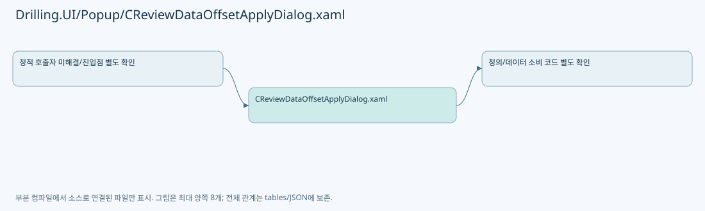

# Drilling.UI/Popup/CReviewDataOffsetApplyDialog.xaml

| 항목 | 내용 |
| --- | --- |
| 원본 저장소 | https://github.com/kjuws10-rgb/A3Drilling.git |
| 원본 Commit | 0219666f9053b907d96d7e0aa7d0c6c1be3a73d4 |
| 원본 SHA256 | 2c7fe317bf108c2ea5d9e3cbc89132690a183d78c070a2bbdd9bc26a30bd1faa |
| 파일 분류 | code |
| 원본 크기/행 | 25,028 bytes / 369 physical lines |
| 인코딩 | utf-8-sig |
| 검토 범위 | 구문/부분 의미 분석에서 추출한 사실. 동작·물리 단위·실장비 합격을 보증하지 않습니다. |
| 원본 링크 | [고정 Commit 원본](https://github.com/kjuws10-rgb/A3Drilling/blob/0219666f9053b907d96d7e0aa7d0c6c1be3a73d4/Drilling.UI/Popup/CReviewDataOffsetApplyDialog.xaml) |

## 파일의 역할과 읽는 순서

WPF 화면·사용자 명령·표시 상태를 구성합니다. XAML 이벤트와 코드 비하인드, RootView의 조립 경로를 함께 추적합니다.

## 화면 구성과 코드 비하인드 연결

| 항목 | 추출 값 |
| --- | --- |
| 코드 비하인드 후보 | Drilling.UI/Popup/CReviewDataOffsetApplyDialog.xaml.cs |
| 이름 있는 요소 | OffsetPreviewGrid |
| 이벤트 개수 | 5 |
| Binding 표현 개수 | 39 |

이름 있는 요소는 WPF가 필드를 생성할 수 있는 XAML 선언입니다. 문서 추출기는 WPF 생성 코드를 만들거나 로드하지 않으므로 C# 원문 멤버 수에 합산하지 않습니다.

| 요소 이름 | 원본 범위 |
| --- | --- |
| OffsetPreviewGrid | L273–273 |

| 이벤트 | 핸들러 이름 | 원본 범위 | 해석 |
| --- | --- | --- | --- |
| KeyDown | OnKeyDown | L11–11 | 코드 비하인드/이벤트 라우팅에서 실제 연결 확인 필요 |
| MouseLeftButtonDown | ShotMap_MouseLeftButtonDown | L246–246 | 코드 비하인드/이벤트 라우팅에서 실제 연결 확인 필요 |
| SelectionChanged | OffsetPreviewGrid_SelectionChanged | L293–293 | 코드 비하인드/이벤트 라우팅에서 실제 연결 확인 필요 |
| Click | SaveClicked | L358–358 | 코드 비하인드/이벤트 라우팅에서 실제 연결 확인 필요 |
| Click | CancelClicked | L365–365 | 코드 비하인드/이벤트 라우팅에서 실제 연결 확인 필요 |

| Binding 표현 | 원본 범위 |
| --- | --- |
| {Binding IsIncluded} | L38–38 |
| {Binding IsSelected} | L43–43 |
| {Binding ApplicationTypes} | L115–115 |
| {Binding SelectedApplicationType, Mode=OneWay} | L116–116 |
| {Binding SelectedApplicationType.Detail} | L122–122 |
| {Binding RecipeName, StringFormat='RECIPE : {0}'} | L128–128 |
| {Binding ResultFileName} | L129–129 |
| {Binding ResultFileName} | L129–129 |
| {Binding GlassSurfaceWidth} | L174–174 |
| {Binding GlassSurfaceHeight} | L174–174 |
| {Binding GlassPreviewImage} | L175–175 |
| {Binding CellLabels} | L176–176 |
| {Binding Left} | L182–182 |
| {Binding Top} | L183–183 |
| {Binding Width} | L188–188 |
| {Binding Height} | L189–189 |
| {Binding CellNo} | L190–190 |
| {Binding IsIncluded} | L191–191 |
| {Binding DataContext.SelectCellCommand, RelativeSource={RelativeSource AncestorType=Window}} | L193–193 |
| {Binding CellNo} | L194–194 |
| {Binding SelectedCellTitle} | L217–217 |
| {Binding ShotMapSurfaceWidth} | L242–242 |
| {Binding ShotMapSurfaceHeight} | L243–243 |
| {Binding ShotMapImage} | L247–247 |
| {Binding Summary} | L268–268 |
| {Binding SelectedShotTitle} | L271–271 |
| {Binding Rows} | L275–275 |
| {Binding SelectedRow, Mode=OneWay} | L276–276 |
| {Binding RelativeSource={RelativeSource AncestorType=DataGridRow}, Path=Foreground} | L314–314 |
| {Binding Head} | L319–319 |
| {Binding Cell} | L320–320 |
| {Binding ShotName} | L321–321 |
| {Binding CurrentXText} | L322–322 |
| {Binding CurrentYText} | L324–324 |
| {Binding AddXText} | L326–326 |
| {Binding AddYText} | L328–328 |
| {Binding FinalXText} | L330–330 |
| {Binding FinalYText} | L332–332 |
| {Binding CanSave} | L356–356 |

## 원문 전체 주석 해설본

[원본 모든 행과 행별 해설 보기](../../../annotated/Drilling.UI/Popup/CReviewDataOffsetApplyDialog.xaml.annotated.txt)

원본을 빠뜨리거나 임의로 줄이지 않았습니다. `L000001 |` 표시는 원본 행 번호, `// 해설`은 별도 설명입니다. 실행용 소스가 아닌 문서입니다.

## 수정·재검증 체크

- 원본 Commit과 현재 작업 파일 SHA가 같은지 먼저 확인합니다. 다르면 이 문서를 과거 버전 자료로 취급합니다.
- 선언·직접 호출·이벤트/인터페이스 경계·설정 소비를 함께 확인합니다. 정적 연결의 빈 곳을 정상 경로로 추정하지 않습니다.
- 저장 형식/단위/식별자·재시도·취소·예외·롤백에 영향을 주는 변경은 상세 해설장과 호출자를 다시 검토합니다.
- 도구의 구문 추출과 별도 정적 추적 해설, 실제 빌드·시뮬레이션·실장비 검증 결과를 분리합니다.
