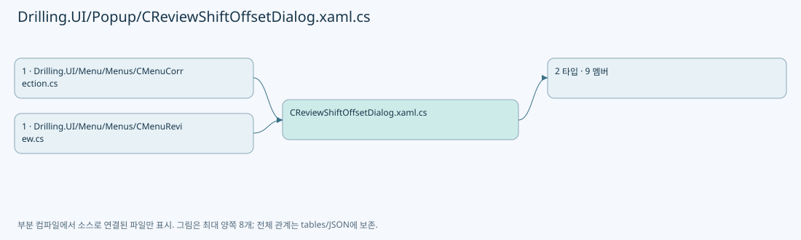

# Drilling.UI/Popup/CReviewShiftOffsetDialog.xaml.cs

| 항목 | 내용 |
| --- | --- |
| 원본 저장소 | https://github.com/kjuws10-rgb/A3Drilling.git |
| 원본 Commit | 5aee8e58439c9b455cae7c9593c9be986c3e682e |
| 원본 SHA256 | 6f961d1de43a787ad7de42be1b0f4d0e0347b2f0a8c1b44bbda57c9a57f65a2d |
| 파일 분류 | code |
| 원본 크기/행 | 1,708 bytes / 54 physical lines |
| 인코딩 | utf-8-sig |
| 검토 범위 | 구문/부분 의미 분석에서 추출한 사실. 동작·물리 단위·실장비 합격을 보증하지 않습니다. |
| 원본 링크 | [고정 Commit 원본](https://github.com/kjuws10-rgb/A3Drilling/blob/5aee8e58439c9b455cae7c9593c9be986c3e682e/Drilling.UI/Popup/CReviewShiftOffsetDialog.xaml.cs) |

## 파일의 역할과 읽는 순서

WPF 화면·사용자 명령·표시 상태를 구성합니다. XAML 이벤트와 코드 비하인드, RootView의 조립 경로를 함께 추적합니다.

## 네임스페이스·타입·상속

| 타입 | 구분 | 원본 범위 | 선언/상속 |
| --- | --- | --- | --- |
| EN_REVIEW_SHIFT_OFFSET_CHOICE | EnumDeclaration | 7–12 | EN_REVIEW_SHIFT_OFFSET_CHOICE |
| CReviewShiftOffsetDialog | ClassDeclaration | 14–54 | CReviewShiftOffsetDialog: Window |

## 멤버 빠른 목록

| 이름 | 종류 | 범위 | 서명 |
| --- | --- | --- | --- |
| Cancel | EnumMemberDeclaration | L9–9 | Drilling.UI.Popup.EN_REVIEW_SHIFT_OFFSET_CHOICE.Cancel |
| Apply | EnumMemberDeclaration | L10–10 | Drilling.UI.Popup.EN_REVIEW_SHIFT_OFFSET_CHOICE.Apply |
| WithoutShift | EnumMemberDeclaration | L11–11 | Drilling.UI.Popup.EN_REVIEW_SHIFT_OFFSET_CHOICE.WithoutShift |
| _choice | FieldDeclaration | L16–16 | Drilling.UI.Popup.EN_REVIEW_SHIFT_OFFSET_CHOICE Drilling.UI.Popup.CReviewShiftOffsetDialog._choice |
| .ctor | ConstructorDeclaration | L18–25 | Drilling.UI.Popup.CReviewShiftOffsetDialog.CReviewShiftOffsetDialog(Drilling.Common.Station.ST_MANUAL_MOF_COMPLETION, string) |
| Show | MethodDeclaration | L27–35 | Drilling.UI.Popup.EN_REVIEW_SHIFT_OFFSET_CHOICE Drilling.UI.Popup.CReviewShiftOffsetDialog.Show(Drilling.Common.Station.ST_MANUAL_MOF_COMPLETION, string) |
| OnApplyClicked | MethodDeclaration | L37–41 | void Drilling.UI.Popup.CReviewShiftOffsetDialog.OnApplyClicked(object, RoutedEventArgs) |
| OnWithoutShiftClicked | MethodDeclaration | L43–47 | void Drilling.UI.Popup.CReviewShiftOffsetDialog.OnWithoutShiftClicked(object, RoutedEventArgs) |
| OnCancelClicked | MethodDeclaration | L49–53 | void Drilling.UI.Popup.CReviewShiftOffsetDialog.OnCancelClicked(object, RoutedEventArgs) |

## 멤버별 상세 계약·호출·처리 해설

### EnumMemberDeclaration `Cancel` · L9–9

[Drilling.UI/Popup/CReviewShiftOffsetDialog.xaml.cs:9–9](https://github.com/kjuws10-rgb/A3Drilling/blob/5aee8e58439c9b455cae7c9593c9be986c3e682e/Drilling.UI/Popup/CReviewShiftOffsetDialog.xaml.cs#L9-L9)

| 항목 | 실제 추출 값 |
| --- | --- |
| 서명 | Drilling.UI.Popup.EN_REVIEW_SHIFT_OFFSET_CHOICE.Cancel |
| 접근/수식자 | Public /  |
| 반환/값 타입 | Drilling.UI.Popup.EN_REVIEW_SHIFT_OFFSET_CHOICE |
| 소속 타입 | NamedType:Drilling.UI.Popup.EN_REVIEW_SHIFT_OFFSET_CHOICE |

현재 부분 분석에서 직접 연결된 호출자는 없습니다. XAML/이벤트/인터페이스·델리게이트·외부 진입을 추가 확인해야 하며, 미사용으로 판정한 것이 아닙니다.

변경 전 점검: 입력/반환 타입, 위 호출자, 예외/취소 경로, 공유 상태와 저장·전송 소비자를 함께 확인합니다. 값의 단위나 물리 방향을 이름만으로 확정하지 않습니다.

### EnumMemberDeclaration `Apply` · L10–10

[Drilling.UI/Popup/CReviewShiftOffsetDialog.xaml.cs:10–10](https://github.com/kjuws10-rgb/A3Drilling/blob/5aee8e58439c9b455cae7c9593c9be986c3e682e/Drilling.UI/Popup/CReviewShiftOffsetDialog.xaml.cs#L10-L10)

| 항목 | 실제 추출 값 |
| --- | --- |
| 서명 | Drilling.UI.Popup.EN_REVIEW_SHIFT_OFFSET_CHOICE.Apply |
| 접근/수식자 | Public /  |
| 반환/값 타입 | Drilling.UI.Popup.EN_REVIEW_SHIFT_OFFSET_CHOICE |
| 소속 타입 | NamedType:Drilling.UI.Popup.EN_REVIEW_SHIFT_OFFSET_CHOICE |

현재 부분 분석에서 직접 연결된 호출자는 없습니다. XAML/이벤트/인터페이스·델리게이트·외부 진입을 추가 확인해야 하며, 미사용으로 판정한 것이 아닙니다.

변경 전 점검: 입력/반환 타입, 위 호출자, 예외/취소 경로, 공유 상태와 저장·전송 소비자를 함께 확인합니다. 값의 단위나 물리 방향을 이름만으로 확정하지 않습니다.

### EnumMemberDeclaration `WithoutShift` · L11–11

[Drilling.UI/Popup/CReviewShiftOffsetDialog.xaml.cs:11–11](https://github.com/kjuws10-rgb/A3Drilling/blob/5aee8e58439c9b455cae7c9593c9be986c3e682e/Drilling.UI/Popup/CReviewShiftOffsetDialog.xaml.cs#L11-L11)

| 항목 | 실제 추출 값 |
| --- | --- |
| 서명 | Drilling.UI.Popup.EN_REVIEW_SHIFT_OFFSET_CHOICE.WithoutShift |
| 접근/수식자 | Public /  |
| 반환/값 타입 | Drilling.UI.Popup.EN_REVIEW_SHIFT_OFFSET_CHOICE |
| 소속 타입 | NamedType:Drilling.UI.Popup.EN_REVIEW_SHIFT_OFFSET_CHOICE |

현재 부분 분석에서 직접 연결된 호출자는 없습니다. XAML/이벤트/인터페이스·델리게이트·외부 진입을 추가 확인해야 하며, 미사용으로 판정한 것이 아닙니다.

변경 전 점검: 입력/반환 타입, 위 호출자, 예외/취소 경로, 공유 상태와 저장·전송 소비자를 함께 확인합니다. 값의 단위나 물리 방향을 이름만으로 확정하지 않습니다.

### FieldDeclaration `_choice` · L16–16

[Drilling.UI/Popup/CReviewShiftOffsetDialog.xaml.cs:16–16](https://github.com/kjuws10-rgb/A3Drilling/blob/5aee8e58439c9b455cae7c9593c9be986c3e682e/Drilling.UI/Popup/CReviewShiftOffsetDialog.xaml.cs#L16-L16)

| 항목 | 실제 추출 값 |
| --- | --- |
| 서명 | Drilling.UI.Popup.EN_REVIEW_SHIFT_OFFSET_CHOICE Drilling.UI.Popup.CReviewShiftOffsetDialog._choice |
| 접근/수식자 | Private / private |
| 반환/값 타입 | Drilling.UI.Popup.EN_REVIEW_SHIFT_OFFSET_CHOICE |
| 소속 타입 | NamedType:Drilling.UI.Popup.CReviewShiftOffsetDialog |

현재 부분 분석에서 직접 연결된 호출자는 없습니다. XAML/이벤트/인터페이스·델리게이트·외부 진입을 추가 확인해야 하며, 미사용으로 판정한 것이 아닙니다.

본문의 실제 연산·분기·예외·반환 순서(원문 위치 순):

| 원본 행 | 종류 | 주석 해설 |
| --- | --- | --- |
| 16 | variable-initializer | 변수의 초기값을 지정합니다: _choice = EN_REVIEW_SHIFT_OFFSET_CHOICE.Cancel |

변경 전 점검: 입력/반환 타입, 위 호출자, 예외/취소 경로, 공유 상태와 저장·전송 소비자를 함께 확인합니다. 값의 단위나 물리 방향을 이름만으로 확정하지 않습니다.

### ConstructorDeclaration `.ctor` · L18–25

[Drilling.UI/Popup/CReviewShiftOffsetDialog.xaml.cs:18–25](https://github.com/kjuws10-rgb/A3Drilling/blob/5aee8e58439c9b455cae7c9593c9be986c3e682e/Drilling.UI/Popup/CReviewShiftOffsetDialog.xaml.cs#L18-L25)

| 항목 | 실제 추출 값 |
| --- | --- |
| 서명 | Drilling.UI.Popup.CReviewShiftOffsetDialog.CReviewShiftOffsetDialog(Drilling.Common.Station.ST_MANUAL_MOF_COMPLETION, string) |
| 접근/수식자 | Private / private |
| 반환/값 타입 | void |
| 소속 타입 | NamedType:Drilling.UI.Popup.CReviewShiftOffsetDialog |

입력 계약:

| 이름 | 타입 | 전달 | 선택/기본값 |
| --- | --- | --- | --- |
| completion | Drilling.Common.Station.ST_MANUAL_MOF_COMPLETION | None | False /  |
| context | string | None | False /  |

정적 호출자로 확인된 위치:

| 호출 파일/행 | 호출 표현식 | 런타임 분기 가능 |
| --- | --- | --- |
| [Drilling.UI/Popup/CReviewShiftOffsetDialog.xaml.cs:29–32](https://github.com/kjuws10-rgb/A3Drilling/blob/5aee8e58439c9b455cae7c9593c9be986c3e682e/Drilling.UI/Popup/CReviewShiftOffsetDialog.xaml.cs#L29-L32) | new CReviewShiftOffsetDialog | False |

호출하는 대상과 해석 범위:

| 원본 행 | 표현식 | 분석 상태 | 대상/소스 위치 |
| --- | --- | --- | --- |
| 20 | InitializeComponent | unresolved | None |
| 22 | completion.CompletedAt.ToLocalTime().ToString | resolved | string System.DateTimeOffset.ToString(string?, System.IFormatProvider?) |
| 22 | completion.CompletedAt.ToLocalTime | resolved | System.DateTimeOffset System.DateTimeOffset.ToLocalTime() |

본문의 실제 연산·분기·예외·반환 순서(원문 위치 순):

| 원본 행 | 종류 | 주석 해설 |
| --- | --- | --- |
| 20 | call | 함수·델리게이트 또는 객체 생성자를 호출합니다: InitializeComponent() |
| 21 | assignment | 값을 대상에 대입합니다: ContextText.Text = context |
| 22 | assignment | 값을 대상에 대입합니다: CompletedAtText.Text = completion.CompletedAt.ToLocalTime().ToString("yyyy-MM-dd HH:mm:ss", CultureInfo.InvariantCulture) |
| 22 | call | 함수·델리게이트 또는 객체 생성자를 호출합니다: completion.CompletedAt.ToLocalTime().ToString("yyyy-MM-dd HH:mm:ss", CultureInfo.InvariantCulture) |
| 22 | call | 함수·델리게이트 또는 객체 생성자를 호출합니다: completion.CompletedAt.ToLocalTime() |
| 23 | assignment | 값을 대상에 대입합니다: ShiftXText.Text = $"{completion.ShiftOffsetX:+0.000000;-0.000000;0.000000} mm" |
| 24 | assignment | 값을 대상에 대입합니다: ShiftYText.Text = $"{completion.ShiftOffsetY:+0.000000;-0.000000;0.000000} mm" |

변경 전 점검: 입력/반환 타입, 위 호출자, 예외/취소 경로, 공유 상태와 저장·전송 소비자를 함께 확인합니다. 값의 단위나 물리 방향을 이름만으로 확정하지 않습니다.

### MethodDeclaration `Show` · L27–35

[Drilling.UI/Popup/CReviewShiftOffsetDialog.xaml.cs:27–35](https://github.com/kjuws10-rgb/A3Drilling/blob/5aee8e58439c9b455cae7c9593c9be986c3e682e/Drilling.UI/Popup/CReviewShiftOffsetDialog.xaml.cs#L27-L35)

| 항목 | 실제 추출 값 |
| --- | --- |
| 서명 | Drilling.UI.Popup.EN_REVIEW_SHIFT_OFFSET_CHOICE Drilling.UI.Popup.CReviewShiftOffsetDialog.Show(Drilling.Common.Station.ST_MANUAL_MOF_COMPLETION, string) |
| 접근/수식자 | Public / public, static |
| 반환/값 타입 | Drilling.UI.Popup.EN_REVIEW_SHIFT_OFFSET_CHOICE |
| 소속 타입 | NamedType:Drilling.UI.Popup.CReviewShiftOffsetDialog |

입력 계약:

| 이름 | 타입 | 전달 | 선택/기본값 |
| --- | --- | --- | --- |
| completion | Drilling.Common.Station.ST_MANUAL_MOF_COMPLETION | None | False /  |
| context | string | None | False /  |

정적 호출자로 확인된 위치:

| 호출 파일/행 | 호출 표현식 | 런타임 분기 가능 |
| --- | --- | --- |
| [Drilling.UI/Menu/Menus/CMenuCorrection.cs:199–199](https://github.com/kjuws10-rgb/A3Drilling/blob/5aee8e58439c9b455cae7c9593c9be986c3e682e/Drilling.UI/Menu/Menus/CMenuCorrection.cs#L199-L199) | CReviewShiftOffsetDialog.Show | False |
| [Drilling.UI/Menu/Menus/CMenuReview.cs:2042–2042](https://github.com/kjuws10-rgb/A3Drilling/blob/5aee8e58439c9b455cae7c9593c9be986c3e682e/Drilling.UI/Menu/Menus/CMenuReview.cs#L2042-L2042) | CReviewShiftOffsetDialog.Show | False |

호출하는 대상과 해석 범위:

| 원본 행 | 표현식 | 분석 상태 | 대상/소스 위치 |
| --- | --- | --- | --- |
| 29 | new CReviewShiftOffsetDialog | resolved | Drilling.UI.Popup.CReviewShiftOffsetDialog.CReviewShiftOffsetDialog(Drilling.Common.Station.ST_MANUAL_MOF_COMPLETION, string) · Drilling.UI/Popup/CReviewShiftOffsetDialog.xaml.cs:18 |
| 33 | dialog.ShowDialog | unresolved | None |

본문의 실제 연산·분기·예외·반환 순서(원문 위치 순):

| 원본 행 | 종류 | 주석 해설 |
| --- | --- | --- |
| 29 | call | 함수·델리게이트 또는 객체 생성자를 호출합니다: new CReviewShiftOffsetDialog(completion, context) { Owner = Application.Current?.MainWindow } |
| 29 | local-declaration | 지역 변수를 선언합니다: var dialog = new CReviewShiftOffsetDialog(completion, context) { Owner = Application.Current?.MainWindow }; |
| 29 | variable-initializer | 변수의 초기값을 지정합니다: dialog = new CReviewShiftOffsetDialog(completion, context) { Owner = Application.Current?.MainWindow } |
| 31 | assignment | 값을 대상에 대입합니다: Owner = Application.Current?.MainWindow |
| 33 | call | 함수·델리게이트 또는 객체 생성자를 호출합니다: dialog.ShowDialog() |
| 34 | return | 호출자에게 값 또는 제어를 반환합니다: return dialog._choice; |

변경 전 점검: 입력/반환 타입, 위 호출자, 예외/취소 경로, 공유 상태와 저장·전송 소비자를 함께 확인합니다. 값의 단위나 물리 방향을 이름만으로 확정하지 않습니다.

### MethodDeclaration `OnApplyClicked` · L37–41

[Drilling.UI/Popup/CReviewShiftOffsetDialog.xaml.cs:37–41](https://github.com/kjuws10-rgb/A3Drilling/blob/5aee8e58439c9b455cae7c9593c9be986c3e682e/Drilling.UI/Popup/CReviewShiftOffsetDialog.xaml.cs#L37-L41)

| 항목 | 실제 추출 값 |
| --- | --- |
| 서명 | void Drilling.UI.Popup.CReviewShiftOffsetDialog.OnApplyClicked(object, RoutedEventArgs) |
| 접근/수식자 | Private / private |
| 반환/값 타입 | void |
| 소속 타입 | NamedType:Drilling.UI.Popup.CReviewShiftOffsetDialog |

입력 계약:

| 이름 | 타입 | 전달 | 선택/기본값 |
| --- | --- | --- | --- |
| sender | object | None | False /  |
| e | RoutedEventArgs | None | False /  |

현재 부분 분석에서 직접 연결된 호출자는 없습니다. XAML/이벤트/인터페이스·델리게이트·외부 진입을 추가 확인해야 하며, 미사용으로 판정한 것이 아닙니다.

본문의 실제 연산·분기·예외·반환 순서(원문 위치 순):

| 원본 행 | 종류 | 주석 해설 |
| --- | --- | --- |
| 39 | assignment | 값을 대상에 대입합니다: _choice = EN_REVIEW_SHIFT_OFFSET_CHOICE.Apply |
| 40 | assignment | 값을 대상에 대입합니다: DialogResult = true |

변경 전 점검: 입력/반환 타입, 위 호출자, 예외/취소 경로, 공유 상태와 저장·전송 소비자를 함께 확인합니다. 값의 단위나 물리 방향을 이름만으로 확정하지 않습니다.

### MethodDeclaration `OnWithoutShiftClicked` · L43–47

[Drilling.UI/Popup/CReviewShiftOffsetDialog.xaml.cs:43–47](https://github.com/kjuws10-rgb/A3Drilling/blob/5aee8e58439c9b455cae7c9593c9be986c3e682e/Drilling.UI/Popup/CReviewShiftOffsetDialog.xaml.cs#L43-L47)

| 항목 | 실제 추출 값 |
| --- | --- |
| 서명 | void Drilling.UI.Popup.CReviewShiftOffsetDialog.OnWithoutShiftClicked(object, RoutedEventArgs) |
| 접근/수식자 | Private / private |
| 반환/값 타입 | void |
| 소속 타입 | NamedType:Drilling.UI.Popup.CReviewShiftOffsetDialog |

입력 계약:

| 이름 | 타입 | 전달 | 선택/기본값 |
| --- | --- | --- | --- |
| sender | object | None | False /  |
| e | RoutedEventArgs | None | False /  |

현재 부분 분석에서 직접 연결된 호출자는 없습니다. XAML/이벤트/인터페이스·델리게이트·외부 진입을 추가 확인해야 하며, 미사용으로 판정한 것이 아닙니다.

본문의 실제 연산·분기·예외·반환 순서(원문 위치 순):

| 원본 행 | 종류 | 주석 해설 |
| --- | --- | --- |
| 45 | assignment | 값을 대상에 대입합니다: _choice = EN_REVIEW_SHIFT_OFFSET_CHOICE.WithoutShift |
| 46 | assignment | 값을 대상에 대입합니다: DialogResult = true |

변경 전 점검: 입력/반환 타입, 위 호출자, 예외/취소 경로, 공유 상태와 저장·전송 소비자를 함께 확인합니다. 값의 단위나 물리 방향을 이름만으로 확정하지 않습니다.

### MethodDeclaration `OnCancelClicked` · L49–53

[Drilling.UI/Popup/CReviewShiftOffsetDialog.xaml.cs:49–53](https://github.com/kjuws10-rgb/A3Drilling/blob/5aee8e58439c9b455cae7c9593c9be986c3e682e/Drilling.UI/Popup/CReviewShiftOffsetDialog.xaml.cs#L49-L53)

| 항목 | 실제 추출 값 |
| --- | --- |
| 서명 | void Drilling.UI.Popup.CReviewShiftOffsetDialog.OnCancelClicked(object, RoutedEventArgs) |
| 접근/수식자 | Private / private |
| 반환/값 타입 | void |
| 소속 타입 | NamedType:Drilling.UI.Popup.CReviewShiftOffsetDialog |

입력 계약:

| 이름 | 타입 | 전달 | 선택/기본값 |
| --- | --- | --- | --- |
| sender | object | None | False /  |
| e | RoutedEventArgs | None | False /  |

현재 부분 분석에서 직접 연결된 호출자는 없습니다. XAML/이벤트/인터페이스·델리게이트·외부 진입을 추가 확인해야 하며, 미사용으로 판정한 것이 아닙니다.

본문의 실제 연산·분기·예외·반환 순서(원문 위치 순):

| 원본 행 | 종류 | 주석 해설 |
| --- | --- | --- |
| 51 | assignment | 값을 대상에 대입합니다: _choice = EN_REVIEW_SHIFT_OFFSET_CHOICE.Cancel |
| 52 | assignment | 값을 대상에 대입합니다: DialogResult = false |

변경 전 점검: 입력/반환 타입, 위 호출자, 예외/취소 경로, 공유 상태와 저장·전송 소비자를 함께 확인합니다. 값의 단위나 물리 방향을 이름만으로 확정하지 않습니다.

## 구문·바인딩 한계

전체 WPF/벤더 SDK/프로젝트별 빌드 조건을 로드한 정식 빌드가 아닙니다. `resolved`는 이 부분 컴파일에서의 심볼 연결이며 virtual/interface/delegate/이벤트/Reflection/XAML의 실제 런타임 구현을 확정하지 않습니다. `candidate`와 `unresolved`는 후속 확인 대상으로 남깁니다.

## 원문 전체 주석 해설본

[원본 모든 행과 행별 해설 보기](../../../annotated/Drilling.UI/Popup/CReviewShiftOffsetDialog.xaml.cs.annotated.txt)

원본을 빠뜨리거나 임의로 줄이지 않았습니다. `L000001 |` 표시는 원본 행 번호, `// 해설`은 별도 설명입니다. 실행용 소스가 아닌 문서입니다.

## 수정·재검증 체크

- 원본 Commit과 현재 작업 파일 SHA가 같은지 먼저 확인합니다. 다르면 이 문서를 과거 버전 자료로 취급합니다.
- 선언·직접 호출·이벤트/인터페이스 경계·설정 소비를 함께 확인합니다. 정적 연결의 빈 곳을 정상 경로로 추정하지 않습니다.
- 저장 형식/단위/식별자·재시도·취소·예외·롤백에 영향을 주는 변경은 상세 해설장과 호출자를 다시 검토합니다.
- 도구의 구문 추출과 별도 정적 추적 해설, 실제 빌드·시뮬레이션·실장비 검증 결과를 분리합니다.
