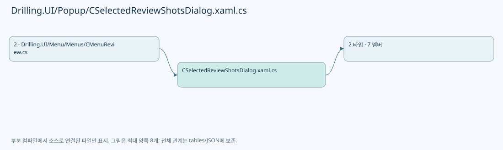

# Drilling.UI/Popup/CSelectedReviewShotsDialog.xaml.cs

| 항목 | 내용 |
| --- | --- |
| 원본 저장소 | https://github.com/kjuws10-rgb/A3Drilling.git |
| 원본 Commit | 5aee8e58439c9b455cae7c9593c9be986c3e682e |
| 원본 SHA256 | ab5577450474404f94f346ec8745af3cb5e4df29128302c486e0a6de450d2298 |
| 파일 분류 | code |
| 원본 크기/행 | 1,585 bytes / 34 physical lines |
| 인코딩 | utf-8-sig |
| 검토 범위 | 구문/부분 의미 분석에서 추출한 사실. 동작·물리 단위·실장비 합격을 보증하지 않습니다. |
| 원본 링크 | [고정 Commit 원본](https://github.com/kjuws10-rgb/A3Drilling/blob/5aee8e58439c9b455cae7c9593c9be986c3e682e/Drilling.UI/Popup/CSelectedReviewShotsDialog.xaml.cs) |

## 파일의 역할과 읽는 순서

WPF 화면·사용자 명령·표시 상태를 구성합니다. XAML 이벤트와 코드 비하인드, RootView의 조립 경로를 함께 추적합니다.

## 네임스페이스·타입·상속

| 타입 | 구분 | 원본 범위 | 선언/상속 |
| --- | --- | --- | --- |
| CSelectedReviewShotsDialog | ClassDeclaration | 6–27 | CSelectedReviewShotsDialog: Window |
| ST_REVIEW_SELECTED_SHOT_ROW | RecordDeclaration | 29–34 | ST_REVIEW_SELECTED_SHOT_ROW |

## 멤버 빠른 목록

| 이름 | 종류 | 범위 | 서명 |
| --- | --- | --- | --- |
| .ctor | ConstructorDeclaration | L8–24 | Drilling.UI.Popup.CSelectedReviewShotsDialog.CSelectedReviewShotsDialog(System.Collections.Generic.IReadOnlyList<Drilling.UI.Popup.ST_REVIEW_SELECTED_SHOT_ROW>, int) |
| OnCloseClicked | MethodDeclaration | L26–26 | void Drilling.UI.Popup.CSelectedReviewShotsDialog.OnCloseClicked(object, RoutedEventArgs) |
| IsEmpty | PropertyDeclaration | L31–31 | bool Drilling.UI.Popup.ST_REVIEW_SELECTED_SHOT_ROW.IsEmpty |
| get_IsEmpty | GetAccessorDeclaration | L31–31 | bool Drilling.UI.Popup.ST_REVIEW_SELECTED_SHOT_ROW.IsEmpty.get |
| set_IsEmpty | InitAccessorDeclaration | L31–31 | void Drilling.UI.Popup.ST_REVIEW_SELECTED_SHOT_ROW.IsEmpty.init |
| Head | PropertyDeclaration | L32–32 | string Drilling.UI.Popup.ST_REVIEW_SELECTED_SHOT_ROW.Head |
| Cell | PropertyDeclaration | L33–33 | string Drilling.UI.Popup.ST_REVIEW_SELECTED_SHOT_ROW.Cell |

## 멤버별 상세 계약·호출·처리 해설

### ConstructorDeclaration `.ctor` · L8–24

[Drilling.UI/Popup/CSelectedReviewShotsDialog.xaml.cs:8–24](https://github.com/kjuws10-rgb/A3Drilling/blob/5aee8e58439c9b455cae7c9593c9be986c3e682e/Drilling.UI/Popup/CSelectedReviewShotsDialog.xaml.cs#L8-L24)

| 항목 | 실제 추출 값 |
| --- | --- |
| 서명 | Drilling.UI.Popup.CSelectedReviewShotsDialog.CSelectedReviewShotsDialog(System.Collections.Generic.IReadOnlyList<Drilling.UI.Popup.ST_REVIEW_SELECTED_SHOT_ROW>, int) |
| 접근/수식자 | Public / public |
| 반환/값 타입 | void |
| 소속 타입 | NamedType:Drilling.UI.Popup.CSelectedReviewShotsDialog |

입력 계약:

| 이름 | 타입 | 전달 | 선택/기본값 |
| --- | --- | --- | --- |
| rows | System.Collections.Generic.IReadOnlyList<Drilling.UI.Popup.ST_REVIEW_SELECTED_SHOT_ROW> | None | False /  |
| headCount | int | None | False /  |

정적 호출자로 확인된 위치:

| 호출 파일/행 | 호출 표현식 | 런타임 분기 가능 |
| --- | --- | --- |
| [Drilling.UI/Menu/Menus/CMenuReview.cs:2374–2377](https://github.com/kjuws10-rgb/A3Drilling/blob/5aee8e58439c9b455cae7c9593c9be986c3e682e/Drilling.UI/Menu/Menus/CMenuReview.cs#L2374-L2377) | new CSelectedReviewShotsDialog | False |

호출하는 대상과 해석 범위:

| 원본 행 | 표현식 | 분석 상태 | 대상/소스 위치 |
| --- | --- | --- | --- |
| 10 | InitializeComponent | unresolved | None |
| 11 | rows.Select(row => row.HeadNo).ToHashSet | resolved | System.Collections.Generic.HashSet<int> System.Collections.Generic.IEnumerable<int>.ToHashSet<int>() |
| 11 | rows.Select | resolved | System.Collections.Generic.IEnumerable<int> System.Collections.Generic.IEnumerable<Drilling.UI.Popup.ST_REVIEW_SELECTED_SHOT_ROW>.Select<Drilling.UI.Popup.ST_REVIEW_SELECTED_SHOT_ROW, int>(System.Func<Drilling.UI.Popup.ST_REVIEW_SELECTED_SHOT_ROW, int>) |
| 12 | rows.Concat(Enumerable.Range(1, headCount) .Where(headNo => !selectedHeads.Contains(headNo)) .Select(headNo => new ST_REVIEW_SELECTED_SHOT_ROW(headNo, 0, 0, "선택된 Shot 없음") { IsEmpty = true })) .OrderBy(row => row.HeadNo > 0 ? row.HeadNo : int.MaxValue) .ThenBy(row => row.CellNo) .ThenBy(row => row.ShotNo) .ToArray | resolved | Drilling.UI.Popup.ST_REVIEW_SELECTED_SHOT_ROW[] System.Collections.Generic.IEnumerable<Drilling.UI.Popup.ST_REVIEW_SELECTED_SHOT_ROW>.ToArray<Drilling.UI.Popup.ST_REVIEW_SELECTED_SHOT_ROW>() |
| 12 | rows.Concat(Enumerable.Range(1, headCount) .Where(headNo => !selectedHeads.Contains(headNo)) .Select(headNo => new ST_REVIEW_SELECTED_SHOT_ROW(headNo, 0, 0, "선택된 Shot 없음") { IsEmpty = true })) .OrderBy(row => row.HeadNo > 0 ? row.HeadNo : int.MaxValue) .ThenBy(row => row.CellNo) .ThenBy | resolved | System.Linq.IOrderedEnumerable<Drilling.UI.Popup.ST_REVIEW_SELECTED_SHOT_ROW> System.Linq.IOrderedEnumerable<Drilling.UI.Popup.ST_REVIEW_SELECTED_SHOT_ROW>.ThenBy<Drilling.UI.Popup.ST_REVIEW_SELECTED_SHOT_ROW, int>(System.Func<Drilling.UI.Popup.ST_REVIEW_SELECTED_SHOT_ROW, int>) |
| 12 | rows.Concat(Enumerable.Range(1, headCount) .Where(headNo => !selectedHeads.Contains(headNo)) .Select(headNo => new ST_REVIEW_SELECTED_SHOT_ROW(headNo, 0, 0, "선택된 Shot 없음") { IsEmpty = true })) .OrderBy(row => row.HeadNo > 0 ? row.HeadNo : int.MaxValue) .ThenBy | resolved | System.Linq.IOrderedEnumerable<Drilling.UI.Popup.ST_REVIEW_SELECTED_SHOT_ROW> System.Linq.IOrderedEnumerable<Drilling.UI.Popup.ST_REVIEW_SELECTED_SHOT_ROW>.ThenBy<Drilling.UI.Popup.ST_REVIEW_SELECTED_SHOT_ROW, int>(System.Func<Drilling.UI.Popup.ST_REVIEW_SELECTED_SHOT_ROW, int>) |
| 12 | rows.Concat(Enumerable.Range(1, headCount) .Where(headNo => !selectedHeads.Contains(headNo)) .Select(headNo => new ST_REVIEW_SELECTED_SHOT_ROW(headNo, 0, 0, "선택된 Shot 없음") { IsEmpty = true })) .OrderBy | resolved | System.Linq.IOrderedEnumerable<Drilling.UI.Popup.ST_REVIEW_SELECTED_SHOT_ROW> System.Collections.Generic.IEnumerable<Drilling.UI.Popup.ST_REVIEW_SELECTED_SHOT_ROW>.OrderBy<Drilling.UI.Popup.ST_REVIEW_SELECTED_SHOT_ROW, int>(System.Func<Drilling.UI.Popup.ST_REVIEW_SELECTED_SHOT_ROW, int>) |
| 12 | rows.Concat | resolved | System.Collections.Generic.IEnumerable<Drilling.UI.Popup.ST_REVIEW_SELECTED_SHOT_ROW> System.Collections.Generic.IEnumerable<Drilling.UI.Popup.ST_REVIEW_SELECTED_SHOT_ROW>.Concat<Drilling.UI.Popup.ST_REVIEW_SELECTED_SHOT_ROW>(System.Collections.Generic.IEnumerable<Drilling.UI.Popup.ST_REVIEW_SELECTED_SHOT_ROW>) |
| 12 | Enumerable.Range(1, headCount) .Where(headNo => !selectedHeads.Contains(headNo)) .Select | resolved | System.Collections.Generic.IEnumerable<Drilling.UI.Popup.ST_REVIEW_SELECTED_SHOT_ROW> System.Collections.Generic.IEnumerable<int>.Select<int, Drilling.UI.Popup.ST_REVIEW_SELECTED_SHOT_ROW>(System.Func<int, Drilling.UI.Popup.ST_REVIEW_SELECTED_SHOT_ROW>) |
| 12 | Enumerable.Range(1, headCount) .Where | resolved | System.Collections.Generic.IEnumerable<int> System.Collections.Generic.IEnumerable<int>.Where<int>(System.Func<int, bool>) |
| 12 | Enumerable.Range | resolved | System.Collections.Generic.IEnumerable<int> System.Linq.Enumerable.Range(int, int) |
| 13 | selectedHeads.Contains | resolved | bool System.Collections.Generic.HashSet<int>.Contains(int) |
| 14 | new ST_REVIEW_SELECTED_SHOT_ROW | resolved | Drilling.UI.Popup.ST_REVIEW_SELECTED_SHOT_ROW.ST_REVIEW_SELECTED_SHOT_ROW(int, int, int, string) · Drilling.UI/Popup/CSelectedReviewShotsDialog.xaml.cs:29 |
| 19 | new ListCollectionView | unresolved | None |
| 20 | view.GroupDescriptions.Add | unresolved | None |
| 20 | new PropertyGroupDescription | unresolved | None |
| 20 | nameof | unresolved | None |

본문의 실제 연산·분기·예외·반환 순서(원문 위치 순):

| 원본 행 | 종류 | 주석 해설 |
| --- | --- | --- |
| 10 | call | 함수·델리게이트 또는 객체 생성자를 호출합니다: InitializeComponent() |
| 11 | call | 함수·델리게이트 또는 객체 생성자를 호출합니다: rows.Select(row => row.HeadNo).ToHashSet() |
| 11 | call | 함수·델리게이트 또는 객체 생성자를 호출합니다: rows.Select(row => row.HeadNo) |
| 11 | local-declaration | 지역 변수를 선언합니다: var selectedHeads = rows.Select(row => row.HeadNo).ToHashSet(); |
| 11 | variable-initializer | 변수의 초기값을 지정합니다: selectedHeads = rows.Select(row => row.HeadNo).ToHashSet() |
| 12 | call | 함수·델리게이트 또는 객체 생성자를 호출합니다: Enumerable.Range(1, headCount) |
| 12 | call | 함수·델리게이트 또는 객체 생성자를 호출합니다: Enumerable.Range(1, headCount) .Where(headNo => !selectedHeads.Contains(headNo)) |
| 12 | call | 함수·델리게이트 또는 객체 생성자를 호출합니다: rows.Concat(Enumerable.Range(1, headCount) .Where(headNo => !selectedHeads.Contains(headNo)) .Select(headNo => new ST_REVIEW_SELECTED_SHOT_ROW(headNo, 0, 0, "선택된 Shot 없음") { IsEmpty = true })) |
| 12 | call | 함수·델리게이트 또는 객체 생성자를 호출합니다: Enumerable.Range(1, headCount) .Where(headNo => !selectedHeads.Contains(headNo)) .Select(headNo => new ST_REVIEW_SELECTED_SHOT_ROW(headNo, 0, 0, "선택된 Shot 없음") { IsEmpty = true }) |
| 12 | call | 함수·델리게이트 또는 객체 생성자를 호출합니다: rows.Concat(Enumerable.Range(1, headCount) .Where(headNo => !selectedHeads.Contains(headNo)) .Select(headNo => new ST_REVIEW_SELECTED_SHOT_ROW(headNo, 0, 0, "선택된 Shot 없음") { IsEmpty = true })) .OrderBy(row => row.HeadNo … |
| 12 | call | 함수·델리게이트 또는 객체 생성자를 호출합니다: rows.Concat(Enumerable.Range(1, headCount) .Where(headNo => !selectedHeads.Contains(headNo)) .Select(headNo => new ST_REVIEW_SELECTED_SHOT_ROW(headNo, 0, 0, "선택된 Shot 없음") { IsEmpty = true })) .OrderBy(row => row.HeadNo … |
| 12 | call | 함수·델리게이트 또는 객체 생성자를 호출합니다: rows.Concat(Enumerable.Range(1, headCount) .Where(headNo => !selectedHeads.Contains(headNo)) .Select(headNo => new ST_REVIEW_SELECTED_SHOT_ROW(headNo, 0, 0, "선택된 Shot 없음") { IsEmpty = true })) .OrderBy(row => row.HeadNo … |
| 12 | call | 함수·델리게이트 또는 객체 생성자를 호출합니다: rows.Concat(Enumerable.Range(1, headCount) .Where(headNo => !selectedHeads.Contains(headNo)) .Select(headNo => new ST_REVIEW_SELECTED_SHOT_ROW(headNo, 0, 0, "선택된 Shot 없음") { IsEmpty = true })) .OrderBy(row => row.HeadNo … |
| 12 | local-declaration | 지역 변수를 선언합니다: var displayRows = rows.Concat(Enumerable.Range(1, headCount) .Where(headNo => !selectedHeads.Contains(headNo)) .Select(headNo => new ST_REVIEW_SELECTED_SHOT_ROW(headNo, 0, 0, "선택된 Shot 없음") { IsEmpty = true })) .OrderBy(row => row |
| 12 | variable-initializer | 변수의 초기값을 지정합니다: displayRows = rows.Concat(Enumerable.Range(1, headCount) .Where(headNo => !selectedHeads.Contains(headNo)) .Select(headNo => new ST_REVIEW_SELECTED_SHOT_ROW(headNo, 0, 0, "선택된 Shot 없음") { IsEmpty = true })) .OrderBy(row => row.Hea |
| 13 | call | 함수·델리게이트 또는 객체 생성자를 호출합니다: selectedHeads.Contains(headNo) |
| 14 | assignment | 값을 대상에 대입합니다: IsEmpty = true |
| 14 | call | 함수·델리게이트 또는 객체 생성자를 호출합니다: new ST_REVIEW_SELECTED_SHOT_ROW(headNo, 0, 0, "선택된 Shot 없음") { IsEmpty = true } |
| 15 | conditional-expression | 조건에 따라 결과식을 선택합니다: row.HeadNo > 0 ? row.HeadNo : int.MaxValue |
| 19 | call | 함수·델리게이트 또는 객체 생성자를 호출합니다: new ListCollectionView(displayRows) |
| 19 | local-declaration | 지역 변수를 선언합니다: var view = new ListCollectionView(displayRows); |
| 19 | variable-initializer | 변수의 초기값을 지정합니다: view = new ListCollectionView(displayRows) |
| 20 | call | 함수·델리게이트 또는 객체 생성자를 호출합니다: view.GroupDescriptions.Add(new PropertyGroupDescription(nameof(ST_REVIEW_SELECTED_SHOT_ROW.Head))) |
| 20 | call | 함수·델리게이트 또는 객체 생성자를 호출합니다: new PropertyGroupDescription(nameof(ST_REVIEW_SELECTED_SHOT_ROW.Head)) |
| 20 | call | 함수·델리게이트 또는 객체 생성자를 호출합니다: nameof(ST_REVIEW_SELECTED_SHOT_ROW.Head) |
| 21 | assignment | 값을 대상에 대입합니다: ShotGrid.ItemsSource = view |
| 22 | assignment | 값을 대상에 대입합니다: SummaryText.Text = $"선택한 Shot: {rows.Count:N0}개 · Head / Cell / Shot 순서" |
| 23 | assignment | 값을 대상에 대입합니다: EmptyText.Visibility = displayRows.Length == 0 ? Visibility.Visible : Visibility.Collapsed |
| 23 | conditional-expression | 조건에 따라 결과식을 선택합니다: displayRows.Length == 0 ? Visibility.Visible : Visibility.Collapsed |

변경 전 점검: 입력/반환 타입, 위 호출자, 예외/취소 경로, 공유 상태와 저장·전송 소비자를 함께 확인합니다. 값의 단위나 물리 방향을 이름만으로 확정하지 않습니다.

### MethodDeclaration `OnCloseClicked` · L26–26

[Drilling.UI/Popup/CSelectedReviewShotsDialog.xaml.cs:26–26](https://github.com/kjuws10-rgb/A3Drilling/blob/5aee8e58439c9b455cae7c9593c9be986c3e682e/Drilling.UI/Popup/CSelectedReviewShotsDialog.xaml.cs#L26-L26)

| 항목 | 실제 추출 값 |
| --- | --- |
| 서명 | void Drilling.UI.Popup.CSelectedReviewShotsDialog.OnCloseClicked(object, RoutedEventArgs) |
| 접근/수식자 | Private / private |
| 반환/값 타입 | void |
| 소속 타입 | NamedType:Drilling.UI.Popup.CSelectedReviewShotsDialog |

입력 계약:

| 이름 | 타입 | 전달 | 선택/기본값 |
| --- | --- | --- | --- |
| sender | object | None | False /  |
| e | RoutedEventArgs | None | False /  |

현재 부분 분석에서 직접 연결된 호출자는 없습니다. XAML/이벤트/인터페이스·델리게이트·외부 진입을 추가 확인해야 하며, 미사용으로 판정한 것이 아닙니다.

호출하는 대상과 해석 범위:

| 원본 행 | 표현식 | 분석 상태 | 대상/소스 위치 |
| --- | --- | --- | --- |
| 26 | Close | unresolved | None |

본문의 실제 연산·분기·예외·반환 순서(원문 위치 순):

| 원본 행 | 종류 | 주석 해설 |
| --- | --- | --- |
| 26 | call | 함수·델리게이트 또는 객체 생성자를 호출합니다: Close() |

변경 전 점검: 입력/반환 타입, 위 호출자, 예외/취소 경로, 공유 상태와 저장·전송 소비자를 함께 확인합니다. 값의 단위나 물리 방향을 이름만으로 확정하지 않습니다.

### PropertyDeclaration `IsEmpty` · L31–31

[Drilling.UI/Popup/CSelectedReviewShotsDialog.xaml.cs:31–31](https://github.com/kjuws10-rgb/A3Drilling/blob/5aee8e58439c9b455cae7c9593c9be986c3e682e/Drilling.UI/Popup/CSelectedReviewShotsDialog.xaml.cs#L31-L31)

| 항목 | 실제 추출 값 |
| --- | --- |
| 서명 | bool Drilling.UI.Popup.ST_REVIEW_SELECTED_SHOT_ROW.IsEmpty |
| 접근/수식자 | Public / public |
| 반환/값 타입 | bool |
| 소속 타입 | NamedType:Drilling.UI.Popup.ST_REVIEW_SELECTED_SHOT_ROW |

현재 부분 분석에서 직접 연결된 호출자는 없습니다. XAML/이벤트/인터페이스·델리게이트·외부 진입을 추가 확인해야 하며, 미사용으로 판정한 것이 아닙니다.

변경 전 점검: 입력/반환 타입, 위 호출자, 예외/취소 경로, 공유 상태와 저장·전송 소비자를 함께 확인합니다. 값의 단위나 물리 방향을 이름만으로 확정하지 않습니다.

### GetAccessorDeclaration `get_IsEmpty` · L31–31

[Drilling.UI/Popup/CSelectedReviewShotsDialog.xaml.cs:31–31](https://github.com/kjuws10-rgb/A3Drilling/blob/5aee8e58439c9b455cae7c9593c9be986c3e682e/Drilling.UI/Popup/CSelectedReviewShotsDialog.xaml.cs#L31-L31)

| 항목 | 실제 추출 값 |
| --- | --- |
| 서명 | bool Drilling.UI.Popup.ST_REVIEW_SELECTED_SHOT_ROW.IsEmpty.get |
| 접근/수식자 | Public / get |
| 반환/값 타입 | bool |
| 소속 타입 | NamedType:Drilling.UI.Popup.ST_REVIEW_SELECTED_SHOT_ROW |

현재 부분 분석에서 직접 연결된 호출자는 없습니다. XAML/이벤트/인터페이스·델리게이트·외부 진입을 추가 확인해야 하며, 미사용으로 판정한 것이 아닙니다.

변경 전 점검: 입력/반환 타입, 위 호출자, 예외/취소 경로, 공유 상태와 저장·전송 소비자를 함께 확인합니다. 값의 단위나 물리 방향을 이름만으로 확정하지 않습니다.

### InitAccessorDeclaration `set_IsEmpty` · L31–31

[Drilling.UI/Popup/CSelectedReviewShotsDialog.xaml.cs:31–31](https://github.com/kjuws10-rgb/A3Drilling/blob/5aee8e58439c9b455cae7c9593c9be986c3e682e/Drilling.UI/Popup/CSelectedReviewShotsDialog.xaml.cs#L31-L31)

| 항목 | 실제 추출 값 |
| --- | --- |
| 서명 | void Drilling.UI.Popup.ST_REVIEW_SELECTED_SHOT_ROW.IsEmpty.init |
| 접근/수식자 | Public / init |
| 반환/값 타입 | void |
| 소속 타입 | NamedType:Drilling.UI.Popup.ST_REVIEW_SELECTED_SHOT_ROW |

입력 계약:

| 이름 | 타입 | 전달 | 선택/기본값 |
| --- | --- | --- | --- |
| value | bool | None | False /  |

현재 부분 분석에서 직접 연결된 호출자는 없습니다. XAML/이벤트/인터페이스·델리게이트·외부 진입을 추가 확인해야 하며, 미사용으로 판정한 것이 아닙니다.

변경 전 점검: 입력/반환 타입, 위 호출자, 예외/취소 경로, 공유 상태와 저장·전송 소비자를 함께 확인합니다. 값의 단위나 물리 방향을 이름만으로 확정하지 않습니다.

### PropertyDeclaration `Head` · L32–32

[Drilling.UI/Popup/CSelectedReviewShotsDialog.xaml.cs:32–32](https://github.com/kjuws10-rgb/A3Drilling/blob/5aee8e58439c9b455cae7c9593c9be986c3e682e/Drilling.UI/Popup/CSelectedReviewShotsDialog.xaml.cs#L32-L32)

| 항목 | 실제 추출 값 |
| --- | --- |
| 서명 | string Drilling.UI.Popup.ST_REVIEW_SELECTED_SHOT_ROW.Head |
| 접근/수식자 | Public / public |
| 반환/값 타입 | string |
| 소속 타입 | NamedType:Drilling.UI.Popup.ST_REVIEW_SELECTED_SHOT_ROW |

현재 부분 분석에서 직접 연결된 호출자는 없습니다. XAML/이벤트/인터페이스·델리게이트·외부 진입을 추가 확인해야 하며, 미사용으로 판정한 것이 아닙니다.

본문의 실제 연산·분기·예외·반환 순서(원문 위치 순):

| 원본 행 | 종류 | 주석 해설 |
| --- | --- | --- |
| 32 | conditional-expression | 조건에 따라 결과식을 선택합니다: HeadNo > 0 ? $"HEAD {HeadNo:00}" : "미할당" |

변경 전 점검: 입력/반환 타입, 위 호출자, 예외/취소 경로, 공유 상태와 저장·전송 소비자를 함께 확인합니다. 값의 단위나 물리 방향을 이름만으로 확정하지 않습니다.

### PropertyDeclaration `Cell` · L33–33

[Drilling.UI/Popup/CSelectedReviewShotsDialog.xaml.cs:33–33](https://github.com/kjuws10-rgb/A3Drilling/blob/5aee8e58439c9b455cae7c9593c9be986c3e682e/Drilling.UI/Popup/CSelectedReviewShotsDialog.xaml.cs#L33-L33)

| 항목 | 실제 추출 값 |
| --- | --- |
| 서명 | string Drilling.UI.Popup.ST_REVIEW_SELECTED_SHOT_ROW.Cell |
| 접근/수식자 | Public / public |
| 반환/값 타입 | string |
| 소속 타입 | NamedType:Drilling.UI.Popup.ST_REVIEW_SELECTED_SHOT_ROW |

현재 부분 분석에서 직접 연결된 호출자는 없습니다. XAML/이벤트/인터페이스·델리게이트·외부 진입을 추가 확인해야 하며, 미사용으로 판정한 것이 아닙니다.

본문의 실제 연산·분기·예외·반환 순서(원문 위치 순):

| 원본 행 | 종류 | 주석 해설 |
| --- | --- | --- |
| 33 | conditional-expression | 조건에 따라 결과식을 선택합니다: IsEmpty ? "-" : $"CELL {CellNo:00}" |

변경 전 점검: 입력/반환 타입, 위 호출자, 예외/취소 경로, 공유 상태와 저장·전송 소비자를 함께 확인합니다. 값의 단위나 물리 방향을 이름만으로 확정하지 않습니다.

## 구문·바인딩 한계

전체 WPF/벤더 SDK/프로젝트별 빌드 조건을 로드한 정식 빌드가 아닙니다. `resolved`는 이 부분 컴파일에서의 심볼 연결이며 virtual/interface/delegate/이벤트/Reflection/XAML의 실제 런타임 구현을 확정하지 않습니다. `candidate`와 `unresolved`는 후속 확인 대상으로 남깁니다.

## 원문 전체 주석 해설본

[원본 모든 행과 행별 해설 보기](../../../annotated/Drilling.UI/Popup/CSelectedReviewShotsDialog.xaml.cs.annotated.txt)

원본을 빠뜨리거나 임의로 줄이지 않았습니다. `L000001 |` 표시는 원본 행 번호, `// 해설`은 별도 설명입니다. 실행용 소스가 아닌 문서입니다.

## 수정·재검증 체크

- 원본 Commit과 현재 작업 파일 SHA가 같은지 먼저 확인합니다. 다르면 이 문서를 과거 버전 자료로 취급합니다.
- 선언·직접 호출·이벤트/인터페이스 경계·설정 소비를 함께 확인합니다. 정적 연결의 빈 곳을 정상 경로로 추정하지 않습니다.
- 저장 형식/단위/식별자·재시도·취소·예외·롤백에 영향을 주는 변경은 상세 해설장과 호출자를 다시 검토합니다.
- 도구의 구문 추출과 별도 정적 추적 해설, 실제 빌드·시뮬레이션·실장비 검증 결과를 분리합니다.
