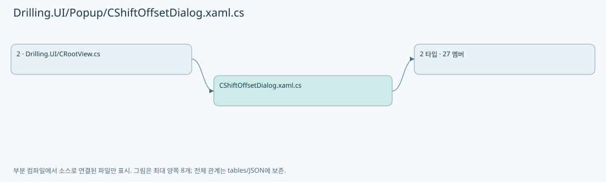
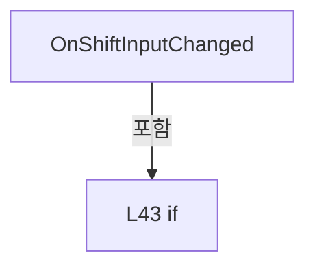
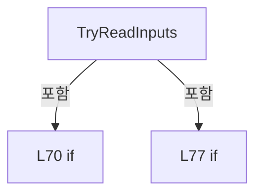
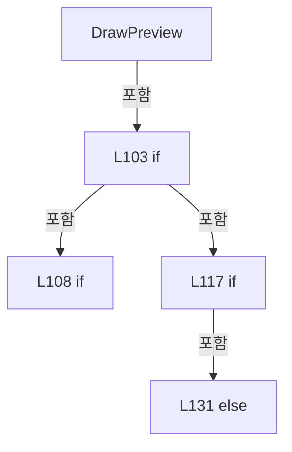
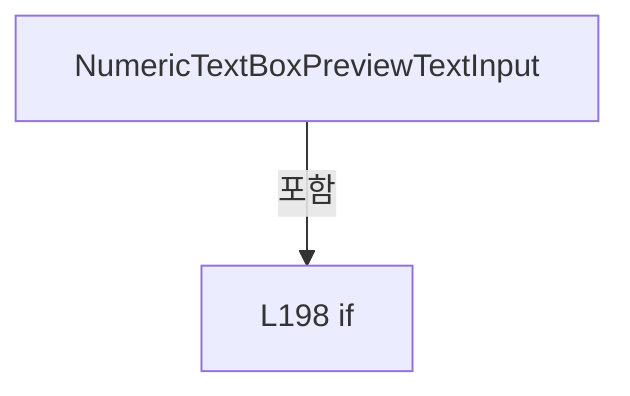
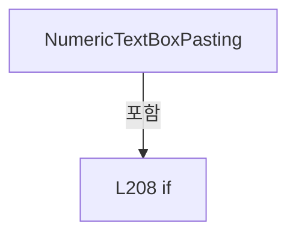
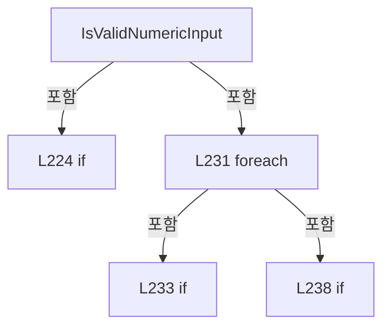
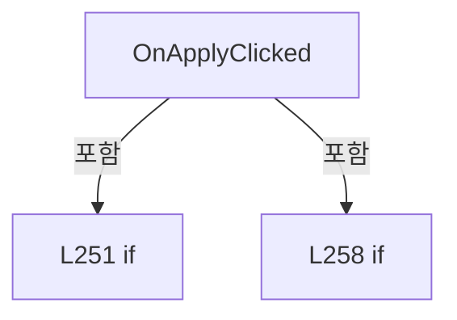
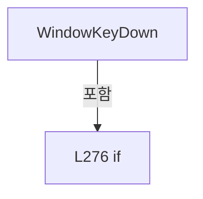

# Drilling.UI/Popup/CShiftOffsetDialog.xaml.cs

| 항목 | 내용 |
| --- | --- |
| 원본 저장소 | https://github.com/kjuws10-rgb/A3Drilling.git |
| 원본 Commit | 96e22cd027c84bf302b23f2949b98985d7f301bb |
| 원본 SHA256 | 6da348dcf0687c8c85b5e241eb570146077fd861f7f80f92d77b596ffcc59a53 |
| 파일 분류 | code |
| 원본 크기/행 | 10,784 bytes / 289 physical lines |
| 인코딩 | utf-8-sig |
| 검토 범위 | 구문/부분 의미 분석에서 추출한 사실. 동작·물리 단위·실장비 합격을 보증하지 않습니다. |
| 원본 링크 | [고정 Commit 원본](https://github.com/kjuws10-rgb/A3Drilling/blob/96e22cd027c84bf302b23f2949b98985d7f301bb/Drilling.UI/Popup/CShiftOffsetDialog.xaml.cs) |

## 파일의 역할과 읽는 순서

WPF 화면·사용자 명령·표시 상태를 구성합니다. XAML 이벤트와 코드 비하인드, RootView의 조립 경로를 함께 추적합니다.

## 네임스페이스·타입·상속

| 타입 | 구분 | 원본 범위 | 선언/상속 |
| --- | --- | --- | --- |
| CShiftOffsetDialog | ClassDeclaration | 9–287 | CShiftOffsetDialog: Window |
| ST_SHIFT_OFFSET_HEAD_ROW | RecordDeclaration | 289–289 | ST_SHIFT_OFFSET_HEAD_ROW |

## 멤버 빠른 목록

| 이름 | 종류 | 범위 | 서명 |
| --- | --- | --- | --- |
| _headRowsProvider | FieldDeclaration | L11–11 | System.Func<double, double, System.Collections.Generic.IReadOnlyList<Drilling.UI.Popup.ST_SHIFT_OFFSET_HEAD_ROW>> Drilling.UI.Popup.CShiftOffsetDialog._headRowsProvider |
| _validateApply | FieldDeclaration | L12–12 | System.Func<double, double, string?> Drilling.UI.Popup.CShiftOffsetDialog._validateApply |
| _isLoading | FieldDeclaration | L13–13 | bool Drilling.UI.Popup.CShiftOffsetDialog._isLoading |
| .ctor | ConstructorDeclaration | L14–36 | Drilling.UI.Popup.CShiftOffsetDialog.CShiftOffsetDialog(string, string, System.Func<double, double, System.Collections.Generic.IReadOnlyList<Drilling.UI.Popup.ST_SHIFT_OFFSET_HEAD_ROW>>, System.Func<double, double, string?>) |
| ResultShiftOffsetX | PropertyDeclaration | L38–38 | string Drilling.UI.Popup.CShiftOffsetDialog.ResultShiftOffsetX |
| get_ResultShiftOffsetX | GetAccessorDeclaration | L38–38 | string Drilling.UI.Popup.CShiftOffsetDialog.ResultShiftOffsetX.get |
| set_ResultShiftOffsetX | SetAccessorDeclaration | L38–38 | void Drilling.UI.Popup.CShiftOffsetDialog.ResultShiftOffsetX.set |
| ResultShiftOffsetY | PropertyDeclaration | L39–39 | string Drilling.UI.Popup.CShiftOffsetDialog.ResultShiftOffsetY |
| get_ResultShiftOffsetY | GetAccessorDeclaration | L39–39 | string Drilling.UI.Popup.CShiftOffsetDialog.ResultShiftOffsetY.get |
| set_ResultShiftOffsetY | SetAccessorDeclaration | L39–39 | void Drilling.UI.Popup.CShiftOffsetDialog.ResultShiftOffsetY.set |
| OnShiftInputChanged | MethodDeclaration | L41–49 | void Drilling.UI.Popup.CShiftOffsetDialog.OnShiftInputChanged(object, TextChangedEventArgs) |
| RefreshPreview | MethodDeclaration | L51–65 | void Drilling.UI.Popup.CShiftOffsetDialog.RefreshPreview() |
| TryReadInputs | MethodDeclaration | L67–84 | bool Drilling.UI.Popup.CShiftOffsetDialog.TryReadInputs(out double, out double, out string) |
| TryParseFinite | MethodDeclaration | L86–89 | bool Drilling.UI.Popup.CShiftOffsetDialog.TryParseFinite(string?, out double) |
| DrawPreview | MethodDeclaration | L91–144 | void Drilling.UI.Popup.CShiftOffsetDialog.DrawPreview(double, double, bool) |
| AddPoint | MethodDeclaration | L146–159 | void Drilling.UI.Popup.CShiftOffsetDialog.AddPoint(double, double, double, Brush, Brush, double) |
| AddLine | MethodDeclaration | L161–164 | void Drilling.UI.Popup.CShiftOffsetDialog.AddLine(double, double, double, double, Brush, double) |
| AddArrow | MethodDeclaration | L166–180 | void Drilling.UI.Popup.CShiftOffsetDialog.AddArrow(double, double, double, double, Brush) |
| AddText | MethodDeclaration | L182–194 | void Drilling.UI.Popup.CShiftOffsetDialog.AddText(string, double, double, Brush) |
| NumericTextBoxPreviewTextInput | MethodDeclaration | L196–204 | void Drilling.UI.Popup.CShiftOffsetDialog.NumericTextBoxPreviewTextInput(object, TextCompositionEventArgs) |
| NumericTextBoxPasting | MethodDeclaration | L206–212 | void Drilling.UI.Popup.CShiftOffsetDialog.NumericTextBoxPasting(object, DataObjectPastingEventArgs) |
| CreateProspectiveValue | MethodDeclaration | L214–220 | string Drilling.UI.Popup.CShiftOffsetDialog.CreateProspectiveValue(TextBox, string) |
| IsValidNumericInput | MethodDeclaration | L222–247 | bool Drilling.UI.Popup.CShiftOffsetDialog.IsValidNumericInput(string) |
| OnApplyClicked | MethodDeclaration | L249–267 | void Drilling.UI.Popup.CShiftOffsetDialog.OnApplyClicked(object, RoutedEventArgs) |
| OnCloseClicked | MethodDeclaration | L269–272 | void Drilling.UI.Popup.CShiftOffsetDialog.OnCloseClicked(object, RoutedEventArgs) |
| WindowKeyDown | MethodDeclaration | L274–281 | void Drilling.UI.Popup.CShiftOffsetDialog.WindowKeyDown(object, KeyEventArgs) |
| Format | MethodDeclaration | L283–286 | string Drilling.UI.Popup.CShiftOffsetDialog.Format(double) |

## 멤버별 상세 계약·호출·처리 해설

### FieldDeclaration `_headRowsProvider` · L11–11

[Drilling.UI/Popup/CShiftOffsetDialog.xaml.cs:11–11](https://github.com/kjuws10-rgb/A3Drilling/blob/96e22cd027c84bf302b23f2949b98985d7f301bb/Drilling.UI/Popup/CShiftOffsetDialog.xaml.cs#L11-L11)

| 항목 | 실제 추출 값 |
| --- | --- |
| 서명 | System.Func<double, double, System.Collections.Generic.IReadOnlyList<Drilling.UI.Popup.ST_SHIFT_OFFSET_HEAD_ROW>> Drilling.UI.Popup.CShiftOffsetDialog._headRowsProvider |
| 접근/수식자 | Private / private, readonly |
| 반환/값 타입 | System.Func<double, double, System.Collections.Generic.IReadOnlyList<Drilling.UI.Popup.ST_SHIFT_OFFSET_HEAD_ROW>> |
| 소속 타입 | NamedType:Drilling.UI.Popup.CShiftOffsetDialog |

현재 부분 분석에서 직접 연결된 호출자는 없습니다. XAML/이벤트/인터페이스·델리게이트·외부 진입을 추가 확인해야 하며, 미사용으로 판정한 것이 아닙니다.

변경 전 점검: 입력/반환 타입, 위 호출자, 예외/취소 경로, 공유 상태와 저장·전송 소비자를 함께 확인합니다. 값의 단위나 물리 방향을 이름만으로 확정하지 않습니다.

### FieldDeclaration `_validateApply` · L12–12

[Drilling.UI/Popup/CShiftOffsetDialog.xaml.cs:12–12](https://github.com/kjuws10-rgb/A3Drilling/blob/96e22cd027c84bf302b23f2949b98985d7f301bb/Drilling.UI/Popup/CShiftOffsetDialog.xaml.cs#L12-L12)

| 항목 | 실제 추출 값 |
| --- | --- |
| 서명 | System.Func<double, double, string?> Drilling.UI.Popup.CShiftOffsetDialog._validateApply |
| 접근/수식자 | Private / private, readonly |
| 반환/값 타입 | System.Func<double, double, string?> |
| 소속 타입 | NamedType:Drilling.UI.Popup.CShiftOffsetDialog |

현재 부분 분석에서 직접 연결된 호출자는 없습니다. XAML/이벤트/인터페이스·델리게이트·외부 진입을 추가 확인해야 하며, 미사용으로 판정한 것이 아닙니다.

변경 전 점검: 입력/반환 타입, 위 호출자, 예외/취소 경로, 공유 상태와 저장·전송 소비자를 함께 확인합니다. 값의 단위나 물리 방향을 이름만으로 확정하지 않습니다.

### FieldDeclaration `_isLoading` · L13–13

[Drilling.UI/Popup/CShiftOffsetDialog.xaml.cs:13–13](https://github.com/kjuws10-rgb/A3Drilling/blob/96e22cd027c84bf302b23f2949b98985d7f301bb/Drilling.UI/Popup/CShiftOffsetDialog.xaml.cs#L13-L13)

| 항목 | 실제 추출 값 |
| --- | --- |
| 서명 | bool Drilling.UI.Popup.CShiftOffsetDialog._isLoading |
| 접근/수식자 | Private / private |
| 반환/값 타입 | bool |
| 소속 타입 | NamedType:Drilling.UI.Popup.CShiftOffsetDialog |

현재 부분 분석에서 직접 연결된 호출자는 없습니다. XAML/이벤트/인터페이스·델리게이트·외부 진입을 추가 확인해야 하며, 미사용으로 판정한 것이 아닙니다.

변경 전 점검: 입력/반환 타입, 위 호출자, 예외/취소 경로, 공유 상태와 저장·전송 소비자를 함께 확인합니다. 값의 단위나 물리 방향을 이름만으로 확정하지 않습니다.

### ConstructorDeclaration `.ctor` · L14–36

[Drilling.UI/Popup/CShiftOffsetDialog.xaml.cs:14–36](https://github.com/kjuws10-rgb/A3Drilling/blob/96e22cd027c84bf302b23f2949b98985d7f301bb/Drilling.UI/Popup/CShiftOffsetDialog.xaml.cs#L14-L36)

| 항목 | 실제 추출 값 |
| --- | --- |
| 서명 | Drilling.UI.Popup.CShiftOffsetDialog.CShiftOffsetDialog(string, string, System.Func<double, double, System.Collections.Generic.IReadOnlyList<Drilling.UI.Popup.ST_SHIFT_OFFSET_HEAD_ROW>>, System.Func<double, double, string?>) |
| 접근/수식자 | Public / public |
| 반환/값 타입 | void |
| 소속 타입 | NamedType:Drilling.UI.Popup.CShiftOffsetDialog |

입력 계약:

| 이름 | 타입 | 전달 | 선택/기본값 |
| --- | --- | --- | --- |
| shiftOffsetX | string | None | False /  |
| shiftOffsetY | string | None | False /  |
| headRowsProvider | System.Func<double, double, System.Collections.Generic.IReadOnlyList<Drilling.UI.Popup.ST_SHIFT_OFFSET_HEAD_ROW>> | None | False /  |
| validateApply | System.Func<double, double, string?> | None | False /  |

정적 호출자로 확인된 위치:

| 호출 파일/행 | 호출 표현식 | 런타임 분기 가능 |
| --- | --- | --- |
| [Drilling.UI/CRootView.cs:1368–1371](https://github.com/kjuws10-rgb/A3Drilling/blob/96e22cd027c84bf302b23f2949b98985d7f301bb/Drilling.UI/CRootView.cs#L1368-L1371) | new CShiftOffsetDialog | False |

호출하는 대상과 해석 범위:

| 원본 행 | 표현식 | 분석 상태 | 대상/소스 위치 |
| --- | --- | --- | --- |
| 21 | InitializeComponent | unresolved | None |
| 28 | DataObject.AddPastingHandler | unresolved | None |
| 29 | DataObject.AddPastingHandler | unresolved | None |
| 32 | RefreshPreview | resolved | void Drilling.UI.Popup.CShiftOffsetDialog.RefreshPreview() · Drilling.UI/Popup/CShiftOffsetDialog.xaml.cs:51 |
| 33 | ShiftXTextBox.Focus | unresolved | None |
| 34 | ShiftXTextBox.SelectAll | unresolved | None |

본문의 실제 연산·분기·예외·반환 순서(원문 위치 순):

| 원본 행 | 종류 | 주석 해설 |
| --- | --- | --- |
| 21 | call | 함수·델리게이트 또는 객체 생성자를 호출합니다: InitializeComponent() |
| 22 | assignment | 값을 대상에 대입합니다: _headRowsProvider = headRowsProvider |
| 23 | assignment | 값을 대상에 대입합니다: _validateApply = validateApply |
| 24 | assignment | 값을 대상에 대입합니다: _isLoading = true |
| 25 | assignment | 값을 대상에 대입합니다: ShiftXTextBox.Text = shiftOffsetX |
| 26 | assignment | 값을 대상에 대입합니다: ShiftYTextBox.Text = shiftOffsetY |
| 27 | assignment | 값을 대상에 대입합니다: _isLoading = false |
| 28 | call | 함수·델리게이트 또는 객체 생성자를 호출합니다: DataObject.AddPastingHandler(ShiftXTextBox, NumericTextBoxPasting) |
| 29 | call | 함수·델리게이트 또는 객체 생성자를 호출합니다: DataObject.AddPastingHandler(ShiftYTextBox, NumericTextBoxPasting) |
| 30 | compound-assignment-or-event-subscription | 복합 대입 또는 이벤트 구독/해지 표현입니다: Loaded += (_, _) => { RefreshPreview(); ShiftXTextBox.Focus(); ShiftXTextBox.SelectAll(); } |
| 32 | call | 함수·델리게이트 또는 객체 생성자를 호출합니다: RefreshPreview() |
| 33 | call | 함수·델리게이트 또는 객체 생성자를 호출합니다: ShiftXTextBox.Focus() |
| 34 | call | 함수·델리게이트 또는 객체 생성자를 호출합니다: ShiftXTextBox.SelectAll() |

변경 전 점검: 입력/반환 타입, 위 호출자, 예외/취소 경로, 공유 상태와 저장·전송 소비자를 함께 확인합니다. 값의 단위나 물리 방향을 이름만으로 확정하지 않습니다.

### PropertyDeclaration `ResultShiftOffsetX` · L38–38

[Drilling.UI/Popup/CShiftOffsetDialog.xaml.cs:38–38](https://github.com/kjuws10-rgb/A3Drilling/blob/96e22cd027c84bf302b23f2949b98985d7f301bb/Drilling.UI/Popup/CShiftOffsetDialog.xaml.cs#L38-L38)

| 항목 | 실제 추출 값 |
| --- | --- |
| 서명 | string Drilling.UI.Popup.CShiftOffsetDialog.ResultShiftOffsetX |
| 접근/수식자 | Public / public |
| 반환/값 타입 | string |
| 소속 타입 | NamedType:Drilling.UI.Popup.CShiftOffsetDialog |

현재 부분 분석에서 직접 연결된 호출자는 없습니다. XAML/이벤트/인터페이스·델리게이트·외부 진입을 추가 확인해야 하며, 미사용으로 판정한 것이 아닙니다.

변경 전 점검: 입력/반환 타입, 위 호출자, 예외/취소 경로, 공유 상태와 저장·전송 소비자를 함께 확인합니다. 값의 단위나 물리 방향을 이름만으로 확정하지 않습니다.

### GetAccessorDeclaration `get_ResultShiftOffsetX` · L38–38

[Drilling.UI/Popup/CShiftOffsetDialog.xaml.cs:38–38](https://github.com/kjuws10-rgb/A3Drilling/blob/96e22cd027c84bf302b23f2949b98985d7f301bb/Drilling.UI/Popup/CShiftOffsetDialog.xaml.cs#L38-L38)

| 항목 | 실제 추출 값 |
| --- | --- |
| 서명 | string Drilling.UI.Popup.CShiftOffsetDialog.ResultShiftOffsetX.get |
| 접근/수식자 | Public / get |
| 반환/값 타입 | string |
| 소속 타입 | NamedType:Drilling.UI.Popup.CShiftOffsetDialog |

현재 부분 분석에서 직접 연결된 호출자는 없습니다. XAML/이벤트/인터페이스·델리게이트·외부 진입을 추가 확인해야 하며, 미사용으로 판정한 것이 아닙니다.

변경 전 점검: 입력/반환 타입, 위 호출자, 예외/취소 경로, 공유 상태와 저장·전송 소비자를 함께 확인합니다. 값의 단위나 물리 방향을 이름만으로 확정하지 않습니다.

### SetAccessorDeclaration `set_ResultShiftOffsetX` · L38–38

[Drilling.UI/Popup/CShiftOffsetDialog.xaml.cs:38–38](https://github.com/kjuws10-rgb/A3Drilling/blob/96e22cd027c84bf302b23f2949b98985d7f301bb/Drilling.UI/Popup/CShiftOffsetDialog.xaml.cs#L38-L38)

| 항목 | 실제 추출 값 |
| --- | --- |
| 서명 | void Drilling.UI.Popup.CShiftOffsetDialog.ResultShiftOffsetX.set |
| 접근/수식자 | Private / private, set |
| 반환/값 타입 | void |
| 소속 타입 | NamedType:Drilling.UI.Popup.CShiftOffsetDialog |

입력 계약:

| 이름 | 타입 | 전달 | 선택/기본값 |
| --- | --- | --- | --- |
| value | string | None | False /  |

현재 부분 분석에서 직접 연결된 호출자는 없습니다. XAML/이벤트/인터페이스·델리게이트·외부 진입을 추가 확인해야 하며, 미사용으로 판정한 것이 아닙니다.

변경 전 점검: 입력/반환 타입, 위 호출자, 예외/취소 경로, 공유 상태와 저장·전송 소비자를 함께 확인합니다. 값의 단위나 물리 방향을 이름만으로 확정하지 않습니다.

### PropertyDeclaration `ResultShiftOffsetY` · L39–39

[Drilling.UI/Popup/CShiftOffsetDialog.xaml.cs:39–39](https://github.com/kjuws10-rgb/A3Drilling/blob/96e22cd027c84bf302b23f2949b98985d7f301bb/Drilling.UI/Popup/CShiftOffsetDialog.xaml.cs#L39-L39)

| 항목 | 실제 추출 값 |
| --- | --- |
| 서명 | string Drilling.UI.Popup.CShiftOffsetDialog.ResultShiftOffsetY |
| 접근/수식자 | Public / public |
| 반환/값 타입 | string |
| 소속 타입 | NamedType:Drilling.UI.Popup.CShiftOffsetDialog |

현재 부분 분석에서 직접 연결된 호출자는 없습니다. XAML/이벤트/인터페이스·델리게이트·외부 진입을 추가 확인해야 하며, 미사용으로 판정한 것이 아닙니다.

변경 전 점검: 입력/반환 타입, 위 호출자, 예외/취소 경로, 공유 상태와 저장·전송 소비자를 함께 확인합니다. 값의 단위나 물리 방향을 이름만으로 확정하지 않습니다.

### GetAccessorDeclaration `get_ResultShiftOffsetY` · L39–39

[Drilling.UI/Popup/CShiftOffsetDialog.xaml.cs:39–39](https://github.com/kjuws10-rgb/A3Drilling/blob/96e22cd027c84bf302b23f2949b98985d7f301bb/Drilling.UI/Popup/CShiftOffsetDialog.xaml.cs#L39-L39)

| 항목 | 실제 추출 값 |
| --- | --- |
| 서명 | string Drilling.UI.Popup.CShiftOffsetDialog.ResultShiftOffsetY.get |
| 접근/수식자 | Public / get |
| 반환/값 타입 | string |
| 소속 타입 | NamedType:Drilling.UI.Popup.CShiftOffsetDialog |

현재 부분 분석에서 직접 연결된 호출자는 없습니다. XAML/이벤트/인터페이스·델리게이트·외부 진입을 추가 확인해야 하며, 미사용으로 판정한 것이 아닙니다.

변경 전 점검: 입력/반환 타입, 위 호출자, 예외/취소 경로, 공유 상태와 저장·전송 소비자를 함께 확인합니다. 값의 단위나 물리 방향을 이름만으로 확정하지 않습니다.

### SetAccessorDeclaration `set_ResultShiftOffsetY` · L39–39

[Drilling.UI/Popup/CShiftOffsetDialog.xaml.cs:39–39](https://github.com/kjuws10-rgb/A3Drilling/blob/96e22cd027c84bf302b23f2949b98985d7f301bb/Drilling.UI/Popup/CShiftOffsetDialog.xaml.cs#L39-L39)

| 항목 | 실제 추출 값 |
| --- | --- |
| 서명 | void Drilling.UI.Popup.CShiftOffsetDialog.ResultShiftOffsetY.set |
| 접근/수식자 | Private / private, set |
| 반환/값 타입 | void |
| 소속 타입 | NamedType:Drilling.UI.Popup.CShiftOffsetDialog |

입력 계약:

| 이름 | 타입 | 전달 | 선택/기본값 |
| --- | --- | --- | --- |
| value | string | None | False /  |

현재 부분 분석에서 직접 연결된 호출자는 없습니다. XAML/이벤트/인터페이스·델리게이트·외부 진입을 추가 확인해야 하며, 미사용으로 판정한 것이 아닙니다.

변경 전 점검: 입력/반환 타입, 위 호출자, 예외/취소 경로, 공유 상태와 저장·전송 소비자를 함께 확인합니다. 값의 단위나 물리 방향을 이름만으로 확정하지 않습니다.

### MethodDeclaration `OnShiftInputChanged` · L41–49

[Drilling.UI/Popup/CShiftOffsetDialog.xaml.cs:41–49](https://github.com/kjuws10-rgb/A3Drilling/blob/96e22cd027c84bf302b23f2949b98985d7f301bb/Drilling.UI/Popup/CShiftOffsetDialog.xaml.cs#L41-L49)

| 항목 | 실제 추출 값 |
| --- | --- |
| 서명 | void Drilling.UI.Popup.CShiftOffsetDialog.OnShiftInputChanged(object, TextChangedEventArgs) |
| 접근/수식자 | Private / private |
| 반환/값 타입 | void |
| 소속 타입 | NamedType:Drilling.UI.Popup.CShiftOffsetDialog |

입력 계약:

| 이름 | 타입 | 전달 | 선택/기본값 |
| --- | --- | --- | --- |
| sender | object | None | False /  |
| e | TextChangedEventArgs | None | False /  |

현재 부분 분석에서 직접 연결된 호출자는 없습니다. XAML/이벤트/인터페이스·델리게이트·외부 진입을 추가 확인해야 하며, 미사용으로 판정한 것이 아닙니다.

호출하는 대상과 해석 범위:

| 원본 행 | 표현식 | 분석 상태 | 대상/소스 위치 |
| --- | --- | --- | --- |
| 48 | RefreshPreview | resolved | void Drilling.UI.Popup.CShiftOffsetDialog.RefreshPreview() · Drilling.UI/Popup/CShiftOffsetDialog.xaml.cs:51 |

본문의 실제 연산·분기·예외·반환 순서(원문 위치 순):

| 원본 행 | 종류 | 주석 해설 |
| --- | --- | --- |
| 43 | if | 조건에 따라 분기합니다: if (_isLoading) |
| 45 | return | 호출자에게 값 또는 제어를 반환합니다: return; |
| 48 | call | 함수·델리게이트 또는 객체 생성자를 호출합니다: RefreshPreview() |

제어 구문의 포함 구조(실제 실행 순서/CFG가 아닌 구문 탐색 그림):

변경 전 점검: 입력/반환 타입, 위 호출자, 예외/취소 경로, 공유 상태와 저장·전송 소비자를 함께 확인합니다. 값의 단위나 물리 방향을 이름만으로 확정하지 않습니다.

### MethodDeclaration `RefreshPreview` · L51–65

[Drilling.UI/Popup/CShiftOffsetDialog.xaml.cs:51–65](https://github.com/kjuws10-rgb/A3Drilling/blob/96e22cd027c84bf302b23f2949b98985d7f301bb/Drilling.UI/Popup/CShiftOffsetDialog.xaml.cs#L51-L65)

| 항목 | 실제 추출 값 |
| --- | --- |
| 서명 | void Drilling.UI.Popup.CShiftOffsetDialog.RefreshPreview() |
| 접근/수식자 | Private / private |
| 반환/값 타입 | void |
| 소속 타입 | NamedType:Drilling.UI.Popup.CShiftOffsetDialog |

정적 호출자로 확인된 위치:

| 호출 파일/행 | 호출 표현식 | 런타임 분기 가능 |
| --- | --- | --- |
| [Drilling.UI/Popup/CShiftOffsetDialog.xaml.cs:32–32](https://github.com/kjuws10-rgb/A3Drilling/blob/96e22cd027c84bf302b23f2949b98985d7f301bb/Drilling.UI/Popup/CShiftOffsetDialog.xaml.cs#L32-L32) | RefreshPreview | False |
| [Drilling.UI/Popup/CShiftOffsetDialog.xaml.cs:48–48](https://github.com/kjuws10-rgb/A3Drilling/blob/96e22cd027c84bf302b23f2949b98985d7f301bb/Drilling.UI/Popup/CShiftOffsetDialog.xaml.cs#L48-L48) | RefreshPreview | False |

호출하는 대상과 해석 범위:

| 원본 행 | 표현식 | 분석 상태 | 대상/소스 위치 |
| --- | --- | --- | --- |
| 53 | TryReadInputs | resolved | bool Drilling.UI.Popup.CShiftOffsetDialog.TryReadInputs(out double, out double, out string) · Drilling.UI/Popup/CShiftOffsetDialog.xaml.cs:67 |
| 56 | Array.Empty<ST_SHIFT_OFFSET_HEAD_ROW> | resolved | Drilling.UI.Popup.ST_SHIFT_OFFSET_HEAD_ROW[] System.Array.Empty<Drilling.UI.Popup.ST_SHIFT_OFFSET_HEAD_ROW>() |
| 57 | DrawPreview | resolved | void Drilling.UI.Popup.CShiftOffsetDialog.DrawPreview(double, double, bool) · Drilling.UI/Popup/CShiftOffsetDialog.xaml.cs:91 |
| 61 | _headRowsProvider | resolved · 동적 구현 선택 가능 | System.Collections.Generic.IReadOnlyList<Drilling.UI.Popup.ST_SHIFT_OFFSET_HEAD_ROW> System.Func<double, double, System.Collections.Generic.IReadOnlyList<Drilling.UI.Popup.ST_SHIFT_OFFSET_HEAD_ROW>>.Invoke(double, double) |
| 63 | DrawPreview | resolved | void Drilling.UI.Popup.CShiftOffsetDialog.DrawPreview(double, double, bool) · Drilling.UI/Popup/CShiftOffsetDialog.xaml.cs:91 |
| 64 | Format | resolved | string Drilling.UI.Popup.CShiftOffsetDialog.Format(double) · Drilling.UI/Popup/CShiftOffsetDialog.xaml.cs:283 |
| 64 | Format | resolved | string Drilling.UI.Popup.CShiftOffsetDialog.Format(double) · Drilling.UI/Popup/CShiftOffsetDialog.xaml.cs:283 |

본문의 실제 연산·분기·예외·반환 순서(원문 위치 순):

| 원본 행 | 종류 | 주석 해설 |
| --- | --- | --- |
| 53 | call | 함수·델리게이트 또는 객체 생성자를 호출합니다: TryReadInputs(out var shiftX, out var shiftY, out var error) |
| 53 | if | 조건에 따라 분기합니다: if (!TryReadInputs(out var shiftX, out var shiftY, out var error)) |
| 55 | assignment | 값을 대상에 대입합니다: StatusText.Text = error |
| 56 | assignment | 값을 대상에 대입합니다: HeadRowsControl.ItemsSource = Array.Empty<ST_SHIFT_OFFSET_HEAD_ROW>() |
| 56 | call | 함수·델리게이트 또는 객체 생성자를 호출합니다: Array.Empty<ST_SHIFT_OFFSET_HEAD_ROW>() |
| 57 | call | 함수·델리게이트 또는 객체 생성자를 호출합니다: DrawPreview(0.0, 0.0, isValid: false) |
| 58 | return | 호출자에게 값 또는 제어를 반환합니다: return; |
| 61 | call | 함수·델리게이트 또는 객체 생성자를 호출합니다: _headRowsProvider(shiftX, shiftY) |
| 61 | local-declaration | 지역 변수를 선언합니다: var rows = _headRowsProvider(shiftX, shiftY); |
| 61 | variable-initializer | 변수의 초기값을 지정합니다: rows = _headRowsProvider(shiftX, shiftY) |
| 62 | assignment | 값을 대상에 대입합니다: HeadRowsControl.ItemsSource = rows |
| 63 | call | 함수·델리게이트 또는 객체 생성자를 호출합니다: DrawPreview(shiftX, shiftY, isValid: true) |
| 64 | assignment | 값을 대상에 대입합니다: StatusText.Text = $"Design Shift X {Format(shiftX)} mm / Y {Format(shiftY)} mm" |
| 64 | call | 함수·델리게이트 또는 객체 생성자를 호출합니다: Format(shiftX) |
| 64 | call | 함수·델리게이트 또는 객체 생성자를 호출합니다: Format(shiftY) |

제어 구문의 포함 구조(실제 실행 순서/CFG가 아닌 구문 탐색 그림):

변경 전 점검: 입력/반환 타입, 위 호출자, 예외/취소 경로, 공유 상태와 저장·전송 소비자를 함께 확인합니다. 값의 단위나 물리 방향을 이름만으로 확정하지 않습니다.

### MethodDeclaration `TryReadInputs` · L67–84

[Drilling.UI/Popup/CShiftOffsetDialog.xaml.cs:67–84](https://github.com/kjuws10-rgb/A3Drilling/blob/96e22cd027c84bf302b23f2949b98985d7f301bb/Drilling.UI/Popup/CShiftOffsetDialog.xaml.cs#L67-L84)

| 항목 | 실제 추출 값 |
| --- | --- |
| 서명 | bool Drilling.UI.Popup.CShiftOffsetDialog.TryReadInputs(out double, out double, out string) |
| 접근/수식자 | Private / private |
| 반환/값 타입 | bool |
| 소속 타입 | NamedType:Drilling.UI.Popup.CShiftOffsetDialog |

입력 계약:

| 이름 | 타입 | 전달 | 선택/기본값 |
| --- | --- | --- | --- |
| shiftX | double | Out | False /  |
| shiftY | double | Out | False /  |
| error | string | Out | False /  |

정적 호출자로 확인된 위치:

| 호출 파일/행 | 호출 표현식 | 런타임 분기 가능 |
| --- | --- | --- |
| [Drilling.UI/Popup/CShiftOffsetDialog.xaml.cs:53–53](https://github.com/kjuws10-rgb/A3Drilling/blob/96e22cd027c84bf302b23f2949b98985d7f301bb/Drilling.UI/Popup/CShiftOffsetDialog.xaml.cs#L53-L53) | TryReadInputs | False |
| [Drilling.UI/Popup/CShiftOffsetDialog.xaml.cs:251–251](https://github.com/kjuws10-rgb/A3Drilling/blob/96e22cd027c84bf302b23f2949b98985d7f301bb/Drilling.UI/Popup/CShiftOffsetDialog.xaml.cs#L251-L251) | TryReadInputs | False |

호출하는 대상과 해석 범위:

| 원본 행 | 표현식 | 분석 상태 | 대상/소스 위치 |
| --- | --- | --- | --- |
| 70 | TryParseFinite | candidate | OverloadResolutionFailure |
| 77 | TryParseFinite | candidate | OverloadResolutionFailure |

본문의 실제 연산·분기·예외·반환 순서(원문 위치 순):

| 원본 행 | 종류 | 주석 해설 |
| --- | --- | --- |
| 69 | assignment | 값을 대상에 대입합니다: error = "" |
| 70 | call | 함수·델리게이트 또는 객체 생성자를 호출합니다: TryParseFinite(ShiftXTextBox.Text, out shiftX) |
| 70 | if | 조건에 따라 분기합니다: if (!TryParseFinite(ShiftXTextBox.Text, out shiftX)) |
| 72 | assignment | 값을 대상에 대입합니다: shiftY = 0.0 |
| 73 | assignment | 값을 대상에 대입합니다: error = "SHIFT OFFSET X 값을 확인하세요." |
| 74 | return | 호출자에게 값 또는 제어를 반환합니다: return false; |
| 77 | call | 함수·델리게이트 또는 객체 생성자를 호출합니다: TryParseFinite(ShiftYTextBox.Text, out shiftY) |
| 77 | if | 조건에 따라 분기합니다: if (!TryParseFinite(ShiftYTextBox.Text, out shiftY)) |
| 79 | assignment | 값을 대상에 대입합니다: error = "SHIFT OFFSET Y 값을 확인하세요." |
| 80 | return | 호출자에게 값 또는 제어를 반환합니다: return false; |
| 83 | return | 호출자에게 값 또는 제어를 반환합니다: return true; |

제어 구문의 포함 구조(실제 실행 순서/CFG가 아닌 구문 탐색 그림):

변경 전 점검: 입력/반환 타입, 위 호출자, 예외/취소 경로, 공유 상태와 저장·전송 소비자를 함께 확인합니다. 값의 단위나 물리 방향을 이름만으로 확정하지 않습니다.

### MethodDeclaration `TryParseFinite` · L86–89

[Drilling.UI/Popup/CShiftOffsetDialog.xaml.cs:86–89](https://github.com/kjuws10-rgb/A3Drilling/blob/96e22cd027c84bf302b23f2949b98985d7f301bb/Drilling.UI/Popup/CShiftOffsetDialog.xaml.cs#L86-L89)

| 항목 | 실제 추출 값 |
| --- | --- |
| 서명 | bool Drilling.UI.Popup.CShiftOffsetDialog.TryParseFinite(string?, out double) |
| 접근/수식자 | Private / private, static |
| 반환/값 타입 | bool |
| 소속 타입 | NamedType:Drilling.UI.Popup.CShiftOffsetDialog |

입력 계약:

| 이름 | 타입 | 전달 | 선택/기본값 |
| --- | --- | --- | --- |
| text | string? | None | False /  |
| value | double | Out | False /  |

현재 부분 분석에서 직접 연결된 호출자는 없습니다. XAML/이벤트/인터페이스·델리게이트·외부 진입을 추가 확인해야 하며, 미사용으로 판정한 것이 아닙니다.

호출하는 대상과 해석 범위:

| 원본 행 | 표현식 | 분석 상태 | 대상/소스 위치 |
| --- | --- | --- | --- |
| 88 | double.TryParse | resolved | bool double.TryParse(string?, System.Globalization.NumberStyles, System.IFormatProvider?, out double) |
| 88 | (text ?? "").Trim | resolved | string string.Trim() |
| 88 | double.IsFinite | resolved | bool double.IsFinite(double) |

본문의 실제 연산·분기·예외·반환 순서(원문 위치 순):

| 원본 행 | 종류 | 주석 해설 |
| --- | --- | --- |
| 88 | call | 함수·델리게이트 또는 객체 생성자를 호출합니다: double.TryParse((text ?? "").Trim(), NumberStyles.Float, CultureInfo.InvariantCulture, out value) |
| 88 | call | 함수·델리게이트 또는 객체 생성자를 호출합니다: (text ?? "").Trim() |
| 88 | call | 함수·델리게이트 또는 객체 생성자를 호출합니다: double.IsFinite(value) |
| 88 | return | 호출자에게 값 또는 제어를 반환합니다: return double.TryParse((text ?? "").Trim(), NumberStyles.Float, CultureInfo.InvariantCulture, out value) && double.IsFinite(value); |

변경 전 점검: 입력/반환 타입, 위 호출자, 예외/취소 경로, 공유 상태와 저장·전송 소비자를 함께 확인합니다. 값의 단위나 물리 방향을 이름만으로 확정하지 않습니다.

### MethodDeclaration `DrawPreview` · L91–144

[Drilling.UI/Popup/CShiftOffsetDialog.xaml.cs:91–144](https://github.com/kjuws10-rgb/A3Drilling/blob/96e22cd027c84bf302b23f2949b98985d7f301bb/Drilling.UI/Popup/CShiftOffsetDialog.xaml.cs#L91-L144)

| 항목 | 실제 추출 값 |
| --- | --- |
| 서명 | void Drilling.UI.Popup.CShiftOffsetDialog.DrawPreview(double, double, bool) |
| 접근/수식자 | Private / private |
| 반환/값 타입 | void |
| 소속 타입 | NamedType:Drilling.UI.Popup.CShiftOffsetDialog |

입력 계약:

| 이름 | 타입 | 전달 | 선택/기본값 |
| --- | --- | --- | --- |
| shiftX | double | None | False /  |
| shiftY | double | None | False /  |
| isValid | bool | None | False /  |

정적 호출자로 확인된 위치:

| 호출 파일/행 | 호출 표현식 | 런타임 분기 가능 |
| --- | --- | --- |
| [Drilling.UI/Popup/CShiftOffsetDialog.xaml.cs:57–57](https://github.com/kjuws10-rgb/A3Drilling/blob/96e22cd027c84bf302b23f2949b98985d7f301bb/Drilling.UI/Popup/CShiftOffsetDialog.xaml.cs#L57-L57) | DrawPreview | False |
| [Drilling.UI/Popup/CShiftOffsetDialog.xaml.cs:63–63](https://github.com/kjuws10-rgb/A3Drilling/blob/96e22cd027c84bf302b23f2949b98985d7f301bb/Drilling.UI/Popup/CShiftOffsetDialog.xaml.cs#L63-L63) | DrawPreview | False |

호출하는 대상과 해석 범위:

| 원본 행 | 표현식 | 분석 상태 | 대상/소스 위치 |
| --- | --- | --- | --- |
| 93 | PreviewCanvas.Children.Clear | unresolved | None |
| 96 | FindResource | unresolved | None |
| 97 | FindResource | unresolved | None |
| 98 | FindResource | unresolved | None |
| 99 | FindResource | unresolved | None |
| 105 | Math.Abs | resolved | double System.Math.Abs(double) |
| 105 | Math.Abs | resolved | double System.Math.Abs(double) |
| 110 | Math.Sqrt | resolved | double System.Math.Sqrt(double) |
| 111 | Math.Clamp | resolved | double System.Math.Clamp(double, double, double) |
| 116 | AddPoint | candidate | OverloadResolutionFailure |
| 126 | AddArrow | candidate | OverloadResolutionFailure |
| 127 | AddPoint | candidate | OverloadResolutionFailure |
| 128 | AddText | candidate | OverloadResolutionFailure |
| 128 | Math.Clamp | candidate | OverloadResolutionFailure |
| 128 | Math.Clamp | candidate | OverloadResolutionFailure |
| 129 | AddText | candidate | OverloadResolutionFailure |
| 129 | Math.Clamp | candidate | OverloadResolutionFailure |
| 129 | Math.Clamp | candidate | OverloadResolutionFailure |
| 133 | AddPoint | candidate | OverloadResolutionFailure |
| 134 | AddText | candidate | OverloadResolutionFailure |
| 135 | AddText | candidate | OverloadResolutionFailure |
| 139 | AddLine | candidate | OverloadResolutionFailure |
| 140 | AddLine | candidate | OverloadResolutionFailure |
| 141 | AddText | candidate | OverloadResolutionFailure |
| 142 | AddText | resolved | void Drilling.UI.Popup.CShiftOffsetDialog.AddText(string, double, double, Brush) · Drilling.UI/Popup/CShiftOffsetDialog.xaml.cs:182 |
| 143 | Format | resolved | string Drilling.UI.Popup.CShiftOffsetDialog.Format(double) · Drilling.UI/Popup/CShiftOffsetDialog.xaml.cs:283 |
| 143 | Format | resolved | string Drilling.UI.Popup.CShiftOffsetDialog.Format(double) · Drilling.UI/Popup/CShiftOffsetDialog.xaml.cs:283 |

본문의 실제 연산·분기·예외·반환 순서(원문 위치 순):

| 원본 행 | 종류 | 주석 해설 |
| --- | --- | --- |
| 93 | call | 함수·델리게이트 또는 객체 생성자를 호출합니다: PreviewCanvas.Children.Clear() |
| 94 | conditional-expression | 조건에 따라 결과식을 선택합니다: PreviewCanvas.ActualWidth > 0 ? PreviewCanvas.ActualWidth : 360.0 |
| 94 | local-declaration | 지역 변수를 선언합니다: var width = PreviewCanvas.ActualWidth > 0 ? PreviewCanvas.ActualWidth : 360.0; |
| 94 | variable-initializer | 변수의 초기값을 지정합니다: width = PreviewCanvas.ActualWidth > 0 ? PreviewCanvas.ActualWidth : 360.0 |
| 95 | conditional-expression | 조건에 따라 결과식을 선택합니다: PreviewCanvas.ActualHeight > 0 ? PreviewCanvas.ActualHeight : 220.0 |
| 95 | local-declaration | 지역 변수를 선언합니다: var height = PreviewCanvas.ActualHeight > 0 ? PreviewCanvas.ActualHeight : 220.0; |
| 95 | variable-initializer | 변수의 초기값을 지정합니다: height = PreviewCanvas.ActualHeight > 0 ? PreviewCanvas.ActualHeight : 220.0 |
| 96 | call | 함수·델리게이트 또는 객체 생성자를 호출합니다: FindResource("PanelBorderBrush") |
| 96 | local-declaration | 지역 변수를 선언합니다: var gridBrush = (Brush)FindResource("PanelBorderBrush"); |
| 96 | variable-initializer | 변수의 초기값을 지정합니다: gridBrush = (Brush)FindResource("PanelBorderBrush") |
| 97 | call | 함수·델리게이트 또는 객체 생성자를 호출합니다: FindResource("TextSecondaryBrush") |
| 97 | local-declaration | 지역 변수를 선언합니다: var beforeBrush = (Brush)FindResource("TextSecondaryBrush"); |
| 97 | variable-initializer | 변수의 초기값을 지정합니다: beforeBrush = (Brush)FindResource("TextSecondaryBrush") |
| 98 | call | 함수·델리게이트 또는 객체 생성자를 호출합니다: FindResource("StatusReadyBrush") |
| 98 | local-declaration | 지역 변수를 선언합니다: var afterBrush = (Brush)FindResource("StatusReadyBrush"); |
| 98 | variable-initializer | 변수의 초기값을 지정합니다: afterBrush = (Brush)FindResource("StatusReadyBrush") |
| 99 | call | 함수·델리게이트 또는 객체 생성자를 호출합니다: FindResource("TextSecondaryBrush") |
| 99 | local-declaration | 지역 변수를 선언합니다: var textBrush = (Brush)FindResource("TextSecondaryBrush"); |
| 99 | variable-initializer | 변수의 초기값을 지정합니다: textBrush = (Brush)FindResource("TextSecondaryBrush") |
| 100 | local-declaration | 지역 변수를 선언합니다: var originX = width * 0.46; |
| 100 | variable-initializer | 변수의 초기값을 지정합니다: originX = width * 0.46 |
| 101 | local-declaration | 지역 변수를 선언합니다: var originY = height * 0.55; |
| 101 | variable-initializer | 변수의 초기값을 지정합니다: originY = height * 0.55 |
| 103 | if | 조건에 따라 분기합니다: if (isValid) |
| 105 | call | 함수·델리게이트 또는 객체 생성자를 호출합니다: Math.Abs(shiftX) |
| 105 | call | 함수·델리게이트 또는 객체 생성자를 호출합니다: Math.Abs(shiftY) |
| 105 | local-declaration | 지역 변수를 선언합니다: var hasShift = Math.Abs(shiftX) >= 0.000001 &#124;&#124; Math.Abs(shiftY) >= 0.000001; |
| 105 | variable-initializer | 변수의 초기값을 지정합니다: hasShift = Math.Abs(shiftX) >= 0.000001 &#124;&#124; Math.Abs(shiftY) >= 0.000001 |
| 106 | local-declaration | 지역 변수를 선언합니다: var dx = 0.0; |
| 106 | variable-initializer | 변수의 초기값을 지정합니다: dx = 0.0 |
| 107 | local-declaration | 지역 변수를 선언합니다: var dy = 0.0; |
| 107 | variable-initializer | 변수의 초기값을 지정합니다: dy = 0.0 |
| 108 | if | 조건에 따라 분기합니다: if (hasShift) |
| 110 | call | 함수·델리게이트 또는 객체 생성자를 호출합니다: Math.Sqrt((shiftX * shiftX) + (shiftY * shiftY)) |
| 110 | local-declaration | 지역 변수를 선언합니다: var magnitude = Math.Sqrt((shiftX * shiftX) + (shiftY * shiftY)); |
| 110 | variable-initializer | 변수의 초기값을 지정합니다: magnitude = Math.Sqrt((shiftX * shiftX) + (shiftY * shiftY)) |
| 111 | call | 함수·델리게이트 또는 객체 생성자를 호출합니다: Math.Clamp(magnitude * 45.0, 24.0, 82.0) |
| 111 | local-declaration | 지역 변수를 선언합니다: var displayLength = Math.Clamp(magnitude * 45.0, 24.0, 82.0); |
| 111 | variable-initializer | 변수의 초기값을 지정합니다: displayLength = Math.Clamp(magnitude * 45.0, 24.0, 82.0) |
| 112 | assignment | 값을 대상에 대입합니다: dx = shiftX / magnitude * displayLength |
| 113 | assignment | 값을 대상에 대입합니다: dy = -shiftY / magnitude * displayLength |
| 116 | call | 함수·델리게이트 또는 객체 생성자를 호출합니다: AddPoint(originX, originY, 11.0, beforeBrush, Brushes.Transparent, 2.0) |
| 117 | if | 조건에 따라 분기합니다: if (hasShift) |
| 119 | local-declaration | 지역 변수를 선언합니다: var afterX = originX + dx; |
| 119 | variable-initializer | 변수의 초기값을 지정합니다: afterX = originX + dx |
| 120 | local-declaration | 지역 변수를 선언합니다: var afterY = originY + dy; |
| 120 | variable-initializer | 변수의 초기값을 지정합니다: afterY = originY + dy |
| 121 | conditional-expression | 조건에 따라 결과식을 선택합니다: dx >= 0.0 ? originX - 66.0 : originX + 16.0 |
| 121 | local-declaration | 지역 변수를 선언합니다: var beforeLabelX = dx >= 0.0 ? originX - 66.0 : originX + 16.0; |
| 121 | variable-initializer | 변수의 초기값을 지정합니다: beforeLabelX = dx >= 0.0 ? originX - 66.0 : originX + 16.0 |
| 122 | conditional-expression | 조건에 따라 결과식을 선택합니다: dx >= 0.0 ? afterX + 14.0 : afterX - 62.0 |
| 122 | local-declaration | 지역 변수를 선언합니다: var afterLabelX = dx >= 0.0 ? afterX + 14.0 : afterX - 62.0; |
| 122 | variable-initializer | 변수의 초기값을 지정합니다: afterLabelX = dx >= 0.0 ? afterX + 14.0 : afterX - 62.0 |
| 123 | conditional-expression | 조건에 따라 결과식을 선택합니다: dy >= 0.0 ? originY - 28.0 : originY + 12.0 |
| 123 | local-declaration | 지역 변수를 선언합니다: var beforeLabelY = dy >= 0.0 ? originY - 28.0 : originY + 12.0; |
| 123 | variable-initializer | 변수의 초기값을 지정합니다: beforeLabelY = dy >= 0.0 ? originY - 28.0 : originY + 12.0 |
| 124 | conditional-expression | 조건에 따라 결과식을 선택합니다: dy >= 0.0 ? afterY + 12.0 : afterY - 28.0 |
| 124 | local-declaration | 지역 변수를 선언합니다: var afterLabelY = dy >= 0.0 ? afterY + 12.0 : afterY - 28.0; |
| 124 | variable-initializer | 변수의 초기값을 지정합니다: afterLabelY = dy >= 0.0 ? afterY + 12.0 : afterY - 28.0 |
| 126 | call | 함수·델리게이트 또는 객체 생성자를 호출합니다: AddArrow(originX, originY, afterX, afterY, afterBrush) |
| 127 | call | 함수·델리게이트 또는 객체 생성자를 호출합니다: AddPoint(afterX, afterY, 12.0, afterBrush, afterBrush, 2.0) |
| 128 | call | 함수·델리게이트 또는 객체 생성자를 호출합니다: AddText("BEFORE", Math.Clamp(beforeLabelX, 8.0, width - 64.0), Math.Clamp(beforeLabelY, 8.0, height - 32.0), beforeBrush) |
| 128 | call | 함수·델리게이트 또는 객체 생성자를 호출합니다: Math.Clamp(beforeLabelX, 8.0, width - 64.0) |
| 128 | call | 함수·델리게이트 또는 객체 생성자를 호출합니다: Math.Clamp(beforeLabelY, 8.0, height - 32.0) |
| 129 | call | 함수·델리게이트 또는 객체 생성자를 호출합니다: AddText("AFTER", Math.Clamp(afterLabelX, 8.0, width - 58.0), Math.Clamp(afterLabelY, 8.0, height - 32.0), afterBrush) |
| 129 | call | 함수·델리게이트 또는 객체 생성자를 호출합니다: Math.Clamp(afterLabelX, 8.0, width - 58.0) |
| 129 | call | 함수·델리게이트 또는 객체 생성자를 호출합니다: Math.Clamp(afterLabelY, 8.0, height - 32.0) |
| 131 | else | 앞 조건이 거짓인 경로입니다: else |
| 133 | call | 함수·델리게이트 또는 객체 생성자를 호출합니다: AddPoint(originX, originY, 6.0, afterBrush, afterBrush, 1.0) |
| 134 | call | 함수·델리게이트 또는 객체 생성자를 호출합니다: AddText("BEFORE", originX - 66.0, originY + 10.0, beforeBrush) |
| 135 | call | 함수·델리게이트 또는 객체 생성자를 호출합니다: AddText("AFTER", originX + 14.0, originY - 26.0, afterBrush) |
| 139 | call | 함수·델리게이트 또는 객체 생성자를 호출합니다: AddLine(24, height - 26, width - 24, height - 26, gridBrush) |
| 140 | call | 함수·델리게이트 또는 객체 생성자를 호출합니다: AddLine(24, height - 26, 24, 24, gridBrush) |
| 141 | call | 함수·델리게이트 또는 객체 생성자를 호출합니다: AddText("Design X", width - 78, height - 22, textBrush) |
| 142 | call | 함수·델리게이트 또는 객체 생성자를 호출합니다: AddText("Design Y", 8, 28, textBrush) |
| 143 | assignment | 값을 대상에 대입합니다: PreviewCaptionText.Text = isValid ? $"Glass 기준 이동: X {Format(shiftX)} mm / Y {Format(shiftY)} mm" : "입력값을 확인하세요." |
| 143 | call | 함수·델리게이트 또는 객체 생성자를 호출합니다: Format(shiftX) |
| 143 | call | 함수·델리게이트 또는 객체 생성자를 호출합니다: Format(shiftY) |
| 143 | conditional-expression | 조건에 따라 결과식을 선택합니다: isValid ? $"Glass 기준 이동: X {Format(shiftX)} mm / Y {Format(shiftY)} mm" : "입력값을 확인하세요." |

제어 구문의 포함 구조(실제 실행 순서/CFG가 아닌 구문 탐색 그림):

변경 전 점검: 입력/반환 타입, 위 호출자, 예외/취소 경로, 공유 상태와 저장·전송 소비자를 함께 확인합니다. 값의 단위나 물리 방향을 이름만으로 확정하지 않습니다.

### MethodDeclaration `AddPoint` · L146–159

[Drilling.UI/Popup/CShiftOffsetDialog.xaml.cs:146–159](https://github.com/kjuws10-rgb/A3Drilling/blob/96e22cd027c84bf302b23f2949b98985d7f301bb/Drilling.UI/Popup/CShiftOffsetDialog.xaml.cs#L146-L159)

| 항목 | 실제 추출 값 |
| --- | --- |
| 서명 | void Drilling.UI.Popup.CShiftOffsetDialog.AddPoint(double, double, double, Brush, Brush, double) |
| 접근/수식자 | Private / private |
| 반환/값 타입 | void |
| 소속 타입 | NamedType:Drilling.UI.Popup.CShiftOffsetDialog |

입력 계약:

| 이름 | 타입 | 전달 | 선택/기본값 |
| --- | --- | --- | --- |
| centerX | double | None | False /  |
| centerY | double | None | False /  |
| diameter | double | None | False /  |
| fill | Brush | None | False /  |
| stroke | Brush | None | False /  |
| strokeThickness | double | None | False /  |

현재 부분 분석에서 직접 연결된 호출자는 없습니다. XAML/이벤트/인터페이스·델리게이트·외부 진입을 추가 확인해야 하며, 미사용으로 판정한 것이 아닙니다.

호출하는 대상과 해석 범위:

| 원본 행 | 표현식 | 분석 상태 | 대상/소스 위치 |
| --- | --- | --- | --- |
| 148 | new Ellipse | unresolved | None |
| 156 | Canvas.SetLeft | unresolved | None |
| 157 | Canvas.SetTop | unresolved | None |
| 158 | PreviewCanvas.Children.Add | unresolved | None |

본문의 실제 연산·분기·예외·반환 순서(원문 위치 순):

| 원본 행 | 종류 | 주석 해설 |
| --- | --- | --- |
| 148 | call | 함수·델리게이트 또는 객체 생성자를 호출합니다: new Ellipse { Width = diameter, Height = diameter, Fill = fill, Stroke = stroke, StrokeThickness = strokeThickness } |
| 148 | local-declaration | 지역 변수를 선언합니다: var point = new Ellipse { Width = diameter, Height = diameter, Fill = fill, Stroke = stroke, StrokeThickness = strokeThickness }; |
| 148 | variable-initializer | 변수의 초기값을 지정합니다: point = new Ellipse { Width = diameter, Height = diameter, Fill = fill, Stroke = stroke, StrokeThickness = strokeThickness } |
| 150 | assignment | 값을 대상에 대입합니다: Width = diameter |
| 151 | assignment | 값을 대상에 대입합니다: Height = diameter |
| 152 | assignment | 값을 대상에 대입합니다: Fill = fill |
| 153 | assignment | 값을 대상에 대입합니다: Stroke = stroke |
| 154 | assignment | 값을 대상에 대입합니다: StrokeThickness = strokeThickness |
| 156 | call | 함수·델리게이트 또는 객체 생성자를 호출합니다: Canvas.SetLeft(point, centerX - (diameter / 2.0)) |
| 157 | call | 함수·델리게이트 또는 객체 생성자를 호출합니다: Canvas.SetTop(point, centerY - (diameter / 2.0)) |
| 158 | call | 함수·델리게이트 또는 객체 생성자를 호출합니다: PreviewCanvas.Children.Add(point) |

변경 전 점검: 입력/반환 타입, 위 호출자, 예외/취소 경로, 공유 상태와 저장·전송 소비자를 함께 확인합니다. 값의 단위나 물리 방향을 이름만으로 확정하지 않습니다.

### MethodDeclaration `AddLine` · L161–164

[Drilling.UI/Popup/CShiftOffsetDialog.xaml.cs:161–164](https://github.com/kjuws10-rgb/A3Drilling/blob/96e22cd027c84bf302b23f2949b98985d7f301bb/Drilling.UI/Popup/CShiftOffsetDialog.xaml.cs#L161-L164)

| 항목 | 실제 추출 값 |
| --- | --- |
| 서명 | void Drilling.UI.Popup.CShiftOffsetDialog.AddLine(double, double, double, double, Brush, double) |
| 접근/수식자 | Private / private |
| 반환/값 타입 | void |
| 소속 타입 | NamedType:Drilling.UI.Popup.CShiftOffsetDialog |

입력 계약:

| 이름 | 타입 | 전달 | 선택/기본값 |
| --- | --- | --- | --- |
| x1 | double | None | False /  |
| y1 | double | None | False /  |
| x2 | double | None | False /  |
| y2 | double | None | False /  |
| stroke | Brush | None | False /  |
| thickness | double | None | True / 1 |

정적 호출자로 확인된 위치:

| 호출 파일/행 | 호출 표현식 | 런타임 분기 가능 |
| --- | --- | --- |
| [Drilling.UI/Popup/CShiftOffsetDialog.xaml.cs:174–174](https://github.com/kjuws10-rgb/A3Drilling/blob/96e22cd027c84bf302b23f2949b98985d7f301bb/Drilling.UI/Popup/CShiftOffsetDialog.xaml.cs#L174-L174) | AddLine | False |
| [Drilling.UI/Popup/CShiftOffsetDialog.xaml.cs:178–178](https://github.com/kjuws10-rgb/A3Drilling/blob/96e22cd027c84bf302b23f2949b98985d7f301bb/Drilling.UI/Popup/CShiftOffsetDialog.xaml.cs#L178-L178) | AddLine | False |
| [Drilling.UI/Popup/CShiftOffsetDialog.xaml.cs:179–179](https://github.com/kjuws10-rgb/A3Drilling/blob/96e22cd027c84bf302b23f2949b98985d7f301bb/Drilling.UI/Popup/CShiftOffsetDialog.xaml.cs#L179-L179) | AddLine | False |

호출하는 대상과 해석 범위:

| 원본 행 | 표현식 | 분석 상태 | 대상/소스 위치 |
| --- | --- | --- | --- |
| 163 | PreviewCanvas.Children.Add | unresolved | None |
| 163 | new Line | unresolved | None |

본문의 실제 연산·분기·예외·반환 순서(원문 위치 순):

| 원본 행 | 종류 | 주석 해설 |
| --- | --- | --- |
| 163 | assignment | 값을 대상에 대입합니다: X1 = x1 |
| 163 | assignment | 값을 대상에 대입합니다: Y1 = y1 |
| 163 | assignment | 값을 대상에 대입합니다: X2 = x2 |
| 163 | assignment | 값을 대상에 대입합니다: Y2 = y2 |
| 163 | assignment | 값을 대상에 대입합니다: Stroke = stroke |
| 163 | assignment | 값을 대상에 대입합니다: StrokeThickness = thickness |
| 163 | call | 함수·델리게이트 또는 객체 생성자를 호출합니다: PreviewCanvas.Children.Add(new Line { X1 = x1, Y1 = y1, X2 = x2, Y2 = y2, Stroke = stroke, StrokeThickness = thickness }) |
| 163 | call | 함수·델리게이트 또는 객체 생성자를 호출합니다: new Line { X1 = x1, Y1 = y1, X2 = x2, Y2 = y2, Stroke = stroke, StrokeThickness = thickness } |

변경 전 점검: 입력/반환 타입, 위 호출자, 예외/취소 경로, 공유 상태와 저장·전송 소비자를 함께 확인합니다. 값의 단위나 물리 방향을 이름만으로 확정하지 않습니다.

### MethodDeclaration `AddArrow` · L166–180

[Drilling.UI/Popup/CShiftOffsetDialog.xaml.cs:166–180](https://github.com/kjuws10-rgb/A3Drilling/blob/96e22cd027c84bf302b23f2949b98985d7f301bb/Drilling.UI/Popup/CShiftOffsetDialog.xaml.cs#L166-L180)

| 항목 | 실제 추출 값 |
| --- | --- |
| 서명 | void Drilling.UI.Popup.CShiftOffsetDialog.AddArrow(double, double, double, double, Brush) |
| 접근/수식자 | Private / private |
| 반환/값 타입 | void |
| 소속 타입 | NamedType:Drilling.UI.Popup.CShiftOffsetDialog |

입력 계약:

| 이름 | 타입 | 전달 | 선택/기본값 |
| --- | --- | --- | --- |
| x1 | double | None | False /  |
| y1 | double | None | False /  |
| x2 | double | None | False /  |
| y2 | double | None | False /  |
| stroke | Brush | None | False /  |

현재 부분 분석에서 직접 연결된 호출자는 없습니다. XAML/이벤트/인터페이스·델리게이트·외부 진입을 추가 확인해야 하며, 미사용으로 판정한 것이 아닙니다.

호출하는 대상과 해석 범위:

| 원본 행 | 표현식 | 분석 상태 | 대상/소스 위치 |
| --- | --- | --- | --- |
| 168 | Math.Atan2 | resolved | double System.Math.Atan2(double, double) |
| 170 | Math.Cos | resolved | double System.Math.Cos(double) |
| 171 | Math.Sin | resolved | double System.Math.Sin(double) |
| 172 | Math.Cos | resolved | double System.Math.Cos(double) |
| 173 | Math.Sin | resolved | double System.Math.Sin(double) |
| 174 | AddLine | resolved | void Drilling.UI.Popup.CShiftOffsetDialog.AddLine(double, double, double, double, Brush, double) · Drilling.UI/Popup/CShiftOffsetDialog.xaml.cs:161 |
| 178 | AddLine | resolved | void Drilling.UI.Popup.CShiftOffsetDialog.AddLine(double, double, double, double, Brush, double) · Drilling.UI/Popup/CShiftOffsetDialog.xaml.cs:161 |
| 178 | Math.Cos | resolved | double System.Math.Cos(double) |
| 178 | Math.Sin | resolved | double System.Math.Sin(double) |
| 179 | AddLine | resolved | void Drilling.UI.Popup.CShiftOffsetDialog.AddLine(double, double, double, double, Brush, double) · Drilling.UI/Popup/CShiftOffsetDialog.xaml.cs:161 |
| 179 | Math.Cos | resolved | double System.Math.Cos(double) |
| 179 | Math.Sin | resolved | double System.Math.Sin(double) |

본문의 실제 연산·분기·예외·반환 순서(원문 위치 순):

| 원본 행 | 종류 | 주석 해설 |
| --- | --- | --- |
| 168 | call | 함수·델리게이트 또는 객체 생성자를 호출합니다: Math.Atan2(y2 - y1, x2 - x1) |
| 168 | local-declaration | 지역 변수를 선언합니다: var angle = Math.Atan2(y2 - y1, x2 - x1); |
| 168 | variable-initializer | 변수의 초기값을 지정합니다: angle = Math.Atan2(y2 - y1, x2 - x1) |
| 169 | local-declaration | 지역 변수를 선언합니다: const double pointRadius = 7.0; |
| 169 | variable-initializer | 변수의 초기값을 지정합니다: pointRadius = 7.0 |
| 170 | call | 함수·델리게이트 또는 객체 생성자를 호출합니다: Math.Cos(angle) |
| 170 | local-declaration | 지역 변수를 선언합니다: var startX = x1 + Math.Cos(angle) * pointRadius; |
| 170 | variable-initializer | 변수의 초기값을 지정합니다: startX = x1 + Math.Cos(angle) * pointRadius |
| 171 | call | 함수·델리게이트 또는 객체 생성자를 호출합니다: Math.Sin(angle) |
| 171 | local-declaration | 지역 변수를 선언합니다: var startY = y1 + Math.Sin(angle) * pointRadius; |
| 171 | variable-initializer | 변수의 초기값을 지정합니다: startY = y1 + Math.Sin(angle) * pointRadius |
| 172 | call | 함수·델리게이트 또는 객체 생성자를 호출합니다: Math.Cos(angle) |
| 172 | local-declaration | 지역 변수를 선언합니다: var endX = x2 - Math.Cos(angle) * pointRadius; |
| 172 | variable-initializer | 변수의 초기값을 지정합니다: endX = x2 - Math.Cos(angle) * pointRadius |
| 173 | call | 함수·델리게이트 또는 객체 생성자를 호출합니다: Math.Sin(angle) |
| 173 | local-declaration | 지역 변수를 선언합니다: var endY = y2 - Math.Sin(angle) * pointRadius; |
| 173 | variable-initializer | 변수의 초기값을 지정합니다: endY = y2 - Math.Sin(angle) * pointRadius |
| 174 | call | 함수·델리게이트 또는 객체 생성자를 호출합니다: AddLine(startX, startY, endX, endY, stroke, 2.0) |
| 175 | local-declaration | 지역 변수를 선언합니다: const double length = 9.0; |
| 175 | variable-initializer | 변수의 초기값을 지정합니다: length = 9.0 |
| 176 | local-declaration | 지역 변수를 선언합니다: var left = angle + Math.PI * 0.82; |
| 176 | variable-initializer | 변수의 초기값을 지정합니다: left = angle + Math.PI * 0.82 |
| 177 | local-declaration | 지역 변수를 선언합니다: var right = angle - Math.PI * 0.82; |
| 177 | variable-initializer | 변수의 초기값을 지정합니다: right = angle - Math.PI * 0.82 |
| 178 | call | 함수·델리게이트 또는 객체 생성자를 호출합니다: AddLine(endX, endY, endX + Math.Cos(left) * length, endY + Math.Sin(left) * length, stroke, 2.0) |
| 178 | call | 함수·델리게이트 또는 객체 생성자를 호출합니다: Math.Cos(left) |
| 178 | call | 함수·델리게이트 또는 객체 생성자를 호출합니다: Math.Sin(left) |
| 179 | call | 함수·델리게이트 또는 객체 생성자를 호출합니다: AddLine(endX, endY, endX + Math.Cos(right) * length, endY + Math.Sin(right) * length, stroke, 2.0) |
| 179 | call | 함수·델리게이트 또는 객체 생성자를 호출합니다: Math.Cos(right) |
| 179 | call | 함수·델리게이트 또는 객체 생성자를 호출합니다: Math.Sin(right) |

변경 전 점검: 입력/반환 타입, 위 호출자, 예외/취소 경로, 공유 상태와 저장·전송 소비자를 함께 확인합니다. 값의 단위나 물리 방향을 이름만으로 확정하지 않습니다.

### MethodDeclaration `AddText` · L182–194

[Drilling.UI/Popup/CShiftOffsetDialog.xaml.cs:182–194](https://github.com/kjuws10-rgb/A3Drilling/blob/96e22cd027c84bf302b23f2949b98985d7f301bb/Drilling.UI/Popup/CShiftOffsetDialog.xaml.cs#L182-L194)

| 항목 | 실제 추출 값 |
| --- | --- |
| 서명 | void Drilling.UI.Popup.CShiftOffsetDialog.AddText(string, double, double, Brush) |
| 접근/수식자 | Private / private |
| 반환/값 타입 | void |
| 소속 타입 | NamedType:Drilling.UI.Popup.CShiftOffsetDialog |

입력 계약:

| 이름 | 타입 | 전달 | 선택/기본값 |
| --- | --- | --- | --- |
| text | string | None | False /  |
| x | double | None | False /  |
| y | double | None | False /  |
| foreground | Brush | None | False /  |

정적 호출자로 확인된 위치:

| 호출 파일/행 | 호출 표현식 | 런타임 분기 가능 |
| --- | --- | --- |
| [Drilling.UI/Popup/CShiftOffsetDialog.xaml.cs:142–142](https://github.com/kjuws10-rgb/A3Drilling/blob/96e22cd027c84bf302b23f2949b98985d7f301bb/Drilling.UI/Popup/CShiftOffsetDialog.xaml.cs#L142-L142) | AddText | False |

호출하는 대상과 해석 범위:

| 원본 행 | 표현식 | 분석 상태 | 대상/소스 위치 |
| --- | --- | --- | --- |
| 184 | new TextBlock | unresolved | None |
| 191 | Canvas.SetLeft | unresolved | None |
| 192 | Canvas.SetTop | unresolved | None |
| 193 | PreviewCanvas.Children.Add | unresolved | None |

본문의 실제 연산·분기·예외·반환 순서(원문 위치 순):

| 원본 행 | 종류 | 주석 해설 |
| --- | --- | --- |
| 184 | call | 함수·델리게이트 또는 객체 생성자를 호출합니다: new TextBlock { Text = text, Foreground = foreground, FontSize = 12.0, FontWeight = FontWeights.SemiBold } |
| 184 | local-declaration | 지역 변수를 선언합니다: var label = new TextBlock { Text = text, Foreground = foreground, FontSize = 12.0, FontWeight = FontWeights.SemiBold }; |
| 184 | variable-initializer | 변수의 초기값을 지정합니다: label = new TextBlock { Text = text, Foreground = foreground, FontSize = 12.0, FontWeight = FontWeights.SemiBold } |
| 186 | assignment | 값을 대상에 대입합니다: Text = text |
| 187 | assignment | 값을 대상에 대입합니다: Foreground = foreground |
| 188 | assignment | 값을 대상에 대입합니다: FontSize = 12.0 |
| 189 | assignment | 값을 대상에 대입합니다: FontWeight = FontWeights.SemiBold |
| 191 | call | 함수·델리게이트 또는 객체 생성자를 호출합니다: Canvas.SetLeft(label, x) |
| 192 | call | 함수·델리게이트 또는 객체 생성자를 호출합니다: Canvas.SetTop(label, y) |
| 193 | call | 함수·델리게이트 또는 객체 생성자를 호출합니다: PreviewCanvas.Children.Add(label) |

변경 전 점검: 입력/반환 타입, 위 호출자, 예외/취소 경로, 공유 상태와 저장·전송 소비자를 함께 확인합니다. 값의 단위나 물리 방향을 이름만으로 확정하지 않습니다.

### MethodDeclaration `NumericTextBoxPreviewTextInput` · L196–204

[Drilling.UI/Popup/CShiftOffsetDialog.xaml.cs:196–204](https://github.com/kjuws10-rgb/A3Drilling/blob/96e22cd027c84bf302b23f2949b98985d7f301bb/Drilling.UI/Popup/CShiftOffsetDialog.xaml.cs#L196-L204)

| 항목 | 실제 추출 값 |
| --- | --- |
| 서명 | void Drilling.UI.Popup.CShiftOffsetDialog.NumericTextBoxPreviewTextInput(object, TextCompositionEventArgs) |
| 접근/수식자 | Private / private |
| 반환/값 타입 | void |
| 소속 타입 | NamedType:Drilling.UI.Popup.CShiftOffsetDialog |

입력 계약:

| 이름 | 타입 | 전달 | 선택/기본값 |
| --- | --- | --- | --- |
| sender | object | None | False /  |
| e | TextCompositionEventArgs | None | False /  |

현재 부분 분석에서 직접 연결된 호출자는 없습니다. XAML/이벤트/인터페이스·델리게이트·외부 진입을 추가 확인해야 하며, 미사용으로 판정한 것이 아닙니다.

호출하는 대상과 해석 범위:

| 원본 행 | 표현식 | 분석 상태 | 대상/소스 위치 |
| --- | --- | --- | --- |
| 203 | IsValidNumericInput | resolved | bool Drilling.UI.Popup.CShiftOffsetDialog.IsValidNumericInput(string) · Drilling.UI/Popup/CShiftOffsetDialog.xaml.cs:222 |
| 203 | CreateProspectiveValue | candidate | OverloadResolutionFailure |

본문의 실제 연산·분기·예외·반환 순서(원문 위치 순):

| 원본 행 | 종류 | 주석 해설 |
| --- | --- | --- |
| 198 | if | 조건에 따라 분기합니다: if (sender is not TextBox textBox) |
| 200 | return | 호출자에게 값 또는 제어를 반환합니다: return; |
| 203 | assignment | 값을 대상에 대입합니다: e.Handled = !IsValidNumericInput(CreateProspectiveValue(textBox, e.Text)) |
| 203 | call | 함수·델리게이트 또는 객체 생성자를 호출합니다: IsValidNumericInput(CreateProspectiveValue(textBox, e.Text)) |
| 203 | call | 함수·델리게이트 또는 객체 생성자를 호출합니다: CreateProspectiveValue(textBox, e.Text) |

제어 구문의 포함 구조(실제 실행 순서/CFG가 아닌 구문 탐색 그림):

변경 전 점검: 입력/반환 타입, 위 호출자, 예외/취소 경로, 공유 상태와 저장·전송 소비자를 함께 확인합니다. 값의 단위나 물리 방향을 이름만으로 확정하지 않습니다.

### MethodDeclaration `NumericTextBoxPasting` · L206–212

[Drilling.UI/Popup/CShiftOffsetDialog.xaml.cs:206–212](https://github.com/kjuws10-rgb/A3Drilling/blob/96e22cd027c84bf302b23f2949b98985d7f301bb/Drilling.UI/Popup/CShiftOffsetDialog.xaml.cs#L206-L212)

| 항목 | 실제 추출 값 |
| --- | --- |
| 서명 | void Drilling.UI.Popup.CShiftOffsetDialog.NumericTextBoxPasting(object, DataObjectPastingEventArgs) |
| 접근/수식자 | Private / private |
| 반환/값 타입 | void |
| 소속 타입 | NamedType:Drilling.UI.Popup.CShiftOffsetDialog |

입력 계약:

| 이름 | 타입 | 전달 | 선택/기본값 |
| --- | --- | --- | --- |
| sender | object | None | False /  |
| e | DataObjectPastingEventArgs | None | False /  |

현재 부분 분석에서 직접 연결된 호출자는 없습니다. XAML/이벤트/인터페이스·델리게이트·외부 진입을 추가 확인해야 하며, 미사용으로 판정한 것이 아닙니다.

호출하는 대상과 해석 범위:

| 원본 행 | 표현식 | 분석 상태 | 대상/소스 위치 |
| --- | --- | --- | --- |
| 208 | e.DataObject.GetDataPresent | unresolved | None |
| 208 | e.DataObject.GetData | unresolved | None |
| 208 | IsValidNumericInput | resolved | bool Drilling.UI.Popup.CShiftOffsetDialog.IsValidNumericInput(string) · Drilling.UI/Popup/CShiftOffsetDialog.xaml.cs:222 |
| 208 | CreateProspectiveValue | resolved | string Drilling.UI.Popup.CShiftOffsetDialog.CreateProspectiveValue(TextBox, string) · Drilling.UI/Popup/CShiftOffsetDialog.xaml.cs:214 |
| 210 | e.CancelCommand | unresolved | None |

본문의 실제 연산·분기·예외·반환 순서(원문 위치 순):

| 원본 행 | 종류 | 주석 해설 |
| --- | --- | --- |
| 208 | call | 함수·델리게이트 또는 객체 생성자를 호출합니다: e.DataObject.GetDataPresent(DataFormats.UnicodeText) |
| 208 | call | 함수·델리게이트 또는 객체 생성자를 호출합니다: e.DataObject.GetData(DataFormats.UnicodeText) |
| 208 | call | 함수·델리게이트 또는 객체 생성자를 호출합니다: IsValidNumericInput(CreateProspectiveValue(textBox, pastedText)) |
| 208 | call | 함수·델리게이트 또는 객체 생성자를 호출합니다: CreateProspectiveValue(textBox, pastedText) |
| 208 | if | 조건에 따라 분기합니다: if (sender is not TextBox textBox &#124;&#124; !e.DataObject.GetDataPresent(DataFormats.UnicodeText) &#124;&#124; e.DataObject.GetData(DataFormats.UnicodeText)is not string pastedText &#124;&#124; !IsValidNumericInput(CreateProspectiveValue(textBox, past…) |
| 210 | call | 함수·델리게이트 또는 객체 생성자를 호출합니다: e.CancelCommand() |

제어 구문의 포함 구조(실제 실행 순서/CFG가 아닌 구문 탐색 그림):

변경 전 점검: 입력/반환 타입, 위 호출자, 예외/취소 경로, 공유 상태와 저장·전송 소비자를 함께 확인합니다. 값의 단위나 물리 방향을 이름만으로 확정하지 않습니다.

### MethodDeclaration `CreateProspectiveValue` · L214–220

[Drilling.UI/Popup/CShiftOffsetDialog.xaml.cs:214–220](https://github.com/kjuws10-rgb/A3Drilling/blob/96e22cd027c84bf302b23f2949b98985d7f301bb/Drilling.UI/Popup/CShiftOffsetDialog.xaml.cs#L214-L220)

| 항목 | 실제 추출 값 |
| --- | --- |
| 서명 | string Drilling.UI.Popup.CShiftOffsetDialog.CreateProspectiveValue(TextBox, string) |
| 접근/수식자 | Private / private, static |
| 반환/값 타입 | string |
| 소속 타입 | NamedType:Drilling.UI.Popup.CShiftOffsetDialog |

입력 계약:

| 이름 | 타입 | 전달 | 선택/기본값 |
| --- | --- | --- | --- |
| textBox | TextBox | None | False /  |
| input | string | None | False /  |

정적 호출자로 확인된 위치:

| 호출 파일/행 | 호출 표현식 | 런타임 분기 가능 |
| --- | --- | --- |
| [Drilling.UI/Popup/CShiftOffsetDialog.xaml.cs:208–208](https://github.com/kjuws10-rgb/A3Drilling/blob/96e22cd027c84bf302b23f2949b98985d7f301bb/Drilling.UI/Popup/CShiftOffsetDialog.xaml.cs#L208-L208) | CreateProspectiveValue | False |

호출하는 대상과 해석 범위:

| 원본 행 | 표현식 | 분석 상태 | 대상/소스 위치 |
| --- | --- | --- | --- |
| 217 | Math.Clamp | candidate | OverloadResolutionFailure |
| 218 | Math.Clamp | candidate | OverloadResolutionFailure |
| 219 | text.Remove(start, length).Insert | unresolved | None |
| 219 | text.Remove | unresolved | None |

본문의 실제 연산·분기·예외·반환 순서(원문 위치 순):

| 원본 행 | 종류 | 주석 해설 |
| --- | --- | --- |
| 216 | local-declaration | 지역 변수를 선언합니다: var text = textBox.Text ?? ""; |
| 216 | variable-initializer | 변수의 초기값을 지정합니다: text = textBox.Text ?? "" |
| 217 | call | 함수·델리게이트 또는 객체 생성자를 호출합니다: Math.Clamp(textBox.SelectionStart, 0, text.Length) |
| 217 | local-declaration | 지역 변수를 선언합니다: var start = Math.Clamp(textBox.SelectionStart, 0, text.Length); |
| 217 | variable-initializer | 변수의 초기값을 지정합니다: start = Math.Clamp(textBox.SelectionStart, 0, text.Length) |
| 218 | call | 함수·델리게이트 또는 객체 생성자를 호출합니다: Math.Clamp(textBox.SelectionLength, 0, text.Length - start) |
| 218 | local-declaration | 지역 변수를 선언합니다: var length = Math.Clamp(textBox.SelectionLength, 0, text.Length - start); |
| 218 | variable-initializer | 변수의 초기값을 지정합니다: length = Math.Clamp(textBox.SelectionLength, 0, text.Length - start) |
| 219 | call | 함수·델리게이트 또는 객체 생성자를 호출합니다: text.Remove(start, length).Insert(start, input) |
| 219 | call | 함수·델리게이트 또는 객체 생성자를 호출합니다: text.Remove(start, length) |
| 219 | return | 호출자에게 값 또는 제어를 반환합니다: return text.Remove(start, length).Insert(start, input); |

변경 전 점검: 입력/반환 타입, 위 호출자, 예외/취소 경로, 공유 상태와 저장·전송 소비자를 함께 확인합니다. 값의 단위나 물리 방향을 이름만으로 확정하지 않습니다.

### MethodDeclaration `IsValidNumericInput` · L222–247

[Drilling.UI/Popup/CShiftOffsetDialog.xaml.cs:222–247](https://github.com/kjuws10-rgb/A3Drilling/blob/96e22cd027c84bf302b23f2949b98985d7f301bb/Drilling.UI/Popup/CShiftOffsetDialog.xaml.cs#L222-L247)

| 항목 | 실제 추출 값 |
| --- | --- |
| 서명 | bool Drilling.UI.Popup.CShiftOffsetDialog.IsValidNumericInput(string) |
| 접근/수식자 | Private / private, static |
| 반환/값 타입 | bool |
| 소속 타입 | NamedType:Drilling.UI.Popup.CShiftOffsetDialog |

입력 계약:

| 이름 | 타입 | 전달 | 선택/기본값 |
| --- | --- | --- | --- |
| value | string | None | False /  |

정적 호출자로 확인된 위치:

| 호출 파일/행 | 호출 표현식 | 런타임 분기 가능 |
| --- | --- | --- |
| [Drilling.UI/Popup/CShiftOffsetDialog.xaml.cs:203–203](https://github.com/kjuws10-rgb/A3Drilling/blob/96e22cd027c84bf302b23f2949b98985d7f301bb/Drilling.UI/Popup/CShiftOffsetDialog.xaml.cs#L203-L203) | IsValidNumericInput | False |
| [Drilling.UI/Popup/CShiftOffsetDialog.xaml.cs:208–208](https://github.com/kjuws10-rgb/A3Drilling/blob/96e22cd027c84bf302b23f2949b98985d7f301bb/Drilling.UI/Popup/CShiftOffsetDialog.xaml.cs#L208-L208) | IsValidNumericInput | False |

호출하는 대상과 해석 범위:

| 원본 행 | 표현식 | 분석 상태 | 대상/소스 위치 |
| --- | --- | --- | --- |
| 233 | char.IsDigit | resolved | bool char.IsDigit(char) |

본문의 실제 연산·분기·예외·반환 순서(원문 위치 순):

| 원본 행 | 종류 | 주석 해설 |
| --- | --- | --- |
| 224 | if | 조건에 따라 분기합니다: if (value.Length == 0 &#124;&#124; value == "-") |
| 226 | return | 호출자에게 값 또는 제어를 반환합니다: return true; |
| 229 | conditional-expression | 조건에 따라 결과식을 선택합니다: value[0] == '-' ? value[1..] : value |
| 229 | local-declaration | 지역 변수를 선언합니다: var unsigned = value[0] == '-' ? value[1..] : value; |
| 229 | variable-initializer | 변수의 초기값을 지정합니다: unsigned = value[0] == '-' ? value[1..] : value |
| 230 | local-declaration | 지역 변수를 선언합니다: var decimalPointCount = 0; |
| 230 | variable-initializer | 변수의 초기값을 지정합니다: decimalPointCount = 0 |
| 231 | foreach | 컬렉션 요소를 순회합니다: foreach (var character in unsigned) |
| 233 | call | 함수·델리게이트 또는 객체 생성자를 호출합니다: char.IsDigit(character) |
| 233 | if | 조건에 따라 분기합니다: if (char.IsDigit(character)) |
| 235 | continue | 다음 반복으로 진행합니다: continue; |
| 238 | if | 조건에 따라 분기합니다: if (character == '.' && ++decimalPointCount == 1) |
| 240 | continue | 다음 반복으로 진행합니다: continue; |
| 243 | return | 호출자에게 값 또는 제어를 반환합니다: return false; |
| 246 | return | 호출자에게 값 또는 제어를 반환합니다: return unsigned.Length > 0; |

제어 구문의 포함 구조(실제 실행 순서/CFG가 아닌 구문 탐색 그림):

변경 전 점검: 입력/반환 타입, 위 호출자, 예외/취소 경로, 공유 상태와 저장·전송 소비자를 함께 확인합니다. 값의 단위나 물리 방향을 이름만으로 확정하지 않습니다.

### MethodDeclaration `OnApplyClicked` · L249–267

[Drilling.UI/Popup/CShiftOffsetDialog.xaml.cs:249–267](https://github.com/kjuws10-rgb/A3Drilling/blob/96e22cd027c84bf302b23f2949b98985d7f301bb/Drilling.UI/Popup/CShiftOffsetDialog.xaml.cs#L249-L267)

| 항목 | 실제 추출 값 |
| --- | --- |
| 서명 | void Drilling.UI.Popup.CShiftOffsetDialog.OnApplyClicked(object, RoutedEventArgs) |
| 접근/수식자 | Private / private |
| 반환/값 타입 | void |
| 소속 타입 | NamedType:Drilling.UI.Popup.CShiftOffsetDialog |

입력 계약:

| 이름 | 타입 | 전달 | 선택/기본값 |
| --- | --- | --- | --- |
| sender | object | None | False /  |
| e | RoutedEventArgs | None | False /  |

현재 부분 분석에서 직접 연결된 호출자는 없습니다. XAML/이벤트/인터페이스·델리게이트·외부 진입을 추가 확인해야 하며, 미사용으로 판정한 것이 아닙니다.

호출하는 대상과 해석 범위:

| 원본 행 | 표현식 | 분석 상태 | 대상/소스 위치 |
| --- | --- | --- | --- |
| 251 | TryReadInputs | resolved | bool Drilling.UI.Popup.CShiftOffsetDialog.TryReadInputs(out double, out double, out string) · Drilling.UI/Popup/CShiftOffsetDialog.xaml.cs:67 |
| 253 | MessageBox.Show | unresolved | None |
| 257 | _validateApply | resolved · 동적 구현 선택 가능 | string? System.Func<double, double, string?>.Invoke(double, double) |
| 258 | string.IsNullOrWhiteSpace | resolved | bool string.IsNullOrWhiteSpace(string?) |
| 260 | MessageBox.Show | unresolved | None |
| 264 | Format | resolved | string Drilling.UI.Popup.CShiftOffsetDialog.Format(double) · Drilling.UI/Popup/CShiftOffsetDialog.xaml.cs:283 |
| 265 | Format | resolved | string Drilling.UI.Popup.CShiftOffsetDialog.Format(double) · Drilling.UI/Popup/CShiftOffsetDialog.xaml.cs:283 |

본문의 실제 연산·분기·예외·반환 순서(원문 위치 순):

| 원본 행 | 종류 | 주석 해설 |
| --- | --- | --- |
| 251 | call | 함수·델리게이트 또는 객체 생성자를 호출합니다: TryReadInputs(out var shiftX, out var shiftY, out var error) |
| 251 | if | 조건에 따라 분기합니다: if (!TryReadInputs(out var shiftX, out var shiftY, out var error)) |
| 253 | call | 함수·델리게이트 또는 객체 생성자를 호출합니다: MessageBox.Show(this, error, "입력값 오류", MessageBoxButton.OK, MessageBoxImage.Warning) |
| 254 | return | 호출자에게 값 또는 제어를 반환합니다: return; |
| 257 | call | 함수·델리게이트 또는 객체 생성자를 호출합니다: _validateApply(shiftX, shiftY) |
| 257 | local-declaration | 지역 변수를 선언합니다: var validationMessage = _validateApply(shiftX, shiftY); |
| 257 | variable-initializer | 변수의 초기값을 지정합니다: validationMessage = _validateApply(shiftX, shiftY) |
| 258 | call | 함수·델리게이트 또는 객체 생성자를 호출합니다: string.IsNullOrWhiteSpace(validationMessage) |
| 258 | if | 조건에 따라 분기합니다: if (!string.IsNullOrWhiteSpace(validationMessage)) |
| 260 | call | 함수·델리게이트 또는 객체 생성자를 호출합니다: MessageBox.Show(this, validationMessage, "Shift Offset 적용 불가", MessageBoxButton.OK, MessageBoxImage.Warning) |
| 261 | return | 호출자에게 값 또는 제어를 반환합니다: return; |
| 264 | assignment | 값을 대상에 대입합니다: ResultShiftOffsetX = Format(shiftX) |
| 264 | call | 함수·델리게이트 또는 객체 생성자를 호출합니다: Format(shiftX) |
| 265 | assignment | 값을 대상에 대입합니다: ResultShiftOffsetY = Format(shiftY) |
| 265 | call | 함수·델리게이트 또는 객체 생성자를 호출합니다: Format(shiftY) |
| 266 | assignment | 값을 대상에 대입합니다: DialogResult = true |

제어 구문의 포함 구조(실제 실행 순서/CFG가 아닌 구문 탐색 그림):

변경 전 점검: 입력/반환 타입, 위 호출자, 예외/취소 경로, 공유 상태와 저장·전송 소비자를 함께 확인합니다. 값의 단위나 물리 방향을 이름만으로 확정하지 않습니다.

### MethodDeclaration `OnCloseClicked` · L269–272

[Drilling.UI/Popup/CShiftOffsetDialog.xaml.cs:269–272](https://github.com/kjuws10-rgb/A3Drilling/blob/96e22cd027c84bf302b23f2949b98985d7f301bb/Drilling.UI/Popup/CShiftOffsetDialog.xaml.cs#L269-L272)

| 항목 | 실제 추출 값 |
| --- | --- |
| 서명 | void Drilling.UI.Popup.CShiftOffsetDialog.OnCloseClicked(object, RoutedEventArgs) |
| 접근/수식자 | Private / private |
| 반환/값 타입 | void |
| 소속 타입 | NamedType:Drilling.UI.Popup.CShiftOffsetDialog |

입력 계약:

| 이름 | 타입 | 전달 | 선택/기본값 |
| --- | --- | --- | --- |
| sender | object | None | False /  |
| e | RoutedEventArgs | None | False /  |

현재 부분 분석에서 직접 연결된 호출자는 없습니다. XAML/이벤트/인터페이스·델리게이트·외부 진입을 추가 확인해야 하며, 미사용으로 판정한 것이 아닙니다.

본문의 실제 연산·분기·예외·반환 순서(원문 위치 순):

| 원본 행 | 종류 | 주석 해설 |
| --- | --- | --- |
| 271 | assignment | 값을 대상에 대입합니다: DialogResult = false |

변경 전 점검: 입력/반환 타입, 위 호출자, 예외/취소 경로, 공유 상태와 저장·전송 소비자를 함께 확인합니다. 값의 단위나 물리 방향을 이름만으로 확정하지 않습니다.

### MethodDeclaration `WindowKeyDown` · L274–281

[Drilling.UI/Popup/CShiftOffsetDialog.xaml.cs:274–281](https://github.com/kjuws10-rgb/A3Drilling/blob/96e22cd027c84bf302b23f2949b98985d7f301bb/Drilling.UI/Popup/CShiftOffsetDialog.xaml.cs#L274-L281)

| 항목 | 실제 추출 값 |
| --- | --- |
| 서명 | void Drilling.UI.Popup.CShiftOffsetDialog.WindowKeyDown(object, KeyEventArgs) |
| 접근/수식자 | Private / private |
| 반환/값 타입 | void |
| 소속 타입 | NamedType:Drilling.UI.Popup.CShiftOffsetDialog |

입력 계약:

| 이름 | 타입 | 전달 | 선택/기본값 |
| --- | --- | --- | --- |
| sender | object | None | False /  |
| e | KeyEventArgs | None | False /  |

현재 부분 분석에서 직접 연결된 호출자는 없습니다. XAML/이벤트/인터페이스·델리게이트·외부 진입을 추가 확인해야 하며, 미사용으로 판정한 것이 아닙니다.

본문의 실제 연산·분기·예외·반환 순서(원문 위치 순):

| 원본 행 | 종류 | 주석 해설 |
| --- | --- | --- |
| 276 | if | 조건에 따라 분기합니다: if (e.Key == Key.Escape) |
| 278 | assignment | 값을 대상에 대입합니다: e.Handled = true |
| 279 | assignment | 값을 대상에 대입합니다: DialogResult = false |

제어 구문의 포함 구조(실제 실행 순서/CFG가 아닌 구문 탐색 그림):

변경 전 점검: 입력/반환 타입, 위 호출자, 예외/취소 경로, 공유 상태와 저장·전송 소비자를 함께 확인합니다. 값의 단위나 물리 방향을 이름만으로 확정하지 않습니다.

### MethodDeclaration `Format` · L283–286

[Drilling.UI/Popup/CShiftOffsetDialog.xaml.cs:283–286](https://github.com/kjuws10-rgb/A3Drilling/blob/96e22cd027c84bf302b23f2949b98985d7f301bb/Drilling.UI/Popup/CShiftOffsetDialog.xaml.cs#L283-L286)

| 항목 | 실제 추출 값 |
| --- | --- |
| 서명 | string Drilling.UI.Popup.CShiftOffsetDialog.Format(double) |
| 접근/수식자 | Private / private, static |
| 반환/값 타입 | string |
| 소속 타입 | NamedType:Drilling.UI.Popup.CShiftOffsetDialog |

입력 계약:

| 이름 | 타입 | 전달 | 선택/기본값 |
| --- | --- | --- | --- |
| value | double | None | False /  |

정적 호출자로 확인된 위치:

| 호출 파일/행 | 호출 표현식 | 런타임 분기 가능 |
| --- | --- | --- |
| [Drilling.UI/Popup/CShiftOffsetDialog.xaml.cs:64–64](https://github.com/kjuws10-rgb/A3Drilling/blob/96e22cd027c84bf302b23f2949b98985d7f301bb/Drilling.UI/Popup/CShiftOffsetDialog.xaml.cs#L64-L64) | Format | False |
| [Drilling.UI/Popup/CShiftOffsetDialog.xaml.cs:64–64](https://github.com/kjuws10-rgb/A3Drilling/blob/96e22cd027c84bf302b23f2949b98985d7f301bb/Drilling.UI/Popup/CShiftOffsetDialog.xaml.cs#L64-L64) | Format | False |
| [Drilling.UI/Popup/CShiftOffsetDialog.xaml.cs:143–143](https://github.com/kjuws10-rgb/A3Drilling/blob/96e22cd027c84bf302b23f2949b98985d7f301bb/Drilling.UI/Popup/CShiftOffsetDialog.xaml.cs#L143-L143) | Format | False |
| [Drilling.UI/Popup/CShiftOffsetDialog.xaml.cs:143–143](https://github.com/kjuws10-rgb/A3Drilling/blob/96e22cd027c84bf302b23f2949b98985d7f301bb/Drilling.UI/Popup/CShiftOffsetDialog.xaml.cs#L143-L143) | Format | False |
| [Drilling.UI/Popup/CShiftOffsetDialog.xaml.cs:264–264](https://github.com/kjuws10-rgb/A3Drilling/blob/96e22cd027c84bf302b23f2949b98985d7f301bb/Drilling.UI/Popup/CShiftOffsetDialog.xaml.cs#L264-L264) | Format | False |
| [Drilling.UI/Popup/CShiftOffsetDialog.xaml.cs:265–265](https://github.com/kjuws10-rgb/A3Drilling/blob/96e22cd027c84bf302b23f2949b98985d7f301bb/Drilling.UI/Popup/CShiftOffsetDialog.xaml.cs#L265-L265) | Format | False |

호출하는 대상과 해석 범위:

| 원본 행 | 표현식 | 분석 상태 | 대상/소스 위치 |
| --- | --- | --- | --- |
| 285 | value.ToString | resolved | string double.ToString(string?, System.IFormatProvider?) |

본문의 실제 연산·분기·예외·반환 순서(원문 위치 순):

| 원본 행 | 종류 | 주석 해설 |
| --- | --- | --- |
| 285 | call | 함수·델리게이트 또는 객체 생성자를 호출합니다: value.ToString("0.###", CultureInfo.InvariantCulture) |
| 285 | return | 호출자에게 값 또는 제어를 반환합니다: return value.ToString("0.###", CultureInfo.InvariantCulture); |

변경 전 점검: 입력/반환 타입, 위 호출자, 예외/취소 경로, 공유 상태와 저장·전송 소비자를 함께 확인합니다. 값의 단위나 물리 방향을 이름만으로 확정하지 않습니다.

## 구문·바인딩 한계

전체 WPF/벤더 SDK/프로젝트별 빌드 조건을 로드한 정식 빌드가 아닙니다. `resolved`는 이 부분 컴파일에서의 심볼 연결이며 virtual/interface/delegate/이벤트/Reflection/XAML의 실제 런타임 구현을 확정하지 않습니다. `candidate`와 `unresolved`는 후속 확인 대상으로 남깁니다.

## 원문 전체 주석 해설본

[원본 모든 행과 행별 해설 보기](../../../annotated/Drilling.UI/Popup/CShiftOffsetDialog.xaml.cs.annotated.txt)

원본을 빠뜨리거나 임의로 줄이지 않았습니다. `L000001 |` 표시는 원본 행 번호, `// 해설`은 별도 설명입니다. 실행용 소스가 아닌 문서입니다.

## 수정·재검증 체크

- 원본 Commit과 현재 작업 파일 SHA가 같은지 먼저 확인합니다. 다르면 이 문서를 과거 버전 자료로 취급합니다.
- 선언·직접 호출·이벤트/인터페이스 경계·설정 소비를 함께 확인합니다. 정적 연결의 빈 곳을 정상 경로로 추정하지 않습니다.
- 저장 형식/단위/식별자·재시도·취소·예외·롤백에 영향을 주는 변경은 상세 해설장과 호출자를 다시 검토합니다.
- 도구의 구문 추출과 별도 정적 추적 해설, 실제 빌드·시뮬레이션·실장비 검증 결과를 분리합니다.
