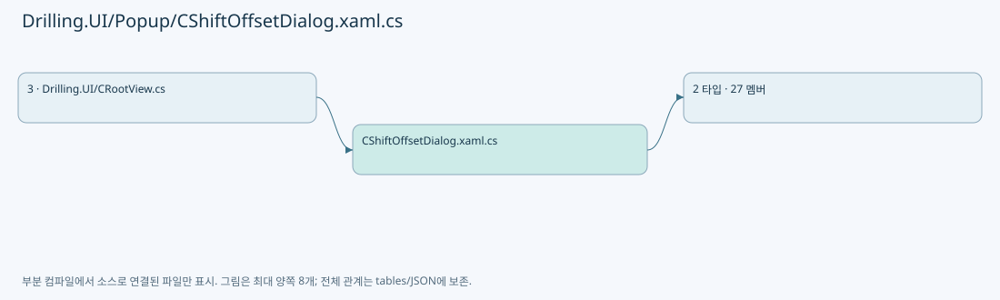
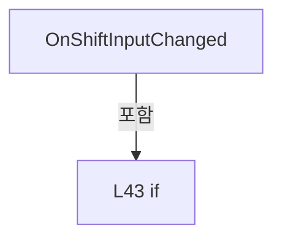
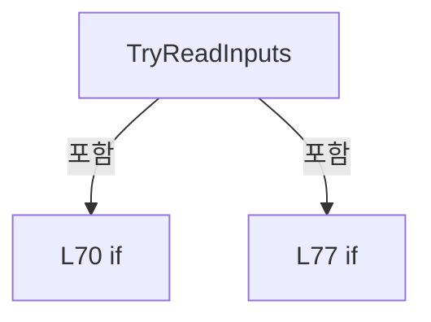
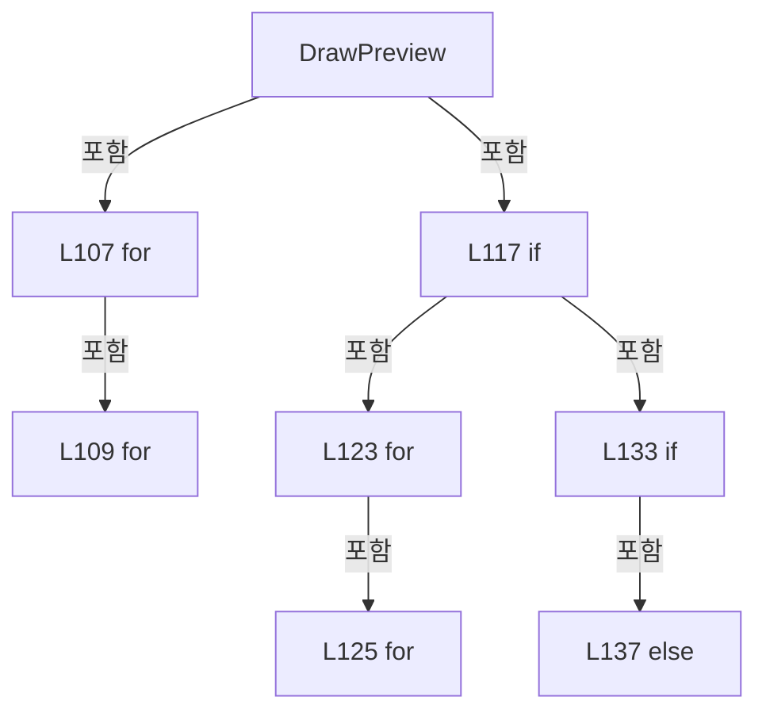
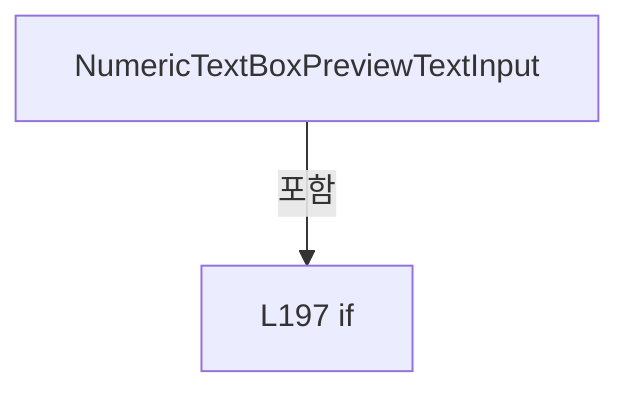
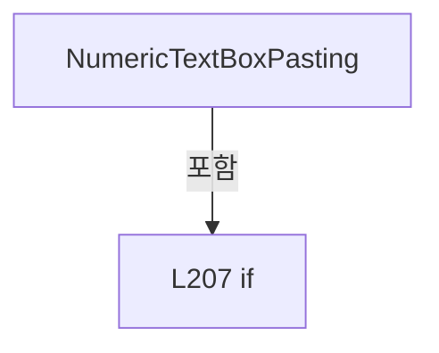
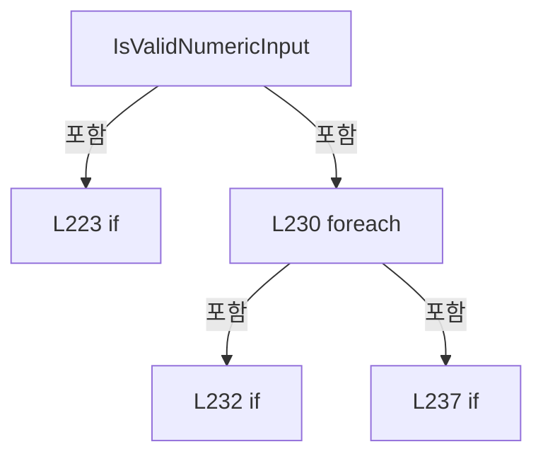
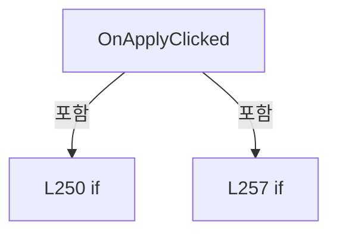
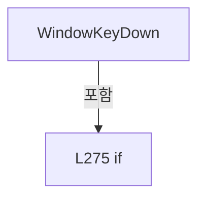

# Drilling.UI/Popup/CShiftOffsetDialog.xaml.cs

| 항목 | 내용 |
| --- | --- |
| 원본 저장소 | https://github.com/kjuws10-rgb/A3Drilling.git |
| 원본 Commit | 5aee8e58439c9b455cae7c9593c9be986c3e682e |
| 원본 SHA256 | 0cc7146a473b5b04a7356a87ca2c75cc42977833e705c9dd35f6174bbc0f0e04 |
| 파일 분류 | code |
| 원본 크기/행 | 10,118 bytes / 288 physical lines |
| 인코딩 | utf-8-sig |
| 검토 범위 | 구문/부분 의미 분석에서 추출한 사실. 동작·물리 단위·실장비 합격을 보증하지 않습니다. |
| 원본 링크 | [고정 Commit 원본](https://github.com/kjuws10-rgb/A3Drilling/blob/5aee8e58439c9b455cae7c9593c9be986c3e682e/Drilling.UI/Popup/CShiftOffsetDialog.xaml.cs) |

## 파일의 역할과 읽는 순서

WPF 화면·사용자 명령·표시 상태를 구성합니다. XAML 이벤트와 코드 비하인드, RootView의 조립 경로를 함께 추적합니다.

## 네임스페이스·타입·상속

| 타입 | 구분 | 원본 범위 | 선언/상속 |
| --- | --- | --- | --- |
| CShiftOffsetDialog | ClassDeclaration | 9–286 | CShiftOffsetDialog: Window |
| ST_SHIFT_OFFSET_HEAD_ROW | RecordDeclaration | 288–288 | ST_SHIFT_OFFSET_HEAD_ROW |

## 멤버 빠른 목록

| 이름 | 종류 | 범위 | 서명 |
| --- | --- | --- | --- |
| _headRowsProvider | FieldDeclaration | L11–11 | System.Func<double, double, System.Collections.Generic.IReadOnlyList<Drilling.UI.Popup.ST_SHIFT_OFFSET_HEAD_ROW>> Drilling.UI.Popup.CShiftOffsetDialog._headRowsProvider |
| _validateApply | FieldDeclaration | L12–12 | System.Func<double, double, string?> Drilling.UI.Popup.CShiftOffsetDialog._validateApply |
| _isLoading | FieldDeclaration | L13–13 | bool Drilling.UI.Popup.CShiftOffsetDialog._isLoading |
| .ctor | ConstructorDeclaration | L14–36 | Drilling.UI.Popup.CShiftOffsetDialog.CShiftOffsetDialog(string, string, System.Func<double, double, System.Collections.Generic.IReadOnlyList<Drilling.UI.Popup.ST_SHIFT_OFFSET_HEAD_ROW>>, System.Func<double, double, string?>) |
| ResultShiftOffsetX | PropertyDeclaration | L38–38 | string Drilling.UI.Popup.CShiftOffsetDialog.ResultShiftOffsetX |
| get_ResultShiftOffsetX | GetAccessorDeclaration | L38–38 | string Drilling.UI.Popup.CShiftOffsetDialog.ResultShiftOffsetX.get |
| set_ResultShiftOffsetX | SetAccessorDeclaration | L38–38 | void Drilling.UI.Popup.CShiftOffsetDialog.ResultShiftOffsetX.set |
| ResultShiftOffsetY | PropertyDeclaration | L39–39 | string Drilling.UI.Popup.CShiftOffsetDialog.ResultShiftOffsetY |
| get_ResultShiftOffsetY | GetAccessorDeclaration | L39–39 | string Drilling.UI.Popup.CShiftOffsetDialog.ResultShiftOffsetY.get |
| set_ResultShiftOffsetY | SetAccessorDeclaration | L39–39 | void Drilling.UI.Popup.CShiftOffsetDialog.ResultShiftOffsetY.set |
| OnShiftInputChanged | MethodDeclaration | L41–49 | void Drilling.UI.Popup.CShiftOffsetDialog.OnShiftInputChanged(object, TextChangedEventArgs) |
| RefreshPreview | MethodDeclaration | L51–65 | void Drilling.UI.Popup.CShiftOffsetDialog.RefreshPreview() |
| TryReadInputs | MethodDeclaration | L67–84 | bool Drilling.UI.Popup.CShiftOffsetDialog.TryReadInputs(out double, out double, out string) |
| TryParseFinite | MethodDeclaration | L86–89 | bool Drilling.UI.Popup.CShiftOffsetDialog.TryParseFinite(string?, out double) |
| DrawPreview | MethodDeclaration | L91–148 | void Drilling.UI.Popup.CShiftOffsetDialog.DrawPreview(double, double, bool) |
| AddRect | MethodDeclaration | L150–163 | void Drilling.UI.Popup.CShiftOffsetDialog.AddRect(double, double, double, double, Brush, Brush, double) |
| AddLine | MethodDeclaration | L165–168 | void Drilling.UI.Popup.CShiftOffsetDialog.AddLine(double, double, double, double, Brush) |
| AddArrow | MethodDeclaration | L170–179 | void Drilling.UI.Popup.CShiftOffsetDialog.AddArrow(double, double, double, double, Brush) |
| AddText | MethodDeclaration | L181–193 | void Drilling.UI.Popup.CShiftOffsetDialog.AddText(string, double, double, Brush) |
| NumericTextBoxPreviewTextInput | MethodDeclaration | L195–203 | void Drilling.UI.Popup.CShiftOffsetDialog.NumericTextBoxPreviewTextInput(object, TextCompositionEventArgs) |
| NumericTextBoxPasting | MethodDeclaration | L205–211 | void Drilling.UI.Popup.CShiftOffsetDialog.NumericTextBoxPasting(object, DataObjectPastingEventArgs) |
| CreateProspectiveValue | MethodDeclaration | L213–219 | string Drilling.UI.Popup.CShiftOffsetDialog.CreateProspectiveValue(TextBox, string) |
| IsValidNumericInput | MethodDeclaration | L221–246 | bool Drilling.UI.Popup.CShiftOffsetDialog.IsValidNumericInput(string) |
| OnApplyClicked | MethodDeclaration | L248–266 | void Drilling.UI.Popup.CShiftOffsetDialog.OnApplyClicked(object, RoutedEventArgs) |
| OnCloseClicked | MethodDeclaration | L268–271 | void Drilling.UI.Popup.CShiftOffsetDialog.OnCloseClicked(object, RoutedEventArgs) |
| WindowKeyDown | MethodDeclaration | L273–280 | void Drilling.UI.Popup.CShiftOffsetDialog.WindowKeyDown(object, KeyEventArgs) |
| Format | MethodDeclaration | L282–285 | string Drilling.UI.Popup.CShiftOffsetDialog.Format(double) |

## 멤버별 상세 계약·호출·처리 해설

### FieldDeclaration `_headRowsProvider` · L11–11

[Drilling.UI/Popup/CShiftOffsetDialog.xaml.cs:11–11](https://github.com/kjuws10-rgb/A3Drilling/blob/5aee8e58439c9b455cae7c9593c9be986c3e682e/Drilling.UI/Popup/CShiftOffsetDialog.xaml.cs#L11-L11)

| 항목 | 실제 추출 값 |
| --- | --- |
| 서명 | System.Func<double, double, System.Collections.Generic.IReadOnlyList<Drilling.UI.Popup.ST_SHIFT_OFFSET_HEAD_ROW>> Drilling.UI.Popup.CShiftOffsetDialog._headRowsProvider |
| 접근/수식자 | Private / private, readonly |
| 반환/값 타입 | System.Func<double, double, System.Collections.Generic.IReadOnlyList<Drilling.UI.Popup.ST_SHIFT_OFFSET_HEAD_ROW>> |
| 소속 타입 | NamedType:Drilling.UI.Popup.CShiftOffsetDialog |

현재 부분 분석에서 직접 연결된 호출자는 없습니다. XAML/이벤트/인터페이스·델리게이트·외부 진입을 추가 확인해야 하며, 미사용으로 판정한 것이 아닙니다.

변경 전 점검: 입력/반환 타입, 위 호출자, 예외/취소 경로, 공유 상태와 저장·전송 소비자를 함께 확인합니다. 값의 단위나 물리 방향을 이름만으로 확정하지 않습니다.

### FieldDeclaration `_validateApply` · L12–12

[Drilling.UI/Popup/CShiftOffsetDialog.xaml.cs:12–12](https://github.com/kjuws10-rgb/A3Drilling/blob/5aee8e58439c9b455cae7c9593c9be986c3e682e/Drilling.UI/Popup/CShiftOffsetDialog.xaml.cs#L12-L12)

| 항목 | 실제 추출 값 |
| --- | --- |
| 서명 | System.Func<double, double, string?> Drilling.UI.Popup.CShiftOffsetDialog._validateApply |
| 접근/수식자 | Private / private, readonly |
| 반환/값 타입 | System.Func<double, double, string?> |
| 소속 타입 | NamedType:Drilling.UI.Popup.CShiftOffsetDialog |

현재 부분 분석에서 직접 연결된 호출자는 없습니다. XAML/이벤트/인터페이스·델리게이트·외부 진입을 추가 확인해야 하며, 미사용으로 판정한 것이 아닙니다.

변경 전 점검: 입력/반환 타입, 위 호출자, 예외/취소 경로, 공유 상태와 저장·전송 소비자를 함께 확인합니다. 값의 단위나 물리 방향을 이름만으로 확정하지 않습니다.

### FieldDeclaration `_isLoading` · L13–13

[Drilling.UI/Popup/CShiftOffsetDialog.xaml.cs:13–13](https://github.com/kjuws10-rgb/A3Drilling/blob/5aee8e58439c9b455cae7c9593c9be986c3e682e/Drilling.UI/Popup/CShiftOffsetDialog.xaml.cs#L13-L13)

| 항목 | 실제 추출 값 |
| --- | --- |
| 서명 | bool Drilling.UI.Popup.CShiftOffsetDialog._isLoading |
| 접근/수식자 | Private / private |
| 반환/값 타입 | bool |
| 소속 타입 | NamedType:Drilling.UI.Popup.CShiftOffsetDialog |

현재 부분 분석에서 직접 연결된 호출자는 없습니다. XAML/이벤트/인터페이스·델리게이트·외부 진입을 추가 확인해야 하며, 미사용으로 판정한 것이 아닙니다.

변경 전 점검: 입력/반환 타입, 위 호출자, 예외/취소 경로, 공유 상태와 저장·전송 소비자를 함께 확인합니다. 값의 단위나 물리 방향을 이름만으로 확정하지 않습니다.

### ConstructorDeclaration `.ctor` · L14–36

[Drilling.UI/Popup/CShiftOffsetDialog.xaml.cs:14–36](https://github.com/kjuws10-rgb/A3Drilling/blob/5aee8e58439c9b455cae7c9593c9be986c3e682e/Drilling.UI/Popup/CShiftOffsetDialog.xaml.cs#L14-L36)

| 항목 | 실제 추출 값 |
| --- | --- |
| 서명 | Drilling.UI.Popup.CShiftOffsetDialog.CShiftOffsetDialog(string, string, System.Func<double, double, System.Collections.Generic.IReadOnlyList<Drilling.UI.Popup.ST_SHIFT_OFFSET_HEAD_ROW>>, System.Func<double, double, string?>) |
| 접근/수식자 | Public / public |
| 반환/값 타입 | void |
| 소속 타입 | NamedType:Drilling.UI.Popup.CShiftOffsetDialog |

입력 계약:

| 이름 | 타입 | 전달 | 선택/기본값 |
| --- | --- | --- | --- |
| shiftOffsetX | string | None | False /  |
| shiftOffsetY | string | None | False /  |
| headRowsProvider | System.Func<double, double, System.Collections.Generic.IReadOnlyList<Drilling.UI.Popup.ST_SHIFT_OFFSET_HEAD_ROW>> | None | False /  |
| validateApply | System.Func<double, double, string?> | None | False /  |

정적 호출자로 확인된 위치:

| 호출 파일/행 | 호출 표현식 | 런타임 분기 가능 |
| --- | --- | --- |
| [Drilling.UI/CRootView.cs:1367–1370](https://github.com/kjuws10-rgb/A3Drilling/blob/5aee8e58439c9b455cae7c9593c9be986c3e682e/Drilling.UI/CRootView.cs#L1367-L1370) | new CShiftOffsetDialog | False |

호출하는 대상과 해석 범위:

| 원본 행 | 표현식 | 분석 상태 | 대상/소스 위치 |
| --- | --- | --- | --- |
| 21 | InitializeComponent | unresolved | None |
| 28 | DataObject.AddPastingHandler | unresolved | None |
| 29 | DataObject.AddPastingHandler | unresolved | None |
| 32 | RefreshPreview | resolved | void Drilling.UI.Popup.CShiftOffsetDialog.RefreshPreview() · Drilling.UI/Popup/CShiftOffsetDialog.xaml.cs:51 |
| 33 | ShiftXTextBox.Focus | unresolved | None |
| 34 | ShiftXTextBox.SelectAll | unresolved | None |

본문의 실제 연산·분기·예외·반환 순서(원문 위치 순):

| 원본 행 | 종류 | 주석 해설 |
| --- | --- | --- |
| 21 | call | 함수·델리게이트 또는 객체 생성자를 호출합니다: InitializeComponent() |
| 22 | assignment | 값을 대상에 대입합니다: _headRowsProvider = headRowsProvider |
| 23 | assignment | 값을 대상에 대입합니다: _validateApply = validateApply |
| 24 | assignment | 값을 대상에 대입합니다: _isLoading = true |
| 25 | assignment | 값을 대상에 대입합니다: ShiftXTextBox.Text = shiftOffsetX |
| 26 | assignment | 값을 대상에 대입합니다: ShiftYTextBox.Text = shiftOffsetY |
| 27 | assignment | 값을 대상에 대입합니다: _isLoading = false |
| 28 | call | 함수·델리게이트 또는 객체 생성자를 호출합니다: DataObject.AddPastingHandler(ShiftXTextBox, NumericTextBoxPasting) |
| 29 | call | 함수·델리게이트 또는 객체 생성자를 호출합니다: DataObject.AddPastingHandler(ShiftYTextBox, NumericTextBoxPasting) |
| 30 | compound-assignment-or-event-subscription | 복합 대입 또는 이벤트 구독/해지 표현입니다: Loaded += (_, _) => { RefreshPreview(); ShiftXTextBox.Focus(); ShiftXTextBox.SelectAll(); } |
| 32 | call | 함수·델리게이트 또는 객체 생성자를 호출합니다: RefreshPreview() |
| 33 | call | 함수·델리게이트 또는 객체 생성자를 호출합니다: ShiftXTextBox.Focus() |
| 34 | call | 함수·델리게이트 또는 객체 생성자를 호출합니다: ShiftXTextBox.SelectAll() |

변경 전 점검: 입력/반환 타입, 위 호출자, 예외/취소 경로, 공유 상태와 저장·전송 소비자를 함께 확인합니다. 값의 단위나 물리 방향을 이름만으로 확정하지 않습니다.

### PropertyDeclaration `ResultShiftOffsetX` · L38–38

[Drilling.UI/Popup/CShiftOffsetDialog.xaml.cs:38–38](https://github.com/kjuws10-rgb/A3Drilling/blob/5aee8e58439c9b455cae7c9593c9be986c3e682e/Drilling.UI/Popup/CShiftOffsetDialog.xaml.cs#L38-L38)

| 항목 | 실제 추출 값 |
| --- | --- |
| 서명 | string Drilling.UI.Popup.CShiftOffsetDialog.ResultShiftOffsetX |
| 접근/수식자 | Public / public |
| 반환/값 타입 | string |
| 소속 타입 | NamedType:Drilling.UI.Popup.CShiftOffsetDialog |

현재 부분 분석에서 직접 연결된 호출자는 없습니다. XAML/이벤트/인터페이스·델리게이트·외부 진입을 추가 확인해야 하며, 미사용으로 판정한 것이 아닙니다.

변경 전 점검: 입력/반환 타입, 위 호출자, 예외/취소 경로, 공유 상태와 저장·전송 소비자를 함께 확인합니다. 값의 단위나 물리 방향을 이름만으로 확정하지 않습니다.

### GetAccessorDeclaration `get_ResultShiftOffsetX` · L38–38

[Drilling.UI/Popup/CShiftOffsetDialog.xaml.cs:38–38](https://github.com/kjuws10-rgb/A3Drilling/blob/5aee8e58439c9b455cae7c9593c9be986c3e682e/Drilling.UI/Popup/CShiftOffsetDialog.xaml.cs#L38-L38)

| 항목 | 실제 추출 값 |
| --- | --- |
| 서명 | string Drilling.UI.Popup.CShiftOffsetDialog.ResultShiftOffsetX.get |
| 접근/수식자 | Public / get |
| 반환/값 타입 | string |
| 소속 타입 | NamedType:Drilling.UI.Popup.CShiftOffsetDialog |

현재 부분 분석에서 직접 연결된 호출자는 없습니다. XAML/이벤트/인터페이스·델리게이트·외부 진입을 추가 확인해야 하며, 미사용으로 판정한 것이 아닙니다.

변경 전 점검: 입력/반환 타입, 위 호출자, 예외/취소 경로, 공유 상태와 저장·전송 소비자를 함께 확인합니다. 값의 단위나 물리 방향을 이름만으로 확정하지 않습니다.

### SetAccessorDeclaration `set_ResultShiftOffsetX` · L38–38

[Drilling.UI/Popup/CShiftOffsetDialog.xaml.cs:38–38](https://github.com/kjuws10-rgb/A3Drilling/blob/5aee8e58439c9b455cae7c9593c9be986c3e682e/Drilling.UI/Popup/CShiftOffsetDialog.xaml.cs#L38-L38)

| 항목 | 실제 추출 값 |
| --- | --- |
| 서명 | void Drilling.UI.Popup.CShiftOffsetDialog.ResultShiftOffsetX.set |
| 접근/수식자 | Private / private, set |
| 반환/값 타입 | void |
| 소속 타입 | NamedType:Drilling.UI.Popup.CShiftOffsetDialog |

입력 계약:

| 이름 | 타입 | 전달 | 선택/기본값 |
| --- | --- | --- | --- |
| value | string | None | False /  |

현재 부분 분석에서 직접 연결된 호출자는 없습니다. XAML/이벤트/인터페이스·델리게이트·외부 진입을 추가 확인해야 하며, 미사용으로 판정한 것이 아닙니다.

변경 전 점검: 입력/반환 타입, 위 호출자, 예외/취소 경로, 공유 상태와 저장·전송 소비자를 함께 확인합니다. 값의 단위나 물리 방향을 이름만으로 확정하지 않습니다.

### PropertyDeclaration `ResultShiftOffsetY` · L39–39

[Drilling.UI/Popup/CShiftOffsetDialog.xaml.cs:39–39](https://github.com/kjuws10-rgb/A3Drilling/blob/5aee8e58439c9b455cae7c9593c9be986c3e682e/Drilling.UI/Popup/CShiftOffsetDialog.xaml.cs#L39-L39)

| 항목 | 실제 추출 값 |
| --- | --- |
| 서명 | string Drilling.UI.Popup.CShiftOffsetDialog.ResultShiftOffsetY |
| 접근/수식자 | Public / public |
| 반환/값 타입 | string |
| 소속 타입 | NamedType:Drilling.UI.Popup.CShiftOffsetDialog |

현재 부분 분석에서 직접 연결된 호출자는 없습니다. XAML/이벤트/인터페이스·델리게이트·외부 진입을 추가 확인해야 하며, 미사용으로 판정한 것이 아닙니다.

변경 전 점검: 입력/반환 타입, 위 호출자, 예외/취소 경로, 공유 상태와 저장·전송 소비자를 함께 확인합니다. 값의 단위나 물리 방향을 이름만으로 확정하지 않습니다.

### GetAccessorDeclaration `get_ResultShiftOffsetY` · L39–39

[Drilling.UI/Popup/CShiftOffsetDialog.xaml.cs:39–39](https://github.com/kjuws10-rgb/A3Drilling/blob/5aee8e58439c9b455cae7c9593c9be986c3e682e/Drilling.UI/Popup/CShiftOffsetDialog.xaml.cs#L39-L39)

| 항목 | 실제 추출 값 |
| --- | --- |
| 서명 | string Drilling.UI.Popup.CShiftOffsetDialog.ResultShiftOffsetY.get |
| 접근/수식자 | Public / get |
| 반환/값 타입 | string |
| 소속 타입 | NamedType:Drilling.UI.Popup.CShiftOffsetDialog |

현재 부분 분석에서 직접 연결된 호출자는 없습니다. XAML/이벤트/인터페이스·델리게이트·외부 진입을 추가 확인해야 하며, 미사용으로 판정한 것이 아닙니다.

변경 전 점검: 입력/반환 타입, 위 호출자, 예외/취소 경로, 공유 상태와 저장·전송 소비자를 함께 확인합니다. 값의 단위나 물리 방향을 이름만으로 확정하지 않습니다.

### SetAccessorDeclaration `set_ResultShiftOffsetY` · L39–39

[Drilling.UI/Popup/CShiftOffsetDialog.xaml.cs:39–39](https://github.com/kjuws10-rgb/A3Drilling/blob/5aee8e58439c9b455cae7c9593c9be986c3e682e/Drilling.UI/Popup/CShiftOffsetDialog.xaml.cs#L39-L39)

| 항목 | 실제 추출 값 |
| --- | --- |
| 서명 | void Drilling.UI.Popup.CShiftOffsetDialog.ResultShiftOffsetY.set |
| 접근/수식자 | Private / private, set |
| 반환/값 타입 | void |
| 소속 타입 | NamedType:Drilling.UI.Popup.CShiftOffsetDialog |

입력 계약:

| 이름 | 타입 | 전달 | 선택/기본값 |
| --- | --- | --- | --- |
| value | string | None | False /  |

현재 부분 분석에서 직접 연결된 호출자는 없습니다. XAML/이벤트/인터페이스·델리게이트·외부 진입을 추가 확인해야 하며, 미사용으로 판정한 것이 아닙니다.

변경 전 점검: 입력/반환 타입, 위 호출자, 예외/취소 경로, 공유 상태와 저장·전송 소비자를 함께 확인합니다. 값의 단위나 물리 방향을 이름만으로 확정하지 않습니다.

### MethodDeclaration `OnShiftInputChanged` · L41–49

[Drilling.UI/Popup/CShiftOffsetDialog.xaml.cs:41–49](https://github.com/kjuws10-rgb/A3Drilling/blob/5aee8e58439c9b455cae7c9593c9be986c3e682e/Drilling.UI/Popup/CShiftOffsetDialog.xaml.cs#L41-L49)

| 항목 | 실제 추출 값 |
| --- | --- |
| 서명 | void Drilling.UI.Popup.CShiftOffsetDialog.OnShiftInputChanged(object, TextChangedEventArgs) |
| 접근/수식자 | Private / private |
| 반환/값 타입 | void |
| 소속 타입 | NamedType:Drilling.UI.Popup.CShiftOffsetDialog |

입력 계약:

| 이름 | 타입 | 전달 | 선택/기본값 |
| --- | --- | --- | --- |
| sender | object | None | False /  |
| e | TextChangedEventArgs | None | False /  |

현재 부분 분석에서 직접 연결된 호출자는 없습니다. XAML/이벤트/인터페이스·델리게이트·외부 진입을 추가 확인해야 하며, 미사용으로 판정한 것이 아닙니다.

호출하는 대상과 해석 범위:

| 원본 행 | 표현식 | 분석 상태 | 대상/소스 위치 |
| --- | --- | --- | --- |
| 48 | RefreshPreview | resolved | void Drilling.UI.Popup.CShiftOffsetDialog.RefreshPreview() · Drilling.UI/Popup/CShiftOffsetDialog.xaml.cs:51 |

본문의 실제 연산·분기·예외·반환 순서(원문 위치 순):

| 원본 행 | 종류 | 주석 해설 |
| --- | --- | --- |
| 43 | if | 조건에 따라 분기합니다: if (_isLoading) |
| 45 | return | 호출자에게 값 또는 제어를 반환합니다: return; |
| 48 | call | 함수·델리게이트 또는 객체 생성자를 호출합니다: RefreshPreview() |

제어 구문의 포함 구조(실제 실행 순서/CFG가 아닌 구문 탐색 그림):

변경 전 점검: 입력/반환 타입, 위 호출자, 예외/취소 경로, 공유 상태와 저장·전송 소비자를 함께 확인합니다. 값의 단위나 물리 방향을 이름만으로 확정하지 않습니다.

### MethodDeclaration `RefreshPreview` · L51–65

[Drilling.UI/Popup/CShiftOffsetDialog.xaml.cs:51–65](https://github.com/kjuws10-rgb/A3Drilling/blob/5aee8e58439c9b455cae7c9593c9be986c3e682e/Drilling.UI/Popup/CShiftOffsetDialog.xaml.cs#L51-L65)

| 항목 | 실제 추출 값 |
| --- | --- |
| 서명 | void Drilling.UI.Popup.CShiftOffsetDialog.RefreshPreview() |
| 접근/수식자 | Private / private |
| 반환/값 타입 | void |
| 소속 타입 | NamedType:Drilling.UI.Popup.CShiftOffsetDialog |

정적 호출자로 확인된 위치:

| 호출 파일/행 | 호출 표현식 | 런타임 분기 가능 |
| --- | --- | --- |
| [Drilling.UI/Popup/CShiftOffsetDialog.xaml.cs:32–32](https://github.com/kjuws10-rgb/A3Drilling/blob/5aee8e58439c9b455cae7c9593c9be986c3e682e/Drilling.UI/Popup/CShiftOffsetDialog.xaml.cs#L32-L32) | RefreshPreview | False |
| [Drilling.UI/Popup/CShiftOffsetDialog.xaml.cs:48–48](https://github.com/kjuws10-rgb/A3Drilling/blob/5aee8e58439c9b455cae7c9593c9be986c3e682e/Drilling.UI/Popup/CShiftOffsetDialog.xaml.cs#L48-L48) | RefreshPreview | False |

호출하는 대상과 해석 범위:

| 원본 행 | 표현식 | 분석 상태 | 대상/소스 위치 |
| --- | --- | --- | --- |
| 53 | TryReadInputs | resolved | bool Drilling.UI.Popup.CShiftOffsetDialog.TryReadInputs(out double, out double, out string) · Drilling.UI/Popup/CShiftOffsetDialog.xaml.cs:67 |
| 56 | Array.Empty<ST_SHIFT_OFFSET_HEAD_ROW> | resolved | Drilling.UI.Popup.ST_SHIFT_OFFSET_HEAD_ROW[] System.Array.Empty<Drilling.UI.Popup.ST_SHIFT_OFFSET_HEAD_ROW>() |
| 57 | DrawPreview | resolved | void Drilling.UI.Popup.CShiftOffsetDialog.DrawPreview(double, double, bool) · Drilling.UI/Popup/CShiftOffsetDialog.xaml.cs:91 |
| 61 | _headRowsProvider | resolved · 동적 구현 선택 가능 | System.Collections.Generic.IReadOnlyList<Drilling.UI.Popup.ST_SHIFT_OFFSET_HEAD_ROW> System.Func<double, double, System.Collections.Generic.IReadOnlyList<Drilling.UI.Popup.ST_SHIFT_OFFSET_HEAD_ROW>>.Invoke(double, double) |
| 63 | DrawPreview | resolved | void Drilling.UI.Popup.CShiftOffsetDialog.DrawPreview(double, double, bool) · Drilling.UI/Popup/CShiftOffsetDialog.xaml.cs:91 |
| 64 | Format | resolved | string Drilling.UI.Popup.CShiftOffsetDialog.Format(double) · Drilling.UI/Popup/CShiftOffsetDialog.xaml.cs:282 |
| 64 | Format | resolved | string Drilling.UI.Popup.CShiftOffsetDialog.Format(double) · Drilling.UI/Popup/CShiftOffsetDialog.xaml.cs:282 |

본문의 실제 연산·분기·예외·반환 순서(원문 위치 순):

| 원본 행 | 종류 | 주석 해설 |
| --- | --- | --- |
| 53 | call | 함수·델리게이트 또는 객체 생성자를 호출합니다: TryReadInputs(out var shiftX, out var shiftY, out var error) |
| 53 | if | 조건에 따라 분기합니다: if (!TryReadInputs(out var shiftX, out var shiftY, out var error)) |
| 55 | assignment | 값을 대상에 대입합니다: StatusText.Text = error |
| 56 | assignment | 값을 대상에 대입합니다: HeadRowsControl.ItemsSource = Array.Empty<ST_SHIFT_OFFSET_HEAD_ROW>() |
| 56 | call | 함수·델리게이트 또는 객체 생성자를 호출합니다: Array.Empty<ST_SHIFT_OFFSET_HEAD_ROW>() |
| 57 | call | 함수·델리게이트 또는 객체 생성자를 호출합니다: DrawPreview(0.0, 0.0, isValid: false) |
| 58 | return | 호출자에게 값 또는 제어를 반환합니다: return; |
| 61 | call | 함수·델리게이트 또는 객체 생성자를 호출합니다: _headRowsProvider(shiftX, shiftY) |
| 61 | local-declaration | 지역 변수를 선언합니다: var rows = _headRowsProvider(shiftX, shiftY); |
| 61 | variable-initializer | 변수의 초기값을 지정합니다: rows = _headRowsProvider(shiftX, shiftY) |
| 62 | assignment | 값을 대상에 대입합니다: HeadRowsControl.ItemsSource = rows |
| 63 | call | 함수·델리게이트 또는 객체 생성자를 호출합니다: DrawPreview(shiftX, shiftY, isValid: true) |
| 64 | assignment | 값을 대상에 대입합니다: StatusText.Text = $"Design Shift X {Format(shiftX)} mm / Y {Format(shiftY)} mm" |
| 64 | call | 함수·델리게이트 또는 객체 생성자를 호출합니다: Format(shiftX) |
| 64 | call | 함수·델리게이트 또는 객체 생성자를 호출합니다: Format(shiftY) |

제어 구문의 포함 구조(실제 실행 순서/CFG가 아닌 구문 탐색 그림):

변경 전 점검: 입력/반환 타입, 위 호출자, 예외/취소 경로, 공유 상태와 저장·전송 소비자를 함께 확인합니다. 값의 단위나 물리 방향을 이름만으로 확정하지 않습니다.

### MethodDeclaration `TryReadInputs` · L67–84

[Drilling.UI/Popup/CShiftOffsetDialog.xaml.cs:67–84](https://github.com/kjuws10-rgb/A3Drilling/blob/5aee8e58439c9b455cae7c9593c9be986c3e682e/Drilling.UI/Popup/CShiftOffsetDialog.xaml.cs#L67-L84)

| 항목 | 실제 추출 값 |
| --- | --- |
| 서명 | bool Drilling.UI.Popup.CShiftOffsetDialog.TryReadInputs(out double, out double, out string) |
| 접근/수식자 | Private / private |
| 반환/값 타입 | bool |
| 소속 타입 | NamedType:Drilling.UI.Popup.CShiftOffsetDialog |

입력 계약:

| 이름 | 타입 | 전달 | 선택/기본값 |
| --- | --- | --- | --- |
| shiftX | double | Out | False /  |
| shiftY | double | Out | False /  |
| error | string | Out | False /  |

정적 호출자로 확인된 위치:

| 호출 파일/행 | 호출 표현식 | 런타임 분기 가능 |
| --- | --- | --- |
| [Drilling.UI/Popup/CShiftOffsetDialog.xaml.cs:53–53](https://github.com/kjuws10-rgb/A3Drilling/blob/5aee8e58439c9b455cae7c9593c9be986c3e682e/Drilling.UI/Popup/CShiftOffsetDialog.xaml.cs#L53-L53) | TryReadInputs | False |
| [Drilling.UI/Popup/CShiftOffsetDialog.xaml.cs:250–250](https://github.com/kjuws10-rgb/A3Drilling/blob/5aee8e58439c9b455cae7c9593c9be986c3e682e/Drilling.UI/Popup/CShiftOffsetDialog.xaml.cs#L250-L250) | TryReadInputs | False |

호출하는 대상과 해석 범위:

| 원본 행 | 표현식 | 분석 상태 | 대상/소스 위치 |
| --- | --- | --- | --- |
| 70 | TryParseFinite | candidate | OverloadResolutionFailure |
| 77 | TryParseFinite | candidate | OverloadResolutionFailure |

본문의 실제 연산·분기·예외·반환 순서(원문 위치 순):

| 원본 행 | 종류 | 주석 해설 |
| --- | --- | --- |
| 69 | assignment | 값을 대상에 대입합니다: error = "" |
| 70 | call | 함수·델리게이트 또는 객체 생성자를 호출합니다: TryParseFinite(ShiftXTextBox.Text, out shiftX) |
| 70 | if | 조건에 따라 분기합니다: if (!TryParseFinite(ShiftXTextBox.Text, out shiftX)) |
| 72 | assignment | 값을 대상에 대입합니다: shiftY = 0.0 |
| 73 | assignment | 값을 대상에 대입합니다: error = "SHIFT OFFSET X 값을 확인하세요." |
| 74 | return | 호출자에게 값 또는 제어를 반환합니다: return false; |
| 77 | call | 함수·델리게이트 또는 객체 생성자를 호출합니다: TryParseFinite(ShiftYTextBox.Text, out shiftY) |
| 77 | if | 조건에 따라 분기합니다: if (!TryParseFinite(ShiftYTextBox.Text, out shiftY)) |
| 79 | assignment | 값을 대상에 대입합니다: error = "SHIFT OFFSET Y 값을 확인하세요." |
| 80 | return | 호출자에게 값 또는 제어를 반환합니다: return false; |
| 83 | return | 호출자에게 값 또는 제어를 반환합니다: return true; |

제어 구문의 포함 구조(실제 실행 순서/CFG가 아닌 구문 탐색 그림):

변경 전 점검: 입력/반환 타입, 위 호출자, 예외/취소 경로, 공유 상태와 저장·전송 소비자를 함께 확인합니다. 값의 단위나 물리 방향을 이름만으로 확정하지 않습니다.

### MethodDeclaration `TryParseFinite` · L86–89

[Drilling.UI/Popup/CShiftOffsetDialog.xaml.cs:86–89](https://github.com/kjuws10-rgb/A3Drilling/blob/5aee8e58439c9b455cae7c9593c9be986c3e682e/Drilling.UI/Popup/CShiftOffsetDialog.xaml.cs#L86-L89)

| 항목 | 실제 추출 값 |
| --- | --- |
| 서명 | bool Drilling.UI.Popup.CShiftOffsetDialog.TryParseFinite(string?, out double) |
| 접근/수식자 | Private / private, static |
| 반환/값 타입 | bool |
| 소속 타입 | NamedType:Drilling.UI.Popup.CShiftOffsetDialog |

입력 계약:

| 이름 | 타입 | 전달 | 선택/기본값 |
| --- | --- | --- | --- |
| text | string? | None | False /  |
| value | double | Out | False /  |

현재 부분 분석에서 직접 연결된 호출자는 없습니다. XAML/이벤트/인터페이스·델리게이트·외부 진입을 추가 확인해야 하며, 미사용으로 판정한 것이 아닙니다.

호출하는 대상과 해석 범위:

| 원본 행 | 표현식 | 분석 상태 | 대상/소스 위치 |
| --- | --- | --- | --- |
| 88 | double.TryParse | resolved | bool double.TryParse(string?, System.Globalization.NumberStyles, System.IFormatProvider?, out double) |
| 88 | (text ?? "").Trim | resolved | string string.Trim() |
| 88 | double.IsFinite | resolved | bool double.IsFinite(double) |

본문의 실제 연산·분기·예외·반환 순서(원문 위치 순):

| 원본 행 | 종류 | 주석 해설 |
| --- | --- | --- |
| 88 | call | 함수·델리게이트 또는 객체 생성자를 호출합니다: double.TryParse((text ?? "").Trim(), NumberStyles.Float, CultureInfo.InvariantCulture, out value) |
| 88 | call | 함수·델리게이트 또는 객체 생성자를 호출합니다: (text ?? "").Trim() |
| 88 | call | 함수·델리게이트 또는 객체 생성자를 호출합니다: double.IsFinite(value) |
| 88 | return | 호출자에게 값 또는 제어를 반환합니다: return double.TryParse((text ?? "").Trim(), NumberStyles.Float, CultureInfo.InvariantCulture, out value) && double.IsFinite(value); |

변경 전 점검: 입력/반환 타입, 위 호출자, 예외/취소 경로, 공유 상태와 저장·전송 소비자를 함께 확인합니다. 값의 단위나 물리 방향을 이름만으로 확정하지 않습니다.

### MethodDeclaration `DrawPreview` · L91–148

[Drilling.UI/Popup/CShiftOffsetDialog.xaml.cs:91–148](https://github.com/kjuws10-rgb/A3Drilling/blob/5aee8e58439c9b455cae7c9593c9be986c3e682e/Drilling.UI/Popup/CShiftOffsetDialog.xaml.cs#L91-L148)

| 항목 | 실제 추출 값 |
| --- | --- |
| 서명 | void Drilling.UI.Popup.CShiftOffsetDialog.DrawPreview(double, double, bool) |
| 접근/수식자 | Private / private |
| 반환/값 타입 | void |
| 소속 타입 | NamedType:Drilling.UI.Popup.CShiftOffsetDialog |

입력 계약:

| 이름 | 타입 | 전달 | 선택/기본값 |
| --- | --- | --- | --- |
| shiftX | double | None | False /  |
| shiftY | double | None | False /  |
| isValid | bool | None | False /  |

정적 호출자로 확인된 위치:

| 호출 파일/행 | 호출 표현식 | 런타임 분기 가능 |
| --- | --- | --- |
| [Drilling.UI/Popup/CShiftOffsetDialog.xaml.cs:57–57](https://github.com/kjuws10-rgb/A3Drilling/blob/5aee8e58439c9b455cae7c9593c9be986c3e682e/Drilling.UI/Popup/CShiftOffsetDialog.xaml.cs#L57-L57) | DrawPreview | False |
| [Drilling.UI/Popup/CShiftOffsetDialog.xaml.cs:63–63](https://github.com/kjuws10-rgb/A3Drilling/blob/5aee8e58439c9b455cae7c9593c9be986c3e682e/Drilling.UI/Popup/CShiftOffsetDialog.xaml.cs#L63-L63) | DrawPreview | False |

호출하는 대상과 해석 범위:

| 원본 행 | 표현식 | 분석 상태 | 대상/소스 위치 |
| --- | --- | --- | --- |
| 93 | PreviewCanvas.Children.Clear | unresolved | None |
| 96 | FindResource | unresolved | None |
| 97 | FindResource | unresolved | None |
| 98 | FindResource | unresolved | None |
| 99 | FindResource | unresolved | None |
| 100 | FindResource | unresolved | None |
| 113 | AddRect | candidate | OverloadResolutionFailure |
| 120 | Math.Clamp | resolved | double System.Math.Clamp(double, double, double) |
| 121 | Math.Clamp | resolved | double System.Math.Clamp(double, double, double) |
| 122 | Math.Abs | resolved | double System.Math.Abs(double) |
| 122 | Math.Abs | resolved | double System.Math.Abs(double) |
| 129 | AddRect | candidate | OverloadResolutionFailure |
| 135 | AddArrow | candidate | OverloadResolutionFailure |
| 139 | AddText | candidate | OverloadResolutionFailure |
| 143 | AddLine | candidate | OverloadResolutionFailure |
| 144 | AddLine | candidate | OverloadResolutionFailure |
| 145 | AddText | candidate | OverloadResolutionFailure |
| 146 | AddText | resolved | void Drilling.UI.Popup.CShiftOffsetDialog.AddText(string, double, double, Brush) · Drilling.UI/Popup/CShiftOffsetDialog.xaml.cs:181 |
| 147 | Format | resolved | string Drilling.UI.Popup.CShiftOffsetDialog.Format(double) · Drilling.UI/Popup/CShiftOffsetDialog.xaml.cs:282 |
| 147 | Format | resolved | string Drilling.UI.Popup.CShiftOffsetDialog.Format(double) · Drilling.UI/Popup/CShiftOffsetDialog.xaml.cs:282 |

본문의 실제 연산·분기·예외·반환 순서(원문 위치 순):

| 원본 행 | 종류 | 주석 해설 |
| --- | --- | --- |
| 93 | call | 함수·델리게이트 또는 객체 생성자를 호출합니다: PreviewCanvas.Children.Clear() |
| 94 | conditional-expression | 조건에 따라 결과식을 선택합니다: PreviewCanvas.ActualWidth > 0 ? PreviewCanvas.ActualWidth : 360.0 |
| 94 | local-declaration | 지역 변수를 선언합니다: var width = PreviewCanvas.ActualWidth > 0 ? PreviewCanvas.ActualWidth : 360.0; |
| 94 | variable-initializer | 변수의 초기값을 지정합니다: width = PreviewCanvas.ActualWidth > 0 ? PreviewCanvas.ActualWidth : 360.0 |
| 95 | conditional-expression | 조건에 따라 결과식을 선택합니다: PreviewCanvas.ActualHeight > 0 ? PreviewCanvas.ActualHeight : 220.0 |
| 95 | local-declaration | 지역 변수를 선언합니다: var height = PreviewCanvas.ActualHeight > 0 ? PreviewCanvas.ActualHeight : 220.0; |
| 95 | variable-initializer | 변수의 초기값을 지정합니다: height = PreviewCanvas.ActualHeight > 0 ? PreviewCanvas.ActualHeight : 220.0 |
| 96 | call | 함수·델리게이트 또는 객체 생성자를 호출합니다: FindResource("PanelBorderBrush") |
| 96 | local-declaration | 지역 변수를 선언합니다: var gridBrush = (Brush)FindResource("PanelBorderBrush"); |
| 96 | variable-initializer | 변수의 초기값을 지정합니다: gridBrush = (Brush)FindResource("PanelBorderBrush") |
| 97 | call | 함수·델리게이트 또는 객체 생성자를 호출합니다: FindResource("ButtonSecondaryBrush") |
| 97 | local-declaration | 지역 변수를 선언합니다: var offFill = (Brush)FindResource("ButtonSecondaryBrush"); |
| 97 | variable-initializer | 변수의 초기값을 지정합니다: offFill = (Brush)FindResource("ButtonSecondaryBrush") |
| 98 | call | 함수·델리게이트 또는 객체 생성자를 호출합니다: FindResource("TextSecondaryBrush") |
| 98 | local-declaration | 지역 변수를 선언합니다: var offStroke = (Brush)FindResource("TextSecondaryBrush"); |
| 98 | variable-initializer | 변수의 초기값을 지정합니다: offStroke = (Brush)FindResource("TextSecondaryBrush") |
| 99 | call | 함수·델리게이트 또는 객체 생성자를 호출합니다: FindResource("StatusReadyBrush") |
| 99 | local-declaration | 지역 변수를 선언합니다: var onStroke = (Brush)FindResource("StatusReadyBrush"); |
| 99 | variable-initializer | 변수의 초기값을 지정합니다: onStroke = (Brush)FindResource("StatusReadyBrush") |
| 100 | call | 함수·델리게이트 또는 객체 생성자를 호출합니다: FindResource("TextSecondaryBrush") |
| 100 | local-declaration | 지역 변수를 선언합니다: var textBrush = (Brush)FindResource("TextSecondaryBrush"); |
| 100 | variable-initializer | 변수의 초기값을 지정합니다: textBrush = (Brush)FindResource("TextSecondaryBrush") |
| 101 | local-declaration | 지역 변수를 선언합니다: var originX = width * 0.27; |
| 101 | variable-initializer | 변수의 초기값을 지정합니다: originX = width * 0.27 |
| 102 | local-declaration | 지역 변수를 선언합니다: var originY = height * 0.62; |
| 102 | variable-initializer | 변수의 초기값을 지정합니다: originY = height * 0.62 |
| 103 | local-declaration | 지역 변수를 선언합니다: const double cellW = 46.0; |
| 103 | variable-initializer | 변수의 초기값을 지정합니다: cellW = 46.0 |
| 104 | local-declaration | 지역 변수를 선언합니다: const double cellH = 30.0; |
| 104 | variable-initializer | 변수의 초기값을 지정합니다: cellH = 30.0 |
| 105 | local-declaration | 지역 변수를 선언합니다: const double gapX = 12.0; |
| 105 | variable-initializer | 변수의 초기값을 지정합니다: gapX = 12.0 |
| 106 | local-declaration | 지역 변수를 선언합니다: const double gapY = 12.0; |
| 106 | variable-initializer | 변수의 초기값을 지정합니다: gapY = 12.0 |
| 107 | variable-initializer | 변수의 초기값을 지정합니다: row = 0 |
| 107 | for | 초기화·조건·증감이 있는 반복입니다: for (var row = 0; row < 3; row++) |
| 109 | variable-initializer | 변수의 초기값을 지정합니다: col = 0 |
| 109 | for | 초기화·조건·증감이 있는 반복입니다: for (var col = 0; col < 4; col++) |
| 111 | local-declaration | 지역 변수를 선언합니다: var x = originX + col * (cellW + gapX); |
| 111 | variable-initializer | 변수의 초기값을 지정합니다: x = originX + col * (cellW + gapX) |
| 112 | local-declaration | 지역 변수를 선언합니다: var y = originY - row * (cellH + gapY); |
| 112 | variable-initializer | 변수의 초기값을 지정합니다: y = originY - row * (cellH + gapY) |
| 113 | call | 함수·델리게이트 또는 객체 생성자를 호출합니다: AddRect(x, y, cellW, cellH, offFill, offStroke, 1.0) |
| 117 | if | 조건에 따라 분기합니다: if (isValid) |
| 119 | local-declaration | 지역 변수를 선언합니다: var vectorScale = 5.5; |
| 119 | variable-initializer | 변수의 초기값을 지정합니다: vectorScale = 5.5 |
| 120 | call | 함수·델리게이트 또는 객체 생성자를 호출합니다: Math.Clamp(shiftX * vectorScale, -75.0, 75.0) |
| 120 | local-declaration | 지역 변수를 선언합니다: var dx = Math.Clamp(shiftX * vectorScale, -75.0, 75.0); |
| 120 | variable-initializer | 변수의 초기값을 지정합니다: dx = Math.Clamp(shiftX * vectorScale, -75.0, 75.0) |
| 121 | call | 함수·델리게이트 또는 객체 생성자를 호출합니다: Math.Clamp(-shiftY * vectorScale, -75.0, 75.0) |
| 121 | local-declaration | 지역 변수를 선언합니다: var dy = Math.Clamp(-shiftY * vectorScale, -75.0, 75.0); |
| 121 | variable-initializer | 변수의 초기값을 지정합니다: dy = Math.Clamp(-shiftY * vectorScale, -75.0, 75.0) |
| 122 | call | 함수·델리게이트 또는 객체 생성자를 호출합니다: Math.Abs(shiftX) |
| 122 | call | 함수·델리게이트 또는 객체 생성자를 호출합니다: Math.Abs(shiftY) |
| 122 | local-declaration | 지역 변수를 선언합니다: var hasShift = Math.Abs(shiftX) >= 0.000001 &#124;&#124; Math.Abs(shiftY) >= 0.000001; |
| 122 | variable-initializer | 변수의 초기값을 지정합니다: hasShift = Math.Abs(shiftX) >= 0.000001 &#124;&#124; Math.Abs(shiftY) >= 0.000001 |
| 123 | variable-initializer | 변수의 초기값을 지정합니다: row = 0 |
| 123 | for | 초기화·조건·증감이 있는 반복입니다: for (var row = 0; row < 3; row++) |
| 125 | variable-initializer | 변수의 초기값을 지정합니다: col = 0 |
| 125 | for | 초기화·조건·증감이 있는 반복입니다: for (var col = 0; col < 4; col++) |
| 127 | local-declaration | 지역 변수를 선언합니다: var x = originX + col * (cellW + gapX) + dx; |
| 127 | variable-initializer | 변수의 초기값을 지정합니다: x = originX + col * (cellW + gapX) + dx |
| 128 | local-declaration | 지역 변수를 선언합니다: var y = originY - row * (cellH + gapY) + dy; |
| 128 | variable-initializer | 변수의 초기값을 지정합니다: y = originY - row * (cellH + gapY) + dy |
| 129 | call | 함수·델리게이트 또는 객체 생성자를 호출합니다: AddRect(x, y, cellW, cellH, Brushes.Transparent, onStroke, 2.0) |
| 133 | if | 조건에 따라 분기합니다: if (hasShift) |
| 135 | call | 함수·델리게이트 또는 객체 생성자를 호출합니다: AddArrow(originX + 28.0, originY - 94.0, originX + 28.0 + dx, originY - 94.0 + dy, onStroke) |
| 137 | else | 앞 조건이 거짓인 경로입니다: else |
| 139 | call | 함수·델리게이트 또는 객체 생성자를 호출합니다: AddText("NO SHIFT", originX + 12.0, originY - 106.0, onStroke) |
| 143 | call | 함수·델리게이트 또는 객체 생성자를 호출합니다: AddLine(24, height - 26, width - 24, height - 26, gridBrush) |
| 144 | call | 함수·델리게이트 또는 객체 생성자를 호출합니다: AddLine(24, height - 26, 24, 24, gridBrush) |
| 145 | call | 함수·델리게이트 또는 객체 생성자를 호출합니다: AddText("Design X", width - 78, height - 22, textBrush) |
| 146 | call | 함수·델리게이트 또는 객체 생성자를 호출합니다: AddText("Design Y", 8, 28, textBrush) |
| 147 | assignment | 값을 대상에 대입합니다: PreviewCaptionText.Text = isValid ? $"Glass 기준 이동: X {Format(shiftX)} mm / Y {Format(shiftY)} mm" : "입력값을 확인하세요." |
| 147 | call | 함수·델리게이트 또는 객체 생성자를 호출합니다: Format(shiftX) |
| 147 | call | 함수·델리게이트 또는 객체 생성자를 호출합니다: Format(shiftY) |
| 147 | conditional-expression | 조건에 따라 결과식을 선택합니다: isValid ? $"Glass 기준 이동: X {Format(shiftX)} mm / Y {Format(shiftY)} mm" : "입력값을 확인하세요." |

제어 구문의 포함 구조(실제 실행 순서/CFG가 아닌 구문 탐색 그림):

변경 전 점검: 입력/반환 타입, 위 호출자, 예외/취소 경로, 공유 상태와 저장·전송 소비자를 함께 확인합니다. 값의 단위나 물리 방향을 이름만으로 확정하지 않습니다.

### MethodDeclaration `AddRect` · L150–163

[Drilling.UI/Popup/CShiftOffsetDialog.xaml.cs:150–163](https://github.com/kjuws10-rgb/A3Drilling/blob/5aee8e58439c9b455cae7c9593c9be986c3e682e/Drilling.UI/Popup/CShiftOffsetDialog.xaml.cs#L150-L163)

| 항목 | 실제 추출 값 |
| --- | --- |
| 서명 | void Drilling.UI.Popup.CShiftOffsetDialog.AddRect(double, double, double, double, Brush, Brush, double) |
| 접근/수식자 | Private / private |
| 반환/값 타입 | void |
| 소속 타입 | NamedType:Drilling.UI.Popup.CShiftOffsetDialog |

입력 계약:

| 이름 | 타입 | 전달 | 선택/기본값 |
| --- | --- | --- | --- |
| x | double | None | False /  |
| y | double | None | False /  |
| width | double | None | False /  |
| height | double | None | False /  |
| fill | Brush | None | False /  |
| stroke | Brush | None | False /  |
| strokeThickness | double | None | False /  |

현재 부분 분석에서 직접 연결된 호출자는 없습니다. XAML/이벤트/인터페이스·델리게이트·외부 진입을 추가 확인해야 하며, 미사용으로 판정한 것이 아닙니다.

호출하는 대상과 해석 범위:

| 원본 행 | 표현식 | 분석 상태 | 대상/소스 위치 |
| --- | --- | --- | --- |
| 152 | new Rectangle | unresolved | None |
| 160 | Canvas.SetLeft | unresolved | None |
| 161 | Canvas.SetTop | unresolved | None |
| 162 | PreviewCanvas.Children.Add | unresolved | None |

본문의 실제 연산·분기·예외·반환 순서(원문 위치 순):

| 원본 행 | 종류 | 주석 해설 |
| --- | --- | --- |
| 152 | call | 함수·델리게이트 또는 객체 생성자를 호출합니다: new Rectangle { Width = width, Height = height, Fill = fill, Stroke = stroke, StrokeThickness = strokeThickness } |
| 152 | local-declaration | 지역 변수를 선언합니다: var rect = new Rectangle { Width = width, Height = height, Fill = fill, Stroke = stroke, StrokeThickness = strokeThickness }; |
| 152 | variable-initializer | 변수의 초기값을 지정합니다: rect = new Rectangle { Width = width, Height = height, Fill = fill, Stroke = stroke, StrokeThickness = strokeThickness } |
| 154 | assignment | 값을 대상에 대입합니다: Width = width |
| 155 | assignment | 값을 대상에 대입합니다: Height = height |
| 156 | assignment | 값을 대상에 대입합니다: Fill = fill |
| 157 | assignment | 값을 대상에 대입합니다: Stroke = stroke |
| 158 | assignment | 값을 대상에 대입합니다: StrokeThickness = strokeThickness |
| 160 | call | 함수·델리게이트 또는 객체 생성자를 호출합니다: Canvas.SetLeft(rect, x) |
| 161 | call | 함수·델리게이트 또는 객체 생성자를 호출합니다: Canvas.SetTop(rect, y) |
| 162 | call | 함수·델리게이트 또는 객체 생성자를 호출합니다: PreviewCanvas.Children.Add(rect) |

변경 전 점검: 입력/반환 타입, 위 호출자, 예외/취소 경로, 공유 상태와 저장·전송 소비자를 함께 확인합니다. 값의 단위나 물리 방향을 이름만으로 확정하지 않습니다.

### MethodDeclaration `AddLine` · L165–168

[Drilling.UI/Popup/CShiftOffsetDialog.xaml.cs:165–168](https://github.com/kjuws10-rgb/A3Drilling/blob/5aee8e58439c9b455cae7c9593c9be986c3e682e/Drilling.UI/Popup/CShiftOffsetDialog.xaml.cs#L165-L168)

| 항목 | 실제 추출 값 |
| --- | --- |
| 서명 | void Drilling.UI.Popup.CShiftOffsetDialog.AddLine(double, double, double, double, Brush) |
| 접근/수식자 | Private / private |
| 반환/값 타입 | void |
| 소속 타입 | NamedType:Drilling.UI.Popup.CShiftOffsetDialog |

입력 계약:

| 이름 | 타입 | 전달 | 선택/기본값 |
| --- | --- | --- | --- |
| x1 | double | None | False /  |
| y1 | double | None | False /  |
| x2 | double | None | False /  |
| y2 | double | None | False /  |
| stroke | Brush | None | False /  |

정적 호출자로 확인된 위치:

| 호출 파일/행 | 호출 표현식 | 런타임 분기 가능 |
| --- | --- | --- |
| [Drilling.UI/Popup/CShiftOffsetDialog.xaml.cs:172–172](https://github.com/kjuws10-rgb/A3Drilling/blob/5aee8e58439c9b455cae7c9593c9be986c3e682e/Drilling.UI/Popup/CShiftOffsetDialog.xaml.cs#L172-L172) | AddLine | False |
| [Drilling.UI/Popup/CShiftOffsetDialog.xaml.cs:177–177](https://github.com/kjuws10-rgb/A3Drilling/blob/5aee8e58439c9b455cae7c9593c9be986c3e682e/Drilling.UI/Popup/CShiftOffsetDialog.xaml.cs#L177-L177) | AddLine | False |
| [Drilling.UI/Popup/CShiftOffsetDialog.xaml.cs:178–178](https://github.com/kjuws10-rgb/A3Drilling/blob/5aee8e58439c9b455cae7c9593c9be986c3e682e/Drilling.UI/Popup/CShiftOffsetDialog.xaml.cs#L178-L178) | AddLine | False |

호출하는 대상과 해석 범위:

| 원본 행 | 표현식 | 분석 상태 | 대상/소스 위치 |
| --- | --- | --- | --- |
| 167 | PreviewCanvas.Children.Add | unresolved | None |
| 167 | new Line | unresolved | None |

본문의 실제 연산·분기·예외·반환 순서(원문 위치 순):

| 원본 행 | 종류 | 주석 해설 |
| --- | --- | --- |
| 167 | assignment | 값을 대상에 대입합니다: X1 = x1 |
| 167 | assignment | 값을 대상에 대입합니다: Y1 = y1 |
| 167 | assignment | 값을 대상에 대입합니다: X2 = x2 |
| 167 | assignment | 값을 대상에 대입합니다: Y2 = y2 |
| 167 | assignment | 값을 대상에 대입합니다: Stroke = stroke |
| 167 | assignment | 값을 대상에 대입합니다: StrokeThickness = 1.0 |
| 167 | call | 함수·델리게이트 또는 객체 생성자를 호출합니다: PreviewCanvas.Children.Add(new Line { X1 = x1, Y1 = y1, X2 = x2, Y2 = y2, Stroke = stroke, StrokeThickness = 1.0 }) |
| 167 | call | 함수·델리게이트 또는 객체 생성자를 호출합니다: new Line { X1 = x1, Y1 = y1, X2 = x2, Y2 = y2, Stroke = stroke, StrokeThickness = 1.0 } |

변경 전 점검: 입력/반환 타입, 위 호출자, 예외/취소 경로, 공유 상태와 저장·전송 소비자를 함께 확인합니다. 값의 단위나 물리 방향을 이름만으로 확정하지 않습니다.

### MethodDeclaration `AddArrow` · L170–179

[Drilling.UI/Popup/CShiftOffsetDialog.xaml.cs:170–179](https://github.com/kjuws10-rgb/A3Drilling/blob/5aee8e58439c9b455cae7c9593c9be986c3e682e/Drilling.UI/Popup/CShiftOffsetDialog.xaml.cs#L170-L179)

| 항목 | 실제 추출 값 |
| --- | --- |
| 서명 | void Drilling.UI.Popup.CShiftOffsetDialog.AddArrow(double, double, double, double, Brush) |
| 접근/수식자 | Private / private |
| 반환/값 타입 | void |
| 소속 타입 | NamedType:Drilling.UI.Popup.CShiftOffsetDialog |

입력 계약:

| 이름 | 타입 | 전달 | 선택/기본값 |
| --- | --- | --- | --- |
| x1 | double | None | False /  |
| y1 | double | None | False /  |
| x2 | double | None | False /  |
| y2 | double | None | False /  |
| stroke | Brush | None | False /  |

현재 부분 분석에서 직접 연결된 호출자는 없습니다. XAML/이벤트/인터페이스·델리게이트·외부 진입을 추가 확인해야 하며, 미사용으로 판정한 것이 아닙니다.

호출하는 대상과 해석 범위:

| 원본 행 | 표현식 | 분석 상태 | 대상/소스 위치 |
| --- | --- | --- | --- |
| 172 | AddLine | resolved | void Drilling.UI.Popup.CShiftOffsetDialog.AddLine(double, double, double, double, Brush) · Drilling.UI/Popup/CShiftOffsetDialog.xaml.cs:165 |
| 173 | Math.Atan2 | resolved | double System.Math.Atan2(double, double) |
| 177 | AddLine | resolved | void Drilling.UI.Popup.CShiftOffsetDialog.AddLine(double, double, double, double, Brush) · Drilling.UI/Popup/CShiftOffsetDialog.xaml.cs:165 |
| 177 | Math.Cos | resolved | double System.Math.Cos(double) |
| 177 | Math.Sin | resolved | double System.Math.Sin(double) |
| 178 | AddLine | resolved | void Drilling.UI.Popup.CShiftOffsetDialog.AddLine(double, double, double, double, Brush) · Drilling.UI/Popup/CShiftOffsetDialog.xaml.cs:165 |
| 178 | Math.Cos | resolved | double System.Math.Cos(double) |
| 178 | Math.Sin | resolved | double System.Math.Sin(double) |

본문의 실제 연산·분기·예외·반환 순서(원문 위치 순):

| 원본 행 | 종류 | 주석 해설 |
| --- | --- | --- |
| 172 | call | 함수·델리게이트 또는 객체 생성자를 호출합니다: AddLine(x1, y1, x2, y2, stroke) |
| 173 | call | 함수·델리게이트 또는 객체 생성자를 호출합니다: Math.Atan2(y2 - y1, x2 - x1) |
| 173 | local-declaration | 지역 변수를 선언합니다: var angle = Math.Atan2(y2 - y1, x2 - x1); |
| 173 | variable-initializer | 변수의 초기값을 지정합니다: angle = Math.Atan2(y2 - y1, x2 - x1) |
| 174 | local-declaration | 지역 변수를 선언합니다: const double length = 9.0; |
| 174 | variable-initializer | 변수의 초기값을 지정합니다: length = 9.0 |
| 175 | local-declaration | 지역 변수를 선언합니다: var left = angle + Math.PI * 0.82; |
| 175 | variable-initializer | 변수의 초기값을 지정합니다: left = angle + Math.PI * 0.82 |
| 176 | local-declaration | 지역 변수를 선언합니다: var right = angle - Math.PI * 0.82; |
| 176 | variable-initializer | 변수의 초기값을 지정합니다: right = angle - Math.PI * 0.82 |
| 177 | call | 함수·델리게이트 또는 객체 생성자를 호출합니다: AddLine(x2, y2, x2 + Math.Cos(left) * length, y2 + Math.Sin(left) * length, stroke) |
| 177 | call | 함수·델리게이트 또는 객체 생성자를 호출합니다: Math.Cos(left) |
| 177 | call | 함수·델리게이트 또는 객체 생성자를 호출합니다: Math.Sin(left) |
| 178 | call | 함수·델리게이트 또는 객체 생성자를 호출합니다: AddLine(x2, y2, x2 + Math.Cos(right) * length, y2 + Math.Sin(right) * length, stroke) |
| 178 | call | 함수·델리게이트 또는 객체 생성자를 호출합니다: Math.Cos(right) |
| 178 | call | 함수·델리게이트 또는 객체 생성자를 호출합니다: Math.Sin(right) |

변경 전 점검: 입력/반환 타입, 위 호출자, 예외/취소 경로, 공유 상태와 저장·전송 소비자를 함께 확인합니다. 값의 단위나 물리 방향을 이름만으로 확정하지 않습니다.

### MethodDeclaration `AddText` · L181–193

[Drilling.UI/Popup/CShiftOffsetDialog.xaml.cs:181–193](https://github.com/kjuws10-rgb/A3Drilling/blob/5aee8e58439c9b455cae7c9593c9be986c3e682e/Drilling.UI/Popup/CShiftOffsetDialog.xaml.cs#L181-L193)

| 항목 | 실제 추출 값 |
| --- | --- |
| 서명 | void Drilling.UI.Popup.CShiftOffsetDialog.AddText(string, double, double, Brush) |
| 접근/수식자 | Private / private |
| 반환/값 타입 | void |
| 소속 타입 | NamedType:Drilling.UI.Popup.CShiftOffsetDialog |

입력 계약:

| 이름 | 타입 | 전달 | 선택/기본값 |
| --- | --- | --- | --- |
| text | string | None | False /  |
| x | double | None | False /  |
| y | double | None | False /  |
| foreground | Brush | None | False /  |

정적 호출자로 확인된 위치:

| 호출 파일/행 | 호출 표현식 | 런타임 분기 가능 |
| --- | --- | --- |
| [Drilling.UI/Popup/CShiftOffsetDialog.xaml.cs:146–146](https://github.com/kjuws10-rgb/A3Drilling/blob/5aee8e58439c9b455cae7c9593c9be986c3e682e/Drilling.UI/Popup/CShiftOffsetDialog.xaml.cs#L146-L146) | AddText | False |

호출하는 대상과 해석 범위:

| 원본 행 | 표현식 | 분석 상태 | 대상/소스 위치 |
| --- | --- | --- | --- |
| 183 | new TextBlock | unresolved | None |
| 190 | Canvas.SetLeft | unresolved | None |
| 191 | Canvas.SetTop | unresolved | None |
| 192 | PreviewCanvas.Children.Add | unresolved | None |

본문의 실제 연산·분기·예외·반환 순서(원문 위치 순):

| 원본 행 | 종류 | 주석 해설 |
| --- | --- | --- |
| 183 | call | 함수·델리게이트 또는 객체 생성자를 호출합니다: new TextBlock { Text = text, Foreground = foreground, FontSize = 12.0, FontWeight = FontWeights.SemiBold } |
| 183 | local-declaration | 지역 변수를 선언합니다: var label = new TextBlock { Text = text, Foreground = foreground, FontSize = 12.0, FontWeight = FontWeights.SemiBold }; |
| 183 | variable-initializer | 변수의 초기값을 지정합니다: label = new TextBlock { Text = text, Foreground = foreground, FontSize = 12.0, FontWeight = FontWeights.SemiBold } |
| 185 | assignment | 값을 대상에 대입합니다: Text = text |
| 186 | assignment | 값을 대상에 대입합니다: Foreground = foreground |
| 187 | assignment | 값을 대상에 대입합니다: FontSize = 12.0 |
| 188 | assignment | 값을 대상에 대입합니다: FontWeight = FontWeights.SemiBold |
| 190 | call | 함수·델리게이트 또는 객체 생성자를 호출합니다: Canvas.SetLeft(label, x) |
| 191 | call | 함수·델리게이트 또는 객체 생성자를 호출합니다: Canvas.SetTop(label, y) |
| 192 | call | 함수·델리게이트 또는 객체 생성자를 호출합니다: PreviewCanvas.Children.Add(label) |

변경 전 점검: 입력/반환 타입, 위 호출자, 예외/취소 경로, 공유 상태와 저장·전송 소비자를 함께 확인합니다. 값의 단위나 물리 방향을 이름만으로 확정하지 않습니다.

### MethodDeclaration `NumericTextBoxPreviewTextInput` · L195–203

[Drilling.UI/Popup/CShiftOffsetDialog.xaml.cs:195–203](https://github.com/kjuws10-rgb/A3Drilling/blob/5aee8e58439c9b455cae7c9593c9be986c3e682e/Drilling.UI/Popup/CShiftOffsetDialog.xaml.cs#L195-L203)

| 항목 | 실제 추출 값 |
| --- | --- |
| 서명 | void Drilling.UI.Popup.CShiftOffsetDialog.NumericTextBoxPreviewTextInput(object, TextCompositionEventArgs) |
| 접근/수식자 | Private / private |
| 반환/값 타입 | void |
| 소속 타입 | NamedType:Drilling.UI.Popup.CShiftOffsetDialog |

입력 계약:

| 이름 | 타입 | 전달 | 선택/기본값 |
| --- | --- | --- | --- |
| sender | object | None | False /  |
| e | TextCompositionEventArgs | None | False /  |

현재 부분 분석에서 직접 연결된 호출자는 없습니다. XAML/이벤트/인터페이스·델리게이트·외부 진입을 추가 확인해야 하며, 미사용으로 판정한 것이 아닙니다.

호출하는 대상과 해석 범위:

| 원본 행 | 표현식 | 분석 상태 | 대상/소스 위치 |
| --- | --- | --- | --- |
| 202 | IsValidNumericInput | resolved | bool Drilling.UI.Popup.CShiftOffsetDialog.IsValidNumericInput(string) · Drilling.UI/Popup/CShiftOffsetDialog.xaml.cs:221 |
| 202 | CreateProspectiveValue | candidate | OverloadResolutionFailure |

본문의 실제 연산·분기·예외·반환 순서(원문 위치 순):

| 원본 행 | 종류 | 주석 해설 |
| --- | --- | --- |
| 197 | if | 조건에 따라 분기합니다: if (sender is not TextBox textBox) |
| 199 | return | 호출자에게 값 또는 제어를 반환합니다: return; |
| 202 | assignment | 값을 대상에 대입합니다: e.Handled = !IsValidNumericInput(CreateProspectiveValue(textBox, e.Text)) |
| 202 | call | 함수·델리게이트 또는 객체 생성자를 호출합니다: IsValidNumericInput(CreateProspectiveValue(textBox, e.Text)) |
| 202 | call | 함수·델리게이트 또는 객체 생성자를 호출합니다: CreateProspectiveValue(textBox, e.Text) |

제어 구문의 포함 구조(실제 실행 순서/CFG가 아닌 구문 탐색 그림):

변경 전 점검: 입력/반환 타입, 위 호출자, 예외/취소 경로, 공유 상태와 저장·전송 소비자를 함께 확인합니다. 값의 단위나 물리 방향을 이름만으로 확정하지 않습니다.

### MethodDeclaration `NumericTextBoxPasting` · L205–211

[Drilling.UI/Popup/CShiftOffsetDialog.xaml.cs:205–211](https://github.com/kjuws10-rgb/A3Drilling/blob/5aee8e58439c9b455cae7c9593c9be986c3e682e/Drilling.UI/Popup/CShiftOffsetDialog.xaml.cs#L205-L211)

| 항목 | 실제 추출 값 |
| --- | --- |
| 서명 | void Drilling.UI.Popup.CShiftOffsetDialog.NumericTextBoxPasting(object, DataObjectPastingEventArgs) |
| 접근/수식자 | Private / private |
| 반환/값 타입 | void |
| 소속 타입 | NamedType:Drilling.UI.Popup.CShiftOffsetDialog |

입력 계약:

| 이름 | 타입 | 전달 | 선택/기본값 |
| --- | --- | --- | --- |
| sender | object | None | False /  |
| e | DataObjectPastingEventArgs | None | False /  |

현재 부분 분석에서 직접 연결된 호출자는 없습니다. XAML/이벤트/인터페이스·델리게이트·외부 진입을 추가 확인해야 하며, 미사용으로 판정한 것이 아닙니다.

호출하는 대상과 해석 범위:

| 원본 행 | 표현식 | 분석 상태 | 대상/소스 위치 |
| --- | --- | --- | --- |
| 207 | e.DataObject.GetDataPresent | unresolved | None |
| 207 | e.DataObject.GetData | unresolved | None |
| 207 | IsValidNumericInput | resolved | bool Drilling.UI.Popup.CShiftOffsetDialog.IsValidNumericInput(string) · Drilling.UI/Popup/CShiftOffsetDialog.xaml.cs:221 |
| 207 | CreateProspectiveValue | resolved | string Drilling.UI.Popup.CShiftOffsetDialog.CreateProspectiveValue(TextBox, string) · Drilling.UI/Popup/CShiftOffsetDialog.xaml.cs:213 |
| 209 | e.CancelCommand | unresolved | None |

본문의 실제 연산·분기·예외·반환 순서(원문 위치 순):

| 원본 행 | 종류 | 주석 해설 |
| --- | --- | --- |
| 207 | call | 함수·델리게이트 또는 객체 생성자를 호출합니다: e.DataObject.GetDataPresent(DataFormats.UnicodeText) |
| 207 | call | 함수·델리게이트 또는 객체 생성자를 호출합니다: e.DataObject.GetData(DataFormats.UnicodeText) |
| 207 | call | 함수·델리게이트 또는 객체 생성자를 호출합니다: IsValidNumericInput(CreateProspectiveValue(textBox, pastedText)) |
| 207 | call | 함수·델리게이트 또는 객체 생성자를 호출합니다: CreateProspectiveValue(textBox, pastedText) |
| 207 | if | 조건에 따라 분기합니다: if (sender is not TextBox textBox &#124;&#124; !e.DataObject.GetDataPresent(DataFormats.UnicodeText) &#124;&#124; e.DataObject.GetData(DataFormats.UnicodeText)is not string pastedText &#124;&#124; !IsValidNumericInput(CreateProspectiveValue(textBox, past…) |
| 209 | call | 함수·델리게이트 또는 객체 생성자를 호출합니다: e.CancelCommand() |

제어 구문의 포함 구조(실제 실행 순서/CFG가 아닌 구문 탐색 그림):

변경 전 점검: 입력/반환 타입, 위 호출자, 예외/취소 경로, 공유 상태와 저장·전송 소비자를 함께 확인합니다. 값의 단위나 물리 방향을 이름만으로 확정하지 않습니다.

### MethodDeclaration `CreateProspectiveValue` · L213–219

[Drilling.UI/Popup/CShiftOffsetDialog.xaml.cs:213–219](https://github.com/kjuws10-rgb/A3Drilling/blob/5aee8e58439c9b455cae7c9593c9be986c3e682e/Drilling.UI/Popup/CShiftOffsetDialog.xaml.cs#L213-L219)

| 항목 | 실제 추출 값 |
| --- | --- |
| 서명 | string Drilling.UI.Popup.CShiftOffsetDialog.CreateProspectiveValue(TextBox, string) |
| 접근/수식자 | Private / private, static |
| 반환/값 타입 | string |
| 소속 타입 | NamedType:Drilling.UI.Popup.CShiftOffsetDialog |

입력 계약:

| 이름 | 타입 | 전달 | 선택/기본값 |
| --- | --- | --- | --- |
| textBox | TextBox | None | False /  |
| input | string | None | False /  |

정적 호출자로 확인된 위치:

| 호출 파일/행 | 호출 표현식 | 런타임 분기 가능 |
| --- | --- | --- |
| [Drilling.UI/Popup/CShiftOffsetDialog.xaml.cs:207–207](https://github.com/kjuws10-rgb/A3Drilling/blob/5aee8e58439c9b455cae7c9593c9be986c3e682e/Drilling.UI/Popup/CShiftOffsetDialog.xaml.cs#L207-L207) | CreateProspectiveValue | False |

호출하는 대상과 해석 범위:

| 원본 행 | 표현식 | 분석 상태 | 대상/소스 위치 |
| --- | --- | --- | --- |
| 216 | Math.Clamp | candidate | OverloadResolutionFailure |
| 217 | Math.Clamp | candidate | OverloadResolutionFailure |
| 218 | text.Remove(start, length).Insert | unresolved | None |
| 218 | text.Remove | unresolved | None |

본문의 실제 연산·분기·예외·반환 순서(원문 위치 순):

| 원본 행 | 종류 | 주석 해설 |
| --- | --- | --- |
| 215 | local-declaration | 지역 변수를 선언합니다: var text = textBox.Text ?? ""; |
| 215 | variable-initializer | 변수의 초기값을 지정합니다: text = textBox.Text ?? "" |
| 216 | call | 함수·델리게이트 또는 객체 생성자를 호출합니다: Math.Clamp(textBox.SelectionStart, 0, text.Length) |
| 216 | local-declaration | 지역 변수를 선언합니다: var start = Math.Clamp(textBox.SelectionStart, 0, text.Length); |
| 216 | variable-initializer | 변수의 초기값을 지정합니다: start = Math.Clamp(textBox.SelectionStart, 0, text.Length) |
| 217 | call | 함수·델리게이트 또는 객체 생성자를 호출합니다: Math.Clamp(textBox.SelectionLength, 0, text.Length - start) |
| 217 | local-declaration | 지역 변수를 선언합니다: var length = Math.Clamp(textBox.SelectionLength, 0, text.Length - start); |
| 217 | variable-initializer | 변수의 초기값을 지정합니다: length = Math.Clamp(textBox.SelectionLength, 0, text.Length - start) |
| 218 | call | 함수·델리게이트 또는 객체 생성자를 호출합니다: text.Remove(start, length).Insert(start, input) |
| 218 | call | 함수·델리게이트 또는 객체 생성자를 호출합니다: text.Remove(start, length) |
| 218 | return | 호출자에게 값 또는 제어를 반환합니다: return text.Remove(start, length).Insert(start, input); |

변경 전 점검: 입력/반환 타입, 위 호출자, 예외/취소 경로, 공유 상태와 저장·전송 소비자를 함께 확인합니다. 값의 단위나 물리 방향을 이름만으로 확정하지 않습니다.

### MethodDeclaration `IsValidNumericInput` · L221–246

[Drilling.UI/Popup/CShiftOffsetDialog.xaml.cs:221–246](https://github.com/kjuws10-rgb/A3Drilling/blob/5aee8e58439c9b455cae7c9593c9be986c3e682e/Drilling.UI/Popup/CShiftOffsetDialog.xaml.cs#L221-L246)

| 항목 | 실제 추출 값 |
| --- | --- |
| 서명 | bool Drilling.UI.Popup.CShiftOffsetDialog.IsValidNumericInput(string) |
| 접근/수식자 | Private / private, static |
| 반환/값 타입 | bool |
| 소속 타입 | NamedType:Drilling.UI.Popup.CShiftOffsetDialog |

입력 계약:

| 이름 | 타입 | 전달 | 선택/기본값 |
| --- | --- | --- | --- |
| value | string | None | False /  |

정적 호출자로 확인된 위치:

| 호출 파일/행 | 호출 표현식 | 런타임 분기 가능 |
| --- | --- | --- |
| [Drilling.UI/Popup/CShiftOffsetDialog.xaml.cs:202–202](https://github.com/kjuws10-rgb/A3Drilling/blob/5aee8e58439c9b455cae7c9593c9be986c3e682e/Drilling.UI/Popup/CShiftOffsetDialog.xaml.cs#L202-L202) | IsValidNumericInput | False |
| [Drilling.UI/Popup/CShiftOffsetDialog.xaml.cs:207–207](https://github.com/kjuws10-rgb/A3Drilling/blob/5aee8e58439c9b455cae7c9593c9be986c3e682e/Drilling.UI/Popup/CShiftOffsetDialog.xaml.cs#L207-L207) | IsValidNumericInput | False |

호출하는 대상과 해석 범위:

| 원본 행 | 표현식 | 분석 상태 | 대상/소스 위치 |
| --- | --- | --- | --- |
| 232 | char.IsDigit | resolved | bool char.IsDigit(char) |

본문의 실제 연산·분기·예외·반환 순서(원문 위치 순):

| 원본 행 | 종류 | 주석 해설 |
| --- | --- | --- |
| 223 | if | 조건에 따라 분기합니다: if (value.Length == 0 &#124;&#124; value == "-") |
| 225 | return | 호출자에게 값 또는 제어를 반환합니다: return true; |
| 228 | conditional-expression | 조건에 따라 결과식을 선택합니다: value[0] == '-' ? value[1..] : value |
| 228 | local-declaration | 지역 변수를 선언합니다: var unsigned = value[0] == '-' ? value[1..] : value; |
| 228 | variable-initializer | 변수의 초기값을 지정합니다: unsigned = value[0] == '-' ? value[1..] : value |
| 229 | local-declaration | 지역 변수를 선언합니다: var decimalPointCount = 0; |
| 229 | variable-initializer | 변수의 초기값을 지정합니다: decimalPointCount = 0 |
| 230 | foreach | 컬렉션 요소를 순회합니다: foreach (var character in unsigned) |
| 232 | call | 함수·델리게이트 또는 객체 생성자를 호출합니다: char.IsDigit(character) |
| 232 | if | 조건에 따라 분기합니다: if (char.IsDigit(character)) |
| 234 | continue | 다음 반복으로 진행합니다: continue; |
| 237 | if | 조건에 따라 분기합니다: if (character == '.' && ++decimalPointCount == 1) |
| 239 | continue | 다음 반복으로 진행합니다: continue; |
| 242 | return | 호출자에게 값 또는 제어를 반환합니다: return false; |
| 245 | return | 호출자에게 값 또는 제어를 반환합니다: return unsigned.Length > 0; |

제어 구문의 포함 구조(실제 실행 순서/CFG가 아닌 구문 탐색 그림):

변경 전 점검: 입력/반환 타입, 위 호출자, 예외/취소 경로, 공유 상태와 저장·전송 소비자를 함께 확인합니다. 값의 단위나 물리 방향을 이름만으로 확정하지 않습니다.

### MethodDeclaration `OnApplyClicked` · L248–266

[Drilling.UI/Popup/CShiftOffsetDialog.xaml.cs:248–266](https://github.com/kjuws10-rgb/A3Drilling/blob/5aee8e58439c9b455cae7c9593c9be986c3e682e/Drilling.UI/Popup/CShiftOffsetDialog.xaml.cs#L248-L266)

| 항목 | 실제 추출 값 |
| --- | --- |
| 서명 | void Drilling.UI.Popup.CShiftOffsetDialog.OnApplyClicked(object, RoutedEventArgs) |
| 접근/수식자 | Private / private |
| 반환/값 타입 | void |
| 소속 타입 | NamedType:Drilling.UI.Popup.CShiftOffsetDialog |

입력 계약:

| 이름 | 타입 | 전달 | 선택/기본값 |
| --- | --- | --- | --- |
| sender | object | None | False /  |
| e | RoutedEventArgs | None | False /  |

현재 부분 분석에서 직접 연결된 호출자는 없습니다. XAML/이벤트/인터페이스·델리게이트·외부 진입을 추가 확인해야 하며, 미사용으로 판정한 것이 아닙니다.

호출하는 대상과 해석 범위:

| 원본 행 | 표현식 | 분석 상태 | 대상/소스 위치 |
| --- | --- | --- | --- |
| 250 | TryReadInputs | resolved | bool Drilling.UI.Popup.CShiftOffsetDialog.TryReadInputs(out double, out double, out string) · Drilling.UI/Popup/CShiftOffsetDialog.xaml.cs:67 |
| 252 | MessageBox.Show | unresolved | None |
| 256 | _validateApply | resolved · 동적 구현 선택 가능 | string? System.Func<double, double, string?>.Invoke(double, double) |
| 257 | string.IsNullOrWhiteSpace | resolved | bool string.IsNullOrWhiteSpace(string?) |
| 259 | MessageBox.Show | unresolved | None |
| 263 | Format | resolved | string Drilling.UI.Popup.CShiftOffsetDialog.Format(double) · Drilling.UI/Popup/CShiftOffsetDialog.xaml.cs:282 |
| 264 | Format | resolved | string Drilling.UI.Popup.CShiftOffsetDialog.Format(double) · Drilling.UI/Popup/CShiftOffsetDialog.xaml.cs:282 |

본문의 실제 연산·분기·예외·반환 순서(원문 위치 순):

| 원본 행 | 종류 | 주석 해설 |
| --- | --- | --- |
| 250 | call | 함수·델리게이트 또는 객체 생성자를 호출합니다: TryReadInputs(out var shiftX, out var shiftY, out var error) |
| 250 | if | 조건에 따라 분기합니다: if (!TryReadInputs(out var shiftX, out var shiftY, out var error)) |
| 252 | call | 함수·델리게이트 또는 객체 생성자를 호출합니다: MessageBox.Show(this, error, "입력값 오류", MessageBoxButton.OK, MessageBoxImage.Warning) |
| 253 | return | 호출자에게 값 또는 제어를 반환합니다: return; |
| 256 | call | 함수·델리게이트 또는 객체 생성자를 호출합니다: _validateApply(shiftX, shiftY) |
| 256 | local-declaration | 지역 변수를 선언합니다: var validationMessage = _validateApply(shiftX, shiftY); |
| 256 | variable-initializer | 변수의 초기값을 지정합니다: validationMessage = _validateApply(shiftX, shiftY) |
| 257 | call | 함수·델리게이트 또는 객체 생성자를 호출합니다: string.IsNullOrWhiteSpace(validationMessage) |
| 257 | if | 조건에 따라 분기합니다: if (!string.IsNullOrWhiteSpace(validationMessage)) |
| 259 | call | 함수·델리게이트 또는 객체 생성자를 호출합니다: MessageBox.Show(this, validationMessage, "Shift Offset 적용 불가", MessageBoxButton.OK, MessageBoxImage.Warning) |
| 260 | return | 호출자에게 값 또는 제어를 반환합니다: return; |
| 263 | assignment | 값을 대상에 대입합니다: ResultShiftOffsetX = Format(shiftX) |
| 263 | call | 함수·델리게이트 또는 객체 생성자를 호출합니다: Format(shiftX) |
| 264 | assignment | 값을 대상에 대입합니다: ResultShiftOffsetY = Format(shiftY) |
| 264 | call | 함수·델리게이트 또는 객체 생성자를 호출합니다: Format(shiftY) |
| 265 | assignment | 값을 대상에 대입합니다: DialogResult = true |

제어 구문의 포함 구조(실제 실행 순서/CFG가 아닌 구문 탐색 그림):

변경 전 점검: 입력/반환 타입, 위 호출자, 예외/취소 경로, 공유 상태와 저장·전송 소비자를 함께 확인합니다. 값의 단위나 물리 방향을 이름만으로 확정하지 않습니다.

### MethodDeclaration `OnCloseClicked` · L268–271

[Drilling.UI/Popup/CShiftOffsetDialog.xaml.cs:268–271](https://github.com/kjuws10-rgb/A3Drilling/blob/5aee8e58439c9b455cae7c9593c9be986c3e682e/Drilling.UI/Popup/CShiftOffsetDialog.xaml.cs#L268-L271)

| 항목 | 실제 추출 값 |
| --- | --- |
| 서명 | void Drilling.UI.Popup.CShiftOffsetDialog.OnCloseClicked(object, RoutedEventArgs) |
| 접근/수식자 | Private / private |
| 반환/값 타입 | void |
| 소속 타입 | NamedType:Drilling.UI.Popup.CShiftOffsetDialog |

입력 계약:

| 이름 | 타입 | 전달 | 선택/기본값 |
| --- | --- | --- | --- |
| sender | object | None | False /  |
| e | RoutedEventArgs | None | False /  |

현재 부분 분석에서 직접 연결된 호출자는 없습니다. XAML/이벤트/인터페이스·델리게이트·외부 진입을 추가 확인해야 하며, 미사용으로 판정한 것이 아닙니다.

본문의 실제 연산·분기·예외·반환 순서(원문 위치 순):

| 원본 행 | 종류 | 주석 해설 |
| --- | --- | --- |
| 270 | assignment | 값을 대상에 대입합니다: DialogResult = false |

변경 전 점검: 입력/반환 타입, 위 호출자, 예외/취소 경로, 공유 상태와 저장·전송 소비자를 함께 확인합니다. 값의 단위나 물리 방향을 이름만으로 확정하지 않습니다.

### MethodDeclaration `WindowKeyDown` · L273–280

[Drilling.UI/Popup/CShiftOffsetDialog.xaml.cs:273–280](https://github.com/kjuws10-rgb/A3Drilling/blob/5aee8e58439c9b455cae7c9593c9be986c3e682e/Drilling.UI/Popup/CShiftOffsetDialog.xaml.cs#L273-L280)

| 항목 | 실제 추출 값 |
| --- | --- |
| 서명 | void Drilling.UI.Popup.CShiftOffsetDialog.WindowKeyDown(object, KeyEventArgs) |
| 접근/수식자 | Private / private |
| 반환/값 타입 | void |
| 소속 타입 | NamedType:Drilling.UI.Popup.CShiftOffsetDialog |

입력 계약:

| 이름 | 타입 | 전달 | 선택/기본값 |
| --- | --- | --- | --- |
| sender | object | None | False /  |
| e | KeyEventArgs | None | False /  |

현재 부분 분석에서 직접 연결된 호출자는 없습니다. XAML/이벤트/인터페이스·델리게이트·외부 진입을 추가 확인해야 하며, 미사용으로 판정한 것이 아닙니다.

본문의 실제 연산·분기·예외·반환 순서(원문 위치 순):

| 원본 행 | 종류 | 주석 해설 |
| --- | --- | --- |
| 275 | if | 조건에 따라 분기합니다: if (e.Key == Key.Escape) |
| 277 | assignment | 값을 대상에 대입합니다: e.Handled = true |
| 278 | assignment | 값을 대상에 대입합니다: DialogResult = false |

제어 구문의 포함 구조(실제 실행 순서/CFG가 아닌 구문 탐색 그림):

변경 전 점검: 입력/반환 타입, 위 호출자, 예외/취소 경로, 공유 상태와 저장·전송 소비자를 함께 확인합니다. 값의 단위나 물리 방향을 이름만으로 확정하지 않습니다.

### MethodDeclaration `Format` · L282–285

[Drilling.UI/Popup/CShiftOffsetDialog.xaml.cs:282–285](https://github.com/kjuws10-rgb/A3Drilling/blob/5aee8e58439c9b455cae7c9593c9be986c3e682e/Drilling.UI/Popup/CShiftOffsetDialog.xaml.cs#L282-L285)

| 항목 | 실제 추출 값 |
| --- | --- |
| 서명 | string Drilling.UI.Popup.CShiftOffsetDialog.Format(double) |
| 접근/수식자 | Private / private, static |
| 반환/값 타입 | string |
| 소속 타입 | NamedType:Drilling.UI.Popup.CShiftOffsetDialog |

입력 계약:

| 이름 | 타입 | 전달 | 선택/기본값 |
| --- | --- | --- | --- |
| value | double | None | False /  |

정적 호출자로 확인된 위치:

| 호출 파일/행 | 호출 표현식 | 런타임 분기 가능 |
| --- | --- | --- |
| [Drilling.UI/Popup/CShiftOffsetDialog.xaml.cs:64–64](https://github.com/kjuws10-rgb/A3Drilling/blob/5aee8e58439c9b455cae7c9593c9be986c3e682e/Drilling.UI/Popup/CShiftOffsetDialog.xaml.cs#L64-L64) | Format | False |
| [Drilling.UI/Popup/CShiftOffsetDialog.xaml.cs:64–64](https://github.com/kjuws10-rgb/A3Drilling/blob/5aee8e58439c9b455cae7c9593c9be986c3e682e/Drilling.UI/Popup/CShiftOffsetDialog.xaml.cs#L64-L64) | Format | False |
| [Drilling.UI/Popup/CShiftOffsetDialog.xaml.cs:147–147](https://github.com/kjuws10-rgb/A3Drilling/blob/5aee8e58439c9b455cae7c9593c9be986c3e682e/Drilling.UI/Popup/CShiftOffsetDialog.xaml.cs#L147-L147) | Format | False |
| [Drilling.UI/Popup/CShiftOffsetDialog.xaml.cs:147–147](https://github.com/kjuws10-rgb/A3Drilling/blob/5aee8e58439c9b455cae7c9593c9be986c3e682e/Drilling.UI/Popup/CShiftOffsetDialog.xaml.cs#L147-L147) | Format | False |
| [Drilling.UI/Popup/CShiftOffsetDialog.xaml.cs:263–263](https://github.com/kjuws10-rgb/A3Drilling/blob/5aee8e58439c9b455cae7c9593c9be986c3e682e/Drilling.UI/Popup/CShiftOffsetDialog.xaml.cs#L263-L263) | Format | False |
| [Drilling.UI/Popup/CShiftOffsetDialog.xaml.cs:264–264](https://github.com/kjuws10-rgb/A3Drilling/blob/5aee8e58439c9b455cae7c9593c9be986c3e682e/Drilling.UI/Popup/CShiftOffsetDialog.xaml.cs#L264-L264) | Format | False |

호출하는 대상과 해석 범위:

| 원본 행 | 표현식 | 분석 상태 | 대상/소스 위치 |
| --- | --- | --- | --- |
| 284 | value.ToString | resolved | string double.ToString(string?, System.IFormatProvider?) |

본문의 실제 연산·분기·예외·반환 순서(원문 위치 순):

| 원본 행 | 종류 | 주석 해설 |
| --- | --- | --- |
| 284 | call | 함수·델리게이트 또는 객체 생성자를 호출합니다: value.ToString("0.###", CultureInfo.InvariantCulture) |
| 284 | return | 호출자에게 값 또는 제어를 반환합니다: return value.ToString("0.###", CultureInfo.InvariantCulture); |

변경 전 점검: 입력/반환 타입, 위 호출자, 예외/취소 경로, 공유 상태와 저장·전송 소비자를 함께 확인합니다. 값의 단위나 물리 방향을 이름만으로 확정하지 않습니다.

## 구문·바인딩 한계

전체 WPF/벤더 SDK/프로젝트별 빌드 조건을 로드한 정식 빌드가 아닙니다. `resolved`는 이 부분 컴파일에서의 심볼 연결이며 virtual/interface/delegate/이벤트/Reflection/XAML의 실제 런타임 구현을 확정하지 않습니다. `candidate`와 `unresolved`는 후속 확인 대상으로 남깁니다.

## 원문 전체 주석 해설본

[원본 모든 행과 행별 해설 보기](../../../annotated/Drilling.UI/Popup/CShiftOffsetDialog.xaml.cs.annotated.txt)

원본을 빠뜨리거나 임의로 줄이지 않았습니다. `L000001 |` 표시는 원본 행 번호, `// 해설`은 별도 설명입니다. 실행용 소스가 아닌 문서입니다.

## 수정·재검증 체크

- 원본 Commit과 현재 작업 파일 SHA가 같은지 먼저 확인합니다. 다르면 이 문서를 과거 버전 자료로 취급합니다.
- 선언·직접 호출·이벤트/인터페이스 경계·설정 소비를 함께 확인합니다. 정적 연결의 빈 곳을 정상 경로로 추정하지 않습니다.
- 저장 형식/단위/식별자·재시도·취소·예외·롤백에 영향을 주는 변경은 상세 해설장과 호출자를 다시 검토합니다.
- 도구의 구문 추출과 별도 정적 추적 해설, 실제 빌드·시뮬레이션·실장비 검증 결과를 분리합니다.
