# Drilling.UI/Popup/CValueInputDialog.xaml.cs

| 항목 | 내용 |
| --- | --- |
| 원본 저장소 | https://github.com/kjuws10-rgb/A3Drilling.git |
| 원본 Commit | 5aee8e58439c9b455cae7c9593c9be986c3e682e |
| 원본 SHA256 | 2b05f6cf626e622daefee01b894f4aba1909dbcd11b77da23e4cda5caf502166 |
| 파일 분류 | code |
| 원본 크기/행 | 7,609 bytes / 223 physical lines |
| 인코딩 | utf-8-sig |
| 검토 범위 | 구문/부분 의미 분석에서 추출한 사실. 동작·물리 단위·실장비 합격을 보증하지 않습니다. |
| 원본 링크 | [고정 Commit 원본](https://github.com/kjuws10-rgb/A3Drilling/blob/5aee8e58439c9b455cae7c9593c9be986c3e682e/Drilling.UI/Popup/CValueInputDialog.xaml.cs) |

## 파일의 역할과 읽는 순서

WPF 화면·사용자 명령·표시 상태를 구성합니다. XAML 이벤트와 코드 비하인드, RootView의 조립 경로를 함께 추적합니다.

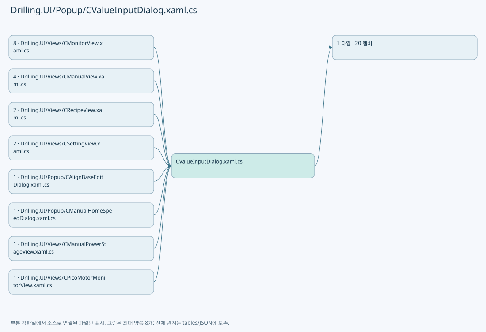

## 네임스페이스·타입·상속

| 타입 | 구분 | 원본 범위 | 선언/상속 |
| --- | --- | --- | --- |
| CValueInputDialog | ClassDeclaration | 8–223 | CValueInputDialog: Window |

## 멤버 빠른 목록

| 이름 | 종류 | 범위 | 서명 |
| --- | --- | --- | --- |
| _dataType | FieldDeclaration | L10–10 | Drilling.Common.Managers.EN_RECIPE_DATA_TYPE Drilling.UI.Popup.CValueInputDialog._dataType |
| _min | FieldDeclaration | L11–11 | double Drilling.UI.Popup.CValueInputDialog._min |
| _max | FieldDeclaration | L12–12 | double Drilling.UI.Popup.CValueInputDialog._max |
| .ctor | ConstructorDeclaration | L13–29 | Drilling.UI.Popup.CValueInputDialog.CValueInputDialog(string, string, Drilling.Common.Managers.EN_RECIPE_DATA_TYPE, double, double) |
| ResultValue | PropertyDeclaration | L31–37 | string Drilling.UI.Popup.CValueInputDialog.ResultValue |
| get_ResultValue | GetAccessorDeclaration | L33–36 | string Drilling.UI.Popup.CValueInputDialog.ResultValue.get |
| BuildKeys | MethodDeclaration | L39–58 | void Drilling.UI.Popup.CValueInputDialog.BuildKeys() |
| KeyClick | MethodDeclaration | L60–77 | void Drilling.UI.Popup.CValueInputDialog.KeyClick(object, RoutedEventArgs) |
| SpaceClick | MethodDeclaration | L79–87 | void Drilling.UI.Popup.CValueInputDialog.SpaceClick(object, RoutedEventArgs) |
| BackClick | MethodDeclaration | L89–101 | void Drilling.UI.Popup.CValueInputDialog.BackClick(object, RoutedEventArgs) |
| ClearClick | MethodDeclaration | L103–106 | void Drilling.UI.Popup.CValueInputDialog.ClearClick(object, RoutedEventArgs) |
| ValueTextBoxPreviewTextInput | MethodDeclaration | L108–113 | void Drilling.UI.Popup.CValueInputDialog.ValueTextBoxPreviewTextInput(object, TextCompositionEventArgs) |
| ValueTextBoxPasting | MethodDeclaration | L115–123 | void Drilling.UI.Popup.CValueInputDialog.ValueTextBoxPasting(object, DataObjectPastingEventArgs) |
| CreateProspectiveValue | MethodDeclaration | L125–131 | string Drilling.UI.Popup.CValueInputDialog.CreateProspectiveValue(string) |
| IsValidNumericInput | MethodDeclaration | L133–154 | bool Drilling.UI.Popup.CValueInputDialog.IsValidNumericInput(string) |
| CancelClick | MethodDeclaration | L156–159 | void Drilling.UI.Popup.CValueInputDialog.CancelClick(object, RoutedEventArgs) |
| WindowKeyDown | MethodDeclaration | L161–173 | void Drilling.UI.Popup.CValueInputDialog.WindowKeyDown(object, KeyEventArgs) |
| OkClick | MethodDeclaration | L175–186 | void Drilling.UI.Popup.CValueInputDialog.OkClick(object, RoutedEventArgs) |
| Validate | MethodDeclaration | L188–211 | bool Drilling.UI.Popup.CValueInputDialog.Validate(string, out string) |
| ValidateRange | MethodDeclaration | L213–222 | bool Drilling.UI.Popup.CValueInputDialog.ValidateRange(double, out string) |

## 멤버별 상세 계약·호출·처리 해설

### FieldDeclaration `_dataType` · L10–10

[Drilling.UI/Popup/CValueInputDialog.xaml.cs:10–10](https://github.com/kjuws10-rgb/A3Drilling/blob/5aee8e58439c9b455cae7c9593c9be986c3e682e/Drilling.UI/Popup/CValueInputDialog.xaml.cs#L10-L10)

| 항목 | 실제 추출 값 |
| --- | --- |
| 서명 | Drilling.Common.Managers.EN_RECIPE_DATA_TYPE Drilling.UI.Popup.CValueInputDialog._dataType |
| 접근/수식자 | Private / private, readonly |
| 반환/값 타입 | Drilling.Common.Managers.EN_RECIPE_DATA_TYPE |
| 소속 타입 | NamedType:Drilling.UI.Popup.CValueInputDialog |

현재 부분 분석에서 직접 연결된 호출자는 없습니다. XAML/이벤트/인터페이스·델리게이트·외부 진입을 추가 확인해야 하며, 미사용으로 판정한 것이 아닙니다.

변경 전 점검: 입력/반환 타입, 위 호출자, 예외/취소 경로, 공유 상태와 저장·전송 소비자를 함께 확인합니다. 값의 단위나 물리 방향을 이름만으로 확정하지 않습니다.

### FieldDeclaration `_min` · L11–11

[Drilling.UI/Popup/CValueInputDialog.xaml.cs:11–11](https://github.com/kjuws10-rgb/A3Drilling/blob/5aee8e58439c9b455cae7c9593c9be986c3e682e/Drilling.UI/Popup/CValueInputDialog.xaml.cs#L11-L11)

| 항목 | 실제 추출 값 |
| --- | --- |
| 서명 | double Drilling.UI.Popup.CValueInputDialog._min |
| 접근/수식자 | Private / private, readonly |
| 반환/값 타입 | double |
| 소속 타입 | NamedType:Drilling.UI.Popup.CValueInputDialog |

현재 부분 분석에서 직접 연결된 호출자는 없습니다. XAML/이벤트/인터페이스·델리게이트·외부 진입을 추가 확인해야 하며, 미사용으로 판정한 것이 아닙니다.

변경 전 점검: 입력/반환 타입, 위 호출자, 예외/취소 경로, 공유 상태와 저장·전송 소비자를 함께 확인합니다. 값의 단위나 물리 방향을 이름만으로 확정하지 않습니다.

### FieldDeclaration `_max` · L12–12

[Drilling.UI/Popup/CValueInputDialog.xaml.cs:12–12](https://github.com/kjuws10-rgb/A3Drilling/blob/5aee8e58439c9b455cae7c9593c9be986c3e682e/Drilling.UI/Popup/CValueInputDialog.xaml.cs#L12-L12)

| 항목 | 실제 추출 값 |
| --- | --- |
| 서명 | double Drilling.UI.Popup.CValueInputDialog._max |
| 접근/수식자 | Private / private, readonly |
| 반환/값 타입 | double |
| 소속 타입 | NamedType:Drilling.UI.Popup.CValueInputDialog |

현재 부분 분석에서 직접 연결된 호출자는 없습니다. XAML/이벤트/인터페이스·델리게이트·외부 진입을 추가 확인해야 하며, 미사용으로 판정한 것이 아닙니다.

변경 전 점검: 입력/반환 타입, 위 호출자, 예외/취소 경로, 공유 상태와 저장·전송 소비자를 함께 확인합니다. 값의 단위나 물리 방향을 이름만으로 확정하지 않습니다.

### ConstructorDeclaration `.ctor` · L13–29

[Drilling.UI/Popup/CValueInputDialog.xaml.cs:13–29](https://github.com/kjuws10-rgb/A3Drilling/blob/5aee8e58439c9b455cae7c9593c9be986c3e682e/Drilling.UI/Popup/CValueInputDialog.xaml.cs#L13-L29)

| 항목 | 실제 추출 값 |
| --- | --- |
| 서명 | Drilling.UI.Popup.CValueInputDialog.CValueInputDialog(string, string, Drilling.Common.Managers.EN_RECIPE_DATA_TYPE, double, double) |
| 접근/수식자 | Public / public |
| 반환/값 타입 | void |
| 소속 타입 | NamedType:Drilling.UI.Popup.CValueInputDialog |

입력 계약:

| 이름 | 타입 | 전달 | 선택/기본값 |
| --- | --- | --- | --- |
| parameter | string | None | False /  |
| value | string | None | False /  |
| dataType | Drilling.Common.Managers.EN_RECIPE_DATA_TYPE | None | False /  |
| min | double | None | False /  |
| max | double | None | False /  |

정적 호출자로 확인된 위치:

| 호출 파일/행 | 호출 표현식 | 런타임 분기 가능 |
| --- | --- | --- |
| [Drilling.UI/Popup/CAlignBaseEditDialog.xaml.cs:32–33](https://github.com/kjuws10-rgb/A3Drilling/blob/5aee8e58439c9b455cae7c9593c9be986c3e682e/Drilling.UI/Popup/CAlignBaseEditDialog.xaml.cs#L32-L33) | new CValueInputDialog | False |
| [Drilling.UI/Popup/CManualHomeSpeedDialog.xaml.cs:24–25](https://github.com/kjuws10-rgb/A3Drilling/blob/5aee8e58439c9b455cae7c9593c9be986c3e682e/Drilling.UI/Popup/CManualHomeSpeedDialog.xaml.cs#L24-L25) | new CValueInputDialog | False |
| [Drilling.UI/Views/CManualPowerStageView.xaml.cs:51–53](https://github.com/kjuws10-rgb/A3Drilling/blob/5aee8e58439c9b455cae7c9593c9be986c3e682e/Drilling.UI/Views/CManualPowerStageView.xaml.cs#L51-L53) | new CValueInputDialog | False |
| [Drilling.UI/Views/CManualView.xaml.cs:107–110](https://github.com/kjuws10-rgb/A3Drilling/blob/5aee8e58439c9b455cae7c9593c9be986c3e682e/Drilling.UI/Views/CManualView.xaml.cs#L107-L110) | new CValueInputDialog | False |
| [Drilling.UI/Views/CManualView.xaml.cs:121–124](https://github.com/kjuws10-rgb/A3Drilling/blob/5aee8e58439c9b455cae7c9593c9be986c3e682e/Drilling.UI/Views/CManualView.xaml.cs#L121-L124) | new CValueInputDialog | False |
| [Drilling.UI/Views/CManualView.xaml.cs:134–137](https://github.com/kjuws10-rgb/A3Drilling/blob/5aee8e58439c9b455cae7c9593c9be986c3e682e/Drilling.UI/Views/CManualView.xaml.cs#L134-L137) | new CValueInputDialog | False |
| [Drilling.UI/Views/CManualView.xaml.cs:147–150](https://github.com/kjuws10-rgb/A3Drilling/blob/5aee8e58439c9b455cae7c9593c9be986c3e682e/Drilling.UI/Views/CManualView.xaml.cs#L147-L150) | new CValueInputDialog | False |
| [Drilling.UI/Views/CMonitorView.xaml.cs:243–246](https://github.com/kjuws10-rgb/A3Drilling/blob/5aee8e58439c9b455cae7c9593c9be986c3e682e/Drilling.UI/Views/CMonitorView.xaml.cs#L243-L246) | new CValueInputDialog | False |
| [Drilling.UI/Views/CMonitorView.xaml.cs:322–325](https://github.com/kjuws10-rgb/A3Drilling/blob/5aee8e58439c9b455cae7c9593c9be986c3e682e/Drilling.UI/Views/CMonitorView.xaml.cs#L322-L325) | new CValueInputDialog | False |
| [Drilling.UI/Views/CMonitorView.xaml.cs:341–344](https://github.com/kjuws10-rgb/A3Drilling/blob/5aee8e58439c9b455cae7c9593c9be986c3e682e/Drilling.UI/Views/CMonitorView.xaml.cs#L341-L344) | new CValueInputDialog | False |
| [Drilling.UI/Views/CMonitorView.xaml.cs:360–363](https://github.com/kjuws10-rgb/A3Drilling/blob/5aee8e58439c9b455cae7c9593c9be986c3e682e/Drilling.UI/Views/CMonitorView.xaml.cs#L360-L363) | new CValueInputDialog | False |
| [Drilling.UI/Views/CMonitorView.xaml.cs:446–449](https://github.com/kjuws10-rgb/A3Drilling/blob/5aee8e58439c9b455cae7c9593c9be986c3e682e/Drilling.UI/Views/CMonitorView.xaml.cs#L446-L449) | new CValueInputDialog | False |
| [Drilling.UI/Views/CMonitorView.xaml.cs:474–477](https://github.com/kjuws10-rgb/A3Drilling/blob/5aee8e58439c9b455cae7c9593c9be986c3e682e/Drilling.UI/Views/CMonitorView.xaml.cs#L474-L477) | new CValueInputDialog | False |
| [Drilling.UI/Views/CMonitorView.xaml.cs:507–510](https://github.com/kjuws10-rgb/A3Drilling/blob/5aee8e58439c9b455cae7c9593c9be986c3e682e/Drilling.UI/Views/CMonitorView.xaml.cs#L507-L510) | new CValueInputDialog | False |
| [Drilling.UI/Views/CMonitorView.xaml.cs:531–534](https://github.com/kjuws10-rgb/A3Drilling/blob/5aee8e58439c9b455cae7c9593c9be986c3e682e/Drilling.UI/Views/CMonitorView.xaml.cs#L531-L534) | new CValueInputDialog | False |
| [Drilling.UI/Views/CPicoMotorMonitorView.xaml.cs:158–161](https://github.com/kjuws10-rgb/A3Drilling/blob/5aee8e58439c9b455cae7c9593c9be986c3e682e/Drilling.UI/Views/CPicoMotorMonitorView.xaml.cs#L158-L161) | new CValueInputDialog | False |
| [Drilling.UI/Views/CRecipeView.xaml.cs:335–338](https://github.com/kjuws10-rgb/A3Drilling/blob/5aee8e58439c9b455cae7c9593c9be986c3e682e/Drilling.UI/Views/CRecipeView.xaml.cs#L335-L338) | new CValueInputDialog | False |
| [Drilling.UI/Views/CRecipeView.xaml.cs:365–368](https://github.com/kjuws10-rgb/A3Drilling/blob/5aee8e58439c9b455cae7c9593c9be986c3e682e/Drilling.UI/Views/CRecipeView.xaml.cs#L365-L368) | new CValueInputDialog | False |
| [Drilling.UI/Views/CSettingView.xaml.cs:53–56](https://github.com/kjuws10-rgb/A3Drilling/blob/5aee8e58439c9b455cae7c9593c9be986c3e682e/Drilling.UI/Views/CSettingView.xaml.cs#L53-L56) | new CValueInputDialog | False |
| [Drilling.UI/Views/CSettingView.xaml.cs:83–86](https://github.com/kjuws10-rgb/A3Drilling/blob/5aee8e58439c9b455cae7c9593c9be986c3e682e/Drilling.UI/Views/CSettingView.xaml.cs#L83-L86) | new CValueInputDialog | False |
| [Drilling.UI/Views/CSimpleCorrectionView.xaml.cs:42–43](https://github.com/kjuws10-rgb/A3Drilling/blob/5aee8e58439c9b455cae7c9593c9be986c3e682e/Drilling.UI/Views/CSimpleCorrectionView.xaml.cs#L42-L43) | new CValueInputDialog | False |

호출하는 대상과 해석 범위:

| 원본 행 | 표현식 | 분석 상태 | 대상/소스 위치 |
| --- | --- | --- | --- |
| 15 | InitializeComponent | unresolved | None |
| 21 | min.ToString | resolved | string double.ToString(System.IFormatProvider?) |
| 21 | max.ToString | resolved | string double.ToString(System.IFormatProvider?) |
| 22 | DataObject.AddPastingHandler | unresolved | None |
| 23 | BuildKeys | resolved | void Drilling.UI.Popup.CValueInputDialog.BuildKeys() · Drilling.UI/Popup/CValueInputDialog.xaml.cs:39 |
| 26 | ValueTextBox.Focus | unresolved | None |

본문의 실제 연산·분기·예외·반환 순서(원문 위치 순):

| 원본 행 | 종류 | 주석 해설 |
| --- | --- | --- |
| 15 | call | 함수·델리게이트 또는 객체 생성자를 호출합니다: InitializeComponent() |
| 16 | assignment | 값을 대상에 대입합니다: _dataType = dataType |
| 17 | assignment | 값을 대상에 대입합니다: _min = min |
| 18 | assignment | 값을 대상에 대입합니다: _max = max |
| 19 | assignment | 값을 대상에 대입합니다: PromptText.Text = parameter |
| 20 | assignment | 값을 대상에 대입합니다: ValueTextBox.Text = value |
| 21 | assignment | 값을 대상에 대입합니다: RangeText.Text = dataType is EN_RECIPE_DATA_TYPE.Int or EN_RECIPE_DATA_TYPE.Double && max > min ? $"Range: {min.ToString(CultureInfo.InvariantCulture)} ~ {max.ToString(CultureInfo.InvariantCulture)}" : dataType == EN_RECIPE_DATA_T |
| 21 | call | 함수·델리게이트 또는 객체 생성자를 호출합니다: min.ToString(CultureInfo.InvariantCulture) |
| 21 | call | 함수·델리게이트 또는 객체 생성자를 호출합니다: max.ToString(CultureInfo.InvariantCulture) |
| 21 | conditional-expression | 조건에 따라 결과식을 선택합니다: dataType is EN_RECIPE_DATA_TYPE.Int or EN_RECIPE_DATA_TYPE.Double && max > min ? $"Range: {min.ToString(CultureInfo.InvariantCulture)} ~ {max.ToString(CultureInfo.InvariantCulture)}" : dataType == EN_RECIPE_DATA_TYPE.String ? "Str |
| 21 | conditional-expression | 조건에 따라 결과식을 선택합니다: dataType == EN_RECIPE_DATA_TYPE.String ? "String input" : "Numeric input" |
| 22 | call | 함수·델리게이트 또는 객체 생성자를 호출합니다: DataObject.AddPastingHandler(ValueTextBox, ValueTextBoxPasting) |
| 23 | call | 함수·델리게이트 또는 객체 생성자를 호출합니다: BuildKeys() |
| 24 | compound-assignment-or-event-subscription | 복합 대입 또는 이벤트 구독/해지 표현입니다: Loaded += (_, _) => { ValueTextBox.Focus(); ValueTextBox.CaretIndex = ValueTextBox.Text.Length; } |
| 26 | call | 함수·델리게이트 또는 객체 생성자를 호출합니다: ValueTextBox.Focus() |
| 27 | assignment | 값을 대상에 대입합니다: ValueTextBox.CaretIndex = ValueTextBox.Text.Length |

변경 전 점검: 입력/반환 타입, 위 호출자, 예외/취소 경로, 공유 상태와 저장·전송 소비자를 함께 확인합니다. 값의 단위나 물리 방향을 이름만으로 확정하지 않습니다.

### PropertyDeclaration `ResultValue` · L31–37

[Drilling.UI/Popup/CValueInputDialog.xaml.cs:31–37](https://github.com/kjuws10-rgb/A3Drilling/blob/5aee8e58439c9b455cae7c9593c9be986c3e682e/Drilling.UI/Popup/CValueInputDialog.xaml.cs#L31-L37)

| 항목 | 실제 추출 값 |
| --- | --- |
| 서명 | string Drilling.UI.Popup.CValueInputDialog.ResultValue |
| 접근/수식자 | Public / public |
| 반환/값 타입 | string |
| 소속 타입 | NamedType:Drilling.UI.Popup.CValueInputDialog |

현재 부분 분석에서 직접 연결된 호출자는 없습니다. XAML/이벤트/인터페이스·델리게이트·외부 진입을 추가 확인해야 하며, 미사용으로 판정한 것이 아닙니다.

변경 전 점검: 입력/반환 타입, 위 호출자, 예외/취소 경로, 공유 상태와 저장·전송 소비자를 함께 확인합니다. 값의 단위나 물리 방향을 이름만으로 확정하지 않습니다.

### GetAccessorDeclaration `get_ResultValue` · L33–36

[Drilling.UI/Popup/CValueInputDialog.xaml.cs:33–36](https://github.com/kjuws10-rgb/A3Drilling/blob/5aee8e58439c9b455cae7c9593c9be986c3e682e/Drilling.UI/Popup/CValueInputDialog.xaml.cs#L33-L36)

| 항목 | 실제 추출 값 |
| --- | --- |
| 서명 | string Drilling.UI.Popup.CValueInputDialog.ResultValue.get |
| 접근/수식자 | Public / get |
| 반환/값 타입 | string |
| 소속 타입 | NamedType:Drilling.UI.Popup.CValueInputDialog |

현재 부분 분석에서 직접 연결된 호출자는 없습니다. XAML/이벤트/인터페이스·델리게이트·외부 진입을 추가 확인해야 하며, 미사용으로 판정한 것이 아닙니다.

본문의 실제 연산·분기·예외·반환 순서(원문 위치 순):

| 원본 행 | 종류 | 주석 해설 |
| --- | --- | --- |
| 35 | return | 호출자에게 값 또는 제어를 반환합니다: return ValueTextBox.Text; |

변경 전 점검: 입력/반환 타입, 위 호출자, 예외/취소 경로, 공유 상태와 저장·전송 소비자를 함께 확인합니다. 값의 단위나 물리 방향을 이름만으로 확정하지 않습니다.

### MethodDeclaration `BuildKeys` · L39–58

[Drilling.UI/Popup/CValueInputDialog.xaml.cs:39–58](https://github.com/kjuws10-rgb/A3Drilling/blob/5aee8e58439c9b455cae7c9593c9be986c3e682e/Drilling.UI/Popup/CValueInputDialog.xaml.cs#L39-L58)

| 항목 | 실제 추출 값 |
| --- | --- |
| 서명 | void Drilling.UI.Popup.CValueInputDialog.BuildKeys() |
| 접근/수식자 | Private / private |
| 반환/값 타입 | void |
| 소속 타입 | NamedType:Drilling.UI.Popup.CValueInputDialog |

정적 호출자로 확인된 위치:

| 호출 파일/행 | 호출 표현식 | 런타임 분기 가능 |
| --- | --- | --- |
| [Drilling.UI/Popup/CValueInputDialog.xaml.cs:23–23](https://github.com/kjuws10-rgb/A3Drilling/blob/5aee8e58439c9b455cae7c9593c9be986c3e682e/Drilling.UI/Popup/CValueInputDialog.xaml.cs#L23-L23) | BuildKeys | False |

호출하는 대상과 해석 범위:

| 원본 행 | 표현식 | 분석 상태 | 대상/소스 위치 |
| --- | --- | --- | --- |
| 45 | "1234567890QWERTYUIOPASDFGHJKLZXCVBNM_-./:".Select(value => value.ToString()).ToArray | resolved | string[] System.Collections.Generic.IEnumerable<string>.ToArray<string>() |
| 45 | "1234567890QWERTYUIOPASDFGHJKLZXCVBNM_-./:".Select | resolved | System.Collections.Generic.IEnumerable<string> System.Collections.Generic.IEnumerable<char>.Select<char, string>(System.Func<char, string>) |
| 45 | value.ToString | resolved · 동적 구현 선택 가능 | string char.ToString() |
| 49 | new Button | unresolved | None |
| 53 | FindResource | unresolved | None |
| 56 | KeyGrid.Children.Add | unresolved | None |

본문의 실제 연산·분기·예외·반환 순서(원문 위치 순):

| 원본 행 | 종류 | 주석 해설 |
| --- | --- | --- |
| 41 | local-declaration | 지역 변수를 선언합니다: var keys = _dataType switch { EN_RECIPE_DATA_TYPE.Int => ["7", "8", "9", "4", "5", "6", "1", "2", "3", "0", "-"], EN_RECIPE_DATA_TYPE.Double => ["7", "8", "9", "4", "5", "6", "1", "2", "3", "0", ".", "-"], _ => "1234567890QWERTYUI |
| 41 | switch-expression | 값별 결과식을 선택합니다: _dataType switch { EN_RECIPE_DATA_TYPE.Int => ["7", "8", "9", "4", "5", "6", "1", "2", "3", "0", "-"], EN_RECIPE_DATA_TYPE.Double => ["7", "8", "9", "4", "5", "6", "1", "2", "3", "0", ".", "-"], _ => "1234567890QWERTYUIOPASDFGHJKL |
| 41 | variable-initializer | 변수의 초기값을 지정합니다: keys = _dataType switch { EN_RECIPE_DATA_TYPE.Int => ["7", "8", "9", "4", "5", "6", "1", "2", "3", "0", "-"], EN_RECIPE_DATA_TYPE.Double => ["7", "8", "9", "4", "5", "6", "1", "2", "3", "0", ".", "-"], _ => "1234567890QWERTYUIOPAS |
| 45 | call | 함수·델리게이트 또는 객체 생성자를 호출합니다: "1234567890QWERTYUIOPASDFGHJKLZXCVBNM_-./:".Select(value => value.ToString()).ToArray() |
| 45 | call | 함수·델리게이트 또는 객체 생성자를 호출합니다: "1234567890QWERTYUIOPASDFGHJKLZXCVBNM_-./:".Select(value => value.ToString()) |
| 45 | call | 함수·델리게이트 또는 객체 생성자를 호출합니다: value.ToString() |
| 46 | assignment | 값을 대상에 대입합니다: KeyGrid.Columns = _dataType == EN_RECIPE_DATA_TYPE.String ? 10 : 3 |
| 46 | conditional-expression | 조건에 따라 결과식을 선택합니다: _dataType == EN_RECIPE_DATA_TYPE.String ? 10 : 3 |
| 47 | foreach | 컬렉션 요소를 순회합니다: foreach (var key in keys) |
| 49 | call | 함수·델리게이트 또는 객체 생성자를 호출합니다: new Button { Content = key, Tag = key, Style = (Style)FindResource("KeyButton") } |
| 49 | local-declaration | 지역 변수를 선언합니다: var button = new Button { Content = key, Tag = key, Style = (Style)FindResource("KeyButton") }; |
| 49 | variable-initializer | 변수의 초기값을 지정합니다: button = new Button { Content = key, Tag = key, Style = (Style)FindResource("KeyButton") } |
| 51 | assignment | 값을 대상에 대입합니다: Content = key |
| 52 | assignment | 값을 대상에 대입합니다: Tag = key |
| 53 | assignment | 값을 대상에 대입합니다: Style = (Style)FindResource("KeyButton") |
| 53 | call | 함수·델리게이트 또는 객체 생성자를 호출합니다: FindResource("KeyButton") |
| 55 | compound-assignment-or-event-subscription | 복합 대입 또는 이벤트 구독/해지 표현입니다: button.Click += KeyClick |
| 56 | call | 함수·델리게이트 또는 객체 생성자를 호출합니다: KeyGrid.Children.Add(button) |

제어 구문의 포함 구조(실제 실행 순서/CFG가 아닌 구문 탐색 그림):

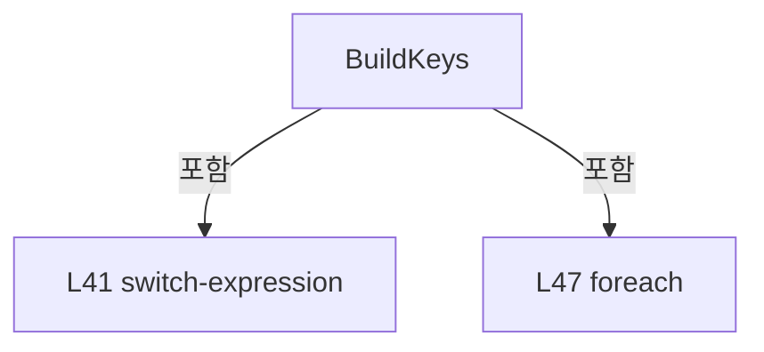

변경 전 점검: 입력/반환 타입, 위 호출자, 예외/취소 경로, 공유 상태와 저장·전송 소비자를 함께 확인합니다. 값의 단위나 물리 방향을 이름만으로 확정하지 않습니다.

### MethodDeclaration `KeyClick` · L60–77

[Drilling.UI/Popup/CValueInputDialog.xaml.cs:60–77](https://github.com/kjuws10-rgb/A3Drilling/blob/5aee8e58439c9b455cae7c9593c9be986c3e682e/Drilling.UI/Popup/CValueInputDialog.xaml.cs#L60-L77)

| 항목 | 실제 추출 값 |
| --- | --- |
| 서명 | void Drilling.UI.Popup.CValueInputDialog.KeyClick(object, RoutedEventArgs) |
| 접근/수식자 | Private / private |
| 반환/값 타입 | void |
| 소속 타입 | NamedType:Drilling.UI.Popup.CValueInputDialog |

입력 계약:

| 이름 | 타입 | 전달 | 선택/기본값 |
| --- | --- | --- | --- |
| sender | object | None | False /  |
| e | RoutedEventArgs | None | False /  |

현재 부분 분석에서 직접 연결된 호출자는 없습니다. XAML/이벤트/인터페이스·델리게이트·외부 진입을 추가 확인해야 하며, 미사용으로 판정한 것이 아닙니다.

호출하는 대상과 해석 범위:

| 원본 행 | 표현식 | 분석 상태 | 대상/소스 위치 |
| --- | --- | --- | --- |
| 66 | ValueTextBox.Text.StartsWith | unresolved | None |
| 71 | ValueTextBox.Text.Contains | unresolved | None |

본문의 실제 연산·분기·예외·반환 순서(원문 위치 순):

| 원본 행 | 종류 | 주석 해설 |
| --- | --- | --- |
| 62 | if | 조건에 따라 분기합니다: if (sender is not Button { Tag: string key }) |
| 63 | return | 호출자에게 값 또는 제어를 반환합니다: return; |
| 64 | if | 조건에 따라 분기합니다: if (key == "-") |
| 66 | assignment | 값을 대상에 대입합니다: ValueTextBox.Text = ValueTextBox.Text.StartsWith('-') ? ValueTextBox.Text[1..] : $"-{ValueTextBox.Text}" |
| 66 | call | 함수·델리게이트 또는 객체 생성자를 호출합니다: ValueTextBox.Text.StartsWith('-') |
| 66 | conditional-expression | 조건에 따라 결과식을 선택합니다: ValueTextBox.Text.StartsWith('-') ? ValueTextBox.Text[1..] : $"-{ValueTextBox.Text}" |
| 67 | assignment | 값을 대상에 대입합니다: ValueTextBox.CaretIndex = ValueTextBox.Text.Length |
| 68 | return | 호출자에게 값 또는 제어를 반환합니다: return; |
| 71 | call | 함수·델리게이트 또는 객체 생성자를 호출합니다: ValueTextBox.Text.Contains('.') |
| 71 | if | 조건에 따라 분기합니다: if (key == "." && ValueTextBox.Text.Contains('.')) |
| 72 | return | 호출자에게 값 또는 제어를 반환합니다: return; |
| 73 | local-declaration | 지역 변수를 선언합니다: var insertionStart = ValueTextBox.SelectionStart; |
| 73 | variable-initializer | 변수의 초기값을 지정합니다: insertionStart = ValueTextBox.SelectionStart |
| 74 | assignment | 값을 대상에 대입합니다: ValueTextBox.SelectedText = key |
| 75 | assignment | 값을 대상에 대입합니다: ValueTextBox.CaretIndex = insertionStart + key.Length |
| 76 | assignment | 값을 대상에 대입합니다: ValueTextBox.SelectionLength = 0 |

제어 구문의 포함 구조(실제 실행 순서/CFG가 아닌 구문 탐색 그림):

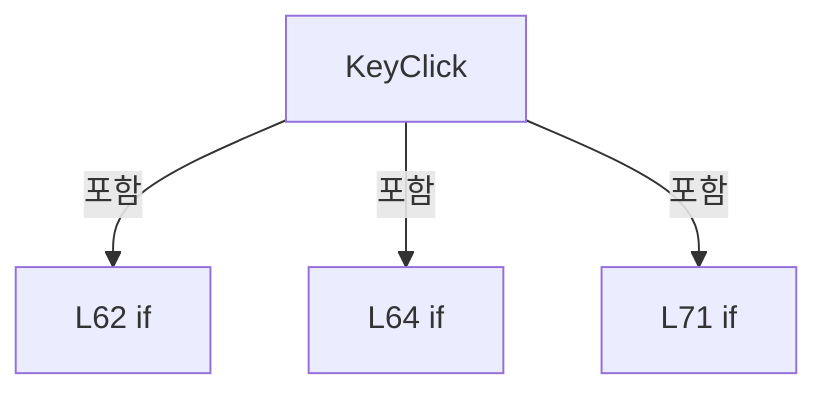

변경 전 점검: 입력/반환 타입, 위 호출자, 예외/취소 경로, 공유 상태와 저장·전송 소비자를 함께 확인합니다. 값의 단위나 물리 방향을 이름만으로 확정하지 않습니다.

### MethodDeclaration `SpaceClick` · L79–87

[Drilling.UI/Popup/CValueInputDialog.xaml.cs:79–87](https://github.com/kjuws10-rgb/A3Drilling/blob/5aee8e58439c9b455cae7c9593c9be986c3e682e/Drilling.UI/Popup/CValueInputDialog.xaml.cs#L79-L87)

| 항목 | 실제 추출 값 |
| --- | --- |
| 서명 | void Drilling.UI.Popup.CValueInputDialog.SpaceClick(object, RoutedEventArgs) |
| 접근/수식자 | Private / private |
| 반환/값 타입 | void |
| 소속 타입 | NamedType:Drilling.UI.Popup.CValueInputDialog |

입력 계약:

| 이름 | 타입 | 전달 | 선택/기본값 |
| --- | --- | --- | --- |
| sender | object | None | False /  |
| e | RoutedEventArgs | None | False /  |

현재 부분 분석에서 직접 연결된 호출자는 없습니다. XAML/이벤트/인터페이스·델리게이트·외부 진입을 추가 확인해야 하며, 미사용으로 판정한 것이 아닙니다.

본문의 실제 연산·분기·예외·반환 순서(원문 위치 순):

| 원본 행 | 종류 | 주석 해설 |
| --- | --- | --- |
| 81 | if | 조건에 따라 분기합니다: if (_dataType != EN_RECIPE_DATA_TYPE.String) |
| 82 | return | 호출자에게 값 또는 제어를 반환합니다: return; |
| 83 | local-declaration | 지역 변수를 선언합니다: var insertionStart = ValueTextBox.SelectionStart; |
| 83 | variable-initializer | 변수의 초기값을 지정합니다: insertionStart = ValueTextBox.SelectionStart |
| 84 | assignment | 값을 대상에 대입합니다: ValueTextBox.SelectedText = " " |
| 85 | assignment | 값을 대상에 대입합니다: ValueTextBox.CaretIndex = insertionStart + 1 |
| 86 | assignment | 값을 대상에 대입합니다: ValueTextBox.SelectionLength = 0 |

제어 구문의 포함 구조(실제 실행 순서/CFG가 아닌 구문 탐색 그림):

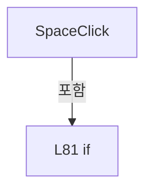

변경 전 점검: 입력/반환 타입, 위 호출자, 예외/취소 경로, 공유 상태와 저장·전송 소비자를 함께 확인합니다. 값의 단위나 물리 방향을 이름만으로 확정하지 않습니다.

### MethodDeclaration `BackClick` · L89–101

[Drilling.UI/Popup/CValueInputDialog.xaml.cs:89–101](https://github.com/kjuws10-rgb/A3Drilling/blob/5aee8e58439c9b455cae7c9593c9be986c3e682e/Drilling.UI/Popup/CValueInputDialog.xaml.cs#L89-L101)

| 항목 | 실제 추출 값 |
| --- | --- |
| 서명 | void Drilling.UI.Popup.CValueInputDialog.BackClick(object, RoutedEventArgs) |
| 접근/수식자 | Private / private |
| 반환/값 타입 | void |
| 소속 타입 | NamedType:Drilling.UI.Popup.CValueInputDialog |

입력 계약:

| 이름 | 타입 | 전달 | 선택/기본값 |
| --- | --- | --- | --- |
| sender | object | None | False /  |
| e | RoutedEventArgs | None | False /  |

현재 부분 분석에서 직접 연결된 호출자는 없습니다. XAML/이벤트/인터페이스·델리게이트·외부 진입을 추가 확인해야 하며, 미사용으로 판정한 것이 아닙니다.

호출하는 대상과 해석 범위:

| 원본 행 | 표현식 | 분석 상태 | 대상/소스 위치 |
| --- | --- | --- | --- |
| 98 | ValueTextBox.Text.Remove | unresolved | None |

본문의 실제 연산·분기·예외·반환 순서(원문 위치 순):

| 원본 행 | 종류 | 주석 해설 |
| --- | --- | --- |
| 91 | if | 조건에 따라 분기합니다: if (ValueTextBox.SelectionLength > 0) |
| 93 | assignment | 값을 대상에 대입합니다: ValueTextBox.SelectedText = "" |
| 95 | else | 앞 조건이 거짓인 경로입니다: else |
| 95 | if | 조건에 따라 분기합니다: if (ValueTextBox.CaretIndex > 0) |
| 97 | local-declaration | 지역 변수를 선언합니다: var caretIndex = ValueTextBox.CaretIndex; |
| 97 | variable-initializer | 변수의 초기값을 지정합니다: caretIndex = ValueTextBox.CaretIndex |
| 98 | assignment | 값을 대상에 대입합니다: ValueTextBox.Text = ValueTextBox.Text.Remove(caretIndex - 1, 1) |
| 98 | call | 함수·델리게이트 또는 객체 생성자를 호출합니다: ValueTextBox.Text.Remove(caretIndex - 1, 1) |
| 99 | assignment | 값을 대상에 대입합니다: ValueTextBox.CaretIndex = caretIndex - 1 |

제어 구문의 포함 구조(실제 실행 순서/CFG가 아닌 구문 탐색 그림):

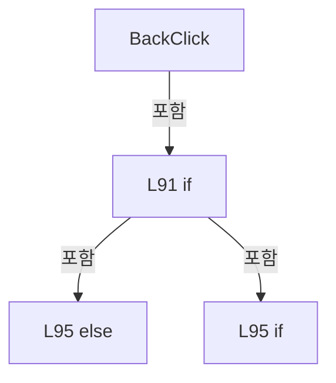

변경 전 점검: 입력/반환 타입, 위 호출자, 예외/취소 경로, 공유 상태와 저장·전송 소비자를 함께 확인합니다. 값의 단위나 물리 방향을 이름만으로 확정하지 않습니다.

### MethodDeclaration `ClearClick` · L103–106

[Drilling.UI/Popup/CValueInputDialog.xaml.cs:103–106](https://github.com/kjuws10-rgb/A3Drilling/blob/5aee8e58439c9b455cae7c9593c9be986c3e682e/Drilling.UI/Popup/CValueInputDialog.xaml.cs#L103-L106)

| 항목 | 실제 추출 값 |
| --- | --- |
| 서명 | void Drilling.UI.Popup.CValueInputDialog.ClearClick(object, RoutedEventArgs) |
| 접근/수식자 | Private / private |
| 반환/값 타입 | void |
| 소속 타입 | NamedType:Drilling.UI.Popup.CValueInputDialog |

입력 계약:

| 이름 | 타입 | 전달 | 선택/기본값 |
| --- | --- | --- | --- |
| sender | object | None | False /  |
| e | RoutedEventArgs | None | False /  |

현재 부분 분석에서 직접 연결된 호출자는 없습니다. XAML/이벤트/인터페이스·델리게이트·외부 진입을 추가 확인해야 하며, 미사용으로 판정한 것이 아닙니다.

호출하는 대상과 해석 범위:

| 원본 행 | 표현식 | 분석 상태 | 대상/소스 위치 |
| --- | --- | --- | --- |
| 105 | ValueTextBox.Clear | unresolved | None |

본문의 실제 연산·분기·예외·반환 순서(원문 위치 순):

| 원본 행 | 종류 | 주석 해설 |
| --- | --- | --- |
| 105 | call | 함수·델리게이트 또는 객체 생성자를 호출합니다: ValueTextBox.Clear() |

변경 전 점검: 입력/반환 타입, 위 호출자, 예외/취소 경로, 공유 상태와 저장·전송 소비자를 함께 확인합니다. 값의 단위나 물리 방향을 이름만으로 확정하지 않습니다.

### MethodDeclaration `ValueTextBoxPreviewTextInput` · L108–113

[Drilling.UI/Popup/CValueInputDialog.xaml.cs:108–113](https://github.com/kjuws10-rgb/A3Drilling/blob/5aee8e58439c9b455cae7c9593c9be986c3e682e/Drilling.UI/Popup/CValueInputDialog.xaml.cs#L108-L113)

| 항목 | 실제 추출 값 |
| --- | --- |
| 서명 | void Drilling.UI.Popup.CValueInputDialog.ValueTextBoxPreviewTextInput(object, TextCompositionEventArgs) |
| 접근/수식자 | Private / private |
| 반환/값 타입 | void |
| 소속 타입 | NamedType:Drilling.UI.Popup.CValueInputDialog |

입력 계약:

| 이름 | 타입 | 전달 | 선택/기본값 |
| --- | --- | --- | --- |
| sender | object | None | False /  |
| e | TextCompositionEventArgs | None | False /  |

현재 부분 분석에서 직접 연결된 호출자는 없습니다. XAML/이벤트/인터페이스·델리게이트·외부 진입을 추가 확인해야 하며, 미사용으로 판정한 것이 아닙니다.

호출하는 대상과 해석 범위:

| 원본 행 | 표현식 | 분석 상태 | 대상/소스 위치 |
| --- | --- | --- | --- |
| 112 | IsValidNumericInput | resolved | bool Drilling.UI.Popup.CValueInputDialog.IsValidNumericInput(string) · Drilling.UI/Popup/CValueInputDialog.xaml.cs:133 |
| 112 | CreateProspectiveValue | candidate | OverloadResolutionFailure |

본문의 실제 연산·분기·예외·반환 순서(원문 위치 순):

| 원본 행 | 종류 | 주석 해설 |
| --- | --- | --- |
| 110 | if | 조건에 따라 분기합니다: if (_dataType == EN_RECIPE_DATA_TYPE.String) |
| 111 | return | 호출자에게 값 또는 제어를 반환합니다: return; |
| 112 | assignment | 값을 대상에 대입합니다: e.Handled = !IsValidNumericInput(CreateProspectiveValue(e.Text)) |
| 112 | call | 함수·델리게이트 또는 객체 생성자를 호출합니다: IsValidNumericInput(CreateProspectiveValue(e.Text)) |
| 112 | call | 함수·델리게이트 또는 객체 생성자를 호출합니다: CreateProspectiveValue(e.Text) |

제어 구문의 포함 구조(실제 실행 순서/CFG가 아닌 구문 탐색 그림):

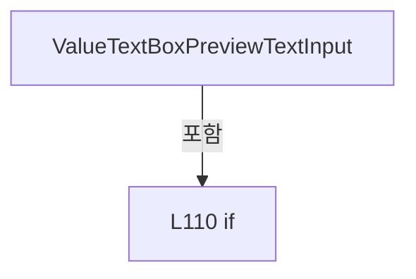

변경 전 점검: 입력/반환 타입, 위 호출자, 예외/취소 경로, 공유 상태와 저장·전송 소비자를 함께 확인합니다. 값의 단위나 물리 방향을 이름만으로 확정하지 않습니다.

### MethodDeclaration `ValueTextBoxPasting` · L115–123

[Drilling.UI/Popup/CValueInputDialog.xaml.cs:115–123](https://github.com/kjuws10-rgb/A3Drilling/blob/5aee8e58439c9b455cae7c9593c9be986c3e682e/Drilling.UI/Popup/CValueInputDialog.xaml.cs#L115-L123)

| 항목 | 실제 추출 값 |
| --- | --- |
| 서명 | void Drilling.UI.Popup.CValueInputDialog.ValueTextBoxPasting(object, DataObjectPastingEventArgs) |
| 접근/수식자 | Private / private |
| 반환/값 타입 | void |
| 소속 타입 | NamedType:Drilling.UI.Popup.CValueInputDialog |

입력 계약:

| 이름 | 타입 | 전달 | 선택/기본값 |
| --- | --- | --- | --- |
| sender | object | None | False /  |
| e | DataObjectPastingEventArgs | None | False /  |

현재 부분 분석에서 직접 연결된 호출자는 없습니다. XAML/이벤트/인터페이스·델리게이트·외부 진입을 추가 확인해야 하며, 미사용으로 판정한 것이 아닙니다.

호출하는 대상과 해석 범위:

| 원본 행 | 표현식 | 분석 상태 | 대상/소스 위치 |
| --- | --- | --- | --- |
| 119 | e.DataObject.GetDataPresent | unresolved | None |
| 119 | e.DataObject.GetData | unresolved | None |
| 119 | IsValidNumericInput | resolved | bool Drilling.UI.Popup.CValueInputDialog.IsValidNumericInput(string) · Drilling.UI/Popup/CValueInputDialog.xaml.cs:133 |
| 119 | CreateProspectiveValue | resolved | string Drilling.UI.Popup.CValueInputDialog.CreateProspectiveValue(string) · Drilling.UI/Popup/CValueInputDialog.xaml.cs:125 |
| 121 | e.CancelCommand | unresolved | None |

본문의 실제 연산·분기·예외·반환 순서(원문 위치 순):

| 원본 행 | 종류 | 주석 해설 |
| --- | --- | --- |
| 117 | if | 조건에 따라 분기합니다: if (_dataType == EN_RECIPE_DATA_TYPE.String) |
| 118 | return | 호출자에게 값 또는 제어를 반환합니다: return; |
| 119 | call | 함수·델리게이트 또는 객체 생성자를 호출합니다: e.DataObject.GetDataPresent(DataFormats.UnicodeText) |
| 119 | call | 함수·델리게이트 또는 객체 생성자를 호출합니다: e.DataObject.GetData(DataFormats.UnicodeText) |
| 119 | call | 함수·델리게이트 또는 객체 생성자를 호출합니다: IsValidNumericInput(CreateProspectiveValue(pastedText)) |
| 119 | call | 함수·델리게이트 또는 객체 생성자를 호출합니다: CreateProspectiveValue(pastedText) |
| 119 | if | 조건에 따라 분기합니다: if (!e.DataObject.GetDataPresent(DataFormats.UnicodeText) &#124;&#124; e.DataObject.GetData(DataFormats.UnicodeText)is not string pastedText &#124;&#124; !IsValidNumericInput(CreateProspectiveValue(pastedText))) |
| 121 | call | 함수·델리게이트 또는 객체 생성자를 호출합니다: e.CancelCommand() |

제어 구문의 포함 구조(실제 실행 순서/CFG가 아닌 구문 탐색 그림):

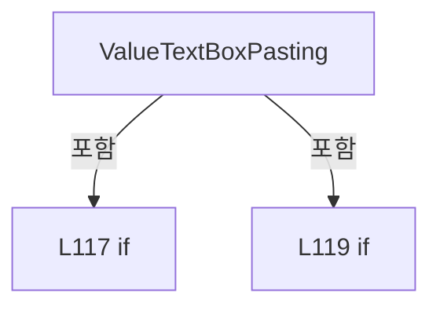

변경 전 점검: 입력/반환 타입, 위 호출자, 예외/취소 경로, 공유 상태와 저장·전송 소비자를 함께 확인합니다. 값의 단위나 물리 방향을 이름만으로 확정하지 않습니다.

### MethodDeclaration `CreateProspectiveValue` · L125–131

[Drilling.UI/Popup/CValueInputDialog.xaml.cs:125–131](https://github.com/kjuws10-rgb/A3Drilling/blob/5aee8e58439c9b455cae7c9593c9be986c3e682e/Drilling.UI/Popup/CValueInputDialog.xaml.cs#L125-L131)

| 항목 | 실제 추출 값 |
| --- | --- |
| 서명 | string Drilling.UI.Popup.CValueInputDialog.CreateProspectiveValue(string) |
| 접근/수식자 | Private / private |
| 반환/값 타입 | string |
| 소속 타입 | NamedType:Drilling.UI.Popup.CValueInputDialog |

입력 계약:

| 이름 | 타입 | 전달 | 선택/기본값 |
| --- | --- | --- | --- |
| input | string | None | False /  |

정적 호출자로 확인된 위치:

| 호출 파일/행 | 호출 표현식 | 런타임 분기 가능 |
| --- | --- | --- |
| [Drilling.UI/Popup/CValueInputDialog.xaml.cs:119–119](https://github.com/kjuws10-rgb/A3Drilling/blob/5aee8e58439c9b455cae7c9593c9be986c3e682e/Drilling.UI/Popup/CValueInputDialog.xaml.cs#L119-L119) | CreateProspectiveValue | False |

호출하는 대상과 해석 범위:

| 원본 행 | 표현식 | 분석 상태 | 대상/소스 위치 |
| --- | --- | --- | --- |
| 128 | Math.Clamp | candidate | OverloadResolutionFailure |
| 129 | Math.Clamp | candidate | OverloadResolutionFailure |
| 130 | text.Remove(start, length).Insert | unresolved | None |
| 130 | text.Remove | unresolved | None |

본문의 실제 연산·분기·예외·반환 순서(원문 위치 순):

| 원본 행 | 종류 | 주석 해설 |
| --- | --- | --- |
| 127 | local-declaration | 지역 변수를 선언합니다: var text = ValueTextBox.Text ?? ""; |
| 127 | variable-initializer | 변수의 초기값을 지정합니다: text = ValueTextBox.Text ?? "" |
| 128 | call | 함수·델리게이트 또는 객체 생성자를 호출합니다: Math.Clamp(ValueTextBox.SelectionStart, 0, text.Length) |
| 128 | local-declaration | 지역 변수를 선언합니다: var start = Math.Clamp(ValueTextBox.SelectionStart, 0, text.Length); |
| 128 | variable-initializer | 변수의 초기값을 지정합니다: start = Math.Clamp(ValueTextBox.SelectionStart, 0, text.Length) |
| 129 | call | 함수·델리게이트 또는 객체 생성자를 호출합니다: Math.Clamp(ValueTextBox.SelectionLength, 0, text.Length - start) |
| 129 | local-declaration | 지역 변수를 선언합니다: var length = Math.Clamp(ValueTextBox.SelectionLength, 0, text.Length - start); |
| 129 | variable-initializer | 변수의 초기값을 지정합니다: length = Math.Clamp(ValueTextBox.SelectionLength, 0, text.Length - start) |
| 130 | call | 함수·델리게이트 또는 객체 생성자를 호출합니다: text.Remove(start, length).Insert(start, input) |
| 130 | call | 함수·델리게이트 또는 객체 생성자를 호출합니다: text.Remove(start, length) |
| 130 | return | 호출자에게 값 또는 제어를 반환합니다: return text.Remove(start, length).Insert(start, input); |

변경 전 점검: 입력/반환 타입, 위 호출자, 예외/취소 경로, 공유 상태와 저장·전송 소비자를 함께 확인합니다. 값의 단위나 물리 방향을 이름만으로 확정하지 않습니다.

### MethodDeclaration `IsValidNumericInput` · L133–154

[Drilling.UI/Popup/CValueInputDialog.xaml.cs:133–154](https://github.com/kjuws10-rgb/A3Drilling/blob/5aee8e58439c9b455cae7c9593c9be986c3e682e/Drilling.UI/Popup/CValueInputDialog.xaml.cs#L133-L154)

| 항목 | 실제 추출 값 |
| --- | --- |
| 서명 | bool Drilling.UI.Popup.CValueInputDialog.IsValidNumericInput(string) |
| 접근/수식자 | Private / private |
| 반환/값 타입 | bool |
| 소속 타입 | NamedType:Drilling.UI.Popup.CValueInputDialog |

입력 계약:

| 이름 | 타입 | 전달 | 선택/기본값 |
| --- | --- | --- | --- |
| value | string | None | False /  |

정적 호출자로 확인된 위치:

| 호출 파일/행 | 호출 표현식 | 런타임 분기 가능 |
| --- | --- | --- |
| [Drilling.UI/Popup/CValueInputDialog.xaml.cs:112–112](https://github.com/kjuws10-rgb/A3Drilling/blob/5aee8e58439c9b455cae7c9593c9be986c3e682e/Drilling.UI/Popup/CValueInputDialog.xaml.cs#L112-L112) | IsValidNumericInput | False |
| [Drilling.UI/Popup/CValueInputDialog.xaml.cs:119–119](https://github.com/kjuws10-rgb/A3Drilling/blob/5aee8e58439c9b455cae7c9593c9be986c3e682e/Drilling.UI/Popup/CValueInputDialog.xaml.cs#L119-L119) | IsValidNumericInput | False |

호출하는 대상과 해석 범위:

| 원본 행 | 표현식 | 분석 상태 | 대상/소스 위치 |
| --- | --- | --- | --- |
| 140 | unsigned.All | resolved | bool System.Collections.Generic.IEnumerable<char>.All<char>(System.Func<char, bool>) |
| 146 | char.IsDigit | resolved | bool char.IsDigit(char) |

본문의 실제 연산·분기·예외·반환 순서(원문 위치 순):

| 원본 행 | 종류 | 주석 해설 |
| --- | --- | --- |
| 135 | if | 조건에 따라 분기합니다: if (value.Length == 0 &#124;&#124; value == "-") |
| 136 | return | 호출자에게 값 또는 제어를 반환합니다: return true; |
| 137 | conditional-expression | 조건에 따라 결과식을 선택합니다: value[0] == '-' ? value[1..] : value |
| 137 | local-declaration | 지역 변수를 선언합니다: var unsigned = value[0] == '-' ? value[1..] : value; |
| 137 | variable-initializer | 변수의 초기값을 지정합니다: unsigned = value[0] == '-' ? value[1..] : value |
| 138 | if | 조건에 따라 분기합니다: if (_dataType == EN_RECIPE_DATA_TYPE.Int) |
| 140 | call | 함수·델리게이트 또는 객체 생성자를 호출합니다: unsigned.All(char.IsDigit) |
| 140 | return | 호출자에게 값 또는 제어를 반환합니다: return unsigned.Length > 0 && unsigned.All(char.IsDigit); |
| 143 | local-declaration | 지역 변수를 선언합니다: var decimalPointCount = 0; |
| 143 | variable-initializer | 변수의 초기값을 지정합니다: decimalPointCount = 0 |
| 144 | foreach | 컬렉션 요소를 순회합니다: foreach (var character in unsigned) |
| 146 | call | 함수·델리게이트 또는 객체 생성자를 호출합니다: char.IsDigit(character) |
| 146 | if | 조건에 따라 분기합니다: if (char.IsDigit(character)) |
| 147 | continue | 다음 반복으로 진행합니다: continue; |
| 148 | if | 조건에 따라 분기합니다: if (character == '.' && ++decimalPointCount == 1) |
| 149 | continue | 다음 반복으로 진행합니다: continue; |
| 150 | return | 호출자에게 값 또는 제어를 반환합니다: return false; |
| 153 | return | 호출자에게 값 또는 제어를 반환합니다: return true; |

제어 구문의 포함 구조(실제 실행 순서/CFG가 아닌 구문 탐색 그림):

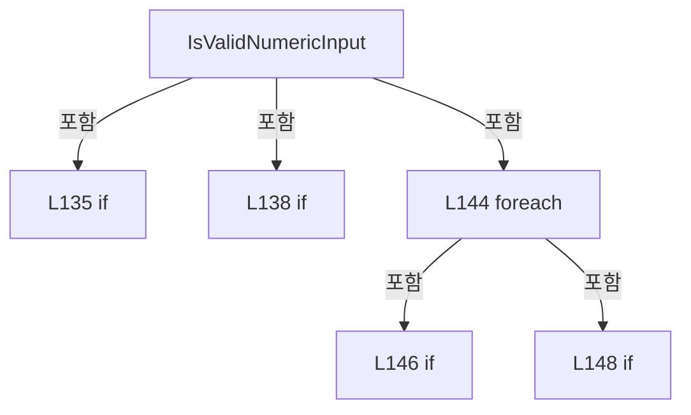

변경 전 점검: 입력/반환 타입, 위 호출자, 예외/취소 경로, 공유 상태와 저장·전송 소비자를 함께 확인합니다. 값의 단위나 물리 방향을 이름만으로 확정하지 않습니다.

### MethodDeclaration `CancelClick` · L156–159

[Drilling.UI/Popup/CValueInputDialog.xaml.cs:156–159](https://github.com/kjuws10-rgb/A3Drilling/blob/5aee8e58439c9b455cae7c9593c9be986c3e682e/Drilling.UI/Popup/CValueInputDialog.xaml.cs#L156-L159)

| 항목 | 실제 추출 값 |
| --- | --- |
| 서명 | void Drilling.UI.Popup.CValueInputDialog.CancelClick(object, RoutedEventArgs) |
| 접근/수식자 | Private / private |
| 반환/값 타입 | void |
| 소속 타입 | NamedType:Drilling.UI.Popup.CValueInputDialog |

입력 계약:

| 이름 | 타입 | 전달 | 선택/기본값 |
| --- | --- | --- | --- |
| sender | object | None | False /  |
| e | RoutedEventArgs | None | False /  |

현재 부분 분석에서 직접 연결된 호출자는 없습니다. XAML/이벤트/인터페이스·델리게이트·외부 진입을 추가 확인해야 하며, 미사용으로 판정한 것이 아닙니다.

본문의 실제 연산·분기·예외·반환 순서(원문 위치 순):

| 원본 행 | 종류 | 주석 해설 |
| --- | --- | --- |
| 158 | assignment | 값을 대상에 대입합니다: DialogResult = false |

변경 전 점검: 입력/반환 타입, 위 호출자, 예외/취소 경로, 공유 상태와 저장·전송 소비자를 함께 확인합니다. 값의 단위나 물리 방향을 이름만으로 확정하지 않습니다.

### MethodDeclaration `WindowKeyDown` · L161–173

[Drilling.UI/Popup/CValueInputDialog.xaml.cs:161–173](https://github.com/kjuws10-rgb/A3Drilling/blob/5aee8e58439c9b455cae7c9593c9be986c3e682e/Drilling.UI/Popup/CValueInputDialog.xaml.cs#L161-L173)

| 항목 | 실제 추출 값 |
| --- | --- |
| 서명 | void Drilling.UI.Popup.CValueInputDialog.WindowKeyDown(object, KeyEventArgs) |
| 접근/수식자 | Private / private |
| 반환/값 타입 | void |
| 소속 타입 | NamedType:Drilling.UI.Popup.CValueInputDialog |

입력 계약:

| 이름 | 타입 | 전달 | 선택/기본값 |
| --- | --- | --- | --- |
| sender | object | None | False /  |
| e | KeyEventArgs | None | False /  |

현재 부분 분석에서 직접 연결된 호출자는 없습니다. XAML/이벤트/인터페이스·델리게이트·외부 진입을 추가 확인해야 하며, 미사용으로 판정한 것이 아닙니다.

호출하는 대상과 해석 범위:

| 원본 행 | 표현식 | 분석 상태 | 대상/소스 위치 |
| --- | --- | --- | --- |
| 166 | OkClick | candidate | OverloadResolutionFailure |

본문의 실제 연산·분기·예외·반환 순서(원문 위치 순):

| 원본 행 | 종류 | 주석 해설 |
| --- | --- | --- |
| 163 | if | 조건에 따라 분기합니다: if (e.Key == Key.Enter) |
| 165 | assignment | 값을 대상에 대입합니다: e.Handled = true |
| 166 | call | 함수·델리게이트 또는 객체 생성자를 호출합니다: OkClick(sender, e) |
| 168 | else | 앞 조건이 거짓인 경로입니다: else |
| 168 | if | 조건에 따라 분기합니다: if (e.Key == Key.Escape) |
| 170 | assignment | 값을 대상에 대입합니다: e.Handled = true |
| 171 | assignment | 값을 대상에 대입합니다: DialogResult = false |

제어 구문의 포함 구조(실제 실행 순서/CFG가 아닌 구문 탐색 그림):

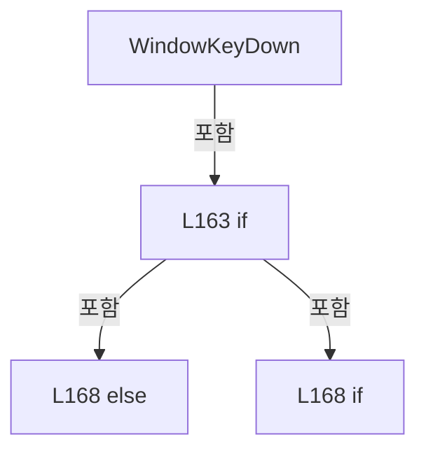

변경 전 점검: 입력/반환 타입, 위 호출자, 예외/취소 경로, 공유 상태와 저장·전송 소비자를 함께 확인합니다. 값의 단위나 물리 방향을 이름만으로 확정하지 않습니다.

### MethodDeclaration `OkClick` · L175–186

[Drilling.UI/Popup/CValueInputDialog.xaml.cs:175–186](https://github.com/kjuws10-rgb/A3Drilling/blob/5aee8e58439c9b455cae7c9593c9be986c3e682e/Drilling.UI/Popup/CValueInputDialog.xaml.cs#L175-L186)

| 항목 | 실제 추출 값 |
| --- | --- |
| 서명 | void Drilling.UI.Popup.CValueInputDialog.OkClick(object, RoutedEventArgs) |
| 접근/수식자 | Private / private |
| 반환/값 타입 | void |
| 소속 타입 | NamedType:Drilling.UI.Popup.CValueInputDialog |

입력 계약:

| 이름 | 타입 | 전달 | 선택/기본값 |
| --- | --- | --- | --- |
| sender | object | None | False /  |
| e | RoutedEventArgs | None | False /  |

현재 부분 분석에서 직접 연결된 호출자는 없습니다. XAML/이벤트/인터페이스·델리게이트·외부 진입을 추가 확인해야 하며, 미사용으로 판정한 것이 아닙니다.

호출하는 대상과 해석 범위:

| 원본 행 | 표현식 | 분석 상태 | 대상/소스 위치 |
| --- | --- | --- | --- |
| 177 | ValueTextBox.Text.Trim | unresolved | None |
| 178 | Validate | candidate | OverloadResolutionFailure |
| 180 | MessageBox.Show | unresolved | None |

본문의 실제 연산·분기·예외·반환 순서(원문 위치 순):

| 원본 행 | 종류 | 주석 해설 |
| --- | --- | --- |
| 177 | call | 함수·델리게이트 또는 객체 생성자를 호출합니다: ValueTextBox.Text.Trim() |
| 177 | local-declaration | 지역 변수를 선언합니다: var value = ValueTextBox.Text.Trim(); |
| 177 | variable-initializer | 변수의 초기값을 지정합니다: value = ValueTextBox.Text.Trim() |
| 178 | call | 함수·델리게이트 또는 객체 생성자를 호출합니다: Validate(value, out var error) |
| 178 | if | 조건에 따라 분기합니다: if (!Validate(value, out var error)) |
| 180 | call | 함수·델리게이트 또는 객체 생성자를 호출합니다: MessageBox.Show(this, error, "입력값 오류", MessageBoxButton.OK, MessageBoxImage.Warning) |
| 181 | return | 호출자에게 값 또는 제어를 반환합니다: return; |
| 184 | assignment | 값을 대상에 대입합니다: ValueTextBox.Text = value |
| 185 | assignment | 값을 대상에 대입합니다: DialogResult = true |

제어 구문의 포함 구조(실제 실행 순서/CFG가 아닌 구문 탐색 그림):

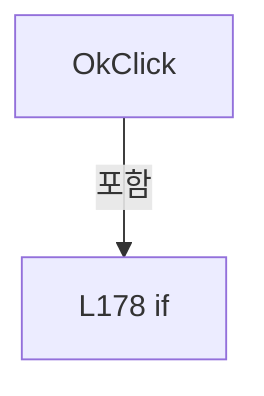

변경 전 점검: 입력/반환 타입, 위 호출자, 예외/취소 경로, 공유 상태와 저장·전송 소비자를 함께 확인합니다. 값의 단위나 물리 방향을 이름만으로 확정하지 않습니다.

### MethodDeclaration `Validate` · L188–211

[Drilling.UI/Popup/CValueInputDialog.xaml.cs:188–211](https://github.com/kjuws10-rgb/A3Drilling/blob/5aee8e58439c9b455cae7c9593c9be986c3e682e/Drilling.UI/Popup/CValueInputDialog.xaml.cs#L188-L211)

| 항목 | 실제 추출 값 |
| --- | --- |
| 서명 | bool Drilling.UI.Popup.CValueInputDialog.Validate(string, out string) |
| 접근/수식자 | Private / private |
| 반환/값 타입 | bool |
| 소속 타입 | NamedType:Drilling.UI.Popup.CValueInputDialog |

입력 계약:

| 이름 | 타입 | 전달 | 선택/기본값 |
| --- | --- | --- | --- |
| value | string | None | False /  |
| error | string | Out | False /  |

현재 부분 분석에서 직접 연결된 호출자는 없습니다. XAML/이벤트/인터페이스·델리게이트·외부 진입을 추가 확인해야 하며, 미사용으로 판정한 것이 아닙니다.

호출하는 대상과 해석 범위:

| 원본 행 | 표현식 | 분석 상태 | 대상/소스 위치 |
| --- | --- | --- | --- |
| 195 | long.TryParse | resolved | bool long.TryParse(string?, System.Globalization.NumberStyles, System.IFormatProvider?, out long) |
| 201 | ValidateRange | resolved | bool Drilling.UI.Popup.CValueInputDialog.ValidateRange(double, out string) · Drilling.UI/Popup/CValueInputDialog.xaml.cs:213 |
| 204 | double.TryParse | resolved | bool double.TryParse(string?, System.Globalization.NumberStyles, System.IFormatProvider?, out double) |
| 204 | double.IsFinite | resolved | bool double.IsFinite(double) |
| 210 | ValidateRange | resolved | bool Drilling.UI.Popup.CValueInputDialog.ValidateRange(double, out string) · Drilling.UI/Popup/CValueInputDialog.xaml.cs:213 |

본문의 실제 연산·분기·예외·반환 순서(원문 위치 순):

| 원본 행 | 종류 | 주석 해설 |
| --- | --- | --- |
| 190 | assignment | 값을 대상에 대입합니다: error = "" |
| 191 | if | 조건에 따라 분기합니다: if (_dataType == EN_RECIPE_DATA_TYPE.String) |
| 192 | return | 호출자에게 값 또는 제어를 반환합니다: return true; |
| 193 | if | 조건에 따라 분기합니다: if (_dataType == EN_RECIPE_DATA_TYPE.Int) |
| 195 | call | 함수·델리게이트 또는 객체 생성자를 호출합니다: long.TryParse(value, NumberStyles.Integer, CultureInfo.InvariantCulture, out var parsed) |
| 195 | if | 조건에 따라 분기합니다: if (!long.TryParse(value, NumberStyles.Integer, CultureInfo.InvariantCulture, out var parsed)) |
| 197 | assignment | 값을 대상에 대입합니다: error = "Enter a valid integer." |
| 198 | return | 호출자에게 값 또는 제어를 반환합니다: return false; |
| 201 | call | 함수·델리게이트 또는 객체 생성자를 호출합니다: ValidateRange(parsed, out error) |
| 201 | return | 호출자에게 값 또는 제어를 반환합니다: return ValidateRange(parsed, out error); |
| 204 | call | 함수·델리게이트 또는 객체 생성자를 호출합니다: double.TryParse(value, NumberStyles.Float, CultureInfo.InvariantCulture, out var number) |
| 204 | call | 함수·델리게이트 또는 객체 생성자를 호출합니다: double.IsFinite(number) |
| 204 | if | 조건에 따라 분기합니다: if (!double.TryParse(value, NumberStyles.Float, CultureInfo.InvariantCulture, out var number) &#124;&#124; !double.IsFinite(number)) |
| 206 | assignment | 값을 대상에 대입합니다: error = "Enter a valid number." |
| 207 | return | 호출자에게 값 또는 제어를 반환합니다: return false; |
| 210 | call | 함수·델리게이트 또는 객체 생성자를 호출합니다: ValidateRange(number, out error) |
| 210 | return | 호출자에게 값 또는 제어를 반환합니다: return ValidateRange(number, out error); |

제어 구문의 포함 구조(실제 실행 순서/CFG가 아닌 구문 탐색 그림):

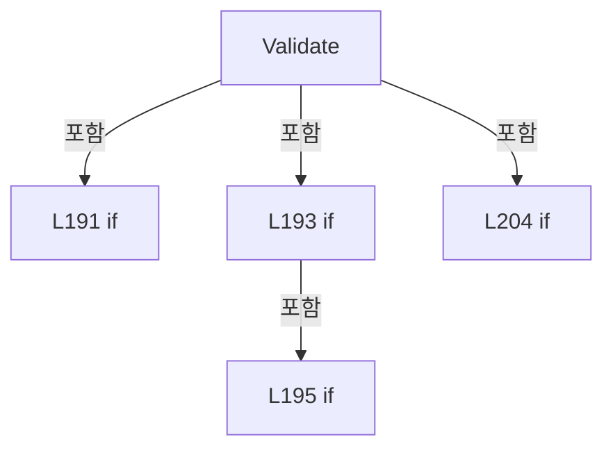

변경 전 점검: 입력/반환 타입, 위 호출자, 예외/취소 경로, 공유 상태와 저장·전송 소비자를 함께 확인합니다. 값의 단위나 물리 방향을 이름만으로 확정하지 않습니다.

### MethodDeclaration `ValidateRange` · L213–222

[Drilling.UI/Popup/CValueInputDialog.xaml.cs:213–222](https://github.com/kjuws10-rgb/A3Drilling/blob/5aee8e58439c9b455cae7c9593c9be986c3e682e/Drilling.UI/Popup/CValueInputDialog.xaml.cs#L213-L222)

| 항목 | 실제 추출 값 |
| --- | --- |
| 서명 | bool Drilling.UI.Popup.CValueInputDialog.ValidateRange(double, out string) |
| 접근/수식자 | Private / private |
| 반환/값 타입 | bool |
| 소속 타입 | NamedType:Drilling.UI.Popup.CValueInputDialog |

입력 계약:

| 이름 | 타입 | 전달 | 선택/기본값 |
| --- | --- | --- | --- |
| value | double | None | False /  |
| error | string | Out | False /  |

정적 호출자로 확인된 위치:

| 호출 파일/행 | 호출 표현식 | 런타임 분기 가능 |
| --- | --- | --- |
| [Drilling.UI/Popup/CValueInputDialog.xaml.cs:201–201](https://github.com/kjuws10-rgb/A3Drilling/blob/5aee8e58439c9b455cae7c9593c9be986c3e682e/Drilling.UI/Popup/CValueInputDialog.xaml.cs#L201-L201) | ValidateRange | False |
| [Drilling.UI/Popup/CValueInputDialog.xaml.cs:210–210](https://github.com/kjuws10-rgb/A3Drilling/blob/5aee8e58439c9b455cae7c9593c9be986c3e682e/Drilling.UI/Popup/CValueInputDialog.xaml.cs#L210-L210) | ValidateRange | False |

호출하는 대상과 해석 범위:

| 원본 행 | 표현식 | 분석 상태 | 대상/소스 위치 |
| --- | --- | --- | --- |
| 220 | _min.ToString | resolved | string double.ToString(System.IFormatProvider?) |
| 220 | _max.ToString | resolved | string double.ToString(System.IFormatProvider?) |

본문의 실제 연산·분기·예외·반환 순서(원문 위치 순):

| 원본 행 | 종류 | 주석 해설 |
| --- | --- | --- |
| 215 | assignment | 값을 대상에 대입합니다: error = "" |
| 218 | if | 조건에 따라 분기합니다: if (_max <= _min &#124;&#124; value >= _min && value <= _max) |
| 219 | return | 호출자에게 값 또는 제어를 반환합니다: return true; |
| 220 | assignment | 값을 대상에 대입합니다: error = $"Value must be between {_min.ToString(CultureInfo.InvariantCulture)} and {_max.ToString(CultureInfo.InvariantCulture)}." |
| 220 | call | 함수·델리게이트 또는 객체 생성자를 호출합니다: _min.ToString(CultureInfo.InvariantCulture) |
| 220 | call | 함수·델리게이트 또는 객체 생성자를 호출합니다: _max.ToString(CultureInfo.InvariantCulture) |
| 221 | return | 호출자에게 값 또는 제어를 반환합니다: return false; |

제어 구문의 포함 구조(실제 실행 순서/CFG가 아닌 구문 탐색 그림):

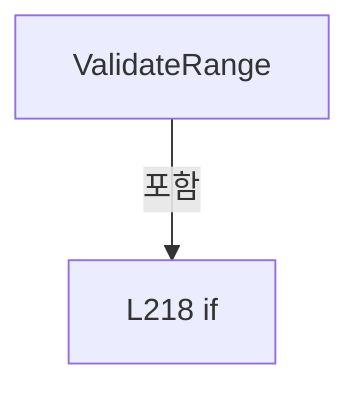

변경 전 점검: 입력/반환 타입, 위 호출자, 예외/취소 경로, 공유 상태와 저장·전송 소비자를 함께 확인합니다. 값의 단위나 물리 방향을 이름만으로 확정하지 않습니다.

## 구문·바인딩 한계

전체 WPF/벤더 SDK/프로젝트별 빌드 조건을 로드한 정식 빌드가 아닙니다. `resolved`는 이 부분 컴파일에서의 심볼 연결이며 virtual/interface/delegate/이벤트/Reflection/XAML의 실제 런타임 구현을 확정하지 않습니다. `candidate`와 `unresolved`는 후속 확인 대상으로 남깁니다.

## 원문 전체 주석 해설본

[원본 모든 행과 행별 해설 보기](../../../annotated/Drilling.UI/Popup/CValueInputDialog.xaml.cs.annotated.txt)

원본을 빠뜨리거나 임의로 줄이지 않았습니다. `L000001 |` 표시는 원본 행 번호, `// 해설`은 별도 설명입니다. 실행용 소스가 아닌 문서입니다.

## 수정·재검증 체크

- 원본 Commit과 현재 작업 파일 SHA가 같은지 먼저 확인합니다. 다르면 이 문서를 과거 버전 자료로 취급합니다.
- 선언·직접 호출·이벤트/인터페이스 경계·설정 소비를 함께 확인합니다. 정적 연결의 빈 곳을 정상 경로로 추정하지 않습니다.
- 저장 형식/단위/식별자·재시도·취소·예외·롤백에 영향을 주는 변경은 상세 해설장과 호출자를 다시 검토합니다.
- 도구의 구문 추출과 별도 정적 추적 해설, 실제 빌드·시뮬레이션·실장비 검증 결과를 분리합니다.
