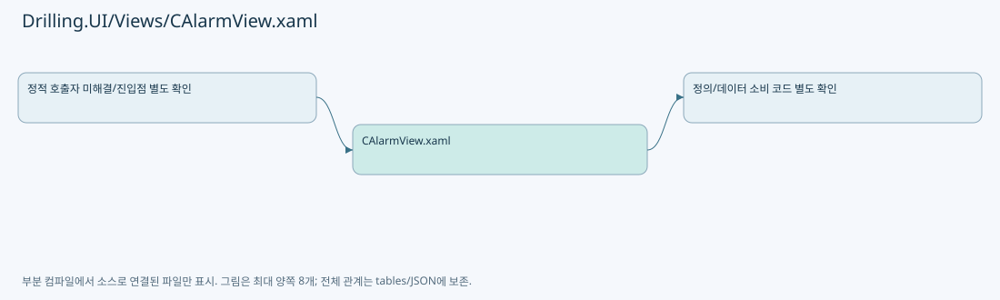

# Drilling.UI/Views/CAlarmView.xaml

| 항목 | 내용 |
| --- | --- |
| 원본 저장소 | https://github.com/kjuws10-rgb/A3Drilling.git |
| 원본 Commit | 0219666f9053b907d96d7e0aa7d0c6c1be3a73d4 |
| 원본 SHA256 | 13837ed24a1751d6cf813ac2dfd3dc1b8a5124fed885711e23c9ca0d5af8ff2f |
| 파일 분류 | code |
| 원본 크기/행 | 26,637 bytes / 296 physical lines |
| 인코딩 | utf-8-sig |
| 검토 범위 | 구문/부분 의미 분석에서 추출한 사실. 동작·물리 단위·실장비 합격을 보증하지 않습니다. |
| 원본 링크 | [고정 Commit 원본](https://github.com/kjuws10-rgb/A3Drilling/blob/0219666f9053b907d96d7e0aa7d0c6c1be3a73d4/Drilling.UI/Views/CAlarmView.xaml) |

## 파일의 역할과 읽는 순서

WPF 화면·사용자 명령·표시 상태를 구성합니다. XAML 이벤트와 코드 비하인드, RootView의 조립 경로를 함께 추적합니다.

## 화면 구성과 코드 비하인드 연결

| 항목 | 추출 값 |
| --- | --- |
| 코드 비하인드 후보 | Drilling.UI/Views/CAlarmView.xaml.cs |
| 이름 있는 요소 | AlarmTabs, PART_SelectedContentHost, CurrentAlarmGrid, AlarmFromTime, AlarmThroughTime, AlarmLast24Hours, AlarmHistoryGrid, AlarmHourView, AlarmCodeView, AlarmTrend, TrendRow, CauseRow, BarRow, TrendLabelColumn, AlarmListGrid |
| 이벤트 개수 | 0 |
| Binding 표현 개수 | 70 |

이름 있는 요소는 WPF가 필드를 생성할 수 있는 XAML 선언입니다. 문서 추출기는 WPF 생성 코드를 만들거나 로드하지 않으므로 C# 원문 멤버 수에 합산하지 않습니다.

| 요소 이름 | 원본 범위 |
| --- | --- |
| AlarmTabs | L120–120 |
| PART_SelectedContentHost | L128–128 |
| CurrentAlarmGrid | L150–150 |
| AlarmFromTime | L176–176 |
| AlarmThroughTime | L181–181 |
| AlarmLast24Hours | L185–185 |
| AlarmHistoryGrid | L199–199 |
| AlarmHourView | L224–224 |
| AlarmCodeView | L225–225 |
| AlarmTrend | L232–232 |
| TrendRow | L234–234 |
| CauseRow | L235–235 |
| BarRow | L235–235 |
| TrendLabelColumn | L236–236 |
| AlarmListGrid | L279–279 |

| 이벤트 | 핸들러 이름 | 원본 범위 | 해석 |
| --- | --- | --- | --- |

| Binding 표현 | 원본 범위 |
| --- | --- |
| {Binding CanEdit} | L25–25 |
| {Binding IsHourView} | L28–28 |
| {Binding IsCodeView} | L34–34 |
| {Binding} | L85–85 |
| {Binding Text, RelativeSource={RelativeSource Self}} | L94–94 |
| {Binding Level} | L102–102 |
| {Binding Level} | L103–103 |
| {Binding CurrentScreen.IsAlarmLayout, Converter={StaticResource BooleanToVisibilityConverter}} | L117–117 |
| {Binding CurrentScreen.Alarm.SelectedTabIndex, Mode=TwoWay} | L120–120 |
| {Binding CurrentScreen.Alarm.AlarmResetCommand} | L139–139 |
| {Binding CurrentScreen.Alarm.BuzzerOffCommand} | L141–141 |
| {Binding CurrentScreen.Alarm.LogError} | L145–145 |
| {Binding CurrentScreen.Alarm.LogError} | L147–147 |
| {Binding CurrentScreen.Alarm.CurrentAlarmRows} | L150–150 |
| {Binding No} | L152–152 |
| {Binding Code} | L153–153 |
| {Binding Level} | L154–154 |
| {Binding Group} | L155–155 |
| {Binding Cause} | L156–156 |
| {Binding Action} | L157–157 |
| {Binding Time} | L158–158 |
| {Binding CurrentScreen.Alarm.CurrentAlarmRows.Count} | L164–164 |
| {Binding CurrentScreen.Alarm.HistoryPanel} | L171–171 |
| {Binding From} | L175–175 |
| {Binding CanEdit} | L175–175 |
| {Binding FromTime, UpdateSourceTrigger=PropertyChanged} | L176–176 |
| {Binding CanEdit} | L177–177 |
| {Binding Through} | L180–180 |
| {Binding CanEdit} | L180–180 |
| {Binding ThroughTime, UpdateSourceTrigger=PropertyChanged} | L181–181 |
| {Binding CanEdit} | L182–182 |
| {Binding SearchCommand} | L184–184 |
| {Binding Last24HoursCommand} | L185–185 |
| {Binding Status} | L188–188 |
| {Binding CauseAnalysisCommand} | L195–195 |
| {Binding Rows} | L199–199 |
| {Binding SelectedRow, Mode=TwoWay} | L200–200 |
| {Binding No} | L202–202 |
| {Binding Time} | L203–203 |
| {Binding Code} | L204–204 |
| {Binding Level} | L205–205 |
| {Binding Group} | L206–206 |
| {Binding Cause} | L207–207 |
| {Binding Solution} | L208–208 |
| {Binding EmptyMessage} | L211–211 |
| {Binding Rows.Count} | L214–214 |
| {Binding HourViewCommand} | L224–224 |
| {Binding CodeViewCommand} | L225–225 |
| {Binding Bars} | L232–232 |
| {Binding Detail} | L234–234 |
| {Binding Label} | L237–237 |
| {Binding Cause} | L238–238 |
| {Binding FilledWidth} | L241–241 |
| {Binding EmptyWidth} | L241–241 |
| {Binding Count, StringFormat={}{0:N0}} | L244–244 |
| {Binding IsHourly} | L246–246 |
| {Binding Bars.Count} | L258–258 |
| {Binding TrendCaption} | L263–263 |
| {Binding CurrentScreen.Alarm.ListPanel} | L270–270 |
| {Binding Status} | L274–274 |
| {Binding Status} | L276–276 |
| {Binding Rows} | L279–279 |
| {Binding No} | L281–281 |
| {Binding Code} | L282–282 |
| {Binding Group} | L283–283 |
| {Binding Id} | L284–284 |
| {Binding Level} | L285–285 |
| {Binding Cause} | L286–286 |
| {Binding Solution} | L287–287 |
| {Binding CimAddress} | L288–288 |

## 원문 전체 주석 해설본

[원본 모든 행과 행별 해설 보기](../../../annotated/Drilling.UI/Views/CAlarmView.xaml.annotated.txt)

원본을 빠뜨리거나 임의로 줄이지 않았습니다. `L000001 |` 표시는 원본 행 번호, `// 해설`은 별도 설명입니다. 실행용 소스가 아닌 문서입니다.

## 수정·재검증 체크

- 원본 Commit과 현재 작업 파일 SHA가 같은지 먼저 확인합니다. 다르면 이 문서를 과거 버전 자료로 취급합니다.
- 선언·직접 호출·이벤트/인터페이스 경계·설정 소비를 함께 확인합니다. 정적 연결의 빈 곳을 정상 경로로 추정하지 않습니다.
- 저장 형식/단위/식별자·재시도·취소·예외·롤백에 영향을 주는 변경은 상세 해설장과 호출자를 다시 검토합니다.
- 도구의 구문 추출과 별도 정적 추적 해설, 실제 빌드·시뮬레이션·실장비 검증 결과를 분리합니다.
