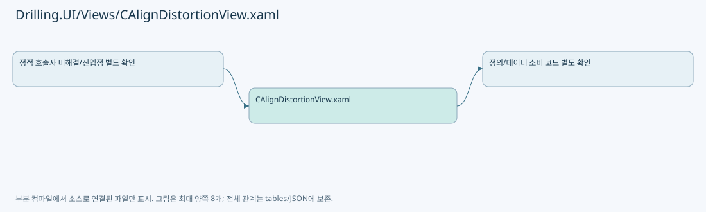

# Drilling.UI/Views/CAlignDistortionView.xaml

| 항목 | 내용 |
| --- | --- |
| 원본 저장소 | https://github.com/kjuws10-rgb/A3Drilling.git |
| 원본 Commit | 334b3599651b2e8e0181fd4459bafaf3cddafff3 |
| 원본 SHA256 | de45e4e36fe1c7eec80467af8808139345203351aebb110509599571249023a9 |
| 파일 분류 | code |
| 원본 크기/행 | 29,999 bytes / 342 physical lines |
| 인코딩 | utf-8-sig |
| 검토 범위 | 구문/부분 의미 분석에서 추출한 사실. 동작·물리 단위·실장비 합격을 보증하지 않습니다. |
| 원본 링크 | [고정 Commit 원본](https://github.com/kjuws10-rgb/A3Drilling/blob/334b3599651b2e8e0181fd4459bafaf3cddafff3/Drilling.UI/Views/CAlignDistortionView.xaml) |

## 파일의 역할과 읽는 순서

WPF 화면·사용자 명령·표시 상태를 구성합니다. XAML 이벤트와 코드 비하인드, RootView의 조립 경로를 함께 추적합니다.

## 화면 구성과 코드 비하인드 연결

| 항목 | 추출 값 |
| --- | --- |
| 코드 비하인드 후보 | Drilling.UI/Views/CAlignDistortionView.xaml.cs |
| 이름 있는 요소 | ActionColumn, ActionRegion, CurrentRecipeBanner, CurrentRecipeName, BaseDataPanel, ActionPanel, DkSelectItems, LoadDataPanel, LoadVisionValues, LastLoadTimeText, OffsetPanel, SettingToleranceText, WapagePanel, GlassPreviewPanel |
| 이벤트 개수 | 0 |
| Binding 표현 개수 | 72 |

이름 있는 요소는 WPF가 필드를 생성할 수 있는 XAML 선언입니다. 문서 추출기는 WPF 생성 코드를 만들거나 로드하지 않으므로 C# 원문 멤버 수에 합산하지 않습니다.

| 요소 이름 | 원본 범위 |
| --- | --- |
| ActionColumn | L24–24 |
| ActionRegion | L26–26 |
| CurrentRecipeBanner | L31–31 |
| CurrentRecipeName | L36–36 |
| BaseDataPanel | L47–47 |
| ActionPanel | L66–66 |
| DkSelectItems | L72–72 |
| LoadDataPanel | L99–99 |
| LoadVisionValues | L109–109 |
| LastLoadTimeText | L111–111 |
| OffsetPanel | L120–120 |
| SettingToleranceText | L125–125 |
| WapagePanel | L140–140 |
| GlassPreviewPanel | L185–185 |

| 이벤트 | 핸들러 이름 | 원본 범위 | 해석 |
| --- | --- | --- | --- |

| Binding 표현 | 원본 범위 |
| --- | --- |
| {Binding RecipeName} | L36–36 |
| {Binding RecipeId} | L36–36 |
| {Binding BaseActionCommand} | L55–55 |
| {Binding BaseActionCommand} | L57–57 |
| {Binding BaseActionCommand} | L59–59 |
| {Binding BaseActionCommand} | L61–61 |
| {Binding DkSelections} | L72–72 |
| {Binding IsSelected} | L84–84 |
| {Binding Name} | L91–91 |
| {Binding IsSelected, Mode=TwoWay, UpdateSourceTrigger=PropertyChanged} | L94–94 |
| {Binding LoadCommand} | L109–109 |
| {Binding LastLoadTime, StringFormat='Last Load Time : {0}'} | L112–112 |
| {Binding AlgorithmPreviewHint} | L118–118 |
| {Binding SettingToleranceText} | L125–125 |
| {Binding BaseActionCommand} | L129–129 |
| {Binding BaseActionCommand} | L131–131 |
| {Binding BaseActionCommand} | L133–133 |
| {Binding Wapage} | L140–140 |
| {Binding LastLoadTime, StringFormat='Last Load : {0}'} | L146–146 |
| {Binding DataContext.BaseActionCommand, RelativeSource={RelativeSource AncestorType=UserControl}} | L152–152 |
| {Binding DataContext.BaseActionCommand, RelativeSource={RelativeSource AncestorType=UserControl}} | L154–154 |
| {Binding DataContext.BaseActionCommand, RelativeSource={RelativeSource AncestorType=UserControl}} | L156–156 |
| {Binding CalculationText} | L159–159 |
| {Binding Rows} | L161–161 |
| {Binding Detail} | L165–165 |
| {Binding Name} | L169–169 |
| {Binding VisionText} | L170–170 |
| {Binding BaseText} | L171–171 |
| {Binding RangeText} | L172–172 |
| {Binding CalculatedText} | L173–173 |
| {Binding Status} | L176–176 |
| {Binding PreviewHeight} | L201–201 |
| {Binding PreviewImage} | L202–202 |
| {Binding PreviewHeight} | L202–202 |
| {Binding AlignKeys} | L203–203 |
| {Binding PreviewHeight} | L203–203 |
| {Binding EditorLeft} | L209–209 |
| {Binding EditorTop} | L210–210 |
| {Binding KeyBrush} | L217–217 |
| {Binding Name} | L232–232 |
| {Binding KeyBrush} | L233–233 |
| {Binding BaseX, Mode=OneWay} | L237–237 |
| {Binding BaseY, Mode=OneWay} | L241–241 |
| {Binding LastLoadX, Mode=OneWay} | L245–245 |
| {Binding LastLoadY, Mode=OneWay} | L249–249 |
| {Binding BaseMinusLoadX, Mode=OneWay} | L253–253 |
| {Binding BaseMinusLoadY, Mode=OneWay} | L257–257 |
| {Binding DistortionPairs} | L263–263 |
| {Binding PreviewHeight} | L263–263 |
| {Binding EditorLeft} | L267–267 |
| {Binding EditorTop} | L268–268 |
| {Binding KeyBrush} | L273–273 |
| {Binding Name} | L288–288 |
| {Binding KeyBrush} | L288–288 |
| {Binding StageYText} | L289–289 |
| {Binding Left.Name, StringFormat='좌 · {0}'} | L291–291 |
| {Binding KeyBrush} | L292–292 |
| {Binding Right.Name, StringFormat='우 · {0}'} | L293–293 |
| {Binding KeyBrush} | L294–294 |
| {Binding Left.BaseX, Mode=OneWay} | L298–298 |
| {Binding Right.BaseX, Mode=OneWay} | L300–300 |
| {Binding Left.BaseY, Mode=OneWay} | L304–304 |
| {Binding Right.BaseY, Mode=OneWay} | L306–306 |
| {Binding Left.LastLoadX, Mode=OneWay} | L310–310 |
| {Binding Right.LastLoadX, Mode=OneWay} | L312–312 |
| {Binding Left.LastLoadY, Mode=OneWay} | L316–316 |
| {Binding Right.LastLoadY, Mode=OneWay} | L318–318 |
| {Binding Left.BaseMinusLoadX, Mode=OneWay} | L322–322 |
| {Binding Right.BaseMinusLoadX, Mode=OneWay} | L324–324 |
| {Binding Left.BaseMinusLoadY, Mode=OneWay} | L328–328 |
| {Binding Right.BaseMinusLoadY, Mode=OneWay} | L330–330 |
| {Binding Summary} | L337–337 |

## 원문 전체 주석 해설본

[원본 모든 행과 행별 해설 보기](../../../annotated/Drilling.UI/Views/CAlignDistortionView.xaml.annotated.txt)

원본을 빠뜨리거나 임의로 줄이지 않았습니다. `L000001 |` 표시는 원본 행 번호, `// 해설`은 별도 설명입니다. 실행용 소스가 아닌 문서입니다.

## 수정·재검증 체크

- 원본 Commit과 현재 작업 파일 SHA가 같은지 먼저 확인합니다. 다르면 이 문서를 과거 버전 자료로 취급합니다.
- 선언·직접 호출·이벤트/인터페이스 경계·설정 소비를 함께 확인합니다. 정적 연결의 빈 곳을 정상 경로로 추정하지 않습니다.
- 저장 형식/단위/식별자·재시도·취소·예외·롤백에 영향을 주는 변경은 상세 해설장과 호출자를 다시 검토합니다.
- 도구의 구문 추출과 별도 정적 추적 해설, 실제 빌드·시뮬레이션·실장비 검증 결과를 분리합니다.
