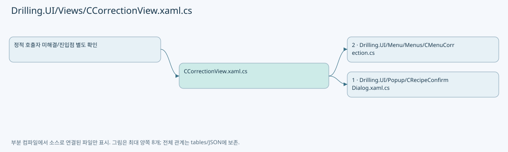
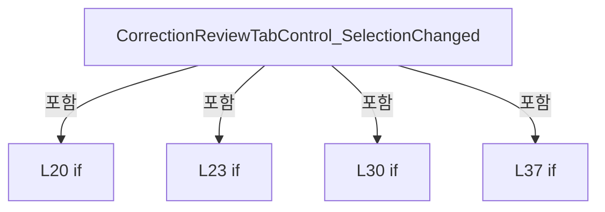
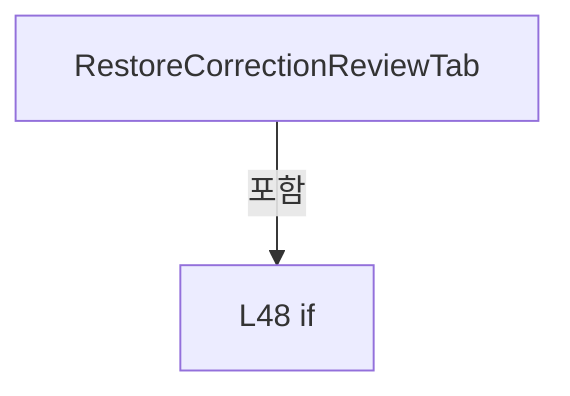
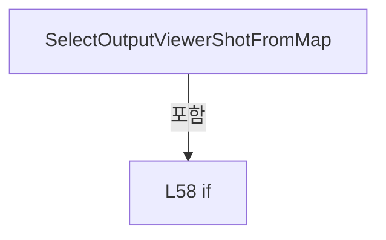
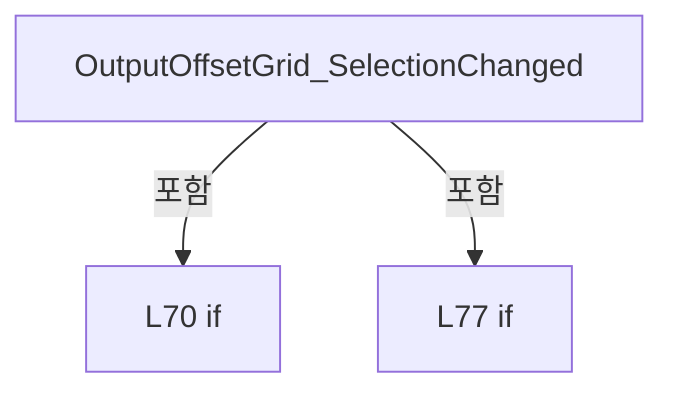
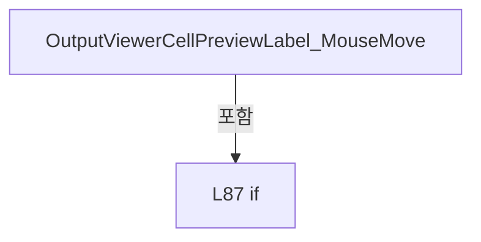
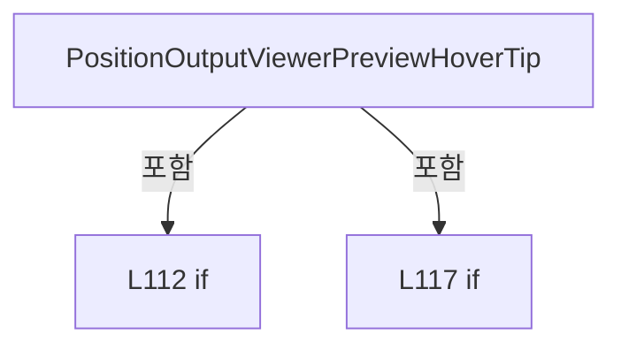

# Drilling.UI/Views/CCorrectionView.xaml.cs

| 항목 | 내용 |
| --- | --- |
| 원본 저장소 | https://github.com/kjuws10-rgb/A3Drilling.git |
| 원본 Commit | dfa5920e6301d9ec4b0eab1452ae59521aafc986 |
| 원본 SHA256 | a1a61079de45070cee11939d3e2148a1c42a77017f1f130bf46e6ad394e68f07 |
| 파일 분류 | code |
| 원본 크기/행 | 4,911 bytes / 131 physical lines |
| 인코딩 | utf-8-sig |
| 검토 범위 | 구문/부분 의미 분석에서 추출한 사실. 동작·물리 단위·실장비 합격을 보증하지 않습니다. |
| 원본 링크 | [고정 Commit 원본](https://github.com/kjuws10-rgb/A3Drilling/blob/dfa5920e6301d9ec4b0eab1452ae59521aafc986/Drilling.UI/Views/CCorrectionView.xaml.cs) |

## 파일의 역할과 읽는 순서

WPF 화면·사용자 명령·표시 상태를 구성합니다. XAML 이벤트와 코드 비하인드, RootView의 조립 경로를 함께 추적합니다.

## 네임스페이스·타입·상속

| 타입 | 구분 | 원본 범위 | 선언/상속 |
| --- | --- | --- | --- |
| CCorrectionView | ClassDeclaration | 8–131 | CCorrectionView: UserControl |

## 멤버 빠른 목록

| 이름 | 종류 | 범위 | 서명 |
| --- | --- | --- | --- |
| _lastCorrectionReviewTab | FieldDeclaration | L10–10 | TabItem? Drilling.UI.Views.CCorrectionView._lastCorrectionReviewTab |
| _restoringCorrectionReviewTab | FieldDeclaration | L11–11 | bool Drilling.UI.Views.CCorrectionView._restoringCorrectionReviewTab |
| .ctor | ConstructorDeclaration | L13–16 | Drilling.UI.Views.CCorrectionView.CCorrectionView() |
| CorrectionReviewTabControl_SelectionChanged | MethodDeclaration | L18–44 | void Drilling.UI.Views.CCorrectionView.CorrectionReviewTabControl_SelectionChanged(object, SelectionChangedEventArgs) |
| RestoreCorrectionReviewTab | MethodDeclaration | L46–54 | void Drilling.UI.Views.CCorrectionView.RestoreCorrectionReviewTab(TabControl) |
| SelectOutputViewerShotFromMap | MethodDeclaration | L56–66 | void Drilling.UI.Views.CCorrectionView.SelectOutputViewerShotFromMap(object, MouseButtonEventArgs) |
| OutputOffsetGrid_SelectionChanged | MethodDeclaration | L68–83 | void Drilling.UI.Views.CCorrectionView.OutputOffsetGrid_SelectionChanged(object, SelectionChangedEventArgs) |
| OutputViewerCellPreviewLabel_MouseMove | MethodDeclaration | L85–96 | void Drilling.UI.Views.CCorrectionView.OutputViewerCellPreviewLabel_MouseMove(object, MouseEventArgs) |
| OutputViewerCellPreviewLabel_MouseLeave | MethodDeclaration | L98–101 | void Drilling.UI.Views.CCorrectionView.OutputViewerCellPreviewLabel_MouseLeave(object, MouseEventArgs) |
| PositionOutputViewerPreviewHoverTip | MethodDeclaration | L103–124 | void Drilling.UI.Views.CCorrectionView.PositionOutputViewerPreviewHoverTip(Point) |
| HideOutputViewerPreviewHoverTip | MethodDeclaration | L126–130 | void Drilling.UI.Views.CCorrectionView.HideOutputViewerPreviewHoverTip() |

## 멤버별 상세 계약·호출·처리 해설

### FieldDeclaration `_lastCorrectionReviewTab` · L10–10

[Drilling.UI/Views/CCorrectionView.xaml.cs:10–10](https://github.com/kjuws10-rgb/A3Drilling/blob/dfa5920e6301d9ec4b0eab1452ae59521aafc986/Drilling.UI/Views/CCorrectionView.xaml.cs#L10-L10)

| 항목 | 실제 추출 값 |
| --- | --- |
| 서명 | TabItem? Drilling.UI.Views.CCorrectionView._lastCorrectionReviewTab |
| 접근/수식자 | Private / private |
| 반환/값 타입 | TabItem? |
| 소속 타입 | NamedType:Drilling.UI.Views.CCorrectionView |

현재 부분 분석에서 직접 연결된 호출자는 없습니다. XAML/이벤트/인터페이스·델리게이트·외부 진입을 추가 확인해야 하며, 미사용으로 판정한 것이 아닙니다.

변경 전 점검: 입력/반환 타입, 위 호출자, 예외/취소 경로, 공유 상태와 저장·전송 소비자를 함께 확인합니다. 값의 단위나 물리 방향을 이름만으로 확정하지 않습니다.

### FieldDeclaration `_restoringCorrectionReviewTab` · L11–11

[Drilling.UI/Views/CCorrectionView.xaml.cs:11–11](https://github.com/kjuws10-rgb/A3Drilling/blob/dfa5920e6301d9ec4b0eab1452ae59521aafc986/Drilling.UI/Views/CCorrectionView.xaml.cs#L11-L11)

| 항목 | 실제 추출 값 |
| --- | --- |
| 서명 | bool Drilling.UI.Views.CCorrectionView._restoringCorrectionReviewTab |
| 접근/수식자 | Private / private |
| 반환/값 타입 | bool |
| 소속 타입 | NamedType:Drilling.UI.Views.CCorrectionView |

현재 부분 분석에서 직접 연결된 호출자는 없습니다. XAML/이벤트/인터페이스·델리게이트·외부 진입을 추가 확인해야 하며, 미사용으로 판정한 것이 아닙니다.

변경 전 점검: 입력/반환 타입, 위 호출자, 예외/취소 경로, 공유 상태와 저장·전송 소비자를 함께 확인합니다. 값의 단위나 물리 방향을 이름만으로 확정하지 않습니다.

### ConstructorDeclaration `.ctor` · L13–16

[Drilling.UI/Views/CCorrectionView.xaml.cs:13–16](https://github.com/kjuws10-rgb/A3Drilling/blob/dfa5920e6301d9ec4b0eab1452ae59521aafc986/Drilling.UI/Views/CCorrectionView.xaml.cs#L13-L16)

| 항목 | 실제 추출 값 |
| --- | --- |
| 서명 | Drilling.UI.Views.CCorrectionView.CCorrectionView() |
| 접근/수식자 | Public / public |
| 반환/값 타입 | void |
| 소속 타입 | NamedType:Drilling.UI.Views.CCorrectionView |

현재 부분 분석에서 직접 연결된 호출자는 없습니다. XAML/이벤트/인터페이스·델리게이트·외부 진입을 추가 확인해야 하며, 미사용으로 판정한 것이 아닙니다.

호출하는 대상과 해석 범위:

| 원본 행 | 표현식 | 분석 상태 | 대상/소스 위치 |
| --- | --- | --- | --- |
| 15 | InitializeComponent | unresolved | None |

본문의 실제 연산·분기·예외·반환 순서(원문 위치 순):

| 원본 행 | 종류 | 주석 해설 |
| --- | --- | --- |
| 15 | call | 함수·델리게이트 또는 객체 생성자를 호출합니다: InitializeComponent() |

변경 전 점검: 입력/반환 타입, 위 호출자, 예외/취소 경로, 공유 상태와 저장·전송 소비자를 함께 확인합니다. 값의 단위나 물리 방향을 이름만으로 확정하지 않습니다.

### MethodDeclaration `CorrectionReviewTabControl_SelectionChanged` · L18–44

[Drilling.UI/Views/CCorrectionView.xaml.cs:18–44](https://github.com/kjuws10-rgb/A3Drilling/blob/dfa5920e6301d9ec4b0eab1452ae59521aafc986/Drilling.UI/Views/CCorrectionView.xaml.cs#L18-L44)

| 항목 | 실제 추출 값 |
| --- | --- |
| 서명 | void Drilling.UI.Views.CCorrectionView.CorrectionReviewTabControl_SelectionChanged(object, SelectionChangedEventArgs) |
| 접근/수식자 | Private / private |
| 반환/값 타입 | void |
| 소속 타입 | NamedType:Drilling.UI.Views.CCorrectionView |

입력 계약:

| 이름 | 타입 | 전달 | 선택/기본값 |
| --- | --- | --- | --- |
| sender | object | None | False /  |
| e | SelectionChangedEventArgs | None | False /  |

현재 부분 분석에서 직접 연결된 호출자는 없습니다. XAML/이벤트/인터페이스·델리게이트·외부 진입을 추가 확인해야 하며, 미사용으로 판정한 것이 아닙니다.

호출하는 대상과 해석 범위:

| 원본 행 | 표현식 | 분석 상태 | 대상/소스 위치 |
| --- | --- | --- | --- |
| 30 | ReferenceEquals | candidate | OverloadResolutionFailure |
| 32 | RestoreCorrectionReviewTab | resolved | void Drilling.UI.Views.CCorrectionView.RestoreCorrectionReviewTab(TabControl) · Drilling.UI/Views/CCorrectionView.xaml.cs:46 |
| 33 | CRecipeConfirmDialog.ShowWarning | resolved | void Drilling.UI.Popup.CRecipeConfirmDialog.ShowWarning(string, string, Window?) · Drilling.UI/Popup/CRecipeConfirmDialog.xaml.cs:86 |
| 37 | correction.TrySelectReviewInspectionMode | resolved | bool Drilling.UI.Menu.Menus.CMenuCorrection.TrySelectReviewInspectionMode(string) · Drilling.UI/Menu/Menus/CMenuCorrection.cs:402 |
| 39 | RestoreCorrectionReviewTab | resolved | void Drilling.UI.Views.CCorrectionView.RestoreCorrectionReviewTab(TabControl) · Drilling.UI/Views/CCorrectionView.xaml.cs:46 |

본문의 실제 연산·분기·예외·반환 순서(원문 위치 순):

| 원본 행 | 종류 | 주석 해설 |
| --- | --- | --- |
| 20 | if | 조건에 따라 분기합니다: if (_restoringCorrectionReviewTab &#124;&#124; e.OriginalSource != sender &#124;&#124; sender is not TabControl tabs &#124;&#124; tabs.SelectedItem is not TabItem selected) |
| 21 | return | 호출자에게 값 또는 제어를 반환합니다: return; |
| 23 | if | 조건에 따라 분기합니다: if (DataContext is not CRootView root &#124;&#124; root.CurrentScreen.Correction is not CMenuCorrection correction) |
| 25 | assignment | 값을 대상에 대입합니다: _lastCorrectionReviewTab = selected |
| 26 | return | 호출자에게 값 또는 제어를 반환합니다: return; |
| 29 | local-declaration | 지역 변수를 선언합니다: var review = root.CurrentScreen.Review; |
| 29 | variable-initializer | 변수의 초기값을 지정합니다: review = root.CurrentScreen.Review |
| 30 | call | 함수·델리게이트 또는 객체 생성자를 호출합니다: ReferenceEquals(selected, _lastCorrectionReviewTab) |
| 30 | if | 조건에 따라 분기합니다: if (review?.IsReviewExecutionActive == true && !ReferenceEquals(selected, _lastCorrectionReviewTab)) |
| 32 | call | 함수·델리게이트 또는 객체 생성자를 호출합니다: RestoreCorrectionReviewTab(tabs) |
| 33 | call | 함수·델리게이트 또는 객체 생성자를 호출합니다: CRecipeConfirmDialog.ShowWarning("검사 진행 중", "현재 검사를 중지한 후 다른 탭으로 이동해 주세요.") |
| 34 | return | 호출자에게 값 또는 제어를 반환합니다: return; |
| 37 | call | 함수·델리게이트 또는 객체 생성자를 호출합니다: correction.TrySelectReviewInspectionMode(mode) |
| 37 | if | 조건에 따라 분기합니다: if (selected.Tag is string mode && !correction.TrySelectReviewInspectionMode(mode)) |
| 39 | call | 함수·델리게이트 또는 객체 생성자를 호출합니다: RestoreCorrectionReviewTab(tabs) |
| 40 | return | 호출자에게 값 또는 제어를 반환합니다: return; |
| 43 | assignment | 값을 대상에 대입합니다: _lastCorrectionReviewTab = selected |

제어 구문의 포함 구조(실제 실행 순서/CFG가 아닌 구문 탐색 그림):

변경 전 점검: 입력/반환 타입, 위 호출자, 예외/취소 경로, 공유 상태와 저장·전송 소비자를 함께 확인합니다. 값의 단위나 물리 방향을 이름만으로 확정하지 않습니다.

### MethodDeclaration `RestoreCorrectionReviewTab` · L46–54

[Drilling.UI/Views/CCorrectionView.xaml.cs:46–54](https://github.com/kjuws10-rgb/A3Drilling/blob/dfa5920e6301d9ec4b0eab1452ae59521aafc986/Drilling.UI/Views/CCorrectionView.xaml.cs#L46-L54)

| 항목 | 실제 추출 값 |
| --- | --- |
| 서명 | void Drilling.UI.Views.CCorrectionView.RestoreCorrectionReviewTab(TabControl) |
| 접근/수식자 | Private / private |
| 반환/값 타입 | void |
| 소속 타입 | NamedType:Drilling.UI.Views.CCorrectionView |

입력 계약:

| 이름 | 타입 | 전달 | 선택/기본값 |
| --- | --- | --- | --- |
| tabs | TabControl | None | False /  |

정적 호출자로 확인된 위치:

| 호출 파일/행 | 호출 표현식 | 런타임 분기 가능 |
| --- | --- | --- |
| [Drilling.UI/Views/CCorrectionView.xaml.cs:32–32](https://github.com/kjuws10-rgb/A3Drilling/blob/dfa5920e6301d9ec4b0eab1452ae59521aafc986/Drilling.UI/Views/CCorrectionView.xaml.cs#L32-L32) | RestoreCorrectionReviewTab | False |
| [Drilling.UI/Views/CCorrectionView.xaml.cs:39–39](https://github.com/kjuws10-rgb/A3Drilling/blob/dfa5920e6301d9ec4b0eab1452ae59521aafc986/Drilling.UI/Views/CCorrectionView.xaml.cs#L39-L39) | RestoreCorrectionReviewTab | False |

본문의 실제 연산·분기·예외·반환 순서(원문 위치 순):

| 원본 행 | 종류 | 주석 해설 |
| --- | --- | --- |
| 48 | if | 조건에 따라 분기합니다: if (_lastCorrectionReviewTab is null) |
| 49 | return | 호출자에게 값 또는 제어를 반환합니다: return; |
| 51 | assignment | 값을 대상에 대입합니다: _restoringCorrectionReviewTab = true |
| 52 | assignment | 값을 대상에 대입합니다: tabs.SelectedItem = _lastCorrectionReviewTab |
| 53 | assignment | 값을 대상에 대입합니다: _restoringCorrectionReviewTab = false |

제어 구문의 포함 구조(실제 실행 순서/CFG가 아닌 구문 탐색 그림):

변경 전 점검: 입력/반환 타입, 위 호출자, 예외/취소 경로, 공유 상태와 저장·전송 소비자를 함께 확인합니다. 값의 단위나 물리 방향을 이름만으로 확정하지 않습니다.

### MethodDeclaration `SelectOutputViewerShotFromMap` · L56–66

[Drilling.UI/Views/CCorrectionView.xaml.cs:56–66](https://github.com/kjuws10-rgb/A3Drilling/blob/dfa5920e6301d9ec4b0eab1452ae59521aafc986/Drilling.UI/Views/CCorrectionView.xaml.cs#L56-L66)

| 항목 | 실제 추출 값 |
| --- | --- |
| 서명 | void Drilling.UI.Views.CCorrectionView.SelectOutputViewerShotFromMap(object, MouseButtonEventArgs) |
| 접근/수식자 | Private / private |
| 반환/값 타입 | void |
| 소속 타입 | NamedType:Drilling.UI.Views.CCorrectionView |

입력 계약:

| 이름 | 타입 | 전달 | 선택/기본값 |
| --- | --- | --- | --- |
| sender | object | None | False /  |
| e | MouseButtonEventArgs | None | False /  |

현재 부분 분석에서 직접 연결된 호출자는 없습니다. XAML/이벤트/인터페이스·델리게이트·외부 진입을 추가 확인해야 하며, 미사용으로 판정한 것이 아닙니다.

호출하는 대상과 해석 범위:

| 원본 행 | 표현식 | 분석 상태 | 대상/소스 위치 |
| --- | --- | --- | --- |
| 63 | e.GetPosition | unresolved | None |
| 64 | correction.SelectOutputViewerShotAt | candidate | OverloadResolutionFailure |

본문의 실제 연산·분기·예외·반환 순서(원문 위치 순):

| 원본 행 | 종류 | 주석 해설 |
| --- | --- | --- |
| 58 | if | 조건에 따라 분기합니다: if (sender is not FrameworkElement map &#124;&#124; DataContext is not CRootView root &#124;&#124; root.CurrentScreen.Correction is not CMenuCorrection correction) |
| 60 | return | 호출자에게 값 또는 제어를 반환합니다: return; |
| 63 | call | 함수·델리게이트 또는 객체 생성자를 호출합니다: e.GetPosition(map) |
| 63 | local-declaration | 지역 변수를 선언합니다: var point = e.GetPosition(map); |
| 63 | variable-initializer | 변수의 초기값을 지정합니다: point = e.GetPosition(map) |
| 64 | call | 함수·델리게이트 또는 객체 생성자를 호출합니다: correction.SelectOutputViewerShotAt(point.X, point.Y) |
| 65 | assignment | 값을 대상에 대입합니다: e.Handled = true |

제어 구문의 포함 구조(실제 실행 순서/CFG가 아닌 구문 탐색 그림):

변경 전 점검: 입력/반환 타입, 위 호출자, 예외/취소 경로, 공유 상태와 저장·전송 소비자를 함께 확인합니다. 값의 단위나 물리 방향을 이름만으로 확정하지 않습니다.

### MethodDeclaration `OutputOffsetGrid_SelectionChanged` · L68–83

[Drilling.UI/Views/CCorrectionView.xaml.cs:68–83](https://github.com/kjuws10-rgb/A3Drilling/blob/dfa5920e6301d9ec4b0eab1452ae59521aafc986/Drilling.UI/Views/CCorrectionView.xaml.cs#L68-L83)

| 항목 | 실제 추출 값 |
| --- | --- |
| 서명 | void Drilling.UI.Views.CCorrectionView.OutputOffsetGrid_SelectionChanged(object, SelectionChangedEventArgs) |
| 접근/수식자 | Private / private |
| 반환/값 타입 | void |
| 소속 타입 | NamedType:Drilling.UI.Views.CCorrectionView |

입력 계약:

| 이름 | 타입 | 전달 | 선택/기본값 |
| --- | --- | --- | --- |
| sender | object | None | False /  |
| e | SelectionChangedEventArgs | None | False /  |

현재 부분 분석에서 직접 연결된 호출자는 없습니다. XAML/이벤트/인터페이스·델리게이트·외부 진입을 추가 확인해야 하며, 미사용으로 판정한 것이 아닙니다.

호출하는 대상과 해석 범위:

| 원본 행 | 표현식 | 분석 상태 | 대상/소스 위치 |
| --- | --- | --- | --- |
| 75 | correction.SelectOutputViewerShotByKey | resolved | void Drilling.UI.Menu.Menus.CMenuCorrection.SelectOutputViewerShotByKey(string) · Drilling.UI/Menu/Menus/CMenuCorrection.cs:564 |
| 79 | OutputOffsetGrid.Dispatcher.BeginInvoke | unresolved | None |
| 80 | OutputOffsetGrid.ScrollIntoView | unresolved | None |

본문의 실제 연산·분기·예외·반환 순서(원문 위치 순):

| 원본 행 | 종류 | 주석 해설 |
| --- | --- | --- |
| 70 | if | 조건에 따라 분기합니다: if (sender is not DataGrid { SelectedItem: ST_CORRECTION_OFFSET_SHOT_ITEM shot } &#124;&#124; DataContext is not CRootView root &#124;&#124; root.CurrentScreen.Correction is not CMenuCorrection correction) |
| 72 | return | 호출자에게 값 또는 제어를 반환합니다: return; |
| 75 | call | 함수·델리게이트 또는 객체 생성자를 호출합니다: correction.SelectOutputViewerShotByKey(shot.ShotKey) |
| 76 | local-declaration | 지역 변수를 선언합니다: var selectedShot = correction.OutputOffsets.SelectedShotItem; |
| 76 | variable-initializer | 변수의 초기값을 지정합니다: selectedShot = correction.OutputOffsets.SelectedShotItem |
| 77 | if | 조건에 따라 분기합니다: if (selectedShot is not null) |
| 79 | assignment | 값을 대상에 대입합니다: _ = OutputOffsetGrid.Dispatcher.BeginInvoke( () => OutputOffsetGrid.ScrollIntoView(selectedShot), System.Windows.Threading.DispatcherPriority.Background) |
| 79 | call | 함수·델리게이트 또는 객체 생성자를 호출합니다: OutputOffsetGrid.Dispatcher.BeginInvoke( () => OutputOffsetGrid.ScrollIntoView(selectedShot), System.Windows.Threading.DispatcherPriority.Background) |
| 80 | call | 함수·델리게이트 또는 객체 생성자를 호출합니다: OutputOffsetGrid.ScrollIntoView(selectedShot) |

제어 구문의 포함 구조(실제 실행 순서/CFG가 아닌 구문 탐색 그림):

변경 전 점검: 입력/반환 타입, 위 호출자, 예외/취소 경로, 공유 상태와 저장·전송 소비자를 함께 확인합니다. 값의 단위나 물리 방향을 이름만으로 확정하지 않습니다.

### MethodDeclaration `OutputViewerCellPreviewLabel_MouseMove` · L85–96

[Drilling.UI/Views/CCorrectionView.xaml.cs:85–96](https://github.com/kjuws10-rgb/A3Drilling/blob/dfa5920e6301d9ec4b0eab1452ae59521aafc986/Drilling.UI/Views/CCorrectionView.xaml.cs#L85-L96)

| 항목 | 실제 추출 값 |
| --- | --- |
| 서명 | void Drilling.UI.Views.CCorrectionView.OutputViewerCellPreviewLabel_MouseMove(object, MouseEventArgs) |
| 접근/수식자 | Private / private |
| 반환/값 타입 | void |
| 소속 타입 | NamedType:Drilling.UI.Views.CCorrectionView |

입력 계약:

| 이름 | 타입 | 전달 | 선택/기본값 |
| --- | --- | --- | --- |
| sender | object | None | False /  |
| e | MouseEventArgs | None | False /  |

현재 부분 분석에서 직접 연결된 호출자는 없습니다. XAML/이벤트/인터페이스·델리게이트·외부 진입을 추가 확인해야 하며, 미사용으로 판정한 것이 아닙니다.

호출하는 대상과 해석 범위:

| 원본 행 | 표현식 | 분석 상태 | 대상/소스 위치 |
| --- | --- | --- | --- |
| 89 | HideOutputViewerPreviewHoverTip | resolved | void Drilling.UI.Views.CCorrectionView.HideOutputViewerPreviewHoverTip() · Drilling.UI/Views/CCorrectionView.xaml.cs:126 |
| 93 | label.CellNo.ToString | resolved | string int.ToString(System.IFormatProvider?) |
| 95 | PositionOutputViewerPreviewHoverTip | candidate | OverloadResolutionFailure |
| 95 | e.GetPosition | unresolved | None |

본문의 실제 연산·분기·예외·반환 순서(원문 위치 순):

| 원본 행 | 종류 | 주석 해설 |
| --- | --- | --- |
| 87 | if | 조건에 따라 분기합니다: if (sender is not FrameworkElement { DataContext: ST_CELL_PREVIEW_LABEL label }) |
| 89 | call | 함수·델리게이트 또는 객체 생성자를 호출합니다: HideOutputViewerPreviewHoverTip() |
| 90 | return | 호출자에게 값 또는 제어를 반환합니다: return; |
| 93 | assignment | 값을 대상에 대입합니다: OutputViewerPreviewHoverTipText.Text = label.CellNo.ToString(System.Globalization.CultureInfo.InvariantCulture) |
| 93 | call | 함수·델리게이트 또는 객체 생성자를 호출합니다: label.CellNo.ToString(System.Globalization.CultureInfo.InvariantCulture) |
| 94 | assignment | 값을 대상에 대입합니다: OutputViewerPreviewHoverTip.Visibility = Visibility.Visible |
| 95 | call | 함수·델리게이트 또는 객체 생성자를 호출합니다: PositionOutputViewerPreviewHoverTip(e.GetPosition(OutputViewerPreviewViewport)) |
| 95 | call | 함수·델리게이트 또는 객체 생성자를 호출합니다: e.GetPosition(OutputViewerPreviewViewport) |

제어 구문의 포함 구조(실제 실행 순서/CFG가 아닌 구문 탐색 그림):

변경 전 점검: 입력/반환 타입, 위 호출자, 예외/취소 경로, 공유 상태와 저장·전송 소비자를 함께 확인합니다. 값의 단위나 물리 방향을 이름만으로 확정하지 않습니다.

### MethodDeclaration `OutputViewerCellPreviewLabel_MouseLeave` · L98–101

[Drilling.UI/Views/CCorrectionView.xaml.cs:98–101](https://github.com/kjuws10-rgb/A3Drilling/blob/dfa5920e6301d9ec4b0eab1452ae59521aafc986/Drilling.UI/Views/CCorrectionView.xaml.cs#L98-L101)

| 항목 | 실제 추출 값 |
| --- | --- |
| 서명 | void Drilling.UI.Views.CCorrectionView.OutputViewerCellPreviewLabel_MouseLeave(object, MouseEventArgs) |
| 접근/수식자 | Private / private |
| 반환/값 타입 | void |
| 소속 타입 | NamedType:Drilling.UI.Views.CCorrectionView |

입력 계약:

| 이름 | 타입 | 전달 | 선택/기본값 |
| --- | --- | --- | --- |
| sender | object | None | False /  |
| e | MouseEventArgs | None | False /  |

현재 부분 분석에서 직접 연결된 호출자는 없습니다. XAML/이벤트/인터페이스·델리게이트·외부 진입을 추가 확인해야 하며, 미사용으로 판정한 것이 아닙니다.

호출하는 대상과 해석 범위:

| 원본 행 | 표현식 | 분석 상태 | 대상/소스 위치 |
| --- | --- | --- | --- |
| 100 | HideOutputViewerPreviewHoverTip | resolved | void Drilling.UI.Views.CCorrectionView.HideOutputViewerPreviewHoverTip() · Drilling.UI/Views/CCorrectionView.xaml.cs:126 |

본문의 실제 연산·분기·예외·반환 순서(원문 위치 순):

| 원본 행 | 종류 | 주석 해설 |
| --- | --- | --- |
| 100 | call | 함수·델리게이트 또는 객체 생성자를 호출합니다: HideOutputViewerPreviewHoverTip() |

변경 전 점검: 입력/반환 타입, 위 호출자, 예외/취소 경로, 공유 상태와 저장·전송 소비자를 함께 확인합니다. 값의 단위나 물리 방향을 이름만으로 확정하지 않습니다.

### MethodDeclaration `PositionOutputViewerPreviewHoverTip` · L103–124

[Drilling.UI/Views/CCorrectionView.xaml.cs:103–124](https://github.com/kjuws10-rgb/A3Drilling/blob/dfa5920e6301d9ec4b0eab1452ae59521aafc986/Drilling.UI/Views/CCorrectionView.xaml.cs#L103-L124)

| 항목 | 실제 추출 값 |
| --- | --- |
| 서명 | void Drilling.UI.Views.CCorrectionView.PositionOutputViewerPreviewHoverTip(Point) |
| 접근/수식자 | Private / private |
| 반환/값 타입 | void |
| 소속 타입 | NamedType:Drilling.UI.Views.CCorrectionView |

입력 계약:

| 이름 | 타입 | 전달 | 선택/기본값 |
| --- | --- | --- | --- |
| pointer | Point | None | False /  |

현재 부분 분석에서 직접 연결된 호출자는 없습니다. XAML/이벤트/인터페이스·델리게이트·외부 진입을 추가 확인해야 하며, 미사용으로 판정한 것이 아닙니다.

호출하는 대상과 해석 범위:

| 원본 행 | 표현식 | 분석 상태 | 대상/소스 위치 |
| --- | --- | --- | --- |
| 108 | OutputViewerPreviewHoverTip.Measure | unresolved | None |
| 108 | new Size | unresolved | None |
| 114 | Math.Clamp | candidate | OverloadResolutionFailure |
| 114 | Math.Max | candidate | OverloadResolutionFailure |
| 119 | Math.Clamp | candidate | OverloadResolutionFailure |
| 119 | Math.Max | candidate | OverloadResolutionFailure |

본문의 실제 연산·분기·예외·반환 순서(원문 위치 순):

| 원본 행 | 종류 | 주석 해설 |
| --- | --- | --- |
| 105 | local-declaration | 지역 변수를 선언합니다: const double margin = 4.0; |
| 105 | variable-initializer | 변수의 초기값을 지정합니다: margin = 4.0 |
| 106 | local-declaration | 지역 변수를 선언합니다: const double offsetX = 12.0; |
| 106 | variable-initializer | 변수의 초기값을 지정합니다: offsetX = 12.0 |
| 107 | local-declaration | 지역 변수를 선언합니다: const double offsetY = 14.0; |
| 107 | variable-initializer | 변수의 초기값을 지정합니다: offsetY = 14.0 |
| 108 | call | 함수·델리게이트 또는 객체 생성자를 호출합니다: OutputViewerPreviewHoverTip.Measure(new Size(double.PositiveInfinity, double.PositiveInfinity)) |
| 108 | call | 함수·델리게이트 또는 객체 생성자를 호출합니다: new Size(double.PositiveInfinity, double.PositiveInfinity) |
| 109 | local-declaration | 지역 변수를 선언합니다: var tipSize = OutputViewerPreviewHoverTip.DesiredSize; |
| 109 | variable-initializer | 변수의 초기값을 지정합니다: tipSize = OutputViewerPreviewHoverTip.DesiredSize |
| 110 | local-declaration | 지역 변수를 선언합니다: var x = pointer.X + offsetX; |
| 110 | variable-initializer | 변수의 초기값을 지정합니다: x = pointer.X + offsetX |
| 111 | local-declaration | 지역 변수를 선언합니다: var y = pointer.Y + offsetY; |
| 111 | variable-initializer | 변수의 초기값을 지정합니다: y = pointer.Y + offsetY |
| 112 | if | 조건에 따라 분기합니다: if (OutputViewerPreviewViewport.ActualWidth > 0) |
| 114 | assignment | 값을 대상에 대입합니다: x = Math.Clamp(x, margin, Math.Max(margin, OutputViewerPreviewViewport.ActualWidth - tipSize.Width - margin)) |
| 114 | call | 함수·델리게이트 또는 객체 생성자를 호출합니다: Math.Clamp(x, margin, Math.Max(margin, OutputViewerPreviewViewport.ActualWidth - tipSize.Width - margin)) |
| 114 | call | 함수·델리게이트 또는 객체 생성자를 호출합니다: Math.Max(margin, OutputViewerPreviewViewport.ActualWidth - tipSize.Width - margin) |
| 117 | if | 조건에 따라 분기합니다: if (OutputViewerPreviewViewport.ActualHeight > 0) |
| 119 | assignment | 값을 대상에 대입합니다: y = Math.Clamp(y, margin, Math.Max(margin, OutputViewerPreviewViewport.ActualHeight - tipSize.Height - margin)) |
| 119 | call | 함수·델리게이트 또는 객체 생성자를 호출합니다: Math.Clamp(y, margin, Math.Max(margin, OutputViewerPreviewViewport.ActualHeight - tipSize.Height - margin)) |
| 119 | call | 함수·델리게이트 또는 객체 생성자를 호출합니다: Math.Max(margin, OutputViewerPreviewViewport.ActualHeight - tipSize.Height - margin) |
| 122 | assignment | 값을 대상에 대입합니다: OutputViewerPreviewHoverTipTranslateTransform.X = x |
| 123 | assignment | 값을 대상에 대입합니다: OutputViewerPreviewHoverTipTranslateTransform.Y = y |

제어 구문의 포함 구조(실제 실행 순서/CFG가 아닌 구문 탐색 그림):

변경 전 점검: 입력/반환 타입, 위 호출자, 예외/취소 경로, 공유 상태와 저장·전송 소비자를 함께 확인합니다. 값의 단위나 물리 방향을 이름만으로 확정하지 않습니다.

### MethodDeclaration `HideOutputViewerPreviewHoverTip` · L126–130

[Drilling.UI/Views/CCorrectionView.xaml.cs:126–130](https://github.com/kjuws10-rgb/A3Drilling/blob/dfa5920e6301d9ec4b0eab1452ae59521aafc986/Drilling.UI/Views/CCorrectionView.xaml.cs#L126-L130)

| 항목 | 실제 추출 값 |
| --- | --- |
| 서명 | void Drilling.UI.Views.CCorrectionView.HideOutputViewerPreviewHoverTip() |
| 접근/수식자 | Private / private |
| 반환/값 타입 | void |
| 소속 타입 | NamedType:Drilling.UI.Views.CCorrectionView |

정적 호출자로 확인된 위치:

| 호출 파일/행 | 호출 표현식 | 런타임 분기 가능 |
| --- | --- | --- |
| [Drilling.UI/Views/CCorrectionView.xaml.cs:89–89](https://github.com/kjuws10-rgb/A3Drilling/blob/dfa5920e6301d9ec4b0eab1452ae59521aafc986/Drilling.UI/Views/CCorrectionView.xaml.cs#L89-L89) | HideOutputViewerPreviewHoverTip | False |
| [Drilling.UI/Views/CCorrectionView.xaml.cs:100–100](https://github.com/kjuws10-rgb/A3Drilling/blob/dfa5920e6301d9ec4b0eab1452ae59521aafc986/Drilling.UI/Views/CCorrectionView.xaml.cs#L100-L100) | HideOutputViewerPreviewHoverTip | False |

본문의 실제 연산·분기·예외·반환 순서(원문 위치 순):

| 원본 행 | 종류 | 주석 해설 |
| --- | --- | --- |
| 128 | assignment | 값을 대상에 대입합니다: OutputViewerPreviewHoverTip.Visibility = Visibility.Collapsed |
| 129 | assignment | 값을 대상에 대입합니다: OutputViewerPreviewHoverTipText.Text = "" |

변경 전 점검: 입력/반환 타입, 위 호출자, 예외/취소 경로, 공유 상태와 저장·전송 소비자를 함께 확인합니다. 값의 단위나 물리 방향을 이름만으로 확정하지 않습니다.

## 구문·바인딩 한계

전체 WPF/벤더 SDK/프로젝트별 빌드 조건을 로드한 정식 빌드가 아닙니다. `resolved`는 이 부분 컴파일에서의 심볼 연결이며 virtual/interface/delegate/이벤트/Reflection/XAML의 실제 런타임 구현을 확정하지 않습니다. `candidate`와 `unresolved`는 후속 확인 대상으로 남깁니다.

## 원문 전체 주석 해설본

[원본 모든 행과 행별 해설 보기](../../../annotated/Drilling.UI/Views/CCorrectionView.xaml.cs.annotated.txt)

원본을 빠뜨리거나 임의로 줄이지 않았습니다. `L000001 |` 표시는 원본 행 번호, `// 해설`은 별도 설명입니다. 실행용 소스가 아닌 문서입니다.

## 수정·재검증 체크

- 원본 Commit과 현재 작업 파일 SHA가 같은지 먼저 확인합니다. 다르면 이 문서를 과거 버전 자료로 취급합니다.
- 선언·직접 호출·이벤트/인터페이스 경계·설정 소비를 함께 확인합니다. 정적 연결의 빈 곳을 정상 경로로 추정하지 않습니다.
- 저장 형식/단위/식별자·재시도·취소·예외·롤백에 영향을 주는 변경은 상세 해설장과 호출자를 다시 검토합니다.
- 도구의 구문 추출과 별도 정적 추적 해설, 실제 빌드·시뮬레이션·실장비 검증 결과를 분리합니다.
