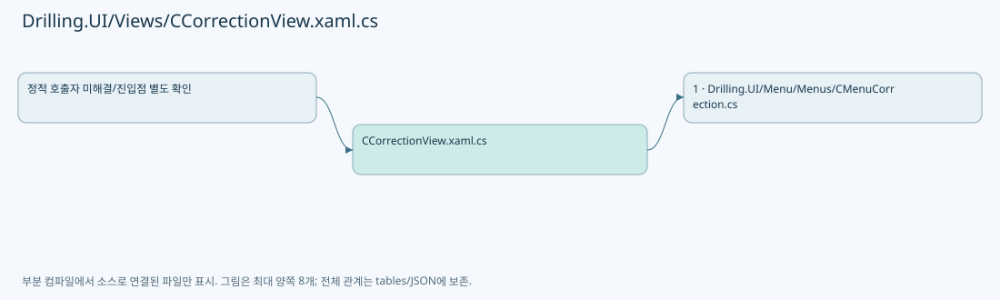
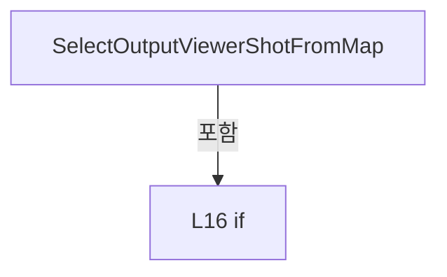
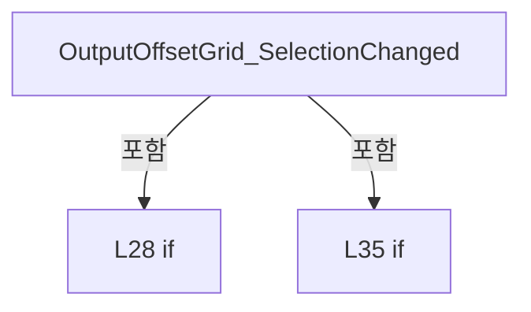
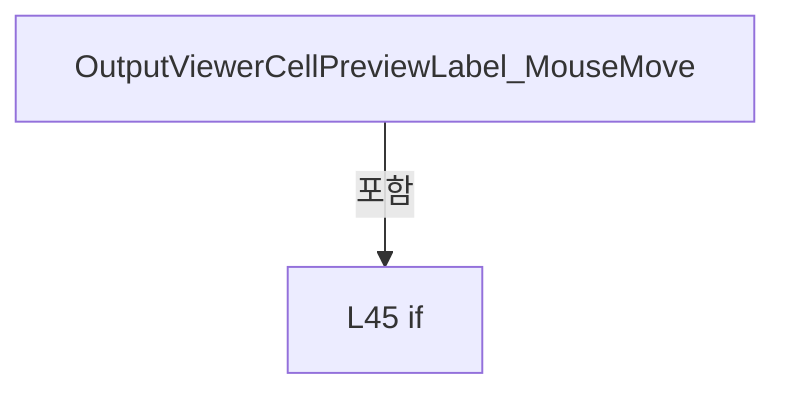
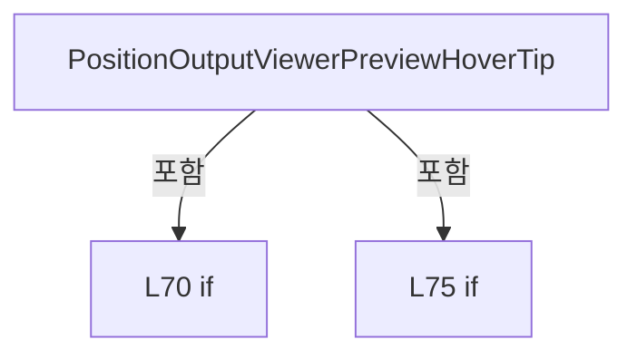

# Drilling.UI/Views/CCorrectionView.xaml.cs

| 항목 | 내용 |
| --- | --- |
| 원본 저장소 | https://github.com/kjuws10-rgb/A3Drilling.git |
| 원본 Commit | 5aee8e58439c9b455cae7c9593c9be986c3e682e |
| 원본 SHA256 | 0bd53b75a39281dd075691e7cdcd956b6a3659ab39adccf3d1be19de616bb407 |
| 파일 분류 | code |
| 원본 크기/행 | 3,359 bytes / 89 physical lines |
| 인코딩 | utf-8-sig |
| 검토 범위 | 구문/부분 의미 분석에서 추출한 사실. 동작·물리 단위·실장비 합격을 보증하지 않습니다. |
| 원본 링크 | [고정 Commit 원본](https://github.com/kjuws10-rgb/A3Drilling/blob/5aee8e58439c9b455cae7c9593c9be986c3e682e/Drilling.UI/Views/CCorrectionView.xaml.cs) |

## 파일의 역할과 읽는 순서

WPF 화면·사용자 명령·표시 상태를 구성합니다. XAML 이벤트와 코드 비하인드, RootView의 조립 경로를 함께 추적합니다.

## 네임스페이스·타입·상속

| 타입 | 구분 | 원본 범위 | 선언/상속 |
| --- | --- | --- | --- |
| CCorrectionView | ClassDeclaration | 7–89 | CCorrectionView: UserControl |

## 멤버 빠른 목록

| 이름 | 종류 | 범위 | 서명 |
| --- | --- | --- | --- |
| .ctor | ConstructorDeclaration | L9–12 | Drilling.UI.Views.CCorrectionView.CCorrectionView() |
| SelectOutputViewerShotFromMap | MethodDeclaration | L14–24 | void Drilling.UI.Views.CCorrectionView.SelectOutputViewerShotFromMap(object, MouseButtonEventArgs) |
| OutputOffsetGrid_SelectionChanged | MethodDeclaration | L26–41 | void Drilling.UI.Views.CCorrectionView.OutputOffsetGrid_SelectionChanged(object, SelectionChangedEventArgs) |
| OutputViewerCellPreviewLabel_MouseMove | MethodDeclaration | L43–54 | void Drilling.UI.Views.CCorrectionView.OutputViewerCellPreviewLabel_MouseMove(object, MouseEventArgs) |
| OutputViewerCellPreviewLabel_MouseLeave | MethodDeclaration | L56–59 | void Drilling.UI.Views.CCorrectionView.OutputViewerCellPreviewLabel_MouseLeave(object, MouseEventArgs) |
| PositionOutputViewerPreviewHoverTip | MethodDeclaration | L61–82 | void Drilling.UI.Views.CCorrectionView.PositionOutputViewerPreviewHoverTip(Point) |
| HideOutputViewerPreviewHoverTip | MethodDeclaration | L84–88 | void Drilling.UI.Views.CCorrectionView.HideOutputViewerPreviewHoverTip() |

## 멤버별 상세 계약·호출·처리 해설

### ConstructorDeclaration `.ctor` · L9–12

[Drilling.UI/Views/CCorrectionView.xaml.cs:9–12](https://github.com/kjuws10-rgb/A3Drilling/blob/5aee8e58439c9b455cae7c9593c9be986c3e682e/Drilling.UI/Views/CCorrectionView.xaml.cs#L9-L12)

| 항목 | 실제 추출 값 |
| --- | --- |
| 서명 | Drilling.UI.Views.CCorrectionView.CCorrectionView() |
| 접근/수식자 | Public / public |
| 반환/값 타입 | void |
| 소속 타입 | NamedType:Drilling.UI.Views.CCorrectionView |

현재 부분 분석에서 직접 연결된 호출자는 없습니다. XAML/이벤트/인터페이스·델리게이트·외부 진입을 추가 확인해야 하며, 미사용으로 판정한 것이 아닙니다.

호출하는 대상과 해석 범위:

| 원본 행 | 표현식 | 분석 상태 | 대상/소스 위치 |
| --- | --- | --- | --- |
| 11 | InitializeComponent | unresolved | None |

본문의 실제 연산·분기·예외·반환 순서(원문 위치 순):

| 원본 행 | 종류 | 주석 해설 |
| --- | --- | --- |
| 11 | call | 함수·델리게이트 또는 객체 생성자를 호출합니다: InitializeComponent() |

변경 전 점검: 입력/반환 타입, 위 호출자, 예외/취소 경로, 공유 상태와 저장·전송 소비자를 함께 확인합니다. 값의 단위나 물리 방향을 이름만으로 확정하지 않습니다.

### MethodDeclaration `SelectOutputViewerShotFromMap` · L14–24

[Drilling.UI/Views/CCorrectionView.xaml.cs:14–24](https://github.com/kjuws10-rgb/A3Drilling/blob/5aee8e58439c9b455cae7c9593c9be986c3e682e/Drilling.UI/Views/CCorrectionView.xaml.cs#L14-L24)

| 항목 | 실제 추출 값 |
| --- | --- |
| 서명 | void Drilling.UI.Views.CCorrectionView.SelectOutputViewerShotFromMap(object, MouseButtonEventArgs) |
| 접근/수식자 | Private / private |
| 반환/값 타입 | void |
| 소속 타입 | NamedType:Drilling.UI.Views.CCorrectionView |

입력 계약:

| 이름 | 타입 | 전달 | 선택/기본값 |
| --- | --- | --- | --- |
| sender | object | None | False /  |
| e | MouseButtonEventArgs | None | False /  |

현재 부분 분석에서 직접 연결된 호출자는 없습니다. XAML/이벤트/인터페이스·델리게이트·외부 진입을 추가 확인해야 하며, 미사용으로 판정한 것이 아닙니다.

호출하는 대상과 해석 범위:

| 원본 행 | 표현식 | 분석 상태 | 대상/소스 위치 |
| --- | --- | --- | --- |
| 21 | e.GetPosition | unresolved | None |
| 22 | correction.SelectOutputViewerShotAt | candidate | OverloadResolutionFailure |

본문의 실제 연산·분기·예외·반환 순서(원문 위치 순):

| 원본 행 | 종류 | 주석 해설 |
| --- | --- | --- |
| 16 | if | 조건에 따라 분기합니다: if (sender is not FrameworkElement map &#124;&#124; DataContext is not CRootView root &#124;&#124; root.CurrentScreen.Correction is not CMenuCorrection correction) |
| 18 | return | 호출자에게 값 또는 제어를 반환합니다: return; |
| 21 | call | 함수·델리게이트 또는 객체 생성자를 호출합니다: e.GetPosition(map) |
| 21 | local-declaration | 지역 변수를 선언합니다: var point = e.GetPosition(map); |
| 21 | variable-initializer | 변수의 초기값을 지정합니다: point = e.GetPosition(map) |
| 22 | call | 함수·델리게이트 또는 객체 생성자를 호출합니다: correction.SelectOutputViewerShotAt(point.X, point.Y) |
| 23 | assignment | 값을 대상에 대입합니다: e.Handled = true |

제어 구문의 포함 구조(실제 실행 순서/CFG가 아닌 구문 탐색 그림):

변경 전 점검: 입력/반환 타입, 위 호출자, 예외/취소 경로, 공유 상태와 저장·전송 소비자를 함께 확인합니다. 값의 단위나 물리 방향을 이름만으로 확정하지 않습니다.

### MethodDeclaration `OutputOffsetGrid_SelectionChanged` · L26–41

[Drilling.UI/Views/CCorrectionView.xaml.cs:26–41](https://github.com/kjuws10-rgb/A3Drilling/blob/5aee8e58439c9b455cae7c9593c9be986c3e682e/Drilling.UI/Views/CCorrectionView.xaml.cs#L26-L41)

| 항목 | 실제 추출 값 |
| --- | --- |
| 서명 | void Drilling.UI.Views.CCorrectionView.OutputOffsetGrid_SelectionChanged(object, SelectionChangedEventArgs) |
| 접근/수식자 | Private / private |
| 반환/값 타입 | void |
| 소속 타입 | NamedType:Drilling.UI.Views.CCorrectionView |

입력 계약:

| 이름 | 타입 | 전달 | 선택/기본값 |
| --- | --- | --- | --- |
| sender | object | None | False /  |
| e | SelectionChangedEventArgs | None | False /  |

현재 부분 분석에서 직접 연결된 호출자는 없습니다. XAML/이벤트/인터페이스·델리게이트·외부 진입을 추가 확인해야 하며, 미사용으로 판정한 것이 아닙니다.

호출하는 대상과 해석 범위:

| 원본 행 | 표현식 | 분석 상태 | 대상/소스 위치 |
| --- | --- | --- | --- |
| 33 | correction.SelectOutputViewerShotByKey | resolved | void Drilling.UI.Menu.Menus.CMenuCorrection.SelectOutputViewerShotByKey(string) · Drilling.UI/Menu/Menus/CMenuCorrection.cs:519 |
| 37 | OutputOffsetGrid.Dispatcher.BeginInvoke | unresolved | None |
| 38 | OutputOffsetGrid.ScrollIntoView | unresolved | None |

본문의 실제 연산·분기·예외·반환 순서(원문 위치 순):

| 원본 행 | 종류 | 주석 해설 |
| --- | --- | --- |
| 28 | if | 조건에 따라 분기합니다: if (sender is not DataGrid { SelectedItem: ST_CORRECTION_OFFSET_SHOT_ITEM shot } &#124;&#124; DataContext is not CRootView root &#124;&#124; root.CurrentScreen.Correction is not CMenuCorrection correction) |
| 30 | return | 호출자에게 값 또는 제어를 반환합니다: return; |
| 33 | call | 함수·델리게이트 또는 객체 생성자를 호출합니다: correction.SelectOutputViewerShotByKey(shot.ShotKey) |
| 34 | local-declaration | 지역 변수를 선언합니다: var selectedShot = correction.OutputOffsets.SelectedShotItem; |
| 34 | variable-initializer | 변수의 초기값을 지정합니다: selectedShot = correction.OutputOffsets.SelectedShotItem |
| 35 | if | 조건에 따라 분기합니다: if (selectedShot is not null) |
| 37 | assignment | 값을 대상에 대입합니다: _ = OutputOffsetGrid.Dispatcher.BeginInvoke( () => OutputOffsetGrid.ScrollIntoView(selectedShot), System.Windows.Threading.DispatcherPriority.Background) |
| 37 | call | 함수·델리게이트 또는 객체 생성자를 호출합니다: OutputOffsetGrid.Dispatcher.BeginInvoke( () => OutputOffsetGrid.ScrollIntoView(selectedShot), System.Windows.Threading.DispatcherPriority.Background) |
| 38 | call | 함수·델리게이트 또는 객체 생성자를 호출합니다: OutputOffsetGrid.ScrollIntoView(selectedShot) |

제어 구문의 포함 구조(실제 실행 순서/CFG가 아닌 구문 탐색 그림):

변경 전 점검: 입력/반환 타입, 위 호출자, 예외/취소 경로, 공유 상태와 저장·전송 소비자를 함께 확인합니다. 값의 단위나 물리 방향을 이름만으로 확정하지 않습니다.

### MethodDeclaration `OutputViewerCellPreviewLabel_MouseMove` · L43–54

[Drilling.UI/Views/CCorrectionView.xaml.cs:43–54](https://github.com/kjuws10-rgb/A3Drilling/blob/5aee8e58439c9b455cae7c9593c9be986c3e682e/Drilling.UI/Views/CCorrectionView.xaml.cs#L43-L54)

| 항목 | 실제 추출 값 |
| --- | --- |
| 서명 | void Drilling.UI.Views.CCorrectionView.OutputViewerCellPreviewLabel_MouseMove(object, MouseEventArgs) |
| 접근/수식자 | Private / private |
| 반환/값 타입 | void |
| 소속 타입 | NamedType:Drilling.UI.Views.CCorrectionView |

입력 계약:

| 이름 | 타입 | 전달 | 선택/기본값 |
| --- | --- | --- | --- |
| sender | object | None | False /  |
| e | MouseEventArgs | None | False /  |

현재 부분 분석에서 직접 연결된 호출자는 없습니다. XAML/이벤트/인터페이스·델리게이트·외부 진입을 추가 확인해야 하며, 미사용으로 판정한 것이 아닙니다.

호출하는 대상과 해석 범위:

| 원본 행 | 표현식 | 분석 상태 | 대상/소스 위치 |
| --- | --- | --- | --- |
| 47 | HideOutputViewerPreviewHoverTip | resolved | void Drilling.UI.Views.CCorrectionView.HideOutputViewerPreviewHoverTip() · Drilling.UI/Views/CCorrectionView.xaml.cs:84 |
| 51 | label.CellNo.ToString | resolved | string int.ToString(System.IFormatProvider?) |
| 53 | PositionOutputViewerPreviewHoverTip | candidate | OverloadResolutionFailure |
| 53 | e.GetPosition | unresolved | None |

본문의 실제 연산·분기·예외·반환 순서(원문 위치 순):

| 원본 행 | 종류 | 주석 해설 |
| --- | --- | --- |
| 45 | if | 조건에 따라 분기합니다: if (sender is not FrameworkElement { DataContext: ST_CELL_PREVIEW_LABEL label }) |
| 47 | call | 함수·델리게이트 또는 객체 생성자를 호출합니다: HideOutputViewerPreviewHoverTip() |
| 48 | return | 호출자에게 값 또는 제어를 반환합니다: return; |
| 51 | assignment | 값을 대상에 대입합니다: OutputViewerPreviewHoverTipText.Text = label.CellNo.ToString(System.Globalization.CultureInfo.InvariantCulture) |
| 51 | call | 함수·델리게이트 또는 객체 생성자를 호출합니다: label.CellNo.ToString(System.Globalization.CultureInfo.InvariantCulture) |
| 52 | assignment | 값을 대상에 대입합니다: OutputViewerPreviewHoverTip.Visibility = Visibility.Visible |
| 53 | call | 함수·델리게이트 또는 객체 생성자를 호출합니다: PositionOutputViewerPreviewHoverTip(e.GetPosition(OutputViewerPreviewViewport)) |
| 53 | call | 함수·델리게이트 또는 객체 생성자를 호출합니다: e.GetPosition(OutputViewerPreviewViewport) |

제어 구문의 포함 구조(실제 실행 순서/CFG가 아닌 구문 탐색 그림):

변경 전 점검: 입력/반환 타입, 위 호출자, 예외/취소 경로, 공유 상태와 저장·전송 소비자를 함께 확인합니다. 값의 단위나 물리 방향을 이름만으로 확정하지 않습니다.

### MethodDeclaration `OutputViewerCellPreviewLabel_MouseLeave` · L56–59

[Drilling.UI/Views/CCorrectionView.xaml.cs:56–59](https://github.com/kjuws10-rgb/A3Drilling/blob/5aee8e58439c9b455cae7c9593c9be986c3e682e/Drilling.UI/Views/CCorrectionView.xaml.cs#L56-L59)

| 항목 | 실제 추출 값 |
| --- | --- |
| 서명 | void Drilling.UI.Views.CCorrectionView.OutputViewerCellPreviewLabel_MouseLeave(object, MouseEventArgs) |
| 접근/수식자 | Private / private |
| 반환/값 타입 | void |
| 소속 타입 | NamedType:Drilling.UI.Views.CCorrectionView |

입력 계약:

| 이름 | 타입 | 전달 | 선택/기본값 |
| --- | --- | --- | --- |
| sender | object | None | False /  |
| e | MouseEventArgs | None | False /  |

현재 부분 분석에서 직접 연결된 호출자는 없습니다. XAML/이벤트/인터페이스·델리게이트·외부 진입을 추가 확인해야 하며, 미사용으로 판정한 것이 아닙니다.

호출하는 대상과 해석 범위:

| 원본 행 | 표현식 | 분석 상태 | 대상/소스 위치 |
| --- | --- | --- | --- |
| 58 | HideOutputViewerPreviewHoverTip | resolved | void Drilling.UI.Views.CCorrectionView.HideOutputViewerPreviewHoverTip() · Drilling.UI/Views/CCorrectionView.xaml.cs:84 |

본문의 실제 연산·분기·예외·반환 순서(원문 위치 순):

| 원본 행 | 종류 | 주석 해설 |
| --- | --- | --- |
| 58 | call | 함수·델리게이트 또는 객체 생성자를 호출합니다: HideOutputViewerPreviewHoverTip() |

변경 전 점검: 입력/반환 타입, 위 호출자, 예외/취소 경로, 공유 상태와 저장·전송 소비자를 함께 확인합니다. 값의 단위나 물리 방향을 이름만으로 확정하지 않습니다.

### MethodDeclaration `PositionOutputViewerPreviewHoverTip` · L61–82

[Drilling.UI/Views/CCorrectionView.xaml.cs:61–82](https://github.com/kjuws10-rgb/A3Drilling/blob/5aee8e58439c9b455cae7c9593c9be986c3e682e/Drilling.UI/Views/CCorrectionView.xaml.cs#L61-L82)

| 항목 | 실제 추출 값 |
| --- | --- |
| 서명 | void Drilling.UI.Views.CCorrectionView.PositionOutputViewerPreviewHoverTip(Point) |
| 접근/수식자 | Private / private |
| 반환/값 타입 | void |
| 소속 타입 | NamedType:Drilling.UI.Views.CCorrectionView |

입력 계약:

| 이름 | 타입 | 전달 | 선택/기본값 |
| --- | --- | --- | --- |
| pointer | Point | None | False /  |

현재 부분 분석에서 직접 연결된 호출자는 없습니다. XAML/이벤트/인터페이스·델리게이트·외부 진입을 추가 확인해야 하며, 미사용으로 판정한 것이 아닙니다.

호출하는 대상과 해석 범위:

| 원본 행 | 표현식 | 분석 상태 | 대상/소스 위치 |
| --- | --- | --- | --- |
| 66 | OutputViewerPreviewHoverTip.Measure | unresolved | None |
| 66 | new Size | unresolved | None |
| 72 | Math.Clamp | candidate | OverloadResolutionFailure |
| 72 | Math.Max | candidate | OverloadResolutionFailure |
| 77 | Math.Clamp | candidate | OverloadResolutionFailure |
| 77 | Math.Max | candidate | OverloadResolutionFailure |

본문의 실제 연산·분기·예외·반환 순서(원문 위치 순):

| 원본 행 | 종류 | 주석 해설 |
| --- | --- | --- |
| 63 | local-declaration | 지역 변수를 선언합니다: const double margin = 4.0; |
| 63 | variable-initializer | 변수의 초기값을 지정합니다: margin = 4.0 |
| 64 | local-declaration | 지역 변수를 선언합니다: const double offsetX = 12.0; |
| 64 | variable-initializer | 변수의 초기값을 지정합니다: offsetX = 12.0 |
| 65 | local-declaration | 지역 변수를 선언합니다: const double offsetY = 14.0; |
| 65 | variable-initializer | 변수의 초기값을 지정합니다: offsetY = 14.0 |
| 66 | call | 함수·델리게이트 또는 객체 생성자를 호출합니다: OutputViewerPreviewHoverTip.Measure(new Size(double.PositiveInfinity, double.PositiveInfinity)) |
| 66 | call | 함수·델리게이트 또는 객체 생성자를 호출합니다: new Size(double.PositiveInfinity, double.PositiveInfinity) |
| 67 | local-declaration | 지역 변수를 선언합니다: var tipSize = OutputViewerPreviewHoverTip.DesiredSize; |
| 67 | variable-initializer | 변수의 초기값을 지정합니다: tipSize = OutputViewerPreviewHoverTip.DesiredSize |
| 68 | local-declaration | 지역 변수를 선언합니다: var x = pointer.X + offsetX; |
| 68 | variable-initializer | 변수의 초기값을 지정합니다: x = pointer.X + offsetX |
| 69 | local-declaration | 지역 변수를 선언합니다: var y = pointer.Y + offsetY; |
| 69 | variable-initializer | 변수의 초기값을 지정합니다: y = pointer.Y + offsetY |
| 70 | if | 조건에 따라 분기합니다: if (OutputViewerPreviewViewport.ActualWidth > 0) |
| 72 | assignment | 값을 대상에 대입합니다: x = Math.Clamp(x, margin, Math.Max(margin, OutputViewerPreviewViewport.ActualWidth - tipSize.Width - margin)) |
| 72 | call | 함수·델리게이트 또는 객체 생성자를 호출합니다: Math.Clamp(x, margin, Math.Max(margin, OutputViewerPreviewViewport.ActualWidth - tipSize.Width - margin)) |
| 72 | call | 함수·델리게이트 또는 객체 생성자를 호출합니다: Math.Max(margin, OutputViewerPreviewViewport.ActualWidth - tipSize.Width - margin) |
| 75 | if | 조건에 따라 분기합니다: if (OutputViewerPreviewViewport.ActualHeight > 0) |
| 77 | assignment | 값을 대상에 대입합니다: y = Math.Clamp(y, margin, Math.Max(margin, OutputViewerPreviewViewport.ActualHeight - tipSize.Height - margin)) |
| 77 | call | 함수·델리게이트 또는 객체 생성자를 호출합니다: Math.Clamp(y, margin, Math.Max(margin, OutputViewerPreviewViewport.ActualHeight - tipSize.Height - margin)) |
| 77 | call | 함수·델리게이트 또는 객체 생성자를 호출합니다: Math.Max(margin, OutputViewerPreviewViewport.ActualHeight - tipSize.Height - margin) |
| 80 | assignment | 값을 대상에 대입합니다: OutputViewerPreviewHoverTipTranslateTransform.X = x |
| 81 | assignment | 값을 대상에 대입합니다: OutputViewerPreviewHoverTipTranslateTransform.Y = y |

제어 구문의 포함 구조(실제 실행 순서/CFG가 아닌 구문 탐색 그림):

변경 전 점검: 입력/반환 타입, 위 호출자, 예외/취소 경로, 공유 상태와 저장·전송 소비자를 함께 확인합니다. 값의 단위나 물리 방향을 이름만으로 확정하지 않습니다.

### MethodDeclaration `HideOutputViewerPreviewHoverTip` · L84–88

[Drilling.UI/Views/CCorrectionView.xaml.cs:84–88](https://github.com/kjuws10-rgb/A3Drilling/blob/5aee8e58439c9b455cae7c9593c9be986c3e682e/Drilling.UI/Views/CCorrectionView.xaml.cs#L84-L88)

| 항목 | 실제 추출 값 |
| --- | --- |
| 서명 | void Drilling.UI.Views.CCorrectionView.HideOutputViewerPreviewHoverTip() |
| 접근/수식자 | Private / private |
| 반환/값 타입 | void |
| 소속 타입 | NamedType:Drilling.UI.Views.CCorrectionView |

정적 호출자로 확인된 위치:

| 호출 파일/행 | 호출 표현식 | 런타임 분기 가능 |
| --- | --- | --- |
| [Drilling.UI/Views/CCorrectionView.xaml.cs:47–47](https://github.com/kjuws10-rgb/A3Drilling/blob/5aee8e58439c9b455cae7c9593c9be986c3e682e/Drilling.UI/Views/CCorrectionView.xaml.cs#L47-L47) | HideOutputViewerPreviewHoverTip | False |
| [Drilling.UI/Views/CCorrectionView.xaml.cs:58–58](https://github.com/kjuws10-rgb/A3Drilling/blob/5aee8e58439c9b455cae7c9593c9be986c3e682e/Drilling.UI/Views/CCorrectionView.xaml.cs#L58-L58) | HideOutputViewerPreviewHoverTip | False |

본문의 실제 연산·분기·예외·반환 순서(원문 위치 순):

| 원본 행 | 종류 | 주석 해설 |
| --- | --- | --- |
| 86 | assignment | 값을 대상에 대입합니다: OutputViewerPreviewHoverTip.Visibility = Visibility.Collapsed |
| 87 | assignment | 값을 대상에 대입합니다: OutputViewerPreviewHoverTipText.Text = "" |

변경 전 점검: 입력/반환 타입, 위 호출자, 예외/취소 경로, 공유 상태와 저장·전송 소비자를 함께 확인합니다. 값의 단위나 물리 방향을 이름만으로 확정하지 않습니다.

## 구문·바인딩 한계

전체 WPF/벤더 SDK/프로젝트별 빌드 조건을 로드한 정식 빌드가 아닙니다. `resolved`는 이 부분 컴파일에서의 심볼 연결이며 virtual/interface/delegate/이벤트/Reflection/XAML의 실제 런타임 구현을 확정하지 않습니다. `candidate`와 `unresolved`는 후속 확인 대상으로 남깁니다.

## 원문 전체 주석 해설본

[원본 모든 행과 행별 해설 보기](../../../annotated/Drilling.UI/Views/CCorrectionView.xaml.cs.annotated.txt)

원본을 빠뜨리거나 임의로 줄이지 않았습니다. `L000001 |` 표시는 원본 행 번호, `// 해설`은 별도 설명입니다. 실행용 소스가 아닌 문서입니다.

## 수정·재검증 체크

- 원본 Commit과 현재 작업 파일 SHA가 같은지 먼저 확인합니다. 다르면 이 문서를 과거 버전 자료로 취급합니다.
- 선언·직접 호출·이벤트/인터페이스 경계·설정 소비를 함께 확인합니다. 정적 연결의 빈 곳을 정상 경로로 추정하지 않습니다.
- 저장 형식/단위/식별자·재시도·취소·예외·롤백에 영향을 주는 변경은 상세 해설장과 호출자를 다시 검토합니다.
- 도구의 구문 추출과 별도 정적 추적 해설, 실제 빌드·시뮬레이션·실장비 검증 결과를 분리합니다.
