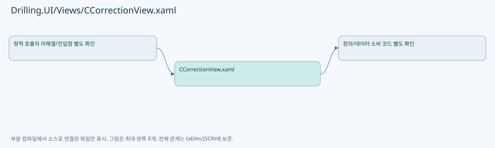

# Drilling.UI/Views/CCorrectionView.xaml

| 항목 | 내용 |
| --- | --- |
| 원본 저장소 | https://github.com/kjuws10-rgb/A3Drilling.git |
| 원본 Commit | dfa5920e6301d9ec4b0eab1452ae59521aafc986 |
| 원본 SHA256 | 869901af44bf114d89ba3c6b608d1bd77508616d97c83b24fcb122c5a1afd0e7 |
| 파일 분류 | code |
| 원본 크기/행 | 60,192 bytes / 919 physical lines |
| 인코딩 | utf-8-sig |
| 검토 범위 | 구문/부분 의미 분석에서 추출한 사실. 동작·물리 단위·실장비 합격을 보증하지 않습니다. |
| 원본 링크 | [고정 Commit 원본](https://github.com/kjuws10-rgb/A3Drilling/blob/dfa5920e6301d9ec4b0eab1452ae59521aafc986/Drilling.UI/Views/CCorrectionView.xaml) |

## 파일의 역할과 읽는 순서

WPF 화면·사용자 명령·표시 상태를 구성합니다. XAML 이벤트와 코드 비하인드, RootView의 조립 경로를 함께 추적합니다.

## 화면 구성과 코드 비하인드 연결

| 항목 | 추출 값 |
| --- | --- |
| 코드 비하인드 후보 | Drilling.UI/Views/CCorrectionView.xaml.cs |
| 이름 있는 요소 | DefaultWorkspace, CorrectionReviewTabControl, OutputViewerPreviewViewport, OutputViewerPreviewHoverTip, OutputViewerPreviewHoverTipTranslateTransform, OutputViewerPreviewHoverTipText, OutputViewerCellShotMapSurface, OutputOffsetKinds, OutputOffsetGrid |
| 이벤트 개수 | 5 |
| Binding 표현 개수 | 112 |

이름 있는 요소는 WPF가 필드를 생성할 수 있는 XAML 선언입니다. 문서 추출기는 WPF 생성 코드를 만들거나 로드하지 않으므로 C# 원문 멤버 수에 합산하지 않습니다.

| 요소 이름 | 원본 범위 |
| --- | --- |
| DefaultWorkspace | L217–217 |
| CorrectionReviewTabControl | L228–228 |
| OutputViewerPreviewViewport | L547–547 |
| OutputViewerPreviewHoverTip | L603–603 |
| OutputViewerPreviewHoverTipTranslateTransform | L615–615 |
| OutputViewerPreviewHoverTipText | L617–617 |
| OutputViewerCellShotMapSurface | L672–672 |
| OutputOffsetKinds | L715–715 |
| OutputOffsetGrid | L783–783 |

| 이벤트 | 핸들러 이름 | 원본 범위 | 해석 |
| --- | --- | --- | --- |
| SelectionChanged | CorrectionReviewTabControl_SelectionChanged | L229–229 | 코드 비하인드/이벤트 라우팅에서 실제 연결 확인 필요 |
| MouseMove | OutputViewerCellPreviewLabel_MouseMove | L566–566 | 코드 비하인드/이벤트 라우팅에서 실제 연결 확인 필요 |
| MouseLeave | OutputViewerCellPreviewLabel_MouseLeave | L567–567 | 코드 비하인드/이벤트 라우팅에서 실제 연결 확인 필요 |
| MouseLeftButtonDown | SelectOutputViewerShotFromMap | L677–677 | 코드 비하인드/이벤트 라우팅에서 실제 연결 확인 필요 |
| SelectionChanged | OutputOffsetGrid_SelectionChanged | L801–801 | 코드 비하인드/이벤트 라우팅에서 실제 연결 확인 필요 |

| Binding 표현 | 원본 범위 |
| --- | --- |
| {Binding RelativeSource={RelativeSource Self}, Path=Tag} | L29–29 |
| {Binding Name} | L47–47 |
| {Binding XState} | L53–53 |
| {Binding XFlip} | L53–53 |
| {Binding YState} | L55–55 |
| {Binding YFlip} | L55–55 |
| {Binding XyState} | L57–57 |
| {Binding XyFlip} | L57–57 |
| {Binding IsSelected} | L115–115 |
| {Binding CurrentScreen.IsCorrectionLayout, Converter={StaticResource BooleanToVisibilityConverter}} | L132–132 |
| {Binding CurrentScreen.Correction.Title} | L143–143 |
| {Binding CurrentScreen.Correction.Subtitle} | L147–147 |
| {Binding CurrentScreen.Correction.IsCorrectionCommandsVisible, Converter={StaticResource BooleanToVisibilityConverter}} | L154–154 |
| {Binding CurrentScreen.Correction.ExecuteCommand} | L157–157 |
| {Binding CurrentScreen.Correction.ExecuteCommand} | L164–164 |
| {Binding CurrentScreen.Correction.ExecuteCommand} | L171–171 |
| {Binding CurrentScreen.Correction.ExecuteCommand} | L178–178 |
| {Binding CurrentScreen.Correction.Tabs} | L189–189 |
| {Binding Name} | L198–198 |
| {Binding DataContext.CurrentScreen.Correction.SelectTabCommand, RelativeSource={RelativeSource AncestorType=UserControl}} | L199–199 |
| {Binding Name} | L200–200 |
| {Binding IsSelected} | L204–204 |
| {Binding CurrentScreen.Correction.IsDefaultTab, Converter={StaticResource BooleanToVisibilityConverter}} | L218–218 |
| {Binding CurrentScreen.Correction.DefaultOffset} | L219–219 |
| {Binding CurrentScreen.Correction.IsAlignDistortionTab, Converter={StaticResource BooleanToVisibilityConverter}} | L223–223 |
| {Binding CurrentScreen.Correction.AlignDistortion} | L225–225 |
| {Binding CurrentScreen.Correction.SelectedReviewTabIndex, Mode=TwoWay} | L230–230 |
| {Binding CurrentScreen.Correction.IsReviewCorrectionTab, Converter={StaticResource BooleanToVisibilityConverter}} | L232–232 |
| {Binding} | L263–263 |
| {Binding} | L265–265 |
| {Binding} | L267–267 |
| {Binding} | L269–269 |
| {Binding CurrentScreen.Correction.Simple} | L271–271 |
| {Binding CurrentScreen.Correction.Rough} | L274–274 |
| {Binding CurrentScreen.Correction.Fine} | L277–277 |
| {Binding CurrentScreen.Correction.ReviewData} | L280–280 |
| {Binding CurrentScreen.Correction.SummaryItems} | L285–285 |
| {Binding CurrentScreen.Correction.IsOtherCorrectionTab, Converter={StaticResource BooleanToVisibilityConverter}} | L286–286 |
| {Binding Name} | L303–303 |
| {Binding Value} | L306–306 |
| {Binding ValueBrush} | L307–307 |
| {Binding CurrentScreen.Correction.IsOtherCorrectionTab, Converter={StaticResource BooleanToVisibilityConverter}} | L319–319 |
| {Binding CurrentScreen.Correction.SourceRows} | L334–334 |
| {Binding Type} | L343–343 |
| {Binding Name} | L344–344 |
| {Binding Value} | L345–345 |
| {Binding State} | L346–346 |
| {Binding StateBrush} | L349–349 |
| {Binding Source} | L354–354 |
| {Binding CurrentScreen.Correction.CandidateRows} | L368–368 |
| {Binding Item} | L377–377 |
| {Binding Target} | L378–378 |
| {Binding Value} | L379–379 |
| {Binding ValueBrush} | L382–382 |
| {Binding Unit} | L387–387 |
| {Binding State} | L388–388 |
| {Binding StateBrush} | L391–391 |
| {Binding CurrentScreen.Correction.DetailItems} | L420–420 |
| {Binding Name} | L428–428 |
| {Binding Value} | L431–431 |
| {Binding CurrentScreen.Correction.ApplyRows} | L449–449 |
| {Binding Item} | L458–458 |
| {Binding Target} | L459–459 |
| {Binding Value} | L460–460 |
| {Binding ValueBrush} | L463–463 |
| {Binding Unit} | L468–468 |
| {Binding State} | L469–469 |
| {Binding CurrentScreen.Correction.IsOutputHistoryTab, Converter={StaticResource BooleanToVisibilityConverter}} | L479–479 |
| {Binding CurrentScreen.Correction.OutputViewerSummary} | L507–507 |
| {Binding CurrentScreen.Correction.OutputViewerHeadCards} | L516–516 |
| {Binding Background} | L527–527 |
| {Binding BorderBrush} | L528–528 |
| {Binding Name} | L531–531 |
| {Binding Foreground} | L532–532 |
| {Binding CurrentScreen.Correction.OutputViewerGlassPreviewImage} | L548–548 |
| {Binding CurrentScreen.Correction.OutputViewerCellPreviewLabels} | L552–552 |
| {Binding CellNo} | L557–557 |
| {Binding Width} | L558–558 |
| {Binding Height} | L559–559 |
| {Binding DataContext.CurrentScreen.Correction.SelectOutputViewerCellCommand, RelativeSource={RelativeSource AncestorType=UserControl}} | L560–560 |
| {Binding CellNo} | L561–561 |
| {Binding IsSelected} | L590–590 |
| {Binding CurrentScreen.Correction.OutputViewerSelectedShotName} | L645–645 |
| {Binding CurrentScreen.Correction.OutputViewerCellShotMapSurfaceWidth} | L673–673 |
| {Binding CurrentScreen.Correction.OutputViewerCellShotMapSurfaceHeight} | L674–674 |
| {Binding CurrentScreen.Correction.OutputViewerCellShotMapImage} | L678–678 |
| {Binding CurrentScreen.Correction.OutputViewerHasNoCellSelection, Converter={StaticResource BooleanToVisibilityConverter}} | L684–684 |
| {Binding CurrentScreen.Correction.OutputOffsets.Kinds} | L716–716 |
| {Binding Name} | L723–723 |
| {Binding Key} | L724–724 |
| {Binding DataContext.CurrentScreen.Correction.OutputOffsets.SelectKindCommand, RelativeSource={RelativeSource AncestorType=UserControl}} | L726–726 |
| {Binding CurrentScreen.Correction.OutputOffsets.Description} | L731–731 |
| {Binding CurrentScreen.Correction.OutputViewerSelectedCellName} | L749–749 |
| {Binding CurrentScreen.Correction.OutputViewerSelectedShotName} | L755–755 |
| {Binding CurrentScreen.Correction.OutputViewerSelectedShotDetail} | L763–763 |
| {Binding CurrentScreen.Correction.OutputViewerHasNoCellSelection, Converter={StaticResource BooleanToVisibilityConverter}} | L771–771 |
| {Binding CurrentScreen.Correction.OutputViewerIsCellDetailVisible, Converter={StaticResource BooleanToVisibilityConverter}} | L784–784 |
| {Binding CurrentScreen.Correction.OutputOffsets.ShotItems} | L785–785 |
| {Binding CurrentScreen.Correction.OutputOffsets.SelectedShotItem, Mode=OneWay} | L786–786 |
| {Binding CoordinateDetail} | L808–808 |
| {Binding IsSelected} | L810–810 |
| {Binding RelativeSource={RelativeSource AncestorType=DataGridRow}, Path=Foreground} | L829–829 |
| {Binding ShotName} | L842–842 |
| {Binding RelativeSource={RelativeSource AncestorType=DataGridRow}, Path=Foreground} | L843–843 |
| {Binding Head} | L854–854 |
| {Binding RelativeSource={RelativeSource AncestorType=DataGridRow}, Path=Foreground} | L855–855 |
| {Binding DesignOffsetX} | L866–866 |
| {Binding RelativeSource={RelativeSource AncestorType=DataGridRow}, Path=Foreground} | L867–867 |
| {Binding DesignOffsetY} | L878–878 |
| {Binding RelativeSource={RelativeSource AncestorType=DataGridRow}, Path=Foreground} | L879–879 |
| {Binding ScannerOffsetGx} | L890–890 |
| {Binding ScannerOffsetGy} | L902–902 |

## 원문 전체 주석 해설본

[원본 모든 행과 행별 해설 보기](../../../annotated/Drilling.UI/Views/CCorrectionView.xaml.annotated.txt)

원본을 빠뜨리거나 임의로 줄이지 않았습니다. `L000001 |` 표시는 원본 행 번호, `// 해설`은 별도 설명입니다. 실행용 소스가 아닌 문서입니다.

## 수정·재검증 체크

- 원본 Commit과 현재 작업 파일 SHA가 같은지 먼저 확인합니다. 다르면 이 문서를 과거 버전 자료로 취급합니다.
- 선언·직접 호출·이벤트/인터페이스 경계·설정 소비를 함께 확인합니다. 정적 연결의 빈 곳을 정상 경로로 추정하지 않습니다.
- 저장 형식/단위/식별자·재시도·취소·예외·롤백에 영향을 주는 변경은 상세 해설장과 호출자를 다시 검토합니다.
- 도구의 구문 추출과 별도 정적 추적 해설, 실제 빌드·시뮬레이션·실장비 검증 결과를 분리합니다.
