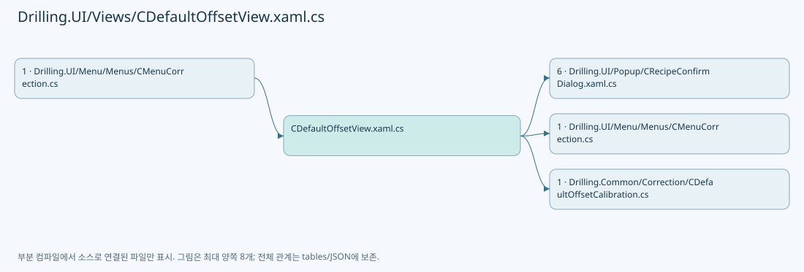
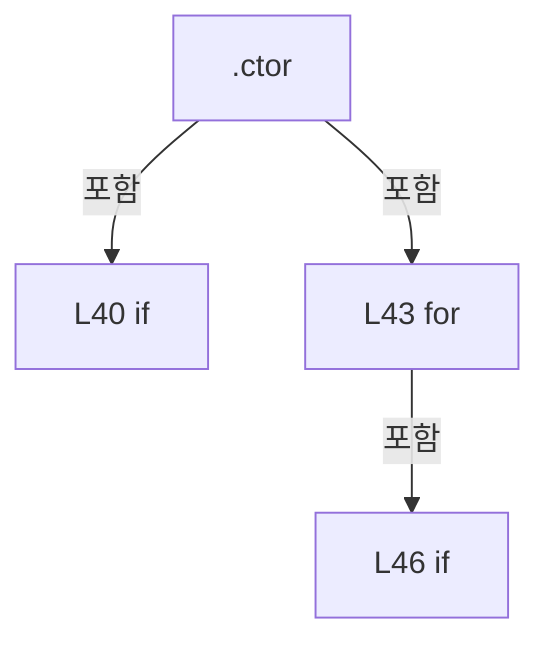
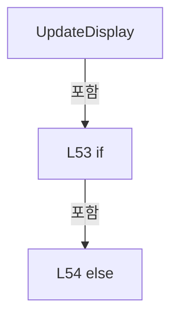
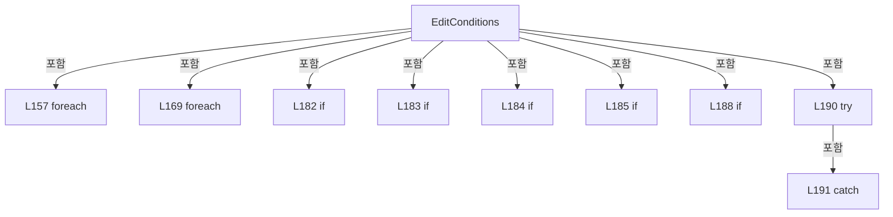
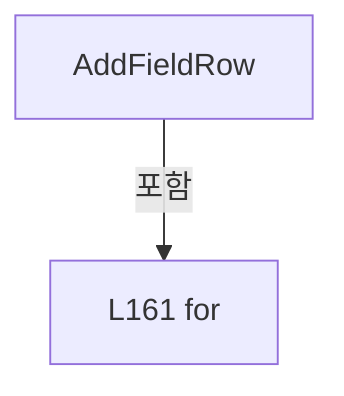

# Drilling.UI/Views/CDefaultOffsetView.xaml.cs

| 항목 | 내용 |
| --- | --- |
| 원본 저장소 | https://github.com/kjuws10-rgb/A3Drilling.git |
| 원본 Commit | 0219666f9053b907d96d7e0aa7d0c6c1be3a73d4 |
| 원본 SHA256 | c9bbf573db3ad2daf7010f437df04fd305f212a3b0960e8ffad05d986239f2a7 |
| 파일 분류 | code |
| 원본 크기/행 | 16,774 bytes / 197 physical lines |
| 인코딩 | utf-8-sig |
| 검토 범위 | 구문/부분 의미 분석에서 추출한 사실. 동작·물리 단위·실장비 합격을 보증하지 않습니다. |
| 원본 링크 | [고정 Commit 원본](https://github.com/kjuws10-rgb/A3Drilling/blob/0219666f9053b907d96d7e0aa7d0c6c1be3a73d4/Drilling.UI/Views/CDefaultOffsetView.xaml.cs) |

## 파일의 역할과 읽는 순서

WPF 화면·사용자 명령·표시 상태를 구성합니다. XAML 이벤트와 코드 비하인드, RootView의 조립 경로를 함께 추적합니다.

## 네임스페이스·타입·상속

| 타입 | 구분 | 원본 범위 | 선언/상속 |
| --- | --- | --- | --- |
| CDefaultOffsetView | ClassDeclaration | 11–197 | CDefaultOffsetView: UserControl |

## 멤버 빠른 목록

| 이름 | 종류 | 범위 | 서명 |
| --- | --- | --- | --- |
| IsCompactProperty | FieldDeclaration | L13–13 | DependencyProperty Drilling.UI.Views.CDefaultOffsetView.IsCompactProperty |
| IsCompact | PropertyDeclaration | L14–14 | bool Drilling.UI.Views.CDefaultOffsetView.IsCompact |
| get_IsCompact | GetAccessorDeclaration | L14–14 | bool Drilling.UI.Views.CDefaultOffsetView.IsCompact.get |
| set_IsCompact | SetAccessorDeclaration | L14–14 | void Drilling.UI.Views.CDefaultOffsetView.IsCompact.set |
| _display | FieldDeclaration | L17–17 | DispatcherTimer Drilling.UI.Views.CDefaultOffsetView._display |
| .ctor | ConstructorDeclaration | L18–50 | Drilling.UI.Views.CDefaultOffsetView.CDefaultOffsetView() |
| UpdateDisplay | MethodDeclaration | L51–55 | void Drilling.UI.Views.CDefaultOffsetView.UpdateDisplay() |
| RefreshFeedback | MethodDeclaration | L56–56 | void Drilling.UI.Views.CDefaultOffsetView.RefreshFeedback() |
| EditConditions | MethodDeclaration | L60–196 | (Drilling.Common.Correction.ST_DEFAULT_OFFSET_OPTIONS Options, int Model)? Drilling.UI.Views.CDefaultOffsetView.EditConditions(Drilling.Common.Correction.ST_DEFAULT_OFFSET_OPTIONS, System.Collections.Generic.IReadOnlyList<int>, int, System.Collections.Generic.IReadOnlyDictionary<int, Drilling.Common.Correction.ST_DEFAULT_HEAD_GEOMETRY>, System.Collections.Generic.IReadOnlyDictionary<int, bool>, double) |
| UpdateMachiningMode | LocalFunctionStatement | L119–124 | void UpdateMachiningMode() |
| AddInputRow | LocalFunctionStatement | L126–132 | void AddInputRow(int, string, FrameworkElement) |
| UpdateCenterPreview | LocalFunctionStatement | L145–151 | void UpdateCenterPreview() |
| AddFieldRow | LocalFunctionStatement | L158–167 | void AddFieldRow(int, params string[]) |

## 멤버별 상세 계약·호출·처리 해설

### FieldDeclaration `IsCompactProperty` · L13–13

[Drilling.UI/Views/CDefaultOffsetView.xaml.cs:13–13](https://github.com/kjuws10-rgb/A3Drilling/blob/0219666f9053b907d96d7e0aa7d0c6c1be3a73d4/Drilling.UI/Views/CDefaultOffsetView.xaml.cs#L13-L13)

| 항목 | 실제 추출 값 |
| --- | --- |
| 서명 | DependencyProperty Drilling.UI.Views.CDefaultOffsetView.IsCompactProperty |
| 접근/수식자 | Public / public, static, readonly |
| 반환/값 타입 | DependencyProperty |
| 소속 타입 | NamedType:Drilling.UI.Views.CDefaultOffsetView |

현재 부분 분석에서 직접 연결된 호출자는 없습니다. XAML/이벤트/인터페이스·델리게이트·외부 진입을 추가 확인해야 하며, 미사용으로 판정한 것이 아닙니다.

호출하는 대상과 해석 범위:

| 원본 행 | 표현식 | 분석 상태 | 대상/소스 위치 |
| --- | --- | --- | --- |
| 13 | DependencyProperty.Register | unresolved | None |
| 13 | nameof | unresolved | None |
| 13 | new PropertyMetadata | unresolved | None |

본문의 실제 연산·분기·예외·반환 순서(원문 위치 순):

| 원본 행 | 종류 | 주석 해설 |
| --- | --- | --- |
| 13 | call | 함수·델리게이트 또는 객체 생성자를 호출합니다: DependencyProperty.Register(nameof(IsCompact), typeof(bool), typeof(CDefaultOffsetView), new PropertyMetadata(false)) |
| 13 | call | 함수·델리게이트 또는 객체 생성자를 호출합니다: nameof(IsCompact) |
| 13 | call | 함수·델리게이트 또는 객체 생성자를 호출합니다: new PropertyMetadata(false) |
| 13 | variable-initializer | 변수의 초기값을 지정합니다: IsCompactProperty = DependencyProperty.Register(nameof(IsCompact), typeof(bool), typeof(CDefaultOffsetView), new PropertyMetadata(false)) |

변경 전 점검: 입력/반환 타입, 위 호출자, 예외/취소 경로, 공유 상태와 저장·전송 소비자를 함께 확인합니다. 값의 단위나 물리 방향을 이름만으로 확정하지 않습니다.

### PropertyDeclaration `IsCompact` · L14–14

[Drilling.UI/Views/CDefaultOffsetView.xaml.cs:14–14](https://github.com/kjuws10-rgb/A3Drilling/blob/0219666f9053b907d96d7e0aa7d0c6c1be3a73d4/Drilling.UI/Views/CDefaultOffsetView.xaml.cs#L14-L14)

| 항목 | 실제 추출 값 |
| --- | --- |
| 서명 | bool Drilling.UI.Views.CDefaultOffsetView.IsCompact |
| 접근/수식자 | Public / public |
| 반환/값 타입 | bool |
| 소속 타입 | NamedType:Drilling.UI.Views.CDefaultOffsetView |

현재 부분 분석에서 직접 연결된 호출자는 없습니다. XAML/이벤트/인터페이스·델리게이트·외부 진입을 추가 확인해야 하며, 미사용으로 판정한 것이 아닙니다.

변경 전 점검: 입력/반환 타입, 위 호출자, 예외/취소 경로, 공유 상태와 저장·전송 소비자를 함께 확인합니다. 값의 단위나 물리 방향을 이름만으로 확정하지 않습니다.

### GetAccessorDeclaration `get_IsCompact` · L14–14

[Drilling.UI/Views/CDefaultOffsetView.xaml.cs:14–14](https://github.com/kjuws10-rgb/A3Drilling/blob/0219666f9053b907d96d7e0aa7d0c6c1be3a73d4/Drilling.UI/Views/CDefaultOffsetView.xaml.cs#L14-L14)

| 항목 | 실제 추출 값 |
| --- | --- |
| 서명 | bool Drilling.UI.Views.CDefaultOffsetView.IsCompact.get |
| 접근/수식자 | Public / get |
| 반환/값 타입 | bool |
| 소속 타입 | NamedType:Drilling.UI.Views.CDefaultOffsetView |

현재 부분 분석에서 직접 연결된 호출자는 없습니다. XAML/이벤트/인터페이스·델리게이트·외부 진입을 추가 확인해야 하며, 미사용으로 판정한 것이 아닙니다.

호출하는 대상과 해석 범위:

| 원본 행 | 표현식 | 분석 상태 | 대상/소스 위치 |
| --- | --- | --- | --- |
| 14 | GetValue | unresolved | None |

본문의 실제 연산·분기·예외·반환 순서(원문 위치 순):

| 원본 행 | 종류 | 주석 해설 |
| --- | --- | --- |
| 14 | call | 함수·델리게이트 또는 객체 생성자를 호출합니다: GetValue(IsCompactProperty) |

변경 전 점검: 입력/반환 타입, 위 호출자, 예외/취소 경로, 공유 상태와 저장·전송 소비자를 함께 확인합니다. 값의 단위나 물리 방향을 이름만으로 확정하지 않습니다.

### SetAccessorDeclaration `set_IsCompact` · L14–14

[Drilling.UI/Views/CDefaultOffsetView.xaml.cs:14–14](https://github.com/kjuws10-rgb/A3Drilling/blob/0219666f9053b907d96d7e0aa7d0c6c1be3a73d4/Drilling.UI/Views/CDefaultOffsetView.xaml.cs#L14-L14)

| 항목 | 실제 추출 값 |
| --- | --- |
| 서명 | void Drilling.UI.Views.CDefaultOffsetView.IsCompact.set |
| 접근/수식자 | Private / private, set |
| 반환/값 타입 | void |
| 소속 타입 | NamedType:Drilling.UI.Views.CDefaultOffsetView |

입력 계약:

| 이름 | 타입 | 전달 | 선택/기본값 |
| --- | --- | --- | --- |
| value | bool | None | False /  |

현재 부분 분석에서 직접 연결된 호출자는 없습니다. XAML/이벤트/인터페이스·델리게이트·외부 진입을 추가 확인해야 하며, 미사용으로 판정한 것이 아닙니다.

호출하는 대상과 해석 범위:

| 원본 행 | 표현식 | 분석 상태 | 대상/소스 위치 |
| --- | --- | --- | --- |
| 14 | SetValue | unresolved | None |

본문의 실제 연산·분기·예외·반환 순서(원문 위치 순):

| 원본 행 | 종류 | 주석 해설 |
| --- | --- | --- |
| 14 | call | 함수·델리게이트 또는 객체 생성자를 호출합니다: SetValue(IsCompactProperty, value) |

변경 전 점검: 입력/반환 타입, 위 호출자, 예외/취소 경로, 공유 상태와 저장·전송 소비자를 함께 확인합니다. 값의 단위나 물리 방향을 이름만으로 확정하지 않습니다.

### FieldDeclaration `_display` · L17–17

[Drilling.UI/Views/CDefaultOffsetView.xaml.cs:17–17](https://github.com/kjuws10-rgb/A3Drilling/blob/0219666f9053b907d96d7e0aa7d0c6c1be3a73d4/Drilling.UI/Views/CDefaultOffsetView.xaml.cs#L17-L17)

| 항목 | 실제 추출 값 |
| --- | --- |
| 서명 | DispatcherTimer Drilling.UI.Views.CDefaultOffsetView._display |
| 접근/수식자 | Private / private, readonly |
| 반환/값 타입 | DispatcherTimer |
| 소속 타입 | NamedType:Drilling.UI.Views.CDefaultOffsetView |

현재 부분 분석에서 직접 연결된 호출자는 없습니다. XAML/이벤트/인터페이스·델리게이트·외부 진입을 추가 확인해야 하며, 미사용으로 판정한 것이 아닙니다.

호출하는 대상과 해석 범위:

| 원본 행 | 표현식 | 분석 상태 | 대상/소스 위치 |
| --- | --- | --- | --- |
| 17 | new | unresolved | None |
| 17 | TimeSpan.FromMilliseconds | resolved | System.TimeSpan System.TimeSpan.FromMilliseconds(long) |

본문의 실제 연산·분기·예외·반환 순서(원문 위치 순):

| 원본 행 | 종류 | 주석 해설 |
| --- | --- | --- |
| 17 | assignment | 값을 대상에 대입합니다: Interval = TimeSpan.FromMilliseconds(500) |
| 17 | call | 함수·델리게이트 또는 객체 생성자를 호출합니다: new(DispatcherPriority.Background) { Interval = TimeSpan.FromMilliseconds(500) } |
| 17 | call | 함수·델리게이트 또는 객체 생성자를 호출합니다: TimeSpan.FromMilliseconds(500) |
| 17 | variable-initializer | 변수의 초기값을 지정합니다: _display = new(DispatcherPriority.Background) { Interval = TimeSpan.FromMilliseconds(500) } |

변경 전 점검: 입력/반환 타입, 위 호출자, 예외/취소 경로, 공유 상태와 저장·전송 소비자를 함께 확인합니다. 값의 단위나 물리 방향을 이름만으로 확정하지 않습니다.

### ConstructorDeclaration `.ctor` · L18–50

[Drilling.UI/Views/CDefaultOffsetView.xaml.cs:18–50](https://github.com/kjuws10-rgb/A3Drilling/blob/0219666f9053b907d96d7e0aa7d0c6c1be3a73d4/Drilling.UI/Views/CDefaultOffsetView.xaml.cs#L18-L50)

| 항목 | 실제 추출 값 |
| --- | --- |
| 서명 | Drilling.UI.Views.CDefaultOffsetView.CDefaultOffsetView() |
| 접근/수식자 | Public / public |
| 반환/값 타입 | void |
| 소속 타입 | NamedType:Drilling.UI.Views.CDefaultOffsetView |

현재 부분 분석에서 직접 연결된 호출자는 없습니다. XAML/이벤트/인터페이스·델리게이트·외부 진입을 추가 확인해야 하며, 미사용으로 판정한 것이 아닙니다.

호출하는 대상과 해석 범위:

| 원본 행 | 표현식 | 분석 상태 | 대상/소스 위치 |
| --- | --- | --- | --- |
| 20 | InitializeComponent | unresolved | None |
| 21 | RefreshFeedback | resolved | void Drilling.UI.Views.CDefaultOffsetView.RefreshFeedback() · Drilling.UI/Views/CDefaultOffsetView.xaml.cs:56 |
| 22 | UpdateDisplay | resolved | void Drilling.UI.Views.CDefaultOffsetView.UpdateDisplay() · Drilling.UI/Views/CDefaultOffsetView.xaml.cs:51 |
| 23 | _display.Stop | unresolved | None |
| 24 | UpdateDisplay | resolved | void Drilling.UI.Views.CDefaultOffsetView.UpdateDisplay() · Drilling.UI/Views/CDefaultOffsetView.xaml.cs:51 |
| 25 | UpdateDisplay | resolved | void Drilling.UI.Views.CDefaultOffsetView.UpdateDisplay() · Drilling.UI/Views/CDefaultOffsetView.xaml.cs:51 |
| 29 | new GridLength | unresolved | None |
| 30 | new GridLength | unresolved | None |
| 31 | new GridLength | unresolved | None |
| 32 | new GridLength | unresolved | None |
| 33 | new GridLength | unresolved | None |
| 34 | new GridLength | unresolved | None |
| 39 | Math.Clamp | candidate | OverloadResolutionFailure |
| 40 | Math.Abs | candidate | OverloadResolutionFailure |
| 41 | Math.Max | candidate | OverloadResolutionFailure |
| 45 | Math.Floor | candidate | OverloadResolutionFailure |
| 45 | weights.Sum | resolved | double System.Collections.Generic.IEnumerable<double>.Sum() |
| 46 | Math.Abs | candidate | OverloadResolutionFailure |
| 47 | new DataGridLength | unresolved | None |

본문의 실제 연산·분기·예외·반환 순서(원문 위치 순):

| 원본 행 | 종류 | 주석 해설 |
| --- | --- | --- |
| 20 | call | 함수·델리게이트 또는 객체 생성자를 호출합니다: InitializeComponent() |
| 21 | call | 함수·델리게이트 또는 객체 생성자를 호출합니다: RefreshFeedback() |
| 21 | compound-assignment-or-event-subscription | 복합 대입 또는 이벤트 구독/해지 표현입니다: _display.Tick += (_, _) => RefreshFeedback() |
| 22 | call | 함수·델리게이트 또는 객체 생성자를 호출합니다: UpdateDisplay() |
| 22 | compound-assignment-or-event-subscription | 복합 대입 또는 이벤트 구독/해지 표현입니다: Loaded += (_, _) => UpdateDisplay() |
| 23 | call | 함수·델리게이트 또는 객체 생성자를 호출합니다: _display.Stop() |
| 23 | compound-assignment-or-event-subscription | 복합 대입 또는 이벤트 구독/해지 표현입니다: Unloaded += (_, _) => _display.Stop() |
| 24 | call | 함수·델리게이트 또는 객체 생성자를 호출합니다: UpdateDisplay() |
| 24 | compound-assignment-or-event-subscription | 복합 대입 또는 이벤트 구독/해지 표현입니다: IsVisibleChanged += (_, _) => UpdateDisplay() |
| 25 | call | 함수·델리게이트 또는 객체 생성자를 호출합니다: UpdateDisplay() |
| 25 | compound-assignment-or-event-subscription | 복합 대입 또는 이벤트 구독/해지 표현입니다: DataContextChanged += (_, _) => UpdateDisplay() |
| 26 | compound-assignment-or-event-subscription | 복합 대입 또는 이벤트 구독/해지 표현입니다: SizeChanged += (_, _) => { IsCompact = ActualHeight < 690; RecipeRow.Height = new GridLength(IsCompact ? 40 : 48); ProgressRow.Height = new GridLength(IsCompact ? 50 : 62); PositionRow.Height = new GridLength(IsCompact ? 92 : 94); |
| 28 | assignment | 값을 대상에 대입합니다: IsCompact = ActualHeight < 690 |
| 29 | assignment | 값을 대상에 대입합니다: RecipeRow.Height = new GridLength(IsCompact ? 40 : 48) |
| 29 | call | 함수·델리게이트 또는 객체 생성자를 호출합니다: new GridLength(IsCompact ? 40 : 48) |
| 29 | conditional-expression | 조건에 따라 결과식을 선택합니다: IsCompact ? 40 : 48 |
| 30 | assignment | 값을 대상에 대입합니다: ProgressRow.Height = new GridLength(IsCompact ? 50 : 62) |
| 30 | call | 함수·델리게이트 또는 객체 생성자를 호출합니다: new GridLength(IsCompact ? 50 : 62) |
| 30 | conditional-expression | 조건에 따라 결과식을 선택합니다: IsCompact ? 50 : 62 |
| 31 | assignment | 값을 대상에 대입합니다: PositionRow.Height = new GridLength(IsCompact ? 92 : 94) |
| 31 | call | 함수·델리게이트 또는 객체 생성자를 호출합니다: new GridLength(IsCompact ? 92 : 94) |
| 31 | conditional-expression | 조건에 따라 결과식을 선택합니다: IsCompact ? 92 : 94 |
| 32 | assignment | 값을 대상에 대입합니다: ActionRow.Height = new GridLength(IsCompact ? 104 : 118) |
| 32 | call | 함수·델리게이트 또는 객체 생성자를 호출합니다: new GridLength(IsCompact ? 104 : 118) |
| 32 | conditional-expression | 조건에 따라 결과식을 선택합니다: IsCompact ? 104 : 118 |
| 33 | assignment | 값을 대상에 대입합니다: ApplyRow.Height = new GridLength(IsCompact ? 52 : 62) |
| 33 | call | 함수·델리게이트 또는 객체 생성자를 호출합니다: new GridLength(IsCompact ? 52 : 62) |
| 33 | conditional-expression | 조건에 따라 결과식을 선택합니다: IsCompact ? 52 : 62 |
| 34 | assignment | 값을 대상에 대입합니다: ResultTitleRow.Height = new GridLength(IsCompact ? 24 : 34) |
| 34 | call | 함수·델리게이트 또는 객체 생성자를 호출합니다: new GridLength(IsCompact ? 24 : 34) |
| 34 | conditional-expression | 조건에 따라 결과식을 선택합니다: IsCompact ? 24 : 34 |
| 35 | assignment | 값을 대상에 대입합니다: DefaultHeadResults.ColumnHeaderHeight = IsCompact ? 28 : 38 |
| 35 | conditional-expression | 조건에 따라 결과식을 선택합니다: IsCompact ? 28 : 38 |
| 37 | compound-assignment-or-event-subscription | 복합 대입 또는 이벤트 구독/해지 표현입니다: DefaultHeadResults.SizeChanged += (_, _) => { var height = Math.Clamp((DefaultHeadResults.ActualHeight - DefaultHeadResults.ColumnHeaderHeight - 2) / 8, 26, 52); if (Math.Abs(DefaultHeadResults.RowHeight - height) > .1) DefaultHea |
| 39 | call | 함수·델리게이트 또는 객체 생성자를 호출합니다: Math.Clamp((DefaultHeadResults.ActualHeight - DefaultHeadResults.ColumnHeaderHeight - 2) / 8, 26, 52) |
| 39 | local-declaration | 지역 변수를 선언합니다: var height = Math.Clamp((DefaultHeadResults.ActualHeight - DefaultHeadResults.ColumnHeaderHeight - 2) / 8, 26, 52); |
| 39 | variable-initializer | 변수의 초기값을 지정합니다: height = Math.Clamp((DefaultHeadResults.ActualHeight - DefaultHeadResults.ColumnHeaderHeight - 2) / 8, 26, 52) |
| 40 | assignment | 값을 대상에 대입합니다: DefaultHeadResults.RowHeight = height |
| 40 | call | 함수·델리게이트 또는 객체 생성자를 호출합니다: Math.Abs(DefaultHeadResults.RowHeight - height) |
| 40 | if | 조건에 따라 분기합니다: if (Math.Abs(DefaultHeadResults.RowHeight - height) > .1) |
| 41 | call | 함수·델리게이트 또는 객체 생성자를 호출합니다: Math.Max(0, DefaultHeadResults.ActualWidth - 2) |
| 41 | local-declaration | 지역 변수를 선언합니다: var width = Math.Max(0, DefaultHeadResults.ActualWidth - 2); |
| 41 | variable-initializer | 변수의 초기값을 지정합니다: width = Math.Max(0, DefaultHeadResults.ActualWidth - 2) |
| 42 | local-declaration | 지역 변수를 선언합니다: double[] weights = [.6, .8, 1.1, 1.1, 1.2, 1.2, 1.1]; |
| 42 | variable-initializer | 변수의 초기값을 지정합니다: weights = [.6, .8, 1.1, 1.1, 1.2, 1.2, 1.1] |
| 43 | variable-initializer | 변수의 초기값을 지정합니다: index = 0 |
| 43 | for | 초기화·조건·증감이 있는 반복입니다: for (var index = 0; index < weights.Length; index++) |
| 45 | call | 함수·델리게이트 또는 객체 생성자를 호출합니다: Math.Floor(width * weights[index] / weights.Sum()) |
| 45 | call | 함수·델리게이트 또는 객체 생성자를 호출합니다: weights.Sum() |
| 45 | local-declaration | 지역 변수를 선언합니다: var pixels = Math.Floor(width * weights[index] / weights.Sum()); |
| 45 | variable-initializer | 변수의 초기값을 지정합니다: pixels = Math.Floor(width * weights[index] / weights.Sum()) |
| 46 | call | 함수·델리게이트 또는 객체 생성자를 호출합니다: Math.Abs(DefaultHeadResults.Columns[index].ActualWidth - pixels) |
| 46 | if | 조건에 따라 분기합니다: if (Math.Abs(DefaultHeadResults.Columns[index].ActualWidth - pixels) > .5) |
| 47 | assignment | 값을 대상에 대입합니다: DefaultHeadResults.Columns[index].Width = new DataGridLength(pixels) |
| 47 | call | 함수·델리게이트 또는 객체 생성자를 호출합니다: new DataGridLength(pixels) |

제어 구문의 포함 구조(실제 실행 순서/CFG가 아닌 구문 탐색 그림):

변경 전 점검: 입력/반환 타입, 위 호출자, 예외/취소 경로, 공유 상태와 저장·전송 소비자를 함께 확인합니다. 값의 단위나 물리 방향을 이름만으로 확정하지 않습니다.

### MethodDeclaration `UpdateDisplay` · L51–55

[Drilling.UI/Views/CDefaultOffsetView.xaml.cs:51–55](https://github.com/kjuws10-rgb/A3Drilling/blob/0219666f9053b907d96d7e0aa7d0c6c1be3a73d4/Drilling.UI/Views/CDefaultOffsetView.xaml.cs#L51-L55)

| 항목 | 실제 추출 값 |
| --- | --- |
| 서명 | void Drilling.UI.Views.CDefaultOffsetView.UpdateDisplay() |
| 접근/수식자 | Private / private |
| 반환/값 타입 | void |
| 소속 타입 | NamedType:Drilling.UI.Views.CDefaultOffsetView |

정적 호출자로 확인된 위치:

| 호출 파일/행 | 호출 표현식 | 런타임 분기 가능 |
| --- | --- | --- |
| [Drilling.UI/Views/CDefaultOffsetView.xaml.cs:22–22](https://github.com/kjuws10-rgb/A3Drilling/blob/0219666f9053b907d96d7e0aa7d0c6c1be3a73d4/Drilling.UI/Views/CDefaultOffsetView.xaml.cs#L22-L22) | UpdateDisplay | False |
| [Drilling.UI/Views/CDefaultOffsetView.xaml.cs:24–24](https://github.com/kjuws10-rgb/A3Drilling/blob/0219666f9053b907d96d7e0aa7d0c6c1be3a73d4/Drilling.UI/Views/CDefaultOffsetView.xaml.cs#L24-L24) | UpdateDisplay | False |
| [Drilling.UI/Views/CDefaultOffsetView.xaml.cs:25–25](https://github.com/kjuws10-rgb/A3Drilling/blob/0219666f9053b907d96d7e0aa7d0c6c1be3a73d4/Drilling.UI/Views/CDefaultOffsetView.xaml.cs#L25-L25) | UpdateDisplay | False |

호출하는 대상과 해석 범위:

| 원본 행 | 표현식 | 분석 상태 | 대상/소스 위치 |
| --- | --- | --- | --- |
| 53 | RefreshFeedback | resolved | void Drilling.UI.Views.CDefaultOffsetView.RefreshFeedback() · Drilling.UI/Views/CDefaultOffsetView.xaml.cs:56 |
| 53 | _display.Start | unresolved | None |
| 54 | _display.Stop | unresolved | None |

본문의 실제 연산·분기·예외·반환 순서(원문 위치 순):

| 원본 행 | 종류 | 주석 해설 |
| --- | --- | --- |
| 53 | call | 함수·델리게이트 또는 객체 생성자를 호출합니다: RefreshFeedback() |
| 53 | call | 함수·델리게이트 또는 객체 생성자를 호출합니다: _display.Start() |
| 53 | if | 조건에 따라 분기합니다: if (IsLoaded && IsVisible) |
| 54 | call | 함수·델리게이트 또는 객체 생성자를 호출합니다: _display.Stop() |
| 54 | else | 앞 조건이 거짓인 경로입니다: else |

제어 구문의 포함 구조(실제 실행 순서/CFG가 아닌 구문 탐색 그림):

변경 전 점검: 입력/반환 타입, 위 호출자, 예외/취소 경로, 공유 상태와 저장·전송 소비자를 함께 확인합니다. 값의 단위나 물리 방향을 이름만으로 확정하지 않습니다.

### MethodDeclaration `RefreshFeedback` · L56–56

[Drilling.UI/Views/CDefaultOffsetView.xaml.cs:56–56](https://github.com/kjuws10-rgb/A3Drilling/blob/0219666f9053b907d96d7e0aa7d0c6c1be3a73d4/Drilling.UI/Views/CDefaultOffsetView.xaml.cs#L56-L56)

| 항목 | 실제 추출 값 |
| --- | --- |
| 서명 | void Drilling.UI.Views.CDefaultOffsetView.RefreshFeedback() |
| 접근/수식자 | Private / private |
| 반환/값 타입 | void |
| 소속 타입 | NamedType:Drilling.UI.Views.CDefaultOffsetView |

정적 호출자로 확인된 위치:

| 호출 파일/행 | 호출 표현식 | 런타임 분기 가능 |
| --- | --- | --- |
| [Drilling.UI/Views/CDefaultOffsetView.xaml.cs:21–21](https://github.com/kjuws10-rgb/A3Drilling/blob/0219666f9053b907d96d7e0aa7d0c6c1be3a73d4/Drilling.UI/Views/CDefaultOffsetView.xaml.cs#L21-L21) | RefreshFeedback | False |
| [Drilling.UI/Views/CDefaultOffsetView.xaml.cs:53–53](https://github.com/kjuws10-rgb/A3Drilling/blob/0219666f9053b907d96d7e0aa7d0c6c1be3a73d4/Drilling.UI/Views/CDefaultOffsetView.xaml.cs#L53-L53) | RefreshFeedback | False |

호출하는 대상과 해석 범위:

| 원본 행 | 표현식 | 분석 상태 | 대상/소스 위치 |
| --- | --- | --- | --- |
| 56 | .RefreshFeedback | resolved | void Drilling.UI.Menu.Menus.CDefaultOffsetPanel.RefreshFeedback() · Drilling.UI/Menu/Menus/CMenuCorrection.cs:4697 |

본문의 실제 연산·분기·예외·반환 순서(원문 위치 순):

| 원본 행 | 종류 | 주석 해설 |
| --- | --- | --- |
| 56 | call | 함수·델리게이트 또는 객체 생성자를 호출합니다: .RefreshFeedback() |

변경 전 점검: 입력/반환 타입, 위 호출자, 예외/취소 경로, 공유 상태와 저장·전송 소비자를 함께 확인합니다. 값의 단위나 물리 방향을 이름만으로 확정하지 않습니다.

### MethodDeclaration `EditConditions` · L60–196

[Drilling.UI/Views/CDefaultOffsetView.xaml.cs:60–196](https://github.com/kjuws10-rgb/A3Drilling/blob/0219666f9053b907d96d7e0aa7d0c6c1be3a73d4/Drilling.UI/Views/CDefaultOffsetView.xaml.cs#L60-L196)

| 항목 | 실제 추출 값 |
| --- | --- |
| 서명 | (Drilling.Common.Correction.ST_DEFAULT_OFFSET_OPTIONS Options, int Model)? Drilling.UI.Views.CDefaultOffsetView.EditConditions(Drilling.Common.Correction.ST_DEFAULT_OFFSET_OPTIONS, System.Collections.Generic.IReadOnlyList<int>, int, System.Collections.Generic.IReadOnlyDictionary<int, Drilling.Common.Correction.ST_DEFAULT_HEAD_GEOMETRY>, System.Collections.Generic.IReadOnlyDictionary<int, bool>, double) |
| 접근/수식자 | Public / public, static |
| 반환/값 타입 | (Drilling.Common.Correction.ST_DEFAULT_OFFSET_OPTIONS Options, int Model)? |
| 소속 타입 | NamedType:Drilling.UI.Views.CDefaultOffsetView |

입력 계약:

| 이름 | 타입 | 전달 | 선택/기본값 |
| --- | --- | --- | --- |
| current | Drilling.Common.Correction.ST_DEFAULT_OFFSET_OPTIONS | None | False /  |
| models | System.Collections.Generic.IReadOnlyList<int> | None | False /  |
| currentModel | int | None | False /  |
| geometries | System.Collections.Generic.IReadOnlyDictionary<int, Drilling.Common.Correction.ST_DEFAULT_HEAD_GEOMETRY> | None | False /  |
| doeExists | System.Collections.Generic.IReadOnlyDictionary<int, bool> | None | False /  |
| designAlignKey3ReviewX | double | None | False /  |

정적 호출자로 확인된 위치:

| 호출 파일/행 | 호출 표현식 | 런타임 분기 가능 |
| --- | --- | --- |
| [Drilling.UI/Menu/Menus/CMenuCorrection.cs:3304–3305](https://github.com/kjuws10-rgb/A3Drilling/blob/0219666f9053b907d96d7e0aa7d0c6c1be3a73d4/Drilling.UI/Menu/Menus/CMenuCorrection.cs#L3304-L3305) | Drilling.UI.Views.CDefaultOffsetView.EditConditions | False |

호출하는 대상과 해석 범위:

| 원본 행 | 표현식 | 분석 상태 | 대상/소스 위치 |
| --- | --- | --- | --- |
| 63 | new Window | unresolved | None |
| 63 | Math.Max | candidate | OverloadResolutionFailure |
| 64 | dialog.SetResourceReference | unresolved | None |
| 65 | dialog.SetResourceReference | unresolved | None |
| 66 | new Grid | unresolved | None |
| 66 | new Thickness | unresolved | None |
| 67 | layout.SetResourceReference | unresolved | None |
| 68 | layout.ColumnDefinitions.Add | unresolved | None |
| 68 | new | unresolved | None |
| 68 | new GridLength | unresolved | None |
| 69 | layout.ColumnDefinitions.Add | unresolved | None |
| 69 | new | unresolved | None |
| 69 | new GridLength | unresolved | None |
| 70 | layout.RowDefinitions.Add | unresolved | None |
| 70 | new | unresolved | None |
| 70 | new GridLength | unresolved | None |
| 71 | layout.Children.Add | unresolved | None |
| 71 | new TextBlock | unresolved | None |
| 72 | new ComboBox | unresolved | None |
| 72 | new Thickness | unresolved | None |
| 73 | Grid.SetColumn | unresolved | None |
| 73 | layout.Children.Add | unresolved | None |
| 74 | layout.RowDefinitions.Add | unresolved | None |
| 74 | new | unresolved | None |
| 74 | new GridLength | unresolved | None |
| 75 | new TextBlock | unresolved | None |
| 76 | Grid.SetRow | unresolved | None |
| 76 | layout.Children.Add | unresolved | None |
| 77 | new TextBox | unresolved | None |
| 77 | current.TestStageY.ToString | resolved | string double.ToString(string?, System.IFormatProvider?) |
| 77 | new Thickness | unresolved | None |
| 77 | new Thickness | unresolved | None |
| 78 | Grid.SetRow | unresolved | None |
| 78 | Grid.SetColumn | unresolved | None |
| 78 | layout.Children.Add | unresolved | None |
| 79 | new TextBox | unresolved | None |
| 82 | current.AlignKey1ReviewX.ToString | resolved | string double.ToString(string?, System.IFormatProvider?) |
| 85 | new Thickness | unresolved | None |
| 88 | new Thickness | unresolved | None |
| 90 | new TextBox | unresolved | None |
| 93 | current.AlignKey3ReviewX.ToString | resolved | string double.ToString(string?, System.IFormatProvider?) |
| 94 | new Thickness | unresolved | None |
| 97 | new Thickness | unresolved | None |
| 99 | .TryFindResource | unresolved | None |
| 100 | new Button | unresolved | None |
| 104 | new Thickness | unresolved | None |
| 105 | new Thickness | unresolved | None |
| 109 | new Grid | unresolved | None |
| 110 | alignKey3Editor.ColumnDefinitions.Add | unresolved | None |
| 110 | new | unresolved | None |
| 110 | new GridLength | unresolved | None |
| 111 | alignKey3Editor.ColumnDefinitions.Add | unresolved | None |
| 111 | new | unresolved | None |
| 111 | new GridLength | unresolved | None |
| 112 | alignKey3Editor.Children.Add | unresolved | None |
| 113 | Grid.SetColumn | unresolved | None |
| 113 | alignKey3Editor.Children.Add | unresolved | None |
| 114 | designAlignKey3ReviewX.ToString | resolved | string double.ToString(string?, System.IFormatProvider?) |
| 116 | new ComboBox | unresolved | None |
| 116 | new Thickness | unresolved | None |
| 117 | new TextBox | unresolved | None |
| 117 | current.CrossSize.ToString | resolved | string double.ToString(string?, System.IFormatProvider?) |
| 117 | new Thickness | unresolved | None |
| 117 | new Thickness | unresolved | None |
| 118 | new TextBox | unresolved | None |
| 118 | new Thickness | unresolved | None |
| 118 | new Thickness | unresolved | None |
| 125 | UpdateMachiningMode | resolved | void UpdateMachiningMode() · Drilling.UI/Views/CDefaultOffsetView.xaml.cs:119 |
| 134 | new GridLength | unresolved | None |
| 135 | AddInputRow | candidate | OverloadResolutionFailure |
| 136 | AddInputRow | candidate | OverloadResolutionFailure |
| 137 | AddInputRow | candidate | OverloadResolutionFailure |
| 138 | AddInputRow | candidate | OverloadResolutionFailure |
| 139 | AddInputRow | candidate | OverloadResolutionFailure |
| 140 | layout.RowDefinitions.Add | unresolved | None |
| 140 | new | unresolved | None |
| 140 | new GridLength | unresolved | None |
| 141 | new StackPanel | unresolved | None |
| 141 | new Thickness | unresolved | None |
| 142 | reference.Children.Add | unresolved | None |
| 142 | new TextBlock | unresolved | None |
| 142 | new Thickness | unresolved | None |
| 143 | new TextBlock | unresolved | None |
| 143 | new Thickness | unresolved | None |
| 144 | reference.Children.Add | unresolved | None |
| 152 | UpdateCenterPreview | resolved | void UpdateCenterPreview() · Drilling.UI/Views/CDefaultOffsetView.xaml.cs:145 |
| 153 | UpdateCenterPreview | resolved | void UpdateCenterPreview() · Drilling.UI/Views/CDefaultOffsetView.xaml.cs:145 |
| 154 | reference.Children.Add | unresolved | None |
| 154 | new TextBlock | unresolved | None |
| 154 | new Thickness | unresolved | None |
| 155 | reference.Children.Add | unresolved | None |
| 155 | new TextBlock | unresolved | None |
| 155 | new Thickness | unresolved | None |
| 156 | new Grid | unresolved | None |
| 157 | new GridLength | unresolved | None |
| 157 | new GridLength | unresolved | None |
| 157 | new GridLength | unresolved | None |
| 157 | new GridLength | unresolved | None |
| 157 | new GridLength | unresolved | None |
| 157 | fields.ColumnDefinitions.Add | unresolved | None |
| 157 | new | unresolved | None |
| 168 | AddFieldRow | resolved | void AddFieldRow(int, params string[]) · Drilling.UI/Views/CDefaultOffsetView.xaml.cs:158 |
| 169 | geometries.OrderBy | resolved | System.Linq.IOrderedEnumerable<System.Collections.Generic.KeyValuePair<int, Drilling.Common.Correction.ST_DEFAULT_HEAD_GEOMETRY>> System.Collections.Generic.IEnumerable<System.Collections.Generic.KeyValuePair<int, Drilling.Common.Correction.ST_DEFAULT_HEAD_GEOMETRY>>.OrderBy<System.Collections.Generic.KeyValuePair<int, Drilling.Common.Correction.ST_DEFAULT_HEAD_GEOMETRY>, int>(System.Func<System.Collections.Generic.KeyValuePair<int, Drilling.Common.Correction.ST_DEFAULT_HEAD_GEOMETRY>, int>) |
| 170 | AddFieldRow | candidate | OverloadResolutionFailure |
| 170 | (item.Value.FieldHalfX * 2).ToString | resolved | string double.ToString(string?, System.IFormatProvider?) |
| 170 | (item.Value.FieldHalfY * 2).ToString | resolved | string double.ToString(string?, System.IFormatProvider?) |
| 170 | item.Value.DoeAngle.ToString | resolved | string double.ToString(string?, System.IFormatProvider?) |
| 171 | reference.Children.Add | unresolved | None |
| 172 | reference.Children.Add | unresolved | None |
| 172 | new TextBlock | unresolved | None |
| 172 | new Thickness | unresolved | None |
| 173 | new ScrollViewer | unresolved | None |
| 174 | Grid.SetRow | unresolved | None |
| 174 | Grid.SetColumnSpan | unresolved | None |
| 174 | layout.Children.Add | unresolved | None |
| 175 | layout.RowDefinitions.Add | unresolved | None |
| 175 | new | unresolved | None |
| 175 | new GridLength | unresolved | None |
| 176 | new System.Windows.Controls.Primitives.UniformGrid | unresolved | None |
| 177 | new Button | unresolved | None |
| 177 | new Thickness | unresolved | None |
| 177 | new Button | unresolved | None |
| 177 | new Thickness | unresolved | None |
| 178 | buttons.Children.Add | unresolved | None |
| 178 | buttons.Children.Add | unresolved | None |
| 178 | Grid.SetRow | unresolved | None |
| 178 | Grid.SetColumnSpan | unresolved | None |
| 178 | layout.Children.Add | unresolved | None |
| 182 | double.TryParse | candidate | OverloadResolutionFailure |
| 182 | double.IsFinite | resolved | bool double.IsFinite(double) |
| 182 | Popup.CRecipeConfirmDialog.ShowWarning | resolved | void Drilling.UI.Popup.CRecipeConfirmDialog.ShowWarning(string, string, Window?) · Drilling.UI/Popup/CRecipeConfirmDialog.xaml.cs:110 |
| 183 | double.TryParse | candidate | OverloadResolutionFailure |
| 183 | double.IsFinite | resolved | bool double.IsFinite(double) |
| 183 | Popup.CRecipeConfirmDialog.ShowWarning | resolved | void Drilling.UI.Popup.CRecipeConfirmDialog.ShowWarning(string, string, Window?) · Drilling.UI/Popup/CRecipeConfirmDialog.xaml.cs:110 |
| 184 | double.TryParse | candidate | OverloadResolutionFailure |
| 184 | double.IsFinite | resolved | bool double.IsFinite(double) |
| 184 | Popup.CRecipeConfirmDialog.ShowWarning | resolved | void Drilling.UI.Popup.CRecipeConfirmDialog.ShowWarning(string, string, Window?) · Drilling.UI/Popup/CRecipeConfirmDialog.xaml.cs:110 |
| 185 | models.Contains | resolved | bool System.Collections.Generic.IEnumerable<int>.Contains<int>(int) |
| 185 | Popup.CRecipeConfirmDialog.ShowWarning | resolved | void Drilling.UI.Popup.CRecipeConfirmDialog.ShowWarning(string, string, Window?) · Drilling.UI/Popup/CRecipeConfirmDialog.xaml.cs:110 |
| 188 | double.TryParse | candidate | OverloadResolutionFailure |
| 188 | double.IsFinite | resolved | bool double.IsFinite(double) |
| 188 | Popup.CRecipeConfirmDialog.ShowWarning | resolved | void Drilling.UI.Popup.CRecipeConfirmDialog.ShowWarning(string, string, Window?) · Drilling.UI/Popup/CRecipeConfirmDialog.xaml.cs:110 |
| 190 | CDefaultOffsetCalibration.ValidateOptions | resolved | void Drilling.Common.Correction.CDefaultOffsetCalibration.ValidateOptions(Drilling.Common.Correction.ST_DEFAULT_OFFSET_OPTIONS) · Drilling.Common/Correction/CDefaultOffsetCalibration.cs:132 |
| 191 | Popup.CRecipeConfirmDialog.ShowWarning | resolved | void Drilling.UI.Popup.CRecipeConfirmDialog.ShowWarning(string, string, Window?) · Drilling.UI/Popup/CRecipeConfirmDialog.xaml.cs:110 |
| 195 | dialog.ShowDialog | unresolved | None |

본문의 실제 연산·분기·예외·반환 순서(원문 위치 순):

| 원본 행 | 종류 | 주석 해설 |
| --- | --- | --- |
| 62 | local-declaration | 지역 변수를 선언합니다: var owner = Application.Current?.MainWindow; |
| 62 | variable-initializer | 변수의 초기값을 지정합니다: owner = Application.Current?.MainWindow |
| 63 | assignment | 값을 대상에 대입합니다: Title = "Default CENTER 측정 조건" |
| 63 | assignment | 값을 대상에 대입합니다: Width = 820 |
| 63 | assignment | 값을 대상에 대입합니다: Height = 870 |
| 63 | assignment | 값을 대상에 대입합니다: MaxHeight = Math.Max(400, SystemParameters.WorkArea.Height - 40) |
| 63 | assignment | 값을 대상에 대입합니다: ResizeMode = ResizeMode.NoResize |
| 63 | assignment | 값을 대상에 대입합니다: WindowStartupLocation = WindowStartupLocation.CenterOwner |
| 63 | assignment | 값을 대상에 대입합니다: Owner = owner |
| 63 | call | 함수·델리게이트 또는 객체 생성자를 호출합니다: new Window { Title = "Default CENTER 측정 조건", Width = 820, Height = 870, MaxHeight = Math.Max(400, SystemParameters.WorkArea.Height - 40), ResizeMode = ResizeMode.NoResize, WindowStartupLocation = WindowStartupLocation.Ce… |
| 63 | call | 함수·델리게이트 또는 객체 생성자를 호출합니다: Math.Max(400, SystemParameters.WorkArea.Height - 40) |
| 63 | local-declaration | 지역 변수를 선언합니다: var dialog = new Window { Title = "Default CENTER 측정 조건", Width = 820, Height = 870, MaxHeight = Math.Max(400, SystemParameters.WorkArea.Height - 40), ResizeMode = ResizeMode.NoResize, WindowStartupLocation = WindowStartupLocation |
| 63 | variable-initializer | 변수의 초기값을 지정합니다: dialog = new Window { Title = "Default CENTER 측정 조건", Width = 820, Height = 870, MaxHeight = Math.Max(400, SystemParameters.WorkArea.Height - 40), ResizeMode = ResizeMode.NoResize, WindowStartupLocation = WindowStartupLocation.Cen |
| 64 | call | 함수·델리게이트 또는 객체 생성자를 호출합니다: dialog.SetResourceReference(BackgroundProperty, "GridBackgroundBrush") |
| 65 | call | 함수·델리게이트 또는 객체 생성자를 호출합니다: dialog.SetResourceReference(ForegroundProperty, "TextPrimaryBrush") |
| 66 | assignment | 값을 대상에 대입합니다: Margin = new Thickness(20) |
| 66 | call | 함수·델리게이트 또는 객체 생성자를 호출합니다: new Grid { Margin = new Thickness(20) } |
| 66 | call | 함수·델리게이트 또는 객체 생성자를 호출합니다: new Thickness(20) |
| 66 | local-declaration | 지역 변수를 선언합니다: var layout = new Grid { Margin = new Thickness(20) }; |
| 66 | variable-initializer | 변수의 초기값을 지정합니다: layout = new Grid { Margin = new Thickness(20) } |
| 67 | call | 함수·델리게이트 또는 객체 생성자를 호출합니다: layout.SetResourceReference(BackgroundProperty, "GridBackgroundBrush") |
| 68 | assignment | 값을 대상에 대입합니다: Width = new GridLength(1, GridUnitType.Star) |
| 68 | call | 함수·델리게이트 또는 객체 생성자를 호출합니다: layout.ColumnDefinitions.Add(new() { Width = new GridLength(1, GridUnitType.Star) }) |
| 68 | call | 함수·델리게이트 또는 객체 생성자를 호출합니다: new() { Width = new GridLength(1, GridUnitType.Star) } |
| 68 | call | 함수·델리게이트 또는 객체 생성자를 호출합니다: new GridLength(1, GridUnitType.Star) |
| 69 | assignment | 값을 대상에 대입합니다: Width = new GridLength(160) |
| 69 | call | 함수·델리게이트 또는 객체 생성자를 호출합니다: layout.ColumnDefinitions.Add(new() { Width = new GridLength(160) }) |
| 69 | call | 함수·델리게이트 또는 객체 생성자를 호출합니다: new() { Width = new GridLength(160) } |
| 69 | call | 함수·델리게이트 또는 객체 생성자를 호출합니다: new GridLength(160) |
| 70 | assignment | 값을 대상에 대입합니다: Height = new GridLength(43) |
| 70 | call | 함수·델리게이트 또는 객체 생성자를 호출합니다: layout.RowDefinitions.Add(new() { Height = new GridLength(43) }) |
| 70 | call | 함수·델리게이트 또는 객체 생성자를 호출합니다: new() { Height = new GridLength(43) } |
| 70 | call | 함수·델리게이트 또는 객체 생성자를 호출합니다: new GridLength(43) |
| 71 | assignment | 값을 대상에 대입합니다: Text = "검사 기준 모델 (Recipe-Process-Cell)" |
| 71 | assignment | 값을 대상에 대입합니다: VerticalAlignment = VerticalAlignment.Center |
| 71 | assignment | 값을 대상에 대입합니다: FontSize = 15 |
| 71 | call | 함수·델리게이트 또는 객체 생성자를 호출합니다: layout.Children.Add(new TextBlock { Text = "검사 기준 모델 (Recipe-Process-Cell)", VerticalAlignment = VerticalAlignment.Center, FontSize = 15 }) |
| 71 | call | 함수·델리게이트 또는 객체 생성자를 호출합니다: new TextBlock { Text = "검사 기준 모델 (Recipe-Process-Cell)", VerticalAlignment = VerticalAlignment.Center, FontSize = 15 } |
| 72 | assignment | 값을 대상에 대입합니다: Name = "DefaultModel" |
| 72 | assignment | 값을 대상에 대입합니다: ItemsSource = models |
| 72 | assignment | 값을 대상에 대입합니다: SelectedItem = currentModel |
| 72 | assignment | 값을 대상에 대입합니다: FontSize = 15 |
| 72 | assignment | 값을 대상에 대입합니다: Margin = new Thickness(0,4,0,4) |
| 72 | assignment | 값을 대상에 대입합니다: VerticalContentAlignment = VerticalAlignment.Center |
| 72 | call | 함수·델리게이트 또는 객체 생성자를 호출합니다: new ComboBox { Name = "DefaultModel", ItemsSource = models, SelectedItem = currentModel, FontSize = 15, Margin = new Thickness(0,4,0,4), VerticalContentAlignment = VerticalAlignment.Center } |
| 72 | call | 함수·델리게이트 또는 객체 생성자를 호출합니다: new Thickness(0,4,0,4) |
| 72 | local-declaration | 지역 변수를 선언합니다: var model = new ComboBox { Name = "DefaultModel", ItemsSource = models, SelectedItem = currentModel, FontSize = 15, Margin = new Thickness(0,4,0,4), VerticalContentAlignment = VerticalAlignment.Center }; |
| 72 | variable-initializer | 변수의 초기값을 지정합니다: model = new ComboBox { Name = "DefaultModel", ItemsSource = models, SelectedItem = currentModel, FontSize = 15, Margin = new Thickness(0,4,0,4), VerticalContentAlignment = VerticalAlignment.Center } |
| 73 | call | 함수·델리게이트 또는 객체 생성자를 호출합니다: Grid.SetColumn(model, 1) |
| 73 | call | 함수·델리게이트 또는 객체 생성자를 호출합니다: layout.Children.Add(model) |
| 74 | assignment | 값을 대상에 대입합니다: Height = new GridLength(43) |
| 74 | call | 함수·델리게이트 또는 객체 생성자를 호출합니다: layout.RowDefinitions.Add(new() { Height = new GridLength(43) }) |
| 74 | call | 함수·델리게이트 또는 객체 생성자를 호출합니다: new() { Height = new GridLength(43) } |
| 74 | call | 함수·델리게이트 또는 객체 생성자를 호출합니다: new GridLength(43) |
| 75 | assignment | 값을 대상에 대입합니다: Text = "가공할 Stage Y 위치 (mm)" |
| 75 | assignment | 값을 대상에 대입합니다: VerticalAlignment = VerticalAlignment.Center |
| 75 | assignment | 값을 대상에 대입합니다: FontSize = 15 |
| 75 | call | 함수·델리게이트 또는 객체 생성자를 호출합니다: new TextBlock { Text = "가공할 Stage Y 위치 (mm)", VerticalAlignment = VerticalAlignment.Center, FontSize = 15 } |
| 75 | local-declaration | 지역 변수를 선언합니다: var stageLabel = new TextBlock { Text = "가공할 Stage Y 위치 (mm)", VerticalAlignment = VerticalAlignment.Center, FontSize = 15 }; |
| 75 | variable-initializer | 변수의 초기값을 지정합니다: stageLabel = new TextBlock { Text = "가공할 Stage Y 위치 (mm)", VerticalAlignment = VerticalAlignment.Center, FontSize = 15 } |
| 76 | call | 함수·델리게이트 또는 객체 생성자를 호출합니다: Grid.SetRow(stageLabel, 1) |
| 76 | call | 함수·델리게이트 또는 객체 생성자를 호출합니다: layout.Children.Add(stageLabel) |
| 77 | assignment | 값을 대상에 대입합니다: Name = "DefaultStageY" |
| 77 | assignment | 값을 대상에 대입합니다: Text = current.TestStageY.ToString("0.#####", CultureInfo.InvariantCulture) |
| 77 | assignment | 값을 대상에 대입합니다: Margin = new Thickness(0,4,0,4) |
| 77 | assignment | 값을 대상에 대입합니다: VerticalContentAlignment = VerticalAlignment.Center |
| 77 | assignment | 값을 대상에 대입합니다: FontSize = 15 |
| 77 | assignment | 값을 대상에 대입합니다: Padding = new Thickness(6,0,6,0) |
| 77 | call | 함수·델리게이트 또는 객체 생성자를 호출합니다: new TextBox { Name = "DefaultStageY", Text = current.TestStageY.ToString("0.#####", CultureInfo.InvariantCulture), Margin = new Thickness(0,4,0,4), VerticalContentAlignment = VerticalAlignment.Center, FontSize = 15, Padd… |
| 77 | call | 함수·델리게이트 또는 객체 생성자를 호출합니다: current.TestStageY.ToString("0.#####", CultureInfo.InvariantCulture) |
| 77 | call | 함수·델리게이트 또는 객체 생성자를 호출합니다: new Thickness(0,4,0,4) |
| 77 | call | 함수·델리게이트 또는 객체 생성자를 호출합니다: new Thickness(6,0,6,0) |
| 77 | local-declaration | 지역 변수를 선언합니다: var input = new TextBox { Name = "DefaultStageY", Text = current.TestStageY.ToString("0.#####", CultureInfo.InvariantCulture), Margin = new Thickness(0,4,0,4), VerticalContentAlignment = VerticalAlignment.Center, FontSize = 15, Pa |
| 77 | variable-initializer | 변수의 초기값을 지정합니다: input = new TextBox { Name = "DefaultStageY", Text = current.TestStageY.ToString("0.#####", CultureInfo.InvariantCulture), Margin = new Thickness(0,4,0,4), VerticalContentAlignment = VerticalAlignment.Center, FontSize = 15, Paddin |
| 78 | call | 함수·델리게이트 또는 객체 생성자를 호출합니다: Grid.SetRow(input, 1) |
| 78 | call | 함수·델리게이트 또는 객체 생성자를 호출합니다: Grid.SetColumn(input, 1) |
| 78 | call | 함수·델리게이트 또는 객체 생성자를 호출합니다: layout.Children.Add(input) |
| 79 | call | 함수·델리게이트 또는 객체 생성자를 호출합니다: new TextBox { Name = "DefaultAlignKey1ReviewX", Text = current.AlignKey1ReviewX.ToString("0.#####", CultureInfo.InvariantCulture), IsReadOnly = true, ToolTip = "Recipe > Process > Scan의 Review Camera Align Key Pos X", Ma… |
| 79 | local-declaration | 지역 변수를 선언합니다: var alignKey1 = new TextBox { Name = "DefaultAlignKey1ReviewX", Text = current.AlignKey1ReviewX.ToString("0.#####", CultureInfo.InvariantCulture), IsReadOnly = true, ToolTip = "Recipe > Process > Scan의 Review Camera Align Key Pos  |
| 79 | variable-initializer | 변수의 초기값을 지정합니다: alignKey1 = new TextBox { Name = "DefaultAlignKey1ReviewX", Text = current.AlignKey1ReviewX.ToString("0.#####", CultureInfo.InvariantCulture), IsReadOnly = true, ToolTip = "Recipe > Process > Scan의 Review Camera Align Key Pos X",  |
| 81 | assignment | 값을 대상에 대입합니다: Name = "DefaultAlignKey1ReviewX" |
| 82 | assignment | 값을 대상에 대입합니다: Text = current.AlignKey1ReviewX.ToString("0.#####", CultureInfo.InvariantCulture) |
| 82 | call | 함수·델리게이트 또는 객체 생성자를 호출합니다: current.AlignKey1ReviewX.ToString("0.#####", CultureInfo.InvariantCulture) |
| 83 | assignment | 값을 대상에 대입합니다: IsReadOnly = true |
| 84 | assignment | 값을 대상에 대입합니다: ToolTip = "Recipe > Process > Scan의 Review Camera Align Key Pos X" |
| 85 | assignment | 값을 대상에 대입합니다: Margin = new Thickness(0,4,0,4) |
| 85 | call | 함수·델리게이트 또는 객체 생성자를 호출합니다: new Thickness(0,4,0,4) |
| 86 | assignment | 값을 대상에 대입합니다: VerticalContentAlignment = VerticalAlignment.Center |
| 87 | assignment | 값을 대상에 대입합니다: FontSize = 15 |
| 88 | assignment | 값을 대상에 대입합니다: Padding = new Thickness(6,0,6,0) |
| 88 | call | 함수·델리게이트 또는 객체 생성자를 호출합니다: new Thickness(6,0,6,0) |
| 90 | call | 함수·델리게이트 또는 객체 생성자를 호출합니다: new TextBox { Name = "DefaultAlignKey3ReviewX", Text = current.AlignKey3ReviewX.ToString("0.#####", CultureInfo.InvariantCulture), Margin = new Thickness(0,4,6,4), VerticalContentAlignment = VerticalAlignment.Center, Fon… |
| 90 | local-declaration | 지역 변수를 선언합니다: var alignKey3 = new TextBox { Name = "DefaultAlignKey3ReviewX", Text = current.AlignKey3ReviewX.ToString("0.#####", CultureInfo.InvariantCulture), Margin = new Thickness(0,4,6,4), VerticalContentAlignment = VerticalAlignment.Cente |
| 90 | variable-initializer | 변수의 초기값을 지정합니다: alignKey3 = new TextBox { Name = "DefaultAlignKey3ReviewX", Text = current.AlignKey3ReviewX.ToString("0.#####", CultureInfo.InvariantCulture), Margin = new Thickness(0,4,6,4), VerticalContentAlignment = VerticalAlignment.Center, F |
| 92 | assignment | 값을 대상에 대입합니다: Name = "DefaultAlignKey3ReviewX" |
| 93 | assignment | 값을 대상에 대입합니다: Text = current.AlignKey3ReviewX.ToString("0.#####", CultureInfo.InvariantCulture) |
| 93 | call | 함수·델리게이트 또는 객체 생성자를 호출합니다: current.AlignKey3ReviewX.ToString("0.#####", CultureInfo.InvariantCulture) |
| 94 | assignment | 값을 대상에 대입합니다: Margin = new Thickness(0,4,6,4) |
| 94 | call | 함수·델리게이트 또는 객체 생성자를 호출합니다: new Thickness(0,4,6,4) |
| 95 | assignment | 값을 대상에 대입합니다: VerticalContentAlignment = VerticalAlignment.Center |
| 96 | assignment | 값을 대상에 대입합니다: FontSize = 15 |
| 97 | assignment | 값을 대상에 대입합니다: Padding = new Thickness(6,0,6,0) |
| 97 | call | 함수·델리게이트 또는 객체 생성자를 호출합니다: new Thickness(6,0,6,0) |
| 99 | call | 함수·델리게이트 또는 객체 생성자를 호출합니다: .TryFindResource("SecondaryButton") |
| 99 | local-declaration | 지역 변수를 선언합니다: var secondaryButtonStyle = Application.Current?.TryFindResource("SecondaryButton") as Style; |
| 99 | variable-initializer | 변수의 초기값을 지정합니다: secondaryButtonStyle = Application.Current?.TryFindResource("SecondaryButton") as Style |
| 100 | call | 함수·델리게이트 또는 객체 생성자를 호출합니다: new Button { Content = "설계값 계산", Style = secondaryButtonStyle, Margin = new Thickness(0,4,0,4), Padding = new Thickness(8,0,8,0), FontSize = 13, ToolTip = "AK1 Review X + Glass Size X - (2 × AK Margin X)" } |
| 100 | local-declaration | 지역 변수를 선언합니다: var calculateAlignKey3 = new Button { Content = "설계값 계산", Style = secondaryButtonStyle, Margin = new Thickness(0,4,0,4), Padding = new Thickness(8,0,8,0), FontSize = 13, ToolTip = "AK1 Review X + Glass Size X - (2 × AK Margin X)"  |
| 100 | variable-initializer | 변수의 초기값을 지정합니다: calculateAlignKey3 = new Button { Content = "설계값 계산", Style = secondaryButtonStyle, Margin = new Thickness(0,4,0,4), Padding = new Thickness(8,0,8,0), FontSize = 13, ToolTip = "AK1 Review X + Glass Size X - (2 × AK Margin X)" } |
| 102 | assignment | 값을 대상에 대입합니다: Content = "설계값 계산" |
| 103 | assignment | 값을 대상에 대입합니다: Style = secondaryButtonStyle |
| 104 | assignment | 값을 대상에 대입합니다: Margin = new Thickness(0,4,0,4) |
| 104 | call | 함수·델리게이트 또는 객체 생성자를 호출합니다: new Thickness(0,4,0,4) |
| 105 | assignment | 값을 대상에 대입합니다: Padding = new Thickness(8,0,8,0) |
| 105 | call | 함수·델리게이트 또는 객체 생성자를 호출합니다: new Thickness(8,0,8,0) |
| 106 | assignment | 값을 대상에 대입합니다: FontSize = 13 |
| 107 | assignment | 값을 대상에 대입합니다: ToolTip = "AK1 Review X + Glass Size X - (2 × AK Margin X)" |
| 109 | call | 함수·델리게이트 또는 객체 생성자를 호출합니다: new Grid() |
| 109 | local-declaration | 지역 변수를 선언합니다: var alignKey3Editor = new Grid(); |
| 109 | variable-initializer | 변수의 초기값을 지정합니다: alignKey3Editor = new Grid() |
| 110 | assignment | 값을 대상에 대입합니다: Width = new GridLength(1, GridUnitType.Star) |
| 110 | call | 함수·델리게이트 또는 객체 생성자를 호출합니다: alignKey3Editor.ColumnDefinitions.Add(new() { Width = new GridLength(1, GridUnitType.Star) }) |
| 110 | call | 함수·델리게이트 또는 객체 생성자를 호출합니다: new() { Width = new GridLength(1, GridUnitType.Star) } |
| 110 | call | 함수·델리게이트 또는 객체 생성자를 호출합니다: new GridLength(1, GridUnitType.Star) |
| 111 | assignment | 값을 대상에 대입합니다: Width = new GridLength(104) |
| 111 | call | 함수·델리게이트 또는 객체 생성자를 호출합니다: alignKey3Editor.ColumnDefinitions.Add(new() { Width = new GridLength(104) }) |
| 111 | call | 함수·델리게이트 또는 객체 생성자를 호출합니다: new() { Width = new GridLength(104) } |
| 111 | call | 함수·델리게이트 또는 객체 생성자를 호출합니다: new GridLength(104) |
| 112 | call | 함수·델리게이트 또는 객체 생성자를 호출합니다: alignKey3Editor.Children.Add(alignKey3) |
| 113 | call | 함수·델리게이트 또는 객체 생성자를 호출합니다: Grid.SetColumn(calculateAlignKey3, 1) |
| 113 | call | 함수·델리게이트 또는 객체 생성자를 호출합니다: alignKey3Editor.Children.Add(calculateAlignKey3) |
| 114 | assignment | 값을 대상에 대입합니다: alignKey3.Text = designAlignKey3ReviewX.ToString("0.#####", CultureInfo.InvariantCulture) |
| 114 | call | 함수·델리게이트 또는 객체 생성자를 호출합니다: designAlignKey3ReviewX.ToString("0.#####", CultureInfo.InvariantCulture) |
| 114 | compound-assignment-or-event-subscription | 복합 대입 또는 이벤트 구독/해지 표현입니다: calculateAlignKey3.Click += (_, _) => alignKey3.Text = designAlignKey3ReviewX.ToString("0.#####", CultureInfo.InvariantCulture) |
| 115 | local-declaration | 지역 변수를 선언합니다: var machiningModes = new[] { "샷 가공", "십자 가공" }; |
| 115 | variable-initializer | 변수의 초기값을 지정합니다: machiningModes = new[] { "샷 가공", "십자 가공" } |
| 116 | assignment | 값을 대상에 대입합니다: Name = "DefaultMachiningMode" |
| 116 | assignment | 값을 대상에 대입합니다: ItemsSource = machiningModes |
| 116 | assignment | 값을 대상에 대입합니다: SelectedIndex = (int)current.MachiningMode |
| 116 | assignment | 값을 대상에 대입합니다: FontSize = 15 |
| 116 | assignment | 값을 대상에 대입합니다: Margin = new Thickness(0,4,0,4) |
| 116 | assignment | 값을 대상에 대입합니다: VerticalContentAlignment = VerticalAlignment.Center |
| 116 | call | 함수·델리게이트 또는 객체 생성자를 호출합니다: new ComboBox { Name = "DefaultMachiningMode", ItemsSource = machiningModes, SelectedIndex = (int)current.MachiningMode, FontSize = 15, Margin = new Thickness(0,4,0,4), VerticalContentAlignment = VerticalAlignment.Center … |
| 116 | call | 함수·델리게이트 또는 객체 생성자를 호출합니다: new Thickness(0,4,0,4) |
| 116 | local-declaration | 지역 변수를 선언합니다: var machining = new ComboBox { Name = "DefaultMachiningMode", ItemsSource = machiningModes, SelectedIndex = (int)current.MachiningMode, FontSize = 15, Margin = new Thickness(0,4,0,4), VerticalContentAlignment = VerticalAlignment.C |
| 116 | variable-initializer | 변수의 초기값을 지정합니다: machining = new ComboBox { Name = "DefaultMachiningMode", ItemsSource = machiningModes, SelectedIndex = (int)current.MachiningMode, FontSize = 15, Margin = new Thickness(0,4,0,4), VerticalContentAlignment = VerticalAlignment.Cente |
| 117 | assignment | 값을 대상에 대입합니다: Name = "DefaultCrossSize" |
| 117 | assignment | 값을 대상에 대입합니다: Text = current.CrossSize.ToString("0.#####", CultureInfo.InvariantCulture) |
| 117 | assignment | 값을 대상에 대입합니다: Margin = new Thickness(0,4,0,4) |
| 117 | assignment | 값을 대상에 대입합니다: VerticalContentAlignment = VerticalAlignment.Center |
| 117 | assignment | 값을 대상에 대입합니다: FontSize = 15 |
| 117 | assignment | 값을 대상에 대입합니다: Padding = new Thickness(6,0,6,0) |
| 117 | assignment | 값을 대상에 대입합니다: IsEnabled = current.MachiningMode == EN_DEFAULT_MACHINING_MODE.Cross |
| 117 | call | 함수·델리게이트 또는 객체 생성자를 호출합니다: new TextBox { Name = "DefaultCrossSize", Text = current.CrossSize.ToString("0.#####", CultureInfo.InvariantCulture), Margin = new Thickness(0,4,0,4), VerticalContentAlignment = VerticalAlignment.Center, FontSize = 15, Pa… |
| 117 | call | 함수·델리게이트 또는 객체 생성자를 호출합니다: current.CrossSize.ToString("0.#####", CultureInfo.InvariantCulture) |
| 117 | call | 함수·델리게이트 또는 객체 생성자를 호출합니다: new Thickness(0,4,0,4) |
| 117 | call | 함수·델리게이트 또는 객체 생성자를 호출합니다: new Thickness(6,0,6,0) |
| 117 | local-declaration | 지역 변수를 선언합니다: var crossSize = new TextBox { Name = "DefaultCrossSize", Text = current.CrossSize.ToString("0.#####", CultureInfo.InvariantCulture), Margin = new Thickness(0,4,0,4), VerticalContentAlignment = VerticalAlignment.Center, FontSize =  |
| 117 | variable-initializer | 변수의 초기값을 지정합니다: crossSize = new TextBox { Name = "DefaultCrossSize", Text = current.CrossSize.ToString("0.#####", CultureInfo.InvariantCulture), Margin = new Thickness(0,4,0,4), VerticalContentAlignment = VerticalAlignment.Center, FontSize = 15,  |
| 118 | assignment | 값을 대상에 대입합니다: Name = "DefaultVisionMethod" |
| 118 | assignment | 값을 대상에 대입합니다: Text = current.VisionDescription |
| 118 | assignment | 값을 대상에 대입합니다: IsReadOnly = true |
| 118 | assignment | 값을 대상에 대입합니다: Focusable = false |
| 118 | assignment | 값을 대상에 대입합니다: FontSize = 15 |
| 118 | assignment | 값을 대상에 대입합니다: Margin = new Thickness(0,4,0,4) |
| 118 | assignment | 값을 대상에 대입합니다: VerticalContentAlignment = VerticalAlignment.Center |
| 118 | assignment | 값을 대상에 대입합니다: Padding = new Thickness(6,0,6,0) |
| 118 | call | 함수·델리게이트 또는 객체 생성자를 호출합니다: new TextBox { Name = "DefaultVisionMethod", Text = current.VisionDescription, IsReadOnly = true, Focusable = false, FontSize = 15, Margin = new Thickness(0,4,0,4), VerticalContentAlignment = VerticalAlignment.Center, Pad… |
| 118 | call | 함수·델리게이트 또는 객체 생성자를 호출합니다: new Thickness(0,4,0,4) |
| 118 | call | 함수·델리게이트 또는 객체 생성자를 호출합니다: new Thickness(6,0,6,0) |
| 118 | local-declaration | 지역 변수를 선언합니다: var vision = new TextBox { Name = "DefaultVisionMethod", Text = current.VisionDescription, IsReadOnly = true, Focusable = false, FontSize = 15, Margin = new Thickness(0,4,0,4), VerticalContentAlignment = VerticalAlignment.Center,  |
| 118 | variable-initializer | 변수의 초기값을 지정합니다: vision = new TextBox { Name = "DefaultVisionMethod", Text = current.VisionDescription, IsReadOnly = true, Focusable = false, FontSize = 15, Margin = new Thickness(0,4,0,4), VerticalContentAlignment = VerticalAlignment.Center, Padd |
| 125 | call | 함수·델리게이트 또는 객체 생성자를 호출합니다: UpdateMachiningMode() |
| 125 | compound-assignment-or-event-subscription | 복합 대입 또는 이벤트 구독/해지 표현입니다: machining.SelectionChanged += (_, _) => UpdateMachiningMode() |
| 134 | assignment | 값을 대상에 대입합니다: layout.ColumnDefinitions[1].Width = new GridLength(300) |
| 134 | call | 함수·델리게이트 또는 객체 생성자를 호출합니다: new GridLength(300) |
| 135 | call | 함수·델리게이트 또는 객체 생성자를 호출합니다: AddInputRow(2, "Align Key 1 Review X (mm) · Recipe", alignKey1) |
| 136 | call | 함수·델리게이트 또는 객체 생성자를 호출합니다: AddInputRow(3, "Align Key 3 Review X (mm)", alignKey3Editor) |
| 137 | call | 함수·델리게이트 또는 객체 생성자를 호출합니다: AddInputRow(4, "가공 방식", machining) |
| 138 | call | 함수·델리게이트 또는 객체 생성자를 호출합니다: AddInputRow(5, "십자 가로·세로 전체 길이 (mm)", crossSize) |
| 139 | call | 함수·델리게이트 또는 객체 생성자를 호출합니다: AddInputRow(6, "비전 검사 방식 (자동)", vision) |
| 140 | assignment | 값을 대상에 대입합니다: Height = new GridLength(1, GridUnitType.Star) |
| 140 | call | 함수·델리게이트 또는 객체 생성자를 호출합니다: layout.RowDefinitions.Add(new() { Height = new GridLength(1, GridUnitType.Star) }) |
| 140 | call | 함수·델리게이트 또는 객체 생성자를 호출합니다: new() { Height = new GridLength(1, GridUnitType.Star) } |
| 140 | call | 함수·델리게이트 또는 객체 생성자를 호출합니다: new GridLength(1, GridUnitType.Star) |
| 141 | assignment | 값을 대상에 대입합니다: Margin = new Thickness(0,14,0,12) |
| 141 | call | 함수·델리게이트 또는 객체 생성자를 호출합니다: new StackPanel { Margin = new Thickness(0,14,0,12) } |
| 141 | call | 함수·델리게이트 또는 객체 생성자를 호출합니다: new Thickness(0,14,0,12) |
| 141 | local-declaration | 지역 변수를 선언합니다: var reference = new StackPanel { Margin = new Thickness(0,14,0,12) }; |
| 141 | variable-initializer | 변수의 초기값을 지정합니다: reference = new StackPanel { Margin = new Thickness(0,14,0,12) } |
| 142 | assignment | 값을 대상에 대입합니다: Text = "자동 계산 · 설정값 (읽기 전용)" |
| 142 | assignment | 값을 대상에 대입합니다: FontSize = 15 |
| 142 | assignment | 값을 대상에 대입합니다: FontWeight = FontWeights.Bold |
| 142 | assignment | 값을 대상에 대입합니다: Margin = new Thickness(0,0,0,8) |
| 142 | call | 함수·델리게이트 또는 객체 생성자를 호출합니다: reference.Children.Add(new TextBlock { Text = "자동 계산 · 설정값 (읽기 전용)", FontSize = 15, FontWeight = FontWeights.Bold, Margin = new Thickness(0,0,0,8) }) |
| 142 | call | 함수·델리게이트 또는 객체 생성자를 호출합니다: new TextBlock { Text = "자동 계산 · 설정값 (읽기 전용)", FontSize = 15, FontWeight = FontWeights.Bold, Margin = new Thickness(0,0,0,8) } |
| 142 | call | 함수·델리게이트 또는 객체 생성자를 호출합니다: new Thickness(0,0,0,8) |
| 143 | assignment | 값을 대상에 대입합니다: FontSize = 14 |
| 143 | assignment | 값을 대상에 대입합니다: FontWeight = FontWeights.SemiBold |
| 143 | assignment | 값을 대상에 대입합니다: Margin = new Thickness(0,0,0,6) |
| 143 | call | 함수·델리게이트 또는 객체 생성자를 호출합니다: new TextBlock { FontSize = 14, FontWeight = FontWeights.SemiBold, Margin = new Thickness(0,0,0,6) } |
| 143 | call | 함수·델리게이트 또는 객체 생성자를 호출합니다: new Thickness(0,0,0,6) |
| 143 | local-declaration | 지역 변수를 선언합니다: var centerPreview = new TextBlock { FontSize = 14, FontWeight = FontWeights.SemiBold, Margin = new Thickness(0,0,0,6) }; |
| 143 | variable-initializer | 변수의 초기값을 지정합니다: centerPreview = new TextBlock { FontSize = 14, FontWeight = FontWeights.SemiBold, Margin = new Thickness(0,0,0,6) } |
| 144 | call | 함수·델리게이트 또는 객체 생성자를 호출합니다: reference.Children.Add(centerPreview) |
| 152 | call | 함수·델리게이트 또는 객체 생성자를 호출합니다: UpdateCenterPreview() |
| 152 | compound-assignment-or-event-subscription | 복합 대입 또는 이벤트 구독/해지 표현입니다: alignKey3.TextChanged += (_, _) => UpdateCenterPreview() |
| 153 | call | 함수·델리게이트 또는 객체 생성자를 호출합니다: UpdateCenterPreview() |
| 154 | assignment | 값을 대상에 대입합니다: Text = $"Beam간격 및 Beam중심 허용오차 {current.Tolerance:0.000} mm (Recipe-Common-Review)" |
| 154 | assignment | 값을 대상에 대입합니다: FontSize = 14 |
| 154 | assignment | 값을 대상에 대입합니다: Margin = new Thickness(0,0,0,10) |
| 154 | call | 함수·델리게이트 또는 객체 생성자를 호출합니다: reference.Children.Add(new TextBlock { Text = $"Beam간격 및 Beam중심 허용오차 {current.Tolerance:0.000} mm (Recipe-Common-Review)", FontSize = 14, Margin = new Thickness(0,0,0,10) }) |
| 154 | call | 함수·델리게이트 또는 객체 생성자를 호출합니다: new TextBlock { Text = $"Beam간격 및 Beam중심 허용오차 {current.Tolerance:0.000} mm (Recipe-Common-Review)", FontSize = 14, Margin = new Thickness(0,0,0,10) } |
| 154 | call | 함수·델리게이트 또는 객체 생성자를 호출합니다: new Thickness(0,0,0,10) |
| 155 | assignment | 값을 대상에 대입합니다: Text = "헤드별 설정 (Setting-Common-Scanner)" |
| 155 | assignment | 값을 대상에 대입합니다: FontSize = 13 |
| 155 | assignment | 값을 대상에 대입합니다: Margin = new Thickness(0,0,0,6) |
| 155 | call | 함수·델리게이트 또는 객체 생성자를 호출합니다: reference.Children.Add(new TextBlock { Text = "헤드별 설정 (Setting-Common-Scanner)", FontSize = 13, Margin = new Thickness(0,0,0,6) }) |
| 155 | call | 함수·델리게이트 또는 객체 생성자를 호출합니다: new TextBlock { Text = "헤드별 설정 (Setting-Common-Scanner)", FontSize = 13, Margin = new Thickness(0,0,0,6) } |
| 155 | call | 함수·델리게이트 또는 객체 생성자를 호출합니다: new Thickness(0,0,0,6) |
| 156 | call | 함수·델리게이트 또는 객체 생성자를 호출합니다: new Grid() |
| 156 | local-declaration | 지역 변수를 선언합니다: var fields = new Grid(); |
| 156 | variable-initializer | 변수의 초기값을 지정합니다: fields = new Grid() |
| 157 | assignment | 값을 대상에 대입합니다: Width = width |
| 157 | call | 함수·델리게이트 또는 객체 생성자를 호출합니다: new GridLength(70) |
| 157 | call | 함수·델리게이트 또는 객체 생성자를 호출합니다: new GridLength(1, GridUnitType.Star) |
| 157 | call | 함수·델리게이트 또는 객체 생성자를 호출합니다: new GridLength(1, GridUnitType.Star) |
| 157 | call | 함수·델리게이트 또는 객체 생성자를 호출합니다: new GridLength(1, GridUnitType.Star) |
| 157 | call | 함수·델리게이트 또는 객체 생성자를 호출합니다: new GridLength(1, GridUnitType.Star) |
| 157 | call | 함수·델리게이트 또는 객체 생성자를 호출합니다: fields.ColumnDefinitions.Add(new() { Width = width }) |
| 157 | call | 함수·델리게이트 또는 객체 생성자를 호출합니다: new() { Width = width } |
| 157 | foreach | 컬렉션 요소를 순회합니다: foreach (var width in new[] { new GridLength(70), new GridLength(1, GridUnitType.Star), new GridLength(1, GridUnitType.Star), new GridLength(1, GridUnitType.Star), new GridLength(1, GridUnitType.Star) }) |
| 168 | call | 함수·델리게이트 또는 객체 생성자를 호출합니다: AddFieldRow(0, "HEAD", "Scan Field X (mm)", "Scan Field Y (mm)", "DOE 회전 각도 (deg)", "DOE 장착") |
| 169 | call | 함수·델리게이트 또는 객체 생성자를 호출합니다: geometries.OrderBy(p => p.Key) |
| 169 | foreach | 컬렉션 요소를 순회합니다: foreach (var item in geometries.OrderBy(p => p.Key)) |
| 170 | call | 함수·델리게이트 또는 객체 생성자를 호출합니다: AddFieldRow(fields.RowDefinitions.Count, $"H{item.Key:00}", (item.Value.FieldHalfX * 2).ToString("0.###", CultureInfo.InvariantCulture), (item.Value.FieldHalfY * 2).ToString("0.###", CultureInfo.InvariantCulture), item.V… |
| 170 | call | 함수·델리게이트 또는 객체 생성자를 호출합니다: (item.Value.FieldHalfX * 2).ToString("0.###", CultureInfo.InvariantCulture) |
| 170 | call | 함수·델리게이트 또는 객체 생성자를 호출합니다: (item.Value.FieldHalfY * 2).ToString("0.###", CultureInfo.InvariantCulture) |
| 170 | call | 함수·델리게이트 또는 객체 생성자를 호출합니다: item.Value.DoeAngle.ToString("0.###", CultureInfo.InvariantCulture) |
| 170 | conditional-expression | 조건에 따라 결과식을 선택합니다: doeExists[item.Key] ? "ON · 4×4" : "OFF · 중앙 1점" |
| 171 | call | 함수·델리게이트 또는 객체 생성자를 호출합니다: reference.Children.Add(fields) |
| 172 | assignment | 값을 대상에 대입합니다: Text = $"글래스 중심 Review X는 조건에 적용한 AK1·AK3 Review X 엔코더값의 정확한 중간값입니다. AK3의 설계값은 AK1 + Glass Size X - (2 × AK Margin X)로 계산합니다.\nDOE ON Head는 같은 중앙 형상을 4×4로 분기하여 {current.InspectionPointCount}점을 검사합니다. DOE OFF Head는 Default Offset에서 |
| 172 | assignment | 값을 대상에 대입합니다: TextWrapping = TextWrapping.Wrap |
| 172 | assignment | 값을 대상에 대입합니다: Margin = new Thickness(0,10,0,0) |
| 172 | assignment | 값을 대상에 대입합니다: FontSize = 13 |
| 172 | call | 함수·델리게이트 또는 객체 생성자를 호출합니다: reference.Children.Add(new TextBlock { Text = $"글래스 중심 Review X는 조건에 적용한 AK1·AK3 Review X 엔코더값의 정확한 중간값입니다. AK3의 설계값은 AK1 + Glass Size X - (2 × AK Margin X)로 계산합니다.\nDOE ON Head는 같은 중앙 형상을 4×4로 분기하여 {current.InspectionPo… |
| 172 | call | 함수·델리게이트 또는 객체 생성자를 호출합니다: new TextBlock { Text = $"글래스 중심 Review X는 조건에 적용한 AK1·AK3 Review X 엔코더값의 정확한 중간값입니다. AK3의 설계값은 AK1 + Glass Size X - (2 × AK Margin X)로 계산합니다.\nDOE ON Head는 같은 중앙 형상을 4×4로 분기하여 {current.InspectionPointCount}점을 검사합니다. DOE … |
| 172 | call | 함수·델리게이트 또는 객체 생성자를 호출합니다: new Thickness(0,10,0,0) |
| 173 | assignment | 값을 대상에 대입합니다: Content = reference |
| 173 | assignment | 값을 대상에 대입합니다: VerticalScrollBarVisibility = ScrollBarVisibility.Auto |
| 173 | assignment | 값을 대상에 대입합니다: HorizontalScrollBarVisibility = ScrollBarVisibility.Disabled |
| 173 | call | 함수·델리게이트 또는 객체 생성자를 호출합니다: new ScrollViewer { Content = reference, VerticalScrollBarVisibility = ScrollBarVisibility.Auto, HorizontalScrollBarVisibility = ScrollBarVisibility.Disabled } |
| 173 | local-declaration | 지역 변수를 선언합니다: var referenceScroll = new ScrollViewer { Content = reference, VerticalScrollBarVisibility = ScrollBarVisibility.Auto, HorizontalScrollBarVisibility = ScrollBarVisibility.Disabled }; |
| 173 | variable-initializer | 변수의 초기값을 지정합니다: referenceScroll = new ScrollViewer { Content = reference, VerticalScrollBarVisibility = ScrollBarVisibility.Auto, HorizontalScrollBarVisibility = ScrollBarVisibility.Disabled } |
| 174 | call | 함수·델리게이트 또는 객체 생성자를 호출합니다: Grid.SetRow(referenceScroll, 7) |
| 174 | call | 함수·델리게이트 또는 객체 생성자를 호출합니다: Grid.SetColumnSpan(referenceScroll, 2) |
| 174 | call | 함수·델리게이트 또는 객체 생성자를 호출합니다: layout.Children.Add(referenceScroll) |
| 175 | assignment | 값을 대상에 대입합니다: Height = new GridLength(44) |
| 175 | call | 함수·델리게이트 또는 객체 생성자를 호출합니다: layout.RowDefinitions.Add(new() { Height = new GridLength(44) }) |
| 175 | call | 함수·델리게이트 또는 객체 생성자를 호출합니다: new() { Height = new GridLength(44) } |
| 175 | call | 함수·델리게이트 또는 객체 생성자를 호출합니다: new GridLength(44) |
| 176 | assignment | 값을 대상에 대입합니다: Columns = 2 |
| 176 | call | 함수·델리게이트 또는 객체 생성자를 호출합니다: new System.Windows.Controls.Primitives.UniformGrid { Columns = 2 } |
| 176 | local-declaration | 지역 변수를 선언합니다: var buttons = new System.Windows.Controls.Primitives.UniformGrid { Columns = 2 }; |
| 176 | variable-initializer | 변수의 초기값을 지정합니다: buttons = new System.Windows.Controls.Primitives.UniformGrid { Columns = 2 } |
| 177 | assignment | 값을 대상에 대입합니다: Content = "조건 적용" |
| 177 | assignment | 값을 대상에 대입합니다: Style = secondaryButtonStyle |
| 177 | assignment | 값을 대상에 대입합니다: Height = double.NaN |
| 177 | assignment | 값을 대상에 대입합니다: FontSize = 15 |
| 177 | assignment | 값을 대상에 대입합니다: Margin = new Thickness(0,0,6,0) |
| 177 | assignment | 값을 대상에 대입합니다: Content = "취소" |
| 177 | assignment | 값을 대상에 대입합니다: Style = secondaryButtonStyle |
| 177 | assignment | 값을 대상에 대입합니다: Height = double.NaN |
| 177 | assignment | 값을 대상에 대입합니다: FontSize = 15 |
| 177 | assignment | 값을 대상에 대입합니다: Margin = new Thickness(6,0,0,0) |
| 177 | assignment | 값을 대상에 대입합니다: IsCancel = true |
| 177 | call | 함수·델리게이트 또는 객체 생성자를 호출합니다: new Button { Content = "조건 적용", Style = secondaryButtonStyle, Height = double.NaN, FontSize = 15, Margin = new Thickness(0,0,6,0) } |
| 177 | call | 함수·델리게이트 또는 객체 생성자를 호출합니다: new Thickness(0,0,6,0) |
| 177 | call | 함수·델리게이트 또는 객체 생성자를 호출합니다: new Button { Content = "취소", Style = secondaryButtonStyle, Height = double.NaN, FontSize = 15, Margin = new Thickness(6,0,0,0), IsCancel = true } |
| 177 | call | 함수·델리게이트 또는 객체 생성자를 호출합니다: new Thickness(6,0,0,0) |
| 177 | local-declaration | 지역 변수를 선언합니다: var save = new Button { Content = "조건 적용", Style = secondaryButtonStyle, Height = double.NaN, FontSize = 15, Margin = new Thickness(0,0,6,0) }; |
| 177 | local-declaration | 지역 변수를 선언합니다: var cancel = new Button { Content = "취소", Style = secondaryButtonStyle, Height = double.NaN, FontSize = 15, Margin = new Thickness(6,0,0,0), IsCancel = true }; |
| 177 | variable-initializer | 변수의 초기값을 지정합니다: save = new Button { Content = "조건 적용", Style = secondaryButtonStyle, Height = double.NaN, FontSize = 15, Margin = new Thickness(0,0,6,0) } |
| 177 | variable-initializer | 변수의 초기값을 지정합니다: cancel = new Button { Content = "취소", Style = secondaryButtonStyle, Height = double.NaN, FontSize = 15, Margin = new Thickness(6,0,0,0), IsCancel = true } |
| 178 | call | 함수·델리게이트 또는 객체 생성자를 호출합니다: buttons.Children.Add(save) |
| 178 | call | 함수·델리게이트 또는 객체 생성자를 호출합니다: buttons.Children.Add(cancel) |
| 178 | call | 함수·델리게이트 또는 객체 생성자를 호출합니다: Grid.SetRow(buttons, 8) |
| 178 | call | 함수·델리게이트 또는 객체 생성자를 호출합니다: Grid.SetColumnSpan(buttons, 2) |
| 178 | call | 함수·델리게이트 또는 객체 생성자를 호출합니다: layout.Children.Add(buttons) |
| 179 | local-declaration | 지역 변수를 선언합니다: (ST_DEFAULT_OFFSET_OPTIONS Options, int Model)? result = null; |
| 179 | variable-initializer | 변수의 초기값을 지정합니다: result = null |
| 180 | compound-assignment-or-event-subscription | 복합 대입 또는 이벤트 구독/해지 표현입니다: save.Click += (_, _) => { if (!double.TryParse(input.Text, NumberStyles.Float, CultureInfo.InvariantCulture, out var stageY) &#124;&#124; !double.IsFinite(stageY)) { Popup.CRecipeConfirmDialog.ShowWarning("입력 확인", "가공할 Stage Y 위치에 유한한 숫자를 입 |
| 182 | call | 함수·델리게이트 또는 객체 생성자를 호출합니다: double.TryParse(input.Text, NumberStyles.Float, CultureInfo.InvariantCulture, out var stageY) |
| 182 | call | 함수·델리게이트 또는 객체 생성자를 호출합니다: double.IsFinite(stageY) |
| 182 | call | 함수·델리게이트 또는 객체 생성자를 호출합니다: Popup.CRecipeConfirmDialog.ShowWarning("입력 확인", "가공할 Stage Y 위치에 유한한 숫자를 입력해 주세요.") |
| 182 | if | 조건에 따라 분기합니다: if (!double.TryParse(input.Text, NumberStyles.Float, CultureInfo.InvariantCulture, out var stageY) &#124;&#124; !double.IsFinite(stageY)) |
| 182 | return | 호출자에게 값 또는 제어를 반환합니다: return; |
| 183 | call | 함수·델리게이트 또는 객체 생성자를 호출합니다: double.TryParse(alignKey1.Text, NumberStyles.Float, CultureInfo.InvariantCulture, out var ak1) |
| 183 | call | 함수·델리게이트 또는 객체 생성자를 호출합니다: double.IsFinite(ak1) |
| 183 | call | 함수·델리게이트 또는 객체 생성자를 호출합니다: Popup.CRecipeConfirmDialog.ShowWarning("입력 확인", "Align Key 1 Review X 값을 확인해 주세요.") |
| 183 | if | 조건에 따라 분기합니다: if (!double.TryParse(alignKey1.Text, NumberStyles.Float, CultureInfo.InvariantCulture, out var ak1) &#124;&#124; !double.IsFinite(ak1)) |
| 183 | return | 호출자에게 값 또는 제어를 반환합니다: return; |
| 184 | call | 함수·델리게이트 또는 객체 생성자를 호출합니다: double.TryParse(alignKey3.Text, NumberStyles.Float, CultureInfo.InvariantCulture, out var ak3) |
| 184 | call | 함수·델리게이트 또는 객체 생성자를 호출합니다: double.IsFinite(ak3) |
| 184 | call | 함수·델리게이트 또는 객체 생성자를 호출합니다: Popup.CRecipeConfirmDialog.ShowWarning("입력 확인", "Align Key 3 Review X에 유한한 숫자를 입력해 주세요.") |
| 184 | if | 조건에 따라 분기합니다: if (!double.TryParse(alignKey3.Text, NumberStyles.Float, CultureInfo.InvariantCulture, out var ak3) &#124;&#124; !double.IsFinite(ak3)) |
| 184 | return | 호출자에게 값 또는 제어를 반환합니다: return; |
| 185 | call | 함수·델리게이트 또는 객체 생성자를 호출합니다: models.Contains(selectedModel) |
| 185 | call | 함수·델리게이트 또는 객체 생성자를 호출합니다: Popup.CRecipeConfirmDialog.ShowWarning("입력 확인", "검사 기준 모델을 선택해 주세요.") |
| 185 | if | 조건에 따라 분기합니다: if (model.SelectedItem is not int selectedModel &#124;&#124; !models.Contains(selectedModel)) |
| 185 | return | 호출자에게 값 또는 제어를 반환합니다: return; |
| 186 | local-declaration | 지역 변수를 선언합니다: var shape = (EN_DEFAULT_MACHINING_MODE)machining.SelectedIndex; |
| 186 | variable-initializer | 변수의 초기값을 지정합니다: shape = (EN_DEFAULT_MACHINING_MODE)machining.SelectedIndex |
| 187 | local-declaration | 지역 변수를 선언합니다: var size = current.CrossSize; |
| 187 | variable-initializer | 변수의 초기값을 지정합니다: size = current.CrossSize |
| 188 | call | 함수·델리게이트 또는 객체 생성자를 호출합니다: double.TryParse(crossSize.Text, NumberStyles.Float, CultureInfo.InvariantCulture, out size) |
| 188 | call | 함수·델리게이트 또는 객체 생성자를 호출합니다: double.IsFinite(size) |
| 188 | call | 함수·델리게이트 또는 객체 생성자를 호출합니다: Popup.CRecipeConfirmDialog.ShowWarning("입력 확인", "십자 전체 길이에 0보다 큰 유한한 mm 값을 입력해 주세요.") |
| 188 | if | 조건에 따라 분기합니다: if (shape == EN_DEFAULT_MACHINING_MODE.Cross && (!double.TryParse(crossSize.Text, NumberStyles.Float, CultureInfo.InvariantCulture, out size) &#124;&#124; !double.IsFinite(size) &#124;&#124; size <= 0)) |
| 188 | return | 호출자에게 값 또는 제어를 반환합니다: return; |
| 189 | assignment | 값을 대상에 대입합니다: AlignKey1ReviewX = ak1 |
| 189 | assignment | 값을 대상에 대입합니다: AlignKey3ReviewX = ak3 |
| 189 | assignment | 값을 대상에 대입합니다: TestStageY = stageY |
| 189 | assignment | 값을 대상에 대입합니다: MachiningMode = shape |
| 189 | assignment | 값을 대상에 대입합니다: CrossSize = size |
| 189 | local-declaration | 지역 변수를 선언합니다: var options = current with { AlignKey1ReviewX = ak1, AlignKey3ReviewX = ak3, TestStageY = stageY, MachiningMode = shape, CrossSize = size }; |
| 189 | variable-initializer | 변수의 초기값을 지정합니다: options = current with { AlignKey1ReviewX = ak1, AlignKey3ReviewX = ak3, TestStageY = stageY, MachiningMode = shape, CrossSize = size } |
| 190 | call | 함수·델리게이트 또는 객체 생성자를 호출합니다: CDefaultOffsetCalibration.ValidateOptions(options) |
| 190 | try | 예외 처리 범위입니다: try |
| 191 | call | 함수·델리게이트 또는 객체 생성자를 호출합니다: Popup.CRecipeConfirmDialog.ShowWarning("입력 확인", error.Message) |
| 191 | catch | 지정 예외를 처리합니다: catch (InvalidOperationException error) |
| 191 | return | 호출자에게 값 또는 제어를 반환합니다: return; |
| 192 | assignment | 값을 대상에 대입합니다: result = (options, selectedModel) |
| 192 | assignment | 값을 대상에 대입합니다: dialog.DialogResult = true |
| 194 | assignment | 값을 대상에 대입합니다: dialog.Content = layout |
| 195 | call | 함수·델리게이트 또는 객체 생성자를 호출합니다: dialog.ShowDialog() |
| 195 | conditional-expression | 조건에 따라 결과식을 선택합니다: dialog.ShowDialog() == true ? result : null |
| 195 | return | 호출자에게 값 또는 제어를 반환합니다: return dialog.ShowDialog() == true ? result : null; |

제어 구문의 포함 구조(실제 실행 순서/CFG가 아닌 구문 탐색 그림):

변경 전 점검: 입력/반환 타입, 위 호출자, 예외/취소 경로, 공유 상태와 저장·전송 소비자를 함께 확인합니다. 값의 단위나 물리 방향을 이름만으로 확정하지 않습니다.

### LocalFunctionStatement `UpdateMachiningMode` · L119–124

[Drilling.UI/Views/CDefaultOffsetView.xaml.cs:119–124](https://github.com/kjuws10-rgb/A3Drilling/blob/0219666f9053b907d96d7e0aa7d0c6c1be3a73d4/Drilling.UI/Views/CDefaultOffsetView.xaml.cs#L119-L124)

| 항목 | 실제 추출 값 |
| --- | --- |
| 서명 | void UpdateMachiningMode() |
| 접근/수식자 | Private /  |
| 반환/값 타입 | void |
| 소속 타입 | NamedType:Drilling.UI.Views.CDefaultOffsetView |

정적 호출자로 확인된 위치:

| 호출 파일/행 | 호출 표현식 | 런타임 분기 가능 |
| --- | --- | --- |
| [Drilling.UI/Views/CDefaultOffsetView.xaml.cs:125–125](https://github.com/kjuws10-rgb/A3Drilling/blob/0219666f9053b907d96d7e0aa7d0c6c1be3a73d4/Drilling.UI/Views/CDefaultOffsetView.xaml.cs#L125-L125) | UpdateMachiningMode | False |

본문의 실제 연산·분기·예외·반환 순서(원문 위치 순):

| 원본 행 | 종류 | 주석 해설 |
| --- | --- | --- |
| 121 | local-declaration | 지역 변수를 선언합니다: var cross = machining.SelectedIndex == (int)EN_DEFAULT_MACHINING_MODE.Cross; |
| 121 | variable-initializer | 변수의 초기값을 지정합니다: cross = machining.SelectedIndex == (int)EN_DEFAULT_MACHINING_MODE.Cross |
| 122 | assignment | 값을 대상에 대입합니다: crossSize.IsEnabled = cross |
| 123 | assignment | 값을 대상에 대입합니다: vision.Text = cross ? "Mark Find Setting Single" : "Mark Find Single" |
| 123 | conditional-expression | 조건에 따라 결과식을 선택합니다: cross ? "Mark Find Setting Single" : "Mark Find Single" |

변경 전 점검: 입력/반환 타입, 위 호출자, 예외/취소 경로, 공유 상태와 저장·전송 소비자를 함께 확인합니다. 값의 단위나 물리 방향을 이름만으로 확정하지 않습니다.

### LocalFunctionStatement `AddInputRow` · L126–132

[Drilling.UI/Views/CDefaultOffsetView.xaml.cs:126–132](https://github.com/kjuws10-rgb/A3Drilling/blob/0219666f9053b907d96d7e0aa7d0c6c1be3a73d4/Drilling.UI/Views/CDefaultOffsetView.xaml.cs#L126-L132)

| 항목 | 실제 추출 값 |
| --- | --- |
| 서명 | void AddInputRow(int, string, FrameworkElement) |
| 접근/수식자 | Private /  |
| 반환/값 타입 | void |
| 소속 타입 | NamedType:Drilling.UI.Views.CDefaultOffsetView |

입력 계약:

| 이름 | 타입 | 전달 | 선택/기본값 |
| --- | --- | --- | --- |
| row | int | None | False /  |
| label | string | None | False /  |
| control | FrameworkElement | None | False /  |

현재 부분 분석에서 직접 연결된 호출자는 없습니다. XAML/이벤트/인터페이스·델리게이트·외부 진입을 추가 확인해야 하며, 미사용으로 판정한 것이 아닙니다.

호출하는 대상과 해석 범위:

| 원본 행 | 표현식 | 분석 상태 | 대상/소스 위치 |
| --- | --- | --- | --- |
| 128 | layout.RowDefinitions.Add | unresolved | None |
| 128 | new | unresolved | None |
| 128 | new GridLength | unresolved | None |
| 129 | new TextBlock | unresolved | None |
| 130 | Grid.SetRow | unresolved | None |
| 130 | layout.Children.Add | unresolved | None |
| 131 | Grid.SetRow | unresolved | None |
| 131 | Grid.SetColumn | unresolved | None |
| 131 | layout.Children.Add | unresolved | None |

본문의 실제 연산·분기·예외·반환 순서(원문 위치 순):

| 원본 행 | 종류 | 주석 해설 |
| --- | --- | --- |
| 128 | assignment | 값을 대상에 대입합니다: Height = new GridLength(43) |
| 128 | call | 함수·델리게이트 또는 객체 생성자를 호출합니다: layout.RowDefinitions.Add(new() { Height = new GridLength(43) }) |
| 128 | call | 함수·델리게이트 또는 객체 생성자를 호출합니다: new() { Height = new GridLength(43) } |
| 128 | call | 함수·델리게이트 또는 객체 생성자를 호출합니다: new GridLength(43) |
| 129 | assignment | 값을 대상에 대입합니다: Text = label |
| 129 | assignment | 값을 대상에 대입합니다: VerticalAlignment = VerticalAlignment.Center |
| 129 | assignment | 값을 대상에 대입합니다: FontSize = 15 |
| 129 | call | 함수·델리게이트 또는 객체 생성자를 호출합니다: new TextBlock { Text = label, VerticalAlignment = VerticalAlignment.Center, FontSize = 15 } |
| 129 | local-declaration | 지역 변수를 선언합니다: var title = new TextBlock { Text = label, VerticalAlignment = VerticalAlignment.Center, FontSize = 15 }; |
| 129 | variable-initializer | 변수의 초기값을 지정합니다: title = new TextBlock { Text = label, VerticalAlignment = VerticalAlignment.Center, FontSize = 15 } |
| 130 | call | 함수·델리게이트 또는 객체 생성자를 호출합니다: Grid.SetRow(title, row) |
| 130 | call | 함수·델리게이트 또는 객체 생성자를 호출합니다: layout.Children.Add(title) |
| 131 | call | 함수·델리게이트 또는 객체 생성자를 호출합니다: Grid.SetRow(control, row) |
| 131 | call | 함수·델리게이트 또는 객체 생성자를 호출합니다: Grid.SetColumn(control, 1) |
| 131 | call | 함수·델리게이트 또는 객체 생성자를 호출합니다: layout.Children.Add(control) |

변경 전 점검: 입력/반환 타입, 위 호출자, 예외/취소 경로, 공유 상태와 저장·전송 소비자를 함께 확인합니다. 값의 단위나 물리 방향을 이름만으로 확정하지 않습니다.

### LocalFunctionStatement `UpdateCenterPreview` · L145–151

[Drilling.UI/Views/CDefaultOffsetView.xaml.cs:145–151](https://github.com/kjuws10-rgb/A3Drilling/blob/0219666f9053b907d96d7e0aa7d0c6c1be3a73d4/Drilling.UI/Views/CDefaultOffsetView.xaml.cs#L145-L151)

| 항목 | 실제 추출 값 |
| --- | --- |
| 서명 | void UpdateCenterPreview() |
| 접근/수식자 | Private /  |
| 반환/값 타입 | void |
| 소속 타입 | NamedType:Drilling.UI.Views.CDefaultOffsetView |

정적 호출자로 확인된 위치:

| 호출 파일/행 | 호출 표현식 | 런타임 분기 가능 |
| --- | --- | --- |
| [Drilling.UI/Views/CDefaultOffsetView.xaml.cs:152–152](https://github.com/kjuws10-rgb/A3Drilling/blob/0219666f9053b907d96d7e0aa7d0c6c1be3a73d4/Drilling.UI/Views/CDefaultOffsetView.xaml.cs#L152-L152) | UpdateCenterPreview | False |
| [Drilling.UI/Views/CDefaultOffsetView.xaml.cs:153–153](https://github.com/kjuws10-rgb/A3Drilling/blob/0219666f9053b907d96d7e0aa7d0c6c1be3a73d4/Drilling.UI/Views/CDefaultOffsetView.xaml.cs#L153-L153) | UpdateCenterPreview | False |

호출하는 대상과 해석 범위:

| 원본 행 | 표현식 | 분석 상태 | 대상/소스 위치 |
| --- | --- | --- | --- |
| 147 | double.TryParse | candidate | OverloadResolutionFailure |
| 147 | double.IsFinite | resolved | bool double.IsFinite(double) |
| 148 | double.TryParse | candidate | OverloadResolutionFailure |
| 148 | double.IsFinite | resolved | bool double.IsFinite(double) |

본문의 실제 연산·분기·예외·반환 순서(원문 위치 순):

| 원본 행 | 종류 | 주석 해설 |
| --- | --- | --- |
| 147 | call | 함수·델리게이트 또는 객체 생성자를 호출합니다: double.TryParse(alignKey1.Text, NumberStyles.Float, CultureInfo.InvariantCulture, out var ak1) |
| 147 | call | 함수·델리게이트 또는 객체 생성자를 호출합니다: double.IsFinite(ak1) |
| 147 | assignment | 값을 대상에 대입합니다: centerPreview.Text = double.TryParse(alignKey1.Text, NumberStyles.Float, CultureInfo.InvariantCulture, out var ak1) && double.IsFinite(ak1) && double.TryParse(alignKey3.Text, NumberStyles.Float, CultureInfo.InvariantCulture, out v |
| 147 | conditional-expression | 조건에 따라 결과식을 선택합니다: double.TryParse(alignKey1.Text, NumberStyles.Float, CultureInfo.InvariantCulture, out var ak1) && double.IsFinite(ak1) && double.TryParse(alignKey3.Text, NumberStyles.Float, CultureInfo.InvariantCulture, out var ak3) && double.IsF |
| 148 | call | 함수·델리게이트 또는 객체 생성자를 호출합니다: double.TryParse(alignKey3.Text, NumberStyles.Float, CultureInfo.InvariantCulture, out var ak3) |
| 148 | call | 함수·델리게이트 또는 객체 생성자를 호출합니다: double.IsFinite(ak3) |

변경 전 점검: 입력/반환 타입, 위 호출자, 예외/취소 경로, 공유 상태와 저장·전송 소비자를 함께 확인합니다. 값의 단위나 물리 방향을 이름만으로 확정하지 않습니다.

### LocalFunctionStatement `AddFieldRow` · L158–167

[Drilling.UI/Views/CDefaultOffsetView.xaml.cs:158–167](https://github.com/kjuws10-rgb/A3Drilling/blob/0219666f9053b907d96d7e0aa7d0c6c1be3a73d4/Drilling.UI/Views/CDefaultOffsetView.xaml.cs#L158-L167)

| 항목 | 실제 추출 값 |
| --- | --- |
| 서명 | void AddFieldRow(int, params string[]) |
| 접근/수식자 | Private /  |
| 반환/값 타입 | void |
| 소속 타입 | NamedType:Drilling.UI.Views.CDefaultOffsetView |

입력 계약:

| 이름 | 타입 | 전달 | 선택/기본값 |
| --- | --- | --- | --- |
| row | int | None | False /  |
| values | string[] | None | False /  |

정적 호출자로 확인된 위치:

| 호출 파일/행 | 호출 표현식 | 런타임 분기 가능 |
| --- | --- | --- |
| [Drilling.UI/Views/CDefaultOffsetView.xaml.cs:168–168](https://github.com/kjuws10-rgb/A3Drilling/blob/0219666f9053b907d96d7e0aa7d0c6c1be3a73d4/Drilling.UI/Views/CDefaultOffsetView.xaml.cs#L168-L168) | AddFieldRow | False |

호출하는 대상과 해석 범위:

| 원본 행 | 표현식 | 분석 상태 | 대상/소스 위치 |
| --- | --- | --- | --- |
| 160 | fields.RowDefinitions.Add | unresolved | None |
| 160 | new | unresolved | None |
| 160 | new GridLength | unresolved | None |
| 163 | new TextBlock | unresolved | None |
| 164 | new Border | unresolved | None |
| 164 | new Thickness | unresolved | None |
| 165 | Grid.SetRow | unresolved | None |
| 165 | Grid.SetColumn | unresolved | None |
| 165 | fields.Children.Add | unresolved | None |

본문의 실제 연산·분기·예외·반환 순서(원문 위치 순):

| 원본 행 | 종류 | 주석 해설 |
| --- | --- | --- |
| 160 | assignment | 값을 대상에 대입합니다: Height = new GridLength(27) |
| 160 | call | 함수·델리게이트 또는 객체 생성자를 호출합니다: fields.RowDefinitions.Add(new() { Height = new GridLength(27) }) |
| 160 | call | 함수·델리게이트 또는 객체 생성자를 호출합니다: new() { Height = new GridLength(27) } |
| 160 | call | 함수·델리게이트 또는 객체 생성자를 호출합니다: new GridLength(27) |
| 161 | variable-initializer | 변수의 초기값을 지정합니다: col = 0 |
| 161 | for | 초기화·조건·증감이 있는 반복입니다: for (var col = 0; col < values.Length; col++) |
| 163 | assignment | 값을 대상에 대입합니다: Text = values[col] |
| 163 | assignment | 값을 대상에 대입합니다: FontSize = 13 |
| 163 | assignment | 값을 대상에 대입합니다: FontWeight = row == 0 ? FontWeights.Bold : FontWeights.Normal |
| 163 | assignment | 값을 대상에 대입합니다: VerticalAlignment = VerticalAlignment.Center |
| 163 | assignment | 값을 대상에 대입합니다: TextAlignment = TextAlignment.Center |
| 163 | call | 함수·델리게이트 또는 객체 생성자를 호출합니다: new TextBlock { Text = values[col], FontSize = 13, FontWeight = row == 0 ? FontWeights.Bold : FontWeights.Normal, VerticalAlignment = VerticalAlignment.Center, TextAlignment = TextAlignment.Center } |
| 163 | conditional-expression | 조건에 따라 결과식을 선택합니다: row == 0 ? FontWeights.Bold : FontWeights.Normal |
| 163 | local-declaration | 지역 변수를 선언합니다: var text = new TextBlock { Text = values[col], FontSize = 13, FontWeight = row == 0 ? FontWeights.Bold : FontWeights.Normal, VerticalAlignment = VerticalAlignment.Center, TextAlignment = TextAlignment.Center }; |
| 163 | variable-initializer | 변수의 초기값을 지정합니다: text = new TextBlock { Text = values[col], FontSize = 13, FontWeight = row == 0 ? FontWeights.Bold : FontWeights.Normal, VerticalAlignment = VerticalAlignment.Center, TextAlignment = TextAlignment.Center } |
| 164 | assignment | 값을 대상에 대입합니다: BorderBrush = System.Windows.Media.Brushes.LightSlateGray |
| 164 | assignment | 값을 대상에 대입합니다: BorderThickness = new Thickness(0,0,0,1) |
| 164 | assignment | 값을 대상에 대입합니다: Child = text |
| 164 | call | 함수·델리게이트 또는 객체 생성자를 호출합니다: new Border { BorderBrush = System.Windows.Media.Brushes.LightSlateGray, BorderThickness = new Thickness(0,0,0,1), Child = text } |
| 164 | call | 함수·델리게이트 또는 객체 생성자를 호출합니다: new Thickness(0,0,0,1) |
| 164 | local-declaration | 지역 변수를 선언합니다: var cell = new Border { BorderBrush = System.Windows.Media.Brushes.LightSlateGray, BorderThickness = new Thickness(0,0,0,1), Child = text }; |
| 164 | variable-initializer | 변수의 초기값을 지정합니다: cell = new Border { BorderBrush = System.Windows.Media.Brushes.LightSlateGray, BorderThickness = new Thickness(0,0,0,1), Child = text } |
| 165 | call | 함수·델리게이트 또는 객체 생성자를 호출합니다: Grid.SetRow(cell, row) |
| 165 | call | 함수·델리게이트 또는 객체 생성자를 호출합니다: Grid.SetColumn(cell, col) |
| 165 | call | 함수·델리게이트 또는 객체 생성자를 호출합니다: fields.Children.Add(cell) |

제어 구문의 포함 구조(실제 실행 순서/CFG가 아닌 구문 탐색 그림):

변경 전 점검: 입력/반환 타입, 위 호출자, 예외/취소 경로, 공유 상태와 저장·전송 소비자를 함께 확인합니다. 값의 단위나 물리 방향을 이름만으로 확정하지 않습니다.

## 구문·바인딩 한계

전체 WPF/벤더 SDK/프로젝트별 빌드 조건을 로드한 정식 빌드가 아닙니다. `resolved`는 이 부분 컴파일에서의 심볼 연결이며 virtual/interface/delegate/이벤트/Reflection/XAML의 실제 런타임 구현을 확정하지 않습니다. `candidate`와 `unresolved`는 후속 확인 대상으로 남깁니다.

## 원문 전체 주석 해설본

[원본 모든 행과 행별 해설 보기](../../../annotated/Drilling.UI/Views/CDefaultOffsetView.xaml.cs.annotated.txt)

원본을 빠뜨리거나 임의로 줄이지 않았습니다. `L000001 |` 표시는 원본 행 번호, `// 해설`은 별도 설명입니다. 실행용 소스가 아닌 문서입니다.

## 수정·재검증 체크

- 원본 Commit과 현재 작업 파일 SHA가 같은지 먼저 확인합니다. 다르면 이 문서를 과거 버전 자료로 취급합니다.
- 선언·직접 호출·이벤트/인터페이스 경계·설정 소비를 함께 확인합니다. 정적 연결의 빈 곳을 정상 경로로 추정하지 않습니다.
- 저장 형식/단위/식별자·재시도·취소·예외·롤백에 영향을 주는 변경은 상세 해설장과 호출자를 다시 검토합니다.
- 도구의 구문 추출과 별도 정적 추적 해설, 실제 빌드·시뮬레이션·실장비 검증 결과를 분리합니다.
