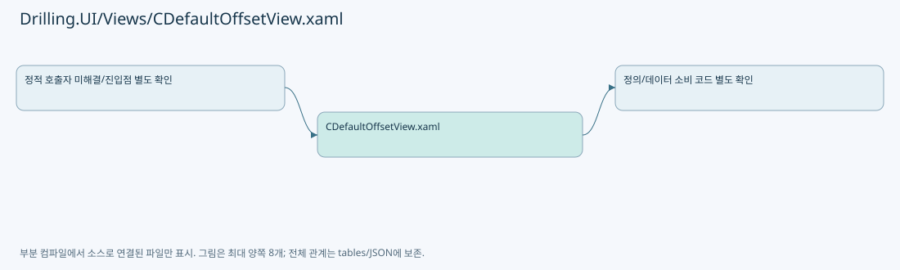

# Drilling.UI/Views/CDefaultOffsetView.xaml

| 항목 | 내용 |
| --- | --- |
| 원본 저장소 | https://github.com/kjuws10-rgb/A3Drilling.git |
| 원본 Commit | 0219666f9053b907d96d7e0aa7d0c6c1be3a73d4 |
| 원본 SHA256 | 0a2a3ccf2862b0207f857502f6c6945a6f36c1ab4260c7f241a90a625448ac19 |
| 파일 분류 | code |
| 원본 크기/행 | 27,264 bytes / 246 physical lines |
| 인코딩 | utf-8-sig |
| 검토 범위 | 구문/부분 의미 분석에서 추출한 사실. 동작·물리 단위·실장비 합격을 보증하지 않습니다. |
| 원본 링크 | [고정 Commit 원본](https://github.com/kjuws10-rgb/A3Drilling/blob/0219666f9053b907d96d7e0aa7d0c6c1be3a73d4/Drilling.UI/Views/CDefaultOffsetView.xaml) |

## 파일의 역할과 읽는 순서

WPF 화면·사용자 명령·표시 상태를 구성합니다. XAML 이벤트와 코드 비하인드, RootView의 조립 경로를 함께 추적합니다.

## 화면 구성과 코드 비하인드 연결

| 항목 | 추출 값 |
| --- | --- |
| 코드 비하인드 후보 | Drilling.UI/Views/CDefaultOffsetView.xaml.cs |
| 이름 있는 요소 | DefaultLayoutRoot, RecipeRow, ProgressRow, DefaultRecipeName, DefaultPreviewPanel, DefaultHeadSelector, DefaultGlassPreview, DefaultBeamPreview, PositionRow, ActionRow, ApplyRow, DefaultActionPanel, DefaultExecutionMode, DefaultResultPanel, ResultTitleRow, DefaultHeadResults |
| 이벤트 개수 | 0 |
| Binding 표현 개수 | 68 |

이름 있는 요소는 WPF가 필드를 생성할 수 있는 XAML 선언입니다. 문서 추출기는 WPF 생성 코드를 만들거나 로드하지 않으므로 C# 원문 멤버 수에 합산하지 않습니다.

| 요소 이름 | 원본 범위 |
| --- | --- |
| DefaultLayoutRoot | L59–59 |
| RecipeRow | L60–60 |
| ProgressRow | L60–60 |
| DefaultRecipeName | L65–65 |
| DefaultPreviewPanel | L74–74 |
| DefaultHeadSelector | L78–78 |
| DefaultGlassPreview | L100–100 |
| DefaultBeamPreview | L114–114 |
| PositionRow | L143–143 |
| ActionRow | L143–143 |
| ApplyRow | L143–143 |
| DefaultActionPanel | L160–160 |
| DefaultExecutionMode | L167–167 |
| DefaultResultPanel | L180–180 |
| ResultTitleRow | L182–182 |
| DefaultHeadResults | L187–187 |

| 이벤트 | 핸들러 이름 | 원본 범위 | 해석 |
| --- | --- | --- | --- |

| Binding 표현 | 원본 범위 |
| --- | --- |
| {Binding IsCompact, RelativeSource={RelativeSource AncestorType=UserControl}} | L19–19 |
| {Binding ActionCommand} | L34–34 |
| {Binding IsCompact, RelativeSource={RelativeSource AncestorType=UserControl}} | L41–41 |
| {Binding IsCompact, RelativeSource={RelativeSource AncestorType=UserControl}} | L48–48 |
| {Binding EmptyXY} | L51–51 |
| {Binding IsCompact, RelativeSource={RelativeSource AncestorType=UserControl}} | L52–52 |
| {Binding Measured} | L54–54 |
| {Binding IsCompact, RelativeSource={RelativeSource AncestorType=UserControl}} | L54–54 |
| {Binding CompactMeasured} | L54–54 |
| {Binding Target} | L55–55 |
| {Binding IsCompact, RelativeSource={RelativeSource AncestorType=UserControl}} | L55–55 |
| {Binding CompactTarget} | L55–55 |
| {Binding Recommended} | L56–56 |
| {Binding IsCompact, RelativeSource={RelativeSource AncestorType=UserControl}} | L56–56 |
| {Binding CompactRecommended} | L56–56 |
| {Binding Delta} | L57–57 |
| {Binding IsCompact, RelativeSource={RelativeSource AncestorType=UserControl}} | L57–57 |
| {Binding CompactDelta} | L57–57 |
| {Binding RecipeName} | L65–65 |
| {Binding State} | L67–67 |
| {Binding Heads} | L78–78 |
| {Binding Name} | L81–81 |
| {Binding Background} | L81–81 |
| {Binding Foreground} | L81–81 |
| {Binding DataContext.SelectHeadCommand, RelativeSource={RelativeSource AncestorType=ItemsControl}} | L83–83 |
| {Binding HeadNo} | L83–83 |
| {Binding Detail} | L83–83 |
| {Binding SelectedHeadTitle} | L88–88 |
| {Binding MachiningPositionText} | L89–89 |
| {Binding MachiningPositionBrush} | L89–89 |
| {Binding MachiningPositionDetail} | L89–89 |
| {Binding GlassImage} | L102–102 |
| {Binding Camera} | L103–103 |
| {Binding BeamImage} | L114–114 |
| {Binding GeometryText} | L117–117 |
| {Binding GeometryText} | L117–117 |
| {Binding BeamSummary} | L128–128 |
| {Binding PatternCaption} | L129–129 |
| {Binding MeasuredCenter} | L133–133 |
| {Binding CenterError} | L134–134 |
| {Binding ModeBrush} | L149–149 |
| {Binding Mode} | L150–150 |
| {Binding BoardReference} | L154–154 |
| {Binding StageY} | L155–155 |
| {Binding ReviewX} | L156–156 |
| {Binding ExecutionModes} | L167–167 |
| {Binding ExecutionMode, Mode=TwoWay} | L167–167 |
| {Binding CanSelect} | L167–167 |
| {Binding HeadMeasurementSummary} | L185–185 |
| {Binding Heads} | L187–187 |
| {Binding SelectedHead, Mode=TwoWay} | L187–187 |
| {Binding Detail} | L199–199 |
| {Binding Name} | L204–204 |
| {Binding State} | L205–205 |
| {Binding StateBrush} | L205–205 |
| {Binding Current} | L209–209 |
| {Binding IsCompact, RelativeSource={RelativeSource AncestorType=UserControl}} | L210–210 |
| {Binding CompactCurrent} | L210–210 |
| {Binding Steps} | L231–231 |
| {Binding Background} | L234–234 |
| {Binding Order} | L236–236 |
| {Binding Foreground} | L236–236 |
| {Binding Name} | L237–237 |
| {Binding Foreground} | L237–237 |
| {Binding State} | L238–238 |
| {Binding Foreground} | L238–238 |
| {Binding StatusText} | L243–243 |
| {Binding StatusText} | L243–243 |

## 원문 전체 주석 해설본

[원본 모든 행과 행별 해설 보기](../../../annotated/Drilling.UI/Views/CDefaultOffsetView.xaml.annotated.txt)

원본을 빠뜨리거나 임의로 줄이지 않았습니다. `L000001 |` 표시는 원본 행 번호, `// 해설`은 별도 설명입니다. 실행용 소스가 아닌 문서입니다.

## 수정·재검증 체크

- 원본 Commit과 현재 작업 파일 SHA가 같은지 먼저 확인합니다. 다르면 이 문서를 과거 버전 자료로 취급합니다.
- 선언·직접 호출·이벤트/인터페이스 경계·설정 소비를 함께 확인합니다. 정적 연결의 빈 곳을 정상 경로로 추정하지 않습니다.
- 저장 형식/단위/식별자·재시도·취소·예외·롤백에 영향을 주는 변경은 상세 해설장과 호출자를 다시 검토합니다.
- 도구의 구문 추출과 별도 정적 추적 해설, 실제 빌드·시뮬레이션·실장비 검증 결과를 분리합니다.
