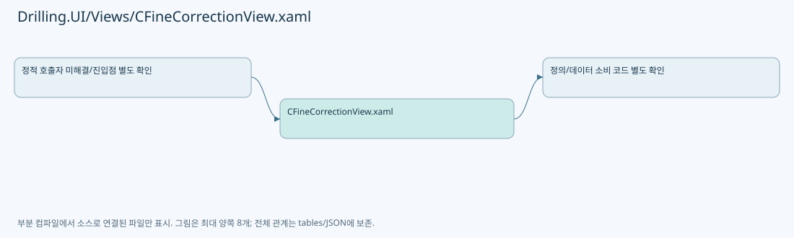

# Drilling.UI/Views/CFineCorrectionView.xaml

| 항목 | 내용 |
| --- | --- |
| 원본 저장소 | https://github.com/kjuws10-rgb/A3Drilling.git |
| 원본 Commit | 334b3599651b2e8e0181fd4459bafaf3cddafff3 |
| 원본 SHA256 | 5f0f25219a4f37ebc3db57b7f4d7542a2064a39b7ea7c15c42848ece8270c093 |
| 파일 분류 | code |
| 원본 크기/행 | 17,660 bytes / 160 physical lines |
| 인코딩 | utf-8-sig |
| 검토 범위 | 구문/부분 의미 분석에서 추출한 사실. 동작·물리 단위·실장비 합격을 보증하지 않습니다. |
| 원본 링크 | [고정 Commit 원본](https://github.com/kjuws10-rgb/A3Drilling/blob/334b3599651b2e8e0181fd4459bafaf3cddafff3/Drilling.UI/Views/CFineCorrectionView.xaml) |

## 파일의 역할과 읽는 순서

WPF 화면·사용자 명령·표시 상태를 구성합니다. XAML 이벤트와 코드 비하인드, RootView의 조립 경로를 함께 추적합니다.

## 화면 구성과 코드 비하인드 연결

| 항목 | 추출 값 |
| --- | --- |
| 코드 비하인드 후보 | Drilling.UI/Views/CFineCorrectionView.xaml.cs |
| 이름 있는 요소 | GlassPreview |
| 이벤트 개수 | 0 |
| Binding 표현 개수 | 51 |

이름 있는 요소는 WPF가 필드를 생성할 수 있는 XAML 선언입니다. 문서 추출기는 WPF 생성 코드를 만들거나 로드하지 않으므로 C# 원문 멤버 수에 합산하지 않습니다.

| 요소 이름 | 원본 범위 |
| --- | --- |
| GlassPreview | L56–56 |

| 이벤트 | 핸들러 이름 | 원본 범위 | 해석 |
| --- | --- | --- | --- |

| Binding 표현 | 원본 범위 |
| --- | --- |
| {Binding RelativeSource={RelativeSource Self}, Path=Tag} | L18–18 |
| {Binding StateBrush} | L37–37 |
| {Binding RecipeName} | L62–62 |
| {Binding StageY} | L64–64 |
| {Binding ReviewX} | L65–65 |
| {Binding Mode} | L66–66 |
| {Binding CanConfigure} | L73–73 |
| {Binding IsOneLine} | L74–74 |
| {Binding SelectLineCountCommand} | L74–74 |
| {Binding IsThreeLine} | L75–75 |
| {Binding SelectLineCountCommand} | L75–75 |
| {Binding IsFiveLine} | L76–76 |
| {Binding SelectLineCountCommand} | L76–76 |
| {Binding IsSevenLine} | L77–77 |
| {Binding SelectLineCountCommand} | L77–77 |
| {Binding BeamNumbers} | L86–86 |
| {Binding SelectedBeam, Mode=TwoWay} | L86–86 |
| {Binding CanConfigure} | L87–87 |
| {Binding CanConfigure} | L89–89 |
| {Binding IsFlying} | L90–90 |
| {Binding SelectMethodCommand} | L90–90 |
| {Binding IsPtoP} | L91–91 |
| {Binding SelectMethodCommand} | L91–91 |
| {Binding ModelOrder} | L98–98 |
| {Binding Lines} | L100–100 |
| {Binding} | L101–101 |
| {Binding DataContext.OpenLineDetailsCommand, RelativeSource={RelativeSource AncestorType=UserControl}} | L102–102 |
| {Binding Title} | L105–105 |
| {Binding StateText} | L106–106 |
| {Binding StateBrush} | L106–106 |
| {Binding Detail} | L108–108 |
| {Binding StartStageY} | L117–117 |
| {Binding EndStageY} | L118–118 |
| {Binding StartReviewX} | L120–120 |
| {Binding EndReviewX} | L121–121 |
| {Binding ResultSummary} | L124–124 |
| {Binding NgBrush} | L124–124 |
| {Binding Statistics} | L131–131 |
| {Binding Axis} | L133–133 |
| {Binding Maximum} | L134–134 |
| {Binding Minimum} | L135–135 |
| {Binding Average} | L136–136 |
| {Binding Status} | L143–143 |
| {Binding ActionCommand} | L145–145 |
| {Binding ActionCommand} | L146–146 |
| {Binding ActionCommand} | L147–147 |
| {Binding OffsetStatus} | L149–149 |
| {Binding ActionCommand} | L151–151 |
| {Binding ActionCommand} | L152–152 |
| {Binding ActionCommand} | L153–153 |
| {Binding ActionCommand} | L155–155 |

## 원문 전체 주석 해설본

[원본 모든 행과 행별 해설 보기](../../../annotated/Drilling.UI/Views/CFineCorrectionView.xaml.annotated.txt)

원본을 빠뜨리거나 임의로 줄이지 않았습니다. `L000001 |` 표시는 원본 행 번호, `// 해설`은 별도 설명입니다. 실행용 소스가 아닌 문서입니다.

## 수정·재검증 체크

- 원본 Commit과 현재 작업 파일 SHA가 같은지 먼저 확인합니다. 다르면 이 문서를 과거 버전 자료로 취급합니다.
- 선언·직접 호출·이벤트/인터페이스 경계·설정 소비를 함께 확인합니다. 정적 연결의 빈 곳을 정상 경로로 추정하지 않습니다.
- 저장 형식/단위/식별자·재시도·취소·예외·롤백에 영향을 주는 변경은 상세 해설장과 호출자를 다시 검토합니다.
- 도구의 구문 추출과 별도 정적 추적 해설, 실제 빌드·시뮬레이션·실장비 검증 결과를 분리합니다.
