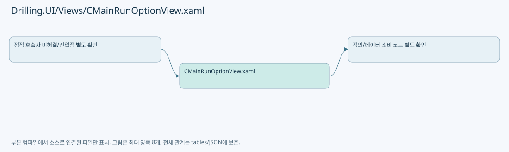

# Drilling.UI/Views/CMainRunOptionView.xaml

| 항목 | 내용 |
| --- | --- |
| 원본 저장소 | https://github.com/kjuws10-rgb/A3Drilling.git |
| 원본 Commit | 96e22cd027c84bf302b23f2949b98985d7f301bb |
| 원본 SHA256 | 5cef5a4e1591211b8dbef4df476f83b5bf5a0c4dcbd3c6c69fe278db3541fe1e |
| 파일 분류 | code |
| 원본 크기/행 | 11,108 bytes / 101 physical lines |
| 인코딩 | utf-8-sig |
| 검토 범위 | 구문/부분 의미 분석에서 추출한 사실. 동작·물리 단위·실장비 합격을 보증하지 않습니다. |
| 원본 링크 | [고정 Commit 원본](https://github.com/kjuws10-rgb/A3Drilling/blob/96e22cd027c84bf302b23f2949b98985d7f301bb/Drilling.UI/Views/CMainRunOptionView.xaml) |

## 파일의 역할과 읽는 순서

WPF 화면·사용자 명령·표시 상태를 구성합니다. XAML 이벤트와 코드 비하인드, RootView의 조립 경로를 함께 추적합니다.

## 화면 구성과 코드 비하인드 연결

| 항목 | 추출 값 |
| --- | --- |
| 코드 비하인드 후보 | Drilling.UI/Views/CMainRunOptionView.xaml.cs |
| 이름 있는 요소 | ZeroLineOptionsBorder, ZeroLineChoices, CurrentGroupText, FollowUpChoices, DistortionOptionsBorder, DistortionGroupChoices, ReviewOptionsBorder, ReviewMethodChoices, ReviewLineChoices, ReviewImmediateRetryChoices, ReviewRetryChoices |
| 이벤트 개수 | 0 |
| Binding 표현 개수 | 49 |

이름 있는 요소는 WPF가 필드를 생성할 수 있는 XAML 선언입니다. 문서 추출기는 WPF 생성 코드를 만들거나 로드하지 않으므로 C# 원문 멤버 수에 합산하지 않습니다.

| 요소 이름 | 원본 범위 |
| --- | --- |
| ZeroLineOptionsBorder | L19–19 |
| ZeroLineChoices | L26–26 |
| CurrentGroupText | L32–32 |
| FollowUpChoices | L36–36 |
| DistortionOptionsBorder | L43–43 |
| DistortionGroupChoices | L47–47 |
| ReviewOptionsBorder | L62–62 |
| ReviewMethodChoices | L69–69 |
| ReviewLineChoices | L74–74 |
| ReviewImmediateRetryChoices | L82–82 |
| ReviewRetryChoices | L91–91 |

| 이벤트 | 핸들러 이름 | 원본 범위 | 해석 |
| --- | --- | --- | --- |

| Binding 표현 | 원본 범위 |
| --- | --- |
| {Binding ZeroLineChoices} | L26–26 |
| {Binding Label} | L28–28 |
| {Binding Background} | L28–28 |
| {Binding Foreground} | L28–28 |
| {Binding Value} | L28–28 |
| {Binding DataContext.SelectZeroLineCommand, RelativeSource={RelativeSource AncestorType=UserControl}} | L29–29 |
| {Binding GroupText} | L32–32 |
| {Binding InitGroupCommand} | L34–34 |
| {Binding FollowUpChoices} | L36–36 |
| {Binding Label} | L38–38 |
| {Binding Background} | L38–38 |
| {Binding Foreground} | L38–38 |
| {Binding Value} | L38–38 |
| {Binding DataContext.SelectFollowUpCommand, RelativeSource={RelativeSource AncestorType=UserControl}} | L39–39 |
| {Binding DistortionGroupChoices} | L47–47 |
| {Binding Background} | L50–50 |
| {Binding Foreground} | L50–50 |
| {Binding Index} | L51–51 |
| {Binding DataContext.ToggleDistortionGroupCommand, RelativeSource={RelativeSource AncestorType=UserControl}} | L51–51 |
| {Binding Label} | L52–52 |
| {Binding Foreground} | L52–52 |
| {Binding PositionText} | L55–55 |
| {Binding CanEditReview} | L62–62 |
| {Binding CanEditReview} | L65–65 |
| {Binding ReviewMethodChoices} | L69–69 |
| {Binding Label} | L71–71 |
| {Binding Background} | L71–71 |
| {Binding Foreground} | L71–71 |
| {Binding Value} | L71–71 |
| {Binding DataContext.SelectReviewMethodCommand, RelativeSource={RelativeSource AncestorType=UserControl}} | L72–72 |
| {Binding ReviewLineChoices} | L74–74 |
| {Binding Label} | L76–76 |
| {Binding Background} | L76–76 |
| {Binding Foreground} | L76–76 |
| {Binding Value} | L76–76 |
| {Binding DataContext.SelectReviewLineCommand, RelativeSource={RelativeSource AncestorType=UserControl}} | L77–77 |
| {Binding ReviewInfoText} | L79–79 |
| {Binding ReviewImmediateRetryChoices} | L82–82 |
| {Binding Label} | L84–84 |
| {Binding Background} | L85–85 |
| {Binding Foreground} | L85–85 |
| {Binding Value} | L85–85 |
| {Binding DataContext.SelectReviewImmediateRetryCommand, RelativeSource={RelativeSource AncestorType=UserControl}} | L86–86 |
| {Binding ReviewRetryChoices} | L91–91 |
| {Binding Label} | L93–93 |
| {Binding Background} | L94–94 |
| {Binding Foreground} | L94–94 |
| {Binding Value} | L94–94 |
| {Binding DataContext.SelectReviewRetryCommand, RelativeSource={RelativeSource AncestorType=UserControl}} | L95–95 |

## 원문 전체 주석 해설본

[원본 모든 행과 행별 해설 보기](../../../annotated/Drilling.UI/Views/CMainRunOptionView.xaml.annotated.txt)

원본을 빠뜨리거나 임의로 줄이지 않았습니다. `L000001 |` 표시는 원본 행 번호, `// 해설`은 별도 설명입니다. 실행용 소스가 아닌 문서입니다.

## 수정·재검증 체크

- 원본 Commit과 현재 작업 파일 SHA가 같은지 먼저 확인합니다. 다르면 이 문서를 과거 버전 자료로 취급합니다.
- 선언·직접 호출·이벤트/인터페이스 경계·설정 소비를 함께 확인합니다. 정적 연결의 빈 곳을 정상 경로로 추정하지 않습니다.
- 저장 형식/단위/식별자·재시도·취소·예외·롤백에 영향을 주는 변경은 상세 해설장과 호출자를 다시 검토합니다.
- 도구의 구문 추출과 별도 정적 추적 해설, 실제 빌드·시뮬레이션·실장비 검증 결과를 분리합니다.
