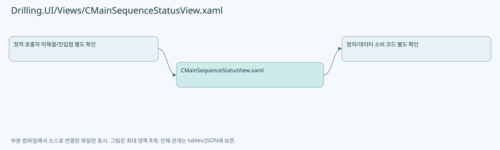

# Drilling.UI/Views/CMainSequenceStatusView.xaml

| 항목 | 내용 |
| --- | --- |
| 원본 저장소 | https://github.com/kjuws10-rgb/A3Drilling.git |
| 원본 Commit | 28764c91d521777b8ee068dd7aaf2d3902ce9fe2 |
| 원본 SHA256 | 8bb8e78b35047b9190eda18c56a569881270b44cffbad013577a1cc7098ac32c |
| 파일 분류 | code |
| 원본 크기/행 | 16,580 bytes / 208 physical lines |
| 인코딩 | utf-8-sig |
| 검토 범위 | 구문/부분 의미 분석에서 추출한 사실. 동작·물리 단위·실장비 합격을 보증하지 않습니다. |
| 원본 링크 | [고정 Commit 원본](https://github.com/kjuws10-rgb/A3Drilling/blob/28764c91d521777b8ee068dd7aaf2d3902ce9fe2/Drilling.UI/Views/CMainSequenceStatusView.xaml) |

## 파일의 역할과 읽는 순서

WPF 화면·사용자 명령·표시 상태를 구성합니다. XAML 이벤트와 코드 비하인드, RootView의 조립 경로를 함께 추적합니다.

## 화면 구성과 코드 비하인드 연결

| 항목 | 추출 값 |
| --- | --- |
| 코드 비하인드 후보 | Drilling.UI/Views/CMainSequenceStatusView.xaml.cs |
| 이름 있는 요소 | SequenceCardRoot, SequenceCardBackground, RunningPulse, ActionPulse, LegendPulse, ScenarioTabPulse, ScenarioPulse, SequenceCardList |
| 이벤트 개수 | 2 |
| Binding 표현 개수 | 34 |

이름 있는 요소는 WPF가 필드를 생성할 수 있는 XAML 선언입니다. 문서 추출기는 WPF 생성 코드를 만들거나 로드하지 않으므로 C# 원문 멤버 수에 합산하지 않습니다.

| 요소 이름 | 원본 범위 |
| --- | --- |
| SequenceCardRoot | L7–7 |
| SequenceCardBackground | L17–17 |
| RunningPulse | L18–18 |
| ActionPulse | L25–25 |
| LegendPulse | L119–119 |
| ScenarioTabPulse | L164–164 |
| ScenarioPulse | L170–170 |
| SequenceCardList | L193–193 |

| 이벤트 | 핸들러 이름 | 원본 범위 | 해석 |
| --- | --- | --- | --- |
| MouseLeftButtonUp | CardClicked | L7–7 | 코드 비하인드/이벤트 라우팅에서 실제 연결 확인 필요 |
| KeyUp | CardKeyUp | L7–7 | 코드 비하인드/이벤트 라우팅에서 실제 연결 확인 필요 |

| Binding 표현 | 원본 범위 |
| --- | --- |
| {Binding Detail} | L7–7 |
| {Binding IsCompact} | L12–12 |
| {Binding OpensMonitor} | L13–13 |
| {Binding StateBrush} | L17–17 |
| {Binding IsBlinking} | L23–23 |
| {Binding IsCompact} | L42–42 |
| {Binding Order} | L50–50 |
| {Binding TextBrush} | L50–50 |
| {Binding IsCompact} | L51–51 |
| {Binding FlowTitle} | L54–54 |
| {Binding TextBrush} | L54–54 |
| {Binding Title} | L56–56 |
| {Binding IsCompact} | L56–56 |
| {Binding FlowTitle} | L56–56 |
| {Binding ProgressText} | L59–59 |
| {Binding ProgressText} | L59–59 |
| {Binding TextBrush} | L59–59 |
| {Binding IsCompact} | L64–64 |
| {Binding ProgressText} | L65–65 |
| {Binding State} | L73–73 |
| {Binding TextBrush} | L73–73 |
| {Binding DataContext.InitializeAutoSequenceCommand, RelativeSource={RelativeSource AncestorType=Window}} | L149–149 |
| {Binding Tabs} | L151–151 |
| {Binding Name} | L155–155 |
| {Binding BackgroundBrush} | L156–156 |
| {Binding BorderBrush} | L156–156 |
| {Binding TextBrush} | L156–156 |
| {Binding DataContext.SelectScenarioCommand, RelativeSource={RelativeSource AncestorType=UserControl}} | L157–157 |
| {Binding Key} | L158–158 |
| {Binding IsBlinking} | L168–168 |
| {Binding FlowRows} | L193–193 |
| {Binding Stage} | L199–199 |
| {Binding Arrow} | L200–200 |
| {Binding Process} | L201–201 |

## 원문 전체 주석 해설본

[원본 모든 행과 행별 해설 보기](../../../annotated/Drilling.UI/Views/CMainSequenceStatusView.xaml.annotated.txt)

원본을 빠뜨리거나 임의로 줄이지 않았습니다. `L000001 |` 표시는 원본 행 번호, `// 해설`은 별도 설명입니다. 실행용 소스가 아닌 문서입니다.

## 수정·재검증 체크

- 원본 Commit과 현재 작업 파일 SHA가 같은지 먼저 확인합니다. 다르면 이 문서를 과거 버전 자료로 취급합니다.
- 선언·직접 호출·이벤트/인터페이스 경계·설정 소비를 함께 확인합니다. 정적 연결의 빈 곳을 정상 경로로 추정하지 않습니다.
- 저장 형식/단위/식별자·재시도·취소·예외·롤백에 영향을 주는 변경은 상세 해설장과 호출자를 다시 검토합니다.
- 도구의 구문 추출과 별도 정적 추적 해설, 실제 빌드·시뮬레이션·실장비 검증 결과를 분리합니다.
