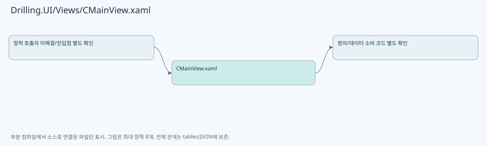

# Drilling.UI/Views/CMainView.xaml

| 항목 | 내용 |
| --- | --- |
| 원본 저장소 | https://github.com/kjuws10-rgb/A3Drilling.git |
| 원본 Commit | 28764c91d521777b8ee068dd7aaf2d3902ce9fe2 |
| 원본 SHA256 | c80452177574a135609caa6bb5e691faa193009840b4affb96c80d91b311b794 |
| 파일 분류 | code |
| 원본 크기/행 | 62,809 bytes / 827 physical lines |
| 인코딩 | utf-8-sig |
| 검토 범위 | 구문/부분 의미 분석에서 추출한 사실. 동작·물리 단위·실장비 합격을 보증하지 않습니다. |
| 원본 링크 | [고정 Commit 원본](https://github.com/kjuws10-rgb/A3Drilling/blob/28764c91d521777b8ee068dd7aaf2d3902ce9fe2/Drilling.UI/Views/CMainView.xaml) |

## 파일의 역할과 읽는 순서

WPF 화면·사용자 명령·표시 상태를 구성합니다. XAML 이벤트와 코드 비하인드, RootView의 조립 경로를 함께 추적합니다.

## 화면 구성과 코드 비하인드 연결

| 항목 | 추출 값 |
| --- | --- |
| 코드 비하인드 후보 | Drilling.UI/Views/CMainView.xaml.cs |
| 이름 있는 요소 | TopStatusRow, HeadStatusPanel, SequenceStatusPanel, SequenceStatusView, InterlockStatusPanel, InterlockGrid, BottomStatusRow, ParameterStatusPanel, MainParameterTabs, RunOptionView, ProtectWindowView, ScannerStatusWorkspace, ScannerHeadSelector, ScannerAxisCards, AutomationStatusPanel |
| 이벤트 개수 | 1 |
| Binding 표현 개수 | 104 |

이름 있는 요소는 WPF가 필드를 생성할 수 있는 XAML 선언입니다. 문서 추출기는 WPF 생성 코드를 만들거나 로드하지 않으므로 C# 원문 멤버 수에 합산하지 않습니다.

| 요소 이름 | 원본 범위 |
| --- | --- |
| TopStatusRow | L228–228 |
| HeadStatusPanel | L234–234 |
| SequenceStatusPanel | L249–249 |
| SequenceStatusView | L250–250 |
| InterlockStatusPanel | L252–252 |
| InterlockGrid | L255–255 |
| BottomStatusRow | L299–299 |
| ParameterStatusPanel | L304–304 |
| MainParameterTabs | L311–311 |
| RunOptionView | L333–333 |
| ProtectWindowView | L335–335 |
| ScannerStatusWorkspace | L715–715 |
| ScannerHeadSelector | L737–737 |
| ScannerAxisCards | L752–752 |
| AutomationStatusPanel | L822–822 |

| 이벤트 | 핸들러 이름 | 원본 범위 | 해석 |
| --- | --- | --- | --- |
| Click | OpenInterlockDetailsDialog | L264–264 | 코드 비하인드/이벤트 라우팅에서 실제 연결 확인 필요 |

| Binding 표현 | 원본 범위 |
| --- | --- |
| {Binding StatusDetail} | L57–57 |
| {Binding HeadName} | L72–72 |
| {Binding ShotCountText} | L77–77 |
| {Binding StatusBrush} | L84–84 |
| {Binding Status} | L88–88 |
| {Binding StatusTextBrush} | L91–91 |
| {Binding CurrentScreen.MainOperating.HeadPreviews} | L241–241 |
| {Binding CurrentScreen.MainOperating.SequenceStatus} | L250–250 |
| {Binding CurrentScreen.MainOperating.InterlockItems} | L255–255 |
| {Binding Item} | L264–264 |
| {Binding State} | L289–289 |
| {Binding StateBrush} | L289–289 |
| {Binding CurrentScreen.MainOperating.ParameterTabs} | L312–312 |
| {Binding Name} | L321–321 |
| {Binding DataContext.CurrentScreen.MainOperating.SelectParameterTabCommand, RelativeSource={RelativeSource AncestorType=UserControl}} | L322–322 |
| {Binding Key} | L323–323 |
| {Binding BackgroundBrush} | L324–324 |
| {Binding BorderBrush} | L325–325 |
| {Binding TextBrush} | L326–326 |
| {Binding CurrentScreen.MainOperating.RunOptions} | L333–333 |
| {Binding PanelVisibility} | L334–334 |
| {Binding CurrentScreen.MainOperating.ProtectWindow} | L335–335 |
| {Binding PanelVisibility, FallbackValue=Collapsed, TargetNullValue=Collapsed} | L336–336 |
| {Binding CurrentScreen.MainOperating.HeadParameters} | L337–337 |
| {Binding CurrentScreen.MainOperating.HeadParameterVisibility} | L338–338 |
| {Binding Head} | L344–344 |
| {Binding Power, StringFormat=F2} | L345–345 |
| {Binding Frequency, StringFormat=F1} | L346–346 |
| {Binding Shot} | L347–347 |
| {Binding JumpSpeed, StringFormat=F0} | L348–348 |
| {Binding DoeZPosition, StringFormat=F3} | L349–349 |
| {Binding CurrentScreen.MainOperating.OpticParameterVisibility} | L353–353 |
| {Binding CurrentScreen.MainOperating.OpticStatusTabs} | L360–360 |
| {Binding Name} | L368–368 |
| {Binding DataContext.CurrentScreen.MainOperating.SelectOpticStatusCommand, RelativeSource={RelativeSource AncestorType=UserControl}} | L369–369 |
| {Binding Key} | L370–370 |
| {Binding BackgroundBrush} | L371–371 |
| {Binding BorderBrush} | L372–372 |
| {Binding TextBrush} | L373–373 |
| {Binding CurrentScreen.MainOperating.OpticParameterGroups} | L381–381 |
| {Binding Device} | L392–392 |
| {Binding Items} | L403–403 |
| {Binding Item} | L414–414 |
| {Binding Current} | L417–417 |
| {Binding RecipeTarget} | L420–420 |
| {Binding StateBrush} | L431–431 |
| {Binding State} | L432–432 |
| {Binding CurrentScreen.MainOperating.OpticLaserVisibility} | L454–454 |
| {Binding CurrentScreen.MainOperating.OpticHeadParameters} | L466–466 |
| {Binding Head} | L480–480 |
| {Binding LaserPower} | L501–501 |
| {Binding LaserPowerBrush} | L502–502 |
| {Binding LaserShutter} | L509–509 |
| {Binding LaserShutterBrush} | L510–510 |
| {Binding LaserGate} | L517–517 |
| {Binding LaserGateBrush} | L518–518 |
| {Binding CurrentScreen.MainOperating.OpticAttenuatorVisibility} | L531–531 |
| {Binding CurrentScreen.MainOperating.OpticHeadParameters} | L543–543 |
| {Binding Head} | L557–557 |
| {Binding AttenuatorCurrent} | L577–577 |
| {Binding AttenuatorStateBrush} | L579–579 |
| {Binding AttenuatorTarget} | L585–585 |
| {Binding CurrentScreen.MainOperating.OpticBetVisibility} | L600–600 |
| {Binding CurrentScreen.MainOperating.OpticHeadParameters} | L612–612 |
| {Binding Head} | L626–626 |
| {Binding BetMagnificationCurrentStep} | L656–656 |
| {Binding BetStateBrush} | L658–658 |
| {Binding BetMagnificationTargetStep} | L661–661 |
| {Binding BetDivergenceCurrentStep} | L669–669 |
| {Binding BetStateBrush} | L671–671 |
| {Binding BetDivergenceTargetStep} | L674–674 |
| {Binding CurrentScreen.MainOperating.MotorStatusVisibility} | L689–689 |
| {Binding CurrentScreen.MainOperating.MotorStatusItems} | L690–690 |
| {Binding Name} | L698–698 |
| {Binding Position} | L699–699 |
| {Binding PositionMessage} | L702–702 |
| {Binding Speed} | L706–706 |
| {Binding SpeedMessage} | L709–709 |
| {Binding CurrentScreen.MainOperating.ScannerStatusVisibility} | L715–715 |
| {Binding Text, RelativeSource={RelativeSource Self}} | L730–730 |
| {Binding CurrentScreen.MainOperating.ScannerStatusHeadTabs} | L738–738 |
| {Binding Name} | L744–744 |
| {Binding DataContext.CurrentScreen.MainOperating.SelectScannerStatusHeadCommand, RelativeSource={RelativeSource AncestorType=UserControl}} | L745–745 |
| {Binding Key} | L746–746 |
| {Binding BackgroundBrush} | L747–747 |
| {Binding BorderBrush} | L747–747 |
| {Binding TextBrush} | L747–747 |
| {Binding CurrentScreen.MainOperating.ScannerStatusItems} | L753–753 |
| {Binding Axis} | L782–782 |
| {Binding AxisNo} | L783–783 |
| {Binding Position} | L787–787 |
| {Binding AuxFeedback} | L790–790 |
| {Binding CurrentFeedback} | L793–793 |
| {Binding GalvoTemperature} | L796–796 |
| {Binding GalvoLaserOutputRaw} | L799–799 |
| {Binding Able} | L802–802 |
| {Binding AbleBrush} | L802–802 |
| {Binding Home} | L805–805 |
| {Binding HomeBrush} | L805–805 |
| {Binding Fault} | L808–808 |
| {Binding FaultBrush} | L808–808 |
| {Binding Error} | L811–811 |
| {Binding ErrorBrush} | L811–811 |
| {Binding CurrentScreen.MainOperating.AutomationControllerStatusItems} | L823–823 |

## 원문 전체 주석 해설본

[원본 모든 행과 행별 해설 보기](../../../annotated/Drilling.UI/Views/CMainView.xaml.annotated.txt)

원본을 빠뜨리거나 임의로 줄이지 않았습니다. `L000001 |` 표시는 원본 행 번호, `// 해설`은 별도 설명입니다. 실행용 소스가 아닌 문서입니다.

## 수정·재검증 체크

- 원본 Commit과 현재 작업 파일 SHA가 같은지 먼저 확인합니다. 다르면 이 문서를 과거 버전 자료로 취급합니다.
- 선언·직접 호출·이벤트/인터페이스 경계·설정 소비를 함께 확인합니다. 정적 연결의 빈 곳을 정상 경로로 추정하지 않습니다.
- 저장 형식/단위/식별자·재시도·취소·예외·롤백에 영향을 주는 변경은 상세 해설장과 호출자를 다시 검토합니다.
- 도구의 구문 추출과 별도 정적 추적 해설, 실제 빌드·시뮬레이션·실장비 검증 결과를 분리합니다.
