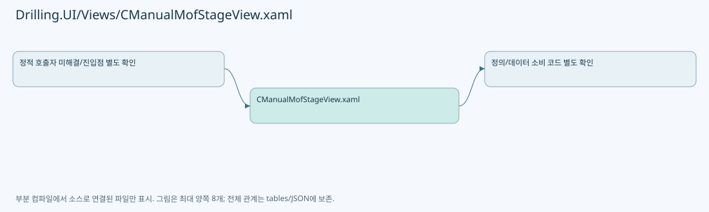

# Drilling.UI/Views/CManualMofStageView.xaml

| 항목 | 내용 |
| --- | --- |
| 원본 저장소 | https://github.com/kjuws10-rgb/A3Drilling.git |
| 원본 Commit | 0219666f9053b907d96d7e0aa7d0c6c1be3a73d4 |
| 원본 SHA256 | 2574cdc6a4a11ddbd836b57bedb126d2d4c4873e1656108c08378aaa6da5953c |
| 파일 분류 | code |
| 원본 크기/행 | 11,567 bytes / 167 physical lines |
| 인코딩 | utf-8-sig |
| 검토 범위 | 구문/부분 의미 분석에서 추출한 사실. 동작·물리 단위·실장비 합격을 보증하지 않습니다. |
| 원본 링크 | [고정 Commit 원본](https://github.com/kjuws10-rgb/A3Drilling/blob/0219666f9053b907d96d7e0aa7d0c6c1be3a73d4/Drilling.UI/Views/CManualMofStageView.xaml) |

## 파일의 역할과 읽는 순서

WPF 화면·사용자 명령·표시 상태를 구성합니다. XAML 이벤트와 코드 비하인드, RootView의 조립 경로를 함께 추적합니다.

## 화면 구성과 코드 비하인드 연결

| 항목 | 추출 값 |
| --- | --- |
| 코드 비하인드 후보 | Drilling.UI/Views/CManualMofStageView.xaml.cs |
| 이름 있는 요소 | StageReadyPositionTile, StagePositionMatchText, StageReadyMoveButton, StageReadyStopButton |
| 이벤트 개수 | 0 |
| Binding 표현 개수 | 29 |

이름 있는 요소는 WPF가 필드를 생성할 수 있는 XAML 선언입니다. 문서 추출기는 WPF 생성 코드를 만들거나 로드하지 않으므로 C# 원문 멤버 수에 합산하지 않습니다.

| 요소 이름 | 원본 범위 |
| --- | --- |
| StageReadyPositionTile | L104–104 |
| StagePositionMatchText | L115–115 |
| StageReadyMoveButton | L159–159 |
| StageReadyStopButton | L161–161 |

| 이벤트 | 핸들러 이름 | 원본 범위 | 해석 |
| --- | --- | --- | --- |

| Binding 표현 | 원본 범위 |
| --- | --- |
| {Binding IsAtTarget} | L27–27 |
| {Binding IsAtTarget} | L32–32 |
| {Binding IsAtTarget} | L41–41 |
| {Binding IsAtTarget} | L42–42 |
| {Binding Message} | L48–48 |
| {Binding Text} | L52–52 |
| {Binding IsActive} | L61–61 |
| {Binding IsActive} | L70–70 |
| {Binding Busy} | L87–87 |
| {Binding Text} | L90–90 |
| {Binding ModeBackground} | L93–93 |
| {Binding MotionMode} | L94–94 |
| {Binding CurrentPosition.Text} | L107–107 |
| {Binding CurrentPosition.Message} | L107–107 |
| {Binding TargetPosition} | L112–112 |
| {Binding Foreground, ElementName=StagePositionMatchText} | L112–112 |
| {Binding PositionComparison} | L115–115 |
| {Binding IsAtTarget} | L120–120 |
| {Binding IsAtTarget} | L121–121 |
| {Binding CurrentSpeed.Text} | L131–131 |
| {Binding CurrentSpeed.Message} | L131–131 |
| {Binding TargetSpeedSource} | L133–133 |
| {Binding TargetSpeed} | L136–136 |
| {Binding AlarmCode} | L144–144 |
| {Binding Text} | L147–147 |
| {Binding WarningCode} | L150–150 |
| {Binding Text} | L153–153 |
| {Binding MoveCommand} | L159–159 |
| {Binding StopCommand} | L161–161 |

## 원문 전체 주석 해설본

[원본 모든 행과 행별 해설 보기](../../../annotated/Drilling.UI/Views/CManualMofStageView.xaml.annotated.txt)

원본을 빠뜨리거나 임의로 줄이지 않았습니다. `L000001 |` 표시는 원본 행 번호, `// 해설`은 별도 설명입니다. 실행용 소스가 아닌 문서입니다.

## 수정·재검증 체크

- 원본 Commit과 현재 작업 파일 SHA가 같은지 먼저 확인합니다. 다르면 이 문서를 과거 버전 자료로 취급합니다.
- 선언·직접 호출·이벤트/인터페이스 경계·설정 소비를 함께 확인합니다. 정적 연결의 빈 곳을 정상 경로로 추정하지 않습니다.
- 저장 형식/단위/식별자·재시도·취소·예외·롤백에 영향을 주는 변경은 상세 해설장과 호출자를 다시 검토합니다.
- 도구의 구문 추출과 별도 정적 추적 해설, 실제 빌드·시뮬레이션·실장비 검증 결과를 분리합니다.
