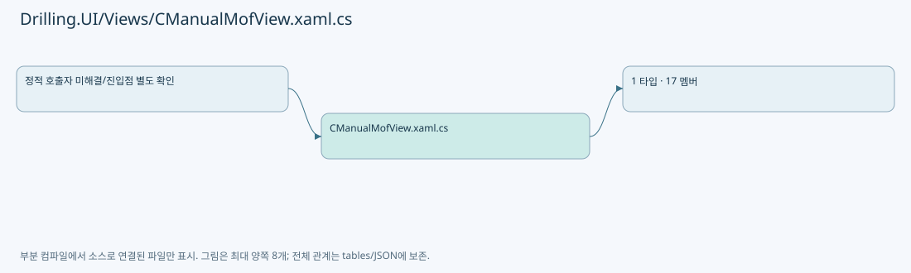
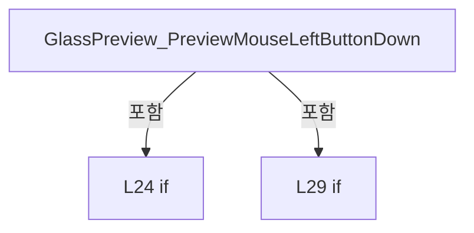
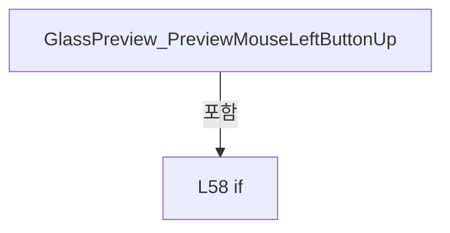
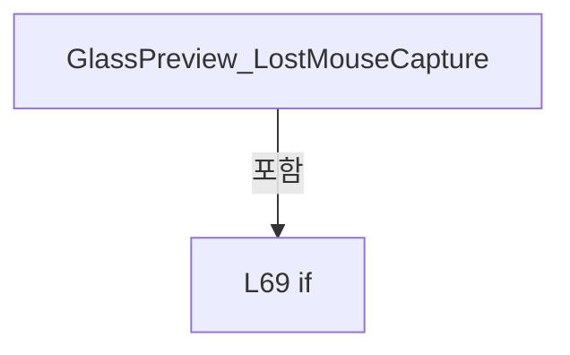
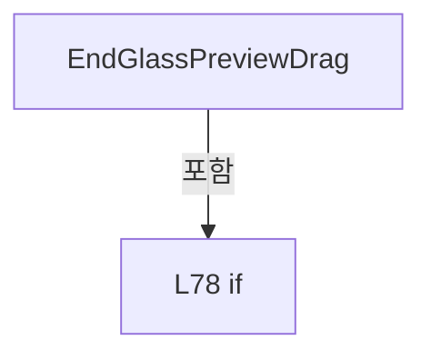
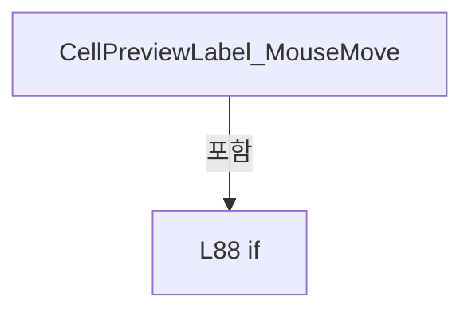
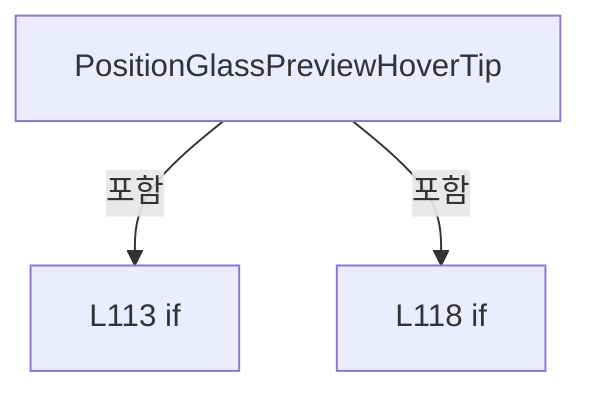
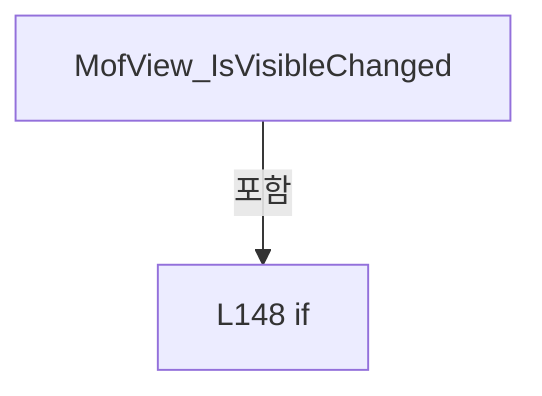

# Drilling.UI/Views/CManualMofView.xaml.cs

| 항목 | 내용 |
| --- | --- |
| 원본 저장소 | https://github.com/kjuws10-rgb/A3Drilling.git |
| 원본 Commit | 5aee8e58439c9b455cae7c9593c9be986c3e682e |
| 원본 SHA256 | 8dca38d642205125b987195e1b7797628ad8406001ce494af68bf55f743d69e1 |
| 파일 분류 | code |
| 원본 크기/행 | 5,646 bytes / 161 physical lines |
| 인코딩 | utf-8-sig |
| 검토 범위 | 구문/부분 의미 분석에서 추출한 사실. 동작·물리 단위·실장비 합격을 보증하지 않습니다. |
| 원본 링크 | [고정 Commit 원본](https://github.com/kjuws10-rgb/A3Drilling/blob/5aee8e58439c9b455cae7c9593c9be986c3e682e/Drilling.UI/Views/CManualMofView.xaml.cs) |

## 파일의 역할과 읽는 순서

WPF 화면·사용자 명령·표시 상태를 구성합니다. XAML 이벤트와 코드 비하인드, RootView의 조립 경로를 함께 추적합니다.

## 네임스페이스·타입·상속

| 타입 | 구분 | 원본 범위 | 선언/상속 |
| --- | --- | --- | --- |
| CManualMofView | ClassDeclaration | 9–161 | CManualMofView: UserControl |

## 멤버 빠른 목록

| 이름 | 종류 | 범위 | 서명 |
| --- | --- | --- | --- |
| PreviewZoomMinimum | FieldDeclaration | L11–11 | double Drilling.UI.Views.CManualMofView.PreviewZoomMinimum |
| _isGlassPreviewDragging | FieldDeclaration | L12–12 | bool Drilling.UI.Views.CManualMofView._isGlassPreviewDragging |
| _glassPreviewDragStart | FieldDeclaration | L13–13 | Point Drilling.UI.Views.CManualMofView._glassPreviewDragStart |
| _glassPreviewDragStartX | FieldDeclaration | L14–14 | double Drilling.UI.Views.CManualMofView._glassPreviewDragStartX |
| _glassPreviewDragStartY | FieldDeclaration | L15–15 | double Drilling.UI.Views.CManualMofView._glassPreviewDragStartY |
| .ctor | ConstructorDeclaration | L16–19 | Drilling.UI.Views.CManualMofView.CManualMofView() |
| GlassPreview_PreviewMouseLeftButtonDown | MethodDeclaration | L21–40 | void Drilling.UI.Views.CManualMofView.GlassPreview_PreviewMouseLeftButtonDown(object, MouseButtonEventArgs) |
| GlassPreview_PreviewMouseMove | MethodDeclaration | L42–54 | void Drilling.UI.Views.CManualMofView.GlassPreview_PreviewMouseMove(object, MouseEventArgs) |
| GlassPreview_PreviewMouseLeftButtonUp | MethodDeclaration | L56–65 | void Drilling.UI.Views.CManualMofView.GlassPreview_PreviewMouseLeftButtonUp(object, MouseButtonEventArgs) |
| GlassPreview_LostMouseCapture | MethodDeclaration | L67–73 | void Drilling.UI.Views.CManualMofView.GlassPreview_LostMouseCapture(object, MouseEventArgs) |
| EndGlassPreviewDrag | MethodDeclaration | L75–84 | void Drilling.UI.Views.CManualMofView.EndGlassPreviewDrag(FrameworkElement) |
| CellPreviewLabel_MouseMove | MethodDeclaration | L86–97 | void Drilling.UI.Views.CManualMofView.CellPreviewLabel_MouseMove(object, MouseEventArgs) |
| CellPreviewLabel_MouseLeave | MethodDeclaration | L99–102 | void Drilling.UI.Views.CManualMofView.CellPreviewLabel_MouseLeave(object, MouseEventArgs) |
| PositionGlassPreviewHoverTip | MethodDeclaration | L104–125 | void Drilling.UI.Views.CManualMofView.PositionGlassPreviewHoverTip(Point) |
| HideGlassPreviewHoverTip | MethodDeclaration | L127–131 | void Drilling.UI.Views.CManualMofView.HideGlassPreviewHoverTip() |
| ClampGlassPreviewTranslation | MethodDeclaration | L133–144 | void Drilling.UI.Views.CManualMofView.ClampGlassPreviewTranslation(FrameworkElement) |
| MofView_IsVisibleChanged | MethodDeclaration | L146–160 | void Drilling.UI.Views.CManualMofView.MofView_IsVisibleChanged(object, DependencyPropertyChangedEventArgs) |

## 멤버별 상세 계약·호출·처리 해설

### FieldDeclaration `PreviewZoomMinimum` · L11–11

[Drilling.UI/Views/CManualMofView.xaml.cs:11–11](https://github.com/kjuws10-rgb/A3Drilling/blob/5aee8e58439c9b455cae7c9593c9be986c3e682e/Drilling.UI/Views/CManualMofView.xaml.cs#L11-L11)

| 항목 | 실제 추출 값 |
| --- | --- |
| 서명 | double Drilling.UI.Views.CManualMofView.PreviewZoomMinimum |
| 접근/수식자 | Private / private, const |
| 반환/값 타입 | double |
| 소속 타입 | NamedType:Drilling.UI.Views.CManualMofView |

현재 부분 분석에서 직접 연결된 호출자는 없습니다. XAML/이벤트/인터페이스·델리게이트·외부 진입을 추가 확인해야 하며, 미사용으로 판정한 것이 아닙니다.

본문의 실제 연산·분기·예외·반환 순서(원문 위치 순):

| 원본 행 | 종류 | 주석 해설 |
| --- | --- | --- |
| 11 | variable-initializer | 변수의 초기값을 지정합니다: PreviewZoomMinimum = 1.0 |

변경 전 점검: 입력/반환 타입, 위 호출자, 예외/취소 경로, 공유 상태와 저장·전송 소비자를 함께 확인합니다. 값의 단위나 물리 방향을 이름만으로 확정하지 않습니다.

### FieldDeclaration `_isGlassPreviewDragging` · L12–12

[Drilling.UI/Views/CManualMofView.xaml.cs:12–12](https://github.com/kjuws10-rgb/A3Drilling/blob/5aee8e58439c9b455cae7c9593c9be986c3e682e/Drilling.UI/Views/CManualMofView.xaml.cs#L12-L12)

| 항목 | 실제 추출 값 |
| --- | --- |
| 서명 | bool Drilling.UI.Views.CManualMofView._isGlassPreviewDragging |
| 접근/수식자 | Private / private |
| 반환/값 타입 | bool |
| 소속 타입 | NamedType:Drilling.UI.Views.CManualMofView |

현재 부분 분석에서 직접 연결된 호출자는 없습니다. XAML/이벤트/인터페이스·델리게이트·외부 진입을 추가 확인해야 하며, 미사용으로 판정한 것이 아닙니다.

변경 전 점검: 입력/반환 타입, 위 호출자, 예외/취소 경로, 공유 상태와 저장·전송 소비자를 함께 확인합니다. 값의 단위나 물리 방향을 이름만으로 확정하지 않습니다.

### FieldDeclaration `_glassPreviewDragStart` · L13–13

[Drilling.UI/Views/CManualMofView.xaml.cs:13–13](https://github.com/kjuws10-rgb/A3Drilling/blob/5aee8e58439c9b455cae7c9593c9be986c3e682e/Drilling.UI/Views/CManualMofView.xaml.cs#L13-L13)

| 항목 | 실제 추출 값 |
| --- | --- |
| 서명 | Point Drilling.UI.Views.CManualMofView._glassPreviewDragStart |
| 접근/수식자 | Private / private |
| 반환/값 타입 | Point |
| 소속 타입 | NamedType:Drilling.UI.Views.CManualMofView |

현재 부분 분석에서 직접 연결된 호출자는 없습니다. XAML/이벤트/인터페이스·델리게이트·외부 진입을 추가 확인해야 하며, 미사용으로 판정한 것이 아닙니다.

변경 전 점검: 입력/반환 타입, 위 호출자, 예외/취소 경로, 공유 상태와 저장·전송 소비자를 함께 확인합니다. 값의 단위나 물리 방향을 이름만으로 확정하지 않습니다.

### FieldDeclaration `_glassPreviewDragStartX` · L14–14

[Drilling.UI/Views/CManualMofView.xaml.cs:14–14](https://github.com/kjuws10-rgb/A3Drilling/blob/5aee8e58439c9b455cae7c9593c9be986c3e682e/Drilling.UI/Views/CManualMofView.xaml.cs#L14-L14)

| 항목 | 실제 추출 값 |
| --- | --- |
| 서명 | double Drilling.UI.Views.CManualMofView._glassPreviewDragStartX |
| 접근/수식자 | Private / private |
| 반환/값 타입 | double |
| 소속 타입 | NamedType:Drilling.UI.Views.CManualMofView |

현재 부분 분석에서 직접 연결된 호출자는 없습니다. XAML/이벤트/인터페이스·델리게이트·외부 진입을 추가 확인해야 하며, 미사용으로 판정한 것이 아닙니다.

변경 전 점검: 입력/반환 타입, 위 호출자, 예외/취소 경로, 공유 상태와 저장·전송 소비자를 함께 확인합니다. 값의 단위나 물리 방향을 이름만으로 확정하지 않습니다.

### FieldDeclaration `_glassPreviewDragStartY` · L15–15

[Drilling.UI/Views/CManualMofView.xaml.cs:15–15](https://github.com/kjuws10-rgb/A3Drilling/blob/5aee8e58439c9b455cae7c9593c9be986c3e682e/Drilling.UI/Views/CManualMofView.xaml.cs#L15-L15)

| 항목 | 실제 추출 값 |
| --- | --- |
| 서명 | double Drilling.UI.Views.CManualMofView._glassPreviewDragStartY |
| 접근/수식자 | Private / private |
| 반환/값 타입 | double |
| 소속 타입 | NamedType:Drilling.UI.Views.CManualMofView |

현재 부분 분석에서 직접 연결된 호출자는 없습니다. XAML/이벤트/인터페이스·델리게이트·외부 진입을 추가 확인해야 하며, 미사용으로 판정한 것이 아닙니다.

변경 전 점검: 입력/반환 타입, 위 호출자, 예외/취소 경로, 공유 상태와 저장·전송 소비자를 함께 확인합니다. 값의 단위나 물리 방향을 이름만으로 확정하지 않습니다.

### ConstructorDeclaration `.ctor` · L16–19

[Drilling.UI/Views/CManualMofView.xaml.cs:16–19](https://github.com/kjuws10-rgb/A3Drilling/blob/5aee8e58439c9b455cae7c9593c9be986c3e682e/Drilling.UI/Views/CManualMofView.xaml.cs#L16-L19)

| 항목 | 실제 추출 값 |
| --- | --- |
| 서명 | Drilling.UI.Views.CManualMofView.CManualMofView() |
| 접근/수식자 | Public / public |
| 반환/값 타입 | void |
| 소속 타입 | NamedType:Drilling.UI.Views.CManualMofView |

현재 부분 분석에서 직접 연결된 호출자는 없습니다. XAML/이벤트/인터페이스·델리게이트·외부 진입을 추가 확인해야 하며, 미사용으로 판정한 것이 아닙니다.

호출하는 대상과 해석 범위:

| 원본 행 | 표현식 | 분석 상태 | 대상/소스 위치 |
| --- | --- | --- | --- |
| 18 | InitializeComponent | unresolved | None |

본문의 실제 연산·분기·예외·반환 순서(원문 위치 순):

| 원본 행 | 종류 | 주석 해설 |
| --- | --- | --- |
| 18 | call | 함수·델리게이트 또는 객체 생성자를 호출합니다: InitializeComponent() |

변경 전 점검: 입력/반환 타입, 위 호출자, 예외/취소 경로, 공유 상태와 저장·전송 소비자를 함께 확인합니다. 값의 단위나 물리 방향을 이름만으로 확정하지 않습니다.

### MethodDeclaration `GlassPreview_PreviewMouseLeftButtonDown` · L21–40

[Drilling.UI/Views/CManualMofView.xaml.cs:21–40](https://github.com/kjuws10-rgb/A3Drilling/blob/5aee8e58439c9b455cae7c9593c9be986c3e682e/Drilling.UI/Views/CManualMofView.xaml.cs#L21-L40)

| 항목 | 실제 추출 값 |
| --- | --- |
| 서명 | void Drilling.UI.Views.CManualMofView.GlassPreview_PreviewMouseLeftButtonDown(object, MouseButtonEventArgs) |
| 접근/수식자 | Private / private |
| 반환/값 타입 | void |
| 소속 타입 | NamedType:Drilling.UI.Views.CManualMofView |

입력 계약:

| 이름 | 타입 | 전달 | 선택/기본값 |
| --- | --- | --- | --- |
| sender | object | None | False /  |
| e | MouseButtonEventArgs | None | False /  |

현재 부분 분석에서 직접 연결된 호출자는 없습니다. XAML/이벤트/인터페이스·델리게이트·외부 진입을 추가 확인해야 하며, 미사용으로 판정한 것이 아닙니다.

호출하는 대상과 해석 범위:

| 원본 행 | 표현식 | 분석 상태 | 대상/소스 위치 |
| --- | --- | --- | --- |
| 23 | HideGlassPreviewHoverTip | resolved | void Drilling.UI.Views.CManualMofView.HideGlassPreviewHoverTip() · Drilling.UI/Views/CManualMofView.xaml.cs:127 |
| 29 | preview.CaptureMouse | unresolved | None |
| 35 | e.GetPosition | unresolved | None |

본문의 실제 연산·분기·예외·반환 순서(원문 위치 순):

| 원본 행 | 종류 | 주석 해설 |
| --- | --- | --- |
| 23 | call | 함수·델리게이트 또는 객체 생성자를 호출합니다: HideGlassPreviewHoverTip() |
| 24 | if | 조건에 따라 분기합니다: if (sender is not FrameworkElement preview &#124;&#124; GlassPreviewScaleTransform.ScaleX <= PreviewZoomMinimum) |
| 26 | return | 호출자에게 값 또는 제어를 반환합니다: return; |
| 29 | call | 함수·델리게이트 또는 객체 생성자를 호출합니다: preview.CaptureMouse() |
| 29 | if | 조건에 따라 분기합니다: if (!preview.CaptureMouse()) |
| 31 | return | 호출자에게 값 또는 제어를 반환합니다: return; |
| 34 | assignment | 값을 대상에 대입합니다: _isGlassPreviewDragging = true |
| 35 | assignment | 값을 대상에 대입합니다: _glassPreviewDragStart = e.GetPosition(preview) |
| 35 | call | 함수·델리게이트 또는 객체 생성자를 호출합니다: e.GetPosition(preview) |
| 36 | assignment | 값을 대상에 대입합니다: _glassPreviewDragStartX = GlassPreviewTranslateTransform.X |
| 37 | assignment | 값을 대상에 대입합니다: _glassPreviewDragStartY = GlassPreviewTranslateTransform.Y |
| 38 | assignment | 값을 대상에 대입합니다: preview.Cursor = Cursors.SizeAll |
| 39 | assignment | 값을 대상에 대입합니다: e.Handled = true |

제어 구문의 포함 구조(실제 실행 순서/CFG가 아닌 구문 탐색 그림):

변경 전 점검: 입력/반환 타입, 위 호출자, 예외/취소 경로, 공유 상태와 저장·전송 소비자를 함께 확인합니다. 값의 단위나 물리 방향을 이름만으로 확정하지 않습니다.

### MethodDeclaration `GlassPreview_PreviewMouseMove` · L42–54

[Drilling.UI/Views/CManualMofView.xaml.cs:42–54](https://github.com/kjuws10-rgb/A3Drilling/blob/5aee8e58439c9b455cae7c9593c9be986c3e682e/Drilling.UI/Views/CManualMofView.xaml.cs#L42-L54)

| 항목 | 실제 추출 값 |
| --- | --- |
| 서명 | void Drilling.UI.Views.CManualMofView.GlassPreview_PreviewMouseMove(object, MouseEventArgs) |
| 접근/수식자 | Private / private |
| 반환/값 타입 | void |
| 소속 타입 | NamedType:Drilling.UI.Views.CManualMofView |

입력 계약:

| 이름 | 타입 | 전달 | 선택/기본값 |
| --- | --- | --- | --- |
| sender | object | None | False /  |
| e | MouseEventArgs | None | False /  |

현재 부분 분석에서 직접 연결된 호출자는 없습니다. XAML/이벤트/인터페이스·델리게이트·외부 진입을 추가 확인해야 하며, 미사용으로 판정한 것이 아닙니다.

호출하는 대상과 해석 범위:

| 원본 행 | 표현식 | 분석 상태 | 대상/소스 위치 |
| --- | --- | --- | --- |
| 49 | e.GetPosition | unresolved | None |
| 52 | ClampGlassPreviewTranslation | resolved | void Drilling.UI.Views.CManualMofView.ClampGlassPreviewTranslation(FrameworkElement) · Drilling.UI/Views/CManualMofView.xaml.cs:133 |

본문의 실제 연산·분기·예외·반환 순서(원문 위치 순):

| 원본 행 | 종류 | 주석 해설 |
| --- | --- | --- |
| 44 | if | 조건에 따라 분기합니다: if (!_isGlassPreviewDragging &#124;&#124; sender is not FrameworkElement preview) |
| 46 | return | 호출자에게 값 또는 제어를 반환합니다: return; |
| 49 | call | 함수·델리게이트 또는 객체 생성자를 호출합니다: e.GetPosition(preview) |
| 49 | local-declaration | 지역 변수를 선언합니다: var current = e.GetPosition(preview); |
| 49 | variable-initializer | 변수의 초기값을 지정합니다: current = e.GetPosition(preview) |
| 50 | assignment | 값을 대상에 대입합니다: GlassPreviewTranslateTransform.X = _glassPreviewDragStartX + current.X - _glassPreviewDragStart.X |
| 51 | assignment | 값을 대상에 대입합니다: GlassPreviewTranslateTransform.Y = _glassPreviewDragStartY + current.Y - _glassPreviewDragStart.Y |
| 52 | call | 함수·델리게이트 또는 객체 생성자를 호출합니다: ClampGlassPreviewTranslation(preview) |
| 53 | assignment | 값을 대상에 대입합니다: e.Handled = true |

제어 구문의 포함 구조(실제 실행 순서/CFG가 아닌 구문 탐색 그림):

변경 전 점검: 입력/반환 타입, 위 호출자, 예외/취소 경로, 공유 상태와 저장·전송 소비자를 함께 확인합니다. 값의 단위나 물리 방향을 이름만으로 확정하지 않습니다.

### MethodDeclaration `GlassPreview_PreviewMouseLeftButtonUp` · L56–65

[Drilling.UI/Views/CManualMofView.xaml.cs:56–65](https://github.com/kjuws10-rgb/A3Drilling/blob/5aee8e58439c9b455cae7c9593c9be986c3e682e/Drilling.UI/Views/CManualMofView.xaml.cs#L56-L65)

| 항목 | 실제 추출 값 |
| --- | --- |
| 서명 | void Drilling.UI.Views.CManualMofView.GlassPreview_PreviewMouseLeftButtonUp(object, MouseButtonEventArgs) |
| 접근/수식자 | Private / private |
| 반환/값 타입 | void |
| 소속 타입 | NamedType:Drilling.UI.Views.CManualMofView |

입력 계약:

| 이름 | 타입 | 전달 | 선택/기본값 |
| --- | --- | --- | --- |
| sender | object | None | False /  |
| e | MouseButtonEventArgs | None | False /  |

현재 부분 분석에서 직접 연결된 호출자는 없습니다. XAML/이벤트/인터페이스·델리게이트·외부 진입을 추가 확인해야 하며, 미사용으로 판정한 것이 아닙니다.

호출하는 대상과 해석 범위:

| 원본 행 | 표현식 | 분석 상태 | 대상/소스 위치 |
| --- | --- | --- | --- |
| 63 | EndGlassPreviewDrag | resolved | void Drilling.UI.Views.CManualMofView.EndGlassPreviewDrag(FrameworkElement) · Drilling.UI/Views/CManualMofView.xaml.cs:75 |

본문의 실제 연산·분기·예외·반환 순서(원문 위치 순):

| 원본 행 | 종류 | 주석 해설 |
| --- | --- | --- |
| 58 | if | 조건에 따라 분기합니다: if (!_isGlassPreviewDragging &#124;&#124; sender is not FrameworkElement preview) |
| 60 | return | 호출자에게 값 또는 제어를 반환합니다: return; |
| 63 | call | 함수·델리게이트 또는 객체 생성자를 호출합니다: EndGlassPreviewDrag(preview) |
| 64 | assignment | 값을 대상에 대입합니다: e.Handled = true |

제어 구문의 포함 구조(실제 실행 순서/CFG가 아닌 구문 탐색 그림):

변경 전 점검: 입력/반환 타입, 위 호출자, 예외/취소 경로, 공유 상태와 저장·전송 소비자를 함께 확인합니다. 값의 단위나 물리 방향을 이름만으로 확정하지 않습니다.

### MethodDeclaration `GlassPreview_LostMouseCapture` · L67–73

[Drilling.UI/Views/CManualMofView.xaml.cs:67–73](https://github.com/kjuws10-rgb/A3Drilling/blob/5aee8e58439c9b455cae7c9593c9be986c3e682e/Drilling.UI/Views/CManualMofView.xaml.cs#L67-L73)

| 항목 | 실제 추출 값 |
| --- | --- |
| 서명 | void Drilling.UI.Views.CManualMofView.GlassPreview_LostMouseCapture(object, MouseEventArgs) |
| 접근/수식자 | Private / private |
| 반환/값 타입 | void |
| 소속 타입 | NamedType:Drilling.UI.Views.CManualMofView |

입력 계약:

| 이름 | 타입 | 전달 | 선택/기본값 |
| --- | --- | --- | --- |
| sender | object | None | False /  |
| e | MouseEventArgs | None | False /  |

현재 부분 분석에서 직접 연결된 호출자는 없습니다. XAML/이벤트/인터페이스·델리게이트·외부 진입을 추가 확인해야 하며, 미사용으로 판정한 것이 아닙니다.

호출하는 대상과 해석 범위:

| 원본 행 | 표현식 | 분석 상태 | 대상/소스 위치 |
| --- | --- | --- | --- |
| 71 | EndGlassPreviewDrag | resolved | void Drilling.UI.Views.CManualMofView.EndGlassPreviewDrag(FrameworkElement) · Drilling.UI/Views/CManualMofView.xaml.cs:75 |

본문의 실제 연산·분기·예외·반환 순서(원문 위치 순):

| 원본 행 | 종류 | 주석 해설 |
| --- | --- | --- |
| 69 | if | 조건에 따라 분기합니다: if (sender is FrameworkElement preview) |
| 71 | call | 함수·델리게이트 또는 객체 생성자를 호출합니다: EndGlassPreviewDrag(preview) |

제어 구문의 포함 구조(실제 실행 순서/CFG가 아닌 구문 탐색 그림):

변경 전 점검: 입력/반환 타입, 위 호출자, 예외/취소 경로, 공유 상태와 저장·전송 소비자를 함께 확인합니다. 값의 단위나 물리 방향을 이름만으로 확정하지 않습니다.

### MethodDeclaration `EndGlassPreviewDrag` · L75–84

[Drilling.UI/Views/CManualMofView.xaml.cs:75–84](https://github.com/kjuws10-rgb/A3Drilling/blob/5aee8e58439c9b455cae7c9593c9be986c3e682e/Drilling.UI/Views/CManualMofView.xaml.cs#L75-L84)

| 항목 | 실제 추출 값 |
| --- | --- |
| 서명 | void Drilling.UI.Views.CManualMofView.EndGlassPreviewDrag(FrameworkElement) |
| 접근/수식자 | Private / private |
| 반환/값 타입 | void |
| 소속 타입 | NamedType:Drilling.UI.Views.CManualMofView |

입력 계약:

| 이름 | 타입 | 전달 | 선택/기본값 |
| --- | --- | --- | --- |
| preview | FrameworkElement | None | False /  |

정적 호출자로 확인된 위치:

| 호출 파일/행 | 호출 표현식 | 런타임 분기 가능 |
| --- | --- | --- |
| [Drilling.UI/Views/CManualMofView.xaml.cs:63–63](https://github.com/kjuws10-rgb/A3Drilling/blob/5aee8e58439c9b455cae7c9593c9be986c3e682e/Drilling.UI/Views/CManualMofView.xaml.cs#L63-L63) | EndGlassPreviewDrag | False |
| [Drilling.UI/Views/CManualMofView.xaml.cs:71–71](https://github.com/kjuws10-rgb/A3Drilling/blob/5aee8e58439c9b455cae7c9593c9be986c3e682e/Drilling.UI/Views/CManualMofView.xaml.cs#L71-L71) | EndGlassPreviewDrag | False |

호출하는 대상과 해석 범위:

| 원본 행 | 표현식 | 분석 상태 | 대상/소스 위치 |
| --- | --- | --- | --- |
| 80 | preview.ReleaseMouseCapture | unresolved | None |

본문의 실제 연산·분기·예외·반환 순서(원문 위치 순):

| 원본 행 | 종류 | 주석 해설 |
| --- | --- | --- |
| 77 | assignment | 값을 대상에 대입합니다: _isGlassPreviewDragging = false |
| 78 | if | 조건에 따라 분기합니다: if (Mouse.Captured == preview) |
| 80 | call | 함수·델리게이트 또는 객체 생성자를 호출합니다: preview.ReleaseMouseCapture() |
| 83 | assignment | 값을 대상에 대입합니다: preview.Cursor = Cursors.Hand |

제어 구문의 포함 구조(실제 실행 순서/CFG가 아닌 구문 탐색 그림):

변경 전 점검: 입력/반환 타입, 위 호출자, 예외/취소 경로, 공유 상태와 저장·전송 소비자를 함께 확인합니다. 값의 단위나 물리 방향을 이름만으로 확정하지 않습니다.

### MethodDeclaration `CellPreviewLabel_MouseMove` · L86–97

[Drilling.UI/Views/CManualMofView.xaml.cs:86–97](https://github.com/kjuws10-rgb/A3Drilling/blob/5aee8e58439c9b455cae7c9593c9be986c3e682e/Drilling.UI/Views/CManualMofView.xaml.cs#L86-L97)

| 항목 | 실제 추출 값 |
| --- | --- |
| 서명 | void Drilling.UI.Views.CManualMofView.CellPreviewLabel_MouseMove(object, MouseEventArgs) |
| 접근/수식자 | Private / private |
| 반환/값 타입 | void |
| 소속 타입 | NamedType:Drilling.UI.Views.CManualMofView |

입력 계약:

| 이름 | 타입 | 전달 | 선택/기본값 |
| --- | --- | --- | --- |
| sender | object | None | False /  |
| e | MouseEventArgs | None | False /  |

현재 부분 분석에서 직접 연결된 호출자는 없습니다. XAML/이벤트/인터페이스·델리게이트·외부 진입을 추가 확인해야 하며, 미사용으로 판정한 것이 아닙니다.

호출하는 대상과 해석 범위:

| 원본 행 | 표현식 | 분석 상태 | 대상/소스 위치 |
| --- | --- | --- | --- |
| 90 | HideGlassPreviewHoverTip | resolved | void Drilling.UI.Views.CManualMofView.HideGlassPreviewHoverTip() · Drilling.UI/Views/CManualMofView.xaml.cs:127 |
| 96 | PositionGlassPreviewHoverTip | candidate | OverloadResolutionFailure |
| 96 | e.GetPosition | unresolved | None |

본문의 실제 연산·분기·예외·반환 순서(원문 위치 순):

| 원본 행 | 종류 | 주석 해설 |
| --- | --- | --- |
| 88 | if | 조건에 따라 분기합니다: if (sender is not FrameworkElement { DataContext: ST_CELL_PREVIEW_LABEL label }) |
| 90 | call | 함수·델리게이트 또는 객체 생성자를 호출합니다: HideGlassPreviewHoverTip() |
| 91 | return | 호출자에게 값 또는 제어를 반환합니다: return; |
| 94 | assignment | 값을 대상에 대입합니다: GlassPreviewHoverTipText.Text = label.DisplayText |
| 95 | assignment | 값을 대상에 대입합니다: GlassPreviewHoverTip.Visibility = Visibility.Visible |
| 96 | call | 함수·델리게이트 또는 객체 생성자를 호출합니다: PositionGlassPreviewHoverTip(e.GetPosition(GlassPreviewViewport)) |
| 96 | call | 함수·델리게이트 또는 객체 생성자를 호출합니다: e.GetPosition(GlassPreviewViewport) |

제어 구문의 포함 구조(실제 실행 순서/CFG가 아닌 구문 탐색 그림):

변경 전 점검: 입력/반환 타입, 위 호출자, 예외/취소 경로, 공유 상태와 저장·전송 소비자를 함께 확인합니다. 값의 단위나 물리 방향을 이름만으로 확정하지 않습니다.

### MethodDeclaration `CellPreviewLabel_MouseLeave` · L99–102

[Drilling.UI/Views/CManualMofView.xaml.cs:99–102](https://github.com/kjuws10-rgb/A3Drilling/blob/5aee8e58439c9b455cae7c9593c9be986c3e682e/Drilling.UI/Views/CManualMofView.xaml.cs#L99-L102)

| 항목 | 실제 추출 값 |
| --- | --- |
| 서명 | void Drilling.UI.Views.CManualMofView.CellPreviewLabel_MouseLeave(object, MouseEventArgs) |
| 접근/수식자 | Private / private |
| 반환/값 타입 | void |
| 소속 타입 | NamedType:Drilling.UI.Views.CManualMofView |

입력 계약:

| 이름 | 타입 | 전달 | 선택/기본값 |
| --- | --- | --- | --- |
| sender | object | None | False /  |
| e | MouseEventArgs | None | False /  |

현재 부분 분석에서 직접 연결된 호출자는 없습니다. XAML/이벤트/인터페이스·델리게이트·외부 진입을 추가 확인해야 하며, 미사용으로 판정한 것이 아닙니다.

호출하는 대상과 해석 범위:

| 원본 행 | 표현식 | 분석 상태 | 대상/소스 위치 |
| --- | --- | --- | --- |
| 101 | HideGlassPreviewHoverTip | resolved | void Drilling.UI.Views.CManualMofView.HideGlassPreviewHoverTip() · Drilling.UI/Views/CManualMofView.xaml.cs:127 |

본문의 실제 연산·분기·예외·반환 순서(원문 위치 순):

| 원본 행 | 종류 | 주석 해설 |
| --- | --- | --- |
| 101 | call | 함수·델리게이트 또는 객체 생성자를 호출합니다: HideGlassPreviewHoverTip() |

변경 전 점검: 입력/반환 타입, 위 호출자, 예외/취소 경로, 공유 상태와 저장·전송 소비자를 함께 확인합니다. 값의 단위나 물리 방향을 이름만으로 확정하지 않습니다.

### MethodDeclaration `PositionGlassPreviewHoverTip` · L104–125

[Drilling.UI/Views/CManualMofView.xaml.cs:104–125](https://github.com/kjuws10-rgb/A3Drilling/blob/5aee8e58439c9b455cae7c9593c9be986c3e682e/Drilling.UI/Views/CManualMofView.xaml.cs#L104-L125)

| 항목 | 실제 추출 값 |
| --- | --- |
| 서명 | void Drilling.UI.Views.CManualMofView.PositionGlassPreviewHoverTip(Point) |
| 접근/수식자 | Private / private |
| 반환/값 타입 | void |
| 소속 타입 | NamedType:Drilling.UI.Views.CManualMofView |

입력 계약:

| 이름 | 타입 | 전달 | 선택/기본값 |
| --- | --- | --- | --- |
| pointer | Point | None | False /  |

현재 부분 분석에서 직접 연결된 호출자는 없습니다. XAML/이벤트/인터페이스·델리게이트·외부 진입을 추가 확인해야 하며, 미사용으로 판정한 것이 아닙니다.

호출하는 대상과 해석 범위:

| 원본 행 | 표현식 | 분석 상태 | 대상/소스 위치 |
| --- | --- | --- | --- |
| 109 | GlassPreviewHoverTip.Measure | unresolved | None |
| 109 | new Size | unresolved | None |
| 115 | Math.Clamp | candidate | OverloadResolutionFailure |
| 115 | Math.Max | candidate | OverloadResolutionFailure |
| 120 | Math.Clamp | candidate | OverloadResolutionFailure |
| 120 | Math.Max | candidate | OverloadResolutionFailure |

본문의 실제 연산·분기·예외·반환 순서(원문 위치 순):

| 원본 행 | 종류 | 주석 해설 |
| --- | --- | --- |
| 106 | local-declaration | 지역 변수를 선언합니다: const double margin = 4.0; |
| 106 | variable-initializer | 변수의 초기값을 지정합니다: margin = 4.0 |
| 107 | local-declaration | 지역 변수를 선언합니다: const double offsetX = 12.0; |
| 107 | variable-initializer | 변수의 초기값을 지정합니다: offsetX = 12.0 |
| 108 | local-declaration | 지역 변수를 선언합니다: const double offsetY = 14.0; |
| 108 | variable-initializer | 변수의 초기값을 지정합니다: offsetY = 14.0 |
| 109 | call | 함수·델리게이트 또는 객체 생성자를 호출합니다: GlassPreviewHoverTip.Measure(new Size(double.PositiveInfinity, double.PositiveInfinity)) |
| 109 | call | 함수·델리게이트 또는 객체 생성자를 호출합니다: new Size(double.PositiveInfinity, double.PositiveInfinity) |
| 110 | local-declaration | 지역 변수를 선언합니다: var tipSize = GlassPreviewHoverTip.DesiredSize; |
| 110 | variable-initializer | 변수의 초기값을 지정합니다: tipSize = GlassPreviewHoverTip.DesiredSize |
| 111 | local-declaration | 지역 변수를 선언합니다: var x = pointer.X + offsetX; |
| 111 | variable-initializer | 변수의 초기값을 지정합니다: x = pointer.X + offsetX |
| 112 | local-declaration | 지역 변수를 선언합니다: var y = pointer.Y + offsetY; |
| 112 | variable-initializer | 변수의 초기값을 지정합니다: y = pointer.Y + offsetY |
| 113 | if | 조건에 따라 분기합니다: if (GlassPreviewViewport.ActualWidth > 0) |
| 115 | assignment | 값을 대상에 대입합니다: x = Math.Clamp(x, margin, Math.Max(margin, GlassPreviewViewport.ActualWidth - tipSize.Width - margin)) |
| 115 | call | 함수·델리게이트 또는 객체 생성자를 호출합니다: Math.Clamp(x, margin, Math.Max(margin, GlassPreviewViewport.ActualWidth - tipSize.Width - margin)) |
| 115 | call | 함수·델리게이트 또는 객체 생성자를 호출합니다: Math.Max(margin, GlassPreviewViewport.ActualWidth - tipSize.Width - margin) |
| 118 | if | 조건에 따라 분기합니다: if (GlassPreviewViewport.ActualHeight > 0) |
| 120 | assignment | 값을 대상에 대입합니다: y = Math.Clamp(y, margin, Math.Max(margin, GlassPreviewViewport.ActualHeight - tipSize.Height - margin)) |
| 120 | call | 함수·델리게이트 또는 객체 생성자를 호출합니다: Math.Clamp(y, margin, Math.Max(margin, GlassPreviewViewport.ActualHeight - tipSize.Height - margin)) |
| 120 | call | 함수·델리게이트 또는 객체 생성자를 호출합니다: Math.Max(margin, GlassPreviewViewport.ActualHeight - tipSize.Height - margin) |
| 123 | assignment | 값을 대상에 대입합니다: GlassPreviewHoverTipTranslateTransform.X = x |
| 124 | assignment | 값을 대상에 대입합니다: GlassPreviewHoverTipTranslateTransform.Y = y |

제어 구문의 포함 구조(실제 실행 순서/CFG가 아닌 구문 탐색 그림):

변경 전 점검: 입력/반환 타입, 위 호출자, 예외/취소 경로, 공유 상태와 저장·전송 소비자를 함께 확인합니다. 값의 단위나 물리 방향을 이름만으로 확정하지 않습니다.

### MethodDeclaration `HideGlassPreviewHoverTip` · L127–131

[Drilling.UI/Views/CManualMofView.xaml.cs:127–131](https://github.com/kjuws10-rgb/A3Drilling/blob/5aee8e58439c9b455cae7c9593c9be986c3e682e/Drilling.UI/Views/CManualMofView.xaml.cs#L127-L131)

| 항목 | 실제 추출 값 |
| --- | --- |
| 서명 | void Drilling.UI.Views.CManualMofView.HideGlassPreviewHoverTip() |
| 접근/수식자 | Private / private |
| 반환/값 타입 | void |
| 소속 타입 | NamedType:Drilling.UI.Views.CManualMofView |

정적 호출자로 확인된 위치:

| 호출 파일/행 | 호출 표현식 | 런타임 분기 가능 |
| --- | --- | --- |
| [Drilling.UI/Views/CManualMofView.xaml.cs:23–23](https://github.com/kjuws10-rgb/A3Drilling/blob/5aee8e58439c9b455cae7c9593c9be986c3e682e/Drilling.UI/Views/CManualMofView.xaml.cs#L23-L23) | HideGlassPreviewHoverTip | False |
| [Drilling.UI/Views/CManualMofView.xaml.cs:90–90](https://github.com/kjuws10-rgb/A3Drilling/blob/5aee8e58439c9b455cae7c9593c9be986c3e682e/Drilling.UI/Views/CManualMofView.xaml.cs#L90-L90) | HideGlassPreviewHoverTip | False |
| [Drilling.UI/Views/CManualMofView.xaml.cs:101–101](https://github.com/kjuws10-rgb/A3Drilling/blob/5aee8e58439c9b455cae7c9593c9be986c3e682e/Drilling.UI/Views/CManualMofView.xaml.cs#L101-L101) | HideGlassPreviewHoverTip | False |
| [Drilling.UI/Views/CManualMofView.xaml.cs:154–154](https://github.com/kjuws10-rgb/A3Drilling/blob/5aee8e58439c9b455cae7c9593c9be986c3e682e/Drilling.UI/Views/CManualMofView.xaml.cs#L154-L154) | HideGlassPreviewHoverTip | False |

본문의 실제 연산·분기·예외·반환 순서(원문 위치 순):

| 원본 행 | 종류 | 주석 해설 |
| --- | --- | --- |
| 129 | assignment | 값을 대상에 대입합니다: GlassPreviewHoverTip.Visibility = Visibility.Collapsed |
| 130 | assignment | 값을 대상에 대입합니다: GlassPreviewHoverTipText.Text = "" |

변경 전 점검: 입력/반환 타입, 위 호출자, 예외/취소 경로, 공유 상태와 저장·전송 소비자를 함께 확인합니다. 값의 단위나 물리 방향을 이름만으로 확정하지 않습니다.

### MethodDeclaration `ClampGlassPreviewTranslation` · L133–144

[Drilling.UI/Views/CManualMofView.xaml.cs:133–144](https://github.com/kjuws10-rgb/A3Drilling/blob/5aee8e58439c9b455cae7c9593c9be986c3e682e/Drilling.UI/Views/CManualMofView.xaml.cs#L133-L144)

| 항목 | 실제 추출 값 |
| --- | --- |
| 서명 | void Drilling.UI.Views.CManualMofView.ClampGlassPreviewTranslation(FrameworkElement) |
| 접근/수식자 | Private / private |
| 반환/값 타입 | void |
| 소속 타입 | NamedType:Drilling.UI.Views.CManualMofView |

입력 계약:

| 이름 | 타입 | 전달 | 선택/기본값 |
| --- | --- | --- | --- |
| preview | FrameworkElement | None | False /  |

정적 호출자로 확인된 위치:

| 호출 파일/행 | 호출 표현식 | 런타임 분기 가능 |
| --- | --- | --- |
| [Drilling.UI/Views/CManualMofView.xaml.cs:52–52](https://github.com/kjuws10-rgb/A3Drilling/blob/5aee8e58439c9b455cae7c9593c9be986c3e682e/Drilling.UI/Views/CManualMofView.xaml.cs#L52-L52) | ClampGlassPreviewTranslation | False |

호출하는 대상과 해석 범위:

| 원본 행 | 표현식 | 분석 상태 | 대상/소스 위치 |
| --- | --- | --- | --- |
| 136 | Math.Max | candidate | OverloadResolutionFailure |
| 142 | Math.Clamp | candidate | OverloadResolutionFailure |
| 143 | Math.Clamp | candidate | OverloadResolutionFailure |

본문의 실제 연산·분기·예외·반환 순서(원문 위치 순):

| 원본 행 | 종류 | 주석 해설 |
| --- | --- | --- |
| 135 | local-declaration | 지역 변수를 선언합니다: var scale = GlassPreviewScaleTransform.ScaleX; |
| 135 | variable-initializer | 변수의 초기값을 지정합니다: scale = GlassPreviewScaleTransform.ScaleX |
| 136 | call | 함수·델리게이트 또는 객체 생성자를 호출합니다: Math.Max(0.0, scale - PreviewZoomMinimum) |
| 136 | local-declaration | 지역 변수를 선언합니다: var overflowRatio = Math.Max(0.0, scale - PreviewZoomMinimum); |
| 136 | variable-initializer | 변수의 초기값을 지정합니다: overflowRatio = Math.Max(0.0, scale - PreviewZoomMinimum) |
| 137 | local-declaration | 지역 변수를 선언합니다: var origin = GlassPreviewZoomContent.RenderTransformOrigin; |
| 137 | variable-initializer | 변수의 초기값을 지정합니다: origin = GlassPreviewZoomContent.RenderTransformOrigin |
| 138 | local-declaration | 지역 변수를 선언합니다: var minX = -preview.ActualWidth * (1.0 - origin.X) * overflowRatio; |
| 138 | variable-initializer | 변수의 초기값을 지정합니다: minX = -preview.ActualWidth * (1.0 - origin.X) * overflowRatio |
| 139 | local-declaration | 지역 변수를 선언합니다: var maxX = preview.ActualWidth * origin.X * overflowRatio; |
| 139 | variable-initializer | 변수의 초기값을 지정합니다: maxX = preview.ActualWidth * origin.X * overflowRatio |
| 140 | local-declaration | 지역 변수를 선언합니다: var minY = -preview.ActualHeight * (1.0 - origin.Y) * overflowRatio; |
| 140 | variable-initializer | 변수의 초기값을 지정합니다: minY = -preview.ActualHeight * (1.0 - origin.Y) * overflowRatio |
| 141 | local-declaration | 지역 변수를 선언합니다: var maxY = preview.ActualHeight * origin.Y * overflowRatio; |
| 141 | variable-initializer | 변수의 초기값을 지정합니다: maxY = preview.ActualHeight * origin.Y * overflowRatio |
| 142 | assignment | 값을 대상에 대입합니다: GlassPreviewTranslateTransform.X = Math.Clamp(GlassPreviewTranslateTransform.X, minX, maxX) |
| 142 | call | 함수·델리게이트 또는 객체 생성자를 호출합니다: Math.Clamp(GlassPreviewTranslateTransform.X, minX, maxX) |
| 143 | assignment | 값을 대상에 대입합니다: GlassPreviewTranslateTransform.Y = Math.Clamp(GlassPreviewTranslateTransform.Y, minY, maxY) |
| 143 | call | 함수·델리게이트 또는 객체 생성자를 호출합니다: Math.Clamp(GlassPreviewTranslateTransform.Y, minY, maxY) |

변경 전 점검: 입력/반환 타입, 위 호출자, 예외/취소 경로, 공유 상태와 저장·전송 소비자를 함께 확인합니다. 값의 단위나 물리 방향을 이름만으로 확정하지 않습니다.

### MethodDeclaration `MofView_IsVisibleChanged` · L146–160

[Drilling.UI/Views/CManualMofView.xaml.cs:146–160](https://github.com/kjuws10-rgb/A3Drilling/blob/5aee8e58439c9b455cae7c9593c9be986c3e682e/Drilling.UI/Views/CManualMofView.xaml.cs#L146-L160)

| 항목 | 실제 추출 값 |
| --- | --- |
| 서명 | void Drilling.UI.Views.CManualMofView.MofView_IsVisibleChanged(object, DependencyPropertyChangedEventArgs) |
| 접근/수식자 | Private / private |
| 반환/값 타입 | void |
| 소속 타입 | NamedType:Drilling.UI.Views.CManualMofView |

입력 계약:

| 이름 | 타입 | 전달 | 선택/기본값 |
| --- | --- | --- | --- |
| sender | object | None | False /  |
| e | DependencyPropertyChangedEventArgs | None | False /  |

현재 부분 분석에서 직접 연결된 호출자는 없습니다. XAML/이벤트/인터페이스·델리게이트·외부 진입을 추가 확인해야 하며, 미사용으로 판정한 것이 아닙니다.

호출하는 대상과 해석 범위:

| 원본 행 | 표현식 | 분석 상태 | 대상/소스 위치 |
| --- | --- | --- | --- |
| 153 | EndGlassPreviewDrag | candidate | OverloadResolutionFailure |
| 154 | HideGlassPreviewHoverTip | resolved | void Drilling.UI.Views.CManualMofView.HideGlassPreviewHoverTip() · Drilling.UI/Views/CManualMofView.xaml.cs:127 |
| 159 | new Point | unresolved | None |

본문의 실제 연산·분기·예외·반환 순서(원문 위치 순):

| 원본 행 | 종류 | 주석 해설 |
| --- | --- | --- |
| 148 | if | 조건에 따라 분기합니다: if (e.NewValue is not false) |
| 150 | return | 호출자에게 값 또는 제어를 반환합니다: return; |
| 153 | call | 함수·델리게이트 또는 객체 생성자를 호출합니다: EndGlassPreviewDrag(GlassPreviewViewport) |
| 154 | call | 함수·델리게이트 또는 객체 생성자를 호출합니다: HideGlassPreviewHoverTip() |
| 155 | assignment | 값을 대상에 대입합니다: GlassPreviewScaleTransform.ScaleX = PreviewZoomMinimum |
| 156 | assignment | 값을 대상에 대입합니다: GlassPreviewScaleTransform.ScaleY = PreviewZoomMinimum |
| 157 | assignment | 값을 대상에 대입합니다: GlassPreviewTranslateTransform.X = 0 |
| 158 | assignment | 값을 대상에 대입합니다: GlassPreviewTranslateTransform.Y = 0 |
| 159 | assignment | 값을 대상에 대입합니다: GlassPreviewZoomContent.RenderTransformOrigin = new Point(0.5, 0.5) |
| 159 | call | 함수·델리게이트 또는 객체 생성자를 호출합니다: new Point(0.5, 0.5) |

제어 구문의 포함 구조(실제 실행 순서/CFG가 아닌 구문 탐색 그림):

변경 전 점검: 입력/반환 타입, 위 호출자, 예외/취소 경로, 공유 상태와 저장·전송 소비자를 함께 확인합니다. 값의 단위나 물리 방향을 이름만으로 확정하지 않습니다.

## 구문·바인딩 한계

전체 WPF/벤더 SDK/프로젝트별 빌드 조건을 로드한 정식 빌드가 아닙니다. `resolved`는 이 부분 컴파일에서의 심볼 연결이며 virtual/interface/delegate/이벤트/Reflection/XAML의 실제 런타임 구현을 확정하지 않습니다. `candidate`와 `unresolved`는 후속 확인 대상으로 남깁니다.

## 원문 전체 주석 해설본

[원본 모든 행과 행별 해설 보기](../../../annotated/Drilling.UI/Views/CManualMofView.xaml.cs.annotated.txt)

원본을 빠뜨리거나 임의로 줄이지 않았습니다. `L000001 |` 표시는 원본 행 번호, `// 해설`은 별도 설명입니다. 실행용 소스가 아닌 문서입니다.

## 수정·재검증 체크

- 원본 Commit과 현재 작업 파일 SHA가 같은지 먼저 확인합니다. 다르면 이 문서를 과거 버전 자료로 취급합니다.
- 선언·직접 호출·이벤트/인터페이스 경계·설정 소비를 함께 확인합니다. 정적 연결의 빈 곳을 정상 경로로 추정하지 않습니다.
- 저장 형식/단위/식별자·재시도·취소·예외·롤백에 영향을 주는 변경은 상세 해설장과 호출자를 다시 검토합니다.
- 도구의 구문 추출과 별도 정적 추적 해설, 실제 빌드·시뮬레이션·실장비 검증 결과를 분리합니다.
